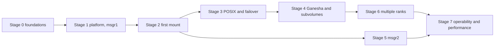

# Rust MDS: workplan

> Draft 0 for discussion, 2026-10-11. Delivers the P0 of [the minimum feature set](minimum-feature-set.md) incrementally (assumption D18), building every [day-one design hook](minimum-feature-set.md#51-day-one-design-hooks) in the stage where its layer is first written. Related: [architecture proposal](../README.md), [reference set](../mds-rust-map/README.md).

## 1. Principles

- **Vertical slice first.** A mount that works end to end, early, then widen. Every stage ends with something a real client can use.
- **Real peers from the first week.** A real Ceph cluster (mons, OSDs, mgr) and unmodified clients: a kernel mounted without `ms_mode` (msgr1), ceph-fuse, and NFS-Ganesha.
- **Golden data before code paths.** Every encoding we send or accept gets test vectors from `ceph-dencoder` and the object corpus. CRUSH and OSDMap handling get `crushtool` and `osdmaptool` output as oracles.
- **Hooks when their layer is written.** A day-one hook is built with its layer even when what it enables comes much later.
- **Measure the C++ MDS first.** This is the proposal's Phase 0. Every stage is then measured against that baseline.
- **Gates, not dates.** A stage is done when its gate passes.

## 2. Workstreams

| Workstream | Scope | Starts in |
|---|---|---|
| A. Platform | encoding, msgr1 then msgr2, cephx, MonClient, MgrClient, OSDMap, CRUSH, OSD client | stage 0 |
| B. Metadata core | shard model, per-shard WAL, store (directory index, inode records), inode allocator and index, transaction engine | stage 2 |
| C. Client protocol | sessions, request and reply encodings, caps, file locks, reconnect | stage 1 |
| D. Tenancy and scale-out | subvolume shards, quotas and realms, statistics aggregation, auth caps, mgr/volumes and mgr/nfs flows; then multiple ranks | stage 4 |
| E. Test and operations | dev clusters, CI, conformance suites, benchmarks; later admin commands, counters, health | stage 0, continuous |

## 3. Stages

### Stage 0: foundations

- **Repository:** a Cargo workspace in this repository, with crates along the layers: encoding, messenger, auth, mon client, mgr client, OSD client, client protocol, metadata core, daemon.
- **CI:** formatting, lints, unit tests and golden-encoding tests on every change; nightly integration runs against a dev cluster.
- **Runtime and threading model:** decided here, because changing it later means a rewrite (open question 2).
- **Dev cluster:**
  - a scripted Ceph `main` cluster running the C++ MDS, with a way to swap in the Rust MDS;
  - client machines for a kernel mounted with and without `ms_mode`, ceph-fuse, and Ganesha deployed by cephadm.
- **Golden data:** test vectors for every message and type the MDS sends or accepts, plus OSDMap and CRUSH fixtures taken from real clusters.
- **Baseline on the C++ MDS:**
  - strict-I/O NFS (fio sync writes from many NFS clients, on one export and on many exports);
  - single-client create rate (untar) on kernel and ceph-fuse;
  - multi-client create rate in one directory and across subvolumes;
  - failover time.

**Gate:** CI green, the dev cluster reproducible from a script, baseline numbers recorded.

### Stage 1: platform, msgr1 first (milestone M0)

- **Messenger:** encoding framework; msgr1 client and server; cephx client and service side, including rotating `mds` secrets.
- **MonClient:** auth and tickets, subscriptions, beacons, MLog, commands.
- **OSD side:** OSDMap decoding, CRUSH, and the OSD client. One messenger and one address for everything; epoch barrier; `-EBLOCKLISTED` leads to a respawn.
- **MgrClient:** open, configure, reports.
- **Daemon skeleton:**
  - cephadm and Rook command lines; config from the monitor;
  - beacons with the compat set of decision 2; DNE on SIGTERM;
  - the rank state machine up to `up:active` with no clients;
  - creation of the base hierarchy, with a layout on `/`;
  - the format-marker check.
- **Hooks built here:**
  - one messenger abstraction over msgr1 and msgr2;
  - reading a connection kept separate from executing its requests.

**Gate:**
- the daemon boots, beacons, takes rank 0 and reaches `up:active`;
- CRUSH placement matches `osdmaptool`;
- a blocklisted daemon is fenced and respawns;
- a kernel without `ms_mode` and Ganesha both complete a session open.

### Stage 2: first mount (milestone M1, part 1)

One rank, one shard, coarse locking inside the shard (the proposal's Phase 1 style).

- **Store:**
  - a per-shard WAL with one stream: self-contained, versioned records, and an OSD-checked ownership guard on every append;
  - checkpoints into the store, a directory index in hash order, inode records;
  - an inode allocator with range leases and a session-delegation API;
  - the inode-number index.
- **Sessions:** open, renew, close, stale, autoclose.
- **Requests:** decoding of the current request format, the current reply encodings, and these operations:
  - lookup, getattr, readdir;
  - mkdir, create and open, mknod, symlink;
  - unlink, rmdir, rename, link;
  - setattr, xattrs, getvxattr.
- **Caps:** issue, revoke, flush and FLUSH_ACK; the exclusive writer; `max_size`.
- **Hooks built here:** the per-session send queue; caps tracked per shard; a cap model with room for a client-exclusive directory state.

**Gate:**
- kernel (msgr1) and ceph-fuse mounts work;
- `ls`, `cp -r`, untar and a kernel build complete;
- most of pjdfstest passes.

### Stage 3: POSIX and failover complete (milestone M1, part 2)

- **POSIX:**
  - fcntl and flock locks, blocking and interruptible, with EDEADLK;
  - unlink-while-open with per-shard strays, and the purge queue;
  - truncation, hard links, ACL xattrs;
  - the completed-request table, written with the mutation.
- **Failover:**
  - replay, then reconnect (v3 and v5: caps, locks, realms), then rejoin;
  - cold-standby takeover, and standby-replay accepted as a cold follower;
  - eviction with blocklist and epoch barrier;
  - file-size recovery;
  - damage containment and read-only mode on write errors.
- **Hook built here:** an empty per-shard clientreplay phase.

**Gate:**
- all of pjdfstest;
- fstests `generic` with the ceph exclusions;
- fsstress and fsx;
- `kill -9` of the active MDS under load, with no acknowledged metadata lost;
- the qa failover tests that run against any MDS.

### Stage 4: NFS-Ganesha and subvolumes (milestone M2)

- **Ganesha:**
  - reset reclaim, with `uuid` and `timeout` persisted and honoured;
  - LOOKUPINO, LOOKUPPARENT and LOOKUPNAME;
  - sync paths that commit at once;
  - no recovery hold (decision 6).
- **Subvolumes as shards:**
  - shard creation, including adoption of an existing subtree;
  - EXDEV across subvolumes;
  - the shard-root create, rename and remove protocol;
  - quota realms with SPLIT notifications and MClientQuota;
  - statistics aggregation;
  - layouts and pool namespaces;
  - the full MDS auth caps;
  - the mgr/volumes and mgr/nfs flows.

**Gate:**
- pynfs, plus a Ganesha restart and a Ganesha node takeover;
- `test_volumes.py` without snapshots, `test_nfs.py`, `test_quota.py`, `test_multifs_auth.py`;
- the Rook and ceph-csi PVC lifecycle with Rook defaults (msgr1);
- the strict-I/O benchmark compared with the baseline.

### Stage 5: msgr2 (milestone M0b, in parallel from stage 2)

- msgr2 client and server in crc mode, then secure mode.
- The address vector lists v2 first and v1 second.
- The kernel's msgr2 strictness checklist.

**Gate:** kernel mounts with `ms_mode=prefer-crc` and `secure` work; Rook with `requireMsgr2: true` works; libcephfs and Ganesha connect over msgr2.

### Stage 6: multiple ranks (milestone M3)

- **Shard map** with ownership epochs (the WAL guards already exist).
- **Placement:** `ceph.dir.pin`, plus the consistent hash for `ceph.dir.pin.distributed`.
- **Live migration:** MMDSLoadTargets, the FLUSHMSG barrier, forced session open, block-then-forward, cap EXPORT/IMPORT.
- **`max_mds` grow and shrink.**
- **LOOKUPINO from any rank.**
- **Failover with several ranks.**

**Gate:**
- failover and `max_mds` changes under load;
- the cephadm and Rook upgrade sequence (`max_mds 1`, standby-replay off).

### Stage 7: operability and the first performance pass (milestone M4)

- **Operations:**
  - the admin commands, perf counters and health checks that peers read;
  - `damage ls|rm`;
  - the exact version string;
  - cephadm and Rook deployment and upgrade end to end.
- **Performance** (the proposal's Phases 2 and 3, now that P0 works):
  - fine-grained transactions inside a shard;
  - several WAL streams per shard;
  - parallel execution inside one session;
  - the shared-session limits of decision 7.

**Gate:**
- `ceph fs status`, the dashboard and ceph-exporter show correct data;
- upgrades work end to end;
- strict-I/O NFS and multi-client benchmarks at or above the C++ baseline, scaling with cores and ranks.

### After P0

The P1 track, in this order:
1. early replies, then kernel async dirops;
2. dentry leases;
3. snapshots, once their scope is decided with Igor;
4. warm standby-replay;
5. scrub;
6. `fs perf stats` and subvolume metrics.

## 4. Dependencies

The critical path is OSD client → WAL and store → caps → reconnect. Workstream E runs throughout. Stage 5 needs only workstream A, so it overlaps stages 2 to 4.

## 5. Risks

| Risk | Mitigation |
|---|---|
| CRUSH or OSDMap placement differs from C++ | `osdmaptool` and `crushtool` oracles on real cluster maps, from stage 1 |
| The kernel rejects our wire output (msgr1 signatures, msgr2 rules, reply-content `BUG_ON`s) | golden vectors; a kernel test matrix with and without `ms_mode`; kernel-side debugging expertise in the team |
| Cap-protocol subtleties (`seq`, `issue_seq`, `mseq`, flush acks) | interop tests with both clients from stage 2; randomized multi-client tests |
| Recovery bugs lose acknowledged metadata | crash and kill tests in CI from stage 3 |
| Performance target missed | the baseline from stage 0; benchmarks at every gate; the WAL commit path treated as a KPI |
| Kernel async dirops break on the kernel side (unexercised since squid) | P1; kernel fixes planned alongside |

## 6. Open questions

1. Team and timeline: how many engineers, and is there a target date for "a basic Rust MDS up and running" (the stage 3 gate)?
2. Runtime and threading model (stage 0).
3. Test environment: which machines and clusters, kernel versions on the client hosts, CI resources.
4. Code layout: this repository as the Cargo workspace, or a separate repository?
