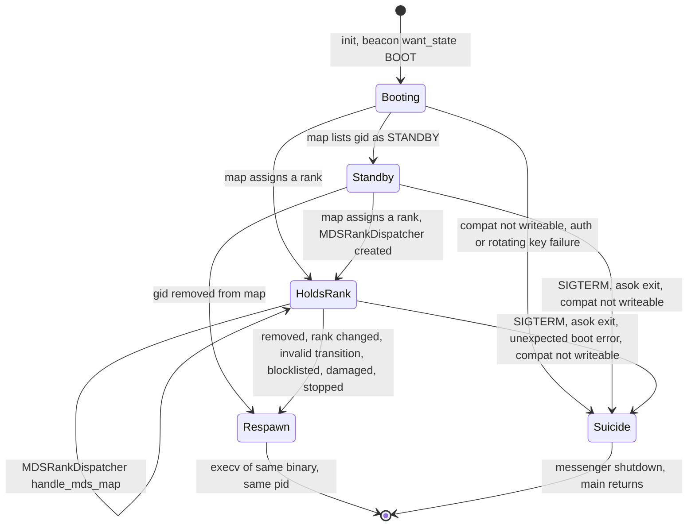
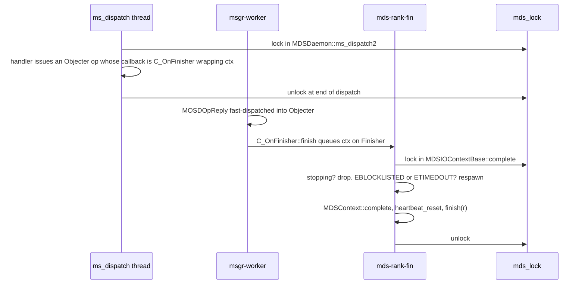
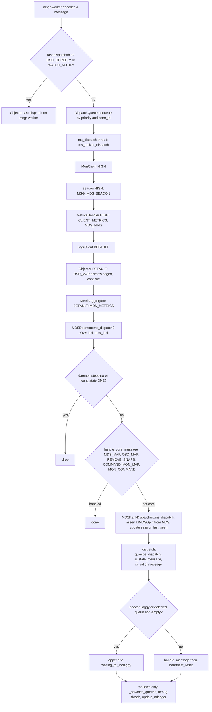
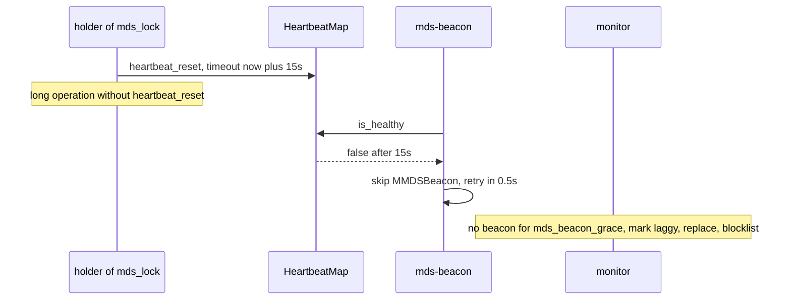

# Process anatomy, threading and `mds_lock` mechanics

> Part of the C++ MDS project map ([README](../README.md)). Sources: `src/ceph_mds.cc` (~265 LOC), `src/mds/MDSDaemon.{h,cc}` (~1490), `src/mds/MDSRank.{h,cc}` (~5120, of which lines 1-1622 and 3686-4379 in depth), `src/mds/MDSContext.{h,cc}` (~360), `src/mds/MDSContinuation.h`, `src/mds/MDSMetaRequest.h`, `src/mds/RetryMessage.h`, `src/mds/RetryRequest.h`, `src/mds/Beacon.{h,cc}` (~700, threading only), `src/mds/MDSPinger.{h,cc}` (~160), `src/mds/CMakeLists.txt`; plus the thread-related parts of `src/mds/MDLog.cc`, `src/mds/MDCache.cc`, `src/mds/PurgeQueue.cc`, `src/mds/MetricsHandler.cc`, `src/mds/MetricAggregator.cc`, `src/mds/MDSDmclockScheduler.cc`, `src/mds/MDSRankQuiesce.cc`, and the common infrastructure they use (`src/common/{fair_mutex.h,Timer.cc,Finisher.cc,HeartbeatMap.cc,admin_socket.cc}`, `src/msg/{Messenger.h,DispatchQueue.*}`).
> Related: [mds_lock analysis](mds_lock-analysis.md), [beacon and monitor](../01-cluster-integration/beacon-and-monitor.md), [FSMap/MDSMap](../01-cluster-integration/fsmap-and-mdsmap.md), [auth and MDS caps](../01-cluster-integration/auth-and-mds-caps.md), [wire protocol](../02-client-protocol/wire-protocol.md), [sessions](../02-client-protocol/sessions.md), [request lifecycle](../03-request-path/request-lifecycle.md), [MDLog and Journaler](../06-journal/mdlog-and-journaler.md), [cache lifecycle/trim](../04-cache/mdcache-lifecycle-trim-and-memory.md), [rank lifecycle and recovery](../09-recovery/rank-lifecycle-and-recovery.md), [RADOS/OSD interactions](../07-storage-formats/rados-and-osd-interactions.md), [strays and purge](../11-background-services/strays-and-purge.md), [dmClock QoS](../12-qos-metrics-quiesce-quarantine/qos-dmclock-scheduler.md), [metrics](../12-qos-metrics-quiesce-quarantine/metrics-and-subvolume-metrics.md), [quiesce](../12-qos-metrics-quiesce-quarantine/quiesce.md), [admin commands](../13-admin-and-config/admin-commands.md), [config/perf/health](../13-admin-and-config/config-perf-counters-and-health.md).

## 1. Purpose and responsibilities

This page describes how one `ceph-mds` process is put together and how work enters it:

- `main()` (`src/ceph_mds.cc`) builds the single messenger, the `MonClient`, a 2-thread asio pool and the `MDSDaemon`, then parks the main thread in `msgr->wait()`.
- `MDSDaemon` is the always-present, rank-independent part of the process: it owns `mds_lock`, the shared `SafeTimer`, the `Beacon`, the `MgrClient`, the cluster log client, the current `MDSMap`, the admin-socket hook, signal handling, and the `suicide()` / `respawn()` primitives. It is the lowest-priority messenger `Dispatcher`.
- `MDSRank` (constructed as `MDSRankDispatcher`) exists only while the daemon holds a rank (including standby-replay of a rank). It owns every metadata subsystem (`MDCache`, `Server`, `Locker`, `MDLog`, `MDBalancer`, `SnapServer`/`SnapClient`, `InoTable`, `SessionMap`, `PurgeQueue`, `ScrubStack`, `MetricsHandler`, `MetricAggregator`, `QuiesceDbManager`, `QuiesceAgent`, `MDSDmclockScheduler`, `OpTracker`, `Objecter`, a `Finisher`, a progress thread) and implements message dispatch, the waiter queues, tick, heartbeat and the rank-state machine.
- The `MDSContext` family encodes the single most important threading rule of the C++ MDS: *all metadata state is touched only while holding the process-wide `mds_lock`*, and any asynchronous completion (RADOS IO, journal commit, mon command) must re-enter through a path that takes `mds_lock` (normally by bouncing through the rank `Finisher` thread).

Everything metadata-related in this daemon is therefore serialized by one lock; the remaining threads are either plumbing that never takes `mds_lock` (network workers, beacon sender, MonClient/MgrClient/Objecter timers, PurgeQueue internals) or background loops and completion threads that grab `mds_lock` for their work.

## 2. Source map

| File | Class / function | Lines | Role |
|---|---|---|---|
| `src/ceph_mds.cc` | `main` | 84-265 | Process bootstrap: args, NUMA affinity, fork/daemonize, messenger + policies, `MonClient`, `MDSDaemon`, signals, `msgr->wait()`, final teardown |
| `src/ceph_mds.cc` | `handle_mds_signal` | 78-82 | SIGINT/SIGTERM bridge to `MDSDaemon::handle_signal` |
| `src/mds/MDSDaemon.h` | `class MDSDaemon : public Dispatcher` | 42-157 | `mds_lock` (74), `stopping` (75), `timer` (77), `beacon` (127), `mgrc` (134), `mdsmap` (135), `mds_rank` (139); `CEPH_MDS_PROTOCOL 36` (30) |
| `src/mds/MDSDaemon.cc` | `MDSDaemon::MDSDaemon` / `~MDSDaemon` | 84-126 | Construct timer on `mds_lock`, beacon, MgrClient, LogClient; GSSAPI keytab env |
| `src/mds/MDSDaemon.cc` | `MDSSocketHook`, `asok_command`, `dump_status`, `set_up_admin_socket`, `clean_up_admin_socket` | 128-626 | Admin socket hook, daemon-level commands, registration of ~60 commands |
| `src/mds/MDSDaemon.cc` | `MDSDaemon::init` | 628-743 | Dispatcher registration, mon auth, rotating keys, `mdsmap` subscription, timer/beacon start, first tick |
| `src/mds/MDSDaemon.cc` | `reset_tick`, `tick` | 745-768 | Self-rescheduling tick every `mds_tick_interval` |
| `src/mds/MDSDaemon.cc` | `handle_command` | 770-831 | `MCommand` ("tell") admission, then hand-off to the admin-socket thread |
| `src/mds/MDSDaemon.cc` | `handle_mds_map` | 833-957 | Daemon-level map processing: compat check, removal => respawn, rank assignment => create `MDSRankDispatcher` |
| `src/mds/MDSDaemon.cc` | `handle_signal`, `suicide`, `respawn` | 959-1084 | Process termination and re-exec |
| `src/mds/MDSDaemon.cc` | `ms_dispatch2`, `handle_core_message` | 1088-1169 | Top of the message path; takes `mds_lock` |
| `src/mds/MDSDaemon.cc` | `ms_handle_reset`, `ms_handle_remote_reset`, `ms_handle_refused`, `parse_caps`, `ms_handle_fast_authentication`, `ms_handle_accept`, `is_clean_shutdown` | 1171-1328 | Connection events, cap parsing, `Session` attachment to connections |
| `src/mds/MDSRank.h` | perf counter enums `l_mds_*`, `l_mdm_*` | 52-132 | `mds` and `mds_mem` counter ids |
| `src/mds/MDSRank.h` | `class MDSRank` | 170-696 | Subsystem pointers, waiter queues, `ProgressThread` (475-484), `finished_queue`/`waiting_for_nolaggy` (625-626), heartbeat (630-632) |
| `src/mds/MDSRank.h` | `class MDSRankDispatcher` | 703-742 | Daemon-facing API: `init`, `tick`, `shutdown`, `handle_asok_command`, `handle_mds_map`, `handle_osd_map`, `ms_dispatch`, config observer |
| `src/mds/MDSRank.cc` | `C_Flush_Journal`, `C_Drop_Cache` | 82-466 | Async state machines behind `flush journal` and `cache drop` |
| `src/mds/MDSRank.cc` | `MDSRank::MDSRank`, `~MDSRank`, `MDSRankDispatcher::init` | 468-609 | Construction order of subsystems and threads |
| `src/mds/MDSRank.cc` | `update_targets`, `hit_export_target`, `set_mdsmap_multimds_snaps_allowed` | 611-708 | Mon-facing side effects of tick |
| `src/mds/MDSRank.cc` | `MDSRankDispatcher::tick` | 710-802 | Periodic upkeep |
| `src/mds/MDSRank.cc` | `MDSRankDispatcher::shutdown` | 804-872 | Ordered teardown of threads |
| `src/mds/MDSRank.cc` | `suicide`, `respawn`, `abort`, `damaged`, `damaged_unlocked`, `handle_write_error*` | 923-997 | Fatal-path helpers |
| `src/mds/MDSRank.cc` | `ProgressThread::entry/shutdown` | 999-1035 | Drains `finished_queue` and `waiting_for_nolaggy` |
| `src/mds/MDSRank.cc` | `ms_dispatch`, `_dispatch`, `is_valid_message`, `handle_message`, `_advance_queues`, `heartbeat_reset`, `is_stale_message`, `get_session` | 1037-1451 | Rank-level message path |
| `src/mds/MDSRank.cc` | `send_message*`, `forward_message_mds`, `set_osd_epoch_barrier`, `retry_dispatch`, `request_state` | 1453-1608 | Outbound helpers |
| `src/mds/MDSRank.cc` | `MDSRankDispatcher::handle_mds_map` | 2294-2626 | Rank-level map processing; kicks waiter queues (summarized here, detailed in the recovery pages) |
| `src/mds/MDSRank.cc` | `MDSRankDispatcher::handle_asok_command`, `evict_clients` | 2656-3197 | Per-command locking discipline |
| `src/mds/MDSRank.cc` | `dump_status`, `create_logger`, `check_ops_in_flight`, `handle_osd_map`, `config_client`, `evict_client` | 3686-4068 | Status, perf counters, slow ops, OSD map, eviction |
| `src/mds/MDSRank.cc` | `get_tracked_keys`, `handle_conf_change`, task status, in-memory logger | 4120-4379 | Config observer and periodic reporting |
| `src/mds/MDSContext.h/.cc` | `MDSContext`, `MDSHolder`, `MDSInternalContext`, `MDSInternalContextWrapper`, `MDSIOContextBase`, `MDSLogContextBase`, `MDSIOContext`, `MDSIOContextWrapper`, `C_MDSInternalNoop`, `C_IO_Wrapper`, `MDSGather*` | h:38-212, cc:24-147 | Completion taxonomy and lock re-entry |
| `src/mds/MDSContinuation.h` | `MDSContinuation` | 23-35 | Staged continuation helper bound to `Server` (used by scrub validation) |
| `src/mds/MDSMetaRequest.h` | `MDSMetaRequest` | 21-32 | Book-keeping for MDS-originated `MClientRequest`s |
| `src/mds/RetryMessage.h` | `C_MDS_RetryMessage`, `CF_MDS_RetryMessageFactory` | 22-44 | Re-dispatch a parked message |
| `src/mds/RetryRequest.h` | `C_MDS_RetryRequest`, `CF_MDS_RetryRequestFactory` | 21-39 | Re-dispatch a parked `MDRequest` (impl. `src/mds/MDCache.cc:13271`) |
| `src/mds/Beacon.h/.cc` | `class Beacon : public Dispatcher` | h:45-114, cc:51-579 | Beacon sender thread, lagginess, health snapshot |
| `src/mds/MDSPinger.h/.cc` | `MDSPinger` | h:17-56, cc:15-104 | Rank-0 ping bookkeeping for metrics (own mutex) |
| `src/mds/CMakeLists.txt` | `mds_srcs` | 1-59 | All MDS sources are one static library `mds` (also compiles `common/TrackedOp.cc`, `common/MemoryModel.cc`, `osdc/Journaler.cc`, `mgr/MDSPerfMetricTypes.cc`; links `dmclock`, Lua) |

## 3. How it works

### 3.1 Process start (`main`)

Sequence in `src/ceph_mds.cc:84 (main)`:

1. Name the main thread `ceph-mds` (`:86`); `global_init(..., CEPH_ENTITY_TYPE_MDS, CODE_ENVIRONMENT_DAEMON)` (`:98`); heap profiler init (`:100`).
2. If `mds_numa_node >= 0`, pin *all threads* to that NUMA node's CPU set (`:102-120`).
3. The only accepted extra argument is the obsolete `--hot-standby <x>` (ignored); anything else exits with error (`:122-133`).
4. `pick_addresses(CEPH_PICK_ADDRESS_PUBLIC)` (`:138`). The id must be given (`-i`) and must not be empty or start with a digit (`:141-151`).
5. `Preforker` fork when daemonizing (`:153-167`), then `common_init_finish` (`:168`), which starts the `service` thread and the admin socket (`admin_socket` thread) via `CephContext::start_service_thread` (`src/common/common_init.cc:108`, `src/common/ceph_context.cc:909-934`). The `log` thread already runs from `global_init` and is restarted in the child after the fork (`src/global/global_init.cc:180,582`).
6. **One messenger** for everything (clients, mons, OSDs, mgr, peer MDSs): `Messenger::create(ms_public_type or ms_type, entity_name_t::MDS(-1), "mds", random nonce)` (`:171-174`); cluster protocol `CEPH_MDS_PROTOCOL` = 36 (`:177`). Constructing the `AsyncMessenger` already starts the `msgr-worker-N` threads (`NetworkStack::start`, `src/msg/async/AsyncMessenger.cc:385`).
7. Messenger policies (`:181-191`):

   | Peer type | Policy | Required features |
   |---|---|---|
   | default (OSD, mgr, ...) | `lossy_client` | `CEPH_FEATURE_OSDREPLYMUX` |
   | MON | `lossy_client` | `CEPH_FEATURE_UID \| CEPH_FEATURE_PGID64` |
   | MDS | `lossless_peer` (lossy=false, server=false, standby=true, resetcheck=false) | `CEPH_FEATURE_UID` |
   | CLIENT | `stateful_server` (lossy=false, server=true, standby=true, resetcheck=true) | none |

   No byte/message throttlers are attached to any policy (`src/msg/Policy.h:69-86`).
8. `bindv`, async signal handler with SIGHUP (`:193-199`).
9. `ceph::async::io_context_pool ctxpool(2)` — two threads named `io_context_pool` (`src/common/async/context_pool.h:61 (io_context_pool::start)`); `MonClient mc(cct, ctxpool)`, `build_initial_monmap` (`:202-205`).
10. `msgr->start()` (`:208`) only marks the messenger started and fixes its addresses (`src/msg/async/AsyncMessenger.cc:776`). The `ms_dispatch`/`ms_local` threads are started later by `AsyncMessenger::ready()` -> `DispatchQueue::start()` when the first dispatcher is added, which is the `Beacon` in `MDSDaemon::init` (`src/msg/Messenger.h:430-439`, `src/msg/async/AsyncMessenger.cc:464-481`).
11. `new MDSDaemon(id, msgr, &mc, ctxpool)`; save `argc/argv` for `respawn()` (`:211-215`); daemonize (`:217-220`).
12. `mds->init()` (`:222`); if it fails, `msgr->wait()` and go straight to teardown (`:223-226`). Otherwise install one-shot SIGINT/SIGTERM handlers (`:228-229`); optional `inject_early_sigterm` (`:231`).
13. Main thread blocks in `msgr->wait()` (`:234`) until the messenger is shut down by `suicide()`.
14. Teardown (`:241-255`): stop the asio pool, lock+unlock `mds_lock` to wait for whoever called shutdown, remove pidfile, and **only if `is_clean_shutdown()`** (no rank, or the rank is in the `stopped` set) delete the `MDSDaemon` and messenger.

### 3.2 `MDSDaemon::init`

`src/mds/MDSDaemon.cc:628 (MDSDaemon::init)`:

1. Register dispatchers: `beacon` at `PRIORITY_HIGH` (`:662`, the first dispatcher, so this call starts `ms_dispatch`/`ms_local`), `this` at `PRIORITY_LOW` (`:664`) — "order last as `MDSDaemon::ms_dispatch2` first acquires the mds_lock".
2. `monc->set_messenger`, `set_want_keys(MON|OSD|MDS|MGR)`, `monc->init()` (MonClient adds itself as a `PRIORITY_HIGH` head dispatcher, `src/mon/MonClient.cc:571`). Failure => `suicide()` under `mds_lock`.
3. Messenger auth client and auth server are the `MonClient`; `monc->set_handle_authentication_dispatcher(this)` routes post-cephx verification to `MDSDaemon::ms_handle_fast_authentication` (`:681-683`).
4. `monc->authenticate()`; then `wait_auth_rotating(rotating_keys_bootstrap_timeout=30s)`, retried up to `max_rotating_auth_attempts=10` more times, else `suicide()` and `-ETIMEDOUT` (`:688-711`).
5. Under `mds_lock`: if `want_state` is already `DNE` (a signal arrived) return; else `sub_want("mdsmap", 0, 0)` + `renew_subs()` (`:713-723`).
6. `set_up_admin_socket()` **outside** `mds_lock` "so that ordering is consistent (later we take mds_lock within asok callbacks)" (`:725-727`).
7. Under `mds_lock`: re-check `want_state == DNE` (then `suicide()`), `timer.init()` (starts the `safe_timer` thread), `beacon.init(*mdsmap)` (starts the `mds-beacon` thread with `want_state = STATE_BOOT`), `messenger->set_myname(MDS(MDS_RANK_NONE))`, `reset_tick()` (`:728-742`).

### 3.3 Object model and ownership

`MDSDaemon` is long-lived; `MDSRankDispatcher` is created the first time an `MDSMap` assigns this daemon's gid a rank (`src/mds/MDSDaemon.cc:939-948`) and is never replaced in-process: a rank change, removal from the map or invalid transition re-execs the process instead (see 3.16). `MDSRank` is the "subsystem-facing" interface (pointers to all subsystems plus messaging helpers); `MDSRankDispatcher` adds the daemon-facing control surface (`init/tick/shutdown/handle_mds_map/handle_osd_map/handle_asok_command/ms_dispatch`, config observer) (`src/mds/MDSRank.h:698-742`).

```mermaid
flowchart TB
    MAIN["main() ceph_mds.cc"] --> MSGR["Messenger 'mds' (async, single instance)"]
    MAIN --> POOL["io_context_pool (2 threads)"]
    MAIN --> MONC["MonClient (Dispatcher HIGH, own SafeTimer)"]
    MAIN --> DMN["MDSDaemon (Dispatcher LOW)"]
    DMN --> LOCK["mds_lock : ceph::fair_mutex"]
    DMN --> TMR["timer : CommonSafeTimer on mds_lock (thread safe_timer)"]
    DMN --> BCN["Beacon (Dispatcher HIGH, thread mds-beacon)"]
    DMN --> MGRC["MgrClient (Dispatcher DEFAULT, own SafeTimer)"]
    DMN --> CLOG["LogClient / clog"]
    DMN --> MAP["unique_ptr MDSMap (current map)"]
    DMN --> HOOK["MDSSocketHook (admin socket)"]
    DMN -->|"0..1, created on first rank"| RANK["MDSRankDispatcher : MDSRank"]
    RANK --> OBJ["Objecter (own instance, Dispatcher DEFAULT, fast-dispatch OSD replies)"]
    RANK --> FIN["Finisher mds-rank-fin"]
    RANK --> PROG["ProgressThread mds-rank-progr"]
    RANK --> MDC["MDCache (owns Migrator, StrayManager, OpenFileTable, RecoveryQueue; thread mds-cache-trim)"]
    RANK --> LOG["MDLog (Journaler; threads mds-log-submit, -replay, -recvr/-reopen, -trim)"]
    RANK --> SRV["Server"]
    RANK --> LCK["Locker"]
    RANK --> BAL["MDBalancer"]
    RANK --> SCR["ScrubStack"]
    RANK --> TBL["InoTable, SnapServer, SnapClient"]
    RANK --> SM["SessionMap (member)"]
    RANK --> DT["DamageTable (member)"]
    RANK --> PQ["PurgeQueue (member; own lock, Finisher mds-pq-fin, SafeTimer)"]
    RANK --> MH["MetricsHandler (member; Dispatcher HIGH after active; thread mds-metrics)"]
    RANK --> MA["MetricAggregator (rank 0 only; Dispatcher DEFAULT; thread mds-ping; MDSPinger)"]
    RANK --> QDB["QuiesceDbManager (shared_ptr; thread mds-q-db)"]
    RANK --> QAG["QuiesceAgent (shared_ptr, after active; thread mds-q-agt)"]
    RANK --> DMC["MDSDmclockScheduler (scheduler thread + dmclock queue threads)"]
    RANK --> OPT["OpTracker op_tracker (member)"]
    RANK --> PERF["PerfCounters logger 'mds', mlogger 'mds_mem'"]
```

Construction order (`src/mds/MDSRank.cc:468 (MDSRank::MDSRank)`): `Objecter` (on the daemon's messenger, MonClient and asio pool, `:483`), `DamageTable`, `SessionMap`, `OpTracker(mds_enable_op_tracker, osd_num_op_tracker_shard)` (`:485`), `ProgressThread` object, `PurgeQueue` (with an error callback that takes `mds_lock` and calls `handle_write_error`, `:488-495`), `MetricsHandler`; then in the body: heartbeat worker `"MDSRank"` (`:505`), cache `metadata_pool` (`:510`), `objecter->unset_honor_pool_full()` (`:514`), `Finisher("MDSRank", "mds-rank-fin")` (`:516`), `MDCache`, `MDLog`, `MDBalancer`, `ScrubStack`, `InoTable`, `SnapServer`, `SnapClient`, `Server`, `Locker`, `QuiesceDbManager`, `MDSDmclockScheduler` (`:518-535`), OpTracker tunables (`:537-542`), and the first task-status timer event (`:544`). Threads already started by constructors at this point: `mds-log-trim` (`src/mds/MDLog.cc:64`), `mds-cache-trim` (`src/mds/MDCache.cc:212`), the dmClock scheduler thread (`src/mds/MDSDmclockScheduler.cc:564`) and the dmClock `PushPriorityQueue` internal threads.

`MDSRankDispatcher::init` (`src/mds/MDSRank.cc:590`): `objecter->init()`, add Objecter as tail dispatcher, `objecter->start()`, `update_log_config()`, `create_logger()`, `handle_osd_map()`, start `mds-rank-progr`, `purge_queue.init()` (starts `mds-pq-fin` and the PurgeQueue `safe_timer`), `finisher->start()` (`mds-rank-fin`). The constructor of `MDSRankDispatcher` registers it as a config observer (`:4086`).

Later, state-dependent additions: `active_start()` registers `MetricsHandler` as a `PRIORITY_HIGH` tail dispatcher and starts its thread; on rank 0 it creates `MetricAggregator` (tail dispatcher) and its `mds-ping` thread; then `quiesce_agent_setup()` creates `QuiesceAgent` (`src/mds/MDSRank.cc:2129-2163`). `QuiesceDbManager::update_membership` starts `mds-q-db` when this daemon is a quiesce-DB member (`src/mds/QuiesceDbManager.cc:192-203`). `MDLog::create/open` start `mds-log-submit`, `open` also starts `mds-log-recvr`, `reopen` starts `mds-log-reopen`, `replay` starts `mds-log-replay` (`src/mds/MDLog.cc:303-356,1060`).

Process-global singletons that make "one rank per process" an implicit assumption: `CInode::count()`, `CDir::count()`, `CDentry::count()`, `Capability::count()` (used by `update_mlogger`, `src/mds/MDSRank.cc:1172`) and the static `ioctx_list` of outstanding IO contexts (`src/mds/MDSContext.cc:38-45`).

### 3.4 Daemon-level map handling (`MDSDaemon::handle_mds_map`)

`src/mds/MDSDaemon.cc:833`. Runs on the `ms_dispatch` thread under `mds_lock` (via `ms_dispatch2` -> `handle_core_message`; `CEPH_MSG_MDS_MAP` is accepted from MON and MDS peers).

1. Drop maps with `epoch <= current` (`:838`). Decode the new map; `monc->sub_got("mdsmap", epoch)`.
2. Compat: if `MDSMap::get_compat_set_all()` cannot write the map's compat set => `suicide()` (`:857-866`).
3. Compute `whoami = mdsmap->get_rank_gid(gid)` (for standby-replay this is the followed rank), `old_state`, `new_state`, `incarnation`.
4. If the gid was in the old map and is not in the new one => `respawn()` (`:883-888`).
5. On first appearance in the map: `mgrc.init()`, add `MgrClient` as tail dispatcher, subscribe `mgrmap` (`:890-896`).
6. `mark_down_addrs` for every gid that disappeared (`:899-904`).
7. No rank: `STANDBY` sets `beacon.want_state = STANDBY` on first appearance (old state `NULL`); `NULL` keeps waiting (asserts `want_state == BOOT`); any other rankless state aborts with "invalid transition to standby" (`:906-928`).
8. Rank: a different rank than the existing `MDSRank` => `respawn()`; no `MDSRank` yet => construct `MDSRankDispatcher(whoami, mds_lock, clog, timer, beacon, mdsmap, messenger, monc, &mgrc, respawn_hook, suicide_hook, ioctx)` and `init()`; then `mds_rank->handle_mds_map(m, *oldmap)` (`:929-954`).
9. `beacon.notify_mdsmap(*mdsmap)` (records the epoch the next beacon will carry).

The rank-level part (`MDSRankDispatcher::handle_mds_map`, `src/mds/MDSRank.cc:2294`) asserts `state == oldstate` (no missed map), validates the transition (invalid => `respawn()`), renames the messenger to `mds.<rank>` (or `mds.<gid>` in standby-replay) on state change (`:2334-2351`), sets the Objecter client incarnation (`:2354`), runs failure/recovery detection for peers, invokes the per-state `*_start()` method, and kicks waiter queues (see 3.8). Details are in [rank lifecycle](../09-recovery/rank-lifecycle-and-recovery.md).

### 3.5 Thread inventory

| Thread (comm name) | Count | Created by | Takes `mds_lock`? | Duties |
|---|---|---|---|---|
| `ceph-mds` (main) | 1 | kernel | only at exit (`src/ceph_mds.cc:245`) and inside `init()` | Bootstrap, then blocked in `msgr->wait()` |
| `msgr-worker-N` | `ms_async_op_threads` (3) | `Messenger::create` -> `NetworkStack::start` (per-CephContext stack singleton, `src/msg/async/AsyncMessenger.cc:385`; named in `src/msg/async/Stack.h:366`) | must not | Sockets, msgr2 framing/crypto, cephx `verify_authorizer` and `MDSDaemon::ms_handle_fast_authentication` (via `MonClient::handle_auth_request`, `src/mon/MonClient.cc:1807`), **fast dispatch** of `CEPH_MSG_OSD_OPREPLY`/`CEPH_MSG_WATCH_NOTIFY` into `Objecter` (`src/osdc/Objecter.h:2782-2796`); Objecter `Context*` completions run here inline (`src/osdc/Objecter.h:2078 (Op::complete)`) |
| `ms_dispatch` | 1 | `DispatchQueue::start` (`src/msg/DispatchQueue.cc:239`), called by `AsyncMessenger::ready()` on the first `add_dispatcher_*` (`MDSDaemon.cc:662`) | yes: for every message reaching `MDSDaemon`, every accepted connection, client reset events, and `MetricsHandler` path resolution | Delivers each queued message to the dispatcher chain (3.9). Constructs `MDSRankDispatcher` |
| `ms_local` | 1 | `DispatchQueue::start` (`:240`) | no | Self-addressed messages (e.g. table client and server on the same rank) re-enter the dispatch queue |
| `io_context_pool` | 2 | `main` (`src/ceph_mds.cc:202`) | mostly indirectly (handlers bounce to `mds-rank-fin`); directly only when `handle_conf_change` arms the in-memory logger (`MDSRank.cc:4264`) | `MonClient` command/version completions (`src/mon/MonClient.cc:1547 (_finish_command)` posts `onfinish`), Objecter asio handlers (`wait_for_map`, `wait_for_latest_osdmap`), and mon-pushed config: `MonClient::handle_config` posts `set_mon_vals` to its `finish_strand` (`src/mon/MonClient.cc:517`), so `MDSRankDispatcher::handle_conf_change` runs here |
| `safe_timer` (MDSDaemon) | 1 | `MDSDaemon::init` -> `timer.init()` | **yes, holds it while running every callback** (`src/common/Timer.cc:80 (timer_thread)`, `safe_callbacks=true`) | `tick` (5 s), task status (2 s), standby-replay restart, retry timers of MDCache/Server/MDBalancer/quiesce/`cache drop` |
| `safe_timer` (MonClient) | 1 | `MonClient::init` | no (`monc_lock`) | Mon hunting, sub renewal, keepalive, clog flush |
| `safe_timer` (MgrClient) | 1 | `MgrClient::init` (first map containing the gid) | no (`MgrClient::lock`) | `MMgrReport` (perf counters, task status, health) |
| `ceph_timer` (Objecter) | 1 | `Objecter` | no | Op timeouts, Objecter tick |
| `mds-beacon` | 1 | `Beacon::init` (`src/mds/Beacon.cc:84`) | no (`Beacon::mutex` only) | `MMDSBeacon` every `mds_beacon_interval`; skipped while internal heartbeat unhealthy |
| `admin_socket` | 1 | `AdminSocket::init` from `CephContext::start_service_thread` in `common_init_finish` (`src/common/admin_socket.cc:1146`) | per command (3.13) | Local asok commands and remote `tell` commands (`MCommand`) |
| `signal_handler` | 1 | `init_async_signal_handler` | `handle_signal` locks | SIGHUP (log reopen), SIGINT/SIGTERM -> `suicide()` |
| `log` | 1 | `Log::start` (`global_init`, restarted after the fork) | no | Async debug-log writer |
| `service` | 1 | `CephContext::start_service_thread` from `common_init_finish` (`src/common/ceph_context.cc:917`) | no | Every `heartbeat_interval` (5 s): log reopen, `HeartbeatMap::check_touch_file` (touches `heartbeat_file` if healthy), perf refresh |
| `mds-rank-fin` | 1 | `MDSRank` ctor + `MDSRankDispatcher::init` | yes, inside each completion (`MDSIOContextBase::complete`) or lambda | IO-completion bounce: `C_OnFinisher`, `C_IO_Wrapper`, all `Journaler` callbacks (MDLog journal uses `mds->finisher`), config-change application, async asok work |
| `mds-rank-progr` | 1 | `MDSRankDispatcher::init` (`src/mds/MDSRank.cc:604`) | **yes, owns it except while waiting** | `_advance_queues()`: runs `finished_queue` contexts and deferred (`waiting_for_nolaggy`) messages |
| `mds-log-submit` | 1 | `MDLog::create/open` | **no** (`MDLog::submit_mutex` only) | Encode queued `LogEvent`s, `Journaler::append_entry`, `wait_for_flush`, flush |
| `mds-log-recvr` / `mds-log-reopen` | 0..1 | `MDLog::open` / `reopen` | briefly, to publish the journaler and complete | Blocking RADOS reads of `JournalPointer` and journal header, journal reformat |
| `mds-log-replay` | 0..1 (recreated per standby-replay pass) | `MDLog::replay` | per event: `le->replay(mds)` under `mds_lock` (`src/mds/MDLog.cc:1577-1584`) | Read and replay journal |
| `mds-log-trim` | 1 | `MDLog` ctor | **yes, owns it except while sleeping** (`src/mds/MDLog.cc:712-718`) | `MDLog::trim()` every `mds_log_trim_upkeep_interval` (1000 ms) when active or stopping |
| `mds-cache-trim` | 1 | `MDCache` ctor | yes, once per cycle | Memory sampling, `trim_client_leases`, `trim`, `recall_client_state` every `mds_cache_trim_interval` (1 s); heap release every `mds_cache_release_free_interval` (10 s) (`src/mds/MDCache.cc:14696`) |
| `mds-pq-fin` | 1 | `PurgeQueue::init` | no (except `on_error` -> `handle_write_error`) | PurgeQueue Journaler/Filer completions |
| `safe_timer` (PurgeQueue) | 1 | `PurgeQueue::init` | no (`PurgeQueue::lock`) | PurgeQueue delayed flush |
| `mds-metrics` | 0..1 | `MetricsHandler::init` (`src/mds/MetricsHandler.cc:93`) | via `MDSRank::get_inode_rbytes` with its own lock dropped | Every `mds_metrics_update_interval` (2 s): `MMDSMetrics` to rank 0 |
| `mds-ping` | 0..1 | `MetricAggregator::init` (rank 0) (`src/mds/MetricAggregator.cc:94`) | no | `MMDSPing` to active ranks every `mds_ping_interval` (5 s) |
| `mds-q-db` | 0..1 | `QuiesceDbManager::update_membership` | in `send_ack`/`send_listing_to` callbacks (`src/mds/MDSRankQuiesce.cc:279,295`) | Quiesce DB replication/state machine |
| `mds-q-agt` | 0..1 | `QuiesceAgent` ctor (`src/mds/QuiesceAgent.h:36`) | in `submit_request`/`cancel_request` (`src/mds/MDSRankQuiesce.cc:511,582`) | Apply quiesce roots locally |
| dmClock scheduler | 1 | `MDSDmclockScheduler::begin_schedule_thread` from the `MDSDmclockScheduler` ctor (`src/mds/MDSDmclockScheduler.cc:564`, `src/mds/MDSDmclockScheduler.h:447`) | yes in `submit_request_to_mds` (`src/mds/MDSDmclockScheduler.cc:97-113`) | Move queued client requests into the dmClock queue |
| dmClock `PushPriorityQueue` sched-ahead (`src/dmclock/src/dmclock_server.h:1560`) and `RunEvery` cleaning job (`src/dmclock/support/src/run_every.h:59`) | 2 | `crimson::dmclock` queue ctor | sched-ahead may call `handle_f` -> `submit_request_to_mds` | Deferred QoS release, idle-client cleanup |
| asok `exit`/`respawn` helper | transient | `MDSDaemon::asok_command` (`src/mds/MDSDaemon.cc:182,194`) | yes | Sleep 1 s, then `suicide()` / `respawn()` |

The three dmClock threads and the asok helpers are plain `std::thread`s that never call `ceph_pthread_setname`; on Linux a new thread inherits its creator's comm, so the dmClock threads appear as `ms_dispatch` (the `MDSRank` constructor runs on that thread) and the helpers as `admin_socket` (inferred from Linux clone semantics, not observed).

### 3.6 `mds_lock`

Definition: `ceph::fair_mutex mds_lock{"MDSDaemon::mds_lock"}` (`src/mds/MDSDaemon.h:74`). `fair_mutex` (`src/common/fair_mutex.h:15`) is a FIFO ticket lock built from an inner `ceph::mutex` + condition variable: `lock()` takes ticket `next_id++` and waits until `unblock_id` equals it; `unlock()` increments `unblock_id` and `notify_all()`. Consequences: strict arrival-order hand-off between all contending threads (no barging, no starvation of e.g. the finisher by the dispatch thread), every unlock wakes every waiter, not recursive, and no lockdep. `MDSRank::mds_lock` is a reference to the daemon's lock (`src/mds/MDSRank.h:414`, comment: "we can substitute a separate lock here in future potentially").

Rule (`src/mds/MDSDaemon.h:70-73`): whoever takes `mds_lock` must check `stopping`; if set, either do nothing and release, or never release it again (respawn). Two flags exist: `MDSDaemon::stopping` (set by `suicide()`) and `MDSRank::stopping` (set by `MDSRankDispatcher::shutdown()`, readable via `is_daemon_stopping()`, which despite its name returns the rank flag, `MDSRank.cc:1598`). `MDSDaemon::stopping` is checked in `MDSDaemon::ms_dispatch2/ms_handle_accept/ms_handle_reset/ms_handle_remote_reset/handle_signal`; `MDSRank::stopping` in `MDSIOContextBase::complete`, `ProgressThread::entry`, `MDLog::_submit_thread` (read without the lock), and the MDLog replay/recovery threads. Timer callbacks and the `mds-cache-trim`/`mds-log-trim` loops check neither (they stop through `timer.shutdown()` and their own shutdown flags).

Lock-held assertions (`ceph_mutex_is_locked_by_me`) are compiled to `true` unless `CEPH_DEBUG_MUTEX` is defined (`src/common/ceph_mutex.h:189-193`); the discipline is only enforced in debug builds.

Entry paths that acquire `mds_lock`:

| Thread | Entry point | Notes |
|---|---|---|
| `ms_dispatch` | `MDSDaemon::ms_dispatch2` (`src/mds/MDSDaemon.cc:1091`) | Every message not consumed by a higher-priority dispatcher |
| `ms_dispatch` | `MDSDaemon::ms_handle_accept` (`:1269`), `ms_handle_reset` (`:1180`, clients only), `ms_handle_remote_reset` (`:1207`, clients only) | Connection events are queued at `CEPH_MSG_PRIO_HIGHEST` (`src/msg/DispatchQueue.h:157 (queue_accept)`) |
| `ms_dispatch` | `MetricsHandler::handle_client_metrics` -> `MDSRank::get_path` (`src/mds/MDSRank.cc:4103`) | Per subvolume metric in a `CEPH_MSG_CLIENT_METRICS` |
| `safe_timer` | every `MDSDaemon::timer` callback | Timer thread holds the lock while scanning its schedule |
| `mds-rank-fin` | `MDSIOContextBase::complete` (`src/mds/MDSContext.cc:103`); lambdas in `handle_conf_change` (`MDSRank.cc:4293`), `evict_client` (`:4023`), `C_Flush_Journal::expire_segments` (`:182`), quarantine (`src/mds/MDCache.cc:15025,15064,15319`), asok `scrub abort/pause` (`MDSRank.cc:2937,2957`) | The main IO re-entry path |
| `mds-rank-progr` | `ProgressThread::entry` (`MDSRank.cc:1001`) | Holds the lock for the whole drain loop |
| `mds-log-trim` | `MDLog::log_trim_upkeep` (`src/mds/MDLog.cc:712`) | Sleeps on a `condition_variable_any` over `mds_lock` |
| `mds-cache-trim` | `MDCache::upkeep_main` (`src/mds/MDCache.cc:14727`) | Drops `upkeep_mutex` first ("mds_lock -> upkeep_mutex") |
| `mds-log-replay` | `MDLog::_replay_thread` (`MDLog.cc:1578,1604`) | One lock acquisition per replayed event |
| `mds-log-recvr`/`-reopen` | `MDLog::_recovery_thread` (`MDLog.cc:1099-1219`), `damaged_unlocked` | Publish journaler, complete, or report damage |
| `admin_socket` | most `handle_asok_command` branches; `MDSDaemon::dump_status` (rank part); `lockup` | See 3.13 |
| `signal_handler` | `MDSDaemon::handle_signal` (`MDSDaemon.cc:964`) | Then `suicide()` |
| `io_context_pool` (mon-pushed config) or `admin_socket` (`config set`, `injectargs`) | `MDSRankDispatcher::handle_conf_change` (`MDSRank.cc:4264`) | Only when `mds_extraordinary_events_dump_interval` changes and arms the in-memory logger; the rest of the change is applied on `mds-rank-fin` |
| `mds-pq-fin` | PurgeQueue `on_error` lambda (`MDSRank.cc:490-494`) | Write error policy |
| `mds-metrics` | `MDSRank::get_inode_rbytes` (`MDSRank.cc:4112`) | Own lock dropped first |
| `mds-q-db`, `mds-q-agt` | quiesce callbacks (`src/mds/MDSRankQuiesce.cc:279,295,511,582`) | |
| dmClock threads | `MDSDmclockScheduler::submit_request_to_mds` (`src/mds/MDSDmclockScheduler.cc:106`) | Called with dmClock `data_mtx` held |
| main | `MDSDaemon::init`, final lock/unlock in `main` | |
| helper | asok `exit`/`respawn` threads | |

Places that **drop and re-take** `mds_lock` while logically inside a locked section (all others hold it for the whole handler): `MDSDaemon::suicide` around beacon send/MgrClient shutdown (`MDSDaemon.cc:999-1009`); `MDSRankDispatcher::shutdown` around `finisher->stop()` and `messenger->shutdown()` (`MDSRank.cc:836-863`); `CommonSafeTimer::shutdown`; `MDLog::shutdown` around thread joins (`MDLog.cc:644-680`); `ProgressThread::shutdown` (`MDSRank.cc:1030-1033`); `MDSRank::evict_client` with `wait=true` (blocklist round trip and session-kill journal commit, `MDSRank.cc:4000-4045`); `MDSDmclockScheduler::disable_qos_feature` (1 s sleeps, `MDSDmclockScheduler.cc:607-635`).

### 3.7 Contexts: how asynchronous work re-enters `mds_lock`

All in `src/mds/MDSContext.h` / `.cc`.

| Class | Lock semantics on `complete(r)` | Typical use |
|---|---|---|
| `MDSContext` (`h:38`) | `complete()` asserts `mds_lock` held by caller, calls `heartbeat_reset()`, then `Context::complete` (`finish` + delete) (`cc:24`) | Base of every MDS waiter; waiter lists hold `MDSContext*` (`MDSContext::vec`/`que`) |
| `MDSHolder<T>` (`h:56`) | provides `get_mds()` | Mixin |
| `MDSInternalContext` (`h:76`) | same as `MDSContext` | Callbacks fired from code already under `mds_lock` |
| `MDSInternalContextWrapper` (`h:89`) | wraps a plain `Context` as internal | Adapting generic contexts to MDS waiter lists |
| `MDSIOContextBase` (`h:98`) | `complete()` **takes `mds_lock` itself**; if `is_daemon_stopping()` drops the completion (no `finish`, no delete); if `r == -EBLOCKLISTED` or `-ETIMEDOUT` calls `mds->respawn()`; else `MDSContext::complete` (`cc:95-120`) | Completion of RADOS/Objecter/Journaler IO. Registered in the global `ioctx_list` from construction to destruction (spinlock) to detect slow metadata IO (`cc:47-93`) |
| `MDSIOContext` (`h:143`) | as `MDSIOContextBase` | Subclassed for IO callbacks (e.g. `C_IO_Dir_Committed`) |
| `MDSIOContextWrapper` (`h:153`) | wraps a plain `Context` in IO semantics | Used inside `C_OnFinisher` |
| `MDSLogContextBase` (`h:125`) | `complete()`: `pre_finish(r)` **without** `mds_lock`, then `MDSIOContextBase::complete` (lock), then `mdlog->set_safe_pos(write_pos)` under `submit_mutex` after the lock is released (`cc:122-130`) | Journal-commit callbacks (`ServerLogContext`, `MDCacheLogContext`, `LockerLogContext`, `MigratorLogContext`, table server/client contexts, `C_MDL_Flushed`) |
| `C_IO_Wrapper` (`h:182`) | first `complete()` (any thread) re-queues itself on `mds->finisher` (`async=false`); second `complete()` on `mds-rank-fin` behaves as `MDSIOContext` (`cc:137-147`) | Make an internal context completable from any thread |
| `C_MDSInternalNoop` (`h:168`) | `complete()` just deletes; `get_mds()` aborts | "don't care" completions |
| `MDSGather` / `MDSGatherBuilder` (`h:209-210`) | `C_GatherBase<MDSContext, C_MDSInternalNoop>`; sub-contexts bypass the MDS assert (`src/include/Context.h:357-369`); the final `onfinish` runs in the thread that completes the last sub | Fan-in; when subs complete outside `mds_lock`, the sub is wrapped (e.g. `new C_IO_Wrapper(this, gather.new_sub())`, `MDSRank.cc:1668`) |
| `MDSContextFactory` (`h:212`) | factory of `MDSContext` | Locker/MDCache wait helpers |
| `C_MDS_RetryMessage` / `CF_MDS_RetryMessageFactory` (`src/mds/RetryMessage.h:22,33`) | internal; `finish` calls `MDSRank::retry_dispatch(m)` | Park a message until a state/object becomes ready |
| `C_MDS_RetryRequest` / `CF_MDS_RetryRequestFactory` (`src/mds/RetryRequest.h:21,30`) | internal; `finish` increments `mdr->retry` and calls `MDCache::dispatch_request(mdr)`; the factory optionally drops locks and local auth pins first (`src/mds/MDCache.cc:13271-13286`) | Park an `MDRequest` |
| `MDSContinuation` (`src/mds/MDSContinuation.h:23`) | staged `Continuation`; callbacks are `MDSInternalContextWrapper` or `MDSIOContextWrapper` | `CInode::validate_disk_state` (`src/mds/CInode.cc:4909`) |
| `C_OnFinisher` (`src/common/Finisher.h:143`) | `finish` queues the wrapped context on a `Finisher` | MDS callers wrap Objecter completions in it (directly, or as a gather finisher, e.g. `CInode::fetch`, `src/mds/CInode.cc:1364`); the MDCache/RecoveryQueue `Filer`s are built with `mds->finisher` (`src/mds/MDCache.cc:178`, `src/mds/RecoveryQueue.cc:59`), so completions do not run on a messenger worker |

Journal commits follow the same path: `MDLog::submit_entry` (under `mds_lock` and `submit_mutex`) queues a `PendingEvent`; the `mds-log-submit` thread encodes it, appends it and registers the `MDSLogContextBase` with `Journaler::wait_for_flush`; the Journaler wraps every callback in `C_OnFinisher(c, mds->finisher)` (`src/osdc/Journaler.cc:1620 (Journaler::wrap_finisher)`), so commit callbacks run one at a time on `mds-rank-fin`, each taking `mds_lock` (`src/mds/MDLog.cc:491 (MDLog::_submit_thread)`).

### 3.8 Queues and waiters owned by `MDSRank`

| Queue | Type | Filled by | Drained by | Completion code |
|---|---|---|---|---|
| `finished_queue` (`MDSRank.h:626`) | `deque<MDSContext*>` | `queue_waiter[_front]`, `queue_waiters[_front]` (`MDSRank.h:251-270`), each also signals the progress thread | `_advance_queues()` at the end of every top-level `_dispatch` and by `mds-rank-progr` | always `complete(0)` (`MDSRank.cc:1331`) |
| `waiting_for_nolaggy` (`MDSRank.h:625`) | `list<cref_t<Message>>` | `_dispatch` while `beacon.is_laggy()`, or while non-empty for new messages (ordering) | `_advance_queues()` when not laggy; re-checks `is_stale_message`, asserts `is_valid_message`, `handle_message` (`MDSRank.cc:1337-1352`) | n/a |
| `waiting_for_active` | `vector` | `wait_for_active` (e.g. client requests before active, `src/mds/Server.cc:395`) | `active_start` (`MDSRank.cc:2161`) via synchronous `finish_contexts` | 0 |
| `waiting_for_replay` | `vector` | `wait_for_replay` (session msgs `Server.cc:580,635`, caps `src/mds/Locker.cc:3416,4264`, discover `src/mds/MDCache.cc:10666`) | `clientreplay_start` (`MDSRank.cc:2086`) and `active_start` (`:2157`) | 0 |
| `waiting_for_resolve` / `_reconnect` / `_rejoin` | `vector` | e.g. `MDCache::handle_resolve` (`MDCache.cc:3264`), `Server::handle_client_reconnect` (`Server.cc:1628`), `MDCache::handle_cache_rejoin_strong` (`MDCache.cc:4795`), `MDSTableClient::handle_request` (`src/mds/MDSTableClient.cc:60`) | `resolve_start`, `reconnect_start`, `rejoin_start` (`MDSRank.cc:1985,2029,2046`) | 0 |
| `waiting_for_active_peer[rank]` | `map<rank, vector>` | `wait_for_active_peer` (Locker/Server/MDCache remote ops) | `handle_mds_recovery(rank)` (`MDSRank.cc:2628`) via `queue_waiters` | 0 |
| `waiting_for_active_peer[MDS_RANK_NONE]` | same map | `wait_for_cluster_recovered` (asserts `cluster_degraded`) | `handle_mds_map` when the cluster leaves degraded and we are `>= ACTIVE` (`MDSRank.cc:2524-2531`) | 0 |
| `waiting_for_bootstrapping_peer[rank]` | `map<rank, vector>` | `send_message_mds` when the target is `CREATING/STARTING/REPLAY` (`MDSRank.cc:1481-1484`) | `handle_mds_map` when the peer state is `> REPLAY` (`:2535-2547`) | resend |
| `waiting_for_mdsmap[epoch]` | `map<epoch, vector>` | `wait_for_mdsmap(e)` (requests carrying a newer map epoch, `Server.cc:4960` etc.; `Migrator.cc:1196`) | `handle_mds_map` for all `epoch <= new` (`:2587-2595`) | 0 |
| `waiting_for_any_client_connection` | `vector` | test-only migrator injection (`mds_inject_migrator_session_race`, `src/mds/Migrator.cc:183`) | `ms_handle_accept` of any newly accepted connection that has no existing session, whatever the peer type (`MDSDaemon.cc:1288-1295`) | 0 |
| `replay_queue` | `deque` | `enqueue_replay` (replayed/async requests, and retried requests already completed, received in reconnect, `Server.cc:380`) | `queue_one_replay()` moves one at a time into `finished_queue` during clientreplay (`MDSRank.cc:2090`) | 0 |

`finish_contexts()` completes synchronously and recursively in the caller; `queue_waiters()` defers to `_advance_queues()`, which runs at the end of any top-level `_dispatch` (normally on `ms_dispatch` after the current message, but also on whatever thread completes a `C_MDS_RetryMessage` at dispatch depth 0, e.g. inside `handle_mds_map` or on `mds-rank-fin`) or on the progress thread, whichever gets `mds_lock` first. `ProgressThread::entry` (`MDSRank.cc:999`) waits on a `condition_variable_any` with predicate `stopping || !finished_queue.empty() || (!waiting_for_nolaggy.empty() && !beacon.is_laggy())`; it is only signalled by `queue_waiter*` and by `tick()`, so after the beacon stops being laggy the deferred messages are drained at the next tick or the next dispatched message.

### 3.9 Message dispatch path

1. **Network and queueing.** After decoding, `ProtocolV2` either fast-dispatches (only Objecter registers fast dispatch: OSD op replies and watch-notify) or enqueues into the messenger's `DispatchQueue` with the message's priority and the connection id (`src/msg/async/ProtocolV2.cc:1557-1586`). Messages with priority `>= CEPH_MSG_PRIO_LOW` (64) go to a strict-priority queue; within one priority, connection sub-queues are served round-robin (`src/msg/DispatchQueue.cc:83 (DispatchQueue::enqueue)`, `src/common/PrioritizedQueue.h:248,278`). Senders default to `CEPH_MSG_PRIO_DEFAULT` = 127 (`src/msg/Messenger.cc:68 (Messenger::Messenger)`, `linux/net/ceph/messenger.c:1975 (ceph_msg_new2)`); `MMDSBeacon` uses `CEPH_MSG_PRIO_HIGH` = 196 (`src/messages/MMDSBeacon.h:272`); connection events use 255. A global byte throttle `ms_dispatch_throttle_bytes` (100 MiB, `throttle-msgr_dispatch_throttler-mds`) is charged with each message's size after its header is read and before its segments are read, so it bounds bytes of messages being read or queued but not yet dispatched; when exhausted, the connection stops reading and retries every `ms_client_throttle_retry_time_interval` (5000 us) (`src/msg/async/ProtocolV2.cc:1662 (throttle_dispatch_queue)`); bytes are released after the dispatcher returns (`src/msg/DispatchQueue.cc:60 (post_dispatch)`).
2. **Dispatcher chain** (single `ms_dispatch` thread). Dispatchers are sorted by ascending priority value (`HIGH` < `DEFAULT` < `LOW`, `src/msg/Dispatcher.h:36-38`; `insert_head`/`insert_tail` in `src/msg/Messenger.h:116-125,430-456`). Each returns `HANDLED`, `ACKNOWLEDGED` (continue) or `UNHANDLED` (`src/msg/Messenger.h:758 (ms_deliver_dispatch)`). Unhandled messages are logged at level 0 and assert if `ms_die_on_unhandled_msg` (default false).
3. **`MDSDaemon::ms_dispatch2`** (`MDSDaemon.cc:1088`): lock `mds_lock`; if `stopping` return unhandled; if `want_state == DNE` drop; `handle_core_message` (`:1130`) handles `CEPH_MSG_MON_MAP` (filter only), `CEPH_MSG_MDS_MAP`, `MSG_REMOVE_SNAPS` (to `snapserver`, **no null check of `mds_rank`**), `MSG_COMMAND`, `CEPH_MSG_OSD_MAP` (`mds_rank->handle_osd_map()`), `MSG_MON_COMMAND` (dropped with clog warning "dropping `mds tell` command from legacy monitor"). Peer-type filtering via `ALLOW_MESSAGES_FROM` (`:1120`): a mismatch is logged and the message dropped (returned as handled).
4. **`MDSRankDispatcher::ms_dispatch`** (`MDSRank.cc:1037`): any message from an MDS must be an `MMDSOp` (assert); for client messages with an attached `Session`, `session->last_seen = now` (before any deferral). Then `inc_dispatch_depth(); _dispatch(m, true); dec_dispatch_depth()`.
5. **`MDSRank::_dispatch`** (`MDSRank.cc:1058`):
   - `quiesce_dispatch(m)` first: `MSG_MDS_QUIESCE_DB_LISTING`/`_ACK` are decoded and submitted to the `QuiesceDbManager` *before* staleness, peer-type and lagginess checks (`src/mds/MDSRankQuiesce.cc:372`).
   - `is_stale_message` (`:1377`): a message from an MDS whose rank is down in our map, or which did not arrive on the connection `messenger->connect_to(MDS, mdsmap->get_addrs(from))`, is dropped, except `CEPH_MSG_MDS_MAP` (always kept; in practice it never gets here because `handle_core_message` consumes it) and `MSG_MDS_CACHEEXPIRE` whose source addrs equal the rank's current addrs in our map.
   - `is_valid_message` (`:1191`) whitelist: ports `0x200` (cache) and `0x400` (migrator), `CLIENT_SESSION`, `CLIENT_RECONNECT`, `CLIENT_RECLAIM`, `CLIENT_REQUEST`, `CLIENT_REPLY`, `MDS_PEER_REQUEST`, `MDS_HEARTBEAT`, `MDS_TABLE_REQUEST`, `MDS_LOCK`, `MDS_INODEFILECAPS`, `MDS_SCRUB`, `MDS_SCRUB_STATS`, `CLIENT_CAPS`, `CLIENT_CAPRELEASE`, `CLIENT_LEASE`. Anything else returns *unhandled*.
   - Lagginess: if `beacon.is_laggy()` the message is appended to `waiting_for_nolaggy`; also when that queue is non-empty and the message is new (preserves order of new messages behind deferred ones); retried messages (`new_msg=false`) only defer while laggy.
   - Otherwise `handle_message(m)` and `heartbeat_reset()`.
   - Only at top level (`dispatch_depth == 1`): `_advance_queues()`; if not laggy, the `mds_thrash_exports`/`mds_thrash_fragments` debug hooks and `update_mlogger()` (12 `mds_mem` gauges per message).
6. **`MDSRank::handle_message`** (`MDSRank.cc:1231`) routes by port, then by type, with peer-type filters (`ALLOW_MESSAGES_FROM`, `:1222`, silent return on mismatch):

   | Message (type) | Allowed source | Handler |
   |---|---|---|
   | port `0x2xx` (`MSG_MDS_RESOLVE` ... `MSG_MDS_FRAGMENTNOTIFYACK`) | MDS | `MDCache::dispatch` |
   | port `0x4xx` (`MSG_MDS_EXPORTDIR*`, `EXPORTCAPS`, `GATHERCAPS`) | MDS | `Migrator::dispatch` |
   | `CEPH_MSG_CLIENT_SESSION` 22, `CLIENT_RECONNECT` 23, `CLIENT_RECLAIM` 27 | client | `Server::dispatch` |
   | `CEPH_MSG_CLIENT_REQUEST` 24, `CEPH_MSG_CLIENT_REPLY` 26 | any (clients, and MDSs for internal requests) | `Server::dispatch` (requests go through `MDSDmclockScheduler::handle_client_request`, `src/mds/Server.cc:405`) |
   | `MSG_MDS_PEER_REQUEST` 101 | MDS | `Server::dispatch` |
   | `MSG_MDS_HEARTBEAT` 0x500 | MDS | `MDBalancer::proc_message` |
   | `MSG_MDS_TABLE_REQUEST` 102 | MDS | `op < 0` -> table client, else table server (`get_table_client/server`, only `TABLE_SNAP`) |
   | `MSG_MDS_QUIESCE_DB_LISTING/ACK` 0x505/0x506 | MDS | `quiesce_dispatch` (normally consumed earlier) |
   | `MSG_MDS_LOCK` 0x300, `MSG_MDS_INODEFILECAPS` 0x301 | MDS | `Locker::dispatch` |
   | `CEPH_MSG_CLIENT_CAPS` 0x310, `CLIENT_CAPRELEASE` 0x313, `CLIENT_LEASE` 0x311 | client | `Locker::dispatch` |
   | `MSG_MDS_SCRUB` 135, `MSG_MDS_SCRUB_STATS` 0x503 | MDS | `ScrubStack::dispatch` |

7. **Rank-state gating** is not done centrally; each subsystem parks messages on the waiter queues with `C_MDS_RetryMessage` (3.8). Example (`src/mds/Server.cc:339-398 (Server::dispatch)`): a client request while not active is parked in `waiting_for_active`, except that in reconnect, replayed/async requests (and retried requests already in the session's completed list) go to `replay_queue` and requests from non-open sessions are dropped (unless `mds_replay_unsafe_with_closed_session`, default false); in clientreplay, requests already queued for replay proceed; in stopping, requests are processed normally. Session messages before clientreplay go to `waiting_for_replay` (close requests wait for active, `Server.cc:578-637`). A retried message re-enters `_dispatch(m, false)` through `retry_dispatch` (`MDSRank.cc:1586`) and re-runs all checks.

Messages handled outside `mds_lock` entirely: `MSG_MDS_BEACON` (Beacon), `CEPH_MSG_CLIENT_METRICS` and `MSG_MDS_PING` (MetricsHandler, only after `active_start`; `src/mds/MetricsHandler.cc:46`; the only exception is the brief `mds_lock` in `get_path` per subvolume metric, see 3.6), `MSG_MDS_METRICS` (MetricAggregator, rank 0 after active), mgr control messages (MgrClient), mon session messages (MonClient), and Objecter messages. Before the metrics dispatchers are registered, `CEPH_MSG_CLIENT_METRICS` falls through to the rank and is reported as unhandled.

### 3.10 Connections, authentication and session attachment

- **Authentication** happens on a `msgr-worker` thread in `MonClient::handle_auth_request` (cephx `verify_authorizer` against rotating service keys, filling `peer_name`, `peer_global_id`, `peer_caps_info`), then `MDSDaemon::ms_handle_fast_authentication` parses the MDS cap string without `mds_lock` (but with `monc_lock` held); an unparsable cap string fails the handshake (`MDSDaemon.cc:1259`, `src/mon/MonClient.cc:1807-1873`).
- **Accept** (`MDSDaemon::ms_handle_accept`, `MDSDaemon.cc:1266`, `ms_dispatch` thread, `mds_lock`): for every accepted connection (any peer type, with or without a rank) build `entity_name_t(peer_type, peer_global_id)`. If the rank's `SessionMap` already has a session with that name, attach it to the connection (`con->set_priv(session)`); otherwise create a fresh `Session(con)` in state `closed`, not inserted into `SessionMap`, owned by the connection priv, and kick `waiting_for_any_client_connection`. In both cases `parse_caps` fills `session->auth_caps`. If the session's connection changed, it is replaced and `preopen_out_queue` is flushed onto the new connection.
- `Session::set_connection` derives the session identity from the connection: `info.auth_name`, `info.inst.addr = peer socket addr`, `info.inst.name = entity_name_t(peer_type, peer_global_id)` (`src/mds/SessionMap.h:387-395`). Eviction later blocklists exactly `info.inst.addr`.
- `MDSRank::get_session(m)` (`MDSRank.cc:1417`): returns the connection's session; for a `closed` bootstrap session receiving `CEPH_MSG_CLIENT_SESSION`, if `SessionMap` holds a different (imported by a migration) session with the same name, it swaps the connection over to the imported session, carrying `auth_caps`, `last_seen` and queued messages.
- **Reset events** (clients only): `ms_handle_reset` marks the connection down and clears priv if the session is closed, or if there is no session; `ms_handle_remote_reset` does the same only for closed sessions (`MDSDaemon.cc:1175-1224`). Both return early if stopping or `want_state == DNE`. `ms_handle_refused` and `ms_handle_connect` are no-ops.

### 3.11 Outbound messaging helpers (`MDSRank.cc:1453-1571`)

| Helper | Semantics |
|---|---|
| `send_message(m, con)` | `con->send_message2(m)` |
| `send_message_mds(m, rank)` | If the rank is not up: drop and return `ENOENT` (positive). If it is `CREATING/STARTING/REPLAY` ("bootstrapping"): park a `C_MDS_RetrySendMessageMDS` in `waiting_for_bootstrapping_peer[rank]`. Otherwise, if the target is not this rank and may have an older map (`peer_mdsmap_epoch[rank] < epoch`), first send it our `MMDSMap`, then `messenger->send_to_mds(m, addrs)` |
| `send_message_mds(m, addrs)` | Direct, no map/state checks, no `mds_lock` needed (used by `MDSPinger`, `MetricsHandler`, quiesce) |
| `forward_message_mds(mdr, rank)` | Never forwards client requests MDS-to-MDS: sends `MClientRequestForward(tid, dest=rank, num_fwd+1, client_must_resend=true)` to the client session; the client resends |
| `send_message_client_counted(m, session)` | Increments `session->cap_push_seq`, sends on the session connection or appends to `preopen_out_queue` if the session has no connection |
| `send_message_client(m, session)` | Same without counting |

Messages to self go through the messenger's local-delivery path (`ms_local` thread, `src/msg/DispatchQueue.cc:101-137`) and are processed later on `ms_dispatch` like any other message.

### 3.12 Tick, timers, heartbeat and lagginess

**Tick.** `MDSDaemon::reset_tick` schedules `tick` every `mds_tick_interval` (5 s) on the shared timer; `tick` reschedules first, then calls `mds_rank->tick()` (`MDSDaemon.cc:745-768`). `MDSRankDispatcher::tick` (`MDSRank.cc:710`), in order:

1. `heartbeat_reset()`; if `beacon.is_laggy()`: log "skipping upkeep work..." and return.
2. `check_ops_in_flight()`: OpTracker slow-op scan; summary and per-op warnings to clog; stores `mds_slow_req_count` (`:3870`).
3. Signal the progress thread; `mdlog->flush()`; `sessionmap.update_average_session_age()`.
4. If clientreplay/active/stopping: `server->clear_laggy_clients()`, `server->find_idle_sessions()`, `server->evict_cap_revoke_non_responders()`, `locker->tick()`.
5. `logger->set(l_mds_subtrees, ...)`, `mdcache->log_stat()`.
6. If reconnect: `server->reconnect_tick()`.
7. If active: `balancer->tick()`, `mdcache->find_stale_fragment_freeze()`, `migrator->find_stale_export_freeze()`; if snap table server: `snapserver->check_osd_map(false)` and possibly the one-shot `fs set <fs> allow_multimds_snaps true --yes-i-am-really-a-mds` mon command (`:690-708`); if rank 0: `scrubstack->advance_scrub_status()`, `purge_old_scrub_counters()`.
8. If active or stopping: `update_targets()` sends `MMDSLoadTargets` to the mon when the decayed export-target set changed (`:611-651`).
9. If stopping: `mdcache->shutdown_pass()`; when true, wait for `purge_queue.drain()` (clog progress each tick), then `stopping_done()` -> `request_state(STOPPED)`.
10. `beacon.notify_health(this)`: recompute the health snapshot (requires `mds_lock`).

**Other timer users** (all run on `safe_timer` with `mds_lock`): `send_task_status` every `mds_task_status_update_interval` (2 s) (`MDSRank.cc:4319-4346`), `inmemory_logger` every `mds_extraordinary_events_dump_interval` (`:4348-4373`), standby-replay restart after `mds_replay_interval` (1 s) (`:1909`), `C_Drop_Cache` timeouts (`:283,414`), MDBalancer fragment timers (`src/mds/MDBalancer.cc:668,751`), MDCache quiesce/lock-path/shutdown-check retries (`src/mds/MDCache.cc:8017,14171-14619,15211`), Server cap-acquisition throttle retries (`src/mds/Server.cc:5119,12281`), quiesce debug tasks.

**Internal heartbeat.** One `HeartbeatMap` worker named `"MDSRank"` is registered at rank construction (`MDSRank.cc:505`). `heartbeat_reset()` (`:1359`) re-arms its timeout to now + `mds_heartbeat_grace` (15 s) with suicide grace 0 ("the mon takes care of killing us (by blocklisting us) when we fail to send beacons"). It is called at tick start, after each dispatched message, after each `_advance_queues` item, on every `MDSContext::complete`, and inside long loops every `mds_heartbeat_reset_grace` iterations (default 1000; despite its description it is an iteration count: e.g. `src/mds/CDir.cc:2177`, `src/mds/journal.cc:1451`, `src/mds/MDCache.cc:3887`). `HeartbeatMap::is_healthy()` returns false once any worker's timeout passed (`src/common/HeartbeatMap.cc:120`).

**Beacon thread** (`src/mds/Beacon.cc:84-111`): loops under `Beacon::mutex`; sends when `since_last_send >= 0.9 * mds_beacon_interval` (4 s). `_send()` (`:198`) skips the beacon if `HeartbeatMap::is_healthy()` is false (sets `missed_internal_heartbeat_dump`), retrying every 0.5 s; otherwise sends `MMDSBeacon(fsid, gid, name, last map epoch, want_state, ++seq, CEPH_FEATURES_SUPPORTED_DEFAULT)` with the health snapshot, compat set, `mds_join_fs`, and at `BOOT` the sys info including `addr`. A timed-out wait after a send sets `missed_beacon_ack_dump`.

**Lagginess** (`Beacon::is_laggy`, `:261`): true when more than `mds_beacon_grace` (15 s) has elapsed since the *send time* of the last acknowledged beacon (`last_acked_stamp`, updated by `handle_mds_beacon` on the `ms_dispatch` thread). Because acks are dispatched by the same `ms_dispatch` thread that blocks on `mds_lock`, a long `mds_lock` hold also delays ack processing. Initially `last_acked_stamp` is the zero of `coarse_mono_clock` (host boot), so the daemon is "laggy" until the first ack (`src/mds/Beacon.h:108`). Effects: tick skips everything after `heartbeat_reset`, all rank messages are deferred, `_advance_queues` stops draining deferred messages; `Server::find_idle_sessions` does not mark clients stale for `queue_max_age + session_timeout` after lagginess clears (`src/mds/Server.cc:1211-1228`).

### 3.13 Admin socket and `tell` commands

- Local asok requests and remote `tell` requests run on the single `admin_socket` thread. `ceph tell mds.X ...` arrives as `MCommand` on `ms_dispatch`; `MDSDaemon::handle_command` (`MDSDaemon.cc:770`, under `mds_lock`) drops it if the connection has no session (reset raced ahead), marks the connection disposable if the session is not a live `SessionMap` session, requires `session->auth_caps.allow_all()` (else replies `-EACCES` "permission denied"), validates JSON (`-EINVAL`), then `AdminSocket::queue_tell_command(m)`; the admin thread executes it with the same hooks and replies `MCommandReply` with the request tid (`src/common/admin_socket.cc:445-470`).
- `MDSSocketHook::call_async` -> `MDSDaemon::asok_command` (`MDSDaemon.cc:151`): `status`, `lockup`, `exit`, `respawn`, `heap`, `cpu_profiler` are daemon-level (work without a rank); everything else needs `mds_rank` (else output `{"error":"mds_not_active"}` and `-ENOSYS`) and goes to `MDSRankDispatcher::handle_asok_command` (`MDSRank.cc:2656`).
- Locking per command: OpTracker dumps (`dump_ops_in_flight`, `dump_blocked_ops*`, `dump_historic_ops*`, `ops` without flags) run without `mds_lock`; `ops --flags=locks` and `op get/kill` take it; most others take it for the duration (session ls/evict/config, scrub status/resume/purge_status, cache status, dump cache (bounded by a timeout <= `mds_beacon_interval`), dump loads/snaps/tree/inode/dir, damage ls/rm, qos *, force_readonly, export dir, dirfrag *, openfiles ls, get subtrees, flush_path, flush journal, lock path, quiesce path, quarantine). `scrub start` and `cache drop` are queued to `mds-rank-fin` which then takes the lock; `scrub abort/pause` likewise. Blocking commands that hold the admin thread: `osdmap barrier` (`objecter->wait_for_map(..., use_blocked)` without `mds_lock`, `MDSRank.cc:2819-2834`), `session kill` (blocklist round trip + journaled kill, lock dropped while waiting), `tag path` (enqueues under `mds_lock`, then waits without it on a `C_SaferCond` until the enqueue request finishes, `MDSRank.cc:3244-3253`), `lockup` (sleeps holding `mds_lock`, dev).
- `exit`/`respawn` spawn a detached thread that sleeps 1 s (so the reply can reach the caller) and then calls `suicide()`/`respawn()` under `mds_lock` (`MDSDaemon.cc:179-201`).

### 3.14 Configuration changes

`MDSRankDispatcher` observes the 96 keys listed in `get_tracked_keys()` (`MDSRank.cc:4120-4224`). `handle_conf_change` (`:4226`) runs on whichever thread applied the change (`admin_socket` for `config set`/`injectargs`; an `io_context_pool` thread for mon-pushed config, because `MonClient::handle_config` posts `set_mon_vals` to its asio `finish_strand`, `src/mon/MonClient.cc:503-527`, `src/common/config_proxy.h:249-263`) **without** `mds_lock`: it updates heartbeat graces, OpTracker parameters, the journal-corruption injection value and log routing directly, may enable the in-memory logger (taking `mds_lock`), and then queues one context on `mds-rank-fin` that takes `mds_lock` and calls `handle_conf_change` of `SessionMap`, `Server`, `MDCache`, `MDLog`, `PurgeQueue`, `ScrubStack` and `MDSDmclockScheduler` (`:4293-4305`). `mds_op_history_slow_op_size`/`_threshold` have a branch in `handle_conf_change` but are missing from `get_tracked_keys()`, so runtime changes to them are never delivered (`:4243` vs `:4120-4219`).

### 3.15 OSD map, epoch barrier and eviction

- `CEPH_MSG_OSD_MAP` is first consumed by the Objecter (returns `ACKNOWLEDGED`, `src/osdc/Objecter.cc:1114-1117`), then `MDSRankDispatcher::handle_osd_map` (`MDSRank.cc:3887`) under `mds_lock`: snap server OSD-map check when active, `server->handle_osd_map()` (metadata pool `FLAG_FULL`, `src/mds/Server.cc:2752`), `purge_queue.update_op_limit`, and outside any replay state consumes Objecter blocklist events and calls `apply_blocklist` (kills sessions of blocklisted clients; sets the epoch barrier if any were killed). Always `objecter->maybe_request_map()` so the MDS keeps receiving maps.
- `set_osd_epoch_barrier(e)` simply assigns (`MDSRank.cc:1580`); the barrier is reset to the current OSD epoch on every MDSMap handled while the rank is active (`:2597-2602`, the comment says "before going active" but the code runs on each map), set after evictions and by `apply_blocklist` when sessions were killed, raised by clients' `MClientCaps` and `MClientCapRelease` (`src/mds/Locker.cc:3500,4275`), and can be set by asok `osdmap barrier <epoch>` (even lower). The MDS sends it to clients only in `MClientCaps` (grants, revokes, imports, flush acks, e.g. `Locker.cc:2645,3437`), not in session messages (see [capabilities](../02-client-protocol/capabilities.md)).
- `evict_client(id, wait, blocklist, ...)` (`MDSRank.cc:3951`): refuses during replay; sends mon command `{"prefix":"osd blocklist","blocklistop":"add","addr":"<session inst addr>"}`; on completion (asio thread, result code ignored) waits for the latest OSD map, then on `mds-rank-fin` under `mds_lock` sets the epoch barrier and kills the session (`Server::kill_session`). With `wait=true` the caller drops `mds_lock` while waiting. Eviction sets `client_eviction_dump` for the in-memory logger.

### 3.16 Shutdown, suicide, respawn, damaged

**`MDSDaemon::suicide()`** (`MDSDaemon.cc:972`, must hold `mds_lock`): assert not already stopping; `stopping = true`; cancel tick; unregister asok hooks; `want_state = DNE`; release `mds_lock`; if the gid is still in the map `beacon.send_and_wait(1)`; join the beacon thread; shut down MgrClient; re-lock; then `mds_rank->shutdown()` or (no rank) `timer.shutdown()`, `monc->shutdown()`, `messenger->shutdown()`.

**`MDSRankDispatcher::shutdown()`** (`MDSRank.cc:804`): set rank `stopping`; remove config observer; `timer.shutdown()`; `mdlog->shutdown()` (wakes and joins the submit thread with `mds_lock` held, since that thread never takes it; joins the trim thread with `mds_lock` dropped; shuts down the Journaler; then joins the replay and recovery threads with `mds_lock` dropped, `MDLog.cc:630-681`); `mdcache->shutdown()` (only flags the upkeep thread; it is joined in `~MDCache`); `purge_queue.shutdown()`; `metrics_handler.shutdown()`; `metric_aggregator->shutdown()`; drop lock, `finisher->stop()` (pending contexts are not flushed), re-lock; `objecter->shutdown()`, `monc->shutdown()`, `op_tracker.on_shutdown()`, `progress_thread.shutdown()`; drop lock; `messenger->shutdown()`; `quiesce_agent->shutdown()`; re-lock; remove the heartbeat worker. `main()` then returns from `msgr->wait()`.

**`MDSDaemon::respawn()`** (`MDSDaemon.cc:1021`): dump recent in-memory log; if `mds_valgrind_exit` `_exit(0)`; else `execv("/proc/self/exe", orig_argv)` (falling back to `orig_argv[0]` relative to the cwd if `/proc/self/exe` is unreadable) after unblocking signals; abort if exec fails. No beacon, no flush, same PID, new messenger nonce, new mon session and global id after restart.

`MDSRank::suicide()` / `respawn()` invoke the daemon hooks once (`MDSRank.cc:923-937`). `MDSRank::damaged()` (`:945`): `want_state = DAMAGED`, flush clog, `notify_health`, `beacon.send_and_wait(mds_mon_shutdown_timeout=5)` **while holding `mds_lock`**, then `respawn()`.

| Trigger | Action | Code |
|---|---|---|
| SIGINT/SIGTERM, asok/tell `exit` | `suicide` | `MDSDaemon.cc:959,179` |
| MonClient init/auth failure, rotating keys timeout, map compat not writeable | `suicide` | `MDSDaemon.cc:673-711,860-866` |
| Unexpected boot error | `suicide` | `MDSRank.cc:1638-1642` |
| Removed from map (includes after `down:stopped`), rank changed, invalid state transition | `respawn` | `MDSDaemon.cc:883-888,932-936`; `MDSRank.cc:2328-2332` |
| IO completion with `-EBLOCKLISTED` or `-ETIMEDOUT` | `respawn` | `MDSContext.cc:114-116` |
| Write error `-EBLOCKLISTED`, or `mds_action_on_write_error >= 2` | `respawn` (log says "suicide") | `MDSRank.cc:973-991` |
| `mds_action_on_write_error == 1` (default) | `mdcache->force_readonly()` | same |
| Boot `-EINVAL`/`-ENOENT`, inconsistent sessions vs inotable, missing/corrupt journal | `damaged` -> respawn | `MDSRank.cc:1630-1635,1764-1767`; `MDLog.cc:1441` |
| Standby-replay fell behind (`-EAGAIN` or trimmed position) | `respawn` | `MDSRank.cc:1626-1629,1841-1844` |
| asok/tell `respawn` | `respawn` | `MDSDaemon.cc:191-201` |
| Other recovery-time sites, e.g. `-EBLOCKLISTED` reading the `JournalPointer` (respawn), rank 0 with no subtrees after rejoin (damaged), test option `mds_standby_replay_damaged` (damaged) | `respawn` / `damaged` | `MDLog.cc:1107-1109`; `MDSRank.cc:2062-2066,1798-1800` (details in [rank lifecycle](../09-recovery/rank-lifecycle-and-recovery.md)) |

### 3.17 Task status and in-memory log dump

`send_task_status` (timer, 2 s) reports `{"scrub status": 
}` through `MgrClient::service_daemon_update_task_status` while scrub is not idle, and one last empty update when it becomes idle (`MDSRank.cc:4308-4346`). When `mds_extraordinary_events_dump_interval` > 0 and `debug_mds` has log level < 10 but gather level >= 10, `inmemory_logger` dumps the recent in-memory log after a client eviction, a missed beacon ack or a skipped beacon (`:4348-4379`). The timer is armed only from `handle_conf_change` (`:4249-4266`), so the option takes effect only when changed at runtime; a value present at daemon start is not acted on (`extraordinary_events_dump_interval` starts at 0, `MDSRank.h:666`).

### 3.18 MDS-originated requests (`MDSMetaRequest`)

`MDSRank::issue_tid()` hands out per-process tids (`MDSRank.h:376`) for internal operations: `MDCache::request_start_internal` (`reqid = mds.<rank>:<tid>`, `src/mds/MDCache.cc:9870`), `Server::create_quota_realm` (an `MClientRequest` `SETXATTR ceph.quota` to the auth rank, fire-and-forget: not recorded, so its reply only logs "no pending request", `src/mds/Server.cc:6262-6273`), and stray reintegration/migration, which send an `MClientRequest(CEPH_MDS_OP_RENAME)` to another MDS and remember it in `internal_client_requests[tid]` as a `StrayEvalRequest` (pins the dentry with `PIN_PURGING`, `src/mds/StrayManager.h:38-50`, `StrayManager.cc:679-738`). The peer's `MClientReply` (asserted safe) erases the entry (`src/mds/Server.cc:2730 (Server::handle_client_reply)`).

## 4. Data structures and invariants

`MDSDaemon` (`src/mds/MDSDaemon.h`): `mds_lock`, `stopping`, `timer`, `beacon`, `messenger`, `monc`, `ioctx`, `mgrc`, `mdsmap` (`unique_ptr`, replaced wholesale on each new epoch), `log_client`/`clog`, `mds_rank` (raw pointer, set once), `tick_event`, `asok_hook`, `orig_argc/argv`, `starttime`. Declared but never defined: `wait_for_omap_osds()`, `check_ops_in_flight()` (`:92,96`).

`MDSRank` (`src/mds/MDSRank.h`), highlights:

| Field | Meaning / invariant |
|---|---|
| `whoami`, `incarnation` | Rank and its incarnation from the map; incarnation is also the Objecter client incarnation |
| `state`, `last_state` | Current/previous map state; `handle_mds_map` asserts `state == oldstate` before updating |
| `stopping` | Set once in `shutdown()`; after it, no state may be touched |
| `hb`, `heartbeat_grace`, `_heartbeat_reset_grace` | `hb == nullptr` only after shutdown (`heartbeat_reset` asserts `stopping` then) |
| `dispatch_depth` | >1 means nested dispatch; `_dispatch` calls `_advance_queues` only at depth <= 1 (the progress thread calls it at depth 0) |
| `finished_queue`, `waiting_for_nolaggy`, waiter maps | Protected by `mds_lock`; see 3.8 |
| `peer_mdsmap_epoch[rank]` | Highest map epoch a peer is known to have; drives `MMDSMap` piggyback |
| `last_tid` | Monotonic per process, for MDS-originated requests |
| `osd_epoch_barrier` | Last barrier; plain assignment |
| `export_targets` | `DecayCounter` per rank (`mds_bal_target_decay`), reported via `MMDSLoadTargets` |
| `metadata_pool` | Cached at construction ("won't change in the whole life time of the fs") |
| `m_is_active` | `atomic_bool`, set in `active_start`, never cleared; read lock-free by MetricsHandler |
| `qtine_mutex` + `qtine_ops` | Quarantine trackers by subvolume root ino, outside `mds_lock` |
| `internal_client_requests` | tid -> `MDSMetaRequest` for MDS-originated client requests |
| `cluster_degraded` | `mdsmap->is_degraded()` cached per map |

`Beacon` (`src/mds/Beacon.h:87-113`): own `std::mutex`; copies of `epoch`, `want_state`, `compat`, `health` so the sender never needs `mds_lock`; `seq_stamp` (seq -> send time) is trimmed up to each acked seq; `laggy`, `last_laggy` (for `last_cleared_laggy()`).

`MDSIOContextBase` list (`src/mds/MDSContext.cc:38-93`): intrusive list ordered by creation time under a spinlock; `check_ios_in_flight(cutoff)` counts up to 100 contexts older than `osd_op_complaint_time` (30 s) for `MDS_HEALTH_SLOW_METADATA_IO`.

`MDSPinger` (`src/mds/MDSPinger.h:45-55`): per rank `{last_seq, seq->time map, last_acked_time}` under `MDSPinger::lock`; a rank is lagging if no pong for `mds_ping_grace` (15 s).

## 5. Interfaces

### 5.1 Messages handled or emitted at this layer

| Message | Direction | Handler / sender | Notes |
|---|---|---|---|
| `MMDSMap` (`CEPH_MSG_MDS_MAP` 21) | mon -> mds, mds -> mds | `MDSDaemon::handle_mds_map`; sent to peers by `send_message_mds` when `peer_mdsmap_epoch` is stale | Peer-to-peer map push is internal to the C++ MDS cluster |
| `MOSDMap` (41) | mon/osd -> mds | Objecter, then `MDSRankDispatcher::handle_osd_map` | |
| `MRemoveSnaps` (90) | mon -> mds | `SnapServer::handle_remove_snaps` | Only valid on the snap table server |
| `MCommand` (97) / `MCommandReply` | any -> mds / mds -> caller | `MDSDaemon::handle_command` -> admin thread | Requires `allow *` |
| `MMonCommand` (50) | mon -> mds | dropped, clog warning | Legacy `mds tell` |
| `MMDSBeacon` (100) | mds -> mon, mon -> mds (ack) | `Beacon::_send` / `Beacon::handle_mds_beacon` | `CEPH_MSG_PRIO_HIGH` |
| `MMDSLoadTargets` (`MSG_MDS_OFFLOAD_TARGETS` 0x20a) | mds -> mon | `MDSRank::update_targets` | On change only |
| mon commands `osd blocklist add`, `fs set ... allow_multimds_snaps` | mds -> mon | `evict_client`, `set_mdsmap_multimds_snaps_allowed` | |
| `MClientRequestForward` (25) | mds -> client | `forward_message_mds` | `client_must_resend` always true |
| `MMDSPing` (0x502) / `MMDSMetrics` (0x501) | rank0 -> active ranks (including itself) / ranks -> rank0 | MetricAggregator pinger / MetricsHandler updater | Sent and handled outside `mds_lock`; the updater takes it briefly per subvolume for `get_inode_rbytes` |
| `MLog` (clog) | mds -> mon | LogClient | e.g. slow request warnings |
| `MMgrOpen`/`MMgrReport` | mds -> mgr | MgrClient | Perf counters, task status |

### 5.2 RADOS objects

None are owned by this layer. Threads described here perform IO on the journal pointer, journal objects, purge queue, session map, inode table and dirfrags on behalf of their subsystems; see [RADOS object catalog](../07-storage-formats/rados-object-catalog.md).

### 5.3 Configuration options (defaults from `src/common/options/*.yaml.in`)

| Option | Default | Used for |
|---|---|---|
| `mds_tick_interval` | 5 s | Tick period |
| `mds_beacon_interval` | 4 s | Beacon period (read once at `Beacon` construction); cap for `dump cache` timeout |
| `mds_beacon_grace` | 15 s | Local lagginess threshold (and mon-side failure detection) |
| `mds_heartbeat_grace` | 15 s | Internal heartbeat timeout |
| `mds_heartbeat_reset_grace` | 1000 | Iterations between `heartbeat_reset` in long loops |
| `mds_task_status_update_interval` | 2 s | Task status to mgr |
| `mds_enable_op_tracker` | true | OpTracker |
| `mds_op_complaint_time` / `mds_op_log_threshold` | 30 s / 5 | Slow-request warnings |
| `mds_op_history_size` / `mds_op_history_duration` | 20 / 600 s | Historic ops |
| `mds_op_history_slow_op_size` / `_threshold` | 20 / 10 s | Historic slow ops |
| `osd_num_op_tracker_shard` | 32 | OpTracker shards |
| `osd_op_complaint_time` | 30 s | Slow metadata IO health |
| `mds_action_on_write_error` | 1 | 0 ignore, 1 read-only, >=2 respawn |
| `mds_mon_shutdown_timeout` | 5 s | `damaged()` beacon wait |
| `mds_valgrind_exit` | false | `respawn` exits instead of exec |
| `mds_numa_node` | -1 | CPU affinity |
| `mds_thrash_exports` / `mds_thrash_fragments` | 0 / 0 | Debug thrashing at end of dispatch |
| `mds_sleep_rank_change` | 0.0 | Debug: delay rename on rank change |
| `mds_connect_bootstrapping` | false | Debug: send maps to bootstrapping ranks |
| `mds_extraordinary_events_dump_interval` | 0 (max 60) | In-memory log dumps (honoured only when changed at runtime, 3.17) |
| `mds_log_trim_upkeep_interval` | 1000 ms | `mds-log-trim` period |
| `mds_cache_trim_interval` | 1 s | `mds-cache-trim` trim period |
| `mds_cache_release_free_interval` | 10 s | Heap release period |
| `mds_metrics_update_interval` | 2 s | `mds-metrics` period |
| `mds_ping_interval` / `mds_ping_grace` | 5 s / 15 s | Rank-0 pinger |
| `mds_replay_interval` | 1 s | Standby-replay re-read period |
| `mds_join_fs` | "" | Sent in beacons |
| `mds_session_blocklist_on_evict` | true | Eviction blocklists |
| `mds_health_summarize_threshold` | 10 | Health metric summarization |
| `mds_dump_cache_on_map` / `mds_dump_cache_after_rejoin` | false | Debug |
| `defer_client_eviction_on_laggy_osds` | false | Health/eviction |
| `mds_inject_health_dummy`, `mds_standby_replay_damaged`, `mds_inject_journal_corrupt_dentry_first` | false/false/0.0 | Tests |
| `heartbeat_interval` / `heartbeat_file` / `heartbeat_inject_failure` | 5 s / "" / 0 | `service` thread |
| `ms_type` / `ms_public_type` | `async+posix` / "" | Messenger |
| `ms_async_op_threads` | 3 | Worker threads |
| `ms_dispatch_throttle_bytes` | 100 MiB | Inbound backpressure |
| `ms_die_on_unhandled_msg` | false | Unhandled message policy |
| `rotating_keys_bootstrap_timeout` / `max_rotating_auth_attempts` | 30 s / 10 | Startup |
| `inject_early_sigterm` | false | Test |
| `gss_ktab_client_file` | `/var/lib/ceph/$name/gss_client_$name.ktab` | Exported as `KRB5_CLIENT_KTNAME` |

### 5.4 Perf counters created here (`src/mds/MDSRank.cc:3718 (MDSRank::create_logger)`)

`mds` (`l_mds_first`=2000): critical `request` (req), `reply_latency` (rlat), `inodes` (inos); interesting `forward`, `caps`, `exported_inodes`, `imported_inodes`, `slow_reply`, `handle_client_caps`, `handle_client_caps_dirty`, `handle_client_cap_release`, `process_request_cap_release`, `ceph_cap_op_revoke`, `ceph_cap_op_grant`, `ceph_cap_op_trunc`, `ceph_cap_op_flushsnap_ack`, `ceph_cap_op_flush_ack`, `handle_inode_file_caps`; useful `root_rfiles`, `root_rbytes`, `root_rsnaps`, `dir_fetch_complete`, `dir_fetch_keys`, `dir_fetch_background`, `dir_commit`, `dir_split`, `dir_merge`, `inodes_pinned`, `inodes_expired`, `inodes_with_caps`, `subtrees`, `load_cent`, `openino_dir_fetch`; debug-only `reply`, `inodes_top`, `inodes_bottom`, `inodes_pin_tail`, `traverse`, `traverse_hit`, `traverse_forward`, `traverse_discover`, `traverse_dir_fetch`, `traverse_remote_ino`, `traverse_lock`, `q` (dispatch queue length, set by the balancer), `exported`, `imported`, `openino_backtrace_fetch`, `openino_peer_discover`, `scrub_*` (8 gauges).

`mds_mem` (`l_mdm_first`=2500): `ino`, `dn` (interesting), `rss` (useful), `ino+`, `ino-`, `dir`, `dir+`, `dir-`, `dn+`, `dn-`, `cap`, `cap+`, `cap-`, `heap`. `rss`/`heap` are set by the `mds-cache-trim` thread (`src/mds/MDCache.cc:7987`); the rest by `update_mlogger` after every top-level dispatch while not laggy (`MDSRank.cc:1168`).

Also registered from `create_logger`: `mds_log`, `mds_server`, `purge_queue`, `mds_sessions`, `mds_cache`. Infrastructure counters visible to mgr: `finisher-MDSRank`, `finisher-PurgeQueue` (`queue_len`, `complete_latency`, `src/common/Finisher.cc:26`), `throttle-msgr_dispatch_throttler-mds`.

### 5.5 Admin commands registered by `MDSDaemon::set_up_admin_socket` (`MDSDaemon.cc:295`)

`status`, `lockup`, `dump_ops_in_flight`, `ops`, `op kill`, `op get`, `dump_blocked_ops`, `dump_blocked_ops_count`, `dump_historic_ops`, `dump_historic_ops_by_duration`, `dump_export_states`, `scrub_path`, `scrub start|abort|pause|resume|status|purge_status`, `tag path`, `flush_path`, `export dir`, `dump cache`, `cache drop`, `lock path`, `cache status`, `quiesce path`, `dump tree`, `dump loads`, `dump snaps`, `session ls`, `client ls`, `session evict`, `client evict`, `session kill`, `session config`, `client config`, `damage ls`, `damage rm`, `osdmap barrier`, `flush journal`, `force_readonly`, `get subtrees`, `dirfrag split|merge|ls`, `openfiles ls`, `dump inode`, `dump dir`, `exit`, `respawn`, `quiesce db`, `quarantine enable|disable`, `heap`, `cpu_profiler`, `dump stray`, `dump qos`, `qos set|rm|get`. Semantics: [admin commands](../13-admin-and-config/admin-commands.md).

### 5.6 Health metrics computed at tick (`Beacon::notify_health`, `src/mds/Beacon.cc:303`)

`MDS_HEALTH_DUMMY`, `MDS_HEALTH_DAMAGE`, `MDS_HEALTH_TRIM`, `MDS_HEALTH_CLIENT_LATE_RELEASE(_MANY)`, `MDS_HEALTH_CLIENT_RECALL(_MANY)`, `MDS_HEALTH_CLIENT_OLDEST_TID(_MANY)`, `MDS_HEALTH_SLOW_REQUEST`, `MDS_HEALTH_SLOW_METADATA_IO`, `MDS_HEALTH_READ_ONLY`, `MDS_HEALTH_CLIENTS_BROKEN_ROOTSQUASH`, `MDS_HEALTH_CACHE_OVERSIZED`, `MDS_HEALTH_CLIENTS_LAGGY(_MANY)`, `MDS_HEALTH_ESTIMATED_REPLAY_TIME`. Computed under `mds_lock` and copied into the beacon under `Beacon::mutex`; not refreshed while laggy (tick returns early). Details: [config/perf/health](../13-admin-and-config/config-perf-counters-and-health.md).

## 6. Concurrency and `mds_lock`

### 6.1 What runs under `mds_lock`

Everything that reads or mutates metadata or rank state: every rank message handler, every timer callback, every waiter/context completion, journal-commit callbacks, cache/log trimming, replay of each journal event, map handling, connection accept/reset bookkeeping, most admin commands, quiesce and QoS submission into `Server`. The lock is also what protects the `MDSMap` pointer, `SessionMap`, the waiter queues and `finished_queue`, and it is the timer's mutex.

Not under `mds_lock`: network IO and auth; Objecter fast-dispatch and op completion (until bounced); beacon sending and ack processing; MetricsHandler/MetricAggregator/MDSPinger bookkeeping; MDLog event encoding and journal append (`mds-log-submit`); PurgeQueue internals; dmClock queueing; MonClient/MgrClient internals; OpTracker dumps.

### 6.2 Other mutexes and lock order facts

| Lock | Type | Protects | Order relative to `mds_lock` |
|---|---|---|---|
| `Beacon::mutex` | `std::mutex` | beacon copies, seq map, laggy flags | taken under `mds_lock` (`notify_health`, `set_want_state`); sender holds it while calling `monc->send_mon_message` (Beacon -> `monc_lock`) |
| `MDLog::submit_mutex` | `ceph::fair_mutex` | `pending_events`, segment bookkeeping, `safe_pos` | taken under `mds_lock` by `submit_entry`, `flush`, `wait_for_safe`, `trim`; the submit thread holds it alone and releases it while encoding/appending |
| `MDCache::upkeep_mutex` | `ceph::mutex` | upkeep thread timing/shutdown | `mds_lock -> upkeep_mutex` (thread drops it before taking `mds_lock`) |
| `PurgeQueue::lock` | `ceph::mutex` | purge queue state, its timer | taken under `mds_lock` by callers; its finisher never takes `mds_lock` except `on_error` |
| `MetricsHandler::lock` | `ceph::mutex` | client/subvolume metric maps | taken under `mds_lock` in `notify_mdsmap`; explicitly released before `get_path`/`get_inode_rbytes`/`send_message_mds` (`src/mds/MetricsHandler.h:97-99`) |
| `MetricAggregator::lock`, `MDSPinger::lock` | `ceph::mutex` | aggregation, ping state | `send_ping` holds `MDSPinger::lock` while calling the address-based `send_message_mds` (messenger only) |
| `MetricsHandler`/`MetricAggregator` thread joins | n/a | `stopping` flags under their own locks | `MDSRankDispatcher::shutdown` holds `mds_lock` while `metrics_handler.shutdown()` and `metric_aggregator->shutdown()` join `mds-metrics`/`mds-ping`, which sleep uninterruptibly (`sleep()`) for up to 2 s / 5 s (`MDSRank.cc:829-834`, `MetricsHandler.cc:93-103`, `MetricAggregator.cc:94-104`) |
| `MDSRank::qtine_mutex` | `std::mutex` | quarantine trackers | leaf |
| dmClock `queue_mutex`, `volume_info_lock`, `data_mtx` | `std::mutex` | QoS queues | `data_mtx -> mds_lock` (handle callback) |
| `QuiesceDbManager::submit_mutex` | `std::mutex` | quiesce DB pending queues, membership | `mds_lock -> submit_mutex` (`update_membership` from `handle_mds_map`, `submit_peer_*` from `quiesce_dispatch`); the `mds-q-db` thread releases it before `leader_upkeep`/`replica_upkeep`/`send_ack`, the paths that call the `mds_lock`-taking callbacks (`src/mds/QuiesceDbManager.cc:103,141,173,182`), so no inversion |
| `Finisher::finisher_lock` | `ceph::mutex` | queue only | never held while running contexts |
| `AdminSocket::lock` | `std::mutex` | hook table, `in_hook` | `unregister_commands` waits for running hooks while `suicide()` holds `mds_lock` |
| `ioctx_list.lock` | spinlock | IO context list | leaf |
| OpTracker shard locks | `ceph::mutex` | in-flight ops | leaf |
| Objecter `rwlock` | `shared_mutex` | OSD map | leaf for MDS (`with_osdmap`) |

### 6.3 Serialization points

| Point | Shared state | True conflict scope | Inherent? |
|---|---|---|---|
| `mds_lock` | all metadata, rank state, maps, sessions, waiters | global (process) | no |
| Single `ms_dispatch` thread | ordering of all non-fast messages from all peers | per connection for ordering, global in practice | partly (per-connection order is relied upon) |
| Single `mds-rank-fin` finisher | all IO and journal completions | global; journal callbacks need per-journal order | partly |
| `mds-log-submit` + `submit_mutex` | one journal stream per rank | rank | partly (only dependent events need order) |
| `safe_timer` under `mds_lock` | all periodic work | global | no |
| `mds-rank-progr` under `mds_lock` | deferred completions | global | no |
| Single `admin_socket` thread | all asok and tell commands | admin plane | no |
| `waiting_for_nolaggy` | all rank messages while laggy | rank | partly (fencing heuristic) |
| One heartbeat worker | liveness of the whole daemon | rank (failover unit) | partly |
| `mds-cache-trim`, `mds-log-trim` periodic `mds_lock` | cache LRU, log segments | global | no |
| dmClock thread + `data_mtx` then `mds_lock` | QoS ordering | per subvolume | no |
| `fair_mutex` FIFO hand-off | lock waiters | global (lock convoy) | no |
| `ms_dispatch_throttle_bytes` | inbound bytes | global | no |
| `send_message_mds` bootstrapping deferral | messages to a booting peer | per peer rank | partly |

What could commute if state were partitioned: requests and cap messages on disjoint inodes or dirfrags; session messages of different clients; IO completions for unrelated objects; journal events of unrelated subtrees; cache/log trimming of unrelated segments; admin read-only dumps; metrics. What must stay ordered: messages within one client connection as far as clients depend on it (see 7), journal commit callbacks relative to `safe_pos`, map handling relative to everything that consults the map.

## 7. Externally visible contract

- **Identity and addressing.** The MDS's messenger nonce is random per process start (`src/ceph_mds.cc:174`); the mon records the beacon's `get_orig_source_addrs()` in the map (`src/mon/MDSMonitor.cc:640,715`). The kernel client checks that the server's addr and nonce in the msgr2 server ident equal the map entry, else "wrong peer at address" (`linux/net/ceph/messenger_v2.c:2512 (process_server_ident)`). The messenger name is `mds.<rank>` when holding a rank (`mds.<gid>` in standby-replay, `mds.-1` before a rank). libcephfs takes the rank from `m->get_source().num()` and ignores messages whose connection is not the session's (`src/client/Client.cc:2559 (Client::_get_mds_session)`, `:2957`).
- **Protocol versions.** msgr v1 handshakes use `CEPH_MDSC_PROTOCOL` = 32 for clients (`src/msg/async/AsyncMessenger.cc:1099 (get_proto_version)`, `linux/net/ceph/messenger_v1.c:372 (prepare_write_connect)`) and 36 between MDSs. Client connections are lossless, server-side, with reset detection; required features: none for clients, `CEPH_FEATURE_UID|PGID64` for mons.
- **Ordering.** Messages of equal priority from one connection are dispatched in arrival order (single dispatch thread, per-connection FIFO sub-queue per priority level, and laggy deferral keeps new messages behind deferred ones); the kernel client sends everything at priority 127 (default of `ceph_msg_new2`, no overrides in `fs/ceph`) and libcephfs sends everything at 127 except `MClientMetrics` at 195 (`src/messages/MClientMetrics.h:16`), which `MetricsHandler` consumes out of band, so ordinary client streams are dispatched in order. Connection events (accept, reset) are queued at 255 in class 0 and therefore overtake messages already queued for that connection (`src/msg/DispatchQueue.h:157-186`). Once a message is parked on a waiter and retried, later messages from the same connection may already have been processed; the C++ MDS does not guarantee strict per-connection processing order after parking.
- **Forwarding.** `MClientRequestForward` = `{dest_mds:i32, num_fwd:i32, client_must_resend:bool}` (`src/messages/MClientRequestForward.h:54-59 (encode_payload)`), always `must_resend`. Both clients abort with `-EMULTIHOP` if `num_fwd` is not strictly greater than the previous one (`linux/fs/ceph/mds_client.c:4291 (handle_forward)`, `src/client/Client.cc:2955`); the kernel decodes only the first two fields.
- **Session push sequence.** `send_message_client_counted` increments `cap_push_seq` for each counted message; a client's `CEPH_SESSION_REQUEST_CLOSE` is only honoured if its seq equals `push_seq` (`src/mds/Server.cc:860-874`). The kernel counts exactly `CLIENT_CAPS`, `CLIENT_LEASE`, `CLIENT_SNAP`, `CLIENT_QUOTA` (`linux/fs/ceph/super.c:1524 (ceph_inc_mds_stopping_blocker)` called from `ceph_handle_caps`, `handle_lease`, `ceph_handle_snap`, `ceph_handle_quota`); libcephfs counts the same four (`src/client/Client.cc:3648 (got_mds_push)`).
- **Timing.** Beacons every 4 s; a daemon whose internal heartbeat is stale for 15 s stops beaconing and the mon fails it over after `mds_beacon_grace`. While the MDS is laggy, client messages are delayed, not dropped. Stale-session detection adds the dispatch queue's oldest-message age to `session_timeout` and is suppressed right after the MDS itself was laggy (`src/mds/Server.cc:1211`).
- **Mon.** `MMDSBeacon` content as in 3.12; `DNE` beacon with an ack wait of up to 0.95 s on orderly exit (only if the gid is still in the map); `DAMAGED` beacon with a wait of up to 4.75 s (`Beacon.cc:173-192`); subscriptions `mdsmap` (from epoch 0), `mgrmap` (after joining), OSD maps via Objecter; `MMDSLoadTargets`; mon commands for blocklisting and `allow_multimds_snaps`; cluster-log messages (slow requests, evictions, purge progress while stopping).
- **Mgr.** MgrClient starts only once the daemon is in the map; perf counters in 5.4; task status `scrub status`; mgr modules call MDS commands over `MCommand` (`tell`): `session evict` (`src/pybind/mgr/volumes/fs/operations/rankevicter.py:89`), `client ls` (`src/pybind/mgr/stats/fs/perf_stats.py:280`), `client evict`/`session ls` (`src/pybind/mgr/dashboard/controllers/cephfs.py:577,801`), `quiesce db` to the quiesce leader with retries on `-ENOTTY` (`src/pybind/mgr/mgr_module.py:1984 (MgrModule.tell_quiesce_leader)`), `quarantine enable|disable` (`src/pybind/mgr/volumes/fs/volume.py:845-856`).
- **Admin/tools.** `tell` needs `allow *` MDS caps (`-EACCES` "permission denied"); rank-less daemons answer rank commands with `-ENOSYS` and `{"error":"mds_not_active"}`; `exit`/`respawn` reply first and act 1 s later. Respawn keeps the PID (`execv`), so a supervisor (systemd, cephadm, Rook) does not observe a process exit (inferred from exec semantics); `suicide` exits the process.
- **OSDs.** All RADOS IO goes through the MDS's own Objecter with `honor_pool_full` disabled and the rank incarnation as client incarnation; `-EBLOCKLISTED` or `-ETIMEDOUT` on any `MDSIOContextBase` completion restarts the daemon (Objecter ops only time out when `rados_osd_op_timeout`, default 0, is set; `C_IO_Wrapper`-wrapped mon commands are covered too). Clients learn the OSD epoch barrier only from `MClientCaps`.

## 8. Edge cases, failure handling and gotchas

- `mds_lock` is not recursive; code paths that may be entered with or without it (`handle_conf_change`, `get_path`) must be called from threads that do not hold it.
- Lock assertions are no-ops in release builds; a missing lock in new code is only caught in debug builds.
- `queue_waiters` completes every context with 0; any error code passed by the original waker is lost.
- `_advance_queues` can re-enter itself: a retried message completed by the progress thread runs `_dispatch` at depth 1, which calls `_advance_queues` again.
- The progress thread is not woken when lagginess clears; deferred messages wait for the next tick (up to 5 s) or the next incoming message.
- A booting daemon is "laggy" until its first beacon ack (`last_acked_stamp` starts at zero), so messages arriving before that are deferred.
- `damaged()` waits up to 4.75 s (0.95 x `mds_mon_shutdown_timeout`) for a beacon ack while holding `mds_lock`; if it runs on the `ms_dispatch` thread itself, or while that thread is blocked waiting for `mds_lock`, the ack cannot be processed and the wait times out (the code comment accepts that the mon may miss the DAMAGED beacon, `src/mds/MDSRank.cc:955-957`).
- Potential deadlock (inferred, not observed): `suicide()` unregisters admin-socket hooks while holding `mds_lock`; `AdminSocket::unregister_commands` waits for any in-flight hook, and most hooks block on `mds_lock` (`src/common/admin_socket.cc:696-713`).
- `MDSDaemon::dump_status` reads `mdsmap` without `mds_lock` while the dispatch thread may replace the `unique_ptr` (inferred data race, `MDSDaemon.cc:256,263` vs `:847-851`).
- `MSG_REMOVE_SNAPS` dereferences `mds_rank` without a null check (`MDSDaemon.cc:1145`).
- The blocklist mon command result is ignored in `evict_client`; the session is killed even if blocklisting failed.
- `set_osd_epoch_barrier` can lower the barrier: asok `osdmap barrier` takes any value, and every MDSMap handled while active resets it to the MDS's current OSD epoch, which can be below a barrier just raised by a client cap message (`MDSRank.cc:2597-2602`, `Locker.cc:3500`).
- Shutdown window: `suicide()` sets `MDSDaemon::stopping` and then releases `mds_lock` for up to about 1 s (DNE beacon) plus beacon and MgrClient shutdown before `MDSRankDispatcher::shutdown()` sets `MDSRank::stopping`. In that window incoming messages are already discarded, but IO completions, timer events, the progress thread and the upkeep threads still run and mutate state (`MDSDaemon.cc:978-1012`).
- Possible shutdown deadlock (inferred from code, not observed): `MDSRankDispatcher::shutdown` holds `mds_lock` while `MetricsHandler::shutdown` joins `mds-metrics`; that thread does not re-check `stopping` after its `sleep()` and calls `update_rank0`, which takes `mds_lock` in `get_inode_rbytes` when subvolume metrics are pending (`MDSRank.cc:829`, `MetricsHandler.cc:96-101,524-530`). Even without metrics, both joins can stall shutdown under `mds_lock` for up to `mds_metrics_update_interval` (2 s) and `mds_ping_interval` (5 s).
- `PurgeQueue::shutdown` joins `mds-pq-fin` (`finisher.stop()`) while holding `PurgeQueue::lock`, and its caller holds `mds_lock`; most PurgeQueue completions run on that finisher take `PurgeQueue::lock`, and `on_error` takes `mds_lock`, so a PurgeQueue completion still in flight at shutdown could deadlock the join (inferred from code, `PurgeQueue.cc:233-239`, `MDSRank.cc:490-494,825`).
- Asok `exit`/`respawn` helper threads do not check `stopping` after their 1 s sleep; if a SIGTERM or a second `exit` triggered `suicide()` in that second, the helper's `suicide()` fails `ceph_assert(stopping == false)` (inferred from code, `MDSDaemon.cc:182-189,977`).
- `mds_beacon_interval` is copied into `Beacon` at construction and never re-read; runtime changes only affect the `dump cache` timeout cap (`Beacon.cc:54,91`). `mds_beacon_grace` is re-read on each `is_laggy()`.
- `MDLog::_recovery_thread` calls `respawn()` on `-EBLOCKLISTED` without holding `mds_lock` (`MDLog.cc:1107-1108`), unlike most other respawn sites.
- The asok command `scrub_path` is registered but not handled, so it returns `-ENOSYS`.
- `MQuarantineDisable` is sent with `send_message_client_counted` (`src/mds/MDCache.cc:14107,15301`) but libcephfs `Client::handle_quarantine_disable` does not call `got_mds_push` (`src/client/Client.cc:5718`): the push sequence diverges for quarantine-aware clients (observed in code).
- `MDCache::shutdown()` only flags its upkeep thread; the thread is joined in `~MDCache`, which runs only on clean shutdown.
- `MDSIOContextBase::complete` silently leaks contexts once stopping; `Finisher::stop()` does not run queued contexts.
- `mds_heartbeat_reset_grace` is documented in seconds but used as an iteration count.
- Every top-level dispatched message (while not laggy) triggers `update_mlogger()` (12 counter writes) and, when configured, debug thrashing, inside the locked section.
- Standby daemons accept connections and create closed `Session` objects; rank messages to them are unhandled.
- `MMDSOp` assert: any non-`MMDSOp` message from an MDS peer that reaches rank dispatch aborts the daemon.
- `MetricsHandler` is added as a dispatcher on every `active_start`; it is never removed (rank activation happens once per process because leaving active ends in respawn).
