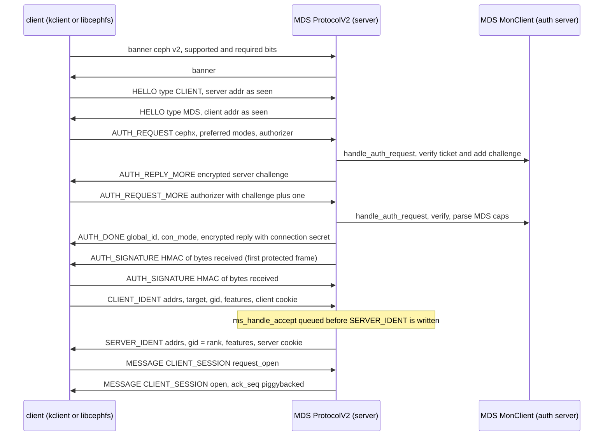
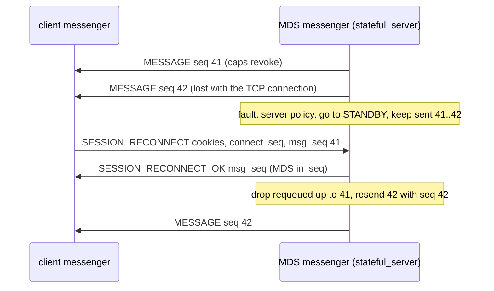

# Transport, authentication and client-library contract (msgr2, cephx, MonClient, MgrClient, Objecter; msgr1 as legacy)

> Part of the [C++ MDS project map](../README.md). Sources: at commit `5f7e383ae6d`, `src/ceph_mds.cc` (messenger, policies), `src/mds/MDSDaemon.cc` (dispatcher registration, auth and connection callbacks), `src/mds/MDSRank.cc` (messenger name, peer-MDS connections), `src/msg/{Policy.h,Messenger.h,Connection.h,Message.{h,cc},DispatchQueue.{h,cc},msg_types.{h,cc},compressor_registry.cc}`, `src/msg/async/{ProtocolV1,ProtocolV2}.{h,cc}` (~3.0k and ~3.4k LOC), `src/msg/async/{frames_v2,crypto_onwire,compression_onwire}.{h,cc}` (~2.2k), `src/msg/async/{AsyncMessenger,AsyncConnection}.cc` (parts), `src/include/{msgr.h,ceph_features.h,encoding.h}`, `src/common/pick_address.cc`, `src/auth/{Auth.h,AuthServer.h,AuthRegistry.cc,RotatingKeyRing.cc,Crypto.cc}`, `src/auth/cephx/*` (~3.7k), `src/mon/{MonClient.{h,cc},MonSub.cc,MonMap.{h,cc}}` (~3.3k), `src/common/LogClient.cc`, `src/mgr/MgrClient.cc` (~700), `src/osdc/Objecter.{h,cc}` (~10k), plus the peer code that validates MDS behaviour: `src/mon/{MDSMonitor,OSDMonitor,AuthMonitor,Monitor}.cc` (parts), `src/mgr/{DaemonServer,DaemonPerfCounters}.cc` (parts), `src/osd/{OSDMap.cc,osd_types.cc,PrimaryLogPG.cc}` (parts), `src/client/Client.cc` (parts), `src/libcephfs.cc`, `src/ceph_fuse.cc`; tools and tests `src/tools/ceph-dencoder/`, `src/test/{msgr,encoding}/`, `src/test/crypto.cc`; design docs `doc/dev/{msgr2,network-protocol,network-encoding,cephx,cephx_protocol,session_authentication,encoding,corpus}.rst`; Linux kernel client snapshot 7.3.0-rc6 (master `af32da41b03`): `linux/net/ceph/{messenger,messenger_v1,messenger_v2,auth,auth_x,crypto,decode,mon_client,osd_client,osdmap,ceph_common}.c`, `linux/net/ceph/crush/mapper.c`, `linux/include/linux/ceph/{msgr.h,ceph_features.h,libceph.h,messenger.h,rados.h}`, `linux/fs/ceph/{mds_client.c,mdsmap.c}`. Related: [wire protocol](../02-client-protocol/wire-protocol.md), [auth and MDS caps](../01-cluster-integration/auth-and-mds-caps.md), [process and threading](process-and-threading.md), [mds_lock analysis](mds_lock-analysis.md), [beacon and monitor](../01-cluster-integration/beacon-and-monitor.md), [FSMap and MDSMap](../01-cluster-integration/fsmap-and-mdsmap.md), [mgr, tools and orchestration](../01-cluster-integration/mgr-tools-and-orchestration.md), [RADOS and OSD interactions](../07-storage-formats/rados-and-osd-interactions.md), [sessions](../02-client-protocol/sessions.md), [kclient expectations](../02-client-protocol/kclient-expectations.md), [libcephfs/ceph-fuse/Ganesha expectations](../02-client-protocol/libcephfs-fuse-ganesha-expectations.md), [config, perf counters and health](../13-admin-and-config/config-perf-counters-and-health.md), [metrics](../12-qos-metrics-quiesce-quarantine/metrics-and-subvolume-metrics.md).

## 1. Purpose and responsibilities

The other pages of this map describe MDS payloads and the MDS-side hooks into the messenger: policies, `ms_handle_*` callbacks and cap parsing. This page describes the layers underneath those hooks, written as the contract that unmodified peers impose on any process acting as an MDS at this commit. The peers are:

- the Linux kernel client;
- libcephfs and its users: ceph-fuse, NFS-Ganesha, and mgr modules that mount CephFS;
- OSDs, monitors and the active manager;
- other MDS daemons.

**Which messenger protocol current peers use.** Current peers reach an MDS over msgr2:

- **Kernel client.** It speaks msgr1 only when no `ms_mode` mount option is passed (`linux/net/ceph/ceph_common.c:329-330 (ceph_alloc_options)`).
  - `mount.ceph` passes `ms_mode=prefer-crc` for the new device syntax (`<name>@<fsid>.<fs>=<path>`) unless the mount already gives `ms_mode` or `mon_addr` (`src/mount/mount.ceph.c:43`, `:306-309`). This came with commit `9663f8aaec9` (2021-11-10), first released in 17.2.0.
  - The helper passes no `ms_mode` and uses v1 monitor addresses in three cases. The mount may use the old `<mon>:<path>` syntax. The kernel may reject the new syntax, so the helper retries with the old one (`:782-818 (mount_old_device_format)`, `:904-913 (do_mount)`). Or the configuration may list no v2 monitor address (`:881-890`).
  - Rook v1.21.0 sets `network.connections.requireMsgr2: true` in its example cluster (`rook/deploy/examples/cluster.yaml:133`). With that setting it gives ceph-csi kernel mounts `ms_mode=prefer-crc` and the v2 monitor port (`rook/pkg/operator/ceph/controller/cluster_info.go:221-233 (loadCsiSettings)`, `rook/pkg/operator/ceph/csi/cluster_config.go:82-96 (MonEndpoints)`). With network encryption enabled they get `ms_mode=secure` instead. The CRD default leaves `requireMsgr2`, compression and encryption unset (`rook/pkg/apis/ceph.rook.io/v1/types.go:3517`, `rook/pkg/apis/ceph.rook.io/v1/cluster.go:20-33 (RequireMsgr2)`). Rook then passes ceph-csi no `ms_mode` and the monitors' v1 port (`rook/pkg/operator/ceph/cluster/mon/health.go:1051-1054`). ceph-csi's own mount code was not examined.
- **libcephfs, ceph-fuse and NFS-Ganesha (C++ messenger).** They connect to the first address of the MDS's addrvec that they support. With the default address order that is the v2 address (`src/msg/async/AsyncMessenger.cc:847-858`; §3.2).

msgr1 is therefore reached only by legacy mount configurations. Sections 3.3 and 7.3 describe it, and other sections mention it where the C++ code shares paths between the two protocols.

Each peer implements its half of these layers and validates what it receives. The C++ MDS gets its half from shared code compiled into `libceph-common` (§3.11), so almost none of this behaviour lives in `src/mds`.

The page covers seven areas:

1. **msgr2.0/2.1**, the protocol of current peers: banner and feature bits, every frame type (`HELLO`, `AUTH_*`, `AUTH_SIGNATURE`, `CLIENT_IDENT`/`SERVER_IDENT`, `SESSION_*`, `WAIT`, `MESSAGE`, `ACK`, `KEEPALIVE2*`, `COMPRESSION_*`), the frame format in crc and secure (AES-128-GCM) modes, and compression negotiation (§3.4).
2. **msgr1** (legacy, used only by kernel mounts without `ms_mode`): banner, `ceph_msg_connect`/`ceph_msg_connect_reply`, tags, protocol numbers, feature negotiation, sequence numbers and acks, reconnect and replacement rules, message signatures (§3.3).
3. **Connection policies, throttles and delivery guarantees**: the policy the MDS installs per peer type and what each policy implies (§3.1). Also the guarantees MDS logic relies on: ordering, replay of unacknowledged messages, `resetcheck`, `mark_down`, and the exact meaning of every connection event (`ms_handle_accept`, `ms_handle_reset`, `ms_handle_remote_reset`, ...) (§3.5).
4. **cephx on the service side**: key types, rotating service secrets, ticket lifetimes, authorizer verification with challenge, the hand-off of `AuthCapsInfo` to `MDSAuthCaps`, msgr1 signing (legacy), the MDS's own client-side cephx, and what the kernel's cephx client and connection modes support (§3.6).
5. **The embedded client libraries as protocol endpoints**: MonClient and LogClient (§3.7), MgrClient (§3.8) and Objecter (§3.9).
6. **Encoding conventions**: primitives, `ENCODE_START`/`DECODE_START`, compat versions, feature-dependent encodings, `ceph-dencoder`, `ceph-object-corpus` and other golden data (§3.10).
7. **A per-peer checklist** of what the unmodified peers require, stated as facts and constraints (§7).

Out of scope here:

- client message payloads ([wire protocol](../02-client-protocol/wire-protocol.md));
- the MDS cap language and session gating ([auth and MDS caps](../01-cluster-integration/auth-and-mds-caps.md), [sessions](../02-client-protocol/sessions.md));
- the dispatcher chain and `mds_lock` ([process and threading](process-and-threading.md));
- the beacon and each mon command ([beacon and monitor](../01-cluster-integration/beacon-and-monitor.md));
- the RADOS operation catalogue ([RADOS and OSD interactions](../07-storage-formats/rados-and-osd-interactions.md)).

## 2. Source map

Citation convention:

- Ceph sources are cited as `src/path:line (Symbol)`, kernel sources as `linux/path:line (function)`, and design docs as `doc/dev/file.rst:line`.
- A bare `:line` refers to the file cited last in the same paragraph, list item or table cell, or named in the table's column header.
- The bare file names `ProtocolV1.cc`, `ProtocolV2.cc`, `frames_v2.{h,cc}`, `crypto_onwire.cc` and `compression_onwire.cc` mean the files under `src/msg/async/` (not `src/crimson/`). `messenger_v1.c`/`messenger_v2.c` mean `linux/net/ceph/`.

| File | Class / function | Lines | Role |
|---|---|---|---|
| `src/ceph_mds.cc` | `main` | 137-208 | one messenger `mds.-1` with a random nonce, cluster protocol 36, a policy per peer type, `bindv`, MonClient on a 2-thread asio pool |
| `src/msg/Policy.h` | `Policy`, `stateful_server`, `lossless_peer`, `lossy_client`, `lossless_client`, `stateless_*`, `PolicySet` | 19-131 | lossy, server, standby, resetcheck flags and throttler pointers |
| `src/mds/MDSDaemon.cc` | `init`, `handle_core_message`, `ms_handle_reset`, `ms_handle_remote_reset`, `parse_caps`, `ms_handle_fast_authentication`, `ms_handle_accept`, `handle_mds_map` | 661-743, 833-904, 1120-1319 | dispatcher order, auth hooks, connection events, MgrClient start, peer mark-down |
| `src/mds/MDSRank.cc` | `send_message_mds`, `handle_mds_map` | 1476-1502, 2335-2392 | peer-MDS sends, messenger rename to `mds.<rank>`, Objecter incarnation, peer mark-down |
| `src/include/msgr.h` | `CEPH_BANNER`, `CEPH_MSGR2_*`, tags, `ceph_msg_connect(_reply)`, `ceph_msg_header(2)`, footers | 22-257 | msgr1/msgr2 raw wire structures |
| `src/msg/msg_types.h/.cc` | `entity_addr_t::encode/decode`, `ceph_sockaddr_storage`, `entity_addrvec_t::encode/decode` | h:144-170, 238-245, 472-551; cc:343-400 | address encodings (legacy 136-byte, marker 1, marker 2) |
| `src/common/pick_address.cc` | `pick_addresses` | 473-498 | addrvec `[v2, v1]` per IP |
| `src/msg/async/AsyncMessenger.cc` | `create_connect`, `should_use_msgr2`, `_filter_addrs`, `get_proto_version`, `accept_conn` | 839-912, 1099-1145 | address choice, protocol numbers, one registered connection per peer addrvec |
| `src/msg/async/AsyncConnection.cc` | constructor timeouts, `_stop`, `mark_down`, `tick` | 123-137, 638-650, 738-743, 836-884 | teardown discards the inbound queue; handshake and idle timeouts |
| `src/msg/async/ProtocolV1.cc` | `fault`, `write_event`, `handle_message` ... `handle_message_footer`, `session_reset`, `randomize_out_seq`, `write_message`, `requeue_sent`, `discard_requeued_up_to` | 128-213, 306-418, 506-1260 | msgr1 open state, acks, keepalives, signatures, sequence numbers |
| `src/msg/async/ProtocolV1.cc` | client side (`send_client_banner` ... `client_ready`) | 1362-1846 | msgr1 when the MDS connects |
| `src/msg/async/ProtocolV1.cc` | server side (`send_server_banner` ... `server_ready`) | 1852-2638 | msgr1 accept, races, `replace`, `RESETSESSION`, `SEQ` |
| `src/msg/async/frames_v2.h/.cc` | `Tag`, `preamble_block_t`, epilogues, frame classes, `FrameAssembler` | h:29-907; cc:24-541 | msgr2 frame layouts, crc/secure rev0/rev1 assembly and checks |
| `src/msg/async/ProtocolV2.cc` | `reset_session`, `requeue_sent`, `discard_requeued_up_to`, `_fault`, `write_message`, `write_event` | 164-249, 334-432, 535-774 | msgr2 delivery and fault policy |
| `src/msg/async/ProtocolV2.cc` | banner, `handle_hello`, frame reading, `handle_message`, throttles, keepalives, acks | 893-1755 | msgr2 common paths |
| `src/msg/async/ProtocolV2.cc` | client side (`start_client_banner_exchange` ... `handle_compression_done`) | 1759-2241 | msgr2 when the MDS connects |
| `src/msg/async/ProtocolV2.cc` | server side (`handle_auth_request` ... `finish_compression`) | 2245-3135 | msgr2 accept, auth, ident, reconnect, reuse |
| `src/msg/async/crypto_onwire.cc` | `AES128GCM_OnWire{Tx,Rx}Handler`, `rxtx_t::create_handler_pair` | 20-318 | secure-mode cipher, nonces, key split |
| `src/msg/async/compression_onwire.cc`, `src/msg/compressor_registry.cc`, `src/msg/compressor_registry.h` | `TxHandler::compress`, `CompressorRegistry::get_mode`, `pick_method`, `get_methods` | 12-94; 92-128; h:35-53 | on-wire compression policy |
| `src/msg/DispatchQueue.h/.cc` | `queue_connect/accept/remote_reset/reset/refused`, `enqueue`, `discard_queue`, throttle | h:127-227; cc:41-99, 218-233 | inbound ordering, connection events, dispatch throttle |
| `src/msg/Messenger.h` | `ms_deliver_handle_*`, `require_authorizer` | 165, 782-866 | event fan-out to dispatchers |
| `src/msg/Message.cc` | `Message::encode`, `decode_message`, `encode_message` | 240-311, 320-1034, 1089-1132 | crc computation and checks, decode failures, corpus container format |
| `src/auth/Auth.h` | `AUTH_MODE_*`, `AuthCapsInfo`, `AuthTicket`, `AuthConnectionMeta`, `RotatingSecrets`, `auth_principal_needs_rotating_keys` | 38-44, 66-105, 128-163, 196-270 | auth metadata per connection, rotating secret set |
| `src/auth/AuthRegistry.cc` | `get_supported_methods`, `get_supported_modes`, `pick_mode`, `get_handler` | 186-378 | method and mode policy per peer type |
| `src/auth/RotatingKeyRing.cc` | `get_secret`, `get_service_secret` | 65-90 | the service-side key store used to verify authorizers |
| `src/auth/cephx/CephxProtocol.h/.cc` | request types, key usages, `CephXTicketBlob`, `CephXAuthorize*`, `AUTH_ENC_MAGIC`, `cephx_calc_client_server_challenge`, `cephx_verify_authorizer`, `CephXAuthorizer::verify_reply/add_challenge` | h:26-55, 148-178, 339-395, 497-595, 626-791; cc:35-64, 409-693 | cephx structures and authorizer verification |
| `src/auth/cephx/CephxServiceHandler.cc` | `do_start_session`, `verify_old_ticket`, `handle_request` | 54-448 | monitor side of cephx (what the MDS's MonClient talks to) |
| `src/auth/cephx/CephxKeyServer.cc` | `get_service_secret`, `get_caps`, `_rotate_secret`, `get_rotating_encrypted`, `_build_session_auth_info` | 96-136, 191-208, 286-332, 543-651 | rotating secrets, ticket TTLs and caps on the monitor |
| `src/auth/cephx/CephxClientHandler.cc` | `build_request`, `handle_response`, `build_rotating_request` | 58-127, 260-320 | the MDS as a cephx client |
| `src/auth/cephx/CephxSessionHandler.cc` | `_calc_signature`, `sign_message`, `check_message_signature` | 40-219 | msgr1 message signatures |
| `src/auth/Crypto.cc` | `CryptoAESKeyHandler`, `CryptoAES256KRB5KeyHandler`, `CryptoKey::encode` | 323-470, 554-1000, 1053-1075 | the two key types |
| `src/mon/MonClient.cc` | `get_monmap_and_config`, `ms_dispatch`, `handle_monmap`, `handle_config`, `init`, `authenticate`, `handle_auth`, hunting, `tick`, subscriptions, tickets, rotating keys, commands, auth-client and auth-server hooks | 128-1990 | MonClient |
| `src/mon/MonSub.cc` | `want`, `got`, `reload`, `renewed`, `acked`, `need_renew` | 6-114 | subscription bookkeeping |
| `src/common/LogClient.cc` | `get_mon_log_message`, `_get_mon_log_message`, `handle_log_ack` | 215-354 | cluster log delivery |
| `src/mgr/MgrClient.cc` | `reconnect`, `_send_open`, `handle_mgr_map`, `ms_handle_reset`, `_send_report`, `handle_mgr_configure`, `service_daemon_update_task_status` | 156-500, 669-682 | MgrClient |
| `src/mgr/DaemonServer.cc`, `src/mgr/DaemonPerfCounters.cc` | `DaemonServer::init` policies, `handle_open`, `handle_report`, `DaemonPerfCounters::update` | 212-230, 601-689, 774-877; 32-82 | mgr side of the daemon session |
| `src/osdc/Objecter.cc` | `ms_dispatch2`, `_scan_requests`, `handle_osd_map`, `_reopen_session`, `_maybe_request_map`, `_kick_requests`, `tick`, `_op_submit`, `target_should_be_paused`, `_calc_target`, `_prepare_osd_op`, `_send_op`, `handle_osd_op_reply`, `handle_osd_backoff`, `ms_handle_connect/reset` | 1067-4983 | Objecter |
| `src/osd/OSDMap.cc`, `src/osd/osd_types.cc`, `src/osd/PrimaryLogPG.cc` | placement chain, `is_blocklisted`; `pg_pool_t::hash_key/raw_pg_to_pps`; backoff gating, blocklist check in `do_op` | OSDMap.cc:1478-1520, 2711-3144; osd_types.cc:1824-1870; PrimaryLogPG.cc:1865, 2022-2023, 2145-2149 | placement and fencing as the OSD sees them |
| `src/mon/MDSMonitor.cc` | `check_sub` (the `mdsmap` subscription of an MDS), `fail_mds_gid` | 1867-1990, 1377-1390 | address-based identification and fencing |
| `src/client/Client.cc` | `_get_mds_session`, `handle_client_session`, `ms_handle_reset`, `ms_handle_remote_reset` | 2559-2567, 2694-2700, 18207-18295 | what libcephfs derives from the transport identity |
| `src/include/encoding.h` | primitive encoders, `ENCODE_START`, `DECODE_START`, `decode_struct_start`, `finish_decode_struct`, `ENCODE_DUMP_*` | 104-150, 213-232, 250-365, 1506-1528, 1541-1800 | encoding rules |
| `src/tools/ceph-dencoder/{ceph_dencoder.cc,common_types.h,osd_types.h}` | `usage`, `TYPE(...)`, `MESSAGE(...)` | ceph_dencoder.cc:36-64; common_types.h:58-620 | golden-encoding tool registry |
| `linux/net/ceph/messenger.c` | `ceph_con_reset_session`, `ceph_con_discard_sent/requeued`, `con_fault`, `ceph_con_send`, `ceph_con_get_out_msg` | 555-571, 672-716, 1614-1656, 1731-1736, 2112-2145 | kernel sequence numbers, requeue and backoff |
| `linux/net/ceph/messenger_v1.c` | `prepare_write_banner/connect/ack/seq/keepalive`, `process_banner`, `process_connect`, `read_partial_message`, `try_read` tags | 263-410, 697-932, 1143-1305, 1386-1446 | what the kernel accepts from an msgr1 server |
| `linux/net/ceph/messenger_v2.c` | tags, `decode_preamble`, `decode_epilogue`, `verify_*_crc(s)`, `setup_crypto`, `prepare_hello/auth_request/client_ident/session_reconnect`, `process_*`, revoke helpers | 29-52, 482-599, 637-829, 1153-1562, 2125-2945, 3239-3258, 3565-3649 | what the kernel accepts from an msgr2 server |
| `linux/net/ceph/auth.c`, `auth_x.c`, `crypto.c` | `ceph_auth_get_authorizer`, authorizer build, challenge, reply, signatures, key types | auth.c:408-612; auth_x.c:20-34, 347-468, 638-664, 869-982, 1042-1164; crypto.c:45-60 | kernel cephx client |
| `linux/net/ceph/ceph_common.c`, `decode.c` | `ms_mode` parsing; `ceph_decode_entity_addrvec` | ceph_common.c:265-330, 500-524; decode.c:96-148 | kernel connection modes and address selection |
| `linux/fs/ceph/mds_client.c` | `send_mds_reconnect`, `schedule_delayed`, `delayed_work`, `mds_peer_reset`, `mds_con_ops` | 5145-5232, 6253-6316, 7106-7196, 7421-7437 | kernel use of the MDS connection |

## 3. How it works

### 3.1 One messenger, six peer classes, policies and throttles

**One messenger.** `ceph-mds` creates exactly one messenger:

- type `ms_public_type`, or `ms_type` when unset (default async posix);
- entity `entity_name_t::MDS(-1)`, a random nonce, and cluster protocol 36 (`src/ceph_mds.cc:171-177 (main)`);
- bound to the public address vector chosen by `pick_addresses` (`:137-138`, `:193`).

This messenger accepts client and peer-MDS connections and originates every outgoing connection:

- the `MonClient` (`src/ceph_mds.cc:203`, attached in `src/mds/MDSDaemon.cc:667 (MDSDaemon::init)`);
- the `MgrClient` and `LogClient` members (`src/mds/MDSDaemon.cc:94-95 (MDSDaemon::MDSDaemon)`);
- the rank's `Objecter` (`src/mds/MDSRank.cc:483 (MDSRank::MDSRank)`).

`MDSDaemon::init` sets the messenger name to `mds.-1` (`MDS_RANK_NONE`, `src/mds/MDSDaemon.cc:738`). When the MDSMap assigns a role, the name becomes `mds.<rank>`, or `mds.<gid>` in standby-replay (`src/mds/MDSRank.cc:2343-2350 (MDSRankDispatcher::handle_mds_map)`).

The bootstrap configuration fetch that precedes all of this is a different identity. `global_init` runs `MonClient::get_monmap_and_config` on a temporary messenger created by `Messenger::create_client_messenger`. That messenger has entity type CLIENT and authenticates with the MDS's own key (`src/global/global_init.cc:409-423`, `src/mon/MonClient.cc:128-218`, `src/msg/Messenger.cc:31-37`).

| Peer (entity type) | Opens TCP | MDS-side policy (`src/ceph_mds.cc`) | lossy / server / standby / resetcheck (`src/msg/Policy.h:69-89`) | Remote-side policy | msgr1 `protocol_version` | Auth methods (MDS side, `AuthRegistry`) | msgr2 mode selected by default | MDS owner |
|---|---|---|---|---|---|---|---|---|
| client 0x08 (kclient, libcephfs, ceph-fuse, `ceph tell`) | client | `stateful_server(0)` (`src/ceph_mds.cc:190-191`) | no / yes / yes / yes | kclient: lossless unless the server's reply sets `LOSSY` (`linux/net/ceph/messenger_v1.c:904-905 (process_connect)`); libcephfs: default `Policy()`, a lossless client with resetcheck (`src/msg/Policy.h:55-59`, `src/libcephfs.cc:135`); ceph-fuse: `lossless_client(0)` towards MDSs (`src/ceph_fuse.cc:277-279`) | 32 `CEPH_MDSC_PROTOCOL` (`src/include/ceph_fs.h:48`) | `auth_service_required` (cephx) | MDS allows `ms_service_mode` `crc secure`; C++ clients offer `ms_client_mode` `crc secure`, so **crc**; the kernel offers its `ms_mode` list (default: msgr1) | `MDSDaemon`, `Server`, `Locker` |
| mds 0x02 | either | `lossless_peer(CEPH_FEATURE_UID)` (`src/ceph_mds.cc:188-189`) | no / no / yes / no | same | 36 `CEPH_MDS_PROTOCOL` (`src/mds/MDSDaemon.h:30`) | `auth_cluster_required` | `ms_cluster_mode` `crc secure`, so **crc** | `MDSRank` |
| mon 0x01 | MDS | `lossy_client(UID + PGID64)` (`src/ceph_mds.cc:185-187`) | yes / no / no / no | `stateless_server(0)` (`src/ceph_mon.cc:883-884`) | 15 `CEPH_MONC_PROTOCOL` | `auth_cluster_required` | MDS offers `ms_mon_cluster_mode` `secure crc`, mon allows `ms_mon_service_mode` `secure crc`, so **secure** | `MonClient`, `LogClient`, `Beacon` |
| mgr 0x10 | MDS | default `lossy_client(OSDREPLYMUX)` (`src/ceph_mds.cc:181-184`) | yes / no / no / no | `stateless_server(SERVER_LUMINOUS)` (`src/mgr/DaemonServer.cc:222-224`) | 0 (no MGR case in `get_proto_version`, `src/msg/async/AsyncMessenger.cc:1099-1116`) | `auth_cluster_required` | MDS offers `ms_mon_cluster_mode`, mgr allows `ms_mon_service_mode`, so **secure** | `MgrClient` |
| osd 0x04 | MDS | default `lossy_client(OSDREPLYMUX)` | yes / no / no / no | `stateless_registered_server(0)` (`src/ceph_osd.cc:602`) | 24 `CEPH_OSDC_PROTOCOL` | `auth_cluster_required` | `ms_cluster_mode` `crc secure`, so **crc** | `Objecter` |

**Mode selection.**

- The accepting side picks the first mode in the connecting side's preference list that it allows for that peer type (`src/auth/AuthRegistry.cc:309-325 (AuthRegistry::pick_mode)`).
- With `CEPH_AUTH_NONE` only crc is allowed (`:289-307 (get_supported_modes)`).
- The method and mode lists per peer type come from `src/auth/AuthRegistry.cc:186-273 (get_supported_methods)`. For a non-mon daemon such as the MDS: MON and MGR peers get the cluster methods and the `ms_mon_cluster_mode` list; MDS and OSD peers get the cluster methods and `ms_cluster_mode`; any other type, clients included, gets the service methods and `ms_service_mode` (`:239-271`).
- The server-side authorize handler is looked up with the same split (`:327-378 (get_handler)`).
- If no keyring loads, `cephx` is removed from all three method lists (`:158-183 (_refresh_config)`).
- The constant `CEPH_AUTH_GSS` (0x4) is always defined (`src/include/ceph_fs.h:120`), but its authorize handler is compiled only with `HAVE_GSSAPI`, set by the `WITH_GSSAPI` option, which is `OFF` by default (`src/auth/AuthRegistry.cc:368-372`, `CMakeLists.txt:253-256`).

**Which address a peer dials.**

- Userspace messengers connect to the first address in the peer's vector whose type they speak (`src/msg/async/AsyncMessenger.cc:847-858 (create_connect)`).
- A messenger that did not bind, or that bound a v2 address, keeps v2 entries (`:885-912 (should_use_msgr2, _filter_addrs)`).
- Because the MDS addrvec is `[v2, v1]` (§3.2), libcephfs clients and peer MDSs reach the MDS with msgr2, and the order of the published vector decides the protocol C++ peers use. Mons, the mgr and OSDs never open connections to the MDS; the MDS dials them (table above).
- The kernel picks the first address of the type its `ms_mode` selects (`linux/net/ceph/decode.c:96-148 (ceph_decode_entity_addrvec)`, `linux/fs/ceph/mdsmap.c:215`).

**Throttles.**

- `ceph_mds.cc` installs no per-policy throttlers. The policy fields `throttler_bytes`/`throttler_messages` default to null and are only set by `set_throttlers` (`src/msg/Policy.h:42-43`, `:55-66`, `:124-130`). No call in `src/ceph_mds.cc:184-191` sets them, so the per-connection message and byte throttles of both protocols are skipped (`src/msg/async/ProtocolV2.cc:1600-1660`, `src/msg/async/ProtocolV1.cc:678-739`).
- The remaining inbound flow control is the messenger-wide dispatch throttle: one byte budget of `ms_dispatch_throttle_bytes` (100 MiB) shared by all connections (`src/msg/DispatchQueue.h:127`, `:226-227`).
- Each message's front + middle + data size is taken from this budget after the msgr1 header or the msgr2 preamble has been read.
- When the budget is exhausted the connection stops reading its socket and retries every `ms_client_throttle_retry_time_interval` (5000 µs). A slow dispatcher therefore pushes back on every peer through TCP (`src/msg/async/ProtocolV1.cc:741-768 (throttle_dispatch_queue)`, `src/msg/async/ProtocolV2.cc:1662-1690`).
- The budget is returned after dispatch (`src/msg/DispatchQueue.cc:41-64 (pre_dispatch, post_dispatch)`) or when queued messages are discarded (`:218-233 (discard_queue)`).
- Nothing bounds a connection's output queue. Ops towards OSDs are budgeted by the Objecter (`objecter_inflight_ops` 1024, `objecter_inflight_op_bytes` 100 MiB; [RADOS and OSD interactions](../07-storage-formats/rados-and-osd-interactions.md) §3.13).
- For comparison, the mgr sets a dispatch size and per-client throttlers (`src/mgr/DaemonServer.cc:212-213`, `:229-230`).

### 3.2 Identity, addresses and what is authenticated

**Addresses.**

- `entity_addr_t` holds a type (`NONE`=0, `LEGACY`=1, `MSGR2`=2, `ANY`=3, `CIDR`=4), a nonce and a sockaddr (`src/msg/msg_types.h:238-245`).
- With `ms_bind_msgr1` and `ms_bind_msgr2` both true (the defaults, `src/common/options/global.yaml.in:1270-1281`) the vector holds `[v2:ip:port/nonce, v1:ip:port/nonce]` for each IP, v2 first (`src/common/pick_address.cc:473-488`).
- The ports come from `ms_bind_port_min`..`max` (6800-7568) and the nonce is the messenger's.

The address encodings:

| Form | Bytes | Used when | Source |
|---|---|---|---|
| legacy `ceph_entity_addr` | le32 type (written as 0) + le32 nonce + 128-byte `sockaddr_storage` whose `ss_family` is **big-endian** = 136 bytes | msgr1 banner; any `entity_addr_t` encoded for a peer without `MSG_ADDR2` | `src/include/msgr.h:105-109`, `src/msg/msg_types.h:144-170`, `:474-479` |
| marker 1 | u8 1 + `ENCODE_START(1,1)` {le32 type (`ANY` becomes `LEGACY` if the peer lacks `SERVER_NAUTILUS`), le32 nonce, le32 sockaddr length, le16 family (little-endian), remaining sockaddr bytes} | peers with `MSG_ADDR2`; all msgr2 control frames | `src/msg/msg_types.h:481-512` |
| addrvec | the legacy single address if the peer lacks `MSG_ADDR2`; else u8 2 + le32 count + marker-1 addresses | MDSMap, beacons, IDENT frames | `src/msg/msg_types.cc:343-353` |

The kernel's own address is different. It presents a single `TYPE_ANY` address with port 0 and its random nonce. It learns its IP from the `HELLO` the server sends, or from the msgr1 server banner (`linux/net/ceph/messenger_v2.c:2233-2247 (process_hello)`, `:1476-1492 (prepare_client_ident)`, `linux/net/ceph/messenger_v1.c:727-735 (process_banner)`).

**Names and ids.**

- `ceph_entity_name` is {u8 type, le64 num} (`src/include/msgr.h:84-87`).
- The MDS name number is -1 before a rank is held and the rank (or the gid in standby-replay) afterwards (§3.1).
- The MDS's `global_id`, its gid in the FSMap, is assigned by the monitor at the first auth request on a connection (`src/mon/AuthMonitor.cc:908-913`).
- The `global_id` is kept across later mon sessions by presenting the previous auth ticket (`src/auth/cephx/CephxClientHandler.cc:91 (build_request)`, verified in `src/auth/cephx/CephxServiceHandler.cc:74-152 (verify_old_ticket)`).
- Reclaim without a valid ticket is allowed only for legacy requests (`CephXAuthenticate` struct_v below 3 sets `old_ticket_may_be_omitted`, `src/auth/cephx/CephxProtocol.h:217-219`) while `auth_allow_insecure_global_id_reclaim` is true (default true, `src/common/options/global.yaml.in:2332`). The C++ client sends struct_v 3 (`:196`), so it must present its old ticket. The MonClient logs an error if the id changes (`src/mon/MonClient.cc:1032-1035 (_finish_hunting)`).

Messages are stamped with the sender's name. msgr1 copies the messenger name into every message header at send time (`src/msg/async/AsyncConnection.cc:576`). msgr2 sends the name number once, as the `gid` of `CLIENT_IDENT`/`SERVER_IDENT`. The receiver then rebuilds every message source as (peer type, that gid) for the life of the connection (`src/msg/async/ProtocolV2.cc:1973-1981`, `:2983-2990`, `:2187 (handle_server_ident)`, `:2457 (handle_client_ident)`, `:1430-1442 (handle_message)`).

libcephfs depends on that number:

- It reads the sending MDS's rank as `m->get_source().num()` in its session, forward, snap, cap and reply handlers (`src/client/Client.cc:2696 (handle_client_session)`, `:2957 (handle_client_request_forward)`, `:5623 (handle_snap)`, `:5735 (handle_caps)`, `:3024 (handle_client_reply)`; also `:1875 (insert_trace)`).
- It looks a session up by that rank *and* the connection, dropping messages that do not match (`:2559-2567 (_get_mds_session)`).
- The kernel does not use the source number. It keys MDS messages by the connection's private session (`linux/fs/ceph/mds_client.c:7198-7200 (mds_dispatch)`; no use of `hdr.src.num` in `linux/fs/ceph/`).

**Claimed versus authenticated identity.**

| Field | Origin | Authenticated? | Used by the MDS for |
|---|---|---|---|
| peer entity type | msgr1 `ceph_msg_connect.host_type` (`src/msg/async/ProtocolV1.cc:1989-1990`); msgr2 `HELLO.entity_type` (`src/msg/async/ProtocolV2.cc:1056-1067`) | no | messenger policy, auth method list, `ALLOW_MESSAGES_FROM` type filters (`src/mds/MDSDaemon.cc:1120-1128`), the type part of the session key |
| message source name | msgr1 `ceph_msg_header.src` of each message; msgr2 type + `CLIENT_IDENT.gid` fixed at handshake (`src/msg/async/ProtocolV2.cc:2457-2458`, `:1430-1444`) | no | `m->get_source()` (for example the peer rank in `MDSRank::is_stale_message`) |
| peer addrs | msgr1 banner address; msgr2 `CLIENT_IDENT.addrs` (`:2454-2455`) | no (must contain a usable address, and the target must be one of ours, `:2441-2452`) | connection registry key, OSD blocklist matching |
| `peer_name` (`EntityName`), `peer_global_id`, `peer_caps_info` | cephx ticket, written by `MonClient::handle_auth_request` (`src/mon/MonClient.cc:1853-1864`) | yes | session key `entity_name_t(peer_type, peer_global_id)` (`src/mds/MDSDaemon.cc:1268 (MDSDaemon::ms_handle_accept)`), `MDSAuthCaps` |

No code on these paths compares the claimed entity type with the type of the authenticated `EntityName`. This is from reading `ProtocolV2::handle_hello`, `ProtocolV1::handle_connect_message_2` and `MonClient::handle_auth_request`.

**How the monitor recognises the MDS.**

- The monitor serves an `mdsmap` subscription from an MDS-named session by searching the FSMap for the daemon whose `mds_info_t::addrs` *equal* the session's address vector (`src/mon/MDSMonitor.cc:1902-1913 (MDSMonitor::check_sub)`).
- The session's addresses are the connection's peer addresses: the msgr2 `CLIENT_IDENT` addrvec or the msgr1 banner address (`src/mon/Monitor.cc:4758-4760`, `:6952-6955`, `src/mon/Session.h:89-93`).
- A daemon not found gets an empty MDSMap, or one containing only its own standby entry (`src/mon/MDSMonitor.cc:1953-1968`).
- Those `mds_info_t::addrs` are the addresses the daemon reported in its beacons ([beacon and monitor](../01-cluster-integration/beacon-and-monitor.md) §3.17). The vector the MDS presents to the mon must therefore be byte-for-byte the vector it beacons.

**Fencing identity.**

- On failover the monitor blocklists every address in the failed daemon's `mds_info_t::addrs`. It does this only for a daemon that held a rank and was not in standby-replay (`src/mon/MDSMonitor.cc:1377-1389 (MDSMonitor::fail_mds_gid)` → `src/mon/OSDMonitor.cc:4979-4991 (OSDMonitor::blocklist)`, which normalises each address to `TYPE_ANY`).
- An OSD rejects a client op with `-EBLOCKLISTED` (108, `src/include/rados.h:513`; the kernel names it `ESHUTDOWN`, `linux/include/linux/ceph/rados.h:427`) when the connection's first peer address matches the blocklist (`Message::get_source_addr` → `Connection::get_peer_addr`, `src/msg/Message.h:514-521`, `src/msg/Connection.h:194-196`).
- A match is exact, or by IP with port and nonce zeroed, or by range (`src/osd/OSDMap.cc:1478-1518 (OSDMap::is_blocklisted)`, `src/osd/PrimaryLogPG.cc:2145-2149 (PrimaryLogPG::do_op)`).
- Fencing therefore needs the address the MDS presents to OSDs to be one of its beacon addresses.
- The C++ MDS gets this from its single messenger: msgr2 `CLIENT_IDENT` carries `messenger->get_myaddrs()` (`src/msg/async/ProtocolV2.cc:1973-1981 (send_client_ident)`), and the msgr1 banner carries `get_myaddr_legacy()` (`src/msg/async/ProtocolV1.cc:1482-1484`).

### 3.3 msgr1 (legacy protocol)

Current peers do not use msgr1 (§1): a kernel speaks it only when mounted without `ms_mode`, which current `mount.ceph` and Rook configurations avoid. msgr1 runs on the v1 port. All integers are little-endian and structs are packed (`src/include/msgr.h`). The design doc `doc/dev/network-protocol.rst` describes the structures but not the full negotiation (§8 item 1).

**Handshake when the MDS accepts** (`src/msg/async/ProtocolV1.cc:1852-2638`):

1. The server writes the 9-byte banner `"ceph v027"` (`CEPH_BANNER`, `src/include/msgr.h:30`), its own legacy address and the client's address as seen on the socket: 9 + 136 + 136 bytes (`ProtocolV1.cc:1852-1873 (send_server_banner)`).
2. It reads the client's banner and legacy address. A blank IP is replaced by the socket's peer IP with the advertised port (`ProtocolV1.cc:1895-1935 (handle_client_banner)`).
3. It reads `ceph_msg_connect` and then `authorizer_len` bytes of authorizer (`ProtocolV1.cc:1944-1980`). `ceph_msg_connect` is 33 bytes: le64 features, le32 host_type, le32 global_seq, le32 connect_seq, le32 protocol_version, le32 authorizer_protocol, le32 authorizer_len, u8 flags (`src/include/msgr.h:141-150`).
4. `handle_connect_message_2` (`ProtocolV1.cc:1982-2315`):
   - The policy comes from `host_type`.
   - `protocol_version` must equal `get_proto_version(peer_type, false)`, which is 32 for a client of an MDS and 36 between MDSs. Otherwise the reply is `BADPROTOVER` (`ProtocolV1.cc:2005-2015`).
   - For cephx, required features are added (`ProtocolV1.cc:2017-2056`; `src/common/options/global.yaml.in:2257-2302`). `MSG_AUTH` is added if `cephx_require_signatures` or `cephx_{cluster,service}_require_signatures` is set (all default false). `CEPHX_V2` is added if `cephx_require_version` or `cephx_{cluster,service}_require_version` is at least 2 (all default 2). The cluster variants apply to OSD, MDS and MGR peers; the service variants apply to everyone else.
   - A missing required feature gets the reply `FEATURES` (`ProtocolV1.cc:2058-2065`).
   - The authorizer goes to `auth_server->handle_auth_request` (`ProtocolV1.cc:2079-2109`). A result below 0 gives `BADAUTHORIZER`; 0 gives `CHALLENGE_AUTHORIZER` carrying the challenge; 1 continues. A peer without `CEPHX_V2` skips the challenge (`:2070-2073`).
5. Rules against an existing connection to the same peer address (`ProtocolV1.cc:2125-2301`):
   - a racing replace, or a stale `global_seq`, gets `RETRY_GLOBAL`;
   - an existing lossy channel is reset and replaced;
   - peer `connect_seq == 0` with existing `connect_seq > 0` means the peer restarted its side. Under `resetcheck` the old session is reset (`session_reset`, which queues `ms_handle_remote_reset`), and then the connection is replaced;
   - a stale `connect_seq` gets `RETRY_SESSION` with `existing + 1`;
   - an equal `connect_seq` while the existing connection is open or in standby gets `RETRY_SESSION`. The exception: with `resetcheck` and both at 0 the connection is replaced;
   - an equal `connect_seq` while connecting is a race. The incoming side wins if its address sorts lower or the existing connection is a server; otherwise the reply is `WAIT` and a keepalive is sent on the existing connection;
   - our `connect_seq == 0` with peer `> 0` under `resetcheck` gets `RESETSESSION`;
   - anything else is a reconnect, and the existing connection is replaced.

   With no existing connection, a peer `connect_seq > 0` gets `RESETSESSION` (`ProtocolV1.cc:2302-2308`); otherwise a new session starts.
6. **Replacement takes one more round trip.** When the existing connection is not lossy, the server does not answer on the new connection object. It stops the new object (queueing a reset for it) and moves the socket into the existing `Connection`. The existing connection then writes `RETRY_GLOBAL` carrying the peer's last `global_seq`. The client resends `ceph_msg_connect` on the same socket, and the existing connection finishes with `READY` or `SEQ` (`ProtocolV1.cc:2357-2490 (ProtocolV1::replace)`, `:2469-2471`). The kernel handles `RETRY_GLOBAL` by raising its global sequence and resending (`linux/net/ceph/messenger_v1.c:861-876 (process_connect)`).
7. `open` (`ProtocolV1.cc:2492-2578`):
   - `connect_seq = peer + 1`.
   - The reply tag is `SEQ` if the peer has `RECONNECT_SEQ` and this is not a peer reset, else `READY`. `READY` zeroes `in_seq` and calls `discard_requeued_up_to(out_seq, 0)`. That call discards nothing, because every requeued message has a sequence number of at least 1. It resets `out_seq` to 0 only when nothing is requeued at priority 255; otherwise the requeued messages stay queued and `out_seq` is unchanged (`:2507-2513`, `:1241-1260`).
   - `reply.features` is the full supported set, and `flags` is `LOSSY` for lossy policies. The connection features become `reply.features & peer.features`, and message signing is set up for that feature set.
   - For `SEQ` the server appends its `in_seq` (le64).
   - It registers the connection (`accept_conn`) and writes the reply. Then it queues `ms_handle_accept`. For `SEQ` it reads the client's le64 acked sequence and drops requeued messages up to it (`ProtocolV1.cc:2580-2623`).

`ceph_msg_connect_reply` is 26 bytes: u8 tag, le64 features, le32 global_seq, le32 connect_seq, le32 protocol_version, le32 authorizer_len, u8 flags (`src/include/msgr.h:152-160`). It is followed by the authorizer reply. Non-final replies carry `features = (peer & supported) | required` (`ProtocolV1.cc:2317-2343`).

| Reply tag | Value | C++ server sends it when | Kernel client reaction (`linux/net/ceph/messenger_v1.c:740-932 (process_connect)`) |
|---|---|---|---|
| `READY` | 1 | new or replaced session without a seq exchange | open; `connect_seq++`; `LOSSY` flag sets `LOSSYTX`; `in_seq` is not touched |
| `RESETSESSION` | 2 | the peer reconnects (`connect_seq > 0`) but this side has no session, or has `connect_seq == 0` under `resetcheck` | `ceph_con_reset_session`, then `peer_reset` → `mds_peer_reset` |
| `WAIT` | 3 | the incoming side lost a connection race | error "protocol error, got WAIT as client" |
| `RETRY_SESSION` | 4 | stale `connect_seq` | retry with the server's `connect_seq` |
| `RETRY_GLOBAL` | 5 | stale `global_seq`, a replace in progress, or the second step of `replace` | raise global seq and retry |
| `BADPROTOVER` | 10 | protocol number mismatch | fail |
| `BADAUTHORIZER` | 11 | authorizer rejected, including an unparseable MDS cap string | retry once with a fresh authorizer; fail at the second (`auth_retry == 2`) |
| `FEATURES` | 12 | required features missing | fail |
| `SEQ` | 13 | reconnect from a peer with `RECONNECT_SEQ` | send its `in_seq`, read the server's acked seq |
| `CHALLENGE_AUTHORIZER` | 16 | first authorizer from a `CEPHX_V2` peer | `add_authorizer_challenge`, resend the connect |

**Open state** (`src/msg/async/ProtocolV1.cc:506-538 (handle_message)`): one tag byte, then:

- `MSG` (7): `ceph_msg_header`, front, middle, data and a footer.
  - The header is 53 bytes (`src/include/msgr.h:186-205`). Its crc is crc32c with seed 0 over the first 49 bytes, verified when `ms_crc_header` is set (`ProtocolV1.cc:656-666`).
  - The footer is `ceph_msg_footer` (21 bytes: three le32 crcs, le64 sig, u8 flags) if `MSG_AUTH` was negotiated, else `ceph_msg_footer_old` (13 bytes) (`ProtocolV1.cc:896-931`).
  - A footer without `CEPH_MSG_FOOTER_COMPLETE` faults the connection (`ProtocolV1.cc:933-940`).
  - `decode_message` checks the front and middle crcs (seed 0) when `ms_crc_header` is set, and the data crc when `ms_crc_data` is set and `CEPH_MSG_FOOTER_NOCRC` is clear (`src/msg/Message.cc:334-378`). The signature is checked next (`ProtocolV1.cc:972-979`).
  - A message with `seq <= in_seq` is discarded. A gap is only logged, unless `ms_die_on_skipped_message` (`ProtocolV1.cc:996-1013`).
  - The discard path returns `nullptr` while the state is still `READ_FOOTER_AND_DISPATCH`, and `read_event` does nothing in that state (`ProtocolV1.cc:899`, `:1005`, `:280-304`). The same holds for msgr2 in `READ_MESSAGE_COMPLETE` (`ProtocolV2.cc:1458`, `:1501`, `:493-518`). Reading the code, the connection therefore stops reading until it faults or is marked down, and the message's dispatch-throttle bytes are never returned. This was derived from the code and not observed at runtime (unverified).
- `ACK` (8) + le64 seq: trims the sent list (`ProtocolV1.cc:602-637`).
- `KEEPALIVE` (9): no payload; it only updates the keepalive stamp. `KEEPALIVE2` (14) + `ceph_timespec`: answered with `KEEPALIVE2_ACK` (15) carrying the same timestamp (`ProtocolV1.cc:517-584`).
- `CLOSE` (6): stop. Any other tag faults. No C++ code path sends `CLOSE`: the only `CEPH_MSGR_TAG_CLOSE` use in `src/msg` is this receive branch (`ProtocolV1.cc:530`).

**Sending** (`ProtocolV1.cc:1135-1222 (write_message)`):

- `seq = ++out_seq` is assigned at write time. Then the header crc and the signature are computed, and the bytes go out as tag, header, payloads and a new or old footer.
- When the queue drains, `TAG_ACK` + le64 `in_seq` is sent if acks are pending (`ProtocolV1.cc:370-385`).
- A local keepalive is written as `KEEPALIVE2` with the current time if the peer has `MSGR_KEEPALIVE2`, else as `KEEPALIVE` (`ProtocolV1.cc:567-584`). The MDS never calls `send_keepalive` itself; there is no use in `src/mds`.

**Where sequence numbers start.**

- A new `ProtocolV1` starts with `out_seq = 0` (`src/msg/async/ProtocolV1.h:131`).
- `session_reset` sets `out_seq` to a random value below 2^31 when the connection negotiated `MSG_AUTH` (`ProtocolV1.cc:1097-1133`, `SEQ_MASK` `:37`).
- After a handshake, `discard_requeued_up_to` returns the peer's acknowledged sequence when nothing is requeued at priority 255 (`:1241-1260`). So the accepting side's `READY` restarts numbering at 1 (`:2510`), and `SEQ` continues after the client's acked value (`:2620`).
- In the paths read, the randomized start therefore does not survive the next handshake unless messages are queued at priority 255. After `RESETSESSION`, a C++ connecting side resends `connect_seq` 0 (`:1706-1715`). A C++ server answers `SEQ`, because the C++ client has `RECONNECT_SEQ`, and appends its `in_seq`. `handle_ack_seq` then sets the client's `out_seq` from that value (`:1770-1783`). Only a `READY` reply leaves the connecting side's `out_seq` untouched (`client_ready`, `:1805-1846`). C++ receivers would accept the resulting gap (`:1007-1013`).

**What the kernel requires (it is always the connecting side):**

- It sends its banner and legacy address together (`linux/net/ceph/messenger_v1.c:350-358 (prepare_write_banner)`). Then it sends `host_type = CLIENT`, its full supported feature set, flags 0 and `protocol_version` 32 for MDS peers (`:372-410 (prepare_write_connect)`).
- It requires `MSG_AUTH` in the server's reply features unless mounted with `nocephx_sign_messages` (`linux/net/ceph/ceph_common.c:731-732`). A `READY`/`SEQ` reply without it fails with "missing required protocol features" (`linux/net/ceph/messenger_v1.c:880-888`). The C++ server's reply carries its full supported set, which includes the bit (`ProtocolV1.cc:2516`).
- It checks that the server's banner address is the expected peer address, nonce included (a blank IP is allowed), and learns its own IP from the banner (`linux/net/ceph/messenger_v1.c:697-737 (process_banner)`). Before comparing, it rewrites the banner address's type to `LEGACY` and its family from big-endian, so the zero type field C++ writes is harmless (`linux/include/linux/ceph/decode.h:234-240 (ceph_decode_banner_addr)`, `linux/net/ceph/messenger_v1.c:627-639`).
- In the open state it accepts only the tags `MSG`, `ACK`, `KEEPALIVE2_ACK` and `CLOSE` (`:1386-1410`). On `CLOSE` it closes the socket and moves the connection to `CLOSED` (`:1404-1407`). A server must not send `KEEPALIVE` or `KEEPALIVE2` on these connections.
- It always checks the header crc and the front and middle crcs. It checks the data crc unless the `nocrc` mount option is set or the footer carries `NOCRC` (`:1164-1169`, `:1279-1296`).
- When the server's features include `MSG_AUTH`, it verifies the footer signature of every message unless mounted with `nocephx_sign_messages` (`:1151`, `:1298-1302`), and signs its own messages (`:172-189`).
- It limits front and middle to 16 MiB and data to 64 MiB (`linux/include/linux/ceph/libceph.h:87-98`, `linux/net/ceph/messenger_v1.c:1171-1179`).
- It skips a message whose `seq` is not above `in_seq`. It fails the connection with "bad message sequence # for incoming message" if `seq > in_seq + 1` (`:1181-1197 (read_partial_message)`). The server's numbering must therefore be gap-free.
- The handshake `SEQ` exchange counts as an ack (`:1435-1446`). The kernel acks with `TAG_ACK` (`:263-279 (prepare_write_ack)`) and sends `KEEPALIVE2`, or `KEEPALIVE` when the server lacks the feature (`:302-318`).

### 3.4 msgr2.0 and msgr2.1

**Banner.** `"ceph v2\n"`, le16 payload length (16), le64 supported, le64 required (`src/msg/async/ProtocolV2.cc:893-910 (_banner_exchange)`; `src/include/msgr.h:38-64`). Both sides send their banner immediately after connecting or accepting.

- C++ advertises `REVISION_1 | COMPRESSION` (bits 0 and 1) and requires nothing. The kernel advertises and requires `REVISION_1` only (`linux/include/linux/ceph/msgr.h:43-47`).
- An unsupported required bit stops the connection (`ProtocolV2.cc:990-1006`; kernel `linux/net/ceph/messenger_v2.c:2153-2196 (process_banner_payload)`).
- A msgr1 banner arriving on the v2 port is logged as "is using msgr V1 protocol" and faulted (`ProtocolV2.cc:928-933`). The kernel reports "server is speaking msgr1 protocol" (`messenger_v2.c:2133-2138`).
- msgr2.1 framing is used when the peer advertises `REVISION_1` (`ProtocolV2.cc:1013-1016`), so C++-to-C++ and kernel connections are 2.1.

**Frames** (`src/msg/async/frames_v2.h`, `src/msg/async/frames_v2.cc`; `doc/dev/msgr2.rst:90-547`). Every frame starts with a 32-byte preamble: u8 tag, u8 segment count (1-4), four (le32 length, le16 alignment) pairs, u8 flags, u8 reserved, and le32 crc32c (seed 0) over the first 28 bytes (`frames_v2.h:104-123`, `frames_v2.cc:65-79 (fill_preamble)`). The preamble crc is computed and checked in secure mode too (`frames_v2.cc:290-301`; kernel `messenger_v2.c:477-512`).

- Senders drop trailing empty segments but always send at least one (`frames_v2.cc:32-43`). Receivers reject a bad preamble crc, a segment count outside 1..4, and an empty last segment in a multi-segment frame (`:294-312`).
- Segment crcs are crc32c with seed -1 (`:45-52`). With `ms_crc_data=false` C++ writes them as 0 and does not check them (`:108`, `:157`, `:167`; `ProtocolV2.cc:104-107`). The kernel ignores its `nocrc` option on msgr2 and always verifies them (`messenger_v2.c:637-699`).
- In 2.1-crc, a frame with more than one segment carries crcs for segments 2-4 in its epilogue. An empty middle or front segment that is followed by a non-empty one has crc32c(-1, empty) = 0xFFFFFFFF. A segment beyond the last present one has crc 0. The kernel expects exactly these values (`messenger_v2.c:656-699 (verify_epilogue_crcs)`). C++ produces them because its epilogue is zero-initialised and only present segments are filled (`frames_v2.cc:147-175 (asm_crc_rev1)`).

| Mode | On-wire layout | Source |
|---|---|---|
| 2.0-crc | preamble; segments; epilogue 17 B = u8 `late_flags` + 4 × le32 crc | `frames_v2.h:125-129`, `frames_v2.cc:100-115` |
| 2.1-crc | preamble; segment 1 + le32 crc (if non-empty); segments 2-4; epilogue 13 B = u8 `late_status` + 3 × crc, only with more than one segment | `frames_v2.h:131-135`, `frames_v2.cc:147-175` |
| 2.0-secure | AES-128-GCM over the preamble, each segment zero-padded to 16 B, and a 16 B epilogue; one 16 B tag | `frames_v2.cc:117-145` |
| 2.1-secure | {preamble + 48 B inline buffer holding the start of segment 1} + tag = 96 B; the remainder of segment 1 (padded) + tag if it is longer than 48 B; segments 2-4 (padded) + 16 B epilogue + tag, only with more than one segment | `frames_v2.h:153-158`, `frames_v2.cc:177-232` |

**Aborted frames.**

- `late_status` uses nibble code words: 0xE = complete, 0x1 = aborted; other values in the low nibble are a frame error (`frames_v2.h:168-182`, `frames_v2.cc:56-63`).
- A C++ receiver drops an aborted frame after releasing its throttles (`src/msg/async/ProtocolV2.cc:1398-1405`).
- The kernel produces aborted frames only when it revokes a message part-way through sending in crc mode. It zero-fills the rest and sends `late_status = ABORTED` with crcs adjusted for the zeros (`messenger_v2.c:3239-3258 (queue_zeros)`, `:3565-3622 (revoke_at_finish_message)`). In secure mode a revoke is a no-op (`:3624-3633`).
- The kernel revokes messages only on monitor and OSD connections (`linux/net/ceph/mon_client.c:182-195`, `:380`, `:657`, `:1074`; `linux/net/ceph/osd_client.c:2333`, `:2515`). There is no call in `linux/fs/ceph`.
- Receiving an aborted frame is an error for the kernel ("we should never get an aborted message as client", `messenger_v2.c:579-599 (decode_epilogue)`).

The expected on-wire lengths for every segment-size combination in all four modes are tabulated in `src/test/msgr/test_frames_v2.cc:283-419` (`round_trip_instances`).

**Tags and payloads** (`frames_v2.h:46-69`, structs at `:519-903`):

- Control frames have one segment.
- Their fields use Ceph encoding with the features `MSG_ADDR2 | SERVER_NAUTILUS`, which gives new-style addresses (`:31`, `:42-44`, `:451-453`).
- `vector<u32>` is a le32 count followed by the elements (`:455-479`). A bufferlist is a le32 length followed by the bytes. `utime_t` is le32 sec + le32 nsec.

| Tag | Name | Direction | Payload | Notes |
|---|---|---|---|---|
| 1 | `HELLO` | both | u8 entity_type, `entity_addr_t` peer address as seen | the server picks the policy from it (`ProtocolV2.cc:1034-1124`); the kernel checks that the type is the one it dialled (`messenger_v2.c:2220-2225`) |
| 2 | `AUTH_REQUEST` | c→s | le32 method, vector<le32> preferred modes, bufferlist payload | the kernel sends 1 or 2 modes (`linux/net/ceph/auth.c:408-424`, `:549-576`) |
| 3 | `AUTH_BAD_METHOD` | s→c | le32 method, le32 result, vector<le32> allowed methods, vector<le32> allowed modes | the kernel accepts at most 8 entries in each list (`messenger_v2.c:2284-2304`) |
| 4 | `AUTH_REPLY_MORE` | s→c | bufferlist | cephx challenge |
| 5 | `AUTH_REQUEST_MORE` | c→s | bufferlist | |
| 6 | `AUTH_DONE` | s→c | le64 global_id, le32 con_mode, bufferlist | the server sends the peer's ticket global id (`ProtocolV2.cc:2330-2333`); the kernel accepts only modes 1 (crc) and 2 (secure) (`messenger_v2.c:712-716`) |
| 7 | `AUTH_SIGNATURE` | both | 32-byte HMAC-SHA256 | not described in msgr2.rst |
| 8 | `CLIENT_IDENT` | c→s | addrvec, target addr, le64 gid, le64 global_seq, le64 supported, le64 required, le64 flags, le64 client_cookie | |
| 9 | `SERVER_IDENT` | s→c | addrvec, le64 gid, le64 global_seq, le64 supported, le64 required, le64 flags, le64 server_cookie | |
| 10 | `IDENT_MISSING_FEATURES` | s→c | le64 missing features | |
| 11 | `SESSION_RECONNECT` | c→s | addrvec, le64 client_cookie, le64 server_cookie, le64 global_seq, le64 connect_seq, le64 msg_seq | |
| 12 | `SESSION_RESET` | s→c | u8 bool full | |
| 13 | `SESSION_RETRY` | s→c | le64 connect_seq | |
| 14 | `SESSION_RETRY_GLOBAL` | s→c | le64 global_seq | |
| 15 | `SESSION_RECONNECT_OK` | s→c | le64 msg_seq | |
| 16 | `WAIT` | s→c | empty | |
| 17 | `MESSAGE` | both | segments: `ceph_msg_header2` (41 B), front, middle, data (data alignment 4096) | `frames_v2.h:811-875` |
| 18 | `KEEPALIVE2` | both | `utime_t` | |
| 19 | `KEEPALIVE2_ACK` | both | the echoed `utime_t` | |
| 20 | `ACK` | both | le64 seq | |
| 21 | `COMPRESSION_REQUEST` | c→s | bool is_compress, vector<le32> methods | |
| 22 | `COMPRESSION_DONE` | s→c | bool is_compress, le32 method | |

An unknown tag faults the connection (`ProtocolV2.cc:1217-1222`). Each handler checks the connection state and faults on a frame that arrives in the wrong phase (for example `:1039-1042`, `:2267-2270`, `:2423-2426`). A `MESSAGE` frame outside `READY` faults (`:1175-1179`).

**Authentication phase, server side** (`ProtocolV2.cc:2263-2416`):

- `AUTH_REQUEST` → `pick_con_mode`. `CEPH_CON_MODE_UNKNOWN` gives `AUTH_BAD_METHOD(-EOPNOTSUPP)` listing the allowed methods and modes for the peer type (`:2277-2304`).
- `handle_auth_request` returns 1 → `AUTH_DONE`; 0 → `AUTH_REPLY_MORE`; `-EBUSY` → fault; any other negative value → `AUTH_BAD_METHOD(r)` (`:2306-2345`).
- `AUTH_DONE` is written in the clear. The server then creates its cipher handlers ("crossed") and sends `AUTH_SIGNATURE` = HMAC-SHA256(session key, every byte it received while the pre-auth capture was on) (`:2347-2362 (finish_auth)`).
- It checks the client's signature against an HMAC of every byte it sent, `AUTH_DONE` included; a mismatch faults (`:2378-2416`). Without a session key (auth none) the digest is all zeros.
- The pre-auth capture covers the banner, `HELLO` and the auth frames in both directions (`pre_auth.rxbuf/txbuf`, `:815-891`; enabled by default, `src/msg/async/ProtocolV2.h:123-128`).
- The client performs the mirror steps (`ProtocolV2.cc:1876-1920 (handle_auth_done)`). The kernel uses the service ticket's session key as the HMAC key and sends its signature after `AUTH_DONE` (`messenger_v2.c:2363-2475`, `:780-800`).
- `AUTH_SIGNATURE` is the first frame protected by the negotiated mode; in secure mode it is already encrypted.

**Compression phase.** It runs only if the peer's banner advertised `COMPRESSION` (`ProtocolV2.cc:1922-1945`). The kernel never advertises it, and a C++ client skips the phase when the server does not.

- The server answers `COMPRESSION_REQUEST` with `COMPRESSION_DONE` (`ProtocolV2.cc:3095-3135`).
- Its mode comes from `CompressorRegistry::get_mode(peer_type, is_secure)`. This returns `COMP_NONE` for every peer type except OSD (`ms_osd_compress_mode`, default `none`), and in secure mode unless `ms_compress_secure` is set (`src/msg/compressor_registry.cc:111-128`). Methods are only listed for OSD peers (`src/msg/compressor_registry.h:35-53`).
- A compressed frame sets `FRAME_EARLY_DATA_COMPRESSED` (0x1) in the preamble flags. Each segment is compressed separately and the preamble carries the compressed lengths. A frame below `ms_osd_compress_min_size` (1 KiB), or one where any segment fails to compress, is sent uncompressed (`frames_v2.cc:503-528 (asm_compress)`, `compression_onwire.cc:29-58`).
- A frame carrying the flag on a connection without negotiated compression trips `ceph_assert_always` in the C++ receiver (`frames_v2.cc:323`).

**Session phase, server side.**

- `CLIENT_IDENT` (`ProtocolV2.cc:2418-2518`):
  - The addrs must be non-empty and the target must be one of ours, else the connection faults.
  - `features_required | MSG_ADDR2` missing from the peer's supported set → `IDENT_MISSING_FEATURES`.
  - The connection features become `peer supported & ours`.
  - An existing connection for the same peer addrvec goes to `handle_existing_connection`; otherwise `send_server_ident`.
- `handle_existing_connection` (`ProtocolV2.cc:2680-2812`):
  - existing closed → new ident;
  - existing replacing → `WAIT`;
  - a peer that clearly restarted (higher stored `peer_global_seq`, different non-zero cookies, existing not `READY`/`STANDBY`) → drop the existing connection;
  - a stale incoming `global_seq` → stop the incoming connection;
  - existing lossy → replace;
  - existing has a server cookie and a different client cookie → the peer reset: `reset_session` under `resetcheck` (queues `ms_handle_remote_reset`, discards both queues, zeroes the sequence numbers), then reuse;
  - same client cookie → continue an interrupted establishment;
  - existing `READY`/`STANDBY` → reuse;
  - a race → the lower address or a server-side existing connection wins; otherwise `WAIT`.
- `send_server_ident` (`ProtocolV2.cc:2966-3037`):
  - zeroes `in_seq` and calls `discard_requeued_up_to(out_seq, 0)`. As in msgr1, this discards nothing and resets `out_seq` to 0 only when nothing is requeued at priority 255 (`:2970-2971`, `:228-249`);
  - draws a random non-zero `server_cookie` for non-lossy policies;
  - sends `SERVER_IDENT` with `gid` = the messenger name number (the MDS's rank once one is held), `required | MSG_ADDR2`, and `LOSSY` for lossy policies;
  - registers the connection and queues `ms_handle_accept` *before* writing the frame (`ProtocolV2.cc:3028-3036`).
- `SESSION_RECONNECT` (`ProtocolV2.cc:2520-2678`):
  - no existing connection, or a closed one → `SESSION_RESET(full=1)`;
  - existing replacing, or a stale `global_seq` → `SESSION_RETRY_GLOBAL`;
  - client cookie mismatch → `SESSION_RESET(full=resetcheck)`, so 1 for clients and 0 for MDS peers;
  - existing `server_cookie == 0` → `SESSION_RESET(full=0)`;
  - stale `connect_seq` → `SESSION_RETRY`;
  - equal `connect_seq` → `WAIT` if the existing connection wins, which never happens for a server-side existing connection (`ProtocolV2.cc:2647-2667`);
  - otherwise reuse the existing connection and reply `SESSION_RECONNECT_OK(in_seq)` after dropping requeued messages up to the client's `msg_seq` (`ProtocolV2.cc:3049-3092`).

  `reuse_connection` (`ProtocolV2.cc:2814-2964`) moves the new socket, cipher handlers and `auth_meta` into the existing connection, keeping its queues and sequence numbers. It queues a reset event for the abandoned new connection object (`:2859-2861`).

**Message phase.** `ceph_msg_header2` = le64 seq, le64 tid, le16 type, le16 priority, le16 version, le32 data_pre_padding_len (always 0), le16 data_off, le64 ack_seq, u8 flags (the footer flags), le16 compat_version, le16 reserved (`src/include/msgr.h:207-223`; built in `ProtocolV2.cc:548-554`). The kernel sends flags 0 (`messenger_v2.c:621-636 (fill_header2)`).

- The receiver rebuilds a msgr1 header with `src = peer_name` and lengths taken from the segment descriptors (`ProtocolV2.cc:1430-1444`). It decodes without message-level crcs (`:1446`); `prepare_send_message` encodes with crcflags 0 (`:434-443`). It then processes the piggybacked `ack_seq` (`:1589`).
- A decode failure faults the connection (`ProtocolV2.cc:1451-1453`).
- `KEEPALIVE2` is answered with `KEEPALIVE2_ACK` carrying the same timestamp (`ProtocolV2.cc:1692-1723`).

**Secure mode** (`src/msg/async/crypto_onwire.cc`):

- AES-128-GCM through OpenSSL EVP, with a 16-byte tag and no additional authenticated data (`crypto_onwire.cc:20-23`, `:41-278`).
- The 64-byte connection secret (`AuthConnectionMeta::get_connection_secret_length`, `src/auth/Auth.h:147-155`) is split into a key (bytes 0-15), nonce A (16-27) and nonce B (28-39). The client receives with A and sends with B; the server ("crossed") does the opposite (`crypto_onwire.cc:280-318`).
- A nonce is {le32 fixed, le64 counter}. msgr2.1 increments the counter and msgr2.0 increments the 32-bit field. Every encrypted unit (preamble block, segment-1 remainder, rest of frame) consumes one nonce.
- Coming back to the initial nonce throws "out of nonces"; the frame write fails and the connection faults (`crypto_onwire.cc:88-113`, `ProtocolV2.cc:599-613`).
- The kernel performs the same split, increments the 64-bit counter, and requires at least 40 bytes of secret (`linux/net/ceph/messenger_v2.c:701-778 (setup_crypto)`, `:802-829`).

**What the kernel requires from a msgr2 server** (`linux/net/ceph/messenger_v2.c`):

- `REVISION_1` in the server's supported bits, and no other required bit (`:2153-2196`).
- A `HELLO` whose entity type is the type it dialled (`:2220-2225`).
- Control frames whose first segment is non-empty and at most 16 MiB, and front, middle and data within 16/16/64 MiB (`:500-561 (decode_preamble)`). `WAIT`, which has an empty segment, is therefore rejected.
- Only the control tags `HELLO`, `AUTH_BAD_METHOD`, `AUTH_REPLY_MORE`, `AUTH_DONE`, `AUTH_SIGNATURE`, `SERVER_IDENT`, `IDENT_MISSING_FEATURES`, `SESSION_RECONNECT_OK`, `SESSION_RETRY`, `SESSION_RETRY_GLOBAL`, `SESSION_RESET`, `KEEPALIVE2_ACK` and `ACK`, each only in its own state (`:2766-2825 (process_control)`). A `KEEPALIVE2` from the server is "protocol error, bad tag".
- A `SERVER_IDENT` whose *first* `TYPE_MSGR2` address equals, byte for byte (type, nonce and sockaddr), the address it dialled from the MDSMap (`:2494-2519 (process_server_ident)`, `linux/net/ceph/decode.c:96-145`). The server's supported features must include the kernel's required set, which is `MSG_AUTH` unless the mount uses `nocephx_sign_messages` (`messenger_v2.c:2521-2526`, `linux/net/ceph/ceph_common.c:731-732`).
- A `LOSSY` flag with a non-zero cookie, or no `LOSSY` with a zero cookie, only triggers `WARN_ON` (`messenger_v2.c:2540-2545`).
- `SESSION_RESET` with `full=1`; `full=0` is "protocol error, bad session_reset" (`messenger_v2.c:2678-2724`).
- `SESSION_RETRY` and `SESSION_RETRY_GLOBAL` values above its own; the kernel only warns otherwise (`messenger_v2.c:2626-2627`, `:2659-2660`).
- Strictly sequential message `seq`: an old seq is skipped, and a gap is "bad message sequence # for incoming message" (`messenger_v2.c:2846-2859`). Its sent queue is trimmed by `ack_seq` (`:2861`).
- No aborted frames (see above).

**What C++ clients (libcephfs, ceph-fuse) require from a msgr2 server:**

- The `SERVER_IDENT` addrvec must contain the address they dialled (`src/msg/async/ProtocolV2.cc:2178-2182`). They take the server's `LOSSY` flag as their policy (`:2192`).
- To act on a remote reset, `Client::ms_handle_remote_reset` matches the connection's peer addrvec *exactly* against `mdsmap->get_addrs(rank)` (`src/client/Client.cc:18252`).
- The source number of every message must be the MDS rank (§3.2).
- `WAIT`, `IDENT_MISSING_FEATURES`, `SESSION_RESET(full=0)` and compression are all handled (`ProtocolV2.cc:2021-2120`, `:2209-2241`).

### 3.5 Delivery guarantees the MDS relies on

**Sequence numbers and acks** (both protocols):

- Each direction of a session numbers its messages. The number is assigned at write time from `++out_seq` (`ProtocolV1.cc:1138`, `ProtocolV2.cc:538`), so wire order is sequence order.
- After a handshake, numbering restarts at 1 or continues after the peer's acknowledged value (§3.3; `ProtocolV2.cc:228-249`, `:2970-2971`, `:3052`).
- Non-lossy connections keep written messages in `sent` until they are acknowledged (`ProtocolV1.cc:335-338`, `ProtocolV2.cc:686-689`).
- msgr1 acknowledges with `TAG_ACK` + le64 `in_seq`. msgr2 piggybacks `ack_seq` on every `MESSAGE` and sends an `ACK` frame only when acks are pending and nothing else is queued (`ProtocolV2.cc:721-737`).
- An ack trims up to 128 messages per pass (`ProtocolV1.cc:602-637`, `ProtocolV2.cc:615-642`). Lossy connections keep nothing (`ProtocolV2.cc:616-618`).
- The C++ receiver drops `seq <= in_seq` and accepts gaps with a log line (`ProtocolV2.cc:1492-1509`). After such a drop it does not resume reading (§3.3; derived from the code, unverified at runtime). The kernel accepts no gaps (§3.3, §3.4).
- The kernel's own numbering: a message gets its seq when it first moves to the sent list (`linux/net/ceph/messenger.c:2128-2138 (ceph_con_get_out_msg)`). A reset zeroes `out_seq`, `in_seq` and `in_seq_acked` (`:555-571 (ceph_con_reset_session)`).

**Replay after a transport fault.**

- `requeue_sent` puts every unacknowledged message back at the front of the priority-255 output queue and rewinds `out_seq` by the same count, so the messages are resent with their original sequence numbers (`ProtocolV1.cc:1224-1239`, `ProtocolV2.cc:210-226`).
- During reconnection each side learns the other's `in_seq` (the msgr1 `SEQ` exchange; msgr2 `SESSION_RECONNECT.msg_seq` and `SESSION_RECONNECT_OK.msg_seq`) and drops the requeued messages already received (`discard_requeued_up_to`, `ProtocolV1.cc:1241-1260`, `ProtocolV2.cc:228-249`, `:2137`, `:3052`).
- The kernel does the same with `out_sent` → `out_queue` on a fault (`linux/net/ceph/messenger.c:1634-1635 (con_fault)`) and `ceph_con_discard_requeued` after the handshake (`:697-716`).

**Fault behaviour by policy:**

- lossy → stop and queue `ms_handle_reset`, except while still connecting, when it retries (`ProtocolV1.cc:136-142`, `ProtocolV2.cc:342-348`);
- server → `STANDBY`, keeping queued messages until the peer reconnects. A server never initiates TCP, even with output queued (`ProtocolV2.cc:380-385`, `:754-759`; `ProtocolV1.cc:198-202`, `:401-403`);
- non-server → reconnect, except that a `standby` policy such as `lossless_peer` with nothing queued goes to `STANDBY` instead (`ProtocolV2.cc:372-379`, `ProtocolV1.cc:166-173`). After a fault on an established connection it reconnects at once with `connect_seq + 1` (`ProtocolV2.cc:389-405`, `ProtocolV1.cc:198-211`). After a fault while connecting, the backoff starts at `ms_initial_backoff` (0.2 s) and doubles up to `ms_max_backoff` (15 s); after `WAIT` it is the maximum (`ProtocolV2.cc:406-430`, `ProtocolV1.cc:177-197`);
- the kernel backs off from 0.25 s, doubling up to 15 s. A fault on a `LOSSYTX` connection closes it, and a non-lossy connection with nothing queued goes to standby (`linux/net/ceph/messenger.c:1614-1656 (con_fault)`, `linux/include/linux/ceph/messenger.h:322-323`).

**Timeouts and liveness.**

- Handshakes must make progress within `ms_connection_ready_timeout` (10 s).
- An established connection with no traffic for `ms_connection_idle_timeout` (900 s) is faulted (`src/msg/async/AsyncConnection.cc:134-135`, `:856-883 (AsyncConnection::tick)`).
- The kernel sends a keepalive or a session renew to each MDS session that passes `check_session_state` every time `delayed_work` runs; the work is rescheduled at most 5 s apart. A renew goes out every quarter of the MDSMap session timeout (`linux/fs/ceph/mds_client.c:6253-6262 (schedule_delayed)`, `:6264-6316 (delayed_work)`).

**Connection events.**

- Events are queued at priority 255 in class 0 of the dispatch queue (`src/msg/DispatchQueue.h:147-196`).
- They are delivered to the dispatchers in priority order: MonClient, Beacon and, once the rank is active, `MetricsHandler` (`PRIORITY_HIGH`) first; then Objecter, MgrClient and, on rank 0, `MetricAggregator` (default); then `MDSDaemon` (`PRIORITY_LOW`) (`src/mon/MonClient.cc:571`, `src/mds/MDSDaemon.cc:662-664`, `:893`, `src/mds/MDSRank.cc:593`, `:2144`, `:2152`, `src/msg/Dispatcher.h:36-38`).
- `ms_handle_reset` and `ms_handle_refused` stop at the first dispatcher that returns true. The other events reach every dispatcher (`src/msg/Messenger.h:782-866`).

| Event | Raised by the C++ messenger when | `MDSDaemon` action (client peers only, unless noted) | Other dispatchers |
|---|---|---|---|
| `ms_handle_fast_authentication` | an authorizer verified, on the messenger worker, before the handshake completes (`src/mon/MonClient.cc:1865-1870`) | parse the caps without `mds_lock`; false fails authentication (`src/mds/MDSDaemon.cc:1259-1264`) | — |
| `ms_handle_accept` | msgr1: after the `READY`/`SEQ` reply is written (`ProtocolV1.cc:2590`); msgr2: before `SERVER_IDENT` or `SESSION_RECONNECT_OK` is written (`ProtocolV2.cc:3031`, `:3086`). Also raised when an existing connection is reused | any peer type: attach the `Session` found by `entity_name_t(peer_type, peer_global_id)`, or a new closed `Session`; re-parse caps into `Session::auth_caps`; if the session's connection changed, switch it and flush `preopen_out_queue` (`src/mds/MDSDaemon.cc:1266-1319`) | — |
| `ms_handle_connect` | connecting side, after `READY`/`SERVER_IDENT`/`SESSION_RECONNECT_OK` (`ProtocolV1.cc:1842`, `ProtocolV2.cc:2148`, `:2203`) | nothing (`src/mds/MDSDaemon.cc:1171-1173`) | Objecter resends mon ops on a mon connection (`src/osdc/Objecter.cc:4934-4942`) |
| `ms_handle_reset` | a lossy connection faults; an accepting connection fails before it was ever ready; the new connection object is abandoned in favour of an existing one (`ProtocolV1.cc:2397-2399`, `ProtocolV2.cc:2859-2861`); a banner feature mismatch (`ProtocolV2.cc:990-1006`) | closed session → `mark_down` and clear priv; no session → `mark_down`; returns false (`src/mds/MDSDaemon.cc:1175-1199`) | MonClient re-hunts for the active mon (`src/mon/MonClient.cc:936-977`); MgrClient reconnects (`src/mgr/MgrClient.cc:311-320`); Objecter reopens the OSD session and resends (`src/osdc/Objecter.cc:4944-4975`) |
| `ms_handle_remote_reset` | accepting side: a peer reset detected under `resetcheck` (msgr1 `connect_seq` 0 against an existing value above 0; msgr2 client-cookie mismatch). Connecting side: a `RESETSESSION` or `SESSION_RESET(full=1)` reply (`ProtocolV1.cc:1706-1708`, `ProtocolV2.cc:2054-2055`). In both cases it is raised after the queues of that connection were discarded | closed session → `mark_down` and clear priv (`src/mds/MDSDaemon.cc:1202-1224`) | Objecter treats it as a reset (`src/osdc/Objecter.cc:4977-4983`) |
| `ms_handle_refused` | an outgoing connection is refused | nothing (`src/mds/MDSDaemon.cc:1226-1230`) | Objecter logs |

A transport fault on an established client connection, which has the `stateful_server` policy, raises **no** event: the connection goes to `STANDBY` and waits for the client. Session staleness and eviction are driven by the MDS session layer, not by the messenger ([sessions](../02-client-protocol/sessions.md) §3.6-3.8).

**Session-reset detection (`resetcheck`).**

- Client connections use `stateful_server`, which has `resetcheck = true`.
- A peer that reconnects after dropping its own side of the session is detected by cookie mismatch (msgr2) or by `connect_seq == 0` (msgr1).
- The MDS's messenger then discards its queues for that peer (both directions, including messages not yet dispatched) and queues a remote-reset event (`ProtocolV2.cc:164-187 (reset_session)`, `ProtocolV1.cc:1097-1121 (session_reset)`).
- When the MDS side has no record of the session, it answers the reconnect with `RESETSESSION` / `SESSION_RESET(full=1)`, and the client reacts as follows.

The client reactions:

- The kernel prints "mds%d closed our session". It sends `MClientReconnect` if the MDS is in `up:reconnect`, ignores the reset if the MDS is in an earlier state or the mount is fenced, and otherwise tears the session down (`linux/fs/ceph/mds_client.c:7106-7196 (mds_peer_reset)`).
- libcephfs first aborts one-shot commands on that connection with `-EPIPE`. A closing session is then treated as closed and an opening session is reopened. An open session is closed for reconnect (`client_reconnect_stale`) or marked stale, after a check for blocklisting (`src/client/Client.cc:18227-18287 (Client::ms_handle_remote_reset)`).

**`mark_down` and `mark_disposable`.**

- `Connection::mark_down` stops the protocol, discards the output queue and the connection's not-yet-dispatched inbound messages (`DispatchQueue::discard_queue`), unregisters the connection, and does not notify dispatchers (`src/msg/Connection.h:134-145`, `src/msg/async/AsyncConnection.cc:638-650`, `:738-743`). A later reconnect from that peer finds no session and receives a reset.
- `mark_disposable` turns the connection lossy, so its next fault drops it and raises `ms_handle_reset` (`src/msg/async/AsyncConnection.h:133-136`).
- The MDS marks a client connection disposable before sending `CEPH_SESSION_CLOSE`. The code comment states the reliance: "if the client hasn't received the CLOSE message yet, they will reconnect and get an ms_handle_remote_reset() and realize they had in fact closed" (`src/mds/Server.cc:1012-1022 (Server::_session_logged)`).
- It marks the connection down in these cases: killed (evicted) sessions (`:1032-1035`); closed sessions in `ms_handle_reset`/`ms_handle_remote_reset`; one-shot `tell` connections, which are made disposable (`src/mds/MDSDaemon.cc:797-807`); peer MDS addresses that left the map or changed incarnation (`src/mds/MDSDaemon.cc:899-904`, `src/mds/MDSRank.cc:2378`, `:2392`). Session details: [sessions](../02-client-protocol/sessions.md) §3.7-3.8.

**Ordering.**

- Output: one queue per priority, highest first (`std::map<int, deque, std::greater<int>>`, `src/msg/async/ProtocolV2.h:103`, `ProtocolV1.h:123`). Ordering is FIFO only among messages of equal priority on one connection.
- The MDS sends all client-bound messages at the default priority 127; no `MClient*` message sets a priority except `MClientMetrics`. `MMDSBeacon` uses 196 (`src/messages/MMDSBeacon.h:272`) and so overtakes queued mon traffic. libcephfs sends `MClientMetrics` at 195 (`src/messages/MClientMetrics.h:16`).
- Input: the dispatch queue is strict-priority for priorities of 64 and above, with round-robin over connections within one priority (`src/msg/DispatchQueue.cc:83-99`; details in [process and threading](process-and-threading.md) §3.9).
- Connection events are queued at priority 255 in class 0, not in the connection's class (`src/msg/DispatchQueue.h:147-196`). They can therefore be delivered before lower-priority messages already queued from the same connection. `MDSDaemon::handle_command` documents this case for a `tell` command overtaken by its connection's reset (`src/mds/MDSDaemon.cc:772-786`).

**What survives MDS failover.** Nothing at the messenger level.

- A new MDS process has a new nonce and therefore a new address, so clients open new connections.
- The kernel closes and reopens its connection when it sends `MClientReconnect` (`linux/fs/ceph/mds_client.c:5224-5226 (send_mds_reconnect)`).
- Continuity comes from the MDS session reconnect protocol ([sessions](../02-client-protocol/sessions.md) §3.10).

**Lossy peers.** Messages to mons, the mgr and OSDs can be lost on a fault. Each library has its own recovery:

- MonClient re-hunts and drops messages queued before the new session. It resends pending `MMonCommand`s and unacked log entries and renews subscriptions (§3.7). Beacons are periodic.
- MgrClient reconnects and re-sends `MMgrOpen` (§3.8).
- Objecter reopens the OSD session and resends all in-flight ops in tid order (§3.9).
- MDS↔MDS connections are `lossless_peer` with `resetcheck = false`, so a peer's reset does not discard local queues. Failed ranks are handled by marking their addresses down when the MDSMap changes.

### 3.6 cephx on the service side

**Key types.** A `CryptoKey` is encoded as le16 type, `utime_t` created, le16 length and the secret (`src/auth/Crypto.cc:1053-1075`).

| Type | Value | Algorithm | Source |
|---|---|---|---|
| `CEPH_CRYPTO_AES` | 1 | AES-128-CBC, fixed IV `"cephsageyudagreg"`, PKCS#7-style padding | `src/include/ceph_fs.h:95-99`, `src/auth/Crypto.cc:323-470` |
| `CEPH_CRYPTO_AES256KRB5` | 2 | AES256-CTS-HMAC-SHA384-192 (RFC 8009): zero IV, 16-byte random confounder, Ke (0xAA) and Ki (0x55) derived per key usage, 24-byte truncated HMAC | `src/auth/Crypto.cc:554-1000` (`do_init_usage_keys` :601-622, `encrypt_ext` :861-922); usages `src/auth/cephx/CephxProtocol.h:35-55` |

The monitor's cipher policy lives in the MonMap: `auth_service_cipher`, `auth_allowed_ciphers` and `auth_preferred_cipher` (`src/mon/MonMap.h:103-105`).

- A monitor created by mkfs at this commit uses AES256KRB5 for all three (`src/mon/MonMap.cc:1100-1104 (MonMap::build_initial)`).
- A monmap encoded before struct v10, as on an upgraded cluster, decodes as service cipher AES, allowed {AES, AES256KRB5}, preferred AES (`:356-366`).
- Rotating service secrets are minted with `auth_service_cipher`, or AES256KRB5 if it is unset (`src/auth/cephx/CephxKeyServer.cc:286-332 (KeyServer::_rotate_secret)`).
- An auth session key takes the type of the principal's key (`src/auth/cephx/CephxServiceHandler.cc:279`).
- A service-ticket session key takes the *lower* of the auth session key type and the service secret type (`src/auth/cephx/CephxKeyServer.cc:604-607 (_build_session_auth_info)`, called with the auth session key type at `src/auth/cephx/CephxServiceHandler.cc:404-408`).
- The monitor raises `AUTH_INSECURE_KEYS_ALLOWED`, `AUTH_INSECURE_KEYS_CREATABLE` and `AUTH_INSECURE_SERVICE_TICKETS` for non-secure configurations (`src/mon/AuthMonitor.cc:484-527`). It also raises per-key `AUTH_INSECURE_CLIENT_KEY_TYPE`, `AUTH_INSECURE_SERVICE_KEY_TYPE` and `AUTH_INSECURE_ROTATING_SERVICE_KEY_TYPE` (`:600-646`).
- The kernel snapshot implements both key types (`linux/net/ceph/crypto.c:45-60`).

An MDS therefore has to decrypt tickets, authorizers and rotating secrets of either type, depending on the cluster's history.

**Rotating `mds` service secrets.** Boot-time waiting is described in [auth and MDS caps](../01-cluster-integration/auth-and-mds-caps.md) §3.2.

1. Daemons whose entity type is OSD, MDS or MGR need rotating keys (`src/auth/Auth.h:264-270`). The MonClient requests new secrets with `MAuth` {`CEPHX_GET_ROTATING_KEY`} when fewer than three are held, or when the current one expired before `now - min(30 s, auth_service_ticket_ttl/4)`. It does this at most once per second (`src/mon/MonClient.cc:1173-1220 (_check_auth_rotating)`, `src/auth/cephx/CephxClientHandler.cc:313-320 (build_rotating_request)`).
2. The monitor replies with the whole `RotatingSecrets` set of the requester's entity type, encrypted with the requester's own key under usage `ROTATING_SECRET` (`src/auth/cephx/CephxServiceHandler.cc:431-441`, `src/auth/cephx/CephxKeyServer.cc:543-565 (get_rotating_encrypted)`). The client decrypts the set and replaces its old one (`src/auth/cephx/CephxClientHandler.cc:275-296`).
3. `RotatingSecrets` is a map secret_id → `ExpiringCryptoKey`, trimmed to the three newest entries: previous, current, next (`src/auth/Auth.h:168-251`).
4. The monitor adds secrets until three exist and the current one has not expired. The first secret expires at `now + ttl`; each later one at `max(now + ttl, newest.expiration) + ttl`, with `ttl = auth_service_ticket_ttl` (1 h) (`src/auth/cephx/CephxKeyServer.cc:305-324`).
5. A MonMap whose `auth_epoch` increased wipes all rotating secrets and tickets (`src/mon/MonClient.cc:489-492 (handle_monmap)`, `:674-681`).

**Tickets and their lifetimes.**

- The auth (mon) ticket lives `auth_mon_ticket_ttl` (72 h) and service tickets `auth_service_ticket_ttl` (1 h). A service-ticket TTL is capped by the expiry of the newest rotating secret (`src/auth/cephx/CephxKeyServer.cc:121-129 (KeyServerData::get_service_secret)`).
- The monitor seals a service ticket with the second-oldest ("current") rotating secret, or the newest if the current one has expired (`:109-119`).
- A cephx client, the MDS's own included, renews a ticket once `now >= expires - validity/4` (`src/auth/cephx/CephxProtocol.cc:216-224`, `:247`).
- The service verifies only the ticket's internal consistency: `created` within 300 s of the session key's creation, sane nanoseconds, and `expires >= created`. It does not compare `expires` with its own clock (`src/auth/cephx/CephxProtocol.cc:531-547`, comment "without depending on the verifier's clock or its configured TTL").
- A ticket is accepted while its `secret_id` is one of the at most three secrets the service holds (`src/auth/RotatingKeyRing.cc:72-90 (get_service_secret)`). So a ticket's practical lifetime is set by the secret rotation window rather than by `expires`; this is derived from the code, not measured.
- The caps blob inside a service ticket is the entity's cap string for the service type ("mds") copied at issue time (`src/auth/cephx/CephxKeyServer.cc:615-618`, `:191-208 (get_caps)`). A cap change reaches the MDS only through a new ticket presented on a new authentication. msgr2 session reuse keeps the old caps ([auth and MDS caps](../01-cluster-integration/auth-and-mds-caps.md) §3.3).

**Authorizer format.** Every client of the MDS builds it, and `cephx_verify_authorizer` parses it (`src/auth/cephx/CephxProtocol.cc:451-638`; kernel builder `linux/net/ceph/auth_x.c:398-468 (ceph_x_build_authorizer)`):

| Field | Encoding |
|---|---|
| `authorizer_v` | u8 = 1. The MonClient reads this byte as `auth_mode` and requires `AUTH_MODE_AUTHORIZER` (1) to `AUTH_MODE_AUTHORIZER_MAX` (9) (`src/mon/MonClient.cc:1833-1837`, `src/auth/Auth.h:38-44`) |
| `global_id` | le64 |
| `service_id` | le32 (`CEPH_ENTITY_TYPE_MDS` = 2 for an MDS; the service's key store rejects other types, `src/auth/RotatingKeyRing.cc:79-83`) |
| `CephXTicketBlob` | u8 1, le64 secret_id, le32 length + blob, where the blob is `CephXServiceTicketInfo` {u8 1, `AuthTicket`, session `CryptoKey`} encrypted with the rotating secret under usage `TICKET_INFO` (`CephxProtocol.h:148-160`, `:497-514`) |
| `CephXAuthorize` | le32 length + encrypted {u8 1, le64 `AUTH_ENC_MAGIC` 0xff009cad8826aa55, {u8 2, le64 nonce, u8 have_challenge, le64 server_challenge_plus_one}}, with the ticket session key under usage `AUTHORIZE` (`CephxProtocol.h:558-595`, `:626`, `:700-750`) |

**Verification:**

- `secret_id == -1` selects a long-term key from the service's keyring; any other value selects a held rotating secret (`src/auth/cephx/CephxProtocol.cc:480-498`).
- The ticket must decrypt and its global id must match the declared one. `auid` must be the default and `allow_all` must be false. A non-empty caps blob must hold exactly one encoded string (`CephxProtocol.cc:480-566`; details in [auth and MDS caps](../01-cluster-integration/auth-and-mds-caps.md) §3.3).
- **Challenge.** When `challenge` is non-null and the authorizer carries none, the verifier returns false. Its `reply` is then the raw ciphertext of {u8 1, magic, {u8 1, le64 server_challenge}} under the session key and usage `AUTHORIZE_CHALLENGE`, without a length prefix (`CephxProtocol.cc:583-598`). The MonClient turns this into "more" (`src/mon/MonClient.cc:1872-1875`): `AUTH_REPLY_MORE` in msgr2, `CHALLENGE_AUTHORIZER` in msgr1.
- The client resends the authorizer with `have_challenge = 1` and `server_challenge + 1` (`CephxProtocol.cc:665-693 (CephXAuthorizer::add_challenge)`; kernel `linux/net/ceph/auth_x.c:347-387 (encrypt_authorizer)`, `:869-918`). A second failure discards the challenge (`src/mon/MonClient.cc:1876-1879`).
- **Reply.** le32 length + encrypted `CephXAuthorizeReply` {u8 1 or 2, le64 nonce + 1, and a string connection_secret if v2}, under usage `AUTHORIZE_REPLY` (`CephxProtocol.h:339-378`). The connection secret is 64 random bytes in secure mode and empty in crc mode or msgr1 (`CephxProtocol.cc:611-633`). The kernel checks `nonce + 1` and accepts at most 64 secret bytes (`linux/net/ceph/auth_x.c:923-982`, `:638-664`).
- On success the connection gets the ticket's `EntityName`, global id, `AuthCapsInfo` and session key (`src/auth/cephx/CephxAuthorizeHandler.cc:7-43`, `src/mon/MonClient.cc:1853-1864`).
- The MDS messenger requires an authorizer (`Messenger::require_authorizer` defaults to true, `src/msg/Messenger.h:165`), so an empty payload fails (`src/mon/MonClient.cc:1822-1832`).

**`AuthCapsInfo` → `MDSAuthCaps`.** After a successful verification `MonClient::handle_auth_request` calls `MDSDaemon::ms_handle_fast_authentication` (`src/mon/MonClient.cc:1865-1871`). That callback runs `parse_caps` on the connection's `peer_caps_info` without `mds_lock` (`src/mds/MDSDaemon.cc:1259-1264`). `parse_caps` works in two steps:

- `allow_all` gives `set_allow_all`;
- otherwise it decodes one string and runs `MDSAuthCaps::parse` (`:1232-1257`).

A parse failure goes through `handle_auth_failure` and returns `-EACCES`. The peer sees `BADAUTHORIZER` (msgr1) or `AUTH_BAD_METHOD` (msgr2) (`src/mon/MonClient.cc:66-74`, `:1870`). `ms_handle_accept` re-parses the caps into `Session::auth_caps` (`src/mds/MDSDaemon.cc:1303`). The cap language and its enforcement are described in [auth and MDS caps](../01-cluster-integration/auth-and-mds-caps.md) §3.3-3.7.

**Signatures.**

- msgr2 has no per-message signature. crc mode has only checksums, and the handshake is bound to the session key by `AUTH_SIGNATURE`. Secure mode authenticates every frame with GCM.
- msgr1 signs every message when `cephx_sign_messages` is true (the default). It checks signatures only if `MSG_AUTH` was negotiated (`src/auth/cephx/CephxSessionHandler.cc:157-219`).
- The session handler exists only when a cephx session key exists (`src/auth/AuthSessionHandler.cc:28-48`).
- The signature placed in the footer `sig` depends on the peer features and the key type (`CephxSessionHandler.cc:40-155`; kernel `linux/net/ceph/auth_x.c:1042-1121 (calc_signature)`):

| Peer has `CEPHX_V2` | Key type | 64-bit signature |
|---|---|---|
| no | any | first 8 bytes of AES-encrypt({u8 1, le64 magic, le32 16, le32 header_crc, front_crc, middle_crc, data_crc}) |
| yes | AES | XOR of the four le64 words of AES-encrypt({header_crc, front_crc, front_len, middle_crc, middle_len, data_crc, data_len, low 32 bits of seq}) |
| yes | AES256KRB5 | XOR of the four le64 words of HMAC-SHA256(session key, the same 32-byte block) |

**The MDS as a cephx client.**

- It wants tickets for MON, OSD, MDS and MGR (`src/mds/MDSDaemon.cc:669-670`).
- On msgr2 it authenticates to monitors with an `AUTH_REQUEST` payload of `AUTH_MODE_MON` (10) + `EntityName` + global_id (`src/mon/MonClient.cc:1950-1990 (MonConnection::get_auth_request)`). On msgr1 it sends a keepalive, then `MAuth` with protocol `CEPH_AUTH_UNKNOWN` and the supported methods (`:1916-1948 (MonConnection::start)`); no authorizer goes in the msgr1 connect message to a mon (`src/msg/async/ProtocolV1.cc:1511-1533`).
- It answers the monitor's server challenge with `CEPHX_GET_AUTH_SESSION_KEY`. The proof is `cephx_calc_client_server_challenge`: encrypt {server, client challenge} with AES, or HMAC-SHA256 it for AES256KRB5, then XOR-fold to 64 bits (`src/auth/cephx/CephxProtocol.cc:35-64`).
- The request includes the old ticket and `other_keys`, so service tickets come back in the same round (`src/auth/cephx/CephxClientHandler.cc:58-105`, `src/auth/cephx/CephxServiceHandler.cc:310-356`).
- It renews tickets on the MonClient tick with `CEPHX_GET_PRINCIPAL_SESSION_KEY` (`src/mon/MonClient.cc:1154-1171`).
- For outgoing connections to OSDs, the mgr and peer MDSs it builds authorizers from these tickets (`:1583-1638 (get_auth_request)`), answers challenges (`:1640-1678`) and verifies the reply nonce (`:1730-1740`).
- `AUTH_BAD_METHOD` from a daemon becomes `handle_auth_failure` (`:1797-1804`). That returns `-EACCES`, or exits the process if `auth_exit_on_failure` is 0 or more (default -1) (`:66-74`).

**What the kernel's cephx client and messenger support:**

| Aspect | Kernel snapshot behaviour | Source |
|---|---|---|
| Protocol choice | Without an `ms_mode` option, or with `ms_mode=legacy`: msgr1. `crc`, `secure`, `prefer-crc`, `prefer-secure`: msgr2 with that one- or two-entry preference list. `mount.ceph` passes `prefer-crc` for the new device syntax (§1) | `linux/net/ceph/ceph_common.c:265-279`, `:329-330`, `:500-524`; `linux/include/linux/ceph/libceph.h:146-149` |
| msgr2 features | supports and requires `REVISION_1` only; no compression | `linux/include/linux/ceph/msgr.h:43-47` |
| Auth method on service connections | the method negotiated with the monitor (`ac->protocol`: `CEPHX` when a key is configured, else `NONE`); `AUTH_REQUEST` = le32 method, modes, le32 length + authorizer | `linux/net/ceph/auth.c:310-341`, `:429-431`, `:549-576` |
| Key types | AES and AES256KRB5 | `linux/net/ceph/crypto.c:45-60` |
| Authorizer | struct_v 1 header + `CephXAuthorize` v2; answers one challenge | `linux/net/ceph/auth_x.c:347-468`, `:869-918` |
| Authorizer reply | checks `nonce + 1`; at most 64 secret bytes | `linux/net/ceph/auth_x.c:923-982`, `:638-664` |
| msgr1 signatures | signs and verifies when the server has `MSG_AUTH`, unless `nocephx_sign_messages` | `linux/net/ceph/auth_x.c:1042-1164`; `linux/net/ceph/messenger_v1.c:172-189`, `:1298-1302` |
| Secure mode | AES-128-GCM through the kernel crypto API, 64-bit counter nonces | `linux/net/ceph/messenger_v2.c:701-829` |
| Feature bits advertised | include `MSG_AUTH`, `CEPHX_V2`, `RECONNECT_SEQ`, `MSGR_KEEPALIVE2`, `MSG_ADDR2`, `SERVER_NAUTILUS`, but not `UID` or `OSDREPLYMUX`. Required from the server: `MSG_AUTH`, unless mounted with `nocephx_sign_messages` (`CEPH_FEATURES_REQUIRED_DEFAULT` itself is 0) | `linux/include/linux/ceph/ceph_features.h:179-222`; `linux/net/ceph/ceph_common.c:728-732` |

### 3.7 MonClient

| Duty | Behaviour | Source |
|---|---|---|
| Bootstrap config | Before the MDS exists, `global_init` runs `get_monmap_and_config` (unless `no_mon_config`). A temporary client-typed messenger `temp_mon_client` authenticates, waits for a MonMap and an `MConfig`, applies the config, and shuts down. It makes up to 10 attempts. In each attempt, authentication is bounded by `client_mount_timeout` (5 min, `src/common/options/mds-client.yaml.in:33`) and the wait for the MonMap and `MConfig` by `mon_client_hunt_interval` (3 s). An authentication error ends the loop, while a timed-out wait starts the next attempt | `src/global/global_init.cc:409-423`; `src/mon/MonClient.cc:128-218` |
| Session and hunting | `_reopen_session` connects to `mon_client_hunt_parallel` (3) mons from the lowest-priority, weighted-shuffled set of untried mons. It keeps the first one that authenticates and drops the others. It discards queued messages and cancels version requests. Hunting repeats every `mon_client_hunt_interval` (3 s) × a multiplier that grows ×1.5 per round within 1..10 | `src/mon/MonClient.cc:818-934`, `:990-1039`, `:1110-1124` |
| Stray filtering | Mon messages from connections other than the active one (or the hunting candidates) are dropped | `:359-375` |
| Liveness | A keepalive every `mon_client_ping_interval` (10 s). No `KEEPALIVE2_ACK` for `mon_client_ping_timeout` (30 s) means re-hunt. A reset of the active connection means re-hunt | `:1041-1097`, `:936-977` |
| Queued messages | Messages sent without an active session wait in `waiting_for_session`. They are flushed when the hunt succeeds and dropped when a new hunt round starts | `:804-816`, `:840-841`, `:1022-1029` |
| Subscriptions | `MonSub` keeps `sub_new`/`sub_sent` (`name → {start, flags}`). `got()` advances `start` to `have + 1` or removes `ONETIME` entries. A new session re-sends everything (`reload`). Mons without `MON_STATEFUL_SUB` need renewal at half of `MMonSubscribeAck.interval` | `src/mon/MonSub.cc:6-114`, `src/mon/MonClient.cc:1065-1072`, `:1128-1152` |
| What the MDS subscribes to | `monmap` and `config` (`authenticate`); `mdsmap` from 0 (`MDSDaemon::init`); `mgrmap` from 0 (at the first appearance in the FSMap); `osdmap` (Objecter: one-time after each map, continuous while full or pause flags are set). The MDS does not subscribe to `fsmap`, `fsmap.user` or `mdsmap.<fscid>`, which serve clients and tools ([FSMap and MDSMap](../01-cluster-integration/fsmap-and-mdsmap.md) §3.11) | `src/mon/MonClient.cc:638-639`, `src/mds/MDSDaemon.cc:720-721`, `:890-896`, `src/osdc/Objecter.cc:2123-2142` |
| How the mon serves the MDS's `mdsmap` | By exact addrvec match of the session against FSMap entries (§3.2): the map of the daemon's file system, or a null map carrying only its standby entry | `src/mon/MDSMonitor.cc:1901-1990` |
| `MMonSubscribe` encoding | v3 / compat 1: `map<string, {le64 start, u8 flags}>` + hostname. `flags` value 1 = `CEPH_SUBSCRIBE_ONETIME`. A pre-`SUBSCRIBE2` form exists for old peers | `src/messages/MMonSubscribe.h:34-100`, `src/include/ceph_fs.h:270-275` |
| Version queries | `MMonGetVersion{handle, what}` → `MMonGetVersionReply{handle, version, oldest_version}` (v2); used by `Objecter::wait_for_map` | `src/mon/MonClient.cc:1564-1581` |
| Commands | `MMonCommand` (paxos header + fsid + `vector<string>` JSON + data) → `MMonCommandAck{r, rs, cmd}` + data. Pending commands are resent when a new session is found. Only when `mon_client_hunt_on_resend` is **false** does the MonClient first reopen the session to the mon that last received the command. `rados_mon_op_timeout` (0 = none) cancels commands. An ack with tid 0 matches the oldest command | `:1254-1268`, `:1272-1371`, `:1390-1449` |
| Config | `MConfig{map<string,string>}` (v1) is applied through `ConfigProxy::set_mon_vals` on the MonClient finish strand, not under `monc_lock` | `:503-527`; [config](../13-admin-and-config/config-perf-counters-and-health.md) §3.1 |
| Cluster log | `MLog{fsid, deque<LogEntry>}` with per-client sequence numbers; `MLogAck{fsid, last, channel}` removes the acknowledged entries. Sent every `mon_client_log_interval` (1 s) and flushed on a new session, at most `mon_client_max_log_entries_per_message` (1000) entries per message | `src/common/LogClient.cc:215-354`, `src/mon/MonClient.cc:427-441`, `:1092-1095` |
| Auth maintenance | Ticket renewal and rotating secrets on every tick (§3.6). `MAuthReply` for the active session runs under `monc_lock` | `:714-794`, `:1154-1250` |
| Consumed messages | `MON_MAP`, `AUTH_REPLY`, `MON_SUBSCRIBE_ACK`, `MON_GET_VERSION_REPLY`, `MON_COMMAND_ACK`, `COMMAND_REPLY` (tell connections), `LOGACK`, `CONFIG`; `PING` is dropped | `:330-425` |

On msgr2 mon connections the MonClient queues an `MMonGetMap` immediately; it is sent after authentication (`src/mon/MonClient.cc:1922-1926`). Mon messages carry a `PaxosServiceMessage` prefix of le64 version, le16 session_mon and le64 session_mon_tid (`src/messages/PaxosServiceMessage.h:16-18`, `:36-41`) ahead of `MAuth`, `MMonCommand`, `MLog`, `MMDSBeacon` and similar payloads. Which MDS messages and commands go to the monitors is listed in [beacon and monitor](../01-cluster-integration/beacon-and-monitor.md) §3.15.

### 3.8 MgrClient

1. **Start.** When the daemon first appears in the FSMap, `MDSDaemon::handle_mds_map` initialises the MgrClient, adds it as a default-priority dispatcher and subscribes to `mgrmap` (`src/mds/MDSDaemon.cc:890-896`).
2. **Connect.** On each `MMgrMap` whose active address differs from the current session, `reconnect()` marks the old connection down. It connects to `MgrMap::get_active_addrs()`, at most once per `mgr_connect_retry_interval` (1 s) (`src/mgr/MgrClient.cc:156-251`, `:291-309`). A reset also reconnects (`:311-320`).
3. **Open.** The MDS is a normal daemon, not a "service daemon".
   - `MMgrOpen` (v3) carries `daemon_name = <id>`, an empty service name, `config_bl` (the running config and ignored mon values) and `config_defaults_bl` (`:253-271`).
   - The mgr keys the session as (`"mds"`, id) from the connection's peer type and answers with `MMgrConfigure` first (`src/mgr/DaemonServer.cc:601-612 (handle_open)`).
   - If the mgr has no metadata for that key yet, it marks the connection down and fetches `mds metadata` from the monitor; the MDS's next attempt then succeeds (`:619-636`). Reports arriving before the metadata are likewise rejected with a disconnect (`:806-838 (handle_report)`).
   - The metadata originates in the boot beacon.
4. **Configure.** `MMgrConfigure` (v4) carries:
   - le32 `stats_period`, from `mgr_stats_period` (5 s);
   - le32 `stats_threshold`, from `mgr_stats_threshold` (5);
   - OSD perf-metric queries;
   - an optional `metric_config_message` carrying the MDS perf-metric queries (`src/messages/MMgrConfigure.h:29-70`).

   The first non-zero period starts the report timer (`src/mgr/MgrClient.cc:468-500`). Rank 0's `MetricAggregator` registers the query and report callbacks (`src/mds/MetricAggregator.cc:106-112`).
5. **Report.** Every `stats_period` an `MMgrReport` (v9) is sent, in this field order (`src/mgr/MgrClient.cc:341-453`; `src/messages/MMgrReport.h:173-190`):
   - `daemon_name`;
   - `declare_types`: a `PerfCounterType` {`ENCODE_START(3,1)`: path, description, nick, u8 type, u8 priority, u8 unit} for every counter whose adjusted priority is at least `stats_threshold` and that was not yet declared on this session (`src/messages/MMgrReport.h:29-102`);
   - `packed`: `ENCODE_START(1,1)`, then for each declared counter in lexicographic path order: le64 value, plus le64 avgcount and le64 avgcount2 for `LONGRUNAVG` counters;
   - `undeclare_types`, for counters that disappeared or dropped below the threshold;
   - `service_name` (empty), `daemon_status` (unset for the MDS), `daemon_health_metrics` (empty for the MDS: nothing in `src/mds` calls `update_daemon_health`), `config_bl` when the configuration changed, `osd_perf_metric_reports` (empty), `task_status` when dirty, and `metric_report_message`.
   - The MDS sets `task_status` (scrub status) every `mds_task_status_update_interval` (2 s) through `service_daemon_update_task_status`, but only while there is status to report. When the status becomes empty it sends one final empty map and stops until `send_status` is set again (`src/mds/MDSRank.cc:4328-4346`, `src/mgr/MgrClient.cc:669-676`; [config](../13-admin-and-config/config-perf-counters-and-health.md) §3.7). `metric_report_message` carries the rank 0 MDS perf metrics ([metrics](../12-qos-metrics-quiesce-quarantine/metrics-and-subvolume-metrics.md)).

   The mgr decodes `packed` by walking its own sorted set of declared paths for the session (`src/mgr/DaemonPerfCounters.cc:32-82`, the `std::set` at `src/mgr/MgrSession.h:25`). Sender and receiver must therefore agree on both the set and the order.
6. **Mgr-side requirements.**
   - The mgr requires `SERVER_LUMINOUS` from MDS peers (`src/mgr/DaemonServer.cc:222-224`).
   - It rejects reports from `client`-type peers that have no service name (`:786-797`).
   - It stores `daemon_health_metrics` only from OSD and MON peers (`:870-875`). MDS health reaches the cluster through the beacon instead ([beacon and monitor](../01-cluster-integration/beacon-and-monitor.md) §3.12).
   - It performs no cap check on open or report ([auth and MDS caps](../01-cluster-integration/auth-and-mds-caps.md) §3.2).

The mgr never opens connections to the MDS: mgr modules that address an MDS use libcephfs (`src/pybind/mgr/mgr_module.py:2052-2053`), and the mgr's own command path refuses the `mds` target (`src/mgr/BaseMgrModule.cc:213-218`).

### 3.9 Objecter

The rank's Objecter shares the MDS messenger and identity ([RADOS and OSD interactions](../07-storage-formats/rados-and-osd-interactions.md) §3.1). This section lists the protocol obligations behind it.

**OSDMap ingestion** (`src/osdc/Objecter.cc:1253-1485 (Objecter::handle_osd_map)`):

- Maps arrive from mons and OSDs; the MDS accepts `OSD_MAP` from both (`src/mds/MDSDaemon.cc:1152-1158`). Maps with another fsid are ignored (`Objecter.cc:1261-1265`).
- Incrementals are applied in epoch order. A full map is used when the next incremental is missing.
- An epoch below `cluster_osdmap_trim_lower_bound` that cannot be obtained is skipped, and the map is marked as skipped, which resends every op. A missing epoch above the bound triggers a request (`Objecter.cc:1318-1331`).
- After each epoch every session's ops, lingers and commands are re-targeted (`_scan_requests`, `Objecter.cc:1124-1251`). Sessions to OSDs that went down or changed address are closed (`:1353-1358`).
- The Objecter acknowledges `OSD_MAP` without consuming it, so the message continues down the dispatcher chain (`Objecter.cc:1114-1117`).
- Decoding both forms requires the full `OSDMap`/`OSDMap::Incremental` codecs, including the embedded CRUSH map. The monitor re-encodes maps for peers that lack significant features (`src/messages/MOSDMap.h:102-160`).

**Placement** (what `_calc_target` computes for every op, `src/osdc/Objecter.cc:3126-3406`):

1. `object_locator_to_pg`: `ps = ceph_str_hash(pool.object_hash, key or name)`. With a namespace, the hash input is `ns + '\037' + name` (`src/osd/OSDMap.cc:2711-2747`, `src/osd/osd_types.cc:1824-1835`).
2. `actual_ps = ceph_stable_mod(ps, pg_num, pg_num_mask)`.
3. `_pg_to_up_acting_osds` (`OSDMap.cc:3144`):
   - placement seed `pps` = `crush_hash32_2(rjenkins1, stable_mod(ps, pgp_num), pool)` with `FLAG_HASHPSPOOL`, else the legacy sum (`osd_types.cc:1856-1870`);
   - `crush->do_rule(pool.crush_rule, pps, size, osd_weight)` and removal of non-existent OSDs (`OSDMap.cc:2780-2808`);
   - `pg_upmap`/`pg_upmap_items` (`OSDMap.cc:2810`);
   - up filtering (`OSDMap.cc:2878`) and primary affinity (`:2903`);
   - `pg_temp`/`primary_temp` → acting set and primary (`OSDMap.cc:3067`).
4. Tiering (`read_tier`/`write_tier` unless `IGNORE_OVERLAY`), `FLAG_EIO` pools, erasure-coded shard selection (`pgtemp_primaryfirst`), and balanced or localized replica reads are handled in the same function.

**When an op is resent:**

- a new interval per `PastIntervals::is_new_interval` (acting/up sets or primaries, size, min_size, pg_num, pg_num_pending, sort_bitwise, recovery_deletes, the stretch peering fields, allows_ecoptimizations);
- the target PG changed;
- the primary changed (or the acting set, for replica reads);
- a split or merge;
- the pool's `last_force_op_resend` equals the current epoch;
- an op that was paused becomes unpaused (`Objecter.cc:3226-3405`).

**Pausing** (`target_should_be_paused`, `Objecter.cc:3001-3011`):

- reads pause under `PAUSERD`;
- writes pause under `PAUSEWR` or full flags. The MDS ignores full flags (`unset_honor_pool_full`; `FULL_FORCE` below);
- everything pauses while the map epoch is below the Objecter's `epoch_barrier`.

A paused op, or an op without an up primary (the "homeless" session), waits for a newer map (`Objecter.cc:2609-2732 (_op_submit)`).

**Epoch barrier.** `set_epoch_barrier(e)` only ever raises the barrier and requests a newer map. While `osdmap.epoch < epoch_barrier`, every op pauses (`src/osdc/Objecter.cc:5563-5574`). Each map handled below the barrier requests the next one (`:1408-1416`), and `_calc_target` resends ops that become unpaused (`:3226-3405`). The MDS raises it from client cap messages that carry an `osd_epoch_barrier` newer than its current map (`src/mds/Locker.cc:3494-3498`, `:4270-4273`). The barrier the MDS hands to clients is described in [RADOS and OSD interactions](../07-storage-formats/rados-and-osd-interactions.md) §3.7. The kernel keeps the same barrier (`linux/net/ceph/osd_client.c:2616-2640 (update_epoch_barrier)`).

**Op encoding** (`_prepare_osd_op`, `Objecter.cc:3589-3646`):

- Flags: the op's own flags plus `KNOWN_REDIR`, `SUPPORTSPOOLEIO`, `ONDISK`, and `FULL_FORCE` when full flags are not honoured.
- Header fields: `client_inc`, tid (`++last_tid`), `hobject_t`, the actual `spg_t`, the map epoch, `retry_attempt = attempts++`, priority `osd_client_op_priority` (63) unless set, and reqid.
- `MOSDOp::encode_payload` chooses the version from the OSD connection's features: v9 (with an OpenTelemetry trace) needs `SERVER_SQUID`, v8 needs `RESEND_ON_SPLIT`, v7 needs `NEW_OSDOP_ENCODING`, and older forms exist (`src/messages/MOSDOp.h:280-420`).

**Replies** (`handle_osd_op_reply`, `Objecter.cc:3848-4028`):

- a reply whose `retry_attempt` differs from the last attempt is ignored (`Objecter.cc:3907-3917`);
- a redirect reply resubmits to the redirected locator (`Objecter.cc:3926-3944`);
- `-EAGAIN` resubmits to the primary, unless `FAIL_ON_EAGAIN` is set (`Objecter.cc:3955-3973`);
- otherwise per-op results are copied out and the completion runs. For the MDS this happens on the messenger worker, normally via `C_OnFinisher` ([RADOS and OSD interactions](../07-storage-formats/rados-and-osd-interactions.md) §3.1).

**Backoffs** (`handle_osd_backoff`, `Objecter.cc:4069-4166`; `src/messages/MOSDBackoff.h`; op codes `BLOCK`=1, `ACK_BLOCK`=2, `UNBLOCK`=3, `src/include/rados.h:588-592`):

- `BLOCK` registers a range [begin, end) for the PG on the session. It is acknowledged with `ACK_BLOCK` carrying the original map epoch, at `osd_client_op_priority`.
- While the range is registered, `_send_op` does not send ops for objects in it (`Objecter.cc:3653-3675`).
- `UNBLOCK` removes the range and sends the queued ops for objects inside it. A mismatched range is unblocked anyway, with an error log.
- OSDs send backoffs only to clients that advertise `RADOS_BACKOFF` (`src/osd/PrimaryLogPG.cc:1865`, `:2022-2023`). An op that hits a registered backoff is dropped by the OSD.
- The kernel implements the same (`linux/net/ceph/osd_client.c:4399-4558`).

**Session resets and liveness.** OSD connections are lossy.

- On `ms_handle_reset` the Objecter reopens the session: a new connection and incarnation + 1. It clears its backoffs and resends all ops in tid order, then lingers and commands (`Objecter.cc:4944-4975`, `:2000-2017`, `:2173-2223`).
- Every `objecter_tick_interval` (5 s) it marks ops older than `objecter_timeout` (10 s) as laggy. It sends `MPing` to their OSDs so that a dead TCP connection surfaces as a reset, and re-requests maps when needed (`Objecter.cc:2249-2358`).

**Blocklisting.** When blocklist events are enabled, the Objecter records newly blocklisted addresses from each incremental or full map (`Objecter.cc:1487-1580`). The MDS consumes them to evict blocklisted client sessions ([RADOS and OSD interactions](../07-storage-formats/rados-and-osd-interactions.md) §3.6). Once the MDS itself is blocklisted, its ops complete with `-EBLOCKLISTED`, and the MDS respawns on that error (`src/mds/MDSContext.cc:114`; [RADOS and OSD interactions](../07-storage-formats/rados-and-osd-interactions.md) §3.14).

### 3.10 Encoding framework and golden data

**Primitives.** These are all little-endian (`src/include/encoding.h`):

- integers are their le16/le32/le64 forms (`src/include/encoding.h:133-150`);
- `bool` is one byte (`src/include/encoding.h:119-127`);
- strings and bufferlists are a le32 length followed by the bytes (`src/include/encoding.h:250-290`, `:360-365`);
- containers are a le32 count followed by the elements, and maps a le32 count followed by key/value pairs (`src/include/encoding.h:821-831`, `:915-930`, `:1195-1200`, `:1366-1370`);
- `utime_t` is le32 sec + le32 nsec (`src/include/utime.h:162-170`).

Classes register through `WRITE_CLASS_ENCODER` or, when they need the peer's features, `WRITE_CLASS_ENCODER_FEATURES` (`src/include/encoding.h:213-226`). The wire-protocol page lists the CephFS-specific types ([wire protocol](../02-client-protocol/wire-protocol.md) §3.2).

**Versioned structs.**

- `ENCODE_START(v, compat, bl)` writes u8 struct_v, u8 struct_compat and a le32 length (`src/include/encoding.h:1506-1528`, `:1641-1659`).
- `DECODE_START(v, bl)` throws if `struct_compat > v`, or if the length runs past the buffer (`:1569-1605`, `:1715-1722`).
- `DECODE_FINISH` skips unread trailing bytes and throws on over-read (`:1661-1677`, `:1797-1800`). Legacy variants handle structs that predate the compat or length fields (`:1607-1639`, `:1740-1790`).
- Appending fields with a bumped `struct_v` keeps old decoders working (`doc/dev/encoding.rst:104-158`). The stated interoperability rule is n-2 releases between daemons and n-3 as the hard requirement for clients (`doc/dev/encoding.rst:52-58`).

**Feature-dependent encodings.**

- Many types and messages take the connection's feature bits: `entity_addr_t`/`entity_addrvec_t` (§3.2), `MOSDOp`, `MOSDMap` (the monitor re-encodes maps), and `MClientReply` and `MClientSession` ([wire protocol](../02-client-protocol/wire-protocol.md) §3.6).
- A feature test uses a mask that includes the feature's incarnation bits, so `HAVE_FEATURE(x, SERVER_NAUTILUS)` also requires bits 57 and 28 (`src/include/ceph_features.h:13-15`, `:88`).
- The features come from the msgr1 connect exchange (`ProtocolV1.cc:2525-2526`) or the msgr2 IDENT exchange (`ProtocolV2.cc:2474-2475`, `:2188-2189`). The feature set the MDS advertises therefore decides which encodings peers send it.

**Message decode rules** (`src/msg/Message.cc:320-1034 (decode_message)`). Each of these returns null, which faults the connection in both protocols:

- an unknown type (`:980-987`);
- a `compat_version` above the local `HEAD_VERSION` (`:994-1006`);
- a `buffer::error` during `decode_payload` (`:1015-1031`).

Sending a message type a peer does not know therefore breaks that connection.

**`ceph-dencoder`.** It loads plugins (`denc-mod-common`, `denc-mod-osd`, and others) and supports `type <T> import <file> decode dump_json`, `encode`, `select_test <n>`, `count_tests`, `set_features` and `is_deterministic` (`src/tools/ceph-dencoder/ceph_dencoder.cc:36-64`). Types registered for these layers:

- `entity_name_t`, `entity_addr_t`, `entity_addrvec_t`, `entity_inst_t`, `EntityName` (`common_types.h:58`, `:80-83`);
- cephx: `CephXAuthenticate`, `CephXAuthorize`, `CephXAuthorizeChallenge`, `CephXAuthorizeReply`, `CephXChallengeBlob`, `CephXRequestHeader`, `CephXResponseHeader`, `CephXServerChallenge`, `CephXServiceTicket`, `CephXServiceTicketInfo`, `CephXServiceTicketRequest`, `CephXTicketBlob`, `RotatingSecrets`, `ExpiringCryptoKey`, `AuthCapsInfo`, `AuthTicket`, `EntityAuth`, `CryptoKey`, `KeyServerData` (`:595-620`);
- messages `MAuth`, `MAuthReply`, `MMonSubscribe`, `MMonSubscribeAck`, `MMonGetVersion(Reply)`, `MMonCommand(Ack)`, `MMonMap`, `MMonGetMap`, `MConfig`, `MLog`, `MLogAck`, `MMgrOpen`, `MMgrReport` (+ `PerfCounterType`), `MMgrConfigure`, `MMgrMap`, `MMgrClose`, `MMgrUpdate`, `MOSDOp`, `MOSDOpReply`, `MOSDMap`, `MPing`, `MCommand(Reply)`, and the `MClient*`/`MMDS*` messages (`:191-591`);
- `OSDMap`, `OSDMap::Incremental`, `MonMap`, `MgrMap` (`src/tools/ceph-dencoder/osd_types.h:4-5`, `:144`, `:154`).

Not registered: `MOSDBackoff`, the msgr1 raw structs (`ceph_msg_connect`, headers, footers) and every msgr2 frame.

**Message container.** Message objects in the corpus are stored in the `encode_message` form: `ceph_msg_header`, `ceph_msg_footer_old`, then front, middle and data, each as le32 length + bytes (`src/msg/Message.cc:1089-1107`). This is not a wire format.

**`ceph-object-corpus`.**

- It is a git submodule (`.gitmodules`, `https://github.com/ceph/ceph-object-corpus.git`) laid out as `archive/<version>/objects/<type>/<hash>`, with `archive/<version>/forward_incompat/<type>` marking known breaks (`doc/dev/corpus.rst:5-15`).
- It is regenerated with builds using `-DENCODE_DUMP_PATH`. Those builds sample encoded objects through `ENCODE_DUMP_PRE/POST` (`doc/dev/corpus.rst:32-65`, `src/include/encoding.h:184-205`).
- `Message::encode` has its own dump block, but it is guarded by a different macro, `ENCODE_DUMP`. The documented flag does not set it, and nothing in the tree defines it (`src/msg/Message.cc:6-9`, `:271-307`).
- It is checked by the ctest scripts `readable.sh` (the corpus) and `check-generated.sh` (round trip of each type's generated test instances) (`src/test/encoding/CMakeLists.txt`).
- In this workspace the submodule is not initialised: `git submodule status` shows `-44b11dd5aa8a…`.

**Other golden data:**

- msgr2 frame layouts in all four modes: `src/test/msgr/test_frames_v2.cc:283-419`;
- AES256KRB5 vectors from RFC 8009: `src/test/crypto.cc:391-470`;
- CRUSH mapping cram tests: 37 `.t` scripts in `src/test/cli/crushtool/`;
- `src/test/osd/TestOSDMap.cc`;
- messenger behaviour tests: reconnect and reconnect race (`src/test/msgr/test_msgr.cc:694`, `:790`), stateful and stateless (`:1286`, `:1380`), client standby (`:1533`), auth (`:1600`), lossless and lossy shutdown for v2 and v1 (`:2152-2386`), markdown (`:2756`).

### 3.11 Per-layer implementation inventory

All C++ layers below are compiled into `libceph-common.so.2`:

- through object libraries `common-msg-objs`, `common-auth-objs`, `crush_objs` and `common-objs` (`libcommon_files`, which includes `MonClient.cc`, `MgrClient.cc`, `Objecter.cc` and `OSDMap.cc`) (`src/CMakeLists.txt:534-582`, `:600-612`, `src/msg/CMakeLists.txt:47`);
- the library is installed in the private directory `%{_libdir}/ceph/`, linked with `-Bsymbolic`, versioned only by `SOVERSION 2`, and has no C API (`src/CMakeLists.txt:704-730`; `ceph.spec.in:2840-2843`).

`Filer` is in the static `libosdc` (`src/osdc/CMakeLists.txt:1-6`), and `Journaler` is compiled into the MDS library (`src/mds/CMakeLists.txt:52`). The only C interface covering these layers is librados (`src/include/rados/librados.h`, 243 `CEPH_RADOS_API` declarations).

| Layer | C++ implementation | Externally callable API at this commit | MDS behaviour that API does not expose | Independent implementation in the kernel snapshot | Golden data / tests |
|---|---|---|---|---|---|
| Encoding primitives | `src/include/encoding.h`, `denc.h`, per-type `encode/decode` | none (C++ templates and classes) | every MDS type | `linux/include/linux/ceph/decode.h`, `linux/net/ceph/decode.c` | ceph-dencoder, ceph-object-corpus |
| msgr1 | `ProtocolV1.cc`, `AsyncConnection.cc`, `AsyncMessenger.cc` | none | the accept side, policies per peer type, auth-server hooks, signing | `linux/net/ceph/messenger_v1.c` (connecting side only) | `src/test/msgr/test_msgr.cc` (V1 variants) |
| msgr2 | `ProtocolV2.cc`, `frames_v2.*`, `crypto_onwire.cc`, `compression_onwire.cc` | none | the accept side, session reuse and reset rules, the compression handshake | `linux/net/ceph/messenger_v2.c` (connecting side only, rev1 only, no compression) | `test_frames_v2.cc` layout table, `test_msgr.cc`, `test_comp_registry.cc` |
| cephx | `src/auth/cephx/*`, `Crypto.cc`, `AuthRegistry.cc`, `RotatingKeyRing.cc` | none | authorizer verification with challenge, connection secret generation, the rotating-secret keyring | `linux/net/ceph/auth_x.c`, `crypto.c` (client side only: no verifier, no rotating secrets) | dencoder `CephX*`, `AuthTicket`, `RotatingSecrets`, `CryptoKey`; `src/test/crypto.cc`; `src/test/test_auth.cc` |
| MonClient | `MonClient.cc`, `MonSub.cc`, `MonMap.cc`, `LogClient.cc` | through librados only: `rados_mon_command`, `rados_blocklist_add`, `rados_wait_for_latest_osdmap`, `rados_get_instance_id` (`librados.h:3911`, `:3761`, `:673`, `:743`) | sending arbitrary daemon messages (`MMDSBeacon`, `MMDSLoadTargets`, `MRemoveSnaps`, `MLog`), `mdsmap`/`mgrmap` subscriptions, acting as the messenger's auth server with rotating `mds` secrets, tickets for MDS/OSD/MGR | `linux/net/ceph/mon_client.c` (subscriptions `monmap`, `osdmap`, `fsmap.user`, `mdsmap`, `mon_client.c:323-328`) | dencoder `MMonSubscribe`, `MMonCommand(Ack)`, `MConfig`, `MLog`, `MAuth`, `MonMap` |
| MgrClient | `MgrClient.cc` | librados `rados_service_register`/`rados_service_update_status` (service-daemon mode keyed by a service name, `librados.h:4111-4135`) | a session keyed as `mds.<id>` by peer type, the process's perf counters, MDS task status, MDS perf-metric query callbacks | none | dencoder `MMgrOpen`, `MMgrReport`, `PerfCounterType`, `MMgrConfigure`, `MgrMap` |
| Objecter, OSDMap, CRUSH | `Objecter.cc`, `OSDMap.cc`, `src/crush/*`; `Filer.cc`; `Journaler.cc` | librados C API: compound read/write ops including omap and xattr, aio, `LIBRADOS_OPERATION_FULL_FORCE` (`librados.h:134`), `rados_set_pool_full_try` (`:3784`). librados runs its own messenger as `client.<global_id>` with its own nonce (`src/librados/RadosClient.cc:250`, `:296`) and sets client incarnation 0 (`:315`) | OSD traffic from the MDS messenger address and name (fencing, §3.2), `set_client_incarnation` from the MDSMap (`src/mds/MDSRank.cc:2353-2355`), `set_epoch_barrier` (`src/mds/Locker.cc:3497`, `:4272`), blocklist events (`MDSRank.cc:2017`, `:3904`), direct OSDMap reads (`with_osdmap`), `Filer`/`Journaler` striping and probing | `linux/net/ceph/osd_client.c:1582 (calc_target)`, `:4399-4558` (backoffs), `:2616-2640` (epoch barrier); `linux/net/ceph/osdmap.c:1817 (ceph_osdmap_decode)`, `:2828 (ceph_pg_to_up_acting_osds)`; `linux/net/ceph/crush/mapper.c:897 (crush_do_rule)` | dencoder `OSDMap`, `OSDMap::Incremental`, `MOSDOp`, `MOSDOpReply`, `MOSDMap`; crushtool cram tests; `TestOSDMap.cc` |

## 4. Data structures and invariants

| Structure | Fields that matter for the contract | Invariants | Source |
|---|---|---|---|
| `Policy` | `lossy`, `server`, `standby`, `resetcheck`, `register_lossy_clients`, `throttler_bytes`, `throttler_messages`, `features_required` | one policy per peer type plus a default; the accepting side takes it from the claimed type | `src/msg/Policy.h:19-131` |
| `ProtocolV1` state | `out_q` (priority → deque), `sent`, `out_seq`, `in_seq`, `ack_left`, `connect_seq` (u32), `peer_global_seq` (u32), `global_seq`, `once_ready`, `replacing`, `is_reset_from_peer`, `session_security` | `seq` is assigned at write time; `sent` holds written-but-unacked messages of non-lossy connections; `connect_seq` is the peer's + 1 after accept, and + 1 after each client-side reconnect | `src/msg/async/ProtocolV1.h:109-140`, `:250` |
| `ProtocolV2` state | `out_queue`, `sent`, `out_seq`, `in_seq`, `ack_left`, `client_cookie`, `server_cookie` (non-zero for non-lossy), `global_seq`, `connect_seq`, `peer_global_seq`, `message_seq`, `pre_auth{rxbuf,txbuf,enabled}`, `peer_supported_features`, `tx/rx_frame_asm`, `session_stream_handlers`, `session_compression_handlers` | cookies identify the session across TCP connections; `connect_seq` counts reconnects within a session; `global_seq` is per process and monotonic (`Messenger::get_global_seq`) | `src/msg/async/ProtocolV2.h:20-140` |
| `AuthConnectionMeta` | `auth_method`, `auth_mode`, `con_mode`, `session_key`, `connection_secret` (64 B in secure mode), `authorizer`, `authorizer_challenge`, `skip_authorizer_challenge` | a challenge is issued once per connection attempt; a second failure resets it | `src/auth/Auth.h:128-163` |
| `Connection` identity | `peer_type` (claimed), `peer_addrs` (claimed), `peer_id` (msgr2 gid), `peer_name`/`peer_global_id`/`peer_caps_info` (authenticated), `features`, `priv` (`Session*` for clients, `OSDSession*` for OSDs) | one registered connection per peer addrvec (`AsyncMessenger::accept_conn` rejects a second, `src/msg/async/AsyncMessenger.cc:1118-1145`) | `src/msg/Connection.h:45-200` |
| `RotatingSecrets` | `map<u64 secret_id, ExpiringCryptoKey>`, `max_ver` | at most 3: previous, current, next | `src/auth/Auth.h:168-251` |
| `AuthTicket` / `CephXServiceTicketInfo` | name, global_id, auid, created, expires, `AuthCapsInfo`, flags; session key | caps are a snapshot taken at issue | `src/auth/Auth.h:84-105`, `src/auth/cephx/CephxProtocol.h:497-514` |
| `MonSub` | `sub_new`, `sub_sent`: name → {start, flags}; `renew_sent`, `renew_after` | `got(have)` advances `start` past `have` or drops `ONETIME` entries | `src/mon/MonSub.cc:6-114` |
| `MonClient` | `pending_cons` (hunting), `active_con`, `waiting_for_session`, `mon_commands`, `version_requests`, `global_id`, `auth`, `rotating_secrets`, `sub` | at most one active mon session; queued messages are dropped by `_reopen_session` | `src/mon/MonClient.h`, `src/mon/MonClient.cc:818-860` |
| `MgrClient` | `session{con, declared}`, `stats_period`, `stats_threshold`, `task_status`, dirty flags, `command_table` | `declared` mirrors the mgr's per-session declared set | `src/mgr/MgrClient.h:41`, `src/mgr/MgrClient.cc:156-500` |
| `Objecter::OSDSession` | `osd`, `con`, `ops` (tid → Op), `linger_ops`, `command_ops`, `backoffs` (spg → begin → `OSDBackoff`), `backoffs_by_id`, `incarnation` | every in-flight op is on exactly one session or on the homeless session; resend in tid order | `src/osdc/Objecter.h`, `src/osdc/Objecter.cc:2000-2223` |
| `Objecter::op_target_t` | base/target oid and oloc, `pgid`, `actual_pgid`, `acting`, `acting_primary`, `up`, `up_primary`, size/min_size, `pg_num`, `pg_num_mask`, `pg_num_pending`, `epoch`, `paused`, `used_replica`, `flags`, `last_force_resend` | recomputed for every new map epoch; a change in any interval field means a resend | `src/osdc/Objecter.cc:3126-3406` |
| `Objecter` globals | `osdmap`, `client_inc`, `epoch_barrier`, `last_tid`, `honor_pool_full`, `blocklist_events` | tids restart at 0 per process; reqid = (entity, `client_inc`, tid) | [RADOS and OSD interactions](../07-storage-formats/rados-and-osd-interactions.md) §3.1 |
| kernel `ceph_connection` | `out_queue`, `out_sent`, `out_seq`, `in_seq`, `in_seq_acked`, `peer_features`, `v1.connect_seq`, `v2.client_cookie/server_cookie/connect_seq/global_seq`, `delay` | seq assigned on first transmission; `out_sent` requeued on fault; all zeroed by `ceph_con_reset_session` | `linux/net/ceph/messenger.c:555-571`, `:1614-1656`, `:2112-2145`; `linux/include/linux/ceph/messenger.h` |

## 5. Interfaces

### 5.1 Raw wire structures

| Structure | Size | Notes | Source |
|---|---|---|---|
| msgr1 banner | 9 B `"ceph v027"` | the server sends banner + 2 × 136 B addresses; the client sends banner + 1 address | `src/include/msgr.h:30` |
| `ceph_entity_addr` | 136 B | legacy address, big-endian family | `src/include/msgr.h:105-109` |
| `ceph_msg_connect` | 33 B | + authorizer | `src/include/msgr.h:141-150` |
| `ceph_msg_connect_reply` | 26 B | + authorizer reply; `SEQ` adds le64 | `src/include/msgr.h:152-160` |
| `ceph_msg_header` | 53 B | crc32c over the first 49 B | `src/include/msgr.h:186-205` |
| `ceph_msg_footer` / `_old` | 21 B / 13 B | the old form is used without `MSG_AUTH` | `src/include/msgr.h:235-249` |
| msgr2 banner | 26 B | `"ceph v2\n"` + le16 16 + 2 × le64 | `src/include/msgr.h:38-64` |
| `preamble_block_t` | 32 B | + 48 B inline buffer and 16 B tag in 2.1-secure | `src/msg/async/frames_v2.h:104-158` |
| `ceph_msg_header2` | 41 B | segment 1 of `MESSAGE` | `src/include/msgr.h:207-223` |
| epilogues | 17 B (2.0-crc), 13 B (2.1-crc), 16 B + 16 B tag (secure) | | `src/msg/async/frames_v2.h:125-150` |

msgr1 tag values: `READY` 1, `RESETSESSION` 2, `WAIT` 3, `RETRY_SESSION` 4, `RETRY_GLOBAL` 5, `CLOSE` 6, `MSG` 7, `ACK` 8, `KEEPALIVE` 9, `BADPROTOVER` 10, `BADAUTHORIZER` 11, `FEATURES` 12, `SEQ` 13, `KEEPALIVE2` 14, `KEEPALIVE2_ACK` 15, `CHALLENGE_AUTHORIZER` 16 (`src/include/msgr.h:118-136`). msgr2 tag values are listed in §3.4 (kernel copy: `linux/net/ceph/messenger_v2.c:29-48`). Footer flags: `COMPLETE` 1, `NOCRC` 2, `SIGNED` 4 (`src/include/msgr.h:247-249`). Connect flag: `CEPH_MSG_CONNECT_LOSSY` 1 (`:162`). Message priorities: `LOW` 64, `DEFAULT` 127, `HIGH` 196, `HIGHEST` 255 (`:225-228`). Connection modes: `CEPH_CON_MODE_CRC` 1, `CEPH_CON_MODE_SECURE` 2.

Feature bits that matter at these layers (`src/include/ceph_features.h`). The kernel advertises all of them except `UID` and `OSDREPLYMUX`, which the MDS requires only from mons, peer MDSs, the mgr and OSDs, not from clients (`linux/include/linux/ceph/ceph_features.h:179-220`):

| Feature | Bit (incarnation) | Effect here | `src/include/ceph_features.h` line |
|---|---|---|---|
| `UID` | 0 (1) | required by the MDS from mons and peer MDSs | `:85` |
| `NOSRCADDR` | 1 (1) | the msgr1 header without `orig_src` | `:86` |
| `SERVER_NAUTILUS` | 2 (3) | `TYPE_ANY` addresses in encodings | `:88` |
| `RECONNECT_SEQ` | 6 (1) | the msgr1 `SEQ` exchange | `:92` |
| `PGID64` | 9 (1) | required by the MDS from mons | `:95` |
| `OSDREPLYMUX` | 12 (1) | required by the default (mgr, OSD) policy | `:98` |
| `SERVER_LUMINOUS` / `RESEND_ON_SPLIT` / `RADOS_BACKOFF` | 21 (2) | mgr requirement; `MOSDOp` v8; OSD backoffs | `:114-116` |
| `MSG_AUTH` | 23 (1) | msgr1 21-byte footer and signatures | `:121` |
| `MSGR_KEEPALIVE2` | 42 (1) | msgr1 `KEEPALIVE2` and timeout checks | `:147` |
| `NEW_OSDOP_ENCODING` | 56 (1) | `MOSDOp` v7 | `:173` |
| `MON_STATEFUL_SUB` | 57 (1) | no subscription renewal needed | `:174` |
| `MSG_ADDR2` | 59 (1) | new address encoding; required by every msgr2 ident | `:182` |
| `CEPHX_V2` | 61 (1) | authorizer challenge; v2 signatures; required by default on msgr1 | `:184` |

### 5.2 Messages at these layers

| Type | Name | Direction | Version | Handler |
|---|---|---|---|---|
| 2 | `CEPH_MSG_PING` (`MPing`) | MDS → OSD (laggy ops) | — | Objecter tick (`src/osdc/Objecter.cc:2349`). The MonClient drops any `MPing` it receives; the monitor sends one only in reply to an `MPing` (`src/mon/Monitor.cc:5087-5091`), which the MDS messenger does not send |
| 4 / 5 | `MON_MAP` / `MON_GET_MAP` | mon → MDS / MDS → mon | — | MonClient (MDSDaemon filters non-mon sources) |
| 15 / 16 | `MON_SUBSCRIBE` / `_ACK` | MDS ↔ mon | 3/1 | MonClient |
| 17 / 18 | `AUTH` / `AUTH_REPLY` | MDS ↔ mon | — | MonClient (msgr1 auth, ticket renewal, rotating keys) |
| 19 / 20 | `MON_GET_VERSION` / `_REPLY` | MDS ↔ mon | reply 2 | MonClient for Objecter |
| 41 | `OSD_MAP` | mon or OSD → MDS | 4/3 | Objecter, then MDSDaemon |
| 42 / 43 | `OSD_OP` / `OSD_OPREPLY` | MDS ↔ OSD | 9/3, 8/2 | Objecter (the reply is fast-dispatched) |
| 61 | `OSD_BACKOFF` | OSD ↔ MDS | 1/1 | Objecter |
| 50 / 51 | `MSG_MON_COMMAND` / `_ACK` | MDS ↔ mon | — | MonClient |
| 52 / 53 | `MSG_LOG` / `MSG_LOGACK` | MDS ↔ mon | — | LogClient via MonClient |
| 62 | `MSG_CONFIG` | mon → MDS | 1/1 | MonClient |
| 0x700 / 0x701 / 0x702 | `MGR_OPEN` / `MGR_CONFIGURE` / `MGR_REPORT` | MDS → mgr / mgr → MDS / MDS → mgr | 3/1, 4/1, 9/1 | MgrClient |
| 0x704 / 0x708 / 0x70b | `MGR_MAP` / `MGR_CLOSE` / `MGR_UPDATE` | mon → MDS / both / MDS → mgr | —, 1/1, 2/1 | MgrClient |

Type numbers: `src/include/ceph_fs.h:136-186`, `src/msg/Message.h:59-252`. The MDS-specific mon messages (`MMDSBeacon`, `MMDSLoadTargets`, `MRemoveSnaps`) are in [beacon and monitor](../01-cluster-integration/beacon-and-monitor.md) §5.1.

### 5.3 Configuration options

Defaults are from `src/common/options/global.yaml.in` unless noted.

| Option | Default | Effect here |
|---|---|---|
| `ms_bind_msgr1`, `ms_bind_msgr2` | true, true | addrvec `[v2, v1]`. Only kernels mounted without `ms_mode` use the v1 entry (§1). Rook's `requireMsgr2` turns `ms_bind_msgr1` off |
| `ms_bind_port_min` / `_max` | 6800 / 7568 | port range for both addresses |
| `ms_cluster_mode`, `ms_service_mode`, `ms_client_mode` | `crc secure` each | modes for daemon peers, for accepted clients, and as a client |
| `ms_mon_cluster_mode`, `ms_mon_service_mode`, `ms_mon_client_mode` | `secure crc` each | modes towards and at mons and the mgr |
| `auth_cluster_required`, `auth_service_required`, `auth_client_required` | `cephx`, `cephx`, `cephx, none` | methods per peer class |
| `cephx_require_signatures`, `cephx_cluster_require_signatures`, `cephx_service_require_signatures` | false | add `MSG_AUTH` to the msgr1 requirements |
| `cephx_require_version`, `cephx_cluster_require_version`, `cephx_service_require_version` | 2 | add `CEPHX_V2` to the msgr1 cephx requirements |
| `cephx_sign_messages` | true | msgr1 signatures |
| `auth_service_ticket_ttl` / `auth_mon_ticket_ttl` | 1 h / 72 h | rotating secret and ticket lifetimes (monitor side) |
| `auth_allow_insecure_global_id_reclaim` | true | global id reclaim without a ticket for legacy clients |
| `auth_exit_on_failure` | -1 | 0 or more makes an auth failure exit the process |
| `rotating_keys_bootstrap_timeout`, `max_rotating_auth_attempts` | 30 s, 10 | MDS boot wait for rotating secrets |
| `ms_crc_data`, `ms_crc_header` | true, true | data and header checksums |
| `ms_dispatch_throttle_bytes` | 100 MiB | the only inbound byte throttle of the MDS messenger |
| `ms_client_throttle_retry_time_interval` | 5000 µs | retry period while a throttle is exhausted |
| `ms_initial_backoff`, `ms_max_backoff` | 0.2 s, 15 s | reconnect backoff |
| `ms_connection_ready_timeout`, `ms_connection_idle_timeout` | 10 s, 900 s | handshake and idle timeouts |
| `ms_die_on_old_message`, `ms_die_on_skipped_message`, `ms_die_on_bad_msg` | false | debug aborts |
| `ms_osd_compress_mode`, `ms_osd_compression_algorithm`, `ms_osd_compress_min_size`, `ms_compress_secure` | `none`, `snappy`, 1 KiB, false | on-wire compression (OSD peers only) |
| `ms_learn_addr_from_peer` | true | an unbound messenger learns its IP from the peer |
| `ms_async_op_threads` | 3 | messenger worker threads |
| `mon_client_hunt_parallel`, `mon_client_hunt_interval` | 3, 3 s | hunting |
| `mon_client_hunt_interval_backoff`, `_min_multiple`, `_max_multiple` | 1.5, 1, 10 | hunting backoff |
| `mon_client_ping_interval`, `mon_client_ping_timeout` | 10 s, 30 s | mon keepalive |
| `mon_client_log_interval`, `mon_client_max_log_entries_per_message` | 1 s, 1000 | cluster log batching |
| `mon_client_hunt_on_resend`, `rados_mon_op_timeout` | true, 0 | command resend target, command timeout |
| `mgr_connect_retry_interval` | 1 s | MgrClient reconnect pacing |
| `mgr_stats_period`, `mgr_stats_threshold` (`src/common/options/mgr.yaml.in`) | 5 s, 5 | mgr-side values sent in `MMgrConfigure` |
| `objecter_tick_interval`, `objecter_timeout` | 5 s, 10 s | laggy-op detection |
| `objecter_inflight_ops`, `objecter_inflight_op_bytes` | 1024, 100 MiB | Objecter budget |
| `osd_client_op_priority` | 63 | `MOSDOp` and backoff-ack priority |

The kernel mount options that change what the MDS must accept or produce (`linux/net/ceph/ceph_common.c`):

- `ms_mode`, which selects msgr1 or msgr2 and the mode list (§3.6);
- `nocrc`, which skips msgr1 data crcs only;
- `nocephx_sign_messages`, which skips msgr1 signing and verification and drops `MSG_AUTH` from the features the kernel requires of every server (`linux/net/ceph/ceph_common.c:246`, `:286`, `:572-577`, `:731-732`).

### 5.4 Admin commands and perf counters

- `ceph daemon mds.<id> messenger dump [msgr=mds] [tcp_info] [dumpcontents=...]` dumps connections, including protocol state, `con_mode`, rev1, and cipher and compressor names (`src/msg/async/AsyncMessenger.cc:290-330`, `src/msg/async/ProtocolV2.cc:781-813`).
- The MonClient registers `rotate-key` and `wipe-rotating-secrets` (`src/mon/MonClient.cc:576-583`, `:683-712`).
- Perf loggers: `AsyncMessenger::Worker-N` (`msgr_*` counters, including ready and idle timeout counts, `src/msg/async/Stack.h:258-268`), `msgr_dispatch_throttler-mds`, and `objecter`.

## 6. Concurrency and mds_lock

Threads are inventoried in [process and threading](process-and-threading.md) §3.5. Locks and callbacks specific to these layers:

| Activity | Thread | Locks held | Calls into MDS code |
|---|---|---|---|
| Frame and message I/O, decoding, throttles | `msgr-worker-N` | `AsyncConnection::lock`; `write_lock` around queues (`ProtocolV2.cc:445-482`, `:652-774`) | none |
| Authorizer verification | `msgr-worker-N` | `monc_lock` (`src/mon/MonClient.cc:1815`) | `MDSDaemon::ms_handle_fast_authentication` (cap parse only, no `mds_lock`) |
| Outgoing auth (tickets, authorizers, replies) | `msgr-worker-N` | `monc_lock` | none |
| OSD reply fast dispatch | `msgr-worker-N` | Objecter `rwlock` (shared) + session lock + per-object completion lock (`src/osdc/Objecter.cc:3848-4067`) | MDS completions, normally bounced to `mds-rank-fin` |
| Connection events and normal messages | `ms_dispatch` | per dispatcher: `monc_lock`, MgrClient `lock`, Objecter `rwlock`, `mds_lock` (MDSDaemon) | `ms_handle_accept/reset/remote_reset` take `mds_lock` (`src/mds/MDSDaemon.cc:1175-1319`) |
| MonClient tick (hunting, keepalive, subs, tickets, rotating keys, log) | MonClient `safe_timer` | `monc_lock` | none |
| `MConfig` application, command and version completions | `io_context_pool` (finish strand) | none of the above | `MDSRankDispatcher::handle_conf_change`. It runs mostly without `mds_lock` and queues a finisher lambda that takes it; one branch, for `mds_extraordinary_events_dump_interval`, takes `mds_lock` directly (`src/mds/MDSRank.cc:4226-4305`, `:4264`) |
| MgrClient reports | MgrClient `safe_timer` | MgrClient `lock`, then the perf-counter collection lock and the MetricAggregator lock through `get_perf_report_cb` | MetricAggregator |
| Objecter tick | Objecter timer | `rwlock` (shared), session locks | none |

Lock-order facts:

- MDS code calls `monc->send_mon_message` and `start_mon_command` while holding `mds_lock` (for example `src/mds/MDSRank.cc:649`, `:705`, `:4036`), so the order is `mds_lock` → `monc_lock`. The authentication callback runs under `monc_lock` and therefore must not take `mds_lock` ("N.B. without mds_lock!", `src/mds/MDSDaemon.cc:1261`).
- The Beacon sender takes `Beacon::mutex` → `monc_lock` ([process and threading](process-and-threading.md) §6.2).
- The messenger never takes `mds_lock` itself. Every entry into MDS state goes through a dispatcher or completion that acquires it.
- Because the dispatch throttle is shared, one dispatcher that holds messages (for example the MDS while `mds_lock` is contended) delays reading on every connection of the process (§3.1).

## 7. Externally visible contract

A per-peer checklist of what unmodified peers at this commit require from a process acting as an MDS. Each item is a fact about the peer's code or a constraint that follows from it. MDS payload requirements are on the other pages; this list is limited to the transport, auth and client-library layers.

### 7.1 Every peer

- [ ] Integers are little-endian. Structs use `ENCODE_START`/`DECODE_START` framing, and a decoder accepts any `struct_v` whose `struct_compat` it knows, skipping trailing bytes (§3.10).
- [ ] Feature-dependent types are encoded with the connection's negotiated features: addresses in legacy form for peers without `MSG_ADDR2` (§3.2), and `MOSDOp` by OSD features (§3.9).
- [ ] A message type the peer does not know, a `compat_version` above its `HEAD_VERSION`, or a payload it cannot decode makes a C++ peer fault the connection (`src/msg/Message.cc:980-1031`).
- [ ] The addrvec published through beacons and the MDSMap is the one presented on every outgoing connection (mon, mgr, OSD, peer MDS). The C++ MDS publishes the v2 entry first and the v1 entry second with the same nonce, or only the v2 entry when `ms_bind_msgr1` is false. The mon's `mdsmap` subscription service and OSD blocklisting both compare these addresses (§3.2).
- [ ] cephx is the default method everywhere. Both key types occur, depending on the cluster (§3.6).

### 7.2 Linux kernel client over msgr2

The mount modes `prefer-crc` (passed by `mount.ceph` for the new device syntax and by Rook with `requireMsgr2`), `crc`, `secure` and `prefer-secure` select msgr2 (§1).

- [ ] The MDSMap entry contains a `TYPE_MSGR2` address. The kernel dials the first one, and `SERVER_IDENT` must list that exact address (type, IP, port, nonce) as its first v2 entry (`messenger_v2.c:2494-2519`). The `SERVER_IDENT` supported features must include `MSG_AUTH` unless the mount uses `nocephx_sign_messages` (`messenger_v2.c:2521-2526`).
- [ ] The banner advertises `REVISION_1` and requires nothing beyond it. `HELLO` carries entity type MDS (§3.4).
- [ ] `AUTH_REQUEST` carries method cephx and one or two modes. The server answers with `AUTH_REPLY_MORE` (raw challenge ciphertext, no length prefix inside the bufferlist), then `AUTH_DONE` {global_id, mode 1 or 2, `CephXAuthorizeReply` v2 holding a 64-byte secret in secure mode, v1 without a secret in crc mode}, then `AUTH_SIGNATURE`. The server verifies the kernel's signature. HMAC keys and byte ranges are as in §3.4.
- [ ] No compression frames. The kernel never advertises the bit, so a server that requires compression cannot serve it.
- [ ] Control frames are never empty and never aborted. The server never sends `WAIT` or `KEEPALIVE2`, and `SESSION_RESET` always has `full=1` (§3.4).
- [ ] Frames use rev1 layouts. In crc mode, epilogue crcs follow the empty-segment conventions of §3.4 and are always present, because the kernel ignores `nocrc` on msgr2. In secure mode: AES-128-GCM, the 64-byte secret split into key (0-15), client-rx nonce (16-27) and client-tx nonce (28-39), 64-bit counters, and the 96-byte encrypted preamble.
- [ ] `SESSION_RECONNECT` is answered with `SESSION_RECONNECT_OK(in_seq)` followed by replay of unacknowledged messages, or with `SESSION_RETRY`/`SESSION_RETRY_GLOBAL` carrying a larger value, or with `SESSION_RESET(full=1)`.
- [ ] Sequence numbers are strict, and `ack_seq` is piggybacked or sent as `ACK` frames.

### 7.3 Linux kernel client over msgr1 (legacy)

Only a kernel mounted without `ms_mode` (old device syntax, explicit `mon_addr` without `ms_mode`, or `ms_mode=legacy`) uses msgr1 (§1). Current mounts use 7.2.

- [ ] The MDSMap entry contains a `TYPE_LEGACY` address. A kclient whose MDSMap entry lacks an address of the type it needs fails the map decode (`linux/net/ceph/decode.c:96-145`, `linux/fs/ceph/mdsmap.c:215`; [kclient expectations](../02-client-protocol/kclient-expectations.md) §3.1).
- [ ] The banner is `"ceph v027"` + the server's legacy address, equal to the MDSMap v1 address including the nonce + the client's socket address. The server reads the client's banner and address, then `ceph_msg_connect` with `host_type` CLIENT and protocol 32 (§3.3).
- [ ] cephx authorizers are accepted with exactly one challenge round when the kernel advertises `CEPHX_V2` (it does). The authorizer reply is a struct_v 1 `CephXAuthorizeReply` with `nonce + 1`. An unparseable cap string gives `BADAUTHORIZER`, and the kernel retries once (§3.3, §3.6).
- [ ] Reply tags are those in the §3.3 table. The kernel treats `WAIT`, `BADPROTOVER`, `FEATURES` and unknown tags as connection errors: the connection faults and is retried with backoff (`linux/net/ceph/messenger.c:1614-1656`). It handles `RETRY_GLOBAL`, `RETRY_SESSION`, `RESETSESSION`, `SEQ` and `READY`.
- [ ] The `READY`/`SEQ` reply's features include `MSG_AUTH`, which the kernel requires unless mounted with `nocephx_sign_messages` (§3.3).
- [ ] After `SEQ` both sides exchange le64 sequence numbers and the server replays unacknowledged messages with their original numbers. After `READY` the server numbers from 1. The kernel accepts only `in_seq + 1` (`messenger_v1.c:1181-1197`).
- [ ] Every message has a valid header crc and front and middle crcs, plus a data crc unless `NOCRC` is flagged. With `MSG_AUTH` negotiated it has the 21-byte footer and a correct signature computed per §3.6 (the kernel verifies unless mounted with `nocephx_sign_messages`). Front and middle are at most 16 MiB and data at most 64 MiB.
- [ ] In the open state the server sends only `MSG`, `ACK`, `KEEPALIVE2_ACK` (echoing the kernel's timestamp) and, if it wants the kernel to stop using the connection for good, `CLOSE` (`messenger_v1.c:1386-1410`). It acknowledges received messages.
- [ ] When the server has no record of the session, a reconnect is answered with `RESETSESSION`. This runs the kernel's `mds_peer_reset` (§3.5).
- [ ] Messages from the kernel to the MDS carry consecutive sequence numbers (the kernel MDS client never revokes messages, §3.4). The kernel sends a keepalive or a renew at least every 5 s.

### 7.4 libcephfs, ceph-fuse and NFS-Ganesha (C++ messenger)

- [ ] They connect over msgr2 when the MDS publishes v2 first (they use the first supported address, §3.1). They offer modes `crc secure` (crc is chosen) and advertise `COMPRESSION`. The compression phase runs only if the server also advertises the bit, in which case `COMPRESSION_DONE` must answer `COMPRESSION_REQUEST`.
- [ ] `SERVER_IDENT` addrs contain the dialled address (`ProtocolV2.cc:2178-2182`) and *equal* the MDSMap addrvec. Remote-reset handling matches on equality (`src/client/Client.cc:18252`).
- [ ] The MDS's identity number (msgr2 `SERVER_IDENT.gid`, msgr1 header `src.num`) is its rank. libcephfs reads the rank of every MDS message from it and drops messages whose (rank, connection) pair matches no session (`src/client/Client.cc:2559-2567`, `:2696`).
- [ ] The client policy is lossless with `resetcheck` (ceph-fuse `lossless_client`). If the server lost the session, the reconnect gets `SESSION_RESET(full=1)` and the client runs `ms_handle_remote_reset`. The server's `LOSSY` flag, if set, makes the client's side lossy (`ProtocolV2.cc:2192`).
- [ ] C++ clients tolerate sequence gaps but drop messages with old sequence numbers (§3.5). Reading the code, after such a drop the connection also stops reading (§3.3, unverified at runtime). A server must therefore never resend a sequence number the client has already received.
- [ ] `ceph tell mds.<id>` and mgr modules (through libcephfs `mds_command2`, `src/pybind/mgr/mgr_module.py:2052-2053`) arrive as CLIENT-type connections sending `MCommand`. They need a session with `allow *` caps ([auth and MDS caps](../01-cluster-integration/auth-and-mds-caps.md) §3.6).

### 7.5 Monitors

- [ ] The MDS connects with entity type MDS, so the mon matches its subscription to the FSMap by address. Before the daemon exists, the bootstrap config fetch uses a CLIENT-typed connection with the same key (§3.1, §3.2).
- [ ] Auth uses msgr2 `AUTH_MODE_MON` (10) + `EntityName` + global_id, or msgr1 `MAuth` with protocol `CEPH_AUTH_UNKNOWN` and the method list. The cephx challenge proof, the old ticket for global-id reclaim, and `other_keys` for MON/OSD/MDS/MGR are as in §3.6. Secure mode is chosen by default.
- [ ] Rotating `mds` secrets are fetched with `CEPHX_GET_ROTATING_KEY`, and at most three are held. They are re-requested when fewer than three are held, or once the current (second-oldest) secret expired more than `min(30 s, auth_service_ticket_ttl/4)` ago (§3.6). They are wiped when the MonMap `auth_epoch` grows. Without them, no client authorizer can be verified.
- [ ] Liveness, subscriptions and messages: hunting and failover between mons; keepalive every 10 s; re-hunting after 30 s without `KEEPALIVE2_ACK`; subscriptions to `monmap`, `config`, `mdsmap`, `mgrmap` and `osdmap` (renewed when the mon lacks `MON_STATEFUL_SUB`); `MConfig` applied; `MLog` sent with sequence numbers, entries dropped only on `MLogAck`; unanswered `MMonCommand`s resent on a new session; `MMonGetVersion` used for map waits (§3.7). Beacons are described in [beacon and monitor](../01-cluster-integration/beacon-and-monitor.md) §3.17.

### 7.6 Manager

- [ ] The MDS connects to the active mgr from the MgrMap, presenting `SERVER_LUMINOUS`. Mode is secure by default and the connection is lossy, so the MDS reconnects on reset at most once per second.
- [ ] `MMgrOpen(daemon_name=<id>, service_name empty, config_bl, config_defaults_bl)`. The MDS must tolerate being disconnected until the mgr has fetched `mds metadata` from the mon, and must use `MMgrConfigure` to start its report timer.
- [ ] `MMgrReport` every `stats_period` with `declare`/`undeclare` schema updates and values packed in lexicographic path order of the declared set. `task_status` is sent when it changes. `daemon_health_metrics` from an MDS are ignored (§3.8).

### 7.7 OSDs

- [ ] OSD traffic leaves from the beaconed address, so fencing applies. The entity is `mds.<rank>` and `client_inc` is the MDSMap incarnation ([RADOS and OSD interactions](../07-storage-formats/rados-and-osd-interactions.md) §3.1). The connection is lossy and authenticated with the OSD service ticket, mode crc by default.
- [ ] The OSDMap is followed as in §3.9: placement identical to the C++ `OSDMap`, resend on interval change, split/merge or forced resend, pause on `PAUSERD`/`PAUSEWR` and the epoch barrier, `FULL_FORCE` on every op (the MDS does not honour full flags, `src/osdc/Objecter.cc:3601-3602`, `src/mds/MDSRank.cc:514`), and `MOSDOp` encodings chosen by the OSD's features. `OSD_MAP` messages come from OSDs as well as mons.
- [ ] When `RADOS_BACKOFF` is advertised, `BLOCK` is acknowledged with `ACK_BLOCK`, ops in blocked ranges are held, and they are resent on `UNBLOCK`. Redirect and `-EAGAIN` replies are handled. `-EBLOCKLISTED` (108) means the MDS has been fenced.
- [ ] A dead lossy connection is noticed only through traffic (`MPing` on laggy ops), and all in-flight ops are resent in tid order after a reset.

### 7.8 Other MDS daemons

- [ ] MDS-to-MDS messages flow only between daemons of the same file system, addressed from the rank's own MDSMap. The sender first sends its MDSMap to a peer whose known epoch is older (`src/mds/MDSRank.cc:1476-1502`).
- [ ] C++ uses `lossless_peer` (no `resetcheck`), protocol 36 on msgr1, the cluster auth method and mode (crc), and connection-race resolution by address order (`WAIT`) in both protocols. Peers whose address left the map or whose incarnation changed are marked down (§3.5).
- [ ] The project constraint that the new MDS never runs mixed with C++ MDS daemons in one file system means no C++ daemon expects this protocol from it.

## 8. Edge cases, failure handling and gotchas

1. **Design docs that differ from the code.**
   - `doc/dev/msgr2.rst` lists `TAG_CLOSE` (`doc/dev/msgr2.rst:877-882`), but the code's `Tag` enum has no close frame (`frames_v2.h:46-69`).
   - It shows the IDENT and RECONNECT frames as `__le32 num_addrs` + addresses (`doc/dev/msgr2.rst:616-626`, `:650-667`). The code encodes one `entity_addrvec_t` (u8 marker 2 + le32 count + addresses).
   - It omits the `AUTH_SIGNATURE` frame, which appears only in its state diagrams (`doc/dev/msgr2.rst:937`, `:967`).
   - It names the session frames `TAG_RECONNECT*`/`TAG_RESET_SESSION` and omits the le64 payloads of the retry frames (`doc/dev/msgr2.rst:664-694`).
   - `doc/dev/network-protocol.rst:18-23` says the client sends its banner after verifying the server's. In the C++ code the client writes the 9-byte banner immediately and sends its address only after reading the server's banner and both addresses. The kernel sends banner and address together. The doc also omits the `SEQ`, `CHALLENGE_AUTHORIZER` and retry tags and the 13-byte old footer.
   - `doc/dev/cephx_protocol.rst` is dated 2012 and refers to `SimpleMessenger`'s `Pipe::connect` (`doc/dev/cephx_protocol.rst:288`). It predates the authorizer challenge, connection secrets, global-id reclaim and AES256KRB5.
   - `doc/dev/cephx.rst` describes the rotating-key reply as one `CryptoKey`. The code sends the whole `RotatingSecrets` map, and services keep three secrets, not two (`doc/dev/cephx.rst:386-415`; §3.6).
2. **Protocol number 0 for the mgr.** `get_proto_version` has no case for `CEPH_ENTITY_TYPE_MGR`, so msgr1 connections from the MDS to the mgr use protocol 0 on both sides (`src/msg/async/AsyncMessenger.cc:1099-1116`).
3. **C++ tolerates sequence gaps, the kernel does not.**
   - `ProtocolV1/V2::handle_message` only logs a skipped sequence number (`ms_die_on_skipped_message` defaults to false), while the kernel faults with `-EBADE`.
   - The C++ tolerance exists for kernel clients that revoke messages from their sent queue (code comment at `ProtocolV2.cc:1487-1491`). In the kernel snapshot only the monitor and OSD clients revoke (§3.4).
   - An *old* sequence number is worse than a gap for a C++ receiver. The message is dropped, and the handler returns without resuming the read loop. Reading the code, the connection then stops reading until a fault or `mark_down`, and the message's dispatch-throttle bytes are not returned (§3.3; unverified at runtime).
4. **msgr1 numbering after a reset.** `session_reset` randomizes `out_seq` when `MSG_AUTH` is negotiated. The next handshake overwrites it whenever nothing is requeued at priority 255: the accepting side's `READY` path sets 0, and both sides' `SEQ` paths set the peer's acknowledged value. In the paths read, a random start survives only when the connecting side receives `READY`, or when messages sit at priority 255 (§3.3).
5. **Aborted messages are handled differently per protocol.**
   - A msgr1 footer without `COMPLETE` faults the C++ connection (`ProtocolV1.cc:933-940`).
   - A msgr2 aborted frame is dropped (`ProtocolV2.cc:1398-1405`).
   - The kernel rejects any aborted frame from a server (`messenger_v2.c:584-590`).
6. **`mark_down` loses inbound messages too.** `AsyncConnection::_stop` discards messages from that connection that are queued but not yet dispatched (`src/msg/async/AsyncConnection.cc:638-641`). `resetcheck` session resets do the same (`ProtocolV2.cc:172`, `ProtocolV1.cc:1105`).
7. **Connection events can overtake messages.** Accept and reset events are queued at priority 255 in class 0, ahead of lower-priority messages from the same connection that are still queued (`src/msg/DispatchQueue.h:147-196`; the `tell` case at `src/mds/MDSDaemon.cc:772-786`).
8. **Priority reorders within a connection.** The output queue is per priority, so only equal-priority messages keep their order. Requeued (unacknowledged) messages go to priority 255 and are sent before anything new.
9. **`ms_handle_accept` precedes `SERVER_IDENT`.** In msgr2 the accept event is queued before the server's ident frame is written (`ProtocolV2.cc:3028-3036`). Messages the MDS sends from the accept callback queue behind that frame.
10. **Uncompressed peer, compressed frame.** A frame with `FRAME_EARLY_DATA_COMPRESSED` on a connection without negotiated compression aborts the C++ receiver (`ceph_assert_always`, `src/msg/async/frames_v2.cc:323`).
11. **`ms_crc_data` mismatch.**
    - A peer with `ms_crc_data=false` writes zero segment crcs, and a peer with the default `true` faults with "bad segment crc" (`frames_v2.cc:45-52`).
    - The kernel always checks msgr2 crcs, so an MDS with `ms_crc_data=false` cannot serve msgr2-crc kernel mounts (`messenger_v2.c:656-699`).
12. **Secure mode needs a session key.** With `auth none` only crc mode is offered (`AuthRegistry::get_supported_modes`), and a client that insists on `secure` gets `AUTH_BAD_METHOD`.
13. **msgr2.0 nonce exhaustion.** The 32-bit nonce field of msgr2.0 can wrap. C++ refuses to reuse the initial nonce ("out of nonces"), which faults the connection. msgr2.1 uses a 64-bit counter.
14. **`WAIT` towards the kernel.** The C++ server sends `WAIT` when an existing connection is being replaced (`ProtocolV2.cc:2698-2703`) or loses a connection race. A race cannot occur for client peers: their existing connection has the server policy, so the incoming connection always wins (`:2788-2795`, `:2647-2651`). The kernel rejects `WAIT` on both protocols, fails the connection and reconnects with backoff.
15. **`SESSION_RESET(full=0)`** is sent when the existing connection has no server cookie (`ProtocolV2.cc:2611-2623`). The code comment describes this side's own outgoing connection that never received the peer's `SERVER_IDENT`. It is also sent to MDS peers on a cookie mismatch (`resetcheck = false`, `:2609`). A server that sent it to a kernel would see "bad session_reset".
16. **`CLOSE` ends a kernel connection for good.** The kernel moves the connection to `CLOSED` without notifying the MDS client (`messenger_v1.c:1404-1407`). The C++ messenger never sends `CLOSE`.
17. **Caps are not refreshed on msgr2 reconnect.** Session reuse keeps the old `peer_caps_info`; [auth and MDS caps](../01-cluster-integration/auth-and-mds-caps.md) §3.3 describes the consequence.
18. **Ticket expiry is not checked by the service.** `cephx_verify_authorizer` checks only internal consistency of the timestamps. A ticket stays usable while its secret is among the service's three rotating secrets (§3.6).
19. **Changing keys under a live MDS.** When the MonMap `auth_epoch` grows, the MonClient wipes rotating secrets and tickets (`src/mon/MonClient.cc:489-492`). Authorizers presented by clients fail until new secrets arrive, and outgoing connections need new tickets.
20. **Cipher policy follows the cluster's history.** The same binary may have to handle AES on an upgraded cluster and AES256KRB5 on a freshly created one. `auth_service_cipher` is a MonMap field set at mkfs or by `ceph mon set auth_service_cipher` (`src/mon/MonmapMonitor.cc:1265-1283`).
21. **Global-id reclaim.** A monitor client that presents a non-zero global id must also present a valid previous auth ticket for that id. Without one, or with an undecodable or mismatching one, the monitor rejects the authentication with `-EACCES`. It does not hand out a new id. The exception is a legacy request (`CephXAuthenticate` struct_v below 3) while `auth_allow_insecure_global_id_reclaim` is true (`src/auth/cephx/CephxServiceHandler.cc:102-145`). A client that presents global id 0 gets a new one (`src/mon/AuthMonitor.cc:908-913`). For an MDS a new global id means a new gid, which the FSMap treats as a different daemon ([beacon and monitor](../01-cluster-integration/beacon-and-monitor.md) §3.17).
22. **MonClient drops queued messages on re-hunt.** `_reopen_session` clears `waiting_for_session` (`src/mon/MonClient.cc:840-841`). Only commands (`mon_commands`), log entries and subscriptions are re-sent; beacons rely on their own period.
23. **`mon_client_hunt_on_resend` reads backwards.** With the default `true` a pending command is resent to whichever mon the new session reached. Only `false` steers the session back to the mon that received the command (`src/mon/MonClient.cc:1397-1420`).
24. **The mon finds the MDS by address.** An MDS whose mon-session addrvec differs from its beaconed `addrs` receives no MDSMap for its file system (`src/mon/MDSMonitor.cc:1905-1913`).
25. **The mgr session is gated on metadata.** Until the mgr has fetched `mds metadata`, it marks the MDS connection down on every `MMgrOpen`/`MMgrReport` (`src/mgr/DaemonServer.cc:619-636`, `:806-838`). The MgrClient retries at `mgr_connect_retry_interval`.
26. **Perf-counter packing order.** `MMgrReport.packed` has no per-value keys. A sender that packs in any order other than the lexicographic order of the declared set shifts every value on the mgr side (`src/mgr/DaemonPerfCounters.cc:54-78`).
27. **MDS health is not reported to the mgr.** The mgr keeps `daemon_health_metrics` only from OSDs and mons (`src/mgr/DaemonServer.cc:870-875`).
28. **Skipped OSDMaps.** When epochs below `cluster_osdmap_trim_lower_bound` are missing, the Objecter jumps ahead and resends every op (`src/osdc/Objecter.cc:1318-1331`, `_scan_requests` with `skipped_map`).
29. **A backoff unblock with a different range is still applied**, with an error log (`src/osdc/Objecter.cc:4118-4125`).
30. **librados is a separate identity.** Its messenger is `client.<global_id>` with its own nonce, and it fixes `client_inc` to 0 (`src/librados/RadosClient.cc:250`, `:296`, `:315`). The MDS's fencing (§3.2) and reqid scheme ([RADOS and OSD interactions](../07-storage-formats/rados-and-osd-interactions.md) §3.1) both assume that OSD traffic carries the MDS messenger's address and the MDSMap incarnation.
31. **Claimed entity types.** Policy, auth method selection and the MDS's per-type message filters use the entity type the peer claims in `HELLO`/connect. The session key's gid comes from the ticket (§3.2).
32. **The rank is part of the transport identity for libcephfs.** A connection established while the MDS messenger still had another name number gives libcephfs messages "from" that number for the life of the connection (msgr2 fixes the name at handshake, §3.2). The C++ MDS renames its messenger before it becomes reachable as a rank (`src/mds/MDSRank.cc:2335-2350`; the `mds_sleep_rank_change` comment describes the race).
