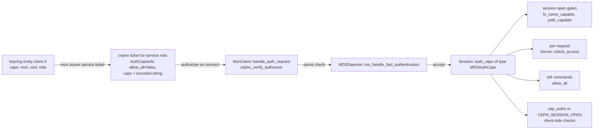
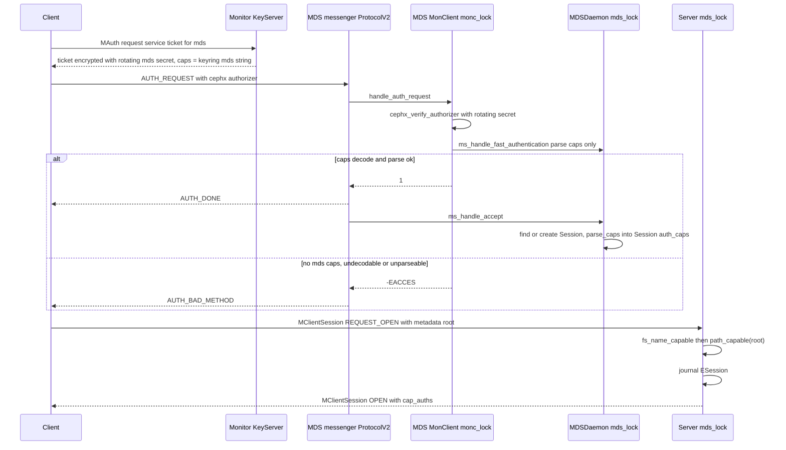
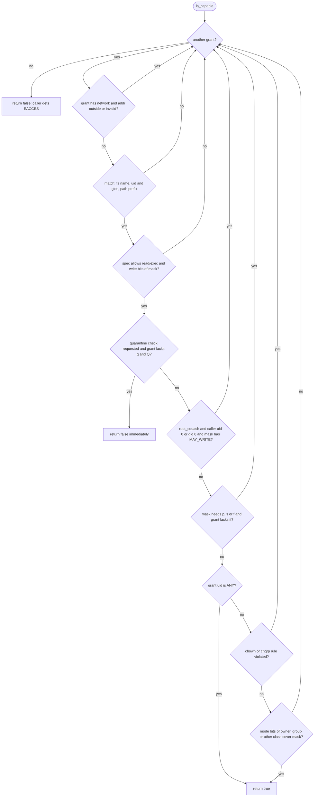

# Authentication and MDS auth caps (cephx, `MDSAuthCaps`, root_squash, fsname/path restrictions)

> Part of the C++ MDS project map ([README](../README.md)).
> Sources (commit `5f7e383ae6d`): `src/mds/MDSAuthCaps.h` (~370 LOC), `src/mds/MDSAuthCaps.cc` (~690 LOC), `src/mds/MDSDaemon.cc` (auth hooks, ~150 relevant LOC), `src/mds/SessionMap.{h,cc}` (`Session::check_access`, ~100 LOC), `src/mds/Server.cc` (session open/reconnect/reclaim gating and every `check_access` call site, ~700 relevant LOC), `src/mds/Beacon.cc` (root_squash health), `src/mds/Locker.cc`/`src/mds/CInode.cc` (quarantine use of caps), `src/mon/MonClient.cc` and `src/auth/cephx/*` (authorizer verification, ~300 relevant LOC), `src/mon/AuthMonitor.cc` (`fs authorize`, ~250 LOC), `src/common/common_init.cc` (MDS default keyring), `src/msg/async/ProtocolV2.cc` (accept-side peer identity, reconnect), `src/mgr/DaemonServer.cc`, `src/pybind/mgr/cephadm/{module.py,services/cephadmservice.py}`, `src/pybind/mgr/volumes/fs/operations/{access.py,versions/subvolume_v1.py}`, `src/pybind/mgr/nfs/export.py`, `src/test/mds/TestMDSAuthCaps.cc`; Linux kernel client snapshot af32da41b03 (7.3-rc6+) `fs/ceph/mds_client.c`, `fs/ceph/file.c`, `fs/ceph/dir.c`, `fs/ceph/inode.c`.
> Related: [sessions](../02-client-protocol/sessions.md), [wire protocol](../02-client-protocol/wire-protocol.md), [kclient expectations](../02-client-protocol/kclient-expectations.md), [libcephfs/fuse/Ganesha expectations](../02-client-protocol/libcephfs-fuse-ganesha-expectations.md), [request lifecycle](../03-request-path/request-lifecycle.md), [attributes and xattrs](../03-request-path/attributes-and-xattrs.md), [snapshots](../10-snapshots-quotas-subvolumes/snapshots.md), [rstats, quotas and subvolumes](../10-snapshots-quotas-subvolumes/rstats-quotas-and-subvolumes.md), [quarantine](../12-qos-metrics-quiesce-quarantine/quarantine.md), [mgr, tools and orchestration](mgr-tools-and-orchestration.md), [FSMap/MDSMap](fsmap-and-mdsmap.md), [beacon and monitor](beacon-and-monitor.md), [admin commands](../13-admin-and-config/admin-commands.md), [config, perf counters, health](../13-admin-and-config/config-perf-counters-and-health.md), [process and threading](../00-architecture/process-and-threading.md), [RADOS/OSD interactions](../07-storage-formats/rados-and-osd-interactions.md).

## 1. Purpose and responsibilities

The C++ MDS has no user database of its own. Every authorization decision is derived from the **cephx service ticket** that a peer presents when it opens a messenger connection to the MDS. This page covers:

1. **How the MDS authenticates itself** to monitors, OSDs, peer MDSs and the mgr (keyring, `MonClient`, rotating service secrets, service tickets).
2. **How peers authenticate to the MDS**: the `MonClient` acts as the messenger's `AuthServer`, verifies the cephx authorizer with the MDS's rotating `mds` service secret and hands the decrypted capability blob to `MDSDaemon`.
3. **The MDS capability language** (`mds` caps in a keyring): grammar, parsing, normalization and canonical printing (`MDSAuthCaps`, `MDSCapGrant`, `MDSCapSpec`, `MDSCapMatch`).
4. **Evaluation** (`MDSAuthCaps::is_capable`): fs name, path prefix, uid/gids with a simplified mode-bit check, `root_squash`, flags `p` (vxattrs/layouts/quotas), `s` (snapshots), `f` (metadata-pool-full bypass), `q`/`Q` (quarantine), `network`.
5. **Enforcement points**: connection accept (parse or refuse), session open (fs name and mount root), session messages and reclaim (fs name), most client request handlers (`Server::check_access`; the unchecked ones are listed in §3.7), tell commands (`allow *` only), fscrypt attribute changes (`allow *` only).
6. **Client-side enforcement support**: the MDS sends a reduced view of the grants (`MDSCapAuth` list, "cap_auths") in `CEPH_SESSION_OPEN`; clients advertising `CEPHFS_FEATURE_MDS_AUTH_CAPS_CHECK` (bit 21) enforce read/write/root_squash locally for operations they complete from cached capabilities. Sessions with `root_squash` caps whose client lacks the feature raise health `MDS_CLIENTS_BROKEN_ROOTSQUASH`.
7. **How caps are produced** by the monitor (`ceph fs authorize`, `ceph auth caps`), by mgr/volumes (`fs subvolume authorize`), by mgr/nfs and by cephadm.

What the MDS explicitly does **not** do (facts that matter for a re-implementation):

* It does not evaluate POSIX DAC for unrestricted grants: no mode-bit, ACL, sticky-bit, `CAP_DAC_OVERRIDE` or directory search (`x`) checks. `MAY_EXECUTE` is never requested by any MDS call site (no use of `MAY_EXECUTE` in `src/mds` outside `MDSAuthCaps`), and there is no POSIX ACL or `S_ISVTX` logic in `src/mds`. POSIX permission checking is the client's job (kclient `ceph_permission` → `generic_permission`, linux/fs/ceph/inode.c:3101 (ceph_permission); libcephfs `Client::inode_permission`/`may_*`, src/client/Client.cc:6371 (Client::inode_permission)).
* It does not consult MDS auth caps when issuing, revoking or accepting capabilities, except for the quarantine `q`/`Q` flags (`Locker::issue_new_caps`, `Locker::issue_caps`). Cap flushes (`MClientCaps` with dirty metadata) are not access-checked; the check in `Locker::_do_cap_update` was removed by commit `96305b5eef0` ("remove session check access when doing cap updates").
* It does not protect file data: data I/O goes from clients directly to OSDs and is governed by the client's OSD caps (doc/cephfs/client-auth.rst "Path restriction").

## 2. Source map

| File | Class / function | Lines | Role |
|---|---|---|---|
| `src/mds/MDSAuthCaps.h` | `MAY_READ` … `MAY_FULL` enum | 31-40 | Access mask bits requested by call sites |
| `src/mds/MDSAuthCaps.h` | `MDSCapSpec` | 43-125 | Permission flags of one grant (`*`/`all`, `r w f p Q q s`) |
| `src/mds/MDSAuthCaps.h` | `MDSCapMatch` | 128-200 | Qualifiers of one grant: `fs_name`, `path`, `root_squash`, `uid`, `gids`; wire encoding v1 |
| `src/mds/MDSAuthCaps.h` | `MDSCapAuth` | 203-230 | Wire view sent to clients (`match`, `readable`, `writeable`) |
| `src/mds/MDSAuthCaps.h` | `MDSCapGrant` | 233-255 | `spec` + `match` + optional `network` (parsed CIDR) |
| `src/mds/MDSAuthCaps.h` | `MDSAuthCaps::fs_name_capable`, `get_cap_auths`, `root_squash_in_caps`, `quarantine_access_in_caps` | 284-356 | Inline helpers used at session open, OPEN replies, health, quarantine |
| `src/mds/MDSAuthCaps.cc` | `MDSCapParser` (Boost.Spirit Qi grammar) | 57-156 | Cap string grammar |
| `src/mds/MDSAuthCaps.cc` | `MDSCapMatch::normalize_path`, `match`, `match_path` | 158-236 | Path normalization and matching, uid/gid matching |
| `src/mds/MDSAuthCaps.cc` | `MDSAuthCaps::path_capable` | 248-257 | Path-only test (mount root check) |
| `src/mds/MDSAuthCaps.cc` | `MDSAuthCaps::is_capable` | 266-405 | The evaluation algorithm |
| `src/mds/MDSAuthCaps.cc` | `set_allow_all`, `parse`, `merge_one_cap_grant`, `merge` | 407-525 | `auth_none` handling, legacy `allow`, `fs authorize` merging |
| `src/mds/MDSAuthCaps.cc` | `to_string`, `allow_all`, `operator<<` | 527-689 | Canonical printing, allow-all predicate |
| `src/common/common_init.cc` | `common_preinit` | 51-52 | Default `keyring` for MDS daemons is `$mds_data/keyring` |
| `src/mds/MDSDaemon.cc` | `MDSDaemon::init` | 628-743 | MonClient init, `set_want_keys`, `set_auth_client/server(monc)`, `authenticate`, `wait_auth_rotating` |
| `src/mds/MDSDaemon.cc` | `MDSDaemon::handle_command` | 770-830 | `MCommand` (tell) gate: requires `allow_all()` |
| `src/mds/MDSDaemon.cc` | `MDSDaemon::ms_dispatch2`, `handle_core_message`, `ALLOW_MESSAGES_FROM` | 1088-1169 | Peer-type filtering of daemon-level messages |
| `src/mds/MDSDaemon.cc` | `MDSDaemon::parse_caps` | 1232-1257 | Decode `AuthCapsInfo` → `MDSAuthCaps` |
| `src/mds/MDSDaemon.cc` | `MDSDaemon::ms_handle_fast_authentication` | 1259-1264 | Parse-only validation during authentication (no `mds_lock`) |
| `src/mds/MDSDaemon.cc` | `MDSDaemon::ms_handle_accept` | 1266-1319 | Attach/create `Session`, store parsed caps in `Session::auth_caps` |
| `src/mds/SessionMap.h` | `Session::auth_caps`, `check_access`, `fs_name_capable`, `set_connection` | 379-412 | Per-session caps storage |
| `src/mds/SessionMap.h` | `SessionMap::broken_root_squash_clients` | 656-663, 834 | Set feeding the health warning |
| `src/mds/SessionMap.cc` | `Session::check_access` | 1109-1171 | Computes the inode path (incl. `stray_prior_path`), FS_FILE_LAYOUT_V2 check, calls `is_capable`, returns `-EACCES` |
| `src/mds/SessionMap.cc` | `SessionMap::remove_session` | 771-779 | Only place that erases `broken_root_squash_clients` entries |
| `src/mds/MDSRank.cc` | `MDSRank::get_session` | 1417-1449 | Copies `auth_caps` from a bootstrap session to an imported session |
| `src/mds/MDSRank.cc` | `MDSRank::is_valid_message`, `handle_message`, `is_stale_message` | 1191-1405 | Peer-type and MDS-address filtering |
| `src/mds/Server.cc` | `Server::handle_client_reclaim`, `reclaim_session` | 476-597 | fs-name gate (silent drop), `auth_name` equality (`-EPERM`) |
| `src/mds/Server.cc` | `Server::handle_client_session` | 599-895 | fs-name gate (REJECT), mount-root gate, root_squash health, OPEN with cap_auths |
| `src/mds/Server.cc` | `Server::_session_logged`, `finish_force_open_sessions`, `handle_client_reconnect` | 925, 1106, 1591 | All other places that send `CEPH_SESSION_OPEN` with cap_auths |
| `src/mds/Server.cc` | `Server::update_required_client_features` | 1799-1824 | Evicts sessions lacking newly required features (e.g. `client_mds_auth_caps`) |
| `src/mds/Server.cc` | `Server::dispatch_client_request` | 2765-2836 | Metadata-pool-full gate (`MAY_FULL`) |
| `src/mds/Server.cc` | `Server::check_access` | 3500-3519 | Request-level wrapper, responds with the error |
| `src/mds/Server.h` | `Server::_check_access` | 234 | Declared, never defined (dead declaration) |
| `src/mds/Server.cc` | 28 call sites of `check_access` | 2829 … 12291 | See [§3.7](#37-where-checks-happen-per-request) |
| `src/mds/Beacon.cc` | `Beacon::notify_health` | 488-509 | `MDS_CLIENTS_BROKEN_ROOTSQUASH` (HEALTH_ERR) |
| `src/mon/MonClient.cc` | `MonClient::init`, `handle_auth_request`, `get_auth_request`, `_check_auth_rotating`, `wait_auth_rotating` | 531, 1807, 1583, 1173, 1222 | AuthServer/AuthClient implementation used by the MDS |
| `src/auth/cephx/CephxProtocol.cc` | `cephx_verify_authorizer` | 451-635 | Ticket decryption, sanity checks, caps blob format check |
| `src/auth/Auth.h`, `src/auth/RotatingKeyRing.cc` | `KEY_ROTATE_NUM`, `RotatingSecrets`, `RotatingKeyRing::get_service_secret` | 168, 196-252; 72-94 | Three rotating secrets (previous, current, next); lookup by `secret_id` and own service type |
| `src/msg/async/ProtocolV2.cc` | `handle_hello`, `handle_client_ident`, `reuse_connection` | 1034, 2418, 2814 | Accept-side peer type and message source; reconnect into an existing `Connection` |
| `src/auth/cephx/CephxKeyServer.cc` | `KeyServerData::get_caps`, `KeyServer::_build_session_auth_info` | 191, 583 | Mon side: service ticket carries the entity's caps for that service type |
| `src/mon/AuthMonitor.cc` | `AuthMonitor::valid_caps`, `prepare_command` (`fs authorize`), `_merge_caps`, `_gen_wanted_caps`, `_check_and_encode_caps` | 1475, 1901-2047, 2156, 2185, 2284 | Cap validation and generation |
| `src/pybind/mgr/volumes/fs/operations/versions/subvolume_v1.py` | `authorize`, `_authorize`, `deauthorize`, `_deauthorize`, `evict` | 329-650 | Subvolume caps `allow r path=<subvol path>` or `allow rw path=<subvol path>` |
| `src/pybind/mgr/volumes/fs/operations/access.py` | `allow_access`, `deny_access` | 27-146 | String-level merge of caps via `auth get-or-create`/`auth caps` |
| `src/pybind/mgr/nfs/export.py` | `_update_user_id`, `_create_user_key` | 617-660 | Ganesha FSAL user caps `allow rw path=<path>` |
| `src/client/Client.cc` | `Client::mds_check_access` | 6305-6369 | libcephfs client-side check using cap_auths |
| linux/fs/ceph/mds_client.c | `handle_session`, `ceph_mds_auth_match`, `ceph_mds_check_access` | 4391, 6470, 6590 | kclient decode and client-side check |

## 3. How it works

### 3.1 Trust model and layering



* The caps a peer has **on the MDS** are exactly the `mds` entry of its keyring entity, as baked into the cephx service ticket by the monitor (`KeyServer::_build_session_auth_info` → `KeyServerData::get_caps(name, "mds")`, src/auth/cephx/CephxKeyServer.cc:616 (KeyServer::_build_session_auth_info)).
* The caller identity used for uid/gid checks (`caller_uid`, `caller_gid`, `gid_list` of `MClientRequest`) is **asserted by the client** and not verified by the MDS; `uid=`/`gids=` grants only restrict which asserted identities the MDS accepts (src/messages/MClientRequest.h:250-254 (MClientRequest::get_caller_uid etc.)).
* Session caps are **not persisted**: `session_info_t` stores `auth_name` (the cephx entity name) but not the caps; caps are re-parsed from each new connection in `ms_handle_accept`.

### 3.2 How the MDS authenticates itself

`MDSDaemon::init` (src/mds/MDSDaemon.cc:628 (MDSDaemon::init)):

1. `monc->set_want_keys(CEPH_ENTITY_TYPE_MON | CEPH_ENTITY_TYPE_OSD | CEPH_ENTITY_TYPE_MDS | CEPH_ENTITY_TYPE_MGR)` (line 669): the MDS asks the monitors for service tickets for mons, OSDs, peer MDSs and the mgr.
2. `monc->init()` (src/mon/MonClient.cc:531 (MonClient::init)) loads the key with `KeyRing::from_ceph_context` (src/auth/KeyRing.cc; the `key` and `keyfile` options take precedence over `keyring`), creates a `RotatingKeyRing` for the daemon's own service type and registers the asok commands `rotate-key` and `wipe-rotating-secrets`. For an MDS the default of `keyring` is **`$mds_data/keyring`**, i.e. `/var/lib/ceph/mds/$cluster-$id/keyring` (`common_preinit` overrides the generic default for MDS and OSD names, src/common/common_init.cc:51-52; `mds_data` default in src/common/options/mds.yaml.in:47-51); the generic list `/etc/ceph/$cluster.$name.keyring,...` (src/common/options/CMakeLists.txt:54) applies only to other entity types. If no key can be loaded, `AuthRegistry::_refresh_config` drops cephx from the supported methods (src/auth/AuthRegistry.cc:158-180) and init fails with `-ENOENT` ("No supported authentication method found! Is the keyring missing?") unless another method such as `none` is configured. Manual deployments create the key at that default path (doc/cephfs/add-remove-mds.rst:90). cephadm writes `keyring` into the daemon data directory (src/cephadm/cephadm.py:716-748) and bind-mounts that directory at `/var/lib/ceph/mds/ceph-<id>` in the container (src/cephadm/cephadmlib/daemons/ceph.py:174-179), which is the default path. Rook was not examined.
3. `messenger->set_auth_client(monc); messenger->set_auth_server(monc); monc->set_handle_authentication_dispatcher(this)` (lines 681-683): the `MonClient` builds authorizers for outgoing connections (`MonClient::get_auth_request`, src/mon/MonClient.cc:1583) and verifies authorizers on incoming connections (`MonClient::handle_auth_request`, src/mon/MonClient.cc:1807); the MDSDaemon is the single dispatcher called back on success.
4. `monc->authenticate()` (line 688); failure → `suicide()`.
5. `monc->wait_auth_rotating(rotating_keys_bootstrap_timeout)` retried up to `max_rotating_auth_attempts` times (lines 697-711): the MDS must hold current **rotating `mds` service secrets** before it can verify any client authorizer (`auth_principal_needs_rotating_keys` is true for OSD/MDS/MGR, src/auth/Auth.h:264). Failure → `suicide()` and `-ETIMEDOUT` ("Maybe I have a clock skew against the monitors?"). The monitor hands out three rotating secrets per service (previous, current, next; `KEY_ROTATE_NUM`, src/auth/Auth.h:168). `_check_auth_rotating` (src/mon/MonClient.cc:1173) requests a new set when fewer than three are held or when the *current* secret expired at least `min(30 s, auth_service_ticket_ttl/4)` ago (`need_new_secrets(now - margin)`, src/auth/Auth.h:215-217); `wait_auth_rotating` waits for the same condition.

Method/mode selection for the MDS as a non-mon daemon (`AuthRegistry::get_supported_methods`, src/auth/AuthRegistry.cc:239-270):

| Peer | Methods option | Modes option |
|---|---|---|
| MON, MGR | `auth_cluster_required` (default `cephx`) | `ms_mon_cluster_mode` (default `secure crc`) |
| MDS, OSD | `auth_cluster_required` | `ms_cluster_mode` (default `crc secure`) |
| anything else (clients) | `auth_service_required` (default `cephx`) | `ms_service_mode` (default `crc secure`) |

Caps the MDS's own entity needs (as deployed; enforced by the peers, not by the MDS):

| Service | Deployed cap | Why | Source |
|---|---|---|---|
| mon | `allow profile mds` (vstart/doc) or `profile mds` (cephadm) | profile grants `mds` ALL (beacons need `mds` X: `MDSMonitor::preprocess_beacon`, src/mon/MDSMonitor.cc:424; offload targets src/mon/MDSMonitor.cc:578), `mon` r, `osd` r, `osd pool rmsnap` (checked in `OSDMonitor::preprocess_remove_snaps`, src/mon/OSDMonitor.cc:4400), `osd blocklist` (client eviction, src/mds/MDSRank.cc:3983 (MDSRank::evict_client)), `log` w, `config-key` under `daemon-private/mds.<id>/` | src/mon/MonCap.cc:201-268 |
| osd | `allow rw tag cephfs *=*` | read/write any pool whose application is `cephfs` (metadata pool, data pools for backtraces, purge, recovery) | src/pybind/mgr/cephadm/services/cephadmservice.py:1526-1529 |
| mds | `allow` | presented to peer MDSs; parsed by them as `allow rwps`. Required: a peer MDS refuses a connection whose `mds` cap is missing or unparseable (§3.3) | same |
| mgr | `allow profile mds` (vstart and doc/cephfs/add-remove-mds.rst:90; cephadm grants none) | MgrClient reports. Not needed: the mgr accepts connections with empty mgr caps (`DaemonServer::ms_handle_fast_authentication`, src/mgr/DaemonServer.cc:315) and does no cap check on `MMgrOpen`/`MMgrReport` (`DaemonServer::handle_open`/`handle_report`, src/mgr/DaemonServer.cc:601, 774); only mgr commands go through `_allowed_command` (936) | src/vstart.sh:1540 |

Key rotation: the MDS accepts `ceph tell mds.<name> rotate-key -i <key>` in the MonClient admin-socket hook (src/mon/MonClient.cc:683-705 (MonClient::call)), which decodes the base64 key and adds it for its own entity to the in-memory keyring; the matching monitor commands are `auth get-or-create-pending` and `auth commit-pending` (src/mon/MonCommands.h:203-214). The tell is subject to the `allow *` gate of [§3.6](#36-where-checks-happen-connection-session-tell). cephadm contains `_rotate_daemon_key` (pending key, rewrite keyring, `rotate-key` tell, restart fallback; src/pybind/mgr/cephadm/module.py:3178-3226), but it has no caller at this commit: `ceph orch daemon rotate-key` fails with "key rotation by orchestrator not supported in this release" (src/pybind/mgr/cephadm/module.py:3352-3359), and `_daemon_action` refuses `rotate-key` (3270-3271).

### 3.3 How peers authenticate to the MDS



1. **Ticket**: the monitor builds the service ticket with `info.ticket.caps = caps of the entity for "mds"` (src/auth/cephx/CephxKeyServer.cc:614-619 (KeyServer::_build_session_auth_info)). The caps blob is `AuthCapsInfo{allow_all, caps}` where `caps` is a bufferlist containing one encoded `std::string` (src/auth/Auth.h:66-76 (AuthCapsInfo)).
2. **Verification**: `MonClient::handle_auth_request` (src/mon/MonClient.cc:1807) takes `monc_lock`, looks up the `AuthAuthorizeHandler` for the peer type and method, and calls `verify_authorizer` with the rotating secrets. For cephx, `cephx_verify_authorizer` (src/auth/cephx/CephxProtocol.cc:451) decrypts the ticket with the service secret selected by `secret_id` (`RotatingKeyRing::get_service_secret` refuses a `service_id` other than the daemon's own type and any `secret_id` not among the three held secrets, src/auth/RotatingKeyRing.cc:72-94; `secret_id == -1` selects the long-term key of the service name instead), rejects tickets whose `global_id` differs from the declared one, whose `auid` is not the default, that carry `allow_all=true` ("the monitor never sets allow_all in a service ticket"), whose timestamps are inconsistent (5 minute slop between ticket creation and session key creation), or whose non-empty caps blob is not exactly one encoded string. It then decrypts `CephXAuthorize`, optionally performs a server challenge round, and produces the reply and connection secret. On success `peer_name` (`EntityName`), `peer_global_id` and `peer_caps_info` are stored on the `Connection` and the session key and connection secret in its `AuthConnectionMeta` (`CephxAuthorizeHandler::verify_authorizer`, src/auth/cephx/CephxAuthorizeHandler.cc). `cephx_verify_authorizer` does not compare `expires` with the current time; an old ticket stops verifying once the MDS no longer holds the rotating secret (`secret_id`) that encrypted it. The MDS keeps exactly the last set of three secrets delivered by the monitor (`RotatingKeyRing::set_secrets` replaces the set, `RotatingSecrets::add` trims to `KEY_ROTATE_NUM` = 3), so ticket validity is bounded by secret rotation rather than by `expires`.
3. **Fast authentication** (src/mds/MDSDaemon.cc:1259 (MDSDaemon::ms_handle_fast_authentication)): parses the caps into a throw-away `MDSAuthCaps` without `mds_lock` ("N.B. without mds_lock!"). Return `false` → `handle_auth_failure` → `-EACCES` (or `_exit(auth_exit_on_failure)` if that option is ≥ 0, default -1, src/mon/MonClient.cc:66) → msgr2 `_auth_bad_method` (src/msg/async/ProtocolV2.cc:2306-2347 (ProtocolV2::_handle_auth_request)).
4. **`parse_caps`** (src/mds/MDSDaemon.cc:1232): `caps.clear()`; if `info.allow_all` → `set_allow_all()` (one grant `MDSCapSpec::ALL`, empty match); otherwise decode one string from `info.caps` and `MDSAuthCaps::parse` it. Consequences:
   * An entity with **no `mds` cap at all** has an empty blob; decoding throws (`cannot decode auth caps buffer of length 0`), so the connection is refused at authentication time.
   * With `auth_service_required = none`, `AuthNoneAuthorizeHandler::verify_authorizer` sets `caps_info->allow_all = true` (src/auth/none/AuthNoneAuthorizeHandler.cc:47), i.e. every client peer is `allow *` (daemon peers follow `auth_cluster_required`); the entity name and global id are then taken from the peer's unauthenticated claim.
   * An unparseable string (possible when `mon_auth_validate_all_caps=false` let it into the auth database) refuses the connection.
5. **Accept** (src/mds/MDSDaemon.cc:1266 (MDSDaemon::ms_handle_accept)): under `mds_lock`; if the daemon holds a rank it looks up an existing `Session` by `entity_name_t(peer_type, peer_global_id)`; if there is no rank or no such session it creates `new Session(con)` owned by the connection priv (state closed; `set_connection` copies `auth_name`, socket address and entity name, src/mds/SessionMap.h:387-395). It then calls `parse_caps(con->get_peer_caps_info(), s->auth_caps)` (return value ignored) and, if the session's connection changed, re-points it and flushes `preopen_out_queue`. Sessions are attached even without a rank "because clients with "allow *" are allowed to connect and do 'tell' operations before we have a rank". Client connections use the `stateful_server` policy (src/ceph_mds.cc:190-191), so a client's msgr2 reconnect is merged into the existing `Connection` by `ProtocolV2::reuse_connection` (src/msg/async/ProtocolV2.cc:2814). That function moves the new socket and `auth_meta` but not `peer_caps_info`, which `MonClient::handle_auth_request` stored on the temporary connection (src/mon/MonClient.cc:1861). `send_reconnect_ok` then queues `ms_handle_accept` for the existing connection (src/msg/async/ProtocolV2.cc:3086), which re-parses the old caps. Updated caps therefore take effect only when a new `Connection` object is accepted (code reading; not reproduced).
6. `MDSRank::get_session` (src/mds/MDSRank.cc:1417): when a `CEPH_MSG_CLIENT_SESSION` arrives on a bootstrap (closed) session and an imported session with the same entity name exists, it copies `auth_name`, connection, queued messages, **`auth_caps`** and `last_seen` to the imported session and re-points the connection's priv.

The kclient builds MDS authorizers in `mds_get_authorizer`/`mds_get_auth_request` and on `AUTH_BAD_METHOD` invalidates its MDS ticket, revalidates with the monitor and returns `-EACCES` (linux/fs/ceph/mds_client.c:7363 (mds_handle_auth_bad_method)).

Message-level peer filtering (authenticated connection, peer type from the msgr2 HELLO):

| Messages | Allowed peer types | Location |
|---|---|---|
| `CEPH_MSG_MON_MAP`, `MSG_REMOVE_SNAPS`, `MSG_MON_COMMAND` (dropped with a clog warning) | MON | src/mds/MDSDaemon.cc:1130 (MDSDaemon::handle_core_message) |
| `CEPH_MSG_MDS_MAP` | MON, MDS | same |
| `CEPH_MSG_OSD_MAP` | MON, OSD | same |
| `MSG_COMMAND` (tell) | any; gated by `allow_all()` | src/mds/MDSDaemon.cc:770 (MDSDaemon::handle_command) |
| cache/migrator ports, `MSG_MDS_PEER_REQUEST`, heartbeat, table, lock, inodefilecaps, scrub, quiesce db | MDS (plus `is_stale_message`: source rank must be up and the message must arrive on the connection to that rank's MDSMap address) | src/mds/MDSRank.cc:1231 (MDSRank::handle_message), 1377 (MDSRank::is_stale_message) |
| `CEPH_MSG_CLIENT_SESSION`, `_RECONNECT`, `_RECLAIM`, `CEPH_MSG_CLIENT_CAPS`, `_CAPRELEASE`, `_LEASE` | CLIENT | src/mds/MDSRank.cc:1250-1300 |
| `CEPH_MSG_CLIENT_REQUEST`, `CEPH_MSG_CLIENT_REPLY` | not filtered by type; `Server::handle_client_request` only attaches a session when `req->is_a_client()` | src/mds/Server.cc:2616 |

The MDS never forwards an `MClientRequest` to another MDS: `MDSRank::forward_message_mds` always sends `MClientRequestForward` to the client (`client_must_resend = true`, src/mds/MDSRank.cc:1504), so every request is evaluated against the caps of the connection it arrived on.

### 3.4 The MDS cap language

#### Grammar

`MDSCapParser` (src/mds/MDSAuthCaps.cc:57-156) is a Boost.Spirit Qi grammar. Rules are declared without a skipper, so whitespace inside a cap string is only accepted where the grammar names it explicitly; `MDSAuthCaps::parse` calls `qi::phrase_parse(..., ascii::space, *this)` (line 428), which additionally skips leading and trailing `ascii::space` characters (space, `\t`, `\n`, `\v`, `\f`, `\r`) of the whole string. Not covered by a ceph unit test; confirmed, like the other parse results quoted in this section that are not attributed to TestMDSAuthCaps.cc, by compiling lines 57-168 and 414-450 verbatim against Boost 1.83 in a standalone harness (`" allow r"`, `"allow r "`, `"\tallow r\n"` and `"allow r\r"` parse). Equivalent EBNF:

```text
mdscaps   := grant ( SEP grant )*
SEP       := ' '* ( ';' | ',' ) ' '*                 (only spaces around the separator)
grant     := "allow" WS capspec match [ WS "network" WS NETWORK ]
capspec   := "*" | "all" | "r" ["w"] ["f"] ["p"] ["Q"] ["q"] ["s"]    (exactly this flag order)
match     := [ WS "fsname=" FSNAME ] [ WS "path=" PATH ] [ WS "root_squash" ]
             [ WS "uid=" UINT ] [ WS "gids=" UINT ( "," UINT )* ]     (exactly this order)
WS        := ( ' ' | '\n' | '\t' )+
FSNAME    := [a-zA-Z0-9_.-]+
PATH      := '"' [^"]* '"' | "'" [^']* "'" | [a-zA-Z0-9_./-]+
NETWORK   := [/.:a-fA-F0-9\[\]]+                     (usable only if it parses as CIDR addr/prefix)
UINT      := 32-bit unsigned decimal (qi::uint_)
special   : the complete string "allow" (exactly) == "allow rwps"
            (byte-exact compare before the grammar runs: " allow" and "allow " are rejected)
```

Notes, each grounded in the grammar or `parse`:

* Keywords are case-sensitive (`"ALLOW r"` is rejected, src/test/mds/TestMDSAuthCaps.cc:144).
* `capspec` must start with `r` unless it is `*` or `all`: `"allow w"`, `"allow r w"` are rejected. Because every flag after `r` is optional, strings without `w` such as `rp`, `rf`, `rq`, `rQ` and `rs` are accepted by the MDS grammar (`ceph fs authorize` rejects `rp`, `rq`, `rQ` and `rf` by its ordering rule because `r` sorts after `p`, `q`, `Q` and `f`, rejects `f` after `rw` as an unknown flag, but does generate `rs`).
* Separators: only spaces (not tabs or newlines) may surround `,`/`;` (`"allow r\t;allow rw"` is rejected); between keywords any mix of space, tab and newline is allowed (`"allow\tr"` parses). A trailing separator (`"allow rw,"`) or an empty grant (`"allow r;;allow rw"`) is rejected.
* Flag order is fixed: `w f p Q q s`. `rwps`, `rwfps`, `rwfpQqs` parse; `rwsp`, `rwpf`, `rwqQ` do not.
* Qualifier order is fixed: `fsname`, `path`, `root_squash`, `uid`, `gids`; `"allow rw path=/a fsname=x"` fails (the trailing text is not consumed and `parse` requires `iter == end`).
* No spaces around `=`; `network` uses a space, not `=` (`allow r network 10.0.0.0/8`).
* `fsname=*` is not expressible (the character `*` is not in `FSNAME`); `match_fs` still treats a stored `"*"` as a wildcard.
* Unquoted paths are limited to `[a-zA-Z0-9_./-]`; anything else (spaces, `@`, `:`, `,`, non-ASCII) needs quotes. A quoted path cannot contain its own quote character; `path=""` is accepted and means the whole fs, `path=` (empty unquoted) is rejected.
* `gids=` without `uid=` parses but has no effect (gids are only consulted when `uid` is set).
* `uid=` above 4294967295 is rejected (`qi::uint_` overflow). Values from 2^31 upward parse but can never match on the MDS, because `MDSCapMatch::match` receives the caller uid as `int` and compares it with the `int64_t` grant uid (src/mds/MDSAuthCaps.cc:170-182).

`MDSAuthCaps::parse` (src/mds/MDSAuthCaps.cc:414-450): on success, each grant's `gids` are sorted and `parse_network()` is run for every grant (so `network_valid` ends up `false` for grants without a network, which is harmless because the network test only runs when `network` is non-empty); on failure all grants are cleared and the error text is `Permission flags in MDS capability string must be '*' or 'all' or must start with 'r'` if the unconsumed remainder (the input minus leading whitespace when nothing parsed) contains the substring `allow`, otherwise `mds capability parse failed, stopped at '<rest>' of '<str>'` (for example `"deny r"`, `""` and `"allow rwx,"` produce the second form).

#### Flags (`MDSCapSpec`)

| Text | Bit (`MDSCapSpec`) | Meaning | Checked against mask bit |
|---|---|---|---|
| `*` or `all` | `ALL = 1<<0`, constructor also sets `READ\|WRITE\|FULL\|SET_VXATTR\|SNAPSHOT` | everything except quarantine | (all) |
| `r` | `READ = 1<<1` | read (also required for execute) | `MAY_READ`, `MAY_EXECUTE` |
| `w` | `WRITE = 1<<2` | write | `MAY_WRITE` |
| `f` | `FULL = 1<<5` | may run space-consuming metadata ops while the metadata pool is full | `MAY_FULL` |
| `p` | `SET_VXATTR = 1<<3` | layouts, quotas, pins, subvolume and other `ceph.*` vxattrs; non-default layouts at create | `MAY_SET_VXATTR` |
| `Q` | `Q_PRIME = 1<<7` | documented as access to all quarantined subtrees; in the code `Q` and `q` are evaluated identically and both are limited by the grant's `path` | quarantine check |
| `q` | `Q = 1<<6` | access to quarantined subtrees under the grant's path | quarantine check |
| `s` | `SNAPSHOT = 1<<4` | mksnap/rmsnap/renamesnap | `MAY_SNAPSHOT` |

`Q` and `q` are never implied by `*`/`all` (src/mds/MDSAuthCaps.h:68-73 (MDSCapSpec::MDSCapSpec); test `QuarantineAllowStarExcludesQPrime`).

#### Qualifiers (`MDSCapMatch`)

| Qualifier | Field | Default | Semantics |
|---|---|---|---|
| `fsname=X` | `fs_name` | `""` | grant applies to fs `X`; `""` or `"*"` = any fs (`match_fs`, src/mds/MDSAuthCaps.h:170) |
| `path=P` | `path` | `""` | all leading `/` stripped at construction (`normalize_path`, src/mds/MDSAuthCaps.cc:158; `//foo` becomes `foo`); trailing `/` are kept in the stored value and ignored by `match_path`; `""` = whole fs. Inner `//`, `.` and `..` are **not** normalized (only a comment says so) |
| `root_squash` | `root_squash` | `false` | grant cannot be used for `MAY_WRITE` by a caller with uid 0 **or** gid 0 |
| `uid=N` | `uid` (`int64_t`) | `-1` (`MDS_AUTH_UID_ANY`) | caller uid must equal N; enables the mode-bit check. **`uid=0` is stored as -1 (any)** because the constructor maps 0 to `MDS_AUTH_UID_ANY` (src/mds/MDSAuthCaps.h:139) |
| `gids=a,b` | `gids` (`vector<gid_t>`) | empty | with `uid=` set: caller gid or one of its supplementary gids must be listed; only listed gids count as "group" in the mode-bit check and as chgrp targets |
| `network A/P` | `MDSCapGrant::network` | none | grant usable only if the session's peer socket address is inside the CIDR; same address family required (`network_contains`, src/common/ipaddr.cc:145); an unparsable network makes the grant unusable in `is_capable`. `parse_network` (src/common/ipaddr.cc:84-130) needs `addr/prefix` accepted by `inet_pton`, so a bracketed IPv6 form such as `[::1]/64`, which the grammar accepts, yields an unusable grant |

#### Canonical forms

* `operator<<` (logs, `MDSAuthCaps[...]`): `allow <spec>[ fsname=F][ path="/P"][ root_squash][ uid=U[ gids=a,b]][ network N]`, spec printed as `*` or the flags in `r w f p Q q s` order; legacy `allow` prints as `allow rwps` (src/test/mds/TestMDSAuthCaps.cc `OutputParsed`).
* `to_string()` (used by the monitor when it merges caps for `fs authorize`): `allow <spec>[ fsname=F][ path=P][ root_squash][ uid=U][ gids=a,b]` joined by `", "`; the path is printed **without** leading slash and **without** quotes, and **`network` is omitted** (src/mds/MDSAuthCaps.cc:527-583).

#### Accepted and rejected examples (from src/test/mds/TestMDSAuthCaps.cc)

| Accepted | Rejected |
|---|---|
| `allow`, `allow *`, `allow r`, `allow rw` | `ALLOW r`, `allow w`, `allow r w` |
| `allow * path="/foo bar/baz"`, `allow * path=/foo-bar_baz` | `allow rwx,`, `allow r poolfoo` |
| `allow r, allow rw path=/foo`, `allow r ;allow * uid=1` | `;allow rwx pool foo rwx ; allow r pool bar` |
| `allow r uid=1 gids=1,2,3, allow * uid=2` | `allow rw uid=123 gids=asdf`, `allow rw uid=123 gids=1,2,asdf` |
| `allow rw path=/foo uid=1 gids=1,2,3 network 2.3.4.5/16` | `allow namespace=foo` |
| `allow rw fsname=a path=/dir1 root_squash uid=1000 gids=1000,1001,1002` | |
| `allow rq`, `allow rwQ`, `allow rwfpQqs`, `allow rwq path=/volumes/subvol1` | |

### 3.5 Evaluation: `MDSAuthCaps::is_capable`

Signature (src/mds/MDSAuthCaps.cc:266): `is_capable(fs_name, inode_path, inode_uid, inode_gid, inode_mode, caller_uid, caller_gid, caller_gid_list, mask, new_uid, new_gid, addr, trimmed_inode_path, check_quarantine_access)`. `inode_path` is the inode's path from the fs root **without** leading `/`; `trimmed_inode_path` is only logged (always `""` from `Session::check_access`).



Exact algorithm (src/mds/MDSAuthCaps.cc:288-404), for each grant in string order:

1. If `grant.network` is non-empty and (`!network_valid` or `!network_contains(network_parsed, prefix, addr)`) → next grant.
2. `grant.match.match(fs_name, inode_path, caller_uid, caller_gid, caller_gid_list)` (src/mds/MDSAuthCaps.cc:170): `match_fs`; if `uid != ANY`: `uid == caller_uid` and, if `gids` non-empty, `caller_gid ∈ gids` or some element of `caller_gid_list ∈ gids`; then `match_path`. Failure → next grant.
3. `grant.spec.allows(mask & (MAY_READ|MAY_EXECUTE), mask & MAY_WRITE)`: `ALL` allows everything; read/execute need `READ`; write needs `WRITE`. Failure → next grant.
4. If `check_quarantine_access` and the grant has neither `q` nor `Q` → **return false** (the only place a grant can deny; later grants are not consulted).
5. If `root_squash` and (`caller_uid == 0` or `caller_gid == 0`) and `mask & MAY_WRITE` → next grant.
6. Compute the effective group list `gids` = (`grant.gids` ∩ {`caller_gid`}) ∪ `std::set_intersection(grant.gids, caller_gid_list)` (sorted). `set_intersection` assumes both inputs sorted; `grant.gids` is sorted at parse, `caller_gid_list` is used as received.
7. If `mask & MAY_SET_VXATTR` and no `p` → next; if `mask & MAY_SNAPSHOT` and no `s` → next; if `mask & MAY_FULL` and no `f` → next.
8. If `grant.uid == ANY` → return true (no mode-bit check at all).
9. `MAY_CHOWN`: requires `new_uid == caller_uid` and `inode_uid == caller_uid`, else next grant. Because `handle_client_setattr` adds `MAY_CHOWN` only when the new uid differs from the inode's uid (src/mds/Server.cc:5621-5622), both conditions can never hold together: a uid-restricted grant never permits a chown. `MAY_CHGRP`: requires `inode_uid == caller_uid` and `new_gid ∈ gids` (step 6), else next grant.
10. Class selection, strictly POSIX-ordered: owner if `inode_uid == caller_uid`; else group if `inode_gid ∈ gids`; else other. Return true if the selected class's `r/w/x` bits cover the `MAY_READ/MAY_WRITE/MAY_EXECUTE` bits of the mask; otherwise next grant.
11. No grant left → return false.

**Precedence with multiple grants**: grants are a union. A request is allowed if *any* grant passes all steps; failing grants are skipped. There are no deny grants. The only order-dependent behavior on the MDS is the quarantine step 4. (Client-side evaluation uses different, order-dependent semantics; see [§3.9](#39-client-side-enforcement-and-the-root_squash-health-warning).)

**Path matching** (`MDSCapMatch::match_path`, src/mds/MDSAuthCaps.cc:207): trailing `/` of the grant path are stripped; empty grant path matches everything; otherwise `target_path` must start with the grant path and either be equal or continue with `/`. So `path=/foo` matches `foo`, `foo/` and `foo/d`, but not `food` (unit tests `AllowPath`, `AllowPathChars`).

**Predicates derived from the same grants**:

| Predicate | Definition | Ignores | Used by |
|---|---|---|---|
| `allow_all()` | some grant has spec `ALL` and `uid == ANY` and `path == ""` (src/mds/MDSAuthCaps.cc:585) | `fsname`, `network`, `root_squash` | tell commands, fscrypt setattr, `fs_name_capable` shortcut |
| `fs_name_capable(fs, mask)` | `allow_all()` or some grant with matching fs whose spec allows the requested r/w (src/mds/MDSAuthCaps.h:284) | path, uid, network | session messages and reclaim (called with `MAY_READ`) |
| `path_capable(path)` | some grant whose path matches (src/mds/MDSAuthCaps.cc:248) | fs name, spec, uid, network | mount root validation |
| `root_squash_in_caps(fs)` | some grant for the fs has `root_squash` (src/mds/MDSAuthCaps.h:313) | path | broken root_squash detection |
| `quarantine_access_in_caps(fs, path)` | some grant for the fs with `q` or `Q` whose path matches the inode path (src/mds/MDSAuthCaps.h:324); `Q` is handled exactly like `q` | uid, network, spec r/w | cap issue/revoke on quarantined inodes |

Worked examples (MDS-side result):

| Caps | Request | Result |
|---|---|---|
| `allow r, allow rw path=/bar` | write in `/bar/x` | grant 1 fails step 3, grant 2 passes → allowed |
| `allow r, allow rw path=/bar` | write in `/baz/x` | denied (`EACCES`) |
| `allow rw root_squash, allow rw path=/volumes` | uid 0 writes `/volumes/a` | grant 1 squashed, grant 2 allows → allowed |
| `allow rw root_squash, allow rw path=/volumes` | uid 0 writes `/x` | denied |
| `allow rw root_squash` | uid 0 sets `ceph.quota.max_bytes` | denied by step 7 (no `p`); with `allow rwp root_squash` it is **allowed** because the vxattr mask has no `MAY_WRITE` |
| `allow * uid=10 gids=10,11,12` | caller 10:10, inode 10:10 mode 0570, write | owner class selected (no `w`) → denied even though group has `w` (test `AllowUidGid`, "user > group") |
| `allow * network 192.168.0.0/16, allow * network 10.0.0.0/8` | from 192.167.2.3 | denied (test `network`) |

### 3.6 Where checks happen: connection, session, tell

| Event | Check | On failure | Location |
|---|---|---|---|
| Incoming connection | caps blob decodes and parses | authentication fails (`-EACCES`, msgr2 AUTH_BAD_METHOD) | src/mds/MDSDaemon.cc:1259 |
| Any `MClientSession` (open, renewcaps, close, flush ack, ...) | `fs_name_capable(mdsmap fs_name, MAY_READ)` (skipped if the MDSMap has no fs name) | reply `CEPH_SESSION_REJECT` with `metadata["error_string"] = client doesn't have caps for FS "<fs>"` sent directly on the connection | src/mds/Server.cc:615-624 (Server::handle_client_session) |
| `MClientReclaim` | same fs-name test | message silently dropped | src/mds/Server.cc:573-577 (Server::handle_client_reclaim) |
| Reclaim of another session by uuid | `session->info.auth_name == target->info.auth_name` | `MClientReclaimReply` result `-EPERM` | src/mds/Server.cc:501-508 (Server::reclaim_session) |
| `CEPH_SESSION_REQUEST_OPEN` | `refuse_client_session` flag; blocklist; required client features; then root_squash detection (see §3.9); then, only if the client metadata has a `root` key, it must start with `/` and satisfy `path_capable(root without leading /)` (a textual prefix test: `/a/../b` passes `path=/a`); then duplicate `uuid` | `CEPH_SESSION_REJECT` with `error_string` (only if the client has `CEPHFS_FEATURE_MIMIC`) `invalue root '<root>'` (sic) or `non-allowable root '<root>'`, clog warning `client session with ... denied` | src/mds/Server.cc:645-808 |
| `MClientReconnect` | required features and root_squash detection only; **no fs-name or root check** | `CEPH_SESSION_CLOSE` | src/mds/Server.cc:1591 (Server::handle_client_reconnect) |
| `MCommand` (`ceph tell mds.X ...`, mgr commands) | `session->auth_caps.allow_all()` | `MCommandReply(-EACCES, "permission denied")` | src/mds/MDSDaemon.cc:810 |
| `fs required_client_features` change | sessions lacking a required feature (e.g. `client_mds_auth_caps`) | evicted (blocklisted if `mds_session_blocklist_on_evict`) | src/mds/Server.cc:1799 (Server::update_required_client_features) |

The kclient sends metadata `root` = mount `server_path` or `/` (linux/fs/ceph/mds_client.c:1655); libcephfs sends its mount root, `/` when none was given (src/client/Client.cc:7095 (Client::mount), 2606 (Client::populate_metadata)). With `allow rw path=/bar`, mounting `/` is therefore rejected at session open. libcephfs omits the `root` key when it populates metadata outside `mount` (`populate_metadata("")` in `Client::mds_command` on an unmounted client and in `Client::start_reclaim`, src/client/Client.cc:6897, 18885), and such sessions skip the root check; per-request checks still apply.

### 3.7 Where checks happen: per request

`Server::check_access(mdr, in, mask)` (src/mds/Server.cc:3500) does nothing when `mdr->session` is null (internal requests). Otherwise it calls `Session::check_access(fs_name = mdsmap fs name, in, mask, caller_uid, caller_gid, &gid_list, head.args.setattr.uid, head.args.setattr.gid, check_qtine)` where `check_qtine = in->is_under_quarantine() && session has CEPHFS_FEATURE_QUARANTINE`; a negative result is sent with `respond_to_request(mdr, r)` and the handler returns.

`Session::check_access` (src/mds/SessionMap.cc:1109):

1. Path selection: if the inode is not a base inode and its projected parent directory is a stray directory, the path is the inode's `stray_prior_path` (set at unlink, src/mds/Server.cc:8768-8772, and when rename unlinks a target, src/mds/Server.cc:10085-10089); if the grandparent directory is a stray (inode inside a snapshotted, deleted directory) the parent's `stray_prior_path` is used. Otherwise `in->make_path_string(path, true)` builds the **projected primary-parent path** from the root (src/mds/CInode.cc:1105). The leading `/` is removed.
2. If the inode is a directory with a layout that has a `pool_ns` and the connection lacks `CEPH_FEATURE_FS_FILE_LAYOUT_V2` → `-EIO`.
3. `is_capable(...)` with the **current (non-projected)** `uid`, `gid`, `mode` and the session's socket address (`info.inst.addr`) → `-EACCES` on false.

Call-site table (all in src/mds/Server.cc). "First pass only" means the check is skipped once peer MDSs have witnessed the operation (`mdr->more()->witnessed` non-empty).

| Op (code) | Handler | Inode checked | Mask | Line |
|---|---|---|---|---|
| `SETLAYOUT`, `SETDIRLAYOUT`, `RMXATTR`, `SETXATTR`, `CREATE`, `SYMLINK`, `MKSNAP`, `LINK`/`RENAME` (first pass) while the metadata pool has `FLAG_FULL` | `dispatch_client_request` | base inode of the request filepath (`try_get_auth_inode`) | `MAY_FULL`. On failure `check_access` has already replied `-EACCES`; the caller then calls `respond_to_request(mdr, -ENOSPC)` a second time, so the client sees `-EACCES` and a duplicate `-ENOSPC` reply for the same tid that clients drop (see below) | 2829 |
| `LOOKUP` 0x100, `GETATTR` 0x101, `LOOKUPSNAP` 0x400 | `handle_client_getattr` | target | `MAY_READ` | 4402 |
| `LOOKUPINO` 0x104, `LOOKUPHASH` 0x102, `LOOKUPPARENT` 0x103, `LOOKUPNAME` 0x105 | `handle_client_lookup_ino` | target, then parent directory if any lock was requested | `0` (only the fs, uid/gids, path and network match of each grant; no r/w or mode test), then `MAY_READ` | 4470, 4504 |
| `LOOKUPINO` with snapid | `_lookup_snap_ino` | snapped inode | `MAY_READ` | 4567 |
| `OPEN` 0x302 with `O_TRUNC` | `handle_client_open` | target | `MAY_WRITE` | 4745 |
| `OPEN` 0x302 | `handle_client_open` | target | `MAY_READ`, plus `MAY_WRITE` if `CEPH_FILE_MODE_WR` | 4776 |
| `CREATE` 0x1301 (new dentry) | `handle_client_openc` | parent directory | `MAY_WRITE`, plus `MAY_SET_VXATTR` if the requested stripe unit/count, object size or pool differ from the inherited layout | 4980 |
| `CREATE` on existing dentry without `O_EXCL`, or replayed completed create | → `handle_client_open` | target | as `OPEN` | 4918, 2905 |
| `READDIR` 0x305 | `handle_client_readdir` | directory | `MAY_READ` | 5130 |
| `SETATTR` 0x1108 | `handle_client_setattr` | target | `MAY_WRITE`, plus `MAY_CHOWN` if `CEPH_SETATTR_UID` changes the uid, plus `MAY_CHGRP` if `CEPH_SETATTR_GID` changes the gid | 5627 |
| `SETATTR` with `CEPH_SETATTR_FSCRYPT_FILE`/`_AUTH` | `handle_client_setattr` | — | `allow_all()` required, else `-EACCES` (evaluated after the `check_access` above). `fscrypt_auth`/`fscrypt_file` sent with a create are copied into the new inode without this gate (`Server::prepare_new_inode`, src/mds/Server.cc:3744-3746) | 5748 |
| `SETLAYOUT` 0x1107 | `handle_client_setlayout` | file | `MAY_WRITE`, plus `MAY_SET_VXATTR` if the layout changes | 5906 |
| `SETDIRLAYOUT` 0x110a | `handle_client_setdirlayout` | directory | `MAY_WRITE`, plus `MAY_SET_VXATTR` if the layout changes | 6027 |
| `SETXATTR`/`RMXATTR` of a `ceph.*` vxattr (`is_ceph_vxattr`: `ceph.dir.layout*`, `ceph.file.layout*`, `ceph.quota*`, `ceph.quiesce.block`, `ceph.dir.subvolume`, `ceph.dir.subvolume.snaps.visible`, `ceph.dir.pin`, `.pin.random`, `.pin.distributed`, `ceph.dir.charmap`, `.normalization`, `.encoding`, `.casesensitive`) | `handle_client_setvxattr` | target | `MAY_SET_VXATTR` only (no `MAY_WRITE`) | 6359 |
| `SETXATTR` 0x1105 of other names (`ceph.*` other than `ceph.mirror.info`/`ceph.mirror.dirty_snap_id` → `-EINVAL`) | `handle_client_setxattr` | target | `MAY_WRITE` | 7188 |
| `RMXATTR` 0x1106 of other names | `handle_client_removexattr` | — | **no check** | 7248 |
| `GETVXATTR` 0x106 | `handle_client_getvxattr` | — | **no check** | 7317 |
| `MKNOD` 0x1201 | `handle_client_mknod` | parent directory | `MAY_WRITE` | 7598 |
| `MKDIR` 0x1220 | `handle_client_mkdir` | parent directory | `MAY_WRITE` | 7701 |
| `SYMLINK` 0x1222 | `handle_client_symlink` | parent directory | `MAY_WRITE` | 7804 |
| `LINK` 0x1202 | `handle_client_link` | target inode, then destination directory | `MAY_WRITE` each, first pass only | 7958, 7961 |
| `UNLINK` 0x1203, `RMDIR` 0x1221 | `handle_client_unlink` | parent directory only (not the victim) | `MAY_WRITE`, first pass only | 8621 |
| `RENAME` 0x1204 | `handle_client_rename` | source directory, destination directory, source inode (not an overwritten target) | `MAY_WRITE` each, first pass only | 9508, 9511, 9520 |
| `LSSNAP` 0x402 | `handle_client_lssnap` | directory | `MAY_READ` | 11498 |
| `MKSNAP` 0x1400 | `handle_client_mksnap` | directory | `MAY_WRITE` + `MAY_SNAPSHOT`; earlier: caller uid outside [`mds_snap_min_uid`, `mds_snap_max_uid`] → `-EPERM` | 11647 (uid 11624) |
| `RMSNAP` 0x1401 | `handle_client_rmsnap` | directory | `MAY_WRITE` + `MAY_SNAPSHOT`; uid range → `-EPERM` | 11838 (uid 11807) |
| `RENAMESNAP` 0x1403 | `handle_client_renamesnap` | directory | `MAY_WRITE` + `MAY_SNAPSHOT`; uid range → `-EPERM` | 11986 (uid 11942) |
| `SNAP_METADATA` 0x1406 | `handle_client_snap_md_op` | — | **no caps check**; uid range → `-EPERM` | 12071 |
| `READDIR_SNAPDIFF` 0x1404 | `handle_client_readdir_snapdiff` | directory | `MAY_READ` | 12291 |
| `FILE_BLOCKDIFF` 0x1405 | `handle_client_file_blockdiff` | — | **no check** | 12194 |
| `SETFILELOCK` 0x1109, `GETFILELOCK` 0x110 | `handle_client_file_setlock`/`_readlock` | — | **no check** | 5418, 5525 |

Other request-path facts:

* Most checks run **after** path traversal and lock acquisition (e.g. getattr acquires its rdlocks first, src/mds/Server.cc:4399-4403), always under `mds_lock`. Exceptions: the `MAY_FULL` gate runs in `dispatch_client_request` before the handler, the mask-0 check of `handle_client_lookup_ino` and the `MAY_READ` check of `_lookup_snap_ino` run without any lock, and `handle_client_setvxattr` checks before taking the policy/auth xlocks. A check that fails after locks were taken simply responds; the locks are dropped by request cleanup.
* **Batched getattr/lookup**: with `mds_allow_batched_ops=true` (default), `GETATTR` with an empty relative path and single-component `LOOKUP` requests on the same inode/dentry with the same `getattr.mask` join a batch (`MDRequestImpl::can_batch`, src/mds/Mutation.cc:438). Only the batch head runs `check_access`; `Batch_Getattr_Lookup::_respond` sends the head's result code and trace to every follower (src/mds/Server.cc:149-160), across different sessions.
* `MAY_FULL`: `Server::is_full` (a member flag) is the `FLAG_FULL` flag of the **metadata pool** (`Server::handle_osd_map`, src/mds/Server.cc:2752). `MKDIR` and `MKNOD` are not in the full-gated list. `SETATTR` that grows a file while full returns `-ENOSPC` without any `f` bypass (src/mds/Server.cc:5636). A failed `MAY_FULL` check produces two replies (src/mds/Server.cc:2829-2835): `Server::check_access` sends `-EACCES` and finishes the request, then `dispatch_client_request` calls `respond_to_request(mdr, -ENOSPC)`, which has no double-reply guard (`reply_client_request`, src/mds/Server.cc:2379) and sends a second `MClientReply`. The kclient takes the first reply and drops the second as an "unknown tid" (linux/fs/ceph/mds_client.c:4085-4089), so `-ENOSPC` is not what the application sees (code reading; not reproduced).
* New inode ownership comes from `owner_uid`/`owner_gid` (idmapped mounts; equal to caller ids for legacy heads), gid from the parent if the parent is setgid (`Server::prepare_new_inode`, src/mds/Server.cc:3722-3735); for request heads older than version 3 the decoder sets `owner_* = caller_*` (src/common/ceph_fs.cc:79-91 (decode ceph_mds_request_head)); the permission check itself uses `caller_uid`/`caller_gid`.

### 3.8 uid/gid checks versus POSIX permission checks

| Aspect | MDS caps without `uid=` | MDS caps with `uid=`/`gids=` | POSIX (enforced by clients) |
|---|---|---|---|
| Mode bits | not consulted | owner/group/other class, `r w x` of the class only | full DAC incl. ACLs |
| Group class | — | only gids listed in the grant (and held by the caller) | all supplementary groups |
| Root | no special case (`uid=0` cannot be expressed; it means any) | uid 0 is an ordinary uid that never matches | CAP_DAC_OVERRIDE etc. |
| Directory search on ancestors | not checked | not checked (`MAY_EXECUTE` never requested) | `x` on every component |
| lookup/stat | `MAY_READ` on the **target** | target must be readable by class | needs only search on the parent |
| open `O_WRONLY` | `MAY_READ`+`MAY_WRITE` (an `O_TRUNC` open of a regular file checks only `MAY_WRITE`) | needs both `r` and `w` bits (`w` only with `O_TRUNC`) | `w` only |
| create/unlink/rename | `MAY_WRITE` on parent dir(s) (and source inode for rename/link) | `w` bit on the parent dir(s) | `w`+`x` on parent, sticky-bit rules |
| chmod/utimes | `MAY_WRITE` on target | `w` bit on target | ownership (or capability) |
| chown | `MAY_WRITE` + `MAY_CHOWN` | only to self and only if already owner, which can never be a real uid change, so always denied by this grant (§3.5 step 9) | CAP_CHOWN |
| chgrp | `MAY_WRITE` + `MAY_CHGRP` | owner, and only to a grant-listed group the caller holds | owner and member of target group |

### 3.9 Client-side enforcement and the root_squash health warning

The MDS cannot see operations that clients complete from cached capabilities (local opens, buffered setattr flushed later through `MClientCaps`, async create/unlink). Since `Locker::_do_cap_update` no longer checks caps, root_squash and read-only grants are additionally enforced by clients:

1. **Export**: every `CEPH_SESSION_OPEN` the MDS sends carries `session->auth_caps.get_cap_auths()`: one `MDSCapAuth{match, readable = spec.allow_read(), writeable = spec.allow_write()}` per grant, in grant order (src/mds/MDSAuthCaps.h:304). Send sites: `_session_logged` after `ESession` is journaled (src/mds/Server.cc:975), the "already open" re-notification sent when a `REQUEST_OPEN` carrying `CEPHFS_FEATURE_NOTIFY_SESSION_STATE` arrives on an open session (676), `finish_force_open_sessions` for sessions force-opened by subtree import, rejoin or a cross-MDS rename (1135; callers src/mds/Migrator.cc:3209, 3915, src/mds/MDCache.cc:5459, src/mds/Server.cc:10423), and reconnect success (1698). The list is only on the wire if the message is encoded with version ≥ 6, which happens only when `metadata` or `supported_features` is non-empty; the MDS fills `supported_features` only for clients with `CEPHFS_FEATURE_MIMIC` (src/messages/MClientSession.h:98-118 (MClientSession::encode_payload)).
2. **kclient** (`handle_session`, linux/fs/ceph/mds_client.c:4391): decodes `cap_auths` when `msg_version >= 6`, ignores (with `WARN_ON_ONCE`) a non-empty list on a non-OPEN op, strips trailing `/` from paths, and on every `CEPH_SESSION_OPEN` from any rank **replaces** the mount-wide `mdsc->s_cap_auths`. `ceph_mds_check_access` (linux/fs/ceph/mds_client.c:6590) is called before: `ceph_open` (file.c:426, `MAY_READ` and `MAY_WRITE` for write opens, on the file path), `ceph_atomic_open` (file.c:842, on the **parent directory** path, same mask), `ceph_unlink` (also rmdir and rmsnap, dir.c:1385, `MAY_WRITE` on the parent path) and `__ceph_setattr` (inode.c:2603, `MAY_WRITE`). Only `-EACCES` is returned to the caller; other errors (path build failure) force a synchronous MDS round trip.
3. **libcephfs** (`Client::mds_check_access`, src/client/Client.cc:6305): same logic with `MDSCapMatch::match`; used in `_do_setattr` before buffering (8563) and in `_open` when the open can be satisfied from issued caps (11134).
4. **Client semantics differ from the MDS**: both clients iterate all grants and let the **last matching grant decide** ("always follow the last auth caps' permission"); a write is denied if that grant is not writeable or is `root_squash` with uid 0 or gid 0; if **no grant matches, access is allowed**. Client-side checks know nothing about `p`, `s`, `f`, `q`, `Q`, `network` or mode bits. Example: caps `allow rw, allow r path=/ro` → MDS allows writes in `/ro`, the kclient refuses write opens there; caps `allow rw path=/volumes, allow rw root_squash` → uid 0 writing `/volumes/a` is allowed by the MDS but refused by the kclient.
5. **Health**: at `REQUEST_OPEN` (src/mds/Server.cc:769-774) and at reconnect (1665-1669), a session whose caps contain `root_squash` for this fs (`root_squash_in_caps`) and whose client lacks `CEPHFS_FEATURE_MDS_AUTH_CAPS_CHECK` is added to `SessionMap::broken_root_squash_clients`. It is not rejected. `Beacon::notify_health` (src/mds/Beacon.cc:488-509) reports `MDS_HEALTH_CLIENTS_BROKEN_ROOTSQUASH` (`MDS_CLIENTS_BROKEN_ROOTSQUASH`, **HEALTH_ERR**), one metric per client (`"Client <name> has broken root_squash implementation"`, metadata `client_id`) or a single summarized metric (`"There are N clients with broken root_squash implementations"`, metadata `client_count`) when the count exceeds `mds_health_summarize_threshold` (default 10). The set holds raw `Session*` pointers (src/mds/SessionMap.h:834), and entries are removed only by `SessionMap::remove_session` (src/mds/SessionMap.cc:779).

### 3.10 How caps are produced

**`ceph fs authorize <fs|*|all> <entity> <path> <perm> [root_squash] [<path> <perm> [root_squash] ...] [--key_type ...]`** (src/mon/MonCommands.h:215; handler src/mon/AuthMonitor.cc:1901):

* Unknown fs → `-EINVAL "filesystem X does not exist."`.
* Per pair: perm characters must be in strictly increasing ASCII order except the leading unit `rw` ("Permission flags (except 'rw') must be specified in alphabetical order."); allowed characters are `r w p s q Q` and `*` (alone only); `f` is rejected (`Unknown permission flag 'f'.` after `rw`, the ordering error after a bare `r`). `*` or `w` makes the OSD cap `rw`.
* Generated strings: mon `allow r[ fsname=<fs>]`; mds `allow <perm>[ fsname=<fs>][ path=<path>][ root_squash]` per pair joined with `", "` (no `path=` when path is `/`; path inserted unquoted); osd `allow r[w] tag cephfs data=<fs argument>`.
* All three are validated (`_check_and_encode_caps` → `valid_caps` → `MDSAuthCaps::parse`; the mds and osd strings only while `mon_auth_validate_all_caps` is true), so a path that needs quoting makes the command fail with `-EINVAL`.
* Existing entity: `_gen_wanted_caps`/`_merge_caps<MDSAuthCaps>` parse old and new caps and call `MDSAuthCaps::merge`: a grant with the same (`fs_name`, `path`) has its spec **replaced** by the new spec and `root_squash` can be added but never removed; other grants are appended (with only fs/path/root_squash). If anything changed, the stored string becomes `cur_cap.to_string()`, which drops `network` qualifiers and quotes. If nothing changed: `no update for caps of <entity>`.

**`ceph auth add/caps/get-or-create`**: the `mds` string is stored verbatim after `MDSAuthCaps::parse` validation, unless `mon_auth_validate_all_caps=false` (default `true`), in which case invalid strings are only detected when the MDS refuses the connection.

**mgr/volumes `ceph fs subvolume authorize <vol> <sub> <auth_id> [--group_name] [--access_level r|rw (default rw)] [--tenant_id] [--allow_existing_id]`** (src/pybind/mgr/volumes/fs/operations/versions/subvolume_v1.py:452 (SubvolumeV1._authorize)):

* mds: `allow <access_level> path=<subvolume data path>` — **no `fsname=`**; osd: `allow <access_level> pool=<ceph.dir.layout.pool>[ namespace=<pool_namespace>]`; mon: `allow r`.
* String-level merge (`allow_access`, access.py:27): split existing caps on `,`, remove the opposite access level for the same path, append the new grant, write with `auth caps`; new entities use `auth get-or-create`. Bookkeeping lives in CephFS files `/volumes/$<auth_id>.meta` and `/volumes/_<group>:<subvol>.meta`, serialized with libcephfs `flock(LOCK_EX)` (auth_metadata.py:50-128).
* `deauthorize` removes `allow r path=...` or `allow rw path=...`; `evict` sends `session evict auth_name=<auth_id> client_metadata.root=<subvol path>` to every up rank (subvolume_v1.py:609).
* The key is returned only if `tenant_id` was given; an existing entity not created by the plugin needs `allow_existing_id`.

**mgr/nfs** (src/pybind/mgr/nfs/export.py:617-660): Ganesha FSAL users get `mds 'allow rw path=<export path>'`, `osd 'allow rw pool=<nfs pool> namespace=<cluster>, allow rw tag cephfs data=<fs>'`, `mon 'allow r'`; access type and squashing are left to Ganesha.

**cephadm**: mgr `mds 'allow *'` (needed for tell commands), MDS daemons `mds 'allow'`, cephfs-mirror `mds 'allow r'` (src/pybind/mgr/cephadm/services/cephadmservice.py:1409-1412, 1526-1529, 2271-2276).

**`ceph fs rename`** does not rewrite `fsname=` caps; it requires `--yes-i-really-mean-it` because "clients' cephx credentials need reauthorized" (src/mon/FSCommands.cc:1336).

## 4. Data structures and invariants

Access mask bits (src/mds/MDSAuthCaps.h:31-40):

| Name | Value | Requested by |
|---|---|---|
| `MAY_READ` | `1<<0` | getattr/lookup, open, readdir, lssnap, snapdiff |
| `MAY_WRITE` | `1<<1` | all mutations |
| `MAY_EXECUTE` | `1<<2` | never requested by the MDS |
| `MAY_CHOWN` | `1<<4` | setattr changing uid |
| `MAY_CHGRP` | `1<<5` | setattr changing gid |
| `MAY_SET_VXATTR` | `1<<6` | vxattrs, layout changes |
| `MAY_SNAPSHOT` | `1<<7` | mksnap, rmsnap, renamesnap |
| `MAY_FULL` | `1<<8` | full-pool gate |

`MDSCapGrant { MDSCapSpec spec; MDSCapMatch match; string network; entity_addr_t network_parsed; unsigned network_prefix; bool network_valid = true; }` — `network_valid` defaults to `true` and is recomputed by `parse_network()` (constructor when a network is given, and `MDSAuthCaps::parse`).

`MDSAuthCaps { vector<MDSCapGrant> grants; }` — order is the string order and is significant for quarantine (MDS) and for client-side evaluation (clients receive the same order).

`Session` (src/mds/SessionMap.h): `MDSAuthCaps auth_caps` (not persisted); `session_info_t info` with `info.auth_name` (`EntityName`, persisted in `session_info_t` (src/mds/mdstypes.h:383, encoded in src/mds/mdstypes.cc:679) and in `ESession`, src/mds/events/ESession.h:38-39, "persist auth_name to allow journal recreated session to be reclaimed"), `info.inst.addr` (peer socket address, used for `network`), `ConnectionRef connection` (used for the layout-v2 feature test).

Invariants:

* `Session::auth_caps` always reflects the caps stored on the most recently accepted `Connection` object of that entity (a msgr2 reconnect into an existing `Connection` re-parses the caps already stored there, §3.3 step 5); it is empty (no grants, everything denied) for sessions loaded from the SessionMap or created by import until the client connects.
* `MDSCapMatch::path` never starts with `/`; inode paths passed to `is_capable` never start with `/`.
* `MDSCapMatch::uid` is never `0` (0 is stored as `-1`).
* `grant.match.gids` is sorted after `parse`.
* An `MDSAuthCaps` that failed to parse has no grants.

## 5. Interfaces

### 5.1 Messages

| Message | Direction | Auth-relevant content | Handler / producer |
|---|---|---|---|
| msgr2 `AUTH_REQUEST`/`AUTH_REQUEST_MORE` | peer → MDS | cephx authorizer (`authorizer_v`, `global_id`, `service_id`, ticket blob, encrypted `CephXAuthorize`) | `MonClient::handle_auth_request` |
| msgr2 `AUTH_REPLY_MORE` / `AUTH_DONE` / `AUTH_BAD_METHOD` | MDS → peer | challenge, reply authorizer, connection secret / failure `-EACCES` | `ProtocolV2::_handle_auth_request` |
| `MAuth` (`CEPH_MSG_AUTH` 17) | MDS ↔ mon | MDS's own authentication, service tickets, rotating secrets | `MonClient` |
| `MClientSession` (`CEPH_MSG_CLIENT_SESSION` 22) op `REQUEST_OPEN` (0) | client → MDS | `metadata["root"]`, `metadata["uuid"]`, `supported_features` (bit 21 `client_mds_auth_caps`) | `Server::handle_client_session` |
| `MClientSession` op `OPEN` (1) | MDS → client | `cap_auths` (v ≥ 6) | see §3.9 |
| `MClientSession` op `REJECT` (11) | MDS → client | `metadata["error_string"]`; flag `SESSION_BLOCKLISTED` | `Server::handle_client_session` |
| `MClientReclaim` (27) / `MClientReclaimReply` | client ↔ MDS | fs-name gate; `-EPERM` on `auth_name` mismatch | `Server::handle_client_reclaim` |
| `MClientRequest` (24) | client → MDS | `caller_uid`, `caller_gid` (head), `gid_list` (v ≥ 4, `vector<uint64_t>`), `owner_uid`/`owner_gid` (head v ≥ 3), `args.setattr.uid/gid` | `Server::check_access` |
| `MClientReply` | MDS → client | `-EACCES`, `-EPERM`, `-ENOSPC`, `-EIO`, `-EROFS` results | `Server::respond_to_request` |
| `MCommand` (`MSG_COMMAND` 97) / `MCommandReply` (98) | admin/mgr ↔ MDS | requires `allow_all()` | `MDSDaemon::handle_command` |
| `MMDSBeacon` | MDS → mon | health metric `MDS_HEALTH_CLIENTS_BROKEN_ROOTSQUASH` | `Beacon::notify_health` |

### 5.2 `cap_auths` wire encoding (inside `MClientSession` v6/v7)

`encode(vector<MDSCapAuth>)` = `u32 count` followed by, per element:

```text
MDSCapAuth   : u8 struct_v=1, u8 compat=1, u32 len,
               MDSCapMatch : u8 struct_v=1, u8 compat=1, u32 len,
                             s64 uid (-1 = any)
                             u32 n, n x u32 gids
                             u32 len, bytes path   (no leading '/')
                             u32 len, bytes fs_name ("" = any)
                             u8 root_squash
               u8 readable
               u8 writeable
```

(src/mds/MDSAuthCaps.h:174-192 (MDSCapMatch::encode), 211-225 (MDSCapAuth::encode)). The kclient skips the 6-byte headers and reads the fields positionally without using `len` (linux/fs/ceph/mds_client.c:4468-4527), so the v1 field layout is a hard contract. `MClientSession` `HEAD_VERSION = 7` appends `oldest_client_tid` after `cap_auths`.

### 5.3 Journal events and RADOS objects

* `ESession` carries `auth_name` (src/mds/events/ESession.h:38-53); replay sets a session's `auth_name` if empty (src/mds/journal.cc:1899). Caps themselves are never journaled or stored.
* No RADOS object holds MDS caps. The auth database lives in the monitors. mgr/volumes keeps its authorization bookkeeping as regular CephFS files under `/volumes`.

### 5.4 Configuration options

| Option | Default | Effect |
|---|---|---|
| `auth_cluster_required` | `cephx` | methods for MDS ↔ mon/mgr/MDS/OSD |
| `auth_service_required` | `cephx` | methods accepted from clients (`none` ⇒ every client is `allow *`) |
| `auth_client_required` | `cephx, none` | methods clients accept |
| `ms_cluster_mode` / `ms_service_mode` / `ms_mon_cluster_mode` | `crc secure` / `crc secure` / `secure crc` | msgr2 connection modes |
| `keyring` | `$mds_data/keyring` for MDS daemons (set by `common_preinit`); `/etc/ceph/$cluster.$name.keyring,/etc/ceph/$cluster.keyring,/etc/ceph/keyring,/etc/ceph/keyring.bin` for other entities | MDS key location (`key`/`keyfile` take precedence) |
| `mds_data` | `/var/lib/ceph/mds/$cluster-$id` | base of the default MDS keyring path |
| `auth_service_ticket_ttl` | `1_hr` | service ticket lifetime, rotating key refresh cadence (renewal margin `min(30 s, ttl/4)`) |
| `auth_mon_ticket_ttl` | `72_hr` | mon ticket lifetime |
| `rotating_keys_bootstrap_timeout` | `30` s | wait for rotating keys at startup |
| `max_rotating_auth_attempts` | `10` | retries before suicide |
| `auth_exit_on_failure` | `-1` | if ≥ 0, `_exit(code)` on an authentication failure |
| `cephx_require_signatures`, `cephx_cluster_require_signatures`, `cephx_service_require_signatures` | `false` | message signature requirements |
| `cephx_sign_messages` | `true` | sign messages when supported |
| `cephx_require_version`, `cephx_service_require_version` | `2` | minimum cephx protocol version |
| `mon_auth_validate_all_caps` (mon) | `true` | validate `mds` cap strings at `ceph auth` time |
| `mds_snap_min_uid` / `mds_snap_max_uid` | `0` / `4294967294` | uid range for mksnap/rmsnap/renamesnap/snap metadata (`-EPERM`) |
| `mds_allow_batched_ops` | `true` | getattr/lookup batching (followers inherit the head's access result) |
| `mds_health_summarize_threshold` | `10` | summarization of `MDS_CLIENTS_BROKEN_ROOTSQUASH` |
| `mds_session_blocklist_on_evict` | `true` | eviction of clients lacking required features |
| `mds_replay_unsafe_with_closed_session` | `false` | allows replayed requests on closed sessions during clientreplay |
| client: `client_permissions` | `true` | libcephfs POSIX checks |
| client: `fuse_default_permissions` | `false` | ceph-fuse lets the kernel do POSIX checks if true |
| client: `client_acl_type` | `""` | `posix_acl` enables ACL evaluation in libcephfs |

### 5.5 Perf counters, health, admin commands

* Perf counters: none dedicated to authentication or authorization denials.
* Health: `MDS_CLIENTS_BROKEN_ROOTSQUASH` (HEALTH_ERR), summary `"%num% MDS report clients with broken root_squash implementation"` (src/messages/MMDSBeacon.h:115 (mds_metric_summary)).
* Admin commands: any `ceph tell mds.X <cmd>` requires `allow *` on the caller (local `ceph daemon` asok is not cephx-protected); `rotate-key` and `wipe-rotating-secrets` are registered by `MonClient::init`; `session ls`/`session evict` accept the filter `auth_name=<id>` matched against `info.auth_name.get_id()` (src/mds/SessionMap.cc:1313, 1392); `session ls` dumps `auth_name` but not caps (src/mds/SessionMap.cc:647-650).

## 6. Concurrency and mds_lock

Threads involved: messenger worker threads (authentication, `ms_handle_fast_authentication` under `monc_lock`), the `MDSDaemon` dispatch path (`ms_dispatch2` takes `mds_lock` for every message it receives, src/mds/MDSDaemon.cc:1088-1091; `Beacon` and `MonClient` are separate higher-priority dispatchers), the `MonClient` timer (rotating secret renewal), the tick thread (`Beacon::notify_health` under `mds_lock` and `Beacon::mutex`, src/mds/Beacon.cc:303-312).

| Serialization point | Lock | Shared state | True conflict scope |
|---|---|---|---|
| `MonClient::handle_auth_request` for every incoming connection (ticket and authorizer decryption, `ms_handle_fast_authentication` parse) | `monc_lock` (process-global, src/mon/MonClient.cc:1815) | rotating secrets, auth handler registry | none: authorizer verification is a pure function of the rotating keyring |
| `MDSDaemon::ms_handle_accept` (session lookup/creation, caps parse into `Session::auth_caps`, preopen queue flush) | `mds_lock` | `SessionMap`, `Session::auth_caps`, connection priv | one client entity |
| `Server::handle_client_session` fs-name and root checks, `ESession` journaling | `mds_lock` | session state, journal | one session (journal append is per rank) |
| `Server::check_access` → `Session::check_access` → `make_path_string` | `mds_lock` | names of every ancestor dentry up to the root (projected), inode uid/gid/mode, session caps | the inode plus its whole ancestor chain (a rename of any ancestor changes the result) |
| `Locker::issue_new_caps` / `Locker::issue_caps` build the inode path and evaluate `quarantine_access_in_caps` for each client cap on every issue (src/mds/Locker.cc:2474-2480, 2598-2604); the same path build happens in `CInode::try_drop_loner`, `get_xlocker_mask`, `get_caps_allowed_for_client` and `encode_inodestat` (src/mds/CInode.cc:3490, 3788, 3807, 4199) | `mds_lock` | inode path, per-session caps | inode (+ ancestors); unconditional string build even without quarantine (only the `EQUARANTINED` errno path in `issue_caps`, src/mds/Locker.cc:2698-2703, is gated on `is_under_quarantine()`) |
| `MDSDaemon::handle_command` allow-all gate | `mds_lock` | session caps | one connection |
| `SessionMap::broken_root_squash_clients` | `mds_lock` (+ `Beacon::mutex` when read) | rank-global set | none inherent (per-session flag) |
| Batched getattr/lookup (`batch_ops` on `CInode`/`CDentry`) | `mds_lock` | batch head's result and trace | inode/dentry, but the access result is shared across sessions |

What could commute: parsing, `is_capable` evaluation and session-open gating are pure functions of (session caps, inode path, inode uid/gid/mode, caller credentials, mask, peer address). The only non-local input is the inode path, i.e. the projected names of all ancestors, so authorization of inodes in disjoint subtrees conflicts only through renames of shared ancestors. Authentication of different connections never conflicts; `monc_lock` serializes it only as an implementation artifact.

## 7. Externally visible contract

**Linux kernel client**

* Authenticates to the MDS with a cephx authorizer for service type MDS (msgr1 and msgr2 callbacks in linux/fs/ceph/mds_client.c:7260-7380); handles challenges; on AUTH_BAD_METHOD invalidates the MDS ticket and returns `-EACCES`.
* Sends `metadata["root"]` = mount path or `/`; expects `CEPH_SESSION_REJECT` for disallowed roots or filesystems, after which requests fail with `-EACCES` unless mounted with `recover_session=clean` (linux/fs/ceph/mds_client.c:3741 (__do_request)).
* Advertises `CEPHFS_FEATURE_MDS_AUTH_CAPS_CHECK` = 21 (linux/fs/ceph/mds_client.h:39, 58) and depends on the exact `cap_auths` layout of §5.2 in `CEPH_SESSION_OPEN` v ≥ 6; replaces its mount-wide list on every OPEN; performs local checks in open/atomic_open/unlink/rmdir/rmsnap/setattr with "last matching grant wins" semantics; compares fs names with `ceph_namespace_match` (`NULL`, `""` or `"*"` match any, linux/fs/ceph/super.h:110); builds the comparison path as `<server_path without leading slash>/<path relative to mount>`.
* Sends `caller_uid`/`caller_gid` = fsuid/fsgid, `owner_uid`/`owner_gid` for new-inode ops, and the full supplementary group list as `u64` values (linux/fs/ceph/mds_client.c:3134-3137, 3375-3398).
* Performs all POSIX permission checks itself (`ceph_permission` → `generic_permission`).

**libcephfs / ceph-fuse / NFS-Ganesha**

* Same session and `cap_auths` contract; session REJECT is surfaced as `-EPERM` (`_closed_mds_session(session, -EPERM, true)`, src/client/Client.cc:2801), e.g. `ceph mount failed with (1) Operation not permitted` for an fs not in the caps.
* `Client::mds_check_access` in `_do_setattr` and in cap-satisfied `_open`; POSIX checks controlled by `client_permissions`/`fuse_default_permissions`/`client_acl_type`.
* Ganesha FSAL users carry `allow rw path=<export>`; handle-based access (`LOOKUPINO`) is constrained by the path test with mask 0.

**Monitors**

* Store caps strings and issue service tickets containing them; validate `mds` strings with the MDS parser (`mon_auth_validate_all_caps`); generate them for `fs authorize` with the merge rules of §3.10.
* Require the MDS entity to hold `mds` X (beacons, offload targets), `osd blocklist` (eviction), `osd pool rmsnap` (`MRemoveSnaps`).
* Provide rotating `mds` service secrets to MDS daemons.

**mgr**

* Needs `mds 'allow *'` to run MDS tell commands (volumes evict, stats, etc.).
* mgr/volumes generates `allow r|rw path=<subvol path>` without `fsname=`, uses `session evict auth_name=… client_metadata.root=…`, and relies on libcephfs `flock` for its metadata files.
* Health checks surface `MDS_CLIENTS_BROKEN_ROOTSQUASH`.

**OSDs**

* Evaluate the MDS's own `osd` caps (`allow rw tag cephfs *=*`) for all MDS RADOS I/O.
* Enforce client data access independently of MDS caps.

**Error codes observable by clients**: `-EACCES` (caps denial, fscrypt without `allow *`, tell without `allow *`, and also the first reply when the metadata pool is full and no `f` grant matches, §3.7), `-EPERM` (snapshot uid range, reclaim `auth_name` mismatch, libcephfs REJECT mapping), `-ENOSPC` (intended for metadata pool full without `f`, but sent only as a second reply that clients drop; growing `SETATTR` while full), `-EIO` (pool-namespace layout to a client without FILE_LAYOUT_V2), `-EINVAL` from `fs authorize`.

**Behavior a replacement must reproduce for identical semantics** (summary of this page, C++ behavior only):

* Refuse the connection when the ticket's `mds` caps are missing or unparseable, with the exact grammar and quirks of §3.4, because the monitor validates with the same parser.
* Evaluate grants as a union, in the step order of §3.5 (network, match, r/w, quarantine early deny, root_squash, p/s/f, uid ANY short-cut, chown/chgrp, owner/group/other class).
* Apply the session gates of §3.6 (fs name on every `MClientSession`, textual root check at open, `auth_name` equality for reclaim, nothing at reconnect) and the per-request matrix of §3.7, including which inode is checked, which mask is used, the stray path substitution, and the unchecked operations.
* Send the grant list as `cap_auths` (v1 layout of §5.2, grant order kept) in every `CEPH_SESSION_OPEN`, record `MDS_CLIENTS_BROKEN_ROOTSQUASH` for root_squash sessions lacking feature bit 21, and gate `MCommand` and fscrypt setattr on `allow_all()`.

## 8. Edge cases, failure handling and gotchas

1. **`uid=0` means "any uid"** (`MDSCapMatch` constructor). A grant cannot be restricted to root.
2. **Caps refresh only with a new `Connection`**: `Session::auth_caps` is set in `ms_handle_accept`; changing an entity's caps has no effect on established connections. A msgr2 reconnect that `ProtocolV2::reuse_connection` merges into the existing connection runs a fresh AUTH exchange but keeps the old `peer_caps_info`, so even a socket reconnect does not pick up new caps (§3.3 step 5; code reading, not reproduced). mgr/nfs works around this by always granting `allow rw path=<export>` and leaving the export access type to Ganesha (src/pybind/mgr/nfs/export.py:626-630).
3. **Missing `mds` cap refuses the connection**, not just the mount: `parse_caps` cannot decode an empty blob.
4. **`allow_all()` ignores `fsname` and `network`**: `allow * fsname=a` or `allow * network X` passes the tell gate on MDS daemons of any filesystem and from any address, and passes the fscrypt setattr gate.
5. **Session gates ignore parts of the grants**: `fs_name_capable` ignores path, uid and network; `path_capable` ignores fs name, spec and network. Caps `allow r fsname=a path=/a, allow rw fsname=b path=/b` let a client open a session on fs `a` with root `/b`, after which every checked operation is denied. The root test is textual (`/a/../b` passes `path=/a`) and is skipped when the `root` metadata key is absent, so it is a convenience gate; the per-request checks are the actual enforcement.
6. **Reconnect does not re-check fs name or root** (`Server::handle_client_reconnect`).
7. **Unchecked operations**: `RMXATTR` of non-`ceph.*` names, `GETVXATTR`, `SETFILELOCK`/`GETFILELOCK`, `FILE_BLOCKDIFF` and `SNAP_METADATA` (beyond the uid range) never call `check_access`, so path, uid and network restrictions do not apply to them.
8. **Vxattr operations do not include `MAY_WRITE`**: `allow rp` (accepted by the MDS grammar) can set layouts, quotas and pins without write permission, and `root_squash` does not block vxattr changes by root.
9. **Batched getattr/lookup share the access decision** between requests of different sessions (`Batch_Getattr_Lookup::_respond`).
10. **Path of hard links**: the path is always the primary parent path; access through a remote link inside an allowed subtree to an inode whose primary link is outside is denied, and the reverse is allowed.
11. **Unlinked but open inodes** are checked against `stray_prior_path` (their former location), including inodes inside deleted, snapshotted directories (parent's `stray_prior_path`).
12. **Projected path, committed mode**: the path is computed from projected parents (uncommitted renames count), the uid/gid/mode from the committed inode.
13. **No path normalization of `//`, `.`, `..`** in grant paths (only leading `/` are stripped); such grants never match an inode path in `is_capable`, although the textual session-open root test can still accept a claimed root spelled the same way.
14. **Unsorted supplementary gid lists**: `std::set_intersection` in step 6 assumes a sorted `caller_gid_list`; the MDS uses the list as received. For example, grant gids `{10,11,12}` and caller list `{12,10}` give `{12}`, losing 10 for the group-class test. The kernel keeps `group_info` sorted (`groups_sort`/`groups_search`, linux/include/linux/cred.h:67-72), so kclient lists are normally sorted; lists from libcephfs callers and Ganesha are passed as supplied (whether they are sorted in practice is unverified). The membership test in `MDSCapMatch::match` uses `std::find` and is not affected.
15. **Client/MDS semantic split**: clients use "last matching grant wins" and allow when nothing matches; the MDS uses a union. Reordering grants changes client behavior without changing MDS behavior.
16. **Empty `cap_auths` disables client-side checks**: sessions created by import (`SessionMapStore::get_or_add_session` with no connection, src/mds/SessionMap.cc:702) have empty `auth_caps` until the client connects; an OPEN built by `finish_force_open_sessions` before that point is queued in `preopen_out_queue` with an empty list (`MDSRank::send_message_client`), and the kclient replaces its list on every OPEN. For clients that send `CEPHFS_FEATURE_NOTIFY_SESSION_STATE`, a later `REQUEST_OPEN` on the now-open session triggers the re-notification OPEN with the real list (src/mds/Server.cc:668-676), which overwrites the empty one (derived from code reading; not reproduced).
17. **`broken_root_squash_clients` lifetime**: a session added during `REQUEST_OPEN` and then rejected (non-allowable root, duplicate uuid) is never added to the SessionMap, and only `SessionMap::remove_session` erases set entries, so the entry outlives the session. The set stores raw pointers. When the connection resets, `ms_handle_reset` clears the priv of the closed bootstrap session (src/mds/MDSDaemon.cc:1188-1193), which drops its last reference, and the next `Beacon::notify_health` would dereference the freed `Session` (`get_human_name()`, `get_client()`). This is derived from code reading and was not reproduced.
18. **`fs authorize` merge loses `network` and quoting**, may lower a grant's flags (spec is replaced), cannot remove `root_squash`, rejects `f`, and cannot express `p` together with `Q` (mon requires ASCII order `Q` < `p`, the MDS grammar requires `p` before `Q`). A merge-time parse failure of the stored caps (`CAPS_PARSING_ERR`, possible only when `mon_auth_validate_all_caps` is or was false) jumps to `done` with `err` still 0 (src/mon/AuthMonitor.cc:2012-2022), so the command returns 0, with the parse error only in the status text, and changes nothing.
19. **mgr/volumes grants have no `fsname=`**: they apply to the same path in every filesystem the entity can reach.
20. **`O_WRONLY` needs read permission** and **stat needs read permission** under uid-restricted grants (open includes `MAY_READ` except for an `O_TRUNC` open of a regular file, which checks only `MAY_WRITE`; getattr checks `MAY_READ` on the target).
21. **Metadata-pool-full gating** checks the request's base inode (often the parent directory), does not cover `MKDIR`/`MKNOD`, and on denial replies `-EACCES` followed by a dropped duplicate `-ENOSPC` (§3.7).
22. **`auth_service_required = none`** makes every client `allow *`, including tell commands.
23. **Imported sessions and bootstrap sessions**: `MDSRank::get_session` copies `auth_caps` only when a `CEPH_MSG_CLIENT_SESSION` arrives on the bootstrap session; other message types keep using whichever session the connection priv points to.
24. **Error string typo** `invalue root` is on the wire in REJECT metadata.
25. **Peer type and message source are not bound to the authenticated entity**: on the accepting side `ProtocolV2::handle_hello` sets the peer type from the HELLO frame (src/msg/async/ProtocolV2.cc:1056-1060; the type comparison at 1070 runs only on the connecting side). The message source is built from that type and the CLIENT_IDENT gid (`entity_name_t(peer_type, client_ident.gid())`, 2457, used as `header.src` at 1439). No comparison with the authenticated `peer_name`/`peer_global_id` was found in ProtocolV2, `MonClient::handle_auth_request` or `MDSDaemon`. `ALLOW_MESSAGES_FROM`, `is_stale_message` and `req->is_a_client()` depend on these values. A request that is not from a client type gets no `Session`, and `Server::check_access` is a no-op for session-less requests, so the request-path checks rest on this binding (code search; not reproduced).
26. **Legacy `allow` is whitespace-sensitive**: only the exact string `allow` means `allow rwps`; `" allow"` and `"allow "` fail to parse, so the monitor rejects them at `ceph auth` time (or, with `mon_auth_validate_all_caps=false`, the MDS refuses the connection), while `" allow r "` parses (§3.4).
27. **chown is impossible under `uid=` grants** (§3.5 step 9); only a grant without `uid=` can allow it.
