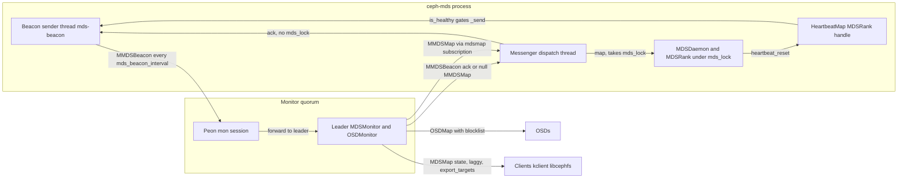
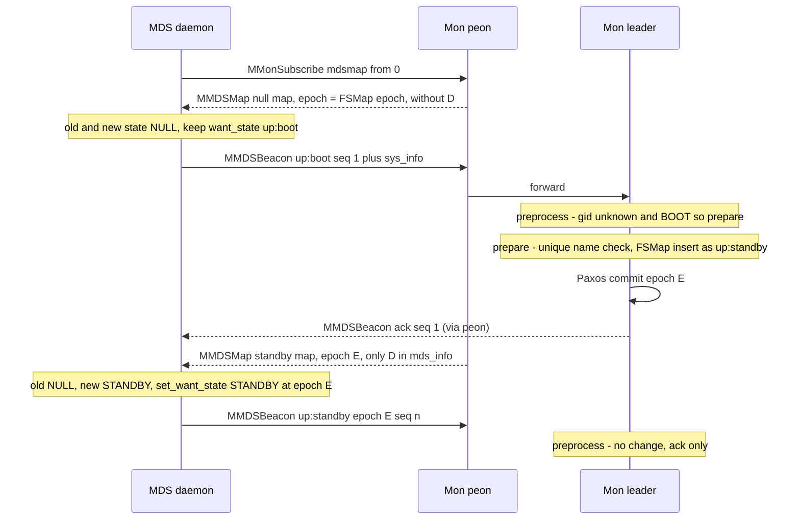
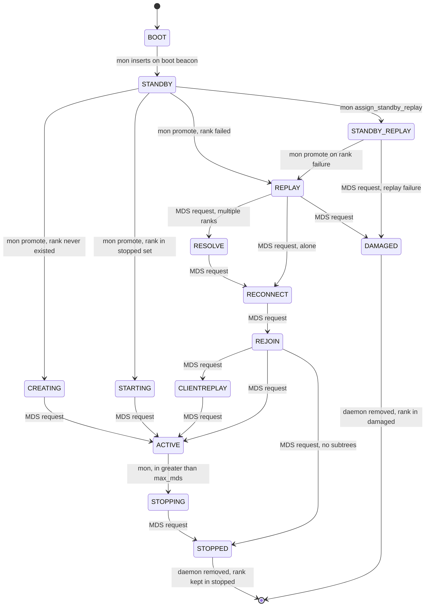
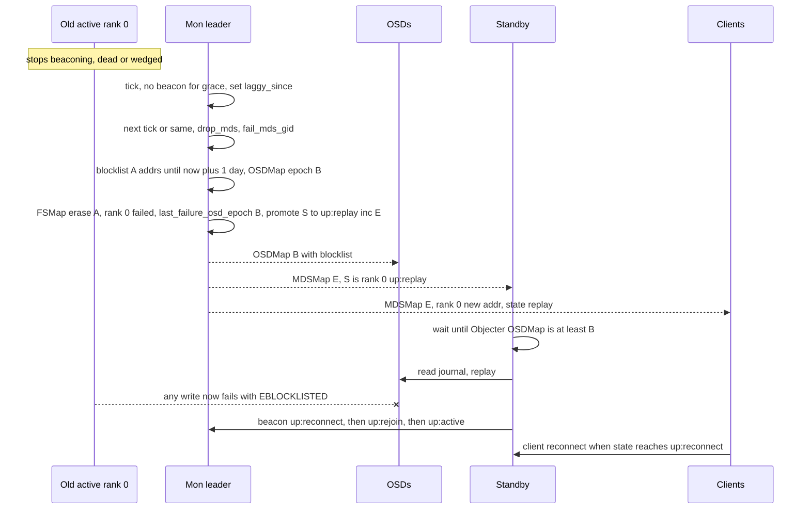

# Beacons and the MDSMonitor: membership, rank assignment, failover and fencing

> Part of the [C++ MDS project map](../README.md). Sources: `src/mds/Beacon.{h,cc}` (~700 LOC), `src/messages/MMDSBeacon.h` (~380), `src/messages/MMDSLoadTargets.h` (~70), `src/messages/MRemoveSnaps.h` (~60), `src/mon/MDSMonitor.{h,cc}` (~2780), `src/mds/MDSDaemon.cc` (boot, map, suicide, respawn paths: ~450 of 1330), `src/mds/MDSRank.cc` (`handle_mds_map`, `request_state`, `update_targets`, `damaged`, `evict_client`, `tick`: ~700 of 4380), `src/mds/FSMap.{h,cc}` (standby/rank bookkeeping: ~700), `src/mds/MDSMap.{h,cc}` (states, transition table, health checks: ~350), `src/mon/FSCommands.cc` (failover-related commands: ~450), `src/mds/SnapServer.cc` (`check_osd_map`), `src/mon/OSDMonitor.cc` (`blocklist`, `*_remove_snaps`).
> Related: [FSMap and MDSMap](fsmap-and-mdsmap.md), [auth and MDS caps](auth-and-mds-caps.md), [mgr, tools and orchestration](mgr-tools-and-orchestration.md), [process and threading](../00-architecture/process-and-threading.md), [mds_lock analysis](../00-architecture/mds_lock-analysis.md), [rank lifecycle and recovery](../09-recovery/rank-lifecycle-and-recovery.md), [resolve and rejoin](../09-recovery/resolve-and-rejoin.md), [RADOS and OSD interactions](../07-storage-formats/rados-and-osd-interactions.md), [subtree migration](../08-multi-mds/subtree-migration.md), [snapshots](../10-snapshots-quotas-subvolumes/snapshots.md), [quiesce](../12-qos-metrics-quiesce-quarantine/quiesce.md), [sessions](../02-client-protocol/sessions.md), [kclient expectations](../02-client-protocol/kclient-expectations.md), [libcephfs/fuse/Ganesha expectations](../02-client-protocol/libcephfs-fuse-ganesha-expectations.md), [admin commands](../13-admin-and-config/admin-commands.md), [config, perf counters and health](../13-admin-and-config/config-perf-counters-and-health.md).

## 1. Purpose and responsibilities

An MDS daemon never decides on its own which file system or rank it serves. The monitor-side `MDSMonitor` (a `PaxosService` owning the `FSMap`) is the only authority over:

- **Membership**: which daemons (identified by `mds_gid_t` = the daemon's MonClient global id) exist, whether they are standbys or attached to a file system (`fscid`), and their address vector.
- **Rank assignment**: which daemon holds which rank of which file system, and the initial state of a newly assigned rank (`up:creating`, `up:starting`, `up:replay`, `up:standby-replay`).
- **Liveness and failover**: detecting silent daemons (`laggy_since`), replacing them with standbys, and fencing the old instance by OSD blocklisting its addresses.
- **Cluster sizing**: growing/shrinking the number of active ranks towards `max_mds` (one rank at a time).
- **Health aggregation**: turning per-daemon health metrics carried in beacons into cluster health checks (`MDS_TRIM`, `MDS_SLOW_REQUEST`, ...).
- **Daemon metadata**: storing the `sys_info` map sent at boot (`ceph mds metadata`, `ceph versions`, mgr).

The MDS side (`Beacon`, `MDSDaemon`, `MDSRankDispatcher`) is responsible for:

- Sending an `MMDSBeacon` every `mds_beacon_interval` from a dedicated thread, carrying its *wanted* state, the epoch of the last MDSMap it has seen, a sequence number, its compat set, health metrics and (at boot) system metadata.
- Requesting the next rank state when it finishes a recovery phase (`request_state`), and adopting the state the monitor assigns.
- Suppressing beacons when its own internal heartbeat is unhealthy (so a wedged daemon is failed over), and deferring all work when it has not received a beacon ack for `mds_beacon_grace` (self-fencing).
- Reacting to MDSMap changes: becoming a standby, instantiating an `MDSRank`, respawning when removed, noticing peer failures/recoveries.
- Sending the few other messages/commands the MDS issues to the mons (`MMDSLoadTargets`, `MRemoveSnaps`, `osd blocklist add`, `fs set ... allow_multimds_snaps`).

## 2. Source map

| File | Class / function | Lines | Role |
|---|---|---|---|
| `src/mds/Beacon.h` | `class Beacon` | 45-114 | Beacon state, own `std::mutex`, sender thread |
| `src/mds/Beacon.cc` | `Beacon::Beacon` | 51-59 | Reads `mds_beacon_interval` once; compat = `MDSMap::get_compat_set_all()` |
| `src/mds/Beacon.cc` | `Beacon::init` | 78-113 | Starts the `mds-beacon` sender thread |
| `src/mds/Beacon.cc` | `Beacon::ms_dispatch2`, `handle_mds_beacon` | 115-163 | Ack processing (RTT, laggy clear) |
| `src/mds/Beacon.cc` | `Beacon::send`, `send_and_wait`, `_send` | 166-239 | Build and send `MMDSBeacon`; heartbeat gating |
| `src/mds/Beacon.cc` | `notify_mdsmap`, `_notify_mdsmap`, `set_want_state` | 244-295 | Epoch/want_state bookkeeping (atomic pair) |
| `src/mds/Beacon.cc` | `Beacon::is_laggy` | 261-276 | MDS-side lagginess (no ack for `mds_beacon_grace`) |
| `src/mds/Beacon.cc` | `Beacon::notify_health` | 303-573 | Computes all health metrics (under `mds_lock`) |
| `src/messages/MMDSBeacon.h` | `mds_metric_t`, `mds_metric_name`, `mds_metric_summary` | 38-121 | Metric ids and health-check codes/summaries |
| `src/messages/MMDSBeacon.h` | `MDSHealthMetric`, `MDSHealth` | 135-243 | Health payload encodings |
| `src/messages/MMDSBeacon.h` | `MMDSBeacon` | 246-382 | Message (v8, compat 6) |
| `src/messages/MMDSLoadTargets.h` | `MMDSLoadTargets` | 29-66 | Export-target set message |
| `src/mon/MDSMonitor.h` | `MDSMonitor` | 38-170 | `last_beacon`, `pending_daemon_health`, `pending_metadata` |
| `src/mon/MDSMonitor.cc` | `preprocess_beacon` | 408-564 | Read-only beacon fast path, ack/ignore/forward |
| `src/mon/MDSMonitor.cc` | `prepare_beacon` | 633-934 | State changes, boot insertion, DNE/DAMAGED/STOPPED, evictions |
| `src/mon/MDSMonitor.cc` | `_updated` | 961-981 | Reply after commit |
| `src/mon/MDSMonitor.cc` | `preprocess_offload_targets`, `prepare_offload_targets` | 566-593, 936-953 | `MMDSLoadTargets` |
| `src/mon/MDSMonitor.cc` | `encode_pending` | 236-344 | Health checks from metrics, quiesce leader, metadata cleanup |
| `src/mon/MDSMonitor.cc` | `fail_mds_gid` | 1377-1401 | Removal + blocklist (fencing) |
| `src/mon/MDSMonitor.cc` | `filesystem_command` | 1603-1831 | `mds fail/rm/rmfailed/repaired/freeze/set_state/compat` |
| `src/mon/MDSMonitor.cc` | `check_subs`, `check_sub` | 1833-1991 | `mdsmap`/`fsmap` subscriptions (what each MDS receives) |
| `src/mon/MDSMonitor.cc` | `maybe_resize_cluster` | 2144-2201 | Grow/shrink towards `max_mds` |
| `src/mon/MDSMonitor.cc` | `drop_mds` | 2207-2252 | Fail + promote replacement |
| `src/mon/MDSMonitor.cc` | `check_health` | 2254-2417 | Laggy detection, replacement, affinity |
| `src/mon/MDSMonitor.cc` | `maybe_promote_standby` | 2419-2475 | Fill failed ranks, assign standby-replay |
| `src/mon/MDSMonitor.cc` | `tick` | 2477-2582 | Leader periodic driver |
| `src/mds/FSMap.cc` | `get_available_standby`, `find_replacement_for` | 804-941 | Standby selection (affinity/anti-affinity scoring) |
| `src/mds/FSMap.cc` | `promote`, `assign_standby_replay`, `erase`, `damaged`, `undamaged`, `insert`, `stop` | 1006-1212 | Rank bookkeeping primitives |
| `src/mds/MDSMap.cc` | `state_transition_valid` | 1104-1144 | Legal state graph (used by mon and MDS) |
| `src/mds/MDSMap.cc` | `get_health_checks`, `check_health` | 540-624, 1146-1165 | FS-level health checks, `standby_count_wanted` default |
| `src/mds/MDSDaemon.cc` | `MDSDaemon::init` | 628-743 | MonClient auth, subscription, beacon start |
| `src/mds/MDSDaemon.cc` | `MDSDaemon::handle_mds_map` | 833-957 | Rankless handling, rank instantiation, removal → respawn |
| `src/mds/MDSDaemon.cc` | `MDSDaemon::suicide`, `respawn` | 972-1084 | DNE beacon, execv respawn |
| `src/mds/MDSRank.cc` | `MDSRankDispatcher::handle_mds_map` | 2294-2626 | Rank-level reaction to map changes |
| `src/mds/MDSRank.cc` | `request_state` and callers | 1603-1608, 1770-2291 | Requests next state via beacon |
| `src/mds/MDSRank.cc` | `update_targets`, `hit_export_target` | 611-667 | Sends `MMDSLoadTargets` |
| `src/mds/MDSRank.cc` | `MDSRank::damaged` | 945-960 | DAMAGED swan song |
| `src/mds/MDSRank.cc` | `evict_client` | 3951-4068 | `osd blocklist add` mon command |
| `src/mds/SnapServer.cc` | `check_osd_map`, `handle_remove_snaps` | 365-451 | `MRemoveSnaps` to/from mon |
| `src/mon/FSCommands.cc` | `FailHandler`, `FsNewHandler`, `set_val`, `RemoveFilesystemHandler`, `ResetFilesystemHandler`, `CompatSetHandler` | 84-1282 | Admin commands affecting membership |
| `src/mon/OSDMonitor.cc` | `OSDMonitor::blocklist`, `preprocess_remove_snaps`, `prepare_remove_snaps` | 4979-4991, 4386-4483 | Fencing and snap removal on the OSD side |

## 3. How it works

### 3.1 Actors, channels and timing at a glance

Default timing (all from config, see §5.3): beacon every 4 s (`mds_beacon_interval`), mon tick every 5 s (`mon_tick_interval`), laggy after 15 s without beacon (`mds_beacon_grace`), blocklist of a failed rank holder for 1 day (`mon_mds_blocklist_interval`).

### 3.2 Daemon start until the first beacon

1. `main` refuses an MDS id that is empty or starts with a digit (`src/ceph_mds.cc:146-150` (main)). The mon's `gid_from_arg` resolves a command argument as a role (only if that rank is up); otherwise, if the whole string parses as an integer it is tried only as a GID, and only a non-numeric string is looked up as a daemon name (`src/mon/MDSMonitor.cc:1407-1451` (MDSMonitor::gid_from_arg)), so a purely numeric name could never be resolved by name.
2. The public messenger is created as `entity_name_t::MDS(-1)` with a **random nonce** (`src/ceph_mds.cc:172` (main)); policies: mon `lossy_client`, MDS peers `lossless_peer`, clients `stateful_server` (`src/ceph_mds.cc:184-191` (main)). The same messenger is used for the mon session, so the address vector the mon records for the daemon is the one clients and peers connect to.
3. `MDSDaemon::init` registers `Beacon` as a head dispatcher with `PRIORITY_HIGH` and `MDSDaemon` with `PRIORITY_LOW` (`src/mds/MDSDaemon.cc:661-664` (MDSDaemon::init)), initialises the MonClient wanting service keys for MON, OSD, MDS and MGR (`:669`), authenticates (`:688`), waits for rotating keys (`rotating_keys_bootstrap_timeout`, up to `max_rotating_auth_attempts`, then suicide with `-ETIMEDOUT`) (`:697-711`), subscribes to `mdsmap` from epoch 0 (`:720-721`), sets up the admin socket, starts the timer, calls `beacon.init(*mdsmap)` (`:737`) and sets the messenger name to `mds.-1` (`:738`).
4. `MonClient::authenticate` also subscribes to `monmap` and `config` (`src/mon/MonClient.cc:638-639` (MonClient::authenticate)); `mds_join_fs` and all other options can therefore come from the mon config database.

The first beacon carries `want_state = up:boot` (initial value `src/mds/Beacon.h:103` (Beacon::want_state)) and the epoch of whatever MDSMap was received so far (possibly 0).

### 3.3 The MDS-side beacon engine

**State** (all under `Beacon::mutex`, `src/mds/Beacon.h:91-113` (Beacon)): `epoch` (last MDSMap epoch seen), `want_state`, `compat`, `last_seq`, `seq_stamp` (seq → send time), `last_acked_stamp`, `laggy`, `last_laggy`, `health`, `beacon_interval`.

**Sender loop** (`src/mds/Beacon.cc:84-112` (Beacon::init lambda)): thread named `mds-beacon`. Each iteration computes `since = now - last_send`; if `since >= 0.9 * beacon_interval` it calls `_send()`. If `_send()` refuses (unhealthy heartbeat) the next wait is 0.5 s; otherwise the wait is the full interval (or the remainder). The thread waits on `cvar`; acks notify it. A wait that times out right after a successful send logs `missed beacon ack from the monitors` and sets `missed_beacon_ack_dump` (used by `MDSRank::inmemory_logger` to dump recent logs, `src/mds/MDSRank.cc:4356-4370` (MDSRank::inmemory_logger)). `beacon_interval` is read only in the constructor (`src/mds/Beacon.cc:54` (Beacon::Beacon)): changing `mds_beacon_interval` at runtime does not affect a running MDS.

**`_send`** (`src/mds/Beacon.cc:198-239` (Beacon::_send)):

1. If `cct->get_heartbeat_map()->is_healthy()` is false, skip the beacon, log `Skipping beacon heartbeat to monitors ... MDS internal heartbeat is not healthy!`, set `missed_internal_heartbeat_dump`, return false (`:203-210`). This is how a process that is alive but wedged (for example `mds_lock` held too long) gets failed over: the only heartbeat worker in an MDS is the `MDSRank` handle (`src/mds/MDSRank.cc:505` (MDSRank::MDSRank); the MDS uses no `ThreadPool`, so a rankless standby is always "healthy"), reset with grace `mds_heartbeat_grace` (default 15 s) and **no suicide grace** "because the mon takes care of killing us (by blocklisting us) when we fail to send beacons" (`src/mds/MDSRank.cc:1359-1375` (MDSRank::heartbeat_reset)). `heartbeat_reset()` is called from the dispatch path, from `MDSContext` completion and inside long loops (CDir, MDCache, journal replay, OpenFileTable). The test option `heartbeat_inject_failure` forces `is_healthy()` false for the given number of seconds (`src/common/HeartbeatMap.cc:119-137`).
2. `++last_seq`, record `seq_stamp[last_seq] = now` (`:212-215`).
3. Assert `want_state != STATE_NULL` (`:217`).
4. Build `MMDSBeacon(fsid, gid = monc->get_global_id(), name, epoch, want_state, last_seq, CEPH_FEATURES_SUPPORTED_DEFAULT)`; set health, compat, `fs = mds_join_fs` (read on every send, so runtime changes apply immediately); if `want_state == up:boot` add `sys_info` from `collect_sys_info()` plus `sys_info["addr"] = stringify(monc->get_myaddrs())` (`:219-235`).
5. `monc->send_mon_message()` (`:236`). The MonClient queues messages while it has no mon session and flushes them when a session is (re)established (`src/mon/MonClient.cc:804-817` (MonClient::_send_mon_message), `:1024-1027` (session established)); in-flight messages on a dropped `lossy_client` connection are lost.

**Ack processing** (`src/mds/Beacon.cc:132-163` (Beacon::handle_mds_beacon)): only `MSG_MDS_BEACON` from a peer of type MON is accepted (`:118-122` (Beacon::ms_dispatch2)). The ack is matched by `seq` in `seq_stamp`; unknown seqs are discarded. `last_acked_stamp` becomes the **send time** of the acked beacon, `rtt = now - send time`; if the daemon was laggy and `rtt < mds_beacon_grace` it clears `laggy` and records `last_laggy = now`; all entries up to and including that seq are erased; waiters are woken. The ack's state and epoch fields are otherwise ignored (the state is only logged).

**Self-detected lagginess** (`src/mds/Beacon.cc:261-276` (Beacon::is_laggy)): true when `now - last_acked_stamp > mds_beacon_grace` (read at runtime). Note `last_acked_stamp` starts at zero, so a daemon is "laggy" until its first ack. Effects inside the MDS:

| Effect | Code |
|---|---|
| `MDSRankDispatcher::tick` returns immediately ("skipping upkeep work") — no session timeouts, no balancer, no log trim kick, no health refresh | `src/mds/MDSRank.cc:714-717` (MDSRankDispatcher::tick) |
| Every message reaching `MDSRank::_dispatch` is queued in `waiting_for_nolaggy` instead of handled (client and peer requests alike). Exception: quiesce-DB peer messages (`MSG_MDS_QUIESCE_DB_LISTING`/`_ACK`) are consumed by `quiesce_dispatch` before the laggy check | `src/mds/MDSRank.cc:1060-1081` (MDSRank::_dispatch), `src/mds/MDSRankQuiesce.cc:372` (MDSRank::quiesce_dispatch) |
| Deferred messages are replayed by the progress thread once not laggy | `src/mds/MDSRank.cc:1001-1013` (ProgressThread::entry), `:1337-1349` (MDSRank::_advance_queues) |
| Clients are not marked stale until `queue_max_age + session_timeout` seconds after the laggy state was cleared | `src/mds/Server.cc:1211-1227` (Server::find_idle_sessions) |

**`set_want_state(mdsmap, state)`** updates `epoch` and `want_state` under one lock acquisition so that a beacon never carries the new epoch together with a stale state (`src/mds/Beacon.cc:278-295` (Beacon::set_want_state)). This matters because the mon rejects (evicts) a daemon whose beacon reports the latest epoch but a state that is not a legal successor of the state the mon assigned (§3.5).

**`send_and_wait(duration)`** (`src/mds/Beacon.cc:173-192`): sends one beacon and waits up to `0.95*duration` for its ack; used for DNE (1 s, from `MDSDaemon::suicide`) and DAMAGED (`mds_mon_shutdown_timeout`, default 5 s, from `MDSRank::damaged`).

**`notify_health(mds)`** is called at the end of every non-laggy `MDSRankDispatcher::tick` (`src/mds/MDSRank.cc:801`; a laggy tick returns at `:714-717` before reaching it, so beacons keep carrying the last computed metrics) and from `MDSRank::damaged` (`:952`); it asserts `mds_lock` is held (`src/mds/Beacon.cc:312`), recomputes `health.metrics` from scratch (table in §3.12). A rankless standby never calls it (`MDSDaemon::tick` only ticks an existing `MDSRank`, `src/mds/MDSDaemon.cc:759-768`), so standbys report no metrics.

### 3.4 `MMDSBeacon` wire format

`MSG_MDS_BEACON = 100` (`src/msg/Message.h:162`), `HEAD_VERSION 8`, `COMPAT_VERSION 6` (`src/messages/MMDSBeacon.h:249-250`), priority `CEPH_MSG_PRIO_HIGH` (196) (`:272`, `:279`). Payload order (`src/messages/MMDSBeacon.h:314-333` (MMDSBeacon::encode_payload)):

| # | Field | Type | C++ MDS sends | Mon use |
|---|---|---|---|---|
| 1 | `version` (PaxosServiceMessage) | u64 | last MDSMap epoch seen (`get_last_epoch_seen()`) | Gate in `PaxosService::dispatch` (waits until committed FSMap ≥ version) and "seen latest map" check |
| 2 | `deprecated_session_mon` | s16 | -1 | ignored |
| 3 | `deprecated_session_mon_tid` | u64 | 0 | ignored |
| 4 | `fsid` | uuid (16 bytes) | cluster fsid | must equal monmap fsid, else ignored |
| 5 | `global_id` | u64 `mds_gid_t` | MonClient global id | the daemon identity (not cross-checked against the session in `MDSMonitor`) |
| 6 | `state` | u32 | `want_state` | requested state |
| 7 | `seq` | u64 | strictly increasing per process | stale detection (`state_seq > seq` → ignore) |
| 8 | `name` | string | daemon id (`mds.<id>` without prefix) | `mds_info_t::name`, unique-name enforcement |
| 9 | `standby_for_rank` | s32 | `MDS_RANK_NONE` (-1) | decoded and discarded |
| 10 | `standby_for_name` | string | "" | decoded and discarded |
| 11 | `compat` | `CompatSet` | `MDSMap::get_compat_set_all()` | stored at boot; any later change → eviction |
| 12 | `health` | `MDSHealth` | metrics | health checks |
| 13 | `sys_info` | map<string,string> | only present when `state == up:boot` | daemon metadata |
| 14 | `mds_features` | u64 | `CEPH_FEATURES_SUPPORTED_DEFAULT` | `mds_info_t::mds_features`, set at boot only (`src/mon/MDSMonitor.cc:716`); not interpreted by the mon. MDS daemons AND the features of all up daemons (`MDSMap::get_up_features`, `src/mds/MDSMap.cc:1220-1234`) to pick encodings of journal events, inode stores, session maps and migration payloads (`src/mds/MDLog.cc:430`, `src/mds/CInode.cc:1284`, `src/mds/SessionMap.cc:438`) |
| 15 | `standby_for_fscid` | s32 | `FS_CLUSTER_ID_NONE` (-1) | discarded |
| 16 | `standby_replay` | bool (v≥7) | false | discarded |
| 17 | `fs` | string (v≥8) | `mds_join_fs` | `mds_info_t::join_fscid` (resolved by name; unknown name → none) |

Decoding of v<7 beacons maps a requested `up:standby-replay` to `up:standby` (`src/messages/MMDSBeacon.h:368-372`).

Sub-encodings:

- `MDSHealth`: `ENCODE_START(1,1)` + `vector<MDSHealthMetric>` (`src/messages/MMDSBeacon.h:207-211`).
- `MDSHealthMetric`: `ENCODE_START(1,1)`, `u16 type` (must not be `MDS_HEALTH_NULL` = 0: `ceph_assert` on both encode and decode, so a beacon carrying type 0 aborts the monitor that decodes it), `u8 sev` (`HEALTH_ERR=0, HEALTH_WARN=1, HEALTH_OK=2`, `src/include/health.h:12-16`), `string message`, `map<string,string> metadata` (`src/messages/MMDSBeacon.h:142-164`). Equality used by the mon compares `type`, `sev` and `message` only, not `metadata` (`:187-190`).
- `CompatSet`: three `FeatureSet`s (compat, ro_compat, incompat), each `u64 mask` (bit 0 cleared on the wire) + `map<u64,string>` names; no version header (`src/common/CompatSet.cc:23-28`, `:73-77`).
- `sys_info` keys from `collect_sys_info` (`src/common/util.cc:233-384`): `ceph_version`, `ceph_version_short`, `ceph_release`, `os`, `kernel_version`, `kernel_description`, `hostname`, `arch`, `mem_total_kb`, `mem_swap_kb`, optional `mem_cgroup_limit`, `cpu`, `distro*` (from `/etc/os-release`), container keys `pod_name`, `container_name`, `container_image`, `container_hostname`, `pod_namespace` (from environment), plus `addr` added by `Beacon::_send`.

The **ack** is an `MMDSBeacon` built with `(fsid, gid, name, epoch, state = the beacon's state, seq = the beacon's seq, CEPH_FEATURES_SUPPORTED_DEFAULT)` and empty health/compat (`src/mon/MDSMonitor.cc:553-556` (preprocess_beacon), `:976-979` (_updated)). The epoch in an ack is the daemon's effective epoch on the preprocess path and the FSMap epoch on the `_updated` path; the MDS ignores both.

### 3.5 Mon-side processing pipeline

Routing: `Monitor::dispatch_op` sends `MSG_MDS_BEACON` and `MSG_MDS_OFFLOAD_TARGETS` to `paxos_service[PAXOS_MDSMAP]` (`src/mon/Monitor.cc:4921-4923`). `PaxosService::dispatch` (`src/mon/PaxosService.cc:48-152`):

1. Drops messages forwarded in an older election epoch and messages from disconnected sessions (`:62-80`).
2. **Waits until `is_readable(m->version)`**, i.e. the mon's committed FSMap epoch is ≥ the epoch claimed by the beacon (`:83-87`, `:558-564` (PaxosService::is_readable)).
3. `preprocess_query` → `MDSMonitor::preprocess_beacon`; if it returns true the op is finished (`:90-91`).
4. Peons forward to the leader (`mon.forward_request_leader`) (`:94-97`). All decisions are made by the leader; replies are routed back through the peon.
5. Waits for writeable, then `prepare_update` → `prepare_beacon` inside `paxos.plug()/unplug()` (`src/mon/MDSMonitor.cc:596-631` (MDSMonitor::prepare_update)), so FSMap and OSDMap changes made in the same call are committed in one Paxos transaction.
6. Proposes immediately if `force_immediate_propose()` was called (any blocklisting), otherwise after `PaxosService::should_propose` delay (`paxos_propose_interval` since last commit, at least `paxos_min_wait`) (`src/mon/PaxosService.cc:112-151`, `:194-208`).

Everything runs under `Monitor::lock` (`src/mon/Monitor.h:959-963` (Monitor::ms_dispatch)).

**`preprocess_beacon` decision table** (`src/mon/MDSMonitor.cc:408-564`), evaluated in order:

| # | Condition | Outcome | Beacon time noted (`_note_beacon`)? |
|---|---|---|---|
| 1 | no session, or session lacks `mds` cap `x` | ignore (`no_reply`) | no |
| 2 | `fsid` ≠ monmap fsid | ignore | no |
| 3 | source address port is 0 | ignore ("ignoring boot message without a port") | no |
| 4 | not leader | return false → forwarded | (by leader) |
| 5 | gid not in committed FSMap, state ≠ `up:boot` | reply with **null MMDSMap** (epoch = `UINT32_MAX`, no daemons) → a daemon that believed it was in the map respawns | no |
| 6 | gid not in committed FSMap, state = `up:boot`, gid already in pending | ignore | no |
| 7 | gid not in committed FSMap, state = `up:boot` | return false → `prepare_beacon` (boot) | (in prepare) |
| 8 | state = `down:dne` | return false → prepare (shutdown) | no |
| 9 | `info.state_seq > seq` | ignore ("old seq") | no |
| 10 | `version` ≠ effective epoch (standby: `standby_epochs[gid]`; ranked: that file system's `MDSMap` epoch) | ack only; requested state and health are **not** processed | yes |
| 11 | `info.laggy()` | return false → prepare (clears laggy) | yes |
| 12 | state = `up:boot` | ignore (already booted) | **no** |
| 13 | resolved `mds_join_fs` fscid ≠ `info.join_fscid` | return false → prepare | yes |
| 14 | state ≠ `info.state` | return false → prepare | yes |
| 15 | `pending_daemon_health[gid]` ≠ beacon health (type, sev, message) | return false → prepare | yes |
| 16 | otherwise | ack | yes |

**`prepare_beacon` decision table** (`src/mon/MDSMonitor.cc:633-934`):

| Case | Action | Reply |
|---|---|---|
| Always first | Log new/cleared metric types (cleared ones to the cluster log at INFO), store `pending_daemon_health[gid] = beacon health` (`:649-687`) | — |
| `up:boot` | If `mds_enforce_unique_name` (default true): every existing daemon with the same name is `fail_mds_gid`'d ("<name> restarted"), requiring a writeable OSDMap (retry otherwise) (`:692-708`). If gid not in pending: insert `mds_info_t{gid, name, addrs = message source addrs, mds_features, state = up:standby, state_seq = seq, compat, join_fscid}` via `FSMap::insert` (`:711-729`). Initialise `last_beacon[gid]`, store `sys_info` as metadata (`:732-736`) | ack after commit (`_updated`) |
| gid no longer in pending | — | null MMDSMap after commit |
| compat masks differ from the stored `info.compat` (`CompatSet::compare != 0`, `src/include/CompatSet.h:123-134`; names are not compared) | needs writeable OSDMap; clog WARN "compat changed unexpectedly", `fail_mds_gid` (`:755-764`) | none (the next beacon then gets a null map via rule 5) |
| `down:dne` | immediate ack (so `send_and_wait` returns), then evict (`:766-777`) | ack + null map |
| `info.state == up:standby` and state ≠ standby | "standby attempted to change state", evict (`:780-787`) | null map |
| `info.state == up:standby-replay` and state ∉ {standby-replay, `down:damaged`} | evict | null map |
| ranked daemon, state ≠ `info.state`, `!state_transition_valid(info.state, state)` | "reported invalid state transition", evict (`:788-796`) | null map |
| then (all surviving cases) | clear `laggy_since` if set (`:798-805`); set `join_fscid` (always, `modify_daemon`, `:812-821`) | — |
| `down:stopped` | clog "finished stopping rank"; `FSMap::stop(gid)` (rank → `stopped`, removes the daemon and every standby-replay of that rank); drop beacon/health state of all removed gids (`:823-841`) | null MMDSMap after commit (`_updated`, `:971-974`) |
| `down:damaged` | needs writeable OSDMap; blocklist the **rank holder's** addrs (even if the reporter is the standby-replay follower), fail the follower, `FSMap::damaged(rank holder)` (rank → `damaged`), force immediate propose (`:842-875`) | ack after commit |
| otherwise | clog "is now active" on first `up:active`; `info.state = state; info.state_seq = seq` (`:876-891`) | ack after commit |
| evict | needs writeable OSDMap; `fail_mds_gid(gid)`; `request_proposal(osdmon)` (`:909-921`) | null MMDSMap after commit |

Every non-boot beacon that survives the validations calls `modify_daemon` at least once, because `join_fscid` is rewritten unconditionally (`:819-821`); `modify_daemon` bumps that file system's `MDSMap` epoch (or the standby's `standby_epochs` entry) (`src/mds/FSMap.h:522-538` (FSMap::modify_daemon)). The boot path uses `FSMap::insert` (sets `standby_epochs[gid]`) and the evict paths use `FSMap::erase`, which also bump epochs. Consequently any beacon that reaches `prepare_beacon` (state change, **health change**, laggy clear, `mds_join_fs` change) produces a new FSMap epoch and a new MDSMap epoch that is pushed to every subscriber of that file system (all its MDS daemons and mounted clients).

### 3.6 Becoming a standby

`check_sub` treats a subscriber as an MDS only if its session entity is of type MDS, and then identifies it by exact equality of the session's address vector with some `mds_info_t::addrs` (`src/mon/MDSMonitor.cc:1902-1913` (MDSMonitor::check_sub)); a non-MDS session is served the legacy or `mdsmap.<fscid>` client view instead. A standby receives a synthetic map: `create_null_mdsmap()` with only its own `mds_info_t` and `epoch = standby_epochs[gid]` (`:1955-1968`); a daemon with a rank (including standby-replay) receives its file system's real `MDSMap` (`:1969-1972`); an MDS not in the FSMap receives an empty map with `epoch = FSMap epoch`. Subscriptions to `mdsmap`/`fsmap` require mon cap `mds r` (`src/mon/Monitor.cc:5560-5566` (Monitor::handle_subscribe)).

On the MDS, `MDSDaemon::handle_mds_map` treats a rankless `up:standby` after `NULL` as "Monitors have assigned me to become a standby" and sets `want_state = up:standby` (`src/mds/MDSDaemon.cc:906-920`). Until then `want_state` stays `up:boot`. If a daemon keeps sending `up:boot` after having seen its standby epoch, rule 12 of the preprocess table ignores the beacon **without noting liveness**, so the mon will mark it laggy and remove it.

### 3.7 The daemon/rank state machine

Not drawn: `fail_mds_gid` (§3.10) can remove a daemon from any state; its rank then becomes `failed`, except `up:creating` (rank forgotten, recreated later) and `up:starting` (rank returned to `stopped`). Any ranked state may also request `down:damaged`.

Who drives which edge:

| Edge | Driver | Where |
|---|---|---|
| boot → standby | mon, on `up:boot` beacon | `src/mon/MDSMonitor.cc:690-736` (prepare_beacon) |
| standby → creating/starting/replay | mon tick or `fs new` | `src/mds/FSMap.cc:1036-1046` (FSMap::promote) |
| standby → standby-replay | mon tick | `src/mds/FSMap.cc:1066-1090` (FSMap::assign_standby_replay) |
| standby-replay → replay | mon (replacement) | `src/mds/FSMap.cc:1022-1046` (FSMap::promote) |
| replay → resolve/reconnect | MDS `request_state`: reconnect if `num_in_mds == 1 && num_failed == 0`, else resolve | `src/mds/MDSRank.cc:1958-1967` (MDSRank::replay_done) |
| resolve → reconnect | MDS | `src/mds/MDSRank.cc:1988-1994` (MDSRank::resolve_done) |
| reconnect → rejoin | MDS | `src/mds/MDSRank.cc:2031-2035` (MDSRank::reconnect_done) |
| rejoin → active / clientreplay / stopped | MDS: stopped if the cache holds no subtree (rank 0 with more than one journal event reports damaged instead); active if no replay queue and no pending reclaim; else clientreplay | `src/mds/MDSRank.cc:2048-2081` (MDSRank::rejoin_done) |
| clientreplay → active | MDS after `mdlog->wait_for_safe` | `src/mds/MDSRank.cc:2107-2127` (maybe_clientreplay_done, clientreplay_done) |
| creating → active, starting → active | MDS | `src/mds/MDSRank.cc:2181-2187` (creating_done), `:1770-1778` (starting_done) |
| active → stopping | mon tick | `src/mon/MDSMonitor.cc:2183-2193` (maybe_resize_cluster) |
| stopping → stopped | MDS when `shutdown_pass()` and purge queue drained | `src/mds/MDSRank.cc:773-798` (tick), `:2286-2292` (stopping_done) |
| any → damaged | MDS `MDSRank::damaged()` | `src/mds/MDSRank.cc:945-960` |

`request_state(s)` sets `want_state` (with the current epoch) and sends a beacon immediately (`src/mds/MDSRank.cc:1603-1608`). The periodic beacons re-send the same wanted state, so a lost request is retried every interval; the mon processes it only once the beacon's epoch equals the daemon's current effective epoch (rule 10).

`MDSMap::state_transition_valid(prev, next)` (`src/mds/MDSMap.cc:1104-1144`) — identical rules are applied by the mon to beacon requests (§3.5) and by the MDS to the states the mon assigns (`src/mds/MDSRank.cc:2328-2332` (handle_mds_map), invalid → respawn):

| prev | allowed next (besides `prev` itself and `down:damaged`) |
|---|---|
| `up:boot` | `up:standby` |
| `up:standby` | `up:standby-replay`, `up:replay`, `up:creating`, `up:starting` |
| `up:creating`, `up:starting` | `up:active` |
| `up:standby-replay` | `up:replay` |
| `up:replay` | `up:resolve`, `up:reconnect` |
| `up:resolve`, `up:reconnect`, `up:clientreplay` | `prev + 1` (resolve→reconnect, reconnect→rejoin, clientreplay→active) |
| `up:rejoin` | `up:clientreplay`, `up:active`, `down:stopped` |
| `up:active` | `up:stopping` |
| `up:stopping` | `down:stopped` |
| anything else | none (logged "Unknown prev state") |

State numeric values (`src/include/ceph_fs.h:306-325`): `dne 0`, `stopped -1`, `boot -4`, `standby -5`, `creating -6`, `starting -7`, `standby-replay -8`, `replayonce -9` (legacy, unused), `null -10`, `replay 8`, `resolve 9`, `reconnect 10`, `rejoin 11`, `clientreplay 12`, `active 13`, `stopping 14`, `damaged 15`. String names (`up:active`, ...) come from `ceph_mds_state_name` (`src/common/ceph_strings.cc:242-268`) and appear in `fs dump` JSON consumed by cephadm.

Note what the mon does **not** validate: cluster-wide preconditions (whether resolve/rejoin of other ranks finished, whether the rank is alone) are entirely MDS-internal; the mon accepts any edge of the graph above. There is no mon-side timeout on how long a rank may stay in a state; only beacon liveness is policed.

### 3.8 Rank assignment in `MDSMonitor::tick`

`Monitor::tick` runs every `mon_tick_interval` (5 s) and calls each service's `tick` (`src/mon/Monitor.cc:6171-6225`). `MDSMonitor::tick` (`src/mon/MDSMonitor.cc:2477-2582`) first maintains the in-memory FSMap history used by `mds last-seen`, returns unless active leader, then under `paxos.plug()` (after a check, at most every 30 s, that forces a proposal so old versions get trimmed while the oldest stored FSMap still decodes as an old struct version, `:2522-2553`):

1. `FSMap::check_health()` → per fs `MDSMap::check_health`: if `standby_count_wanted == -1` (default), at least one active rank and at least one standby or standby-replay exist, set it to 1 (`src/mds/MDSMap.cc:1146-1165`).
2. `check_health()` — liveness, replacement and affinity (§3.9).
3. `maybe_resize_cluster()` for each fs (§ below).
4. `maybe_promote_standby()` for each fs.
5. `request_proposal(osdmon)` if any blocklist happened; `paxos.unplug()`; `propose_pending()` if anything changed (immediate, not delayed).

**`FSMap::promote(gid, fscid, rank)`** (`src/mds/FSMap.cc:1006-1064`): moves a standby into the file system (or reuses a standby-replay of that rank); if the daemon compat has incompat or ro_compat features the fs compat lacks (`!fs.compat.writeable(daemon.compat)`; `a.writeable(b)` means a ⊇ b, `src/include/CompatSet.h:103-112`) it asserts the fs is upgradeable and merges the daemon compat into the fs compat; chooses the initial state: rank in `stopped` → `up:starting` (removed from stopped); rank not in `in` → `up:creating`; else `up:replay` (removed from `failed`). Sets `rank`, `inc = FSMap epoch` (the incarnation), adds the rank to `in` and `up`, and bumps the MDSMap epoch.

**Standby selection** (`src/mds/FSMap.cc:804-873` (FSMap::get_available_standby)): considers only `standby_daemons` that are not laggy and not frozen, whose compat can write the fs compat (daemon ⊇ fs on incompat and ro_compat), and (unless `fs.is_upgradeable()`) whose compat the fs compat can write (fs ⊇ daemon, so no compat merge is needed). Scores, higher wins, scan stops at the first perfect match:

| join_fscid vs fs | different host from `avoid_addrs` | same host |
|---|---|---|
| equals this fscid | 6 `SCORE_PREF_MATCH` | 3 `SCORE_FALLBACK_MATCH` |
| none (`mds_join_fs` unset) | 5 `SCORE_PREF_VANILLA` | 2 `SCORE_FALLBACK_VANILLA` |
| another fs (only if fs flag `refuse_standby_for_another_fs` is off) | 4 `SCORE_PREF_OTHER_FS` | 1 `SCORE_FALLBACK_OTHER_FS` |

Host comparison uses `info.addrs.front().is_same_host(...)` and is active only when the fs setting `standby_enable_host_anti_affinity` is true (default true, `src/mds/MDSMap.h:630`). `Filesystem::is_upgradeable()` is true when no rank is in, or standby-replay is disallowed and (exactly one rank in, or no rank up) (`src/mds/FSMap.h:207-218`).

**`find_replacement_for(role)`** (`src/mds/FSMap.cc:907-941`): a standby-replay daemon following that rank wins (returns nothing if it is frozen); otherwise `get_available_standby` with `avoid_addrs` = the current holder's addrs if the rank is still up (anti-affinity for hot replacement), none if already failed.

**`maybe_resize_cluster`** (`src/mon/MDSMonitor.cc:2144-2201`): acts only if both the committed and the pending MDSMap are `is_resizeable()` (not degraded, no `creating`/`starting`/`stopping` daemon, `src/mds/MDSMap.h:460-465`):
- `in < max_mds` and fs joinable: pick the lowest rank not `is_in` (holes first), find a replacement, `promote` → `up:creating` or `up:starting`; clog "assigned to filesystem ... as rank". One rank per tick, and because a creating/starting rank makes the map non-resizeable, ranks are added strictly one after the other.
- `in > max_mds`: if rank `in-1` is `up:active`, set it to `up:stopping` (clog "stopping"). One rank at a time for the same reason (`up:stopping` blocks resizing).

**`maybe_promote_standby`** (`src/mon/MDSMonitor.cc:2419-2475`): returns if the fs is not joinable; for each rank in `failed`, `find_replacement_for` and `promote` (→ `up:replay`, clog "Standby ... assigned to filesystem ... as rank"). Then, if the map is resizeable and `allow_standby_replay` is set, repeatedly assigns an available standby (anti-affinity against the followed rank's host) to each `is_followable` rank (up, not in `replay..clientreplay`, no standby-replay yet) until none can be assigned.

`fs new` also promotes standbys directly for ranks `0..max_mds-1` in the same pending map (`src/mon/FSCommands.cc:342-353` (FsNewHandler::handle)), unless `--recover` (which creates rank 0 as in+failed and the fs not joinable, `src/mds/FSMap.cc:485-492` (FSMap::create_filesystem)).

### 3.9 Laggy detection and replacement policy

`MDSMonitor::check_health` (`src/mon/MDSMonitor.cc:2254-2417`), leader only, every tick:

1. **Mon slowness guard**: if more than `mds_beacon_grace - mds_beacon_interval` (default 11 s) passed since the previous tick, every `last_beacon` stamp is reset to now ("resetting beacon timeouts due to mon delay (slow election?)") (`:2266-2279`). `on_restart` clears `last_beacon` entirely (`:2590-2595`); every gid in the FSMap without a stamp gets `now` (`:2282-2286`). A new leader therefore grants every daemon a full grace period.
2. **`may_replace`** = some beacon (from any MDS) arrived within `max(mds_beacon_interval, 0.5 * mds_beacon_grace)` (default 7.5 s) (`:2291-2297`). Protects against the leader being cut off from all MDS daemons.
3. For each tracked gid with `now - stamp >= mds_beacon_grace` (`:2306-2348`):
   - If a mon is down (`quorum < monmap size`) or the quorum is younger than `mds_beacon_mon_down_grace` (60 s), and `since_last < mds_beacon_mon_down_grace`: do nothing yet (`:2322-2329`).
   - If not yet laggy: set `laggy_since = now` (wall clock) → proposal (clients now see the rank as laggy).
   - If the OSDMap is writeable and `may_replace`: queue for `drop_mds`.
4. `drop_mds(gid, rep)` (`:2207-2252`), `rep = find_replacement_for(rank)` for rank holders:
   - frozen (`mds freeze`) → nothing;
   - `up:standby` or `up:standby-replay` → `fail_mds_gid` (removed, **not** blocklisted);
   - rank holder with a replacement and fs joinable → clog WARN "Replacing ... as rank R with standby ...", `fail_mds_gid` (blocklist) + `promote(rep)`;
   - otherwise (no standby, or fs not joinable) → nothing: the daemon stays in the map flagged laggy until it beacons again (laggy cleared in prepare) or a standby appears (re-evaluated every tick).
   - On success clog INFO "MDS ... is removed because it is dead or otherwise unavailable."
5. **Affinity rebalancing** (only with writeable OSDMap, joinable and resizeable fs) (`:2365-2415`): for each daemon of the fs with `join_fscid != fscid`, find a candidate (standby-replay: `get_available_standby` avoiding the followed host; active: `find_replacement_for`); if none, stop scanning this fs; if the candidate has better affinity (exact match, or vanilla when the daemon prefers another fs) replace it: a standby-replay is simply failed (re-assigned later by `maybe_promote_standby`), an active is `drop_mds`'d (failover of a healthy active). At most one replacement per fs per tick.

Typical detection-to-replacement time with defaults: 15-20 s (grace + tick granularity), plus Paxos commit, plus the replacement's own recovery.

### 3.10 Failover and fencing

`MDSMonitor::fail_mds_gid(fsmap, gid)` (`src/mon/MDSMonitor.cc:1377-1401`) is the main removal primitive (used by `drop_mds`, prepare evictions, the standby-replay follower in the DAMAGED path, affinity swaps, `mds fail`, `fs fail`, `fs rm`, `allow_standby_replay false`, unique-name enforcement). Removals that bypass it: `mds rm` (`FSMap::erase(gid, 0)` directly, `:1701`), `down:stopped` (`FSMap::stop`) and the rank holder in the `down:damaged` path (`FSMap::damaged`, after an explicit `blocklist`).

1. Asserts the OSDMap is writeable (callers retry otherwise).
2. If `info.rank >= 0 && info.state != up:standby-replay`: `OSDMonitor::blocklist(info.addrs, now + mon_mds_blocklist_interval)` and `force_immediate_propose()`. `OSDMonitor::blocklist` adds **every address of the daemon's address vector** to `pending_inc.new_blocklist` with type `TYPE_ANY` (for `require_osd_release >= nautilus`, else `TYPE_LEGACY`) and returns `pending_inc.epoch`, the OSDMap epoch that will carry the entry (`src/mon/OSDMonitor.cc:4979-4991`). Entries are exact `ip:port/nonce` instances, so a restarted daemon (new random nonce) is not affected.
3. `FSMap::erase(gid, blocklist_epoch)` (`src/mds/FSMap.cc:1092-1127`): standby → removed. Daemon in a fs and not standby-replay: `up:creating` → rank removed from `in` (will be created again); `up:starting` → rank removed from `in` and put back in `stopped`; otherwise rank added to `failed`; `up` entry erased. In all fs cases, standby-replay included, `last_failure_osd_epoch = blocklist_epoch` (0 when nothing was blocklisted, `:1121`) and the MDSMap epoch is bumped; see §8 for the consequence.
4. Drops `last_beacon` and health state of the gid.

The OSDMap proposal is requested by the caller (`request_proposal(mon.osdmon())` or `osdmon()->propose_pending()`); because MDSMonitor calls happen under `paxos.plug()`, the FSMap epoch that removes the daemon and the OSDMap epoch that blocklists it are committed in the same Paxos transaction.

The replacement waits for an OSDMap ≥ `last_failure_osd_epoch` before replay (`src/mds/MDSRank.cc:1803-1818` (MDSRank::replay_start)) and before the final takeover pass of a standby-replay daemon (`:1872-1893` (MDSRank::standby_replay_restart)). The old instance stops when it sees itself removed from the MDSMap (respawn, §3.16) or when a RADOS write returns `-EBLOCKLISTED` (`src/mds/MDSRank.cc:973-979` (MDSRank::handle_write_error), `src/mds/MDLog.cc:128-129`). Separately, while it receives no beacon acks it defers all requests (§3.3).

Clients detect the takeover by the address change of the rank in the MDSMap: the kernel client closes the session and marks it `RESTARTING`, then sends a reconnect when the rank reaches `up:reconnect` or later (`linux/fs/ceph/mds_client.c:5895-5928` (check_new_map)); libcephfs marks the connection down when addrs change (treating an incarnation change as state NULL) and reconnects in `up:reconnect` (`src/client/Client.cc:3388-3410` (Client::handle_mds_map)).

What is **not** blocklisted: standbys, standby-replay daemons (they never write metadata), daemons that report `down:stopped`.

### 3.11 Voluntary exits and special states

| Trigger | MDS side | Mon side | Result |
|---|---|---|---|
| SIGINT/SIGTERM, asok `exit` | `MDSDaemon::suicide`: `set_want_state(DNE)`, release `mds_lock`, if still in its map `send_and_wait(1)`, shut down beacon, mgr client, rank (`src/mds/MDSDaemon.cc:972-1019`) | prepare: ack immediately, then evict → `fail_mds_gid` (blocklist if rank holder) (`src/mon/MDSMonitor.cc:766-777`) | rank becomes failed immediately (no grace wait); replacement on next tick |
| `max_mds` decreased / `fs set down true` | `stopping_start` exports subtrees; when `shutdown_pass()` and purge queue drained, `request_state(STOPPED)`; on single-rank fs all client sessions are evicted first (`src/mds/MDSRank.cc:2252-2284`) | mon sets `up:stopping` on rank `in-1`; on `down:stopped`, `FSMap::stop` | rank in `stopped`, daemon removed, null map → MDS respawns as a new standby |
| unrecoverable metadata damage, or standby-replay failing to replay | `MDSRank::damaged`: `set_want_state(DAMAGED)`, flush clog, `notify_health`, `send_and_wait(mds_mon_shutdown_timeout)` **while holding `mds_lock`**, then respawn (`src/mds/MDSRank.cc:945-960`) | blocklist rank holder, fail standby-replay follower, `FSMap::damaged` (`src/mon/MDSMonitor.cc:842-875`) | rank in `damaged`; not reassigned until `mds repaired` |
| asok `respawn`, invalid transition seen, removed from map, write `-EBLOCKLISTED`, standby-replay fell behind the trimmed journal | `MDSDaemon::respawn`: dumps recent log, `execv(/proc/self/exe)` (`src/mds/MDSDaemon.cc:1021-1084`); `mds_valgrind_exit` → `_exit(0)` | nothing until the new process boots: its BOOT beacon (new gid, same name) fails the old gid via unique-name enforcement (blocklist if it still held a rank), or the old gid times out | new standby |

### 3.12 Health metrics → health checks

The MDS computes metrics on every non-laggy tick of a rank (`src/mds/Beacon.cc:303-573` (Beacon::notify_health)). "Summarised" means that when more than `mds_health_summarize_threshold` (10) per-client metrics exist, one `_MANY` metric with `metadata.client_count` replaces them. The ids in parentheses are the on-wire `mds_metric_t` values (enum order, `src/messages/MMDSBeacon.h:38-57`).

| `mds_metric_t` (u16 id) → health code | Sev | MDS-side trigger | Metadata |
|---|---|---|---|
| `MDS_HEALTH_TRIM` (1) → `MDS_TRIM` | WARN | `segments > mds_log_max_segments (128) * mds_log_warn_factor (2)` (`src/mds/MDLog.cc:703-705`); message "Behind on trimming (N/M)" | `num_segments`, `max_segments` |
| `MDS_HEALTH_CLIENT_LATE_RELEASE` (3) / `_MANY` (5) → `MDS_CLIENT_LATE_RELEASE[_MANY]` | WARN | a client's oldest revoking cap older than the MDSMap `session_timeout` (`src/mds/Locker.cc:4379-4404`) | `client_id` / `client_count` |
| `MDS_HEALTH_CLIENT_RECALL` (2) / `_MANY` (4) → `MDS_CLIENT_RECALL[_MANY]` | WARN | `recall_caps > mds_recall_warning_threshold (256K)` and `num_caps > mds_min_caps_working_set (10000)` | `client_id` / `client_count` |
| `MDS_HEALTH_CLIENT_OLDEST_TID` (6) / `_MANY` (7) → `MDS_CLIENT_OLDEST_TID[_MANY]` | WARN | trim warnings and completed requests/flushes ≥ `mds_max_completed_requests`/`_flushes` (100000) | `client_id` / `client_count` |
| `MDS_HEALTH_DAMAGE` (8) → `MDS_DAMAGE` | ERR | `DamageTable` not empty | — |
| `MDS_HEALTH_READ_ONLY` (9) → `MDS_READ_ONLY` | WARN | `mdcache->is_readonly()` | — |
| `MDS_HEALTH_SLOW_REQUEST` (10) → `MDS_SLOW_REQUEST` | WARN | OpTracker slow ops (> `mds_op_complaint_time`, 30 s) (`src/mds/MDSRank.cc:3870-3884`) | — |
| `MDS_HEALTH_SLOW_METADATA_IO` (12) → `MDS_SLOW_METADATA_IO` | WARN | an `MDSIOContextBase` in flight longer than `osd_op_complaint_time` (30 s) | — |
| `MDS_HEALTH_CACHE_OVERSIZED` (11) → `MDS_CACHE_OVERSIZED` | WARN | cache size > `mds_cache_memory_limit (4G) * mds_health_cache_threshold (1.5)` (`src/mds/MDCache.h:249-251`) | — |
| `MDS_HEALTH_CLIENTS_LAGGY` (13) / `_MANY` (14) → `MDS_CLIENTS_LAGGY[_MANY]` | WARN | `defer_client_eviction_on_laggy_osds` and some OSD laggy and laggy clients exist | `client_count` for MANY |
| `MDS_HEALTH_CLIENTS_BROKEN_ROOTSQUASH` (15) → `MDS_CLIENTS_BROKEN_ROOTSQUASH` | ERR | sessions with broken root_squash (summarised into the same type) | `client_id` / `client_count` |
| `MDS_HEALTH_ESTIMATED_REPLAY_TIME` (16) → `MDS_ESTIMATED_REPLAY_TIME` | WARN | in `up:replay` for more than 30 s (hard-coded) | — |
| `MDS_HEALTH_DUMMY` (17) → `MDS_DUMMY` | ERR | `mds_inject_health_dummy` | no health check is raised (skipped in `encode_pending`), but it is stored and counts for `has_any_health_warning` |

Mon side (`src/mon/MDSMonitor.cc:276-343` (MDSMonitor::encode_pending)): for every daemon in the pending FSMap, its latest health (from `pending_daemon_health`, else from the mon store key `mds_health/<gid>`) is turned into checks: code = `mds_metric_name(type)`, severity = metric severity (the last one added wins for a shared code), summary = `mds_metric_summary(type)`, one detail line per metric: `mds.<name>(mds.<rank>): <message> key: value, ...`. Then the FS-level checks are merged (`FSMap::get_health_checks`, `src/mds/FSMap.cc:601-646`; `MDSMap::get_health_checks`, `src/mds/MDSMap.cc:540-624`): `MDS_DAMAGE` (ERR, damaged ranks), `FS_DEGRADED` (WARN), `MDS_UP_LESS_THAN_MAX` (WARN, `in < max_mds`), `MDS_ALL_DOWN` (ERR, no rank up and `max_mds > 0`), `MULTIMDS_WITH_OLDSNAPS` (ERR), `FS_INLINE_DATA_DEPRECATED` (WARN), `FS_WITH_FAILED_MDS` (WARN, failed ranks without any available replacement), `MDS_INSUFFICIENT_STANDBY` (WARN, fewer standbys plus standby-replays than `standby_count_wanted`). Placeholders `%num%`, `%plurals%`, `%isorare%`, `%hasorhave%` are substituted using the detail count. Health detail is persisted per gid under `mds_health/<gid>` on every proposal and erased when the gid is removed through `fail_mds_gid` or `down:stopped` (`mds rm` leaves it behind).

Health metrics also gate admin commands: `mds fail` and `fs fail` return `-EPERM` with `errmsg_for_unhealthy_mds` if any target reports `MDS_HEALTH_TRIM` or `MDS_HEALTH_CACHE_OVERSIZED`, unless `--yes-i-really-mean-it` (`src/mon/MDSMonitor.cc:1661-1665`, `src/mon/FSCommands.cc:124-129`, text in `src/mon/FSCommands.h:104-108`); `fs set max_mds` requires confirmation if **any** daemon reports any metric (`src/mon/FSCommands.cc:396-403`, `src/mon/MDSMonitor.cc:1596-1601` (has_any_health_warning)).

### 3.13 Admin and orchestrator commands that change membership

| Command (mon) | Effect on daemons | Code |
|---|---|---|
| `mds fail <role\|gid\|name> [--yes-i-really-mean-it]` | `fail_mds_gid` (blocklist if rank holder); replacement on next tick; returns 0 even if the target does not exist | `src/mon/MDSMonitor.cc:1637-1677`, `:1453-1475` (fail_mds) |
| `fs fail <fs> [--yes-i-really-mean-it]` | set `NOT_JOINABLE`, `fail_mds_gid` every daemon of the fs (including standby-replay, which is not blocklisted); every held rank becomes failed (a `creating` rank is forgotten, a `starting` rank returns to `stopped`) and nothing is promoted until the fs is joinable again | `src/mon/FSCommands.cc:84-148` |
| `fs set <fs> joinable <bool>` (`cluster_down` deprecated inverse) | toggles `NOT_JOINABLE`: while not joinable there is no promotion of failed ranks and no standby-replay assignment (`maybe_promote_standby` returns early), no resize growth (shrinking to `max_mds` still proceeds), no replacement of laggy rank holders, no affinity swaps; laggy standbys and standby-replays are still removed | `src/mon/FSCommands.cc:643-674`, `src/mon/MDSMonitor.cc:2165`, `:2228`, `:2422` |
| `fs set <fs> max_mds <n>` | clears `NOT_JOINABLE`, sets `max_mds`; tick grows/shrinks one rank at a time | `src/mon/FSCommands.cc:434-463` |
| `fs set <fs> down <bool>` | `max_mds = 0` (saving `old_max_mds`) → all ranks stopped one by one; `false` restores | `src/mon/FSCommands.cc:610-642` |
| `fs set <fs> allow_standby_replay false` | fails every standby-replay daemon (no blocklist) | `src/mon/FSCommands.cc:728-763` |
| `fs set <fs> standby_count_wanted <n>`, `standby_enable_host_anti_affinity`, `refuse_standby_for_another_fs` | standby health and selection policy | `src/mon/FSCommands.cc:675-699`, `:823-852` |
| `mds repaired <role>` | rank `damaged` → `failed`; assigned on next tick | `src/mon/MDSMonitor.cc:1769-1791`, `src/mds/FSMap.cc:1146-1158` |
| `fs reset <fs>` (no rank up) | replaces the MDSMap: rank 0 `in` and `failed`, other previously used ranks `stopped`, compat = default, flags default, `max_mds = 1` | `src/mon/FSCommands.cc:1239-1282`, `src/mds/FSMap.cc:540-571` |
| `fs rm <fs>` (no rank up) | fails remaining standby-replay daemons, erases the fs | `src/mon/FSCommands.cc:1160-1237` |
| `fs new` | promotes standbys to `up:creating` for ranks `0..max_mds-1` | `src/mon/FSCommands.cc:342-353` |
| `fs compat <fs> add_incompat/...` (no rank up) | edits the fs compat that daemons must satisfy | `src/mon/FSCommands.cc:861-964` |
| `mds rm <gid>` | erase a non-active (state ≤ 0) daemon without blocklist | `src/mon/MDSMonitor.cc:1678-1704` |
| `mds rmfailed <role> --yes-i-really-mean-it` (hidden) | erase a rank from `failed` | `src/mon/MDSMonitor.cc:1705-1738` |
| `mds freeze <role\|gid> <bool>` (hidden) | `FROZEN` flag: never dropped, never selected, frozen standby-replay blocks replacement | `src/mon/MDSMonitor.cc:1792-1825` |
| `mds set_state <gid> <n>` (hidden; the descriptor's 0..20 range is checked only by the CLI, the mon does not validate arguments) | writes `info.state` directly through `modify_daemon`; on a standby gid this trips `ceph_assert(info.state == STATE_STANDBY)` in `FSMap::modify_daemon` and aborts the leader (code reading, not tested) | `src/mon/MDSMonitor.cc:1616-1636`, `src/mds/FSMap.h:526-530`, `src/mon/MonCommands.h:350-353` |
| `mds ok-to-stop <ids...>` | `-EBUSY` if any fs is degraded, or if the remaining standbys (standbys minus those being stopped) are fewer than the rank holders being stopped that have no standby-replay left (a holder whose standby-replay is not stopped needs no standby; standby-replay daemons themselves are ignored); unknown ids are skipped | `src/mon/MDSMonitor.cc:1090-1140` |
| `mds last-seen <name>` | seconds since the daemon was last in an FSMap (0 if in the latest), from in-memory history (`mon_fsmap_prune_threshold`) | `src/mon/MDSMonitor.cc:1044-1089` |
| `mds metadata [who]`, `mds versions`, `mds count-metadata <field>` | read the stored `sys_info` | `src/mon/MDSMonitor.cc:1176-1230` |

cephadm sets `mds_join_fs = <service_id>` for every MDS service it deploys and provisions keys with `mon 'profile mds' osd 'allow rw tag cephfs *=*' mds 'allow'` (`src/pybind/mgr/cephadm/services/cephadmservice.py:1505-1528` (MdsService.config, prepare_create)); its upgrade path disables standby-replay, reduces `max_mds` to 1 (or uses `fs fail`) and waits for `up:active` in `fs dump` (`src/pybind/mgr/cephadm/upgrade.py:1431-1530` (_prepare_for_mds_upgrade)).

### 3.14 Export targets (`MMDSLoadTargets`)

- MDS: every hit on a peer rank during export (`Migrator::export_dir` and the export handshake handlers, `src/mds/Migrator.cc:992`, `:1371`, `:1630`, `:1761`, `:2062`, `:2266`) feeds a `DecayCounter` per rank (`mds_bal_target_decay`, default 10) (`src/mds/MDSRank.cc:653-667` (hit_export_target)). On each tick while active or stopping, `update_targets` drops counters ≤ 0.01 and sends `MMDSLoadTargets(gid, set)` whenever a counter expired, a live target is missing from the map's `export_targets`, or the map holds more targets than the live set (`src/mds/MDSRank.cc:611-651`, `:769-771`).
- Wire: `MSG_MDS_OFFLOAD_TARGETS = 0x20a` (`src/msg/Message.h:179`), PaxosServiceMessage header (version 0), `u64 global_id`, `set<s32> targets` (`src/messages/MMDSLoadTargets.h:55-60`).
- Mon: requires `mds x`; ignored if equal to the current set; else if the gid has a rank, `FSMap::update_export_targets` (MDSMap epoch bump) and propose. Never replied (`src/mon/MDSMonitor.cc:566-593`, `:936-953`).
- Why it matters: `Migrator::dispatch_export_dir` waits for up to 3 MDSMap epochs for the destination to appear in its own `export_targets` and cancels the export otherwise (`src/mds/Migrator.cc:1185-1197` (Migrator::dispatch_export_dir)), so exporting to a rank that is not yet a published target costs a mon round trip (next MDS tick, Paxos commit, map push). Clients use the list: the kernel client opens sessions to the export targets of a **laggy** rank and sends a reconnect to an export target that is in `up:reconnect` (`linux/fs/ceph/mds_client.c:5954-6013` (check_new_map)); libcephfs opens sessions to export targets that are clientreplay/active/stopping whenever a map shows a rank it already has a session with at `up:active` or later with a changed state or address (`src/client/Client.cc:2095-2110` (Client::connect_mds_targets), `:3416-3424` (Client::handle_mds_map)).

### 3.15 Every other message or command the MDS sends to the mons

| Item | Sender | Content | Mon handling |
|---|---|---|---|
| `MMonSubscribe` `mdsmap` (start 0) | `MDSDaemon::init` (`src/mds/MDSDaemon.cc:720-721`) | own fs MDSMap / standby map | `MDSMonitor::check_sub` |
| `MMonSubscribe` `mgrmap` | first time the daemon appears in the FSMap; also starts the `MgrClient` (`src/mds/MDSDaemon.cc:890-896`) | drives mgr connection (metrics, perf counters) | `MgrMonitor::check_sub` |
| `MMonSubscribe` `monmap`, `config` | `MonClient::authenticate` (`src/mon/MonClient.cc:638-639`) | monmap, central config (e.g. `mds_join_fs`) | — |
| `MMonSubscribe` `osdmap`, `MMonGetVersion("osdmap")` | Objecter (`src/osdc/Objecter.cc:1384`, `:1731`), `wait_for_latest_osdmap` from `evict_client` and layout validation (`src/mds/MDSRank.cc:4020`, `src/mds/Server.cc:6320`) | OSDMap tracking | OSDMonitor |
| `MMDSBeacon` | `Beacon::_send` | §3.4 | §3.5 |
| `MMDSLoadTargets` | `MDSRank::update_targets` | §3.14 | §3.14 |
| `MRemoveSnaps` (`MSG_REMOVE_SNAPS = 90`) | `SnapServer::check_osd_map` on the snap table server rank, on tick (if the table version changed) and on every OSDMap while active (`src/mds/SnapServer.cc:365-417`, `src/mds/MDSRank.cc:753-754`, `:3887-3891`) | `map<s32 pool, vector<snapid_t>>` not yet removed in the OSDMap (`src/messages/MRemoveSnaps.h:40-44`) | OSDMonitor requires cap `osd pool rmsnap` (granted by `profile mds`), queues `new_removed_snaps`, and for Octopus+ peers replies with an `MRemoveSnaps` echo after commit, or immediately from `preprocess_remove_snaps` when every listed snap is already removed (`src/mon/OSDMonitor.cc:4386-4483`); the MDS accepts it only from a mon and drops purged snaps from `need_to_purge` (`src/mds/MDSDaemon.cc:1143-1146`, `src/mds/SnapServer.cc:423-451`) |
| `MMonCommand {"prefix":"osd blocklist","blocklistop":"add","addr":"<client addr>"}` | `MDSRank::evict_client` when asked to blocklist (`src/mds/MDSRank.cc:3981-4036`); callers include `session evict`/`client evict` (`MDSRankDispatcher::handle_asok_command`, `MDSRankDispatcher::evict_clients`), `Server::find_idle_sessions`, `Server::evict_cap_revoke_non_responders`, `Server::reconnect_tick`, `Server::finish_reclaim_session`, `Server::handle_client_session`, `Server::update_required_client_features`, `SessionMap::apply_blocklist`, `Locker::revoke_stale_cap`, `MDSRank::stopping_start`; several pass `blocklist=false` depending on `mds_session_blocklist_on_*` (see [sessions](../02-client-protocol/sessions.md)) | client instance fencing | `osd blocklist` (granted by `profile mds`); no `expire` is sent, so `mon_osd_blocklist_default_expire` (1 h) applies (`src/mon/OSDMonitor.cc:13783-13788`); the MDS ignores the return code, then waits for the latest OSDMap and raises its OSD epoch barrier before killing the session |
| `MMonCommand {"prefix":"fs set","fs_name":...,"var":"allow_multimds_snaps","val":"true","confirm":"--yes-i-am-really-a-mds"}` | snap table server when all snapshots are post-mimic, once per process (`src/mds/MDSRank.cc:690-708`, `:755-760`) | sets fs flag | refused with `-EPERM` without the confirm string (`src/mon/FSCommands.cc:578-606`) |
| `MLog` (cluster log) | `LogClient` via MonClient (`src/mds/MDSDaemon.cc:686`); `flush_log` on abort/damaged (`src/mds/MDSRank.cc:941`, `:951`) | clog entries | LogMonitor |

Mon caps needed (all included in `profile mds`, `src/mon/MonCap.cc:201-210`): `mds` all (beacons need `x`, subscriptions `r`, `fs set` needs `w`), `mon r`, `osd r`, `osd pool rmsnap`, `osd blocklist`, `log w`, plus `config-key` access under `daemon-private/mds.<id>/` (`:257-268`). Metadata is never sent by a separate command: it rides in the boot beacon. The MDS never sends `config set` commands. The mon also forwards no "tell" commands to the MDS (`MSG_MON_COMMAND` from a mon is dropped with a clog warning, `src/mds/MDSDaemon.cc:1160-1163`).

### 3.16 How the MDS reacts to MDSMap changes

`MDSDaemon::handle_mds_map` (`src/mds/MDSDaemon.cc:833-957`), under `mds_lock`, accepts maps from mons and MDS peers (`:1138-1141`):

1. Discards epochs ≤ current; decodes; `sub_got("mdsmap", epoch)`.
2. If the map's compat is not writeable by `get_compat_set_all()` → `suicide()` (`:856-866`).
3. Old state non-NULL and new state NULL (removed) → `respawn()` (`:883-888`).
4. First appearance → start `MgrClient`, subscribe `mgrmap` (`:890-896`).
5. Marks down connections to every gid that disappeared (`:899-904`).
6. Rankless: NULL→standby sets `want_state`; NULL stays NULL ("not in map yet", asserts `want_state == up:boot`); any other rankless state aborts (`:906-928`).
7. With a rank: a different rank than the existing `MDSRank` → respawn; otherwise create `MDSRankDispatcher` once and call `MDSRankDispatcher::handle_mds_map` (`:930-954`).
8. `beacon.notify_mdsmap(*mdsmap)` (`:956`).

`MDSRankDispatcher::handle_mds_map` (`src/mds/MDSRank.cc:2294-2626`), parts driven by the mon's decisions:

- Old state NULL is treated as `up:standby` (the mon may skip the standby map); asserts the rank's state equals the old map's state; validates the transition (invalid → respawn) (`:2301-2332`).
- On a state change sets the messenger name to `mds.<rank>` (or `mds.<gid>` in standby-replay) and records the incarnation; tells the Objecter the incarnation (`:2334-2355`).
- From `up:resolve` onwards: ranks that were up in the old map and are now in `failed`/`damaged`, ranks whose incarnation changed and that are now in replay/resolve, and ranks newly up in replay/resolve get `handle_mds_failure` (cache, snap table server/client, scrub cleanup); ranks whose incarnation changed and that are now starting/active (they went through stopped) get migrator/snapserver stop handling (`:2368-2420`, `:2638-2654`).
- On its own state change: `beacon.set_want_state(*mdsmap, state)` and start the phase (`replay_start`, `resolve_start`, `reconnect_start`, `rejoin_start`, `clientreplay_start`, `boot_create`, `boot_start`, `stopping_start`, `active_start`) (`:2423-2461`).
- Resolve/rejoin coordination keyed on other ranks' states, `handle_mds_recovery` for ranks that newly reached `up:clientreplay` or later, migrator handling of newly stopped ranks (`:2463-2585`).
- While active: OSD epoch barrier ← current OSDMap epoch; journal write fadvise `DONTNEED` unless a standby-replay follows this rank (`:2597-2609`).
- Purge queue op limit on `max_mds` change, `mdcache->handle_mdsmap`, metrics, quiesce cluster membership from the map (`:2611-2625`).

### 3.17 Minimum behaviour required by an unmodified monitor

Derived from the checks above; items marked (C++) describe what the C++ MDS does beyond what the mon strictly enforces.

1. **Identity and transport**: a cephx `mds.<id>` entity (`ceph-mds` refuses ids starting with a digit; the mon does not check, but a purely numeric name would be read as a rank or gid by `gid_from_arg` in `mds fail`/`mds freeze`/`mds ok-to-stop`) whose mon caps include `mds` x/r (beacons, subscriptions), `osd r` (OSDMap subscription), plus `osd blocklist` and `osd pool rmsnap` if those features are used; one messenger bound to a public address vector with a nonzero port and a fresh random nonce per process; the mon session must be of entity type MDS and originate from that same address vector (the mon records the beacon's source addrs as the daemon's addrs and serves the MDS view of `mdsmap` only to an MDS-type session whose addrs equal some `mds_info_t::addrs`).
2. **gid**: use the MonClient global id as `global_id` in every beacon (the daemon finds itself in the map by it; quiesce membership uses it).
3. **Subscribe to `mdsmap`** and apply maps in epoch order; ignore older epochs.
4. **Beacon at least every `mds_beacon_grace` seconds** (C++: every 3.6-4 s) from a context that is not blocked by metadata work; fsid correct; `seq` strictly increasing for the gid lifetime (an old seq is ignored without counting as liveness).
5. **`version` = epoch of the last MDSMap applied for this daemon** (per-fs MDSMap epoch, or the standby map epoch). Never larger than what the mon has committed (the mon blocks the message until it catches up) and never the null map's `UINT32_MAX`.
6. **`want_state` discipline**: `up:boot` until the daemon sees itself `up:standby`, then `up:standby`; when the mon assigns a state, report that state (or a legal successor) together with that epoch, atomically; request only legal successors (§3.7); a standby must never request another state; a standby-replay may only request `down:damaged`. Violations cause eviction with blocklisting for rank holders.
7. **Compat**: send the same compat in every beacon; it must contain incompat feature 7 (`MDS_FEATURE_INCOMPAT_INLINE`) because the mon adds it to the stored compat at boot (`src/mds/FSMap.cc:1174-1177` (FSMap::insert)) and any later difference is "compat changed unexpectedly" → eviction; to be selectable for a fs it must contain every incompat/ro_compat bit of the fs compat, and (unless the fs is upgradeable, in which case `promote` merges the daemon's extra bits into the fs compat) it must not carry incompat/ro_compat bits the fs compat lacks. Every `MDSMap::decode` also inserts INLINE into the fs compat and into each daemon's compat (`src/mds/MDSMap.cc:1013-1027`), so a committed fs compat normally contains bit 7 too.
8. **Implement every entry state** the mon can assign: `up:creating` (new rank), `up:starting` (previously stopped rank), `up:replay` (failed rank, wait for OSDMap ≥ `last_failure_osd_epoch` first), `up:standby-replay` (only if `allow_standby_replay` can be set on the fs; the daemon cannot refuse the assignment), `up:stopping` (export everything, then request `down:stopped`).
9. **Leave on removal**: when absent from a new map after having been present (or on a null map), stop serving immediately and rejoin with a new process identity (new gid, new nonce) (C++: execv respawn).
10. **Optional but behaviour-shaping**: DNE beacon on clean shutdown (fast failover), health metrics using only the known `mds_metric_t` ids 1..17 (unknown ids yield code `???`; id 0 must never be sent because the mon's decoder asserts on it), `sys_info` with the keys tools expect (`addr`, `hostname`, `ceph_version`, `ceph_version_short`), `MMDSLoadTargets` if ranks export to each other, `mds_join_fs` in the `fs` field.

## 4. Data structures and invariants

**`Beacon`** (`src/mds/Beacon.h:45-114`): `epoch` is monotonic (`_notify_mdsmap` asserts `new >= old`, `src/mds/Beacon.cc:253`); `want_state` never `STATE_NULL` when sending; `seq_stamp` holds only unacked seqs (entries ≤ an acked seq are erased); `laggy` is set only by `is_laggy()` and cleared only by an ack with `rtt < grace`.

**`MDSMonitor` in-memory state** (`src/mon/MDSMonitor.h:118-163`):

| Member | Meaning |
|---|---|
| `last_beacon: map<gid, {mono stamp, seq}>` | last noted beacon per daemon; leader-only, never persisted; cleared on `on_restart`; populated for every gid at each tick |
| `pending_daemon_health: map<gid, MDSHealth>` | latest health per daemon; written to store key `mds_health/<gid>` in every `encode_pending`, but **never reloaded** from the store: a new leader starts empty and refills it from beacons (preprocess's `operator[]` also inserts empty entries). `encode_pending` falls back to the store key only to build health checks for gids missing from it (`src/mon/MDSMonitor.cc:285-298`) |
| `pending_daemon_health_rm` | gids whose health key must be erased |
| `pending_metadata: map<gid, Metadata>` | `sys_info` per daemon; the **whole map** is re-encoded under `mds_metadata/last_metadata` on each update (`src/mon/MDSMonitor.cc:1994-2026`); reloaded from the store on every mon by `init` and `update_from_paxos` (`:144`, `:173`) |
| `last_tick` | for the slow-election reset; leader-only |

**`MDSMap::mds_info_t`** fields the mon writes (`src/mds/MDSMap.h:123-174`): `global_id`, `name`, `rank` (`-1` for standby), `inc` (FSMap epoch at promotion; 0 for standby-replay), `state`, `state_seq` (beacon seq of the last recorded state), `addrs`, `laggy_since` (wall-clock `utime_t`; non-zero means laggy), `export_targets`, `join_fscid`, `mds_features`, `flags` (`FROZEN = 1`), `compat`. Encoded as struct v10 (v7 for pre-Nautilus peers) with obsolete `standby_for_rank/name` and `standby_replay` placeholders (`src/mds/MDSMap.cc:626-658`).

**FSMap invariants** asserted by the mon on every load and proposal unless `mon_mds_skip_sanity` (`src/mds/FSMap.cc:943-1004` (FSMap::sanity)): every daemon in a fs has a rank, is mapped in `mds_roles` to that fs and is not a standby; a non-standby-replay daemon is the `up` holder of its rank and the rank is neither failed nor damaged; standby-replay daemons exist only if `allow_standby_replay` (pending maps); every fs daemon's compat is writeable for the fs compat; quiesce leader ∈ members ⊆ `mds_info`; `up` ⊆ `in`; standbys are `up:standby`, rank -1, have a `standby_epochs` entry. `MDSMap` header comment: `up ∪ failed = in`, `in ∩ stopped = ∅` (`src/mds/MDSMap.h:617-625`); in practice a damaged rank also stays in `in` (it is moved from `failed` to `damaged` by `FSMap::damaged`, `src/mds/FSMap.cc:1129-1140`), so `in = up ∪ failed ∪ damaged`.

**Epochs**: every MDSMonitor proposal creates FSMap epoch `last_committed + 1` (`src/mon/MDSMonitor.cc:253`); a file system's MDSMap epoch is set to the FSMap epoch only when that fs (or one of its daemons) is modified; a standby's map epoch is its `standby_epochs` entry. The null map uses `UINT32_MAX` (`src/mds/MDSMap.cc:58-63`).

**Quiesce leader** (mon, `encode_pending`): for each fs modified in this epoch, `qdb_cluster_members` = all `up:active` ranked gids and `qdb_cluster_leader` = the lowest-ranked of them (`src/mon/MDSMonitor.cc:188-234`). See [quiesce](../12-qos-metrics-quiesce-quarantine/quiesce.md).

## 5. Interfaces

### 5.1 Messages

| Message | Type id | Direction | Handler | Notes |
|---|---|---|---|---|
| `MMDSBeacon` | 100 | MDS → mon | `MDSMonitor::preprocess_beacon` / `prepare_beacon` | v8/compat 6, priority 196 |
| `MMDSBeacon` (ack) | 100 | mon → MDS | `Beacon::handle_mds_beacon` | same seq |
| `MMDSMap` | 21 (`CEPH_MSG_MDS_MAP`) | mon → MDS (subscription or null-map reply), MDS → MDS | `MDSDaemon::handle_mds_map` | v2/compat 1: `fsid`, `u32 epoch`, encoded MDSMap as a bufferlist, then an always-empty `map_fs_name` string (v2); the encoded map is re-encoded for peers lacking Nautilus/MDSENC/ADDR2 features (`src/messages/MMDSMap.h:26-27`, `:59-85`) |
| `MMDSLoadTargets` | 0x20a | MDS → mon | `preprocess_offload_targets` / `prepare_offload_targets` | never replied |
| `MRemoveSnaps` | 90 | MDS → mon, mon → MDS (echo) | `OSDMonitor::*_remove_snaps`; `SnapServer::handle_remove_snaps` | snap table server only |
| `MMonCommand` | 50 | MDS → mon | `OSDMonitor` (`osd blocklist`), `MDSMonitor` (`fs set`) | via `start_mon_command` |
| `MMonSubscribe` | 15 | MDS → mon | `Monitor::handle_subscribe` | `mdsmap`, `mgrmap`, `monmap`, `config`, `osdmap` |
| `MLog` | 52 (`MSG_LOG`) | MDS → mon | LogMonitor | cluster log |

### 5.2 Mon store keys and RADOS objects

No RADOS objects are involved in the beacon protocol. Mon store (`src/mon/MDSMonitor.cc:84-85`, `:127-132`): prefix `mdsmap` (FSMap versions, trimmed to `mon_max_mdsmap_epochs` = 500 or `mon_mds_force_trim_to`, `:346-365`), `mds_health/<gid>` (encoded `MDSHealth`), `mds_metadata/last_metadata` (encoded `map<gid, map<string,string>>`).

### 5.3 Configuration options

| Option | Default | Read by | Effect |
|---|---|---|---|
| `mds_beacon_interval` | 4 s | MDS (constructor only), mon (`check_health`) | beacon period; mon uses it for `may_replace` and slow-tick reset |
| `mds_beacon_grace` | 15 s | MDS (`is_laggy`, ack laggy clear), mon (`check_health`) | laggy threshold on both sides (each reads its own config) |
| `mds_beacon_mon_down_grace` | 60 s | mon | longer grace while a mon is down or the quorum is new |
| `mon_mds_blocklist_interval` | 86400 s (min 3600) | mon | blocklist duration for failed rank holders |
| `mds_enforce_unique_name` | true | mon | boot of a same-named daemon fails the old one |
| `mds_join_fs` | "" (runtime) | MDS, every beacon | file system affinity |
| `mds_heartbeat_grace` | 15 s | MDS | internal heartbeat timeout that suppresses beacons |
| `mds_mon_shutdown_timeout` | 5 s | MDS | wait for DAMAGED ack |
| `mds_health_summarize_threshold` | 10 | MDS | per-client metric summarisation |
| `mds_tick_interval` | 5 s | MDS | health refresh, export target updates, stopping progress |
| `mds_replay_interval` | 1 s | MDS | standby-replay polling |
| `mds_inject_health_dummy` | false | MDS | test metric |
| `mds_standby_replay_damaged` | false (dev) | MDS | test: standby-replay reports damaged |
| `mds_valgrind_exit` | false (dev) | MDS | `_exit(0)` instead of execv on respawn |
| `mds_sleep_rank_change`, `mds_connect_bootstrapping` | 0 / false (dev) | MDS | race testing around rank changes |
| `mon_tick_interval` | 5 s | mon | MDSMonitor tick period |
| `paxos_propose_interval` / `paxos_min_wait` | 1 s / 0.05 s | mon | proposal batching delay for non-forced beacon updates |
| `mon_max_mdsmap_epochs` | 500 | mon | FSMap history kept in the store |
| `mon_mds_force_trim_to` | 0 (dev) | mon | forced trim |
| `mon_fsmap_prune_threshold` | 300 s | mon | in-memory history for `mds last-seen` |
| `mon_mds_skip_sanity` | false | mon | skip `FSMap::sanity` assertions |
| `rotating_keys_bootstrap_timeout` / `max_rotating_auth_attempts` | 30 s / 10 | MDS | boot-time rotating key wait |

### 5.4 Perf counters

There are no beacon-specific perf counters on either side. The internal heartbeat state is visible through the CephContext counters `cct.total_workers` and `cct.unhealthy_workers` (`src/common/ceph_context.cc:1013-1015`, `:1082-1083`).

### 5.5 Admin socket commands (MDS)

`status` (keys `cluster_fsid`, `whoami`, `id` (the gid), `want_state`, `state` from the daemon's map, the rank's own status fields, `mdsmap_epoch`, `osdmap_epoch`, `osdmap_epoch_barrier`, `uptime`, `sysinfo`, `endian`; `src/mds/MDSDaemon.cc:244-293`), `exit` (suicide after 1 s), `respawn` (execv after 1 s), `lockup <ms>` (sleep holding `mds_lock`, used to test heartbeat-suppressed beacons) (`src/mds/MDSDaemon.cc:165-201`). Mon commands are listed in §3.13.

### 5.6 Health checks

Listed in §3.12.

## 6. Concurrency and mds_lock

Threads and locks on the MDS:

| Thread | Lock(s) | Work |
|---|---|---|
| `mds-beacon` sender | `Beacon::mutex` only | builds and sends beacons; reads the global `HeartbeatMap` |
| Messenger dispatch thread (one per messenger, `src/msg/DispatchQueue.cc:158` (DispatchQueue::entry)) | `Beacon::mutex` for acks; `mds_lock` for everything else | `Beacon` is a head dispatcher and handles acks without `mds_lock`, but the same single thread also executes `MDSDaemon::ms_dispatch2`, which blocks on `mds_lock` (`src/mds/MDSDaemon.cc:1088-1114`). If `mds_lock` is held, acks queued behind another message are not processed, the daemon may consider itself laggy although the mon received its beacons |
| Timer thread (`SafeTimer` on `mds_lock`) | `mds_lock` + `Beacon::mutex` | `MDSRankDispatcher::tick` → `update_targets`, `notify_health` (walks every session while holding both locks) |
| Progress thread | `mds_lock` | replays `waiting_for_nolaggy` |

Serialization points related to this page:

1. `Beacon::mutex` serialises sender, ack handling, `notify_health`, `set_want_state` and `is_laggy()`, which `MDSRank::_dispatch` and `_advance_queues` call for every message (`src/mds/MDSRank.cc:1072`, `:1089`, `:1339`); `notify_health` holds it while iterating all client sessions under `mds_lock` (`src/mds/Beacon.cc:303-446`), so during that walk the sender thread cannot send a beacon and the dispatch thread cannot process an ack (other dispatch is blocked by `mds_lock` anyway). Conflict scope: whole daemon. Not inherent (metrics could be snapshotted).
2. **Heartbeat gating**: a single `MDSRank` heartbeat handle reset from code running under `mds_lock`; any `mds_lock` holder that runs longer than `mds_heartbeat_grace` without `heartbeat_reset()` silences the beacon and eventually causes failover (`src/mds/Beacon.cc:203-210`, `src/mds/MDSRank.cc:1359-1375`). Scope: rank. The liveness signal itself is inherent; its coupling to one global lock is not.
3. **Laggy deferral**: `MDSRank::_dispatch` defers every message while `beacon.is_laggy()`; the progress thread replays them in order (`src/mds/MDSRank.cc:1072-1081`). Scope: rank. Partly inherent (a daemon that may have been replaced must stop answering), but it is an all-or-nothing gate.
4. **`MDSRank::damaged`** blocks the whole rank (holding `mds_lock`) for up to `mds_mon_shutdown_timeout` (`src/mds/MDSRank.cc:945-960`); `suicide` explicitly drops `mds_lock` around `send_and_wait` to avoid the dispatcher deadlock (`src/mds/MDSDaemon.cc:995-1009`).
5. **Map application** (`MDSDaemon::handle_mds_map` and `MDSRankDispatcher::handle_mds_map`) runs entirely under `mds_lock`. Scope: rank. Inherent ordering (maps must be applied in order), but most consumers only need a consistent snapshot.
6. **Rank state transitions require a mon round trip**: every phase boundary (`replay → resolve/reconnect → rejoin → clientreplay → active`, stopping → stopped) is a beacon, a Paxos commit and a map push; phases cannot overlap for one rank. Inherent to the unmodified mon protocol.
7. **Export targets**: each new export destination needs a mon round trip (`MMDSLoadTargets` on the next MDS tick, Paxos, map) before the export continues (`src/mds/Migrator.cc:1185-1197`). Scope: rank pair. Inherent if client-visible `export_targets` must precede cap migration (C++ choice).
8. **Mon side**: all beacons of all MDS daemons are processed serially by the leader under `Monitor::lock`; every state, health, laggy or affinity change is a Paxos proposal and bumps an MDSMap epoch broadcast to every client of that fs. Rank growth/shrink is one rank at a time per fs; affinity swaps one per tick per fs. Inherent (unmodified mon).

## 7. Externally visible contract

| Peer | Contract |
|---|---|
| mon | Accepts beacons only from sessions with `mds x`, matching fsid, nonzero source port; identity = payload `global_id`; addrs = message source addrs. State changes processed only when `version` equals the daemon's effective epoch; `version` greater than the mon's committed epoch stalls the message. Requested transitions validated by `state_transition_valid`; standbys may not change state; compat must be constant after boot. Liveness = beacons noted at the leader within `mds_beacon_grace` (mon's config). Removal is signalled by a map without the daemon or by a null MMDSMap with epoch `UINT32_MAX`; acks echo `seq`. |
| mon | `mdsmap` subscription content: standby → single-entry map at `standby_epochs[gid]`; ranked/standby-replay → full fs MDSMap; unknown → empty map at FSMap epoch. Matching requires an MDS-type session and exact equality of the session address vector with the daemon's `addrs`. |
| OSD | Failed rank holders are fenced by OSDMap blocklist entries for each address of their addrvec (`TYPE_ANY`, exact nonce, 1 day); the FSMap removal and the blocklist epoch commit together; the MDSMap carries `last_failure_osd_epoch` for the replacement to wait on. A fenced MDS sees `-EBLOCKLISTED` on writes. |
| kclient | Uses MDSMap per-rank `state` (entries with state ≤ 0, including standby-replay, are skipped, `linux/fs/ceph/mdsmap.c:253-257` (ceph_mdsmap_decode)), `addr` (change → close session, reconnect at `up:reconnect`), `laggy_since` (avoids laggy ranks when choosing a random or replica MDS, `linux/fs/ceph/mdsmap.c:18-56`, `linux/fs/ceph/mds_client.c:1470-1500` (__choose_mds); opens sessions to a laggy rank's export targets), `export_targets` (reconnect to targets in `up:reconnect`), damaged/laggy/active counts for mount-time availability (`-EHOSTUNREACH` while mounting unless `mount_wait`, `linux/fs/ceph/mdsmap.c:457-470`, `linux/fs/ceph/mds_client.c:3677-3682` (__do_request)). Note `m_num_active_mds` is the count of all `mds_info` entries in the encoded map, standby-replay included, while `m_num_laggy` counts laggy `in` ranks (`linux/fs/ceph/mdsmap.c:163`, `:315-328`), so the "all laggy" test can only fire when no standby-replay daemon is in the map; otherwise any rank in `up:active`, laggy or not, makes the map "available". Compat sets are decoded and dropped (`linux/fs/ceph/mdsmap.c:300`). |
| libcephfs / ceph-fuse / Ganesha | `Client::handle_mds_map`: addr change → mark down; reconnect when the rank is seen in `up:reconnect`; if a map shows the rank past `up:reconnect` while the previously seen state was before it (an incarnation change counts as state NULL), the session is closed instead ("we may miss the MDSMap::RECONNECT"), so a libcephfs client that never observes `up:reconnect` loses its caps (the kernel client instead reconnects at any state ≥ `up:reconnect`); ranks reaching active kick requests and open export-target sessions (`src/client/Client.cc:3360-3436`). `Client::mount` checks `is_cluster_available()` only when `require_mds` is set (`STUCK_UNAVAILABLE` if any rank is damaged, **any up rank is laggy**, no rank is in, or no rank is active; `TRANSIENT_UNAVAILABLE` only for epoch 0) (`src/client/Client.cc:7068-7085`, `src/mds/MDSMap.cc:1032-1076`): ceph-fuse passes `fuse_require_active_mds` (default true, `src/ceph_fuse.cc:318`), libcephfs `ceph_mount` passes false (`src/libcephfs.cc:196`), so libcephfs/Ganesha mounts do not apply this check; `mds_command` skips laggy daemons and cancels commands to gids that become laggy or disappear (`src/client/Client.cc:3337-3358`, `:6880-6892`). |
| mgr | Reads `mds metadata` for each daemon in the FSMap and re-reads it when metadata `addr` differs from `stringify(info.addrs)` (`src/mgr/Mgr.cc:753-822` (Mgr::handle_fs_map)); health checks surface in `ceph health`; MgrClient starts only after the daemon is in the FSMap. |
| cephadm / rook | `mds ok-to-stop`, `fs fail`, `fs set max_mds/allow_standby_replay/joinable`, `mds_join_fs` config, `fs dump` state strings (`up:active`), keys with `profile mds`. |
| tools / admins | Cluster log lines ("is now active in filesystem", "Replacing ... as rank", "MDS health message cleared", "... restarted"), health codes in §3.12, `mds last-seen`, `ceph versions`, `ceph node ls mds`. |

## 8. Edge cases, failure handling and gotchas

- **Health text causes map churn**: health equality includes the message string, so a metric whose text changes ("Behind on trimming (130/128)", "N slow requests ...") reaches `prepare_beacon` on every beacon, which calls `modify_daemon` and bumps the fs MDSMap epoch: a new MDSMap is pushed to every MDS and every mounted client of that file system roughly every beacon interval (`src/mds/Beacon.cc:335`, `src/mon/MDSMonitor.cc:542-546`, `:819-821`, `:887-890`).
- **`mds_beacon_grace` and `mds_beacon_interval` are declared with `services: mds`** (`src/common/options/mds.yaml.in:228-245`) but the mon uses its own values; inconsistent settings make the mon and the MDS disagree on lagginess.
- **Stale or wrong epoch** silently prevents state changes and health updates (ack only). A daemon that misses map pushes keeps beaconing successfully but never advances.
- **Epoch race at assignment**: a beacon carrying the latest epoch but the pre-assignment state is an invalid transition and evicts the daemon with a blocklist; the C++ MDS avoids it by updating epoch and state atomically. Uncommitted promotions do not open a second window: `prepare_beacon` compares against the pending map, but tick promotions are proposed immediately (the service is not writeable until they commit), and `fs new` calls `osdmon()->propose_pending()` before promoting (`src/mon/FSCommands.cc:336`), so any eviction attempted for the promoted standby in that window first waits for a writeable OSDMap (`src/mon/MDSMonitor.cc:909-914`), is retried after the combined commit, and is then acked as a stale-epoch beacon (rule 10) (code reading).
- **Old seq is not liveness**: beacons rejected as old (`state_seq > seq`) or as repeated `up:boot` do not refresh `last_beacon`.
- **Clearing laggy needs the new epoch**: the epoch check (rule 10) precedes the laggy check (rule 11), and marking a daemon laggy bumps its map epoch; a recovered daemon keeps the `laggy_since` flag (but is noted alive) until it has applied the map in which it was marked laggy and beacons with that epoch.
- **Null map epoch**: a daemon that applies the null map's `UINT32_MAX` epoch without respawning would stall all later beacons in `PaxosService::dispatch` (`is_readable`). The C++ MDS always respawns because it was in its previous map.
- **`last_failure_osd_epoch` is overwritten**: `FSMap::erase` sets it unconditionally (`src/mds/FSMap.cc:1121`), with 0 when nothing was blocklisted: standby-replay erases (`fail_mds_gid`, and `FSMap::stop`, which calls `erase(sr, 0)`, `:1201-1203`) and `mds rm`. Concrete path found by code reading: in one `check_health` tick, laggy daemons are dropped in gid order (`to_remove` is filled from the `last_beacon` map, `src/mon/MDSMonitor.cc:2306-2363`); if a rank holder with a lower gid is failed (blocklist epoch B, replacement promoted) and then a laggy standby-replay of another rank of the same fs with a higher gid is dropped, the pending MDSMap ends with `last_failure_osd_epoch = 0`, and the replacement's `replay_start` does not wait for OSDMap B. A host that runs one rank and the standby-replay of another rank and is partitioned from the mons (but not from the OSDs) can produce this when both daemons cross the grace in the same tick. Impact not tested (open question).
- **DAMAGED from a follower**: a standby-replay daemon reporting `down:damaged` blocklists the active holder and marks the whole rank damaged (`src/mon/MDSMonitor.cc:856-872`). The path looks up the holder with `MDSMap::get_gid(rank)`, which is `noexcept` but uses `up.at()` (`src/mds/MDSMap.cc:1092-1094`): if the follower's rank is not up in the pending map, the throw terminates the leader. Reachable by code reading when the holder was removed by `mds fail`/DNE/eviction and the next tick has not promoted the follower yet, when the follower is frozen (`find_replacement_for` returns nothing), or when the fs is not joinable (`maybe_promote_standby` returns early); not tested.
- **Laggy rank holder without standby** stays in the map with `laggy_since` indefinitely; clients see it laggy (ceph-fuse with the default `fuse_require_active_mds` refuses new mounts while any up rank is laggy; libcephfs `ceph_mount` does not check; the kernel client refuses them only when every entry is laggy and no standby-replay is in the map, see §7); it is replaced as soon as any standby boots.
- **Health state after a leader change**: `pending_daemon_health` is not reloaded from `mds_health/<gid>`, so a new leader sees empty health for every daemon. The first beacon of each daemon that carries metrics then differs (rule 15) and goes through `prepare_beacon` (one MDSMap epoch bump per such daemon), and until those beacons arrive the `mds fail`/`fs fail` health gate and the `max_mds` confirmation check see no metrics (`src/mon/MDSMonitor.cc:1562-1601`). Conversely `mds rm` (`FSMap::erase` directly) leaves the removed gid's entry in `pending_daemon_health`, where `has_any_health_warning` still counts it.
- **Healthy actives can be failed over** by the affinity logic when a standby with better `mds_join_fs` affinity appears, or by `mds_enforce_unique_name` when another daemon boots with the same name (two hosts sharing an MDS id flap each other).
- **Clean shutdown blocklists** an active's addresses for a day (DNE path uses `fail_mds_gid`); harmless because every new process has a new nonce, but the blocklist grows with restarts.
- **Laggy self-detection starts true**: `last_acked_stamp` is zero until the first ack, so an `MDSRank` created before any ack would defer all messages.
- **Dispatch-thread coupling**: beacon acks share the messenger dispatch thread with `mds_lock` consumers, so a long `mds_lock` hold delays ack processing and can mark the daemon laggy on its own side even when the mon is satisfied.
- **No mon-side request timeouts**: the mon never fails a rank stuck in `up:replay`/`up:rejoin` as long as it beacons; only `MDS_ESTIMATED_REPLAY_TIME` and `FS_DEGRADED` report it.
- **`mds rm` vs `mds fail`**: `mds rm` erases a daemon without blocklisting and refuses states > 0; `mds fail` blocklists rank holders and returns 0 even when the target is unknown.
- **Standby-replay assignment changes I/O hints**: when a standby-replay follows a rank, the active writes its journal without `FADVISE_DONTNEED` (`src/mds/MDSRank.cc:2604-2608`).
- **Health check code collision**: the daemon metric `MDS_HEALTH_DAMAGE` and the damaged-rank check share the code `MDS_DAMAGE`; details are merged and the summary of whichever was added first is kept (`src/mon/health_check.h:206-218` (health_check_map_t::merge)). `MDS_CLIENTS_LAGGY_MANY` has no summary string in `mds_metric_summary` and shows `???` (`src/messages/MMDSBeacon.h:84-121`). The per-rank detail of `FS_DEGRADED` is computed into a local list and dropped (`src/mds/MDSMap.cc:563-582`).
- **Rank shrink order**: `maybe_resize_cluster` stops rank `in-1` only if it is `up:active`; otherwise nothing happens that tick.
- **Upgrade gating via compat**: a standby whose compat has incompat features the fs lacks is selectable only while the fs is upgradeable (no rank in, or one rank and no standby-replay, or no rank up); cephadm reduces `max_mds` and disables standby-replay for this reason.
