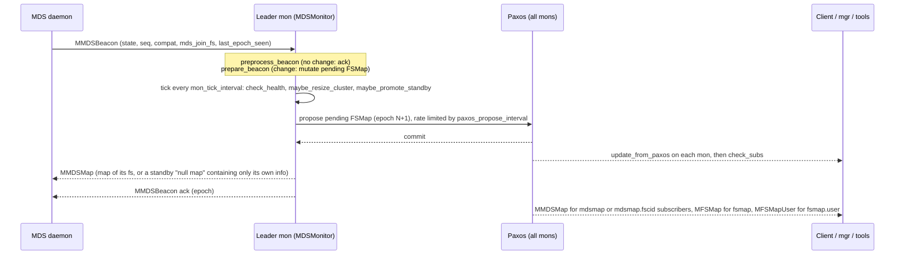
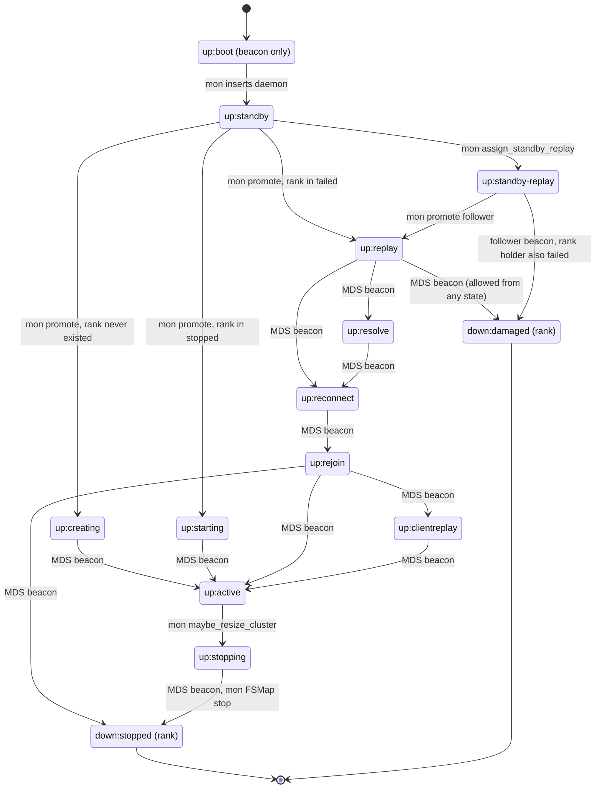
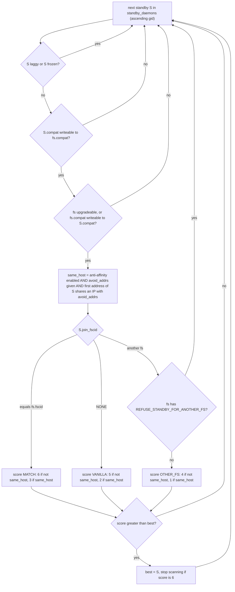

# FSMap and MDSMap: cluster map, MDS states, compat sets, fs/mds commands

> Part of the [C++ MDS project map](../README.md). Sources: `src/mds/MDSMap.h` (664 LOC), `src/mds/MDSMap.cc` (1449), `src/mds/FSMap.h` (739), `src/mds/FSMap.cc` (1338), `src/mds/FSMapUser.{h,cc}` (153), `src/messages/MMDSMap.h` (93), `src/messages/MFSMap.h` (63), `src/messages/MFSMapUser.h` (65), `src/mon/FSCommands.{h,cc}` (~2170), `src/mon/MDSMonitor.cc` (2604, map-related parts), `src/mon/MonCommands.h` (fs/mds section), `src/mon/PaxosFSMap.h`, `src/include/ceph_fs.h`, `src/include/CompatSet.h` + `src/common/CompatSet.cc`, kernel `linux/fs/ceph/mdsmap.c` (471) and `linux/fs/ceph/mds_client.c`.
> Related: [beacon-and-monitor](beacon-and-monitor.md), [auth-and-mds-caps](auth-and-mds-caps.md), [mgr-tools-and-orchestration](mgr-tools-and-orchestration.md), [process-and-threading](../00-architecture/process-and-threading.md), [wire-protocol](../02-client-protocol/wire-protocol.md), [sessions](../02-client-protocol/sessions.md), [kclient-expectations](../02-client-protocol/kclient-expectations.md), [libcephfs-fuse-ganesha-expectations](../02-client-protocol/libcephfs-fuse-ganesha-expectations.md), [rank-lifecycle-and-recovery](../09-recovery/rank-lifecycle-and-recovery.md), [resolve-and-rejoin](../09-recovery/resolve-and-rejoin.md), [balancer-and-pinning](../08-multi-mds/balancer-and-pinning.md), [quiesce](../12-qos-metrics-quiesce-quarantine/quiesce.md), [rados-and-osd-interactions](../07-storage-formats/rados-and-osd-interactions.md), [admin-commands](../13-admin-and-config/admin-commands.md), [config-perf-counters-and-health](../13-admin-and-config/config-perf-counters-and-health.md).

## 1. Purpose and responsibilities

* **FSMap** is the monitor-owned, Paxos-versioned description of *all* CephFS state that is not in RADOS: every file system (`Filesystem` = fscid + `MDSMap` + `MirrorInfo`), every MDS daemon the monitors know (the shared standby pool plus daemons attached to a file system), the cluster-wide default `CompatSet`, the "legacy/default" file system and the `enable_multiple` flag (`src/mds/FSMap.h:275` (FSMap)).
* **MDSMap** is the per-file-system projection that MDS daemons and clients consume: which ranks exist (`in`), who holds each rank (`up`), which are `failed`/`stopped`/`damaged`, the state of every daemon attached to the fs (`mds_info`), the fs settings (session timeouts, max sizes, flags, pools, required client features, balancer settings) and the fs `CompatSet` (`src/mds/MDSMap.h:68` (MDSMap)).
* **FSMapUser** is a name to fscid directory sent to clients that want to mount a named fs (`src/mds/FSMapUser.h:29` (FSMapUser)).
* The maps are **written only by the MDSMonitor on the leader monitor** (pending map, then Paxos commit). MDS daemons influence them only through `MMDSBeacon` (state requests, `CompatSet`, `mds_join_fs`, health) and `MMDSLoadTargets` (export targets); operators through `fs ...`/`mds ...` mon commands. Clients and tools only read them.
* For an MDS daemon the MDSMap is its set of orders: whether it is a standby, which rank it holds, which state it must be in (CREATING/STARTING/REPLAY/STANDBY_REPLAY/STOPPING are imposed by the monitor), which peers exist, and the OSD epoch it must wait for before touching the journal (`last_failure_osd_epoch`).
* For the Rust MDS this whole page is **external contract**: the MDSMonitor is unmodified, so the map layout, the state machine, the standby-selection policy, the compat gating and the command semantics below are fixed behaviour that the new daemon must live inside.

## 2. Source map

| File | Class / function | Lines | Role |
|---|---|---|---|
| `src/include/ceph_fs.h` | `CEPH_MDS_STATE_*`, `CEPH_MDSMAP_*`, `CEPH_MSG_MDS_MAP`/`FS_MAP`/`FS_MAP_USER` | 153, 184-186, 285-327 | numeric states, map flags, message type ids |
| `src/common/ceph_strings.cc` | `ceph_mds_state_name` | 242-268 | state display strings (`up:active`, ...) |
| `src/include/cephfs/types.h` | `MAX_MDS`, `mds_gid_t`, `fs_cluster_id_t`, `FS_CLUSTER_ID_NONE/ANONYMOUS`, `MDS_RANK_NONE` | 41-77 | identifier types and sentinels |
| `src/include/CompatSet.h`, `src/common/CompatSet.cc` | `CompatSet`, `FeatureSet::encode/decode`, `readable/writeable/compare/merge` | h:28-197, cc:23-83 | feature gating math and encoding |
| `src/mds/MDSMap.h` | `MDS_FEATURE_INCOMPAT_*` | 45-56 | the 12 MDS incompat features |
| `src/mds/MDSMap.h` | `MDSMap::DaemonState`, `mds_info_t`, field block | 75-174, 587-647 | states, per-daemon record, map fields and defaults |
| `src/mds/MDSMap.cc` | `get_compat_set_all/default/base/v16_2_4` | 66-131 | standard compat sets |
| `src/mds/MDSMap.cc` | `mds_info_t::encode_versioned/encode_unversioned/decode` | 626-719 | `mds_info_t` wire format (v10) |
| `src/mds/MDSMap.cc` | `MDSMap::encode`, `MDSMap::decode` | 729-850, 869-1030 | MDSMap wire format (struct v5, ev 20), forced INLINE compat |
| `src/mds/MDSMap.cc` | `is_cluster_available`, `state_transition_valid`, `check_health`, `get_health_checks` | 1032-1076, 1104-1144, 1146-1165, 540-624 | client availability heuristic, legal transitions, health |
| `src/mds/MDSMap.cc` | `is_degraded`, `is_followable`, `get_recovery_mds_set`, `get_mds_set_lower_bound`, `set_min_compat_client`, `hex2bin` | 1287, 1270, 1236, 1245, 1327, 1409 | derived predicates |
| `src/mds/FSMap.h` | `Filesystem` (`is_upgradeable`), `FSMap` (fields, `modify_filesystem`, `modify_daemon`, `StandbyScore`) | 196-272, 275-731 | containers and mutation helpers |
| `src/mds/FSMap.cc` | `get_available_standby`, `find_replacement_for` | 804-873, 907-941 | standby selection |
| `src/mds/FSMap.cc` | `promote`, `assign_standby_replay`, `erase`, `damaged`, `undamaged`, `insert`, `stop` | 1006-1212 | all daemon/rank state mutations |
| `src/mds/FSMap.cc` | `create_filesystem`, `commit_filesystem`, `reset_filesystem`, `erase_filesystem`, `swap_fscids` | 470-571, 1302-1338 | file system lifecycle |
| `src/mds/FSMap.cc` | `encode/decode`, `Filesystem::encode/decode`, `sanity`, `get_health_checks`, `parse_role` | 648-739, 943-1004, 601-646, 1225-1289 | FSMap wire format, invariants, health, role parsing |
| `src/mds/FSMapUser.{h,cc}` | `FSMapUser::encode/decode`, `fs_info_t` | cc:4-42 | user (name to id) map |
| `src/messages/MMDSMap.h` | `MMDSMap` | 24-91 | `CEPH_MSG_MDS_MAP` (21) payload, re-encode for old peers |
| `src/messages/MFSMap.h`, `MFSMapUser.h` | `MFSMap`, `MFSMapUser` | 24-61, 23-63 | `CEPH_MSG_FS_MAP` (45), `CEPH_MSG_FS_MAP_USER` (103) |
| `src/mon/PaxosFSMap.h` | `create_pending`, history | 39-92 | pending epoch = committed + 1 |
| `src/mon/MDSMonitor.cc` | `preprocess_beacon`, `prepare_beacon` | 408-564, 633-934 | beacon intake (detail in [beacon-and-monitor](beacon-and-monitor.md)) |
| `src/mon/MDSMonitor.cc` | `check_health`, `drop_mds`, `maybe_resize_cluster`, `maybe_promote_standby`, `tick` | 2254-2417, 2207-2252, 2144-2201, 2419-2475, 2477-2582 | the policy loop that uses FSMap selection |
| `src/mon/MDSMonitor.cc` | `preprocess_command`, `prepare_command`, `filesystem_command`, `fail_mds_gid`, `gid_from_arg` | 1002-1375, 1477-1560, 1603-1831, 1377-1401, 1407-1451 | read-only and `mds ...` commands |
| `src/mon/MDSMonitor.cc` | `check_subs`, `check_sub`, `assign_quiesce_db_leader`, `encode_pending` | 1833-1991, 188-234, 236-344 | subscriptions, quiesce leader, commit-time sanity/health |
| `src/mon/FSCommands.cc` | `FsNewHandler`, `SetHandler` + `set_val`, `FailHandler`, `CompatSetHandler`, `RequiredClientFeaturesHandler`, data-pool, default, rm, reset, rename, swap, mirror handlers, `_check_pool`, `is_op_allowed` | 43-2059 | all `fs ...` mutating commands |
| `src/mon/MonCommands.h` | `fs ...` / `mds ...` signatures and caps | 325-506 | CLI contract |
| `linux/fs/ceph/mdsmap.c` | `ceph_mdsmap_decode`, `ceph_mdsmap_is_cluster_available`, `ceph_mdsmap_get_random_mds` | 119-441, 457-471, 21-57 | kernel partial decoder |
| `linux/fs/ceph/mds_client.c` | `ceph_mdsc_handle_mdsmap`, `ceph_mdsc_handle_fsmap`, `check_new_map` | 7023, 6949, 5843 | kernel map consumption |
| `src/client/Client.cc` | `handle_mds_map`, `handle_fs_map`, `handle_fs_map_user`, `subscribe_mdsmap`, `mount` | 3360, 3316, 3326, 7002, 7042 | libcephfs map consumption |
| `src/mds/MDSDaemon.cc`, `src/mds/MDSRank.cc` | `MDSDaemon::handle_mds_map`, `MDSRankDispatcher::handle_mds_map` | 833-957, 2294-2626 | C++ MDS reaction to maps (reference behaviour) |

## 3. How it works

### 3.1 Ownership and propagation

All mutations happen in the leader's *pending* FSMap. `PaxosFSMap::create_pending` copies the committed map and increments the epoch (`src/mon/PaxosFSMap.h:39` (PaxosFSMap::create_pending)). Commands, beacons and the periodic `tick` mutate the pending map; `encode_pending` recomputes the quiesce DB leader, runs `FSMap::sanity(true)` (unless `mon_mds_skip_sanity`), stamps `btime`, encodes the whole FSMap with the quorum features and stores it as Paxos version = epoch (`src/mon/MDSMonitor.cc:236` (MDSMonitor::encode_pending)). After commit every monitor runs `update_from_paxos`, decodes the map, runs `sanity()` and calls `check_subs()` which pushes maps to subscribers (`src/mon/MDSMonitor.cc:134` (MDSMonitor::update_from_paxos), `:1833` (MDSMonitor::check_subs)).

Proposal cadence: `PaxosService::should_propose` delays a proposal to `paxos_propose_interval` (default 1 s) after the previous commit, or `paxos_min_wait` (0.05 s) if the last commit is older (`src/mon/PaxosService.cc:194` (PaxosService::should_propose)). `fail_mds_gid` and the DAMAGED path call `force_immediate_propose()` when they blocklist a rank holder (`src/mon/MDSMonitor.cc:1390` (MDSMonitor::fail_mds_gid), `:871` (prepare_beacon)). `tick()` runs every `mon_tick_interval` (default 5 s) on the leader.

### 3.2 Epochs

| Epoch | Meaning | Set where |
|---|---|---|
| `FSMap::epoch` | Paxos version of the whole FSMap; one increment per committed proposal, whatever changed | `src/mon/PaxosFSMap.h:42` (create_pending) |
| `MDSMap::epoch` | FSMap epoch at which *this* fs last changed; monotonic per fs but sparse (exception: `fs reset` leaves it at 0, section 8) | `modify_filesystem` `src/mds/FSMap.h:508`, `modify_daemon` `:535`, `promote` `src/mds/FSMap.cc:1062`, `assign_standby_replay` `:1088`, `erase` `:1122`, `stop` `:1208`, `undamaged` `:1152`, `create_filesystem` `:475` |
| `standby_epochs[gid]` | FSMap epoch at which a standby's record last changed; the epoch of the "null map" a standby receives | `insert` `src/mds/FSMap.cc:1178`, `modify_daemon` `src/mds/FSMap.h:530` |
| `mds_info_t::inc` | "incarnation" = FSMap epoch at which the daemon was promoted into its rank | `src/mds/FSMap.cc:1048` (FSMap::promote) |
| null map epoch | `UINT32_MAX`; a daemon that processes it can never accept a later map | `src/mds/MDSMap.cc:58` (MDSMap::create_null_mdsmap) |

Rules built on epochs:

* The monitor applies a beacon's requested state only if the beacon's `last_epoch_seen` equals the daemon's effective epoch (its fs MDSMap epoch, or its `standby_epochs` entry); otherwise it just acks (`src/mon/MDSMonitor.cc:488-501` (preprocess_beacon)). See [beacon-and-monitor](beacon-and-monitor.md).
* Clients and MDS daemons drop maps whose epoch is not newer than the current one (`linux/fs/ceph/mds_client.c:7044` (ceph_mdsc_handle_mdsmap), `src/client/Client.cc:3363` (Client::handle_mds_map), `src/mds/MDSDaemon.cc:838` (MDSDaemon::handle_mds_map)).
* Every client request carries the client's MDSMap epoch (`linux/fs/ceph/mds_client.c:3393` (create_request_message) sets `lhead->mdsmap_epoch`); the C++ MDS waits until its own MDSMap epoch is at least that before validating a pool in a layout (open with O_CREAT and pool, setlayout, setdirlayout) or the `allow_snaps` flag for mksnap (`src/mds/Server.cc:4959` (Server::handle_client_openc), `:5885` (Server::handle_client_setlayout), `:6012` (Server::handle_client_setdirlayout), `:11592` (Server::handle_client_mksnap); `src/mds/MDSRank.h:362` (MDSRank::wait_for_mdsmap)). Replies carry the MDS's epoch (`src/mds/Server.cc:2459` (Server::reply_client_request)).
* The C++ MDS uses `inc` as its Objecter client incarnation (`src/mds/MDSRank.cc:2354` (MDSRankDispatcher::handle_mds_map)); libcephfs treats an incarnation change of a rank with a new address as a restart (`src/client/Client.cc:3390-3396` (Client::handle_mds_map)).
* History: the monitors keep in-memory FSMaps younger than `mon_fsmap_prune_threshold` (300 s) for `mds last-seen`; stored epochs beyond `mon_max_mdsmap_epochs` (500) are trimmed (`src/mon/MDSMonitor.cc:346` (MDSMonitor::get_trim_to)).

### 3.3 MDS daemon and rank states

The enum is the union of daemon states and rank states (`src/mds/MDSMap.h:75` (MDSMap::DaemonState)); values come from `src/include/ceph_fs.h:306-325`; names from `src/common/ceph_strings.cc:242` (ceph_mds_state_name). Convention in `ceph_fs.h`: `> 0` means the rank is "in", `<= 0` means "out".

| Value | Constant | Display name | Stored where | Meaning | Who sets it |
|---|---|---|---|---|---|
| 0 | `CEPH_MDS_STATE_DNE` | `down:dne` | implicit (rank in no set); also a beacon value | rank does not exist; as a beacon: "I am shutting down" | MDS beacon on suicide (`src/mds/MDSDaemon.cc:993` (MDSDaemon::suicide)); mon then evicts |
| -1 | `STOPPED` | `down:stopped` | implicit (rank in `stopped`); beacon value | rank existed, cleanly stopped, empty log | MDS beacon at end of STOPPING |
| -4 | `BOOT` | `up:boot` | beacon only, never in a map | "add me" | MDS |
| -5 | `STANDBY` | `up:standby` | `FSMap::standby_daemons` | idle, no rank | mon on boot |
| -6 | `CREATING` | `up:creating` | `mds_info` | creating a never-existing rank | mon `promote` |
| -7 | `STARTING` | `up:starting` | `mds_info` | starting a previously stopped rank | mon `promote` |
| -8 | `STANDBY_REPLAY` | `up:standby-replay` | `mds_info` (rank = followed rank, not in `up`) | tailing the journal of an active rank | mon `assign_standby_replay` |
| -9 | `REPLAYONCE` | `up:oneshot-replay` | unused (legacy) | | |
| -10 | `NULL` | `null` | sentinel for "not found" | | |
| 8 | `REPLAY` | `up:replay` | `mds_info` | replaying the journal of a failed rank | mon `promote` |
| 9 | `RESOLVE` | `up:resolve` | `mds_info` | resolving cross-rank operations | MDS beacon |
| 10 | `RECONNECT` | `up:reconnect` | `mds_info` | accepting client reconnects | MDS beacon |
| 11 | `REJOIN` | `up:rejoin` | `mds_info` | rejoining distributed cache | MDS beacon |
| 12 | `CLIENTREPLAY` | `up:clientreplay` | `mds_info` | replaying client requests | MDS beacon |
| 13 | `ACTIVE` | `up:active` | `mds_info` | serving | MDS beacon |
| 14 | `STOPPING` | `up:stopping` | `mds_info` | exporting metadata before stop | mon `maybe_resize_cluster` |
| 15 | `DAMAGED` | `down:damaged` | implicit (rank in `damaged`); beacon value | rank cannot be replayed; needs offline repair | MDS beacon; mon moves rank to `damaged` |

`mds_info_t::is_degraded()` is `REPLAY <= state <= CLIENTREPLAY` (`src/mds/MDSMap.h:133`).

Legal transitions (`src/mds/MDSMap.cc:1104` (MDSMap::state_transition_valid)), enforced by the monitor for beacons from rank holders (`src/mon/MDSMonitor.cc:788-796` (prepare_beacon); violation: daemon failed and blocklisted) and by the C++ MDS for maps it receives (`src/mds/MDSRank.cc:2328` (respawn on invalid transition)):

Additional rules not in the diagram:
* Any state may move to `DAMAGED` (`src/mds/MDSMap.cc:1108`); a standby-replay daemon may report DAMAGED, all other beacons from STANDBY/STANDBY_REPLAY daemons that change state are rejected and the daemon is evicted (`src/mon/MDSMonitor.cc:780-787`).
* Removal ("fail") is not a transition: the daemon disappears from the map (`FSMap::erase`) and its rank becomes failed/forgotten/stopped (section 3.7).
* `next == prev` and `next == DAMAGED` are always valid; any other transition out of a `prev` not covered by the diagram (DNE, STOPPED, DAMAGED, NULL, REPLAYONCE) is logged as "Unknown prev state" and invalid (`src/mds/MDSMap.cc:1106-1109`, `:1139-1143`). BOOT may only go to STANDBY.
* `mds set_state <gid> <int>` (hidden, `range=0|20` in `src/mon/MonCommands.h:350-353`) writes the state without validation (`src/mon/MDSMonitor.cc:1616`). Because the range cannot express STANDBY (-5), using it on a standby gid trips `ceph_assert(info.state == STATE_STANDBY)` in `FSMap::modify_daemon` (`src/mds/FSMap.h:529`) and aborts the leader monitor (inferred from code).

### 3.4 Rank sets and derived predicates

Fields (`src/mds/MDSMap.h:617-642`): `in` (ranks that exist), `up` (rank to holder gid), `failed` (ranks without a holder awaiting replacement), `stopped` (ranks that existed and stopped cleanly), `damaged` (ranks quarantined until `mds repaired`), `mds_info` (every daemon attached to the fs: rank holders and standby-replay followers).

* Intended invariant: the header comment states `@up + @failed = @in` and `@in * @stopped = {}` (`src/mds/MDSMap.h:617-625`); it predates `damaged`. In practice `FSMap::damaged` keeps the rank in `in` while moving it from `failed` to `damaged` (`src/mds/FSMap.cc:1129`), so the effective rule is `up` keys + `failed` + `damaged` = `in`. Edge cases break it: a DAMAGED report from a CREATING holder leaves the rank in `damaged` but not in `in` (STARTING: in `stopped` and `damaged`), because `erase` runs first (inferred from code); `mds rmfailed` leaves a rank in `in` only.
* Implicit rank state when no daemon holds it: in `failed` = failed, in `stopped` = STOPPED, else DNE (comment in `src/mds/MDSMap.h:104-112`); a rank in `damaged` is shown as `down:damaged` by convention (the comment does not list it).
* `is_in(r)` is `up.count(r) or failed.count(r)` (so a damaged rank is *not* `is_in`), `is_dne(r)` is `in.count(r) == 0` (`src/mds/MDSMap.h:468-477`).

| Predicate | Definition | Used by |
|---|---|---|
| `is_degraded()` | `failed` or `damaged` non-empty, or any `mds_info` in REPLAY..CLIENTREPLAY (`src/mds/MDSMap.cc:1287`) | resize/SR gating, health `FS_DEGRADED`, MDS `cluster_degraded` |
| `is_resizeable()` | not degraded and no daemon CREATING, STARTING or STOPPING (`src/mds/MDSMap.h:460`) | `maybe_resize_cluster`, SR assignment, affinity swaps |
| `is_followable(r)` | `r` up, holder not degraded, no SR for `r` yet (`src/mds/MDSMap.cc:1270`) | SR assignment |
| `is_upgradeable()` (on `Filesystem`) | `in` empty, or (standby-replay disallowed and `size(in) == 1`), or (standby-replay disallowed and `up` empty) (`src/mds/FSMap.h:207`) | compat merge on promotion |
| `is_resolving()` | some RESOLVE, no REPLAY, no failed/damaged (`src/mds/MDSMap.h:530`) | MDS: start resolve exchange |
| `is_rejoining()` | some REJOIN, none in REPLAY/RECONNECT/RESOLVE, no failed/damaged (`src/mds/MDSMap.h:536`) | MDS: start rejoin |
| `get_recovery_mds_set` | failed + damaged + ranks in REPLAY..STOPPING (`src/mds/MDSMap.cc:1236`) | MDS recovery set |
| `get_mds_set_lower_bound(s, X)` | ranks whose state is in [X, STOPPING] (`src/mds/MDSMap.cc:1245`) | MDS: who is resolving/rejoining/active |
| `get_down_mds_set` | failed + damaged (`src/mds/MDSMap.h:415`) | MDS failure detection |
| `get_up_features()` | AND of `mds_features` of all rank holders (`src/mds/MDSMap.cc:1220`) | feature-dependent encodings of stored metadata and inter-MDS data (`src/mds/CInode.cc:1284`, `src/mds/CDir.cc:2742`) |
| `is_cluster_available()` | epoch 0: TRANSIENT; any damaged, `in` empty, or any up rank laggy: STUCK; any ACTIVE: AVAILABLE; else STUCK (`src/mds/MDSMap.cc:1032`) | `Client::mount` when `require_mds` is set: ceph-fuse passes `fuse_require_active_mds` (default true, `src/ceph_fuse.cc:318`); libcephfs `ceph_mount` passes false (`src/libcephfs.cc:196`) |

The rank-collective predicates (`is_resolving`, `is_rejoining`, `get_mds_set_lower_bound`) are how the C++ MDS ranks synchronise multi-rank recovery: each rank's state transition is published through the monitor and every other rank reacts to the new map (`src/mds/MDSRank.cc:2463-2580` (MDSRankDispatcher::handle_mds_map)). Details: [resolve-and-rejoin](../09-recovery/resolve-and-rejoin.md).

### 3.5 CompatSet mechanics

`CompatSet` = three `FeatureSet`s: `compat`, `ro_compat`, `incompat` (`src/include/CompatSet.h:88-93`). A `FeatureSet` is a `u64 mask` (bit `id` set for feature `id`) plus `map<u64 id, string name>`. Feature ids must be 1..63 (`ceph_assert(f.id > 0); ceph_assert(f.id < 64)` in `FeatureSet::insert`, `src/include/CompatSet.h:49-54`). In memory bit 0 of `mask` is always set; on the wire it is cleared (`src/common/CompatSet.cc:23-29`). On decode, if bit 0 is set on the wire (old bug) the mask is rebuilt from `names` via `insert` (which asserts the id range) (`src/common/CompatSet.cc:31-55`).

| Operation | Definition (masks) | Source |
|---|---|---|
| `A.readable(B)` | `B.incompat` is a subset of `A.incompat` | `CompatSet.h:103` |
| `A.writeable(B)` | readable and `B.ro_compat` subset of `A.ro_compat` (plain `compat` ignored) | `CompatSet.h:109` |
| `A.compare(B)` | 0 if all three masks equal; 1 if A writeable(B) and A.compat superset of B.compat; else -1 (not commutative) | `CompatSet.h:123` |
| `A.merge(B)` | add every feature of B missing in A, names copied with `B.get_name(id)` (asserts the name exists) | `CompatSet.h:165` |

MDS incompat features (`src/mds/MDSMap.h:45-56`) and the standard sets (`src/mds/MDSMap.cc:66-131`):

| id | Name string | `get_compat_set_all` (advertised by every C++ MDS beacon) | `get_compat_set_default` (FSMap default for new fs) | `get_compat_set_v16_2_4` | `get_compat_set_base` |
|---|---|---|---|---|---|
| 1 | `base v0.20` | yes | yes | yes | yes |
| 2 | `client writeable ranges` | yes | yes | yes | |
| 3 | `default file layouts on dirs` | yes | yes | yes | |
| 4 | `dir inode in separate object` | yes | yes | yes | |
| 5 | `mds uses versioned encoding` | yes | yes | yes | |
| 6 | `dirfrag is stored in omap` | yes | yes | yes | |
| 7 | `mds uses inline data` | yes | **no** (but force-inserted on decode, see below) | yes | |
| 8 | `no anchor table` | yes | yes | yes | |
| 9 | `file layout v2` | yes | yes | yes | |
| 10 | `snaprealm v2` | yes | yes | yes | |
| 11 | `minor log segments` | yes | yes | | |
| 12 | `quiesce subvolumes` | yes | yes | | |

No `compat` or `ro_compat` MDS features are defined; all sets above have empty `compat`/`ro_compat`.

Where compat sets enter the system:

1. **Daemon compat** = `CompatSet` in the boot beacon (`src/mon/MDSMonitor.cc:719`). C++ daemons send `get_compat_set_all()` (`src/mds/Beacon.cc:57`, `:227`). `FSMap::insert` replaces an *empty* compat by `get_compat_set_v16_2_4()` and then **always inserts incompat 7 (INLINE)** (`src/mds/FSMap.cc:1160-1179`).
2. **Later beacons must carry exactly the stored compat**: if `beacon.compat.compare(info.compat) != 0` the monitor logs "compat changed unexpectedly" and fails the daemon (blocklisting it if it holds a rank) (`src/mon/MDSMonitor.cc:754-764` (prepare_beacon)). Because of step 1 the stored compat contains bit 7 even if the daemon never advertised it, so a daemon that omits bit 7 is failed at its first beacon that reaches `prepare_beacon`. The check is not in `preprocess_beacon`, so unchanged STANDBY beacons are acked without it; the failure fires on the first beacon that needs a proposal (a requested state change, changed health metrics, a changed `mds_join_fs` resolution or clearing `laggy`), which can be long after boot, e.g. when a promoted daemon reports leaving REPLAY (`src/mon/MDSMonitor.cc:503-546`). Only masks are compared, so feature names are irrelevant.
3. **File system compat** = `FSMap::default_compat` copied at `fs new` / `fs reset` (`src/mds/FSMap.cc:480`, `:557`). `default_compat` is initialised once to `get_compat_set_default()` when an empty FSMap is constructed (`src/mds/FSMap.h:286`) and is persisted; afterwards only the deprecated `mds compat rm_compat|rm_incompat` change it (`src/mon/MDSMonitor.cc:1739-1768`). There is no command that adds to it, so long-lived clusters keep the default of the release that created the FSMap.
4. **Forced INLINE on decode**: `MDSMap::decode` inserts incompat 7 into the fs compat and into every `mds_info` compat; an `mds_info` with empty compat inherits the fs compat first (`src/mds/MDSMap.cc:1013-1027`, comment "TODO: remove after R is released"). `mds_info_t` encoded before v10 decodes with `get_compat_set_v16_2_4()` (`src/mds/MDSMap.cc:713-717`). MDSMap encodings with `ev < 3` decode with `get_compat_set_base()` (`:904-907`).
5. **Promotion may upgrade the fs compat** (`merge`, only when upgradeable, section 3.6).
6. **`fs compat <fs> add_compat|add_incompat|rm_compat|rm_incompat <id> [<name>]`** edits a single fs compat, only while no rank is up (`src/mon/FSCommands.cc:861` (CompatSetHandler)). There is no `ro_compat` sub-op.
7. **C++ MDS self check**: on every MDSMap the daemon suicides if `get_compat_set_all().writeable(map.compat)` is false (`src/mds/MDSDaemon.cc:857-866`).
8. **Commit-time invariant**: every daemon in a fs must satisfy `info.compat.writeable(fs.compat)` (`src/mds/FSMap.cc:967` (FSMap::sanity)), otherwise the monitor asserts (unless `mon_mds_skip_sanity`).

### 3.6 Standby selection

Two entry points: `FSMap::find_replacement_for(role)` (a rank needs a holder) and `FSMap::get_available_standby(fs, avoid_addrs)` (pick from the shared pool).

`find_replacement_for({fscid, rank})` (`src/mds/FSMap.cc:907`):
1. If a daemon in this fs is STANDBY_REPLAY for `rank`: if it is frozen return **null** (no replacement at all, even if other standbys exist); else return it (it is asserted to be writeable to the fs compat) (`:912-921`). Its `join_fscid`, host, `laggy` state and the upgradeable rule are not considered.
2. Else, if the rank is currently up (replacing a laggy holder, or an affinity swap), `avoid_addrs` = the holder's addresses; if the rank is not up (failed/new) there is no anti-affinity (`:924-938`).
3. Return `get_available_standby(fs, avoid_addrs)`.

`get_available_standby(fs, avoid_addrs)` (`src/mds/FSMap.cc:804`) scans `standby_daemons` in ascending gid order:

Scoring constants (`src/mds/FSMap.h:696-708` (FSMap::StandbyScore)): `SCORE_PREF_MATCH 6 > SCORE_PREF_VANILLA 5 > SCORE_PREF_OTHER_FS 4 > SCORE_FALLBACK_MATCH 3 > SCORE_FALLBACK_VANILLA 2 > SCORE_FALLBACK_OTHER_FS 1`. Consequences:
* When anti-affinity applies, *any* different-host candidate beats every same-host candidate, including an exact `mds_join_fs` match on the same host.
* Ties are won by the lowest gid (strict `>` comparison, `:864`).
* Host test: `entity_addr_t::is_same_host` compares only the IPv4/IPv6 address (`src/msg/msg_types.h:409`); the standby's first address is compared against every address of the holder (`src/mds/FSMap.cc:829-836`).
* Anti-affinity is active only if the fs has `standby_enable_host_anti_affinity` (default true, `src/mds/MDSMap.h:630`) and an `avoid_addrs` was supplied: replacing an *up* rank holder (`find_replacement_for`), choosing a standby-replay follower or an affinity swap (`get_rank_addrs`, `src/mon/MDSMonitor.cc:2597`). Failed ranks and new ranks get no anti-affinity.

`mds_join_fs` affinity: the beacon carries the `mds_join_fs` string (`src/mds/Beacon.cc:228`); the monitor resolves the *name* to an fscid at boot and on every later beacon, storing `FS_CLUSTER_ID_NONE` if no fs has that name (`src/mon/MDSMonitor.cc:720-727`, `:812-821`); a change of the resolved value forces a proposal (`:512-531`). Removing a fs resets `join_fscid` of all daemons that pointed to it (`src/mds/FSMap.cc:1302` (FSMap::erase_filesystem)).

### 3.7 FSMap mutators (all daemon/rank state changes)

| Function | Preconditions (asserted) | Effect |
|---|---|---|
| `insert(info)` `src/mds/FSMap.cc:1160` | state STANDBY, rank NONE | add to `standby_daemons`, `mds_roles[gid]=NONE`, `standby_epochs[gid]=epoch`, compat fix-ups (3.5) |
| `promote(gid, fscid, rank)` `:1006` | gid is a STANDBY or a STANDBY_REPLAY of `rank` in `fscid` | copy info into `mds_info`; if `!fs.compat.writeable(info.compat)`: assert `is_upgradeable()` then `fs.compat.merge(info.compat)`; state = STARTING if `rank` was in `stopped` (removed from it), CREATING if `!is_in(rank)`, else REPLAY (removed from `failed`); `rank`, `inc = epoch`; `in += rank`, `up[rank] = gid`; drop from standby pool; bump MDSMap epoch |
| `assign_standby_replay(gid, fscid, rank)` `:1066` | gid is a standby | copy info into `mds_info` with `rank`, state STANDBY_REPLAY; not added to `up`; **no compat merge**; bump epoch |
| `erase(gid, blocklist_epoch)` `:1092` | gid exists | standby: drop from pool. In fs and not SR: CREATING holder: `in -= rank` (rank forgotten, next holder CREATING again); STARTING holder: `in -= rank`, `stopped += rank`; any other holder: `failed += rank`; `up -= rank`. Then (any in-fs gid, SR included) `mds_info -= gid`, **`last_failure_osd_epoch = blocklist_epoch`**, bump epoch |
| `damaged(gid, blocklist_epoch)` `:1129` | gid in a fs | `erase`, then `failed -= rank`, `damaged += rank` |
| `undamaged(fscid, rank)` `:1146` | | if rank in `damaged`: move to `failed`, bump epoch |
| `stop(gid)` `:1181` | gid in a fs | `up -= rank`, `in -= rank`, `stopped += rank`; erase all SR followers of that rank (via `erase(g, 0)`); remove gid; returns erased SR gids |
| `create_filesystem(name, md, data, features, recover)` `:470` | caller validated | new `Filesystem`: `fs_name`, `data_pools=[data]`, `metadata_pool`, `cas_pool=-1`, `compat=default_compat`, `enabled=true`, created/modified; if `recover`: `in={0}`, `failed={0}`, flag NOT_JOINABLE |
| `commit_filesystem(fscid, fs)` `:497` | | assign fscid (`next_filesystem_id++` or the requested id with `next = max(id,next)+1`); if it is the first fs, it becomes `legacy_client_fscid` |
| `reset_filesystem(fscid)` `:540` | fs exists | replaces the fs by a fresh `Filesystem` keeping only fscid, `fs_name`, pools, `cas_pool`, `inline_data_enabled`, `standby_count_wanted`; `compat=default_compat`; `enabled=true`; `in={0}`, `failed={0}`; `stopped = (old in + old stopped) - {0}`; everything else default (flags, max_mds 1, timeouts, sizes, required features, balancer, mirror info) and the MDSMap epoch left at 0 |
| `erase_filesystem(fscid)` `:1302` | | drop fs; reset `join_fscid` pointing at it |
| `swap_fscids(a, b)` `:1323` | | exchange the two `Filesystem` objects and fix their `fscid`; `mds_roles`, `join_fscid` of daemons and `legacy_client_fscid` are not updated |
| `modify_filesystem(fscid, fn)` `src/mds/FSMap.h:496` | | run `fn`; unless `fn` returns false, MDSMap `epoch=FSMap epoch`, `modified=now` |
| `modify_daemon(gid, fn)` `src/mds/FSMap.h:523` | | standby: `fn`, assert still STANDBY, `standby_epochs[gid]=epoch`; in fs: `fn`, bump fs epoch |
| `update_export_targets(gid, set)` `src/mds/FSMap.h:586` | | set `mds_info[gid].export_targets` (from `MMDSLoadTargets`) |

The monitor wrapper `MDSMonitor::fail_mds_gid` (`src/mon/MDSMonitor.cc:1377`) blocklists the daemon's addresses for `mon_mds_blocklist_interval` (default 1 day) **only if it holds a rank and is not STANDBY_REPLAY**, forces an immediate proposal, then calls `erase(gid, blocklist_epoch)` and drops its beacon/health records.

### 3.8 The monitor policy loop that drives the FSMap

`MDSMonitor::tick` (`src/mon/MDSMonitor.cc:2477`), leader only, inside `paxos.plug()`:
1. `FSMap::check_health` per fs: if `standby_count_wanted == -1`, there is at least one ACTIVE and at least one standby or standby-replay, set it to 1 (`src/mds/MDSMap.cc:1146`).
2. `check_health` (`:2254`): beacon timeouts. A daemon without a beacon for `mds_beacon_grace` (15 s) is left alone while a monitor is down or the quorum is younger than `mds_beacon_mon_down_grace` (60 s) and the gap is still below that grace; otherwise it is marked laggy (`laggy_since`), and if the OSDMap is writeable and some daemon beaconed within `max(mds_beacon_interval, mds_beacon_grace/2)` (`may_replace`), `drop_mds` runs: laggy standbys/standby-replays are removed; a laggy rank holder is replaced only if `find_replacement_for` found someone and the fs is joinable (`:2207` (drop_mds)); a frozen daemon is never dropped. Without a replacement the holder stays in `up` with `laggy_since` set. If the tick itself was delayed by more than `mds_beacon_grace - mds_beacon_interval` all beacon timestamps are reset first (`:2266-2279`). Details: [beacon-and-monitor](beacon-and-monitor.md).
3. Affinity swaps, per joinable and resizeable fs, at most one per fs per tick (`:2365-2414`): for each daemon whose `join_fscid != fscid`, compute a candidate (SR: `get_available_standby(fs, holder addrs)`; ACTIVE: `find_replacement_for`); stop at the first daemon without a candidate; if the candidate has strictly better affinity (current NONE and candidate `fscid`; or current other-fs and candidate `fscid` or NONE) fail the SR (it is re-assigned later) or `drop_mds` the active (failover to the candidate). Any other state aborts the monitor (`ceph_abort_msg("invalid state in MDSMap")`, `:2385`).
4. `maybe_resize_cluster` per fs (`:2144`): only if both committed and pending maps are resizeable. If `size(in) < max_mds` and joinable: the lowest rank `r` with `!is_in(r)` is filled via `find_replacement_for` + `promote` (CREATING or STARTING); one rank per tick. If `size(in) > max_mds`: rank `size(in)-1` is set to STOPPING if ACTIVE.
5. `maybe_promote_standby` per fs (`:2419`): if NOT_JOINABLE nothing. Each rank in `failed` gets `find_replacement_for` + `promote` (REPLAY). Then, if resizeable and `allow_standby_replay`, repeatedly assign a standby-replay follower to the first followable rank in `in` order until no standby fits.

### 3.9 What prevents a standby from being assigned to a file system

Exhaustive list derived from the code above. "S" is a daemon, "F" the file system, "r" the rank.

**F-level gates (no assignment happens at all):**

| Gate | Blocks | Source |
|---|---|---|
| F has `CEPH_MDSMAP_NOT_JOINABLE` (`joinable false`, `fs fail`, `fs new --recover`) | failed-rank replacement and SR assignment (`maybe_promote_standby`), growth (`maybe_resize_cluster`), laggy-holder replacement (`drop_mds`), affinity swaps. **Not** the initial assignment in `fs new` | `src/mon/MDSMonitor.cc:2422`, `:2165`, `:2228`, `:2367`; `src/mon/FSCommands.cc:342-353` |
| F not resizeable (degraded, or a rank CREATING/STARTING/STOPPING); growth/shrink checks both the committed and the pending map, SR assignment and affinity swaps only the pending map | growth/shrink, SR assignment, affinity swaps (failed-rank replacement still runs) | `:2158-2163`, `:2445`, `:2368` |
| `size(in) >= max_mds` | growth | `:2165` |
| rank in `damaged` | never replaced until `mds repaired` moves it to `failed` | `src/mds/FSMap.cc:1129`, `:1146` |
| rank in `stopped` | only re-used through growth (STARTING) | `src/mds/FSMap.cc:1036` |
| `allow_standby_replay` false, rank not followable | SR assignment | `src/mon/MDSMonitor.cc:2445`, `src/mds/MDSMap.cc:1270` |
| the rank's standby-replay follower is frozen | `find_replacement_for` returns null: the rank gets no holder | `src/mds/FSMap.cc:914-916` |
| laggy holder replacement conditions (`osdmap writeable`, `may_replace`, MON_DOWN grace, holder not frozen) | replacing an up but laggy holder | `src/mon/MDSMonitor.cc:2296-2344`, `:2216` |
| monitor not active/leader | everything (tick returns) | `:2512` |

**Per-standby filters** (`get_available_standby`, `src/mds/FSMap.cc:812-861`), S must be in `standby_daemons` (state STANDBY, no rank) and:

| # | S is skipped when | Notes |
|---|---|---|
| 1 | `S.laggy()` | set by the monitor after `mds_beacon_grace` without beacon |
| 2 | `S.is_frozen()` | `mds freeze <gid> true` |
| 3 | `!S.compat.writeable(F.compat)` | S lacks any `incompat` or `ro_compat` bit of F. Plain `compat` bits never matter (`qa/tasks/cephfs/test_admin.py:1377` (test_standby_compat)); an fs given a private incompat bit is never joined by daemons lacking it, and a second fs is unaffected (`:1389` (test_standby_incompat_reject), `:1439` (test_standby_incompat_reject_multifs)) |
| 4 | `!F.is_upgradeable() && !F.compat.writeable(S.compat)` | S has an `incompat`/`ro_compat` bit F lacks and F is not upgradeable (`in` non-empty and either standby-replay allowed or (`size(in) > 1` and some rank up)) (`test_standby_replay_not_upgradeable`, `qa/tasks/cephfs/test_admin.py:1419`) |
| 5 | `S.join_fscid` is another fs and F has `refuse_standby_for_another_fs` | vanilla (`NONE`) standbys are still allowed |

Ranking is not prevention: a lower-scored eligible standby is used when no better one exists.

`is_upgradeable()` is true for every single-rank fs with standby-replay disabled at all times, including while its rank is up and healthy (`in_mds == 1`), and for every fs whose ranks are all failed with standby-replay disabled. For such file systems filter 4 never applies: a standby with extra incompat bits can be chosen whenever the rank needs a holder (failed, laggy, or an affinity swap), and only filters 3 and 5 keep it out.

**Promotion side effect**: if S passed filter 4 because F was upgradeable and S has extra bits, `promote` merges S's features into F's compat permanently (`src/mds/FSMap.cc:1031-1034`), after which every daemon lacking those bits fails filter 3 for F (`test_standby_incompat_upgrade`, `qa/tasks/cephfs/test_admin.py:1407`). Only `fs compat <F> rm_*` (with no rank up) undoes it. Standby-replay assignment never merges (`assign_standby_replay` has no compat step), but uses the same filters; since SR assignment requires `allow_standby_replay` and a rank in `in`, the fs is never upgradeable at that point, so an SR never has extra bits when assigned. cephadm's MDS upgrade relies on this mechanism: it disables `allow_standby_replay` and reduces `max_mds` to 1 (or runs `fs fail`) before restarting daemons, so that new-version daemons with new incompat bits can be promoted (`src/pybind/mgr/cephadm/upgrade.py:1430` (CephadmUpgrade._prepare_for_mds_upgrade)).

**Daemon-level conditions that remove S from the pool or from F:** compat changed between beacons (`src/mon/MDSMonitor.cc:755`), invalid state transition or a standby changing its own state (`:780-796`), DNE beacon (`:766-777`), a second daemon booting with the same name while `mds_enforce_unique_name` (default true) (`:692-708`), beacon timeout (3.8), `mds fail`, `mds rm` (any daemon in a state <= 0, no blocklist), `fs fail`, `fs rm` (remaining SRs), `allow_standby_replay false` (SRs only), affinity swap (3.8). A C++ daemon additionally suicides when handed an MDSMap whose compat it cannot write (`src/mds/MDSDaemon.cc:857-866`).

Worked compat examples (masks only; bit 7 is always present on both sides after the forced insertion):

| F incompat | S incompat | F upgradeable? | Outcome |
|---|---|---|---|
| {1..12} | {1..12} | any | eligible |
| {1..12} | {1..12, 40} | yes (e.g. `in` empty, or single rank and SR disabled) | eligible; on promotion F becomes {1..12, 40} and C++ daemons ({1..12}) are no longer eligible for F |
| {1..12} | {1..12, 40} | no | rejected by filter 4 |
| {1..12} | {2..12, 40} | any | rejected by filter 3 (S lacks 1) |
| {2..12, 40} (after `fs compat F rm_incompat 1`, `add_incompat 40 ...`) | {1..12} (C++) | any | rejected by filter 3 (lacks 40) |
| {2..12, 40} | {2..12, 40} | any | eligible |
| {2..12, 40} | {1..12, 40} | yes | eligible; F merges bit 1 back |
| {2..12, 40} | {1..12, 40} | no | rejected by filter 4 |

### 3.10 Commands and their effect on states

Mutating `fs ...` commands are dispatched to `FileSystemCommandHandler`s (`src/mon/FSCommands.cc:1892` (load)); `is_op_allowed` first filters the FSMap by the session's allowed fs names, returns ENOENT for an unknown fs (except `fs rm`, `fs rename`, `fs swap`), and EPERM without `fsname` write capability (`:2031`). `fs new` and `fs flag set` skip this check (`src/mon/FSCommands.h:86`). Commands needing blocklists wait for a writeable OSDMap (EAGAIN internally, retried). Success replies are sent after the Paxos commit (`src/mon/MDSMonitor.cc:1550-1554`).

| Command (caps) | Preconditions / errors | Map effect | Effect on daemons/ranks |
|---|---|---|---|
| `fs new <fs> <meta> <data> [--force] [--allow-dangerous-metadata-overlay] [--fscid N] [--recover] [--set k v ...]` (fs rw) | pools exist (ENOENT); data pool id 0 refused (EINVAL); same name with same pools: success no-op, else EINVAL; metadata pool must be empty unless `--force`; second fs needs `enable_multiple` (default true); pools already used by another fs need overlay flag; `--fscid` needs `--force` and must be free; `_check_pool` (no mon-managed snaps, EC metadata refused, EC default data needs `--force`, EC data needs overwrites or writeback tier, not a cache tier, no other application) (`src/mon/FSCommands.cc:150-361`, `:1921`) | `create_filesystem` + `--set` vars applied pre-commit + `commit_filesystem`; enables pool application `cephfs` (data/metadata), sets metadata pool `recovery_priority 5`, `pg_num_min 16`, `pg_autoscale_bias 4` | without `--recover`: immediately `find_replacement_for` + `promote` for ranks `0..max_mds-1` (CREATING), stopping at the first rank without candidate, **ignoring NOT_JOINABLE**; with `--recover`: rank 0 failed + NOT_JOINABLE, nothing assigned |
| `fs rm <fs> --yes-i-really-mean-it` (fs rw) | no rank up (EINVAL), confirmation (EPERM); missing fs: success | clears `legacy_client_fscid` if it was this fs (not reassigned); fails remaining SR daemons; `erase_filesystem` | SR daemons removed (respawn); subscribers of `mdsmap.<fscid>` get nothing more |
| `fs fail <fs> [--yes-i-really-mean-it]` (fs rw) | EPERM if any daemon of the fs reports `MDS_HEALTH_TRIM` or `MDS_HEALTH_CACHE_OVERSIZED` without confirmation | set NOT_JOINABLE, `fail_mds_gid` every daemon of the fs (`src/mon/FSCommands.cc:84`) | holders blocklisted and removed; ranks go to `failed` (CREATING ranks forgotten, STARTING back to `stopped`); SRs removed; nothing reassigned until `joinable true` |
| `fs reset <fs> --yes-i-really-mean-it` (fs rw) | missing fs (ENOENT), no rank up (EINVAL), confirmation (EPERM); remaining SR daemons are not failed (section 8) | `reset_filesystem` (3.7); flags return to defaults, so NOT_JOINABLE set by an earlier `fs fail` is cleared | next tick: rank 0 (failed) replaced, holder enters REPLAY; previous other ranks are `stopped` (STARTING when regrown) |
| `fs set <fs> max_mds N` (mds rw) | integer 1..256; EPERM if any MDS in the cluster has a health warning, without `--yes-i-really-mean-it`; EINVAL raising above 1 when snapshots were ever allowed but `allow_multimds_snaps` is clear | `max_mds=N` and **clears NOT_JOINABLE** | growth: one rank per tick (CREATING/STARTING), each waits until resizeable again; shrink: highest rank ACTIVE to STOPPING, one at a time |
| `fs set <fs> down true/false` | `down false` while `max_mds > 0` is a no-op ("already online") | true: `old_max_mds=max_mds`, `max_mds=0` (no flag change); false: `max_mds = old_max_mds or 1` (`:610`) | true: ranks stopped one by one (STOPPING to STOPPED) until `in` empty; false: regrow (STARTING) |
| `fs set <fs> joinable true/false` (alias `cluster_down`, inverted, deprecated) | | clear/set NOT_JOINABLE (`:643`) | false: no new assignments (holders keep running); true: failed ranks replaced next tick |
| `fs set <fs> allow_standby_replay true/false` | | set/clear flag (also in `ever_allowed_features`, `explicitly_allowed_features`) | false: every SR of the fs is failed first (`:728-763`); true: SRs assigned when resizeable |
| `fs set <fs> allow_new_snaps`, `inline_data` (enable needs `--yes-i-really-really-mean-it`), `max_file_size` (>= 65536 else ERANGE), `max_xattr_size` (any integer), `session_timeout`/`session_autoclose` (>= 30 else ERANGE), `standby_count_wanted` (>= 0), `standby_enable_host_anti_affinity`, `balancer`, `bal_rank_mask` (hex, `-1`/`all`, `0`/`0x0`), `balance_automate`, `refuse_client_session`, `refuse_standby_for_another_fs`, `min_compat_client` (deprecated; replaces the whole `required_client_features` set with the single `CEPHFS_FEATURE_*` bit of that release, or an empty set for releases before jewel, `src/mds/MDSMap.cc:1327`), `allow_multimds_snaps` (only with `confirm=--yes-i-am-really-a-mds`, sent by the MDS itself, `src/mds/MDSRank.cc:690`), `allow_multimds`/`allow_dirfrags` (deprecated no-ops) | per var (`src/mon/FSCommands.cc:418-859`) | field/flag update, epoch bump | none directly; consumers react (section 4.1) |
| `fs flag set enable_multiple <bool>` (fs rw) | | `enable_multiple` (`:43`) | none |
| `fs compat <fs> add_compat/add_incompat/rm_compat/rm_incompat <id> [<name>]` (fs rw) | id > 0 (EINVAL); some rank up: EBUSY; add with existing id and different name: EEXIST; add needs a name (EINVAL) (`:861`) | fs compat changed | determines eligibility (3.9) |
| `fs required_client_features <fs> add/rm <name or id>` (mds rw) | id 0..`CEPHFS_FEATURE_MAX` (24) (`:966`) | bit set/cleared in `required_client_features` | C++ MDS evicts sessions lacking the bits (`src/mds/Server.cc:1799` (Server::update_required_client_features)) |
| `fs add_data_pool <fs> <pool>` / `fs rm_data_pool <fs> <pool>` (mds rw) | add: `_check_pool`, already present: success; rm: cannot remove the first (default) pool (EINVAL), absent: silent success, no check that layouts still use it (`:1055`, `:1588`) | `data_pools` append (plus pool application tag) / erase (tag left in place) | clients and MDS accept layouts for the pool once they have the new epoch |
| `fs set-default <fs>` (alias `fs set_default`, deprecated) (fs rw) | | `legacy_client_fscid` | unqualified `mdsmap` subscribers switch fs |
| `fs rename <fs> <new> --yes-i-really-mean-it` (mds rw) | target name free (EINVAL); mirroring disabled (EPERM); confirmation (EPERM); fs offline (EPERM) and `refuse_client_session` set (EPERM); missing fs but new name exists: success | pool application tags rewritten; `fs_name` changed (`:1284`) | kernel clients mounted with `mds_namespace=<old>` fail the next map decode (3.12) |
| `fs swap <fs1> <id1> <fs2> <id2> --swap-fscids=yes/no --yes-i-really-mean-it` (mds rw) | both exist, ids match (swapped ids: success no-op), mirroring disabled, both offline, both `refuse_client_session` | names swapped, optionally fscids (`swap_fscids`) (`:1389`) | none (offline) |
| `fs mirror enable/disable <fs>`, `peer_add <fs> <uuid> <client>@<cluster> <remote_fs>`, `peer_remove <fs> <uuid>` (mds rw) | peer ops need mirroring enabled; spec must contain `@` | `MirrorInfo` (disable clears peers) (`:1686-1890`) | consumed by `cephfs-mirror` via `fsmap` |
| `mds fail <role or gid or name> [--yes-i-really-mean-it]` (mds rw) | unknown: success with message; permission (EPERM); health-warning confirmation as `fs fail` (`src/mon/MDSMonitor.cc:1637`) | `fail_mds_gid` | holder blocklisted, rank to `failed` and replaced next tick (its SR first); a standby or SR is just removed (respawns as new standby) |
| `mds repaired <role>` (mds rw) | role must parse (rank in `in`) | `undamaged`: `damaged` to `failed` (`:1769`) | rank replaced next tick (REPLAY) |
| `mds rm <gid>` (mds rw) | state > 0 refused (EBUSY); unknown gid: success (`:1678`) | `erase(gid, 0)` (no blocklist) | standby / SR / CREATING... daemon removed |
| `mds rmfailed <role> --yes-i-really-mean-it` (hidden) | confirmation (EPERM); role must parse (EINVAL) | `failed -= rank` only (`:1705`) | rank stays in `in` but is neither up nor failed and is never replaced; growth hands it out as CREATING only if `max_mds > size(in)`; a shrink whose target `size(in)-1` is this rank calls the `noexcept` `get_info()` (`up.at()`) for a rank that is not up, which terminates the monitor (inferred from code) |
| `mds freeze <role or gid> <bool>` (hidden) | | `mds_info_t::flags` FROZEN (`:1792`) | frozen daemons are never selected, never dropped, and a frozen SR blocks replacement of its rank |
| `mds set_state <gid> <0..20>` (hidden) | | writes `state` unvalidated (`:1616`) | debugging only; on a standby gid it aborts the monitor (3.3) |
| `mds compat rm_compat/rm_incompat <id>` (deprecated) | | edits `default_compat` (`:1739`) | affects future `fs new` / `fs reset` |

Read-only commands (`src/mon/MDSMonitor.cc:1002` (preprocess_command)): `fs dump [epoch]` (any stored epoch), `fs get <fs>`, `fs ls`, `fs lsflags <fs>`, `fs feature ls`, `fs compat show <fs>`, `mds compat show` (default compat, deprecated), `mds stat` (hidden), `mds metadata [who]`, `mds versions`, `mds count-metadata <field>`, `mds last-seen <name>`, `mds ok-to-stop <ids...>` (EBUSY if any fs degraded or if `num_standby - stopping_standbys < stopping_actives_without_SR`). All of them operate on the FSMap filtered by the session's allowed fs names (`src/mon/MDSMonitor.cc:1029-1031`), except `fs dump <epoch>`, which decodes the stored historical FSMap and dumps it unfiltered (`:1147-1159`). Capabilities: `fs ls/get/lsflags` need `fs r`; `fs dump`, `fs compat show`, `fs feature ls` and the `mds ...` read commands need `mds r`.

Role syntax (`src/mds/FSMap.cc:1225` (FSMap::parse_role)): `<fs name>:<rank>`, `<fscid>:<rank>`, or `<rank>` (only with a default fs); the rank must be in `in`. `gid_from_arg` tries role (if up), then integer gid, then daemon name (`src/mon/MDSMonitor.cc:1407`).

### 3.11 Subscriptions and what each subscriber receives

Subscribing to any `mdsmap*`/`fsmap*` requires mon cap `mds r` (`src/mon/Monitor.cc:5560`). `check_sub` (`src/mon/MDSMonitor.cc:1867`) first filters the FSMap by the session's allowed fs names (`FSMap::filter`, `src/mds/FSMap.h:318`) and sends nothing while `sub->next > epoch`.

| Subscription | Subscriber | Message | Content |
|---|---|---|---|
| `fsmap` | mgr (`src/mgr/Mgr.cc:337` (Mgr::init)), `cephfs-mirror` (`src/tools/cephfs_mirror/ClusterWatcher.cc:49` (ClusterWatcher::init)), cephfs offline tools (`src/tools/cephfs/MDSUtility.cc:100` (MDSUtility::init), one-time), libcephfs for `tell` (one-time, `src/client/Client.cc:6797` (fetch_fsmap)) | `MFSMap` | the whole (filtered) FSMap |
| `fsmap.user` | kclient with `mds_namespace=` (`linux/fs/ceph/super.c:843` (create_fs_client)), libcephfs with `client_fs`/fs name (one-time) | `MFSMapUser` | epoch, `legacy_client_fscid`, list of (fscid, name) |
| `mdsmap` from a client | kclient without `mds_namespace`, libcephfs without fs name | `MMDSMap` | MDSMap of `legacy_client_fscid`; nothing if none or not visible |
| `mdsmap.<fscid>` from a client | kclient/libcephfs after name lookup (`linux/net/ceph/mon_client.c:365` (__send_subscribe), `src/client/Client.cc:7036` (Client::subscribe_mdsmap)) | `MMDSMap` | MDSMap of that fs; nothing if it does not exist or the id does not parse |
| `mdsmap` (any suffix) from an MDS session | every MDS (`src/mds/MDSDaemon.cc:720` (MDSDaemon::init)) | `MMDSMap` | the daemon is identified by **`mds_info.addrs == session addrs`**: if attached to a fs, that fs's MDSMap; if a standby, a null map (`create_null_mdsmap`) containing only its own `mds_info` with `epoch = standby_epochs[gid]`; if unknown, an empty null map with `epoch = FSMap epoch`. A null map is a default-constructed `MDSMap` (empty compat, which decodes as just incompat 7; `enabled` false; `fs_name` "cephfs"; no ranks); the C++ daemon only checks compat writeability and its own entry in it (`src/mon/MDSMonitor.cc:1953-1968`, `src/mds/MDSDaemon.cc:857-928`) |

Additionally the monitor answers beacons from daemons not in the FSMap (and evicted daemons) with a null map of epoch `UINT32_MAX` (`src/mon/MDSMonitor.cc:461`, `:923-931`), and sends the same null map instead of a beacon ack once a STOPPED beacon is committed (`:971-974` (MDSMonitor::_updated)); the C++ MDS that was previously in the map respawns ("Map removed me", `src/mds/MDSDaemon.cc:881-887`). C++ MDS ranks also forward their current MDSMap to a peer rank before any other message if the peer's known epoch is older (`src/mds/MDSRank.cc:1488-1492` (MDSRank::send_message_mds)).

### 3.12 How clients decode and use the MDSMap

**Linux kernel** (`linux/fs/ceph/mdsmap.c:119` (ceph_mdsmap_decode)) decodes only part of the map:
* Header: struct_v, skip compat byte, and for struct_v >= 4 a u32 length that bounds the rest (`:136-145`).
* Fixed fields: epoch, *flags read into a field named `m_client_epoch` and never used*, last_failure, root, session_timeout, session_autoclose, max_file_size, max_mds; then the `mds_info` count, stored as `m_num_active_mds` although it counts standby-replay entries too (`:147-172`).
* `possible_max_rank = max(count, max_mds)`; each `mds_info`: reads the map-key gid, skips the inner `global_id` and `name`, reads rank, inc, state, address (addrvec for info v >= 8, choosing msgr2 or legacy), `laggy_since` (laggy = non-zero), export_targets (info v >= 2), skips the rest using the info length (`:179-242`). Entries with rank out of range or **state <= 0 are ignored** (`:248-257`): standby-replay followers, and also CREATING (-6) and STARTING (-7) rank holders, are invisible, so such a rank looks like state 0 to the kernel.
* data pools (u64 each), cas pool, `m_enabled = epoch > 1` default (`:283-293`); skips compat, metadata_pool, created, modified, tableserver (`:299-313`).
* `in`: counts laggy ranks, then sets `possible_max_rank = size(in)` (rank-indexed array) (`:315-339`).
* skips inc, up, failed, stopped, last_failure_osd_epoch, allowed-features bytes, inline flag; reads `enabled` and `fs_name` (ev >= 8) and **fails the decode if `fs_name` differs from the `mds_namespace` mount option** (`:364-386`); damaged (only `n > 0` kept); for ev >= 17 skips balancer, standby_count_wanted, old_max_mds, min_compat_client, required_client_features, bal_rank_mask; ev >= 18 reads `max_xattr_size`; ignores everything after (`:393-420`).
* Any read past the end after the pools jumps to `bad_ext`, which still returns the partially decoded map as success (`:421-426`).
* A failed decode logs "error decoding mdsmap ... Shutting down mount." and calls `ceph_umount_begin` (`linux/fs/ceph/mds_client.c:7078-7082`).

Kernel use: `ceph_mdsc_handle_mdsmap` ignores non-newer epochs, swaps the map, sets `fsc->max_file_size = min(max_file_size, MAX_LFS_FILESIZE)` and wakes waiters (`linux/fs/ceph/mds_client.c:7023-7072`); `check_new_map` (`:5843`) force-closes sessions of ranks `>= possible_max_rank`, restarts a session when a rank's address changes, sends a reconnect when a restarting session's rank reaches `>= RECONNECT`, kicks requests and cap flushes when a rank reaches `>= ACTIVE`, sends reconnects to export targets in RECONNECT and opens sessions to export targets of laggy ranks. Requests wait for a map while the chosen rank is `< ACTIVE` (`:3689` (__do_request)); during mount without `mountwait`, an unavailable cluster gives EHOSTUNREACH (`:3679` (__do_request)). `ceph_mdsmap_is_cluster_available` = enabled, not damaged, not all laggy, some rank ACTIVE (`linux/fs/ceph/mdsmap.c:457`). Cap renewal every `session_timeout/4` (`mds_client.c:6279` (delayed_work)) and not while the rank is `< RECONNECT` (`:2131` (send_renew_caps)); `s_cap_ttl = renew_requested + session_timeout` (`:2178` (renewed_caps)); `s_ttl = now + session_autoclose` (`:4560` (handle_session)); setxattr is buffered under Xx only if the blob fits `max_xattr_size`, otherwise sync (`linux/fs/ceph/xattr.c:1236`, `:1268` (__ceph_setxattr)); statfs reports the single data pool when exactly one exists (`linux/fs/ceph/super.c:68` (ceph_statfs)); layout ioctls require the pool in `data_pools` (`linux/fs/ceph/ioctl.c:53` (__validate_layout)).

**libcephfs / ceph-fuse / Ganesha** decode the *entire* map with the C++ `MDSMap::decode` (`src/client/Client.cc:3373`) and use: `is_cluster_available()` at mount only when `require_mds` is set (STUCK gives `CEPH_FUSE_NO_MDS_UP`; ceph-fuse sets it from `fuse_require_active_mds`, default true, while libcephfs `ceph_mount` passes false, `src/ceph_fuse.cc:318`, `src/libcephfs.cc:196`) and `CEPH_MDSMAP_REFUSE_CLIENT_SESSION` (mount fails with EACCES before contacting an MDS, in all cases) (`:7066-7093` (Client::mount)); per-session reaction to state/address/incarnation changes (mark down, reconnect at RECONNECT, close if a rank skipped RECONNECT, kick at ACTIVE) (`:3380-3431` (Client::handle_mds_map)); `max_mds` to recognise stopped ranks (`:2303-2315` (Client::make_request)); `export_targets` to pre-open sessions (`:2095` (Client::connect_mds_targets)); `session_timeout/3` cap renewal (`:7537` (Client::renew_and_flush_cap_releases)); `set_deleg_timeout` requires `timeout < session_autoclose` (EINVAL otherwise, used by Ganesha delegations) (`:17886` (Client::set_deleg_timeout)); `max_file_size` (`:8711` (Client::_do_setattr), `:12808` (Client::_write)); data pools for statfs (`:13649` (Client::_statfs)). libcephfs also takes the sending rank of MDS session, reply, forward, caps, lease, snap and quota messages from the message source entity number (`m->get_source().num()`, e.g. `:2696` (Client::handle_client_session), `:3024` (Client::handle_client_reply), `:5735` (Client::handle_caps)). With msgr2 that number is the server's `ServerIdent` gid, i.e. `messenger->get_myname().num()` of the MDS (`src/msg/async/ProtocolV2.cc:2187`, `:2983-2985`), which the C++ MDS sets to its rank on every state change of a rank holder (`mds.<gid>` while standby-replay) (`src/mds/MDSRank.cc:2343-2350`). The kernel instead maps messages to sessions through the connection (`con->private`, `linux/fs/ceph/mds_client.c:7200` (mds_dispatch)) and msgr2 only checks the peer entity type (`linux/net/ceph/messenger_v2.c:2220`).

## 4. Data structures and invariants

### 4.1 MDSMap fields

Declarations and defaults: `src/mds/MDSMap.h:587-647`.

| Field | Type | Default | Changed by | Consumers |
|---|---|---|---|---|
| `epoch` | `epoch_t` | 0 | every fs modification (3.2) | everyone |
| `flags` | `u32` | `CEPH_MDSMAP_DEFAULTS` = ALLOW_SNAPS, ALLOW_MULTIMDS_SNAPS (0x12) | `fs set`, `fs fail`, `fs new --recover`; `fs reset` restores the defaults | MDS, libcephfs (REFUSE_CLIENT_SESSION), not kclient |
| `last_failure` | `epoch_t` | 0 | never written | none |
| `last_failure_osd_epoch` | `epoch_t` | 0 | overwritten by every `FSMap::erase` of a daemon attached to the fs: the blocklist epoch when the caller blocklisted a holder, 0 otherwise (SR removal, `mds rm`, SRs erased by `stop`); removing a pool standby does not touch it | MDS waits for this OSDMap epoch before replay and before a standby-replay takeover (`src/mds/MDSRank.cc:1803-1818`, `:1873-1893`) |
| `created`, `modified` | `utime_t` | | create / every modification | display |
| `tableserver`, `root` | `mds_rank_t` | 0, 0 | never changed | MDS (snap table server, root authority); kclient debugfs |
| `qdb_cluster_leader`, `qdb_cluster_members` | `mds_gid_t`, `unordered_set<mds_gid_t>` | NONE, {} | `assign_quiesce_db_leader`: members = ACTIVE rank holders, leader = lowest rank (`src/mon/MDSMonitor.cc:188`) | MDS quiesce DB ([quiesce](../12-qos-metrics-quiesce-quarantine/quiesce.md)) |
| `session_timeout` | `u32` s | 60 | `fs set` (>= 30) | MDS stale/revoke logic, kclient, libcephfs |
| `session_autoclose` | `u32` s | 300 | `fs set` (>= 30) | MDS eviction, kclient, libcephfs |
| `max_file_size` | `u64` | 1 TiB | `fs set` (>= 65536) | kclient, libcephfs (the MDS only encodes and dumps it; it does no size check, `src/mds/MDSMap.cc`) |
| `max_xattr_size` | `u64` | 65536 (`MDS_MAX_XATTR_SIZE`) | `fs set` | MDS (ENOSPC on setxattr, `src/mds/Server.cc:7207` (Server::handle_client_setxattr)), kclient |
| `required_client_features` | `feature_bitset_t` | empty | `fs required_client_features`, `fs set min_compat_client` | MDS session admission/eviction |
| `data_pools` | `vector<int64_t>` | [data pool]; first = default | `fs add_data_pool`, `fs rm_data_pool`, `sanitize` drops pools no longer in the OSDMap (`src/mds/MDSMap.cc:852`) | MDS layout validation, kclient, libcephfs |
| `cas_pool` | `int64_t` | -1 | never | none |
| `metadata_pool` | `int64_t` | -1 | `fs new` | MDS |
| `in`, `failed`, `stopped`, `damaged`, `up`, `mds_info` | sets/maps | {} | FSMap mutators (3.7) | MDS, clients |
| `max_mds` | `mds_rank_t` | 1 | `fs set max_mds`, `fs set down` | mon resize, MDS (export pins, purge queue), kclient array size, libcephfs stopped-rank test |
| `old_max_mds` | `mds_rank_t` | 0 | `fs set down true` | `fs set down false` |
| `standby_count_wanted` | `mds_rank_t` | -1 (auto set to 1, 3.8) | `fs set` (>= 0) | health `MDS_INSUFFICIENT_STANDBY` |
| `standby_enable_host_anti_affinity` | bool | true | `fs set` | standby selection |
| `balancer` | string | "" | `fs set balancer` | MDS Mantle balancer object name |
| `bal_rank_mask` | string | "-1" | `fs set bal_rank_mask` | MDS balancer (bitset derived locally, not encoded) |
| `ever_allowed_features`, `explicitly_allowed_features` | `uint8_t` bitmaps of flags | 0 | flag setters (`src/mds/MDSMap.h:233-265`) | health `MULTIMDS_WITH_OLDSNAPS`, `max_mds` check |
| `inline_data_enabled` | bool | false | `fs set inline_data` | MDS new inodes, health `FS_INLINE_DATA_DEPRECATED` |
| `enabled` | bool | false; true for created fs | create/reset | kclient availability |
| `fs_name` | string | "cephfs" | `fs new`, `fs rename`, `fs swap` | MDS (auth caps, metrics labels), kclient namespace check, mgr |
| `compat` | `CompatSet` | `default_compat` | `fs compat`, promotion merge, forced INLINE | mon eligibility, C++ MDS self check |

Flags (`src/include/ceph_fs.h:285-299`; display names `src/mds/MDSMap.cc:45-53`):

| Bit | Constant | Display (`fs lsflags`) | Set by | Effect |
|---|---|---|---|---|
| 1<<0 | `CEPH_MDSMAP_NOT_JOINABLE` (alias `CEPH_MDSMAP_DOWN`) | `joinable` (inverted) | `fs set joinable false`, `fs fail`, `fs new --recover`; cleared by `joinable true` and by `fs set max_mds` | no assignments (3.9) |
| 1<<1 | `ALLOW_SNAPS` | `allow_snaps` | `fs set allow_new_snaps` (default on) | MDS mksnap EPERM when clear (`src/mds/Server.cc:11596` (Server::handle_client_mksnap)) |
| 1<<2, 1<<3 | (deprecated ALLOW_MULTIMDS, ALLOW_DIRFRAGS) | | | unused |
| 1<<4 | `ALLOW_MULTIMDS_SNAPS` | `allow_multimds_snaps` | default on; the MDS sets it for old file systems | `max_mds > 1` refused while snaps ever allowed and this clear |
| 1<<5 | `ALLOW_STANDBY_REPLAY` | `allow_standby_replay` | `fs set allow_standby_replay` | SR assignment; makes the fs non-upgradeable |
| 1<<6 | `REFUSE_CLIENT_SESSION` | `refuse_client_session` | `fs set refuse_client_session` | MDS rejects new sessions and reconnects (`src/mds/Server.cc:646` (Server::handle_client_session), `:1605` (Server::handle_client_reconnect)); libcephfs refuses to mount |
| 1<<7 | `REFUSE_STANDBY_FOR_ANOTHER_FS` | `refuse_standby_for_another_fs` | `fs set` | filter 5 in 3.9 |
| 1<<8 | `BALANCE_AUTOMATE` | `balance_automate` | `fs set balance_automate` (default off) | MDS automatic balancing runs only when set (`src/mds/MDBalancer.cc:281` (MDBalancer::tick)) |

### 4.2 `mds_info_t`

`src/mds/MDSMap.h:123-174`:

| Field | Type | Meaning |
|---|---|---|
| `global_id` | `mds_gid_t` (u64) | the daemon's monitor-session global id (beacon `global_id`) |
| `name` | string | daemon name (`mds.<name>`) |
| `rank` | `mds_rank_t` | held or followed rank; `MDS_RANK_NONE` for standbys |
| `inc` | int32 | incarnation (FSMap epoch at promotion) |
| `state` | `DaemonState` | 3.3 |
| `state_seq` | `version_t` | beacon seq of the last applied state; older-seq beacons are ignored (`src/mon/MDSMonitor.cc:483`) |
| `addrs` | `entity_addrvec_t` | beacon source addresses (`get_orig_source_addrs`) |
| `laggy_since` | `utime_t` | non-zero while laggy |
| `export_targets` | `set<mds_rank_t>` | from `MMDSLoadTargets` |
| `join_fscid` | `fs_cluster_id_t` | resolved `mds_join_fs` |
| `mds_features` | u64 | messenger feature bits from the beacon (`CEPH_FEATURES_SUPPORTED_DEFAULT` for C++) |
| `flags` | u64 | `FROZEN = 1` |
| `compat` | `CompatSet` | daemon compat (3.5) |

### 4.3 FSMap, Filesystem, MirrorInfo, FSMapUser

* `FSMap` (`src/mds/FSMap.h:710-730`): `epoch`, `btime` (commit time), `next_filesystem_id` (starts at 1), `legacy_client_fscid` (dumped as `default_fscid`), `default_compat`, `enable_multiple` (default true), `ever_enabled_multiple`, `filesystems: map<fscid, Filesystem>`, `mds_roles: map<gid, fscid or NONE>`, `standby_daemons: map<gid, mds_info_t>`, `standby_epochs: map<gid, epoch>`, `struct_version` (decoded version; versions older than 7 cannot be decoded and the monitor proposes to flush them, `src/mon/MDSMonitor.cc:2522-2553`).
* `Filesystem` (`src/mds/FSMap.h:196-272`): `fscid`, `mds_map`, `mirror_info`.
* `MirrorInfo` (`src/mds/FSMap.h:128-181`): `mirrored`, `peers: set<Peer>`; `Peer` = `uuid` + `ClusterInfo{client_name, cluster_name, fs_name}`.
* `FSMapUser` (`src/mds/FSMapUser.h:29-62`): `epoch`, `legacy_client_fscid`, `filesystems: map<fscid, {cid, name}>`.

### 4.4 Wire encodings

All integers little-endian; `string` = u32 length + bytes; `set`/`vector` = u32 count + elements; `map` = u32 count + (key, value) pairs; versioned structs start with `u8 struct_v, u8 struct_compat, u32 struct_len`.

**`MMDSMap`** (`CEPH_MSG_MDS_MAP` = 21, header version 2, compat 1; `src/messages/MMDSMap.h:59-85`): `uuid fsid` (16 bytes), `u32 epoch`, `u32 len + MDSMap bytes`, `string map_fs_name` (header v >= 2, always empty). The map is encoded with all features at construction and re-encoded per connection if the peer lacks `PGID64`, `MDSENC`, `MSG_ADDR2` or `SERVER_NAUTILUS` (the kernel advertises all four, `include/linux/ceph/ceph_features.h`, so it receives the native form).

**MDSMap** native form (`src/mds/MDSMap.cc:804-849` encode, `:869-1030` decode; `struct_v 5, compat 4`, extended version `ev = 20`):

| # | Field | Wire type | Present since | kclient |
|---|---|---|---|---|
| 1 | epoch | u32 | base | read |
| 2 | flags | u32 | base | read into `m_client_epoch`, unused |
| 3 | last_failure | u32 | base | read, unused |
| 4 | root | s32 | base | read (debugfs) |
| 5 | session_timeout | u32 | base | read |
| 6 | session_autoclose | u32 | base | read |
| 7 | max_file_size | u64 | base | read |
| 8 | max_mds | s32 | base | read |
| 9 | mds_info | u32 n, n x (u64 gid, `mds_info_t`) | base | partially read |
| 10 | data_pools | u32 n, n x s64 (u32 each if struct_v < 3) | base | read |
| 11 | cas_pool | s64 | base | read, unused |
| 12 | ev | u16 = 20 | struct_v >= 2 | read |
| 13 | compat | `CompatSet` | ev >= 3 | skipped |
| 14 | metadata_pool | s64 (u32 if ev < 5) | | skipped |
| 15 | created, modified | 2 x (u32 sec, u32 nsec) | | skipped |
| 16 | tableserver | s32 | | skipped |
| 17 | in | u32 n, n x s32 | | read |
| 18 | inc (legacy, synthesized as rank to map epoch, dropped on decode) | u32 n, n x (s32, s32) | | skipped |
| 19 | up | u32 n, n x (s32 rank, u64 gid) | | skipped |
| 20 | failed, stopped | 2 x (u32 n, n x s32) | | skipped |
| 21 | last_failure_osd_epoch | u32 | ev >= 4 | skipped |
| 22 | ever_allowed_features, explicitly_allowed_features | 2 x u8 (bools before ev 10) | ev >= 6 | skipped |
| 23 | inline_data_enabled | u8 | ev >= 7 | skipped |
| 24 | enabled | u8 | ev >= 8 | read |
| 25 | fs_name | string | ev >= 8 | read, checked |
| 26 | damaged | u32 n, n x s32 | ev >= 9 | count only |
| 27 | balancer | string | ev >= 11 | skipped (ev >= 17) |
| 28 | standby_count_wanted | s32 | ev >= 12 | skipped |
| 29 | old_max_mds | s32 | ev >= 13 | skipped |
| 30 | min_compat_client | u8 (s8 at ev 14), always 0 when encoded | ev >= 14 | skipped |
| 31 | required_client_features | u32 byte length L, then L bytes (u64 blocks) (`src/mds/mdstypes.cc:532`) | ev >= 16 | skipped as "L x u64" (see 8) |
| 32 | bal_rank_mask | string | ev >= 17 | skipped |
| 33 | max_xattr_size | u64 | ev >= 18 | read |
| 34 | qdb_cluster_leader | u64 | ev >= 19 | not read |
| 35 | qdb_cluster_members | u32 n, n x u64 | ev >= 19 | not read |
| 36 | standby_enable_host_anti_affinity | u8 | ev >= 20 | not read |

Legacy forms exist for peers without `PGID64` (unversioned u16 v=2) or without `MDSENC` (u16 v=3, ev=5) (`src/mds/MDSMap.cc:739-802`); ev < 8 maps derive `enabled = epoch > 1`; ev 14/15 maps convert `min_compat_client` into `required_client_features` (`:976-994`).

**`mds_info_t`** (`src/mds/MDSMap.cc:626-658`; v10, compat 4; v7 with legacy address if the peer lacks `SERVER_NAUTILUS`): `u64 global_id`, `string name`, `s32 rank`, `s32 inc`, `s32 state`, `u64 state_seq`, `entity_addrvec_t addrs` (v >= 8; legacy `entity_addr_t` before), `utime_t laggy_since`, `s32 standby_for_rank` (always -1), `string standby_for_name` (always empty), `set<s32> export_targets` (v >= 2), `u64 mds_features` (v >= 5), `s32 join_fscid` (v >= 6), `u8 standby_replay` (always 0, v >= 7), `u64 flags` (v >= 9), `CompatSet compat` (v >= 10). Without `MDSENC` an unversioned `u8 3` form ends after `export_targets`.

**`CompatSet`**: three `FeatureSet`s in the order compat, ro_compat, incompat; each `u64 mask` (bit 0 cleared) + `u32 n, n x (u64 id, string name)` (`src/common/CompatSet.cc:23-83`).

**FSMap** (`src/mds/FSMap.cc:648-707`; v8, compat 6, decoder requires >= 7): `u32 epoch`, `u64 next_filesystem_id`, `s32 legacy_client_fscid`, `CompatSet default_compat`, `u8 enable_multiple`, `u32 n` + n x `Filesystem`, `map<u64,s32> mds_roles`, `map<u64,mds_info_t> standby_daemons`, `map<u64,u32> standby_epochs`, `u8 ever_enabled_multiple` (v >= 7), `u32 sec + u32 nsec btime` (v >= 8).
**Filesystem** (`:716-739`; v2, compat 1): `s32 fscid`, `u32 len + MDSMap bytes` (a nested bufferlist), `MirrorInfo` (v >= 2; v1 struct: `u8 mirrored`, `set<Peer>` with `Peer` v1 = `string uuid` + `ClusterInfo` v1 = 3 strings).
**FSMapUser** (`src/mds/FSMapUser.cc:4-42`; v1): `u32 epoch`, `s32 legacy_client_fscid`, `u32 n` + n x `fs_info_t` (v1: `s32 cid`, `string name`). Kernel decode: `linux/fs/ceph/mds_client.c:6949` (ceph_mdsc_handle_fsmap).
**`MFSMap`** (45): `u32 epoch` + FSMap. **`MFSMapUser`** (103): `u32 epoch` + FSMapUser. **`MMDSLoadTargets`** (`MSG_MDS_OFFLOAD_TARGETS` = 0x20a): paxos header + `u64 gid` + `set<s32> targets` (`src/messages/MMDSLoadTargets.h:47-60`).

### 4.5 Invariants (`FSMap::sanity`, `src/mds/FSMap.cc:943`)

Checked at every commit on the leader (`sanity(true)`) and after decode on every monitor (`sanity()`), unless `mon_mds_skip_sanity`:
* `legacy_client_fscid` is NONE or an existing fs.
* For each fs and each `mds_info`: rank != NONE; `mds_roles[gid] == fscid`; not in the standby pool; if not SR: `up[rank] == gid`, rank not failed, not damaged; if SR and pending: `allow_standby_replay` set; `info.compat.writeable(fs.compat)`.
* Quiesce leader is NONE or a member; members are in `mds_info`.
* Every `up` rank is in `in` and its gid is in `mds_info`.
* Standbys: state STANDBY, rank NONE, key == `global_id`, have a `standby_epochs` entry and `mds_roles == NONE`; every `mds_roles` entry points to an existing record.

Not checked: `up + failed + damaged == in`, `in` and `stopped` disjoint, epochs.

## 5. Interfaces

### 5.1 Messages

| Message | Type id | Direction | Handler |
|---|---|---|---|
| `MMDSMap` | 21 | mon to MDS and clients; MDS to MDS | `MDSDaemon::handle_mds_map` (`src/mds/MDSDaemon.cc:833`), `Client::handle_mds_map`, `ceph_mdsc_handle_mdsmap` |
| `MFSMap` | 45 | mon to mgr, tools, libcephfs | `Mgr::handle_fs_map` (`src/mgr/Mgr.cc:753`), `Client::handle_fs_map` |
| `MFSMapUser` | 103 | mon to clients | `Client::handle_fs_map_user`, `ceph_mdsc_handle_fsmap` |
| `MMDSBeacon` | 100 (`MSG_MDS_BEACON`) | MDS to mon (and ack back) | `MDSMonitor::preprocess_beacon/prepare_beacon` ([beacon-and-monitor](beacon-and-monitor.md)) |
| `MMDSLoadTargets` | 0x20a | MDS to mon | `MDSMonitor::preprocess_offload_targets/prepare_offload_targets` (`src/mon/MDSMonitor.cc:566`, `:936`) |
| `MMonCommand` | 50 | admin to mon | `prepare_command` / `preprocess_command` |
| `MMonGetVersion` `fsmap`/`mdsmap` | | client to mon | returns last committed FSMap epoch (`src/mon/Monitor.cc:5676`) |

### 5.2 Mon commands

See the table in 3.10 and `src/mon/MonCommands.h:325-506` for exact signatures. Capability classes: `fs new/fail/rm/reset/ls/get/lsflags/flag set/compat (mutating)/set-default/set_default` use the `fs` service; all others, including `fs set`, `fs compat show`, `fs feature ls`, `fs dump`, `fs rename`, `fs swap`, `fs mirror ...`, data-pool and required-feature commands, use `mds`; mutating ones need `rw`, and fs-restricted mon caps are checked per fs name.

### 5.3 Config options (used by the code in this page)

| Option | Default | Used for |
|---|---|---|
| `mds_join_fs` (MDS) | "" | standby affinity (`src/common/options/mds.yaml.in:57`) |
| `mds_beacon_interval` | 4 s | beacon period; `may_replace` threshold |
| `mds_beacon_grace` | 15 s | laggy marking |
| `mds_beacon_mon_down_grace` | 60 s | defer removal while mons down / new quorum |
| `mds_enforce_unique_name` | true | fail older daemon with the same name at boot |
| `mon_mds_blocklist_interval` | 1 day (min 1 h) | blocklist duration when failing a rank holder |
| `mon_mds_skip_sanity` | false | skip `FSMap::sanity` asserts |
| `mon_max_mdsmap_epochs` | 500 | trim stored FSMap versions |
| `mon_mds_force_trim_to` | 0 | dev: force trim |
| `mon_fsmap_prune_threshold` | 300 s | in-memory history for `mds last-seen` |
| `paxos_propose_interval` / `paxos_min_wait` | 1 s / 0.05 s | proposal batching |
| `mon_tick_interval` | 5 s | MDSMonitor tick period |

### 5.4 Health checks generated from the maps

| Check | Severity | Condition | Source |
|---|---|---|---|
| `MDS_DAMAGE` | ERR | `damaged` non-empty | `src/mds/MDSMap.cc:543` |
| `FS_DEGRADED` | WARN | `is_degraded()` | `:555` |
| `MDS_UP_LESS_THAN_MAX` | WARN | `size(in) < max_mds` (despite the name) | `:586` |
| `MDS_ALL_DOWN` | ERR | no rank up and `max_mds > 0` | `:597` |
| `MULTIMDS_WITH_OLDSNAPS` | ERR | `max_mds > 1`, snaps ever allowed, `allow_multimds_snaps` clear | `:606` |
| `FS_INLINE_DATA_DEPRECATED` | WARN | inline data enabled | `:616` |
| `FS_WITH_FAILED_MDS` | WARN | a failed rank with no `find_replacement_for` candidate | `src/mds/FSMap.cc:614-629` |
| `MDS_INSUFFICIENT_STANDBY` | WARN | for some fs, `standby_count_wanted > (#SR of that fs + #standbys in the shared pool)` | `src/mds/FSMap.cc:637-645`, `src/mds/MDSMap.h:287` |

Daemon-reported health metrics (from beacons) are merged in `encode_pending` ([config-perf-counters-and-health](../13-admin-and-config/config-perf-counters-and-health.md)). `ceph status` uses `print_summary`, `print_daemon_summary` ("N/M daemons up, K standby, J hot standby") and `print_fs_summary` ("volumes: h/n healthy, ... recovering/failed/stopped; d damaged") (`src/mds/FSMap.cc:249-456`).

### 5.5 Storage

No RADOS objects. Monitor store keys: service prefix `mdsmap` (one full FSMap per version), `mds_metadata/last_metadata` (beacon sys_info of all daemons), `mds_health/<gid>` (`src/mon/MDSMonitor.cc:84-85`, `:127-132`, `src/mon/Monitor.cc:291`). The MDSMap names the RADOS pools (`metadata_pool`, `data_pools`); object names inside them are defined by the MDS ([rados-object-catalog](../07-storage-formats/rados-object-catalog.md)).

### 5.6 Perf counters

None defined in this scope.

## 6. Concurrency and mds_lock

* **Monitor side.** All FSMap reads and writes run in the monitor's single dispatch path under `Monitor::lock` (`src/mon/Monitor.h:959` (Monitor::ms_dispatch)) or in `tick`. There is exactly one pending FSMap for the whole cluster; every change to any file system, any standby or any rank becomes part of the next global FSMap epoch. `paxos.plug()/unplug()` batches FSMap and OSDMap (blocklist) changes into one proposal (`src/mon/MDSMonitor.cc:605`, `:2517`). This is a cluster-global serialization point; its true conflict scope is per file system for most changes (only the standby pool, `default_compat`, `legacy_client_fscid` and `enable_multiple` are shared). It is part of the unmodified monitor.
* **Rate of change.** Each externally visible MDS state step (e.g. REPLAY to RECONNECT) requires: beacon, `prepare_beacon`, a committed proposal (rate limited by `paxos_propose_interval`), then a map push. Policy actions run on the 5 s tick; growth adds one rank per tick and waits for resizeability; affinity swaps are at most one per fs per tick.
* **MDS side (C++).** `MDSDaemon::ms_dispatch2` takes `mds_lock` (`src/mds/MDSDaemon.cc:1091`); `handle_mds_map` decodes the new map, swaps the `mdsmap` pointer and runs `MDSRankDispatcher::handle_mds_map` under `mds_lock`. All MDS code reads `mds->mdsmap` without further locking, relying on `mds_lock`. Waiters keyed by epoch (`waiting_for_mdsmap`) are queued after the rank-state reactions, near the end of map processing (`src/mds/MDSRank.cc:2587-2595`). The `Beacon` thread has its own mutex and only records the latest epoch (`src/mds/Beacon.cc:251` (Beacon::_notify_mdsmap)); `set_want_state` updates epoch and wanted state atomically so a beacon never carries a stale state with a new epoch (`:278-295`).
* **What could commute.** Map application is a pure function of (old map, new map); readers only need a consistent snapshot. Inside one daemon, nothing in this scope requires a global lock beyond publishing the new map atomically before acting on state transitions. Across daemons, the serialization is inherent to the monitor contract.
* **Client side.** kclient handles maps under `mdsc->mutex` (`linux/fs/ceph/mds_client.c:7043`); libcephfs decodes outside `client_lock` and swaps under it (`src/client/Client.cc:3370-3377`).

## 7. Externally visible contract

What peers observe or depend on (the producer is always the unmodified MDSMonitor, but the values are driven by what MDS daemons report):

1. **MDS daemon to mon:** boot with state BOOT and a `CompatSet`; afterwards send the *identical* compat (masks compared, `compare() == 0`) in every beacon, otherwise the daemon is failed. The stored compat always contains incompat 7. An empty boot compat is replaced by the v16.2.4 set. Feature ids must be 1..63, `mask` bit 0 cleared on the wire, and every mask bit must have a name (merge asserts on a missing name, `src/include/CompatSet.h:65-69`, `:177-183`).
2. **State machine:** only the transitions of 3.3 are accepted from rank holders; standbys must not request states; DNE ends the daemon; STOPPED is accepted from STOPPING (and REJOIN); DAMAGED from anyone holding or following a rank.
3. **Identity:** the monitor finds an MDS's map by comparing the subscription session's addresses with `mds_info.addrs` (from the beacon source addresses, recorded once at boot) and requires the session to be an MDS entity; the MDS must subscribe and beacon over the same messenger identity. `mds_enforce_unique_name` fails an older daemon with the same name. Toward clients, libcephfs identifies the sending rank by the MDS messenger entity number, so a rank holder must present itself as `mds.<rank>` (3.12); the kernel does not depend on it.
4. **Orders in the map:** the MDS must enter CREATING/STARTING/REPLAY/STANDBY_REPLAY/STOPPING when the map says so; treat removal from the map (or a null map with epoch `UINT32_MAX`) as fatal for its identity; respect `last_failure_osd_epoch` before reading the journal of a rank it takes over.
5. **Epoch semantics for clients:** clients ignore non-newer maps; requests carry the client's epoch and an MDS must not reject a pool or snapshot request because its own map is older (wait instead).
6. **kclient decoding constraints:** MDSMap struct_v >= 4 with length; ranks are array indices bounded by `size(in)`; only entries with state > 0 are visible; address changes restart sessions; `>= RECONNECT` triggers reconnect of restarting sessions; `>= ACTIVE` kicks requests; export targets drive extra sessions; laggy influences target choice; `fs_name` must equal `mds_namespace`; `flags` are not read, so `refuse_client_session` reaches kernel clients only as an MDS session reject.
7. **libcephfs decoding constraints:** full `MDSMap::decode` (unknown trailing fields skipped via struct length); uses the REFUSE_CLIENT_SESSION flag, `is_cluster_available` (ceph-fuse mount only), incarnations, `max_mds`, export targets, `session_autoclose` (Ganesha delegation timeout bound), and the message source number as the MDS rank.
8. **mgr/tools:** consume the `fs dump` JSON layout: top-level `epoch`, `btime`, `default_fscid`, `compat`, `feature_flags{enable_multiple, ever_enabled_multiple}`, `standbys[]` (info + `epoch`), `filesystems[]{mdsmap{...}, id, mirror_info?}`; `mdsmap` keys `epoch, flags, flags_state{joinable, allow_snaps, allow_multimds_snaps, allow_standby_replay, refuse_client_session, refuse_standby_for_another_fs, balance_automate}, ever_allowed_features, explicitly_allowed_features, created, modified, tableserver, root, session_timeout, session_autoclose, required_client_features, max_file_size, max_xattr_size, last_failure, last_failure_osd_epoch, compat, max_mds, in, up{mds_<rank>: gid}, failed, damaged, stopped, info{gid_<gid>: {gid, name, rank, incarnation, state, state_seq, addr, addrs, join_fscid, laggy_since?, export_targets, features, flags, compat}}, data_pools, metadata_pool, enabled, fs_name, balancer, bal_rank_mask, standby_count_wanted, standby_enable_host_anti_affinity, qdb_leader, qdb_cluster` (`src/mds/FSMap.cc:148`, `src/mds/MDSMap.cc:133`, `:194`). `mds metadata` comes from the boot beacon `sys_info`.
9. **Timing:** failover latency includes `mds_beacon_grace` (15 s) + up to one tick (5 s) + proposal delay; each recovery state step costs at least one proposal.

## 8. Edge cases, failure handling and gotchas

* **Laggy is not failed.** A laggy rank holder without an eligible replacement stays in `up` with `laggy_since` set; clients see it as laggy (kclient avoids it for random choice; `is_cluster_available` returns STUCK_UNAVAILABLE, so ceph-fuse refuses to mount) (`src/mon/MDSMonitor.cc:2226-2251`).
* **Frozen standby-replay blocks failover** of its rank completely (`src/mds/FSMap.cc:914-916`).
* **Standby-replay DAMAGED takes the rank down:** a DAMAGED beacon from the follower blocklists the *active* holder and marks the rank damaged (`src/mon/MDSMonitor.cc:856-872`). If the followed rank is not up at that moment (holder already failed, fs not joinable), `MDSMap::get_gid(rank)` calls `up.at()`, which throws inside a `noexcept` function, so `std::terminate` aborts the leader monitor (`src/mds/MDSMap.cc:1092-1094`; inferred from code, not reproduced).
* **`fs new` ignores `joinable false`** given through `--set`: ranks are still assigned (`src/mon/FSCommands.cc:342-353`); `--set down true` (max_mds 0) or `--recover` are the only ways to create a fs without immediate assignment (inferred from code).
* **`fs reset` leaves MDSMap epoch 0** in the new `Filesystem` (`src/mds/FSMap.cc:543-570`); subscribers receive the reset map only once the fs is modified again, typically when rank 0 is promoted (inferred from code).
* **`last_failure_osd_epoch` can go backwards:** `FSMap::erase` overwrites it with the caller's blocklist epoch, which is 0 when a standby-replay daemon is removed (laggy SR, `allow_standby_replay false`, `stop`) (`src/mds/FSMap.cc:1121`, `:1202`). If that happens between a rank holder's failure and its replacement reading the value, the replacement does not wait for the blocklisting OSDMap (inferred from code, not reproduced). `fs fail` itself can produce it: it fails every daemon of the fs in ascending gid order (`src/mon/FSCommands.cc:117-138`), so a standby-replay daemon whose gid is higher than its rank holder's resets the value to 0 after the holder was blocklisted.
* **`ever_allowed_features` is a `uint8_t`** but `BALANCE_AUTOMATE` is bit 8, so it is silently dropped and `was_balance_automate_ever_allowed()` is always false (`src/mds/MDSMap.h:251-258`, `:644`).
* **`fs compat add_*` with id >= 64** reaches `FeatureSet::insert` whose `ceph_assert(f.id < 64)` aborts the monitor (handler only rejects `<= 0`) (`src/mon/FSCommands.cc:895-899`, `src/include/CompatSet.h:51`) (inferred from code).
* **`fs compat add_incompat` while standby-replay daemons remain** (ranks failed via `mds fail` with the fs not joinable, so no rank is up) makes `sanity()` assert at commit because the SR is no longer writeable to the fs compat (inferred from code; `fs fail` removes SRs and avoids this). Two related monitor aborts from the same "no rank up, SR still attached" state (inferred from code): `fs compat rm_incompat` commits fine, but when the fs becomes joinable `find_replacement_for` returns the SR and `promote` hits `ceph_assert(fs.is_upgradeable())` because `allow_standby_replay` is set (`src/mds/FSMap.cc:1031-1032`); `fs reset` replaces the `Filesystem` without failing the SR, leaving an `mds_roles` entry with no `mds_info`, which `sanity()` rejects (`src/mds/FSMap.cc:996-1002`).
* **Kernel `required_client_features` skip mismatch:** the kernel skips the field as "u32 n, then n u64" (`ceph_decode_skip_set(p, end, 64, ...)`, `linux/fs/ceph/mdsmap.c:414`) while the encoding is "u32 byte length, then bytes" (`src/mds/mdstypes.cc:532-538`). With a non-empty set (e.g. after `fs required_client_features add` or `fs set min_compat_client`) the kernel over-skips by 8x: one 64-bit block (L = 8) makes it skip 64 bytes while only about 35 + 8 x (number of ACTIVE ranks, the `qdb_cluster_members`) bytes remain in a v5/ev 20 map, so with up to 3 active ranks the skip itself runs off the end. The following `bal_rank_mask`/`max_xattr_size` reads then fail (map still accepted through `bad_ext`, `m_max_xattr_size` stays 0 and all setxattr go synchronous) or read garbage when enough trailing bytes exist (inferred from code, not runtime-verified).
* **Kernel flags misnaming:** the kernel stores MDSMap `flags` as `m_client_epoch` and never uses them (`linux/fs/ceph/mdsmap.c:149`, `mdsmap.h:25`).
* **Kernel rank window:** `possible_max_rank` becomes `size(in)`, so a rank number `>= size(in)` would be invisible; the monitor keeps ranks contiguous (grow fills the lowest missing rank, shrink stops `size(in)-1`). `mds rmfailed` breaks the `in` bookkeeping (rank stays in `in` but is neither up nor failed).
* **`fs rename` and kernel clients:** a renamed fs fails `namespace_equals` for clients mounted with the old `mds_namespace`, which unmounts them; the command therefore requires the fs offline with `refuse_client_session` (`src/mon/FSCommands.cc:1349-1361`).
* **`fs rm` of the default fs** clears `legacy_client_fscid` without choosing a new default; unqualified `mdsmap` subscriptions then receive nothing.
* **`swap_fscids`** does not rewrite `mds_roles`, `join_fscid` or `legacy_client_fscid` (`src/mds/FSMap.cc:1323`); with daemons still attached this would violate `sanity()` (inferred; the command requires both fs offline).
* **`FSMap::operator=`** does not copy `ever_enabled_multiple` or `struct_version` (`src/mds/FSMap.cc:182-200`), while the copy constructor does. `PaxosFSMap::create_pending` uses `operator=` onto a freshly constructed map (`src/mon/PaxosFSMap.h:41`, `:91`), so the pending map always carries the default `ever_enabled_multiple = true`.
* **`mds_join_fs` follows the fs name:** the monitor re-resolves the name on every beacon that reaches `prepare_beacon` (and `preprocess_beacon` forces that when the resolution changes, `src/mon/MDSMonitor.cc:512-531`), so after `fs rename` affinity silently drops to NONE (inferred from code) and after `fs swap --swap-fscids=no` it follows the name to the other fscid, i.e. to the other pools.
* **`FSMap::filter`** removes `mds_roles` of standbys (their fs name is empty) but keeps `standby_daemons`, so filtered maps sent to fs-restricted sessions are internally inconsistent for standbys (`src/mds/FSMap.h:318-331`).
* **Health threshold sharing:** `MDS_INSUFFICIENT_STANDBY` counts the whole shared standby pool for each fs, so one standby satisfies `standby_count_wanted = 1` on every fs.
* **`fs set max_mds` confirmation** is required when *any* MDS in the cluster has *any* health warning (`MDSMonitor::has_any_health_warning`, `src/mon/MDSMonitor.cc:1596`), and the command silently clears NOT_JOINABLE.
* **`fs set max_xattr_size`** accepts any integer including negative values (stored as huge u64) (`src/mon/FSCommands.cc:541-550`).
* **Affinity swaps cause failovers:** a healthy active whose `join_fscid` is not the fs can be replaced by a better-affinity standby (`src/mon/MDSMonitor.cc:2404-2408`); any state other than ACTIVE/STANDBY_REPLAY in a resizeable fs aborts the monitor there (`:2385`); valid beacons cannot produce such a state (resizeable excludes CREATING/STARTING/STOPPING and REPLAY..CLIENTREPLAY), so in practice only `mds set_state` can (inferred from code).
* **`mds rm` and `mds set_state`** bypass blocklisting and validation; `mds rm` refuses only `state > 0`, so it can remove a CREATING (-6) or STARTING (-7) rank holder without blocklisting it.
* **Old daemons:** `mds_info_t` before v10 and empty boot compat get the v16.2.4 compat; MDSMap ev < 8 assumes `enabled = epoch > 1`; FSMap structs older than v7 are not decodable and are flushed by the monitor.
