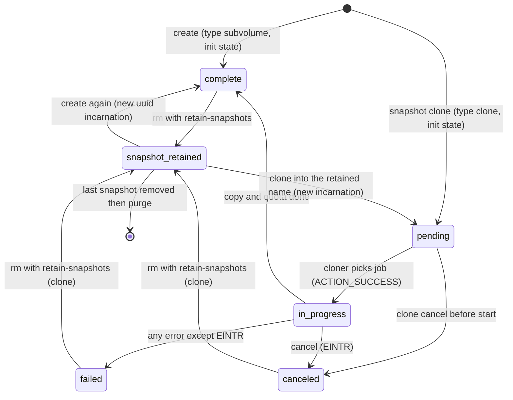
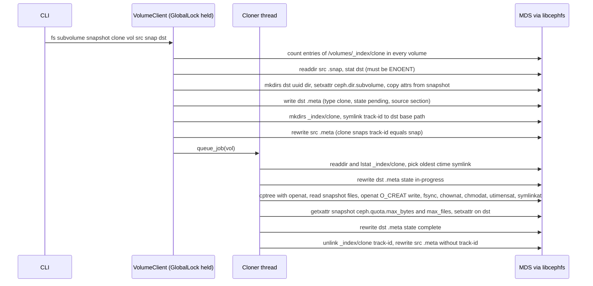
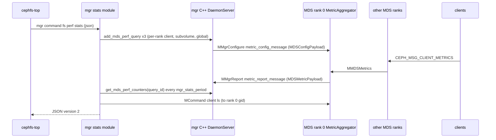
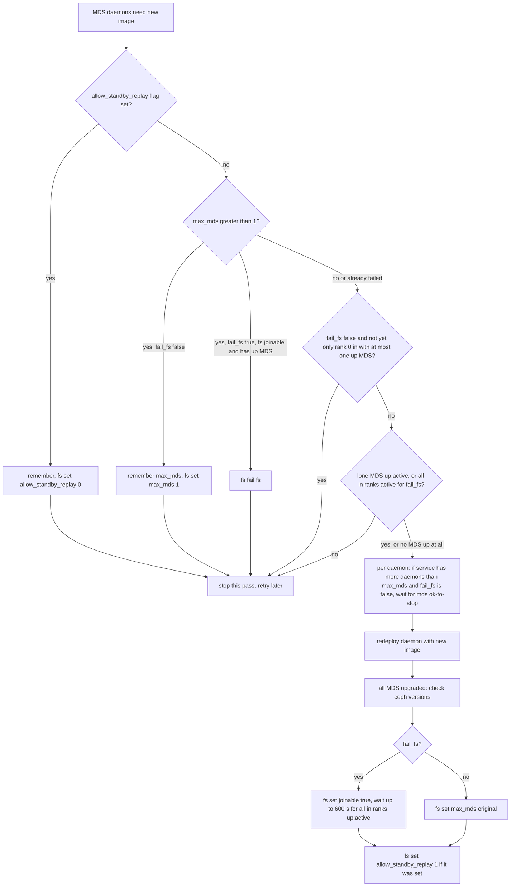

# mgr modules, CLI tools and orchestration: every interaction with the MDS

> Part of the [C++ MDS project map](../README.md). Sources: `src/pybind/mgr/volumes/**` (~6.6k LOC), `src/pybind/mgr/snap_schedule/**` (~1.4k), `src/pybind/mgr/mirroring/**` (~2.6k), `src/pybind/mgr/stats/**` (~0.7k), `src/pybind/mgr/nfs/**` (~4.4k, CephFS parts only), `src/pybind/mgr/status/module.py` (0.4k), `src/pybind/mgr/mds_autoscaler/module.py` (0.1k), `src/pybind/mgr/dashboard/{controllers,services}/cephfs.py` (~2.1k), `src/pybind/mgr/cephadm/{services/cephadmservice.py,upgrade.py,module.py}` (MDS parts), `src/cephadm/cephadmlib/daemons/ceph.py`, `src/pybind/mgr/rook/**` (MDS parts), the Rook operator (external repository `github.com/rook/rook` at release tag `v1.21.0`, commit `f190ca3b45f1` of 2026-10-06, cited as `rook/<path>:<lines>`: `pkg/operator/ceph/file/**`, `pkg/daemon/ceph/client/{filesystem,filesystem_mirror,upgrade,status,subvolumegroup,auth,command,config}.go`, `pkg/daemon/ceph/cleanup/subvolumegroups.go`, the MDS-relevant parts of `pkg/operator/ceph/{controller,config,version,cluster,csi,disruption,nfs}/**`, `pkg/operator/k8sutil/**`, `pkg/apis/ceph.rook.io/v1/**` and `pkg/util/retry.go`, and `deploy/examples/filesystem.yaml`), `src/pybind/mgr/{mgr_util.py,mgr_module.py}` (CephFS plumbing), `src/pybind/cephfs/cephfs.pyx` (~3.9k), `src/tools/cephfs/**` (~13k incl. shell/top), `src/tools/cephfs_mirror/**` (~11k), `src/exporter/DaemonMetricCollector.cc`, `qa/tasks/cephfs/**` (only to see what tests rely on).
> Related: [fsmap-and-mdsmap](./fsmap-and-mdsmap.md), [beacon-and-monitor](./beacon-and-monitor.md), [auth-and-mds-caps](./auth-and-mds-caps.md), [wire-protocol](../02-client-protocol/wire-protocol.md), [sessions](../02-client-protocol/sessions.md), [libcephfs-fuse-ganesha-expectations](../02-client-protocol/libcephfs-fuse-ganesha-expectations.md), [attributes-and-xattrs](../03-request-path/attributes-and-xattrs.md), [rename](../03-request-path/rename.md), [lookup-readdir-open-and-file-locks](../03-request-path/lookup-readdir-open-and-file-locks.md), [snapshots](../10-snapshots-quotas-subvolumes/snapshots.md), [rstats-quotas-and-subvolumes](../10-snapshots-quotas-subvolumes/rstats-quotas-and-subvolumes.md), [rados-object-catalog](../07-storage-formats/rados-object-catalog.md), [mds-tables](../07-storage-formats/mds-tables.md), [mdlog-and-journaler](../06-journal/mdlog-and-journaler.md), [metrics-and-subvolume-metrics](../12-qos-metrics-quiesce-quarantine/metrics-and-subvolume-metrics.md), [quiesce](../12-qos-metrics-quiesce-quarantine/quiesce.md), [quarantine](../12-qos-metrics-quiesce-quarantine/quarantine.md), [admin-commands](../13-admin-and-config/admin-commands.md), [config-perf-counters-and-health](../13-admin-and-config/config-perf-counters-and-health.md).

## 1. Purpose and responsibilities

This page inventories every component *outside* the `ceph-mds` daemon that talks to the MDS or manipulates MDS-owned state, and states for each whether it depends only on wire protocols or also on the C++ MDS on-disk format. These components are the "unmodified peers" a replacement MDS must satisfy besides the kernel client and libcephfs proper.

Interaction channels (used as letters throughout the page):

| Channel | Mechanism | MDS-side entry point |
|---|---|---|
| **A** libcephfs | Python binding `cephfs.LibCephFS` (or C `libcephfs`) mounts the fs and issues normal client requests (`MClientRequest`), cap traffic, session ops | `Server::handle_client_request` and friends ([request-lifecycle](../03-request-path/request-lifecycle.md)) |
| **B** tell / `mds_command` | `MCommand` sent by libcephfs `Client::mds_command` directly to an MDS daemon (by gid, name, role or `*`) | `MDSDaemon::handle_command` -> `AdminSocket::queue_tell_command` -> `MDSDaemon::asok_command` -> `MDSRankDispatcher::handle_asok_command` (src/mds/MDSDaemon.cc:770-829, 151-233) |
| **C** mon commands | `fs ...`, `mds ...`, `osd pool ...`, `auth ...`, `config ...`: change FSMap/MDSMap, caps, pools; the MDS observes the result through MDSMap/OSDMap updates | `MDSMonitor` / `FSCommands` ([beacon-and-monitor](./beacon-and-monitor.md)) |
| **D** direct RADOS | librados reads/writes of objects in the CephFS metadata or data pools | none (MDS must be offline or tolerate it) |
| **E** mgr reports | perf counters, MDS perf-metric queries, task status via `MgrClient` (`MMgrOpen`/`MMgrReport`/`MMgrConfigure`) | `MDSRank::create_logger`, `MetricAggregator`, `MDSRank::send_task_status` |
| **F** deployment | container entrypoint, CLI args, keyrings, `mds_join_fs`, upgrade choreography | daemon process contract ([process-and-threading](../00-architecture/process-and-threading.md)) |

Dependency classification (facts from the code cited in section 3):

| Component | Channels | Depends on C++ MDS on-disk format? |
|---|---|---|
| mgr `volumes` | A, B, C, F (via orchestrator) | **No.** It creates its own layout *inside the filesystem* (`/volumes/...`, `.meta` files) through ordinary POSIX ops and vxattrs. It depends on MDS vxattr semantics and POSIX behavior. |
| mgr `snap_schedule` | A, D (own SQLite objects in the metadata pool); no mon commands (it reads `mds_max_snaps_per_dir` from the config DB with `get_foreign_ceph_option`) | No MDS format. Stores its own objects in the CephFS metadata pool. |
| mgr `mirroring` | A (local and remote fs), C, D (own `cephfs_mirror` objects in the metadata pool) | No MDS format. |
| `cephfs-mirror` daemon | A (local and remote), FSMap subscription, D (own objects) | No MDS format; needs snapdiff, blockdiff, snapshot metadata, flock. |
| mgr `stats`, `cephfs-top` | B (`client ls`), E (perf queries) | No (wire + mgr protocol). |
| mgr `status`, `prometheus`, `influx`, `telegraf`, dashboard counters | E (perf counters), FSMap | No. Depends on perf counter names/priorities. |
| mgr `telemetry` (opt-in) | E (perf counters, `mds metadata`), B (`heap stats`, `dump_mempools`, only with the `perf_memory_metrics` collection) | No. |
| dashboard (CephFS) | A, B (`session ls`, `client evict`), C, remote calls into volumes/snap_schedule/mirroring | No. |
| mgr `nfs` | A (statx, earmark xattr), C (auth) | No. |
| mgr `mds_autoscaler` | FSMap + orchestrator only | No (never talks to the MDS). |
| cephadm, rook | C, F; Rook also reads the FSMap as the MDS entity (liveness probe) and the MDS admin socket (its per-node `ceph-exporter`) | No on-disk format; depends on daemon CLI, metadata (`ceph_version` string), beacon semantics and beacon health metrics (3.9). |
| `ceph-exporter` | admin socket of the MDS process | No; asok `counter dump`/`counter schema`/`config show`. |
| `cephfs-journal-tool` | D | **Yes** (Journaler header, `JournalPointer`, `LogEvent`/`EMetaBlob` encodings, dirfrag omap, `InodeStore`, `InoTable`). |
| `cephfs-table-tool` | D | **Yes** (`SessionMapStore`, `InoTable`, `SnapServer` encodings). |
| `cephfs-data-scan` | D (data + metadata pools), `cls_cephfs` | **Yes** (backtrace `parent`, `layout` xattrs, dirfrag/inode encodings, tables). `pg_files` subcommand is libcephfs only. |
| `cephfs-meta-injection` | D | **Yes** (dirfrag omap values/headers, backtraces). |
| `first-damage.py` | D | **Yes** (dentry omap value layout, `mds_snaptable` layout v5). |
| `cephfs-tool`, `cephfs-shell` | A | No. |

## 2. Source map

| File | Class / function | Lines | Role |
|---|---|---|---|
| `src/pybind/mgr/mgr_util.py` | `CephfsConnectionPool`, `Connection.connect` | 185-382 | Pooled libcephfs mounts for mgr modules; mount options; register addrs for blocklisting |
| `src/pybind/mgr/mgr_util.py` | `CephfsClient`, `open_filesystem`, `CephFSEarmarkResolver` | 384-546 | Module-facing helpers |
| `src/pybind/mgr/mgr_module.py` | `tell_command`, `get_quiesce_leader_gid`, `tell_quiesce_leader`, `send_command`, `cephfs` property | 1945-2053, 2651-2661 | Channel B plumbing (MDS commands go through libcephfs `mds_command2`) |
| `src/pybind/mgr/mgr_module.py` | `add_mds_perf_query`, `remove_mds_perf_query`, `reregister_mds_perf_queries`, `get_mds_perf_counters` | 2753-2804 | Channel E perf queries |
| `src/pybind/cephfs/cephfs.pyx` | `mount`, `abort_conn`, `mksnap`, `snap_info`, `do_snap_md_op`, `open` (mode-string parsing), `flock`, `mds_command2`, `mds_command`, `rmtree`, `cptree`, `copy_reg_file` | 812, 856, 1273-1398, 1622-1676, 1852, 2696-2770, 3275-3949 | Python binding; `rmtree`/`cptree` are implemented in Python over `*at()` calls |
| `src/pybind/mgr/volumes/module.py` | `Module.COMMANDS`, `MODULE_OPTIONS`, `_cmd_*` | 44-1208 | `fs volume/subvolumegroup/subvolume/clone/quiesce` CLI |
| `src/pybind/mgr/volumes/fs/volume.py` | `VolumeClient` | 61-1487 | Command implementations |
| `src/pybind/mgr/volumes/fs/operations/volume.py` | `create_volume`, `delete_volume`, `rename_volume`, `open_volume`, `get_mds_map` | 21-365 | Volume lifecycle, global lock |
| `src/pybind/mgr/volumes/fs/fs_util.py` | `create_filesystem`, `remove_filesystem`, `create_mds`, `listdir`, `listsnaps`, `get_ancestor_xattr` | 14-219 | Mon commands, directory helpers |
| `src/pybind/mgr/volumes/fs/vol_spec.py` | `VolSpec` | 7-45 | `/volumes`, `fsvolumens_`, internal dirs |
| `src/pybind/mgr/volumes/fs/operations/group.py` | `Group`, `create_group`, `set_group_attrs`, `remove_group` | 18-350 | Subvolume groups |
| `src/pybind/mgr/volumes/fs/operations/versions/subvolume_base.py` | `SubvolumeBase` | 28-795 | attrs, resize, info, user/snap metadata, snapshot visibility |
| `src/pybind/mgr/volumes/fs/operations/versions/subvolume_v1.py` | `SubvolumeV1` | 32-899 | v1 layout, auth, evict, snapshots, clone index attach |
| `src/pybind/mgr/volumes/fs/operations/versions/subvolume_v2.py` | `SubvolumeV2` | 19-422 | v2 layout, snapshot retention, per-subvolume `.trash` |
| `src/pybind/mgr/volumes/fs/operations/versions/metadata_manager.py` | `MetadataManager` | 54-200 | INI `.meta` read / atomic rewrite |
| `src/pybind/mgr/volumes/fs/operations/versions/auth_metadata.py` | `AuthMetadataManager` | 25-222 | JSON auth metadata files guarded by `flock` |
| `src/pybind/mgr/volumes/fs/operations/versions/op_sm.py` | `SubvolumeOpSm.transition_table` | 68-114 | Subvolume/clone state machine |
| `src/pybind/mgr/volumes/fs/operations/versions/__init__.py` | `SubvolumeLoader` | 18-127 | Version discovery, legacy/v1->v2 upgrade |
| `src/pybind/mgr/volumes/fs/operations/{trash,clone_index,index,access,rankevicter,pin_util,charmap_util,snapshot_util,lock}.py` | `Trash`, `CloneIndex`, `allow_access`, `RankEvicter`, `pin`, `charmap_*`, `mksnap`, `GlobalLock` | whole files | Trash can, clone tracking, cephx caps, eviction, vxattr helpers |
| `src/pybind/mgr/volumes/fs/{async_job,async_cloner,purge_queue,stats_util}.py` | `AsyncJobs`, `Cloner`, `ThreadPoolPurgeQueueMixin`, `CloneProgressReporter` | whole files | Background clone and purge threads, progress events |
| `src/python-common/ceph/fs/{earmarking,enctag}.py` | `CephFSVolumeEarmarking`, `CephFSVolumeEncryptionTag` | 26-185, 22-98 | `user.ceph.subvolume.{earmark,enctag}` xattrs |
| `src/pybind/mgr/snap_schedule/module.py`, `fs/schedule_client.py` | `Module`, `SnapSchedClient` | 18-374, 22-507 | Scheduled snapshots and pruning |
| `src/pybind/mgr/mirroring/module.py`, `fs/snapshot_mirror.py`, `fs/{utils,checkpoint,notify}.py`, `fs/dir_map/*` | `FSSnapshotMirror`, `FSPolicy`, `Checkpoint` | whole files | Mirror enable/peers, directory distribution, checkpoints |
| `src/tools/cephfs_mirror/{PeerReplayer,FSMirror,ClusterWatcher,Utils,Checkpoint,InstanceWatcher,MirrorWatcher}.cc` | `PeerReplayer::*`, `FSMirror::init`, `mount` | whole files | Mirror daemon |
| `src/pybind/mgr/stats/module.py`, `fs/perf_stats.py` | `FSPerfStats` | 21-69, 17-648 | `fs perf stats` |
| `src/pybind/mgr/status/module.py` | `handle_fs_status` | 36-280 | `fs status` |
| `src/pybind/mgr/telemetry/module.py` | `get_heap_stats`/`parse_heap_stats`, `get_mempool`, fs section of the report, `gather_mds_metadata` | 529-640, 1225-1265, 412-433 | Opt-in telemetry: MDS tell commands and counters |
| `src/pybind/mgr/mds_autoscaler/module.py` | `MDSAutoscaler.verify_and_manage_mds_instance` | 60-102 | MDS daemon count = `max_mds + standby_count_wanted` |
| `src/pybind/mgr/dashboard/controllers/cephfs.py`, `services/cephfs.py` | controller `CephFS._mds_counters`, `CephFS._evict`, `CephFSClients.get`; service class `CephFS` (file browser) | 290-805, 129-400 | Dashboard REST |
| `src/pybind/mgr/nfs/export.py`, `utils.py`, `ganesha_conf.py` | `ExportMgr._create_user_key`, `_check_earmark`, `validate_cephfs_path`, `CephFSFSAL` | 80-1112 | NFS exports of CephFS paths |
| `src/pybind/mgr/cephadm/services/cephadmservice.py` | `MdsService.config/prepare_create/get_active_daemon/purge`, `CephadmService.ok_to_stop` (base class) | 1499-1556, 922-950 | MDS deployment |
| `src/pybind/mgr/cephadm/upgrade.py` | `_prepare_for_mds_upgrade`, `_complete_mds_upgrade`, `_enough_mds_for_ok_to_stop` | 1398-1577, 2083-2140 | MDS upgrade choreography |
| `src/cephadm/cephadmlib/daemons/ceph.py` | `Ceph.get_daemon_args`, `default_entrypoint`, `get_ceph_mounts` | 126-316 | Container command line |
| `src/pybind/mgr/rook/rook_cluster.py`, `module.py` | `apply_filesystem`, `describe_service` (MDS part), `remove_service`, `apply_mds` | 675-738, 358-380, 595-600, 648-651 | Rook `CephFilesystem` CRD |
| `rook/pkg/operator/ceph/file/controller.go`, `filesystem.go`, `dependent.go`, `health.go`, `subvolumegroup/controller.go` (external) | `ReconcileCephFilesystem.reconcile`, `createFilesystem`, `deleteFilesystem`, `updateFilesystem`, `doFilesystemCreate`, `cephFilesystemDependents`, `mirrorChecker`, `ReconcileCephFilesystemSubVolumeGroup.reconcile`, `deleteSubVolumeGroup`, `cleanup` | 194-508; 47-134, 219-319; 47-144; 33-66, 94-114; 217-447, 493-512 | CephFilesystem reconcile: pools, `fs new`, `max_mds`, standby-replay settings, deletion; mirror status polling; subvolume groups |
| `rook/pkg/operator/ceph/file/mds/mds.go`, `spec.go`, `config.go`, `livenessprobe.go`, `livenessprobe.sh` (external) | `Cluster.Start`, `startDeployment`, `isCephUpgrade`, `upgradeMDS`, `scaleDownDeployments`, `DeleteMdsCephObjects`, `finishedWithDaemonUpgrade`; `makeDeployment`, `makeMdsDaemonContainer`; `generateKeyring`, `setDefaultFlagsMonConfigStore`; `generateMDSLivenessProbeExecDaemon` | 98-430; 46-211; 33-114; 12-89; 1-30 | MDS Deployments, command line, keyring, config DB options, upgrade choreography, liveness probe |
| `rook/pkg/daemon/ceph/client/filesystem.go`, `upgrade.go`, `status.go`, `subvolumegroup.go`, `filesystem_mirror.go`, `command.go` (external) | `AllowStandbyReplay`, `CreateFilesystem`, `SetNumMDSRanks`, `FailAllStandbyReplayMDS`, `GetMdsIdByRank`, `WaitForActiveRanks`, `FailFilesystem`, `RemoveFilesystem`, `WaitForNoStandbys`; `OkToStop`, `OkToContinue`; `MdsActiveOrStandbyReplay`; `CreateCephFSSubVolumeGroup`, `PinCephFSSubVolumeGroup`, `DeleteCephFSSubVolumeGroup`; `GetFSMirrorDaemonStatus`; `FinalizeCephCommandArgs`, `CephToolCommand.run` | 121-402; 117-210, 409-418; 226-270; 35-238; 212-235; 64-111, 176-245 | Mon and mgr command wrappers |
| `rook/pkg/operator/ceph/controller/spec.go`, `controller_utils.go`, `network.go`, `config/{defaults,config,store,monstore,probes,datapath}.go`, `version/version.go`, `cluster/mon/spec.go`, `k8sutil/{deployment,pod}.go`, `daemon/ceph/client/config.go`, `util/retry.go` (external) | `DaemonFlags`, `DaemonEnvVars`, `DaemonVolumeMounts`, `GenerateLivenessProbeExecDaemon`; `IsReadyToReconcile`, `canIgnoreHealthErrStatusInReconcile`; `ApplyCephNetworkSettings`; `DefaultFlags`; `SetOrRemoveDefaultConfigs`; `MonStore.Set`, `DeleteDaemon`, `SetAll`; `ConfigureLivenessProbe`; `ExtractCephVersion`, `IsSuperior`; `UpdateCephDeploymentAndWait`; `UpdateDeploymentAndWait`, `ClusterDaemonEnvVars`, `AddUnreachableNodeToleration`; `PopulateMonHostMembers`; `RetryWithContext` | spec.go 135-175, 242-454, 647-680; controller_utils.go 188-274; network.go 45-131; defaults.go 27-51; config.go 101-144; monstore.go 94-179, 248-363; probes.go 27-98; version.go 75-154, 236-266; mon/spec.go 541-577; deployment.go 70-146; pod.go 105-136, 223-249; client/config.go 243-269; retry.go 30-55 | Shared pod, flag and probe helpers; health gate; version parsing; per-Deployment update gate |
| `rook/pkg/operator/ceph/cluster/cephx.go`, `cephstatus.go`, `cluster.go` (external) | `setDefaultCephxKeyType`, `setRotatingServiceKeyType`; `checkStatus`, `toCustomResourceStatus`, `forceDeleteStuckRookPodsOnNotReadyNodes`; `updateConfigStoreFromCRD`, `configureMsgr2` | 99-164; 118-147, 223-235, 310-350; 695-708, 824-878 | Cluster-wide cephx cipher policy, the health status that gates every CR reconcile, messenger and user-supplied options |
| `rook/pkg/operator/ceph/cluster/nodedaemon/exporter.go`, `crash.go` (external) | `getCephExporterDaemonContainer`; `getCrashDirInitContainer`, `getCrashDaemonContainer`, `generateCrashEnvVar` | 45-53, 186-232; 134-154, 170-200 | Per-node `ceph-exporter` that reads `/run/ceph/*.asok`; per-node `ceph-crash` that posts crash dumps |
| `rook/pkg/operator/ceph/file/mirror/{config,spec}.go`, `nfs/config.go`, `csi/{secrets,config}.go`, `controller/cluster_info.go`, `daemon/ceph/cleanup/subvolumegroups.go` (external) | `generateKeyring`, `makeFsMirroringDaemonContainer`; `getGaneshaConfig`; `cephCSIKeyringCephFSNodeCaps`, `cephCSIKeyringCephFSProvisionerCaps`, `applyCephFSMountOptions`; `loadCsiSettings`; `SubVolumeGroupCleanup` | 31-77, 112-134; 109-157; 164-181, 247-276; 215-235; 28-142 | Other MDS clients Rook deploys or configures; subvolume cleanup job |
| `src/tools/cephfs/JournalTool.cc`, `JournalScanner.cc`, `Resetter.cc`, `Dumper.cc` | `JournalTool::main`, `recover_dentries`, `consume_inos` | whole files | `cephfs-journal-tool` |
| `src/tools/cephfs/TableTool.cc` | `TableTool::main`, `TableHandler`, `TableHandlerOmap` | 100-439 | `cephfs-table-tool` |
| `src/tools/cephfs/DataScan.cc`, `PgFiles.cc`, `src/cls/cephfs/cls_cephfs_client.cc` | `DataScan::*`, `MetadataDriver::*` | whole files | `cephfs-data-scan` |
| `src/tools/cephfs/MetaTool.cc`, `cephfs-meta-injection.cc` | `MetaTool::*` | whole files | `cephfs-meta-injection` |
| `src/tools/cephfs/first-damage.py` | `traverse` | 1-172 | Dentry `first` damage scanner |
| `src/tools/cephfs/cephfs-tool.cc`, `shell/cephfs-shell`, `top/cephfs-top` | | whole files | libcephfs benchmark, shell, top |

## 3. How it works

### 3.1 Shared plumbing used by all mgr modules

#### 3.1.1 libcephfs mounts owned by the mgr (channel A)

- `CephfsConnectionPool.Connection.connect` (src/pybind/mgr/mgr_util.py:236) creates `cephfs.LibCephFS(rados_inst=self.mgr.rados)`, i.e. the mount authenticates as the mgr's own cephx entity (cephadm gives `mgr.*` the caps `mon 'profile mgr', osd 'allow *', mds 'allow *'`, src/pybind/mgr/cephadm/services/cephadmservice.py:1409-1412). Before `init()`/`mount(filesystem_name=...)` it sets: `client_mount_uid=0`, `client_mount_gid=0`, `client_check_pool_perm=false`, `client_quota=false`, `client_respect_subvolume_snapshot_visibility=false`, `client_fscrypt_as=false` (mgr_util.py:241-247). So mgr I/O runs as uid/gid 0, ignores quotas client-side, and always sees `.snap`.
- After mount it calls `self.mgr._ceph_register_client(None, self.fs.get_addrs(), False)` (mgr_util.py:253); on `disconnect` it unregisters. The mgr reports these addresses in its beacon; on mgr failover `MgrMonitor::drop_active` blocklists every registered client address for `mon_mgr_blocklist_interval` (default 1 day) (src/mon/MgrMonitor.cc:921-923). Consequence for the MDS: the old mgr's pooled libcephfs sessions become blocklisted clients (see [sessions](../02-client-protocol/sessions.md) for how the MDS reacts to blocklisted sessions). Only pooled `CephfsConnectionPool` mounts (and the mgr's own `rados` handle, mgr_module.py:2647) are registered: the dashboard's un-pooled mounts never call `_ceph_register_client` (grep of src/pybind/mgr), so a mgr failover does not blocklist them and the MDS only reaps their sessions through the normal stale/autoclose path. (The mirroring module's short-lived `connect_to_filesystem` mounts go to the *remote* cluster, where the local blocklist does not apply anyway.)
- Pool limits: at most `MAX_CONCURRENT_CONNECTIONS = 5` mounts per filesystem per pool; idle (no op for `CONNECTION_IDLE_INTERVAL = 60 s`) connections are closed by a timer every 30 s (mgr_util.py:277-305). A connection is reused only if the fscid in the FSMap is unchanged (`is_connection_valid`, mgr_util.py:223); if the fs was removed it is torn down with `abort_conn()` (no session close) instead of `shutdown()` (mgr_util.py:214-221, 268).
- Each `CephfsClient` instance owns its own pool. Distinct pools exist for: `VolumeClient`, the volumes `Cloner`, the volumes purge queue (each `AsyncJobs` creates `CephfsClient(self.vc.mgr)`, src/pybind/mgr/volumes/fs/async_job.py:157), `SnapSchedClient`, the mirroring module (`self.local_fs`), the NFS module (`cephfs_client_for_mgr`, src/pybind/mgr/nfs/utils.py:169). The dashboard opens an un-pooled `LibCephFS` per instance of its service class `CephFS` without the uid/gid overrides (src/pybind/mgr/dashboard/services/cephfs.py:129-136). The MDS therefore sees many concurrent sessions from the same `mgr.<id>` entity.

#### 3.1.2 MDS commands from mgr modules (channel B)

- `MgrModule.send_command(result, 'mds', svc_id, json, tag)` routes MDS targets to `self.cephfs.mds_command2(...)` (src/pybind/mgr/mgr_module.py:2049-2053), where `self.cephfs` is a shared *unmounted* `LibCephFS` created on first use (mgr_module.py:2651-2661). `tell_command` wraps it synchronously (mgr_module.py:1945).
- libcephfs `Client::mds_command` (src/client/Client.cc:6847) authenticates, fetches the FSMap, resolves targets with `Client::resolve_mds` (Client.cc:6697): first `FSMap::parse_role` (src/mds/FSMap.cc:1247-1289), so `fscid:rank`/`fsname:rank` -> the rank's gid (`-EAGAIN` if the rank is down) and a *bare integer that names an `in` rank of the legacy/default filesystem is taken as that rank*; otherwise an integer -> gid (`-ENOENT` if unknown), `*` -> every MDS in the FSMap, otherwise a daemon name. (Real gids are large, so the gid strings sent by volumes/stats resolve as gids.) Laggy daemons are skipped; if all are laggy -> `-ENOENT` "All targeted MDS daemons are laggy". It opens a connection to each target and sends `MCommand`; with `one_shot` it sends a keepalive and aborts with `-EPIPE` on reset.
- MDS side: `MDSDaemon::handle_command` (src/mds/MDSDaemon.cc:770) drops the command if the connection has no session, and replies `-EACCES` "permission denied" unless `session->auth_caps.allow_all()` (MDSDaemon.cc:810-816); otherwise it queues the command on the admin socket (`queue_tell_command`, MDSDaemon.cc:823). Sessions that exist only to issue commands are marked disposable.

#### 3.1.3 FSMap JSON consumed by modules

All modules read `self.get('fs_map')` (the mon's FSMap dump, see [fsmap-and-mdsmap](./fsmap-and-mdsmap.md)). Fields consumed: `filesystems[].id`, `filesystems[].mdsmap.{fs_name, metadata_pool, data_pools, max_mds, standby_count_wanted, flags, flags_state, in, up ("mds_<rank>" -> gid), info ("gid_<gid>" -> {name, gid, rank, state, addr, laggy_since}), qdb_leader}`, `filesystems[].mirror_info.peers`, `standbys[].{name, addr, rank}`. Modules that subscribe to `NotifyType.fs_map`: `snap_schedule` (module.py:20), `mirroring` (module.py:27), `stats` (module.py:34), `mds_autoscaler` (module.py:22).

#### 3.1.4 How libcephfs routes the xattrs these modules use

`Client::_getxattr` (src/client/Client.cc:15144): (1) names in the client vxattr tables (`_dir_vxattrs` Client.cc:15826, `_file_vxattrs`, `_common_vxattrs` Client.cc:15922) are computed client-side after a forced `_getattr` (for `VXATTR_RSTAT` names the mask includes `CEPH_STAT_RSTAT`, which the MDS serves from the auth MDS, `Server::handle_client_getattr` src/mds/Server.cc:4286); (2) any other `ceph.*` name is sent to the MDS as `CEPH_MDS_OP_GETVXATTR` (`Client::_getvxattr`, Client.cc:8443-8483), which is only issued if the MDS session advertises `CEPHFS_FEATURE_OP_GETVXATTR` (bit 17, src/mds/cephfs_features.h:48); without it the request fails `-EOPNOTSUPP`, which the client turns into `-ENODATA`; the reply payload is a versioned (`ENCODE_START(1,1)`) string; (3) if the MDS answers `-ENODATA`, the client falls back to the plain xattr map. Client-local names relevant here: `ceph.dir.layout` and `ceph.dir.layout.{stripe_unit,stripe_count,object_size,pool,pool_namespace}`, `ceph.dir.{entries,files,subdirs,rentries,rfiles,rsubdirs,rsnaps,rbytes,rctime}`, `ceph.quota*`, `ceph.dir.pin`, `ceph.snap.btime`, `ceph.mirror.info` (synthesized from raw xattrs `ceph.mirror.info.cluster_id` and `ceph.mirror.info.fs_id`, Client.cc:15772-15785), `ceph.fscrypt.{auth,file}`. MDS-served (`GETVXATTR`, `Server::handle_client_getvxattr` src/mds/Server.cc:7317): `ceph.dir.subvolume`, `ceph.dir.subvolume.snaps.visible`, `ceph.dir.{charmap,casesensitive,normalization,encoding}`, `ceph.dir.pin.{random,distributed}`, `ceph.dir.layout.{json,pool_name,pool_id}`. Plain xattrs: `user.ceph.subvolume.earmark`, `user.ceph.subvolume.enctag`, `ceph.mirror.dirty_snap_id` (allowed by `Server::is_allowed_ceph_xattr`, src/mds/Server.h:549-557). Setting (or removing) a `ceph.*` vxattr is an MDS `SETXATTR`/`RMXATTR` handled by `Server::handle_client_setvxattr` (Server.cc:6342, entered from `handle_client_setxattr`/`handle_client_removexattr` when `Server::is_ceph_vxattr` matches, Server.h:500-514; the inode must be auth, `try_get_auth_inode` forwards otherwise); any other `ceph.*` name except the two allowed plain ones is rejected `-EINVAL` (Server.cc:7167-7170). Exceptions: `ceph.fscrypt.auth` becomes `SETATTR` with `CEPH_SETATTR_FSCRYPT_AUTH` (`Client::_vxattrcb_fscrypt_auth_set`, Client.cc:15589-15599), and `ceph.fscrypt.file` becomes `SETATTR` with `CEPH_SETATTR_SIZE` and `stx_size` = the value, to which `_do_setattr` adds `CEPH_SETATTR_FSCRYPT_FILE` because an aux buffer is passed (Client.cc:15615-15631, 8691-8696).

### 3.2 mgr/volumes

#### 3.2.1 Command surface and what each command does to the MDS

All commands are declared in `Module.COMMANDS` (src/pybind/mgr/volumes/module.py:46-655) and dispatched by name (`handle_command`, module.py:748). Every command's filesystem access is wrapped by `open_volume`, which takes the module-wide `GlobalLock` (src/pybind/mgr/volumes/fs/operations/volume.py:332-348); background job discovery, clone copying, purge `rmtree` and progress reporting use `open_volume_lockless` (volume.py:351-365) and only take the global lock for `.meta` state transitions and `subvolume_purge`. Exceptions: `fs subvolume quarantine` touches no filesystem and takes no lock (fs/volume.py:812-858), and the `snapshot_clone_no_wait` pre-check of `fs subvolume snapshot clone` runs `get_all_pending_clones_count`, which does `open_volume` + `readdir /volumes/_index/clone` on *every* filesystem in the FSMap before the source volume is opened (operations/volume.py:308-329).

| Command | Implementation | MDS-visible effect (channel) |
|---|---|---|
| `fs volume create <name> [placement] [meta_pool data_pool]` | `create_volume` (operations/volume.py:101) | C: `osd pool create cephfs.<name>.meta`, `osd pool create cephfs.<name>.data bulk=true` (unless pools given), `fs new`; F: orchestrator `apply` of `ServiceSpec(service_type='mds', service_id=<name>)` with `no_overwrite=True` (fs_util.py:49-66) |
| `fs volume rm <vol> --yes-i-really-mean-it` | `delete_fs_volume` (fs/volume.py:127), `delete_volume` (operations/volume.py:143) | checks `config get mon_allow_pool_delete`; cancels purge jobs; closes all pooled mounts (`del_connections(wait=True)`); orchestrator `remove_service('mds.<vol>')`; C: `fs fail`, `fs rm --yes-i-really-mean-it`, `osd pool rm` metadata and data pools |
| `fs volume rename` | `rename_volume` (operations/volume.py:184) | orchestrator: create `mds.<new>` with old placement, later remove `mds.<old>`; C: `fs rename --yes-i-really-mean-it`, `osd pool rename` to `cephfs.<new>.meta`/`.data` (metadata pool whenever its name differs; data pool only if there is exactly one). The mon refuses unless no MDS is up for the fs and `refuse_client_session` is set (src/mon/FSCommands.cc:1346-1361) |
| `fs volume ls/info` | `list_fs_volumes`, `volume_info` (fs/volume.py:153,171) | A: `statx(/volumes, SIZE)` (dir size = rbytes), `readdir /volumes/_deleting` count |
| `fs subvolumegroup create/rm/info/resize/ls/exist/getpath/pin/charmap` | fs/volume.py:1206-1405, operations/group.py | A: `mkdir(s)`, `rmdir`, `stat/statx`, `chown`, `lchmod`, `setxattr ceph.quota.max_bytes`, `ceph.dir.layout.pool`, `ceph.dir.{pin,pin.distributed,pin.random}`, `ceph.dir.{casesensitive,normalization,encoding}`, `removexattr ceph.dir.charmap`, `readdir /volumes` |
| `fs subvolumegroup snapshot create` | `create_subvolume_group_snapshot` (fs/volume.py:1407) | **returns `-ENOSYS`** "subvolume group snapshots are not supported" after opening the group |
| `fs subvolumegroup snapshot rm/ls` | fs/volume.py:1424,1440 | A: `rmdir <group>/.snap/<snap>`, `readdir <group>/.snap` |
| `fs subvolume create` | `create_subvolume` (fs/volume.py:251) | idempotent: if exists, re-applies attrs; else `create_subvol` (3.2.5) |
| `fs subvolume rm [--force] [--retain-snapshots]` | `remove_subvolume` (fs/volume.py:296) | rename to trash / retain (3.2.9); kicks purge threads |
| `fs subvolume authorize/deauthorize/authorized_list` | fs/volume.py:321-371, SubvolumeV1 auth (3.2.10) | A: auth JSON files + `flock`; C: `auth get`, `auth get-or-create`, `auth caps`, `auth rm` |
| `fs subvolume evict <vol> <sub> <auth_id>` | `evict` (fs/volume.py:373), `SubvolumeV1.evict` (subvolume_v1.py:609) | B: `session evict` with filters to every up rank (3.2.11) |
| `fs subvolume getpath/info/exist/ls` | fs/volume.py:488-680 | A: reads `.meta`, `statx` (BTIME, SIZE, UID, GID, MODE, times), getxattr of quota/layout/charmap/earmark/enctag |
| `fs subvolume resize <new_size> [--no_shrink]` | `SubvolumeBase._resize` (subvolume_base.py:400) | A: `getxattr/setxattr ceph.quota.max_bytes` on the data dir |
| `fs subvolume pin <export\|distributed\|random> <setting>` | `pin` (pin_util.py:19) on `base_path` | A: `setxattr ceph.dir.pin` (int) / `ceph.dir.pin.distributed` (bool -> 0/1) / `ceph.dir.pin.random` (float) |
| `fs subvolume charmap set/get/rm` | charmap_util.py on `self.path` | A: `setxattr ceph.dir.<setting>` then `getxattr ceph.dir.charmap`; rm = `removexattr ceph.dir.charmap` |
| `fs subvolume metadata set/get/ls/rm`, `snapshot metadata ...` | subvolume_base.py:658-735 | A: rewrite of `.meta` (`[USER_METADATA]`, `[SNAP_METADATA_<snap>]`) — not MDS snapshot metadata |
| `fs subvolume earmark get/set/rm`, `enctag get/set/rm` | fs/volume.py:686-807 | A: `getxattr/setxattr user.ceph.subvolume.earmark\|enctag` |
| `fs subvolume snapshot create/rm/ls/info/getpath` | 3.2.7 | A: `mkdir/rmdir/readdir` in `.snap`, `getxattr ceph.snap.btime`, `ceph.dir.layout.pool` |
| `fs subvolume snapshot protect/unprotect` | fs/volume.py:1030-1058 | no-op with deprecation warning |
| `fs subvolume snapshot clone`, `fs clone status/cancel` | 3.2.8 | A: full data copy via libcephfs; rstat xattrs for progress |
| `fs subvolume snapshot_visibility set/get` | subvolume_base.py:738-795 | A: `setxattr/getxattr ceph.dir.subvolume.snaps.visible` |
| `fs subvolume quarantine enable/disable` | `quarantine_subvolume` (fs/volume.py:812) | B: `quarantine enable\|disable path=/volumes/<group\|_nogroup>/<sub>` to the first `up:active`/`up:clientreplay` MDS in the map (fs/volume.py:845-858) |
| `fs quiesce <vol> [members...] [--set-id ...] [--leader] [--with_leader <gid>]` | `quiesce` (fs/volume.py:538) | B: `quiesce db` with `roots=[<subvolume data paths>]` to the quiesce leader gid from `mdsmap.qdb_leader` or the `--with_leader` gid (3.2.12) |

Module options (src/pybind/mgr/volumes/module.py:658-689): `max_concurrent_clones` (int, 4), `snapshot_clone_delay` (int s, 0), `periodic_async_work` (bool, false; when true async threads re-scan all volumes every 5 s, async_job.py:124,186), `snapshot_clone_no_wait` (bool, true: reject clone with `-EAGAIN` when pending clones >= `max_concurrent_clones`, fs/volume.py:1110-1112), `pause_purging` (bool, false), `pause_cloning` (bool, false). The purge thread pool size is fixed at 4 (`ThreadPoolPurgeQueueMixin(self, 4)`, fs/volume.py:70).

#### 3.2.2 Layout inside the filesystem

```
/volumes                                    (VolSpec.DEFAULT_SUBVOL_PREFIX, mode 0755)   vol_spec.py:13
|-- _nogroup/                               (Group.NO_GROUP_NAME: subvolumes without group) group.py:21
|   `-- <subvol>/                           base_path
|       |-- .meta                           INI metadata (MetadataManager), mode 0640
|       |-- <uuid4>/                        data root ("path" in .meta); what clients mount
|       |-- .trash/<uuid4>/                 v2 only: retained old incarnation awaiting purge (mode 0700)
|       `-- .snap/<snap>/...                v2: snapshot of base_path (contains .meta and <uuid>)
|                                           v1: snapshots live in <uuid>/.snap/<snap>
|-- <group>/                                groups (mode from command, default 755)
|   `-- <subvol>/ ...                       same as above
|-- _index/clone/<track-uuid>  -> /volumes/<group>/<clone>   symlinks, one per pending/in-progress clone
|-- _deleting/<uuid4>/                      trashed subvolume base dirs (_deleting itself is mkdirs'd 0700)
|-- _deleting/<uuid4>  -> /volumes/<g>/<s>/.trash/<uuid4>    symlink for retained incarnations
|-- _legacy/<md5(base_path)>.meta           .meta of pre-v1 "legacy" subvolumes (no <uuid> level)
|-- $<auth_id>.meta                         JSON auth metadata per cephx id
`-- _<group>:<subvol>.meta                  JSON auth metadata per subvolume ("" for _nogroup)
```

Sources: `VolSpec.INTERNAL_DIRS = [_nogroup, _index, _deleting, _legacy]` (src/pybind/mgr/volumes/fs/vol_spec.py:19); `Trash.GROUP_NAME="_deleting"` (operations/trash.py:15); `Index.GROUP_NAME="_index"` (operations/index.py:8), `CloneIndex.SUB_GROUP_NAME="clone"` (operations/clone_index.py:20); `SubvolumeBase.LEGACY_CONF_DIR="_legacy"`, `legacy_config_path` (subvolume_base.py:29,82-93); `config_path = base_path/.meta` (subvolume_base.py:73); `AuthMetadataManager._auth_metadata_path` / `_subvolume_metadata_path` (auth_metadata.py:123-125, 50-61); v2 `trash_dir` (subvolume_v2.py:79). `.snap` is the mgr's `client_snapdir` (default `.snap`; `VolSpec(mgr.rados.conf_get('client_snapdir'))`, fs/volume.py:65).

Group/subvolume names: `goodchars = [A-Za-z0-9-_.]` on create (module.py:15). Group names equal to an internal dir are rejected (`-EINVAL`, `_nogroup` -> `-EPERM`) (group.py:23-27). Combined `_<group>:<subvol>.meta` longer than 255 bytes -> `-ENAMETOOLONG` (auth_metadata.py:56-60).

The RADOS pool namespace for `--namespace-isolated` subvolumes is `fsvolumens_` + `_<group>_<subvol>`, e.g. `fsvolumens__nogroup_sv1` (`SubvolumeBase.namespace`, subvolume_base.py:96-97; `DEFAULT_NS_PREFIX`, vol_spec.py:15).

#### 3.2.3 The `.meta` file, versions and upgrade

- Format: Python `configparser` INI. Read by `open(O_RDONLY)` + 4 KiB reads; written by `open(<path>.tmp, O_WRONLY|O_CREAT|O_TRUNC, 0640)`, write, `fsync`, `close`, then `rename(<path>.tmp, <path>)` replacing the old file, all under a process-wide `threading.Lock` (metadata_manager.py:19-112). Empty sections are dropped on flush.
- Sections/keys (see section 4 for the full schema): `[GLOBAL] version,type,path,state` (+ QA-only `allow_subvolume_upgrade`), `[USER_METADATA]`, `[SNAP_METADATA_<snap>]`, `[source] volume,group,subvolume,snapshot` (clones), `[clone snaps] <track-id> = <snap>` (on the source), `[CLONE_FAILURE] errno,error_msg`.
- `SubvolumeLoader.get_subvolume_object` (versions/__init__.py:107): `discover()` stats `base_path`, reads `.meta`; a `.meta` whose `path`'s parent is not `base_path` is treated as "fabricated" and the loader falls back to legacy mode (subvolume_base.py:468-499). If no metadata exists and `upgrade` is allowed, it creates `/volumes/_legacy/<md5>.meta` with version 1 and `path=base_path` (`upgrade_legacy_subvolume`, versions/__init__.py:92-105). A v1 subvolume with **no snapshots** is upgraded to v2 by rewriting `version = 2` (versions/__init__.py:64-90). New subvolumes are always created with the max version (v2).
- Every `open()` re-reads `.meta`, re-applies `setxattr ceph.dir.subvolume 1` ("unconditionally mark as subvolume, to handle pre-existing subvolumes", subvolume_v1.py:224-258; subvolume_v2.py:303-356), checks the op is allowed by type/state (`-ENOTSUP`/`-EAGAIN`; retained state -> `-ENOENT`), and `stat`s the data path to load uid/gid/mode. Before that, constructing any subvolume object `stat`s `/volumes/_legacy/<md5(base_path)>.meta` (`load_config`, subvolume_base.py:147-163), and the loader runs `clean_stale_snapshot_metadata` (a `.snap` readdir when `.meta` has `SNAP_METADATA_*` sections) on every open (versions/__init__.py:115). So even a read-only `fs subvolume info` issues an MDS `SETXATTR` (normally answered by the rdlock-only fast path) plus several lookups/opens/reads.
- Where the subvolume flag sits: v1 marks the `<uuid>` dir (`SubvolumeV1.mark_subvolume`, subvolume_v1.py:65-74), v2 marks `base_path` (`SubvolumeV2.mark_subvolume`, subvolume_v2.py:95-104). Snapshots are therefore taken at the dir carrying `ceph.dir.subvolume` in both versions (v1 `snapshot_base_path` = `<uuid>/.snap`, v2 = `<subvol>/.snap`, subvolume_v1.py:76, subvolume_v2.py:114).

#### 3.2.4 Subvolume and clone state machine

States are strings in `[GLOBAL] state` (`SubvolumeStates`, versions/subvolume_attrs.py:22-49); transitions in `SubvolumeOpSm.transition_table` (versions/op_sm.py:68-114). The `-> snapshot-retained` edges and the re-creation of a retained subvolume are written directly to `.meta` by `remove`/`create`/`create_clone` (subvolume_v2.py:189, 245, 396-401), not looked up in the table.



(`in_progress` is stored as `in-progress`, `snapshot_retained` as `snapshot-retained`.) Allowed ops per state: everything in `complete`; in `snapshot-retained` only `rm`, `rm-force`, `ls`, `info`, `snap-rm*`, `snap-ls`, `snap-getpath`, `snap-info`, `snap-(un)protect`, `clone-source`, `clone-failed`; in clone states only `rm-force`, `clone-*` (subvolume_v2.py:274-301).

#### 3.2.5 Create (`SubvolumeV2.create`, subvolume_v2.py:157-207)

Sequence of libcephfs calls (all ordinary client requests):
1. `stat` group dir; if missing, `mkdirs(group_path, 0755)` (fs_util.py:209-219).
2. `mkdirs(/volumes/<g>/<s>/<uuid4>, mode)`; `setxattr(base_path, "ceph.dir.subvolume", "1")`.
3. `set_attrs(<uuid path>)` (subvolume_base.py:242-372), in this order: `ceph.quota.max_bytes` (if size); `ceph.dir.layout.pool` (if pool); then either `ceph.dir.layout.pool_namespace=fsvolumens_...` (isolated) or, if no pool given and the dir has no own layout, copy the nearest ancestor's `ceph.dir.layout.pool` onto the dir (`get_ancestor_xattr` walks up to `/`, fs_util.py:196-207 — **requires `/` to expose a layout**); `chown(uid,gid)` (defaults: group's uid/gid); `lchmod(mode)`; earmark xattr; `ceph.dir.normalization`; `ceph.dir.casesensitive=0` (only if false); enctag xattr (`-EINVAL` if > 255 chars); `ceph.fscrypt.auth`/`ceph.fscrypt.file` (only when copying attrs for a clone).
4. Write `.meta` (`init_config`), or for a retained subvolume update `type/path/state` in place.
5. `open(/volumes/_<g>:<s>.meta, O_CREAT, 0755)` (empty auth metadata file, auth_metadata.py:162-169).
6. On any error the partially created subvolume is removed (`_remove_on_failure`: `remove(internal_cleanup=True)` -> trash, or only `rmdir` of the new `<uuid>` dir when re-creating a retained subvolume, subvolume_v2.py:141-150) and the purge queue is kicked (fs/volume.py:228-249).

Group create (`create_group`, group.py:254-296): `mkdirs(/volumes,0755)`, `mkdir(group, mode)`, quota, layout pool (explicit or nearest ancestor's), `chown` (default 0:0), `lchmod`, normalization, casesensitive; `rmdir` on failure.

#### 3.2.6 Attribute operations

- **Resize** (`_resize`, subvolume_base.py:400-448; group: group.py:155-187): subvolumes accept bytes or `<n>[KMGTPE][i][B]` (binary multipliers, `convert_to_bytes` subvolume_base.py:374-398), groups only integer bytes; `inf`/`infinite` -> 0 which removes the quota (the MDS treats value 0 as disable; [rstats-quotas-and-subvolumes](../10-snapshots-quotas-subvolumes/rstats-quotas-and-subvolumes.md)). With `--no_shrink`, a new size smaller than `stat().st_size` of the data dir is rejected. Output JSON: `[{"bytes_used":N},{"bytes_quota":N},{"bytes_pcent":"x.xx"|"undefined"}]`.
- **Used bytes everywhere** (`info`, `resize`, `volume info`) is `st_size` of a directory, which libcephfs fills from `rstat.rbytes` because `client_dirsize_rbytes` defaults to true (src/common/options/mds-client.yaml.in:318-325; src/client/Client.cc:9222).
- **Pin**: `ceph.dir.pin` on `base_path` (not the uuid dir) for subvolumes, on the group dir for groups (subvolume_base.py:450, group.py:79). Value parsing in mgr: `int`, `strtobool`->0/1, `float` (pin_util.py:8-31). MDS validation: `ceph.dir.pin` rank >= `MAX_MDS` (256) -> `-EDOM`, negative -> unset; `pin.random` outside [0,1] -> `-EDOM`, above `mds_export_ephemeral_random_max` -> `-EINVAL`; root dir -> `-EINVAL` (src/mds/Server.cc:6723-6828, `handle_client_setvxattr`).
- **Charmap**: set on the data path (subvolume) or group path. For `ceph.dir.{charmap,casesensitive,normalization,encoding}` the MDS rdlocks the dir's `filelock` and requires the directory to be empty and without snapshots (`-ENOTEMPTY`); `ceph.dir.charmap` is also refused on root or a non-dir (`-EINVAL`), and *setting* `ceph.dir.charmap` itself is `-EINVAL`, only removal is allowed (Server.cc:6829-6930). This is why create applies normalization/casesensitive inside `set_attrs`, before anything has been created in the new data dir.
- **Earmark** (`src/python-common/ceph/fs/earmarking.py:26-185`): plain xattr `user.ceph.subvolume.earmark`; valid values: empty, `nfs[.x...]`, `smb`, or `smb.cluster.<id>`; clear = set `""`. Create always writes it (empty string when no earmark is given), so the MDS must store and return a *zero-length* user xattr value (libcephfs sends a non-NULL empty buffer, i.e. a set, not a remove; `Client::_do_setxattr`, Client.cc:15300-15323). `get_earmark` intends to return `""` on `ENODATA`, but it tests the builtin `OSError` while libcephfs raises `cephfs.NoData` (a subclass of `cephfs.Error`, cephfs.pyx:162-193), so a missing xattr surfaces as `EarmarkException(EFAULT)`; `info`/`get_attrs` and the NFS resolver catch that and treat it as no earmark (subvolume_base.py:199-205, 582-588; mgr_util.py:475-477).
- **Enctag** (`enctag.py:22-98`): plain xattr `user.ceph.subvolume.enctag`, max 255 chars.
- **Snapshot visibility** (`snapshot_visibility_set`, subvolume_base.py:738-787): value must be `true`/`false`; sets `ceph.dir.subvolume.snaps.visible` on `base_path`; if the data dir has a quota (hence its own snaprealm) the vxattr is set on the data dir too (the code comment explains child snaprealm changes are not propagated to clients). The MDS handler is a no-op returning 0 when the inode has no snaprealm (Server.cc:6633-6721), and `GETVXATTR` returns an empty value in that case (Server.cc:7495-7506).
- **Info** output keys (subvolume_base.py:603-641, fs/volume.py:504-536): `path, type, uid, gid, atime, mtime, ctime, mode, data_pool, created_at (btime), bytes_quota ("infinite" if 0), bytes_used, bytes_pcent, pool_namespace, features, state, earmark, normalization ("none" if ENODATA), casesensitive, enctag, source{}` + `mon_addrs, flavor (1|2), quarantine ("disabled")`. If opening fails with `-EACCES` the command returns `{"name","group","quarantine":"enabled"}` (fs/volume.py:526-534). Note `getxattr ceph.dir.layout.pool_namespace` is not NoData-tolerant in `info` (subvolume_base.py:572-580): the data dir must expose a layout (libcephfs reports `ceph.dir.layout*` only when `in->layout != file_layout_t()`, src/client/Client.cc:15654 (Client::_vxattrcb_layout_exists)).

#### 3.2.7 Snapshots

- Create: refuses if a *group* snapshot with the same name exists (`stat <group>/.snap/<name>` succeeds -> `-EINVAL`), then `mkdir(<snapbase>/<name>, 0755)`; `EEXIST` is treated as success (subvolume_v1.py:703-716, snapshot_util.py:9-19). libcephfs maps `mkdir` under the snapdir to `CEPH_MDS_OP_MKSNAP`, `rmdir` to `CEPH_MDS_OP_RMSNAP`, `rename` within it to `CEPH_MDS_OP_RENAMESNAP`, `readdir` to `CEPH_MDS_OP_LSSNAP` (src/client/Client.cc:16273, 16614, 16734, 10126).
- List: `readdir <snapbase>`; names starting with `_` are "inherited" snapshots of ancestors and are filtered (fs_util.py:121-147). The MDS reports ancestor snapshots under a child as `_<name>_<ino>` (`SnapInfo::get_long_name`, src/mds/snap.cc:158-166; used by `Server::handle_client_lssnap`, Server.cc:11536).
- Info (subvolume_v1.py:824-844): `getxattr(<snap data path>, "ceph.snap.btime")` parsed as `float` "<sec>.<nsec>" -> `created_at`; `getxattr ceph.dir.layout.pool`; plus pending clone info from `.meta` and `/volumes/_index/clone`.
- v2 `snapshot_data_path` (subvolume_v2.py:117-139): `readdir <base>/.snap/<snap>` and pick the entry that is a directory whose name parses as a UUID.
- Remove (subvolume_v1.py:804-822): `-EAGAIN` if pending clones reference the snapshot; drop `[SNAP_METADATA_<snap>]` from `.meta`; `stat` + `rmdir`. For v2, if the subvolume is `snapshot-retained` and now has no snapshots and no pending purges, the whole base dir is trashed and `-ESTALE` is returned internally to kick purge (subvolume_v2.py:416-421, fs/volume.py:891-895).
- MDS rules relied on (`Server::handle_client_mksnap`, Server.cc:11588-11680): fs flag `allow_new_snaps` unset -> `-EPERM` (11596); caller uid outside [`mds_snap_min_uid`, `mds_snap_max_uid`] -> `-EPERM`; `check_access(MAY_WRITE|MAY_SNAPSHOT)` (cap `s`); `mksnap` below a subvolume root -> `-EPERM` (11649-11654); `mds_max_snaps_per_dir` (default 100) snapshots already present -> `-EMLINK` (11658-11661); duplicate -> `-EEXIST`; empty name, name starting with `_`, or longer than `snapshot_name_max` = 240 (`NAME_MAX - 15`, Server.h:624) -> `-EINVAL` (11670-11675).

#### 3.2.8 Clone



Details:
- `create_clone` (subvolume_v2.py:209-261): attrs are read from the *snapshot* data path with `get_attrs` (statx UID/GID/MODE, `ceph.dir.layout.pool`, `pool_namespace`, `ceph.quota.max_bytes`, earmark, normalization, casesensitive, enctag, `ceph.fscrypt.auth`, `ceph.fscrypt.file`, subvolume_base.py:165-240). Quota is deliberately *not* set before copying because "CephFS quotas are imprecise" and the source may exceed its own quota. A `--pool_layout` overrides pool and clears the namespace.
- `attach_snapshot` (subvolume_v1.py:880-890): `mkdirs(/volumes/_index/clone, 0700)`, `symlink(<dst base_path>, /volumes/_index/clone/<uuid4>)`, `.meta` of the source gets `[clone snaps] <track-id> = <snap>`.
- Job selection (`CloneIndex.get_oldest_clone_entry`, clone_index.py:77-97): iterate entries, `lstat`, keep symlinks with smallest `st_ctime`, `readlink(..., 4096)` truncated to `st_size` -> relies on symlink `st_size` == target length and on symlink ctime ordering.
- Copy (`bulk_copy`, async_cloner.py:110-135): `LibCephFS.cptree(src, dst, should_sync_attrs=True, cp_src_dir=False, should_cancel=...)` — a Python depth-first walk using `openat`, `fdopendir`, `readdir`, `statxat`, `mkdirat` (0755), `readlinkat`, `symlinkat`, `chownat`/`chmodat`/`utimensat` with `AT_SYMLINK_NOFOLLOW`, files opened `O_CREAT|O_TRUNC|O_WRONLY` 0755, 1 MiB `read`/`write`, `fsync` per file (src/pybind/cephfs/cephfs.pyx:3301-3949). Only directories, regular files and symlinks are copied. `cephfs.OpCanceled` -> `-EINTR` -> `canceled`; `ENOENT` during copy is ignored. Root atime/mtime are copied last with a path-based `lutimes` on the clone's data dir.
- After copy: `set_quota_on_clone` copies `ceph.quota.max_bytes` and `ceph.quota.max_files` from the snapshot to the clone (async_cloner.py:137-182).
- Failures write `[CLONE_FAILURE] errno, error_msg` (async_cloner.py:196-202). `failed`/`canceled`/`complete` all detach the snapshot (unlink index symlink, remove `[clone snaps]` key). Cancel of a not-yet-started clone is done inline; cancel of a running clone signals the thread's `cancel_event` (async_cloner.py:342-382).
- `fs clone status` (fs/volume.py:1156-1190, `_get_clone_status`/`clone_status`): `{"status":{"state", "source"{volume,group,subvolume,snapshot}, "failure"{errno,error_msg}, "progress_report"{"percentage cloned","amount cloned","files cloned"}}}`. Progress uses `getxattr ceph.dir.rbytes` and `ceph.dir.rentries` on the source *snapshot* data path (rstat of a snapped inode) and on the destination's base dir `/volumes/<g>/<clone>` (`_get_clone_progress_report`, fs/volume.py:1156-1165; stats_util.py:45-114). A 1 s `RTimer` pushes `progress` module events `mgr-vol-ongoing-clones` and `mgr-vol-total-clones` (shown in `ceph -s`) (stats_util.py:131-362).

#### 3.2.9 Removal, trash and asynchronous purge

- `SubvolumeV2.remove` (subvolume_v2.py:381-407): with snapshots and no `--retain-snapshots` -> `-ENOTEMPTY`; without snapshots, a clone not in `complete/canceled/failed/snapshot-retained` -> `-EAGAIN` "clone in-progress"; otherwise, if no pending purges, `trash_base_dir()` = `rename(/volumes/<g>/<s>, /volumes/_deleting/<uuid4>)` (after `mkdirs(_deleting, 0700)`) and unlink `/volumes/_<g>:<s>.meta`.
- With `--retain-snapshots` (and also when there are no snapshots but `<base>/.trash` still holds an older incarnation being purged): `.meta` gets `path=""`, `state=snapshot-retained`, `[USER_METADATA]` removed; then `mkdir <base>/.trash (0700)`, `rename(<uuid>, <base>/.trash/<uuid>)`, `symlink(<base>/.trash/<uuid>, /volumes/_deleting/<uuid>)` (subvolume_v2.py:358-368, subvolume_base.py:507-512).
- v1 `remove` (subvolume_v1.py:692-697) has no retention (`-EINVAL`), `-ENOTEMPTY` with snapshots, legacy mode unlinks the `_legacy` meta first.
- Purge threads (`purge_trash_entry_for_volume`, purge_queue.py:60-94): pick any `_deleting` entry not being purged; if it is a symlink, `readlink` (truncated to `stx.size`), `rmtree(target)`, then `subvolume_purge` (if the subvolume is now purgeable, `rmtree` its whole base path under the global lock) and unlink the symlink; otherwise `rmtree(entry)`. `LibCephFS.rmtree` is a Python depth-first `openat`/`fdopendir`/`readdir`/`unlinkat`/`unlinkat(AT_REMOVEDIR)` walk with `suppress_errors=True` (`Trash.purge`, operations/trash.py:55-77; `UnlinkTreeWorker`/`RmtreeDir`, cephfs.pyx:3275-3300, 3352-3612); a directory whose `rmdir` fails `ENOTEMPTY` although it was emptied is assumed to hold snapshots and is left in place. **All bulk deletion of subvolume data is therefore client-driven unlink/rmdir traffic to the MDS**, which then creates strays and purges objects ([strays-and-purge](../11-background-services/strays-and-purge.md)).
- On module start the cloner and purge queue are kicked for every filesystem (fs/volume.py:74-79).

#### 3.2.10 Authorize / deauthorize

`SubvolumeV1.authorize` (subvolume_v1.py:329-425) implements a two-file, dirty-flag protocol inherited from `ceph_volume_client`:
1. `auth_lock(auth_id)`: open `/volumes/$<auth_id>.meta` with `O_CREAT`, `flock(fd, LOCK_EX, owner)` (blocking), then verify by `stat`/`fstat` inode equality that the file was not unlinked meanwhile (auth_metadata.py:94-121). The lock owner is a random 64-bit id per `AuthMetadataManager` instance (first 8 bytes of a `uuid1`, auth_metadata.py:36); a new instance is created for every subvolume object.
2. `auth get client.<id>`; refuse (`-EPERM`) if the id exists and was not created by the plugin unless `allow_existing_id`; refuse if `tenant_id` differs.
3. Write auth meta `{dirty:true, tenant_id, subvolumes:{"<group|None>/<sub>":{access_level, dirty:true}}}`; then `subvol_metadata_lock` (same flock protocol on `/volumes/_<g>:<s>.meta`), write `{auths:{<id>:{access_level, dirty:true}}}`.
4. Build caps: MDS `allow <r|rw> path=<data path>`, OSD `allow <r|rw> pool=<ceph.dir.layout.pool>[ namespace=<pool_namespace>]`, MON `allow r`; `auth get-or-create` or merge into existing caps with `auth caps` (operations/access.py:27-96).
5. Clear dirty flags. The key is returned only if `tenant_id` was given.
`deauthorize` reverses this and uses `auth rm` when no caps remain (access.py:99-146). Recovery of half-done updates (`_recover_auth_meta`) runs when a dirty flag is found.

#### 3.2.11 Evict

`SubvolumeV1.evict` (subvolume_v1.py:609-654) builds filters `["auth_name=<id>", "client_metadata.root=<data path>"]` and starts one `RankEvicter` thread per entry of `mdsmap['up']` (keys must look like `mds_<rank>`). Each thread (operations/rankevicter.py:12-114) waits (polls every 5 s and gives up with `ClusterTimeout` once more than `timeout=30` s have been waited, i.e. after ~35 s; the threads run in parallel) until `mdsmap.info["gid_<gid>"].state` is `up:active` or `up:clientreplay`, then calls `fs.mds_command(<gid>, {"prefix":"session evict","filters":[...]})` on the module's mounted handle, retrying while it returns `-ETIMEDOUT` (interpreted as "MDS went laggy"). Rank no longer mapped to that gid -> success. Any other error raises `ClusterError` in the thread; `evict` then raises `EvictionError` for any failed thread, which `VolumeClient.evict` returns as `-EINVAL` (`ClusterTimeout` -> `-ETIMEDOUT`) (fs/volume.py:385-395). MDS side: `SessionFilter::parse`/`match` (src/mds/SessionMap.cc:1276, 1376) — `client_metadata.<key>=<v>` must match the client's reported metadata exactly, `auth_name=` is compared with the id part of the session's cephx name (`auth_name.get_id()`); a bare integer filter or `id=*` are also accepted; `MDSRankDispatcher::evict_clients` (src/mds/MDSRank.cc:3154) returns `-EAGAIN` "MDS is replaying log" during replay, "no hosts match" with rc 0 if nothing matches, else evicts each match with blocklisting per `mds_session_blocklist_on_evict`.

#### 3.2.12 Quiesce and quarantine

- `fs quiesce` (fs/volume.py:538-580): resolves the leader with `get_quiesce_leader_gid(fscid)` = `mdsmap['qdb_leader']` (mgr_module.py:1970-1982; computed by `MDSMonitor::assign_quiesce_db_leader`, src/mon/MDSMonitor.cc:188) unless `--with_leader <gid>` is given. `--leader` only prints `mds.<gid>`. Each member `[<group>/]<subvol>[?query]` is mapped to the subvolume **data path** (`GETPATH`), keeping any URL query part. The command is forwarded as `{"prefix":"quiesce db","roots":[...], set_id, timeout, expiration, await_for, await, if_version, include, exclude, reset, release, query, all, cancel}` — the whole mgr `cmd` dict is reused, so it also carries `vol_name`, `members`, `group_name`, `leader`, `with_leader`, which the MDS ignores because `validate_cmd` only checks the declared arguments (src/common/cmdparse.cc:652-692; signature registered at src/mds/MDSDaemon.cc:549-566) — with `tell_quiesce_leader` (mgr_module.py:1984-2000): `one_shot=True`, up to 5 attempts; on `-ENOTTY` it parses JSON `{"leader": <gid>}` from stdout and retries there. The MDS returns `-ENOTTY` from `QuiesceDbManager::submit_request` when not leader (src/mds/QuiesceDbManager.h:86-96) and then emits `{"epoch","leader": mdsmap qdb leader}` (src/mds/MDSRankQuiesce.cc:229-238). See [quiesce](../12-qos-metrics-quiesce-quarantine/quiesce.md).
- `fs subvolume quarantine enable|disable`: the mgr deliberately does not open the subvolume (its mount lacks quarantine access) and sends `quarantine enable|disable path=<base path>` to the first `up:active`/`up:clientreplay` MDS in `sorted(mdsmap['up'].items())` order (fs/volume.py:812-858); the module's comment states the MDS forwards the request to the authoritative rank via `rdlock_path_pin_ref()` (behavior documented in the quarantine page). See [quarantine](../12-qos-metrics-quiesce-quarantine/quarantine.md).

### 3.3 mgr/snap_schedule

- Commands (`fs snap-schedule status|list|add|remove|retention add|retention remove|activate|deactivate`, src/pybind/mgr/snap_schedule/module.py:128-374). `--subvol/--group` are resolved through `remote('volumes','subvolume_ls'|'subvolume_getpath'|'subvolume_info')`; for flavor 1 the schedule path is the data dir, for flavor 2 it is `<data dir>/..` (the subvolume base dir that carries the snaprealm) (module.py:74-96).
- Storage: one SQLite DB per filesystem accessed through libcephsqlite: URI `file:///*<metadata_pool_id>:/snap_db_v0.db?vfs=ceph` (schedule_client.py:219-250). The pool is the **CephFS metadata pool**, RADOS namespace empty (default), so the DB lives in striped objects `snap_db_v0.db.<16 hex>` (and journal `snap_db_v0.db-journal.<16 hex>`, `PRAGMA JOURNAL_MODE = PERSIST`) — naming from `SimpleRADOSStriper::get_next_extent` (src/SimpleRADOSStriper.cc:101-114) and `parsepath` (src/libcephsqlite.cc:474-491); the first object also carries `striper.*` xattrs and the `striper.lock` lock. A legacy text dump object `snap_db_v0` in namespace `cephfs-snap-schedule` is imported once and deleted (schedule_client.py:22-26, 236-243).
- Snapshot creation (timer per schedule, `create_scheduled_snapshot`, schedule_client.py:333-379): `mkdir(<path>/<client_snapdir>/scheduled-<YYYY-mm-dd-HH_MM_SS_UTC>, 0755)` via a pooled mount. `ObjectNotFound` deactivates the schedule; other errors are only logged.
- Pruning (`prune_snapshots`, schedule_client.py:381-414): `readdir <path>/.snap`, keep names starting with `scheduled-`, compute the keep set per retention spec (`n`, `m`, `h`, `d`, `w`, `M`, `y`), capped at `mds_max_snaps_per_dir - 1` read with `get_foreign_ceph_option('mds','mds_max_snaps_per_dir')`, and `rmdir` the rest.
- Options: `allow_m_granularity` (bool, false), `dump_on_update` (bool, false) (module.py:22-38).

### 3.4 Snapshot mirroring

#### 3.4.1 mgr/mirroring module

- Commands (`fs snapshot mirror enable|disable|peer_add|peer_list|peer_remove|peer_bootstrap create|peer_bootstrap import|add|remove|ls|dirmap|show distribution|daemon status|status|checkpoint add|remove|ls|now`, src/pybind/mgr/mirroring/module.py:36-174).
- Enable (`enable_mirror`, snapshot_mirror.py:543-562): create RADOS object `cephfs_mirror` (exclusive create, `EEXIST` tolerated) in the **metadata pool, default namespace** (dir_map/create.py:11-23), then mon `fs mirror enable`. Disable: `fs mirror disable`.
- Peer add (`verify_and_set_mirror_info`, snapshot_mirror.py:472-505): mounts the remote fs (`connect_to_filesystem` sets `client_mount_uid/gid=0`, `client_check_pool_perm=false`, utils.py:83-102), compares fsids/fscids, reads `ceph.mirror.info` on the *local* root through a pooled mount (`-ENODATA` tolerated) to refuse peering back to a filesystem that already mirrors into this one, then `setxattr("/", "ceph.mirror.info", "cluster_id=<uuid> fs_id=<int>", XATTR_CREATE)` on the remote root; `EEXIST` with a different value -> `-EEXIST` "peer mirrorred by ..." (snapshot_mirror.py:421-447). `get_mirror_info` parses the value with regex `^cluster_id=([a-f0-9]{8}-...-[a-f0-9]{12}) fs_id=(\d+)$`. Peer remove clears it with `removexattr`. Then mon `fs mirror peer_add|peer_remove`; peer credentials stored with `config-key set cephfs/mirror/peer/<fs>/<uuid>`.
- Bootstrap create (snapshot_mirror.py:668-702): mon `fs authorize <fs> client.<name> / rwps` (MDS caps must honor `p` and `s`), `auth get`, token = base64 JSON `{fsid, filesystem, user, site_name, key, mon_host}`.
- Directory distribution: omap of `cephfs_mirror` holds `dir_map_<path>` and `instance_<id>` (pickled), plus `sync_stat/<fs>/<peer>/<dir>` keys written by daemons (utils.py:12-17, dir_map/load.py, dir_map/update.py). The module notifies `cephfs_mirror.<instance_id>` objects (`aio_notify`) and heart-beats `cephfs_mirror` every `NOTIFY_INTERVAL = 1` s (notify.py:18, 41, 118). Instances that stop acking are blocklisted with mon `osd blocklist add <addr>` (snapshot_mirror.py:144-148, blocklist.py).
- Checkpoints (checkpoint.py:11-147; snapshot_mirror.py:1072-1170): list `<dir>/.snap` (skipping `_` names), `snap_info()` (id + metadata via `ceph_get_snap_info`, which only reads the client's cached `snapid` and `snap_metadata`, src/client/Client.cc:14056-14075), "latest" = highest snap id, and write keys `cephfs.mirror.checkpoint.{status,created_at,updated_at,error_msg}` with `do_snap_md_op(path, key, val, CREATE|EXCL)` / `REMOVE`, i.e. `CEPH_MDS_OP_SNAP_METADATA` (0x1406, src/include/ceph_fs.h:434; `Client::do_snap_md_op` Client.cc:14370-14415). Wire payload: `encode(string key) + encode(string value) + encode(u32 op_flag)` with `CREATE=1`, `EXCL=2`, `REMOVE=4` (src/include/cephfs/snap_types.h:18-25); the client only accepts `CREATE`, `CREATE|EXCL`, `REMOVE` and requires the path to resolve to a snapshot inode. MDS (`Server::handle_client_snap_md_op`, Server.cc:12056-12160): `-ENOTDIR`, `-EPERM` (uid range), `-EINVAL` (empty/`_` name, EXCL on an existing key, REMOVE of a missing key, bad flag), `-ENOENT` (no such snapshot), `-EBADMSG` (undecodable payload); success goes through `snapclient->prepare_update` + `EUpdate` journaling and `snapinfo.do_md_op`.

#### 3.4.2 cephfs-mirror daemon (C++)

- Learns mirrored filesystems and peers from its own FSMap subscription (`ClusterWatcher::handle_fsmap`, src/tools/cephfs_mirror/ClusterWatcher.cc:67). Per fs it connects, opens an ioctx on the **metadata pool** and mounts (`FSMirror::init`, FSMirror.cc:183-221; `mount()` sets `client_mount_uid/gid=0`, `ceph_set_mount_timeout(cephfs_mirror_mount_timeout=10 s)`, `ceph_select_filesystem`, checks `ceph_get_fs_cid` == expected fscid, Utils.cc:93-160).
- RADOS: watches `cephfs_mirror` (`MirrorWatcher`, MirrorWatcher.cc:25) and its own `cephfs_mirror.<instance_id>` object (created by `op.create(false)`, InstanceWatcher.cc:27-28, 141); reads/removes `sync_stat` omap keys of `cephfs_mirror` (FSMirror.cc:429-470).
- Per directory (`PeerReplayer`): `try_lock_directory` opens the remote dir root (creating it with `ceph_mkdirs` if needed) and takes `ceph_flock(LOCK_EX|LOCK_NB, owner = replayer thread id)` on it, `-EWOULDBLOCK` meaning another mirror daemon owns it (PeerReplayer.cc:1244-1297); the fd stays open (and the lock held) until the directory is unregistered. `build_snap_map` lists `.snap` (skips `_` names) and calls `ceph_get_snap_info`; remote snapshots must carry metadata `primary_snap_id` (PeerReplayer.h:65; PeerReplayer.cc:1319-1398). Local ordering uses snap ids.
- Sync (`synchronize`/`do_synchronize`, PeerReplayer.cc:3164-3211, 3038-3162): `getxattr ceph.mirror.dirty_snap_id` on the remote root (`-ENODATA` = unknown state); `ceph_fsetxattr` of `ceph.mirror.dirty_snap_id=<current snapid>` on the remote root fd; if the remote value equalled the previous (or current) snap id, walk the local snapshots with `ceph_open_snapdiff`/`ceph_readdir_snapdiff` (`CEPH_MDS_OP_READDIR_SNAPDIFF`) and per-file `ceph_file_blockdiff_init`/`ceph_file_blockdiff` (`CEPH_MDS_OP_FILE_BLOCKDIFF`, sent with required feature `CEPHFS_FEATURE_BLOCKDIFF` = 23, src/client/Client.cc:10526-10567, src/mds/cephfs_features.h:54); otherwise a full crawl comparing against the remote tree with `readdirplus`/`statxat`. Remote writes use `mkdirat`, `chownat`, `chmodat`, `utimensat`, `openat`, `pwritev`, `ftruncate`, `symlinkat`, `unlinkat` (incl. `AT_REMOVEDIR`). Finally `ceph_sync_fs` (flush caps, `CEPH_SESSION_REQUEST_FLUSH_MDLOG`, wait for safe replies, `Client::_sync_fs` Client.cc:14190) and `ceph_mksnap(remote, dir, name, 0755, {primary_snap_id: <id>})`. Snapshot deletes/renames on the primary are propagated with `ceph_rmsnap` and `ceph_rename` of `.snap/<a>` -> `.snap/<b>` (RENAMESNAP) (PeerReplayer.cc:1578-1630).
- Checkpoint status updates are written back to the **local** (primary) snapshots with `ceph_do_snap_md_op` through the local mount (PeerReplayer.cc:1439, 1514, 1566; Checkpoint.cc:123-165).
- cephadm-generated caps for the daemon: `mon 'profile cephfs-mirror'`, `mds 'allow r'`, `osd 'allow rw tag cephfs metadata=*, allow r tag cephfs data=*'`, `mgr 'allow r'` (cephadmservice.py:2273-2276). `Server::handle_client_snap_md_op` contains no `check_access()` call (src/mds/Server.cc:12056-12160, compare mksnap's `check_access(MAY_WRITE|MAY_SNAPSHOT)` at Server.cc:11647), and neither `Server::handle_client_request` (2616ff), `Server::dispatch_client_request` (2764ff: only the read-only-FS `may_write` check and the full-pool checks), `rdlock_path_pin_ref` (3876-3946) nor `MDCache`/`Locker` call `check_access`/`is_capable`; this is what lets a read-only-capped mirror daemon update checkpoint metadata on the primary.

### 3.5 Metrics and status consumers

#### 3.5.1 mgr/stats and cephfs-top (`fs perf stats`)



- Queries (src/pybind/mgr/stats/fs/perf_stats.py:450-490): per-rank `key_descriptor=[{type:mds_rank, regex:'^(<rank>)$' or '^(.*)$'}, {type:client_id, regex:'^(client.<id>\s+<ip>):.*'}]` with an empty counter list; subvolume `[{mds_rank},{type:subvolume_path, regex:'^(.*)$'}]` with counters `subv_read_iops(16) .. subv_avg_write_latency(21)`; global `[{client_id}]` with counters `cap_hit(0), read_latency(1), write_latency(2), metadata_latency(3), dentry_lease(4), opened_files(5), pinned_icaps(6), opened_inodes(7), read_io_sizes(8), write_io_sizes(9), avg_read_latency(10), stdev_read_latency(11), avg_write_latency(12), stdev_write_latency(13), avg_metadata_latency(14), stdev_metadata_latency(15)` (perf_stats.py:33-50, 61-66; enum `MDSPerformanceCounterType`, src/mgr/MDSPerfMetricTypes.h:129-154 also defines `SUBV_QUOTA_BYTES(22)`, `SUBV_USED_BYTES(23)`). Sub-key types `MDS_RANK=0, CLIENT_ID=1, SUBVOLUME_PATH=2` (MDSPerfMetricTypes.h:25-29). The client_id sub-key value is `stringify(entity_inst_t)`, e.g. `client.4305 v1:10.0.0.1:0/1234` (src/mds/MetricAggregator.cc:626-636).
- Reply parsing: `result['metrics'][0][0]` = comma list of delayed ranks, `[1]` = list of `{k:[[rank],[client]], c:[...]}`, `[2][0]` = monotonic update time (perf_stats.py:352-398).
- Queries expire after 1 min without a request (perf_stats.py:52, 438-448). When the rank-0 gid changes and becomes `up:active`, queries are re-registered (`reregister_mds_perf_queries`) once metrics are fresh (perf_stats.py:211-241).
- Client metadata refresh (`update_client_meta`, perf_stats.py:256-280): `send_command(..., 'mds', <gid>, {"prefix":"client ls"})` to every daemon whose FSMap `info` entry has `rank == 0` (this includes a standby-replay daemon following rank 0); consumes `id`, `client_metadata.hostname` and `client_metadata.root` (indexed without a default: a session missing either aborts processing of the rest of that reply with `KeyError`), optional `client_metadata.mount_point`, `client_metadata.metric_spec.metric_flags.feature_bits` (hex string parsed with `int(x, 16)`, bit i = counter i supported), optional `client_metadata.kernel_version` (perf_stats.py:165-209).
- Only rank 0 aggregates (`// metric aggregation is solely done by rank 0`, src/mds/MDSRank.cc:2146-2151; `MetricAggregator::init` registers `mgrc->set_perf_metric_query_cb`, src/mds/MetricAggregator.cc:106-112). libcephfs sends global metrics to rank 0 only, and only when rank 0 is active, a session to it is open and it advertises `CEPHFS_FEATURE_METRIC_COLLECT` (`Client::collect_and_send_global_metrics`, Client.cc:7640-7660); the kernel client picks the lowest-numbered open session that advertises `CEPHFS_FEATURE_METRIC_COLLECT` (and, when subvolume metrics are enabled, also the kclient's `CEPHFS_FEATURE_SUBVOLUME_METRICS` bit, which is bit 22 in the kclient enum, linux/fs/ceph/mds_client.h:24-42, while the C++ MDS assigns bit 22 to `CEPHFS_FEATURE_CHARMAP`, src/mds/cephfs_features.h:53) (linux/fs/ceph/metric.c:334-370 (metric_get_session)), so kclient metrics can arrive at a non-zero rank and are forwarded to rank 0 via `MMDSMetrics`.
- `cephfs-top` (src/tools/cephfs/top/cephfs-top): default identity `client.fstop` (`--id`, line 1231), mon `fs ls` and `mgr module ls`, then `rados.mgr_command({"prefix":"fs perf stats","format":"json"})`; requires `version == 2` (`FS_TOP_SUPPORTED_VER`, line 43); `--selftest` additionally fails if `global_counters` contains a name it does not know (`MGR_STATS_COUNTERS`, lines 327-335), and the display indexes each client's counter list positionally in `global_counters` order (lines 186-196).

#### 3.5.2 mgr/status (`fs status`), dashboard, prometheus, ceph-exporter

- `fs status` (src/pybind/mgr/status/module.py:36-280) reads per-daemon perf counters received via `MMgrReport`: `mds_mem.dn`, `mds_mem.ino`, `mds_mem.dir`, `mds_mem.cap`, `mds_sessions.session_count` (rank 0, falling back to another rank), rate of `mds_server.handle_client_request` ("Reqs: N/s"), for standby-replay the rate of `mds_log.replayed` ("Evts: N/s"); daemon metadata `ceph_version`; pool stats from `df`. Counters only reach the mgr if their priority is >= `mgr_stats_threshold` (default 5 = PRIO_USEFUL) (src/mgr/MgrClient.cc:357; src/common/options/mgr.yaml.in:447-453): `mds_mem.ino`, `mds_mem.dn`, `mds_sessions.session_count`, `mds_log.replayed` are PRIO_INTERESTING, `mds_mem.dir/cap` PRIO_USEFUL (src/mds/MDSRank.cc:3837-3858; SessionMap.cc:114; MDLog.cc:95).
- Dashboard (src/pybind/mgr/dashboard/controllers/cephfs.py): counters `mds_server.handle_client_request, mds_log.ev, mds_cache.num_strays, mds.exported, mds.exported_inodes, mds.imported, mds.imported_inodes, mds.inodes, mds.caps, mds.subtrees, mds_mem.ino` (lines 294-327); `session ls` to `<fscid>:0` (line 797-805) using `id` and, to classify the client as userspace (`ceph_version` present) or kernel (`kernel_version` present), `client_metadata.{ceph_version|kernel_version, hostname, root}` (lines 524-564); `client evict` with `filters=['id=<n>']` to `<fscid>:0` (lines 570-578); `fs authorize` (optionally `root_squash`) (lines 251-262); file browser through its own `LibCephFS`: `opendir/readdir`, `mkdirs`, `rmdir`, snapshots via `mkdir/rmdir` in `client_snapdir`, quotas via `ceph.quota.max_bytes/max_files`, statfs-like numbers via `ceph.dir.rbytes/rfiles/rsubdirs`, `rename`, `open(path, "w")`+`write` and `unlink` of files, snapshot listing via `readdir` of the snapdir skipping `_` names with `stat().st_ctime` as the creation time (services/cephfs.py:226-400); volume/subvolume/snapshot/schedule/mirror pages call the other modules with `mgr.remote(...)`.
- prometheus: `mds_metadata` and `fs_metadata` metrics from the FSMap plus perf counters from `get_unlabeled_perf_counters()` (src/pybind/mgr/prometheus/module.py:1340-1375, 2043); `influx` and `telegraf` export the same unlabeled counters (influx/module.py:259, telegraf/module.py:78).
- telemetry (opt-in, src/pybind/mgr/telemetry/module.py): the fs section of the report reads `mds_sessions.session_count`, `mds_mem.{ino,dn,cap}`, `mds.subtrees` for every daemon in `mdsmap.info`, and `mds.root_{rfiles,rbytes,rsnaps}` (PRIO_USEFUL) of the rank-0 daemon (1225-1265); `gather_mds_metadata` counts `mds metadata` keys such as `ceph_version`, `arch`, `os`, `cpu` (216-223, 412-433). With the `perf_memory_metrics` collection enabled it sends `tell_command('mds', <name>, {"prefix":"heap","heapcmd":"stats"})` (expects text containing `tcmalloc heap stats` with exactly 12 integers) and `{"prefix":"dump_mempools","format":"json"}` to every MDS in `mds_metadata` (529-640).
- `ceph-exporter` (deployed per host by cephadm, and per node by Rook with `--sock-dir /run/ceph`, 3.9.4) talks to every `*.asok` in the socket dir: ping (an asok request `{"prefix":"0"}` that must return a 1-character version, src/common/admin_socket_client.cc:128-134), `counter dump`, `counter schema` (counters filtered by `exporter_prio_limit`), `config show` (reads `pid_file`, then `/proc/<pid>` stats) (src/exporter/DaemonMetricCollector.cc:236-300).

#### 3.5.3 Task status

The MDS publishes `scrub status` into the mgr service map every `mds_task_status_update_interval` (default 2 s) while scrubs are active (`MDSRank::send_task_status`, src/mds/MDSRank.cc:4308-4345); it is displayed by `ceph -s` (mgr core, not a module in scope).

### 3.6 mgr/mds_autoscaler

On each FSMap notification, for each fs with an orchestrator service `mds.<fs_name>` that has `placement.count`, it sets the count to `max_mds + standby_count_wanted` via `apply_mds` (src/pybind/mgr/mds_autoscaler/module.py:60-102). It never contacts the MDS.

### 3.7 mgr/nfs (CephFS exports)

- Export create (`create_export_from_dict`, src/pybind/mgr/nfs/export.py:698-757; `create_cephfs_export`, 759): validates the path is a directory with a pooled mount `statx(path, MODE)` (`cephfs_path_is_dir`, utils.py:173-180; `ObjectNotFound` -> error); earmark check through `CephFSEarmarkResolver`: get `user.ceph.subvolume.earmark` on the export path, set it to `nfs` if empty, refuse with `-EAGAIN` if it belongs to another scope (export.py:676-696; mgr_util.py:422-506).
- Credentials (export.py:617-674): cephx user `client.nfs.<cluster>.<fs>.<sha1(cluster:fs:cmount_path)[:8]>` (export.py:1099-1112) with caps `mon 'allow r'`, `osd 'allow rw pool=.nfs namespace=<cluster>, allow rw tag cephfs data=<fs>'`, `mds 'allow rw path=<cmount_path>'` (always rw; Ganesha enforces export access type). Removed with `auth rm` (export.py:226-235).
- Ganesha FSAL block written to RADOS (`.nfs` pool, namespace = cluster id, objects `export-<id>`, `conf-nfs.<cluster>`, `userconf-nfs.<cluster>`, `qosconf-nfs.<cluster>`, utils.py:20-23): `FSAL { name = CEPH; user_id; filesystem; secret_access_key; cmount_path; [sec_label_xattr] }` (ganesha_conf.py:200-240). cephadm's `ganesha.conf.j2` sets `NFSv4 { Delegations = false; RecoveryBackend = "rados_cluster"; }`, optional `CEPH { Use_old_uuid = true; client_oc...}` (src/pybind/mgr/cephadm/templates/services/nfs/ganesha.conf.j2:37-80). What Ganesha itself requires from the MDS (reclaim, delegations, `ceph_ll_*`) is in [libcephfs-fuse-ganesha-expectations](../02-client-protocol/libcephfs-fuse-ganesha-expectations.md).

### 3.8 cephadm: deploying and upgrading MDS daemons

#### 3.8.1 Deployment

- Service spec `mds.<service_id>` (volumes uses `service_id = <fs name>`). `MdsService.config` runs `config set mds.<service_id> mds_join_fs <service_id>` (cephadmservice.py:1505-1515); `purge` removes it (1551-1556). The MDS sends `mds_join_fs` in every beacon (`beacon->set_fs(...)`, src/mds/Beacon.cc:228) so the mon prefers assigning it to that fs ([beacon-and-monitor](./beacon-and-monitor.md)).
- Keyring (`prepare_create`, cephadmservice.py:1517-1534): entity `mds.<daemon_id>` with caps `mon 'profile mds'`, `osd 'allow rw tag cephfs *=*'`, `mds 'allow'`. `profile mds` grants `mds` all, `mon r`, `osd r`, `osd pool rmsnap`, `osd blocklist`, `log w`, and `config-key get/put/set/exists/delete` under `daemon-private/<name>/` (src/mon/MonCap.cc:201-268). So the MDS can only touch pools whose application metadata is `cephfs` (set by `fs new`/`fs add_data_pool` with keys `data`/`metadata`=<fs name>, src/mon/FSCommands.cc:321-326).
- Daemon id: `<service_id>.<host short name>.<6 random lowercase letters>` (`get_unique_name`, src/pybind/mgr/cephadm/module.py:1075-1118).
- Container: entrypoint `/usr/bin/ceph-mds` (`default_entrypoint`, src/cephadm/cephadmlib/daemons/ceph.py:309-316); args `-n mds.<daemon_id> -f --setuser ceph --setgroup ceph --default-log-to-file=false` plus either `--default-log-to-journald=true --default-log-to-stderr=false` or `--default-log-to-stderr=true --default-log-stderr-prefix=debug ` (ceph.py:126-158, 295-302); env `TCMALLOC_MAX_TOTAL_THREAD_CACHE_BYTES=134217728`; mounts `/var/lib/ceph/<fsid>/mds.<id>` -> `/var/lib/ceph/mds/ceph-<id>` (keyring inside), `.../config` -> `/etc/ceph/ceph.conf`, and the per-fsid run dir for the admin socket (ceph.py:161-194).
- `get_active_daemon` picks a daemon whose name is `up:active` in any MDSMap (cephadmservice.py:1536-1549). Stray-daemon detection compares the mgr's `list_servers()` (daemons that reported to the mgr; hostnames from `mds metadata`, src/mgr/Mgr.cc:474-525) against managed daemons (`CEPHADM_STRAY_DAEMON`, src/pybind/mgr/cephadm/serve.py:503-557).

#### 3.8.2 Upgrade choreography



Sources: `_prepare_for_mds_upgrade` (src/pybind/mgr/cephadm/upgrade.py:1431-1552), flags `CEPH_MDSMAP_ALLOW_STANDBY_REPLAY = 1<<5`, `CEPH_MDSMAP_NOT_JOINABLE = 1<<0` (upgrade.py:44-45), `_mds_in_rank_active`/`_wait_for_fs_mdss_active` (1398-1429), `_enough_mds_for_ok_to_stop` (true if `max_mds` < number of daemons of the service, 1554-1577; when false the daemon is redeployed without any ok-to-stop check), ok-to-stop bypass with `fail_fs` and batch upgrade of all MDS in one pass (1733-1770; without `fail_fs` the loop stops after one MDS per pass because `mds ok-to-stop` returns no peer batch in `known`), call site and `ceph versions` check (2404-2459, splits `"ceph version X ..."` and compares field 2 with the target), `_complete_mds_upgrade` (2083-2140). `fail_fs` is the `orchestrator` module option (default false, src/pybind/mgr/orchestrator/module.py:369-371). `CephadmService.ok_to_stop` issues mon `mds ok-to-stop ids=[...]` (cephadmservice.py:922-950); the mon answers `-EBUSY` if any fs is degraded or if `num_standby - stopping_standbys < stopping actives without standby-replay` (src/mon/MDSMonitor.cc:1090-1140, `MDSMonitor::preprocess_command`).

Health checks consulted or raised during the MDS phase: the gates are `mds ok-to-stop` (FSMap degraded state and standby counts) and `ceph versions`; if the cluster health check `AUTH_INSECURE_SERVICE_KEY_TYPE` names an MDS (`entity mds.<name> using insecure key type: ...`), its cephx key is rotated with `mgr.key_rotate` before the redeploy (upgrade.py:1917-1975); the `AUTH_INSECURE_*` warnings in `MID_UPGRADE_MUTED_WARNINGS` are muted for the duration of the upgrade (upgrade.py:54-61, 708-733); failures surface as `UPGRADE_REDEPLOY_DAEMON` / `UPGRADE_KEY_ROTATION` health warnings.

### 3.9 rook

Rook has two parts: the mgr `rook` orchestrator module (in this repository) and the Rook operator, which creates the pools, the filesystem and the MDS pods and sends all MDS-related mon commands.

- **Version used.** The operator facts below come from `github.com/rook/rook` release tag `v1.21.0` (tag object `199b5a46bb0b`, commit `f190ca3b45f1`, 2026-10-06), the newest release tag on 2026-10-11, and are cited as `rook/<path>:<lines>`. Ceph's own Rook CI deploys Rook master's `operator.yaml` instead (`create_rook_cluster`, src/pybind/mgr/rook/ci/scripts/bootstrap-rook-cluster.sh:86-91). At master commit `b50d3d86efa8` (2026-10-09) every Rook file cited on this page is byte-identical to `v1.21.0` except `pkg/operator/ceph/cluster/cluster.go`, where master sets three more messenger options (3.9.3).
- **How commands are sent.** The operator runs the `ceph` CLI with `--connect-timeout=15`, `--cluster=<namespace> --conf=<configDir>/<namespace>/<namespace>.config --name=<user> --keyring=<configDir>/<namespace>/<user>.keyring` and `--format json` (`FinalizeCephCommandArgs`, `CephToolCommand.run`, rook/pkg/daemon/ceph/client/command.go:64-111, 176-245; `CephCommandsTimeout`, rook/pkg/util/exec/exec.go:40). The user comes from the cluster's mon Secret and is `client.admin` for a cluster Rook created (rook/pkg/operator/ceph/controller/cluster_info.go:155-166, 262-273).
  - `Run()` sets no process timeout, so only the connection phase is bounded.
  - `config set|get|rm`, `config assimilate-conf`, the `mon set auth_*` commands (3.9.3), `fs subvolumegroup ls`, `fs subvolume ls`, and the cleanup Job's `fs subvolume snapshot ls|info|rm`, `fs clone cancel`, `fs subvolume rm` and `rados` commands (3.9.2) use `RunWithTimeout` with 15 s (rook/pkg/operator/ceph/config/monstore.go:96-163, 332-335; rook/pkg/operator/ceph/cluster/cephx.go:112-156; rook/pkg/daemon/ceph/client/filesystem.go:417-522; rook/pkg/daemon/ceph/client/subvolumegroup.go:240-316).
- **No direct MDS access.** A grep of `rook/pkg` and `rook/cmd` finds no MDS `tell` command and no `--admin-daemon` call aimed at an MDS. The operator reaches the MDS only through mon commands, mgr module commands, the liveness probe (3.9.4) and Kubernetes pod operations (3.9.6).

#### 3.9.1 mgr `rook` module

The mgr `rook` module maps `apply_mds(spec)` to creating/patching a `CephFilesystem` CR: `metadataServer.activeCount = placement.count or 1`, `activeStandby = True` on create, one replicated data pool and metadata pool with the cluster's replica count and failure domain, node affinity from placement (src/pybind/mgr/rook/rook_cluster.py:675-738; module.py:648-651). `describe_service` reports `size = activeCount * 2` when `activeStandby` (module.py:358-380). `remove_service('mds.<fs>')` deletes the `cephfilesystems` CR (module.py:599-600). Both pools in that CR are unnamed, so the operator names them `<fs>-metadata` and `<fs>-data0` (3.9.2).

#### 3.9.2 Operator: CephFilesystem reconcile and the mon commands it sends

`ReconcileCephFilesystem.reconcile` (rook/pkg/operator/ceph/file/controller.go:194-480) passes three gates before it sends any MDS-related command. A CR that is being deleted passes only the first one: the deletion branch runs right after it, before the version and spec gates (controller.go:285-323).
- **Cluster health.** `IsReadyToReconcile` continues only if the CephCluster status says `HEALTH_OK` or `HEALTH_WARN`, or if every `HEALTH_ERR` check is one of `MDS_ALL_DOWN`, `MGR_MODULE_ERROR`, `AUTH_INSECURE_SERVICE_KEY_TYPE`, `AUTH_INSECURE_ROTATING_SERVICE_KEY_TYPE` and `AUTH_INSECURE_SERVICE_TICKETS`. Otherwise it requeues after 10 s, also for a CR that is being deleted (controller.go:242-264; `IsReadyToReconcile`, `canIgnoreHealthErrStatusInReconcile`, rook/pkg/operator/ceph/controller/controller_utils.go:188-274; requeue interval at controller_utils.go:84).
  - The status is copied from `ceph status` (`health.status`, and `severity` and `summary.message` of each `health.checks` entry) every 60 s by default (`checkStatus`, `toCustomResourceStatus`, rook/pkg/operator/ceph/cluster/cephstatus.go:44-137, 223-235).
  - The CephBlockPool, CephBlockPoolRadosNamespace, CephObjectStore and other object-store CR (user, account, realm, zone group, zone, bucket notification, bucket topic), CephNFS, CephClient, CephRBDMirror, CephNVMeOFGateway, CephFilesystemSubVolumeGroup and CephFilesystemMirror controllers use the same gate; the CephCluster controller does not (grep of `IsReadyToReconcile(` in rook/pkg/operator).
- **Version.** It requeues every minute while the version printed by `ceph --version` in the CephCluster image differs from the least up-to-date mon version (not for external clusters; controller.go:325-353; `DetectCephVersion`, `CurrentAndDesiredCephVersion`, rook/pkg/operator/ceph/controller/version.go:63-130, requeue interval at controller_utils.go:87). The image version becomes `clusterInfo.CephVersion`, the target version of 3.9.5: `CurrentAndDesiredCephVersion` returns the image version first and the caller stores that first value (version.go:116-130; controller.go:326-343).
- **Spec.** `activeCount >= 1` (`validateFilesystem`, rook/pkg/operator/ceph/file/filesystem.go:136-170).

It then runs `createFilesystem` (filesystem.go:47-86) on every reconcile, in this order:

1. `Cluster.Start` (rook/pkg/operator/ceph/file/mds/mds.go:98-166) first checks the memory resources: a limit below 4096 MiB only logs a warning, a limit below the request fails the reconcile (`CheckPodMemory`, rook/pkg/operator/ceph/controller/spec.go:485-520; minimum at mds.go:54). It then runs the version check and, if needed, the upgrade sequence (3.9.5). Then, for each daemon letter `a`, `b`, ... (`activeCount` daemons, twice as many with `activeStandby`; `IndexToName`, rook/pkg/operator/k8sutil/name.go:29-42), `startDeployment` (mds.go:168-243) gets the cephx key (3.9.3), sends `config set mds.<fs>-<letter> mds_join_fs <fs>` (plus `mds_cache_memory_limit` when memory resources are set), and creates the Deployment or updates it through the gate in 3.9.5. Finally, surplus Deployments are removed (3.9.6).
2. `doFilesystemCreate` (filesystem.go:246-308) runs only when the CR lists data pools; without data pools the fs must already exist.
   - If `fs get <fs>` succeeds, `updateFilesystem` (filesystem.go:219-244) sends `fs set <fs> max_mds <activeCount>` (a failure is only logged), creates or updates the pools, and sends `fs add_data_pool <fs> <pool>` for each data pool (`EINVAL` ignored; `AddDataPoolToFilesystem`, rook/pkg/daemon/ceph/client/filesystem.go:178-189).
   - Otherwise it creates the missing pools with application `cephfs`: `<fs>-metadata` and `<fs>-data<i>`, or `<fs>-<name>` for named pools, or the bare name with `preservePoolNames` (filesystem.go:321-361). EC data pools also get `allow_ec_overwrites true`. Then `CreateFilesystem` (client/filesystem.go:143-176) sends `fs flag set enable_multiple true --yes-i-really-mean-it`, then `fs new <fs> <metadata pool> <first data pool>` without `--force`, then `fs add_data_pool` for the other data pools. Without `--force`, a metadata pool that already holds objects makes `fs new` fail with `-EINVAL` (`FsNewHandler::handle`, src/mon/FSCommands.cc:208-218).
3. `AllowStandbyReplay` (client/filesystem.go:121-141): `fs set <fs> allow_standby_replay <activeStandby>`, then `fs set <fs> standby_count_wanted <activeCount>` (0 when `activeStandby` is false).
4. If `activeCount > 1`: `fs set <fs> max_mds <activeCount>` again (`SetNumMDSRanks`, client/filesystem.go:191-199; a failure is only logged).
5. `fs subvolumegroup info <fs> csi` and `fs subvolumegroup create <fs> csi` (`CreateCephFSSubVolumeGroup`, rook/pkg/daemon/ceph/client/subvolumegroup.go:35-74). These are mgr/volumes commands, so they reach the MDS as in 3.2.

After `createFilesystem` the reconcile sends `auth dump-keys` and records the key type of the `mds.<fs>-*` entities in the CR status; a failure is only logged (controller.go:386-408; `DetermineCephxKeyTypesForEntityType`, rook/pkg/operator/ceph/config/keyring/cephx.go:302-338).

With `spec.mirroring.enabled`, the reconcile then enables the `mirroring` mgr module (and optionally `snap_schedule`), sends `fs snapshot mirror enable`, adds schedules and retention, creates a bootstrap token (`fs snapshot mirror peer_bootstrap create <fs> client.mirror <fsid>`) and imports peers (`peer_bootstrap import`); with `spec.mirroring` present but disabled it sends `fs snapshot mirror disable` (controller.go:410-467; `reconcileMirroring`, 520-558; rook/pkg/daemon/ceph/client/filesystem_mirror.go:53-235). Unless `statusCheck.mirror.disabled` is set, a goroutine then sends `fs snapshot mirror daemon status` and, with snapshot schedules, `fs snap-schedule status / recursive=true --fs=<fs>` every 60 s by default (`mirrorChecker`, rook/pkg/operator/ceph/file/health.go:33-62, 94-114; controller.go:455-465). The MDS sees the effects described in 3.3 and 3.4.

What this means for the MDS:
- **The daemons exist before the filesystem.** The MDS Deployments are created, with `mds_join_fs` already set, before `fs new` runs; creating a Deployment does not wait for the pod. `fs new` promotes the standbys that are already available to the new ranks immediately (`FsNewHandler::handle`, src/mon/FSCommands.cc:342-353), and later standbys are assigned by the mon ([beacon-and-monitor](./beacon-and-monitor.md)).
- **`fs set max_mds` on every reconcile** when the CR lists data pools (step 2) or has `activeCount > 1` (step 4). It also clears `CEPH_MDSMAP_NOT_JOINABLE` (`FileSystemCommandHandler::set_val`, src/mon/FSCommands.cc:458-463).
- **No confirmation flag.** Rook sends `fs set max_mds`, `fs fail` and `mds fail` without `--yes-i-really-mean-it`, so the mon can refuse them because of MDS beacon health metrics (section 8).
- **No other control commands.** Rook never sends `fs set joinable`, `fs set down` or `fs set refuse_client_session`, and never sends any command to the MDS itself.
- **MDS health can stop the operator.** The mon turns each beacon health metric into a health check with the severity the MDS chose (`MDSMonitor::encode_pending`, src/mon/MDSMonitor.cc:299-322).
  - The C++ MDS reports `MDS_DAMAGE` (damage table not empty) and `MDS_CLIENTS_BROKEN_ROOTSQUASH` at `HEALTH_ERR` (`Beacon::notify_health`, src/mds/Beacon.cc:321-326, 488-509).
  - The mon adds `MDS_DAMAGE` for damaged ranks and `MULTIMDS_WITH_OLDSNAPS` at `HEALTH_ERR` (`MDSMap::get_health_checks`, src/mds/MDSMap.cc:541-552, 607-615).
  - None of these codes is on Rook's list. While one of them is raised, the health gate above stops the reconcile of the CephFilesystem and of the other gated CRs in that CephCluster's namespace, CR deletions included. `MDS_ALL_DOWN` is on the list.

**Subvolume groups** (separate `CephFilesystemSubVolumeGroup` controller, rook/pkg/operator/ceph/file/subvolumegroup/controller.go:366-379):
- Rook waits until the CephFilesystem CR is `Ready` (subvolumegroup/controller.go:358-362). It sends `fs subvolumegroup info <fs> <group>` and, if the group exists with a `bytes_quota` different from the CR quota, `fs subvolumegroup resize <fs> <group> --no-shrink <bytes>`. It then always sends `fs subvolumegroup create <fs> <group> [--size=<bytes>] [--pool_layout=<pool>]` (`CreateCephFSSubVolumeGroup`, rook/pkg/daemon/ceph/client/subvolumegroup.go:35-91).
- After that it always sends `fs subvolumegroup pin <fs> <group> distributed 1` by default, or the configured `distributed <0|1>`, `export <rank>` (-1..256) or `random <0.0..1.0>` (`PinCephFSSubVolumeGroup`, `validatePinningValues`, rook/pkg/daemon/ceph/client/subvolumegroup.go:167-238). mgr/volumes turns the pin into a setxattr of `ceph.dir.pin.distributed`, `ceph.dir.pin` or `ceph.dir.pin.random` on `/volumes/<group>` (`pin`, src/pybind/mgr/volumes/fs/operations/pin_util.py:8-33).
- The `csi` group from step 5 is pinned only if a `CephFilesystemSubVolumeGroup` CR names it. The example `filesystem.yaml` ships such a CR: `myfs-csi` with `name: csi` and `pinning.distributed: 1` (rook/deploy/examples/filesystem.yaml:148-164).
- Deletion sends `fs subvolumegroup rm <fs> <group>`; `ENOENT` counts as done (`deleteSubVolumeGroup`, subvolumegroup/controller.go:413-447). No `rm` is sent, and the finalizer is simply removed, when another CR names the same filesystem and group or the CephCluster is external (subvolumegroup/controller.go:283-311).
  - mgr/volumes returns `ENOTEMPTY` when the MDS refuses the `rmdir` of `/volumes/<group>` (`remove_group`, src/pybind/mgr/volumes/fs/operations/group.py:299-317). Rook then keeps the finalizer.
  - With the annotation `rook.io/force-deletion: "true"` (rook/pkg/operator/ceph/controller/cleanup.go:36, 140-147), Rook also starts a cleanup Job (`cleanup`, subvolumegroup/controller.go:493-512). The reconcile still returns the `ENOTEMPTY` error, so the finalizer stays until a later `rm` succeeds (subvolumegroup/controller.go:428-439). For each subvolume in the group, the Job removes ceph-csi's journal entries from RADOS namespace `csi` of `<fs>-metadata` (`rados getomapval csi.volume.<id> csi.volname`, `rados rm csi.volume.<id>`, `rados rmomapkey csi.volumes.default ceph.volume.<name>`). It then sends `fs subvolume snapshot ls`, `fs subvolume snapshot info` (for `pending_clones`), `fs clone cancel`, `fs subvolume snapshot rm`, and `fs subvolume rm <fs> <subvolume> <group> --force` (`SubVolumeGroupCleanup`, rook/pkg/daemon/ceph/cleanup/subvolumegroups.go:28-142; rook/pkg/daemon/ceph/client/subvolumegroup.go:240-316; rook/pkg/daemon/ceph/client/filesystem.go:479-522).

**Deletion** (`deleteFilesystem`, filesystem.go:88-134, called from controller.go:285-323):
1. Deletion is blocked while any subvolume group other than `_nogroup`, `_index`, `_legacy` and `_deleting`, or the set of subvolumes outside any group, still contains subvolumes (`fs subvolumegroup ls <fs>`, then `fs subvolume ls <fs> [<group>]`), or while a `CephFilesystemSubVolumeGroup` CR names the fs (`cephFilesystemDependents`, rook/pkg/operator/ceph/file/dependent.go:47-144). When `fs get <fs>` fails with `ENOENT`, the subvolume listing is skipped. With any other error `cephFilesystemDependents` returns an empty list without error, so neither check blocks the deletion (dependent.go:58-80).
2. For each letter of the `2 * activeCount` possible daemons: `config get mds.<fs>-<letter>`, `config rm` of every option set in exactly that section, then `auth del mds.<fs>-<letter>` (`DeleteMdsCephObjects`, mds.go:393-409; `MonStore.DeleteDaemon`, rook/pkg/operator/ceph/config/monstore.go:140-179).
3. `fs fail <fs>`; a failure is only logged.
4. Only when the CR lists data pools and `preserveFilesystemOnDelete` is not set (filesystem.go:126-132): `fs get <fs>`, `fs rm <fs> --yes-i-really-mean-it`, then, unless `preservePoolsOnDelete` is set, `osd pool delete <p> <p> --yes-i-really-really-mean-it` for the metadata and data pools (`RemoveFilesystem`, client/filesystem.go:302-357; failures are logged).
   - The create path treats `preservePoolsOnDelete` as implying `preserveFilesystemOnDelete`, but only on its in-memory copy of the CR (`reconcileCreateFilesystem`, controller.go:492-499). The deletion branch never runs that code, so with only `preservePoolsOnDelete: true` Rook still sends `fs rm` and keeps just the pools.

The pods go away through Kubernetes owner references.

#### 3.9.3 Operator: MDS pod, command line, keyring, config

| Item | Rook | Source |
|---|---|---|
| Daemon name | `<fs>-<letter>`, entity `mds.<fs>-<letter>`; Deployment `rook-ceph-mds-<fs>-<letter>` labelled `rook_file_system=<fs>` | `startDeployment` mds.go:168-179; `podLabels` rook/pkg/operator/ceph/file/mds/spec.go:166-170 |
| Daemon count | `activeCount` (CRD range 1-50), doubled with `activeStandby` | mds.go:133-137; `MetadataServerSpec` rook/pkg/apis/ceph.rook.io/v1/types.go:1623-1632 |
| Executable | `ceph-mds`, resolved through `PATH` in `cephVersion.image` | `makeMdsDaemonContainer` spec.go:135-164 |
| Arguments, in order | `--fsid=<fsid> --keyring=/etc/ceph/keyring-store/keyring --default-log-to-stderr=true --default-err-to-stderr=true --default-mon-cluster-log-to-stderr=true --default-log-stderr-prefix=debug --default-log-to-file=false --default-mon-cluster-log-to-file=false --mon-host=$(ROOK_CEPH_MON_HOST) --mon-initial-members=$(ROOK_CEPH_MON_INITIAL_MEMBERS) --id=<fs>-<letter> --setuser=ceph --setgroup=ceph` (the prefix value is `debug` followed by one space). Then `--ms-bind-ipv4=` / `--ms-bind-ipv6=` according to `network.ipFamily`/`dualStack`, then `--foreground`, then `--public-addr=$(ROOK_POD_IP)` unless the cluster uses host networking or Multus. Kubernetes expands `$(ROOK_CEPH_MON_HOST)` once, at container start, to a comma-separated list with one `[v2:<ip>:3300,v1:<ip>:<port>]` entry per mon not marked out of quorum (`[v2:<ip>:3300]` for a mon that only listens on 3300), and `$(ROOK_CEPH_MON_INITIAL_MEMBERS)` to the comma-separated mon names | `DaemonFlags`, `NetworkBindingFlags` rook/pkg/operator/ceph/controller/spec.go:366-412; `DefaultFlags`, `LoggingFlags` rook/pkg/operator/ceph/config/defaults.go:27-51; `StoredMonHostEnvVarFlags` rook/pkg/operator/ceph/config/store.go:146-153; spec.go:136-144; `PopulateMonHostMembers` rook/pkg/daemon/ceph/client/config.go:243-269; `createOrUpdateMonHostSecrets` config/store.go:72-90 |
| Environment | `CONTAINER_IMAGE`, `POD_NAME`, `POD_NAMESPACE`, `NODE_NAME`, `POD_MEMORY_LIMIT`, `POD_MEMORY_REQUEST`, `POD_CPU_LIMIT`, `POD_CPU_REQUEST`, `CEPH_USE_RANDOM_NONCE=true`, `ROOK_MSGR2=msgr2_<bool>_encryption_<bool>_compression_<bool>` (only with `network.connections`), `ROOK_CEPH_MON_HOST` and `ROOK_CEPH_MON_INITIAL_MEMBERS` (from Secret `rook-ceph-config`), `ROOK_POD_IP` (the pod IP) | `ClusterDaemonEnvVars` rook/pkg/operator/k8sutil/pod.go:223-249; `DaemonEnvVars`, `ApplyNetworkEnv` controller/spec.go:421-454; `StoredMonHostEnvVars` config/store.go:117-144 |
| Mounts | `/etc/ceph` read-only (ConfigMap `rook-config-override`, key `config` mounted as `/etc/ceph/ceph.conf`, mode 0444; the operator creates the ConfigMap with an empty `config`, rook/pkg/operator/ceph/cluster/utils.go:49-60, so by default the monitors and the keyring are known only from the command line); `/etc/ceph/keyring-store/` read-only (Secret `rook-ceph-mds-<fs>-<letter>-keyring`); `/run/ceph` = hostPath `<dataDirHostPath>/exporter`; `/var/log/ceph` and `/var/lib/ceph/crash` = hostPaths `<dataDirHostPath>/<namespace>/log` and `.../crash`; `/var/lib/ceph/mds/ceph-<fs>-<letter>` = emptyDir (new for every pod). Working directory `/var/log/ceph` | `configOverrideConfigMapVolumeAndMount`, `DaemonVolumesBase`, `DaemonVolumeMounts` controller/spec.go:135-175, 242-337; `NewStatelessDaemonDataPathMap` rook/pkg/operator/ceph/config/datapath.go:66-89; `keyringDir`, `KeyringFilePath` rook/pkg/operator/ceph/config/keyring/volume.go:10, 99-102 |
| Init container | `chown --verbose --recursive ceph:ceph /var/log/ceph /var/lib/ceph/crash /run/ceph /var/lib/ceph/mds/ceph-<fs>-<letter>`, run as uid 0 | `makeChownInitContainer` spec.go:123-133; `ChownCephDataDirsInitContainer` controller/spec.go:530-566 |
| Pod | Deployment with 1 replica, strategy `Recreate`, `RestartPolicy: Always`. No `runAsUser`, so the container runs as the image's default user; `NET_RAW` is dropped; privileged only with `ROOK_HOSTPATH_REQUIRES_PRIVILEGED=true`. Host network if the cluster uses it (then `dnsPolicy: ClusterFirstWithHostNet`); Multus network annotations with Multus. Optional `log-collector` sidecar sharing the PID namespace. Service account `rook-ceph-default`, `priorityClassName` from `metadataServer.priorityClassName` (the example manifest sets `system-cluster-critical`), placement, labels and annotations from the CR, and a `node.kubernetes.io/unreachable:NoExecute` toleration of 5 s (3.9.6) | `makeDeployment` spec.go:46-121; `DefaultContainerSecurityContext` controller/spec.go:735-747; `DefaultServiceAccount` rook/pkg/operator/k8sutil/k8sutil.go:58; `AddUnreachableNodeToleration` rook/pkg/operator/k8sutil/pod.go:105-136; rook/deploy/examples/filesystem.yaml:117 |
| Network address | Pod network: `--public-addr=$(ROOK_POD_IP)` (the pod IP). Host network or Multus: no `--public-addr`; the CephCluster reconcile writes `public_network` and `cluster_network` to the `global` config section, from `network.addressRanges` or, with Multus, from discovered CIDRs. CIDR discovery runs only for Multus, so with host networking and no `addressRanges` nothing is written | `makeMdsDaemonContainer` spec.go:141-144; `ApplyCephNetworkSettings`, `setNetworkCIDRs` rook/pkg/operator/ceph/controller/network.go:45-131, called while the mons are started (rook/pkg/operator/ceph/cluster/mon/mon.go:315) |
| cephx | `auth get-or-create-key mds.<fs>-<letter> osd 'allow *' mds 'allow' mon 'allow profile mds'` (on error, `auth caps` + `auth get-key`); `auth rotate` when key rotation is due (3.9.6). No `--key-type` is passed, so a new key gets the monmap's preferred cipher (below). Secret `rook-ceph-mds-<fs>-<letter>-keyring` (annotation `cephx-keyring`, data key `keyring`), rewritten on every reconcile; the legacy Secret `rook-ceph-mds-<fs>-<letter>` is deleted each time. Secret content: `[mds.<fs>-<letter>]`, `key = ...`, `caps mon = "allow profile mds"`, `caps osd = "allow *"`, `caps mds = "allow"` | `generateKeyring` rook/pkg/operator/ceph/file/mds/config.go:33-77; `SecretStore.GenerateKey`, `CreateOrUpdate` rook/pkg/operator/ceph/config/keyring/store.go:61-121; `AuthGetOrCreateKey` rook/pkg/daemon/ceph/client/auth.go:55-75; `CephxKeyTypeUndefined = ""` rook/pkg/apis/ceph.rook.io/v1/types.go:436 |
| Config DB, per daemon, set on every reconcile before the Deployment update | `mds_join_fs = <fs>`. `mds_cache_memory_limit = limits.memory * cacheMemoryLimitFactor` (default 0.5); without a limit, `requests.memory * cacheMemoryRequestFactor` (default 0.8). Each `config set` has a 15 s timeout. The caller means to ignore only `EPERM`, but the error reaches `exec.ExitStatus` wrapped twice (by `MonStore.Set` and `setDefaultFlagsMonConfigStore`); `ExitStatus` does not unwrap, finds no exit status, and every `config set` error, a timeout included, is silently ignored. A grep of rook/pkg for `"mds_` finds no other MDS option | `setDefaultFlagsMonConfigStore` config.go:79-114; constants spec.go:37-44; mds.go:187-201; `MonStore.Set` monstore.go:94-111; `ExitStatus` rook/pkg/util/exec/error.go:39-54 |

How the C++ daemon consumes this:
- **Flags.** `--default-<option>=<v>` only sets the option's default (`CONF_DEFAULT`), so the mon config DB still overrides it. The other `--<option>=` flags are command-line values (`md_config_t::parse_option`, src/common/config.cc:764-794). `--foreground` sets `daemonize=false` (`md_config_t::parse_argv`, config.cc:677-678), and `--id` sets the entity id (`ceph_argparse_early_args`, src/common/ceph_argparse.cc:527-528). The `--mon-host` value is parsed by `MonMap::build_initial` with `parse_ip_port_vec`, which accepts the bracketed address vectors; if that fails it is resolved as DNS names (src/mon/MonMap.cc:689-700, 1096-1160; src/common/ceph_argparse.cc:198).
- **Address.** The C++ MDS binds the addresses chosen by `pick_addresses(g_ceph_context, CEPH_PICK_ADDRESS_PUBLIC, &addrs)` (src/ceph_mds.cc:138, 193). Without `public_addr`, that uses `public_network` (src/common/pick_address.cc:408-450), which is how it finds its address under host networking or Multus when Rook has set `public_network`. With neither set, the picked address stays blank (pick_address.cc:451-461).
- **Keyring and data dir.** The keyring path is explicit, so the MDS default `$mds_data/keyring` ([auth-and-mds-caps](./auth-and-mds-caps.md)) is not used, and `mds_data` is an empty directory in every new pod.
- **Container environment.** `collect_sys_info` adds `pod_name`, `container_image`, `pod_namespace` and `container_hostname` (the pod's own hostname) to the boot metadata and replaces `hostname` with `NODE_NAME` (src/common/util.cc:290-313); `ceph_get_hostname()` also returns `NODE_NAME` (src/common/hostname.cc:22-33). `POD_MEMORY_LIMIT` and `POD_MEMORY_REQUEST` only change `osd_memory_target` (src/common/config.cc:504-588). `CEPH_USE_RANDOM_NONCE` is no longer read: the MDS messenger always gets a random nonce (src/ceph_mds.cc:172-174; `Messenger::get_random_nonce`, src/msg/Messenger.cc:39-47). No Ceph code reads the `ROOK_*` variables (grep of `src/`).
- **Cluster-wide messenger options.** Rook writes some options to the `global` config section (with `config assimilate-conf`), and they reach the MDS too (`cluster.configureMsgr2`, rook/pkg/operator/ceph/cluster/cluster.go:824-878).
  - With `network.connections.encryption.enabled`, `v1.21.0` sets `ms_cluster_mode`, `ms_service_mode` and `ms_client_mode` to `secure`, plus `rbd_default_map_options=ms_mode=secure`; with encryption disabled it removes them. Master `b50d3d86efa8` also sets `ms_mon_cluster_mode`, `ms_mon_service_mode` and `ms_mon_client_mode` to `secure`.
  - With compression enabled, it sets `ms_osd_compress_mode=force`.
- **Logging.** `--default-log-to-file=false` is only a default. The CephCluster reconcile writes `log to file = true` to the `global` section when `logCollector.enabled` is set, and `false` otherwise (`SetOrRemoveDefaultConfigs`, rook/pkg/operator/ceph/config/config.go:101-144, called from rook/pkg/operator/ceph/cluster/mon/mon.go:261-307). With the log collector the MDS therefore also writes `/var/log/ceph/ceph-mds.<fs>-<letter>.log`, the `log_file` daemon default `/var/log/ceph/$cluster-$name.log` (src/common/options/global.yaml.in:491-504), which the sidecar rotates (3.9.4).
- **cephx cipher policy.** When the running Ceph supports AES256K keys (19.2.6+, 20.2.4+ or 21+; `Aes256kKeysSupported`, rook/pkg/daemon/ceph/client/auth.go:126-136), the CephCluster reconcile sends `mon set auth_allowed_ciphers aes,aes256k` and `mon set auth_preferred_cipher aes256k`, and, once mons, mgrs and OSDs are reconciled, `mon set auth_service_cipher aes256k` (`setDefaultCephxKeyType`, `setRotatingServiceKeyType`, rook/pkg/operator/ceph/cluster/cephx.go:99-164; call sites rook/pkg/operator/ceph/cluster/cluster.go:177-186, 511-516; `KnownCephxKeyTypes`, `PreferredCephxKeyType`, rook/pkg/apis/ceph.rook.io/v1/security.go:91-112; the user can override both).
  - The mon gives a key created without `--key-type` the monmap's `auth_preferred_cipher` (`AuthMonitor::get_cipher_type`, src/mon/AuthMonitor.cc:1512-1530). A newly created `mds.<fs>-<letter>` key is then `aes256k`, which is `CEPH_CRYPTO_AES256KRB5` (AES256-CTS-HMAC384-192, src/include/ceph_fs.h:97; names in src/auth/Crypto.cc:1227-1253).
  - `get-or-create-key` keeps the type of an existing key, so on upgraded clusters existing MDS keys keep their type until rotated.
  - The rotating service secrets follow `auth_service_cipher` ([transport-auth-and-client-library-contract](../00-architecture/transport-auth-and-client-library-contract.md)).
- **Crash dumps.** `/var/lib/ceph/crash` is the hostPath that the per-node `ceph-crash` collector also mounts. The collector runs `ceph-crash` with `CEPH_ARGS="-m $(ROOK_CEPH_MON_HOST) -k <keyring>"` and posts the dumps it finds (rook/pkg/operator/ceph/cluster/nodedaemon/crash.go:134-200). On a fatal signal the C++ MDS writes `<crash_dir>/<timestamp>_<uuid>/meta` (JSON with `crash_id`, `timestamp`, `process_name`, `entity_name`, `ceph_version`, `utsname_*`, `os_*`, ...) and a `done` marker (`generate_crash_dump`, src/global/signal_handler.cc:154-291), then its recent log entries as `log` in the same directory (`handle_oneshot_fatal_signal`, signal_handler.cc:293-368; `crash_dir` default `/var/lib/ceph/crash`, src/common/options/global.yaml.in:462-468).
- **User-supplied options.** The CephCluster `cephConfig` map and `cephConfigFromSecret` are written to the mon config DB with `config assimilate-conf` (`updateConfigStoreFromCRD`, rook/pkg/operator/ceph/cluster/cluster.go:695-708; `MonStore.SetAll`, rook/pkg/operator/ceph/config/monstore.go:248-363), and the `rook-config-override` ConfigMap becomes `/etc/ceph/ceph.conf` (table above). Both can carry arbitrary `mds` or `mds.<fs>-<letter>` options.
- **Other Rook entities with MDS sessions.**
  - The mgr daemons have `mon 'allow profile mgr', mds 'allow *', osd 'allow *'` (rook/pkg/operator/ceph/cluster/mgr/config.go:83-85).
  - The ceph-csi users are `client.csi-cephfs-node` with `mds 'allow rw'` and `client.csi-cephfs-provisioner` with `mds 'allow *'`; the code comment says the latter is needed for `ceph tell` client eviction (rook/pkg/operator/ceph/csi/secrets.go:50-51, 164-181).
  - ceph-csi kernel mounts get `ms_mode=secure` when network encryption is enabled, or `ms_mode=prefer-crc` when msgr2 is required, unless the CephCluster `csi.cephfs.kernelMountOptions` or the operator setting `CSI_CEPHFS_KERNEL_MOUNT_OPTIONS` says otherwise (`loadCsiSettings`, rook/pkg/operator/ceph/controller/cluster_info.go:215-235; `applyCephFSMountOptions`, rook/pkg/operator/ceph/csi/config.go:247-276).
  - The `CephFilesystemMirror` daemon runs `cephfs-mirror <daemon flags> --foreground --name=client.fs-mirror`, without a liveness probe, as `client.fs-mirror` with `mon 'allow profile cephfs-mirror', mgr 'allow r', mds 'allow r', osd 'allow rw tag cephfs metadata=*, allow r tag cephfs data=*'` (rook/pkg/operator/ceph/file/mirror/config.go:31-77, mirror/spec.go:112-134).
  - Rook's NFS-Ganesha servers run as `client.nfs-ganesha.<nfs>.<id>` with only `mon 'allow r'` and `osd` caps; CephFS exports use the per-export users of mgr/nfs (3.7). Rook's `ganesha.conf` sets `Protocols = 4`, `Enable_NLM = false`, `Delegations = false`, `RecoveryBackend = "rados_cluster"`, `Minor_Versions = 1, 2`, `MDCACHE { Dir_Chunk = 0; }` and `EXPORT_DEFAULTS { Attr_Expiration_Time = 0; }` (`generateKeyring`, `getGaneshaConfig`, rook/pkg/operator/ceph/nfs/config.go:41-157).

#### 3.9.4 Operator: probes and admin-socket access

- **Liveness, the only default probe** (`generateMDSLivenessProbeExecDaemon`, rook/pkg/operator/ceph/file/mds/livenessprobe.go:58-89).
  - It runs `bash -c` with rook/pkg/operator/ceph/file/mds/livenessprobe.sh:1-30, embedded in the operator and rendered with Go `html/template` with `MdsId=<fs>-<letter>`, `FilesystemName=<fs>`, `Keyring=/etc/ceph/keyring-store/keyring` and `CmdTimeout=20` (`renderProbe`, livenessprobe.go:31-56). Timing: initial delay 30 s, period 30 s, timeout 25 s, failure threshold 5, success threshold 1 (livenessprobe.go:12-29), so the container is restarted after 5 consecutive failures, about 150 s.
  - Inside the MDS container the script runs `export CEPH_ARGS="--keyring /etc/ceph/keyring-store/keyring"` (commented as a workaround for Ceph tracker 70167) and then `ceph fs dump --mon-host="$ROOK_CEPH_MON_HOST" --mon-initial-members="$ROOK_CEPH_MON_INITIAL_MEMBERS" --name="mds.<fs>-<letter>" --connect-timeout="20" --format json` (livenessprobe.sh:10-11). This opens a mon session authenticated as the MDS entity.
  - Outcomes; Kubernetes only uses the exit status (livenessprobe.sh:12-30):

    | Condition | Printed | Exit |
    |---|---|---|
    | `ceph fs dump` exits non-zero | `ceph MDS dump check failed with the following output:`, the command output, `passing probe to avoid restarting MDS. ...` | 0 |
    | jq `.standbys \| map(.name) \| any(.[]; . == "<fs>-<letter>")` or `.filesystems[] \| select(.mdsmap.fs_name == "<fs>") \| .mdsmap.info \| map(.name) \| any(.[]; . == "<fs>-<letter>")` prints `true` | `MDS ID present in MDS map, no need to re-start the container` | 0 |
    | otherwise | `Error: MDS ID not present in MDS map` | 1 |

  - The names come from the daemon's beacons (`FSMap::dump` `standbys`, src/mds/FSMap.cc:164-171; `MDSMap::dump` `info` keyed `gid_<gid>`, src/mds/MDSMap.cc:241-249). A daemon in `up:standby-replay` is listed in its filesystem's `info` (`FSMap::assign_standby_replay`, src/mds/FSMap.cc:1066-1090), so it passes too.
  - The probe never contacts the MDS process or its admin socket. It needs `bash`, `jq` and the `ceph` CLI in the image.
  - `metadataServer.livenessProbe.disabled: true` removes the probe. `metadataServer.livenessProbe.probe` only changes timings; the handler stays Rook's (`ConfigureLivenessProbe`, `GetProbeWithDefaults`, rook/pkg/operator/ceph/config/probes.go:27-43, 64-98).
- **Startup.** None by default ("StartupProbe time for MDS is covered by liveness probe", spec.go:158); the example manifest's `startupProbe.disabled: false` without a `probe` adds none either (rook/deploy/examples/filesystem.yaml:120-121). A user-supplied `metadataServer.startupProbe.probe` is installed as written, handler included, because the container has no default startup probe to take the handler from (`ConfigureStartupProbe`, `GetProbeWithDefaults`, probes.go:45-98).
- **Readiness.** None, and `MetadataServerSpec` has no field for one (types.go:1622-1683). After every Deployment update the operator polls every 3 s, for at most 300 s, until the Deployment's `observedGeneration` changed and it has `updatedReplicas > 0` and `readyReplicas > 0`; it gives up early on `ProgressDeadlineExceeded` (`WaitForDeploymentToStart`, rook/pkg/operator/k8sutil/deployment.go:119-146). Without a readiness probe (and without the optional startup probe), ready only means the container is running.
- **No admin-socket probe for the MDS.** Rook's admin-socket probe (`env -i sh -c "ceph --admin-daemon /run/ceph/ceph-<type>.<id>.asok status"`, `mon_status` for mons; `GenerateLivenessProbeExecDaemon`, controller/spec.go:647-680, 702-724) is attached only to mon, mgr and OSD containers (rook/pkg/operator/ceph/cluster/mon/spec.go:351-352, cluster/mgr/spec.go:209-210, cluster/osd/spec.go:529-530).
- **Admin-socket reader.** The per-node `rook-ceph-exporter` Deployment runs `ceph-exporter --sock-dir /run/ceph --port 9926 --prio-limit 5 --stats-period 5` (`getCephExporterDaemonContainer`, rook/pkg/operator/ceph/cluster/nodedaemon/exporter.go:45-53, 186-232). It adds `--addrs ::` for IPv6 or dual stack, and the limit and period come from `monitoring.exporter`. With `monitoring.metricsDisabled` no exporter is deployed (exporter.go:57-60).
  - Every daemon pod mounts the same hostPath `<dataDirHostPath>/exporter` at `/run/ceph`, which is how the exporter reaches the daemons' sockets (`DaemonSocketDir`, `daemonSocketsSubPath`, controller/spec.go:58-59, 250-255, 319-321).
  - Rook sets neither `admin_socket` nor `run_dir`, so the MDS uses Ceph's defaults: `admin_socket = $run_dir/$cluster-$name.asok` with `run_dir = /var/run/ceph` (src/common/options/global.yaml.in:251-255, 286-292). The exporter sees that socket only if the path lies inside the mounted `/run/ceph`, i.e. if `/var/run` resolves to `/run` in the image.
  - The requests the exporter sends are listed in 3.5.2.
- **Log collector** (CephCluster `logCollector.enabled`). A sidecar runs `logrotate` every 15 minutes on the image's `/etc/logrotate.d/ceph`, rewritten to cover only `ceph-mds.<fs>-<letter>.log`, the file the MDS writes because Rook then sets `log to file = true` (3.9.3; `LogCollectorContainer`, `cronLogRotate`, controller/spec.go:101-130, 816-848; rook/pkg/operator/ceph/file/mds/spec.go:77-81). The stock postrotate step sends `SIGHUP` to processes named `ceph-mds` (src/logrotate.conf:6-8, installed as `/etc/logrotate.d/ceph` by ceph.spec.in:1943). The C++ MDS handles `SIGHUP` as a log reopen (`sighup_handler`, registered at src/ceph_mds.cc:199).

#### 3.9.5 Operator: version detection, upgrade order, per-Deployment gate

**Version check.** `Cluster.isCephUpgrade` (mds.go:245-264) runs at the start of every `Start`:
1. It sends `ceph versions` and takes each key of the `mds` object. Each key is a daemon's `ceph_version` metadata string, as counted by `MDSMonitor::count_metadata` (src/mon/Monitor.cc:4267-4275, src/mon/MDSMonitor.cc:2042-2054). A daemon without `ceph_version` counts as `unknown`.
2. It parses each key with `ExtractCephVersion` (rook/pkg/operator/ceph/version/version.go:75-84, 115-154): the regex `ceph version (\d+)\.(\d+)\.(\d+)`, an optional `-(\d+)` build number, and the first `(...)` group as commit id. If the regex does not match, the reconcile fails.
3. `IsSuperior(target, mds)` (version.go:236-266) is true if the target's `major.minor.patch` is higher, compared in that order (a higher minor counts only when the majors are equal, and so on). It is also true if all three are equal and the target's build number is higher or the commit ids differ.

The target is the image's `ceph --version` output, `ceph version <ver> (<sha1>) <release> (<type>)` (src/ceph.in:974-979). The C++ daemon's string starts with the same two fields (`pretty_version_to_str`, src/common/version.cc:47-60).

**Upgrade order.** If any MDS is older, `upgradeMDS` (mds.go:266-323) runs before any Deployment is touched:

1. `fs set <fs> allow_standby_replay false` and `fs set <fs> standby_count_wanted 0`. Clearing the flag makes the mon itself fail the `up:standby-replay` daemons (`FileSystemCommandHandler::set_val`, src/mon/FSCommands.cc:728-762).
2. `fs get <fs>`, then `mds fail <gid>` for every daemon still in `up:standby-replay` (`FailAllStandbyReplayMDS`, `failMDS`, client/filesystem.go:201-215, 281-289). A daemon removed from the map respawns in place and comes back as a standby (`MDSDaemon::handle_mds_map`, src/mds/MDSDaemon.cc:881-888).
3. `fs set <fs> max_mds 1`.
4. Poll `fs get <fs>` every 3 s for at most 3 min (`fsWaitForActiveTimeout`, mds.go:52) until `max_mds == 1` and the `up` map has exactly one entry, i.e. every rank >= 1 has finished `up:stopping` (`WaitForActiveRanks`, client/filesystem.go:234-279).
5. Read the name of the rank 0 daemon from `fs get` (`up["mds_0"]` -> `info["gid_<gid>"].name`; `GetMdsIdByRank`, client/filesystem.go:217-232). Its letter is the text after the last `-` (mds.go:292-300).
6. Scale every other Deployment of the fs to 0 replicas, which terminates its pod (`scaleDownDeployments(1, 1, ..., false)`, mds.go:325-391; `scaleMdsDeployment`, rook/pkg/operator/ceph/file/mds/spec.go:193-211). Before each one, step 4 is re-checked with "at least one rank up"; if that wait times out, the remaining Deployments are left running but the error is lost (see 3.9.6), so the sequence continues. Then poll `fs dump` every 3 s for at most 120 s until no standby named `^<fs>-[a-z]{1}$` remains; a timeout here fails `upgradeMDS` (`WaitForNoStandbys`, `filesystemHasStandby`, client/filesystem.go:359-388; mds.go:306-309). Two-letter names such as `<fs>-aa` never match the regex.
7. Re-render the rank 0 Deployment with the new image and update it through the gate below (`startDeployment`).
8. Back in `Start`, re-render every Deployment (`replicas: 1` again), update them one at a time through the gate, and delete surplus ones. The deferred `finishedWithDaemonUpgrade` (mds.go:124-131, 411-430) then sends `fs set <fs> max_mds <activeCount>`, `fs set <fs> allow_standby_replay <activeStandby>` and `fs set <fs> standby_count_wanted <n>`.

The defer is registered only after `upgradeMDS` succeeds. If `upgradeMDS` fails, `Start` returns with standby-replay disabled and possibly `max_mds 1`, and the next reconcile runs the sequence again.

**Per-Deployment gate** (`UpdateCephDeploymentAndWait`, rook/pkg/operator/ceph/cluster/mon/spec.go:541-577, and `UpdateDeploymentAndWait`, rook/pkg/operator/k8sutil/deployment.go:70-117). It applies whenever a re-rendered MDS Deployment differs from the live one (image, flags, environment, resources, keyring annotation), not only during upgrades:
1. **Stop check** (`OkToStop`, rook/pkg/daemon/ceph/client/upgrade.go:117-162). `ceph versions`, then `mds ok-to-stop <letter>` up to 11 times (one try and 10 retries), 15 s apart, so for about 150 s (`okToStopDaemon`, upgrade.go:178-195; `getRetryConfig`, upgrade.go:409-418; `RetryWithContext`, rook/pkg/util/retry.go:30-55).
   - The argument is the bare letter (`a`), because `startDeployment` passes `daemonLetterID` (mds.go:238).
   - `MDSMonitor::gid_from_arg` finds no daemon named `a`, so the id is skipped and only the "any filesystem degraded -> `-EBUSY`" test applies (src/mon/MDSMonitor.cc:1090-1111, 1407-1451).
2. **Update.** The Deployment uses strategy `Recreate`, so the old pod stops before the new one starts (spec.go:101-103). The gate then waits for the updated pod to be ready, as described under Readiness in 3.9.4.
3. **Continue check** (`OkToContinue` -> `okToContinueMDSDaemon` -> `MdsActiveOrStandbyReplay`, upgrade.go:165-176, 197-210; rook/pkg/daemon/ceph/client/status.go:226-270), with the same 11 attempts 15 s apart. Each attempt sends `ceph status`.
   - In `ceph status`, the `fsmap.by_rank[]` entry whose `name` is `<fs>-<letter>` must have `status` `up:active`, `up:standby-replay` or `up:standby`.
   - If the daemon is not in `by_rank`, the check passes when `fsmap["up:standby"] >= 1`.
   - `by_rank` lists every daemon that holds a role, standby-replay included, and appends `(laggy or crashed)` to a laggy daemon's state, so a laggy daemon fails the check. `up:standby` is the number of standbys (`FSMap::print_summary`, src/mds/FSMap.cc:361-390, 425-430, emitted under `fsmap` by src/mon/Monitor.cc:3315-3324).

CephCluster `skipUpgradeChecks` skips both checks, and `continueUpgradeAfterChecksEvenIfNotHealthy` continues when a check fails (mon/spec.go:542-573).

Unlike cephadm (3.8.2), Rook never uses `fs fail`/`joinable` for an upgrade. It always goes through `max_mds 1` and stops the daemons that do not hold rank 0 by scaling their pods to zero.

#### 3.9.6 Operator: scale-down, key rotation, disruptions

- **Scale-down** (`scaleDownDeployments(replicas, activeCount, desired, true)`, mds.go:161, 325-391).
  - Deployments labelled `rook_file_system=<fs>` whose name is not one of the first `replicas` letters are deleted one at a time, with `gracePeriodSeconds: 0` and foreground propagation (`deleteMdsDeployment`, rook/pkg/operator/ceph/file/mds/spec.go:181-191). Each deletion waits for `max_mds == activeCount` with at least `activeCount` entries in `up` (`WaitForActiveRanks` with `moreIsOkay`), and is followed by `config rm`/`auth del` for that daemon.
  - The choice is by letter, so the deleted daemon can hold any rank or still be `up:stopping` ([rank-lifecycle-and-recovery](../09-recovery/rank-lifecycle-and-recovery.md)).
  - `Start` runs before `updateFilesystem` lowers `max_mds`. On the reconcile that lowers `activeCount`, the wait therefore sees the old `max_mds`, times out after 3 min and keeps the surplus Deployments. The error count is wrapped around a nil error, so `Start` still returns success (mds.go:381-383). A later reconcile deletes them, provided Rook lowered `max_mds` in between. It does so only when the CR lists data pools or the new `activeCount` is above 1 (3.9.2), so lowering `activeCount` to 1 on a CR without data pools leaves the surplus Deployments in place, and every reconcile spends 3 min waiting.
- **Key rotation.** Rook sends `auth rotate mds.<fs>-<letter>` when cephx key rotation is due (`generateKeyring`, config.go:55-63; `AuthRotate`, rook/pkg/daemon/ceph/client/auth.go:138-176). The keyring Secret's resourceVersion is copied into the pod annotation `cephx-key-identifier` (mds.go:210-211; rook/pkg/operator/ceph/config/keyring/cephx.go:41), so a new key reaches the MDS only through a pod restart.
  - Rotation is due only when the CephCluster's `security.cephx.daemon.keyRotationPolicy` is `KeyGeneration` and its `keyGeneration` is higher than the generation in the CephFilesystem status, and the running Ceph has `auth rotate` (19.2.3+) or AES256K keys. The default policy never rotates (`ShouldRotateCephxKeys`, rook/pkg/operator/ceph/config/keyring/cephx.go:92-165; called at controller.go:365-373).
- **Node loss.** Every MDS pod tolerates `node.kubernetes.io/unreachable:NoExecute` for 5 s (operator setting `ROOK_UNREACHABLE_NODE_TOLERATION_SECONDS`), so Kubernetes evicts it soon after the node is marked unreachable (`AddUnreachableNodeToleration`, rook/pkg/operator/k8sutil/pod.go:105-136). While Ceph health is not `HEALTH_OK`, each status check also force-deletes (grace period 0) `rook-ceph-mds` pods stuck terminating on `NotReady` nodes (`forceDeleteStuckRookPodsOnNotReadyNodes`, rook/pkg/operator/ceph/cluster/cephstatus.go:139-144, 310-350; `ForceDeletePodIfStuck`, rook/pkg/operator/k8sutil/pod.go:286-310).
  - The replacement pod runs the same daemon name with the same key, possibly while the old process still runs on the lost node.
  - On the C++ side the mon enforces unique names: a boot beacon from a new instance of `mds.<fs>-<letter>` makes it fail every existing daemon of that name (`mds_enforce_unique_name`, default true, src/common/options/mds.yaml.in:261-268; `MDSMonitor::prepare_beacon`, src/mon/MDSMonitor.cc:689-707). If the old instance held a rank and was not standby-replay, `fail_mds_gid` blocklists its addresses for `mon_mds_blocklist_interval` (src/mon/MDSMonitor.cc:1377-1401; option at src/common/options/mon.yaml.in:926).
- **PodDisruptionBudget** `rook-ceph-mds-<fs>` on `rook_file_system=<fs>`: `minAvailable = activeCount - 1`, plus 1 with `activeStandby`; it is deleted when that value is below 1 (`reconcileCephFilesystem`, rook/pkg/operator/ceph/disruption/clusterdisruption/pools.go:160-214).
- **Termination.** Scale-down, upgrade step 6, `Recreate` updates and node drains all stop the MDS with `SIGTERM`; Rook sets no `terminationGracePeriodSeconds` for the MDS pod (`makeDeployment`, spec.go:46-121), so the Kubernetes default grace period applies, 30 s (unverified), before `SIGKILL`. Rook's waits only look at the FSMap, so how fast a stopped daemon leaves the map matters. The C++ MDS sends a final `up:dne` beacon on `SIGTERM` (`MDSDaemon::handle_signal`, `MDSDaemon::suicide`, src/mds/MDSDaemon.cc:959-1003). Otherwise the mon marks the daemon laggy and removes it only after `mds_beacon_grace` (`MDSMonitor::check_health`, src/mon/MDSMonitor.cc:2306-2345; [beacon-and-monitor](./beacon-and-monitor.md)).

#### 3.9.7 Operator: output formats it parses

Rook never parses MDS asok or tell output. Everything it reads is JSON formatted by the mon, by mgr/volumes or by the `mirroring` and `snap_schedule` mgr modules; the MDS supplies the content of some fields through its beacons (name, state, `ceph_version`, health metrics) and through vxattrs.

| Command (sender) | Fields Rook reads | Formatted by | Used for |
|---|---|---|---|
| `fs get <fs>` (operator) | exit status (`ENOENT` = no fs); `mdsmap.max_mds`; `mdsmap.up`, keys `mds_<rank>` with the gid as value; `mdsmap.info`, keys `gid_<gid>`, fields `name`, `state`, `gid`, `rank`, `addr` (string); `mdsmap.metadata_pool`, `mdsmap.data_pools` | `MDSMonitor` `fs get` handler (src/mon/MDSMonitor.cc:1260-1276), `Filesystem::dump` (src/mds/FSMap.cc:135-146), `MDSMap::dump` (src/mds/MDSMap.cc:217-256), `mds_info_t::dump` (src/mds/MDSMap.cc:133-156) | existence check, `WaitForActiveRanks`, `GetMdsIdByRank`, `FailAllStandbyReplayMDS` (`state == "up:standby-replay"`), pool deletion (`CephFilesystemDetails`, `MDSMap`, `MDSInfo`, rook/pkg/daemon/ceph/client/filesystem.go:53-83) |
| `fs dump` (operator) | `standbys[].name` | `FSMap::dump` (src/mds/FSMap.cc:164-171) | `WaitForNoStandbys` (`MDSDump`, filesystem.go:34-42) |
| `fs dump` (liveness probe, as `mds.<fs>-<letter>`) | `standbys[].name`; `filesystems[].mdsmap.fs_name`; `filesystems[].mdsmap.info[].name` | as above | liveness (3.9.4) |
| `status` (operator) | `fsmap.by_rank[]` (`name`, `status`); `fsmap["up:standby"]`; `health.status`; `health.checks.<code>.severity` and `.summary.message` | `FSMap::print_summary` (src/mds/FSMap.cc:361-390, 425-430) under `fsmap` (src/mon/Monitor.cc:3315-3324); beacon health metrics become checks in `MDSMonitor::encode_pending` (src/mon/MDSMonitor.cc:299-322) | continue check (`Fsmap`, rook/pkg/daemon/ceph/client/status.go:126-141); CephCluster health and the reconcile gate (3.9.2) |
| `versions` (operator) | keys of the `mds` object | `ceph_version` boot metadata counted by `MDSMonitor::count_metadata` (src/mon/MDSMonitor.cc:2042-2054) | `isCephUpgrade` (3.9.5) |
| `fs subvolumegroup info <fs> <group>` (operator) | `bytes_quota` (number, or `"infinite"` read as 0); `bytes_used` and `data_pool` are decoded but not used | mgr/volumes `Group.info`, from `ceph.quota.max_bytes`, the directory size and `ceph.dir.layout.pool` (src/pybind/mgr/volumes/fs/operations/group.py:113-150) | resize decision (`subvolumeGroupInfo`, rook/pkg/daemon/ceph/client/subvolumegroup.go:93-148) |
| `fs subvolumegroup ls`, `fs subvolume ls`, `fs subvolume snapshot ls` (operator, cleanup Job) | `[].name` | mgr/volumes | deletion dependents, cleanup |
| `fs subvolume snapshot info` (cleanup Job) | `pending_clones[].name` | mgr/volumes | clone cancel |
| `auth get-or-create-key`, `auth get-key`, `auth rotate`, `auth dump-keys`, `config get mds.<fs>-<letter>` (operator) | `key`; `[0].key`; `data.secrets[].entity.type_str`, `.entity.id`, `.auth.key.type_str`; per option `section` and `value` | `AuthMonitor`, `ConfigMonitor` | keyring Secret, key-type status, `DeleteDaemon` (rook/pkg/daemon/ceph/client/auth.go:44-262; rook/pkg/operator/ceph/config/monstore.go:140-163) |
| `fs snapshot mirror daemon status`, `fs snap-schedule status / recursive=true`, `fs snapshot mirror peer_bootstrap create` (operator, mirroring only) | decoded whole into the CR status: `daemon_id`, `filesystems[]` (`filesystem_id`, `name`, `directory_count`, `peers[]`), schedule entries (`fs`, `subvol`, `path`, `rel_path`, `schedule`, ...); `token` | mgr `mirroring` and `snap_schedule` modules | CR status, bootstrap peer Secret (rook/pkg/daemon/ceph/client/filesystem_mirror.go:140-235; `FilesystemSnapshotSchedulesSpec`, `FilesystemMirroringInfo`, rook/pkg/apis/ceph.rook.io/v1/types.go:1773-1856) |
| exit statuses | `EINVAL` from `fs add_data_pool` (ignored), `ENOENT` from `fs get` and `fs subvolumegroup rm`, `ENOTEMPTY` from `fs subvolumegroup rm`, `ENOTSUP` from `fs snapshot mirror disable`, `EEXIST` from `fs snap-schedule add` and `ENOENT` from `fs snap-schedule retention add` (all three ignored), `EINVAL` from `auth rotate` (error text only). The code also tests `ENOENT` from `fs subvolumegroup info` and `EPERM` from `config set`, but those errors arrive wrapped, `ExitStatus` finds no status, and every error is handled like a missing group or ignored, respectively (3.9.3) | mon, mgr/volumes, mgr `mirroring` and `snap_schedule` | control flow (3.9.2, 3.9.3; filesystem_mirror.go:82-85, 109-111, 129-131; auth.go:153-158; subvolumegroup.go:49-55; mds.go:193-201) |

### 3.10 Offline repair and inspection tools (channel D)

Common: `MDSUtility` (src/tools/cephfs/MDSUtility.cc) authenticates with MonClient, wants MON|OSD|MDS keys, starts an Objecter, takes a one-shot `fsmap` subscription. Roles are `<fs>:<rank>` or `<fs>:all|*`; an unqualified rank is accepted only when one fs exists and the tool passes `allow_unqualified_rank` (table-tool and meta-tool do, journal-tool does not) (`MDSRoleSelector::parse`, RoleSelector.cc:33-59).

| Tool | Command(s) | Objects read/written | Online check |
|---|---|---|---|
| `cephfs-journal-tool` | `--rank=<fs>:<rank>\|<fs>:all` (mandatory; no unqualified rank, `parse(..., false)` JournalTool.cc:117), `journal inspect\|import\|export\|reset [--force] --yes-i-really-really-mean-it`, `header get\|set <trimmed_pos\|expire_pos\|write_pos\|pool_id>`, `header recover`, `event get\|recover_dentries\|splice <selectors> <summary\|list\|binary\|json>`, `--journal=mdlog\|purge_queue` (JournalTool.cc:45-80) | metadata pool: pointer object `%llx.%08llx` of ino `0x400+rank` (e.g. `400.00000000`, `JournalPointer`), journal objects `<hex(front ino)>.<8 hex objno>` (default front ino `0x200+rank`, e.g. header `200.00000000`; backup `0x300+rank`), purge queue ino `0x500+rank` (JournalScanner.cc:69-118, 408-420; src/mds/mdstypes.h:38-47, `MAX_MDS=0x100`); `recover_dentries` writes dirfrag objects `<ino>.<frag>` omap keys `<dname>_<last snapid or "head">` (`dentry_key_t`) and headers (`fnode`, only if newer), base inode objects `<ino>.00000000.inode` (`InodeStore`), and `mds<rank>_inotable` (`consume_inos`) (JournalTool.cc:797-1200, 1323-1410); `reset` writes a new journal header via `Journaler` and, for the mdlog, an `EResetJournal` event (Resetter.cc:77-223) | returns `-EPERM` "Cannot run cephfs-journal-tool on an active file system!" if `mds_map.is_active(rank)` for the rank parsed from the text after `:` (JournalTool.cc:146-151); for `<fs>:all` that extraction fails and yields rank 0, so only rank 0 is checked |
| `cephfs-table-tool` | `<all\|rank> reset\|show session\|snap\|inode`, `<all\|rank> take_inos <max>` (TableTool.cc:35-43) | `mds<rank>_sessionmap` (omap header + values, `SessionMapStore`), `mds<rank>_inotable` (`InoTable`), `mds_snaptable` (`SnapServer`) (TableTool.cc:100-330; naming `MDSTable::get_object_name`, src/mds/MDSTable.cc:142-149) | none |
| `cephfs-data-scan` | `init [--force-init]`, `scan_extents`, `scan_inodes`, `scan_links`, `scan_frags`, `cleanup`, `pg_files` (DataScan.cc:45-64) | data pools: every object; 0th objects `<ino>.00000000` xattrs `parent` (backtrace), `layout`, and `scan_ceiling`, `scan_max_size`, `scan_max_mtime`, `scan_pool_id` accumulated by `cls_cephfs` (`accumulate_inode_metadata`, src/cls/cephfs/cls_cephfs_client.cc:27-120); metadata pool: injects dentries/inodes into dirfrags, creates `lost+found` (ino 4) under root, root (`1.00000000.inode`) and mdsdir of rank 0 (`0x100`), updates `InoTable` and `SnapServer` (DataScan.cc:409-530, 1197-1716, 2017-2470) | none in code; `pg_files` uses libcephfs `opendir/readdir/statx/get_path_layout` + OSDMap (PgFiles.cc:30-196) |
| `cephfs-meta-injection` | `listc\|showm\|showfn\|amend\|amendfn -r <fs:rank> -i <ino>` (cephfs-meta-injection.cc:72-80) | reads `parent` backtrace from data pool to find the dentry; reads/writes dirfrag omap values and omap headers (MetaTool.cc:324-520, 593-830) | none |
| `first-damage.py` | `[--memo] [--remove] [--repair-nosnap] [--next-snap] <metadata pool>` | lists all objects matching `^[0-9a-fA-F]{8,}\.[0-9a-fA-F]+$` or stray dirs `^6[0-9a-fA-F]{2,}\.`, plus `1.00000000`, `4.00000000`; reads each omap value's first 8 bytes as `first` (LE u64); compares with `NEXT_SNAP` = 1 + `last_snap` read at byte offset 14 of `mds_snaptable` (requires version byte 5 at offset 8); removes keys or rewrites `first` (first-damage.py:72-172) | none (documented procedure: `flush journal`, `fs fail`, journal tool, then run) |
| `cephfs-tool` | `bench ...` | libcephfs only (`ceph_ll_create/open/nonblocking_readv_writev/fsync`, `mkdir`, `unlink`, `statfs`, `get_perf_counters`) | n/a |
| `cephfs-shell` | interactive | libcephfs only; `ceph.dir.rbytes` for `du`, `ceph.quota.max_bytes/max_files`, snapshots via `mkdir` in `client_snapdir`, arbitrary `setxattr`/`getxattr`, `statfs` (cephfs-shell:1337-1645) | n/a |

### 3.11 What qa relies on (only interfaces, from `qa/tasks/cephfs`)

- `test_volumes.py` (~11k lines) drives every `fs subvolume*` command and inspects `ceph.dir.layout.pool`, `ceph.dir.subvolume`, `ceph.quota.max_bytes`, `ceph.dir.subvolume.snaps.visible`, `ceph.dir.rbytes`, `ceph.dir.pin`, `ceph.dir.layout.pool_namespace` on the mount; it also uses C++-internal asok output (`dump inode` -> `old_inodes` counts, `flush journal`) (`_verify_old_inodes`, test_volumes.py:498-560).
- Across the cephfs qa, the most used MDS asok/tell commands are `flush journal`, `config`, `perf dump`, `session ls|evict`, `dump ...`, `quiesce db`, `status`, `get subtrees`, `cache ...`, `dirfrag ...`, `counter dump`, `scrub ...`, `damage ls`, `export dir`, `quarantine ...` (counted by grep over qa/tasks/cephfs/*.py). `test_journal_repair.py`, `test_data_scan.py`, `test_damage.py`, `test_meta_injection.py` exercise the offline tools; `test_mds_metrics.py`/`test_fstop.py` validate `fs perf stats`; `test_mirroring.py` the mirror daemon.

## 4. Data structures and invariants

### 4.1 `.meta` (subvolume metadata, INI)

| Section | Key | Meaning / writer |
|---|---|---|
| `GLOBAL` | `version` | 1 or 2 (`SubvolumeV1.VERSION`, `SubvolumeV2.VERSION`) |
| `GLOBAL` | `type` | `subvolume` or `clone` |
| `GLOBAL` | `path` | absolute data path `/volumes/<g>/<s>/<uuid>`; `""` when `snapshot-retained` |
| `GLOBAL` | `state` | `init\|pending\|in-progress\|failed\|complete\|canceled\|snapshot-retained` |
| `GLOBAL` | `allow_subvolume_upgrade` | QA only: `"0"` disables v1->v2 upgrade (versions/__init__.py:52-62) |
| `USER_METADATA` | any | `fs subvolume metadata set` |
| `SNAP_METADATA_<snap>` | any | `fs subvolume snapshot metadata set`; stale sections are removed when the snapshot no longer exists (`clean_stale_snapshot_metadata`, subvolume_v1.py:855-869) |
| `source` | `volume`, `group` (omitted for `_nogroup`), `subvolume`, `snapshot` | clone origin; kept after completion |
| `clone snaps` | `<track-uuid> = <snapname>` | on the *source* subvolume while a clone is pending/in progress |
| `CLONE_FAILURE` | `errno`, `error_msg` | failed/canceled clone |

Invariants maintained by the mgr (not by the MDS): `dirname(path) == base_path` unless retained or legacy (subvolume_base.py:477-483); exactly one UUID-named directory inside each v2 snapshot of `base_path`; one `_index/clone` symlink per entry in some `[clone snaps]`.

### 4.2 Auth metadata JSON

- `/volumes/$<auth_id>.meta`: `{"dirty": bool, "tenant_id": str|null, "subvolumes": {"<group or None>/<subvol>": {"access_level": "r"|"rw", "dirty": bool}}, "compat_version": 6, "version": 6}` (old key `volumes` is migrated to `subvolumes`).
- `/volumes/_<group>:<subvol>.meta`: `{"auths": {"<auth_id>": {"access_level", "dirty"}}, "compat_version": 1, "version": 6}`.
- Written by `open(path,"w")` (= `O_WRONLY|O_TRUNC|O_CREAT`), `write(offset 0)`, `fsync`, `close` — **not** an atomic rename (auth_metadata.py:85-92); a single read of at most 4 MiB (auth_metadata.py:72-83). Consistency relies on `flock(LOCK_EX)` on the same file and the dirty flags.

### 4.3 Naming conventions consumed across components

| Convention | Producer | Consumers |
|---|---|---|
| Ancestor snapshots appear in a child's `.snap` as `_<name>_<ino>` | MDS `SnapInfo::get_long_name` | volumes (filters `_*`), mirroring (skips `_*`), MDS snap md op (rejects names starting with `_`, Server.cc:12081-12084) |
| Scheduled snapshot names `scheduled-%Y-%m-%d-%H_%M_%S_%Z` (UTC) | snap_schedule (schedule_client.py:28-34) | its pruner (parses the 19-char timestamp) |
| Snapshot ids increase monotonically with creation | MDS SnapServer | mirroring "latest snapshot" = max id (checkpoint.py:107-121), mirror daemon ordering |
| Remote mirrored snapshots carry snap metadata `primary_snap_id=<id>` | cephfs-mirror | cephfs-mirror `build_snap_map` |
| Mirror checkpoint snap-metadata keys `cephfs.mirror.checkpoint.{status,created_at,updated_at,error_msg}` | mgr mirroring / cephfs-mirror | both |
| Client metadata keys `hostname`, `root`, `entity_id`, `ceph_version`/`kernel_version`, optional `mount_point`; `metric_spec.metric_flags.feature_bits` hex | clients (libcephfs `Client::populate_metadata` Client.cc:2579; kclient `create_session_full_msg` linux/fs/ceph/mds_client.c:1652-1655) | MDS stores and dumps; consumed by volumes evict filter, stats, dashboard |
| `fsvolumens__<group>_<subvol>` RADOS namespace | volumes | auth caps (`namespace=`) |
| MDS daemon name `<fs>-<letter>` (letters `a`..`z`, then `aa`, ...) | Rook operator via `--id` (`startDeployment`, rook/pkg/operator/ceph/file/mds/mds.go:168-179; `IndexToName`, rook/pkg/operator/k8sutil/name.go:29-42); the MDS reports it as its FSMap `name` | Rook liveness probe (`fs dump` names); `GetMdsIdByRank` (letter = text after the last `-`); `WaitForNoStandbys` (regex `^<fs>-[a-z]{1}$`); `MdsActiveOrStandbyReplay` (`ceph status` `fsmap.by_rank[].name`) (3.9.4, 3.9.5) |
| `ceph_version` metadata `ceph version <X.Y.Z[-B...]> (<sha1>) <release> (<type> - <build type>)` | MDS boot beacon `sys_info` (`pretty_version_to_str`, src/common/version.cc:47-60) | `ceph versions`: cephadm compares `split(' ')[2]` (3.8.2); Rook `ExtractCephVersion`/`IsSuperior` compare numbers, build and the first parenthesized commit id with the image's `ceph --version` (3.9.5) |

### 4.4 Objects in MDS-owned pools that belong to other components

| Pool / namespace | Object(s) | Owner | Notes |
|---|---|---|---|
| metadata pool, default ns | `snap_db_v0.db.<16 hex>`, `snap_db_v0.db-journal.<16 hex>` (+ `striper.*` xattrs, `striper.lock`) | mgr snap_schedule (libcephsqlite) | schedule_client.py:225 |
| metadata pool, ns `cephfs-snap-schedule` | `snap_db_v0` (legacy dump, deleted after import) | mgr snap_schedule | schedule_client.py:236-243 |
| metadata pool, default ns | `cephfs_mirror` (omap `dir_map_*`, `instance_*`, `sync_stat/*`; watch/notify) | mgr mirroring + cephfs-mirror | dir_map/create.py:11-23 |
| metadata pool, default ns | `cephfs_mirror.<rados instance id>` | cephfs-mirror instances | InstanceWatcher.cc:27-28 |
| data pools | xattrs `scan_ceiling`, `scan_max_size`, `scan_max_mtime`, `scan_pool_id` on 0th objects | cephfs-data-scan (removed by `cleanup`) | cls_cephfs_client.cc:27-31 |
| metadata pool `<fs>-metadata`, ns `csi` (Rook clusters) | `csi.volumes.default` (omap keys `ceph.volume.<name>`), `csi.volume.<id>` (omap key `csi.volname`) | ceph-csi CephFS driver journal | Rook's subvolume-group cleanup Job deletes them (rook/pkg/daemon/ceph/cleanup/subvolumegroups.go:108-142; rook/pkg/daemon/ceph/client/subvolumegroup.go:240-286; namespace and pool set at rook/pkg/operator/ceph/file/subvolumegroup/controller.go:501-506); ceph-csi itself not read (unverified) |
| `.nfs` pool (not MDS-owned) | `export-<id>`, `conf-nfs.<cluster>`, ... | mgr nfs | nfs/utils.py:20-23 |

## 5. Interfaces

### 5.1 MDS client operations generated by in-scope components (channel A)

| MDS op (via libcephfs) | Generated by |
|---|---|
| `LOOKUP`/`GETATTR` (incl. `CEPH_STAT_RSTAT` for rstat vxattrs); `..` is resolved from the cached parent dentry or, if the dir has no cached dentry, with `CEPH_MDS_OP_LOOKUPPARENT` sent to a random `in` rank (`Client::_lookup`, src/client/Client.cc:7853-7870) | all; snap_schedule v2 path `<uuid>/..` |
| `MKDIR` (`mkdir`, `mkdirs`, `mkdirat`) | volumes, mirror daemon, dashboard, shell |
| `RMDIR`, `UNLINK` (`unlinkat`) | volumes purge (`rmtree`), clone index untrack, mirror daemon |
| `RENAME` | volumes `.meta` flush (rename over existing file), trash moves, mirror daemon |
| `SYMLINK`, `READLINK` (client-side) | volumes clone index and trash links, `cptree`, mirror daemon |
| `CREATE`/`OPEN` (`O_CREAT\|O_TRUNC\|O_WRONLY`, `O_RDONLY`, `O_DIRECTORY`) + caps + data I/O to OSDs + `fsync` | `.meta`, auth files, clone copy, mirror daemon |
| `SETATTR` (`chown`, `lchown`, `chownat`, `lchmod`, `chmodat`, `lutimes`, `utimensat`, `ftruncate`) | volumes create/clone, mirror daemon |
| `READDIR`, `READDIR_SNAPDIFF` (0x1404), `FILE_BLOCKDIFF` (0x1405) | all; snapdiff/blockdiff by mirror daemon |
| `MKSNAP` (0x1400, with snap metadata), `RMSNAP` (0x1401), `LSSNAP` (0x402), `RENAMESNAP` (0x1403) | volumes, snap_schedule, dashboard, shell, mirror daemon |
| `SNAP_METADATA` (0x1406) | mgr mirroring checkpoints, mirror daemon |
| `SETXATTR`/`RMXATTR`/`GETVXATTR` | see 5.2 |
| `SETFILELOCK` (flock, `LOCK_EX` blocking; `LOCK_EX\|LOCK_NB`; `LOCK_UN`) | volumes auth metadata, mirror daemon dir lock |
| session `REQUEST_FLUSH_MDLOG`, cap flush, `sync_fs` | mirror daemon (`ceph_sync_fs`) |
| `statfs` (to mon), `MClientMetrics` | dashboard/shell (statfs); all libcephfs clients (metrics) |

### 5.2 xattrs and vxattrs used

| Name | Op | Where served | Used by |
|---|---|---|---|
| `ceph.dir.subvolume` | set `1` (every open), get | MDS (`handle_client_setvxattr` Server.cc:6546-6632; get Server.cc:7492-7494) | volumes |
| `ceph.dir.subvolume.snaps.visible` | set `true/false`, get | MDS (Server.cc:6633-6721, 7495-7506) | volumes |
| `ceph.quota.max_bytes`, `ceph.quota.max_files` | get/set (`0` = remove) | set: MDS (Server.cc:6456-6497); get: client-local | volumes, dashboard, shell, clone |
| `ceph.dir.layout.pool`, `ceph.dir.layout.pool_namespace` | get/set | set: MDS; get: client-local (`exists_cb` requires a layout) | volumes, NFS (indirect), clone |
| `ceph.dir.pin`, `ceph.dir.pin.distributed`, `ceph.dir.pin.random` | set | MDS (Server.cc:6723-6828) | volumes; the Rook operator sends `fs subvolumegroup pin` for every `CephFilesystemSubVolumeGroup`, `distributed 1` by default (3.9.2) |
| `ceph.dir.casesensitive`, `ceph.dir.normalization`, `ceph.dir.encoding`, `ceph.dir.charmap` | set/get/remove | MDS (Server.cc:6829-6930, 7445-7479) | volumes |
| `ceph.dir.rbytes`, `ceph.dir.rentries`, `ceph.dir.rfiles`, `ceph.dir.rsubdirs` | get | client-local from rstat (forced RSTAT getattr) | volumes clone progress, dashboard, shell |
| `ceph.snap.btime` | get | client-local from `InodeStat.snap_btime` (Client.cc:1167, 15752-15762) | volumes snapshot info |
| `ceph.mirror.info` | set (`XATTR_CREATE`), get, remove, root only | MDS stores raw `ceph.mirror.info.cluster_id`/`.fs_id` (Server.cc:7073-7149); client synthesizes the value | mgr mirroring |
| `ceph.mirror.dirty_snap_id` | set/get | plain xattr (allowed `ceph.` name) | mirror daemon |
| `ceph.fscrypt.auth`, `ceph.fscrypt.file` | get/set | client common vxattrs from `InodeStat` fscrypt fields; set becomes `SETATTR` (`CEPH_SETATTR_FSCRYPT_AUTH`; for `.file`: `CEPH_SETATTR_SIZE`+`CEPH_SETATTR_FSCRYPT_FILE`) | volumes clone attr copy |
| `user.ceph.subvolume.earmark`, `user.ceph.subvolume.enctag` | get/set (clear = set `""`) | plain xattrs; zero-length values must round-trip | volumes, nfs |

### 5.3 MDS commands consumed (channel B)

| Command | Arguments sent | Sender | Output consumed |
|---|---|---|---|
| `session evict` | `filters=["auth_name=<id>","client_metadata.root=<path>"]` | volumes `RankEvicter` (libcephfs `mds_command`, by gid) | return code only; `-ETIMEDOUT` retried |
| `client evict` | `filters=["id=<n>"]`, target `<fscid>:0` | dashboard | return code |
| `client ls` | none, target every gid with `rank == 0` | stats | `[ {id, client_metadata{hostname, root, mount_point?, kernel_version?, metric_spec{metric_flags{feature_bits}}}} ]` (`hostname`, `root`, `feature_bits` read without defaults) |
| `session ls` | target `<fscid>:0` | dashboard | full `Session::dump` (src/mds/SessionMap.cc:647-689) + `client_metadata` (`client_features`, `metric_spec`, kv) |
| `quiesce db` | `roots`, `set_id`, `timeout`, `expiration`, `await_for`, `await`, `if_version`, `include\|exclude\|reset\|release\|query\|cancel`, `all` | volumes `fs quiesce` (`one_shot`) | passthrough JSON; on `-ENOTTY` `leader` |
| `quarantine enable\|disable` | `path=<base path>` | volumes | return code |
| `heap stats` (`{"prefix":"heap","heapcmd":"stats"}`), `dump_mempools` (`format=json`) | target by daemon name from `mds_metadata` | telemetry (`perf_memory_metrics` collection only) | tcmalloc text (12 integers after `tcmalloc heap stats`); mempool JSON |

`Session::dump` fields: `id, auth_name, entity, state, num_leases, num_caps, [caps], request_load_avg (open/stale), uptime, requests_in_flight, num_completed_requests, num_completed_flushes, reconnecting, importing_count, recall_caps, release_caps, recall_caps_throttle, recall_caps_throttle2o, session_cache_liveness, cap_acquisition, last_trim_completed_requests_tid, last_trim_completed_flushes_tid, delegated_inos[], inst, completed_requests[], prealloc_inos[], client_metadata{client_features{feature_bits}, metric_spec{metric_flags{feature_bits}}, <kv...>}` (SessionMap.cc:647-689; mdstypes.cc:557-561, 606-608, 648-653, 719-742).

### 5.4 Mon commands issued (channel C)

| Component | Commands |
|---|---|
| volumes | `osd pool create` (`bulk` for data), `osd pool rm`, `osd pool rename`, `fs new`, `fs fail`, `fs rm`, `fs rename`, `config get mon_allow_pool_delete`, `auth get`, `auth get-or-create`, `auth caps`, `auth rm` |
| mirroring | `fs mirror enable\|disable\|peer_add\|peer_remove`, `fs authorize <fs> <client> / rwps`, `auth get`, `config-key set\|get\|rm cephfs/mirror/peer/...`, `osd blocklist add` |
| dashboard | `fs authorize` (with `root_squash`), `auth get` |
| nfs | `auth get-or-create`, `auth caps`, `auth get`, `auth rm` |
| cephadm | `config set\|rm mds.<svc> mds_join_fs`, `fs set <fs> allow_standby_replay 0\|1`, `fs set <fs> max_mds <n>`, `fs fail`, `fs set <fs> joinable true`, `mds ok-to-stop`, `versions`, keyring creation for `mds.<id>` |
| Rook operator (3.9) | `fs flag set enable_multiple true --yes-i-really-mean-it`, `fs new <fs> <meta> <data>` (no `--force`), `fs add_data_pool`, `fs get`, `fs dump`, `fs set <fs> max_mds\|allow_standby_replay\|standby_count_wanted <v>`, `mds fail <gid>`, `fs fail <fs>`, `fs rm <fs> --yes-i-really-mean-it` (`fs set max_mds`, `fs fail` and `mds fail` are sent without `--yes-i-really-mean-it`), `mds ok-to-stop <letter>`, `versions`, `status`, `config set\|get\|rm mds.<fs>-<letter> ...` (`mds_join_fs`, `mds_cache_memory_limit`), `config get client <opt>` + `config set global public_network\|cluster_network <cidrs>` (host networking or Multus), `config assimilate-conf` (messenger options, `log to file`, user-supplied options), `auth get-or-create-key\|caps\|get-key\|rotate\|del mds.<fs>-<letter>`, `auth dump-keys`, `mon set auth_allowed_ciphers\|auth_preferred_cipher\|auth_service_cipher` (CephCluster reconcile), `osd pool create\|application enable\|set\|delete`; mgr: `mgr module enable mirroring\|snap_schedule`; mgr/volumes: `fs subvolumegroup info\|create\|resize\|pin\|ls\|rm`, `fs subvolume ls`, and in the force-delete cleanup Job `fs subvolume snapshot ls\|info\|rm`, `fs clone cancel`, `fs subvolume rm --force`; mirroring: `fs snapshot mirror enable\|disable\|peer_bootstrap create\|peer_bootstrap import\|daemon status`, `fs snap-schedule add\|retention add\|status`; liveness probe, authenticated as `mds.<fs>-<letter>`: `fs dump` |
| cephfs-top | `fs ls`, `mgr module ls` |

### 5.5 RADOS objects accessed directly (channel D)

See the tool table in 3.10 and 4.4. Module-side: snap_schedule (SQLite objects), mirroring (`cephfs_mirror*`). volumes, nfs (for CephFS), stats, status, dashboard, autoscaler never access MDS-owned RADOS objects.

### 5.6 Perf counters and metrics consumed (channel E)

| Counter | Registered priority (C++) | Consumer |
|---|---|---|
| `mds_mem.ino`, `mds_mem.dn` | INTERESTING (src/mds/MDSRank.cc:3838-3841) | status, dashboard, telemetry |
| `mds_mem.dir`, `mds_mem.cap` | USEFUL (MDSRank.cc:3846-3854) | status, dashboard (`cap` also telemetry) |
| `mds_sessions.session_count` | INTERESTING (src/mds/SessionMap.cc:114) | status, dashboard, telemetry |
| `mds_server.handle_client_request` (rate) | INTERESTING (src/mds/Server.cc:192, `Server::create_logger`) | status, dashboard |
| `mds_log.replayed` (rate) | INTERESTING (src/mds/MDLog.cc:95) | status (standby-replay) |
| `mds_log.replay` | not registered (`MDLog::create_logger` registers `replayed`) | dashboard standby-replay "events" |
| `mds_log.ev` | INTERESTING (MDLog.cc:83) | dashboard |
| `mds_cache.num_strays` | INTERESTING (src/mds/MDCache.cc:13902) | dashboard |
| `mds.inodes` / `mds.caps`, `mds.exported_inodes`, `mds.imported_inodes` | CRITICAL / INTERESTING (MDSRank.cc:3729-3738) | dashboard |
| `mds.subtrees` | USEFUL (MDSRank.cc:3782) | dashboard, telemetry |
| `mds.root_rfiles`, `mds.root_rbytes`, `mds.root_rsnaps` | USEFUL (MDSRank.cc:3765-3768) | telemetry (rank 0 only) |
| `mds.exported`, `mds.imported` | DEBUGONLY (`set_prio_default(PRIO_DEBUGONLY)` at MDSRank.cc:3788, counters at 3807-3808): below the default `mgr_stats_threshold`, so not shipped to the mgr by default | dashboard |
| all unlabeled perf counters | as registered | prometheus module |
| MDS perf-metric queries (`mds_rank`, `client_id`, `subvolume_path` keys; counter types 0-23) | n/a (MMgrReport `metric_report_message`) | stats -> cephfs-top, dashboard |
| asok `counter dump` / `counter schema` | filtered by `exporter_prio_limit` (default 5; src/exporter/DaemonMetricCollector.cc:44) | ceph-exporter (cephadm deploys it per host; Rook per node with `--prio-limit 5 --stats-period 5`, 3.9.4) |
| service-map task status `scrub status` | n/a | `ceph -s` |

### 5.7 Configuration options referenced

| Option | Default | Where |
|---|---|---|
| volumes: `max_concurrent_clones`, `snapshot_clone_delay`, `periodic_async_work`, `snapshot_clone_no_wait`, `pause_purging`, `pause_cloning` | 4, 0, false, true, false, false | volumes/module.py:658-689 |
| snap_schedule: `allow_m_granularity`, `dump_on_update` | false, false | snap_schedule/module.py:22-38 |
| mirroring: `snapshot_mirror_metrics_cache_enabled`, `snapshot_mirror_metrics_cache_ttl` | true, 15 s | mirroring/module.py:11-26 |
| orchestrator `fail_fs` | false | orchestrator/module.py:369-371 |
| `client_snapdir` | `.snap` | mds-client.yaml.in:95 |
| `client_dirsize_rbytes` | true | mds-client.yaml.in:318 |
| `client_quota` / `client_check_pool_perm` / `client_respect_subvolume_snapshot_visibility` / `client_fscrypt_as` | true / true / false / true (mgr overrides to false/false/false/false) | mds-client.yaml.in:587, 496, 597, 629 |
| `mds_max_snaps_per_dir` | 100 | mds.yaml.in:1607 (read by snap_schedule) |
| `mds_join_fs` | (empty) | mds.yaml.in:57 (set by cephadm in section `mds.<service_id>`, by Rook in section `mds.<fs>-<letter>` on every reconcile, 3.9.3) |
| `mds_cache_memory_limit` | 4 GiB (runtime) | mds.yaml.in:104-118 (set by Rook per daemon to the pod memory limit * 0.5 or, without a limit, the memory request * 0.8; default factors, 3.9.3) |
| `admin_socket` / `run_dir` | `$run_dir/$cluster-$name.asok` (daemons) / `/var/run/ceph` | global.yaml.in:286-292, 251-255 (not overridden by Rook; Rook's `ceph-exporter` scans `/run/ceph`, 3.9.4) |
| `public_network` | (empty) | global.yaml.in:96 (set by Rook in `global` for host networking or Multus, where it passes no `--public-addr`; only from `network.addressRanges` or Multus CIDR discovery, so not for host networking without `addressRanges`, 3.9.3) |
| `log_to_file` / `log_file` | true / `/var/log/ceph/$cluster-$name.log` (daemons) | global.yaml.in:560-568, 491-504 (Rook passes `--default-log-to-file=false` and sets `log to file` in `global` to true only with its log collector, 3.9.3) |
| `crash_dir` | `/var/lib/ceph/crash` | global.yaml.in:462-468 (Rook mounts the same hostPath into the per-node `ceph-crash` collector, 3.9.3) |
| `mds_enforce_unique_name` | true | mds.yaml.in:261-268 (a booting daemon makes the mon fail an existing daemon of the same name; Rook can run a replacement pod with the same name after node loss, 3.9.6) |
| `mds_task_status_update_interval` | 2 s | mds.yaml.in:1599 |
| `mds_snap_min_uid` / `mds_snap_max_uid` | 0 / 4294967294 | mds.yaml.in:1376-1388 (also gate `SNAP_METADATA`) |
| `mgr_stats_threshold` / `mgr_stats_period` | 5 / 5 s | mgr.yaml.in:447, 25 |
| `mon_mgr_blocklist_interval` | 1 day (min 1 h) | mon.yaml.in:943 (mgr failover blocklist) |
| `mds_session_blocklist_on_evict` | true | mds.yaml.in:279 (used by `session evict`) |
| `exporter_prio_limit` | 5 | ceph-exporter.yaml.in (counter filter for `counter dump`) |
| `cephfs_mirror_mount_timeout` / `cephfs_mirror_max_snapshot_sync_per_cycle` | 10 s / 3 | cephfs-mirror.yaml.in:148, 88 |
| `cephsqlite_lock_renewal_timeout` | 30000 ms | libcephsqlite lock on `snap_db_v0.db` |

## 6. Concurrency and mds_lock

### 6.1 Threads and locks on the mgr side

| Lock / thread | Scope | Effect on MDS traffic |
|---|---|---|
| volumes `GlobalLock` (singleton `threading.Lock`, lock.py:10-43) | every `open_volume` (all commands, clone state transitions, `subvolume_purge`) | serializes all volumes commands across all volumes; background job *discovery* and the copy/rmtree bodies use `open_volume_lockless` and run concurrently |
| `MetadataManager._lock` (module-level, metadata_manager.py:16) | every `.meta` read/flush | serializes `.meta` I/O in the mgr process |
| `flock` on `/volumes/$<id>.meta` and `/volumes/_<g>:<s>.meta` | authorize/deauthorize/authorized_list | MDS file-lock serialization per auth file inode; shared between mgr instances and any other client using the same protocol |
| `Cloner` (`max_concurrent_clones` threads) and purge (4 threads) | per volume round-robin queue (`AsyncJobs.q`) | parallel bulk read/write and unlink streams against the MDS |
| `CephfsConnectionPool.lock` | per pool | up to 5 sessions per fs per pool |
| snap_schedule `DBInfo.lock` per fs, `timers_lock`, `conn_lock` | per fs | one `mkdir` in `.snap` per timer |
| stats `FSPerfStats.lock`/`meta_lock` | module-wide | none on MDS beyond `client ls` |
| mirroring `FSSnapshotMirror.lock` | module-wide | serializes enable/peer ops |

### 6.2 MDS-side serialization points triggered by these components

| Trigger | MDS-side serialization (C++) | True conflict scope |
|---|---|---|
| `session ls`/`client ls`/`session evict` | handler takes `std::lock_guard l(mds_lock)` (src/mds/MDSRank.cc:2837, 2851) | session table of one rank |
| `ceph.dir.subvolume`, `snaps.visible`, quota, pin, layout, charmap vxattrs | auth inode only (`try_get_auth_inode` forwards); `xlock_policylock` = xlock `policylock` + xlock `snaplock` (subvolume, snaps.visible, a quota that creates a realm) or rdlock `snaplock` (others) + rdlock of the parent's snap/layout locks (Server.cc:5930-5954); layout also xlocks `authlock`; charmap settings also rdlock `filelock` to check emptiness; subvolume and snaps.visible first try an rdlock-only fast path that returns 0 when nothing changes; `no_early_reply` for subvolume, snaps.visible, quota, layout | one directory inode (+ snaprealm change propagation to descendants for subvolume/quota) |
| `MKSNAP`/`RMSNAP`/`RENAMESNAP`/`SNAP_METADATA` | SnapServer table transaction (`snapclient->prepare_create`/`prepare_destroy`/`prepare_update`) and an `EUpdate` journal entry; mksnap/rmsnap/renamesnap xlock the directory's `snaplock` (auth inode only), `SNAP_METADATA` only takes the `rdlock_path_pin_ref` path rdlocks | global snap table (rank 0 tableserver) + one realm |
| `.meta` flush (`rename` over existing file) | dentry xlocks in one directory | one subvolume base dir |
| Trash rename `/volumes/<g>/<s>` -> `/volumes/_deleting/<uuid>` | cross-directory rename; possibly cross-rank with witnesses | `/volumes/<g>` and `/volumes/_deleting` dirfrags shared by **all** subvolumes |
| Auth metadata files in `/volumes` | create/write/rename-free rewrites of files directly in `/volumes` | `/volumes` dirfrag shared by all subvolumes and auth ids |
| Clone index symlinks in `/volumes/_index/clone` | create/unlink dentries | shared by all clones of a volume |
| `rmtree` of trashed subvolumes | ordinary unlink/rmdir -> strays -> purge queue | the trashed subtree (+ stray dirs of the auth rank) |
| `quiesce db` | QuiesceDbManager thread (own `submit_mutex`), not the request path | quiesce set |
| perf queries | MetricAggregator own lock on rank 0 | rank 0 aggregation |
| `flock` on auth files / mirror dir root | file lock state on one inode | one inode |

### 6.3 What could commute

Subvolume-local operations (resize/pin/charmap/earmark/user metadata/snapshot create/remove of different subvolumes) only touch distinct inodes but are still serialized by the mgr's `GlobalLock`; the MDS-side conflicts among them are limited to the shared parent dirfrags above (`/volumes`, `/volumes/<group>`, `/volumes/_deleting`, `/volumes/_index/clone`) and the global snap table for snapshot operations.

## 7. Externally visible contract

What these unmodified components require from any MDS (wire-level facts derived from the code above):

1. **Client protocol basics** used by mgr mounts: mount by fs name (`ceph_select_filesystem` + `mount`), uid/gid 0 identity, `*at()` family, `rename` replacing an existing regular file in the same dir, `symlink`/`readlink` with symlink `st_size` == target length and meaningful symlink `ctime` ordering, `fsync`, `O_CREAT|O_TRUNC`, `statx` with `btime`, directory `st_size` = rbytes (rstat in `InodeStat`, also for snapshot inodes, which clone progress reads), zero-length user xattr values stored and returned as such, the session feature bit `CEPHFS_FEATURE_OP_GETVXATTR` (17) advertised (otherwise every MDS-served `ceph.*` getxattr reads as `-ENODATA`), `rmdir` of a directory that still has snapshots failing `-ENOTEMPTY` (rmtree relies on it), many concurrent sessions from one cephx entity, `abort_conn` (session abandoned without close), blocklisting of old mgr addresses on mgr failover.
2. **File locks**: blocking `flock(LOCK_EX)` and non-blocking `LOCK_EX|LOCK_NB` returning `-EWOULDBLOCK`, owner-scoped (`owner` passed explicitly).
3. **Subvolume semantics**: `ceph.dir.subvolume` set/get (idempotent `1`, nested -> `-EINVAL`); `rename`/`link` across different subvolume roots -> `-EXDEV` (Server.cc:9558-9564, 7973-7982); `mksnap` below a subvolume root -> `-EPERM`; `ceph.dir.subvolume.snaps.visible` with no-snaprealm no-op behavior.
4. **Quota**: `ceph.quota.max_bytes`/`max_files` set (0 removes), get via `InodeStat` quota, a quota dir becomes a quota realm, broadcast to clients.
5. **Layouts**: `ceph.dir.layout.pool`/`pool_namespace` set (invalid pool -> `EINVAL`), get from `InodeStat` dir layout; the root directory must carry a layout (root created with the first data pool, `MDCache::create_root_inode`, src/mds/MDCache.cc:487-496), otherwise volumes' `get_ancestor_xattr` fails.
6. **Pins** and **charmap** vxattrs with the validation and error codes listed in 3.2.6; `GETVXATTR` for MDS-served names and `-ENODATA` for unknown `ceph.*` names (so libcephfs falls back to plain xattrs such as `ceph.mirror.dirty_snap_id`).
7. **Snapshots**: `.snap` operations (MKSNAP with metadata, RMSNAP, RENAMESNAP, LSSNAP with `_<name>_<ino>` names for inherited snaps), `snap_btime` and `snap_metadata` in `InodeStat` of snapshot inodes, monotonically increasing snap ids, `-EMLINK` at `mds_max_snaps_per_dir`, `-EEXIST` duplicates, `-EINVAL` for names that are empty, start with `_` or exceed 240 bytes, readable snapshot data for clone copies, `READDIR_SNAPDIFF` (0x1404), `FILE_BLOCKDIFF` (0x1405, client requires feature bit 23), `SNAP_METADATA` (0x1406; payload `string key, string value, u32 flag` with CREATE=1/EXCL=2/REMOVE=4) usable by an `allow r` client. All three op codes carry the `CEPH_MDS_OP_WRITE` (0x1000) bit, so the C++ MDS returns `-EROFS` for them when its cache is read-only (`may_write()` check in `dispatch_client_request`, Server.cc:2794).
8. **Mirror info**: `ceph.mirror.info` only on root (`-EINVAL` elsewhere), stored as raw xattrs `ceph.mirror.info.cluster_id`/`.fs_id` delivered in the inode xattr blob, `XATTR_CREATE` -> `-EEXIST`.
9. **Commands** (MCommand from libcephfs clients with `allow *`, else `-EACCES`): `session ls`/`client ls` field names and `client_metadata` pass-through; `session evict`/`client evict` filter grammar (`id=` incl. `id=*`, a bare integer, `auth_name=`, `client_metadata.<k>=`, `state=`, `reconnecting=`) and `-EAGAIN` while replaying; `quiesce db` arguments and `-ENOTTY` + `{"epoch", "leader": gid}` redirection; `quarantine enable|disable path=`; unknown extra keys in the command JSON ignored (volumes forwards its whole cmd dict); `heap stats` and `dump_mempools` if telemetry's `perf_memory_metrics` is enabled.
10. **mgr reporting**: `MMgrOpen`/`MMgrReport` with the perf counter names in 5.6 at priorities >= 5; MDS perf-metric queries answered by rank 0 with the key/counter types above and `client_id` keys formatted as `entity_inst_t`; service-map task status.
11. **Monitor-facing**: beacons carrying `mds_join_fs` (every beacon) and, only in beacons sent with `want_state == up:boot`, `sys_info` (`ceph_version` = `ceph version <ver> (<sha1>) <release name> (<release type> - <build type>)` per `pretty_version_to_str`, src/common/version.cc:47-55; `ceph_version_short`; `hostname`; `addr`; collected by `collect_sys_info`, src/common/util.cc:233-250 and `Beacon::_send`, src/mds/Beacon.cc:231-234) consumed by `ceph versions` (cephadm), `mds metadata` (mgr `list_servers`, cephadm stray detection, prometheus); correct reaction to `fs fail`, `fs set max_mds 1` (rank stopping), `joinable`, `allow_standby_replay` toggles, and `refuse_client_session` ([beacon-and-monitor](./beacon-and-monitor.md), [rank-lifecycle-and-recovery](../09-recovery/rank-lifecycle-and-recovery.md)).
    Under Rook (3.9):
    - The daemon name in the FSMap must be the `--id` value `<fs>-<letter>`, because the liveness probe, the upgrade steps and the `ceph status` check all match on it.
    - `ceph_version` must contain `ceph version X.Y.Z` and must not compare as older than the image's `ceph --version`. A lower `X.Y.Z`, or the same `X.Y.Z` with a lower build number or a different commit id, triggers the upgrade path (3.9.5).
    - Beacon health metrics decide whether the mon accepts Rook's unconfirmed `fs set max_mds`, `fs fail` and `mds fail` (section 8).
    - A beacon health metric at `HEALTH_ERR` (the C++ MDS uses that severity for `MDS_DAMAGE` and `MDS_CLIENTS_BROKEN_ROOTSQUASH`) stops the reconcile of the CephFilesystem and of the other gated Rook CRs until it clears (3.9.2).
    - Rook observes stopped daemons only through the FSMap; the C++ MDS leaves it on `SIGTERM` with a final `up:dne` beacon (3.9.6).
    - After node loss a replacement pod can boot under the same name while the old process still runs; the mon then fails the old instance and, if it held a rank, blocklists it (3.9.6).
12. **Deployment**: binary `/usr/bin/ceph-mds` accepting `-n mds.<id> -f --setuser ceph --setgroup ceph --default-log-*` arguments, keyring at `/var/lib/ceph/mds/ceph-<id>/keyring`, admin socket in the standard run dir speaking the asok protocol (for `ceph-exporter`: `{"prefix":"0"}` version ping, `counter dump`, `counter schema`, `config show` with `pid_file`; and `ceph daemon` usage), operating with caps `mon 'profile mds', osd 'allow rw tag cephfs *=*', mds 'allow'` (so all MDS RADOS objects must live in pools tagged `cephfs`).
    Under Rook (3.9.3, 3.9.4):
    - `ceph-mds` is found through `PATH` and gets `--fsid`, `--keyring=/etc/ceph/keyring-store/keyring`, the `--default-log-*`/`--default-err-*`/`--default-mon-cluster-log-*` flags, `--mon-host`, `--mon-initial-members`, `--id=<fs>-<letter>`, `--setuser=ceph --setgroup=ceph`, optionally `--ms-bind-ipv4/6`, then `--foreground` and optionally `--public-addr=<pod IP>`.
    - The process starts as the image's default user, with an empty `mds_data` directory, and runs with caps `mon 'allow profile mds', osd 'allow *', mds 'allow'` (unlike cephadm, no restriction to `cephfs`-tagged pools).
    - For Rook's `ceph-exporter` to read it, the admin socket must be inside `/run/ceph`, the hostPath it shares with the MDS pod. Rook does not set `admin_socket`, so the C++ default `/var/run/ceph/$cluster-$name.asok` applies.
    - The process is stopped with `SIGTERM` and receives `SIGHUP` from the log-collector sidecar.
    - The image must provide `bash`, `jq` and the `ceph` CLI for the liveness probe, and its `ceph --version` defines the version Rook expects from the MDS.
    - `--mon-host` carries the bracketed address-vector list `[v2:<ip>:3300,v1:<ip>:<port>],...` (only `v2` entries for mons that listen only on 3300). Without `--public-addr` (host networking, Multus) the bind address comes from `public_network` in the config DB when Rook set it (from `network.addressRanges` or Multus discovery); otherwise `pick_addresses` leaves it blank (3.9.3).
    - On Ceph versions with AES256K support, a newly created `mds.<fs>-<letter>` key and the rotating service secrets are `aes256k` keys unless the CephCluster overrides the key type; with network encryption the `ms_cluster_mode`, `ms_service_mode` and `ms_client_mode` options are `secure` (3.9.3).
13. **Coexistence in the metadata pool**: the MDS must not use or delete objects named `cephfs_mirror`, `cephfs_mirror.<id>`, `snap_db_v0*` (default namespace) or the `cephfs-snap-schedule` namespace, which other components create there, nor, in Rook clusters, the ceph-csi journal in namespace `csi` (4.4).
14. **Not a contract with the replacement**: the offline tools (`cephfs-journal-tool`, `cephfs-table-tool`, `cephfs-data-scan`, `cephfs-meta-injection`, `first-damage.py`) and qa tests that inspect `dump inode`/`old_inodes` are bound to the C++ on-disk/internal formats and cannot work unchanged against a different format.

## 8. Edge cases, failure handling and gotchas

- **Global serialization in mgr/volumes**: `GlobalLock` is held for the whole duration of every command, including the `RankEvicter` waits of `fs subvolume evict` (the per-rank threads run in parallel, each waiting up to ~35 s for its rank to become active, plus unbounded retries while `session evict` keeps returning `-ETIMEDOUT`); an unresponsive MDS therefore stalls all volumes commands (lock.py:10-25 itself calls the lock "rather inefficient"). `fs quiesce` releases the lock before sending `quiesce db` (the tell is issued after the `open_volume` block, fs/volume.py:575-580).
- **`.meta.tmp` leftovers**: a crash between writing `.meta.tmp` and the rename leaves a stale `.meta.tmp` in the subvolume base dir; readers only open `.meta`, and the next flush reopens the tmp with `O_TRUNC` (metadata_manager.py:95-112).
- **Auth metadata files are rewritten in place**: `fs.open(path, "w")` is translated by the binding into `O_WRONLY|O_TRUNC|O_CREAT` with the default mode 0 (mode-string parsing in `LibCephFS.open`, src/pybind/cephfs/cephfs.pyx:1622-1676; the file normally already exists because `_lock` created it 0755), then one `write` at offset 0 and `fsync`; a crash between truncate and write leaves an empty file, which `_metadata_get` treats as "no metadata" (auth_metadata.py:72-92). Correctness against concurrent writers relies on `flock`.
- **Clone quota is applied after the copy**; while in progress the destination has no quota. Clone progress is computed from `ceph.dir.rbytes`/`rentries` of the destination, so it is only as fresh as the rstat the MDS returns for the forced RSTAT getattr.
- **`snapshot_clone_no_wait`** counts the entries of `/volumes/_index/clone` of *every* filesystem (each opened with `open_volume`, i.e. a pooled mount plus `readdir` per filesystem) and rejects with `-EAGAIN` when the total is >= `max_concurrent_clones` (fs/volume.py:1110-1112, operations/volume.py:308-329); entries are removed when the cloner detaches a finished, failed or canceled clone, so the count is pending + in-progress clones plus any entries not yet detached.
- **Group snapshots**: `create` always returns `-ENOSYS`, but `rm` and `ls` work on pre-existing group snapshots (fs/volume.py:1407-1452).
- **Subvolume info under quarantine** returns success with `"quarantine":"enabled"` when the mgr gets `-EACCES`; other commands simply fail.
- **Evict filters use exact match on `client_metadata.root`**: a client that mounted a subdirectory of the subvolume, or reports a different root string (e.g. trailing slash), is not evicted.
- **Mirror checkpoint and snapshot btime**: `Server::handle_client_snap_md_op` sets `snapinfo.stamp = mdr->get_op_stamp()` (src/mds/Server.cc:12152), and `InodeStat.snap_btime` is taken from `SnapInfo::stamp` (src/mds/CInode.cc:4021 (CInode::encode_inodestat)); adding a checkpoint therefore changes the `ceph.snap.btime` that `fs subvolume snapshot info` reports as `created_at`.
- **Read-only mirror daemon writes snap metadata**: see 3.4.2; `SNAP_METADATA` has no `check_access()`, only the `mds_snap_min_uid/max_uid` range check (Server.cc:12071-12077).
- **Dashboard counter names**: `mds_log.replay` does not exist (only `mds_log.replayed`), so standby-replay "events" read as empty/0 in the dashboard; `mds.exported`/`mds.imported` are registered at `PRIO_DEBUGONLY` and are not shipped to the mgr unless `mgr_stats_threshold` is lowered, so those dashboard series are empty by default.
- **`fs volume rename`** fails on the mon unless the fs is failed and `refuse_client_session` is set; mirroring-enabled filesystems cannot be renamed (`-EPERM`, FSCommands.cc:1326-1330). The volumes module performs orchestrator changes (new `mds.<new>` service) before the `fs rename` call; partial failure leaves both services (code is written to be re-runnable).
- **`fs volume rm`** asks the orchestrator to remove `mds.<vol>`; if no orchestrator is available it only logs a warning and proceeds with `fs fail` + `fs rm`, leaving the MDS daemons running (operations/volume.py:147-168).
- **cephadm MDS upgrade without `fail_fs`** reduces every fs to `max_mds=1` and disables standby-replay first, and waits until only rank 0 is `in` with at most one `up` daemon, i.e. ranks > 0 have gone through `up:stopping` ([rank-lifecycle-and-recovery](../09-recovery/rank-lifecycle-and-recovery.md)); `ok-to-stop` returns `-EBUSY` while any fs is degraded. With `fail_fs=true` all ranks are failed at once and `joinable` is restored at the end (with a 600 s wait for `up:active`).
- **Upgrade version check** parses each key of `ceph versions` with `split(' ')[2]` (upgrade.py:2440-2448); a version that differs from the target only produces a warning log, but a `ceph_version` string with fewer than three space-separated fields would raise `IndexError` in the upgrade loop.
- **mds_autoscaler during an upgrade**: if the `mds_autoscaler` module is enabled, the upgrade's `fs set max_mds 1` is an FSMap change, so the autoscaler re-applies `mds.<fs>` with `count = 1 + standby_count_wanted` (and grows it again when `_complete_mds_upgrade` restores `max_mds`) (mds_autoscaler/module.py:60-102); nothing in either module coordinates this.
- **Rook upgrade loop on a version mismatch**: `isCephUpgrade` treats an MDS as older than the image when its `ceph_version` has a lower `X.Y.Z`, or the same `X.Y.Z` with a lower build number or a different commit id (3.9.5). Rook evaluates this on every reconcile. While it holds, each reconcile disables standby-replay, sets `max_mds 1`, waits for a single rank, stops every MDS pod except rank 0's and starts them again. A `ceph_version` that does not match `ceph version X.Y.Z` makes every reconcile fail; this includes `unknown`, which `ceph versions` reports when the metadata lacks the field (rook/pkg/operator/ceph/file/mds/mds.go:245-264; rook/pkg/operator/ceph/version/version.go:115-154, 236-266).
- **Rook's unconfirmed commands depend on MDS health**:
  - `fs set max_mds` without `--yes-i-really-mean-it` returns `-EPERM` while any MDS of any filesystem reports any beacon health metric (`MDSMonitor::has_any_health_warning`, src/mon/MDSMonitor.cc:1596-1601; `SetHandler::handle`, src/mon/FSCommands.cc:394-403).
  - `fs fail` and `mds fail` return `-EPERM` while a targeted daemon reports `MDS_HEALTH_TRIM` or `MDS_HEALTH_CACHE_OVERSIZED` (`FailHandler::handle`, FSCommands.cc:121-129; `mds fail` in MDSMonitor.cc:1661-1665; `MDSMonitor::has_health_warnings`, MDSMonitor.cc:1562-1594).
  - In Rook such a refusal aborts `upgradeMDS`: the reconcile fails and is retried, with standby-replay left disabled. In `updateFilesystem`, `createFilesystem` and `finishedWithDaemonUpgrade` it is only logged.
  - On CR deletion a refused `fs fail` is only logged. The following `fs rm` fails with `-EINVAL` while any rank of the filesystem is still up (`RemoveFilesystemHandler`, FSCommands.cc:1194-1197), and that failure is only logged too.
- **Rook re-enables `joinable`**: if the CR lists data pools or has `activeCount > 1`, every reconcile sends `fs set <fs> max_mds <activeCount>`, which clears `CEPH_MDSMAP_NOT_JOINABLE` (FSCommands.cc:458-463). A manual `fs fail <fs>` on a Rook-managed filesystem therefore lasts only until the next reconcile.
- **Rook's `mds ok-to-stop` only checks for degraded filesystems**: Rook passes the bare daemon letter (3.9.5), so the mon never evaluates standby availability for the daemon being restarted. A degraded filesystem anywhere blocks every MDS Deployment update for about 150 s (11 attempts 15 s apart). After that the reconcile fails, unless `skipUpgradeChecks` or `continueUpgradeAfterChecksEvenIfNotHealthy` is set.
- **Rook stops on MDS `HEALTH_ERR`**: while the MDS reports damage (`MDS_DAMAGE`) or a broken root_squash client at `HEALTH_ERR`, Rook skips the CephFilesystem reconcile every 10 s, so scaling, upgrades and CR deletion all wait until the check clears (3.9.2).
- **Rook's liveness probe only checks FSMap membership**: a hung MDS that the mon still lists passes. A daemon that the mon dropped, or that holds a rank in another filesystem, fails, and its container is restarted after 5 consecutive failures 30 s apart. If `ceph fs dump` itself fails (for example the mons are unreachable within 20 s), the probe passes (3.9.4).
- **Journal tool online check** only tests `is_active(rank)` for the selected rank (rank 0 when `<fs>:all` is given); table-tool, data-scan, meta-injection and first-damage contain no check at all for running MDS daemons.
- **first-damage.py** hard-fails unless the snaptable's encoding version byte is 5 (`incompatible snaptable`), unless `--next-snap` is given.
- **cephfs-data-scan** reads the `parent`, `layout` (and `symlink`) xattrs that the C++ MDS writes on the first object of each inode (`CInodeCommitOperation::update`, src/mds/CInode.cc:67-90); clients never write them. Objects without a usable backtrace are injected into `lost+found` (ino 4).
- **Pooled mgr mounts outlive filesystem recreation**: a recreated fs with the same name has a new fscid; pooled connections are aborted (`abort_conn`) rather than cleanly closed, leaving sessions on the old MDS to time out.
- **Per-host exporter**: `ceph-exporter` reports `ceph_daemon_socket_up 0` only when the `{"prefix":"0"}` ping fails; an empty or unparsable `counter dump`/`counter schema`/`config show` reply just skips that daemon's metrics for the scrape (src/exporter/DaemonMetricCollector.cc:253-312).
- **`client ls` consumers are strict**: the stats module indexes `client_metadata.hostname`, `client_metadata.root` and `metric_spec.metric_flags.feature_bits` without defaults, so one session lacking them raises `KeyError` in `notify_cmd` and aborts processing of the rest of that `client ls` reply (perf_stats.py:165-187). libcephfs mounts always set `root` (`populate_metadata(mount_root.empty() ? "/" : mount_root)`, Client.cc:7095) and the kernel client sends `root` = server path or `/` (linux/fs/ceph/mds_client.c:1651-1655).
