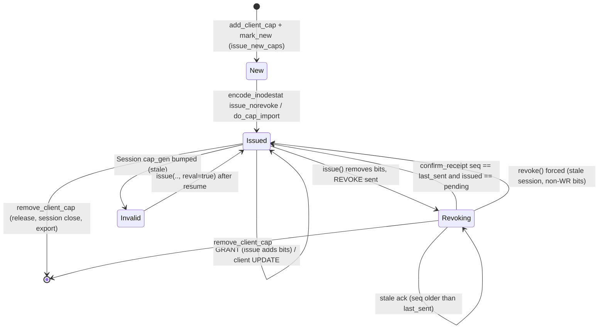
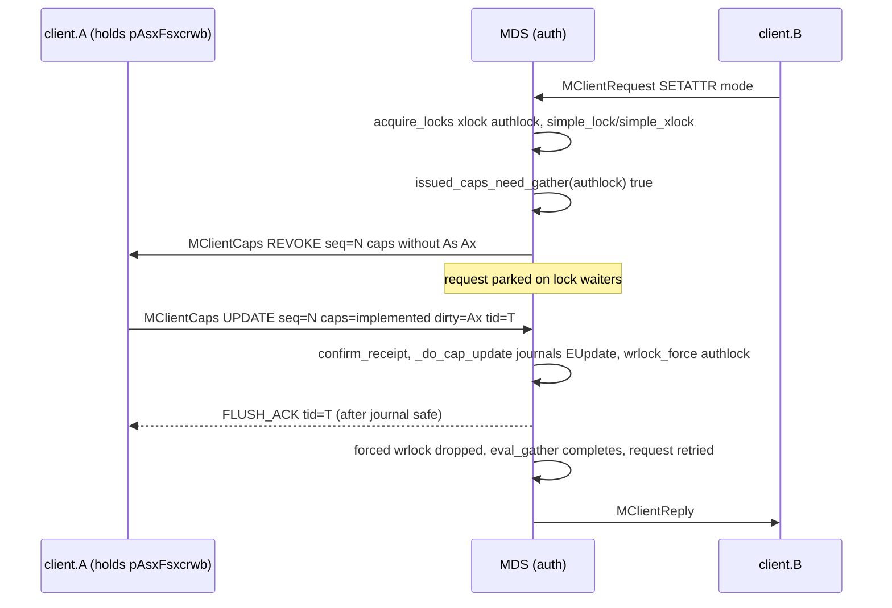
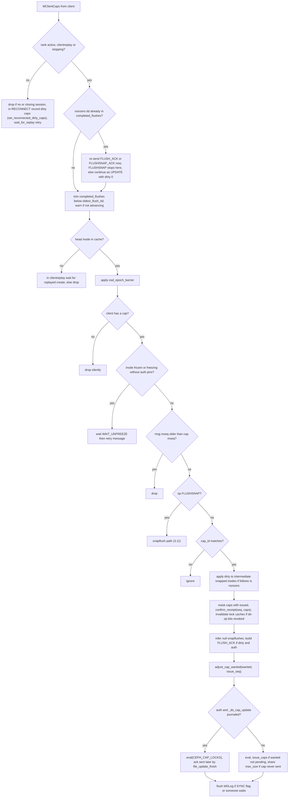
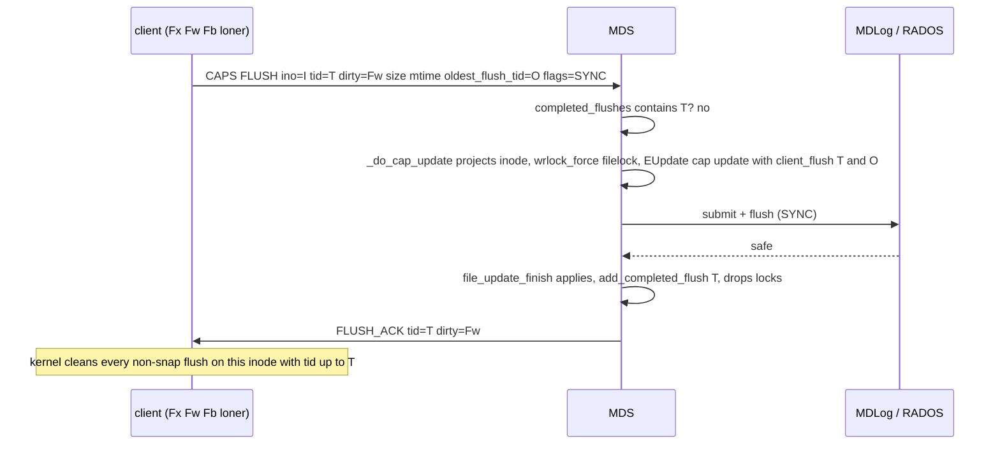
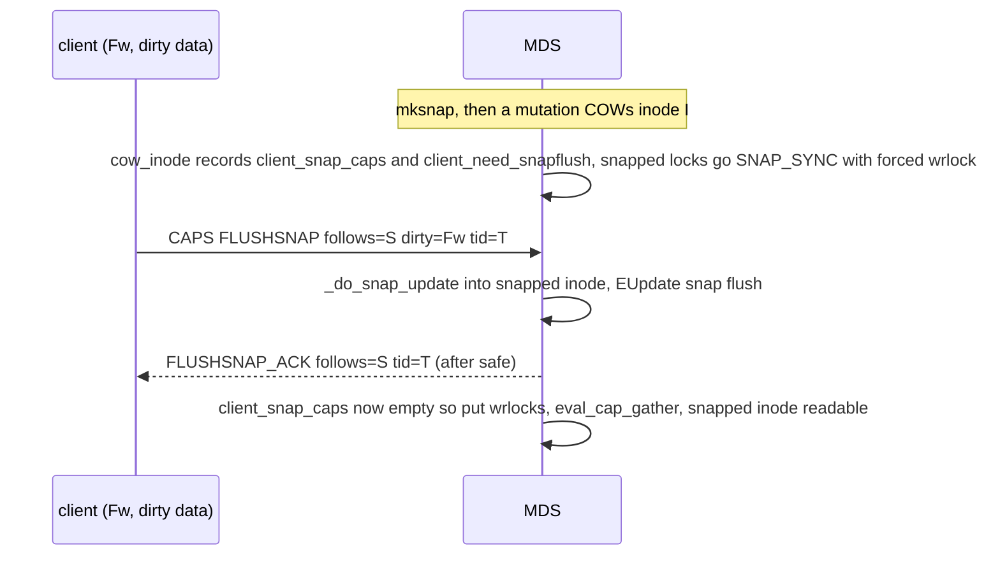

# Client capabilities (caps): model, issue/revoke, flush, max_size, snapflush, release

> Part of the C++ MDS project map ([README](../README.md)). Sources: `src/mds/Capability.{h,cc}` (~750 LOC), `src/mds/Locker.cc` cap section 2350-4470 plus the lock-evaluation code it calls (~2,600 of 6,269 LOC), cap functions in `src/mds/CInode.{h,cc}` (~700 LOC), `src/mds/locks.c` (160), cap helpers in `src/mds/SimpleLock.h`, `src/include/ceph_fs.h` cap/caps-message definitions (~250), `src/messages/MClientCaps.h` (394), `MClientCapRelease.h` (71), `MInodeFileCaps.h` (66), `MGatherCaps.h` (41), cap export/import in `src/mds/Migrator.cc` (~300), COW/reconnect helpers in `src/mds/MDCache.cc` (~400); kernel client `linux/fs/ceph/caps.c` (5,192). C++ line numbers are at commit 5f7e383ae6d; `linux/...` line numbers are from a Linux 7.3-rc6 snapshot and will drift in other kernel versions. Related: [wire-protocol](wire-protocol.md), [sessions](sessions.md), [leases-lock-caches-and-async-dirops](leases-lock-caches-and-async-dirops.md), [kclient-expectations](kclient-expectations.md), [libcephfs-fuse-ganesha-expectations](libcephfs-fuse-ganesha-expectations.md), [lock-types-and-state-machines](../05-locking/lock-types-and-state-machines.md), [acquiring-locks](../05-locking/acquiring-locks.md), [subtree-migration](../08-multi-mds/subtree-migration.md), [rank-lifecycle-and-recovery](../09-recovery/rank-lifecycle-and-recovery.md), [resolve-and-rejoin](../09-recovery/resolve-and-rejoin.md), [snapshots](../10-snapshots-quotas-subvolumes/snapshots.md), [events-and-replay](../06-journal/events-and-replay.md), [mds-tables](../07-storage-formats/mds-tables.md), [quiesce](../12-qos-metrics-quiesce-quarantine/quiesce.md), [quarantine](../12-qos-metrics-quiesce-quarantine/quarantine.md), [config-perf-counters-and-health](../13-admin-and-config/config-perf-counters-and-health.md).

## 1. Purpose and responsibilities

A *capability* ("cap") is a per-(inode, client, MDS rank) grant that lets a client cache or mutate a slice of an inode's state without asking the MDS for every operation. Caps are the client-facing projection of the MDS's per-inode locks: the four cap-bearing inode locks (`authlock`, `linklock`, `xattrlock`, `filelock`) each own a group of cap bits, and the lock's current state decides which bits each client may hold. Changing a lock state that conflicts with outstanding caps requires *revoking* them from clients first.

The C++ MDS cap subsystem is responsible for:

- Keeping, for every head inode, one `Capability` object per client holding a cap, with pending/issued bits, revoke history, wanted bits and sequence numbers (`src/mds/Capability.h:74` (Capability)).
- Computing the caps each client is allowed (loner / non-loner / xlocker / replica views of the lock state tables), issuing new bits (`CEPH_CAP_OP_GRANT`) and taking bits away (`CEPH_CAP_OP_REVOKE`) (`src/mds/Locker.cc:2578` (Locker::issue_caps)).
- Issuing caps inside request replies (`src/mds/CInode.cc:3959` (CInode::encode_inodestat)) and on open/create (`src/mds/Locker.cc:2436` (Locker::issue_new_caps)).
- Processing client cap messages: acks of revocations, wanted-cap changes, dirty metadata flushes (`FLUSH_ACK` after journaling), max-size requests, snapshot flushes (`src/mds/Locker.cc:3386` (Locker::handle_client_caps)).
- Maintaining per-client writeable byte ranges (`client_ranges`, exposed to clients as `max_size`) and journaling them before a client may write past the old limit (`src/mds/Locker.cc:3077` (Locker::check_inode_max_size)).
- Handling cap releases (batched `MClientCapRelease`, and releases embedded in requests) (`src/mds/Locker.cc:4258`, `src/mds/Locker.cc:3714`).
- Stale/expired client sessions: forced revocation, eviction of clients holding write caps, re-issue on session resume (`src/mds/Locker.cc:2778` (Locker::revoke_stale_caps)).
- Detecting and reporting clients that do not answer revocations (`src/mds/Locker.cc:4415` (Locker::caps_tick), `src/mds/Beacon.cc:347`).
- Cooperating with multi-MDS: replica caps, `MInodeFileCaps`, cap export/import messages to clients (details in [subtree-migration](../08-multi-mds/subtree-migration.md)).

Out of scope here (other pages): dentry leases and lock caches ([leases-lock-caches-and-async-dirops](leases-lock-caches-and-async-dirops.md)), session lifecycle and cap recall under cache pressure ([sessions](sessions.md)), reconnect/rejoin cap reconciliation ([resolve-and-rejoin](../09-recovery/resolve-and-rejoin.md)), the lock state machines themselves ([lock-types-and-state-machines](../05-locking/lock-types-and-state-machines.md)).

## 2. Source map

| File | Class / function | Lines | Role |
|---|---|---|---|
| `src/include/ceph_fs.h` | `CEPH_CAP_*`, `CEPH_STAT_CAP_*`, `CEPH_CAP_OP_*`, `ceph_mds_caps_head`, `ceph_mds_cap_peer`, `ceph_mds_cap_release`, `ceph_mds_cap_item`, `ceph_mds_reply_cap`, `ceph_mds_request_release`, `CEPH_FILE_MODE_*` | 712-1020 | Wire-level cap bits, ops and fixed structs |
| `src/common/ceph_fs.cc` | `ceph_flags_to_mode`, `ceph_caps_for_mode` | 116-159 | open(2) flags -> file mode -> wanted caps |
| `src/mds/mdstypes.h` | `gcap_string`, `ccap_string` | 90-123 | Cap string rendering (`pAsLsXsFsxcrwbal`) |
| `src/mds/Capability.h/.cc` | `Capability`, `Export`, `Import`, `revoke_info` | h:74-388, cc:35-350 | Per-(inode,client) cap state machine |
| `src/mds/locks.c` | `simplelock[]`, `filelock[]`, `sm_*` | 15-146 | Per-lock-state allowed cap columns (any/loner/xlocker/replica) |
| `src/mds/SimpleLock.h` | `gcaps_allowed`, `gcaps_xlocker_mask`, `gcaps_allowed_ever`, `can_wrlock`, `set_excl_client` | 196-545 | Lock-state to generic-cap translation |
| `src/mds/SimpleLock.cc` | `get_cap_shift`, `get_cap_mask` | 127-142 | Lock type to cap shift/width |
| `src/mds/CInode.cc` | `calc_ideal_loner`, `choose_ideal_loner`, `try_drop_loner`, `set_loner_cap` | 3415-3499 | Loner (exclusive client) selection |
| `src/mds/CInode.cc` | `add_client_cap`, `remove_client_cap`, `reconnect_cap`, `export_client_caps`, `clear_client_caps_after_export` | 3595-3710 | Cap object lifecycle on the inode |
| `src/mds/CInode.cc` | `get_caps_allowed_by_type`, `get_caps_liked`, `get_caps_allowed_ever`, `get_xlocker_mask`, `get_caps_allowed_for_client`, `get_caps_issued`, `get_caps_wanted`, `issued_caps_need_gather`, quiesce/quarantine masks | 3712-3922 | Allowed/issued/wanted aggregation |
| `src/mds/CInode.cc` | `encode_inodestat`, `encode_cap_message` | 3959-4501 | Caps in replies; inode fields in `MClientCaps` |
| `src/mds/CInode.cc` | `add_need_snapflush`, `remove_need_snapflush`, `split_need_snapflush` | 379-444 | Snapflush bookkeeping |
| `src/mds/Locker.cc` | `file_update_finish`, `C_Locker_FileUpdate_finish` | 2356-2434 | Journal-commit completion of cap updates, FLUSH_ACK send |
| `src/mds/Locker.cc` | `issue_new_caps`, `get_allowed_caps`, `issue_caps`, `issue_truncate` | 2436-2739 | Issue / grant / revoke / truncate notify |
| `src/mds/Locker.cc` | `revoke_stale_cap(s)`, `resume_stale_caps`, `remove_stale_leases` | 2742-2883 | Stale sessions |
| `src/mds/Locker.cc` | `request_inode_file_caps`, `handle_inode_file_caps` | 2899-2956 | Replica -> auth wanted caps (`MInodeFileCaps`) |
| `src/mds/Locker.cc` | `calc_new_max_size`, `check_client_ranges`, `calc_new_client_ranges`, `check_inode_max_size`, `share_inode_max_size` | 2980-3229 | Writeable ranges / max_size |
| `src/mds/Locker.cc` | `_need_flush_mdlog`, `adjust_cap_wanted` | 3231-3286 | Log-flush heuristics, wanted updates |
| `src/mds/Locker.cc` | `snapflush_nudge`, `mark_need_snapflush_inode`, `_do_null_snapflush`, `_do_snap_update` | 3288-3976 | Snapshot flush |
| `src/mds/Locker.cc` | `should_defer_client_cap_frozen`, `handle_client_caps` | 3363-3698 | Main client cap message handler |
| `src/mds/Locker.cc` | `process_request_cap_release`, `kick_issue_caps`, `kick_cap_releases` | 3714-3844 | Releases embedded in requests |
| `src/mds/Locker.cc` | `decode_new_xattrs`, `_update_cap_fields`, `_do_cap_update` | 3855-4256 | Applying dirty client metadata, max_size change, journaling |
| `src/mds/Locker.cc` | `handle_client_cap_release`, `_do_cap_release`, `remove_client_cap` | 4258-4377 | Cap release |
| `src/mds/Locker.cc` | `get_late_revoking_clients`, `caps_tick` | 4379-4469 | Late-revoke detection |
| `src/mds/Locker.cc` | `eval_gather`, `eval`, `try_eval`, `eval_cap_gather`, `simple_*`, `file_eval`, `file_excl`, `scatter_mix`, `file_xsyn`, `file_recover` | 1271-1725, 4867-5202, 5697-6036 | Lock transitions that trigger cap issue/revoke |
| `src/mds/MDCache.cc` | `cow_inode`, `rebuild_need_snapflush`, `do_cap_import`, `try_reconnect_cap`, `reissue_all_caps`, `broadcast_quota_to_client` | 1573, 5651, 5954, 5912, 6351, 2103 | Snapshot COW of caps, cap import message, reconnect helpers |
| `src/mds/Migrator.cc` | `encode_export_inode_caps`, `finish_export_inode_caps`, `decode_import_inode_caps`, `finish_import_inode_caps`, `export_caps`, `handle_export_caps(_ack)`, `handle_gather_caps` | 1796-1849, 3511-3600, 3785-3937 | Cap migration between ranks |
| `src/mds/SessionMap.h/.cc` | `Session::caps`, `cap_gen`, `cap_push_seq`, completed flushes, `touch_cap`, `notify_cap_release` | h:269-360, cc:64-72, 1033 | Per-session cap bookkeeping |
| `src/messages/MClientCaps.h` | `MClientCaps` | 24-392 | Client cap message (v14) |
| `src/messages/MClientCapRelease.h` | `MClientCapRelease` | all | Batched cap release (v2) |
| `src/messages/MInodeFileCaps.h`, `MGatherCaps.h` | inter-MDS | all | Replica wanted caps; ask replicas to export caps |
| `linux/fs/ceph/caps.c` | `ceph_handle_caps`, `handle_cap_grant`, `handle_cap_flush_ack`, `handle_cap_export/import`, `ceph_check_caps`, `__prep_cap`, `encode_cap_msg` | 4417, 3550, 3893, 4154/4288, 2047, 1422, 1275 | What the kernel client sends and expects |

## 3. How it works

### 3.1 The cap bit model

Caps are a 32-bit mask. Bit 0 is `CEPH_CAP_PIN` ("p"). Each cap-bearing lock owns a field of *generic* bits shifted by a per-lock shift (`src/include/ceph_fs.h:824-861`):

| Generic bit (`CEPH_CAP_G*`) | Value | Letter | Meaning |
|---|---|---|---|
| `GSHARED` | 1 | s | client may cache/read the field |
| `GEXCL` | 2 | x | client may cache and modify the field locally (exclusive) |
| `GCACHE` | 4 | c | (file) cache reads (page cache) |
| `GRD` | 8 | r | (file) read data |
| `GWR` | 16 | w | (file) write data |
| `GBUFFER` | 32 | b | (file) buffer writes (write-back) |
| `GWREXTEND` | 64 | a | (file) extend EOF; in no per-state cap column of any lock table (only in `sm_filelock.allowed_ever_auth`, `locks.c:134`), so never granted; reused as the `CEPH_STAT_RSTAT` getattr flag (`ceph_fs.h:883`) and included in `CEPH_CAP_ANY_DIR_OPS` |
| `GLAZYIO` | 128 | l | (file) lazy I/O (relaxed POSIX coherency) |

| Lock (shift const) | Shift | Width (`get_cap_mask`) | Composite bits | Fields governed |
|---|---|---|---|---|
| `authlock` (`CEPH_CAP_SAUTH`) | 2 | 2 bits | `As`=0x4, `Ax`=0x8 | mode, uid, gid, btime, fscrypt_auth |
| `linklock` (`CEPH_CAP_SLINK`) | 4 | 2 bits | `Ls`=0x10, `Lx`=0x20 | nlink |
| `xattrlock` (`CEPH_CAP_SXATTR`) | 6 | 2 bits | `Xs`=0x40, `Xx`=0x80 | xattr blob, xattr_version |
| `filelock` (`CEPH_CAP_SFILE`) | 8 | 8 bits | `Fs`=0x100, `Fx`=0x200, `Fc`=0x400, `Fr`=0x800, `Fw`=0x1000, `Fb`=0x2000, `Fa`=0x4000, `Fl`=0x8000 | size, mtime, atime, ctime, time_warp_seq, truncate_seq/size, layout, inline data, dirstat (dirs), file data access |

The shift/width mapping is code in `src/mds/SimpleLock.cc:127` (SimpleLock::get_cap_shift) and `:137` (get_cap_mask); other inode locks (`nestlock`, `dirfragtreelock`, `snaplock`, `policylock`, `flocklock`, local locks) carry no cap bits (shift 0). `CEPH_CAP_LOCKS = IFILE|IAUTH|ILINK|IXATTR` (`ceph_fs.h:905`) is the mask passed to `Locker::eval` whenever caps may change. Cap strings are rendered by `src/mds/mdstypes.h:103` (ccap_string), e.g. `pAsxLsXsxFsxcrwb`.

Composite masks used throughout (`ceph_fs.h:885-912`):

| Mask | Value |
|---|---|
| `CEPH_CAP_ANY_SHARED` | `As Ls Xs Fs` |
| `CEPH_CAP_ANY_RD` | `ANY_SHARED \| Fr \| Fc` |
| `CEPH_CAP_ANY_EXCL` | `Ax Lx Xx Fx` |
| `CEPH_CAP_ANY_FILE_RD` | `Fr Fc Fs` |
| `CEPH_CAP_ANY_FILE_WR` | `Fw Fb Fx` |
| `CEPH_CAP_ANY_WR` | `ANY_EXCL \| ANY_FILE_WR` |
| `CEPH_CAP_ANY` | everything incl. `Fl`, `p` (not `Fa`) |
| `CEPH_CAP_DIR_CREATE` | `Fc` reused on directories (async create allowed) |
| `CEPH_CAP_DIR_UNLINK` | `Fr` reused on directories (async unlink allowed) |
| `CEPH_CAP_ANY_DIR_OPS` | `Fc Fr Fa Fl` (never granted on dirs except via lock caches; at this commit no lock cache is ever created, so never granted, 3.17) |
| `CEPH_STAT_CAP_*` | getattr masks: uid/gid/mode -> `As`, nlink -> `Ls`, size/mtime/atime/layout -> `Fs`, xattr -> `Xs`, inline data -> `Fs\|Fr`, rstat -> `Fa` bit |

**File modes and wanted caps.** `ceph_flags_to_mode` maps `O_*` flags to `CEPH_FILE_MODE_PIN(0)/RD(1)/WR(2)/RDWR(3)` plus `LAZY(4)`; `O_DIRECTORY` yields `PIN` (`src/common/ceph_fs.cc:116`). `ceph_caps_for_mode` (`src/common/ceph_fs.cc:143`) gives the caps a client wants for an open mode:

| Mode | Caps wanted |
|---|---|
| any | `p` |
| RD | `Fs Fr Fc` |
| WR | `Fx Fw Fb As Ax Xs Xx` |
| LAZY | `Fl` |

### 3.2 The per-(inode, client) `Capability` object

`CInode::client_caps` maps `client_t -> Capability` (`src/mds/CInode.h:1237`). Only head inodes (`last == CEPH_NOSNAP`) have `Capability` objects (`src/mds/CInode.cc:3598` asserts). Fields (`src/mds/Capability.h:333-387`):

| Field | Meaning |
|---|---|
| `cap_id` | Identifier echoed by the client in every message. `++MDCache::last_cap_id` for normal caps; **1** when the cap is created by the request that created the inode (`new_inode`) (`src/mds/CInode.cc:3613` (CInode::add_client_cap)). `last_cap_id` is not persisted; on reconnect it is raised to the max cap_id reported by clients (`src/mds/Server.cc:1728` (Server::handle_client_reconnect)). |
| `_pending` | Bits the MDS currently allows this client (latest message sent). |
| `_issued` | `_pending` plus bits the client may still hold because a revocation is unacknowledged. `revoking() = _issued & ~_pending`. |
| `_revokes` | List of `revoke_info{before, seq, last_issue}`: the pending set before each revocation, the `last_sent` value at that time, and the `last_issue` at that time. |
| `_wanted` | Bits the client says it wants (advisory). |
| `last_sent` (`get_last_seq`) | Sequence number of the last cap-bearing message to this client for this cap; incremented by every `issue()`/`issue_norevoke()`/`inc_last_seq()`. |
| `last_issue` | Value of `last_sent` at the last *issue event* (cap carried in a request reply or an IMPORT). Set only in `encode_inodestat` (`CInode.cc:4236`) and `do_cap_import` (`MDCache.cc:5962`). |
| `mseq` | Migration sequence; bumped when the auth cap moves between ranks (`make_export` exports `mseq+1`, `Capability.h:286`; importer adopts it in `merge`) and when rejoin imports a reconnected cap (`MDCache.cc:5628`, `:5866`). |
| `cap_gen` | Copy of `Session::cap_gen` at last validation; `is_valid()` is `cap_gen == session->cap_gen` (`Capability.cc:237`). A cap created while its session is stale starts invalid (`cap_gen - 1`, `Capability.cc:169-171`). |
| `suppress` | Counter; while >0, `issue_caps` sends nothing that is not a revocation and `share_inode_max_size` skips the cap. |
| `state` | Flags below. |
| `client_follows` | Snap id up to which the client's dirty data is accounted (COW bookkeeping). |
| `client_xattr_version`, `client_inline_version` | Last xattr blob / inline data version shipped to this client (avoid re-sending). |
| `last_rbytes`, `last_rsize` | Quota-broadcast thresholds (`MDCache.cc:2150`). |
| `lock_caches`, `lock_cache_allowed` | Lock caches attached to this (dir) cap and the `DIR_CREATE`/`DIR_UNLINK` bits they enable. |
| `item_session_caps`, `item_snaprealm_caps`, `item_revoking_caps`, `item_client_revoking_caps` | Intrusive list hooks (session list, realm list, global revoking list, per-client revoking list). |
| `last_revoke_stamp`, `num_revoke_warnings`, `last_issue_stamp` | Late-revoke timing; `last_issue_stamp` is informational only. |

State flags (`src/mds/Capability.h:124-134`):

| Flag | Set by | Meaning |
|---|---|---|
| `STATE_NOTABLE` | `mark_notable` when revoking, client-writeable, or wanted ∩ (`ANY_WR\|Fw\|Fr`) ≠ 0 | Cap is kept at the *front* of `Session::caps`; non-notable caps at the back (`SessionMap.cc:64` touch_cap / `:69` touch_cap_bottom) |
| `STATE_NEW` | `issue_new_caps` (newly created caps only) | Cap created by this request, not yet sent; `issue_caps` will not send it a GRANT; cleared by `issue_norevoke` (the reply) or `do_cap_import` |
| `STATE_IMPORTING` | `finish_import_inode_caps` with `peer < 0` (`Migrator.cc:3557`) | Cap newly created by a subtree import at `import_logged_start`; cleared in `import_finish` (`Migrator.cc:3283`); `import_reverse` removes caps still marked importing (`Migrator.cc:3081`) |
| `STATE_NEEDSNAPFLUSH` | reconnect (`MDCache.cc:6016`) | Force `cow_inode` to expect a FLUSHSNAP even without WR caps |
| `STATE_CLIENTWRITEABLE` | client has an entry in `client_ranges` | |
| `STATE_NOINLINE`/`NOPOOLNS`/`NOQUOTA` | constructor, from connection features `MDS_INLINE_DATA`/`FS_FILE_LAYOUT_V2`/`MDS_QUOTA` (`Capability.cc:173-181`) | Restrict caps / quota pushes for old clients |

**`issue(c, reval)`** (`Capability.h:150`): if `_pending & ~c` (revoking), push `revoke_info{_pending, last_sent, last_issue}`, set `_pending = c`, `_issued |= c`, mark notable; else if `c` adds bits, `_pending |= c`, `_issued |= c` and drop trailing revoke records whose `before` is now covered. Always `last_sent++`. `reval` re-validates `cap_gen`. **`issue_norevoke(c)`** only adds bits, clears `STATE_NEW`, `last_sent++` (`Capability.h:177`).

**`confirm_receipt(seq, caps)`** (`src/mds/Capability.cc:192`) processes a client ack carrying the client's `seq` and the caps it still holds:
- `seq == last_sent`: client saw everything. `_revokes.clear(); _issued = caps; _pending &= caps` (a client may voluntarily give up bits). If still revoking, a fresh revoke record is pushed.
- `seq != last_sent` (client has not seen the newest messages): drop revoke records with `r.seq < seq`; if the front record has `r.seq == seq` set its `before = caps`; recompute `_issued = _pending | Σ before`; with no records left `_issued = caps | _pending`. Pending never shrinks on a stale ack.
- When revocation completes (`_issued == _pending`) the cap is unlinked from both revoking lists and may lose `NOTABLE`. Returns the bits that were revoked.

**`clean_revoke_from(li)`** (`Capability.h:191`) drops revoke records with `last_issue <= li`; used when a release with an old `issue_seq` arrives (the client released the cap instance that those revocations targeted). **`revoke()`** = `confirm_receipt(last_sent, pending())`: pretend the client acked (used for stale sessions).

Worked example: `pending=pAsLsXsFscr`, `last_sent=5`. The MDS revokes `Fscr` -> record `{before=pAsLsXsFscr, seq=5}`, `pending=pAsLsXs`, REVOKE sent with seq 6. A racing client UPDATE with seq 5 and caps `pAsLsXsFscr` only refreshes the record (`issued` unchanged). The client's later ack with seq 6 and caps `pAsLsXs` clears the history: `issued=pending=pAsLsXs`, return value `Fscr`.

**What each MDS->client cap message carries** (header fields of `MClientCaps` / `ceph_mds_reply_cap`; `last_sent`/`last_issue`/`mseq` are the `Capability` fields):

| Message (sender) | `seq` | `issue_seq` | `mseq` | Bumps `last_sent`? |
|---|---|---|---|---|
| Reply cap (`encode_inodestat`) | new `last_sent` | (n/a; `last_issue` set to `seq`) | cap `mseq` | yes (`issue_norevoke`) |
| GRANT / REVOKE (`issue_caps`) | new `last_sent` | `last_issue` | cap `mseq` | yes (`issue`) |
| GRANT for max_size (`share_inode_max_size`) | new `last_sent`, caps = unchanged `pending` | `last_issue` | cap `mseq` | yes (`inc_last_seq`) |
| TRUNC (`issue_truncate`) | current `last_sent` | `last_issue` | cap `mseq` | no |
| IMPORT (`do_cap_import`) | `last_sent` (already bumped by `merge`/`reconnect_cap`; bumped to 1 if still 0) | `last_issue` = `seq` | importer's `mseq` | only if 0 (`MDCache.cc:5960`) |
| EXPORT (`finish_export_inode_caps`, `handle_export_caps_ack`, rejoin paths) | 0 | 0 | exporter's cap `mseq` (0 from the rejoin paths); `peer` = importer's `{cap_id, issue_seq, mseq}`, or `mds = -1` to drop the cap | no |
| FLUSH_ACK (`handle_client_caps`) | client's `seq` | `last_issue` (0 in the duplicate-tid ack) | 0 | no |
| FLUSHSNAP_ACK | 0 (cap_id 0) | 0 | 0 | no |

### 3.3 From lock states to allowed caps

Each lock state row in `src/mds/locks.c` has four cap columns: `caps` (any client), `loner_caps` (extra for the loner), `xlocker_caps` (extra for the client whose request xlocked the lock), `replica_caps` (what a non-auth MDS may issue). `SimpleLock::gcaps_allowed(who)` (`src/mds/SimpleLock.h:523`) returns, on the auth MDS: for `CAP_XLOCKER` when the lock is xlocked by a client `xlocker_caps|caps`; for `CAP_ANY` in a *loner-mode* state only `caps`; otherwise `loner_caps|caps`. On a replica it always returns `replica_caps`. `gcaps_xlocker_mask(client)` restricts xlocker extras to the xlocking client (`0xf` = `s x c r` for `filelock`, `s|x` otherwise) (`SimpleLock.h:541`).

`filelock` (`sm_filelock`, `src/mds/locks.c:84`; letters are F-bits; "L" = loner-mode state; "Next" is the stable target, transitional states are named `LOCK_<from>_<to>`):

| State | Next | L | any | loner adds | xlocker adds | replica |
|---|---|---|---|---|---|---|
| `LOCK_SYNC` | stable | | `scrl` | | | `scr` |
| `LOCK_LOCK_SYNC` | SYNC | | `c` | | | |
| `LOCK_EXCL_SYNC` | SYNC | L | | `scr` | | |
| `LOCK_MIX_SYNC`, `LOCK_MIX_SYNC2` | SYNC | | `rl` | | | `r` |
| `LOCK_SNAP_SYNC` | SYNC | | | | | |
| `LOCK_XSYN_SYNC` | SYNC | L | | `c` | | |
| `LOCK_LOCK` | stable | | `cb` | | | |
| `LOCK_SYNC_LOCK` | LOCK | | `c` | | | |
| `LOCK_EXCL_LOCK` | LOCK | | `cb` | | | |
| `LOCK_MIX_LOCK`, `LOCK_MIX_LOCK2` | LOCK | | | | | |
| `LOCK_XSYN_LOCK` | LOCK | L | | `cb` | | |
| `LOCK_PREXLOCK`, `LOCK_XLOCK`, `LOCK_LOCK_XLOCK` | LOCK/PREXLOCK | | `cb` | | | |
| `LOCK_XLOCKDONE` | LOCK | | `cb` | | `s` | |
| `LOCK_XLOCKSNAP` | LOCK | | `c` | | | |
| `LOCK_MIX` | stable | | `rwl` | | | `r` |
| `LOCK_SYNC_MIX`, `LOCK_SYNC_MIX2` | MIX | | `rl` | | | `r` |
| `LOCK_EXCL_MIX` | MIX | L | | `rw` | | |
| `LOCK_XSYN_MIX` | MIX | L | | | | |
| `LOCK_EXCL` | stable | L | | `sxcrwb` | | |
| `LOCK_SYNC_EXCL` | EXCL | L | | `scr` | | |
| `LOCK_MIX_EXCL` | EXCL | L | | `rw` | | |
| `LOCK_LOCK_EXCL`, `LOCK_XSYN_EXCL` | EXCL | L | | `cb` | | |
| `LOCK_XSYN` | stable | L | | `cb` | | |
| `LOCK_EXCL_XSYN` | XSYN | L | | `cb` | | |
| `LOCK_PRE_SCAN`, `LOCK_SCAN` | SCAN/LOCK | | | | | |

`authlock`/`linklock`/`xattrlock` (`sm_simplelock`, `src/mds/locks.c:15`; letters are A/L/X bits):

| State | Next | L | any | loner adds | xlocker adds | replica |
|---|---|---|---|---|---|---|
| `LOCK_SYNC` | stable | | `s` | | | `s` |
| `LOCK_EXCL` | stable | L | | `sx` | | |
| `LOCK_SYNC_EXCL` | EXCL | L | | `s` | | |
| `LOCK_EXCL_SYNC` | SYNC | L | | `s` | | |
| `LOCK_LOCK_EXCL` | EXCL | | `s` | | | |
| `LOCK_XLOCKDONE` | SYNC | | | | `s` | |
| `LOCK_LOCK`, `LOCK_LOCK_SYNC`, `LOCK_SNAP_SYNC`, `LOCK_SYNC_LOCK`, `LOCK_EXCL_LOCK`, `LOCK_PREXLOCK`, `LOCK_XLOCK`, `LOCK_LOCK_XLOCK`, `LOCK_REMOTEXLOCK` | | | | | | |

`allowed_ever` (`sm_*.allowed_ever_auth/replica`) bounds what a replica can ever request (`CInode::get_caps_allowed_ever`, `src/mds/CInode.cc:3746`).

**Per-client allowed caps** (`src/mds/Locker.cc:2528` (Locker::get_allowed_caps)), with per-call caching of the three lock views (`AllowedCapsCache`, indexed by "session has quarantine access"):
1. `all = get_caps_allowed_by_type(CAP_ANY)`, `loner = ...(CAP_LONER)`, `xlocker = ...(CAP_XLOCKER)`; each is `p | Σ lock.gcaps_allowed(type) << shift`, masked by the quarantine mask (`p` only if the inode is under quarantine and the session lacks quarantine access) and the quiesce mask (`ANY_RD|Fc|Fb|p` while the inode's `quiescelock` is xlocked by a `QUIESCE_INODE` op) (`src/mds/CInode.cc:3712-3770`, `CInode.cc:5901` (is_quiesced)).
2. `allowed = (client == loner_cap) ? loner : all`; `allowed |= xlocker & get_xlocker_mask(client)`.
3. Directories: `allowed &= ~CEPH_CAP_ANY_DIR_OPS`; if `Fx` is allowed, `allowed |= cap->lock_cache_allowed` (only lock caches grant `DIR_CREATE`/`DIR_UNLINK`).
4. Old clients: drop `Fr|Fw` if the inode has inline data and the cap is `NOINLINE`, or the layout has a pool namespace and the cap is `NOPOOLNS`.

`CInode::get_caps_allowed_for_client` (`src/mds/CInode.cc:3798`) is the variant used when encoding replies; it adds xlocker caps only for the loner and works without a `Capability` (checks connection features).

**"Liked" caps.** `get_caps_liked()` (`CInode.cc:3737`): for files `CEPH_CAP_ANY & ~Fl`, for dirs `p | ANY_EXCL | ANY_SHARED`, both masked by quiesce. The MDS issues `(wanted | liked) & allowed`, i.e. it pre-grants everything allowed except lazy I/O and (for dirs) the file-data bits.

**Loner selection** (`src/mds/CInode.cc:3415` (calc_ideal_loner)): no loner if the FS is read-only or any replica MDS wants caps (`mds_caps_wanted` non-empty). Otherwise the loner is the unique non-stale cap holder that, for a file, wants `ANY_WR|Fr`, or, for a directory, any non-stale holder when the dir has no subtree root/exporting dirfrag. `choose_ideal_loner` (`:3438`) sets `want_loner_cap`; switching loners requires `try_drop_loner` (`:3476`), which succeeds only when the old loner's issued caps are a subset of what non-loners may hold. `set_loner_cap` stores the loner as `excl_client` in the four locks (used by `can_wrlock` XCL checks). `get_target_loner()` is the loner only if `loner_cap == want_loner_cap` (`CInode.h:898`).

**How wanted caps drive lock states** (auth, stable lock, called from `Locker::eval`, `src/mds/Locker.cc:1503`):

| Lock | Transition | Condition (`wanted` = union of non-stale caps' wanted + `mds_caps_wanted`, quiesce-masked) |
|---|---|---|
| `filelock` EXCL -> MIX | | loner no longer wants/has `Fw\|Fb\|Fx`, or others want `Fx\|Fw\|Fr`, or (dir) more than one non-stale cap; and someone wants `Fw` or a request waits for wrlock (`src/mds/Locker.cc:5731` (file_eval)) |
| `filelock` EXCL -> SYNC | | same "lose it" condition, no writer wanted, no wrlock waiters, no wrlocks |
| `filelock` * -> EXCL | `file_excl` | not rdlocked, target loner exists, and (file) wanted has `Fw\|Fb\|Fx` / (dir) no subtree or exporting dirfrag (`Locker.cc:5758`) |
| `filelock` * -> MIX | `scatter_mix` | not rdlocked and (scatter wanted, or no target loner and someone wants `Fw`) |
| `filelock` * -> SYNC | `simple_sync` | not wrlocked, no wrlock waiters, nobody wants `Fw`, not (MIX on a delegation-point dir) |
| simple locks -> EXCL | `simple_excl` | target loner exists and loner wants `x` for this lock (`Locker.cc:4900` (simple_eval)) |
| simple locks -> SYNC | `simple_sync` | not wrlocked and (the loner does not want `x` and there are no wrlock waiters, or the lock is EXCL with no target loner) |

Consequences: one writer gets `Fsxcrwb` (EXCL) plus `Ax`/`Xx` if it opened for write; several writers or a writer plus readers get `Frw` (MIX, synchronous I/O); readers only get `Fscr` (SYNC). `Fl` is allowed in SYNC and MIX but, not being "liked", is issued only to clients that want it (`O_LAZY`). `Lx` is never wanted by `ceph_caps_for_mode`, so `linklock` normally stays SYNC.

### 3.4 Issuing caps

**In replies.** Every inode included in a reply trace or readdir is encoded by `CInode::encode_inodestat` (`src/mds/CInode.cc:3959`), which creates a cap for the requesting client if none exists, unless `no_caps` holds: snapshot inode not auth, session stale, `dir_realm` given and the inode's snaprealm differs (readdir across a realm boundary), inode frozen, or `STATE_EXPORTINGCAPS` (`CInode.cc:4027`). For head inodes it computes `(wanted | liked) & allowed`, calls `cap->issue_norevoke(issue, true)` (never revokes inside a reply), then sets `last_issue = last_sent` and fills `ceph_mds_reply_cap{caps=pending, wanted, cap_id, seq=last_sent, mseq, realm=snaprealm ino, flags}` with `CEPH_CAP_FLAG_AUTH` iff this MDS is auth (`CInode.cc:4208-4253`). A cap that is still `STATE_NEW` but whose session went stale gets just `p`, so the open/create reply still returns it (`CInode.cc:4224-4233`). Snapshot inodes (`snapid != CEPH_NOSNAP`) get caps computed from the lock states' `CAP_ANY` view (the code comment calls them read-only; `p` only if not auth) with `seq=mseq=realm=0` and no `Capability` object; `cap_id` and `wanted` of that `ecap` are left unset (`CInode.cc:4180-4206`), and the kernel only ORs these bits into `i_snap_caps` (`linux/fs/ceph/inode.c:1361`). Inline data and xattr blobs are included when the client gets a brand-new cap, when the cap's `client_inline_version`/`client_xattr_version` is older, or when the getattr mask asks for them (`Fr` for inline data, `Xs` for xattrs); for an existing cap they are then dropped again unless its `pending` (or the getattr mask) has `Fs`/`Xs` (`CInode.cc:4082-4118`, `:4258-4278`). `max_size` in the reply is `min(current, projected)` client range (`CInode.cc:4075`).

**On open/create** (`src/mds/Locker.cc:2436` (Locker::issue_new_caps)), called by `handle_client_open` (`Server.cc:4785`), `handle_client_openc` (`:5014`), `do_open_truncate` (`:5789`), `handle_client_mknod` for regular files (`:7648`) and `handle_client_mkdir` (`:7768`): for a replayed request that allocated the inode, reuse the reconnect cap (`MDCache::try_reconnect_cap`, `MDCache.cc:5912`); otherwise, if the client has no cap yet, create one (`new_inode` => cap_id 1) with `set_wanted(ceph_caps_for_mode(mode))` and `mark_new()`, else OR the mode's caps into the existing cap's wanted (an existing cap is not marked new); then with `suppress` raised run `eval(in, CEPH_CAP_LOCKS)` (auth; may change lock states/loner) or `request_inode_file_caps` (replica). If a wanted bit is blocked by a locked lock, the MDS log is flushed (`Locker.cc:2482`). The actual bits travel in the reply. Creation paths preset lock states: `openc` sets `authlock` and `xattrlock` to `EXCL` and, for write mode, `client_ranges[client] = [0, layout.stripe_unit]` (`src/mds/Server.cc:5015-5021` (handle_client_openc)); mknod of a regular file and mkdir issue with mode `RDWR`, then set `filelock`, `authlock`, `xattrlock` to `EXCL` and reset wanted to 0; mknod of a regular file also sets `client_ranges[client] = [0, layout.stripe_unit]` (`Server.cc:7646-7663`, `7766-7776`).

**`issue_caps(in, only_cap)`** (`src/mds/Locker.cc:2578`), for each cap (or one):
1. `allowed = get_allowed_caps(...)`, `pending`, `wanted`.
2. No revocation needed (`!(pending & ~allowed)`): skip if `new`, `suppress`ed or session stale.
3. Revocation needed: if the session is stale, do `cap->issue(allowed & pending)` without sending anything and queue `C_Locker_RevokeStaleCap` at the front of the waiter queue (`Locker.cc:2622`); if the cap is invalid after a stale/resume cycle and holds more than `p`, first send a GRANT re-issuing `pending` (the client reset its view to `p`) (`Locker.cc:2630`).
4. If the inode's `nlink == 0`, add `Ls` to `wanted` so clients learn of the unlink quickly (`Locker.cc:2653`).
5. If `pending & ~allowed`, or wanted∩allowed bits are missing, or the cap is invalid: new pending = `(wanted|liked) & allowed & pending` when revoking (a message that revokes never adds bits) else `(wanted|liked) & allowed`. `op = REVOKE` if any bit was removed, else `GRANT`. For REVOKE the cap goes to the tail of `revoking_caps` and `revoking_caps_by_client[client]`, `last_revoke_stamp = now`, warnings reset (`Locker.cc:2679-2686`).
6. Build `MClientCaps(op, ino, realm, cap_id, seq=last_sent, caps=after, wanted, dirty=0, mseq, issue_seq=last_issue, osd_epoch_barrier)`, set `oserrno=-EQUARANTINED` when the inode is under quarantine and the session lacks quarantine access, fill inode fields with `encode_cap_message`, send counted (`Locker.cc:2691-2707`).

**`CInode::encode_cap_message`** (`src/mds/CInode.cc:4432`) copies inode state into the message: file fields (layout, size, truncate_seq/size, mtime/atime/ctime/btime, change_attr, time_warp_seq, nfiles/nsubdirs, fscrypt_auth/file) from the *projected* inode if this client xlocked `filelock` or holds `Fx`, else from the committed inode; auth/link/xattr fields projected only if the client xlocked that lock; inline data if newer than `client_inline_version`; `max_size = min(committed, projected)` client range; xattr blob only if the cap's pending has `Xs` and the version is newer than `client_xattr_version`.

Callers of `issue_caps` include the lock transition code (`simple_sync`, `simple_lock`, `simple_excl`, `simple_xlock`, `file_excl`, `scatter_mix`, `file_xsyn`, `file_recover`, `eval_gather`, `_finish_xlock`), `Locker::eval`, `file_update_finish`, `resume_stale_caps`, `kick_issue_caps`, `invalidate_lock_cache`, `MDCache::reissue_all_caps` (on `active_start`, `MDCache.cc:6351`), `handle_client_caps`, plus scatter/max_size paths, `Migrator` (`Migrator.cc:2198`) and `Server.cc:3268`.

**`issue_truncate`** (`src/mds/Locker.cc:2717`) sends `CEPH_CAP_OP_TRUNC` (no seq increment, current `pending`) to every cap holder after a truncation to a smaller size is journaled (`src/mds/Server.cc:5360` (C_MDS_inode_update_finish)), then calls `check_inode_max_size`.

### 3.5 Revocation and gather

A lock transition first sets the transitional state (e.g. `LOCK_EXCL_SYNC`) and then calls `CInode::issued_caps_need_gather(lock)` (`src/mds/CInode.cc:3912`): loner/other/xlocker issued bits compared against the columns of that transitional state (e.g. `Locker.cc:4937-4969` in `simple_sync`). If true, `issue_caps` sends REVOKEs and the lock counts a gather; the lock stays in its transitional state until `eval_gather` (`src/mds/Locker.cc:1271`) sees no *issued* bits outside the *target* (next) state's columns (plus no conflicting rd/wr/xlocks, leases, scatter flushes). `issued` drops only through client acks (`confirm_receipt`), releases, forced stale revocation, or cap removal. While a `filelock` gather finishes, `STATE_NEEDSRECOVER`/`STATE_RECOVERING` (file size probing) can still block it (`Locker.cc:1322-1333`).

The kernel always answers a REVOKE op with a cap message, even when it holds none of the revoked bits: `handle_cap_grant` sets `CHECK_CAPS_FLUSH_FORCE` (or `CEPH_I_FLUSH_FORCE` if writeback/invalidate must finish first) (`linux/fs/ceph/caps.c:3809` (handle_cap_grant)). Revoking `Fb` while it is in use (dirty buffers) triggers writeback before the ack; revoking `Fc` triggers page-cache invalidation (`caps.c:3596-3608`, `:3764-3790`).

### 3.6 Client cap messages: `handle_client_caps`

Details (`src/mds/Locker.cc:3386`):
- Op values other than `FLUSHSNAP` are not distinguished: `UPDATE`, `FLUSH`, `DROP`, `RELEASE`, `RENEW` sent by a client are all processed as an update. The kernel sends `UPDATE` (from `ceph_check_caps`), `FLUSH` (from `try_flush_caps`/`__kick_flushing_caps`) and `FLUSHSNAP` (`linux/fs/ceph/caps.c:2297`, `:2359`, `:2659`, `:1610`).
- `caps` from the client is the kernel's `implemented` set (`caps.c:1490` (__prep_cap)); the MDS masks it with `issued` ("confirming not issued caps", `Locker.cc:3611`).
- Directory-op bits revoked by the ack invalidate the attached lock caches (`Locker.cc:3622`, `src/mds/Locker.cc:1058` (eval_lock_caches)).
- `FLAG_SYNC` (`CEPH_CLIENT_CAPS_SYNC`, `MClientCaps.h:31`) forces an MDLog flush; otherwise the log is flushed only if newly wanted bits are blocked by an unstable locked lock, the dirty bits' locks are unstable and locked (someone is waiting), or max_size grew (`_need_flush_mdlog`, `Locker.cc:3231`; `Locker.cc:4250-4253`). Without that, durability (and FLUSH_ACK) waits for the periodic `mdlog->flush()` in `MDSRankDispatcher::tick` every `mds_tick_interval` (5 s) (`src/mds/MDSRank.cc:726`), any other explicit flush, or the Journaler flushing a completed journal object when the write position crosses an object boundary (`src/osdc/Journaler.cc:632-641`).
- For a reconnected cap that never had a message sent (`last_seq == 0`) holding `Fw|Fb`, `max_size` is pushed immediately (`Locker.cc:3685`).

### 3.7 Dirty metadata flush and FLUSH_ACK

A client holding an exclusive cap modifies metadata locally and later flushes it with `dirty` bits set. `_update_cap_fields` (`src/mds/Locker.cc:3978`) applies (nothing if `dirty == 0`):

| Dirty bit | Fields applied | Rule |
|---|---|---|
| any non-zero | `ctime` (and `rstat.rctime`) | only if newer |
| any non-zero, `FS_CHANGE_ATTR` feature | `change_attr` | only if larger |
| `Fw` | `mtime` (+`rctime`) | only if newer |
| `Fx` | `mtime` | any different value (client may move it backwards) |
| `Fw\|Fx` on regular file | `size` (+`rstat.rbytes`) | only if larger (never shrinks; truncation is a SETATTR request) |
| `Fw` on regular file | inline data + version | if `inline_version` newer |
| `Fx` | `atime`; `time_warp_seq` | atime if different; twseq if newer (`ceph_seq_cmp`) |
| `Fw\|Fx` | `fscrypt_file` | if present |
| `Ax` | `uid`, `gid`, `mode`, `btime` (feature `FS_BTIME`), `fscrypt_auth` | if different / present |
| `Xx` | xattr map, `xattr_version` | only if blob non-empty and version newer; if total size > `mdsmap.max_xattr_size` the new blob is ignored but `xattr_version` is still advanced (`Locker.cc:3865` (decode_new_xattrs)) |

No permission check (`MDSAuthCaps`) is performed on cap flushes; `caller_uid/gid` in the message are ignored by the MDS (the client checks access before dirtying; see the comment at `src/client/Client.cc:4180` (Client::send_cap)). The `dirty` bits are also not checked against the bits the cap was issued: `handle_client_caps` passes `m->get_dirty()` straight to `_do_cap_update`/`_update_cap_fields` (`Locker.cc:3391`, `:3645-3668`).

`_do_cap_update` (`src/mds/Locker.cc:4083`) projects the inode (with xattrs if needed), applies the fields and any max_size change (3.9), `wrlock_force`s `filelock` (if max_size changes or `Fx|Fw` is dirty), `authlock` (`Ax` dirty) and `xattrlock` (new xattr blob) for the duration of the journal write, calls `predirty_journal_parents(PREDIRTY_PRIMARY)` and `journal_dirty_inode` into an `EUpdate("cap update")`, records `client_flushes += (client reqid with flush tid, oldest_flush_tid)` in the metablob when the client uses unique flush tids, and submits with `C_Locker_FileUpdate_finish`. Forced wrlocks keep the locks from reaching states without wrlock (e.g. SYNC) so no other client can read the pre-commit values.

`file_update_finish` (`src/mds/Locker.cc:2380`) runs when the event is safe: `mut->apply()`, send the FLUSH_ACK (if the session is open) and `session->add_completed_flush(tid)` when `oldest_flush_tid > 0`, drop the locks, re-issue caps if the cap wants more (`UPDATE_NEEDSISSUE`), push max_size (`UPDATE_SHAREMAX`) if `filelock` lets the loner hold `w|b`, finish snapflush bookkeeping (`UPDATE_SNAPFLUSH`), `issue_caps_set`, balancer hit, auth unpin.

FLUSH_ACK fields: `op=FLUSH_ACK, ino, realm=0, cap_id, seq=client's seq, caps=client's caps, wanted=0, dirty=flushed bits, mseq=0, issue_seq=last_issue`, header tid = flush tid, `oldest_flush_tid` echoed, `subvolume_id` set (`Locker.cc:3648`, `:2501` (maybe_set_subvolume_id)). The ack re-sent for an already-completed tid (`Locker.cc:3437`) differs: `issue_seq=0`, no `oldest_flush_tid`, sent at once.

**Idempotency.** `Session::info.completed_flushes` (a `std::set<ceph_tid_t>` persisted in `session_info_t`, `src/mds/mdstypes.h:382`) remembers acked flush tids; replay of an `EMetaBlob` re-adds them (`src/mds/journal.cc:1798`). A resent flush whose tid is present is acked immediately without reapplying (`Locker.cc:3426`). Each message's `oldest_flush_tid` trims tids below it (`Locker.cc:3453`; the trimming dirties the session via the current segment's `touched_sessions`). If a client does not advance it and the set reaches `mds_max_completed_flushes << num_trim_flushes_warnings` (default 100000), a clog warning "client.X does not advance its oldest_flush_tid" is emitted with exponential backoff and the `MDS_CLIENT_OLDEST_TID` health metric is raised (`src/mds/Beacon.cc:409`).

### 3.8 Wanted caps

`adjust_cap_wanted(cap, wanted, issue_seq)` (`src/mds/Locker.cc:3247`): if `issue_seq == last_issue` the client's wanted replaces the MDS's; otherwise only additions are accepted (a stale message cannot shrink wanted that a later reply, e.g. from open, increased). After a change: on a replica, `request_inode_file_caps`; on the auth with non-zero wanted, prioritize file recovery if the inode is `RECOVERING` and `Fr|Fw` is wanted, and log an `EOpen` if `OpenFileTable::should_log_open`. `Capability::set_wanted` maintains `CInode::num_caps_notable`, which adds/removes the inode in the `OpenFileTable` (`src/mds/Capability.cc:265`, `src/mds/CInode.cc:3924`).

The kernel computes wanted from open file modes with idle timeouts (`caps_wanted_delay_min` 5 s, `caps_wanted_delay_max` 60 s), adds `ANY_SHARED|Fx` (plus dir-op bits with async dirops) for recently written dirs, and adds used caps (`linux/fs/ceph/caps.c:1036` (__ceph_caps_file_wanted), `:1097` (__ceph_caps_wanted)). If a needed cap is not in the MDS's wanted view, it falls back to an OPEN request to re-register wanted (`linux/fs/ceph/file.c:319` (ceph_renew_caps)), retried every 5 s (`CEPH_GET_CAPS_WAIT_TIMEOUT`).

### 3.9 max_size and `client_ranges`

`inode_t::client_ranges` maps `client -> client_writeable_range_t{range{first,last}, follows}` and is part of the journaled/persisted inode (`src/include/cephfs/types.h:377`, `:985`). A client may write up to `range.last`, which it receives as `max_size`. The range is created/extended/removed only via journaled inode updates, and clients are told `min(committed, projected)` (`CInode.cc:4075`, `:4476`), so a client can never write beyond a limit that is not yet durable (exception: openc/mknod write the initial `[0, stripe_unit]` range directly into a new, not yet journaled inode, so the reply carries it before the create is durable); after an MDS failure, file size recovery probes objects up to `get_max_size()` (`src/mds/RecoveryQueue.cc:112`).

- `calc_new_max_size(pi, size)` = `round_up((size+1)*2 capped at size + mds_client_writeable_range_max_inc_objs * object_size, layout period)`; no cap when the option is 0 (`src/mds/Locker.cc:2980`).
- In a client update (`_do_cap_update`, `Locker.cc:4102-4158`), for a file whose cap has `Fw|Fb|Fx` issued or wanted (quiesce-masked): if `m->max_size > current` grow to `calc_new_max_size(m->max_size)` (explicit request); else grow to `calc_new_max_size(reported size)` if larger. Without write caps a non-zero range is removed. If `filelock` cannot be wrlocked or force-wrlocked by the client, the MDS (with `suppress` raised) moves `filelock` towards `EXCL` (loner, no replica wanted caps) or `LOCK`, and if still not possible waits on `WAIT_STABLE` with `C_MDL_CheckMaxSize` (`Locker.cc:4129-4158`).
- `check_inode_max_size(in, force_wrlock, new_max, new_size, mtime)` (`Locker.cc:3077`) recomputes ranges for every cap with `Fw|Fb|Fx` issued or wanted (`calc_new_client_ranges`, `:3017`; ranges are only grown, never shrunk for existing writers; non-writers' entries are erased), optionally raises size/mtime (used by file recovery), waits if frozen; if `filelock` cannot be wrlocked it first moves a stable `filelock` to `EXCL` (target loner wanting `Fw|Fb|Fx`) or `LOCK`, and waits on `WAIT_STABLE` if that is still not enough (`Locker.cc:3110-3126`); journals `EOpen` (if any caps wanted on a head inode) or `EUpdate("check_inode_max_size")`, `wrlock_force(filelock)`, flushes the log if a range grew. Called from open for write (`Server.cc:4802`), truncation, cap removal, recovery completion (`RecoveryQueue.cc:232`), and post-rejoin checks (`MDCache.cc:6548`).
- `share_inode_max_size(in, only_cap)` (`Locker.cc:3191`) sends a GRANT (seq+1, unchanged pending) to every non-suppressed cap with `Fw|Fb` pending so the client learns the new `max_size`.
- `STATE_CLIENTWRITEABLE` on the inode and cap mirrors non-empty ranges and keeps the inode in the `OpenFileTable` (`CInode.cc:3937`).
- A client that loses its caps while it has a range (stale revoke, session kill) marks the inode `STATE_NEEDSRECOVER`; the next `filelock` transition queues size recovery (`Locker.cc:2757`, `:2814`, `:4367`, `Locker.cc:4981` (simple_sync)).
- On snapshot COW, ranges with `follows >= last` are trimmed from the snapped copy (`MDCache.cc:1579`); a snapflush erases the client's range from the snapped inode or moves its `follows` (`Locker.cc:3949`).

Kernel side: a write needs `Fw` and `endoff <= i_max_size`; otherwise it records `i_wanted_max_size`, sends an UPDATE with `max_size` and sleeps until a GRANT raises `max_size` (`linux/fs/ceph/caps.c:2905` (try_get_cap_refs), `:3027` (check_max_size)). It also reports size proactively when it reaches `max_size` or half of the last increment (`caps.c:2021` (__ceph_should_report_size)). `max_size` from a GRANT is accepted only on the auth cap and only if the new caps include a file-write bit (`caps.c:3727`).

### 3.10 Truncation notification

`CEPH_CAP_OP_TRUNC` carries `truncate_seq`, `truncate_size`, `size` (via `encode_cap_message`). The kernel applies it with `ceph_fill_file_size`, which accepts a newer `truncate_seq` (and queues page-cache truncation) or a larger size with the same seq (`linux/fs/ceph/inode.c:808` (ceph_fill_file_size), `caps.c:4110` (handle_cap_trunc)). `truncate_seq` starts at 1 for new inodes (`Server.cc:3715`).

### 3.11 Snapshots: snapflush

When a mutation COWs a head inode after a snapshot (`MDCache::cow_inode`, `src/mds/MDCache.cc:1573`), every cap that has (or, with `NEEDSNAPFLUSH`, is assumed to have) `ANY_WR` and `client_follows < last` is recorded: `oldin->client_snap_caps += client`, `cap->client_follows = last`, and for each snap id in the realm within `[oldin->first, last]` `head->client_need_snapflush[snapid] += client` (`add_need_snapflush` auth-pins the head and the snapped inode). The snapped inode's four cap locks are put into `LOCK_SNAP_SYNC` with a forced wrlock and an auth pin, so its metadata cannot be read until the client flushes; it is journaled with the `need_snapflush` flag and added to `Locker::need_snapflush_inodes` (`MDCache.cc:1638-1676`, `:1792-1798`).

The client sends `FLUSHSNAP` (cap_id 0, seq 0, mseq of its auth cap, `snap_follows = capsnap.follows`, `dirty`, values as of the snapshot, tid) (`linux/fs/ceph/caps.c:1583` (__send_flush_snap)). The MDS (`Locker.cc:3530-3588`): ignores it (no ack) if not auth; `snap = realm->get_snap_following(follows)`; performs null snapflushes for older pending snaps; prepares a `FLUSHSNAP_ACK` if `dirty`; if `snap` maps to the head or the client is listed in `client_need_snapflush[snap]`, calls `_do_snap_update` and `remove_need_snapflush`; otherwise just acks. `_do_snap_update` (`Locker.cc:3879`) writes the fields into the snapped inode (or the matching `old_inodes` entry for multiversion inodes) via `EUpdate("snap flush")`, adjusts `client_ranges`, records the client flush, and on commit `file_update_finish` sends the ack and, once `client_snap_caps` is empty, drops the forced wrlocks and evaluates the gather (`Locker.cc:2413-2427`). If the snap was deleted (`snap == CEPH_NOSNAP`) it only acks.

**Null snapflush.** The client only sends FLUSHSNAP when it has dirty snapshot metadata. The MDS infers "no FLUSHSNAP will come" when, after `confirm_receipt`, the cap no longer has `ANY_FILE_WR` issued and (for `MClientCaps` updates only) the message lacks `FLAG_PENDING_CAPSNAP` (`CEPH_CLIENT_CAPS_PENDING_CAPSNAP`); request-embedded releases and cap removal do not check the flag. It then journals an empty snap update for each pending snap (`_do_null_snapflush`, `Locker.cc:3342`; triggers at `:3632`, `:3784`, `:4349`, and for older snaps when a FLUSHSNAP for a later snap arrives, `:3541`).

**Nudging.** `caps_tick` re-examines `need_snapflush_inodes` entries older than `mds_freeze_tree_timeout / 3` (10 s): `snapflush_nudge` kicks a non-SYNC stable lock on the head inode with `_rdlock_kick` so the client's WR caps get revoked (forcing the flush) (`Locker.cc:3288`, `:4419-4435`). Auth pins held for pending snapflushes block subtree freezing.

### 3.12 Cap release

**Batched release.** `CEPH_MSG_CLIENT_CAPRELEASE` (`MClientCapRelease`, v2) carries `ceph_mds_cap_item{ino, cap_id, migrate_seq, issue_seq}[]` plus `osd_epoch_barrier`. `handle_client_cap_release` (`src/mds/Locker.cc:4258`) waits for replay if the rank is not clientreplay/active/stopping, applies the epoch barrier, calls `_do_cap_release` per item and `Session::notify_cap_release(n)` (recall accounting, `SessionMap.cc:1033`). `_do_cap_release` (`Locker.cc:4306`) ignores unknown inodes/caps, mismatched `cap_id`, older `mseq`; defers on frozen inodes; **if `issue_seq < last_issue` the cap was re-issued after the client released it, so it is kept and only `clean_revoke_from(issue_seq)` + `eval_cap_gather` run**; otherwise `remove_client_cap`.

The kernel queues released caps per session and sends one message per page (`CEPH_CAPS_PER_RELEASE = (PAGE_SIZE - 4 - 4) / 24` items, 170 with 4 KiB pages), flushing when a page fills, on `CEPH_SESSION_FLUSHMSG`, from the periodic `delayed_work` (`linux/fs/ceph/mds_client.c:6296`), or when it receives a GRANT/REVOKE/IMPORT for an inode it does not have, or a GRANT/REVOKE for an inode on which it has no cap from that MDS (an IMPORT for a known inode creates the cap); it then queues a release with the message's `cap_id`, `mseq` and `issue_seq = seq` and flushes the session's releases (`linux/fs/ceph/mds_client.c:2502` (ceph_send_cap_releases), `:2628` (__ceph_queue_cap_release), `caps.c:4549-4690`).

**Releases embedded in requests.** `MClientRequest` may carry `ceph_mds_request_release{ino, cap_id, caps, wanted, seq, issue_seq, mseq, dname_seq, dname_len}+dname` to drop caps (and a dentry lease) before the operation (kernel `ceph_encode_inode_release`, `linux/fs/ceph/caps.c:4934`). `Server::handle_client_request` processes them before dispatch, except for replayed requests (`src/mds/Server.cc:2719-2721` (Server::handle_client_request)). `process_request_cap_release` (`Locker.cc:3714`) removes the named dentry lease, applies the same mseq/cap_id/frozen checks, `confirm_receipt(seq, caps)`, null-snapflush inference, `adjust_cap_wanted`, and `eval` with the cap suppressed; it records `mdr->cap_releases[vino] = last_sent`. At request cleanup `kick_cap_releases` re-issues caps for any cap whose `last_sent` is still that value (nothing was sent meanwhile), so suppressed grants are not lost (`Locker.cc:3817-3844`, `MDCache.cc:10132`).

**`remove_client_cap(in, cap, kill)`** (`Locker.cc:4345`): null-snapflush, invalidate lock caches, `CInode::remove_client_cap` (unlink from session/revoking/realm lists, drop loner, release advisory `fcntl`/`flock` locks of that client and wake waiters, leave the realm when the last cap goes) (`CInode.cc:3625`); for notable caps on the auth, clear the client range (mark `NEEDSRECOVER` if `kill`, else `check_inode_max_size`), unless the inode is unlinked with no caps left; on a replica `request_inode_file_caps`; then `try_eval(CEPH_CAP_LOCKS)`. Session close/kill removes all caps through this path (`Server.cc:983-990` (Server::_session_logged)).

### 3.13 Stale sessions

`Server::find_idle_sessions` (each tick while clientreplay/active/stopping) marks an OPEN session STALE when it has not renewed caps for `session_timeout` (MDSMap, default 60 s, plus dispatch queue age), unless `mds_defer_session_stale` (default true) and the session has no revoking caps and no flush waiters; sessions idle past `session_autoclose` (default 300 s), or past a client-supplied `timeout` metadata value (0 = never), are evicted without going stale; STALE sessions idle past `session_autoclose` are evicted too. Eviction blocklists the client when `mds_session_blocklist_on_timeout` (default true), else only kills the session; no session is marked stale while the MDS itself was laggy within the cutoff, and evictions are skipped while `defer_client_eviction_on_laggy_osds` sees laggy OSDs (`src/mds/Server.cc:1211` (Server::find_idle_sessions)). On STALE, `Locker::revoke_stale_caps` (`src/mds/Locker.cc:2778`):
1. `session->inc_cap_gen()`: all caps of the session become invalid (`is_valid()` false); the kernel does the same on `CEPH_SESSION_STALE` (`atomic_inc(s_cap_gen)`, `linux/fs/ceph/mds_client.c:4628`) and treats invalid caps as `p` only.
2. Walk the session's notable caps (front of `Session::caps`, stop at the first non-notable). For caps being revoked: if any revoking bit is in `ANY_WR`, return false (the caller evicts the client); otherwise `cap->revoke()` (force-ack), invalidate lock caches for dir-op bits, mark `NEEDSRECOVER` if the client had a range.
3. Re-evaluate gathers on the touched inodes (`eval_gather` / `try_eval` / `request_inode_file_caps`).
If it returns true the MDS removes the session's leases, completes pending session flushes and sends `CEPH_SESSION_STALE`.

While stale, `calc_ideal_loner` and `get_caps_wanted` ignore the session's caps, replies issue no caps, and any later revocation goes through `C_Locker_RevokeStaleCap` -> `revoke_stale_cap` (`Locker.cc:2742`): revoking `ANY_WR` from a stale client calls `evict_client(..., blocklist = mds_session_blocklist_on_timeout)`; otherwise force-revoke.

`resume_stale_caps` (`Locker.cc:2845`) runs on `CEPH_SESSION_REQUEST_RENEWCAPS` from a stale session (`Server.cc:829-834` (Server::handle_client_session)): for each cap (only notable ones if the client has `CEPHFS_FEATURE_LAZY_CAP_WANTED`), set `EVALSTALECAPS` if caps are being exported, else `eval`/`issue_caps`. Because the cap is invalid, `issue_caps` re-issues `(wanted|liked) & allowed` with `reval` (normally a GRANT, `Locker.cc:2658-2671`); if bits must also be revoked, it first sends a GRANT re-issuing `pending` and then the REVOKE (`Locker.cc:2630`). Clients with lazy wanted are expected to re-request what they need (the kernel re-sends wanted when `was_stale` or on IMPORT, `caps.c:3748`).

### 3.14 Late revocation: warnings, health, eviction

- `Locker::revoking_caps` (global `elist`) and `revoking_caps_by_client` (per client) hold caps with an outstanding REVOKE, ordered by `last_revoke_stamp` because `push_back` moves an item to the tail (`src/include/elist.h:116`).
- `caps_tick` (each `Locker::tick`, `Locker.cc:121`) walks `revoking_caps` from the oldest; for caps older than `session_timeout` (at most `MAX_WARN_CAPS`=100 per tick) it logs `client.X isn't responding to mclientcaps(revoke), ino I pending P issued Q, sent N seconds ago` when the age exceeds `session_timeout * 2^num_revoke_warnings` (exponential backoff) (`Locker.cc:4440-4468`).
- `get_late_revoking_clients(timeout)` (`Locker.cc:4379`) is O(1) when the oldest revoke is younger than `timeout`, else O(clients). The beacon uses it with `session_timeout` to raise `MDS_CLIENT_LATE_RELEASE` ("Client <name> failing to respond to capability release", metadata `client_id`) or, above `mds_health_summarize_threshold` (10) clients, `MDS_CLIENT_LATE_RELEASE_MANY` (`src/mds/Beacon.cc:347-379`).
- `Server::evict_cap_revoke_non_responders` uses `mds_cap_revoke_eviction_timeout` (default 0 = disabled) to evict such clients (blocklist per `mds_session_blocklist_on_evict`), unless `defer_client_eviction_on_laggy_osds` and OSDs are laggy; perf counter `cap_revoke_eviction` (`src/mds/Server.cc:1361`).

### 3.15 Multiple MDS ranks: replica caps, export/import

- **Replica caps.** A non-auth MDS can issue only the `replica` column (e.g. `Fscr` in SYNC, `Fr` in MIX, `As/Ls/Xs` in SYNC), never `CEPH_CAP_FLAG_AUTH`. Client cap flushes for dirty metadata are honoured only on the auth (`in->is_auth()` checks at `Locker.cc:3531`, `:3645`, `:3667`).
- **`MInodeFileCaps`** (`MSG_MDS_INODEFILECAPS`, 0x301; `{ino, caps}`): `request_inode_file_caps` (`Locker.cc:2899`) sends the union of local clients' wanted ∩ `allowed_ever` (minus `p`) to the auth when it changes (waiting for single auth / rejoin as needed); `handle_inode_file_caps` (`:2931`) stores it in `mds_caps_wanted[rank]` and re-evaluates. Any replica wanted prevents a loner (`CInode.cc:3419`), and counts as "other" wanted in `file_eval`.
- **`MGatherCaps`** (`MSG_MDS_GATHERCAPS`, 0x472; `{ino}`): sent by the auth to all replicas when broadcasting quota (`MDCache.cc:2186`); a replica holding caps answers with `export_caps` (`Migrator.cc:3840`).
- **`MExportCaps`/`MExportCapsAck`** (0x470/0x471): a replica ships its client caps (`Capability::Export` map + client sessions) to the auth (`Migrator::export_caps`, `:3785`); the auth force-opens sessions, journals `ESessions`, merges caps (`finish_import_inode_caps` with `auth_cap=false`) and sends clients `IMPORT` with `CEPH_CAP_FLAG_RELEASE` naming the replica so they release the replica's cap; for clients without a connection the ack lists them and the replica sends them `EXPORT` (`Migrator.cc:3803-3937`).
- **Subtree migration** moves auth caps (`encode_export_inode_caps` sets `STATE_EXPORTINGCAPS`; exporter sends `EXPORT` with `peer{cap_id, issue_seq, mseq, mds, flags}` after the importer acks; importer merges with `Capability::merge(Export, auth=true)` adopting the exporter's `mseq+1`, sets `issue_seq = last_seq+1` for the peer info and sends `IMPORT` with `snapbl` and `peer = {exporter cap_id, exporter seq, exporter mseq, exporter rank, CEPH_CAP_FLAG_AUTH}`) (`Migrator.cc:1796-1849`, `:3532-3600`, `src/mds/MDCache.cc:5954` (do_cap_import)). Cap migration also happens in cross-rank rename (import side `Server.cc:10425`) and resolve/rejoin (`MDCache.cc:3317`, `:5852`; rejoin ack sends `EXPORT` for caps a peer re-imported, `MDCache.cc:5274` in `handle_cache_rejoin_ack`). Caps reconnected for inodes that could not be found are answered with `EXPORT` with `peer.mds = -1`, which makes the client drop them (`MDCache.cc:5873` (export_remaining_imported_caps)). See [subtree-migration](../08-multi-mds/subtree-migration.md) for ordering with `CEPH_SESSION_FLUSHMSG`.

### 3.16 Recovery interplay (summary)

- Cap messages received while the rank is before clientreplay are parked on `waiting_for_replay` (run at `clientreplay_start`/`active_start`, `src/mds/MDSRank.cc:2086`, `:2157`); during reconnect, dirty bits of re-sent flushes are recorded with `set_reconnected_dirty_caps` so lock states can be chosen from issued|dirty caps (`CInode::choose_lock_states`, `CInode.cc:3533`).
- Reconnect recreates caps with `CInode::reconnect_cap`: a new cap takes the client's `cap_id`, then `issue_norevoke(issued)`, `reset_seq()` i.e. `last_sent=last_issue=0`, with the default `mseq=0`; an existing cap is only `merge`d (wanted/issued OR-ed, seq bumped), matching the kernel which zeroes `seq`, `issue_seq`, `mseq` and drops `ANY_DIR_OPS` bits in its reconnect record (`CInode.cc:3676`, `linux/fs/ceph/mds_client.c:4919-4937` (reconnect_caps_cb)). `reconnect_cap` is the only path where the MDS takes `issued` bits from the client without masking them; because the kernel drops the dir-op bits and libcephfs reports only bits it was granted (`src/client/Client.cc:3492-3507` (Client::send_reconnect)), it cannot seed `DIR_CREATE`/`DIR_UNLINK` (3.17).
- `MDCache::reissue_all_caps` evaluates and re-issues caps on every head inode with caps at `active_start` (`MDCache.cc:6351`).
- Snapflush expectations are rebuilt from reconnect `snap_follows` (`MDCache::rebuild_need_snapflush`, `MDCache.cc:5651`). Details: [resolve-and-rejoin](../09-recovery/resolve-and-rejoin.md).

### 3.17 Directory caps and lock caches (summary)

On directories, `Fs` means "dentry set/dirstat cacheable" (kernel readdir from dcache and negative lookups need dir `Fs` + complete flag, `linux/fs/ceph/dir.c:371`, `:850`, `:1942`); `Fx` lets one client own the dir. `DIR_CREATE` (`Fc`) and `DIR_UNLINK` (`Fr`) are granted only through an `MDLockCache` created for a CREATE/UNLINK request (`Locker::create_lock_cache`, `src/mds/Locker.cc:1092`; `MDLockCache::get_cap_bit_for_lock_cache`, `src/mds/Mutation.cc:677`) and are revoked when the lock cache is invalidated (`Locker.cc:1024`). The kernel needs `Fx|DIR_CREATE` (+delegated inos) for async create and `Fx|DIR_UNLINK` for async unlink (`linux/fs/ceph/file.c:525`, `dir.c:1309`).

At this commit no lock cache is ever created, so `DIR_CREATE`/`DIR_UNLINK` are never granted and kernel creates/unlinks always go to the MDS synchronously. The cause is a cycle:

- `create_lock_cache` returns early unless the cap already has the bit issued (`src/mds/Locker.cc:1124-1128`, commit 9b4a93f2b7b, in squid v19.1.0 and later).
- On a directory cap, step 3 of the allowed-caps computation (3.3) adds the bit back only from `lock_cache_allowed`.
- Only `create_lock_cache` sets `lock_cache_allowed`, after that check (`src/mds/Locker.cc:1187`).

Every other way bits enter `issued()` is masked or clipped (3.16 covers reconnect). This is confirmed by code reading and git history; no test covers it and it is not runtime-verified. Details: [leases-lock-caches-and-async-dirops §8 G1](leases-lock-caches-and-async-dirops.md#8-edge-cases-failure-handling-and-gotchas).

### 3.18 Which client operations need which caps (kernel client)

| Operation | Caps needed for the local (no MDS round trip) path | Fallback |
|---|---|---|
| `stat`/`statx` | mode/uid/gid/btime -> `As`; nlink -> `Ls` (dirs: `Fs`); size/times/blocks -> `Fs`; ctime/change cookie -> `As Ls Fs Xs` (`linux/fs/ceph/inode.c:3117` (statx_to_caps)) | GETATTR request with that mask |
| `getxattr`/`listxattr` | `Xs` (`linux/fs/ceph/xattr.c:1017`) | GETATTR with `Xs` |
| `setxattr` | `Xx` and blob within `max_xattr_size` -> dirty `Xx` (`xattr.c:1236`) | SETXATTR request dropping `Xs` |
| chmod/chown/chgrp | `Ax` -> dirty `Ax` (`inode.c:2684-2730`) | SETATTR request releasing `As` |
| utimes/atime | `Fx` -> dirty `Fx`; `Fw` if only moving the time forward -> dirty `Fw` (atime `inode.c:2740`, `:2744`; mtime `:2815`, `:2819`). The C++ MDS applies a flushed atime only when `Fx` is dirty (`Locker.cc:4033`), so an atime moved forward under `Fw` alone is not applied by that flush | SETATTR releasing `Fs Fr Fw` |
| truncate up | `Fx` and new size >= current -> dirty `Fx` (`inode.c:2780`) | SETATTR (size), releasing `Fs Fx Fr Fw` |
| read | `Fr` needed, `Fc` wanted for page cache (`linux/fs/ceph/file.c:2198`) | wait for grant |
| write | `Fw` needed, `Fb` wanted for buffered I/O, `endoff <= max_size` (`file.c:2477`, `caps.c:2905`) | max_size request, wait |
| mmap read / write | `Fr`+`Fc` / `Fw`+`Fb` (`linux/fs/ceph/addr.c:2015`, `:2120`) | wait |
| readdir from cache, negative dentry | dir `Fs` + complete (`dir.c:371`, `:850`) | READDIR / LOOKUP |
| async create / unlink | dir `Fx\|Fc` (+deleg ino) / dir `Fx\|Fr` | synchronous request (always taken against the C++ MDS at this commit, 3.17) |
| NFS-Ganesha delegations (libcephfs) | RD: `p As Ls Xs Fs Fr Fc`; WR: RD + `Fx Fw Fb` (`src/client/Delegation.cc:41` (ceph_deleg_caps_for_type)); revoking them recalls the delegation (`src/client/Client.cc:6245`) | |

## 4. Data structures and invariants

| Structure | Location | Scope | Notes |
|---|---|---|---|
| `CInode::client_caps` (`map<client_t, Capability>`) | `CInode.h:1237` | inode | head inodes only; `PIN_CAPS` while non-empty |
| `CInode::loner_cap`, `want_loner_cap` | `CInode.h:1167` | inode | mirrored as `excl_client` of the 4 cap locks |
| `CInode::mds_caps_wanted` (auth) / `replica_caps_wanted` (replica) | `CInode.h:1238-1239` | inode, cross-rank | |
| `CInode::num_caps_notable`, `STATE_CLIENTWRITEABLE` | `CInode.h:1240`, `:386` | inode | drive OpenFileTable membership |
| `CInode::client_snap_caps`, `client_need_snapflush` | `CInode.h:1116-1117` | snapped inode / head | auth pins while non-empty |
| `inode_t::client_ranges` | `types.h:985` | inode (journaled) | per-client writeable range + follows |
| `Session::caps` xlist (notable first), `cap_gen`, `cap_push_seq`, `info.completed_flushes`, `recall_caps`/`release_caps` decay counters | `SessionMap.h:269-500` | session | `completed_flushes` persisted in session map and journal |
| `SnapRealm::client_caps`, `inodes_with_caps` | `SnapRealm.h:114-141` | realm | used for snap notifications/splits |
| `Locker::revoking_caps`, `revoking_caps_by_client`, `need_snapflush_inodes` | `Locker.h:275-279` | rank | |
| `MDCache::last_cap_id`, `num_inodes_with_caps` | `MDCache.h:1201` | rank | not persisted |
| `MDSRank::osd_epoch_barrier` | `MDSRank.cc:1580` | rank | stamped on every cap message |

Invariants:
- `issued ⊇ pending`; `revoking = issued & ~pending`; a cap is put on `revoking_caps` only when `issue_caps` sends a REVOKE, and leaves it when `issued == pending` again (`confirm_receipt`/`clean_revoke_from`) or on `remove_client_cap`. The silent revoke of a stale session's cap (`Locker.cc:2625`) makes the cap revoking without listing it.
- `last_sent` strictly increases per cap for every GRANT/REVOKE/IMPORT and every reply that carries the cap; `last_issue <= last_sent` and only advances at issue events (reply, import).
- Pending bits only shrink via a REVOKE message, via `confirm_receipt` with `seq == last_sent` when the client itself dropped bits, or silently for a stale session (`issue_caps` stale branch); a GRANT never removes bits; a reply never revokes (`issue_norevoke`).
- `issue_caps` never adds bits in a message that revokes bits: when `pending` exceeds `allowed` the new set is `(wanted|liked) & allowed & pending`. Bits can still be added by a GRANT while an earlier REVOKE is unacknowledged (pending already within `allowed`); `Capability::issue` then drops trailing revoke records that the new pending covers.
- A lock cannot complete a transition while any client's *issued* (not just pending) bits exceed the target state's column for that client class.
- `max_size` seen by a client is never above the committed `client_ranges` entry (`min(committed, projected)`), except the initial range of an inode whose creation is not yet journaled (3.9).
- Dirty metadata from a client is applied and acked only on the auth MDS, after the journal entry is safe; acks for the same inode are generated in journal order.
- `cap_id` of a cap never changes while the cap object lives; a release/update with another `cap_id` refers to a previous incarnation and is ignored.
- Within a session, notable caps precede non-notable ones in `Session::caps` (stale processing relies on it, `Locker.cc:2791`).

## 5. Interfaces

### 5.1 Messages

| Message (type) | Dir | Handler / sender | Notes |
|---|---|---|---|
| `MClientCaps` (`CEPH_MSG_CLIENT_CAPS` 0x310) op GRANT(0)/REVOKE(1) | MDS->client | `Locker::issue_caps`, `share_inode_max_size`, stale re-issue | seq = `last_sent`, issue_seq = `last_issue` |
| op TRUNC(2) | MDS->client | `Locker::issue_truncate` | seq not incremented |
| op EXPORT(3) | MDS->client | `Migrator::finish_export_inode_caps`, `handle_export_caps_ack`, `MDCache::handle_cache_rejoin_ack`, `MDCache::export_remaining_imported_caps` | `peer` encoded in place of the non-export body |
| op IMPORT(4) | MDS->client | `MDCache::do_cap_import` | includes snap trace and `peer` |
| op UPDATE(5)/DROP(6)/FLUSH(7)/RELEASE(11)/RENEW(12) | client->MDS | `Locker::handle_client_caps` | treated identically |
| op FLUSH_ACK(8) | MDS->client | `file_update_finish`, `handle_client_caps` | tid = flush tid |
| op FLUSHSNAP(9) | client->MDS | `handle_client_caps` snapflush branch | |
| op FLUSHSNAP_ACK(10) | MDS->client | `file_update_finish`, `_do_snap_update`, `handle_client_caps` | echoes `snap_follows`, tid |
| `MClientCapRelease` (`CEPH_MSG_CLIENT_CAPRELEASE` 0x313) | client->MDS | `Locker::handle_client_cap_release` | v2 adds `osd_epoch_barrier` |
| `MClientReply` cap (`ceph_mds_reply_cap`) | MDS->client | `CInode::encode_inodestat` | `flags`: `CEPH_CAP_FLAG_AUTH`(1) |
| `MClientRequest` releases (`ceph_mds_request_release`) | client->MDS | `Locker::process_request_cap_release` | |
| `MInodeFileCaps` (0x301) | replica->auth | `Locker::handle_inode_file_caps` | `{ino, caps}` v1 |
| `MGatherCaps` (0x472) | auth->replica | `Migrator::handle_gather_caps` | `{ino}` v1 |
| `MExportCaps`/`MExportCapsAck` (0x470/0x471) | replica<->auth | `Migrator::handle_export_caps(_ack)` | carry `Capability::Export`/`Import` maps |
| `MClientSession` STALE / REQUEST_RENEWCAPS / FLUSHMSG(_ACK) | both | `Server::handle_client_session` | see [sessions](sessions.md) |

### 5.2 `MClientCaps` encoding (HEAD_VERSION 14, COMPAT 1; `src/messages/MClientCaps.h:235-386`)

| Part | Content |
|---|---|
| front: `ceph_mds_caps_head` | `op, ino, realm, cap_id, seq, issue_seq, caps, wanted, dirty, migrate_seq, snap_follows, snap_trace_len, uid, gid, mode, nlink, xattr_len, xattr_version` (`ceph_fs.h:947`) |
| front: body | non-EXPORT: `size, max_size, truncate_size, truncate_seq, mtime, atime, ctime, layout (legacy), time_warp_seq` (`ceph_fs.h:968`); EXPORT: `ceph_mds_cap_peer{cap_id, issue_seq, mseq, mds, flags}` zero-padded to the same size |
| front | snap trace (`snap_trace_len` bytes) |
| middle | xattr blob (`xattr_len` must equal middle length) |
| v2 | `flockbl` (only if peer has `CEPH_FEATURE_FLOCK`, else stop at v1) |
| v3 | `peer` for IMPORT (feature `EXPORT_PEER`, else stop at v2) |
| v4 | `inline_version`, `inline_data` (data empty without `MDS_INLINE_DATA`) |
| v5-v7 | `osd_epoch_barrier`, `oldest_flush_tid`, `caller_uid`, `caller_gid` |
| v8-v11 | `layout.pool_ns`, `btime`, `change_attr`, `flags` (`FLAG_SYNC`=1, `FLAG_NO_CAPSNAP`=2 unused, `FLAG_PENDING_CAPSNAP`=4), `nfiles`, `nsubdirs` |
| v12 | `fscrypt_auth`, `fscrypt_file` |
| v13 | `subvolume_id` (set by the MDS only on FLUSH_ACK/FLUSHSNAP_ACK) |
| v14 | `oserrno` (`-EQUARANTINED` = -1000 on quarantined inodes) |
| header `tid` | flush tid (client->MDS flush; MDS->client acks) |

The kernel sends version 12 and decodes up to 12, ignoring trailing fields (`linux/fs/ceph/caps.c:1293` (encode_cap_msg), `:4417` (ceph_handle_caps)); libcephfs uses this header (v14).

### 5.3 Other wire structs

| Struct | Fields |
|---|---|
| `ceph_mds_reply_cap` (`ceph_fs.h:762`) | `caps, wanted (u32), cap_id (u64), seq, mseq (u32), realm (u64), flags (u8)` |
| `ceph_mds_cap_release` + `ceph_mds_cap_item` (`ceph_fs.h:984-992`) | `num`; items `ino, cap_id (u64), migrate_seq, issue_seq (u32)`; then `osd_epoch_barrier` (v2) |
| `ceph_mds_request_release` (`ceph_fs.h:712`) | `ino, cap_id (u64), caps, wanted, seq, issue_seq, mseq, dname_seq, dname_len (u32)` + dname |
| `Capability::Export` (inter-MDS, v3) | `cap_id, wanted, issued, pending, client_follows, seq, mseq, last_issue_stamp, state` (`Capability.cc:35`) |
| `Capability::Import` (inter-MDS, v1) | `cap_id, issue_seq, mseq` (`Capability.cc:86`) |

### 5.4 Journal events and persistent state

| Event / object | Producer | Content relevant to caps |
|---|---|---|
| `EUpdate("cap update")` | `_do_cap_update` | inode with client fields, `client_ranges`; `client_flushes` (reqid, oldest tid) |
| `EUpdate("snap flush")` | `_do_snap_update` | snapped inode / old_inode fields; `client_flushes` |
| `EUpdate("check_inode_max_size")` / `EOpen` | `check_inode_max_size` | `client_ranges`, recovered size/mtime; EOpen also keeps open files in newer segments |
| `EOpen` (clean inode) | `adjust_cap_wanted`, `Server::handle_client_open` | open-file tracking (`OpenFileTable::should_log_open`) |
| `EMetaBlob` `need_snapflush` dentry flag | `journal_cow_dentry` | replay re-adds snapped inode to the segment's open files (`journal.cc:1432`) |
| Session map object (`mds<rank>_sessionmap`) | `SessionMap` | `completed_flushes` per session (`mdstypes.cc:678`) |
| OpenFileTable objects | `CInode::adjust_num_caps_notable`, `mark_clientwriteable` | inodes with notable caps / writeable ranges ([mds-tables](../07-storage-formats/mds-tables.md)) |

Caps themselves (`Capability` objects) are never journaled or persisted; `Capability::encode` is used only by `ceph-dencoder` (`src/tools/ceph-dencoder/mds_types.h:65`).

### 5.5 Config options

| Option | Default | Effect |
|---|---|---|
| `mds_client_writeable_range_max_inc_objs` | 1024 | cap on max_size growth step, in objects |
| `mds_max_completed_flushes` | 100000 | completed-flush set size before warnings |
| `mds_freeze_tree_timeout` | 30 | snapflush nudge after `/3` s |
| `mds_session_blocklist_on_timeout` | true | blocklist when evicting stale clients holding WR caps |
| `mds_session_blocklist_on_evict` | true | blocklist on cap-revoke eviction |
| `mds_cap_revoke_eviction_timeout` | 0 (off) | evict clients not answering revokes |
| `mds_defer_session_stale` | true | do not mark idle sessions stale unless they owe revocations/flushes |
| `defer_client_eviction_on_laggy_osds` | false | skip evictions while OSDs are laggy |
| `mds_health_summarize_threshold` | 10 | per-client vs summarized late-release health |
| `mds_tick_interval` | 5 | tick: periodic MDLog flush, `caps_tick` |
| `mds_session_cap_acquisition_throttle` | 100000 | readdir cap acquisition throttle (with `mds_max_caps_per_client` 1M x `mds_session_max_caps_throttle_ratio` 1.1, retry `mds_cap_acquisition_throttle_retry_request_timeout` 0.5 s) (`Server.cc:5112`) |
| `mds_allow_async_dirops` | true | lock caches -> `DIR_CREATE`/`DIR_UNLINK` (gates the `create_lock_cache` calls, which never succeed at this commit, 3.17) |
| MDSMap `session_timeout` / `session_autoclose` | 60 / 300 s | stale and late-revoke thresholds (`MDSMap.h:605-606`) |
| MDSMap `max_xattr_size` | (see [fsmap-and-mdsmap](../01-cluster-integration/fsmap-and-mdsmap.md)) | xattr flush limit |

### 5.6 Perf counters and health

| Counter (logger) | Meaning |
|---|---|
| `mds.caps`, `mds.inodes_with_caps` | current caps / inodes with caps (`MDCache.cc:299-300`) |
| `mds_mem.cap`, `cap+`, `cap-` | `Counter<Capability>` live/added/removed (`MDSRank.cc:3854`); `mds_mem.cap` is read by mgr `status`, dashboard and telemetry (`src/pybind/mgr/status/module.py:78`, `src/pybind/mgr/dashboard/controllers/cephfs.py:378`, `src/pybind/mgr/telemetry/module.py:1252`) |
| `mds.handle_client_caps`, `handle_client_caps_dirty`, `handle_client_cap_release`, `process_request_cap_release`, `handle_inode_file_caps` | message handling counts |
| `mds.ceph_cap_op_grant`, `ceph_cap_op_revoke`, `ceph_cap_op_trunc`, `ceph_cap_op_flush_ack`, `ceph_cap_op_flushsnap_ack` | sent ops (`MDSRank.cc:3743-3762`) |
| `mds_server.cap_revoke_eviction`, `cap_acquisition_throttle` | evictions / readdir throttling (`Server.cc:199`, `:207`) |
| Health `MDS_CLIENT_LATE_RELEASE(_MANY)`, `MDS_CLIENT_OLDEST_TID(_MANY)` | see 3.14 / 3.7 |

### 5.7 Admin commands

`dump inode <ino>` shows `client_caps[{client_id, pending, issued, wanted, last_sent}]`, `loner`, `want_loner`, `mds_caps_wanted` (`CInode.cc:5458`); `session ls` / `client ls` show `num_caps`, `num_completed_flushes`, recall/release counters (`SessionMap.cc:648-680`); `dump cache` includes caps via inode dumps.

## 6. Concurrency and mds_lock

All cap processing runs on the MDS dispatch path under `mds_lock`: messages are dispatched by `MDSDaemon::ms_dispatch2` holding `mds_lock` (`src/mds/MDSDaemon.cc:1091`) to `Locker::dispatch` (`Locker.cc:93`) or `Migrator::dispatch`; journal completions (`C_Locker_FileUpdate_finish`) are `MDSLogContextBase`s that take `mds_lock` in `MDSIOContextBase::complete` (`src/mds/MDSContext.cc:95`); `caps_tick`, `find_idle_sessions` and `evict_cap_revoke_non_responders` run from `MDSRankDispatcher::tick` under the lock. There are no cap-specific mutexes. Deferred work uses waiters: `CInode::WAIT_UNFREEZE` (`C_MDS_RetryMessage`, `C_Locker_RetryCapRelease`, `C_Locker_RetryRequestCapRelease`, `C_Locker_RetryKickIssueCaps`), `SimpleLock::WAIT_STABLE` (`C_MDL_CheckMaxSize`), `WAIT_SINGLEAUTH` (`C_MDL_RequestInodeFileCaps`), `waiting_for_replay`, front-of-queue `C_Locker_RevokeStaleCap`.

Serialization points:

| Point | Location | Shared state | True conflict scope | Inherent? |
|---|---|---|---|---|
| Global `mds_lock` around every cap message, journal completion and tick | `MDSDaemon.cc:1091` | everything | per inode (cap state), per session (lists, tids) | no |
| Capability state transitions (`issue`, `confirm_receipt`) | `Capability.h:150`, `Capability.cc:192` | one (inode, client) cap | inode+client | yes (ordered seq protocol) |
| Revocation gather blocks lock transitions until client acks | `Locker.cc:1299-1315` | lock state vs. issued caps | inode | yes (client round trip) |
| `wrlock_force` of filelock/authlock/xattrlock during cap-flush journaling | `Locker.cc:4221-4231`, `:3180` | lock state | inode; only conflicts with readers/transitions of those locks | partly |
| Single MDLog for cap updates; acks fire in journal order | `Locker.cc:4248`, `:3178`, `:3974` | journal | per-inode ack order; nothing global needed | partly |
| max_size growth needs `filelock` wrlock (or lock change) + journal before GRANT | `Locker.cc:4129-4158` | `client_ranges` | inode | yes (durability before client write) |
| Session `completed_flushes` and `oldest_flush_tid` trimming | `Locker.cc:3426-3473` | session info | session (client-global tids) | partly |
| Session `caps` list ordering (`touch_cap*`), `cap_gen`, `cap_push_seq` | `Capability.cc:248-263`, `MDSRank.cc:1553` | session | session | partly (push_seq order is protocol) |
| Per-connection FIFO of cap messages with seq | `MDSRank.cc:1551` | messenger connection | session | yes |
| `revoking_caps` / `revoking_caps_by_client` lists | `Locker.cc:2681-2684` | rank lists | none (bookkeeping) | no |
| `need_snapflush_inodes` list | `Locker.cc:3323` | rank list | none | no |
| `MDCache::last_cap_id` counter | `CInode.cc:3613` | rank counter | none | no |
| SnapRealm cap lists on add/remove | `CInode.cc:3605`, `:3620` | realm | subvolume/realm | no |
| OpenFileTable membership on notable changes | `CInode.cc:3924-3955` | rank table | none (batched persistence) | no |
| `osd_epoch_barrier` max-tracking | `Locker.cc:3495-3503` | rank scalar | none (monotonic max) | no |
| Freeze deferral of cap messages | `Locker.cc:3363` | subtree freeze | subtree (migration) | partly |
| Stale processing walks all notable caps of a session | `Locker.cc:2778` | session caps across inodes | session | partly |
| Replica wanted (`mds_caps_wanted`) disables loner | `CInode.cc:3419` | inode across ranks | inode | partly |
| Pending snapflush auth pins block freezing | `CInode.cc:379-420` | head/snapped inode | inode/subtree | partly |

What could commute: cap messages for different inodes (even from the same client) touch disjoint `Capability`/lock state and only share session bookkeeping (completed flush set, list ordering, push_seq) and the journal; revocation sweeps for different inodes are independent; late-revoke scanning, OpenFileTable updates, cap-id allocation and realm lists are bookkeeping that does not need to serialize with cap state changes.

## 7. Externally visible contract

**Kernel client (from `linux/fs/ceph/caps.c` unless noted)**
1. Cap ids: messages and releases name `cap_id`; EXPORT is ignored unless `cap_id` matches the client's cap for that MDS (`:4184` (handle_cap_export)); the kernel fabricates `cap_id = 1`, `seq = 0`, `mseq = 0`, caps `CEPH_CAP_ALL_FILE`, `max_size = stripe_unit` for async-created inodes (`linux/fs/ceph/file.c:712` (ceph_finish_async_create)); the MDS's `new_inode` cap id 1, preset EXCL locks and `client_ranges=[0, stripe_unit]` match it.
2. Sequence numbers: the kernel stores the last `seq` received per cap (`cap->seq`) and echoes it in UPDATE/FLUSH/releases; `issue_seq` is updated only when a cap is added from a reply or IMPORT (`:777` (ceph_add_cap)); GRANT/REVOKE `issue_seq` is ignored. A GRANT/REVOKE whose `seq <= cap->seq` is treated as pre-IMPORT and merged (`:3622`). Seqs must therefore increase per cap per MDS in delivery order.
3. REVOKE vs GRANT: the MDS must use `REVOKE` whenever bits are removed; the kernel always answers a REVOKE (immediately, or after writeback/invalidation of `Fb`/`Fc`) (`:3809`). A GRANT may carry only a `max_size`/field update with unchanged caps.
4. `max_size`: honoured only from the auth cap and when new caps include a file write bit (`:3727`); writes beyond `max_size` block until a GRANT raises it (`:2905`).
5. FLUSH_ACK: header tid identifies the flush; the kernel treats the ack as cumulative for that inode (all non-snap flushes with `tid <= T` are clean, `:3927`), so acks for one inode must be sent in tid order and only after durability; `fsync` sets `CEPH_CLIENT_CAPS_SYNC` and waits for the ack (`:2359`).
6. FLUSHSNAP_ACK must echo `snap_follows` and the FLUSHSNAP tid (`:4075`).
7. EXPORT/IMPORT: `peer` fields `{cap_id, issue_seq, mseq, mds, flags}`; EXPORT `peer` lives at the `size` offset of the body (`:4476`); IMPORT `flags & CEPH_CAP_FLAG_RELEASE` makes the client release the peer's cap; the auth cap is the one with the highest `mseq` among AUTH-flagged caps (`:755`); on IMPORT of the auth cap the kernel re-sends all pending flushes and capsnaps with their original tids (`:3855` (ceph_kick_flushing_inode_caps)) and re-requests wanted/max_size. The kernel adds every IMPORTed cap with `CEPH_CAP_FLAG_AUTH` (`:4342-4343`), so only the auth rank may send IMPORT. On EXPORT it creates a placeholder cap for the target rank with `seq = issue_seq = peer.issue_seq - 1` and `mseq = peer.mseq` (`:4212-4234`), so the importer's IMPORT must carry `seq == peer.issue_seq`; with `CEPH_CAP_FLAG_AUTH` it checks that the IMPORT's `peer.issue_seq`/`peer.mseq` equal the exporter cap's `seq`/`mseq` and logs "mismatched seq/mseq" otherwise (`:4349-4357`).
8. Stale: on `CEPH_SESSION_STALE` the kernel bumps `s_cap_gen` and treats all caps of that session as `p` until a GRANT re-issues them (`mds_client.c:4628`, `caps.c:3611`).
9. Session message counting: every cap/lease/snap/quota message from the MDS increments the client's `s_seq` (`linux/fs/ceph/super.c:1528` (ceph_inc_mds_stopping_blocker), called from `caps.c:4440`, `quota.c:51`, `snap.c:1036`, `mds_client.c:6051`); the MDS counts the same messages (`send_message_client_counted`) and drops `REQUEST_CLOSE` whose seq differs (`Server.cc:860-874`).
10. `osd_epoch_barrier` in caps and releases: the client must not use new caps before it has that OSD map epoch (`caps.c:4494`); the MDS adopts client-reported barriers (`Locker.cc:3495`).
11. Reconnect zeroes `seq/issue_seq/mseq` and drops dir-op bits; early re-sent flushes during reconnect must be accepted (`mds_client.c:4919-4937` (reconnect_caps_cb), `caps.c:2696` (ceph_early_kick_flushing_caps)).
12. Releases for unknown inodes/caps: the kernel answers GRANT/REVOKE/IMPORT for an unknown inode, and GRANT/REVOKE for a known inode without a cap from that MDS, with a release using the message's `seq` as `issue_seq` (`caps.c:4549-4690`).
13. Truncation: when a TRUNC or grant raises `truncate_seq`, the kernel warns if it still holds `Fr` or `Fl` ("the MDS should have revoked these caps", `linux/fs/ceph/inode.c:837-839`); the C++ MDS meets this because SETATTR(size) and open with `O_TRUNC` xlock `filelock` (`src/mds/Server.cc:5614`, `:4741`), and the xlock states allow only `Fcb` (`locks.c:102-106`).

**libcephfs / ceph-fuse / NFS-Ganesha**
- Same protocol, header v14; consumes `subvolume_id` (per-subvolume metrics tracking) and `oserrno == -EQUARANTINED` (`src/client/Client.cc:5756`, `:6239`); sends `FLAG_PENDING_CAPSNAP` and `FLAG_SYNC` (`Client.cc:4217`, `:4424`). Ganesha delegations are cap-backed and recalled on revocation of the delegation caps (`Client.cc:6244-6247`).

**Monitors / mgr**
- Health metrics `MDS_CLIENT_LATE_RELEASE(_MANY)`, `MDS_CLIENT_OLDEST_TID(_MANY)` via beacon; mgr `status`, dashboard and telemetry read `mds_mem.cap`; `session ls` `num_caps` is used by tooling.

**OSDs**
- Eviction of clients that hold write caps uses OSD blocklisting; caps carry the post-blocklist epoch barrier so other clients' I/O is ordered after the blocklist ([rados-and-osd-interactions](../07-storage-formats/rados-and-osd-interactions.md)).

## 8. Edge cases, failure handling and gotchas

- Dirty flushes sent to a non-auth MDS, for an inode not in cache, or without a matching cap/cap_id are dropped with no ack; clients rely on re-sending flushes after IMPORT/reconnect.
- A FLUSHSNAP from a client with no cap on the head inode is dropped (`Locker.cc:3509`) before the snapflush branch.
- `UPDATE` with a stale `issue_seq` cannot reduce wanted; `_do_cap_release` with a stale `issue_seq` cannot remove the cap (the client will recreate it from the newer reply).
- Seq comparisons in `confirm_receipt` (`<`) and `_do_cap_release` (`seq < last_issue`) are plain integer comparisons, not wrap-aware `ceph_seq_cmp`.
- `issue_caps` may send two messages to one client in one call: a GRANT re-issuing `pending` (invalid cap after stale/resume) followed by a REVOKE.
- Stale sessions holding `ANY_WR` bits that must be revoked cause eviction (with blocklist by default); non-WR bits are silently force-revoked.
- The xattr size limit on flush silently discards the client's blob but still bumps `xattr_version`, so later grants overwrite the client's cached xattrs.
- `Fa` (`GWREXTEND`) is never granted by any state; `Fl` (lazy I/O) is granted only if wanted (not "liked").
- New-inode caps always get `cap_id` 1; `last_cap_id` restarts at 0 on a new MDS incarnation, is raised to the largest `cap_id` reported in client reconnects (`Server.cc:1728`) and then incremented for every other new cap (including caps imported during resolve, `MDCache.cc:3317`).
- `share_inode_max_size` is skipped for suppressed caps; `issue_new_caps` relies on the reply carrying max_size.
- `Capability::encode` and the `Export`/`Import` encodings are internal (inter-MDS) and never seen by clients.
- `issue_file_data_version` is dead code (`Locker.cc:2350`).
- `_do_cap_update` still inserts fcntl/flock locks carried in a non-empty `MClientCaps::flockbl` (`Locker.cc:4161-4180`), but the kernel always encodes a zero-length flock blob in cap messages (`linux/fs/ceph/caps.c:1336`) and in-tree libcephfs never sets `MClientCaps::flockbl` (it sends file locks only in reconnect, `src/client/Client.cc:3486-3487`); other clients unverified.
- Cap messages and releases for frozen (or freezing, not auth-pinned) inodes are deferred on `WAIT_UNFREEZE` and retried, not dropped; releases embedded in requests use the same predicate so a request is not processed while its own release is deferred (comment at `Locker.cc:3368-3377`, `Locker.h:158-161`).
- Flushed metadata is trusted: neither the `dirty` mask nor the values are checked against the caps the client holds or its `MDSAuthCaps` (3.7). So any client holding some cap on the inode (matching `cap_id`, `mseq` not older than the cap's) can push `uid/gid/mode` or xattr changes by marking `Ax`/`Xx` dirty, whether or not it holds those bits (inferred from code reading, not tested).
- A kernel `utimes`/`touch -a` that only moves atime forward while holding `Fw` (not `Fx`) is flushed as dirty `Fw`; `_update_cap_fields` ignores atime unless `Fx` is dirty (`Locker.cc:4033`), so that flush does not apply the new atime; it is lost unless a later flush carries dirty `Fx` (inferred from code reading of both sides, not tested) (3.18).
- Opening a file in a snapshot sets `mdr->snap_caps = ceph_caps_for_mode(cmode)` (`Server.cc:4796`), but nothing reads it; the reply's caps come from the snapshot branch of `encode_inodestat`.
- Quiesced inodes cap out at `ANY_RD|Fc|Fb|p`, which also caps max_size decisions (`Locker.cc:4105`); quarantine reduces non-privileged sessions to `p` and stamps `-EQUARANTINED` on grants/revokes.
- Cap traffic (flushes, max_size growth) bypasses the dmClock QoS scheduler, which only queues `MClientRequest`s (`src/mds/MDSDmclockScheduler.cc:81`, `src/mds/Server.cc:405`).
- `encode_inodestat` checks the remaining readdir buffer space (`-ENOSPC`) before creating or issuing a cap for that inode, so entries that do not fit in a readdir reply get no cap; entries already encoded keep the caps issued to them (`CInode.cc:4144-4176`).
- On replicas, `get_caps_issued` resets `loner_cap` to -1 as a side effect (`CInode.cc:3850`).
