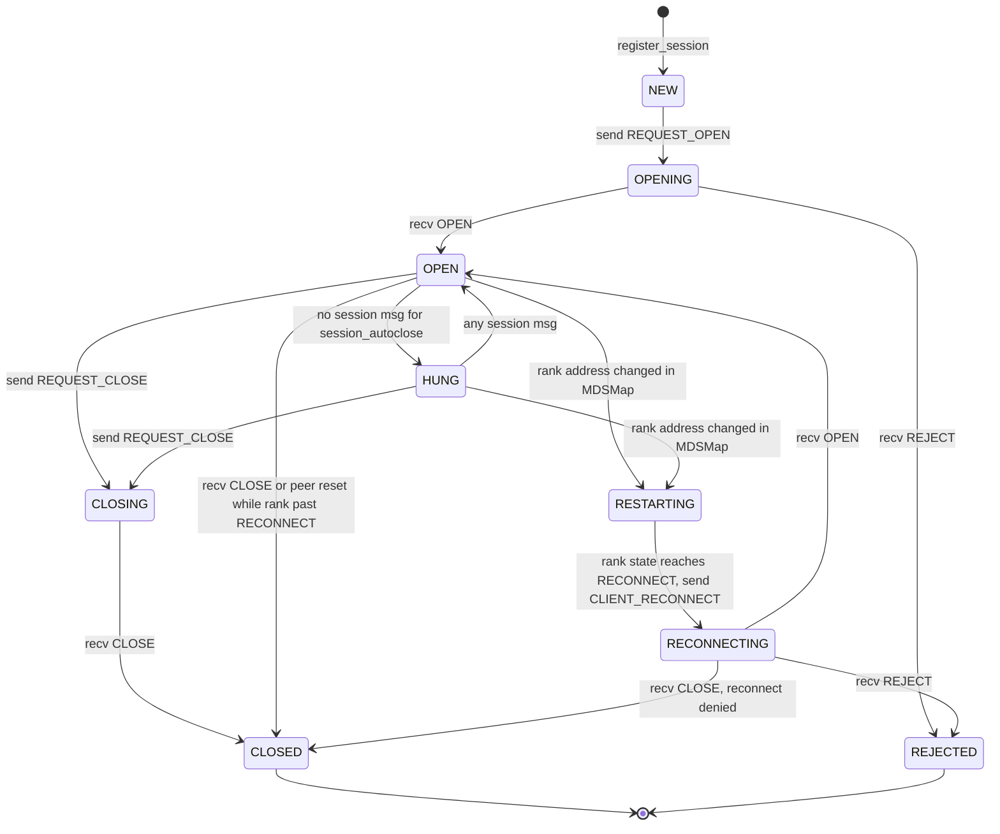
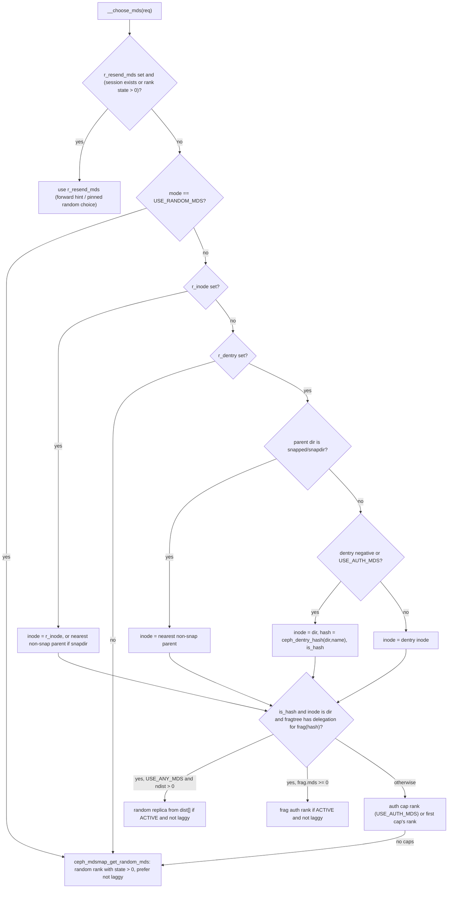
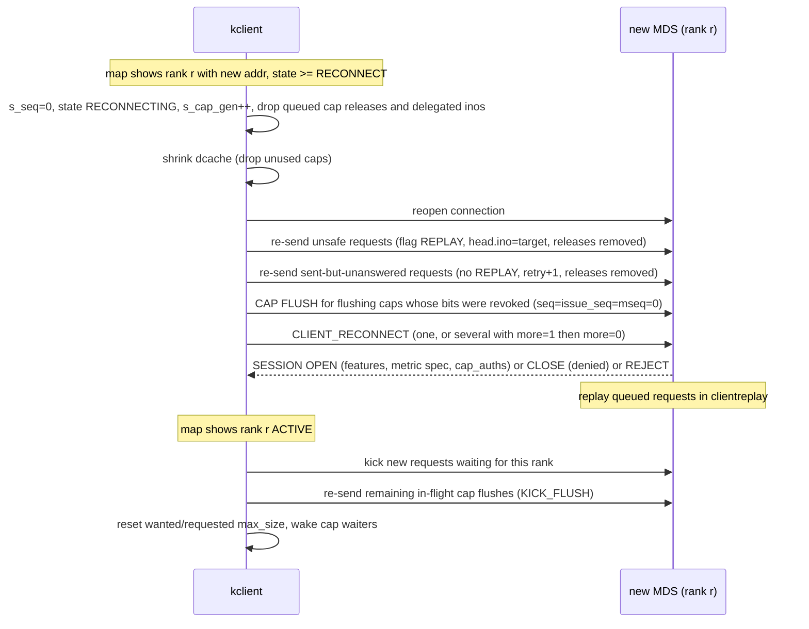

# What the Linux kernel client (kclient) requires from an MDS

> Part of the C++ MDS project map ([README](../README.md)).
> Sources (Linux 7.3-rc snapshot, `Makefile` says 7.3.0-rc6): `linux/fs/ceph/mds_client.c` (~7.4k LOC), `caps.c` (~5.2k), `inode.c` (~3.3k), `file.c` (~3.3k), `dir.c` (~2.3k), `xattr.c` (~1.5k), `snap.c` (~1.3k), `quota.c`, `locks.c`, `metric.c`, `subvolume_metrics.c`, `mdsmap.c`, `super.c`, `export.c`, `crypto.c`, `ioctl.c`, `acl.c`, `util.c`, `mds_client.h`, `super.h`, `metric.h`, `crypto.h`, `linux/include/linux/ceph/{ceph_fs.h,ceph_features.h,ceph_frag.h,decode.h}`, `linux/net/ceph/decode.c`.
> Cross-checked against `src/mds/Server.cc`, `src/mds/Locker.cc`, `src/mds/CInode.cc`, `src/mds/MDSRank.cc`, `src/mds/MDCache.cc`, `src/mds/cephfs_features.h`, `src/messages/MClient*.h`, `src/common/ceph_fs.cc`.
> Section 7.1 also uses upstream Linux tags v4.4-v7.2, two CentOS Stream kernel snapshots and the Ceph release tags of this repository; its citation forms are defined there.
> Related: [wire-protocol](./wire-protocol.md), [sessions](./sessions.md), [capabilities](./capabilities.md), [leases, lock caches, async dirops](./leases-lock-caches-and-async-dirops.md), [libcephfs/ceph-fuse/Ganesha expectations](./libcephfs-fuse-ganesha-expectations.md), [request lifecycle](../03-request-path/request-lifecycle.md), [lookup/readdir/open/locks](../03-request-path/lookup-readdir-open-and-file-locks.md), [attributes and xattrs](../03-request-path/attributes-and-xattrs.md), [FSMap/MDSMap](../01-cluster-integration/fsmap-and-mdsmap.md), [auth and MDS caps](../01-cluster-integration/auth-and-mds-caps.md), [subtree migration](../08-multi-mds/subtree-migration.md), [rank lifecycle and recovery](../09-recovery/rank-lifecycle-and-recovery.md), [snapshots](../10-snapshots-quotas-subvolumes/snapshots.md), [rstats, quotas, subvolumes](../10-snapshots-quotas-subvolumes/rstats-quotas-and-subvolumes.md), [metrics](../12-qos-metrics-quiesce-quarantine/metrics-and-subvolume-metrics.md).

Citation convention: kernel sources are cited as `linux/fs/ceph/caps.c:123 (function)`, Ceph sources as `src/mds/Server.cc:4895 (Server::handle_client_openc)`.

---

## 1. Purpose and responsibilities

The kernel CephFS client cannot be modified by an MDS implementer: whatever it sends must be accepted, whatever it parses must be produced bit-exactly, and its timers and retry rules define the latency/recovery envelope the MDS has to live in. This page records, from the kclient source, everything the kclient:

* **sends** to an MDS (session, request, cap, cap-release, lease, reconnect, metrics messages; their versions and exact layouts);
* **accepts** from an MDS (session ops, replies, forwards, caps, snaps, leases, quota, and the per-version decoders it uses), including which malformations it treats as fatal (`BUG_ON`, self-blocklist, forced unmount);
* **assumes** about ordering, sequence numbers, timing, feature negotiation, and fallbacks when an MDS lacks a feature;
* **does locally** in a way that only works if the MDS behaves in a particular way (client-side quota enforcement, dcache readdir, async create with a locally fabricated inode, client-side MDS-auth-cap checks).

Where a kclient expectation is satisfied by a particular piece of C++ MDS code, the C++ location is given so that the behavior can be reproduced. Design implications are deliberately kept out of this page (see the staging JSON).

---

## 2. Source map

| File | Class / function | Lines | Role |
|---|---|---|---|
| `linux/fs/ceph/mds_client.h` | `enum ceph_feature_type`, `CEPHFS_FEATURES_CLIENT_SUPPORTED` | 25-60 | CephFS feature bits the kclient advertises |
| | `struct ceph_mds_session`, session states | 251-304 | per-rank session state |
| | `struct ceph_mds_request`, `CEPH_MDS_R_*` flags | 332-440 | in-flight request |
| `linux/fs/ceph/mds_client.c` | `parse_reply_info_*` | 94-891 | MClientReply decoders |
| | `ceph_parse_deleg_inos`, `ceph_get_deleg_ino` | 647-725 | delegated inode ranges |
| | `__choose_mds` | 1381-1534 | target-rank selection |
| | `create_session_full_msg`, `encode_supported_features`, `encode_metric_spec` | 1561-1753 | REQUEST_OPEN / RENEWCAPS encoding |
| | `send_renew_caps`, `renewed_caps`, `request_close_session` | 2116-2228 | session upkeep |
| | `ceph_trim_caps`, `ceph_send_cap_releases` | 2263-2636 | RECALL_STATE handling, CAPRELEASE batching |
| | `ceph_mdsc_build_path`, `build_dentry_path`, `create_request_message`, `encode_mclientrequest_tail` | 2899-3475 | MClientRequest encoding |
| | `__prepare_send_request`, `__do_request`, `kick_requests`, `ceph_mdsc_submit_request` | 3496-3958 | send/queue/retry |
| | `handle_reply`, `handle_forward`, `handle_session` | 4062-4701 | inbound request/session messages |
| | `replay_unsafe_requests`, `reconnect_caps_cb`, `encode_snap_realms`, `send_reconnect_partial`, `send_mds_reconnect` | 4730-5359 | MDS failover reconnect |
| | `ceph_mdsc_reset_workfn`, `ceph_mdsc_schedule_reset` | 5472-5834 | manual session reset (debugfs) |
| | `check_new_map` | 5843-6014 | reactions to MDSMap changes |
| | `handle_lease`, `ceph_mdsc_lease_send_msg` | 6033-6174 | dentry lease messages |
| | `check_session_state`, `inc_session_sequence`, `delayed_work` | 6203-6322 | HUNG detection, push-seq counting, 5 s housekeeping |
| | `send_flush_mdlog`, `ceph_mds_check_access` | 6445-6648 | FLUSH_MDLOG, client-side MDS auth caps |
| | `ceph_mdsc_sync`, `ceph_mdsc_close_sessions`, `ceph_mdsc_handle_fsmap`, `ceph_mdsc_handle_mdsmap`, `mds_peer_reset`, `mds_dispatch` | 6742-7249 | sync, unmount, map intake, connection reset, dispatch |
| `linux/fs/ceph/mdsmap.c` | `ceph_mdsmap_decode`, `ceph_mdsmap_get_random_mds`, `ceph_mdsmap_is_cluster_available` | 21-471 | MDSMap decoding |
| `linux/fs/ceph/caps.c` | `ceph_add_cap`, `__cap_is_valid`, `__ceph_caps_issued` | 651-843 | cap bookkeeping |
| | `__ceph_caps_file_wanted`, `__ceph_caps_wanted`, `__ceph_caps_mds_wanted` | 1036-1131 | "wanted" computation |
| | `encode_cap_msg`, `__prep_cap`, `__send_cap`, `__send_flush_snap`, `__ceph_flush_snaps` | 1275-1750 | outbound MClientCaps (v12) |
| | `__mark_caps_flushing`, `ceph_check_caps`, `try_flush_caps`, `ceph_fsync` | 1945-2567 | flush/ack/release decisions |
| | `__kick_flushing_caps`, `ceph_early_kick_flushing_caps`, `ceph_kick_flushing_caps` | 2606-2807 | resend of in-flight flushes |
| | `try_get_cap_refs`, `check_max_size`, `__ceph_get_caps` | 2866-3236 | waiting for caps, max_size requests |
| | `handle_cap_grant`, `handle_cap_flush_ack`, `handle_cap_flushsnap_ack`, `handle_cap_trunc`, `handle_cap_export`, `handle_cap_import`, `ceph_handle_caps` | 3550-4692 | inbound MClientCaps |
| | `ceph_check_delayed_caps`, `ceph_encode_inode_release`, `ceph_encode_dentry_release`, `ceph_purge_inode_cap` | 4701-5192 | delayed release, embedded releases |
| `linux/fs/ceph/inode.c` | `ceph_get_reply_dir`, `ceph_get_inode` | 78-206 | target/parent inode identity |
| | `__ceph_choose_frag`, `ceph_fill_dirfrag`, `ceph_fill_fragtree` | 366-607 | fragtree / delegation hints |
| | `ceph_fill_file_size`, `ceph_fill_file_time`, `ceph_fill_inode` | 808-1412 | applying InodeStat |
| | `__update_dentry_lease`, `ceph_fill_trace`, `ceph_readdir_prepopulate` | 1417-2199 | applying traces, readdir results |
| | `fill_fscrypt_truncate`, `__ceph_setattr`, `__ceph_do_getattr`, `ceph_do_getvxattr`, `ceph_getattr` | 2438-3235 | SETATTR/GETATTR/GETVXATTR |
| `linux/fs/ceph/dir.c` | `ceph_make_fpos`, `__dcache_readdir`, `ceph_readdir` | 70-639 | readdir offsets, dcache readdir, READDIR/LSSNAP |
| | `ceph_lookup`, `ceph_mknod`, `ceph_symlink`, `ceph_mkdir`, `ceph_link`, `ceph_unlink`, `ceph_rename` | 806-1551 | namespace ops, async unlink |
| | lease/dir-lease validity, `ceph_d_revalidate` | 1560-2068 | dentry validity |
| `linux/fs/ceph/file.c` | `prepare_open_request`, `ceph_renew_caps`, `ceph_open`, `try_prep_async_create`, `ceph_finish_async_create`, `ceph_atomic_open` | 199-1014 | OPEN/CREATE incl. async create |
| `linux/fs/ceph/snap.c` | `build_snap_context`, `ceph_queue_cap_snap`, `ceph_update_snap_trace`, `ceph_handle_snap` | 335-1186 | snap realms, capsnaps, MClientSnap |
| `linux/fs/ceph/quota.c` | `ceph_handle_quota`, `get_quota_realm`, `check_quota_exceeded`, `ceph_quota_update_statfs` | 40-563 | client-side quota enforcement |
| `linux/fs/ceph/xattr.c` | vxattr tables, `__ceph_getxattr`, `ceph_sync_setxattr`, `__ceph_setxattr` | 411-1343 | xattrs, vxattrs |
| `linux/fs/ceph/locks.c` | `ceph_lock_message`, `ceph_lock_wait_for_completion`, `ceph_locks_to_pagelist` | 74-528 | fcntl/flock |
| `linux/fs/ceph/metric.c`, `metric.h`, `subvolume_metrics.c` | `ceph_mdsc_send_metrics`, `metric_get_session`, `metric_delayed_work` (metric.c), `ceph_subvolume_metrics_enable/_snapshot` (subvolume_metrics.c) | metric.c 59-400, subvolume_metrics.c 130-300 | CLIENT_METRICS (1 Hz) |
| `linux/fs/ceph/export.c` | `__lookup_inode`, `__snapfh_to_dentry`, `__get_parent`, `ceph_get_name` | 131-618 | NFS export ops |
| `linux/fs/ceph/crypto.c`, `crypto.h` | `ceph_encode_encrypted_dname`, `ceph_fname_to_usr`, `parse_longname` | 140-430 | fscrypt names, alternate_name |
| `linux/fs/ceph/super.c` | `ceph_statfs`, `create_fs_client`, `open_root_dentry`, `ceph_kill_sb`, `ceph_force_reconnect` | 59-1650 | mount/unmount/recovery |
| `linux/include/linux/ceph/ceph_fs.h` | message types, ops, structs | 1-918 | wire constants |
| `linux/include/linux/ceph/ceph_features.h` | `CEPH_FEATURES_SUPPORTED_DEFAULT` | 179-222 | messenger feature bits |
| `src/mds/Server.cc` | `Server::handle_client_session`, `Server::handle_client_reconnect`, `Server::handle_client_request`, `Server::set_trace_dist`, `Server::set_reply_extra_bl`, `Server::handle_client_readdir`, `Server::handle_client_getvxattr` | 599, 1591, 2616, 2491, 2591, 5092, 7317 | MDS counterparts |
| `src/mds/Locker.cc` | `Locker::handle_client_caps`, `Locker::adjust_cap_wanted`, `Locker::_do_cap_release`, `Locker::issue_client_lease`, `Locker::encode_lease` | 3386, 3247, 4306, 4542, 4609 | MDS counterparts |
| `src/mds/CInode.cc` | `CInode::encode_inodestat` | 3959 | InodeStat v9 producer |

---

## 3. How it works

### 3.1 Transport, identity and messenger feature bits

* **Messenger protocol.** `crc`, `secure`, `prefer-crc` and `prefer-secure` select msgr2; without an `ms_mode` option, or with `legacy`, the kclient speaks msgr **v1** (`linux/include/linux/ceph/libceph.h:146 (ceph_msgr2)`, `linux/net/ceph/ceph_common.c:500 (ceph_parse_param, Opt_ms_mode)`). Current mounts pass the option. `mount.ceph` adds `ms_mode=prefer-crc` for the new device syntax unless `ms_mode` or `mon_addr` is given (`src/mount/mount.ceph.c:43`, `:306-309`, since 17.2.0). Rook adds it for ceph-csi when `requireMsgr2` is set ([transport 1](../00-architecture/transport-auth-and-client-library-contract.md#1-purpose-and-responsibilities)). msgr1 is therefore a legacy path (7.1.2).
* **Address selection.** For each MDS in the MDSMap the kclient picks the first address of the type it speaks (`LEGACY` or `MSGR2`) out of the addrvec. If an addrvec has addresses but none of that type, decoding fails with `-ENOENT`, the whole MDSMap decode fails, and the mount is shut down ("error decoding mdsmap ... Shutting down mount", `ceph_umount_begin`) (`linux/net/ceph/decode.c:96 (ceph_decode_entity_addrvec)`, `linux/fs/ceph/mdsmap.c:214 (ceph_mdsmap_decode)`, `linux/fs/ceph/mds_client.c:7076 (ceph_mdsc_handle_mdsmap)`).
* **One connection per rank.** `register_session` opens `ceph_con_open(&s->s_con, CEPH_ENTITY_TYPE_MDS, mds, addr)`; only ranks `< possible_max_rank` are accepted (`linux/fs/ceph/mds_client.c:1060 (register_session)`). Authentication uses a cephx authorizer for service type MDS; message signing (msgr1 only) follows the auth handshake (`mds_get_authorizer`, `mds_sign_message`, `linux/fs/ceph/mds_client.c:7259-7419 (mds_get_authorizer .. mds_check_message_signature)`).
* **Messenger features advertised** (`linux/include/linux/ceph/ceph_features.h:179 (CEPH_FEATURES_SUPPORTED_DEFAULT)`): includes `FLOCK`, `DIRLAYOUTHASH`, `REPLY_CREATE_INODE`, `MDSENC`, `EXPORT_PEER`, `MDS_INLINE_DATA`, `MDS_QUOTA`, `SERVER_LUMINOUS`, `SERVER_JEWEL/MIMIC/NAUTILUS`, `NEW_OSDOP_ENCODING`, `NEW_OSDOPREPLY_ENCODING` (bit 58, which is the same bit as `FS_FILE_LAYOUT_V2`) and `MSG_ADDR2` (bit 59, the same bit as `FS_BTIME`/`FS_CHANGE_ATTR`). **Required** features: `CEPH_FEATURES_REQUIRED_DEFAULT` is `0`, but `MSG_AUTH` is added unless the mount uses `nocephx_sign_messages` (`linux/net/ceph/ceph_common.c:730-731`), and it is checked over msgr2 as well (`linux/net/ceph/messenger_v2.c:2521-2526 (process_server_ident)`).
* **MDS (peer) messenger features the kclient tests:** `FS_BTIME` (its absence selects the legacy request head), `MDSENC` (reconnect v3), `SERVER_LUMINOUS` (may send `REQUEST_FLUSH_MDLOG`), and, only in legacy reply decoding, `MDS_INLINE_DATA`, `MDS_QUOTA`, `FS_FILE_LAYOUT_V2`, `FS_BTIME`, `REPLY_CREATE_INODE` (`linux/fs/ceph/mds_client.c:3202 (create_request_message)`, `linux/fs/ceph/mds_client.c:5244 (send_mds_reconnect)`, `linux/fs/ceph/mds_client.c:6453 (send_flush_mdlog)`, `linux/fs/ceph/mds_client.c:280-313 (parse_reply_info_in)`, `linux/fs/ceph/mds_client.c:765 (parse_reply_info_create)`).
* The C++ MDS derives a kclient's CephFS feature set from messenger bits only if the session metadata carried no feature bitmap: `kernel_version` metadata plus `NEW_OSDOP_ENCODING` implies features up to `CEPHFS_FEATURE_LUMINOUS` (`src/mds/Server.cc:1770 (Server::infer_supported_features)`). Kernels send a bitmap from v4.19 on; which older kernels and Ceph clients get which inferred bits is in 7.1.3.

### 3.2 Mount flow

1. **Map subscription.** Without `mds_namespace=` the kclient subscribes to the legacy `mdsmap`; with it, to `fsmap.user`, then picks the fscid whose name matches and subscribes to `mdsmap.<fscid>`. No match -> `mdsmap_err = -ENOENT` and pending requests fail (`linux/fs/ceph/super.c:839 (create_fs_client)`, `linux/fs/ceph/mds_client.c:6949 (ceph_mdsc_handle_fsmap)`). The MDSMap's `fs_name` must equal `mds_namespace`, otherwise the map is treated as corrupt and the mount is shut down (`linux/fs/ceph/mdsmap.c:380 (ceph_mdsmap_decode)`).
2. **Gating requests on the map.** During `MOUNTING`, requests wait while `m_epoch == 0`; if the cluster is "not available" they fail with `-EHOSTUNREACH` unless `norequire_active_mds` (`CEPH_MOUNT_OPT_MOUNTWAIT`) is set (`linux/fs/ceph/mds_client.c:3664 (__do_request)`). Availability = `enabled && !damaged && num_laggy != num_active && at least one rank in state ACTIVE` (`linux/fs/ceph/mdsmap.c:457 (ceph_mdsmap_is_cluster_available)`).
3. **Opening the root.** `GETATTR` with `path1 = (ino 1, <server_path without leading '/'>)`, `mask = CEPH_STAT_CAP_INODE` (pin), `USE_ANY_MDS`, `r_timeout = mount_timeout` (default 60 s) (`linux/fs/ceph/super.c:1065 (open_root_dentry)`, `linux/include/linux/ceph/libceph.h:75 (CEPH_MOUNT_TIMEOUT_DEFAULT)`). The target inode of the reply becomes the superblock root. The MDS must therefore resolve a root-relative multi-component path in a GETATTR.
4. The session metadata key `root` carries the mount path (default `/`); the C++ MDS rejects the session if that path is not allowed by the client's MDS auth caps (`src/mds/Server.cc:777-800 (Server::handle_client_session)`).

### 3.3 MDSMap fields the kclient consumes

The map is produced by the monitor, but the MDS controls the per-rank entries through beacons (state, addresses, export targets, laggy), so these are indirect requirements. Decoding is in `linux/fs/ceph/mdsmap.c:119 (ceph_mdsmap_decode)`:

| Field (in decode order) | Use in kclient |
|---|---|
| `mdsmap_v`, `mdsmap_cv`, `len` (v>=4) | bounds |
| `epoch` | maps with `epoch <= current` are ignored (`linux/fs/ceph/mds_client.c:7044 (ceph_mdsc_handle_mdsmap)`) |
| 2nd u32 (MDSMap `flags`, named `m_client_epoch` in the kernel) | not used |
| `last_failure`, `root` | not used |
| `session_timeout` | cap TTL = `s_renew_requested + session_timeout` s; renew every `session_timeout/4` s |
| `session_autoclose` | session marked HUNG if no session message for that long |
| `max_file_size` | `fsc->max_file_size` (setattr/size checks, `-EFBIG`) |
| `max_mds` | `possible_max_rank = max(num_info, max_mds)` |
| per `mds_info` (`info_v`; v>=4 length-prefixed; v>=8 addrvec): `global_id`, `rank`, `inc`, `state`, `addr`, `laggy_since`, `export_targets` (v>=2) | entries with `state <= 0` (this includes the negative CREATING, STARTING and STANDBY_REPLAY states, so such daemons are invisible to the kclient) or out-of-range rank are dropped; `export_targets >= 256` -> corrupt |
| `data_pools`, `cas_pool` | layout ioctl validation, `statfs` pool choice |
| `ev` (extended version) | gates the rest |
| `compat` (ev>=3) | skipped |
| `metadata_pool`, `created`, `modified`, `tableserver` | skipped |
| `in` set | count of laggy "in" ranks; `possible_max_rank` = number of entries in `in` |
| `inc`, `up`, `failed`, `stopped`, `last_failure_osd_epoch` (ev>=4), `ever_allowed_snaps`/`explicitly_allowed_snaps` (ev>=6; C++ `ever_allowed_features`/`explicitly_allowed_features`), `inline_data_enabled` (ev>=7) | skipped |
| `enabled`, `fs_name` (ev>=8) | availability, name check, `ceph_mds_auth_match` fs name |
| `damaged` (ev>=9) | availability |
| ev>=17: `balancer`, `standby_count_wanted`, `old_max_mds`, `min_compat_client`, `required_client_features`, `bal_rank_mask` | skipped |
| `max_xattr_size` (ev>=18) | client-side buffered-xattr limit (`m_max_xattr_size`, default 0 forces sync SETXATTR) |

The monitor currently encodes `ev = 20` (`src/mds/MDSMap.cc:817 (MDSMap::encode)`); the kclient skips unknown trailing fields by jumping to the struct end.

### 3.4 Sessions

#### 3.4.1 Client session states

Requests are sent only when the session is `OPEN` or `HUNG`; in `NEW`/`CLOSING` the kclient sends `REQUEST_OPEN` and queues the request on `s_waiting`; in `REJECTED` requests fail with `-EACCES` (or wait for a new map with `recover_session=clean`) (`linux/fs/ceph/mds_client.c:3724-3764 (__do_request)`).

#### 3.4.2 REQUEST_OPEN / REQUEST_RENEWCAPS encoding

Both are built by `create_session_full_msg` (`linux/fs/ceph/mds_client.c:1636 (create_session_full_msg)`), header version **7**, compat **1**:

| Field | Value |
|---|---|
| `ceph_mds_session_head` | `op`, `seq` (OPEN: `s_seq`; RENEWCAPS: `++s_renew_seq`); `stamp`, `max_caps`, `max_leases` are never written, so they carry whatever the non-zeroed message buffer held (true for every client session message, `linux/fs/ceph/mds_client.c:1540 (ceph_create_session_msg)`); the C++ MDS does not read them from clients |
| `map<string,string>` metadata (v>=2) | exactly four keys: `hostname` (utsname nodename), `kernel_version` (uts release), `entity_id` (cephx name or ""), `root` (`server_path` or `/`) |
| supported features (v>=3) | `u32 len` + little-endian bitmap, `len = DIV_ROUND_UP(maxbit+1,64)*8` = 8 bytes; bits 0-9, 11-18, 20, 21, 22 (see 3.5) |
| metric spec (v>=4) | `u8 1, u8 1, u32 (4+size), u32 size, bitmap` with metric types 0-16 |
| `flags` (v>=5) | `u32 0` |
| `cap_auths` (v>=6) | `u32 0` (empty vector) |
| `oldest_client_tid` (v>=7) | `u64 mdsc->oldest_tid` (oldest outstanding non-SETFILELOCK tid) |

The MDS decoder is `src/messages/MClientSession.h:77 (MClientSession::decode_payload)`. RENEWCAPS carries the whole metadata again; the C++ MDS uses its `oldest_client_tid` to trim completed requests (`src/mds/Server.cc:829-839 (Server::handle_client_session)`). `encode_metric_spec` indexes the bitmap with `i/8` instead of `metric_bits[i]/8`; it is correct only because the metric bits are consecutive from 0 (`linux/fs/ceph/mds_client.c:1617 (encode_metric_spec)`).

#### 3.4.3 Session messages from the MDS

`handle_session` (`linux/fs/ceph/mds_client.c:4391 (handle_session)`) decodes by header version:

* v>=3: metadata map (for v3/v4 it scans for key `error_string` whose value contains `blacklisted` -> blocklisted; for v>=5 the map is skipped), then the feature bitmap: **only the first 8 bytes are read** into `s_features` (bits 0-63); a non-zero length below 8 is not handled (the decoder reads 8 bytes and then moves its cursor back), so a non-zero length must be at least 8; the C++ `feature_bitset_t` encoding always uses whole 64-bit words (`src/mds/mdstypes.cc:532 (feature_bitset_t::encode)`).
* v>=5: skips `struct_v/compat`, a `u32` length and the metric spec, then reads `u32 flags`; `CEPH_SESSION_BLOCKLISTED (1<<0)` -> blocklisted.
* v>=6: `u32 cap_auths_num`, then for each `MDSCapAuth`: skips 6 header bytes, skips the 6-byte `MDSCapMatch` header, reads `s64 uid`, `u32 n` + `u32 gids[n]`, `string path` (trailing `/` stripped), `string fs_name`, `u8 root_squash`, `u8 readable`, `u8 writeable`. **The kclient does not use `struct_len`**, so fields appended to either struct would desynchronize it. Non-empty `cap_auths` on a non-OPEN op are ignored with a WARN.
* v>=7 (`oldest_client_tid`) is not read.

On **every** session message the kclient sets `s_ttl = now + session_autoclose` and moves `HUNG -> OPEN` (`linux/fs/ceph/mds_client.c:4560-4572 (handle_session)`).

| MDS op | kclient reaction |
|---|---|
| `OPEN` (1) | stores `s_features` for the session and `cap_auths` for the whole mount (both only from OPEN; the last OPEN from any rank replaces the mount's `cap_auths`, and an OPEN below v6 clears them); binds the metrics session if `METRIC_COLLECT`; enables subvolume metrics iff `SUBVOLUME_METRICS` bit is set, otherwise disables and clears them; state -> OPEN, `renewed_caps(..., 0)`; if `s_seq == 0` adopts the message's `seq`; wakes waiting requests; if unmounting, immediately requests close. Also the success reply to a reconnect ("reconnect success"). |
| `RENEWCAPS` (5) | accepted only if `seq == s_renew_seq`; `s_cap_ttl = s_renew_requested + session_timeout`; if caps were stale and are now valid, every cap with old `cap_gen` is reset to `PIN` and waiters woken (`wake_up_session_cb`, `linux/fs/ceph/mds_client.c:2076 (wake_up_session_cb)`). |
| `CLOSE` (3) | unregisters session; state CLOSED; unsafe requests dropped (their inodes/dirs get `-EIO` mapping errors); `r_attempts` of other requests to that rank reset to 0; all caps of the session removed (dirty and flushing state dropped, `-EIO` on mappings, file locks marked errored); requests kicked so they open a fresh session. During RECONNECTING this is "reconnect denied". |
| `STALE` (6) | `s_cap_gen++`, `s_cap_ttl = now-1` (all caps of that session immediately invalid), send RENEWCAPS. |
| `RECALL_STATE` (7) | `ceph_trim_caps(max_caps)`: if the session holds more than `max_caps` caps, walks them in approximate LRU order until enough are trimmed; a cap whose needed bits are also issued by another rank's cap is removed, otherwise the inode's dentries are pruned (directories only if all their cached children are negative) so the inode can be evicted; auth caps with dirty or flushing state, capsnaps, write use or file locks are kept; then queued cap releases are flushed (`linux/fs/ceph/mds_client.c:2263 (trim_caps_cb)`, `linux/fs/ceph/mds_client.c:2345 (ceph_trim_caps)`). |
| `FLUSHMSG` (8) | flush queued cap releases, reply `FLUSHMSG_ACK` with the same `seq` (`linux/fs/ceph/mds_client.c:2147 (send_flushmsg_ack)`). |
| `FORCE_RO` (10) | `s_readonly = true`; later cap waits needing `Fw`/`Fx` on the auth cap fail with `-EROFS` (`linux/fs/ceph/caps.c:2968 (try_get_cap_refs)`). |
| `REJECT` (11) | state REJECTED; same cleanup as CLOSE; if blocklisted, `fsc->blocklisted = true`. A REJECT while the session is neither OPENING nor RECONNECTING triggers a WARN (`linux/fs/ceph/mds_client.c:4656 (handle_session)`). |
| other | "bad op" WARN. |

The C++ MDS sends the blocklist reason as `error_string = "blocklisted (blacklisted)"` plus `SESSION_BLOCKLISTED`; its comment states the `blacklisted` substring is depended upon by the kernel client (`src/mds/Server.cc:730-745 (Server::handle_client_session)`). Because that REJECT carries metadata it is encoded as v7, so a current kclient skips the map and detects blocklisting from the flag only; the `error_string` scan matters only for v3/v4 senders.

**Session message versions the C++ MDS emits.** `MClientSession::encode_payload` sends header **v1** (bare `ceph_mds_session_head`) whenever both `metadata` and `supported_features` are empty, which is the case for RENEWCAPS, STALE, RECALL_STATE, FLUSHMSG, FORCE_RO and most CLOSE messages; OPEN (features set for MIMIC-capable sessions) and REJECT/CLOSE carrying an `error_string` go out as v7 (`src/messages/MClientSession.h:98 (MClientSession::encode_payload)`). The kclient handles both.

**Where the C++ MDS sends REJECT.** For REQUEST_OPEN: `refuse_client_session` fs flag, blocklisted address, missing required features, a `root` outside the auth caps, duplicate `uuid` (`src/mds/Server.cc:645-822 (Server::handle_client_session)`). For **any** session message: no `Session` on the connection (`error_string = "sessionless"`) or no MDS cap for the fs name (`src/mds/Server.cc:607-623 (Server::handle_client_session)`); an unknown session op is answered with REJECT and the client is evicted (`src/mds/Server.cc:887-893 (Server::handle_client_session)`). The `sessionless` case can therefore reach a kclient whose session is OPEN (for example a RENEWCAPS after the MDS dropped the session), which trips the kclient's REJECT `WARN_ON` and marks the session REJECTED. CLIENT_RECONNECT on a connection without a session also gets `sessionless` REJECT (`src/mds/Server.cc:1597-1603 (Server::handle_client_reconnect)`).

#### 3.4.4 Session upkeep and timing

* `delayed_work` runs at most every 5 s (`schedule_delayed`, `linux/fs/ceph/mds_client.c:6253 (schedule_delayed)`). For every session in `OPEN/HUNG/OPENING/RECONNECTING`: flush cap releases; if `now >= last_renew + session_timeout/4` (default 60/4 = 15 s; one client-global timer) call `send_renew_caps`, otherwise send a messenger keepalive; send pending CAPRELEASE (OPEN/HUNG only). `send_renew_caps` always stamps `s_renew_requested = now` but sends RENEWCAPS only if the rank's state is `>= RECONNECT`; for a rank below RECONNECT nothing at all is sent in that round (`linux/fs/ceph/mds_client.c:2116 (send_renew_caps)`). Then `delayed_work` processes the delayed-cap list, dentry/cap reclaim, snapid-map trimming, and `recover_session=clean` (`linux/fs/ceph/mds_client.c:6264 (delayed_work)`).
* C++ side: RENEWCAPS is handled in any MDS state but answered only for open or stale sessions (a stale session is reopened and `resume_stale_caps` runs); REQUEST_CLOSE is queued until the rank is ACTIVE; REQUEST_OPEN, FLUSHMSG_ACK and REQUEST_FLUSH_MDLOG are queued until CLIENTREPLAY (`src/mds/Server.cc:625-638 (Server::handle_client_session)`, `src/mds/Server.cc:829-843 (Server::handle_client_session)`).
* A cap is valid only while `cap->cap_gen == s_cap_gen` and `jiffies < s_cap_ttl` (`linux/fs/ceph/caps.c:788 (__cap_is_valid)`); dentry leases additionally require the same (`linux/fs/ceph/dir.c:1841 (__dentry_lease_is_valid)`). A kclient whose renewals are not answered within `session_timeout` stops trusting all caps of that session.
* `HUNG` is purely client-side bookkeeping (`linux/fs/ceph/mds_client.c:6203 (check_session_state)`); requests still go out.

#### 3.4.5 Push sequence (`s_seq`) and close

* Every inbound `CLIENT_CAPS`, `CLIENT_SNAP`, `CLIENT_LEASE`, `CLIENT_QUOTA` message increments `s_seq` (`ceph_inc_mds_stopping_blocker -> inc_session_sequence`, `linux/fs/ceph/super.c:1524 (ceph_inc_mds_stopping_blocker)`, `linux/fs/ceph/mds_client.c:6229 (inc_session_sequence)`). The increment happens before any decoding, so malformed messages and messages dropped because unmount has started are counted too. Replies, forwards and session messages are not counted.
* `REQUEST_CLOSE` (and `REQUEST_OPEN`) carry `s_seq`. While CLOSING, each counted message received makes the kclient re-send `REQUEST_CLOSE` with the new `s_seq` (`inc_session_sequence`).
* The C++ MDS counts exactly the messages sent through `MDSRank::send_message_client_counted` (`src/mds/MDSRank.cc:1551 (MDSRank::send_message_client_counted)`), which it uses for `MClientCaps`, `MClientSnap`, `MClientLease`, `MClientQuota` (e.g. `src/mds/MDCache.cc:2183 (MDCache::broadcast_quota_to_client)`) and `MQuarantineDisable` (only to sessions with `CEPHFS_FEATURE_QUARANTINE`, which the kclient does not advertise; `src/mds/MDCache.cc:14107 (MDCache::dispatch_quiesce_inode)`), and drops a `REQUEST_CLOSE` whose `seq != push_seq` (`src/mds/Server.cc:860-874 (Server::handle_client_session)`).
* `send_mds_reconnect` resets `s_seq = 0` (`linux/fs/ceph/mds_client.c:5199 (send_mds_reconnect)`).

#### 3.4.6 FLUSH_MDLOG, sync, unmount

* `CEPH_SESSION_REQUEST_FLUSH_MDLOG` (op 12, `seq = s_seq`) is sent only to peers with `SERVER_LUMINOUS` (`linux/fs/ceph/mds_client.c:6445 (send_flush_mdlog)`): by `fsync`, only if the inode (or, for a directory, its dir ops) has unsafe requests, to every session holding those requests plus the auth-cap session (`linux/fs/ceph/caps.c:2405 (flush_mdlog_and_wait_inode_unsafe_requests)`), by `syncfs` to each session with outstanding write requests (`linux/fs/ceph/mds_client.c:6677 (flush_mdlog_and_wait_mdsc_unsafe_requests)`), by unmount to all sessions (`linux/fs/ceph/mds_client.c:6654 (ceph_mdsc_pre_umount)`), and by manual reset. The C++ MDS flushes its journal only when active (`src/mds/Server.cc:883-886 (Server::handle_client_session)`).
* `fsync` (`fdatasync` stops after the data writeback) = write back data; wait for async create; `CAP_OP_FLUSH` with `CEPH_CLIENT_CAPS_SYNC`; FLUSH_MDLOG; wait for safe replies of the last unsafe dir op and inode op (timeout `r_timeout`, i.e. forever by default; timeout -> `-EIO`); wait for flush acks only if non-`Fw/Fb/Fx` metadata was dirty ("the mds can recover size and mtime") (`linux/fs/ceph/caps.c:2522 (ceph_fsync)`).
* `syncfs(wait)` = OSD sync + `ceph_mdsc_sync`: flush all dirty caps and cap releases, wait for all write requests issued so far to become safe (sending FLUSH_MDLOG), then wait for all cap flushes up to the last tid, logging every 60 s (`linux/fs/ceph/mds_client.c:6742 (ceph_mdsc_sync)`, `linux/fs/ceph/mds_client.c:2472 (wait_caps_flush)`).
* Unmount: FLUSH_MDLOG to all, flush dirty caps, wait up to `mount_timeout` for outstanding requests (then drop them), send `REQUEST_CLOSE` to each session, wait up to `mount_timeout` for `CLOSE`, then tear down remaining sessions locally (`linux/fs/ceph/mds_client.c:6654 (ceph_mdsc_pre_umount)`, `linux/fs/ceph/mds_client.c:6786 (ceph_mdsc_close_sessions)`).

#### 3.4.7 Blocklist recovery and manual reset

* `recover_session=clean`: if `fsc->blocklisted` (session REJECT with blocklist marker, or `-EBLOCKLISTED` from an OSD write/read), `delayed_work` calls `ceph_force_reconnect`: abort OSD requests, force-close MDS sessions (dropping caps and dirty state), pick a new client address nonce (`ceph_reset_client_addr`), clear the flag and `GETATTR` the root, which opens fresh sessions (`linux/fs/ceph/mds_client.c:6185 (maybe_recover_session)`, `linux/fs/ceph/super.c:1624 (ceph_force_reconnect)`).
* Manual reset (debugfs `reset/trigger`): phases QUIESCING -> DRAINING -> TEARDOWN -> IDLE. New requests and new file locks block (up to 120 s, `-ETIMEDOUT`); FLUSH_MDLOG to each session; up to 30 s to drain unsafe write requests and cap flushes; `REQUEST_CLOSE` to each MDS; 100 ms grace; then sessions are torn down locally without waiting for `CLOSE`, and blocked requests re-open new sessions (`linux/fs/ceph/mds_client.c:5472 (ceph_mdsc_reset_workfn)`, constants `linux/fs/ceph/mds_client.h:85-87 (CEPH_CLIENT_RESET_*)`). The comment notes that the MDS only accepts reconnects during its own RECONNECT phase.
* Connection reset by the peer (`mds_peer_reset`): nothing if the mount is fenced or the rank is below RECONNECT; if the rank is in `RECONNECT`, send a reconnect; if it is past RECONNECT, a session in any live state (OPENING through CLOSING) is torn down locally (CLOSED, unsafe requests dropped, caps removed, requests kicked to a new session) (`linux/fs/ceph/mds_client.c:7106 (mds_peer_reset)`).

### 3.5 CephFS feature negotiation

The kclient advertises the bits in `CEPHFS_FEATURES_CLIENT_SUPPORTED` and interprets the bitmap from the MDS's `OPEN` as `s_features` (`linux/fs/ceph/mds_client.h:25-60 (enum ceph_feature_type, CEPHFS_FEATURES_CLIENT_SUPPORTED)`). Bit numbers are compared with `src/mds/cephfs_features.h:33-56 (CEPHFS_FEATURE_*)`.

| Bit | Kernel name | Advertised | Kernel behavior when the MDS sets the bit | C++ MDS name for the bit |
|---|---|---|---|---|
| 0-7 | legacy release bits | yes | - | 5 JEWEL, 6 KRAKEN, 7 LUMINOUS |
| 8 | `MIMIC` | yes | not tested | MIMIC |
| 9 | `REPLY_ENCODING` | yes | decode replies with versioned encodings (`features = -1`), else legacy decode by messenger bits (`handle_reply`, `linux/fs/ceph/mds_client.c:4153 (handle_reply)`) | REPLY_ENCODING |
| 10 | `RECLAIM_CLIENT` | **no** | - | RECLAIM_CLIENT |
| 11 | `LAZY_CAP_WANTED` | yes | not tested; MDS re-issues only "notable" caps after a stale period (`src/mds/Locker.cc:2849 (Locker::resume_stale_caps)`) and the kclient re-requests the rest | LAZY_CAP_WANTED |
| 12 | `MULTI_RECONNECT` | yes | reconnect v3 that may split into multiple v5 messages | MULTI_RECONNECT / NAUTILUS |
| 13 | `DELEG_INO` | yes | CREATE extra = `openc_response_t` with delegated ranges; async create possible (never against the C++ MDS at this commit, 3.13) | DELEG_INO / OCTOPUS |
| 14 | `METRIC_COLLECT` | yes | send CLIENT_METRICS to that session (else never: "MDS will close the session's socket") | METRIC_COLLECT |
| 15 | `ALTERNATE_NAME` | yes | not tested (altname always encoded in request v5 tail) | ALTERNATE_NAME |
| 16 | `NOTIFY_SESSION_STATE` | yes | not tested; MDS replies OPEN to a REQUEST_OPEN on an already-open session (`src/mds/Server.cc:668 (Server::handle_client_session)`) | NOTIFY_SESSION_STATE |
| 17 | `OP_GETVXATTR` | yes | GETVXATTR allowed; otherwise request fails locally with `-EOPNOTSUPP` (mapped to `-ENODATA`) | OP_GETVXATTR |
| 18 | `32BITS_RETRY_FWD` | yes | request head v2+ with 32-bit retry/forward counters | 32BITS_RETRY_FWD |
| 19 | `NEW_SNAPREALM_INFO` | **no** | MDS sends the snap trace format the C++ code calls legacy, which is the kernel's current format (`src/mds/Server.cc:12429 (Server::get_snap_trace)`) | NEW_SNAPREALM_INFO |
| 20 | `HAS_OWNER_UIDGID` | yes | request head v3 with `owner_uid/gid` | HAS_OWNER_UIDGID |
| 21 | `MDS_AUTH_CAPS_CHECK` | yes | (client-side checks use received `cap_auths`) | MDS_AUTH_CAPS_CHECK (MDS stops counting the client as "broken root_squash", `src/mds/Server.cc:771 (Server::handle_client_session)`) |
| 22 | `SUBVOLUME_METRICS` | yes | enable per-subvolume I/O metrics | **`CHARMAP`** in this Ceph tree |
| 23, 24 | - | no | - | BLOCKDIFF, QUARANTINE |

**Collision at bit 22.** In this Ceph tree bit 22 is `CEPHFS_FEATURE_CHARMAP` and there is no `SUBVOLUME_METRICS` CephFS feature bit (`grep` finds none). Consequently: (a) the kclient sees bit 22 in the C++ MDS's supported set and enables subvolume metrics, which the MDS can decode (metric type 16 is `CLIENT_METRIC_TYPE_SUBVOLUME_METRICS`, `src/include/cephfs/metrics/Types.h:747 (SubvolumeMetricsPayload)`); (b) the C++ MDS sees bit 22 from the kclient and treats it as able to handle charmap (case-folding) directories, so it lets the kclient create (O_CREAT), mkdir, symlink, link and rename into them instead of failing with `-EPERM` (`src/mds/Server.cc:4876 (Server::can_handle_charmap)`, called from `src/mds/Server.cc:4924 (Server::handle_client_openc)`, `src/mds/Server.cc:7711 (Server::handle_client_mkdir)`, `src/mds/Server.cc:7813 (Server::handle_client_symlink)`, `src/mds/Server.cc:7919 (Server::handle_client_link)`, `src/mds/Server.cc:9354 (Server::handle_client_rename)`), although the kclient skips the InodeStat `optmetadata` that carries the charmap ("The kernel client doesn't support case-insensitive lookups", `linux/fs/ceph/mds_client.c:254-271 (parse_reply_info_in)`). Release history and the exact behaviour in both directions are in 7.1.4.

### 3.6 Request path

#### 3.6.1 Choosing the target rank

Code: `linux/fs/ceph/mds_client.c:1381 (__choose_mds)`, `linux/fs/ceph/inode.c:366 (__ceph_choose_frag)`, `linux/fs/ceph/mdsmap.c:48 (ceph_mdsmap_get_random_mds)`. When the fragtree has a delegation node for the frag but neither a replica nor the frag auth is usable, the mode is forced to `USE_AUTH_MDS` before the cap fallback; a dentry whose parent is not on this fs (or went negative) is routed by the dentry's own inode. After choosing, a request is sent only if the rank's state is `>= ACTIVE` (13); otherwise it waits for the next map (async requests fail with `-EJUKEBOX`) (`__do_request`, `linux/fs/ceph/mds_client.c:3687-3699 (__do_request)`). There is no client-side timeout for this wait apart from `r_timeout` (mount only). If a random choice opened a new session, the rank is pinned in `r_resend_mds` (`linux/fs/ceph/mds_client.c:3757 (__do_request)`).

**Delegation hints.** Every `DirStat` (`frag`, `auth`, `dist`) in a reply updates the dir's fragtree: `auth == -1` (`CDIR_AUTH_PARENT`) means "same rank as the dir inode's auth cap"; `ndist == 0 && auth == diri_auth` erases the hint; otherwise `frag.mds = auth`, `dist[]` truncated to `CEPH_MAX_DIRFRAG_REP` (`linux/fs/ceph/inode.c:424 (ceph_fill_dirfrag)`). Fragtree splits come from `InodeStat.fragtree` (`nsplits`, `{frag, by}`); splits with `by == 0` or `bits+by > 24` are ignored (`linux/fs/ceph/inode.c:509 (ceph_fill_fragtree)`). The name hash is `dl_dir_hash` from the dir's `ceph_dir_layout`: `0` or `1` = the VFS dentry's own `d_name.hash`, `2` = rjenkins via `ceph_str_hash` (any other value yields `0xffffffff`) (`linux/fs/ceph/dir.c:2215 (ceph_dentry_hash)`); readdir offsets instead always use `ceph_str_hash(dl_dir_hash, name)` (`linux/fs/ceph/mds_client.c:508 (parse_reply_info_readdir)`); the C++ MDS sets `mds_default_dir_hash` (default 2, rjenkins) on new dirs (`src/mds/Server.cc:3707 (Server::prepare_new_inode)`).

#### 3.6.2 Paths on the wire

`filepath` = `u8 1, u64 ino, u32 len, bytes` (`linux/include/linux/ceph/decode.h:282 (ceph_encode_filepath)`). The kclient builds (`linux/fs/ceph/mds_client.c:2899-3122 (ceph_mdsc_build_path .. set_request_path_attr)`):

* request on a head inode (`r_inode`, `snap == NOSNAP`): `(ino, "")`;
* dentry op with the parent `i_rwsem` held (`PARENT_LOCKED`), head and unencrypted parent: `(parent ino, name)`;
* otherwise (snapshots, encrypted names, unlocked parent): a path **relative to the nearest ancestor whose inode is a head (`NOSNAP`) inode**, where each `.snap` directory contributes an empty component (`foo/.snap/bar` -> `foo//bar`). Example: `a/.snap/s1/b` is sent as `(ino(a), "/s1/b")`; an LSSNAP of `a/.snap` is sent as `(ino(a), "")`. The snapshot id itself is never on the wire.
* explicit `(ino, path)` from `r_ino1/r_path1` and `r_ino2/r_path2` (mount, LOOKUPINO, LOOKUPNAME parent, readdir continuation name, xattr name, symlink target).

The C++ MDS keeps empty components of wire-decoded paths and interprets an empty **first** component as the snapdir, rejecting it elsewhere with `-EINVAL` (`src/mds/MDCache.cc:8529 (MDCache::path_traverse)`). If the parent was not locked and `r_parent` no longer matches the ino in the built path, the kclient switches `r_parent` to the inode named in the path, emitting a one-time WARN (`linux/fs/ceph/mds_client.c:3223 (create_request_message)`).

#### 3.6.3 MClientRequest encoding

`create_request_message` (`linux/fs/ceph/mds_client.c:3186 (create_request_message)`) chooses the head by peer capability (`mds_supported_head_version`, `linux/fs/ceph/mds_client.c:3160 (mds_supported_head_version)`):

| Condition | `hdr.version` | Head | Head bytes |
|---|---|---|---|
| peer lacks messenger `FS_BTIME` | 3 | `ceph_mds_request_head_legacy` (no `version`, 48-byte args) | 88 |
| lacks `32BITS_RETRY_FWD` | 4 | `ceph_mds_request_head` through `args` (56-byte `args_ext`), `version = 1` | 98 |
| lacks `HAS_OWNER_UIDGID` | 6 | through `ext_num_fwd`, `version = 2` | 106 |
| otherwise | 6 | full head, `version = 3`, `struct_len = sizeof(head)`, `owner_uid/gid` | 118 |

Head fields: `oldest_client_tid` (lowest outstanding non-SETFILELOCK tid), `mdsmap_epoch` (client's), `flags` (`REPLAY=1` if an unsafe reply was received, `WANT_DENTRY=2` whenever `r_parent` is set, `ASYNC=4`), `num_retry = attempts-1` (u8, plus `ext_num_retry`), `num_fwd` (u8, plus `ext_num_fwd`), `num_releases`, `op`, `caller_uid/gid` = fsuid/fsgid, `ino` = delegated ino for async create or the target ino on replay, `args`, `owner_uid/gid` = mapped fsuid/fsgid for `CREATE/MKNOD/MKDIR/SYMLINK`, `-1` otherwise. For the create-type ops that carry an idmap (`CREATE/MKNOD/MKDIR/SYMLINK`) on an idmapped mount, a session without `HAS_OWNER_UIDGID` makes the request fail with `-EIO` unless the module parameter `enable_unsafe_idmap` is set, in which case the mapped ids are sent as `caller_uid/gid` (`linux/fs/ceph/mds_client.c:3323 (create_request_message)`).

After the head: `path1`, `path2`, release records (`ceph_mds_request_release`: `ino, cap_id, caps, wanted, seq, issue_seq, mseq, dname_seq, dname_len` + name), then the tail (`encode_mclientrequest_tail`, `linux/fs/ceph/mds_client.c:3124 (encode_mclientrequest_tail)`): `ceph_timespec stamp` (v>=2; request creation time, or `ia_ctime` for SETATTR), `u32 ngroups` + `u64 gid[]` (v>=4), `u32 altname_len` + bytes (v>=5), `u32 fscrypt_auth_len` + bytes and `u32 fscrypt_file_len (0 or 8)` + `u64 real size` (v>=6). The version labels are the C++ decoder's: the kclient always appends the complete v6 tail, even on messages it labels v3 or v4, and the C++ `decode_payload` reads only what the header version covers and ignores trailing bytes, so an MDS without `32BITS_RETRY_FWD` (message v4) never sees `alternate_name` or the fscrypt fields. The data section carries `r_pagelist` (xattr value, initial xattrs, fscrypt last block). The C++ decoder is `src/messages/MClientRequest.h:267 (MClientRequest::decode_payload)` and `src/common/ceph_fs.cc:54 (decode(ceph_mds_request_head&))`; the C++ MDS takes the op timestamp (ctime/mtime/btime of new inodes) from the client stamp (`src/mds/MDCache.cc:9845 (MDCache::request_start)`, `src/mds/Server.cc:3737 (Server::prepare_new_inode)`).

**Embedded cap releases** (`linux/fs/ceph/caps.c:4934 (ceph_encode_inode_release)`, `linux/fs/ceph/caps.c:5025 (ceph_encode_dentry_release)`): for the bits in `r_*_drop` that are issued, unused and clean, unless the corresponding `EXCL` in `r_*_unless` is held, the kclient drops them locally **before** sending and reports the remaining `implemented` and new `wanted` in the record; a dentry record also releases the dentry lease (`dname_seq`, name). On a regenerated resend during reconnect (`drop_cap_releases`) or on replay, the records are removed (`linux/fs/ceph/mds_client.c:3437 (create_request_message)`, `linux/fs/ceph/mds_client.c:3566 (__prepare_send_request)`).

#### 3.6.4 Ops the kclient issues

| Op (code) | Issuer | path1 / path2 | Args / payload | Mode | Releases | Notes |
|---|---|---|---|---|---|---|
| `LOOKUP` (0x100) | `ceph_lookup`, `ceph_d_revalidate` | dentry / - | `getattr.mask = p\|As` (+`Xs` if security xattrs wanted) | ANY | - | `PARENT_LOCKED` only for `lookup` |
| `LOOKUPSNAP` (0x400) | same, in a snapdir | `(head ino, "/name")` | mask | ANY | - | |
| `GETATTR` (0x101) | `__ceph_do_getattr`, mount, `ceph_force_reconnect` | inode or `(1, server_path)` | `getattr.mask` | AUTH if mask has shared bits while an EXCL is issued, or `RSTAT`/`Xs`; else ANY (`linux/fs/ceph/inode.c:2961 (ceph_try_to_choose_auth_mds)`) | - | `CEPH_STAT_RSTAT` = the `Fa` (`FILE_WREXTEND`) bit used as "want rstats" |
| `LOOKUPINO` (0x104) | `__lookup_inode`, `__snapfh_to_dentry`, quota realm lookup | `(ino, "")` | `lookupino{mask, snapid, parent, hash}` | ANY | - | |
| `LOOKUPPARENT` (0x103) | `__get_parent` | inode or `(ino,"")` | mask | ANY | - | target = parent dir |
| `LOOKUPNAME` (0x105) | `ceph_get_name` | inode / `(parent ino, "")` | - | ANY | - | `r_parent`+`PARENT_LOCKED`; expects dentry **and** target |
| `LOOKUPHASH` (0x102) | not used by the kclient | | | | | |
| `GETVXATTR` (0x106) | `ceph_do_getvxattr` | inode / name | - | AUTH | - | needs `OP_GETVXATTR` |
| `SETXATTR` (0x1105) | `ceph_sync_setxattr` | inode / name | `setxattr{flags, osdmap_epoch}`; data = value | AUTH | inode `Xs` | value NULL without `XATTR_REPLACE` -> `CEPH_XATTR_REMOVE` flag |
| `RMXATTR` (0x1106) | `ceph_sync_setxattr` | inode / name | - | AUTH | inode `Xs` | only for `value == NULL && XATTR_REPLACE` |
| `SETLAYOUT` (0x1107) | `ceph_ioctl_set_layout` | inode | legacy layout | AUTH | `Fs\|Fx` | |
| `SETATTR` (0x1108) | `__ceph_setattr` | inode | `setattr{mode,uid,gid,mtime,atime,size,old_size,mask}`; fscrypt tail; data = fscrypt last block | AUTH | computed (`As`, `Fs Fr Fw Fx`) | retried up to 20 times on `-EAGAIN` |
| `SETFILELOCK` (0x1109) | `ceph_lock_message` | inode | `filelock_change` | AUTH | - | excluded from `oldest_tid` |
| `GETFILELOCK` (0x110) | `ceph_lock_message` | inode | `filelock_change` | AUTH | - | extra = `ceph_filelock` |
| `SETDIRLAYOUT` (0x110a) | `ceph_ioctl_set_layout_policy` | inode | legacy layout | AUTH | - | |
| `MKNOD` (0x1201) | `ceph_mknod`, `ceph_create` | dentry | `mknod{mode, rdev}`; data = initial xattrs | AUTH | dentry `Fs Ax Xx` unless `Fx` | owner uid/gid |
| `LINK` (0x1202) | `ceph_link` | new dentry / old dentry or `(ino,"")` if disconnected | - | AUTH | dentry `Fs Xx` unless `Fx`; old inode `Ls Lx` | |
| `UNLINK` (0x1203) | `ceph_unlink` | dentry | - | AUTH | dentry `Fs Xx` unless `Fx`; inode `Ls Lx` (+all unwanted if `nlink == 1`) | may be async |
| `RENAME` (0x1204) | `ceph_rename` | new dentry / old dentry | - | AUTH | both dentries `Fs Xx` unless `Fx`; source inode `Ls Lx`; replaced inode as unlink | `flags` must be 0 (`-EINVAL`); cross-quota-realm -> `-EXDEV` locally |
| `MKDIR` (0x1220) | `ceph_mkdir` | dentry | `mkdir{mode}`; data = initial xattrs | AUTH | as MKNOD | |
| `RMDIR` (0x1221) | `ceph_unlink` | dentry | - | AUTH | as UNLINK | never async |
| `SYMLINK` (0x1222) | `ceph_symlink` | dentry / target (base64 ciphertext if encrypted) | data = initial xattrs | AUTH | as MKNOD | |
| `CREATE` (0x1301) | `ceph_atomic_open` | dentry | `open{flags, mode, mask}`; data = initial xattrs | AUTH | as MKNOD | `O_TRUNC` stripped; async: `ASYNC` flag, `head.ino` = delegated ino, `O_EXCL` forced |
| `OPEN` (0x302) | `ceph_open`, `ceph_renew_caps`, `ceph_atomic_open` | inode or dentry | `open{flags, mode=0}` | AUTH if `O_WRONLY/O_RDWR/O_CREAT/O_TRUNC`, else ANY | - | dirs open with `O_DIRECTORY` |
| `READDIR` (0x305) | `ceph_readdir` | inode / last name | `readdir{frag, max_entries, max_bytes, flags = REPLY_BITFLAGS, offset_hash}` | AUTH, hash = frag value | inode `Fx` | |
| `LSSNAP` (0x402) | `ceph_readdir` in snapdir, `__get_snap_name` | `(head ino, "")` / last name | readdir | AUTH | - | |
| `MKSNAP` (0x1400) | `ceph_mkdir` in snapdir | `(head ino, "/snap")` | `mkdir{mode}` | AUTH | as MKNOD | |
| `RMSNAP` (0x1401) | `ceph_unlink` in snapdir | `(head ino, "/snap")` | - | AUTH | | |
| `RENAMESNAP` (0x1403) | `ceph_rename` within one snapdir | | | AUTH | | |

Open flags are translated to `CEPH_O_*` (`RDONLY 0, WRONLY 1, RDWR 2, CREAT 0100, EXCL 0200, TRUNC 01000, DIRECTORY 0200000, NOFOLLOW 0400000`); other flags are dropped (`linux/fs/ceph/file.c:42 (ceph_flags_sys2wire)`). `ceph_flags_to_mode` maps to `CEPH_FILE_MODE_PIN/RD/WR/RDWR(/LAZY)`, and `ceph_caps_for_mode` gives the wanted caps (`RD: Fs Fr Fc`; `WR: Fx Fw Fb As Ax Xs Xx`; `LAZY: Fl`) (`linux/fs/ceph/util.c:55-100 (ceph_flags_to_mode, ceph_caps_for_mode)`).

Initial-xattr payload for create-like ops is `u32 count` + `{u32 name_len, name, u32 value_len, value}`: `system.posix_acl_access` / `system.posix_acl_default` from `ceph_pre_init_acls` (`linux/fs/ceph/acl.c:165 (ceph_pre_init_acls)`) and the LSM label from `ceph_security_init_secctx` (`linux/fs/ceph/xattr.c:1393 (ceph_security_init_secctx)`). The C++ MDS decodes it as the new inode's xattr map (`src/mds/Server.cc:3748 (Server::prepare_new_inode)`).

#### 3.6.5 Retries, forwards, replay, abort

* **Attempts.** Each send increments `r_attempts`; on an MDS without `32BITS_RETRY_FWD` the kclient fails the request with `-EMULTIHOP` once 256 attempts have been sent (the u8 `num_retry` would wrap), otherwise at `U32_MAX` (`linux/fs/ceph/mds_client.c:3515 (__prepare_send_request)`).
* **Forward** (`CEPH_MSG_CLIENT_REQUEST_FORWARD`, `handle_forward`, `linux/fs/ceph/mds_client.c:4291 (handle_forward)`): decodes `u32 next_mds, u32 fwd_seq` and ignores the trailing `client_must_resend` bool. If `fwd_seq <= r_num_fwd` (or `U32_MAX`) the request is aborted with `-EMULTIHOP`; else `r_attempts = 0`, `r_num_fwd = fwd_seq`, `r_resend_mds = next_mds`, and the request is re-sent (re-encoded; the next send goes to `next_mds` if a session exists or its state > 0). The C++ MDS never forwards server-side; it always tells the client to resend with `num_fwd + 1` (`src/mds/MDSRank.cc:1504 (MDSRank::forward_message_mds)`). A forward for a request that already has a result (an unsafe reply was applied, so the request is still registered) or a recorded error hits `BUG_ON(test_bit(CEPH_MDS_R_GOT_RESULT, ...))` / `BUG_ON(req->r_err)` in `handle_forward` (comment: "forward race not possible; mds would drop") (`linux/fs/ceph/mds_client.c:4339-4340 (handle_forward)`); a forward for an aborted request just unregisters it. An async create that was forwarded moves its fabricated auth cap to the new session before resending (`linux/fs/ceph/mds_client.c:3780-3829 (__do_request)`).
* **Replies are matched by tid** and must arrive on the session the request was last sent to, otherwise they are dropped ("got %llu on session mds%d not mds%d") (`linux/fs/ceph/mds_client.c:4094 (handle_reply)`). Duplicate unsafe or duplicate safe replies, and unsafe-after-safe, are ignored (`linux/fs/ceph/mds_client.c:4103-4115 (handle_reply)`).
* **Unsafe/safe.** An unsafe (early) reply is fully applied and completes the syscall; the request stays registered on `s_unsafe` until the safe reply arrives, which is **not parsed** if an unsafe reply was already processed (`linux/fs/ceph/mds_client.c:4119-4143 (handle_reply)`). A safe reply without a preceding unsafe one is applied normally.
* **Replay after MDS restart** (see 3.15): unsafe requests are re-sent with `REPLAY`, `head.ino` = target ino, `num_retry` bumped and release records removed; requests that were sent but never answered are re-encoded and re-sent (no REPLAY flag, releases dropped).
* **Abort.** A killed waiter marks the request `ABORTED`; there is no cancel message (except file-lock interruption, 3.14). A late reply is still parsed and, for READDIR, only its inodes are instantiated; aborted write ops invalidate the parent's completeness and dentry leases (`linux/fs/ceph/mds_client.c:3985-4006 (ceph_mdsc_wait_request)`, `linux/fs/ceph/inode.c:2018 (ceph_readdir_prepopulate)`).
* **Result codes.** `head.result` is a Linux errno on the wire; the C++ MDS converts host errno with `errorcode32_t` (`src/messages/MClientReply.h:419 (MClientReply::encode_payload)`).

### 3.7 Reply parsing (`parse_reply_info`)

`CEPH_MSG_CLIENT_REPLY` front = `ceph_mds_reply_head` (`op, result, mdsmap_epoch, safe, is_dentry, is_target`, 15 bytes) + `u32 len, trace` + `u32 len, extra` + `u32 len, snapblob`; the trace must be consumed exactly, the extra parsers for READDIR/LSSNAP, GETFILELOCK and CREATE skip unknown trailing bytes of their section, GETVXATTR must fill its section exactly, and the message must end right after the snap blob; any violation is `-EIO` (`linux/fs/ceph/mds_client.c:843 (parse_reply_info)`, `linux/fs/ceph/mds_client.c:441 (parse_reply_info_trace)`, `linux/fs/ceph/mds_client.c:588 (parse_reply_info_readdir)`, `linux/fs/ceph/mds_client.c:611 (parse_reply_info_filelock)`, `linux/fs/ceph/mds_client.c:789 (parse_reply_info_create)`, `linux/fs/ceph/mds_client.c:807 (parse_reply_info_getvxattr)`). "Versioned" below means the kclient was given `features = (u64)-1` because the session has `REPLY_ENCODING`. The extra section is dispatched on the **reply head's `op`**, not on the request's (`linux/fs/ceph/mds_client.c:825 (parse_reply_info_extra)`), and `ceph_readdir_prepopulate` also branches on the reply `op` for LSSNAP (`linux/fs/ceph/inode.c:2043 (ceph_readdir_prepopulate)`); the C++ MDS copies `op` from the request (`src/messages/MClientReply.h:379 (MClientReply::MClientReply)`).

**Trace** = `[diri InodeStat, DirStat, string dname, LeaseStat]` if `is_dentry`, then `[target InodeStat]` if `is_target`.

| Struct | Versioned layout accepted by the kclient | Legacy layout |
|---|---|---|
| InodeStat (`parse_reply_info_in`, `linux/fs/ceph/mds_client.c:117 (parse_reply_info_in)`) | `u8 v (>=1), u8 compat (must be 1), u32 len`; fixed `ceph_mds_reply_inode` (ino, snapid, rdev, version, xattr_version, reply_cap {caps, wanted, cap_id, seq, mseq, realm, flags}, legacy layout, ctime, mtime, atime, time_warp_seq, size, max_size, truncate_size, truncate_seq, mode, uid, gid, nlink, files, subdirs, rbytes, rfiles, rsubdirs, rctime, fragtree nsplits) + `{frag, by}[nsplits]`; `symlink`; `ceph_dir_layout` (8 B); `xattr blob` (u32 len); `inline_version u64, inline_data`; quota (`u8 v>=1, u8 compat==1, u32 len, max_bytes, max_files`); `pool_ns`; `btime`; `change_attr`; v>=2 `dir_pin s32`; v>=3 `snap_btime`; v>=4 `rsnaps`; v>=5 `snap_metadata` map (skipped); v>=6 fscrypt flag (skipped); v>=7 `fscrypt_auth`, `fscrypt_file`; v>=8 `optmetadata` (skipped via its own 6-byte header); v>=9 `subvolume_id`; then jump to `len` end | fixed part + symlink + dir layout + xattrs + inline (if `MDS_INLINE_DATA`) + quota (if `MDS_QUOTA`) + pool_ns (if `FS_FILE_LAYOUT_V2`) + btime/change_attr (if `FS_BTIME`) |
| DirStat (`parse_reply_info_dir`, `linux/fs/ceph/mds_client.c:325 (parse_reply_info_dir)`) | `u8 v, u8 compat==1, u32 len`, `ceph_mds_reply_dirfrag {frag, auth, ndist, dist[]}` | same without header |
| LeaseStat (`parse_reply_info_lease`, `linux/fs/ceph/mds_client.c:355 (parse_reply_info_lease)`) | `u8 v, u8 compat==1, u32 len`, `{u16 mask, u32 duration_ms, u32 seq}`, v>=2 `u32 altname_len + bytes` | `{mask, duration_ms, seq}` |

The C++ producer emits InodeStat **v9** (`src/mds/CInode.cc:4315-4371 (CInode::encode_inodestat)`), DirStat v1 (`src/mds/CDir.cc:3058 (CDir::encode_dirstat)`), LeaseStat v2 (`src/mds/Locker.cc:4609 (Locker::encode_lease)`).

**Extra** is op-specific (`parse_reply_info_extra`, `linux/fs/ceph/mds_client.c:820 (parse_reply_info_extra)`); **any other op with a non-empty extra is `-EIO`**:

| Op | Extra layout |
|---|---|
| `GETFILELOCK` | `ceph_filelock {start, length, client, owner, pid, type}` (41 B) |
| `READDIR`, `LSSNAP` | DirStat; `u32 num`; `u16 flags` (`FRAG_END 1`, `FRAG_COMPLETE 1<<8`, `HASH_ORDER 1<<9`, `OFFSET_HASH 1<<10`); `num` x `{string name, LeaseStat, InodeStat}` (`linux/fs/ceph/mds_client.c:455 (parse_reply_info_readdir)`) |
| `CREATE` | with `DELEG_INO` in the MDS's OPEN feature bits: `openc_response_t` = `u8 1, u8 1, u32 len, u64 created_ino, interval_set{u32 n, (u64 start, u64 len)*n}` (the 6 header bytes are skipped unchecked, so the form is chosen by the session feature bit, not by the bytes); otherwise legacy: `u64 ino`; empty extra -> "opened an existing file" (`linux/fs/ceph/mds_client.c:759 (parse_reply_info_create)`, C++ `src/messages/MClientReply.h:309 (openc_response_t)`, `src/mds/Server.cc:2591 (Server::set_reply_extra_bl)`) |
| `GETVXATTR` | `u8 1, u8 1, u32 len, u32 value_len, value` with `value_len` exactly equal to the remainder (`linux/fs/ceph/mds_client.c:795 (parse_reply_info_getvxattr)`); C++ `src/mds/Server.cc:7509-7513 (Server::handle_client_getvxattr)` |

Delegated ranges starting below `CEPH_INO_SYSTEM_BASE` (0x1000) are skipped with a warning, and an ino delegated twice is warned about and ignored; if one reply delegates more than 8192 inos in total, or the session would then hold more than 8192 (`CEPH_MAX_DELEG_INOS`), the whole reply fails with `-EIO` (`linux/fs/ceph/mds_client.c:622-705 (ceph_insert_deleg_ino, ceph_parse_deleg_inos)`). On 32-bit kernels delegations are parsed and ignored.

**Readdir buffer.** The kclient allocates room for `min(files+subdirs, max_readdir)` entries (rounded to the allocated pages) and sends that as `max_entries`, with `max_bytes = readdir_max_bytes` (default 512 KiB). A reply with more entries than the buffer holds is `-EIO` ("dir contents are larger than expected") (`linux/fs/ceph/mds_client.c:2720 (ceph_alloc_readdir_reply_buffer)`, `linux/fs/ceph/mds_client.c:482 (parse_reply_info_readdir)`).

**Snap blob** (all reply types): if non-empty it is applied with `ceph_update_snap_trace` **before** the trace (3.10).

**READDIR/LSSNAP must carry the extra.** After a successful (`result == 0`) READDIR or LSSNAP issued by `ceph_readdir`, the kclient reads the frag from the parsed DirStat without a NULL check (`linux/fs/ceph/dir.c:469 (ceph_readdir)`); a successful reply whose extra is empty leaves that pointer NULL, i.e. a kernel NULL dereference. (The C++ MDS always encodes DirStat, count and flags in the readdir extra, `src/mds/Server.cc:5050 (Server::_finalize_readdir)`.)

### 3.8 Applying replies

#### 3.8.1 Target and parent identity

* The kclient creates/looks up the target inode by `(ino, snapid)` from the trace before taking any locks (`linux/fs/ceph/mds_client.c:4161-4188 (handle_reply)`). Inode numbers in `[0x100, 0x1000)` (MDS-reserved: mdsdirs, logs, strays) are refused with `-EREMOTEIO` (`linux/fs/ceph/super.h:666 (ceph_vino_is_reserved)`, `linux/fs/ceph/inode.c:177 (ceph_get_inode)`).
* For a CREATE reply without `has_create_ino` (no or empty extra), the preallocated `r_new_inode` is discarded (existing file opened); for an async create this also triggers `WARN_ON_ONCE` (`linux/fs/ceph/mds_client.c:4175 (handle_reply)`).
* If an inode's type (`S_IFMT`) or a device inode's `rdev` changes, `ceph_fill_inode` returns `-ESTALE` (`linux/fs/ceph/inode.c:1042-1061 (ceph_fill_inode)`).

#### 3.8.2 `ceph_fill_inode` rules (`linux/fs/ceph/inode.c:1013 (ceph_fill_inode)`)

| Item | Rule |
|---|---|
| `version` | MDS sends `2*version + projected` (`src/mds/CInode.cc:4043 (CInode::encode_inodestat)`); kclient treats the info as newer if `i_version == 0` or (AUTH cap flag and `version > (i_version & ~1)`); always keeps max |
| `change_attr` | `inode_set_max_iversion_raw` (monotonic max) |
| quota, subvolume_id | always applied; `subvolume_id` is immutable once non-zero (WARN on change) (`linux/fs/ceph/inode.c:891 (ceph_inode_set_subvolume)`) |
| fscrypt_auth | applied only to new inodes or inodes without one |
| mode/uid/gid/btime/snap_btime | if newer version or `As` newly issued, and `Ax` not held |
| nlink | if newer version or `Ls` newly issued, and `Lx` not held |
| times | if newer version or any of `As Ls Xs Fs Fr Fc` newly issued, via `ceph_fill_file_time`: with `Fx/Fw/Fb/Ax/Xx` issued, ctime only increases; mtime/atime replaced only if `time_warp_seq` increased, max'ed if equal; without those caps the MDS values win if `time_warp_seq >=` local (`linux/fs/ceph/inode.c:914 (ceph_fill_file_time)`) |
| files/subdirs | if newer version or the reply's cap includes `Fs` |
| size, layout, pool_ns, truncate_* | if newer version or `Fs Fr Fc / Fw Fb Fx` newly issued: size changes only if `truncate_seq` increased or size grew; a `truncate_seq` change queues page-cache truncation and, if `Fr` or `Fl` is still issued, triggers a one-time WARN ("the MDS should have revoked these caps"); directories must report size 0 (`linux/fs/ceph/inode.c:808 (ceph_fill_file_size)`) |
| max_size | only from an AUTH cap |
| dir layout, rbytes/rfiles/rsubdirs/rctime, dir_pin, rsnaps | if newer version or AUTH cap flag |
| xattrs | replaced if `xattr_version > cached` and `Xx` not held (blob `> 4` bytes = non-empty) |
| symlink | target string; length must equal `size` (warning, size fixed up); encrypted symlinks are base64 ciphertext |
| caps | head inodes: `ceph_add_cap` (3.9); snapped inodes: OR'ed into `i_snap_caps` |
| empty dir | `files == 0 && subdirs == 0`, `Fs` issued and `Fx` not -> dir marked complete |
| inline data | used if `inline_version > 0` and `>=` cached and cache caps or a locked page |
| fragtree, dirfrag | applied for directories |

`ceph_getattr` reports directory `nlink` as `2 + i_subdirs` when the MDS says `nlink == 1`, `st_size` = `files + subdirs` (or `rbytes` with `-o rbytes`), and for a snapdir the `num_snaps` of the directory's snap realm (`linux/fs/ceph/inode.c:3148 (ceph_getattr)`). The C++ MDS uses `nlink = 1` for directories (`src/mds/Server.cc:3700 (Server::prepare_new_inode)`).

#### 3.8.3 Dentry trace (`ceph_fill_trace`, `linux/fs/ceph/inode.c:1593 (ceph_fill_trace)`)

* `is_dentry` with `r_parent` locked: the reply's dir inode **must equal `r_parent`** in both ino and snapid (`BUG_ON(ceph_ino(dir) != dvino.ino)` and `BUG_ON(ceph_snap(dir) != dvino.snap)`, `linux/fs/ceph/inode.c:1762 (ceph_fill_trace)`, a kernel BUG). For any dentry trace, a reply dir that differs from `r_parent` triggers a one-time WARN ("reply dir mismatch") and the reply's dir inode is filled instead (`linux/fs/ceph/inode.c:78 (ceph_get_reply_dir)`); if `r_parent` is not set at all and a dentry trace arrives, `WARN_ON_ONCE` (`linux/fs/ceph/inode.c:1633 (ceph_fill_trace)`).
* Null dentry (`is_dentry && !is_target`): positive local dentry is deleted; a negative dentry is hashed only if the dir reply carries `Fs` or the lease has `duration_ms != 0`.
* Positive dentry pointing to a different inode is invalidated; negative dentry is spliced to the target. RENAME: `d_move(old, new)` after the trace is applied, and the dir's ordering is cleared.
* `LOOKUPNAME` with a dentry trace and **no target hits `BUG_ON(!rinfo->head->is_target)`** (`linux/fs/ceph/inode.c:1649 (ceph_fill_trace)`).
* `LOOKUPSNAP`/`MKSNAP`: the snapped dir inode is spliced into the snapdir.
* Unlocked parents (`d_revalidate` LOOKUPs, which do not set `PARENT_LOCKED`) update leases only if name, parent and target still match (`update_dentry_lease_careful`, `linux/fs/ceph/inode.c:1483 (update_dentry_lease_careful)`). LOOKUPNAME does set `PARENT_LOCKED`, so its dentry trace goes through the strict path above (dir must equal `r_parent`).
* Replies with neither dentry nor target ("traceless"): for any successful request that has an `r_parent` the dir's completeness and the request dentries' leases are invalidated (`linux/fs/ceph/inode.c:1607-1611 (ceph_fill_trace)`); create-like ops do a follow-up LOOKUP (`ceph_handle_notrace_create`, `linux/fs/ceph/dir.c:901 (ceph_handle_notrace_create)`), UNLINK does `d_delete`, RENAME does `d_move`, LINK does `d_instantiate`. The C++ MDS can deliberately omit traces for testing (`mds_inject_traceless_reply_probability`, default 0; `src/mds/Server.cc:2495 (Server::set_trace_dist)`).
* `-ENOENT` without a trace on LOOKUP/OPEN: positive dentry dropped, negative dentry hashed (`linux/fs/ceph/dir.c:761 (ceph_finish_lookup)`).

#### 3.8.4 Readdir semantics

* f_pos encoding (`linux/fs/ceph/dir.c:60-104 (f_pos comment, ceph_make_fpos .. fpos_cmp)`): hash order `0xff<<52 | hash24<<28 | n`; frag order `frag<<28 | n` with the whole 32-bit `frag_t` (bit count and value) (`n` starts at 2; 0/1 are `.`/`..`).
* Request: `frag` (chosen from the fragtree for hash-ordered positions), continuation by `path2 = last name returned` (re-encrypted for encrypted dirs), else `offset_hash = hash24(pos)`; `flags = CEPH_READDIR_REPLY_BITFLAGS`.
* Reply handling (`ceph_readdir_prepopulate`, `linux/fs/ceph/inode.c:2001 (ceph_readdir_prepopulate)`; `ceph_readdir`, `linux/fs/ceph/dir.c:317 (ceph_readdir)`): if `dir_dir.frag != requested frag` the client adopts the returned frag; with `HASH_ORDER` the client recomputes each name's hash with the dir's hash function and assigns offsets; **an entry whose computed offset is lower than the current position makes `readdir` return `-EIO`** (`linux/fs/ceph/dir.c:545 (ceph_readdir)`), so entries must come in non-decreasing hash order and must not precede the continuation point. `FRAG_END` ends the frag; the client then moves to `ceph_frag_next(frag)` until the rightmost frag. If no dentry of the dir was dropped during the whole walk, the dir is marked complete (and "ordered") which later allows readdir and negative lookups from the dcache while `Fs` is held.
* The C++ MDS returns dentries from the dirfrag map, whose key order is `(24-bit name hash, name, snapid)` (`src/mds/mdstypes.h:410 (operator<(dentry_key_t))`), sets `HASH_ORDER|OFFSET_HASH` when `REPLY_BITFLAGS` is present, `FRAG_END` at the end and `FRAG_COMPLETE` if the frag was read from its start, adjusts a non-existent frag to the one containing `offset_hash`, and skips the `.ceph` inode (`src/mds/Server.cc:5092 (Server::handle_client_readdir)`, `src/mds/Server.cc:5050 (Server::_finalize_readdir)`).
* `ceph_readdir` touches the dir's fmode as **WR**, so the kclient then wants `Fx` (and the dir-op caps `Fc Fr Fa Fl` = `CEPH_CAP_ANY_DIR_OPS` with async dirops) on directories it lists (`linux/fs/ceph/dir.c:366 (ceph_readdir)`, `linux/fs/ceph/caps.c:1047-1065 (__ceph_caps_file_wanted)`).

### 3.9 Capabilities

#### 3.9.1 Client cap state and validity

Per `(inode, rank)` the kclient keeps `cap_id`, `issued`, `implemented` (issued plus bits still being revoked), `mds_wanted`, `seq`, `issue_seq`, `mseq`, `cap_gen` (`linux/fs/ceph/super.h:205 (struct ceph_cap)`). The auth cap is `i_auth_cap`. Issued caps are the union over valid caps, minus bits the auth cap is revoking (`linux/fs/ceph/caps.c:813 (__ceph_caps_issued)`). Non-auth caps never contribute `Fw Fb Fx` to `mds_wanted` (`linux/fs/ceph/caps.c:1115 (__ceph_caps_mds_wanted)`).

**Wanted** (`linux/fs/ceph/caps.c:1036 (__ceph_caps_file_wanted)`, `linux/fs/ceph/caps.c:1097 (__ceph_caps_wanted)`): for files, a mode (RD/WR) contributes `ceph_caps_for_mode(mode)` if it has open references and was used within `caps_wanted_delay_max` (default 60 s) or a caller is waiting for caps, or if it has no open references but was used within `caps_wanted_delay_min` (default 5 s); LAZY counts only together with RD/WR. Directories want `p As Ls Xs Fs` when open for read or read within `caps_wanted_delay_max`, plus `Fx` (+ `Fc Fr Fa Fl` = `CEPH_CAP_ANY_DIR_OPS` if async dirops) when written recently. Used caps (`Fr Fc Fw Fb Fx`, page cache) are always wanted; `Fb` implies `Fx`; dir-op caps imply `Fx`.

#### 3.9.2 Inbound MClientCaps (`linux/fs/ceph/caps.c:4417 (ceph_handle_caps)`)

Decoding by header version (the C++ MDS sends v14, `src/messages/MClientCaps.h:315 (MClientCaps::encode_payload)`): fixed `ceph_mds_caps` (176 B; for `EXPORT` the 21-byte `ceph_mds_cap_peer` (`u64 cap_id, u32 issue_seq, u32 mseq, u32 mds, u8 flags`) sits at the `size` offset), `snap_trace_len` bytes of snap trace; v>=2 `u32 flock_len + blob` (skipped); v>=3 IMPORT `ceph_mds_cap_peer`; v>=4 `u64 inline_version, u32 len, data`; v>=5 `u32 osd_epoch_barrier` (applied to the OSD client); v>=8 skip `flush_tid u64`, `caller_uid/gid`, read `pool_ns`; v>=9 `btime`, `change_attr`; v>=11 skip `flags`, read `nfiles`, `nsubdirs`; v>=12 `fscrypt_auth`, `fscrypt_file` (8-byte real size). Fields of v13 (`subvolume_id`) and v14 (`oserrno`) are not read.

| Op | Requires a cap? | kclient behavior |
|---|---|---|
| `GRANT` (0) / `REVOKE` (1) | yes (else queue a CAPRELEASE for `(ino, cap_id, mseq, seq)`) | `handle_cap_grant` (`linux/fs/ceph/caps.c:3550 (handle_cap_grant)`): if the cap's `cap_gen` is old it is first reset to `PIN`; if `seq <= cap->seq` the message predates an import that already updated this cap, so bits are only added; updates mode/uid/gid/btime (`As` without `Ax`), nlink (`Ls` without `Lx`), xattrs (if newer `xattr_version` and no `Xx`), times (any of `As Ls Xs Fs Fr Fc` granted), dirstats (`Fs`, v>=11), layout/size/truncate (`Fs Fr Fc Fw Fb Fx`), max_size (auth cap with write caps). After a stale period or on IMPORT, if the client wants bits that are neither granted nor in `mds_wanted`, it sends a cap message re-announcing `wanted`. Revocation: if `Fb` revoked while dirty buffers -> writeback first, ack later; if `Fc` revoked and pages locked -> invalidate first, ack later; otherwise ack immediately via `ceph_check_caps`. For op **REVOKE** an ack is always sent: immediately with `CHECK_CAPS_FLUSH_FORCE` (after resetting `mds_wanted` to 0), or later when the deferred writeback/invalidation finishes (`CEPH_I_FLUSH_FORCE` remembers it). |
| `TRUNC` (2) | yes | `ceph_fill_file_size` with the message's `truncate_seq`, `truncate_size` and `size` (encrypted: real size from `fscrypt_file`), queue page-cache truncation (`linux/fs/ceph/caps.c:4110 (handle_cap_trunc)`). |
| `EXPORT` (3) | no | `cap_id` must match; if the peer target is `-1` the cap is just removed; else if a cap from the target exists with the peer `cap_id` and older seq, it inherits the issued bits and auth-ness; else the kclient registers a session to the target (sending REQUEST_OPEN, without waiting for the OPEN; `linux/fs/ceph/mds_client.c:1813 (ceph_mdsc_open_export_target_session)`) and creates a placeholder cap `{peer cap_id, seq = issue_seq = peer issue_seq - 1, peer mseq}` (`linux/fs/ceph/caps.c:4154 (handle_cap_export)`). Exporting a cap whose revocation is still pending (`issued != implemented`) is logged as an error. |
| `IMPORT` (4) | no (if the inode is not cached: queue a CAPRELEASE) | applies the snap trace, `ceph_add_cap` with AUTH flag, removes the exporter's cap if `cap_id` matches the peer record (queueing a release only if peer flags contain `CEPH_CAP_FLAG_RELEASE`), logs an error if the peer record is flagged AUTH and the exporter cap's `seq/mseq` differ from it; then GRANT processing; re-requests `max_size` if needed and re-sends in-flight flushes to the new auth (`linux/fs/ceph/caps.c:4288 (handle_cap_import)`, `linux/fs/ceph/caps.c:3843-3857 (handle_cap_grant)`). |
| `FLUSH_ACK` (8) | yes | `hdr.tid` = flush tid; every non-capsnap flush with `tid <= ack` is completed; bits of later in-flight flushes stay flushing (`linux/fs/ceph/caps.c:3893 (handle_cap_flush_ack)`). |
| `FLUSHSNAP_ACK` (10) | no | removes the capsnap with matching `follows` **and** `tid` (`linux/fs/ceph/caps.c:4058 (handle_cap_flushsnap_ack)`). |
| unknown | - | "unknown cap op" error. |

`ceph_add_cap` (`linux/fs/ceph/caps.c:651 (ceph_add_cap)`): if the existing cap from that rank already has an equal or newer `seq` (the message predates an import that was already applied), bits are only added and the cap is treated as AUTH; the cap becomes the auth cap if flagged AUTH and there is no auth cap yet or its `mseq` is newer than the current auth cap's (a non-AUTH add for the current auth cap triggers `WARN_ON`); `mds_wanted` is replaced if `mseq` is newer, OR'ed otherwise; `seq = issue_seq = message seq`; an inode without a realm, or whose AUTH cap names a different realm (`realm != -1`), is moved to the realm named in the cap, and **that realm must already be known from a snap trace** (WARN "couldn't find snap realm").

#### 3.9.3 Outbound MClientCaps (v12, `encode_cap_msg`, `linux/fs/ceph/caps.c:1275 (encode_cap_msg)`)

| Field | Value |
|---|---|
| `hdr.tid` | flush tid (0 if nothing flushed) |
| `op` | `UPDATE` (5) from `ceph_check_caps`, `FLUSH` (7) from fsync/write_inode/kick, `FLUSHSNAP` (9) |
| `seq`, `issue_seq`, `mseq` | cap's current values (FLUSHSNAP: `cap_id 0`, `seq/issue_seq 0`, `mseq` of auth cap) |
| `caps` | `implemented` after dropping unwanted bits (this is the revoke ack) |
| `wanted`, `dirty` | wanted caps, bits being flushed |
| `snap_follows` | `i_head_snapc->seq` when flushing, capsnap `follows` for FLUSHSNAP |
| inode fields | uid, gid, mode, size (rounded up to 4 KiB if encrypted), `max_size = i_wanted_max_size`, times, `time_warp_seq`, `xattr_version` and blob in the message middle when flushing `Xx`. For UPDATE/FLUSH messages that do not flush `Xx`, `__prep_cap` never assigns `xattr_version`, so the field carries uninitialized stack data (`linux/fs/ceph/caps.c:1474-1481 (__prep_cap)`, `linux/fs/ceph/caps.c:1327 (encode_cap_msg)`); the C++ MDS reads it only when `Xx` is dirty |
| tail | `u32 flock_len 0`; `u64 inline_version` (0 if inline data present, else `CEPH_INLINE_NONE`); `u32 0`; `u32 osd_epoch_barrier`; `u64 oldest_flush_tid`; `u32 caller_uid 0, caller_gid 0`; `u32 pool_ns_len 0`; `btime`, `change_attr`; `u32 flags` (`SYNC 1`, `PENDING_CAPSNAP 4`); `u64 0, u64 0` (dirstats); `u32 fscrypt_auth_len + auth`, `u32 8 + u64 real size` (kernels built without `CONFIG_FS_ENCRYPTION` send `u32 0, u32 0`) |

The C++ MDS uses `seq` in `Capability::confirm_receipt` to decide which revocations are acknowledged, `issue_seq` in `Locker::adjust_cap_wanted` (wanted is replaced only if `issue_seq == last_issue`, otherwise only extended), sends `FLUSH_ACK` echoing the client tid for dirty flushes, and flushes the journal when `FLAG_SYNC` is set (`src/mds/Locker.cc:3610-3698 (Locker::handle_client_caps)`, `src/mds/Locker.cc:3247 (Locker::adjust_cap_wanted)`).

**`issue_seq` semantics.** The kclient sets `issue_seq` only when a cap is (re)created by a reply trace or an IMPORT (`ceph_add_cap`), to the placeholder value on EXPORT, and to 0 on reconnect; GRANT/REVOKE do not change it (`grep issue_seq linux/fs/ceph/caps.c`). On the C++ side `last_issue` is set only in `CInode::encode_inodestat` and `MDCache::do_cap_import` (`src/mds/CInode.cc:4236 (CInode::encode_inodestat)`, `src/mds/MDCache.cc:5962 (MDCache::do_cap_import)`). `Locker::_do_cap_release` ignores a CAPRELEASE whose `issue_seq < last_issue` (a newer reply re-issued the cap) and only trims revoke history (`src/mds/Locker.cc:4335 (Locker::_do_cap_release)`).

#### 3.9.4 When the kclient sends a cap message (`ceph_check_caps`, `linux/fs/ceph/caps.c:2047 (ceph_check_caps)`)

Per cap, in rank order (only the auth cap when `CHECK_CAPS_AUTHONLY` is set): (1) a revocation is complete (revoked bits unused) -> ack; (2) `FLUSH_FORCE`; (3) auth cap with `Fw`: wants a larger max_size than granted and requested, or size reached `max_size`, or half of the last increment used (`__ceph_should_report_size`, `linux/fs/ceph/caps.c:2021 (__ceph_should_report_size)`); (4) dirty caps with `CHECK_CAPS_FLUSH`, or capsnaps to flush; (5) wanted bits not in `mds_wanted` (and not issued, or cap stale); (6) issued bits not in the "retain" set. Retain = wanted | used | `PIN`, plus (for linked inodes, when not unmounting): "greedy" `CEPH_CAP_ANY` if any file-mode caps are wanted; else, for a complete directory holding `Fs`, `As Ls Xs Fs Fx` (only `As Ls Xs Fs` on a read-only mount), which are then also added to *wanted*; else `As Ls Xs Fs` (+`Fr Fc` if `i_max_size == 0`). Pending in-flight flushes (`KICK_FLUSH`) and capsnaps are always sent before a normal cap message. While an async create is pending, **no cap message is sent for that inode** (`CEPH_I_ASYNC_CREATE`).

**Delayed release.** Inodes with unwanted caps are queued on `cap_delay_list` with `hold_caps_max = now + caps_wanted_delay_max` (60 s); `delayed_work` checks them (`ceph_check_delayed_caps`, `linux/fs/ceph/caps.c:4701 (ceph_check_delayed_caps)`). `write_inode` (non-sync writeback) moves dirty inodes to the front for immediate flush.

**max_size.** A write beyond `i_max_size` blocks (`-EFBIG` internally) and sends an UPDATE with `max_size = endoff` to the auth cap (`check_max_size`, `linux/fs/ceph/caps.c:3027 (check_max_size)`). The C++ MDS initially grants `[0, stripe_unit]` to a writer on create (`src/mds/Server.cc:5017-5023 (Server::handle_client_openc)`).

**Waiting for caps.** `__ceph_get_caps` retries every 5 s (`CEPH_GET_CAPS_WAIT_TIMEOUT`); if a needed bit is not even in `mds_wanted`, or a wait times out, it calls `ceph_renew_caps`, which sends a cap UPDATE if the caps are issued or else an **OPEN request** for the inode (`linux/fs/ceph/caps.c:3092 (__ceph_get_caps)`, `linux/fs/ceph/file.c:319 (ceph_renew_caps)`). A write file handle opened before a forced umount/recovery fails with `-EBADF` (`filp_gen`).

#### 3.9.5 CAPRELEASE

`CEPH_MSG_CLIENT_CAPRELEASE` (0x313), header v2, compat 1; front = `u32 num` + `num` x `{u64 ino, u64 cap_id, u32 migrate_seq, u32 issue_seq}` + `u32 osd_epoch_barrier`; at most `CEPH_CAPS_PER_RELEASE = (PAGE_SIZE-8)/24` (170 for 4 KiB pages) items per message (`linux/fs/ceph/mds_client.c:2502 (ceph_send_cap_releases)`, `linux/fs/ceph/mds_client.h:243 (CEPH_CAPS_PER_RELEASE)`). Releases are flushed when a batch fills, from `delayed_work` (≤5 s), on RECALL_STATE, FLUSHMSG and sync, and only on OPEN/HUNG sessions; once unmount has started `ceph_flush_session_cap_releases` does nothing and queued releases are discarded with the session (`linux/fs/ceph/mds_client.c:2595-2623 (ceph_cap_release_work, ceph_flush_session_cap_releases)`). Pending releases are discarded when a reconnect starts (the reconnect re-establishes state). Caps removed while composing a reconnect are not released if they belong to the old generation (`linux/fs/ceph/caps.c:1200 (__ceph_remove_cap)`).

#### 3.9.6 Cap-related invariants the kclient enforces or assumes

* One cap per `(inode, rank)`; a second cap for the same rank is a `BUG()` in `__insert_cap_node`, avoided because the kclient looks the cap up first.
* The kclient cannot drop the last cap of a cached inode directly; to honor RECALL_STATE it prunes the aliases of inodes whose caps are unused (for a directory only when all its cached children are negative), so that the inode is evicted and its caps released (comment: "we can't cache an inode without one or more caps", `linux/fs/ceph/mds_client.c:2253-2262 (comment above trim_caps_cb)`, `linux/fs/ceph/mds_client.c:2230 (drop_negative_children)`).
* A cap's realm must exist in the client's realm tree.
* Revocations of `Fb` may take until writeback completes (comment: up to 5 s with BDI writeback); revocations of `Fc` may wait for page invalidation.

### 3.10 Snapshots

* **Snap trace** = sequence (no count) of `ceph_mds_snap_realm {ino, created, parent, parent_since, seq, num_snaps, num_prior_parent_snaps}` + `u64 snaps[num_snaps]` + `u64 prior_parent_snaps[...]`, starting at the realm of interest and continuing to the root (`linux/include/linux/ceph/ceph_fs.h:891 (struct ceph_mds_snap_realm)`, `linux/fs/ceph/snap.c:779 (ceph_update_snap_trace)`). The C++ MDS builds it as the realm's `SnapRealmInfo` followed by its parent's cached trace (`src/mds/SnapRealm.cc:450-507 (SnapRealm::build_snap_trace)`); it uses the newer `SnapRealmInfoNew` only for clients advertising `NEW_SNAPREALM_INFO`, which the kclient does not (`src/mds/Server.cc:12429 (Server::get_snap_trace)`).
* A realm is updated only if `seq` is newer; the parent pointer is always reconciled; snap contexts (`seq`, reverse-sorted snaps = parent's snaps `>= parent_since` + own + prior parent snaps) are rebuilt top-down for changed realms; for every realm whose snap context was rebuilt, an inode in it gets a **capsnap** (a) if the new context contains a snapshot newer than the old context's `seq` and the inode has dirty `Ax/Lx/Xx/Fx/Fw` caps, a write in progress or dirty pages; that capsnap needs a FLUSHSNAP if `Ax/Lx/Xx/Fx/Fw` is dirty or a write is in progress; or (b) without a new snapshot, if a write is in progress or there are dirty pages; that capsnap only serves the write-back path and is not flushed to the MDS (`linux/fs/ceph/snap.c:335 (build_snap_context)`, `linux/fs/ceph/snap.c:507 (has_new_snaps)`, `linux/fs/ceph/snap.c:530 (ceph_queue_cap_snap)`).
* **Corrupt trace is fatal**: on any error while applying a trace (malformed data or an allocation failure) the kclient sets `CEPH_MOUNT_FENCE_IO`, **asks the monitor to blocklist its own address**, WARNs "do remount to continue", and closes all MDS sessions (`linux/fs/ceph/snap.c:902-932 (ceph_update_snap_trace)`, `linux/fs/ceph/mds_client.c:4206-4212 (handle_reply)`, `linux/fs/ceph/mds_client.c:4281 (handle_reply)`).
* **MClientSnap** (0x312, `ceph_handle_snap`, `linux/fs/ceph/snap.c:1016 (ceph_handle_snap)`): `ceph_mds_snap_head {op, split, num_split_inos, num_split_realms, trace_len}` + `u64 split_inos[]` + `u64 split_realms[]` + trace. Ops: `UPDATE` (0), `CREATE` (1), `DESTROY` (2), `SPLIT` (3). For SPLIT, listed inodes move to realm `split` unless their current realm was created after the new one, and listed child realms are re-parented; the split lists are skipped for other ops ("the MDS happens to populate 'split_realms' list in one of the UPDATE op cases by mistake"). `trace_len` is not used: the trace is taken to run to the end of the message front, so nothing may follow it. Counted for push seq. C++ encoder: `src/messages/MClientSnap.h:48 (MClientSnap::encode_payload)` (head, split lists, trace, nothing else).
* **Capsnap flush:** when a capsnap's size/mtime are final and its dirty pages are written, the kclient sends FLUSHSNAP to the auth cap's rank (tids share the cap-flush tid space), and the capsnap is freed by FLUSHSNAP_ACK with matching `follows` and `tid` (`linux/fs/ceph/caps.c:1651 (__ceph_flush_snaps)`). Cap messages carry `PENDING_CAPSNAP` while a capsnap still needs flushing; the C++ MDS uses it to avoid concluding "null snapflush" (`src/mds/Locker.cc:3633-3643 (Locker::handle_client_caps)`).
* Writes use the realm snap context; `-EOLDSNAPC` from the OSD makes the write retry (`linux/fs/ceph/file.c:2601 (ceph_write_iter)`).
* **Snapdir:** `.snap` (or `snapdirname=`) is a client-side virtual inode `(dir ino, CEPH_SNAPDIR)` with `PIN` snap caps; a negative `-ENOENT` LOOKUP for the snapdir name is turned into the virtual inode (`linux/fs/ceph/dir.c:727 (ceph_handle_snapdir)`). Snapped inodes carry `i_snap_caps` from replies and get a per-snapid anonymous `st_dev` (`ceph_get_snapid_map`, freed after 5 min unused).
* **Long snapshot names:** names starting with `_` in a snapdir are parsed as `_<name>_<decimal ino>` (snapshots inherited from an ancestor realm); the kclient looks up that inode for fscrypt name decoding (`linux/fs/ceph/crypto.c:147-205 (parse_longname)`). The C++ MDS generates exactly that format (`src/mds/snap.cc:158 (SnapInfo::get_long_name)`).
* The "global" dummy snaprealm `CEPH_INO_GLOBAL_SNAPREALM` (3) is kept until unmount (`linux/fs/ceph/snap.c:126 (ceph_create_snap_realm)`).

### 3.11 Quotas

* Quota values come from `InodeStat.quota` and from **MClientQuota** (0x314): `ceph_mds_quota {ino, rctime, rbytes, rfiles, rsubdirs, u8 v, u8 compat, u32 len, max_bytes, max_files}`, read at fixed offsets (the version/length are not checked); updates `i_rbytes/i_rfiles/i_rsubdirs` and the quota of an inode **only if that inode is cached** (`linux/fs/ceph/quota.c:40 (ceph_handle_quota)`). C++ encoder: `src/messages/MClientQuota.h:30 (MClientQuota::encode_payload)`.
* **Realm walk.** Quotas are found by walking `i_snap_realm -> parent` and reading each realm root inode's limits. Hence every directory with a quota must be the root of a snap realm. After a successful `setxattr("ceph.quota.*")` the kclient checks that the inode is now its own realm root and otherwise returns `-EOPNOTSUPP` (`linux/fs/ceph/xattr.c:1327-1335 (__ceph_setxattr)`).
* Realm root inodes not in cache (e.g. above the mount point) are fetched with **LOOKUPINO**; failures are negatively cached for 60 s and the walk stops there (`linux/fs/ceph/quota.c:130 (lookup_quotarealm_inode)`). The C++ MDS applies MDS-auth-cap path checks to LOOKUPINO (`src/mds/Server.cc:4470 (Server::handle_client_lookup_ino)`), so realms outside the client's allowed path are not enforced client-side.
* Checks are skipped entirely when no realm with quota has been seen and the mount root is the real root (`ceph_has_realms_with_quotas`, `linux/fs/ceph/quota.c:22 (ceph_has_realms_with_quotas)`).
* Enforcement: create/mknod/mkdir/symlink: `rfiles + rsubdirs + 1 > max_files` -> `-EDQUOT`; write/truncate/fallocate/copy_file_range growth: `rbytes + delta > max_bytes` -> `-EDQUOT`; after a write, if the new size consumes more than 1/16 of the remaining quota the kclient flushes caps immediately so the MDS rstats catch up (`check_quota_exceeded`, `linux/fs/ceph/quota.c:333 (check_quota_exceeded)`; `linux/fs/ceph/file.c:2592 (ceph_write_iter)`); rename across different quota realms -> `-EXDEV` (`linux/fs/ceph/dir.c:1503 (ceph_rename)`).
* `statfs`: the kclient always asks the monitor for `STATFS` (data pool if the FS has exactly one, else cluster-wide); unless `noquotadf`, if the nearest realm at or above the mount root that has `max_bytes` is found, `f_blocks/f_bfree/f_bavail` are replaced by values from that realm inode's `max_bytes` and `rbytes` (4 MiB blocks; 4 KiB blocks below 4 MiB) (`linux/fs/ceph/super.c:59 (ceph_statfs)`, `linux/fs/ceph/quota.c:504 (ceph_quota_update_statfs)`).

### 3.12 Dentry leases and directory "leases"

* **Dentry lease** from `LeaseStat`: `mask & CEPH_LEASE_VALID (1|2)` -> lease valid until `request_send_time + duration_ms`, renew after half; `mask & CEPH_LEASE_PRIMARY_LINK (4)` -> dentry flagged primary link (cleared when absent) (`linux/fs/ceph/inode.c:1417 (__update_dentry_lease)`). Leases on snap dirs are not tracked.
* **Dir lease:** without a valid dentry lease, a dentry is trusted while the dir holds `Fs` and its `shared_gen` (bumped each time `Fs` is newly issued) matches the dentry's (`linux/fs/ceph/dir.c:1910 (__dir_lease_try_check)`, `linux/fs/ceph/dir.c:1942 (dir_lease_is_valid)`). `Fs` newly issued or revoked also clears dir completeness (`linux/fs/ceph/caps.c:604 (__check_cap_issue)`).
* **MClientLease** (0x311): `ceph_mds_lease {u8 action, u16 mask, u64 ino (dir), u64 first, u64 last, u32 seq, u32 duration_ms}` + `u32 len + dname` (`linux/fs/ceph/mds_client.c:6033 (handle_lease)`):
  * MDS `REVOKE` (1): drop the lease, reply `REVOKE_ACK` (4) by reusing the message (seq updated to the client's if newer).
  * MDS `RENEW` (3): accepted only for an outstanding client renew of the same session/generation; new expiry from `duration_ms`.
  * client `RENEW` (3): sent by `d_revalidate` after half the lease (`linux/fs/ceph/dir.c:1865 (dentry_lease_is_valid)`); it sets `action`, `seq`, `ino`, `first = last = dir snap`, and the name, but not `mask` or `duration_ms`, and its front is always `sizeof(ceph_mds_lease) + 4 + NAME_MAX` bytes, so bytes after the name are undefined (`linux/fs/ceph/mds_client.c:6143 (ceph_mdsc_lease_send_msg)`). The C++ decoder reads the head and the name and ignores the rest (`src/messages/MClientLease.h:79 (MClientLease::decode_payload)`). The C++ MDS answers a renewable RENEW with a copy of the client's message (so the client's undefined `mask` is echoed back) with `duration_ms` set and `seq` bumped, sent as a counted message; it answers nothing if the lease can no longer be granted, and calls `ceph_abort()` on any lease action other than RENEW, REVOKE_ACK or RELEASE (`src/mds/Locker.cc:4472-4537 (Locker::handle_client_lease)`).
  * client releases leases only through request release records; `RELEASE` (2) is never sent.
  * If the dir inode or dentry is unknown, the kclient replies `REVOKE_ACK` whatever the action was (also for an MDS RENEW). A message shorter than the head plus the name is dropped as corrupt. Counted for push seq (counted before decoding).
* The C++ MDS issues 30 s leases (`client_lease_durations[1]`) only for head dentries outside stray dirs whose dentry lock can be leased to the client while the dir's file lock cannot, and only when the client has no `Fs`/`Fx` pending on the dir; otherwise it sends a "null" lease with `mask = 0` (`src/mds/Locker.cc:4542-4588 (Locker::issue_client_lease)`, `src/mds/MDCache.h:1198 (MDCache::client_lease_durations)`). `PRIMARY_LINK` is therefore only set when a real lease is issued.

### 3.13 Async dirops and delegated inodes

Mount default `nowsync` (async dirops on; `wsync` turns them off) (`linux/fs/ceph/super.h:50 (CEPH_MOUNT_OPT_DEFAULT)`).

**Async create** (`linux/fs/ceph/file.c:525 (try_prep_async_create)`, `linux/fs/ceph/file.c:672 (ceph_finish_async_create)`, `linux/fs/ceph/file.c:795 (ceph_atomic_open)`) requires: auth cap on the dir; `Fx` and `Fc` (`CEPH_CAP_DIR_CREATE`) issued on the dir; a valid cached file layout for the dir (copied from a previous synchronous create reply while `Fc` was held, and wiped when `Fc` goes away); a delegated ino on the auth session; either a complete dir (for a dentry being looked up) or a dentry whose `lease_shared_gen` matches; initial xattrs fitting in one page. The kclient then:

1. takes `Fx|Fc` refs on the dir, sends CREATE with `CEPH_MDS_FLAG_ASYNC`, `head.ino = delegated ino`, `O_EXCL` added;
2. **fabricates the inode locally**: caps and wanted `CEPH_CAP_ALL_FILE` (`p As Ls Xs Fs Ax Xx Fr Fc Fw Fb Fx`) with `cap_id = 1`, AUTH flag, realm = dir's realm, `version = 1`, `xattr_version = 1`, `change_attr = 1`, `truncate_seq = 1`, `truncate_size = -1`, `nlink = 1`, `max_size = stripe_unit`, layout = cached layout, uid = fsuid, gid = fsgid or dir gid if setgid, times = now, xattrs = the initial xattrs;
3. returns to userspace; all other requests on the inode and all cap messages for it wait for the reply (`CEPH_I_ASYNC_CREATE`); same-name creates wait for in-flight async unlinks (`ceph_wait_on_conflict_unlink`).
4. On reply the real InodeStat and cap replace the fabricated ones; an error shuts the inode down (`ceph_inode_shutdown`; later getattr/setattr/lock/cap waits return `-ESTALE`) and records the error on the dir's mapping; `-EJUKEBOX` (rank not active / session not open at submit) makes the kclient return the delegated ino and retry synchronously.

**Outcome against the C++ MDS at this commit: async create never happens.** The MDS never grants `Fc` (`DIR_CREATE`) on a directory cap. It does so only through a lock cache, and `Locker::create_lock_cache` refuses to create one unless the bit is already issued (`src/mds/Locker.cc:1124-1128 (Locker::create_lock_cache)`, `src/mds/Locker.cc:2563-2567 (Locker::get_allowed_caps)`). So `try_prep_async_create` always fails its cap check (`linux/fs/ceph/file.c:545 (try_prep_async_create)`), `i_cached_layout` is never filled, and every create goes out as a synchronous CREATE. The kclient still lists `CEPH_CAP_ANY_DIR_OPS` in its wanted mask for directories it writes, and it still receives delegated inos that it never uses. Status: confirmed by code reading and git history, not runtime-tested; see section 8 and [leases page §8 G1](./leases-lock-caches-and-async-dirops.md#8-edge-cases-failure-handling-and-gotchas). The steps above describe what an MDS that grants `Fx|Fc` will trigger.

The C++ MDS's own initial values match the fabricated ones (`truncate_seq = 1`, `truncate_size = -1`, setgid inheritance, client range `[0, stripe_unit]`) (`src/mds/Server.cc:3714-3738 (Server::prepare_new_inode)`, `src/mds/Server.cc:5017-5023 (Server::handle_client_openc)`). In `up:reconnect` the C++ MDS queues requests flagged `ASYNC` like replays and records their `head.ino` (`src/mds/Server.cc:349-362 (Server::dispatch)`).

**Delegated inos** arrive only in CREATE replies (`openc_response_t.delegated_inos`) on sessions with `DELEG_INO`, and the C++ MDS uses `openc_response_t` only while `mds_allow_async_dirops` (default true, runtime-changeable) is on; with it off it encodes a bare `u64` ino instead (`src/mds/Server.cc:2595 (Server::set_reply_extra_bl)`), see section 8. The C++ MDS tops the delegated set up to `mds_client_prealloc_inos / (100 / mds_client_delegate_inos_pct)` (1000 / 2 = 500) whenever fewer than half of that (250) are outstanding, taking them from the session's preallocated inos (`src/mds/Server.cc:2591-2611 (Server::set_reply_extra_bl)`, `src/mds/SessionMap.h:197 (Session::delegate_inos)`). They are per session and are discarded by the kclient at reconnect (`linux/fs/ceph/mds_client.c:5169 (send_mds_reconnect)`).

**Async unlink** (`linux/fs/ceph/dir.c:1309 (get_caps_for_async_unlink)`, `linux/fs/ceph/dir.c:1348 (ceph_unlink)`): requires `Fx` and `Fr` (`CEPH_CAP_DIR_UNLINK`) on the dir, the dentry's `lease_shared_gen` equal to the dir's `shared_gen`, and the dentry flagged `PRIMARY_LINK`; never for RMDIR. The kclient drops nlink and the dentry immediately, sends UNLINK with `ASYNC`, and on failure flags errors on dir and inode and clears completeness. **Against the C++ MDS at this commit, async unlink never happens.** `Fr` (`DIR_UNLINK`) is never granted on a directory, for the same lock-cache reason as `Fc` above, so `get_caps_for_async_unlink` returns 0 (`linux/fs/ceph/dir.c:1316 (get_caps_for_async_unlink)`) and every unlink is synchronous. Status: confirmed by code reading and git history, not runtime-tested; see section 8. Independently of that, the `PRIMARY_LINK` precondition also appears unreachable (section 8, `PRIMARY_LINK` and async unlink).

### 3.14 File locks

* `SETFILELOCK`/`GETFILELOCK` args: `rule` (`FCNTL 1`, `FLOCK 2`, interrupt variants `FCNTL_INTR 3`, `FLOCK_INTR 4`), `type` (`SHARED 1`, `EXCL 2`, `UNLOCK 4`), `owner` = per-boot-salted owner pointer **with bit 63 set** ("MDS knows the 'owner' is sufficient"), `pid`, `start`, `length` (0 = to EOF), `wait` (only for blocking set) (`linux/fs/ceph/locks.c:74 (ceph_lock_message)`).
* Blocking waits are interruptible; on interrupt the kclient sends a second SETFILELOCK with the `*_INTR` rule and `UNLOCK` type, then waits for the original request's **safe** reply (`linux/fs/ceph/locks.c:157 (ceph_lock_wait_for_completion)`). The C++ MDS replies `-EINTR` to a waiter whose wait was cancelled, `-EAGAIN` for a non-blocking conflict and `-EDEADLK` on deadlock (`src/mds/Server.cc:5496-5510 (Server::handle_client_file_setlock)`).
* GETFILELOCK reply: `pid` is negated locally; `start`/`length` converted to an inclusive end.
* Locks are local-first for unlock, server-first for lock; a local failure after the MDS granted the lock triggers an MDS unlock.
* After a session loss while locks were held (`ceph_purge_inode_cap`), further lock calls fail with `-EIO` until all local locks are released (`linux/fs/ceph/caps.c:5171 (ceph_purge_inode_cap)`); at reconnect the locks are sent for best-effort reclaim (3.15).

### 3.15 Reconnect after an MDS failover

**Triggers** (`linux/fs/ceph/mds_client.c:5843 (check_new_map)`): the rank's address in the new map differs from the old (new daemon/nonce) -> connection closed, session `RESTARTING`; once the rank's state is `>= RECONNECT` (10) -> `send_mds_reconnect`. Also: ranks in some rank's export-target list that are in `RECONNECT` and for which the client has no session get a new session plus a reconnect ("import MDS crashed just after EImportStart"); and a peer reset while the rank is in `RECONNECT` (3.4.7).

**Message format** (`CEPH_MSG_CLIENT_RECONNECT` = 23; everything in the data section; `linux/fs/ceph/mds_client.c:4878 (reconnect_caps_cb)`, `linux/fs/ceph/mds_client.c:5074 (encode_snap_realms)`, `linux/fs/ceph/mds_client.c:4766 (send_reconnect_partial)`):

| Version | When | Layout |
|---|---|---|
| 2 | peer lacks messenger `MDSENC` and session lacks `MULTI_RECONNECT` | `u32 ncaps`; per cap `u64 ino, string path, ceph_mds_cap_reconnect(36 B), flock blob`; then raw `ceph_mds_snaprealm_reconnect {ino, seq, parent}` (24 B) until end |
| 3 | `MDSENC` or `MULTI_RECONNECT` | `u32 ncaps`; per cap `u64 ino` + `u8 2, u8 1, u32 len` + `{string path, cap_reconnect, flock blob, u64 snap_follows}`; raw realms until end |
| 5 (compat 4) | only with `MULTI_RECONNECT`, when the encoding would exceed `INT_MAX - PAGE_SIZE` | `u32 ncaps` + caps (v3 format) + `u32 nrealms` + realms each `u8 1, u8 1, u32 24, {ino, seq, parent}` + `u8 more` (1 on all but the last message); a partial message never mixes caps and realms |

The version is chosen from the session's `s_features`, which were learned from the **previous** daemon's OPEN (the new daemon's OPEN arrives only after the reconnect), and from `s_con.peer_features`, which still hold the previous connection's messenger bits because they are only updated by the handshake of the reopened connection (`linux/fs/ceph/mds_client.c:5241-5248 (send_mds_reconnect)`, `linux/net/ceph/messenger_v1.c:896 (process_connect)`, `linux/net/ceph/messenger_v2.c:2536 (process_server_ident)`). v4 is never sent. Without `MULTI_RECONNECT`, a reconnect that would exceed `RECONNECT_MAX_SIZE` fails locally with `-ENOSPC`; the session's previous state is restored so a later map can retry (`linux/fs/ceph/mds_client.c:4775 (send_reconnect_partial)`, `linux/fs/ceph/mds_client.c:5341 (send_mds_reconnect)`).

`ceph_mds_cap_reconnect = {u64 cap_id, u32 wanted, u32 issued, u64 snaprealm, u64 pathbase, u32 flock_len}`: `wanted = __ceph_caps_wanted`, `issued = cap->issued` (for directories with dir-op bits stripped, and the cached layout dropped), `snaprealm` = current realm ino, `path` = name of the primary dentry relative to `pathbase` = parent dir ino (empty and 0 if none is known; for non-directories only an alias flagged `PRIMARY_LINK` qualifies, for directories the first non-root alias) (`linux/fs/ceph/mds_client.c:4842 (d_find_primary)`), `snap_follows` = oldest pending capsnap's `follows` or the head snap context seq. Flock blob = `u32 nfcntl, ceph_filelock[nfcntl], u32 nflock, ceph_filelock[nflock]`, each `ceph_filelock {start, length, client 0, owner, pid, type}`; `flock_len` is the blob size (8 + 41·n), always present in v2+. All known realms are sent. The C++ decoder is `src/messages/MClientReconnect.h:139 (MClientReconnect::decode_payload)` with `cap_reconnect_t` v2 (`src/mds/mdstypes.cc:1184-1212 (cap_reconnect_t::encode .. cap_reconnect_t::decode_old)`).

**Outcomes.** `OPEN` -> "reconnect success" (features re-learned). `CLOSE` -> "reconnect denied": the C++ MDS sends it when not (or no longer) in `RECONNECT`, when `mds_deny_all_reconnect` is set, when the session is not open, the FS has `refuse_client_session`, the MDS is read-only, or required features are missing (`src/mds/Server.cc:1617-1677 (Server::handle_client_reconnect)`); the kclient drops caps and dirty state (-EIO on mappings) and restarts requests on a new session. `REJECT` -> REJECTED (the C++ MDS sends REJECT with `error_string = "sessionless"` for a reconnect on a connection without a session). The C++ MDS waits `mds_reconnect_timeout` (45 s) for reconnects.

**After the rank becomes ACTIVE** (`check_new_map`, `linux/fs/ceph/mds_client.c:5933-5948 (check_new_map)`): `kick_requests` (requests with `r_attempts == 0` only), `ceph_kick_flushing_caps` (KICK_FLUSH inodes), `wake_up_session_caps(RECONNECT)` which zeroes `i_wanted_max_size/i_requested_max_size`.

### 3.16 Reactions to MDSMap changes (`check_new_map`)

| Change for rank r (with a session) | kclient action |
|---|---|
| `r >= possible_max_rank` in new map (rank removed) | force-close: unregister, drop unsafe requests (-EIO marks), remove caps, kick requests to other ranks |
| address changed | close connection, state `RESTARTING` |
| state unchanged, address unchanged | nothing |
| `RESTARTING` and new state `>= RECONNECT` | `send_mds_reconnect` |
| old state `< ACTIVE`, new `>= ACTIVE` | kick new requests, kick in-flight flushes, reset wanted max_size, wake cap waiters ("mds%d recovery completed" unless it was CREATING/STARTING, a check that cannot fire because those negative states are dropped at decode) |
| rank laggy and session OPEN/HUNG/CLOSING | open sessions to that rank's export targets |
| any new map | re-evaluate requests waiting for a map; set `max_file_size`; reschedule `delayed_work` |

New requests are only sent to ranks in state `>= ACTIVE`; `CLIENTREPLAY` (12) is not enough (`linux/fs/ceph/mds_client.c:3689 (__do_request)`). Renewals are sent from `RECONNECT` (10) on; metrics only to `ACTIVE`.

### 3.17 Metrics

* `CEPH_MSG_CLIENT_METRICS` (29), header v1 compat 1, sent **once per second** (`metric_schedule_delayed`, `linux/fs/ceph/metric.h:227 (metric_schedule_delayed)`) to a single session: the session whose `OPEN` (with `METRIC_COLLECT`) arrived last, or, if that session is gone, the lowest-rank usable session with `METRIC_COLLECT` (and with `SUBVOLUME_METRICS` when subvolume metrics are enabled); it is sent only if that rank's MDSMap state is exactly `ACTIVE` (`linux/fs/ceph/metric.c:91 (ceph_mdsc_send_metrics)`, `linux/fs/ceph/metric.c:334 (metric_get_session)`). Disabled by module parameter `disable_send_metrics`.
* Front = `u32 num` + `num` items; each item = `u32 type, u8 ver, u8 compat, u32 data_len` + payload (the `ver/compat/len` triple is a Ceph `ENCODE_START` header):

| Type | ver | Payload |
|---|---|---|
| 0 `CAP_INFO` | 1 | `hit, mis, total` (cap hit/miss counters, total caps) |
| 1 `READ_LATENCY` | 2 | `lat` (sum, timespec), `avg` (timespec), `sq_sum` (ns²), `count` |
| 2 `WRITE_LATENCY` | 2 | same |
| 3 `METADATA_LATENCY` | 2 | same (per MDS request, errors other than ENOENT/ETIMEDOUT excluded) |
| 4 `DENTRY_LEASE` | 1 | `hit, mis, total dentries` |
| 5 `OPENED_FILES` | 1 | `opened_files, total inodes` |
| 6 `PINNED_ICAPS` | 1 | `caps, total inodes` |
| 7 `OPENED_INODES` | 1 | `opened inodes, total inodes` |
| 8 `READ_IO_SIZES` | 1 | `total_ops, total_size` |
| 9 `WRITE_IO_SIZES` | 1 | `total_ops, total_size` |
| 16 `SUBVOLUME_METRICS` | (inner) | only `u32 type` then `ENCODE_START(1,1)` + `u64 count` + per entry `ENCODE_START(1,1,56)` + `{u64 subvolume_id, u32 read_ops, u32 write_ops, u64 read_bytes, u64 write_bytes, u64 read_latency_us, u64 write_latency_us, u64 time_stamp 0}` |

* Subvolume metrics are deltas since the last send (entries consumed on snapshot), keyed by the `subvolume_id` the MDS reported in InodeStat v9; entries without I/O are not sent (`linux/fs/ceph/subvolume_metrics.c:215 (ceph_subvolume_metrics_snapshot)`). The C++ decoders are `src/include/cephfs/metrics/Types.h:643 (AggregatedIOMetrics)` and `src/include/cephfs/metrics/Types.h:747 (SubvolumeMetricsPayload)`.
* The metric spec bitmap advertised at session open covers types 0-16 (3.4.2).

### 3.18 xattrs and virtual xattrs

* Valid user-visible namespaces: `security.`, `ceph.`, `trusted.`, `user.` (`linux/fs/ceph/xattr.c:21 (ceph_is_valid_xattr)`).
* **Xattr blob** (InodeStat, cap messages middle): `u32 count` + `{u32 name_len, name, u32 val_len, val}*` (`linux/fs/ceph/xattr.c:789 (__build_xattrs)`, `linux/fs/ceph/xattr.c:906 (__ceph_build_xattrs_blob)`).
* **Buffered xattr writes**: with `Xx` issued, a known xattr version, and the resulting blob `<= mdsmap max_xattr_size`, the kclient edits locally, bumps the version and flushes `Xx` with the whole blob in a cap message; otherwise synchronous `SETXATTR` with `osdmap_epoch` = client's OSD map epoch (`linux/fs/ceph/xattr.c:1176 (__ceph_setxattr)`). The C++ MDS waits for that OSD map epoch before rejecting an unknown pool in layout vxattrs (`src/mds/Server.cc:6305 (Server::check_layout_vxattr)`).
* **Reads** use the cached blob if `Xs` is held (or the reply that just arrived had `Xs` in its mask), otherwise `GETATTR(Xs)`.
* **Virtual xattrs computed locally** (after a `GETATTR` with `Fs` for dirstats, `CEPH_STAT_RSTAT` for rstats): `ceph.dir.layout[.stripe_unit|.stripe_count|.object_size|.pool|.pool_namespace]`, `ceph.dir.entries/files/subdirs`, `ceph.dir.rentries/rfiles/rsubdirs/rsnaps/rbytes/rctime`, `ceph.dir.pin`, `ceph.quota[.max_bytes|.max_files]`, `ceph.snap.btime`, `ceph.caps`, `ceph.file.layout[...]`, `ceph.cluster_fsid`, `ceph.client_id`, `ceph.auth_mds`, `ceph.fscrypt.auth` (`linux/fs/ceph/xattr.c:411-530 (ceph_dir_vxattrs, ceph_file_vxattrs, ceph_common_vxattrs)`). Any other `ceph.*` read goes to the MDS as **GETVXATTR** (e.g. `ceph.dir.layout.json`, `ceph.dir.pin.random`, `ceph.dir.subvolume`, ...; C++ list at `src/mds/Server.cc:7317 (Server::handle_client_getvxattr)`). Any `ceph.*` write that is not read-only locally is sent to the MDS as SETXATTR.

### 3.19 fscrypt and alternate names

* `fscrypt_auth` = `{le32 version (1), le32 blob_len, blob}`; set via SETATTR `CEPH_SETATTR_FSCRYPT_AUTH` (or buffered under `Ax`), stored by the MDS and returned in InodeStat v7 and cap messages v12 (`linux/fs/ceph/crypto.c:40 (ceph_crypt_set_context)`, `linux/fs/ceph/crypto.h:51-63 (struct ceph_fscrypt_auth, ceph_fscrypt_auth_len)`).
* `fscrypt_file` = the real file size (`le64`); the MDS-visible `size` is rounded up to 4 KiB. The kclient trusts `fscrypt_file` only if `size == round_up(fscrypt_file, 4096)` (`linux/fs/ceph/inode.c:1188 (ceph_fill_inode)`).
* Truncating an encrypted file to a non-block-aligned smaller size sends SETATTR with `SIZE|FSCRYPT_FILE`, rounded sizes, and a data payload `ceph_fscrypt_truncate_size_header {u8 1, u8 1, u32 data_len, u64 change_attr, u64 file_offset, u32 block_size 4096}` followed by one 4096-byte block (the re-encrypted, zero-padded last block; for a hole `data_len` covers only the 20 header bytes and `file_offset = 0`, but the block is still appended); the MDS answers `-EAGAIN` if `change_attr` no longer matches, and the kclient retries up to 20 times. Other size changes of an encrypted file also send `SIZE|FSCRYPT_FILE` with sizes rounded up to 4 KiB and the real size in `fscrypt_file`, but without a data payload (`linux/fs/ceph/inode.c:2438 (fill_fscrypt_truncate)`, `linux/fs/ceph/inode.c:2898 (__ceph_setattr)`; C++ `src/mds/Server.cc:5662-5683 (Server::handle_client_setattr)`).
* Encrypted names: ciphertext, base64 (IMAP alphabet); if the ciphertext is longer than `CEPH_NOHASH_NAME_MAX` (180-32 = 148) bytes, the dentry name is the first 148 bytes + SHA-256 of the rest (base64 ≤ 240 chars) and the full ciphertext is sent as **alternate_name** in the request tail (v5) and returned in LeaseStat v2 (`linux/fs/ceph/crypto.h:66-91 (CEPH_NOHASH_NAME_MAX)`, `linux/fs/ceph/mds_client.c:2818 (get_fscrypt_altname)`). The C++ MDS limits it to `mds_alternate_name_max` (8 KiB) (`src/mds/Server.cc:4928 (Server::handle_client_openc)`).
* Without the key, names are presented as "nokey" names; readdir and LOOKUPNAME decode with `altname` when present.

### 3.20 NFS export operations

File handles (`linux/fs/ceph/export.c`): `{u64 ino}` (`FILEID_INO32_GEN`), `{u64 ino, u64 parent_ino}` (`FILEID_INO32_GEN_PARENT`), and for snapped inodes `{u64 ino, u64 snapid, u64 parent_ino, u32 hash}` (`FILEID_BTRFS_WITH_PARENT`, hash = dentry hash in the parent).

* `fh_to_dentry`: cached inode or **LOOKUPINO** `(ino)`; then `GETATTR(Ls)`; `nlink == 0` and not open -> `-ESTALE`; reserved inos -> `-ESTALE` (`linux/fs/ceph/export.c:131 (__lookup_inode)`, `linux/fs/ceph/export.c:189 (__fh_to_dentry)`).
* Snapped handles: LOOKUPINO with `lookupino.snapid`, plus `parent` and `hash` when the handle records a parent other than the inode itself (directories reached through a snapdir record `parent_ino = ino`; non-directories without a parent cannot be encoded); a reply whose target `snapid` differs from the request is treated as "MDS does not support lookup of snapped inode" (`-EOPNOTSUPP`) (`linux/fs/ceph/export.c:211 (__snapfh_to_dentry)`).
* `get_parent`: **LOOKUPPARENT** on the child (target = parent dir); for snapped dirs the head dir's snapdir is used.
* `fh_to_parent`: LOOKUPPARENT on the child ino, falling back to LOOKUPINO of the recorded parent ino on `-ENOENT`.
* `get_name`: **LOOKUPNAME** `(child inode, parent ino)`; reply needs `dname` (+`altname`) and the target; for snapped dirs `get_name` lists the snapdir with LSSNAP and matches by `snapid`.
* `LOOKUPHASH` is not used by the kclient.

### 3.21 Setattr, inline data, layouts

* SETATTR is skipped locally when the needed `Ax`/`Fx` (or `Fw` for forward-only time changes) is held and the client-side MDS-auth check (3.22) could be evaluated; a size change is local only when it grows the file under `Fx`: changes are applied locally, `time_warp_seq` is bumped for explicit time changes under `Fx`, and dirty caps are flushed later (`linux/fs/ceph/inode.c:2571 (__ceph_setattr)`). Otherwise a synchronous SETATTR; size growth beyond `max(i_size, max_file_size)` -> `-EFBIG`; quota growth -> `-EDQUOT`. `ATTR_CTIME` alone dirties whichever EXCL cap is held or sends `CEPH_SETATTR_CTIME`. The kclient never sets `CEPH_SETATTR_BTIME`, `KILL_SGUID`, `MTIME_NOW` or `ATIME_NOW`.
* Inline data: the kclient never creates it; on write-open of an inode with inline data it copies the data into the first object (with OSD `cmpxattr`/`setxattr` of `inline_version`), then dirties `Fw` so the next cap message carries `inline_version = CEPH_INLINE_NONE` (`linux/fs/ceph/addr.c:2230 (ceph_uninline_data)`). `GETATTR` with a locked page expects inline data in the reply (`inline_version == 0` -> `-EINVAL`) (`linux/fs/ceph/inode.c:3026 (__ceph_do_getattr)`).
* Layout ioctls validate page alignment and that the pool is one of the MDSMap data pools, then send SETLAYOUT / SETDIRLAYOUT (`linux/fs/ceph/ioctl.c:65 (ceph_ioctl_set_layout)`, `linux/fs/ceph/ioctl.c:140 (ceph_ioctl_set_layout_policy)`).

### 3.22 Client-side MDS-auth-cap checks

With `cap_auths` from the session OPEN (only received from MDSs that send them, v>=6), `ceph_mds_check_access` evaluates `open`, `atomic_open`, `unlink` and `setattr` locally against the last matching cap (fs name, uid/gids, path prefix relative to the mount's `server_path`, `readable`, `writeable`, `root_squash` for uid/gid 0 writes) and returns `-EACCES` without contacting the MDS; other errors fall back to the MDS check (`linux/fs/ceph/mds_client.c:6470 (ceph_mds_auth_match)`, `linux/fs/ceph/mds_client.c:6590 (ceph_mds_check_access)`). The C++ MDS fills `cap_auths` in every OPEN it sends (`src/mds/Server.cc:676 (Server::handle_client_session)`, `src/mds/Server.cc:975 (Server::_session_logged)`, `src/mds/Server.cc:1135 (Server::finish_force_open_sessions)`, `src/mds/Server.cc:1698 (Server::handle_client_reconnect)`), and follows an OPEN with FORCE_RO when its cache is read-only.

---

## 4. Data structures and invariants

Client-side state that must stay consistent with MDS state:

| Client state | Source of truth on the MDS | Consistency rule the kclient applies |
|---|---|---|
| `s_features` (`unsigned long`, 64 bits) | MDS supported-feature bitmap in OPEN | only the first 64 bits are read; refreshed only by OPEN |
| `s_seq` | `Session::push_seq` (counted messages) | must match on REQUEST_CLOSE |
| `s_cap_gen`, `s_cap_ttl` | session renew/stale state | caps and dentry leases valid only while generation and TTL hold |
| `s_delegated_inos` | session delegated ino set | discarded on reconnect; each ino used at most once |
| `cap_id` per (inode, rank) | `Capability::cap_id` | EXPORT for another `cap_id` is ignored; IMPORT removes the exporter's cap only if the peer `cap_id` matches; GRANT/REVOKE/TRUNC/FLUSH_ACK are matched by rank only (the `cap_id` is not compared, except a `WARN_ON` on the pre-import path); a CAPRELEASE is queued only when no cap from that rank exists |
| `seq` | `Capability::last_sent` | `seq <= cap->seq` -> stale message relative to an import |
| `issue_seq` | `Capability::last_issue` | set from replies/imports only |
| `mseq` | `Capability::mseq` | newer `mseq` wins auth-ness and replaces `mds_wanted` |
| flush tids (`mdsc->last_cap_flush_tid`, client-global, monotonic) | echoed in FLUSH_ACK `tid`; `oldest_flush_tid` lets the MDS forget older ones | ack of tid T completes all earlier non-snap flushes of the inode |
| `i_version` | `2*inode.version + projected` | update only if newer (AUTH cap) |
| `i_truncate_seq` | `inode.truncate_seq` | size may only decrease with a newer `truncate_seq` |
| `i_time_warp_seq` | `inode.time_warp_seq` | mtime/atime may only go backwards with a newer `time_warp_seq` |
| `i_xattrs.version` | `inode.xattr_version` | blob replaced only if newer |
| `i_max_size`, `i_wanted_max_size`, `i_requested_max_size` | `client_ranges[client]` | writes beyond `i_max_size` block until granted |
| `i_shared_gen`, dir completeness | `Fs` issuance | completeness valid only while `Fs` held continuously |
| `i_fragtree` + delegation hints | `dirfragtree`, dirfrag auth/dist | used only as routing hints |
| `i_snap_realm`, realm `seq`, snap contexts | `SnapRealm` | realm updated only for newer `seq`; corrupt trace -> self-fence |
| `i_subvolume_id` | `inode subvolume id` | immutable once non-zero |
| `oldest_tid` (client-global) | `Session::completed_requests` trimming | excludes SETFILELOCK requests |
| `r_num_fwd` per request | MDS `num_fwd` | forward seq must increase |

---

## 5. Interfaces

### 5.1 Messages

| Type (value) | Direction | kclient handler / sender | Counted for push seq | Notes |
|---|---|---|---|---|
| `CLIENT_SESSION` (22) | both | `handle_session`; `create_session_full_msg`, `ceph_create_session_msg` | no | client ops: REQUEST_OPEN 0, REQUEST_CLOSE 2, REQUEST_RENEWCAPS 4, FLUSHMSG_ACK 9, REQUEST_FLUSH_MDLOG 12; MDS ops: OPEN 1, CLOSE 3, RENEWCAPS 5, STALE 6, RECALL_STATE 7, FLUSHMSG 8, FORCE_RO 10, REJECT 11 |
| `CLIENT_RECONNECT` (23) | k->M | `send_mds_reconnect` | - | v2/v3/v5 |
| `CLIENT_REQUEST` (24) | k->M | `__send_request` | - | v3/v4/v6 |
| `CLIENT_REQUEST_FORWARD` (25) | M->k | `handle_forward` | no | `next_mds, fwd_seq` |
| `CLIENT_REPLY` (26) | M->k | `handle_reply` | no | |
| `CLIENT_METRICS` (29) | k->M | `ceph_mdsc_send_metrics` | - | 1 Hz |
| `CLIENT_CAPS` (0x310) | both | `ceph_handle_caps`; `__send_cap`, `__send_flush_snap` | yes | client sends v12 |
| `CLIENT_LEASE` (0x311) | both | `handle_lease`; `ceph_mdsc_lease_send_msg` | yes | |
| `CLIENT_SNAP` (0x312) | M->k | `ceph_handle_snap` | yes | |
| `CLIENT_CAPRELEASE` (0x313) | k->M | `ceph_send_cap_releases` | - | v2 |
| `CLIENT_QUOTA` (0x314) | M->k | `ceph_handle_quota` | yes | |
| `MDS_MAP` (21), `FS_MAP_USER` (103) | mon->k (also accepted on an MDS connection) | `ceph_mdsc_handle_mdsmap`, `ceph_mdsc_handle_fsmap` | no | the C++ MDS sends MDSMaps only to other MDSs (`src/mds/MDSRank.cc:1490 (MDSRank::send_message_mds)`) |

### 5.2 Mount options and module parameters that change MDS traffic

| Option | Default | Effect |
|---|---|---|
| `wsync` / `nowsync` | `nowsync` (async dirops on) | async create/unlink; dirs want `Fc Fr Fa Fl` (the C++ MDS at this commit never grants them, so ops stay synchronous, 3.13) |
| `caps_wanted_delay_min` / `_max` | 5 s / 60 s | how long unused caps are kept wanted |
| `caps_max` | 0 (unlimited) | client-side cap trimming target |
| `readdir_max_entries` / `readdir_max_bytes` | 1024 / 512 KiB | READDIR `max_entries` / `max_bytes` |
| `dcache` / `nodcache`, `asyncreaddir` | dcache on | local readdir and negative lookups from complete dirs |
| `mds_namespace` | none | FS selection, fs-name check |
| `recover_session` | `no` | `clean` enables auto-recovery after blocklisting |
| `require_active_mds` | on | off = mount waits for an active MDS instead of `-EHOSTUNREACH` |
| `snapdirname` | `.snap` | client-side snapdir name |
| `rbytes`, `dirstat`, `noquotadf` | off | presentation of rstats/quota |
| `mount_timeout` (libceph) | 60 s | mount GETATTR, unmount waits |
| `ms_mode` (libceph) | `legacy` (msgr1) when the option is absent; `mount.ceph` passes `prefer-crc` (msgr2) for the new device syntax | messenger protocol |
| module `disable_send_metrics` | false | stop CLIENT_METRICS |
| module `enable_unsafe_idmap` | false | allow idmapped mounts without `HAS_OWNER_UIDGID` |

### 5.3 Timers and client-side constants

| Timer / constant | Value | Source |
|---|---|---|
| housekeeping (`delayed_work`) | ≤ 5 s | `linux/fs/ceph/mds_client.c:6253 (schedule_delayed)` |
| cap renew interval | `session_timeout / 4` (15 s default) | `linux/fs/ceph/mds_client.c:6279 (delayed_work)` |
| HUNG after | `session_autoclose` (300 s default) since last session message | `linux/fs/ceph/mds_client.c:4560 (handle_session)`, `linux/fs/ceph/mds_client.c:6209 (check_session_state)` |
| cap wait retry | 5 s (`CEPH_GET_CAPS_WAIT_TIMEOUT`) | `linux/fs/ceph/mds_client.h:80 (CEPH_GET_CAPS_WAIT_TIMEOUT)` |
| cap flush wait diagnostics | every 60 s, 5 dumps | `linux/fs/ceph/mds_client.h:81-83 (CEPH_CAP_FLUSH_WAIT_TIMEOUT_SEC, CEPH_CAP_FLUSH_MAX_DUMP_*)` |
| metrics | 1 s | `linux/fs/ceph/metric.h:227 (metric_schedule_delayed)` |
| quota-realm negative lookup cache | 60 s | `linux/fs/ceph/quota.c:169 (lookup_quotarealm_inode)` |
| snapid map expiry | 5 min | `linux/fs/ceph/snap.c:13 (CEPH_SNAPID_MAP_TIMEOUT)` |
| manual reset drain / close grace / blocked wait | 30 s / 100 ms / 120 s | `linux/fs/ceph/mds_client.h:85-87 (CEPH_CLIENT_RESET_*)` |
| CAPRELEASE batch | 170 items (4 KiB pages) | `linux/fs/ceph/mds_client.h:243 (CEPH_CAPS_PER_RELEASE)` |
| delegated inos per session / per reply | 8192 | `linux/fs/ceph/super.h:664 (CEPH_MAX_DELEG_INOS)` |
| reconnect message split threshold | `INT_MAX - PAGE_SIZE` | `linux/fs/ceph/mds_client.c:31 (RECONNECT_MAX_SIZE)` |

### 5.4 Error codes the kclient reacts to or produces

`-ENOENT` (lookup/open: negative dentry handling), `-EAGAIN` (SETATTR fscrypt truncate retry; nonblocking lock conflict), `-EINTR`/`-EDEADLK` (locks), `-EOPNOTSUPP` (GETVXATTR missing feature -> `-ENODATA`; quota without realm; snapped LOOKUPINO), `-ESTALE` (type change, reserved/unlinked inode in NFS paths), `-EREMOTEIO` (reserved ino in a reply), `-EIO` (any parse error; out-of-order readdir; reply/flush loss after session loss), `-EMULTIHOP` (retry/forward overflow), `-EJUKEBOX` (internal: async op cannot be queued), `-EACCES` (REJECTED session; client-side auth-cap check), `-EHOSTUNREACH` (no active MDS at mount), `-ETIMEDOUT` (mount timeout; reset wait), `-EROFS` (FORCE_RO, snapshots), `-EDQUOT`/`-EXDEV` (client-side quota), `-EFBIG` (max_file_size), `-EBADF` (stale write file handle after forced recovery).

---

## 6. Concurrency and mds_lock

This section lists what the kclient's own concurrency model implies about ordering on the MDS side, and which of those orderings are inherent.

**kclient threads.** Each MDS connection is processed by one messenger work item at a time, so all messages of one session are dispatched strictly sequentially; different sessions (ranks) are processed concurrently (`mds_dispatch`, `linux/fs/ceph/mds_client.c:7198 (mds_dispatch)`). Reply, cap, lease and session handlers hold the session's `s_mutex` while applying a message (snap and quota handlers take it only briefly to count the message); together with the sequential dispatch this applies one session's messages in arrival order (comment in `handle_reply`: "This preserves the logical ordering of replies, capabilities, etc., sent by the MDS as they are applied to our local cache", `linux/fs/ceph/mds_client.c:4056-4061 (comment above handle_reply)`). Snap traces are applied under `mdsc->snap_rwsem` held for write, which serializes snap updates from all ranks on the client. Background work: `cap_wq` (cap release sending, cap reclaim, unlink cap flushes), `inode_wq` (writeback/invalidate/truncate per inode), `delayed_work` (≤5 s), metrics work (1 s), reset work.

**Ordering the kclient depends on (per session):**

| Ordering | Why the kclient needs it | Conflict scope |
|---|---|---|
| A reply that issues a cap precedes later cap messages for that cap | `seq` comparisons and `ceph_add_cap` assume replies and cap messages for one (inode, rank) arrive in MDS issue order on one connection | inode (per client, per rank) |
| Snap trace (in reply or IMPORT/SNAP) precedes caps that reference the realm | `ceph_add_cap` must find the realm | snap realm |
| FLUSH_ACK for tid T after the flushes `<= T` of that inode were applied | ack completes all earlier non-snap flushes | inode |
| Counted messages and `push_seq` | REQUEST_CLOSE must carry the exact count | session |
| Unsafe reply before safe reply of the same request | duplicate/out-of-order detection | request |
| Readdir entries in non-decreasing hash order within a frag | otherwise `-EIO` | dirfrag |
| On reconnect: replayed requests and early flushes arrive before CLIENT_RECONNECT, and are processed after it | they are sent first on the new connection; the C++ MDS queues them for clientreplay | rank / session |

**Orderings the kclient does not assume:** cross-rank ordering (EXPORT and IMPORT may arrive in either order; `handle_cap_export` creates placeholders and `ceph_add_cap` tolerates late messages), ordering between different inodes, and ordering between different sessions of the same client.

**How the C++ MDS satisfies these.** All client-visible messages are produced while holding `mds_lock` and sent on the session's connection, whose messenger queue is FIFO; `push_seq` is incremented in `MDSRank::send_message_client_counted` under the same lock (`src/mds/MDSRank.cc:1551 (MDSRank::send_message_client_counted)`). Snap traces are embedded in the same reply/IMPORT message as the caps (`src/mds/Server.cc:2511-2519 (Server::set_trace_dist)`, `src/mds/MDCache.cc:5970 (MDCache::do_cap_import)`). See [mds_lock analysis](../00-architecture/mds_lock-analysis.md) for which of these really need the global lock.

**What could commute (from the client's point of view):** messages for different inodes on the same session can be reordered except where a snap trace or an `openc_response_t`/delegation is consumed by a later message; different sessions are fully independent; renewals and metrics are independent of everything else except that a renewal reply must reflect any prior STALE.

---

## 7. Externally visible contract

Hard requirements derived from the 7.3 kclient code. They assume a current mount (msgr2, 3.1) and an MDS that advertises what the C++ MDS advertises: every CephFS feature bit and the connection features listed in 7.1.2. Each is something an unmodified kclient checks, crashes on, or silently depends on. Paths that only older kernels or legacy mount configurations take are described in 7.1 and are not requirements of the current kernel.

1. **Addresses:** every MDS entry in the MDSMap must contain a `TYPE_MSGR2` address. An entry that has addresses but none of the type the client speaks makes the client shut the mount down (3.1). A `TYPE_LEGACY` (v1) address is used only by kernels mounted without `ms_mode` (7.1.2).
2. **Session OPEN** must carry the supported-feature bitmap (bits < 64 are all the kclient reads) whenever the session has CephFS features; cap_auths, if sent, must use exactly the `MDSCapAuth v1 { MDSCapMatch v1 {s64 uid, vector<u32> gids, string path, string fs_name, bool root_squash}, bool readable, bool writeable }` layout (3.4.3).
3. **Blocklist signalling** on REJECT: flag `CEPH_SESSION_BLOCKLISTED` (v>=5) and/or `error_string` containing `blacklisted` (v3-4); REJECT only in answer to REQUEST_OPEN or CLIENT_RECONNECT, otherwise the kclient WARNs (the C++ MDS's `sessionless` REJECT to other session messages violates this) (3.4.3).
4. **RENEWCAPS** replies must echo the request's `seq`; caps are void after `session_timeout` without a reply; STALE invalidates all caps of the session (3.4.4).
5. **push_seq** must count exactly CAPS, SNAP, LEASE, QUOTA messages, and REQUEST_CLOSE is valid only with `seq == push_seq` (3.4.5).
6. **FLUSHMSG_ACK** echoes `seq`; FLUSHMSG causes the client to flush cap releases first.
7. **Request decoding:** accept request head v3 in message v6, which the 7.3 kernel sends to an MDS with bits 18 and 20 and `FS_BTIME` (heads v1/v2, message v4 and the legacy head go only to an MDS lacking one of these, 7.1.2), the v6 tail, empty-first-component snapdir paths, and paths relative to arbitrary ancestor inodes; use `owner_uid/gid` for new inodes and the client `stamp` for times (3.6).
8. **Forwarding** must increase `fwd_seq` strictly; the client always resends itself; never send a forward for a tid that already got a reply (kernel `BUG_ON` in `handle_forward`) (3.6.5).
9. **Replies:** go back on the session that carried the request; versioned encodings with `struct_compat == 1` for InodeStat/DirStat/LeaseStat/quota when `REPLY_ENCODING` was advertised; the reply head's `op` must be the request's op (it selects the extra parser); no extra payload except for READDIR/LSSNAP/CREATE/GETFILELOCK/GETVXATTR, and a successful READDIR/LSSNAP must carry its extra; the trace must be consumed exactly and the message must end right after the snap blob (3.7).
10. **Trace content:** the dentry trace's directory must be the request's parent directory, ino and snapid (kernel `BUG_ON` otherwise for requests with a locked parent); LOOKUPNAME dentry traces must include the target (kernel `BUG_ON` otherwise); never expose inode numbers in `[0x100, 0x1000)`; never change an inode's type; directories have `nlink == 1` and size 0 in InodeStat (3.8).
11. **Version fields:** `version` (2x+projected), `truncate_seq`, `time_warp_seq`, `xattr_version`, `change_attr` must be monotonic with the semantics in section 4.
12. **Readdir:** respect `max_entries`; return entries of one frag in non-decreasing name-hash order from the continuation point (`path2` name or `offset_hash`); report the actual frag served; set `FRAG_END` when the frag is exhausted (3.8.4).
13. **Caps:** messages per (inode, rank) in `seq` order; `issue_seq` = seq of the last reply/import that issued the cap; `mseq` incremented on migration with EXPORT/IMPORT peer records (`cap_id`, `issue_seq`, `mseq`, `mds`, flags); FLUSH_ACK with the client's flush tid in `hdr.tid`; FLUSHSNAP_ACK echoing `follows` and tid; expect a cap message in response to every REVOKE, possibly delayed by writeback/invalidation (3.9).
14. **Snap traces** in the format for sessions without bit 19 (the C++ code calls it legacy, but no kernel sets bit 19, so it is the current kernel's format), from the realm to the root, accompanying any reply or IMPORT that hands out caps in that realm; in MClientSnap nothing may follow the trace; a malformed trace makes the client blocklist itself (3.10).
15. **Quotas** require the quota directory to be a snap-realm root, quota values and rstats in InodeStat (auth) and MClientQuota, and LOOKUPINO for realm roots (3.11).
16. **Async create** must succeed with exactly the delegated ino in `head.ino`, issue caps consistent with what the client assumed, and include `openc_response_t`; delegated inos must be `>= 0x1000` (3.13). This only arises if the MDS grants `Fx|Fc` on the directory; the C++ MDS at this commit never does (section 8). More generally, every CREATE extra that reports a created inode must be an `openc_response_t` whenever `DELEG_INO` was advertised in the session OPEN, and a bare `u64` otherwise (3.7).
17. **Reconnect** must accept the single-message v3 format, which the 7.3 kernel sends to an MDS with `MDSENC` or bit 12, and the multi-part v5 format it switches to when the state exceeds about 2 GiB (v2 goes only to an MDS lacking both, 3.15), queue replayed and re-sent requests (including `ASYNC`) that arrive before CLIENT_RECONNECT, and answer with OPEN, CLOSE (denied) or REJECT (3.15).
18. **Metrics** must be accepted from the client at 1 Hz when `METRIC_COLLECT` is advertised (and the subvolume payload when bit 22 is advertised) (3.17).
19. **GETVXATTR** reply payload exactly `ENCODE_START(1,1) + string` (3.7).
20. **File locks:** owner with bit 63 is authoritative; support `*_INTR` cancellation; GETFILELOCK reply extra = `ceph_filelock` (3.14).

### 7.1 Client generations and protocol fallbacks

The 20 requirements above describe one kernel (7.3.0-rc6), the baseline of this reference set, which assumes current clients and no backward compatibility ([README](../../README.md#goals-and-constraints-of-the-rust-mds)). Older clients are in the field, and the C++ MDS still keeps a fallback for almost every format change. This subsection is background for recognising those legacy paths; nothing in it is a requirement of the current kernel. This subsection records, from source, which client generations send or expect each CephFS feature bit 5-24 and each fallback. It also covers what the C++ MDS assumes about clients that send no feature bits, the bit-22 conflict, how old clients are refused today, and, as facts only, which fallbacks each candidate minimum client generation would leave unused.

Citation forms used only in 7.1:

* `linux-vX.Y/<path>:<line> (symbol)`: upstream Linux tag `vX.Y` (depth-1, blob-filtered, sparse checkout of `fs/ceph`, `include/linux/ceph`, `net/ceph`). Tags read: v4.4, v4.5, v4.7, v4.8, v4.12, v4.13, v4.17-v4.20, v5.0, v5.1, v5.4, v5.6-v5.11, v5.14, v5.15, v5.18, v5.19, v6.0, v6.1, v6.5-v6.10, v6.12, v7.0-v7.2. `linux/...` is still the 7.3.0-rc6 snapshot. Where a change landed between two fetched tags, the release was taken from the commit history of the snapshot's repository (`git tag --contains`, read-only).
* `cs8-kernel/...`, `cs9-kernel/...`: CentOS Stream source-git kernels, used as two samples of enterprise backporting: `kernel-4.18.0-448.el8` (branch `c8s`, commit `1edafaf4626`, 2023-01-17, the newest state of that repository) and `kernel-5.14.0-757.el9` (commit `d82f745761f`, 2026-10-07). No other distribution was examined.
* `<tag>:<path>:<line>`: a file at a Ceph release tag of this repository (`git show <tag>:<path>`). Release numbers: 10 jewel, 11 kraken, 12 luminous, 13 mimic, 14 nautilus, 15 octopus, 16 pacific, 17 quincy, 18 reef, 19 squid, 20 tentacle, 21 umbrella (`src/common/ceph_releases.h:13-37`). `X.2.0` is the first stable release of series X; `X.0.*` and `X.1.*` are development and RC tags (the `X.3.0` tags are taken to be development tags as well, unverified); there is no `v21.2.0` tag.

"First release" means the first tag whose source contains the behavior. For Ceph, the table gives the stable release of the series that introduced the bit, plus the first point release of each older stable series that received a backport. A Ceph client advertises exactly the bits its release defines: `CEPHFS_FEATURES_CLIENT_SUPPORTED` is `CEPHFS_FEATURES_ALL` at every tag examined (`v13.2.2:src/mds/cephfs_features.h:38`, `src/mds/cephfs_features.h:105`), unless `client_debug_inject_features` overrides it (`src/client/Client.cc:448-452`). The kernel advertises an explicit list (`linux/fs/ceph/mds_client.h:45-60 (CEPHFS_FEATURES_CLIENT_SUPPORTED)`). Enterprise kernels do not follow their base version (see the CentOS Stream rows), so upstream versions are only a guide.

#### 7.1.1 Feature bits 5-24: first releases

| Bit | C++ name (`src/mds/cephfs_features.cc:20-39`) | Kernel name (7.3) | First upstream Linux that advertises it | First Ceph release that advertises it | What the bit changes in the C++ MDS |
|---|---|---|---|---|---|
| 5 | `jewel` | literal `5` | v4.19 (`linux-v4.19/fs/ceph/mds_client.h:22-27 (CEPHFS_FEATURES_ALL)`); v4.5-v4.18 only by inference (7.1.3) | v13.2.2 (`v13.2.2:src/mds/cephfs_features.h:22,27-38`), v14.2.0; jewel to 13.2.1 only by inference | release marker only (`src/mds/MDSMap.cc:1327-1353 (MDSMap::set_min_compat_client)`) |
| 6 | `kraken` | literal `6` | v4.19; v4.13-v4.18 by inference | v13.2.2; 11.x, 12.x and 13.2.0-13.2.1 by inference | release marker only |
| 7 | `luminous` | literal `7` | v4.19; v4.13-v4.18 by inference | v13.2.2; 12.x by inference | release marker only |
| 8 | `mimic` | `MIMIC` | v4.19 (`linux-v4.19/fs/ceph/mds_client.h:20,24`) | v13.2.2 (`v13.2.2:src/mds/cephfs_features.h:25`) | `OPEN` carries the MDS bitmap and metric spec; `REJECT` carries `error_string` (`src/mds/Server.cc:720-726,971-974`) |
| 9 | `reply_encoding` | `REPLY_ENCODING` | v5.1 (`linux-v5.1/fs/ceph/mds_client.h:21,29`); defined but not advertised in v5.0 | v14.2.0 (`v14.2.0:src/mds/cephfs_features.h:26`) | versioned `InodeStat`/`DirStat`/`LeaseStat` (7.1.2) |
| 10 | `reclaim_client` | `RECLAIM_CLIENT` | never (defined since v5.0, `linux-v5.0/fs/ceph/mds_client.h:22`) | v14.2.0 (`v14.2.0:src/mds/cephfs_features.h:27`) | nothing in the MDS; libcephfs needs the MDS's bit to reclaim (`src/client/Client.cc:18913`) |
| 11 | `lazy_caps_wanted` | `LAZY_CAP_WANTED` | v5.0 (`linux-v5.0/fs/ceph/mds_client.h:23,28`) | v13.2.7 (backport, `v13.2.7:src/mds/cephfs_features.h:26`), v14.2.0 | resuming a stale session re-issues only "notable" caps (`src/mds/Locker.cc:2849-2855 (Locker::resume_stale_caps)`) |
| 12 | `multi_reconnect` (= `NAUTILUS`) | `MULTI_RECONNECT` | v5.1 (`linux-v5.1/fs/ceph/mds_client.h:24,31`) | v14.2.0 (`v14.2.0:src/mds/cephfs_features.h:29`) | nothing in the MDS (it always honours `more`); clients split a reconnect only towards an MDS with the bit |
| 13 | `deleg_ino` (= `OCTOPUS`) | `DELEG_INO` | v5.7 (`linux-v5.7/fs/ceph/mds_client.h:26,41`) | v15.2.0 (`v15.2.0:src/mds/cephfs_features.h:35`) | `openc_response_t` as `CREATE` extra (7.1.2) |
| 14 | `metric_collect` | `METRIC_COLLECT` | v5.9 (`linux-v5.9/fs/ceph/mds_client.h:31,47`) | v16.2.0 (`v16.2.0:src/mds/cephfs_features.h:44`) | nothing in the MDS; clients send `CLIENT_METRICS` only to an MDS with the bit |
| 15 | `alternate_name` | `ALTERNATE_NAME` | v6.6 (`linux-v6.6/fs/ceph/mds_client.h:48`); enum entry since v6.0 | v16.2.0 (`v16.2.0:src/mds/cephfs_features.h:45`) | nothing in the MDS |
| 16 | `notify_session_state` | `NOTIFY_SESSION_STATE` | v6.0 (`linux-v6.0/fs/ceph/mds_client.h:33,46`) | v16.2.11, v17.2.6, v18.2.0 (`v16.2.11:src/mds/cephfs_features.h:46`) | a duplicate `REQUEST_OPEN` on an open session is answered with `OPEN` instead of being dropped (`src/mds/Server.cc:663-686`) |
| 17 | `op_getvxattr` | `OP_GETVXATTR` | v6.1 (`linux-v6.1/fs/ceph/mds_client.h:34,48`); v5.18-v6.0 already send `GETVXATTR` without checking any bit (`linux-v5.18/fs/ceph/inode.c:2321 (ceph_do_getvxattr)`), v6.1 gates it (`linux-v6.1/fs/ceph/inode.c:2360`, `linux-v6.1/fs/ceph/mds_client.c:2924-2925 (__do_request)`) | v16.2.11, v17.2.6, v18.2.0 (`v16.2.11:src/mds/cephfs_features.h:47`) | nothing in the MDS |
| 18 | `32bits_retry_fwd` | `32BITS_RETRY_FWD` | v6.6 (`linux-v6.6/fs/ceph/mds_client.h:35,51`) | v16.2.14, v17.2.7, v18.2.0 (RC v18.1.0) (`v16.2.14:src/mds/cephfs_features.h:48`) | nothing in the MDS (it decodes by head version) |
| 19 | `new_snaprealm_info` | `NEW_SNAPREALM_INFO` | never (enum entry since v6.7, `linux-v6.7/fs/ceph/mds_client.h:36`) | v17.2.8, v18.2.0 (RC v18.1.2) (`v17.2.8:src/mds/cephfs_features.h:49`) | new snap-trace element format (`src/mds/Server.cc:12429-12437 (Server::get_snap_trace)`) |
| 20 | `has_owner_uidgid` | `HAS_OWNER_UIDGID` | v6.7 (`linux-v6.7/fs/ceph/mds_client.h:37,54`) | v17.2.8, v18.2.1, v19.2.0 (`v17.2.8:src/mds/cephfs_features.h:50`) | nothing in the MDS (it decodes by head version) |
| 21 | `client_mds_auth_caps` | `MDS_AUTH_CAPS_CHECK` | v6.10 (`linux-v6.10/fs/ceph/mds_client.h:38,56`) | v18.2.4, v19.2.0 (`v18.2.4:src/mds/cephfs_features.h:51`) | sessions without it whose caps use `root_squash` are reported (7.1.2) |
| 22 | `charmap` | `SUBVOLUME_METRICS` | v7.1, with the kernel meaning (`linux-v7.1/fs/ceph/mds_client.h:40,59`) | v19.2.3, v20.2.0, with the C++ meaning (`v19.2.3:src/mds/cephfs_features.h:52`) | charmap gate (7.1.4) |
| 23 | `blockdiff` | - | never (the 7.3 enum ends at 22, `linux/fs/ceph/mds_client.h:40-42`) | v19.2.3, v20.2.0 (RC v20.1.0) (`v19.2.3:src/mds/cephfs_features.h:53`) | nothing in the MDS; libcephfs needs the MDS's bit for `FILE_BLOCKDIFF` (`src/client/Client.cc:10567`) |
| 24 | `quarantine` | - | never | none yet: no tag contains commit `55252c10288` (2026-06-22); the newest tags, v21.1.2 and v19.2.7 (both 2026-10-08), stop at 23 (`v21.1.2:src/mds/cephfs_features.h:54-55`) | quarantine checks and `MQuarantineDisable` only for sessions with the bit (`src/mds/Server.cc:3505,3534`, `src/mds/MDCache.cc:14100,15295`) |

Notes:

* The kernel enum is positional from `CEPHFS_FEATURE_MIMIC = 8` (`linux/fs/ceph/mds_client.h:25-43 (enum ceph_feature_type)`), so kernel bits 8-21 coincide with `src/mds/cephfs_features.h:37-52`. Bit 22 does not (7.1.4).
* Bitmap encoding quirks of older kernels: v5.6-v5.19 append `CEPHFS_FEATURE_MAX` (equal to their highest bit) to the list only to size the bitmap (`linux-v5.7/fs/ceph/mds_client.h:28,43`), so nothing extra is advertised. Before v6.0 each bit is ORed into byte `index / 8` of the array rather than `bit / 8` (`linux-v5.19/fs/ceph/mds_client.c:1229-1230 (encode_supported_features)`). That gives the right bytes only while every advertised bit from 8 up is below 16. v6.0, which added bit 16, fixed it (`linux-v6.0/fs/ceph/mds_client.c:1303-1306`), and both CentOS Stream kernels have the fix (`cs8-kernel/fs/ceph/mds_client.c:1280-1281`, `cs9-kernel/fs/ceph/mds_client.c:1468-1469`).
* No kernel up to 7.3 advertises bit 10, 19, 23 or 24.
* CentOS Stream: cs8 advertises 0-9, 11-14 and 16 (`cs8-kernel/fs/ceph/mds_client.h:38-47`), the upstream v6.0 set; cs9 advertises 0-9, 11-18, 20 and 21 (`cs9-kernel/fs/ceph/mds_client.h:43-57`), the upstream v6.10 set.

#### 7.1.2 Protocol fallbacks and the clients that exercise them

The table assumes an MDS that, like the C++ MDS, advertises every CephFS bit and the connection features `FLOCK`, `EXPORT_PEER`, `MDSENC`, `REPLY_CREATE_INODE` and `FS_BTIME`. Client paths that apply only towards an MDS lacking one of these are marked "towards an MDS without ...".

| Fallback | C++ MDS side | Linux (upstream unless noted) | Ceph clients |
|---|---|---|---|
| Legacy 88-byte request head (`ceph_mds_request_head_legacy`, no `version` field; `MClientRequest` message below 4) | `src/messages/MClientRequest.h:271-296 (MClientRequest::decode_payload)` copies it, sets `version = 0`, widens the 8-bit `num_retry`/`num_fwd`, sets owner = caller and strips `CEPH_SETATTR_BTIME` | Every kernel up to v5.10, always (message v2, `linux-v5.10/fs/ceph/mds_client.c:2540 (create_request_message)`). From v5.11 only towards an MDS without `FS_BTIME` (message v3, `linux-v5.11/fs/ceph/mds_client.c:2514,2563-2564`; `linux/fs/ceph/mds_client.c:3202,3351-3353`). cs8 has the v5.11 logic (`cs8-kernel/fs/ceph/mds_client.c:2579-2585`) | 10.2.x and older, always (message v3, `v10.2.0:src/messages/MClientRequest.h:49`); 11.x and later only towards an MDS without `FS_BTIME` (`src/messages/MClientRequest.h:329-338`) |
| Request head versions 1, 2, 3 | `src/common/ceph_fs.cc:54-113 (decode(ceph_mds_request_head&))`: v1 is 98 bytes (8-bit counters copied into `ext_*`), v2 adds `ext_num_retry`/`ext_num_fwd` (106), v3 adds `struct_len` and `owner_uid`/`owner_gid` (118); a longer v3+ head is skipped by `struct_len`; below v3 owner = caller | v1 (message 4): v5.11-v6.5 (`linux-v5.11/fs/ceph/mds_client.c:2568-2572`), and later kernels towards an MDS without bit 18. v2 (message 6): v6.6 (`linux-v6.6/fs/ceph/mds_client.c:2984-2986`), and later kernels towards an MDS without bit 20. v3 (message 6): v6.7+ (`linux-v6.7/fs/ceph/mds_client.c:2884-2893 (mds_supported_head_version)`). cs8: v1 only; cs9: v1-v3 (`cs9-kernel/fs/ceph/mds_client.c:3104-3124`) | v1: 11.x to 16.2.13 and 17.2.0-17.2.6 (`v16.2.13:src/include/ceph_fs.h:619`). v2: 16.2.14-16.2.15, 17.2.7, 18.1.0-18.2.0 (`v16.2.14:src/include/ceph_fs.h:625`, `v18.2.0:src/include/ceph_fs.h:627`), downgraded to v1 towards an MDS without bit 18 (`v18.2.0:src/messages/MClientRequest.h:265-269`). v3: 17.2.8+, 18.2.1+, 19.2.0+ (`v18.2.1:src/include/ceph_fs.h:641`, `src/messages/MClientRequest.h:321-327`) |
| `MClientRequest` message versions (tail fields) | `src/messages/MClientRequest.h:300-309`: v2 `stamp`, v4 `gid_list`, v5 `alternate_name`, v6 `fscrypt_auth` and `fscrypt_file`; trailing bytes are ignored | v2 up to v5.10: no `gid_list`, so these kernels never send supplementary groups. v3/v4 in v5.11-v6.5: stamp and gid list (`linux-v5.11/fs/ceph/mds_client.c:2478-2492 (encode_timestamp_and_gids)`). v6.6+: always the full v6 tail, also inside messages labelled v3 or v4, whose extra fields the MDS ignores (`linux-v6.6/fs/ceph/mds_client.c:2807-2841 (encode_mclientrequest_tail)`) | v3 (10.2.x), v4 (11.x-15.x, `v15.2.0:src/messages/MClientRequest.h:53`), v5 (16.x-17.x, `v16.2.0:src/messages/MClientRequest.h:70`), v6 (18.x+, `v18.2.0:src/messages/MClientRequest.h:70`) |
| Single-message `MClientReconnect` v1-v3 vs multi-message v4/v5 (bit 12) | `src/messages/MClientReconnect.h:139-170 (MClientReconnect::decode_payload)` decodes v1 to v5; a session's reconnect completes only with a message without `more` (`src/mds/Server.cc:1689,1759 (Server::handle_client_reconnect)`) | Before v4.8: v2, or v1 (header version 0) towards an MDS without `FLOCK` (`linux-v4.5/fs/ceph/mds_client.c:3020-3021 (send_mds_reconnect)`); v4.7 already advertises `MDSENC` but still sends v2 (`linux-v4.7/fs/ceph/super.c:529`, `linux-v4.7/fs/ceph/mds_client.c:2979,3008-3009`). v4.8-v4.19: v1 towards an MDS without `FLOCK`, v2 without `MDSENC`, else v3 (`linux-v4.8/fs/ceph/mds_client.c:2957-2962`, kernel commit `121f22a19a30`; `linux-v4.18/fs/ceph/mds_client.c:3157-3162`). v4.20-v5.0: v2 or v3 (`linux-v4.20/fs/ceph/mds_client.c:3179-3182`). v5.1+: still starts with v3 when the MDS has bit 12, and switches to v5 (compat 4) only if the state exceeds `RECONNECT_MAX_SIZE` = `INT_MAX - PAGE_SIZE` (`linux-v5.1/fs/ceph/mds_client.c:3637-3642,3677`; `linux/fs/ceph/mds_client.c:31,5241-5283`). No kernel sends v4, so in practice every reconnect from a v4.8+ kernel is one v3 message; cs8 and cs9 behave like v5.1+ | 13.x and older: one message, v3 with `MDSENC` (`v13.2.2:src/messages/MClientReconnect.h:25`). 14.2.0+: v5 whenever the MDS has bit 12, split with `more` above `INT_MAX >> 1` bytes; otherwise v1-v3 chosen from connection features (`src/client/Client.cc:3460-3472,3520-3521`; `src/messages/MClientReconnect.h:101-108`). Derived from code: since 14.1.0 (commit `f8c8bbd1ee4`) that single-message encoder writes snaprealm records only in the v1 branch, so a v2/v3 reconnect from a current libcephfs to an MDS without bit 12 carries no realms; the v1 branch re-encodes the cap map once per cap (`src/messages/MClientReconnect.h:117-137`; 13.2.2 still appended the realms to every version, `v13.2.2:src/messages/MClientReconnect.h:78`) |
| Connection-feature-conditional `InodeStat`/`DirStat`/`LeaseStat` (no bit 9) | `src/mds/CInode.cc:4373-4427 (CInode::encode_inodestat)`: no header, optional `dir_layout` (`DIRLAYOUTHASH`), inline data (`MDS_INLINE_DATA`), quota (`MDS_QUOTA`), `pool_ns` (`FS_FILE_LAYOUT_V2`), `btime` and `change_attr` (`FS_BTIME`), tested on the connection, nothing from struct v2+; `src/mds/CDir.cc:3058-3071 (CDir::encode_dirstat)`; `src/mds/Locker.cc:4609-4626 (Locker::encode_lease)` without `alternate_name` | Up to v5.0 (`linux-v5.0/fs/ceph/mds_client.c:67-133 (parse_reply_info_in)`, `:2656 (handle_reply)`); v5.1+ decode the versioned form when the MDS has bit 9 (`linux-v5.1/fs/ceph/mds_client.c:2907`; `linux/fs/ceph/mds_client.c:4153-4157`). The kernel's legacy decoder takes field presence from the MDS's advertised features (`session->s_con.peer_features`, set from the server's connect reply in `linux/net/ceph/messenger_v1.c:744,896 (process_connect)`; over msgr1 that reply carries the server's full `features_supported`, `src/msg/async/ProtocolV1.cc:2516`), the MDS from the negotiated intersection (`src/msg/async/ProtocolV1.cc:2525-2526`). The two agree only because each kernel advertises every feature whose field it decodes: v5.0, for example, neither decodes `btime` nor advertises bit 59, which kernels advertise from v5.3 (`src/include/ceph_features.h:180`) | 13.2.x and older; versioned from 14.2.0 (`v14.2.0:src/client/Client.cc:1093,1297`) |
| Raw `u64` created ino vs `openc_response_t` (bit 13) | `src/mds/Server.cc:2591-2615 (Server::set_reply_extra_bl)`: `openc_response_t` if `mds_allow_async_dirops` and the session has bit 13, else a raw `u64` if the connection has `REPLY_CREATE_INODE`, else nothing | Raw only up to v5.6 (`linux-v5.6/fs/ceph/mds_client.c:421-444 (parse_reply_info_create)`); v5.7+ pick the parser from the MDS's bit 13, not from the reply (`linux-v5.7/fs/ceph/mds_client.c:517-526`; `linux/fs/ceph/mds_client.c:765-783`); see the `mds_allow_async_dirops` gotcha in 8. `REPLY_CREATE_INODE` exists since v3.9 (`src/include/ceph_features.h:126`) | Raw up to 14.x; 15.2.0+ by the MDS's bit (`v15.2.0:src/client/Client.cc:1562`, `src/client/Client.cc:2159`) |
| `MClientCaps` v1/v2 without the flock blob / import peer (`FLOCK`, `EXPORT_PEER`) | `src/messages/MClientCaps.h:347-360 (MClientCaps::encode_payload)` stops at v1 without `FLOCK` and at v2 without `EXPORT_PEER`; everyone else gets v14. The decoder accepts every version | No kernel in this range: `FLOCK` since 2.6.36 and `EXPORT_PEER` since 3.14 (`src/include/ceph_features.h:89,141`; e.g. `linux-v4.4/fs/ceph/super.c:513-516 (create_fs_client)`, `linux-v4.4/include/linux/ceph/ceph_features.h:106`). Kernels send caps v6 (up to v4.9, `linux-v4.5/fs/ceph/caps.c:1022 (send_cap_msg)`), v10 (v4.10-v6.5, `linux-v6.5/fs/ceph/caps.c:1243 (encode_cap_msg)`), v12 (v6.6+, `linux-v6.6/fs/ceph/caps.c:1240`) | None since v0.21 (`FLOCK`, commit `5634ce8d056`) and v0.75, a firefly development tag (`EXPORT_PEER`, commit `71d1eb374a2`), the first tags containing those commits. Clients send caps v8 (10.2.x), v10 (11.2.0 to 12.2.5), v11 (12.2.6 to 12.2.14, 13.2.x-17.2.x), v12 (18.x-20.x), v13 (21.x tags), v14 (main) (`v10.2.0:src/messages/MClientCaps.h:23`, `v12.2.5:src/messages/MClientCaps.h:24`, `v12.2.6:src/messages/MClientCaps.h:24`, `v13.2.2:src/messages/MClientCaps.h:22`, `v18.2.0:src/messages/MClientCaps.h:25`, `v21.1.2:src/messages/MClientCaps.h:26`) |
| msgr1-only clients vs msgr2 | Daemons bind both protocols by default (`src/common/options/global.yaml.in:1270-1283`) and publish each address as `v2` then `v1` (`src/common/pick_address.cc:473-489`) | msgr1 only before v5.11 (`linux-v5.10/net/ceph` has no `messenger_v2.c`; `linux-v5.11/net/ceph/messenger_v2.c` exists). From v5.11, msgr2 with `ms_mode` set to `crc`, `secure`, `prefer-crc` or `prefer-secure`. Without the option the kernel still selects `legacy` (msgr1) in every version through 7.3 (`linux-v5.11/net/ceph/ceph_common.c:356-357`, `linux/net/ceph/ceph_common.c:329-330 (ceph_alloc_options)`, `linux/include/linux/ceph/libceph.h:146-149 (ceph_msgr2)`). Since 17.2.0, `mount.ceph` passes `ms_mode=prefer-crc` for the new device syntax (`src/mount/mount.ceph.c:43`, `:306-309`), so only old-syntax or explicit `legacy` mounts use msgr1 (3.1). cs8 carries msgr2 (`cs8-kernel/net/ceph/messenger_v2.c`) | msgr2 from 14.x (first tag containing `src/msg/async/ProtocolV2.cc`: v14.1.0); an unbound client connects to the first address of the vector it can use (`src/msg/async/AsyncMessenger.cc:847-858 (AsyncMessenger::create_connect)`, `:886-895 (AsyncMessenger::should_use_msgr2)`), which is the `v2` one |
| Clients without `MDS_AUTH_CAPS_CHECK` (bit 21) | A session whose MDS caps contain `root_squash` is put on the "broken root_squash" list at open and at reconnect (`src/mds/Server.cc:770-774,1666-1669`) and reported as `MDS_HEALTH_CLIENTS_BROKEN_ROOTSQUASH` at `HEALTH_ERR` (`src/mds/Beacon.cc:488-510`); nothing else changes, and `cap_auths` is still sent in every v7 `OPEN` (`src/mds/Server.cc:975`) | Before v6.10, kernels do not parse `cap_auths` (v6.8-v6.9 already send session v7); v6.10+ enforce the caps locally (3.22). cs9 advertises the bit | Before 18.2.4 / 19.2.0 |
| Clients without `32BITS_RETRY_FWD` (bit 18) | 8-bit counters from legacy and v1 heads are widened (`src/common/ceph_fs.cc:71-77`, `src/messages/MClientRequest.h:280-281`); the forward notice always carries a 32-bit `num_fwd + 1` (`src/mds/MDSRank.cc:1525 (MDSRank::forward_message_mds)`), and the MDS also uses the count to choose discover over forward (wire-protocol 3.10) | Before v6.6 the counters are `u8` (`linux-v6.5/fs/ceph/mds_client.c:2847-2848 (__prepare_send_request)`). v5.19-v6.5 abort with `-EMULTIHOP` after 256 retries or forwards (`linux-v6.5/fs/ceph/mds_client.c:2770-2777 (__prepare_send_request)`, `:3511 (handle_forward)`). Before v5.19, and in cs8, nothing stops the wrap: a forward whose `fwd_seq` is not above the stored count is ignored ("old seq", `linux-v5.15/fs/ceph/mds_client.c:3393 (handle_forward)`), so the request is not re-sent (derived from code). v6.6+ towards an MDS without bit 18 still stop after 256 retries (`linux/fs/ceph/mds_client.c:3507-3524 (__prepare_send_request)`) | Before 16.2.14 / 17.2.7 / 18.1.0; current libcephfs applies the same retry limit towards an MDS without the bit (`src/client/Client.cc:2893`) |

Other client-generation-dependent paths in the C++ MDS:

* **Sessions without bit 8** (kernels up to v4.18, Ceph up to 13.2.1) get v1 session messages: `OPEN` without the MDS bitmap or metric spec, and `REJECT` from `send_reject_message` without `error_string` (`src/mds/Server.cc:720-726,971-974`; `src/messages/MClientSession.h:98-115`).
* **Session-open versions received** (decoder `src/messages/MClientSession.h:77-97`): v2 from kernels up to v4.18 (`linux-v4.18/fs/ceph/mds_client.c:953 (create_session_open_msg)`) and Ceph up to 13.2.1 (`v13.2.0:src/messages/MClientSession.h:21`); v3 from v4.19-v5.8 (`linux-v4.19/fs/ceph/mds_client.c:979`) and Ceph 13.2.2-14.x; v4 from v5.9-v6.7 (`linux-v5.9/fs/ceph/mds_client.c:1305`), cs8 and cs9 (`cs8-kernel/fs/ceph/mds_client.c:1403`, `cs9-kernel/fs/ceph/mds_client.c:1591`) and Ceph 15.2.0-15.2.15 and 16.2.0-16.2.6; v5 from Ceph 15.2.16-15.2.17, 16.2.7 and later 16.2.x, 17.2.x and 18.2.0-18.2.2; v7 from v6.8+ (`linux-v6.8/fs/ceph/mds_client.c:1605 (create_session_full_msg)`) and Ceph 18.2.4 and 19.2.0+ (the `MClientSession` `HEAD_VERSION` at those tags).
* **Duplicate `REQUEST_OPEN` without bit 16** (kernels before v6.0, Ceph before 16.2.11/17.2.6/18.2.0) is dropped silently (`src/mds/Server.cc:663-686`).
* **Stale-session resume without bit 11** (kernels before v5.0, Ceph before 13.2.7/14.2.0) re-issues all caps (`src/mds/Locker.cc:2849-2855`).
* **Old snap-trace format** for every session without bit 19, which includes every kernel (`src/mds/Server.cc:12429-12437`).
* **Readdir without `CEPH_READDIR_REPLY_BITFLAGS`** (kernels before v4.7, commit `956d39d631db`): `offset_hash` is not used to pick the frag, and `HASH_ORDER`/`OFFSET_HASH` are not set (`src/mds/Server.cc:5150-5160,5325-5327`). The reply's `u16` flags field is also the old `u8 end, u8 complete` pair, because `FRAG_END` = 1 and `FRAG_COMPLETE` = 0x100 (`src/include/ceph_fs.h:523-524`).

#### 7.1.3 Clients that send no feature bits

When a `REQUEST_OPEN` carries no feature bits (always the case for session messages below v3), `Server::infer_supported_features` fills `client_metadata.features` with bits 0..N (`src/mds/Server.cc:747-748, 1770-1797 (Server::infer_supported_features)`). It does the same on reconnect when the stored set is empty (`src/mds/Server.cc:1655-1656`). The result is stored in `session->info.client_metadata` and journaled with the session (`src/mds/Server.cc:697-698, 822-823`). Only the first matching rule applies:

| Rule (in order) | Bits assumed | Clients it matches |
|---|---|---|
| metadata `ceph_version` starts with `ceph version 12.` (`Server.cc:1773-1777`) | 0-7 (`LUMINOUS`) | luminous 12.x libcephfs/ceph-fuse (`ceph_version` = `pretty_version_to_str()`, `src/common/version.cc:47-60`; sent since at least 10.2.0, `v10.2.0:src/client/Client.cc:1900`) |
| other `ceph_version` and the connection has `FS_CHANGE_ATTR` (bit 59) (`Server.cc:1778-1779`) | 0-6 (`KRAKEN`) | kraken 11.x, and mimic 13.2.0-13.2.1, which still send session v2 (`v13.2.0:src/messages/MClientSession.h:21`) and so are classified below luminous |
| metadata `kernel_version` and the connection has `NEW_OSDOP_ENCODING` (bit 56) (`Server.cc:1781-1785`) | 0-7 (`LUMINOUS`) | kernels v4.13-v4.18 (`linux-v4.13/include/linux/ceph/ceph_features.h:207`; `kernel_version` key `linux-v4.18/fs/ceph/mds_client.c:922`) |
| no match yet and the connection has `FS_FILE_LAYOUT_V2` (bit 58) (`Server.cc:1788-1790`) | 0-5 (`JEWEL`) | kernels v4.5-v4.12 (bit 58 under its alias `CRUSH_TUNABLES5`, `linux-v4.5/include/linux/ceph/ceph_features.h:75,125`; absent from `linux-v4.4/include/linux/ceph/ceph_features.h:93-111`), jewel 10.2.x (`v10.2.0:src/include/ceph_features.h:86,181`) |
| none | empty | kernels before v4.5 |

Consequences: such a session never has bit 8, so it gets v1 session messages (7.1.2). It never has bit 9 or 13, so it gets the legacy reply encodings and the raw created ino. Any `required_client_features` bit above the inferred range rejects it, and with an empty result any non-empty requirement does.

#### 7.1.4 The bit 22 conflict

* **Definitions.** This tree defines bit 22 as `CEPHFS_FEATURE_CHARMAP` (`src/mds/cephfs_features.h:53`, name `charmap` at `src/mds/cephfs_features.cc:37`). It is part of `CEPHFS_FEATURES_ALL` (`src/mds/cephfs_features.h:79`), so the C++ MDS advertises it in every `OPEN` to a bit-8 session (`src/mds/Server.cc:309, 971-974`) and libcephfs advertises it. It was first released in 19.2.3 and 20.2.0 (Ceph commit `4ac9776adbd`, 2024-10-23). This tree has no CephFS feature bit for subvolume metrics: libcephfs negotiates them through metric-spec bit 16 (`CLIENT_METRIC_TYPE_SUBVOLUME_METRICS`, `src/mds/cephfs_features.h:101`; checked in `src/client/Client.cc:7752-7753`), added in commit `c376635d5d5` and first tagged in v21.0.0. The kernel numbers `CEPHFS_FEATURE_SUBVOLUME_METRICS` 22 by enum position (`linux/fs/ceph/mds_client.h:40`), advertises it since v7.1 (`linux-v7.1/fs/ceph/mds_client.h:40,59`; commit `b1137e0b3d4b`), and ignores the MDS's metric spec (it skips it in `handle_session`, `linux/fs/ceph/mds_client.c:4435-4441`).
* **What the C++ MDS infers when a 7.1+ kernel sets bit 22.** The only test of the bit in the MDS is `Server::can_handle_charmap` (`src/mds/Server.cc:4876-4892`; `grep` finds no other use). For a parent directory that has a charmap, it fails create (`O_CREAT`), mkdir, symlink, link and rename with `-EPERM` unless the session has bit 22 (`src/mds/Server.cc:4924,7711,7813,7919,9354`). So a v7.1+ kernel may create names in charmap directories, while v7.0 and older kernels get `-EPERM` there from 19.2.3/20.2.0+ MDSs. The MDS does not normalize or case-fold names itself. libcephfs does that on the client: in a charmap directory it sends the normalized name (also case-folded if the directory is case-insensitive) as the dentry name and the user's name as `alternate_name` (`src/client/Client.cc:1344-1425 (Client::_wrap_name)`). For a case-insensitive directory it displays `alternate_name` (`src/client/Client.cc:1457-1493 (Client::_unwrap_name)`). The kernel does neither. It skips the `optmetadata` that carries the charmap ("The kernel client doesn't support case-insensitive lookups", `linux/fs/ceph/mds_client.c:254-271 (parse_reply_info_in)`) and sends `alternate_name` only for fscrypt names (`linux/fs/ceph/mds_client.c:2818,2871 (get_fscrypt_altname)`). Derived from code, not observed: a v7.1+ kernel creates entries under the user's spelling with an empty `alternate_name` in a directory whose libcephfs-created entries are stored folded. Two names differing only in case can then coexist, a libcephfs lookup folds the name and does not find the kernel's entry, and `_unwrap_name` would show such an entry under its empty `alternate_name` (unverified).
* **What the kernel does when an MDS advertises bit 22.** On every `OPEN` it enables subvolume metrics if the bit is set and disables and clears them otherwise. This is one switch for the whole mount, so the last `OPEN` from any rank decides (`linux/fs/ceph/mds_client.c:4580-4584 (handle_session)`, `linux/fs/ceph/subvolume_metrics.c:130-141 (ceph_subvolume_metrics_enable)`). While enabled, only sessions with bits 14 and 22 may carry metrics (`linux/fs/ceph/metric.c:345-365 (metric_get_session)`). Each 1 Hz `CLIENT_METRICS` gets a type-16 item if there are per-subvolume records (`linux/fs/ceph/metric.c:126-132,282-296 (ceph_mdsc_send_metrics)`). That item is a bare `u32` type followed by the subvolume payload, with no ver/compat/len header of its own. Records exist only for inodes whose `InodeStat` v9 `subvolume_id` is non-zero (`linux/fs/ceph/mds_client.c:273-275`, `linux/fs/ceph/subvolume_metrics.c:150-153`).
* **Effect per C++ MDS release** (derived from code). 18.2.x and older and 19.2.0-19.2.2 lack bit 22, so the kernel keeps subvolume metrics off. 19.2.3 and 20.2.x advertise bit 22 (as charmap) but send `InodeStat` v8 (`v20.2.0:src/mds/CInode.cc:4184-4185`), so no `subvolume_id` reaches the kernel and no type-16 item is sent. If one arrived, it would be skipped as `UnknownPayload` (`v20.2.0:src/include/cephfs/metrics/Types.h:532-547,679-681`). This tree and the 21.x tags (v21.0.0 to v21.3.0) send `InodeStat` v9 (`src/mds/CInode.cc:4315-4316`, `v21.0.0:src/mds/CInode.cc:4265`) and decode type 16 (`src/include/cephfs/metrics/Types.h:747-776,915`), so with a 7.1+ kernel subvolume metrics flow, while the same bit also opens the charmap gate.

#### 7.1.5 Representative client generations

What each client sends to, or expects from, an MDS that advertises everything (as the C++ MDS does):

| Client | Bits advertised | Session open | Request message / head | Reconnect | Reply encodings | `CREATE` extra | Caps msg sent | msgr2 | Uses `cap_auths` |
|---|---|---|---|---|---|---|---|---|---|
| Linux v4.18 (RHEL 8 base) | none; MDS infers 0-7 | v2 | v2 / legacy | v3 | legacy | raw `u64` | v10 | no | no |
| Linux v5.4 | 0-9, 11, 12 | v3 | v2 / legacy | v3 | versioned | raw `u64` | v10 | no | no |
| Linux v5.10 | 0-9, 11-14 | v4 | v2 / legacy | v3 | versioned | `openc_response_t` | v10 | no | no |
| Linux v5.14 (RHEL 9 base), v5.15 | 0-9, 11-14 | v4 | v4 / v1 | v3 | versioned | `openc_response_t` | v10 | opt-in | no |
| Linux v6.1 | 0-9, 11-14, 16, 17 | v4 | v4 / v1 | v3 | versioned | `openc_response_t` | v10 | opt-in | no |
| Linux v6.6 | 0-9, 11-18 | v4 | v6 / v2 | v3 | versioned | `openc_response_t` | v12 | opt-in | no |
| Linux v6.8 | 0-9, 11-18, 20 | v7 | v6 / v3 | v3 | versioned | `openc_response_t` | v12 | opt-in | no |
| Linux v6.12 | 0-9, 11-18, 20, 21 | v7 | v6 / v3 | v3 | versioned | `openc_response_t` | v12 | opt-in | yes |
| Linux 7.3-rc6 | 0-9, 11-18, 20-22 (22 = subvolume metrics) | v7 | v6 / v3 | v3 | versioned | `openc_response_t` | v12 | opt-in | yes |
| cs8 `4.18.0-448.el8` | 0-9, 11-14, 16 | v4 | v4 / v1 | v3 | versioned | `openc_response_t` | v10 | opt-in | no |
| cs9 `5.14.0-757.el9` | 0-9, 11-18, 20, 21 | v4 | v6 / v3 | v3 | versioned | `openc_response_t` | v12 | opt-in | yes |
| Ceph 13.2.2 | 0-8 | v3 | v4 / v1 | v3 | legacy | raw `u64` | v11 | no | no |
| Ceph 14.2.0 | 0-12 | v3 | v4 / v1 | v5 | versioned | raw `u64` | v11 | yes | no |
| Ceph 15.2.0 | 0-13 | v4 | v4 / v1 | v5 | versioned | `openc_response_t` | v11 | yes | no |
| Ceph 16.2.0, 17.2.0 | 0-15 | v4 (16.2.0), v5 (17.2.0) | v5 / v1 | v5 | versioned | `openc_response_t` | v11 | yes | no |
| Ceph 18.2.0 | 0-19 | v5 | v6 / v2 | v5 | versioned | `openc_response_t` | v12 | yes | no |
| Ceph 19.2.0 | 0-21 | v7 | v6 / v3 | v5 | versioned | `openc_response_t` | v12 | yes | yes |
| Ceph 20.2.0 | 0-23 | v7 | v6 / v3 | v5 | versioned | `openc_response_t` | v12 | yes | yes |

Sources: the kernel rows come from each tree's `CEPHFS_FEATURES_CLIENT_SUPPORTED`, session-open builder, `create_request_message`, `send_mds_reconnect`, `handle_reply`, `parse_reply_info_create`, `send_cap_msg`/`encode_cap_msg`, presence of `net/ceph/messenger_v2.c` and `cap_auths` parsing (line numbers in 7.1.1 and 7.1.2; cs8: `cs8-kernel/fs/ceph/mds_client.c:533,1403,2579-2585,3290`; cs9: `cs9-kernel/fs/ceph/mds_client.c:1591,3104-3124,4091-4144`). The Ceph rows come from `HEAD_VERSION` in `MClientSession.h`, `MClientRequest.h`, `MClientReconnect.h` and `MClientCaps.h`, `CEPH_MDS_REQUEST_HEAD_VERSION` in `src/include/ceph_fs.h`, and the `CEPHFS_FEATURE_*` tests in `src/client/Client.cc` at each tag. "Reconnect v3" for kernels means one message unless the state exceeds about 2 GiB.

#### 7.1.6 How older clients are refused today

* **Mechanism.** Each file system's MDSMap has a `required_client_features` bitmap (`src/mds/MDSMap.h:611`, encoded at `src/mds/MDSMap.cc:843`).
  * `ceph fs required_client_features <fs> add|rm <name|bit>` edits it (`src/mon/MonCommands.h:459-463`; `src/mon/FSCommands.cc:966-1050 (RequiredClientFeaturesHandler::handle)`). Names resolve through `cephfs_feature_from_name`, which refuses `reserved` (`src/mds/cephfs_features.cc:50-59`), and numbers must be in 0..`CEPHFS_FEATURE_MAX`. The monitor does not check connected clients first. `ceph fs feature ls` prints the names (`src/mon/MDSMonitor.cc:1329-1345`).
  * The deprecated `ceph fs set <fs> min_compat_client <release>` (`src/mon/MonCommands.h:426`, `src/mon/FSCommands.cc:779-791`) calls `MDSMap::set_min_compat_client`. That replaces the whole bitmap with one release-marker bit: 13 for octopus and later, 12 nautilus, 8 mimic, 7 luminous, 6 kraken, 5 jewel, and nothing below jewel (`src/mds/MDSMap.cc:1327-1353`). It therefore cannot require anything newer than octopus (bit 13). The command's own warning says "The oldest release to set is octopus". The `min_compat_client` map field is always encoded as `unknown`, and maps of extended versions 14-15 convert it on decode (`src/mds/MDSMap.cc:839-842,976-993`).
* **Enforcement in the MDS.**
  * When a new MDSMap changes the bitmap (`src/mds/MDSRank.cc:2357-2358`), `Server::update_required_client_features` evicts every client session that misses a bit and is not already blocklisted, once the rank is at least `up:reconnect` (`src/mds/Server.cc:1799-1827`). The eviction blocklists the client if `mds_session_blocklist_on_evict` is set (default true, `src/common/options/mds.yaml.in:279-286`).
  * `REQUEST_OPEN`: after inference (7.1.3), any missing bit gives `REJECT` plus a cluster-log warning; the `error_string` "missing required features '…'" is included only for bit-8 sessions, so others get a bare v1 `REJECT` (`src/mds/Server.cc:720-726,757-768`).
  * `CLIENT_RECONNECT`: the same test gives `CLOSE`, i.e. reconnect denied (`src/mds/Server.cc:1655-1686`).
  * The test is per bit, with no notion of "newer than". It applies to every session of the file system; there is no per-client or per-subvolume exemption. The MDS never consults the OSDMap's `require_min_compat_client` (no use in `src/mds`).
* **What clients see.** libcephfs logs "mds.N rejected us (…)" and closes the session with `-EPERM` (`src/client/Client.cc:2791-2802`). A kernel marks the session `REJECTED`, and requests then fail with `-EACCES` (3.4.1). The 7.3 kernel reads `error_string` only in v3/v4 session messages and only for the blocklist marker (3.4.3), so the reason is not logged. The kernel never reads `required_client_features`: its MDSMap decoder skips the field as a set of `u64` (count, then elements) (`linux/fs/ceph/mdsmap.c:413-414 (ceph_mdsmap_decode)`), while `feature_bitset_t` is encoded as a byte length followed by that many bytes (`src/mds/mdstypes.cc:532-538 (feature_bitset_t::encode)`). An empty bitmap encodes as length 0 and decodes correctly. Derived from code, not observed: once any bit is required, a kernel with this skip (v6.0+: `linux-v6.0/fs/ceph/mdsmap.c:371-381`; also cs8 and cs9) skips 8 bytes per byte of bitmap. That overruns the rest of the map extension (`bal_rank_mask`, `max_xattr_size`, quiesce-db fields and an anti-affinity flag; `src/mds/MDSMap.cc:843-848`), so decoding stops at `bad_ext` or reads the following fields at a wrong offset. Every kernel with this skip also decodes `max_xattr_size` (v6.8+ and cs9 after skipping `bal_rank_mask`, `linux/fs/ceph/mdsmap.c:413-419`; v6.0-v6.7 and cs8 directly after `required_client_features`, `linux-v6.0/fs/ceph/mdsmap.c:381-382`, `cs8-kernel/fs/ceph/mdsmap.c:381-382`), so these kernels then usually keep it at its zero-initialised value, and 0 sends every buffered xattr change through a synchronous `SETXATTR` (`linux/fs/ceph/xattr.c:1237`). Independently of this field, v6.0-v6.7 and cs8 decode `max_xattr_size` from where `bal_rank_mask` starts in any map of extended version 17 or later, even with an empty bitmap; with this tree's maps (extended version 20, `src/mds/MDSMap.cc:817`) that is the string's length and first bytes, so the limit they use is not the MDS's value. v6.8 fixed the order (kernel commit `51d31149a88b`; derived from code). Kernels before v6.0 stop decoding before `required_client_features`.
* **Coarser tools.** `refuse_client_session` rejects every new session (`src/mds/Server.cc:646-655`). Disabling `ms_bind_msgr1` removes the v1 addresses from the MDSMap, and a kernel without an `ms_mode` option then fails to decode the map and shuts the mount down (3.1). Kernels mounted with `ms_mode` (the `mount.ceph` default for the new device syntax, and Rook with `requireMsgr2`, which also disables `ms_bind_msgr1`) are unaffected.

#### 7.1.7 Decision input: candidate minimum client generations

Facts only. Each row assumes an MDS that advertises all bits and the connection features listed in 7.1.2. "Unused" means that no admitted client, upstream or CentOS Stream sample, exercises the path.

| Candidate floor | Enforceable today with | Upstream Linux admitted | Ceph clients admitted | CentOS Stream samples admitted | Fallbacks unused, beyond the rows above | Fallbacks still exercised |
|---|---|---|---|---|---|---|
| F1: sends a bitmap | `mimic` (bit 8), or `min_compat_client mimic` | v4.19+ | 13.2.2+ | cs8, cs9 | `infer_supported_features`; session open v2; v1 `OPEN`/`REJECT` replies; reconnect v1/v2 (sent by kernels before v4.8) | all other rows of 7.1.2 |
| F2: Nautilus | `multi_reconnect` (bit 12, = `min_compat_client nautilus`) or `reply_encoding` (bit 9) | v5.1+ | 14.2.0+ | cs8, cs9 | legacy `InodeStat`/`DirStat`/`LeaseStat`; single-message reconnects from Ceph clients (14.2.0+ send v5) | kernel reconnect v3; legacy request head (v5.1-v5.10); raw created ino (v5.1-v5.6, 14.x); head v1/v2; session open v3 |
| F3: Octopus | `deleg_ino` (bit 13, = `min_compat_client octopus` or any later release) | v5.7+ | 15.2.0+ | cs8, cs9 | raw `u64` created ino | legacy request head (v5.7-v5.10); head v1/v2; session open v3 (v5.7-v5.8) |
| F4: versioned request head | no bit marks v5.11; nearest: `notify_session_state` (bit 16) or `op_getvxattr` (bit 17) | v6.0+ (bit 16) or v6.1+ (bit 17) | 16.2.11+, 17.2.6+, 18.2.0+ | cs8, cs9 (bit 16); cs9 only (bit 17) | legacy 88-byte head and request messages v2/v3; dropping duplicate `REQUEST_OPEN`s; session open v3 | head v1 with 8-bit counters (v6.0-v6.5, cs8, 16.2.11-16.2.13, 17.2.6); request message v4/v5 |
| F5: 32-bit retry/forward | `32bits_retry_fwd` (bit 18) | v6.6+ | 16.2.14+, 17.2.7+, 18.2.0+ | cs9 | head v1 (8-bit counters); request message v4 | head v2 (v6.6; 16.2.14-16.2.15, 17.2.7, 18.2.0); request message v5 (16.x, 17.x); session open v4/v5 |
| F6: owner uid/gid | `has_owner_uidgid` (bit 20) | v6.7+ | 17.2.8+, 18.2.1+, 19.2.0+ | cs9 | head v1 and v2 (every admitted client sends head v3 with `struct_len`); owner = caller | request message v5 (17.2.8); session open v4 (v6.7, cs9) and v5 (17.2.8, 18.2.1-18.2.2) |
| F7: client-side MDS-cap checks | `client_mds_auth_caps` (bit 21) | v6.10+ | 18.2.4+, 19.2.0+ | cs9 | "broken root_squash" tracking; request message v5; session open v5 | session open v4 (cs9) |

Not removed by any of these floors:

* **msgr1.** No CephFS bit reveals msgr2 capability, so no feature floor excludes msgr1 mounts. The C++ MDS stops publishing v1 addresses when `ms_bind_msgr1` is false (7.1.6). Kernels before v5.11 cannot use msgr2 at all; later kernels use it when mounted with `ms_mode`, which `mount.ceph` passes by default for the new device syntax (7.1.2).
* **Single-message `MClientReconnect` v3.** Every kernel from v4.8 through 7.3 sends it (7.1.2). It is the current kernel's format, not a fallback.
* **Old snap-trace format.** No kernel sets bit 19, so this is the current kernel's format, not a fallback.
* **Session open v4.** cs9 advertises bit 21 and still opens with v4 (`cs9-kernel/fs/ceph/mds_client.c:1591`).
* **Bits no kernel has.** Bits 10, 19, 23 and 24 cannot be required without refusing every kernel. Requiring bit 22 admits only v7.1+ kernels and 19.2.3+/20.2.0+ Ceph clients, and it means something different to each group (7.1.4).
* **Side effect of any requirement.** A non-empty `required_client_features` triggers the kernel MDSMap mis-skip described in 7.1.6.

---

## 8. Edge cases, failure handling and gotchas

* **Feature bit 22 collision** (3.5, 7.1.4): kernel `SUBVOLUME_METRICS` (v7.1+) vs C++ `CHARMAP` (Ceph 19.2.3/20.2.0+). The C++ MDS treats a v7.1+ kclient as charmap-capable, and the kclient enables subvolume metrics towards any MDS that advertises bit 22.
* **`required_client_features` vs the kernel MDSMap decoder** (7.1.6): v6.0+ kernels (and cs8, cs9) skip the field as a `u64` set while it is encoded as a byte-length bitmap. Once any bit is required, the rest of the map extension is misparsed, and these kernels then usually lose `max_xattr_size` (falling back to synchronous `SETXATTR`). Separately, v6.0-v6.7 and cs8 read `max_xattr_size` from the position of `bal_rank_mask` in any map of extended version 17 or later (fixed in v6.8). Derived from code.
* **`MDSCapAuth`/`MDSCapMatch` decoding ignores `struct_len`**: any new field breaks every kclient that receives cap_auths (3.4.3).
* **Only 64 feature bits** are read from the MDS bitmap (3.4.3).
* **Self-blocklisting** on corrupt snap traces: the client fences itself and needs a remount (3.10).
* **Kernel BUG paths reachable from MDS input:** dentry trace dir (ino or snapid) != `r_parent` with `PARENT_LOCKED` (`linux/fs/ceph/inode.c:1762 (ceph_fill_trace)`); LOOKUPNAME dentry trace without target (`linux/fs/ceph/inode.c:1649 (ceph_fill_trace)`); a reply whose head `op` is READDIR/LSSNAP and whose extra lists entries, sent for a request that allocated no readdir buffer (`BUG_ON(!info->dir_entries)`, `linux/fs/ceph/mds_client.c:481 (parse_reply_info_readdir)`); a CLIENT_REQUEST_FORWARD for a request that already applied an (unsafe) reply or recorded an error (`linux/fs/ceph/mds_client.c:4339-4340 (handle_forward)`); an LSSNAP reply with zero entries and no `FRAG_END` while NFS `get_name` lists a snapdir (`BUG_ON(rinfo->dir_nr <= 0)`, `linux/fs/ceph/export.c:535 (__get_snap_name)`). Other `BUG_ON`s, such as `BUG_ON(!rde->inode.in)` in `__get_snap_name` or `BUG_ON(!recon_state->nr_caps == !recon_state->nr_realms)` in the split reconnect, guard client-internal invariants.
* **Fatal mount shutdown** on an MDSMap decode error in the base part (bad addrvec, truncated `mds_info`, export target `>= 256`) or an fs name mismatch; a truncated extended part (after `ev`) is tolerated and the remaining fields keep their defaults (`linux/fs/ceph/mdsmap.c:421 (ceph_mdsmap_decode)`, `linux/fs/ceph/mds_client.c:7076 (ceph_mdsc_handle_mdsmap)`).
* **Traceless replies** are tolerated but cost an extra LOOKUP for creates (3.8.3).
* **Readdir buffer overflow** (`num` > buffer) is `-EIO`; MDS must honor `max_entries` (3.7).
* **Successful READDIR without extra** leads to a NULL dereference in `ceph_readdir` (3.7).
* **Unsafe requests are lost** if the session is closed or the reconnect is denied: the kclient marks the affected dir/inode mappings `-EIO` (`cleanup_session_requests`, `linux/fs/ceph/mds_client.c:1880 (cleanup_session_requests)`).
* **Dirty caps are lost** when a session is torn down (CLOSE, REJECT, denied reconnect, rank removal, manual reset): `ceph_purge_inode_cap` drops dirty and flushing state with `-EIO` (`linux/fs/ceph/caps.c:5099 (ceph_purge_inode_cap)`).
* **Early flush on reconnect:** in-flight flushes for caps that were revoked are re-sent before CLIENT_RECONNECT with `seq = issue_seq = mseq = 0` "to guarantee MDS processes the cap flush message before issuing the flushing caps to other client" (`linux/fs/ceph/caps.c:2724-2742 (ceph_early_kick_flushing_caps)`).
* **Requests re-sent during reconnect are not flagged REPLAY**, only retried; the MDS must recognize completed ones via `completed_requests` (`src/mds/Server.cc:363-376 (Server::dispatch)`, `src/mds/Server.cc:2656-2693 (Server::handle_client_request)`).
* **Retried completed creates:** for a retried (not REPLAY), already-completed request that created an inode and is processed while the MDS is in clientreplay, the C++ MDS converts MKNOD/MKDIR/SYMLINK into LOOKUP (or GETATTR without `WANT_DENTRY`) so that the client gets a trace (`src/mds/Server.cc:2686-2691 (Server::handle_client_request)`); a completed CREATE is instead re-run as an open with the created-ino extra (`src/mds/Server.cc:2896-2904 (Server::dispatch_client_request)`). Completed non-REPLAY OPEN/CREATE retries never get the traceless duplicate reply; REPLAY-flagged ones do.
* **Extra payload on duplicate replies:** the C++ duplicate-request path attaches `set_reply_extra_bl(created_ino)` to the traceless reply of any completed request that created an inode, including MKDIR/MKNOD/SYMLINK, when the request is a replay or the MDS is not in clientreplay (for OPEN/CREATE only when it is a replay) (`src/mds/Server.cc:2663-2680 (Server::handle_client_request)`). The kclient ignores safe replies of requests it already saw unsafe (replays), but if it ever parsed such a reply for a non-CREATE op, `parse_reply_info_extra` would return `-EIO` (`linux/fs/ceph/mds_client.c:836 (parse_reply_info_extra)`). This combination is derived from code only (unverified in practice).
* **`mds_allow_async_dirops = false` vs. kclient CREATE parsing:** with this C++ option off, `set_reply_extra_bl` encodes the created ino as a bare 8-byte `u64` even for `DELEG_INO` sessions (`src/mds/Server.cc:2595-2615 (Server::set_reply_extra_bl)`), while the C++ MDS still advertises `DELEG_INO` (`CEPHFS_FEATURES_MDS_SUPPORTED`). The kclient chooses the `openc_response_t` parse from the session feature bit, skips 6 bytes and then cannot read a `u64` from the remaining 2, so the reply fails with `-EIO` (`linux/fs/ceph/mds_client.c:765-777 (parse_reply_info_create)`): every kclient create of a new file would fail while the option is off. Derived from code only (not observed).
* **`issue_seq` vs releases:** a CAPRELEASE after a newer reply re-issued the cap is ignored by the C++ MDS; the kclient compensates by releasing again when it later receives GRANT/REVOKE for a cap it no longer has (`linux/fs/ceph/caps.c:4667-4686 (ceph_handle_caps)`).
* **`PRIMARY_LINK` and async unlink:** the C++ MDS only sets `PRIMARY_LINK` on real leases, which it does not issue while the client has `Fs`/`Fx` pending on the dir; every lease update, null or not, rewrites the flag and the dentry's `lease_shared_gen` on the client. Async unlink needs the flag **and** `lease_shared_gen` equal to the dir's `shared_gen`, which is bumped whenever `Fs` is newly issued. A lease update received after `Fs` was issued comes from a reply built while `Fs` was pending (null lease, flag cleared), so against a single C++ MDS rank the combination appears unreachable and unlinks take the synchronous path. This is derived from code only; whether a lease from a rank other than the one issuing the dir caps changes this with several ranks is (unverified). The same flag also decides whether a regular file's path is sent in CLIENT_RECONNECT (3.15).
* **Async create layout cache:** only learned from synchronous create replies while `Fc` is held on the dir and wiped when `Fc` is lost, so the first create in a dir is always synchronous (`linux/fs/ceph/file.c:503 (cache_file_layout)`).
* **No async dirops against the C++ MDS (this commit).** Status: confirmed by code reading of the MDS, the kernel and libcephfs, and by git history; not runtime-tested; no QA test checks it.
  * `Fc`/`Fr` (`DIR_CREATE`/`DIR_UNLINK`) are never granted on a directory cap, so kernel async create and unlink always fall back to synchronous requests (3.13).
  * Why: since commit 9b4a93f2b7b (in squid v19.1.0 and later), `Locker::create_lock_cache` requires the bit to be issued already (`src/mds/Locker.cc:1124-1128`). The MDS allows the bit on directories only via `lock_cache_allowed`, which only `create_lock_cache` sets (`src/mds/Locker.cc:1187`, `src/mds/Locker.cc:2563-2567 (Locker::get_allowed_caps)`, `src/mds/CInode.cc:3818-3822 (CInode::get_caps_allowed_for_client)`).
  * The one unmasked entry point is reconnect (`CInode::reconnect_cap` trusts the reported `issued`, `src/mds/CInode.cc:3676-3690`). The kernel cannot seed the bits there, because it clears `CEPH_CAP_ANY_DIR_OPS` from directory caps before reconnecting (`linux/fs/ceph/mds_client.c:4931-4937 (reconnect_caps_cb)`).
  * An MDS that does grant `Fx|Fc`/`Fx|Fr` exposes kernel paths that the C++ MDS has not exercised since that commit. Details: [leases page §8 G1](./leases-lock-caches-and-async-dirops.md#8-edge-cases-failure-handling-and-gotchas).
* **Cap wait 5 s retry** issues OPEN requests or cap UPDATEs every 5 s while a process waits for caps (3.9.4).
* **Directories want `Fx`** after readdir or any namespace op in them (3.8.4); this interacts with lock-cache issuance on the MDS. With async dirops they also want `CEPH_CAP_ANY_DIR_OPS`, which the C++ MDS at this commit never grants (see "No async dirops against the C++ MDS" above).
* **Quota enforcement is advisory and client-side**; realms outside the client's MDS-cap path are skipped after a 60 s negative cache (3.11).
* **Long snapshot names** in snapdirs must be `_<name>_<decimal ino>` (3.10).
* **Idmapped mounts** need `HAS_OWNER_UIDGID` or fail with `-EIO` (3.6.3).
* **Old MDS protections:** GETVXATTR is gated by `r_feature_needed` ("The old ceph will crash the MDSs when see unknown OPs"), FLUSH_MDLOG by `SERVER_LUMINOUS` ("Pre-luminous MDS crashes when it sees an unknown session request"), metrics by `METRIC_COLLECT` (`linux/fs/ceph/mds_client.c:3715 (__do_request)`, `linux/fs/ceph/mds_client.c:6451 (send_flush_mdlog)`, `linux/fs/ceph/metric.c:345-349 (metric_get_session)`).
* **Session reset by peer while ACTIVE** discards all caps of that session silently (3.4.7).
* **Version scope:** sections 3-6 describe one kernel snapshot. Section 7.1 maps every feature bit and fallback to the upstream kernels (v4.4-v7.2) and Ceph releases that send or expect it, and samples two CentOS Stream kernels. Other distribution kernels backport CephFS changes and were not examined.
