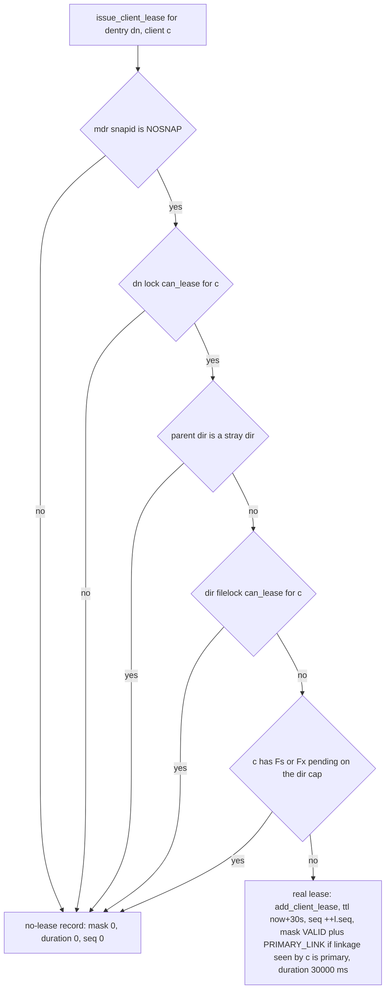
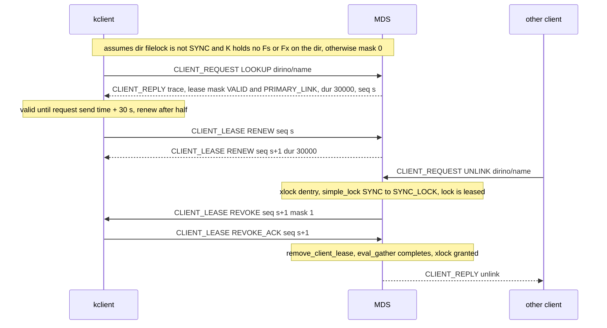
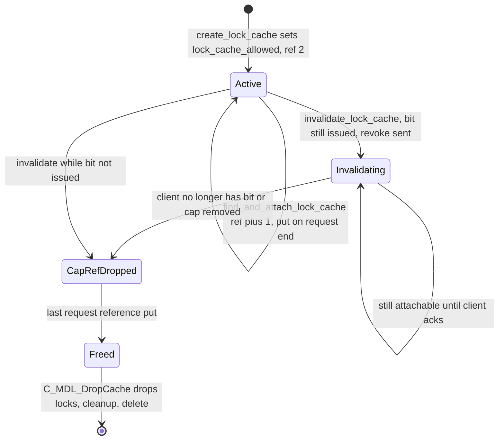
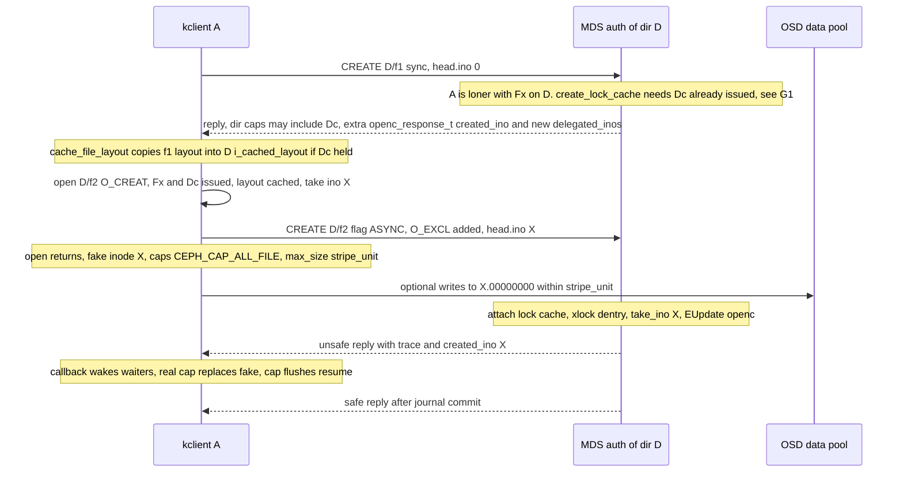
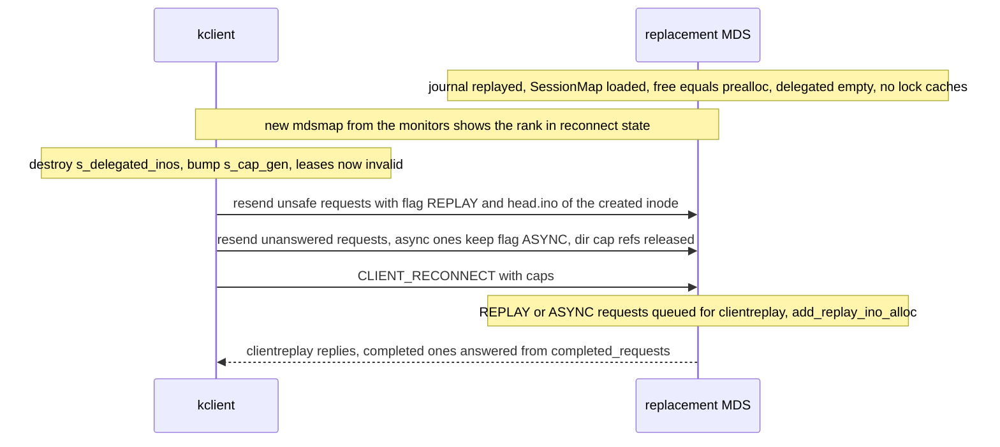

# Leases, lock caches and async directory operations

> Part of the [C++ MDS project map](../README.md). Sources (approximate LOC read): `src/mds/Locker.cc` (~550: lock caches 986-1265, client leases 4472-4625, lock-cache hooks in `acquire_locks`, `get_allowed_caps`, cap handlers and lock state transitions), `src/mds/Mutation.{h,cc}` (`MDLockCache`, ~150), `src/mds/CDentry.{h,cc}` (`ClientLease`, ~80), `src/messages/MClientLease.h` (98), `src/messages/MClientReply.h` (`LeaseStat`, `openc_response_t`, ~80), `src/mds/Server.cc` (~700: dispatch, reply/trace, ino allocation, openc, unlink, session close/reconnect), `src/mds/SessionMap.{h,cc}` (~100), `src/mds/MDCache.{h,cc}` (~250: path_traverse lock-cache hooks, lease lists and trim, purge_inodes, replay helpers), `src/mds/journal.cc` (~120), `src/mds/InoTable.cc` (~120), `src/client/Client.cc` (~200), Linux `fs/ceph/{file.c,dir.c,inode.c,caps.c,mds_client.c,super.h}` (~1100).
> Related: [capabilities](./capabilities.md), [sessions](./sessions.md), [wire protocol](./wire-protocol.md), [kclient expectations](./kclient-expectations.md), [libcephfs/ceph-fuse/Ganesha expectations](./libcephfs-fuse-ganesha-expectations.md), [request lifecycle](../03-request-path/request-lifecycle.md), [namespace mutations](../03-request-path/namespace-mutations.md), [lock state machines](../05-locking/lock-types-and-state-machines.md), [acquiring locks](../05-locking/acquiring-locks.md), [MDS tables](../07-storage-formats/mds-tables.md), [events and replay](../06-journal/events-and-replay.md), [rank recovery](../09-recovery/rank-lifecycle-and-recovery.md), [subtree migration](../08-multi-mds/subtree-migration.md), [strays and purge](../11-background-services/strays-and-purge.md), [quiesce](../12-qos-metrics-quiesce-quarantine/quiesce.md), [mds_lock analysis](../00-architecture/mds_lock-analysis.md).

## 1. Purpose and responsibilities

Three cooperating mechanisms let CephFS clients avoid synchronous MDS round trips for namespace operations. All of them are implemented inside the single `mds_lock` domain of a rank.

| Mechanism | What the client is allowed to do | MDS-side state | Peers that use it |
|---|---|---|---|
| Dentry lease | Trust one cached dentry (positive or negative) for at most 30 s without asking the MDS | `ClientLease` objects on a `CDentry`; `LEASED` flag on `CDentry::lock` | kclient, libcephfs/ceph-fuse (and so NFS-Ganesha) |
| Directory-wide validity ("dir lease") | Trust every cached dentry of a directory, and conclude `ENOENT` locally when the directory is cached completely, while the `Fs` cap on the directory is held and unchanged | Ordinary `Capability` on the directory inode; `filelock` state of the directory | kclient, libcephfs |
| Lock cache | MDS-internal set of locks and auth pins kept on behalf of one client's capability on one directory, for one op (CREATE or UNLINK). Externally visible only as the `Dc` (`CEPH_CAP_DIR_CREATE`) / `Dr` (`CEPH_CAP_DIR_UNLINK`) bits on the directory cap | `MDLockCache` (a `MutationImpl`) | kclient |
| Inode-number preallocation and delegation | Name newly created files with inode numbers the MDS handed out in advance (`delegated_inos`) | `Session::{pending_prealloc_inos, free_prealloc_inos, delegated_inos}`, durable `session_info_t::prealloc_inos`, `InoTable` | kclient (libcephfs decodes and discards them) |
| Async dirops | kclient returns from `open(O_CREAT)` / `unlink()` before the MDS has processed the request (`CEPH_MDS_FLAG_ASYNC`) | No dedicated state: normal request path plus lock cache plus delegated ino | kclient only (never happens against this MDS at this commit, see the status note) |

Responsibilities of the code described here:

- decide when a dentry lease may be issued, encode it into replies, renew it, revoke it when the dentry must change, expire it;
- create, attach, and invalidate lock caches, and grant/revoke the `Dc`/`Dr` cap bits that advertise them;
- allocate, refill, delegate, journal, replay and purge preallocated inode numbers per client session;
- execute async create/unlink requests exactly like synchronous ones, while guaranteeing that the assumptions the client already acted on (inode number, layout, success) either hold or are reported back as an error.

Status note (confirmed by reading the MDS, kernel-client and libcephfs code and the git history; no test covers it and it was not observed at runtime; see §8 G1): in this tree `Locker::create_lock_cache` refuses to create a lock cache unless the client's directory cap already has `Dc`/`Dr` issued. The MDS allows those bits on a directory cap only after a lock cache exists, and no path lets an unmodified client's directory cap acquire them. So no `MDLockCache` is ever created and `Dc`/`Dr` are never granted. The kernel client asks for them, still receives delegated inos, and sends every create/unlink to the MDS synchronously. This holds for squid v19.1.0 and later. The page documents the full mechanism because it is a wire-visible contract that an unmodified kclient (async dirops are its default) will use whenever an MDS grants `Fx`+`Dc`/`Dr`.

## 2. Source map

| File | Class / function | Lines | Role |
|---|---|---|---|
| `src/include/ceph_fs.h` | `ceph_mds_reply_lease`, `CEPH_LEASE_VALID`, `CEPH_LEASE_PRIMARY_LINK` | 773-781 | Lease record in replies |
| `src/include/ceph_fs.h` | `CEPH_MDS_LEASE_*`, `struct ceph_mds_lease` | 994-1011 | Lease message header |
| `src/include/ceph_fs.h` | `CEPH_CAP_DIR_CREATE`, `CEPH_CAP_DIR_UNLINK`, `CEPH_CAP_ANY_DIR_OPS` | 908-912 | Dir-op cap bits (aliases of Fc/Fr) |
| `src/include/ceph_fs.h` | `CEPH_MDS_FLAG_REPLAY/WANT_DENTRY/ASYNC`, `ceph_mds_request_head.ino`, `ceph_mds_request_release` | 584-586, 690-716 | Request flags, client-chosen ino, embedded releases |
| `src/messages/MClientLease.h` | `MClientLease` | 24-96 | `CEPH_MSG_CLIENT_LEASE` (0x311) |
| `src/messages/MClientReply.h` | `LeaseStat`, `openc_response_t` | 51-78, 309-340 | Lease record decode, create reply extra data |
| `src/mds/cephfs_features.h` | `CEPHFS_FEATURE_DELEG_INO` (13, same bit as `CEPHFS_FEATURE_OCTOPUS`), `CEPHFS_FEATURE_REPLY_ENCODING` (9) | 37-48 | Feature gates |
| `src/mds/CDentry.h/.cc` | `ClientLease`, `client_leases`, `add_client_lease`, `remove_client_lease(s)` | h:45-71, 339-389; cc:591-644 | Per-dentry lease records |
| `src/mds/SimpleLock.h/.cc` | `can_lease`, `is_leased`, `get/put_client_lease`, `LEASED`/`CACHED` flags, `add_cache`, `remove_cache`, `get_active_caches` | h:258-263, 353-357, 454-465, 601-633; cc:144-172 | Lock-level lease and lock-cache flags |
| `src/mds/locks.c` | `simplelock[]`, `filelock[]` tables (`l` column) | 15-125 | Which lock states allow leases |
| `src/mds/Locker.cc` | `handle_client_lease` | 4472-4539 | RENEW / RELEASE / REVOKE_ACK handling |
| `src/mds/Locker.cc` | `issue_client_lease`, `revoke_client_leases`, `encode_lease` | 4542-4629 | Lease issue, revoke, encoding |
| `src/mds/Locker.cc` | `remove_stale_leases` | 2872-2883 | Drop all leases of a stale session |
| `src/mds/Locker.cc` | `process_request_cap_release` | 3714-3797 | Embedded cap/lease release in requests |
| `src/mds/Locker.cc` | `C_MDL_DropCache`, `put_lock_cache`, `invalidate_lock_cache`, `eval_lock_caches`, `invalidate_lock_caches(CDir*)`, `invalidate_lock_caches(SimpleLock*)`, `create_lock_cache`, `find_and_attach_lock_cache` | 986-1265 | Lock-cache lifecycle |
| `src/mds/Locker.cc` | `acquire_locks` (lock-cache special cases) | 427-472 | Forced auth pins / debug asserts |
| `src/mds/Locker.cc` | `_drop_locks` | 840-845 | Drops request's lock-cache reference |
| `src/mds/Locker.cc` | `get_allowed_caps` | 2528-2576 | Masks dir-op bits, adds `lock_cache_allowed` when Fx allowed |
| `src/mds/Locker.cc` | `revoke_stale_caps`, `handle_client_caps`, `remove_client_cap` | 2778-2830, 3386-3640, 4345-4376 | Call `eval_lock_caches` / invalidate on cap changes |
| `src/mds/Locker.cc` | `simple_sync`, `simple_excl`, `simple_lock`, `simple_xlock`, `local_xlock_start`, `scatter_mix`, `file_excl`, `file_xsyn`, `handle_simple_lock`, `handle_file_lock` | 4764-6135 | Lease revocation and lock-cache invalidation on lock transitions |
| `src/mds/Mutation.h/.cc` | `MutationImpl::lock_cache`, `disable_lock_cache`, `is_rdlocked`, `is_wrlocked`; `MDLockCache`, `MDLockCacheItem` | h:165-167, 271-272, 535-589; cc:93-109, 609-689 | Lock-cache object |
| `src/mds/Capability.h` | `lock_caches`, `lock_cache_allowed` | 344-347, 387 | Per-cap lock-cache list and grantable bits |
| `src/mds/CDir.h/.cc` | `lock_caches_with_auth_pins`, `disable_frozen_inode`, `enable_frozen_inode`, `freeze_tree`, `freeze_dir` | h:618-648, 739; cc:3344-3372, 3611-3627, 3670-3681 | Freezes invalidate lock caches |
| `src/mds/CInode.cc` | `freeze_inode`, `get_caps_allowed_for_client`, `get_caps_liked`, `calc_ideal_loner`, `encode_inodestat` | 2986-3034, 3737-3744, 3798-3836, 3415-3436, 3959-4300 | Inode freeze invalidation, dir cap masks, loner choice, cap issue in replies |
| `src/mds/MDCache.h/.cc` | `touch_client_lease`, `client_lease_durations`, `client_leases`, `trim_client_leases`, `upkeep_main` | h:301-304, 1197-1198, 1399; cc:7933-7956, 14730-14740 | Lease TTL tracking and expiry |
| `src/mds/MDCache.cc` | `path_traverse` (`MDS_TRAVERSE_CHECK_LOCKCACHE`) | 8441-8497, 8645-8663, 8766-8790 | Attaches lock cache, skips cached locks, forces flush |
| `src/mds/MDCache.cc` | `purge_inodes`, `start_purge_inodes`; `MDCache.h` `add_replay_ino_alloc`, `insert/test_and_clear_taken_inos` | 6893-6930; h:223-234, 735-737 | Delegated-ino purge, replay helpers |
| `src/mds/SessionMap.h/.cc` | `Session::take_ino`, `delegate_inos`, `get_num_prealloc_inos`, `get_num_projected_prealloc_inos`, ino sets, `leases`, `lease_seq`, `touch_lease`, `decode`, `dump` | h:179-225, 427-437; cc:74-77, 646-689, 1100-1106 | Per-session ino and lease state |
| `src/mds/Server.cc` | `Server::dispatch` (reconnect-time queueing of replay/async requests) | 319-412 | Async requests during reconnect |
| `src/mds/Server.cc` | `early_reply`, `reply_client_request`, `set_trace_dist`, `set_reply_extra_bl` | 2300-2614 | Unsafe/safe replies, trace with lease, create reply extra data |
| `src/mds/Server.cc` | `handle_client_request` (completed-request replies) | 2616-2730 | Replay of completed creates |
| `src/mds/Server.cc` | `prepare_new_inode`, `journal_allocated_inos`, `apply_allocated_inos` | 3637-3801 | Ino allocation, refill, journaling |
| `src/mds/Server.cc` | `rdlock_path_xlock_dentry` | 3960-4054 | Sets `MDS_TRAVERSE_CHECK_LOCKCACHE` |
| `src/mds/Server.cc` | `handle_client_openc`, `C_MDS_openc_finish` | 4829-5046 | Create (sync or async) |
| `src/mds/Server.cc` | `handle_client_unlink`, `_unlink_local`, `_unlink_local_finish` | 8572-8889 | Unlink (sync or async) |
| `src/mds/Server.cc` | `_session_logged`, `journal_close_session`, `reconnect_tick`, `find_idle_sessions` | 925-1010, 1524-1560, 1844-1935, 1211-1310 | Delegated-ino purge, lease cleanup |
| `src/mds/InoTable.cc` | `project_alloc_id(s)`, `apply_alloc_id(s)`, `replay_alloc_id(s)` | 45-131 | Rank-global inode number table |
| `src/mds/journal.cc` | `EMetaBlob::replay` (ino alloc, client reqs), `EPurged::replay`, `ESession::replay` | 1640-1795, 1828-1845, 1883-1940 | Replay of allocations and purges |
| `src/client/Client.cc` | `verify_reply_trace`, `update_dentry_lease`, `handle_lease`, `encode_dentry_release`, `_dentry_valid`, `_lookup` | 2146-2228, 1496-1520, 3657-3704, 2492-2510, 7816-7930 | libcephfs side |
| `linux/fs/ceph/file.c` | `cache_file_layout`, `try_prep_async_create`, `restore_deleg_ino`, `ceph_async_create_cb`, `ceph_finish_async_create`, `ceph_atomic_open` | 503-950 | Kernel async create |
| `linux/fs/ceph/dir.c` | `ceph_async_unlink_cb`, `get_caps_for_async_unlink`, `ceph_unlink`, lease validity, `ceph_d_revalidate`, `ceph_lookup` | 806-870, 1256-1470, 1841-2070 | Kernel async unlink and lease use |
| `linux/fs/ceph/mds_client.c` | `ceph_parse_deleg_inos`, `ceph_get_deleg_ino`, `parse_reply_info_create`, `parse_reply_info_lease`, `handle_lease`, `ceph_mdsc_lease_send_msg`, `__do_request`, `replay_unsafe_requests`, `send_mds_reconnect` | 355-400, 622-790, 3540-3830, 4730-4760, 5145-5235, 6033-6170 | Kernel protocol side |

## 3. How it works

### 3.1 Dentry leases

#### 3.1.1 State

- `struct ClientLease` (`src/mds/CDentry.h:45 (ClientLease)`): `parent` (`CDentry*`), `session`, `seq` (`ceph_seq_t`), `ttl` (`utime_t`), `item_session_lease` (member of `Session::leases`), `item_lease` (member of one `MDCache::client_leases[pool]` list). Mempool `mds_client_lease` (`src/mds/CDentry.cc:591 (MEMPOOL_DEFINE_OBJECT_FACTORY(ClientLease))`).
- `CDentry::client_leases` is a `boost::intrusive::set` keyed by client id (`src/mds/CDentry.h:387 (ClientLeaseMap)`): at most one lease per (dentry, client).
- `CDentry::add_client_lease(session)` (`src/mds/CDentry.cc:598 (CDentry::add_client_lease)`) creates the record if absent. For the first lease on a dentry it takes `PIN_CLIENTLEASE` and calls `lock.get_client_lease()`, which sets the `SimpleLock::LEASED` state flag (`src/mds/SimpleLock.h:458 (SimpleLock::get_client_lease)`). A new record starts with `seq = ++session->lease_seq` (per-session counter, `src/mds/SessionMap.h:437 (Session::lease_seq)`).
- `CDentry::remove_client_lease` (`src/mds/CDentry.cc:618 (CDentry::remove_client_lease)`) unlinks the record from both lists, deletes it, and, when it was the last one, clears `LEASED`, drops `PIN_CLIENTLEASE` and calls `Locker::eval_gather(&lock)` if the lock was in an unstable (gathering) state.
- `MDCache::client_lease_durations = {5.0, 30.0, 300.0}` seconds (`src/mds/MDCache.h:1198 (MDCache::client_lease_durations)`) and three lists `client_leases[3]` (`src/mds/MDCache.h:1399 (MDCache::client_leases)`). `touch_client_lease(l, pool, ttl)` moves the lease to the tail of its pool list and sets `ttl` (`src/mds/MDCache.h:301 (MDCache::touch_client_lease)`). Every caller hard-codes `pool = 1` with the comment `// fixme.. do something smart!` (`src/mds/Locker.cc:4521 (Locker::handle_client_lease)`, `src/mds/Locker.cc:4569 (Locker::issue_client_lease)`), so the effective lease duration is always 30 s and each list stays sorted by ttl.
- `Session::leases` (`src/mds/SessionMap.h:432 (Session::leases)`); `Session::touch_lease` appends there and hits `session_cache_liveness` (`src/mds/SessionMap.cc:74 (Session::touch_lease)`).
- Only `CDentry::lock` (type `CEPH_LOCK_DN`, state machine `sm_simplelock`) can carry `LEASED`: `get_client_lease()` is called only from `CDentry::add_client_lease` (`src/mds/CDentry.cc:608 (CDentry::add_client_lease)`). The `is_leased()` branches in inode-lock transitions (`scatter_mix`, `file_excl`) are therefore never taken.
- A dentry pinned by `PIN_CLIENTLEASE` is not trimmed from the cache, and a stray dentry with leases is not purged (`src/mds/StrayManager.cc:515 (StrayManager::_eval_stray)`).

#### 3.1.2 When a lease is issued (`Locker::issue_client_lease`)

`issue_client_lease(dn, in, mdr, now, bl)` (`src/mds/Locker.cc:4542 (Locker::issue_client_lease)`) always appends a lease record to `bl`. It is called for the dentry of a reply trace (`src/mds/Server.cc:2546 (Server::set_trace_dist)`) and for every entry of a readdir reply (`src/mds/Server.cc:5304 (Server::handle_client_readdir)`, `src/mds/Server.cc:12521 (Server::_readdir_diff)`).

Details:

- `SimpleLock::can_lease(client)` (`src/mds/SimpleLock.h:353 (SimpleLock::can_lease)`) is true in states whose `can_lease` column is `ANY`, `AUTH` on the auth, or `XCL` when the lock is xlocked by that client. For the dentry lock (`simplelock[]`, `src/mds/locks.c:15 (simplelock[])`): `LOCK_SYNC` = ANY (so replicas can issue leases too), `LOCK_LOCK_SYNC` = XCL, `LOCK_XLOCKDONE` = XCL. For the directory `filelock` (`filelock[]`): `LOCK_SYNC` = ANY, `LOCK_XLOCKDONE` = XCL, all other states 0.
- Consequence: real per-dentry leases are only issued while the directory's `filelock` is *not* leasable (e.g. `MIX`, `LOCK`, `EXCL` of another client) and the client holds neither `Fs` nor `Fx` on the directory. When the directory filelock is `SYNC`, the client is expected to use `Fs` on the directory instead; a directory "likes" `Fs`/`Fx` (`src/mds/CInode.cc:3737 (CInode::get_caps_liked)`). This rationale is an inference; the code has no comment.
- In `set_trace_dist` the directory inode is encoded (and caps on it issued) *before* `issue_client_lease` runs (`src/mds/Server.cc:2527-2546 (Server::set_trace_dist)`), so caps granted in the same reply already count for the `Fs`/`Fx` test.
- The linkage examined is `dn->get_linkage(client, mdr)` (`src/mds/CDentry.h:218 (CDentry::get_linkage)`): the projected linkage if the client can read projected state (`can_read_projected`) or this request xlocked the dentry. Primary linkage sets `CEPH_LEASE_PRIMARY_LINK`; remote and null linkages do not (asserts check consistency with `in`, `src/mds/Locker.cc:4554-4564 (Locker::issue_client_lease)`).
- Null (negative) dentries get real leases too (mask `CEPH_LEASE_VALID` only). This happens for `-ENOENT` lookups where the client asked for the dentry (`CEPH_MDS_FLAG_WANT_DENTRY`): `rdlock_path_pin_ref` sets `mdr->tracedn` (`src/mds/Server.cc:3906-3910 (Server::rdlock_path_pin_ref)`) and the reply trace carries the null dentry.
- The no-lease record (`mask = 0`, `src/mds/Locker.cc:4584 (Locker::issue_client_lease)`) does **not** carry `CEPH_LEASE_PRIMARY_LINK`. Since commit 907b1f41e5e (2022, tracker 54701) this is unconditional; before that, the no-lease record carried the linkage mask. See §8 G2 for the effect on kernel async unlink.
- Snapshot listings (`CEPH_MDS_OP_LSSNAP`) encode `LeaseStat(CEPH_LEASE_VALID, -1, 0)` for every snapshot entry ("infinite lease": duration 0xFFFFFFFF ms, not tracked server side), `src/mds/Server.cc:11545 (Server::handle_client_lssnap)`.
- Leases are never issued in the final reply if an early reply was already sent ("don't issue leases if we sent an earlier reply already", `src/mds/Server.cc:2443-2445 (Server::reply_client_request)`); `reply_client_request` drops non-rdlocks first so that the dentry lock can settle into a leasable state (`src/mds/Server.cc:2438-2439 (Server::reply_client_request)`).

#### 3.1.3 Encodings

Lease record inside replies (`Locker::encode_lease`, `src/mds/Locker.cc:4609 (Locker::encode_lease)`):

| Session feature | Bytes |
|---|---|
| `CEPHFS_FEATURE_REPLY_ENCODING` (bit 9) present | `ENCODE_START(2, 1)`: `u8 struct_v=2`, `u8 struct_compat=1`, `u32 struct_len`, then `u16 mask`, `u32 duration_ms`, `u32 seq`, `string alternate_name` (`u32 len` + bytes) |
| absent | raw `u16 mask`, `u32 duration_ms`, `u32 seq` (= packed `struct ceph_mds_reply_lease`, 10 bytes) |

The kernel decoder (`linux/fs/ceph/mds_client.c:355 (parse_reply_info_lease)`) rejects `struct_compat != 1`, reads `alternate_name` only when `struct_v >= 2`, and skips to `struct_len`. libcephfs decodes with `LeaseStat::decode` (`src/messages/MClientReply.h:61 (LeaseStat::decode)`).

Placement in a trace (`Server::set_trace_dist`, `src/mds/Server.cc:2491 (Server::set_trace_dist)`): `[dir InodeStat][DirStat][dname][lease record][target InodeStat]`; readdir entries are `[dname][lease record][InodeStat]` (`src/mds/Server.cc:5302-5308 (Server::handle_client_readdir)`).

`MClientLease` message (`CEPH_MSG_CLIENT_LEASE` = 0x311, `src/messages/MClientLease.h`): payload is the packed `struct ceph_mds_lease` (`u8 action`, `le16 mask`, `le64 ino`, `le64 first`, `le64 last`, `le32 seq`, `le32 duration_ms`; 35 bytes) followed by `string dname` (`le32 len` + bytes). There is no versioned envelope. `ino` is the *parent directory* inode, `dname` the entry name. The MDS decoder ignores trailing bytes (the kernel allocates `NAME_MAX` extra bytes, `linux/fs/ceph/mds_client.c:6151 (ceph_mdsc_lease_send_msg)`).

| `action` | Value | Direction | Sender / handler |
|---|---|---|---|
| `CEPH_MDS_LEASE_REVOKE` | 1 | MDS to client | `Locker::revoke_client_leases`; kclient `handle_lease`, libcephfs `Client::handle_lease` |
| `CEPH_MDS_LEASE_RELEASE` | 2 | client to MDS | libcephfs (reply to REVOKE); `Locker::handle_client_lease` |
| `CEPH_MDS_LEASE_RENEW` | 3 | both | kclient request; MDS reply (copy of the request) |
| `CEPH_MDS_LEASE_REVOKE_ACK` | 4 | client to MDS | kclient (reply to REVOKE); `Locker::handle_client_lease` |

#### 3.1.4 Lifecycle: renew, release, revoke, expiry

- **Renew** (kclient only; libcephfs never sends RENEW). The kernel stores `lease_renew_after = from + duration/2` where `from` is the request start time (`linux/fs/ceph/inode.c:1427-1461 (__update_dentry_lease)`); the next `d_revalidate` after that time sends RENEW with its stored seq (`linux/fs/ceph/dir.c:1865 (dentry_lease_is_valid)`). `Locker::handle_client_lease` (`src/mds/Locker.cc:4472 (Locker::handle_client_lease)`) resolves `get_inode(ino, last)`, `pick_dirfrag(dname)`, `lookup(dname)` and the client's `ClientLease`; if any is missing the message is silently dropped. For RENEW, if `dn->lock.can_lease(client)` it sends a copy of the message with `duration_ms = 30000` and `seq = ++l->seq` and sets server ttl to now+30 s; otherwise it sends nothing (the debug log says "revoking lease" but no message is sent). RENEW re-checks neither the directory filelock nor the client's `Fs`/`Fx`, and ignores the client's seq. The kernel accepts the renew reply only if the lease session, `lease_gen == s_cap_gen`, and an outstanding renew match (`linux/fs/ceph/mds_client.c:6101-6117 (handle_lease)`).
- **Release by message.** `REVOKE_ACK` and `RELEASE` remove the lease only if `m->seq == l->seq`; otherwise they are ignored and the lease lives until ttl expiry (`src/mds/Locker.cc:4503-4511 (Locker::handle_client_lease)`). The kernel answers every REVOKE with REVOKE_ACK by reusing the received message, substituting its own seq if newer (`linux/fs/ceph/mds_client.c:6092-6127 (handle_lease)`); it also answers when it no longer has the inode or dentry. libcephfs asserts the action is REVOKE and answers with RELEASE carrying the MDS's seq and mask (`src/client/Client.cc:3657-3704 (Client::handle_lease)`).
- **Release embedded in a request.** Requests carry `ceph_mds_request_release` records (44 bytes + `dname_len` bytes). A record for the parent directory with `dname_len > 0` releases the dentry lease (kclient `linux/fs/ceph/caps.c:5025 (ceph_encode_dentry_release)`, libcephfs `src/client/Client.cc:2492 (Client::encode_dentry_release)`). The MDS processes them only for non-replay requests (`src/mds/Server.cc:2716-2724 (Server::handle_client_request)`) in `Locker::process_request_cap_release` (`src/mds/Locker.cc:3714 (Locker::process_request_cap_release)`), which removes the lease **without comparing `dname_seq`**.
- **Unknown action.** Any other action value (including `REVOKE` sent by a client) from a client that holds a lease on the named dentry reaches `default: ceph_abort()` (`src/mds/Locker.cc:4535-4537 (Locker::handle_client_lease)`).
- **Expiry.** `MDCache::trim_client_leases` (`src/mds/MDCache.cc:7933 (MDCache::trim_client_leases)`) removes leases from the head of each pool list while `ttl <= now`. It runs on the upkeep thread under `mds_lock` every `mds_cache_trim_interval` (default 1 s) when the rank is active, clientreplay or stopping (`src/mds/MDCache.cc:14724-14736 (MDCache::upkeep_main)`).
- **Session stale.** When a session goes stale and `revoke_stale_caps` succeeds, `remove_stale_leases` drops all of its leases (`src/mds/Server.cc:1297-1300 (Server::find_idle_sessions)`, `src/mds/Locker.cc:2872 (Locker::remove_stale_leases)`). Clients bump their cap generation on `CEPH_SESSION_STALE`, which invalidates their leases (`linux/fs/ceph/mds_client.c:4628 (handle_session)`, `src/client/Client.cc:2757 (Client::handle_client_session)`).
- **Session close/kill.** `_session_logged` removes every lease of the session (`src/mds/Server.cc:991-996 (Server::_session_logged)`).
- **Directory became a stray.** `CDir::try_remove_dentries_for_stray` removes leases on null head dentries (`src/mds/CDir.cc:824-825 (CDir::try_remove_dentries_for_stray)`).
- **MDS restart.** Leases are memory-only. Clients invalidate them on reconnect because `send_mds_reconnect` increments `s_cap_gen` (`linux/fs/ceph/mds_client.c:5204 (send_mds_reconnect)`) and lease validity requires `lease_gen == s_cap_gen`.

#### 3.1.5 Revocation when a dentry must change

- Any change of a dentry's linkage xlocks `CDentry::lock` (see [namespace mutations](../03-request-path/namespace-mutations.md)). On the auth, `xlock_start` reaches `simple_lock` (`SYNC` to `SYNC_LOCK`). If the lock is leased, `simple_lock` calls `revoke_client_leases` and counts it as a gather (`src/mds/Locker.cc:5100-5103 (Locker::simple_lock)`). `eval_gather` only completes the transition when `!lock->is_leased()` (target state `LOCK` has `can_lease` 0, `src/mds/Locker.cc:1311 (Locker::eval_gather)`).
- `revoke_client_leases` (`src/mds/Locker.cc:4592 (Locker::revoke_client_leases)`) sends, for each lease, `MClientLease(REVOKE, seq=l.seq, mask=1|CEPH_LOCK_DN (=1), ino=parent dir ino, first=diri->first, last=CEPH_NOSNAP, dname)` with `send_message_client_counted`. The records stay until acked, released or expired.
- Replicas: when the auth sends `LOCK_AC_LOCK`, a replica moves to `SYNC_LOCK`, revokes the leases it issued, and its `eval_gather` waits for them before sending `LOCKACK` (`src/mds/Locker.cc:4788-4800 (Locker::handle_simple_lock)`). Leases issued by replica ranks therefore also hold back the auth's xlock.
- Timing contract: a dentry change waits until every lease holder of that dentry (on every rank) acks/releases, or until server-side ttl expiry (at most 30 s after the last issue or renew, plus up to `mds_cache_trim_interval`). An ack with a stale seq does not help; the change then waits for expiry.

#### 3.1.6 Directory-wide validity (`Fs`) and directory completeness

This is client-side logic built on the MDS's cap guarantees; the MDS has no "dir lease" object.

- kclient: `i_shared_gen` is incremented whenever `Fs` is newly issued on an inode, and a directory is marked not complete whenever `Fs` is gained or lost (`linux/fs/ceph/caps.c:598-611 (__check_cap_issue)`). Every lease record the kernel applies, including a mask-0 record, sets `di->lease_shared_gen = i_shared_gen` of the parent and sets or clears `CEPH_DENTRY_PRIMARY_LINK` from the mask (`linux/fs/ceph/inode.c:1436-1441 (__update_dentry_lease)`). Readdir entries and unlocked-parent traces always apply it (`linux/fs/ceph/inode.c:2178 (ceph_readdir_prepopulate)`, `1889 (ceph_fill_trace)`); the parent-locked trace path applies it only when `have_lease` (below). A dentry is valid if its own lease is valid (`lease_gen == s_cap_gen`, now before session `s_cap_ttl`, now before `di->time`; `linux/fs/ceph/dir.c:1841 (__dentry_lease_is_valid)`) or if the parent has `Fs` issued and `lease_shared_gen == i_shared_gen` (`linux/fs/ceph/dir.c:1942 (dir_lease_is_valid)`, `linux/fs/ceph/dir.c:1977 (ceph_d_revalidate)`). With `Fs` and a complete directory, a negative lookup is answered locally (`linux/fs/ceph/dir.c:835-860 (ceph_lookup)`). In `ceph_fill_trace`, `have_lease = (dir cap in reply has Fs) || duration_ms != 0` decides whether negative dentries are kept (`linux/fs/ceph/inode.c:1766-1773 (ceph_fill_trace)`).
- libcephfs: `_dentry_valid` requires `lease_mds >= 0`, `lease_ttl > now`, session `cap_ttl > now` and `cap_gen == lease_gen` (`src/client/Client.cc:7816 (Client::_dentry_valid)`). Otherwise `_lookup` accepts the dentry if the directory has `Fs` and `cap_shared_gen == dir->shared_gen`, and returns `-ENOENT` locally if the directory is `I_COMPLETE` (`src/client/Client.cc:7905-7930 (Client::_lookup)`). `shared_gen` increments when `Fs` is newly issued (`src/client/Client.cc:4799-4805 (Client::check_cap_issue)`).
- MDS guarantees that make this safe:
  - Every namespace change in a directory takes a wrlock on the directory inode's `filelock` (and `nestlock`) (`src/mds/MDCache.cc:8649-8656 (MDCache::path_traverse)`). In `SYNC` (the only state that allows `Fs` to non-loner clients) `can_wrlock` is 0, so the lock must move to `LOCK`/`MIX`, or be `EXCL` for the loner, which revokes `Fs` from everyone except the loner. See [lock state machines](../05-locking/lock-types-and-state-machines.md).
  - For directories, the `Fc`, `Fr`, `Fl` and `Fw-extend` bits are never derived from lock state: `allowed &= ~CEPH_CAP_ANY_DIR_OPS` (`src/mds/Locker.cc:2564 (Locker::get_allowed_caps)`, `src/mds/CInode.cc:3819 (CInode::get_caps_allowed_for_client)`). They are reinterpreted as dir-op caps and come only from lock caches (§3.2).

#### 3.1.7 Client behaviour differences

| Aspect | kclient | libcephfs / ceph-fuse / Ganesha |
|---|---|---|
| Renew | Yes, after half the duration | Never |
| Reply to REVOKE | `REVOKE_ACK`, reuses the message, may substitute own newer seq | `RELEASE` with MDS seq and mask; asserts action is REVOKE |
| Release in requests | `dname` + `dname_seq` in the dir release record when it holds a lease from that MDS | same |
| `CEPH_LEASE_PRIMARY_LINK` | Sets/clears `CEPH_DENTRY_PRIMARY_LINK`; required for async unlink (`linux/fs/ceph/dir.c:1332-1334 (get_caps_for_async_unlink)`) and used to choose the path hint in cap reconnect (`linux/fs/ceph/mds_client.c:4863 (d_find_primary)`) | `dn->mark_primary()` (`src/client/Client.cc:1516 (Client::update_dentry_lease)`) |
| `alternate_name` | Used | Used |
| Lease metrics | Sends dentry-lease hit/miss counters | Sends hit/miss counters (`dlease_hit/miss`), consumed by `MetricsHandler::handle_payload(DentryLeasePayload)` (`src/mds/MetricsHandler.cc:274 (MetricsHandler::handle_payload)`) |

### 3.2 Lock caches

#### 3.2.1 What a lock cache is

`struct MDLockCache : MutationImpl` (`src/mds/Mutation.h:540 (MDLockCache)`):

| Field | Meaning |
|---|---|
| `diri` | Directory inode |
| `client_cap` | The client's `Capability` on `diri`; set to null when the cap is removed |
| `opcode` | `CEPH_MDS_OP_CREATE` or `CEPH_MDS_OP_UNLINK` (const) |
| `dir_layout` | Layout to give new files (CREATE only) |
| `item_cap_lock_cache` | Membership in `Capability::lock_caches` (`src/mds/Capability.h:344 (Capability::lock_caches)`) |
| `items_lock[]` | One `MDLockCacheItem` per cached lock, linked into that lock's `lock_caches` list (sets `SimpleLock::CACHED`) |
| `items_dir[]`, `auth_pinned_dirfrags` | Membership in `CDir::lock_caches_with_auth_pins` of every relevant dirfrag |
| `ref` | Starts at 1 (the cap's reference); +1 per attached request |
| `invalidating` | Set once invalidation starts |
| `cap_ref` | True while the cap's reference (the initial 1) is held |

Key: (client `Capability` on `diri`, opcode). At most one lock cache per (cap, opcode); `create_lock_cache` is a no-op if one exists, even if it is invalidating (`src/mds/Locker.cc:1117-1122 (Locker::create_lock_cache)`). Opcode to cap bit (`src/mds/Mutation.cc:677 (MDLockCache::get_cap_bit_for_lock_cache)`): CREATE to `CEPH_CAP_DIR_CREATE` (`Dc` = `Fc` bit = 0x400), UNLINK to `CEPH_CAP_DIR_UNLINK` (`Dr` = `Fr` bit = 0x800); any other opcode aborts.

A lock cache is a `MutationImpl` holding locks and (auth) pins in its own name. Requests that attach to it see those locks as theirs (`MutationImpl::is_rdlocked`/`is_wrlocked` consult `lock_cache`, `src/mds/Mutation.cc:93-109 (MutationImpl::is_rdlocked, MutationImpl::is_wrlocked)`), so a stream of creates or unlinks by the same client in the same directory does not re-acquire them.

#### 3.2.2 How `Dc`/`Dr` are granted

- `Capability::lock_cache_allowed` (`src/mds/Capability.h:387 (Capability::lock_cache_allowed)`) holds the dir-op bits this cap may be issued. Only `create_lock_cache` sets it (`src/mds/Locker.cc:1187 (Locker::create_lock_cache)`); `invalidate_lock_cache` clears it (`src/mds/Locker.cc:1036 (Locker::invalidate_lock_cache)`).
- `get_allowed_caps`: for directories, `allowed &= ~CEPH_CAP_ANY_DIR_OPS`, then `if (allowed & CEPH_CAP_FILE_EXCL) allowed |= cap->get_lock_cache_allowed()` (`src/mds/Locker.cc:2563-2567 (Locker::get_allowed_caps)`). `CInode::get_caps_allowed_for_client` (used by `encode_inodestat` in replies) does the same (`src/mds/CInode.cc:3818-3822 (CInode::get_caps_allowed_for_client)`). So `Dc`/`Dr` are allowed only while `Fx` is allowed for that client, which for a directory means the client is the loner and the `filelock` is `EXCL`.
- Bits are issued as `(wanted | likes) & allowed` (`src/mds/Locker.cc:2667-2671 (Locker::issue_caps)`, `src/mds/CInode.cc:4216-4221 (CInode::encode_inodestat)`); directory "likes" are `PIN | ANY_EXCL | ANY_SHARED`, so `Dc`/`Dr` are issued only if the client *wants* them. The kclient wants `CEPH_CAP_ANY_DIR_OPS` and `Fx` on a directory it wrote recently when mounted with async dirops (`linux/fs/ceph/caps.c:1047-1059 (__ceph_caps_file_wanted)`, `linux/fs/ceph/caps.c:1097-1104 (__ceph_caps_wanted)`); `ceph_mdsc_submit_request` marks the parent dir "written" for every `CEPH_MDS_OP_WRITE` op (`linux/fs/ceph/mds_client.c:3918-3929 (ceph_mdsc_submit_request)`).
- Loner condition for directories: exactly one non-stale client cap, no MDS wanting caps, and the directory is not a subtree root or exporting (`src/mds/CInode.cc:3415 (CInode::calc_ideal_loner)`); `file_eval` moves an unrdlocked directory `filelock` to `EXCL` under the same conditions and leaves `EXCL` when `multiple_nonstale_caps()`, when the loner neither wants nor holds any of `Fx`/`Fw`/`Fb`, or when another client wants `Fx`/`Fw`/`Fr` (`src/mds/Locker.cc:5697 (Locker::file_eval)`). A second client merely obtaining a cap on the directory therefore ends `Fx` and with it `Dc`/`Dr`. A directory with any dirfrag that is a subtree root (`num_subtree_roots > 0`, e.g. the filesystem root or an export-pinned directory) or being exported gets no ideal loner (`calc_ideal_loner` returns -1, `src/mds/CInode.cc:916 (CInode::has_subtree_or_exporting_dirfrag)`) and `file_eval` does not move its `filelock` to `EXCL`, so its clients do not get `Fx`, `Dc` or `Dr` there (by code reading).
- Net effect at this commit: `create_lock_cache` requires the bit to be issued already (§3.2.3 item 6), so `lock_cache_allowed` is never set and no directory cap is ever granted `Dc`/`Dr` (§8 G1).

#### 3.2.3 Creation (`Locker::create_lock_cache`, `src/mds/Locker.cc:1092 (Locker::create_lock_cache)`)

Callers: `handle_client_openc` when `mds_allow_async_dirops && mdr->dn[0].size() == 1` (`src/mds/Server.cc:4987-4988 (Server::handle_client_openc)`), before the inode is allocated; `handle_client_unlink` when `mds_allow_async_dirops && !rmdir && dnl->is_primary() && mdr->dn[0].size() == 1` (`src/mds/Server.cc:8714-8715 (Server::handle_client_unlink)`), after all locks of the unlink are acquired. The call is made for every qualifying request, sync or async.

No-op unless all of the following hold:

1. the request has no lock cache yet;
2. `diri->is_auth()`;
3. the request has no peer (multi-MDS) requests;
4. the client has a cap on `diri`;
5. no lock cache exists on that cap for this opcode;
6. **`cap->issued()` already contains the op's bit** (`src/mds/Locker.cc:1124-1128 (Locker::create_lock_cache)`; added by commit 9b4a93f2b7b, 2024-03, see §8 G1);
7. every object (diri or ancestor) that the request auth-pinned can still be auth-pinned and, if such an inode's parent linkage is projected, so can its projected parent dirfrag;
8. every open dirfrag of `diri` is auth, auth-pinnable, and contains no freezing/frozen inode;
9. every lock the request holds on `diri` or an ancestor is in a stable state.

Then:

- `cap->set_lock_cache_allowed(bit)`;
- every open dirfrag of `diri` is auth-pinned by the cache ("prevent subtree migration") and gets `disable_frozen_inode()` (increments `CDir::frozen_inode_suppressed`; while non-zero, inodes in that dirfrag cannot finish freezing, `src/mds/CInode.cc:2970-2993 (CInode::maybe_finish_freeze_inode, CInode::freeze_inode)`);
- each `diri`/ancestor object in the request's `object_states` is auth-pinned (if the request had auth-pinned it) or pinned by the cache, and its projected parent dirfrag is added to the dirfrag list;
- `attach_dirfrags` sorts/dedups that list into `auth_pinned_dirfrags` and links the cache into each dirfrag's `lock_caches_with_auth_pins` (`src/mds/Mutation.cc:621 (MDLockCache::attach_dirfrags)`);
- locks are **moved** from the request to the cache (`src/mds/Locker.cc:1217-1239 (Locker::create_lock_cache)`): every rdlock on `diri` or an ancestor, and every wrlock on `diri` itself. Wrlocks on ancestors (added by `predirty_journal_parents`) are not cached; xlocks on `diri`/ancestors would trip `ceph_assert(it->is_rdlock())`; dentry locks are never cached because a dentry is neither `diri` nor an ancestor inode;
- `attach_locks` links one item per cached lock (`src/mds/Mutation.cc:609 (MDLockCache::attach_locks)`), setting `CACHED`;
- the creating request becomes the first attached request (`ref++`).

Concretely the cached lock set is:

| Lock | Mode | CREATE | UNLINK | Origin |
|---|---|---|---|---|
| `snaplock` of `diri` and every ancestor up to the root | rd | yes | yes | `try_rdlock_snap_layout` (`src/mds/Locker.cc:157 (Locker::try_rdlock_snap_layout)`) |
| `policylock` of `diri` up to the first ancestor with a layout | rd | yes | no | same, `want_layout` |
| `authlock` of `diri` | rd | yes | no | `MDS_TRAVERSE_RDLOCK_AUTHLOCK` (`src/mds/MDCache.cc:8651-8652 (MDCache::path_traverse)`) |
| `filelock`, `nestlock` of `diri` | wr | yes | yes | `MDS_TRAVERSE_XLOCK_DENTRY` (`src/mds/MDCache.cc:8650-8651 (MDCache::path_traverse)`) |
| `quiescelock` of `diri` | wr (local) | yes | yes | added implicitly by `acquire_locks`: one `quiescelock` wrlock per call, on the inode of the first x/wr-locked lock that has a cap shift, here `diri->filelock` (`src/mds/Locker.cc:338-341 (Locker::acquire_locks)`, `371-376`) |

#### 3.2.4 Attachment and effect on request locking

- `rdlock_path_xlock_dentry` adds `MDS_TRAVERSE_CHECK_LOCKCACHE` when the request path has depth 1 (`<dir ino>/<name>`) and the request has not disabled lock caches (`src/mds/Server.cc:3996 (Server::rdlock_path_xlock_dentry)`). The kernel builds depth-1 paths for create/unlink (`linux/fs/ceph/mds_client.c:3034 (build_dentry_path)`, `linux/fs/ceph/mds_client.c:2899 (ceph_mdsc_build_path)` stops at the first ancestor it has an inode for).
- `path_traverse` calls `find_and_attach_lock_cache(mdr, base inode)` (`src/mds/MDCache.cc:8491-8492 (MDCache::path_traverse)`). It attaches the first cache on that client's cap with the same opcode that is `attachable()` (`client_cap && cap_ref`), `ref++` (`src/mds/Locker.cc:1247 (Locker::find_and_attach_lock_cache)`). It does not look at `CEPH_MDS_FLAG_ASYNC`: synchronous creates/unlinks of the same client use the cache too.
- With a cache attached, `path_traverse` skips `try_rdlock_snap_layout` and copies `dir_layout` from the cache (`src/mds/MDCache.cc:8494-8497 (MDCache::path_traverse)`), and for the tail dentry skips the `filelock`/`nestlock` wrlocks and `authlock` rdlock (`if (depth > 0 || !mdr->lock_cache)`, `src/mds/MDCache.cc:8649 (MDCache::path_traverse)`, `8772`). The request itself then only xlocks the dentry (plus the wrlock on the dentry `versionlock` that `acquire_locks` adds for a leader) and, for unlink, the target inode's `linklock`/`snaplock` and the stray dentry/dir locks. `predirty_journal_parents` asserts `is_wrlocked(&pin->filelock)`, which is satisfied through the cache (`src/mds/MDCache.cc:2278-2279 (MDCache::predirty_journal_parents)`).
- Opcodes that never use a cache call `disable_lock_cache()`: `mknod`, `mkdir`, `symlink`, `link`, `rmdir` (`src/mds/Server.cc:7591 (Server::handle_client_mknod)`, `7692`, `7796`, `7873`, `8581`); rename uses `rdlock_two_paths_xlock_destdn`, which never sets the flag.
- Forced auth pins: in `acquire_locks`, if an object cannot be auth-pinned (freezing) but its parent dirfrag belongs to the attached cache's directory, the request auth-pins it anyway (`src/mds/Locker.cc:448-462 (Locker::acquire_locks)`). Reason: the client holds `Dc`/`Dr` cap references for every in-flight async op and will not release them until those ops are answered; waiting on the freeze would deadlock. Matching rule for cap messages: `should_defer_client_cap_frozen` does not defer for a freezing inode with no auth pins if its parent dirfrag is auth-pinned by a lock cache (`src/mds/Locker.cc:3363-3383 (Locker::should_defer_client_cap_frozen)`).
- "Force client to flush async dir operation if necessary": when any request rdlocks (rather than xlocks) a dentry whose parent `filelock` is cached by some lock cache, and the request's own cache does not wrlock that `filelock`, `path_traverse` adds a wrlock on the parent `filelock` before the dentry rdlock (`src/mds/MDCache.cc:8657-8662 (MDCache::path_traverse)`, `8780-8785`). For another client this wrlock cannot be granted in `EXCL`, so `wrlock_start` drives the lock out of `EXCL` (`src/mds/Locker.cc:1981 (Locker::wrlock_start)`), revoking `Fx` (and, transitively, `Dc`/`Dr`) from the async client. The kclient acknowledges only after its in-flight async ops are answered, so the reader observes their results. The wrlock is requested before the dentry rdlock, so the waiting reader holds no lock on the dentry that the pending async op must xlock.
- `MDRequestImpl::can_batch()` returns false when a lock cache is attached (`src/mds/Mutation.cc:438-441 (MDRequestImpl::can_batch)`).
- On request completion `_drop_locks(..., drop_rdlocks=true)` calls `put_lock_cache` (`src/mds/Locker.cc:840-845 (Locker::_drop_locks)`).

#### 3.2.5 Invalidation triggers

`invalidate_lock_cache(lc)` (`src/mds/Locker.cc:1024 (Locker::invalidate_lock_cache)`): marks `invalidating`, detaches it from the dirfrags' `lock_caches_with_auth_pins` lists (its auth pins remain held), clears the bit from `lock_cache_allowed`, and if the client still has the bit issued calls `issue_caps(diri, cap)`, which sends a revoke of `Dc`/`Dr` because the bit is no longer allowed. If the bit is no longer issued or the cap is gone, it releases the cap's reference (`cap_ref = false`, `put_lock_cache`).

| Trigger | Call site | Scope |
|---|---|---|
| Client lost `Dc`/`Dr` (cap update/ack, embedded release, stale session) | `eval_lock_caches(cap)` when `confirm_receipt`/`revoke` reports a revoked dir-op bit: `handle_client_caps` (`src/mds/Locker.cc:3623 (Locker::handle_client_caps)`), `process_request_cap_release` (`3782`), `revoke_stale_caps` (`2812`; only for caps that had a revocation in flight). The per-inode `revoke_stale_cap` (`src/mds/Locker.cc:2742 (Locker::revoke_stale_cap)`) calls `cap->revoke()` without `eval_lock_caches`, so a cache whose `Dc`/`Dr` is revoked from a stale cap keeps its cap reference until the cap is removed (by code reading) | that cap |
| Client cap removed (cap release message, session close/kill/eviction) | `Locker::remove_client_cap` sets `client_cap = nullptr` and invalidates every cache of the cap (`src/mds/Locker.cc:4352-4356 (Locker::remove_client_cap)`), called from `_do_cap_release` and `_session_logged`. Cap export does not use this path (`CInode::clear_client_caps_after_export`); the export first freezes the subtree, which invalidates the caches (next row) | that cap |
| Subtree freeze for export | `CDir::freeze_tree` invalidates caches registered on every dirfrag of the subtree (`src/mds/CDir.cc:3359-3368 (CDir::freeze_tree)`) | subtree |
| Dirfrag freeze (fragmentation) | `CDir::freeze_dir` (`src/mds/CDir.cc:3622-3623 (CDir::freeze_dir)`) | dirfrag |
| Inode freeze (cross-MDS rename auth-pin freeze) | `CInode::freeze_inode` invalidates caches on the parent dirfrag and caches holding any lock of the inode (`src/mds/CInode.cc:3010-3031 (CInode::freeze_inode)`) | inode |
| Cached lock must change state | `invalidate_lock_caches(lock)` in `simple_sync` (wrlocked, `4948`), `simple_excl` (`5041`), `simple_lock` (rdlocked, `5106`), `simple_xlock` (`5189`), `scatter_tempsync` (`5565`), `scatter_mix` (rdlocked, `5846`), `file_excl` (`5925`), `file_xsyn` (`5981`), replica `handle_simple_lock` LOCK (`4796`), `handle_file_lock` SYNC/LOCK/MIX (`6073`, `6103`, `6128`) | lock |
| Quiesce | `local_xlock_start` on a cached `quiescelock` (`src/mds/Locker.cc:5655 (Locker::local_xlock_start)`); also a quiesced inode's allowed caps exclude `Fx` (`src/mds/CInode.cc:3726 (get_caps_quiesce_mask)`) | inode |
| Loss of `Fx` (second client, loner change) | indirect: `Dc`/`Dr` stop being allowed, `issue_caps` revokes them, the ack then hits `eval_lock_caches` | cap |

`invalidate_lock_caches(SimpleLock*)` only acts on caches that are not already invalidating (`src/mds/SimpleLock.cc:163 (get_active_caches)`).

#### 3.2.6 Lifecycle

- `put_lock_cache` (`src/mds/Locker.cc:998 (Locker::put_lock_cache)`): when `ref` reaches 0 (asserts `invalidating`), unlinks from the cap list, detaches from locks (clearing `CACHED` when last), calls `enable_frozen_inode()` on `diri`'s dirfrags (which may finish pending inode freezes, `src/mds/CDir.cc:3670 (CDir::enable_frozen_inode)`) and queues `C_MDL_DropCache` on `finished_queue`; that context runs `drop_locks(lock_cache)`, `cleanup()` (auth pins and pins) and deletes it (`src/mds/Locker.cc:986-996 (C_MDL_DropCache)`).
- While invalidating, `attachable()` stays true until the cap's reference is dropped, so requests the client sent before acknowledging the revoke still use the cache; and because the invalidated cache stays on the cap's list, no new cache for that opcode can be created until it is freed (comment `src/mds/Locker.cc:1051-1053 (Locker::invalidate_lock_cache)`).
- Lock caches are memory-only: nothing is journaled; after an MDS restart none exist.

### 3.3 Inode-number preallocation and delegation

#### 3.3.1 Per-session state

| Field | Persistence | Meaning |
|---|---|---|
| `session_info_t::prealloc_inos` (`src/mds/mdstypes.h:380 (session_info_t::prealloc_inos)`) | Encoded in the SessionMap object `mds<rank>_sessionmap`; changes journaled in `EMetaBlob` | All inos reserved for the session that are not yet used by a committed create |
| `Session::free_prealloc_inos` (`src/mds/SessionMap.h:428 (Session::free_prealloc_inos)`) | Memory; rebuilt as `= prealloc_inos` on load (`src/mds/SessionMap.cc:1104 (Session::decode)`) | Available to the MDS for creates by this session |
| `Session::delegated_inos` (`src/mds/SessionMap.h:429 (Session::delegated_inos)`) | Memory only | Handed to the client; may be used only when the client names them in `head.ino` |
| `Session::pending_prealloc_inos` (`src/mds/SessionMap.h:427 (Session::pending_prealloc_inos)`) | Memory | Projected refill whose journal entry is not yet committed |
| `InoTable` (`mds<rank>_inotable`) | RADOS object + journal | Rank-global free set; rank r owns `[(r+1)<<40, (r+2)<<40)` (`src/mds/InoTable.cc:29-41 (InoTable::reset_state)`) |

After replay, `MDSRank::validate_sessions` asserts `prealloc_inos == free_prealloc_inos` and that none of them is free in the `InoTable`, marking the rank damaged otherwise (`src/mds/MDSRank.cc:1744-1767 (MDSRank::validate_sessions)`).

#### 3.3.2 Allocation and refill (`Server::prepare_new_inode`, `src/mds/Server.cc:3637 (Server::prepare_new_inode)`)

- Preallocated inos are used only if the session is open (`allow_prealloc_inos = mdr->session->is_open()`, `src/mds/Server.cc:3647 (Server::prepare_new_inode)`).
- `ino = session->take_ino(useino)` (`src/mds/SessionMap.h:179 (Session::take_ino)`), where `useino = req->head.ino`:
  - `useino != 0`: returns 0 unless `useino` is in `info.prealloc_inos`; if present it is removed from `delegated_inos` or `free_prealloc_inos`, and `ceph_assert(0)` fires if it is in neither (already taken by an in-flight request);
  - `useino == 0`: returns `free_prealloc_inos.range_start()` (never a delegated ino), or 0 if empty.
  - Success sets `mdr->used_prealloc_ino` and projects the SessionMap (`mark_projected`).
- Otherwise `mdr->alloc_ino = inotable->project_alloc_id(useino)` (`src/mds/InoTable.cc:46 (InoTable::project_alloc_id)`): with `useino == 0` the first free ino; with `useino != 0` it erases exactly that id from `projected_free`, a strict `interval_set` erase that `ceph_assert`s when the id is not free (§8 G4).
- An ino recorded in `MDCache::replay_taken_inos` (used by a replayed event although the table was already newer) is skipped and allocation retried (`src/mds/Server.cc:3654-3672 (Server::prepare_new_inode)`).
- If `useino` was given and differs from the result, `clog` error "specified ino ... but mds.X allocated ..." (`src/mds/Server.cc:3678-3684 (Server::prepare_new_inode)`).
- Refill: if `free + pending < mds_client_prealloc_inos / 2`, project `need = mds_client_prealloc_inos - (free + pending)` ids from the `InoTable` into `mdr->prealloc_inos` and `pending_prealloc_inos` (`src/mds/Server.cc:3688-3696 (Server::prepare_new_inode)`). Delegated inos do not count ("sans any delegated ones", `src/mds/SessionMap.h:218-221 (Session::get_num_prealloc_inos)`).
- `journal_allocated_inos` writes `allocated_ino`, `used_preallocated_ino`, `preallocated_inos`, `client_name`, projected SessionMap and InoTable versions into the `EMetaBlob` (`src/mds/Server.cc:3767 (Server::journal_allocated_inos)`, `src/mds/events/EMetaBlob.h:392 (set_ino_alloc)`).
- `apply_allocated_inos` runs in `reply_client_request`, i.e. when the safe reply is sent after the journal commit (`src/mds/Server.cc:2408 (Server::reply_client_request)`, `src/mds/Server.cc:3780 (Server::apply_allocated_inos)`): applies `alloc_ino` and the refill to the table (`apply_alloc_id(s)`); moves the refill from pending into `free_prealloc_inos` and `info.prealloc_inos`; erases `used_prealloc_ino` from `info.prealloc_inos`; marks the session dirty.
- `early_reply` is refused when `mdr->alloc_ino != 0` (`src/mds/Server.cc:2315-2318 (Server::early_reply)`); creates that use a preallocated or delegated ino can get an unsafe reply.

#### 3.3.3 Delegation (`Server::set_reply_extra_bl`, `src/mds/Server.cc:2591 (Server::set_reply_extra_bl)`)

Called by `handle_client_openc` before journaling (`src/mds/Server.cc:5039 (Server::handle_client_openc)`) and for already-completed creates (`src/mds/Server.cc:2674-2678 (Server::handle_client_request)`, `2896-2905`).

- If `mds_allow_async_dirops` and the session has `CEPHFS_FEATURE_DELEG_INO`: encode `openc_response_t { created_ino, delegated_inos }`. Delegated inos are added only if `delegate_inos_pct != 0` and the request is not queued for replay: with `frac = 100 / pct` (default pct 50, frac 2), if `delegated_inos.size() < mds_client_prealloc_inos / frac / 2` (default 250) then `Session::delegate_inos(mds_client_prealloc_inos / frac)` (default 500) tops `delegated_inos` up to that size from `free_prealloc_inos` and returns the newly delegated intervals (`src/mds/SessionMap.h:197 (Session::delegate_inos)`). The reply carries only the newly delegated intervals.
- Else, if the connection has `CEPH_FEATURE_REPLY_CREATE_INODE`: a bare `le64` created ino.
- Delegation is a memory-only move from `free_prealloc_inos` to `delegated_inos`; durable state does not change.
- `frac` is an integer division: any `mds_client_delegate_inos_pct` from 51 to 100 gives `frac = 1` (delegate up to the whole prealloc target), and a value above 100 gives `frac = 0` and a division by zero on the next create reply; the option has no upper bound (by code reading).
- On a session's first create there is nothing to delegate (the refill is still pending), so delegation starts with a later create reply (by code reading).

Encoding of `openc_response_t` (`src/messages/MClientReply.h:309 (openc_response_t)`): `ENCODE_START(1, 1)` (`u8 v=1`, `u8 compat=1`, `u32 len`), `u64 created_ino`, `interval_set<inodeno_t>` as `u32 n` + `n x (u64 start, u64 len)`.

Client side:

- kclient: uses the versioned format iff the MDS advertised `CEPHFS_FEATURE_DELEG_INO` in its session features (`linux/fs/ceph/mds_client.c:759-790 (parse_reply_info_create)`). Each delegated ino goes into the session's xarray `s_delegated_inos`; ranges starting below `CEPH_INO_SYSTEM_BASE` (0x1000) are ignored; a reply delegating more than `CEPH_MAX_DELEG_INOS` (8192) or a session exceeding it is an error (`-EIO`); duplicates warn "delegated inode ... more than once" (`linux/fs/ceph/mds_client.c:622-705 (ceph_insert_deleg_ino, ceph_parse_deleg_inos)`). On 32-bit kernels delegations are parsed and ignored (`linux/fs/ceph/mds_client.c:732-756 (ceph_parse_deleg_inos 32-bit stub)`).
- libcephfs: decodes `openc_response_t` iff `extra_bl` is at least 8 bytes and the session's MDS features have `DELEG_INO`, logs and discards `delegated_inos` (`src/client/Client.cc:2158-2171 (Client::verify_reply_trace)`).
- `CEPHFS_FEATURE_DELEG_INO` is the same bit (13) as `CEPHFS_FEATURE_OCTOPUS`; the MDS (`CEPHFS_FEATURES_MDS_SUPPORTED`), libcephfs and this kernel all advertise it.

#### 3.3.4 Persistence, replay and purge

- Journal replay of `EMetaBlob` (`src/mds/journal.cc:1649-1730 (EMetaBlob::replay)`): `replay_alloc_id(s)` on the `InoTable` if its version is older; if the SessionMap is older, `take_ino(used_preallocated_ino)` and erase it from `info.prealloc_inos`, and add `preallocated_inos` to free and `prealloc_inos`; if the SessionMap is already newer, record `used_preallocated_ino` in `replay_taken_inos` (likewise `allocated_ino` when the `InoTable` is already newer). Each `client_reqs` entry becomes a completed request with `created = allocated_ino ? allocated_ino : used_preallocated_ino` (`src/mds/journal.cc:1778-1791 (EMetaBlob::replay)`).
- Session close or kill (`journal_close_session`, `src/mds/Server.cc:1524 (Server::journal_close_session)`): `pending + free` inos are released to the `InoTable` (`inos_to_free`); `delegated_inos` are recorded as `inos_to_purge` in `ESession`. When logged, `_session_logged` subtracts both from `prealloc_inos`, adds `inos_to_purge` to the log segment's `purging_inodes`, and, if the rank is clientreplay/active/stopping, calls `MDCache::purge_inodes` (`src/mds/Server.cc:931-953 (Server::_session_logged)`); otherwise `recovery_done` calls `start_purge_inodes` (`src/mds/MDSRank.cc:2175 (MDSRank::recovery_done)`).
- `MDCache::purge_inodes` (`src/mds/MDCache.cc:6903 (MDCache::purge_inodes)`) issues, for every ino, `filer.purge_range(ino, &default_file_layout, ..., first_obj=0, num_obj=1)`: it deletes only object `<ino-hex>.00000000` in the default data pool (comment `// FIXME: handle non-default data pool and namespace`). On completion it journals `EPurged(inos, segment seq, inotablev)` and releases the inos to the `InoTable`. The completion asserts that every delete returned 0 or `-ENOENT` (`ceph_assert(r == 0 || r == -2)`), so any other OSD error aborts the MDS. Log segments cannot expire while `purging_inodes` is non-empty (`src/mds/journal.cc:365-368 (LogSegment::try_to_expire)`).
- Why purge: a kclient may write data objects of an async-created inode before the MDS has processed the create (§3.4.3). The initial `max_size` the client assumes is `stripe_unit`, so its pre-create writes fall into object 0.
- Reconnect timeout (`Server::reconnect_tick`): for each session evicted for not reconnecting, `session->delegated_inos.swap(session->free_prealloc_inos)` before eviction (`src/mds/Server.cc:1918-1919 (Server::reconnect_tick)`). After a restart `delegated_inos` is empty and every prealloc ino is "free", so the swap makes all of them purge candidates and frees nothing.
- During reconnect, an async or replayed request with a non-zero `head.ino` that is not yet completed always calls `mdcache->add_replay_ino_alloc(ino)` (adds it to `cap_imports_missing` so rejoin does not try to open it, `src/mds/MDCache.h:735 (MDCache::add_replay_ino_alloc)`). With `mds_replay_unsafe_with_closed_session` (default false) set, the ino is also moved from free to delegated (`src/mds/Server.cc:352-361 (Server::dispatch)`) so that, after the timeout swap above, it is released instead of purged and the later replay can allocate it from the `InoTable` (the session being closed, `prepare_new_inode` cannot use prealloc inos).

### 3.4 Async create, end to end

#### 3.4.1 Designed flow

#### 3.4.2 Client preconditions (kclient)

`ceph_atomic_open` (`linux/fs/ceph/file.c:795 (ceph_atomic_open)`) attempts async only if:

- mount option `ASYNC_DIROPS` (`nowsync`) is set; it is in `CEPH_MOUNT_OPT_DEFAULT` in this kernel (`linux/fs/ceph/super.h:50-53 (CEPH_MOUNT_OPT_DEFAULT)`); `wsync` clears it (`linux/fs/ceph/super.c:580-585 (ceph_parse_mount_param)`);
- a path for the parent can be built and the local MDS-auth-caps check (`ceph_mds_check_access`, which uses the cap auths the MDS sent at session open) does not fail; `-EACCES` is returned synchronously, other errors disable async (`linux/fs/ceph/file.c:826-855 (ceph_atomic_open)`);
- security xattrs fit in one page (`linux/fs/ceph/file.c:856-869 (ceph_atomic_open)`); before that, any `O_CREAT` open fails with `-EDQUOT` when the client-side max-files quota check fails (quotas are enforced by clients, the MDS never returns `-EDQUOT`);
- `try_prep_async_create` (`linux/fs/ceph/file.c:525 (try_prep_async_create)`): the directory has an auth cap; its session's `s_delegated_inos` is non-empty; `i_cached_layout` is valid (set only by `cache_file_layout` after a synchronous create whose reply carried the created ino, while the directory held `Dc`, `linux/fs/ceph/file.c:503 (cache_file_layout)`; wiped when `Dc` is lost, `linux/fs/ceph/caps.c:613-618 (__check_cap_issue)`); `Fx|Dc` are issued; and either the dentry is in lookup and the directory is complete, or `lease_shared_gen == i_shared_gen`. It then takes an ino with `ceph_get_deleg_ino` and cap references on `Fx|Dc` that are held until the callback runs.

#### 3.4.3 Request and client-side state

- Request: `CEPH_MDS_OP_CREATE`, `CEPH_MDS_FLAG_ASYNC` (4) set in `head.flags` (`linux/fs/ceph/mds_client.c:3593-3594 (__prepare_send_request)`), `CEPH_O_EXCL` added to `args.open.flags` (`linux/fs/ceph/file.c:915 (ceph_atomic_open)`), `head.ino = r_deleg_ino` (`linux/fs/ceph/mds_client.c:3399 (create_request_message)`), no layout fields (`linux/fs/ceph/file.c:199 (prepare_open_request)`), path `<dir ino>/<name>`, and a release record for the parent with `drop = Fs|Ax|Xx`, `unless = Fx` (with `Fx` held, `Fs` is kept while unused `Ax`/`Xx` are still released, `linux/fs/ceph/caps.c:4934 (ceph_encode_inode_release)`).
- The kernel hashes the new inode before sending, marks the dentry `CEPH_DENTRY_ASYNC_CREATE`, submits without waiting, and fills a fake inode: `ino = X`, caps and wanted `CEPH_CAP_ALL_FILE`, `cap_id = 1`, `max_size = stripe_unit`, uid/gid (setgid inherited), mode, nlink 1, `truncate_seq = 1`, `truncate_size = -1`, `change_attr = 1` (`linux/fs/ceph/file.c:672-790 (ceph_finish_async_create)`). Until the reply, `ceph_check_caps` and cap-flush kicks are suppressed for the inode (`CEPH_I_ASYNC_CREATE`, `linux/fs/ceph/caps.c:2065-2070 (ceph_check_caps)`, `2622-2623`); `fsync`, writeback and writes beyond `max_size` wait for it (`linux/fs/ceph/caps.c:2538 (ceph_fsync)`, `2587`, `3183`).
- `-EJUKEBOX` (no active MDS, session not open) makes the kernel restore the ino and retry synchronously (`linux/fs/ceph/file.c:938-947 (ceph_atomic_open)`, `linux/fs/ceph/mds_client.c:3690-3692 (__do_request)`, `3727-3733`).

#### 3.4.4 MDS processing (`Server::handle_client_openc`, `src/mds/Server.cc:4895 (Server::handle_client_openc)`)

The MDS does not branch on `CEPH_MDS_FLAG_ASYNC` here; async and sync creates run the same code:

1. `rdlock_path_xlock_dentry(mdr, create=true, okexist=!excl, authexist=true, want_layout=true)`; with `O_EXCL` an existing dentry yields `-EEXIST` (`src/mds/Server.cc:4048-4052 (Server::rdlock_path_xlock_dentry)`).
2. charmap check (`-EPERM`), alternate name length (`-ENAMETOOLONG`), layout (dir layout from the lock cache or traversal, request overrides need `MAY_SET_VXATTR`; invalid layout `-EINVAL`), `check_access(MAY_WRITE)`, `check_fragment_space` and `check_dir_max_entries` (`-ENOSPC`).
3. `create_lock_cache` (§3.2.3).
4. `prepare_new_inode(mdr, dir, req->head.ino, mode|S_IFREG, &layout)`; delegated ino X is found in `delegated_inos` and used (`used_prealloc_ino = X`).
5. Project linkage; `issue_new_caps` (for a request queued for replay it only tries `try_reconnect_cap`, `src/mds/Locker.cc:2445-2446 (Locker::issue_new_caps)`); set `authlock`/`xattrlock` to `EXCL`; if opened for write, `client_ranges[client] = [0, stripe_unit]` (`src/mds/Server.cc:5017-5023 (Server::handle_client_openc)`).
6. `EUpdate("openc")` with `add_client_req`, `journal_allocated_inos`, `predirty_journal_parents(PREDIRTY_PRIMARY|PREDIRTY_DIR, +1)`, `add_primary_dentry`, `add_opened_ino` (`src/mds/Server.cc:5027-5035 (Server::handle_client_openc)`).
7. `set_reply_extra_bl` (created ino plus possibly more delegated inos).
8. `journal_and_reply`: early (unsafe) reply with trace (allowed because `alloc_ino == 0`), journal submit; after an early reply the log is not flushed immediately, `handle_locks_for_early_reply` drops the request's rdlocks except `snaplock`/`policylock` and flushes the log only if a held auth lock is unstable and has waiters (`src/mds/Server.cc:2124-2152 (Server::journal_and_reply)`, `src/mds/Locker.cc:906 (Locker::handle_locks_for_early_reply)`). `C_MDS_openc_finish` applies the projection, sends dentry link to replicas, and sends the safe reply (`src/mds/Server.cc:4829-4857 (C_MDS_openc_finish)`).

Already-completed creates (resent or replayed) are answered from `session->completed_requests` (§3.6).

#### 3.4.5 Reply and error semantics (kclient)

- `ceph_async_create_cb` runs at the first reply (unsafe or safe) (`linux/fs/ceph/file.c:616 (ceph_async_create_cb)`). On error: warning "async create failure path=... result=...", `mapping_set_error` on the parent directory, directory marked not complete, dentry dropped, and the inode shut down (`ceph_inode_shutdown`), so later operations on the open file fail. On success it warns if the reply's target ino differs from the delegated ino, or if the reply had no target inode ("no req->r_target_inode"), then wakes waiters and kicks deferred cap flushes. Cap references `Fx|Dc` are released.
- The MDS reports async-create errors as ordinary reply results; nothing retries them. Errors the client cannot have pre-checked include `-EEXIST`, `-ENOSPC` (fragment/dir size limits; full metadata pool, where by code reading a client whose MDS caps lack the `f` flag is first answered `-EACCES` by `check_access(MAY_FULL)`, `src/mds/Server.cc:2805-2835 (Server::dispatch_client_request)`), `-EACCES`/`-EPERM`, `-EROFS`, `-ESTALE`, `-EINVAL`, `-ENAMETOOLONG`. (`-EDQUOT` is not among them: no MDS code path returns it.)
- `-EJUKEBOX` is only handled at first submission. If a later resend (for example after `MClientRequestForward`) finds the target rank not active or no open session to it, `__do_request` fails the async request with `-EJUKEBOX`, and both async callbacks then only release the directory cap references ("caller must resubmit") although nothing resubmits; the create or unlink is silently dropped (`linux/fs/ceph/mds_client.c:3686-3692 (__do_request)`, `3727-3733`, `linux/fs/ceph/file.c:628-630 (ceph_async_create_cb)`, `linux/fs/ceph/dir.c:1281 (ceph_async_unlink_cb)`, by code reading).

### 3.5 Async unlink, end to end

- Kernel preconditions (`linux/fs/ceph/dir.c:1309 (get_caps_for_async_unlink)`, `linux/fs/ceph/dir.c:1348 (ceph_unlink)`): `ASYNC_DIROPS`; a parent path can be built and the local MDS-auth-caps check (`MAY_WRITE`) passes, as for create; op is `UNLINK` (never `RMDIR`); `Fx|Dr` issued on the parent; `lease_shared_gen == i_shared_gen`; and the dentry has `CEPH_DENTRY_PRIMARY_LINK` (set only from a lease record carrying `CEPH_LEASE_PRIMARY_LINK`). No delegated inos are needed.
- Request: `CEPH_MDS_OP_UNLINK` with `CEPH_MDS_FLAG_ASYNC`, caps on the victim inode dropped (`ceph_drop_caps_for_unlink`: `Ls|Lx`, plus all unwanted caps if `nlink == 1`, `linux/fs/ceph/caps.c:4892 (ceph_drop_caps_for_unlink)`). The kernel registers the dentry in `async_unlink_conflict`, decrements `nlink` and `d_delete`s locally right after submission. Later creates, mknod, mkdir, symlink, link and rename-target of the same name in the same parent wait for the unlink callback (`ceph_wait_on_conflict_unlink`, `linux/fs/ceph/mds_client.c:933 (ceph_wait_on_conflict_unlink)`).
- MDS (`Server::handle_client_unlink`, `src/mds/Server.cc:8572 (Server::handle_client_unlink)`): `rdlock_path_xlock_dentry(create=false, okexist=true)` attaches the UNLINK lock cache if present; errors `-EISDIR`, `-ENOTDIR`, `-ENOENT`, `-EACCES`; `prepare_stray_dentry` for primary links (the stray dirs are rank-global, rotating per log segment, `src/mds/MDCache.cc:776 (MDCache::advance_stray)`); xlocks `linklock` and `snaplock` of the inode, wrlocks the stray dir `filelock`/`nestlock`, xlocks the stray dentry; `create_lock_cache`; `_unlink_local` journals `EUpdate("unlink_local")` and early-replies (`src/mds/Server.cc:8738 (Server::_unlink_local)`). `create_lock_cache` is only called for primary links, so unlinks of remote links never create a cache (an existing UNLINK cache can still be attached); remote links whose inode is on another rank go through `_link_remote` (peer request).
- Kernel callback `ceph_async_unlink_cb` (`linux/fs/ceph/dir.c:1256 (ceph_async_unlink_cb)`): clears the conflict entry; on error, `mapping_set_error` on the parent and the inode, directory not complete, dentry dropped, warning "failure path=... result=...".

### 3.6 MDS failure, reconnect and replay

- Kernel side: `send_mds_reconnect` destroys `s_delegated_inos` and bumps `s_cap_gen` (`linux/fs/ceph/mds_client.c:5168-5204 (send_mds_reconnect)`); `replay_unsafe_requests` resends unsafe requests (flag `REPLAY`, `head.ino` set to the created inode, embedded releases stripped, `linux/fs/ceph/mds_client.c:3540-3573 (__prepare_send_request)`) and then every older request without an unsafe reply, releasing its directory cap references first (`linux/fs/ceph/mds_client.c:4730-4760 (replay_unsafe_requests)`). Those keep `CEPH_MDS_FLAG_ASYNC`. libcephfs sets `head.ino` on replay too (`src/client/Client.cc:2853-2855 (Client::send_request)`).
- MDS side, during `up:reconnect` (`src/mds/Server.cc:340-375 (Server::dispatch)`): requests from sessions not open are dropped (unless `mds_replay_unsafe_with_closed_session`); requests with `REPLAY` or `ASYNC` are queued for clientreplay; a non-zero `head.ino` of a not-completed request goes into `add_replay_ino_alloc`. Retried requests that are already completed are also queued.
- For requests flagged `REPLAY` or carrying a retry count, `handle_client_request` checks `session->have_completed_request(tid, &created)` (`src/mds/Server.cc:2659-2690 (Server::handle_client_request)`). A completed `REPLAY` request is answered immediately with result 0 and, if an inode was created, the created-ino extra data (no trace). A completed `CREATE` that is only retried (no `REPLAY` flag) is re-dispatched, in any rank state, as an open of the created inode with `set_reply_extra_bl` (`src/mds/Server.cc:2896-2905 (Server::dispatch_client_request)`). During clientreplay, other completed requests that created an inode (mkdir, mknod, symlink) are converted to `LOOKUP`/`GETATTR` (mask `CEPH_STAT_CAP_INODE_ALL`); other completed retries get an immediate result-0 reply, and completed `OPEN`s are simply re-executed.
- A not-completed replayed or async create re-executes; `prepare_new_inode` finds `head.ino` among the session's free prealloc inos (all prealloc inos are free after restart) and creates the same inode number. The client's reconnected cap for that ino is attached by `try_reconnect_cap` (`src/mds/MDCache.cc:5912 (MDCache::try_reconnect_cap)`, called from `issue_new_caps` and `reply_client_request`). A request with the `REPLAY` flag never gets an early reply (`src/mds/Server.cc:2325-2328 (Server::early_reply)`), and its final reply carries no trace (`reply_client_request` only calls `try_reconnect_cap`, `src/mds/Server.cc:2444-2452 (Server::reply_client_request)`). A request that only has `ASYNC` (never got an unsafe reply) may get an early reply and a trace, but while it is queued for clientreplay `issue_new_caps` only reattaches a reconnected cap and `set_reply_extra_bl` delegates no new inos.
- Requests that the client never resends (client gone) leave their delegated inos in `prealloc_inos`; when the session is eventually closed or evicted they are purged (§3.3.4).

### 3.7 Multi-MDS aspects

- Delegated inos are per (client, rank) session; the kclient uses those of the session holding the directory's auth cap (`linux/fs/ceph/file.c:539 (try_prep_async_create)`).
- A lock cache auth-pins every open dirfrag of the directory, so a subtree export must freeze it, which invalidates the cache and revokes `Dc`/`Dr`; the freeze completes only after the client released its in-flight cap references. The kclient still handles forwarding of an async create: it resends to the new rank with the same `head.ino` and moves the async inode's auth cap to the new session (`linux/fs/ceph/mds_client.c:3780-3828 (__do_request)`). The receiving rank would treat that foreign ino as described in §8 G4.
- Remote-link unlinks never create a cache: `handle_client_unlink` calls `create_lock_cache` only for primary links, and `create_lock_cache` also refuses requests with peer requests.

### 3.8 Same-directory concurrency

- Under `mds_lock` all operations of a rank are serialized, but lock-level conflicts in one directory are fine-grained: creates/unlinks of different names hold wrlocks on the directory `filelock`/`nestlock` (wrlocks are compatible with each other: `filelock` in `LOCK`, `MIX` and, for the loner's requests, `EXCL`; `nestlock`, a scatterlock without `EXCL`, in `LOCK` and `MIX`) and an xlock on their own dentry only; the directory `versionlock` is a local wrlock (`src/mds/MDCache.cc:2389-2390 (MDCache::predirty_journal_parents)`). Directory fnode projections and journal entries are ordered by `mds_lock` and the log.
- A lock cache only exists for a single client that is the loner of the directory. Any other client that obtains a cap on, reads, or modifies the directory makes the MDS take `Fx` away, which invalidates the cache and drains that client's in-flight async ops first (§3.2.4, §3.2.5). Async dirops are therefore a single-writer-per-directory optimization; concurrent multi-client workloads (for example several Ganesha or kernel clients in one export directory) run synchronously.
- Per-name ordering for one kclient: async unlink then create of the same name is serialized client-side until the unlink's first reply (`ceph_wait_on_conflict_unlink`). On the MDS, an early reply turns the dentry xlock into `LOCK_XLOCKDONE` and clears `xlock_by` (`src/mds/SimpleLock.cc:43 (SimpleLock::set_xlock_done)`). A later request of the *same* client may xlock that dentry again before the first request commits: `xlock_start` lets it proceed from `XLOCKDONE` when `xlock_by_client` matches, and `simple_xlock` does not gather existing xlocks (`src/mds/Locker.cc:2137 (Locker::xlock_start)`, `src/mds/Locker.cc:5163 (Locker::simple_xlock)`). Requests of other clients wait until the first request finishes after its journal commit.
- Dentry leases and the directory `Fs` make cross-client visibility explicit: before a namespace change in a directory becomes visible, every other client's `Fs` on the directory and every lease on the changed dentry (on all ranks) is revoked or expired.

## 4. Data structures and invariants

- `ClientLease`: at most one per (dentry, client); present in exactly three containers (`CDentry::client_leases`, `Session::leases`, `MDCache::client_leases[1]`) or none; `CDentry::lock.is_leased() == !client_leases.empty()`; the dentry holds `PIN_CLIENTLEASE` iff leased.
- Lease `seq`: per lease, strictly increasing on each issue and renew. A new record is seeded from the incremented per-session counter `session->lease_seq`, and the first value sent is that seed plus 1. Only an ack carrying the current seq removes the lease (embedded releases remove it regardless).
- Server ttl >= client ttl: the MDS measures from issue time, the kernel from request start (`r_request_started`) and libcephfs from `request->sent_stamp`, with the same duration. Only relative durations are used.
- Only `CDentry::lock` is ever leased; inode locks never set `LEASED`.
- Directory caps: dir-op bits (`0xCC00` = `Fc|Fr|Fw-extend|Fl`) are never derived from lock state; `Dc`/`Dr` are allowed only if `Fx` is allowed and `lock_cache_allowed` contains them. At this commit `lock_cache_allowed` is never set, so no directory cap ever holds `Dc`/`Dr` (§8 G1).
- `MDLockCache`: at most one per (cap, opcode); while `cap_ref` is true, `ref >= 1`; `ref == 0` implies `invalidating`; until `put_lock_cache` reaches 0 every cached lock is `CACHED`, and the locks stay held by the cache until `C_MDL_DropCache` runs; diri's open dirfrags at creation have `frozen_inode_suppressed > 0` until `put_lock_cache` reaches 0 and stay auth-pinned until `C_MDL_DropCache` calls `cleanup()`.
- Session ino sets: `free_prealloc_inos`, `delegated_inos` and `pending_prealloc_inos` are disjoint; `free ∪ delegated ⊆ info.prealloc_inos`; an ino taken by an in-flight request has left free/delegated but remains in `info.prealloc_inos` until `apply_allocated_inos`; after load `free == info.prealloc_inos` and none of them is free in the `InoTable`.
- `delegated_inos` is never persisted; the client also forgets delegations on reconnect, so delegation state never survives an MDS restart or a client reconnect.

## 5. Interfaces

### 5.1 Messages

| Message | Type id | Direction | Fields used | MDS handler / sender |
|---|---|---|---|---|
| `MClientLease` | `CEPH_MSG_CLIENT_LEASE` 0x311 | both | action, mask, ino (parent dir), first, last, seq, duration_ms, dname | `Locker::handle_client_lease` (`src/mds/Locker.cc:4472 (Locker::handle_client_lease)`); `Locker::revoke_client_leases` (`src/mds/Locker.cc:4592 (Locker::revoke_client_leases)`) |
| `MClientRequest` | `CEPH_MSG_CLIENT_REQUEST` 24 | client to MDS | `head.flags` (`REPLAY`=1, `WANT_DENTRY`=2, `ASYNC`=4), `head.op` (CREATE 0x01301, UNLINK 0x01203), `head.ino`, `args.open.flags` (`CEPH_O_EXCL` 0200), releases (`dname`, `dname_seq`) | `Server::dispatch`, `Server::handle_client_request` |
| `MClientReply` | `CEPH_MSG_CLIENT_REPLY` 26 | MDS to client | trace lease records; readdir lease records; `extra_bl` = `openc_response_t` or bare ino; `safe` flag | `Server::early_reply`, `Server::reply_client_request` |
| `MClientCaps` | `CEPH_MSG_CLIENT_CAPS` 0x310 | both | `Dc` (0x400) / `Dr` (0x800) on directory caps (grant, revoke, ack) | `Locker::issue_caps`, `Locker::handle_client_caps` |
| `MClientRequestForward` | `CEPH_MSG_CLIENT_REQUEST_FORWARD` 25 | MDS to client | client must resend (same `head.ino`) | `MDSRank::forward_message_mds` |

### 5.2 Cap bits

| Name | Value | On directories |
|---|---|---|
| `CEPH_CAP_FILE_SHARED` (Fs) | 0x100 | Directory-wide dentry validity |
| `CEPH_CAP_FILE_EXCL` (Fx) | 0x200 | Exclusive (loner) directory; prerequisite for `Dc`/`Dr` |
| `CEPH_CAP_DIR_CREATE` (Dc) = `Fc` | 0x400 | Async create allowed |
| `CEPH_CAP_DIR_UNLINK` (Dr) = `Fr` | 0x800 | Async unlink allowed |
| `CEPH_CAP_ANY_DIR_OPS` | 0xCC00 | Masked out of lock-derived directory caps |

### 5.3 Journal events

| Event | Content relevant here | Writer |
|---|---|---|
| `EUpdate("openc")` | `client_reqs` (reqid), `allocated_ino` or `used_preallocated_ino`, `preallocated_inos`, `sessionmapv`, `inotablev`, primary dentry + inode, opened ino | `Server::handle_client_openc` |
| `EUpdate("unlink_local")` | client req, null dentry, stray primary dentry or remote inode update | `Server::_unlink_local` |
| `ESession` (close) | `inos_to_free` (released), `inos_to_purge` (delegated), `inotablev` | `Server::journal_close_session` |
| `EPurged` | purged inos, segment seq, `inotablev` | `MDCache::purge_inodes` |

No event records leases or lock caches. The delegated subset is journaled only at session close, as `ESession::inos_to_purge`; while the session lives it is memory-only.

### 5.4 RADOS objects

| Object | Pool | Use |
|---|---|---|
| `mds<rank>_sessionmap` | metadata | Holds `session_info_t::prealloc_inos` (`src/mds/SessionMap.cc:157 (SessionMap::get_object_name)`) |
| `mds<rank>_inotable` | metadata | Free inode numbers of the rank (`src/mds/MDSTable.cc:146 (MDSTable::get_object_name)`) |
| `<ino-hex>.00000000` | default data pool | Deleted by `purge_inodes` for every purged delegated ino; may have been written by a client before an async create reached the MDS |

### 5.5 Configuration

| Option | Default | Effect |
|---|---|---|
| `mds_allow_async_dirops` | true | Gates lock-cache creation (openc, unlink) and the `openc_response_t` format, and therefore all ino delegation. The `Server` member starts as `true` and is updated only in `handle_conf_change` (`src/mds/Server.h:618 (Server::mds_allow_async_dirops)`, `src/mds/Server.cc:1400-1402 (Server::handle_conf_change)`; see §8 G6). Added as a workaround because "the lock cache is buggy" (commit a86ee496be9, tracker 65607) |
| `mds_client_prealloc_inos` | 1000 | Refill target per session and delegation sizing |
| `mds_client_delegate_inos_pct` | 50 (flagged runtime, but the key is not tracked, so a runtime change is ignored until the rank is re-created) | Percentage of the prealloc target delegated, in integer steps of `100 / pct`; 0 disables delegation; above 100 divides by zero (§3.3.3) |
| `mds_replay_unsafe_with_closed_session` | false (startup) | Replay unsafe/async requests of sessions closed during reconnect (§3.3.4) |
| `mds_cache_trim_interval` | 1 s (runtime) | Cadence of `trim_client_leases` |
| `mds_early_reply` | true | Unsafe replies; the async callback normally runs on the unsafe reply |
| `mds_dir_max_entries` | 0 (off) | `-ENOSPC` for creates beyond it |
| `mds_bal_fragment_size_max` | 100000 | `-ENOSPC` when a dirfrag is full |
| Kernel `nowsync` / `wsync` | `nowsync` (default) | Kernel async dirops on/off |

Hard-coded: lease durations `{5, 30, 300}` s with only 30 s used; kernel `CEPH_MAX_DELEG_INOS` 8192.

### 5.6 Perf counters and metrics

No counter is dedicated to leases, lock caches or delegations. Related: `mds_server.req_create_latency`, `mds_server.req_unlink_latency` (`src/mds/Server.cc:245-254 (Server::create_logger)`); `mds.process_request_cap_release`, `mds.handle_client_cap_release`, `mds.ceph_cap_op_grant`, `mds.ceph_cap_op_revoke` (`src/mds/MDSRank.cc:3747-3754 (MDSRank::create_logger)`). Clients report dentry-lease hits and misses (`CLIENT_METRIC_TYPE_DENTRY_LEASE`), aggregated by `MetricsHandler` and exported to the mgr `stats` module (see [metrics](../12-qos-metrics-quiesce-quarantine/metrics-and-subvolume-metrics.md)).

### 5.7 Admin commands

- `session ls` / `client ls`: `num_leases`, `delegated_inos` (`[{start, length}]`) and, through `session_info_t::dump`, `prealloc_inos` (`src/mds/SessionMap.cc:647-689 (Session::dump)`).
- `dump inode`, `dump tree`, `dump cache`: lock dumps show `is_leased` and the `l`/`c` flags (leased, cached) (`src/mds/SimpleLock.cc:87 (SimpleLock::dump)`, `src/mds/SimpleLock.cc:180-190 (SimpleLock::_print)`).
- `ops` / `dump_ops_in_flight`: request events such as "failed to authpin, subtree is being exported" or "acquired locks".
- See [admin commands](../13-admin-and-config/admin-commands.md).

## 6. Concurrency and mds_lock

Threads:

- Messenger dispatch: `MClientLease`, `MClientRequest`, `MClientCaps` are handled under `mds_lock` (`src/mds/MDSRank.cc:1295-1299 (MDSRank::handle_message)`, `src/mds/Locker.cc:93 (Locker::dispatch)`).
- Upkeep thread (`MDCache::upkeep_main`): takes `mds_lock` to run `trim_client_leases` and cache trimming (`src/mds/MDCache.cc:14722-14740 (MDCache::upkeep_main)`).
- `MDSRank::finished_queue`: `C_MDL_DropCache` and retried requests run from the dispatch/progress path under `mds_lock` (`src/mds/MDSRank.h:251 (MDSRank::queue_waiter)`).
- MDLog completion contexts (`C_MDS_openc_finish`, `C_MDS_unlink_local_finish`, `C_MDS_session_finish`, `C_MDS_purge_completed_finish`) run under `mds_lock`; the Filer purge completion is bounced through the finisher before taking it (`src/mds/MDCache.cc:6918-6919 (MDCache::purge_inodes)`).

Everything on this page is protected only by `mds_lock`: lease containers, `LEASED`/`CACHED` flags, lock-cache refcounts and list memberships, `Capability::lock_caches` and `lock_cache_allowed`, the session ino sets, the `InoTable`, SessionMap projected versions. There are no other mutexes.

Serialization points:

| Point | Shared state | True conflict scope | Inherent? |
|---|---|---|---|
| All lease/lock-cache/ino work under `mds_lock` | everything | none beyond the items below | no |
| Dentry xlock vs. leases on it | `CDentry::lock`, `client_leases` | dentry | yes (cross-client visibility) |
| Directory `filelock` wrlock vs. other clients' `Fs` | dir filelock state, dir caps | directory inode (all its dirfrags) | partly (needed for `Fs` validity; the client protocol scopes `Fs` to the whole directory inode) |
| Lock cache existence vs. other clients' dir access | cached locks, `Fx` loner | directory + client | partly |
| Lock cache rdlocks on ancestors (`snaplock`, `policylock`) | ancestor locks | ancestor inodes (mksnap, layout change anywhere above) | partly |
| `InoTable::project_alloc_id(s)` and its version | rank-global free set | rank | no (touched only on refill or when prealloc is unavailable) |
| SessionMap projected version (`mark_projected`) | rank-global version | rank | no (per-session state is independent) |
| `MDCache::client_leases` pool list and `trim_client_leases` | rank-global xlist | rank | no |
| Stray directory selection for unlink | rank-global stray dirs | rank | no |
| Journal order of `EUpdate`/`ESession`/`EPurged` | MDLog | rank | no |
| Purge of delegated inos at session close | data objects, InoTable | session | no |

What could commute: leases on different dentries; lock caches for different (client, directory) pairs; delegation and take/return of inos within one session (only the refill touches the rank-global table); lease expiry (lazy per dentry); purge of one session's delegated inos versus everything else.

## 7. Externally visible contract

kclient:

1. Lease record in every dentry-bearing trace and readdir entry: versioned encoding (v2, compat 1, with `alternate_name`) when the session has `CEPHFS_FEATURE_REPLY_ENCODING`, else the 10-byte legacy form. `mask` bit `CEPH_LEASE_VALID` (3) means "lease"; `CEPH_LEASE_PRIMARY_LINK` (4) marks primary linkage; `duration_ms` 0 with no `Fs` in the dir cap of the same reply means "no lease".
2. The kernel trusts a dentry only via (a) a lease (session cap_gen, session ttl, lease ttl) or (b) `Fs` on the parent plus an unchanged `i_shared_gen`. The MDS must therefore revoke `Fs` from all non-loner holders before any namespace change in the directory, and revoke all leases on a dentry before changing it.
3. `MClientLease` REVOKE: kernel replies REVOKE_ACK (reusing the message) and may report a newer seq; RENEW with its seq after half the duration; expects a RENEW reply with `duration_ms` and new seq, or nothing.
4. Lease durations are relative; the kernel's timer starts at request send time, so the MDS must not consider a lease expired earlier than send time + duration.
5. Cap bits `Dc`/`Dr` on directories are only meaningful together with `Fx`; the kernel treats `Fx|Dc` as permission to create with a delegated ino and `Fx|Dr` as permission to unlink a primary-linked dentry without waiting. It keeps cap references on these bits until each async op's first reply and acknowledges revocations only after that. The C++ MDS at this commit never grants these bits (§8 G1), so these kernel paths are not exercised against it.
6. `openc_response_t` (v1) in the create reply's `extra_bl` whenever the MDS advertised `CEPHFS_FEATURE_DELEG_INO`; a bare `le64` ino otherwise (if `CEPH_FEATURE_REPLY_CREATE_INODE`). Delegated ranges must not start below 0x1000, must not exceed 8192 inos per session, and must not repeat an ino already delegated.
7. Async create requests carry `CEPH_MDS_FLAG_ASYNC`, `O_EXCL` and a delegated `head.ino`; the reply must create exactly that ino (otherwise the kernel warns about an "inode number mismatch") and should include a trace with the target inode (otherwise "no req->r_target_inode"). Errors become asynchronous errors on the directory mapping and a shut-down inode.
8. Before the create is processed, the client may write to data objects of the delegated ino within `[0, stripe_unit)`; the MDS grants `max_size = stripe_unit` for write opens, matching the kernel's fake inode.
9. On MDS restart the kernel forgets delegations and leases, replays unsafe requests with `REPLAY` and `head.ino` = created ino, and resends unanswered async requests with `ASYNC`; the MDS must accept them in clientreplay, recreate the same inode numbers, and answer completed ones from the completed-request table.
10. Forwarded async creates are resent by the kernel with the same `head.ino` to the new rank; if that rank is not active or the client has no open session to it, the kernel drops the async operation (§3.4.5).

libcephfs / ceph-fuse / NFS-Ganesha:

1. Same lease record and `Fs`/`shared_gen` semantics; no RENEW; replies to REVOKE with RELEASE (seq and mask echoed).
2. No async dirops: never sets `CEPH_MDS_FLAG_ASYNC`, never uses `Dc`/`Dr`, sets `head.ino` only on replay; decodes and discards `delegated_inos`. It still requires `openc_response_t` when the MDS advertised `DELEG_INO`. (`Inode::caps_wanted` uses `ceph_caps_for_mode` for directories too, so a directory held open through `open()` rather than `opendir()` lists `Fr|Fc`, the same bits as `Dr|Dc`, in its wanted mask; by code reading.)

OSDs: deletes of `<ino>.00000000` in the default data pool for every delegated ino of a closed session (up to `mds_client_prealloc_inos / (100 / mds_client_delegate_inos_pct)`, i.e. 500 by default, per session close; on a rank restart followed by a reconnect timeout, every prealloc ino of the evicted session). Most of these deletes hit `-ENOENT`, which `purge_inodes` accepts.

mgr/tools: `session ls` fields `num_leases`, `delegated_inos`, `prealloc_inos`; client dentry-lease metrics.

## 8. Edge cases, failure handling and gotchas

- **G1. Lock caches never bootstrap. Status: confirmed by code reading of the MDS, the kernel client and libcephfs, and by git history. No test covers it and it was not observed at runtime.**
  - The gate: since commit 9b4a93f2b7b, `create_lock_cache` returns early unless `cap->issued()` already contains the op's bit (`src/mds/Locker.cc:1124-1128 (Locker::create_lock_cache)`). The commit is dated 2024-03-05 and was merged to main by cc26800f668 on 2024-03-22. Its squid backport 9d7f5b041b7 puts the gate in v19.1.0 and later and in v20.x; reef v18.2.x does not have it.
  - What the gate needs: on a directory cap the bit is allowed only when `Fx` is allowed and `lock_cache_allowed` holds the bit (`src/mds/Locker.cc:2563-2567 (Locker::get_allowed_caps)`, `src/mds/CInode.cc:3818-3822 (CInode::get_caps_allowed_for_client)`). `lock_cache_allowed` starts at 0 (`src/mds/Capability.h:387 (Capability::lock_cache_allowed)`), and only `create_lock_cache` sets it, after the gate (`src/mds/Locker.cc:1187 (Locker::create_lock_cache)`).
  - Every path that adds bits to `Capability::_issued` keeps `Dc`/`Dr` off directory caps:
    - `issue_caps` issues `(wanted|likes) & allowed` or re-sends the existing `pending` (`src/mds/Locker.cc:2625, 2633, 2669-2671 (Locker::issue_caps)`).
    - `encode_inodestat` issues `(wanted|likes) & allowed`, or only `PIN` (`src/mds/CInode.cc:4217-4229 (CInode::encode_inodestat)`). Its snapshot branch masks directory caps too, because a directory is always multiversion and so stays a head inode (`src/mds/CInode.cc:4201-4203`, `src/mds/CInode.h:487-492 (CInode::is_multiversion)`, `src/mds/MDCache.cc:1701-1754 (MDCache::journal_cow_dentry)`).
    - Cap updates and embedded releases clip the client's caps to `cap->issued()` before `confirm_receipt` ("confirming not issued caps", `src/mds/Locker.cc:3610-3613 (Locker::handle_client_caps)`, `3776-3779 (Locker::process_request_cap_release)`).
    - Cap imports (`src/mds/Migrator.cc:3282, 3583`, `src/mds/MDCache.cc:5585`) merge only a `Capability::Export` that `make_export` built from another rank's live cap (`src/mds/CInode.cc:3705-3709 (CInode::export_client_caps)`), and that cap obeys the same mask.
    - The only path that takes `issued` bits from the client without masking is `CInode::reconnect_cap` (`src/mds/CInode.cc:3676-3690`, called from `src/mds/Server.cc:1738` and `src/mds/MDCache.cc:5624, 5862, 5918`). The kernel clears `CEPH_CAP_ANY_DIR_OPS` from directory caps before encoding its reconnect (`linux/fs/ceph/mds_client.c:4931-4937 (reconnect_caps_cb)`). libcephfs reports `cap.implemented`, which holds only bits the MDS granted (`src/client/Client.cc:3492-3507 (Client::send_reconnect)`).
  - Result: no `MDLockCache` is ever constructed; the only construction site is `src/mds/Locker.cc:1184`. `Dc`/`Dr` are never granted, so the kclient's `try_prep_async_create` and `get_caps_for_async_unlink` always fall back to a synchronous CREATE/UNLINK (`linux/fs/ceph/file.c:545`, `linux/fs/ceph/dir.c:1316`). This happens even though async dirops are the kernel default and the kernel asks for `CEPH_CAP_ANY_DIR_OPS` on directories it writes (`linux/fs/ceph/caps.c:1056-1059 (__ceph_caps_file_wanted)`). The kernel's `i_cached_layout` is never filled either (`linux/fs/ceph/file.c:509 (cache_file_layout)`). The MDS still hands out delegated inos on create replies and purges them at session close (§3.3).
  - Outside this scope (by code reading): `issued()` could be seeded by a modified client that claims the bits at reconnect, or by a cap export from a pre-gate (reef) rank during a mixed-version upgrade. After that, the cycle would keep itself going.
  - History: in the original design (9b419b91f1b, 2019) `create_lock_cache` had no issued check. It set `lock_cache_allowed` on the first synchronous create/unlink, which is how `Dc`/`Dr` were first granted. The 9b4a93f2b7b commit message calls creating a cache without `CEPH_CAP_DIR_CREATE` issued a bug "with no negative side-effects" and does not mention how the cycle starts. `git log -G` over `src/mds` and `src/include/ceph_fs.h` shows no later change to `create_lock_cache`, `lock_cache_allowed`, `CEPH_CAP_DIR_CREATE`/`CEPH_CAP_DIR_UNLINK`, `CEPH_CAP_ANY_DIR_OPS` or `get_cap_bit_for_lock_cache`. a86ee496be9 (PR #61250, merged 2025-01-27) only wrapped the two call sites in `mds_allow_async_dirops &&`.
  - Tests: no file under `qa/` or `src/test/` mentions lock caches, `DIR_CREATE`/`DIR_UNLINK`, `CEPH_MDS_FLAG_ASYNC` or delegated inos. The kclient `nowsync` facet only sets the mount option (`qa/suites/fs/workload/mount/kclient/wsync/no.yaml`), and its workloads pass the same way with synchronous creates, so QA does not detect the missing async path.
- **G2. `PRIMARY_LINK` missing from no-lease records.** Since commit 907b1f41e5e, a lease record with mask 0 has no `CEPH_LEASE_PRIMARY_LINK` (`src/mds/Locker.cc:4584 (Locker::issue_client_lease)`), and the kernel clears `CEPH_DENTRY_PRIMARY_LINK` on every such record (`linux/fs/ceph/inode.c:1436-1439 (__update_dentry_lease)`). A client holding `Fs`/`Fx` on the directory, which is a precondition for async unlink, only ever receives mask-0 records for that directory, so the kernel's async-unlink test (`linux/fs/ceph/dir.c:1332-1334 (get_caps_for_async_unlink)`) fails unless the flag survived from an earlier real lease (by code reading).
- **G3. `openc_response_t` format can mismatch.** The MDS picks the format from `mds_allow_async_dirops` and the *client's* `DELEG_INO` bit; clients pick it from the *MDS's* advertised `DELEG_INO` bit, which the MDS always advertises (`supported_features = CEPHFS_FEATURES_MDS_SUPPORTED`, `src/mds/Server.cc:309 (Server::Server)`). With `mds_allow_async_dirops=false` the MDS sends a bare 8-byte ino, which the kernel cannot decode as `openc_response_t` (skip 6 bytes, then an 8-byte read with 2 bytes left: `-EIO` "corrupt reply") and libcephfs would throw while decoding (by code reading, unverified).
- **G4. Client-chosen `head.ino` is trusted.** `prepare_new_inode` passes `head.ino` to `take_ino`; if not owned by the session it calls `InoTable::project_alloc_id(head.ino)`, which `ceph_assert`s when the id is not free in this rank's table (strict `interval_set::erase`, `src/include/interval_set.h:683-693 (interval_set::erase)`). A forwarded async create (delegated by another rank), a reused delegated ino, or a malicious value therefore aborts the MDS; `take_ino` itself asserts if the ino is in `prealloc_inos` but neither free nor delegated (in use by another in-flight request) (by code reading).
- **G5. Lease protocol robustness.** An unknown lease action from a lease holder hits `ceph_abort()` (`src/mds/Locker.cc:4536 (Locker::handle_client_lease)`). Acks with a stale seq are ignored, leaving the change to wait for ttl expiry (30 s). Embedded releases ignore `dname_seq`. RENEW gets no reply when the lock is not leasable.
- **G6. `mds_allow_async_dirops` at startup.** The `Server` member is initialized to `true` and only updated in `handle_conf_change` (`src/mds/Server.h:618 (Server::mds_allow_async_dirops)`, `src/mds/Server.cc:1400 (Server::handle_conf_change)`); the constructor (`src/mds/Server.cc:288-310 (Server::Server)`) does not read it, and `MDSRankDispatcher` registers its config observer when the rank object is created (`src/mds/MDSRank.cc:4086 (MDSRankDispatcher::MDSRankDispatcher)`), after `global_init` already called `call_all_observers`. A value set before the rank starts is therefore not applied until it changes at runtime (unverified at runtime).
- **G7. Purge is approximate.** Only object 0 in the default data pool is purged for delegated inos (`src/mds/MDCache.cc:6906 (MDCache::purge_inodes)`, FIXME). A directory layout with another pool or namespace leaves orphan objects. Every normal unmount purges all still-delegated inos (up to 500 per rank by default), and log segments cannot expire until those purges finish.
- **G8. Lock-cache wrlocks can stall `EXCL` to `SYNC`.** `file_eval` only syncs a directory from `EXCL` once wrlocks drain ("waiting for wrlock to drain", `src/mds/Locker.cc:5738-5753 (Locker::file_eval)`); a lock cache holds the directory `filelock` wrlock until invalidated. Resolution depends on losing `Fx` (loner change) or a request-driven transition.
- **G9. Invalidating caches stay attachable.** Requests of the owning client keep using an invalidating cache until the client acknowledges the revoke; a new cache for the same opcode cannot be created until the old one is freed.
- **G10. Forced auth pins.** Lock-cache requests auth-pin objects in a freezing parent dirfrag of the cached directory (`src/mds/Locker.cc:448-462 (Locker::acquire_locks)`); freezes (export, fragmentation, rename) wait for those requests.
- **G11. Leases on replicas.** Replica ranks issue leases while their dentry lock replica is `SYNC`; the auth's dentry xlock waits for every replica to clear them.
- **G12. Delegation cadence.** The first create of a session cannot delegate (refill still pending); `delegate_inos` only runs on create replies (and replies to completed creates), never on other requests.
- **G13. Completed creates.** A completed CREATE that is retried without `REPLAY` is re-dispatched as an open of the created inode with `set_reply_extra_bl` (which may delegate more inos, unless the request is queued for replay); a replayed one gets a traceless result-0 reply with the created ino in `extra_bl`.
- **G14. Session not open.** `prepare_new_inode` does not use prealloc inos while a session is opening (force-opened during rejoin), so creates then allocate from the `InoTable` and cannot early-reply.
- **G15. `trim_client_leases` only runs in active/clientreplay/stopping**; a rank in other states keeps expired leases (dentries stay pinned).
- **G16. `mds_client_delegate_inos_pct` arithmetic.** `frac = 100 / pct` is integer division with no upper bound on the option: 51-100 delegate the whole prealloc target, values above 100 divide by zero in `set_reply_extra_bl` on the next create reply to a `DELEG_INO` session (`src/mds/Server.cc:2600-2605 (Server::set_reply_extra_bl)`, by code reading).
- **G17. Purge errors abort.** The `purge_inodes` completion asserts `r == 0 || r == -ENOENT`; any other error from deleting a delegated ino's object 0 (for example a pool or permission problem) aborts the MDS (`src/mds/MDCache.cc:6909 (MDCache::purge_inodes)`).
- **G18. Stale caps can pin a lock cache.** `revoke_stale_caps` evaluates lock caches only for caps that already had a revocation in flight, and `revoke_stale_cap` (used when `issue_caps` revokes from a stale cap) never calls `eval_lock_caches`. A cache invalidated while its client is stale therefore keeps its cap reference, and with it its cached locks and auth pins, until the cap is removed (cap release, session close or eviction); later invalidation attempts skip it because it is already `invalidating` and detached from its dirfrags, and the lock change that triggered the invalidation waits meanwhile (by code reading).
- **G19. Async requests after a forward.** The kclient's async callbacks treat `-EJUKEBOX` as "caller must resubmit", but only the first submission resubmits. A forwarded async create or unlink whose target rank is not active, or to which the client has no open session, is dropped by the client without error (§3.4.5, by code reading). In the C++ MDS such forwards are unlikely because the lock cache auth-pins the directory against migration.
