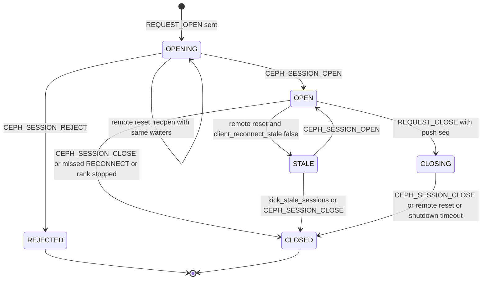
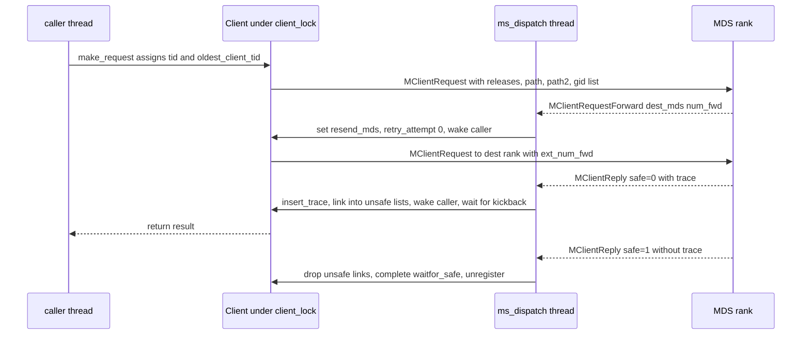
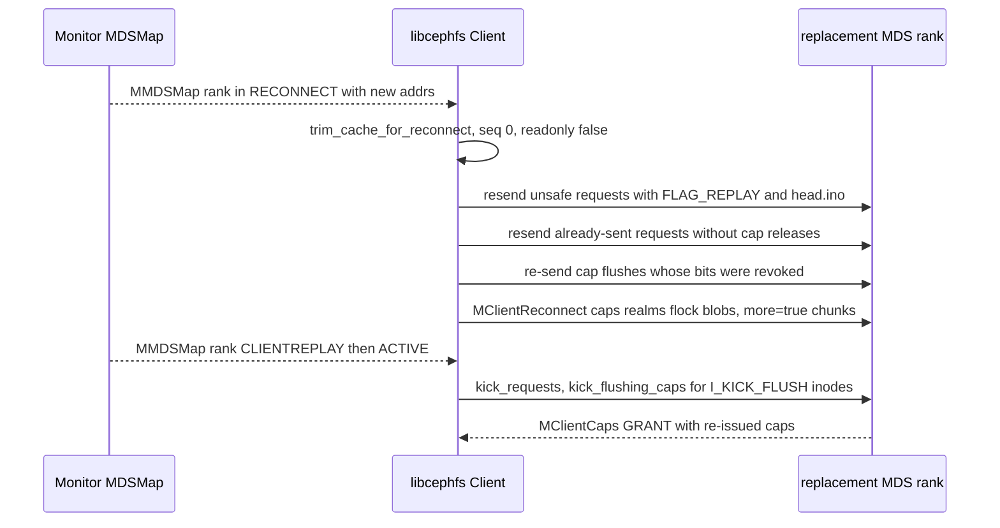
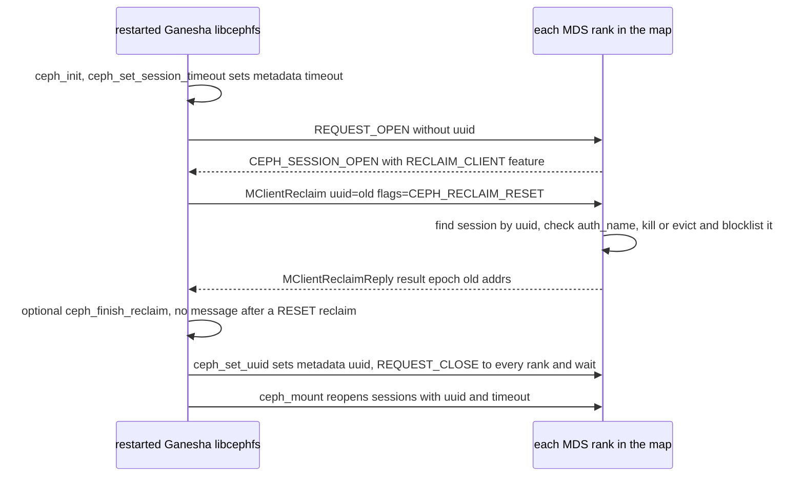

# libcephfs, ceph-fuse and NFS-Ganesha: what the userspace client requires from an MDS

> Part of the C++ MDS project map ([cpp-map/README.md](../README.md)).
> Sources: `src/client/Client.cc` (~19.4k LOC), `src/client/Client.h` (~2.45k), `src/client/MetaRequest.{h,cc}` (~320), `src/client/MetaSession.{h,cc}` (~150), `src/client/Inode.{h,cc}` (~1.35k), `src/client/Dentry.h` (~120), `src/client/Delegation.{h,cc}` (~190), `src/client/ClientSnapRealm.h` (~70), `src/client/fuse_ll.cc` (~2.0k), `src/libcephfs.cc` (~2.8k), `src/include/cephfs/libcephfs.h` (~2.5k), `src/include/cephfs/ceph_ll_client.h`, `src/messages/MClient*.h`, `src/mds/cephfs_features.h`, `src/ceph_fuse.cc`, `src/pybind/mgr/nfs/`, `src/pybind/mgr/cephadm/templates/services/nfs/ganesha.conf.j2`, `container/Containerfile`, tests `src/test/libcephfs/{reclaim,deleg,quota,newops,multiclient}.cc`; external: nfs-ganesha V15.7 `src/FSAL/FSAL_CEPH/{main.c,export.c,handle.c,internal.c,internal.h,statx_compat.h}` (cited as `FSAL_CEPH/...`, see section 1); for 3.17, libfuse tags `fuse-3.16.2` and `fuse-2.9.9` (cited as `libfuse-3.16.2:<path>` and `libfuse-2.9.9:<path>`) and Linux `fs/fuse` at the kernel snapshot's commit af32da41b032 (cited as `linux/fs/fuse/...`).
> Related: [wire-protocol](wire-protocol.md), [sessions](sessions.md), [capabilities](capabilities.md), [leases-lock-caches-and-async-dirops](leases-lock-caches-and-async-dirops.md), [kclient-expectations](kclient-expectations.md), [request-lifecycle](../03-request-path/request-lifecycle.md), [lookup-readdir-open-and-file-locks](../03-request-path/lookup-readdir-open-and-file-locks.md), [attributes-and-xattrs](../03-request-path/attributes-and-xattrs.md), [snapshots](../10-snapshots-quotas-subvolumes/snapshots.md), [rstats-quotas-and-subvolumes](../10-snapshots-quotas-subvolumes/rstats-quotas-and-subvolumes.md), [rank-lifecycle-and-recovery](../09-recovery/rank-lifecycle-and-recovery.md), [resolve-and-rejoin](../09-recovery/resolve-and-rejoin.md), [auth-and-mds-caps](../01-cluster-integration/auth-and-mds-caps.md), [mgr-tools-and-orchestration](../01-cluster-integration/mgr-tools-and-orchestration.md), [metrics-and-subvolume-metrics](../12-qos-metrics-quiesce-quarantine/metrics-and-subvolume-metrics.md), [quarantine](../12-qos-metrics-quiesce-quarantine/quarantine.md).

## 1. Purpose and responsibilities

The C++ userspace CephFS client is one class, `Client` (`src/client/Client.{h,cc}`), compiled into:

| Consumer | How it reaches `Client` | Notes |
|---|---|---|
| libcephfs (`libcephfs.so`, C API `ceph_*` / `ceph_ll_*`) | `struct ceph_mount_info` owns a `StandaloneClient` (created in `ceph_mount_info::init`, src/libcephfs.cc:110-160) | Used by NFS-Ganesha FSAL_CEPH, the mgr python modules (via `src/pybind/cephfs/cephfs.pyx`), `cephfs-mirror` (`src/tools/cephfs_mirror/PeerReplayer.cc` uses snapdiff/blockdiff), cephfs-shell, Samba (next row) |
| Samba `vfs_ceph` / `vfs_ceph_new`, libcephfsd | mgr/smb configures the classic `ceph` VFS, `ceph_new`, or `ceph_new` with `proxy=yes` (src/pybind/mgr/smb/handler.py:1046-1050). The proxied variant talks to the in-tree `libcephfsd` daemon (src/libcephfs_proxy/proxy_mount.c:81-118, doc/dev/libcephfs_proxy.rst), which runs real libcephfs mounts and shares one mount among client processes whose configuration is identical | One `Client` (one MDS session per rank) can therefore carry requests of several SMB server processes. Samba's own VFS source is not in this repo |
| ceph-fuse | `src/ceph_fuse.cc` + `src/client/fuse_ll.cc` (FUSE low-level ops) | Adds session metadata `mount_point` (src/ceph_fuse.cc:308) and calls `Client::mount(..., fuse_require_active_mds)` (src/ceph_fuse.cc:318) |
| NFS-Ganesha | FSAL_CEPH links libcephfs. It creates one `ceph_mount_info` ("cmount") per distinct key `{filesystem, cmount_path (the export path if unset), user_id, secret_access_key}` and shares it, refcounted, among all exports with that key (`create_export`, FSAL_CEPH/main.c:1188-1214; `ceph_mount_key_cmpf`, FSAL_CEPH/internal.c:538-567). mgr/nfs gives every CephFS export of one (NFS cluster, file system, cmount_path) the same cephx user `client.nfs.<cluster>.<fs>.<sha1 prefix>` and defaults `cmount_path` to `/` (`_ensure_cephfs_export_user`, `get_user_id`, src/pybind/mgr/nfs/export.py:265-274, 1099-1112; `FSAL.__init__`, src/pybind/mgr/nfs/ganesha_conf.py:170-173), so by default all exports of a file system in one NFS cluster share one client, i.e. one MDS session per rank per Ganesha daemon (3.16.1) | Ganesha's source is not in this repo. FSAL_CEPH statements on this page were checked against nfs-ganesha **V15.7** (tag commit 581abb64230f, 2026-10-02), the newest build in the CentOS Storage SIG `nfsganesha-15` repository from which the cluster container installs `nfs-ganesha-ceph` (container/Containerfile:17, 199-206; the container's base is Rocky Linux 10, container/Containerfile:1, and the el10 listing of that repository held 15.1, 15.2 and 15.4 to 15.7 when checked on 2026-10-11); cephadm runs Ganesha from that cluster image (src/cephadm/cephadmlib/daemons/nfs.py:27-81). Citations `FSAL_CEPH/<file>:<line>` mean nfs-ganesha V15.7 `src/FSAL/FSAL_CEPH/<file>`; other nfs-ganesha files are cited as `ganesha:<path under src/>`. Other 15.x builds were not checked |

This page documents, from the client source, every behavior of this client that touches the MDS: what it sends, what it decodes, which MDS replies/messages would crash or confuse it, and which semantics NFS-Ganesha builds on top (reclaim, session timeout, delegations, handle-based lookups, fsync). Any replacement MDS must interoperate with unmodified libcephfs/ceph-fuse binaries of the versions deployed in the cluster; the asserts and aborts quoted below are therefore hard constraints.

Key facts in one place (details and citations below):

1. libcephfs advertises **every** CephFS feature bit 0..24 (`CEPHFS_FEATURES_CLIENT_SUPPORTED == CEPHFS_FEATURES_ALL`), including RECLAIM_CLIENT, NEW_SNAPREALM_INFO, CHARMAP, BLOCKDIFF and QUARANTINE that the kernel does not advertise.
2. It is fully **synchronous for namespace ops**: it never sets `CEPH_MDS_FLAG_ASYNC`, never uses delegated inode numbers, never uses `CEPH_CAP_DIR_CREATE/DIR_UNLINK`.
3. One `Client` instance = one MDS session per rank, one global `client_lock`, one messenger dispatch thread; many requests can be outstanding at once (each caller thread sleeps in `make_request`), but replies are consumed one at a time.
4. Requests are path-relative to **inode numbers** (`#ino/name`), so the MDS must be able to resolve any inode number the client has cached.
5. Unknown `MClientSession` ops abort the client (`ceph_abort`), lease actions other than REVOKE trip a `ceph_assert`; a trace in a *safe* reply that follows an *unsafe* reply makes it assert; a `FLUSHSNAP_ACK` from a rank on which the client holds no cap for that inode, a cap whose `seq` is not newer but whose `cap_id` differs, and a `SPLIT` snap message whose first realm is not `head.split` all trip asserts; `MClientReply`, `MClientSnap` and `MClientQuota` payloads must contain no trailing bytes.
6. NFS-Ganesha-specific contract: `MClientReclaim`/`MClientReclaimReply` (uuid + `CEPH_RECLAIM_RESET`, sent whenever FSAL_CEPH creates a cmount), session metadata keys `uuid` and `timeout` (FSAL_CEPH always sets `timeout=300`), delegations implemented purely client-side on top of cap revocation (used only when NFSv4 delegations are enabled; cephadm's template disables them), `LOOKUPINO` for file handles (never `LOOKUPHASH` or `LOOKUPNAME`), and synchronous metadata: NFS COMMIT is `ceph_ll_sync_inode`, stable WRITEs end with `ceph_ll_fsync`, and every NFS SETATTR is `ceph_ll_setattr` followed by `ceph_ll_sync_inode`; each costs a cap `FLAG_SYNC` flush and/or `REQUEST_FLUSH_MDLOG` plus a wait for the safe reply (3.16.6, 3.16.8). The MDS paths that only Ganesha drives are listed in 3.16.9.

## 2. Source map

| File | Class / function | Lines | Role |
|---|---|---|---|
| src/client/Client.h | `Client`, `dir_result_t`, `SubvolumeMetricTracker`, `StandaloneClient` | 1-2450 | public POSIX/ll API, all client state (`client_lock`, `mds_sessions`, `mds_requests`, `inode_map`, `metadata`, `myfeatures`) |
| src/client/Client.cc | `Client::Client`, `_reset_faked_inos`, faked ino helpers | 299-490 | feature selection (`myfeatures`), ObjectCacher setup, 32-bit faked inos |
| src/client/Client.cc | `update_inode_file_size`, `update_inode_file_time`, `add_update_inode`, `insert_dentry_inode`, `_wrap_name`, `_unwrap_name`, `update_dentry_lease`, `update_dir_dist`, `insert_readdir_results`, `insert_trace` | 975-1976 | decode and merge MDS reply traces into the cache |
| src/client/Client.cc | `choose_target_mds`, `connect_mds_targets`, `verify_reply_trace`, `make_request`, `encode_*_release` | 1978-2550 | MDS selection, blocking request helper, embedded cap releases |
| src/client/Client.cc | `_open_mds_session`, `_closed_mds_session`, `handle_client_session`, `send_request`, `build_client_request`, `handle_client_request_forward`, `handle_client_reply` | 2551-3116 | session and request protocol |
| src/client/Client.cc | `handle_osd_map`, `ms_dispatch2`, `handle_mds_map`, `send_reconnect`, `kick_requests`, `resend_unsafe_requests`, `kick_requests_closed`, `got_mds_push`, `handle_lease` | 3154-3706 | dispatch, failover, reconnect, leases |
| src/client/Client.cc | `get_caps`, `send_cap`, `check_caps`, cap snaps, `add_update_cap`, `remove_cap`, `remove_session_caps`, `trim_caps`, flush tracking, `kick_flushing_caps` | 3917-5409 | capability client state machine |
| src/client/Client.cc | `update_snap_trace`, `handle_snap`, `handle_quota`, `handle_quarantine_disable`, `handle_caps`, `handle_cap_*` | 5410-6304 | incoming cap/snap/quota messages |
| src/client/Client.cc | `mds_check_access`, `may_*` | 6305-6681 | client-side permission checks incl. MDS auth caps (`cap_auths`) |
| src/client/Client.cc | `mds_command`, `subscribe_mdsmap`, `mount`, `_close_sessions`, `flush_mdlog*`, `_abort_mds_sessions`, `_unmount` | 6847-7450 | admin commands, mount/unmount |
| src/client/Client.cc | `flush_cap_releases`, `tick`, `collect_and_send_global_metrics`, `renew_caps` | 7501-7790 | periodic work |
| src/client/Client.cc | `_do_lookup`, `_dentry_valid`, `_lookup`, `path_walk` | 7792-8178 | lookups, lease/Fs validity |
| src/client/Client.cc | `_getattr`, `_getvxattr`, `make_absolute_path_string`, `_do_setattr` | 8423-8944 | GETATTR/GETVXATTR/SETATTR, buffered attribute updates |
| src/client/Client.cc | `statx_to_mask`, `fill_stat`, `fill_statx` | 9122-9345 | which caps each statx field needs |
| src/client/Client.cc | readdir machinery (`_readdir_get_frag`, `_readdir_cache_cb`, `readdir_r_cb`, `_readdir_r_cb`, `readdir_snapdiff`, `file_blockdiff`) | 9880-10700 | READDIR/LSSNAP/READDIR_SNAPDIFF/FILE_BLOCKDIFF |
| src/client/Client.cc | `lookup_hash`, `_lookup_vino`, `_lookup_parent`, `_lookup_name` | 10877-11006 | lookup by inode number |
| src/client/Client.cc | `_open`, `_renew_caps`, `_release_fh`, `_read`, `_write`, `_write_success`, fsync state machine, `_fsync` | 11093-13470 | open/IO/sync semantics |
| src/client/Client.cc | `_statfs`, `_do_filelock`, `_interrupt_filelock`, `_encode_filelocks`, `_release_filelocks` | 13637-14055 | statfs, fcntl/flock |
| src/client/Client.cc | `_sync_fs`, `_lazyio`, `mksnap`, `rmsnap`, `do_snap_md_op` | 14190-14422 | syncfs, lazyio, snapshots |
| src/client/Client.cc | `open_snapdir`, `ll_lookup*`, `ll_get_inode`, `ll_getattrx`, `_ll_setattrx` | 14456-14950 | handle-based (ll) API |
| src/client/Client.cc | xattrs, vxattr tables | 15144-15990 | SETXATTR/RMXATTR/GETVXATTR |
| src/client/Client.cc | `_mknod`, `_create`, `_mkdir`, `_symlink`, `_unlink`, `_rmdir`, `_rename`, `_link` | 16011-16914 | namespace mutations |
| src/client/Client.cc | `ll_open`, `_ll_create`, `ll_preadv_pwritev`, `ll_fsync`, `ll_sync_inode`, `ll_release`, `set_deleg_timeout`, `ll_delegation`, `ll_interrupt` | 17074-17950 | Ganesha-facing entry points |
| src/client/Client.cc | `ms_handle_remote_reset`, `get_quota_root`, `check_quota_condition`, `check_pool_perm`, POSIX ACL helpers | 18202-18615 | connection resets, quota, pool perms |
| src/client/Client.cc | `set_uuid`, `set_session_timeout`, `start_reclaim`, `finish_reclaim`, `handle_client_reclaim_reply`, `set_cap_epoch_barrier` | 18632-19018 | Ganesha reclaim |
| src/client/MetaRequest.h | `MetaRequest` (`auth_is_best`, `can_forward`, `is_write`) | 1-250 | per-request state |
| src/client/MetaSession.{h,cc} | `MetaSession`, `enqueue_cap_release` | 1-85 / 1-62 | per-rank session state |
| src/client/Inode.{h,cc} | `Cap`, `CapSnap`, `Inode` (`caps_issued`, `caps_wanted`, `set_deleg`, `break_deleg`, `mark_caps_dirty`) | 1-421 / 1-925 | inode and cap bookkeeping |
| src/client/Dentry.h | `Dentry` (lease fields) | 1-116 | dentry lease state |
| src/client/Delegation.{h,cc} | `Delegation`, `ceph_deleg_caps_for_type`, `C_Deleg_Timeout` | 1-61 / 1-132 | NFS delegations on top of caps |
| src/client/ClientSnapRealm.h | `SnapRealm` | 1-71 | client view of snap realms |
| src/client/fuse_ll.cc | `fuse_ll_*` handlers, `make_fake_ino`, invalidate callbacks | 283-1960 | ceph-fuse op mapping |
| src/client/Client.cc | `_put_inode`, `_do_remount`, `C_Client_Remount`, `_invalidate_kernel_dcache`, `C_Client_DentryInvalidate`, `_schedule_invalidate_dentry_callback`, `_try_to_trim_inode`, `_ll_register_callbacks`, `test_dentry_handling` | 3707-3725, 5014-5079, 6035-6125, 14104-14185 | when an inode (and its caps) can be dropped; kernel dcache invalidation and remount for ceph-fuse; callback registration |
| src/ceph_fuse.cc | `RemountTest` | 193-252 | mount-time dentry-invalidation/remount test and its failure policy |
| libfuse `fuse-3.16.2` and `fuse-2.9.9` (external) | `do_init` capability defaults, `fuse_apply_conn_info_opts`, `atomic_o_trunc` option | 3.16.2: lib/fuse_lowlevel.c 2040-2130, lib/helper.c 90-130, 398-443; 2.9.9: lib/fuse_lowlevel.c 1808-1850, 2484, 2726 | whether ceph-fuse's FUSE connection uses atomic `O_TRUNC` (3.17) |
| Linux `fs/fuse` at the snapshot commit (external) | `fuse_send_open`, `fuse_do_setattr`, `fuse_reverse_inval_entry`, `fuse_notify_inval_entry`, `fuse_notify_delete`, `fuse_evict_inode` | file.c 25-40; dir.c 1600-1665, 2185-2199; notify.c 47-123; inode.c 144-162, 1307-1308 | kernel side of `O_TRUNC` handling, dentry invalidation and `FORGET` for ceph-fuse (3.17) |
| FSAL_CEPH/main.c (nfs-ganesha V15.7, external) | `create_export`, `find_cephfs_root`, `reclaim_reset`, `create_unique_id`, `node_takeover_reclaim`, `enable_delegations`, `register_callbacks`, `ino_release_cb`, `dentry_invalidate_cb`, `ceph_items` | 60-111, 285-305, 515-582, 663-1440 | cmount sharing, mount sequence, reclaim, delegation timeout, cache-pressure callbacks, FSAL-wide options |
| FSAL_CEPH/export.c (external) | `release`, `lookup_path`, `wire_to_host`, `create_handle`, `get_fs_dynamic_info`, `ceph_prepare_unexport` | 71-467 | NFS handle to `ceph_ll_lookup_vino`, statfs, shutdown |
| FSAL_CEPH/handle.c (external) | `ceph_fsal_*` object ops, `ceph_reopen_func`, `ceph_open2_by_handle`, `ceph_fsal_open2`, `ceph_fsal_write2`, `ceph_fsal_commit2`, `ceph_fsal_lock_op2`, `ceph_deleg_cb`, `ceph_join_deleg`, `ceph_fsal_lease_op2`, `ceph_fsal_setattr2` | 82-3566 | NFS operation to `ceph_ll_*` mapping (3.16.8) |
| FSAL_CEPH/internal.{c,h}, FSAL_CEPH/statx_compat.h (external) | `construct_handle`, `attrmask2ceph_want`, `ceph2fsal_attributes`, `ceph_get_acl`, `ceph_set_acl`, `ceph_mount_key_cmpf`; `fsal_ceph_ll_*` wrappers, `CEPH_STATX_ATTR_MASK`, `CEPH_STATX_HANDLE_MASK` | internal.c 75-598, statx_compat.h 40-367 | handle key, statx masks, POSIX ACLs, NFS creds to `UserPerm` |
| src/pybind/mgr/nfs/export.py, src/pybind/mgr/cephadm/templates/services/nfs/ganesha.conf.j2, container/Containerfile | `_ensure_cephfs_export_user`, `_create_user_key`, `get_user_id`; `NFSv4`/`CEPH` blocks; Ganesha repo and packages | export.py 265-274, 639-674, 1099-1112; ganesha.conf.j2 37-44, 67-83; Containerfile 17, 199-206 | per-(cluster, fs, cmount_path) cephx user, deployed Ganesha configuration and version |
| src/libcephfs.cc | `ceph_mount_info`, `ceph_*` wrappers | 1-2795 | C API |
| src/mds/cephfs_features.h | `CEPHFS_FEATURE_*`, `CEPHFS_FEATURES_CLIENT_SUPPORTED` | 1-112 | feature bits |
| src/messages/MClientSession.h, MClientRequest.h, MClientReply.h, MClientCaps.h, MClientReconnect.h, MClientReclaim*.h, MClientLease.h, MClientSnap.h, MClientQuota.h, MClientCapRelease.h, MClientMetrics.h, MClientRequestForward.h | encoders/decoders | - | wire formats as seen by this client |

## 3. How it works

### 3.1 Client anatomy and threads

* `StandaloneClient::init` (src/client/Client.cc:19370) creates its own `Objecter`, registers the Objecter and the Client as messenger dispatchers, sets `monclient->set_want_keys(CEPH_ENTITY_TYPE_MDS | CEPH_ENTITY_TYPE_OSD)` and authenticates (cephx global id becomes `client.<global_id>`; `Client::authenticate`, src/client/Client.cc:6776).
* All MDS messages are delivered through `Client::ms_dispatch2` (src/client/Client.cc:3226). `Client` does not implement fast dispatch, so they run on the messenger's single `ms_dispatch` thread (src/msg/DispatchQueue.cc:239).
* Threads that interact with MDS state: the `ms_dispatch` thread; application threads (Ganesha workers, FUSE workers) calling the API; the tick thread `upkeeper` (`Client::start_tick_thread`, src/client/Client.cc:7600, period `client_tick_interval`, default 1 s); finishers (`objecter_finisher`, `async_ino_invalidator`, `async_dentry_invalidator`, `interrupt_finisher`, `remount_finisher`, `async_ino_releasor`); the `SafeTimer` used for delegation timeouts; the ObjectCacher flusher (shares `client_lock`); `client_asio_thread_count` (default 2) io_context threads used by the MonClient and Objecter (in libcephfs one pool shared by all concurrently mounted cmounts of the process, src/libcephfs.cc:53-69).
* Everything (cache, sessions, requests, caps, ObjectCacher) is protected by the single `Client::client_lock` (src/client/Client.h "global client lock - protects Client and buffer cache both!").

### 3.2 Mount, map subscription and session open

1. `Client::mount` (src/client/Client.cc:7042) → `subscribe_mdsmap` (src/client/Client.cc:7002): resolves the file system name from the `ceph_select_filesystem()` argument, else `client_fs`, else legacy `client_mds_namespace`; if a name is given it fetches `fsmap.user` and subscribes to `mdsmap.<fscid>`, otherwise to the default `mdsmap`. Unknown name → `-ENOENT`.
2. ceph-fuse only (`require_mds=fuse_require_active_mds`, default true): loops on `MDSMap::is_cluster_available()`; `STUCK_UNAVAILABLE` → `CEPH_FUSE_NO_MDS_UP` (src/client/Client.cc:7068-7085).
3. If the MDSMap has `CEPH_MDSMAP_REFUSE_CLIENT_SESSION`, mount fails with `-EACCES` before any session is opened (src/client/Client.cc:7089).
4. `populate_metadata(mount_root.empty() ? "/" : mount_root)` (src/client/Client.cc:7095, 2579).
5. Sessions are opened lazily by the first request. Mount issues `GETATTR mask=CEPH_STAT_CAP_INODE_ALL` on the mount path, then on each ancestor path up to `/` (`fp.pop_dentry()` loop, src/client/Client.cc:7101-7117). `-EACCES` on an ancestor is tolerated once the root exists ("quotas may not work"). The ancestors are cached in `root_parents` so that quota realms above the mount point are visible.

`Client::_open_mds_session` (src/client/Client.cc:2646) sends `MClientSession(CEPH_SESSION_REQUEST_OPEN)` encoded at header v7 with:

| Field | Value sent by libcephfs | Code |
|---|---|---|
| `metadata["hostname"]` | `uname().nodename` | src/client/Client.cc:2590 (Client::populate_metadata) |
| `metadata["pid"]` | `getpid()` | same |
| `metadata["entity_id"]` | cephx id (`client.<id>` → `<id>`) | same |
| `metadata["root"]` | mount root (`"/"` by default). Not set on the sessions that `start_reclaim()` opens before mount: it calls `populate_metadata("")`, which omits `root`, and only if `metadata` is still empty, so after `ceph_set_session_timeout()` the reclaim sessions carry only the `timeout` key (src/client/Client.cc:18884-18885 Client::start_reclaim). `mds_command()` before mount also calls `populate_metadata("")` but opens no MDS session (src/client/Client.cc:6894-6898, 6912) | src/client/Client.cc:2605 |
| `metadata["ceph_version"]`, `metadata["ceph_sha1"]` | build version | same |
| `metadata[k]=v` from `client_metadata` (comma separated `k=v`) | user overrides | same |
| `metadata["mount_point"]` | ceph-fuse only | src/ceph_fuse.cc:308 |
| `metadata["uuid"]` | `ceph_set_uuid()` (Ganesha) | src/client/Client.cc:18640 (Client::set_uuid) |
| `metadata["timeout"]` | `ceph_set_session_timeout()` (Ganesha), decimal seconds | src/client/Client.cc:18857 (Client::set_session_timeout) |
| `supported_features` | `myfeatures` = all bits 0..24 unless `client_debug_inject_features` | src/client/Client.cc:449-451 (Client::Client) |
| `metric_spec` | `CEPHFS_METRIC_FEATURES_ALL` (metric types 0..16) | src/client/Client.cc:2659 |
| `flags`, `cap_auths`, `oldest_client_tid` | defaults (0, empty, `UINT64_MAX`) | src/messages/MClientSession.h |

The MDS side of session open (for reference, not libcephfs code): it rejects opens while the fs has `refuse_client_session` set, and rejects blocklisted addresses (with `SESSION_BLOCKLISTED` flag and error string "blocklisted (blacklisted)"), missing `required_client_features`, a `root` outside the cephx path restriction, and a `uuid` equal to an existing session's uuid ("duplicated session uuid") (src/mds/Server.cc:646-808, Server::handle_client_session). It defers session opens (and every session op other than RENEWCAPS and CLOSE) until the rank is at least CLIENTREPLAY, and `REQUEST_CLOSE` until the rank is ACTIVE (src/mds/Server.cc:625-637).

On `CEPH_SESSION_OPEN` (src/client/Client.cc:2707) the client: replaces `session->mds_features` and `session->mds_metric_flags` from the reply (`reinit_mds_features`, src/client/Client.cc:2688; also done when an OPEN arrives for an already-open session, e.g. after MDS upgrade), adopts the MDS push `seq` if its own is 0, stores `cap_auths` globally (`Client::cap_auths`, used by `mds_check_access`), sends an immediate `REQUEST_RENEWCAPS`, marks the session OPEN and opens sessions to that rank's `export_targets` (`connect_mds_targets`, src/client/Client.cc:2095).

### 3.3 Session states and session messages

`MetaSession::state` values are `STATE_NEW` (unused), `OPENING`, `OPEN`, `CLOSING`, `CLOSED`, `STALE`, `REJECTED` (src/client/MetaSession.h). `have_open_session()` is true for OPEN and STALE (src/client/Client.cc:2551), so requests keep flowing on a STALE session. CLOSED sessions are erased from `mds_sessions`; REJECTED sessions stay until `_kick_stale_sessions` or `_close_sessions` remove them, and any request targeting the rank aborts with `-EPERM` (src/client/Client.cc:2324).

Incoming `MClientSession` handling (`Client::handle_client_session`, src/client/Client.cc:2694); messages arriving on a connection that is not the session's current connection are dropped (`_get_mds_session(mds, con)`):

| Op from MDS | Client action |
|---|---|
| `CEPH_SESSION_OPEN` | see 3.2 |
| `CEPH_SESSION_CLOSE` | `_closed_mds_session`: mark down connection, wake openers, `remove_session_caps`, `kick_requests_closed`, erase session |
| `CEPH_SESSION_RENEWCAPS` | if `seq == cap_renew_seq`: `cap_ttl = last_cap_renew_request + mdsmap.session_timeout`; if it was stale, `wake_up_session_caps(s, false)` resets caps whose `gen < session->cap_gen` to `PIN` and flags `I_CAP_DROPPED` |
| `CEPH_SESSION_STALE` | `cap_gen++`, `cap_ttl = now - 1` (all caps and leases of the session become invalid immediately), then send `REQUEST_RENEWCAPS` |
| `CEPH_SESSION_RECALL_STATE` | `renew_and_flush_cap_releases()` then `trim_caps(session, head.max_caps)` |
| `CEPH_SESSION_FLUSHMSG` | send any queued `MClientCapRelease`, then `CEPH_SESSION_FLUSHMSG_ACK` with the same seq |
| `CEPH_SESSION_FORCE_RO` | `session->readonly = true`; later `get_caps(Fw)` on an inode whose auth cap is on that session returns `-EROFS` (src/client/Client.cc:4075) |
| `CEPH_SESSION_REJECT` | log `metadata["error_string"]`, `_closed_mds_session(s, -EPERM, rejected=true)`; the `flags` field (e.g. `SESSION_BLOCKLISTED`) is ignored |
| anything else (including `REQUEST_*`, `FLUSHMSG_ACK`) | `ceph_abort()` (src/client/Client.cc:2806) |

Outgoing session ops: `REQUEST_OPEN`, `REQUEST_RENEWCAPS` (seq = `++cap_renew_seq`), `REQUEST_CLOSE` (seq = push seq), `FLUSHMSG_ACK`, `REQUEST_FLUSH_MDLOG` (only if the connection has `SERVER_LUMINOUS`, src/client/Client.cc:7231). All but `REQUEST_OPEN` carry no metadata/features and are therefore encoded at header **v1** (`MClientSession::encode_payload`), which means the `oldest_client_tid` that `renew_caps()` assigns (src/client/Client.cc:7784) is never on the wire; the MDS's `trim_completed_request_list(m->oldest_client_tid)` in RENEWCAPS handling (src/mds/Server.cc:837) receives the default `UINT64_MAX` and is a no-op for libcephfs. Completed-request trimming for libcephfs therefore relies solely on `MClientRequest.head.oldest_client_tid`. On the MDS side `REQUEST_FLUSH_MDLOG` only flushes the journal while the rank is ACTIVE (src/mds/Server.cc:883-885).

**Push sequence.** `got_mds_push` (src/client/Client.cc:3648) increments `session->seq` for every `MClientCaps` (all ops, including acks and messages for unknown inodes), `MClientLease`, `MClientSnap` and `MClientQuota` received on the session's current connection; while CLOSING it re-sends `REQUEST_CLOSE` with the new seq. The MDS ignores a `REQUEST_CLOSE` whose seq differs from its `push_seq` (src/mds/Server.cc:860-874). `MQuarantineDisable` is sent counted by the MDS (`send_message_client_counted`, src/mds/MDCache.cc:14107 and 15301) but is not counted by libcephfs (`handle_quarantine_disable`, src/client/Client.cc:5718, does not call `got_mds_push` and does not even check which session it came from).

**Renewal.** `renew_and_flush_cap_releases` (src/client/Client.cc:7530) sends `REQUEST_RENEWCAPS` to every session whose rank state is >= REJOIN when more than `session_timeout/3` elapsed since the last renewal, and then flushes cap releases. `Inode::cap_is_valid` (src/client/Inode.cc:242) only trusts a cap while `now < session->cap_ttl` and `cap.gen >= session->cap_gen`, so a delayed RENEWCAPS ack makes all caps of the session unusable for cached reads (the client then falls back to synchronous GETATTR/LOOKUP).

### 3.4 Request lifecycle (client side)

`Client::make_request` (src/client/Client.cc:2251):

1. `tid = ++last_tid`; `mds_requests[tid] = req`; `oldest_tid` is the smallest outstanding tid that is not a `CEPH_MDS_OP_SETFILELOCK` (blocking lock requests do not pin completed-request trimming; `unregister_request`, src/client/Client.cc:2406). `client_inject_fixed_oldest_tid` forces 1.
2. `set_caller_perms(perms)`: `head.caller_uid/gid`; the supplementary group list goes into `gid_list`.
3. Loop: abort with `-EBLOCKLISTED` (108) if blocklisted; pick the target with `choose_target_mds`; if the rank is not ACTIVE or STOPPING, wait for a new MDSMap (if the rank is beyond `max_mds` and null, drop it from the dirfrag map or pick a random up rank) (src/client/Client.cc:2304-2318); open the session if needed and wait for `waiting_for_open` (a REJECTED session aborts the request with `-EPERM`); if `feature_needed` is set and the session lacks it, abort with `-EOPNOTSUPP` (`_getvxattr` passes `CEPHFS_FEATURE_OP_GETVXATTR`, `file_blockdiff` passes `CEPHFS_FEATURE_BLOCKDIFF`); `send_request`; sleep on `caller_cond` until reply, forward or kick. `resend_mds` is reset to -1 after each send, so a request first sent to an explicit rank (e.g. the random rank of `LOOKUPINO`) is re-targeted by the normal rules if it is kicked and retried.
4. On reply: result `r`, wake the dispatcher (kickback), and if the caller wants a target inode, run `verify_reply_trace`.
5. Metadata latency is computed as `mono_clock_now() - sent_stamp`, where `sent_stamp` was taken with `ceph_clock_now()` (src/client/Client.cc:2395-2400 and 2871); see section 8.

**Target selection** (`Client::choose_target_mds`, src/client/Client.cc:1978):

* `resend_mds` (forward or explicit rank) wins. `client_use_random_mds` picks a random up rank.
* Otherwise start from `req->inode()` (hash `path[0]` with the dir's `dl_dir_hash`, default `CEPH_STR_HASH_LINUX` if 0) or from `req->dentry()` (its inode, or its parent dir hashed by the dentry name). Snapshotted inodes are mapped to their non-snap parent (snapdir parent or first parent dentry) and hashing is disabled.
* For directories with a known frag map: if `MetaRequest::auth_is_best(issued)` is false, a random replica from `frag_repmap[frag]` is used; otherwise `fragmap[frag]` (auth of that dirfrag) or the inode's auth cap rank (`send_to_auth = true`).
* Else the auth cap's rank if `auth_is_best`, else the first (lowest) rank holding a cap, else a random up rank.
* `auth_is_best` (src/client/MetaRequest.h:205) is true for `send_to_auth`, every op with the `CEPH_MDS_OP_WRITE` bit (which includes `READDIR_SNAPDIFF` 0x1404, `FILE_BLOCKDIFF` 0x1405 and `SNAP_METADATA` 0x1406), `OPEN`, `READDIR`, and `GETATTR` when the mask asks for shared caps while an EXCL cap is issued, or asks for `CEPH_STAT_RSTAT`/`CEPH_STAT_CAP_XATTR`. All other ops (`LOOKUP`, `LOOKUPSNAP`, `LSSNAP`, `GETFILELOCK`, `GETVXATTR`, plain `GETATTR`) may be sent to a replica rank from `frag_repmap` or to a non-auth rank that holds a cap.
* `LOOKUPINO`, `LOOKUPPARENT`, `LOOKUPNAME`, `LOOKUPHASH` are sent to `rand() % mdsmap->get_num_in_mds()` (src/client/Client.cc:10898, 10933, 10964, 10997, 7860).

**Message construction** (`send_request`, src/client/Client.cc:2838; `build_client_request`, src/client/Client.cc:2890):

* `CEPH_MDS_FLAG_WANT_DENTRY` when the request has a dentry (`set_dentry_wanted`), and always for `LOOKUP`/`LOOKUPSNAP` (src/client/Client.cc:7807) so that an `-ENOENT` reply carries the null dentry and its lease.
* Replays: if an unsafe reply was already received, the resend carries `CEPH_MDS_FLAG_REPLAY` and `head.ino = target->ino` (src/client/Client.cc:2853-2855) and no cap releases.
* Otherwise `encode_cap_releases` embeds `ceph_mds_request_release` records `{ino, cap_id, caps (implemented after the drop), wanted, seq, issue_seq, mseq, dname_seq, dname}` for the request's inode/old inode/other inode/dentry/old dentry (`*_drop` minus dirty/used caps, nothing dropped if any `*_unless` cap is issued; a dentry release always emits a record for the parent directory's cap on that rank (`force=1`) and also gives back the dentry lease if `lease_mds == mds`, src/client/Client.cc:2446-2549). When resending already-sent requests during RECONNECT, releases are dropped (`drop_cap_releases=true`).
* `head.mdsmap_epoch` = client map epoch; for `SETXATTR`, `args.setxattr.osdmap_epoch` = client OSDMap epoch.
* `sent_on_mseq` records the inode cap `mseq` at send time.
* Path: if `request->path` is empty it is built from the inode/dentry with `make_nosnap_relative_path`, i.e. `#<ino>` for live inodes and `#<nonsnap-ancestor>/.../name` for snapped ones (src/client/Inode.cc:146). Almost every op passes `filepath(ino)` or `#parent_ino/name`, never an absolute path from `/` (except mount-time GETATTRs).
* `MClientRequest` header v6 always (`path`, `path2`, releases, `stamp`, `gid_list`, `alternate_name`, `fscrypt_auth`, `fscrypt_file`). The `ceph_mds_request_head` version is 1 if the MDS lacks `32BITS_RETRY_FWD`, 2 if it lacks `HAS_OWNER_UIDGID`, else 3 (adds `struct_len`, `owner_uid/gid`); the legacy head is used if the connection lacks `CEPH_FEATURE_FS_BTIME` (src/messages/MClientRequest.h encode_payload; src/common/ceph_fs.cc:14). `owner_uid/gid` are set for CREATE/MKNOD/MKDIR/SYMLINK only (`set_inode_owner_uid_gid`, src/client/MetaRequest.h:162), otherwise -1.
* Retry counters: `ext_num_retry = retry_attempt++` per send (the 8-bit legacy `num_retry`/`num_fwd` fields are the truncated values, src/common/ceph_fs.cc:21-25). With an old MDS (no `32BITS_RETRY_FWD`) a send attempted after 256 sends, or after `UINT32_MAX` with a new one, aborts the request with `-EMULTIHOP` (src/client/Client.cc:2901-2911).

**Forward** (`handle_client_request_forward`, src/client/Client.cc:2955): if `fwd.num_fwd <= request->num_fwd` (8-bit overflow from an old MDS) or `>= UINT32_MAX`, abort with `-EMULTIHOP`; else reset `retry_attempt`, set `num_fwd`, `resend_mds = dest_mds` and wake the caller. `client_must_resend` is ignored (the client always resends).

**Reply** (`handle_client_reply`, src/client/Client.cc:3022):

* Replies from a rank other than `request->mds` are dropped ("stale reply"); a second unsafe reply is dropped.
* `insert_trace` runs on the dispatch thread under `client_lock` before the caller is woken.
* Unsafe reply (`head.safe == 0`): `got_unsafe = true`, the request is linked into `session->unsafe_requests`, into the parent dir's `unsafe_ops` for MKNOD/LINK/UNLINK/RENAME/MKDIR/RMDIR/SYMLINK/CREATE (`is_dir_operation`), and into the target inode's `unsafe_ops`.
* The caller is woken only on the first reply (unsafe, or safe if no unsafe was sent). The dispatch thread then blocks on `dispatch_cond` until the caller has consumed the reply (src/client/Client.cc:3081-3098).
* Safe reply: unlink from the unsafe lists, complete `waitfor_safe` contexts (used by fsync/syncfs), unregister.

**`verify_reply_trace`** (src/client/Client.cc:2146): if `extra_bl.length() >= 8`, it decodes the created inode number: as `openc_response_t {created_ino, delegated_inos}` (versioned) when the session has `DELEG_INO`, otherwise as a raw `u64`. Delegated inode numbers are logged and discarded ("The userland cephfs client doesn't have a way to do an async create (yet)"). If the reply had no trace, the client re-resolves the target with a `LOOKUP` of the dentry or a forced `GETATTR` using `regetattr_mask`; a mismatch between the created ino and the looked-up ino returns `-EINTR`.

### 3.5 Operation map: API to MDS op

| Client path (libcephfs / ll / FUSE) | MDS op | Path / args | Cap drops embedded (drop / unless) |
|---|---|---|---|
| mount; `_getattr`; `ll_getattr(x)` when caps missing; `_getattr_for_perm` | `GETATTR` 0x101 | `#ino`; `args.getattr.mask` (from `statx_to_mask`, `CEPH_STAT_RSTAT` for dir sizes, `CEPH_STAT_CAP_XATTR` for xattrs/ACLs, `CEPH_STAT_CAP_INLINE_DATA` before first IO) | - |
| `path_walk` → `_lookup` → `_do_lookup` | `LOOKUP` 0x100 (`LOOKUPSNAP` 0x400 in a snapdir) | `#dir/name`, `mask` limited to shared caps + `CEPH_STAT_RSTAT`, WANT_DENTRY | - |
| `..` of an inode without cached parent | `LOOKUPPARENT` 0x103 | `#ino`, random rank | - |
| `ll_lookup_inode`, `ll_lookup_vino`, ceph-fuse lookup with unknown parent | `LOOKUPINO` 0x104 | `#ino`, `args.lookupino.snapid` if snapped (`args.lookupino.mask` stays 0), random rank; libcephfs uses the cmount default perms, ceph-fuse the FUSE caller's perms | - |
| `Client::lookup_name` (no in-tree caller); `_getcwd` also builds one for a cached dir without a parent dentry, but that branch is unreachable because `_getcwd` returns `-ENOENT` for a dentry-less dir just before it (src/client/Client.cc:13595-13604; derived from code) | `LOOKUPNAME` 0x105 | `#ino`; `lookup_name` adds path2 `#parent` and a random rank | - |
| `lookup_hash` (SyntheticClient only) | `LOOKUPHASH` 0x102 | `#ino`, path2 `#dirino/<rjenkins hash>` | - |
| `getxattr("ceph.*")` not in local vxattr tables | `GETVXATTR` 0x106 (needs `OP_GETVXATTR`) | `#ino`, path2 = name; reply `extra_bl` = versioned string | - |
| `_do_setattr` (non-buffered parts) | `SETATTR` 0x1108 | `#ino`, `args.setattr` (+`btime`), `fscrypt_auth/file`, optional fscrypt last-block data | inode: As for uid/gid/mode/btime/fscrypt_auth; Fs,Fr,Fw for size/mtime/fscrypt_file; Fc,Fr,Fw for atime |
| `setxattr`/`removexattr` incl. `ceph.*` layout/quota/pin vxattrs | `SETXATTR` 0x1105 / `RMXATTR` 0x1106 | `#ino`, path2 = name, data = value, `args.setxattr.flags` (`CEPH_XATTR_CREATE/REPLACE/REMOVE/REMOVE2`), `osdmap_epoch`. Names outside `user.`, `security.`, `trusted.`, `ceph.` (and `system.posix_acl_*` with POSIX ACLs) get `-EOPNOTSUPP` locally; `ceph.fscrypt.auth`/`ceph.fscrypt.file` become `SETATTR` (src/client/Client.cc:15333-15425) | - |
| fcntl/flock lock, unlock, test | `SETFILELOCK` 0x1109 / `GETFILELOCK` 0x110 | `#ino`, `args.filelock_change` (owner with bit 63 set) | - |
| `mknod` | `MKNOD` 0x1201 | `#dir/name`, mode, rdev, owner uid/gid, ACL xattrs blob, inherited `fscrypt_auth`, `alternate_name` | dentry: Fs / Fx |
| `link`, `ll_link` | `LINK` 0x1202 | path `#dir/name`, path2 `#ino` (ll) or `#dir/name` | target dir inode: Fs / Fx |
| `unlink` | `UNLINK` 0x1203 | `#dir/name` | dentry Fs / Fx; other inode Ls,Lx |
| `rename` | `RENAME` 0x1204 (`RENAMESNAP` 0x1403 in a snapdir) | path dst, path2 src | old dentry Fs/Fx; dentry Fs/Fx; old inode Ls; replaced inode Ls,Lx |
| `mkdir` | `MKDIR` 0x1220 (`MKSNAP` 0x1400 in a snapdir, data = `SnapPayload` metadata) | `#dir/name`, mode | dentry Fs / Fx |
| `rmdir` | `RMDIR` 0x1221 (`RMSNAP` 0x1401 in a snapdir) | `#dir/name` | dentry Fs / Fx; other inode Ls,Lx |
| `symlink` | `SYMLINK` 0x1222 | `#dir/name`, path2 = target (encrypted when fscrypt) | dentry Fs / Fx |
| `create`, `ll_create` when lookup misses | `CREATE` 0x1301 | `#dir/name`, `args.open.flags = wire flags + CEPH_O_CREAT` (+`CEPH_O_EXCL` only if the caller passed `O_EXCL`), mode, stripe unit/count/object size, `pool`, `mask = 0`, owner uid/gid, ACL xattrs blob in data, inherited `fscrypt_auth`, `alternate_name` | dentry Fs / Fx |
| `open` without usable caps or with `O_TRUNC`; `_renew_caps` | `OPEN` 0x302 | `#ino`, `args.open.flags` (no `CEPH_O_CREAT`), `old_size` | - |
| readdir / readdirplus / getdents | `READDIR` 0x305 (`LSSNAP` 0x402 on snapdir) | `#dir`, `args.readdir.frag`, `flags = CEPH_READDIR_REPLY_BITFLAGS`, `offset_hash`, path2 = last name; `max_entries = max_bytes = 0` | - |
| `ceph_readdir_snapdiff` | `READDIR_SNAPDIFF` 0x1404 | `args.snapdiff` (frag, flags, offset_hash, `snap_other`, mask) | - |
| `ceph_file_blockdiff` | `FILE_BLOCKDIFF` 0x1405 (needs `BLOCKDIFF`) | path, path2, `args.blockdiff.scan_idx/max_objects` | - |
| `ceph_do_snap_md_op` | `SNAP_METADATA` 0x1406 | snapshot path, data = key, value, op flag | dentry Fs / Fx |

Ops libcephfs never sends: `SETLAYOUT`, `SETDIRLAYOUT` (layouts go through `SETXATTR ceph.*.layout*`), `DUMMY`, all internal ops (0x15xx).

**Round trips per mutation.** Every namespace mutation first resolves the name locally with `path_walk` (e.g. `ll_mkdir`, src/client/Client.cc:16343; `_mknod`, `_symlink`, `_unlink`, `_rmdir`, `_rename` twice, `_link` twice, `_ll_create`). If the dentry is not covered by a valid lease or by `Fs` + `I_COMPLETE` on the parent, a `LOOKUP` is sent first (with `WANT_DENTRY`, so an `-ENOENT` reply can be cached as a negative dentry). With client-side permission checks enabled (`client_permissions=true` for libcephfs, `fuse_default_permissions=false` for ceph-fuse, see `should_check_perms`, src/client/Client.h:2289), `path_walk` runs `may_lookup` on every directory it traverses and `may_create`/`may_delete` run on the parent; each issues `GETATTR(As)` (plus `Xs`, forced if xattrs were never fetched, when POSIX ACLs are enabled) when those caps are not issued (`_getattr_for_perm`, src/client/Client.cc:6671). A create can therefore cost GETATTR + LOOKUP + CREATE; only the last one mutates.

**Client-side MDS auth caps.** The `cap_auths` list from `CEPH_SESSION_OPEN` (one `MDSCapAuth {MDSCapMatch, readable, writeable}` per cephx MDS cap grant, src/mds/MDSAuthCaps.h:203) is evaluated by `mds_check_access` (src/client/Client.cc:6305) against the absolute path of the inode (mount root + cached dentries). The last matching grant decides; `root_squash` denies writes by uid 0 or gid 0; if no grant matches (or the MDS sent no `cap_auths`), the access is allowed locally. It is consulted before buffering a setattr in caps (`_do_setattr`) and before satisfying an open from already-issued caps without an `OPEN` request (`_open`); a denial returns `-EACCES` locally. If no path can be built, the request is sent to the MDS, which performs the check.

`O_APPEND`, `O_SYNC`, `O_DSYNC`, `O_DIRECT`, `O_RSYNC` never reach the MDS: `ceph_flags_sys2wire` only maps access mode, `O_CREAT`, `O_EXCL`, `O_TRUNC`, `O_DIRECTORY`, `O_NOFOLLOW` (src/common/ceph_fs.cc, ceph_flags_sys2wire). `CEPH_O_LAZY` is added when `client_force_lazyio` is set.

### 3.6 Reply decoding

`MClientReply::decode_payload` decodes `head`, `trace_bl`, `extra_bl`, `snapbl` and then `ceph_assert(p.end())` (src/messages/MClientReply.h). The result code is translated from Linux wire errno to host errno (`errorcode32_t`).

Trace (`insert_trace`, src/client/Client.cc:1771):

* If the request already got an unsafe reply, the trace of the safe reply must be empty (`ceph_assert(p.end())`, src/client/Client.cc:1783-1786).
* Empty trace: clear the parent dir's COMPLETE flag; on success remove the source dentry for RENAME and the dentry for UNLINK/RMDIR locally.
* Encoding selection: if the session has `REPLY_ENCODING` the client decodes the versioned forms (`features = (uint64_t)-1`); otherwise it uses the connection features (src/client/Client.cc:1816).
* `snapbl` (if non-empty) → `update_snap_trace` before inodes are added.
* `is_dentry`: `InodeStat` of the parent dir, `DirStat`, dentry name, `LeaseStat`. `is_target`: `InodeStat` of the target.
* `InodeStat` (versioned, `DECODE_START(9, ...)`): `vino`, `rdev`, `version`, `xattr_version`, `ceph_mds_reply_cap {caps, wanted, cap_id, seq, mseq, realm, flags}`, legacy layout, c/m/atime, `time_warp_seq`, size, `max_size`, `truncate_size/seq`, mode/uid/gid/nlink, dirstat files/subdirs, rstat bytes/files/subdirs/rctime, `dirfragtree`, symlink, `dir_layout`, xattr blob, `inline_version` + `inline_data`, `quota`, `pool_ns`, `btime`, `change_attr`, v2 `dir_pin`, v3 `snap_btime`, v4 `rsnaps`, v5 `snap_metadata`, v6 fscrypt flag (ignored), v7 `fscrypt_auth`/`fscrypt_file`, v8 `optmetadata` (`CHARMAP`, `QUARANTINE`), v9 `subvolume_id` (src/messages/MClientReply.h InodeStat::decode). `LeaseStat` v2 adds `alternate_name`; `DirStat` v1 is `{frag, auth, dist}`.
* For `LOOKUPSNAP`/`MKSNAP` without dentry trace, the client fakes the dentry in the snapdir, asserting that the snapdir inode `(target ino, CEPH_SNAPDIR)` is cached (src/client/Client.cc:1914-1940). For `LOOKUPNAME` the parent inode is returned as the target. For `READDIR`/`LSSNAP`/`READDIR_SNAPDIFF`, `extra_bl` is parsed by `insert_readdir_results` only when the trace carries the target (directory) inode (`is_target`); otherwise the listing chunk is silently not decoded.
* A target inode without a parent dentry pins itself as `other_inode`.

Merge rules (`add_update_inode`, src/client/Client.cc:1106):

* A new MDS version is accepted if the cached version is 0, or the reply comes with an AUTH cap and `(in->version & ~1) < st->version`.
* Auth fields (mode, uid, gid, btime, `snap_btime`, `snap_metadata`, `fscrypt_auth`) are taken on a new version or newly issued `As`, unless the client holds `Ax`. nlink: new version or new `Ls`, unless `Lx`. Times via `update_inode_file_time` (time_warp_seq rules, src/client/Client.cc:1036). Layout and size via `update_inode_file_size` (truncate_seq rules, src/client/Client.cc:975) on new version or new `Fs/Fr/Fc/Fw/Fb/Fx`. For fscrypt inodes the logical size comes from the first 8 bytes of `fscrypt_file`.
* `dirstat` on new version or new `Fs`; `dir_layout`, `rstat`, `quota`, `dir_pin` only on a new version or when the stat comes from the auth MDS.
* xattrs replace the cache if `st->xattr_version` is newer and `Xx` is not held. Inline data if `inline_version` is newer. `change_attr` only increases.
* Caps in the stat are applied with `add_update_cap` only for head inodes (and only if `cap.caps != 0`); snapped inodes accumulate `snap_caps`. If the cap is the auth cap of this session, `max_size` and `rstat` are taken from the stat. An empty directory (`Fs` issued, no `Fx`, `nfiles == nsubdirs == 0`) is marked `I_COMPLETE | I_DIR_ORDERED`. `rdev`, `symlink` and `optmetadata` are always overwritten.

### 3.7 Capabilities, client side

State per `(inode, rank)`: `Cap {cap_id, issued, implemented, wanted, seq, issue_seq, mseq, gen, latest_perms}` (src/client/Inode.h). `Inode::caps_issued` (src/client/Inode.cc:255) ORs valid caps and removes bits the auth cap is revoking. `Inode::caps_wanted` (src/client/Inode.cc:372) = file-mode caps (`ceph_caps_for_mode`: RD → Fs,Fr,Fc; WR → Fx,Fw,Fb,As,Ax,Xs,Xx; LAZY → Fl) + caps in use, plus `Fx` whenever `Fb` is wanted; fscrypt write-only opens also want `Fr`.

**Getting caps for IO** (`Client::get_caps`, src/client/Client.cc:3980): checks pool permissions, requires the needed caps to be wanted by some open mode of the inode (else `-EBADF`; write Fhs from an older `fd_gen` also get `-EBADF`), then waits on `waitfor_caps` until `need` is issued and none of `want` is being revoked. Writes: if `endoff >= max_size` (or > 2*size) and > `wanted_max_size`, raise `wanted_max_size` and `check_caps` to ask the auth MDS; block while `endoff > max_size`; block while a cap snap is still `writing`; force-flush buffered data of pending cap snaps. `I_CAP_DROPPED` (caps lost to staleness/export) triggers `_renew_caps` → an `OPEN` request with flags derived from wanted caps (src/client/Client.cc:11221).

**check_caps** (src/client/Client.cc:4300) decides per cap whether to send an update:

* `retain = wanted + used + PIN`; while mounted and nlink > 0: everything (`CEPH_CAP_ANY`) if anything is wanted; for a complete directory holding `Fs`: retain and *want* all shared caps + `Fx`; else retain all shared caps (+ all read caps if `max_size == 0`).
* Send immediately (`goto ack`) when: auth cap and `wanted_max_size > max_size` not yet requested; `Fw` issued and size is approaching `max_size` (size >= max_size, or half of the last increment consumed, `is_max_size_approaching`); a revocation completed (`revoking & used == 0`); more caps wanted than issued+wanted; unmounting and nothing used.
* Otherwise nothing is sent if the cap holds nothing outside `retain` and the inode has no dirty caps; else, unless `CHECK_CAPS_NODELAY`, the inode is queued on `delayed_list` for `client_caps_release_delay` (default 5 s) and re-checked by `tick`.
* Dirty caps are flushed (moved to `flushing_caps` with a new flush tid) only when a message is sent on the auth cap; `CHECK_CAPS_SYNCHRONOUS` adds `FLAG_SYNC` to that message.
* Before acking on the auth cap: re-send pending flushes (`I_KICK_FLUSH`) and unflushed cap snaps.

**send_cap** (src/client/Client.cc:4119) always uses `CEPH_CAP_OP_UPDATE` (libcephfs never sends `CEPH_CAP_OP_FLUSH`, `DROP`, `RELEASE` or `RENEW`). Content: `caps = implemented` after dropping (`issued &= retain`, `implemented &= issued | used`), `wanted`, `dirty = flushing mask`, `seq`, `issue_seq`, `mseq`, `osd_epoch_barrier = cap_epoch_barrier`, `client_tid = flush_tid`, `caller_uid/gid = -1` (MDS must not re-check cephx path caps on cap flushes, src/client/Client.cc:4188), uid/gid/mode/nlink, xattr blob + `xattr_version` when flushing `Xx`, size, `max_size`, truncate seq/size, m/a/c/btime, `time_warp_seq`, `change_attr`, `fscrypt_auth/file`, inline data when flushing `Fw`, `snap_follows = realm snapc.seq` when flushing, `flags` (`FLAG_SYNC` for synchronous flushes, `FLAG_PENDING_CAPSNAP` when an unflushed cap snap exists), on the auth cap `max_size = wanted_max_size` if write caps are wanted (otherwise the cached `max_size` is echoed), `oldest_flush_tid` = oldest outstanding flush tid of the session (left 0 when none is pending). `MClientCaps` is encoded at v14 when the connection has `FLOCK` and `EXPORT_PEER`.

**Flushing.** Dirty bits are moved to `flushing_caps` with a new `flush_tid = ++last_flush_tid` (`mark_caps_flushing`, src/client/Client.cc:5230). The inode stays on the session's `flushing_caps` list until `FLUSH_ACK` for all tids. `handle_cap_flush_ack` (src/client/Client.cc:5934) clears every flush tid `<=` the acked tid and the bits of the acked tid that are not also being flushed under a later pending tid; it warns if the ack tid is ahead of the oldest pending tid (and reads `flushing_cap_tids.begin()` without checking that the map is non-empty, see section 8). `wait_sync_caps` waits for tids. The MDS sends `FLUSH_ACK` after the update is journaled (immediately if nothing had to be journaled), flushes its log immediately when `FLAG_SYNC` is set (src/mds/Locker.cc:3656), and re-acks a flush tid it already completed for the session (src/mds/Locker.cc:3426-3446).

**Cap release.** `remove_cap(cap, queue_release=true)` queues `{ino, cap_id, issue_seq, mseq}` into `session->release` (one `MClientCapRelease` v2 carrying the max `osd_epoch_barrier`) (src/client/MetaSession.cc:45). Releases are sent by `flush_cap_releases` on each tick (only to ranks in CLIENTREPLAY/ACTIVE/STOPPING), on `FLUSHMSG`, and immediately when an MDS message refers to an inode or cap the client does not have (GRANT/REVOKE without cap, or IMPORT/REVOKE/GRANT for an unknown inode: release `{ino, cap_id, seq, mseq}` taken from the message, src/client/Client.cc:5764-5805).

**Incoming `MClientCaps`** (`Client::handle_caps`, src/client/Client.cc:5733). First, if `osd_epoch_barrier` is newer than the client OSDMap the Objecter pauses OSD ops until that epoch, and the barrier is remembered for future releases; `subvolume_id` registers the inode for subvolume metrics.

| Op | Handler | Effect |
|---|---|---|
| `GRANT`, `REVOKE` | `handle_cap_grant` (src/client/Client.cc:6127) | reset to PIN if the cap is stale (`session->cap_gen > cap->gen`); update attributes guarded by issued/dirty caps (auth fields if `As` and no `Ax`; nlink if `Ls`; xattrs if newer and no `Xx`; dirstat from `nfiles/nsubdirs` if `Fs`; times if any read cap; layout/size/truncate if any file cap; inline data; `change_attr`; `max_size` only on the auth cap with write caps). Revocation: recall delegations; if revoked `Fb`/`Fl` are in use, start a flush and ack when it completes; else if revoked `Fc`/`Fl` are in use, invalidate the cache and `check_caps(NODELAY)`; otherwise set `cap->wanted = 0` (so `check_caps` cannot skip the reply) and `check_caps(NODELAY)`. Caps still referenced (e.g. by a delegation or an in-flight IO) keep the revoke un-acked until the reference is dropped. A `REVOKE` that revokes nothing still gets an immediate ack. `oserrno = -EQUARANTINED` on a revoke marks quarantine; any non-PIN grant with `oserrno == 0` clears it. If the inode's nlink dropped to 0, try to trim it |
| `IMPORT` | `handle_cap_import` (src/client/Client.cc:5829) then the grant path | apply snap trace; add the cap as AUTH with the new `cap_id/seq/mseq`; remove the peer's old cap if `peer.cap_id` matches (queue a release if `peer.flags & CEPH_CAP_FLAG_RELEASE`); reset `requested_max_size` if needed; `kick_flushing_caps` to the new auth |
| `EXPORT` | `handle_cap_export` (src/client/Client.cc:5872) | if `peer.cap_id` is set: open a session to `peer.mds` if needed and create/merge the target cap with `seq = issue_seq = peer.issue_seq - 1`, `mseq = peer.mseq`, move auth and flushing tids; else flag `I_CAP_DROPPED`; then remove the exporting rank's cap without releasing it |
| `TRUNC` | `handle_cap_trunc` (src/client/Client.cc:5917) | apply size/truncate_seq/truncate_size |
| `FLUSH_ACK` | `handle_cap_flush_ack` | see above |
| `FLUSHSNAP_ACK` | `handle_cap_flushsnap_ack` (src/client/Client.cc:6001) | dispatched before the per-rank cap lookup and `ceph_assert(in->caps.count(mds))`: the ack must come from a rank on which the client still holds a cap for the inode; match by `snap_follows` and tid, drop the cap snap |

Messages for a known inode with ops other than those above, and `EXPORT`/`TRUNC`/`FLUSH_ACK`/`FLUSHSNAP_ACK` for an unknown inode, are silently dropped (after being counted for the push seq). `add_update_cap` (src/client/Client.cc:4809) only replaces `wanted` when `mseq` increased (otherwise ORs it in); if a cap with `seq <= cap.seq` arrives for an existing cap (post-export/pre-import race) it keeps the newer seq/mseq, forces the AUTH flag and `ceph_assert`s that the `cap_id` is unchanged. Auth moves to a cap only if its `mseq` is newer than the current auth cap's. `issue_seq` is set equal to `seq` on every add/update.

**Cap snaps** (snapshot write-back). When a snap trace shows new snapshots for a realm, every inode with caps in it gets a `CapSnap` (`queue_cap_snap`, src/client/Client.cc:4437) if it has dirty caps or `Fw` in use; it is finalized when the last `Fw` ref is put, buffered data is flushed, then `send_flush_snap` sends `CEPH_CAP_OP_FLUSHSNAP` to the auth cap's rank with `cap_id = 0`, `seq = 0`, `realm = snaprealm ino`, `mseq = auth cap mseq`, `snap_follows`, issued/dirty, uid/gid/mode, xattr blob and `xattr_version` (always, not only when `Xx` is dirty), size, times, `change_attr`, inline data if `Fw` dirty, `caller_uid/gid = -1`, `client_tid = flush_tid`, `oldest_flush_tid` (src/client/Client.cc:4505). Cap snaps share the flush-tid space and session `flushing_caps_tids`; cap snaps are sent in `follows` order and a later one waits while an earlier one still has dirty data or is writing (`flush_snaps`, src/client/Client.cc:4555).

**Recall and cache pressure.** `trim_caps(session, max)` (src/client/Client.cc:5143) walks the session's cap LRU: non-auth caps not needed beyond the auth cap are removed (and released); for other inodes it trims expireable dentries (FUSE dentry invalidation for children of the root), asks the application to drop handles via `ino_release_cb` when the inode is only held by one `ll_ref` (src/client/Client.cc:5198), and counts inodes as trimmed. Caps are actually released only when the inode loses its last reference (`Client::_put_inode` calls `remove_all_caps`, which queues the releases, src/client/Client.cc:3707-3718). If more than `max` caps remain, the kernel dcache is invalidated (ceph-fuse). Dirty inodes or inodes with cap snaps are re-queued for delayed checks. The client therefore meets `max_caps` only as fast as its user lets go of inodes: ceph-fuse needs the kernel to forget them (3.17), Ganesha releases only idle MDCACHE entries (3.16.7), and open files pin caps in both. The kernel client instead prunes its own dentries (`trim_caps_cb` calls `d_prune_aliases`, linux/fs/ceph/mds_client.c:2263, 2325).

### 3.8 Dentry leases and directory caching

* `update_dentry_lease` (src/client/Client.cc:1496): if `mask & CEPH_LEASE_VALID`, `lease_ttl = request sent_stamp + duration_ms` (only extended), `lease_mds`, `lease_seq`, `lease_gen = session->cap_gen`. `CEPH_LEASE_PRIMARY_LINK` moves the dentry to the front of the inode's dentry list. `alternate_name` comes from `LeaseStat` v2.
* `_dentry_valid` (src/client/Client.cc:7816): lease valid iff `lease_ttl > now`, the lease rank's session `cap_ttl > now` and `session.cap_gen == lease_gen`.
* `_lookup` (src/client/Client.cc:7839): a cached dentry is a hit only if its inode (when positive) has caps covering the requested mask (limited to shared caps + `CEPH_STAT_RSTAT`), and either its lease is valid or the directory holds `Fs` and `dn->cap_shared_gen == dir->shared_gen`; `-ENOENT` is concluded locally when the dir has `Fs` and `I_COMPLETE`. A lookup racing with an in-flight rename of the same dentry waits for the rename to finish. Negative dentries are cached when the reply carries a lease or the parent has `Fs` (src/client/Client.cc:1897).
* `shared_gen` increments whenever `Fs` is newly issued; any change of `Fs` on a directory clears COMPLETE (`check_cap_issue`, src/client/Client.cc:4792).
* `handle_lease` (src/client/Client.cc:3657) asserts the action is `CEPH_MDS_LEASE_REVOKE` (before it even looks up the session); it drops the lease and replies `CEPH_MDS_LEASE_RELEASE` with the same seq, mask, ino, first/last and dname, even if the dentry or inode is unknown. libcephfs never sends `LEASE_RENEW` or `LEASE_REVOKE_ACK`.

### 3.9 Readdir

* `READDIR` sends `frag`, `flags = CEPH_READDIR_REPLY_BITFLAGS`, either `path2 = last_name` (resume after a name) or `offset_hash` (hash-order resume without a name) (`readdir_r_cb` fill callback, src/client/Client.cc:10100). `max_entries` and `max_bytes` are left 0, so the MDS returns the whole frag up to its byte limit (`max = dir->get_num_any()`, `max_bytes = 512 KiB + max_xattr_size`, src/mds/Server.cc:5197-5203).
* Reply `extra_bl`: `DirStat`, `u32 numdn`, `u16 flags` (`CEPH_READDIR_FRAG_END`, `HASH_ORDER`, `OFFSET_HASH`; `FRAG_COMPLETE` is ignored), then `numdn` x (`dname`, `LeaseStat`, `InodeStat`) (`insert_readdir_results`, src/client/Client.cc:1573).
* Offsets: in hash order `fpos = 0xff<<52 | hash<<28 | n`, where `hash` is computed client-side from the name with the directory's hash function and `n` counts collisions; otherwise `fpos = frag<<28 | n` starting at 2. The MDS therefore must return entries of a frag in `(ceph_frag_value(hash), name)` order, which is the MDS's dirfrag key order (src/mds/mdstypes.h:410 operator<(dentry_key_t)).
* If the reply's frag differs from the requested one, the client adopts it; `-EAGAIN` from the MDS triggers re-choosing the frag from its fragtree and retrying (src/client/Client.cc:9974).
* A frag is fetched in several chunks when the reply lacks `FRAG_END`: the next `READDIR` resumes with `path2 = last name`.
* After walking all frags with an unchanged `release_count/ordered_count/shared_gen`, the dir is marked `I_COMPLETE` (and `I_DIR_ORDERED`), enabling cached readdir while `Fs` is held. Emitting `.` and `..` calls `_getattr` on the directory and its parent (mask from the statx request, plus `CEPH_STAT_RSTAT` when `client_dirsize_rbytes`), and cached readdirplus calls `_getattr` per entry whose caps do not cover the requested statx mask; `-EACCES` for a quarantined entry is tolerated (cached stat used).

### 3.10 Snapshots and snap realms

* Snap trace decoding (`get_snap_realm_info`, src/client/Client.cc:5513): `SnapRealmInfoNew` (adds `last_modified`, `change_attr`, `flags` with `SNAPDIR_VISIBILITY = 4`) when the MDS advertised `NEW_SNAPREALM_INFO` in its OPEN, else `SnapRealmInfo`. The C++ MDS chooses the encoding from the *client's* bit (`Server::get_snap_trace`, src/mds/Server.cc:12429-12436), so the two sides only agree because the MDS always advertises the bit; an MDS must send the new format to libcephfs exactly when it advertises `NEW_SNAPREALM_INFO`.
* `update_snap_trace` (src/client/Client.cc:5527): for each realm, newer `seq` (or newer `change_attr`) updates created, `parent_since`, `prior_parent_snaps`, `my_snaps`, snapdir metadata; the parent is always re-verified; caches are invalidated recursively; for realms that gained snaps (and if `flush`), cap snaps are queued with the *old* snap context.
* `handle_snap` (src/client/Client.cc:5620): `CEPH_SNAP_OP_SPLIT` asserts `head.split != 0` and that the first realm record of the trace is `head.split`, moves the listed `split_inos` (unless their realm was created after the new realm) and re-parents `split_realms`; all ops then apply the trace (`flush=false` only for `DESTROY`). Moved inodes get a cap snap if the new realm has newer snaps than their old one.
* The snapdir (`.snap`, `client_snapdir`) is synthesized locally (`open_snapdir`, src/client/Client.cc:14483): ino of the dir, `snapid = CEPH_SNAPDIR`, mtime/ctime and `change_attr` from the realm. Lookups inside it use `LOOKUPSNAP`, listing uses `LSSNAP`, mkdir/rmdir/rename inside it become `MKSNAP`/`RMSNAP`/`RENAMESNAP`. With `client_respect_subvolume_snapshot_visibility`, `.snap` returns `-EPERM` when the realm's visibility flag is clear.
* Snapshot inodes are read-only (`-EROFS`), `check_caps` ignores them, and `_ll_getattr` never contacts the MDS for them.

### 3.11 Quotas, statfs and pool permissions

* Quotas are enforced by the client only (`client_quota`, default true): `is_quota_files_exceeded` (`rfiles+rsubdirs >= max_files`) for create/mkdir/mknod/symlink/link → `-EDQUOT`; `is_quota_bytes_exceeded` for writes and size extensions → `-EDQUOT` (src/client/Client.cc:18374-18390).
* The quota root of an inode is found by walking the client's snap realm parent chain (`get_quota_root`, src/client/Client.cc:18320), so every directory with a quota must be the root of its own snap realm, and `setxattr(ceph.quota.*)` returns `-EOPNOTSUPP` if after the MDS reply the inode is not its own realm root (src/client/Client.cc:15413-15417, Client::_setxattr).
* `MClientQuota {ino, rctime, rbytes, rfiles, rsubdirs, quota}` replaces `in->quota` and `in->rstat` (src/client/Client.cc:5693).
* When usage approaches a byte quota (`remaining/16 < unreported growth`) the client sends cap updates immediately (`is_quota_bytes_approaching`, used in `_write_success`).
* Renames across quota roots return `-EXDEV` client-side (src/client/Client.cc:16748-16757).
* `statfs` asks the monitors (`objecter->get_fs_stats`, single data pool if the MDSMap lists one) and, if a byte quota exists and `client_quota_df`, reports quota totals after a forced `GETATTR` (mask 0) of the quota root, skipped while any session is STALE (`_statfs`, src/client/Client.cc:13637).
* Pool permission probing (`check_pool_perm`, src/client/Client.cc:18418) issues a stat and an exclusive create on `<ino>.00000000` in the file's pool/namespace; it does not involve the MDS.

### 3.12 File locks

`_do_filelock` (src/client/Client.cc:13742) maps `F_RDLCK/F_WRLCK/F_UNLCK` to `CEPH_LOCK_SHARED/EXCL/UNLOCK`, sets `owner |= 1<<63` (owner alone identifies the holder) and `wait` only for blocking set requests. Blocking requests stay outstanding at the MDS until granted. `GETFILELOCK` returns a `ceph_filelock` in `extra_bl`. Interrupt (ceph-fuse `fuse_ll_interrupt` → `ll_interrupt`): the request is aborted locally with `-EINTR` and, if already sent, a `SETFILELOCK` with rule `CEPH_LOCK_FCNTL_INTR`/`FLOCK_INTR` and type UNLOCK is sent (`_interrupt_filelock`, src/client/Client.cc:13856). Locks held are tracked per inode and per Fh; closing an Fh unlocks its ranges (`_release_filelocks`). If the auth cap's session is lost while locks are held, `I_ERROR_FILELOCK` makes further IO on Fhs with locks (`get_caps`, src/client/Client.cc:4000) and every new lock request on the inode (src/client/Client.cc:13750) fail with `-EIO` until all its lock state is released.

### 3.13 MDS failover, reconnect and replay

`handle_mds_map` (src/client/Client.cc:3360) compares old and new rank states per session:

* Rank down: mark the connection down (the session object stays).
* Address changed: if the incarnation changed, treat the old state as NULL; mark the old connection down, record the new addresses and trim unused dentries tied to that rank (`trim_cache_for_reconnect`). A new connection is created when the rank reaches RECONNECT.
* New state RECONNECT: `send_reconnect`.
* New state > RECONNECT but old state < RECONNECT ("we may miss the MDSMap::RECONNECT"): the session is closed and its caps dropped.
* Transition into ACTIVE/STOPPING: `kick_requests`, `kick_flushing_caps`, wake openers, `wake_up_session_caps(reconnect=true)` (resets `wanted/requested_max_size`), open export-target sessions.
* NULL beyond `max_mds`: close the session.

`send_reconnect` (src/client/Client.cc:3438):

1. Trim cache, reset `session->seq = 0` and `readonly`, discard the queued `MClientCapRelease` for that session (`session->release.reset()`; the reconnect message describes the surviving caps instead), open export-target sessions.
2. `resend_unsafe_requests`: all unsafe requests (replay flag, target ino) and all non-unsafe requests already sent to that rank (`retry_attempt > 0`) with cap releases dropped, "so that MDS can process completed requests in clientreplay stage" (src/client/Client.cc:3555).
3. `early_kick_flushing_caps`: for inodes whose flushing caps were revoked, reset cap seqs and re-send the flushes now; others get `I_KICK_FLUSH` (src/client/Client.cc:5382).
4. `MClientReconnect`: for each inode with a cap on that rank: `cap_id`, `pathbase` = parent ino and `path` = dentry name (`make_short_path`; `#ino` with an empty name when no dentry is cached), `wanted` (`caps_wanted()`), `issued` (`PIN` if the cap is stale, else `implemented`), realm ino, `snap_follows` (first pending cap snap, else 0), fcntl+flock state blob (`_encode_filelocks`: `u32 n` + `ceph_filelock` records for fcntl then flock; an empty blob when the inode never had a lock state); cap seq/issue_seq/mseq reset to 0. Each realm once: `{ino, seq, parent}`. With `MULTI_RECONNECT` the message is v5 and split with `more=true` at about `INT_MAX/2` bytes; otherwise v3/v2/v1 chosen by connection features (`set_encoding_version(0)`).
5. When the rank becomes ACTIVE, `kick_requests` (src/client/Client.cc:3531) re-sends requests whose `retry_attempt == 0` and whose `mds` equals the rank, and wakes aborted callers. `send_request` sets `mds` only after `build_client_request` incremented `retry_attempt`, and a forward resets both (`retry_attempt = 0`, `mds = -1`), so `retry_attempt == 0` implies `mds == -1` and this branch never re-sends anything (derived from code); requests are re-driven by the RECONNECT-time resend (step 2) and by callers waking up from `waiting_for_mdsmap`. On the MDS side, re-sent requests that arrive during RECONNECT are queued for CLIENTREPLAY if they are replays or already completed, otherwise they wait for ACTIVE (src/mds/Server.cc:341-393, Server::dispatch).

When a session is closed (eviction, rejection, timeout), `kick_requests_closed` (src/client/Client.cc:3601) wakes pending callers to retry elsewhere and drops unsafe requests, setting `-EIO` as the async error of the parent dir and the target inode; `remove_session_caps` (src/client/Client.cc:4963) discards dirty and flushing caps ("still has dirty|flushing caps"), sets `I_CAP_DROPPED`, marks `I_ERROR_FILELOCK` if locks were held, and purges cached data with an `-EBLOCKLISTED` async error when blocklisted.

### 3.14 Blocklisting, stale sessions and unmount

* `handle_osd_map` (src/client/Client.cc:3154): when the OSDMap blocklists the client's address, set `blocklisted`, abort every request with `-EBLOCKLISTED`, force-close all sessions, cancel OSD writes. Full pools/cluster: cancel writes with `-ENOSPC`, purge dirty data, set `cap_epoch_barrier` to the cancel epoch.
* `ms_handle_remote_reset` on an MDS connection (src/client/Client.cc:18227): CLOSING → closed; OPENING → reopen; OPEN → STALE (or closed if `client_reconnect_stale`) and request a new OSDMap to detect blocklisting.
* `tick` (src/client/Client.cc:7544): when blocklisted and `client_reconnect_stale` is set, at most once every 30 minutes the messenger is reset (new address), `fd_gen++` invalidates write Fhs (`-EBADF`), and stale sessions are closed so new ones open.
* Unmount (`_unmount`, src/client/Client.cc:7271): flush the MDS logs (`REQUEST_FLUSH_MDLOG` to every session, only if requests are outstanding), wait for outstanding *write* requests, release Fhs and ll pins, flush data and caps synchronously (`flush_caps_sync` + `wait_sync_caps`), trim the cache until all inodes are gone (which releases all caps), then `_close_sessions` sends `REQUEST_CLOSE` and waits up to `client_shutdown_timeout` (30 s) for `CEPH_SESSION_CLOSE`, after which sessions are considered closed with `-ETIMEDOUT` (src/client/Client.cc:7163).

### 3.15 Metrics

`collect_and_send_global_metrics` (src/client/Client.cc:7640) runs every tick and sends one `MClientMetrics` (v1, priority `CEPH_MSG_PRIO_HIGH-1`) to **rank 0 only**, if rank 0 is active, a session to rank 0 is open and rank 0 has `METRIC_COLLECT`. Each payload type is included if the MDS requested it in its `metric_spec` (from `CEPH_SESSION_OPEN`) or `client_collect_and_send_global_metrics` is set: read/write/metadata latency (with average, sum of squares, count), cap hit/miss, dentry lease hit/miss/count, opened files, pinned icaps, opened inodes, read/write IO sizes, and `SUBVOLUME_METRICS` (per subvolume id: read/write counts, bytes, summed latency; aggregated and reset each send). Subvolume membership is learned from `InodeStat.subvolume_id` (v9) and `MClientCaps.subvolume_id` (v13) and forgotten when the cap release is sent.

### 3.16 NFS-Ganesha specifics

#### 3.16.1 Concurrency model seen by the MDS

A Ganesha process creates one `ceph_mount_info` per distinct key `{filesystem, cmount_path (else the export path), user_id, secret_access_key}` and reuses it, refcounted, for every export with that key; the first export of a key does the mount, the last one's release calls `ceph_shutdown` (`create_export`, FSAL_CEPH/main.c:1188-1214; `ceph_mount_key_cmpf`, FSAL_CEPH/internal.c:538-567; `release`, FSAL_CEPH/export.c:71-122). Two FSAL-wide knobs change this: `CEPH { clients_per_pool = N }` (default 1) with a `CEPH_USERS` block spreads exports over N cephx users by `export_id % N`, giving up to N cmounts (and N sessions per rank) per (file system, cmount_path), and `max_ceph_clients` (default 0, unlimited) refuses exports that would need more cmounts (FSAL_CEPH/main.c:300-303, 1168-1187, 1218-1224). The cephadm template sets neither, and mgr/nfs derives the cephx user from (NFS cluster, fs, cmount_path) with MDS caps `allow rw path=<cmount_path>` (`_create_user_key`, src/pybind/mgr/nfs/export.py:639-674), so a cephadm-deployed Ganesha daemon holds one MDS session per rank per (file system, cmount_path); different NFS clients and exports below the same cmount_path are not distinguishable at the session level. Every NFS operation becomes one or more `ceph_ll_*` calls that each take `client_lock`. While waiting for an MDS reply, the caller drops `client_lock` (condition-variable wait in `make_request`), so many NFS worker threads can have requests outstanding on the same MDS session concurrently. Consequences for the MDS: a single session can carry a large number of concurrent requests (from many NFS clients and users, distinguished only by `caller_uid/gid` and `gid_list`); tids are assigned when a call enters `make_request` (`++last_tid`), but a request may then wait for an MDSMap or a session open, or be forwarded and re-sent, so requests of one session can reach a rank out of tid order (derived from code); and `oldest_client_tid` lags behind the slowest outstanding non-`SETFILELOCK` request.

#### 3.16.2 Session reclaim (grace-period takeover)

Client side (`Client::start_reclaim`, src/client/Client.cc:18861; `ceph_start_reclaim`, src/libcephfs.cc:2609):

* `-EINVAL` for an empty uuid or if the uuid equals the client's own `metadata["uuid"]`. `ceph_start_reclaim` runs `ceph_init` first if the handle is not initialized (`ceph_set_uuid` and `ceph_set_session_timeout` instead `ceph_assert` that the client is initialized, so Ganesha must call `ceph_init` before them).
* Subscribes to the MDSMap, waits for epoch > 0, then for ranks `0 .. num_in_mds-1`: waits until the rank is up, opens a session (rank must be at least CLIENTREPLAY on the MDS side; a REJECTED session returns `-EPERM`), requires `RECLAIM_CLIENT` (`-EOPNOTSUPP` otherwise), sends `MClientReclaim{uuid, flags}` and waits for `MClientReclaimReply` (re-sending if woken while still RECLAIMING).
* Reply handling (`handle_client_reclaim_reply`, src/client/Client.cc:18980): `result >= 0` → `RECLAIM_OK`, remember the max `epoch` and non-empty `addrs`; negative → `RECLAIM_FAIL` and `start_reclaim` returns `reclaim_errno` (or `-ENOTRECOVERABLE`).
* No rank returned addresses → `-ENOENT` with `CEPH_RECLAIM_RESET`, else `-ENOTRECOVERABLE`. With `RESET`, success returns 0 immediately. Without `RESET`, the client waits for OSDMap `reclaim_osd_epoch` and returns `-ENOTRECOVERABLE` if the old addresses are blocklisted; otherwise sets `metadata["reclaiming_uuid"]` (this path is not supported by the current MDS, which answers `-EINVAL` to any flags other than `CEPH_RECLAIM_RESET`, src/mds/Server.cc:491-497 Server::reclaim_session).
* `finish_reclaim` (src/client/Client.cc:18961) resets every session's `reclaim_state`; only if `reclaiming_uuid` was set (i.e. after a non-RESET reclaim) does it send `MClientReclaim("", FLAG_FINISH)` to all sessions and promote it to `metadata["uuid"]`. With `CEPH_RECLAIM_RESET` it therefore sends nothing. It does not take `client_lock` (code-level observation).
* `set_uuid` (src/client/Client.cc:18632) stores `metadata["uuid"]` and **closes all MDS sessions** (`_close_sessions`: `REQUEST_CLOSE` to every rank, then wait up to `client_shutdown_timeout`) so that the next mount re-opens them carrying the uuid.

MDS side for reference (src/mds/Server.cc:454-596): a reclaim request on a session that is not OPEN/STALE is dropped without reply, an empty uuid gets `-EINVAL`; sessions are matched by `client_metadata["uuid"]`; the reclaimer's cephx `auth_name` must equal the target's (`-EPERM`), which requires the auth name to survive MDS restarts (it is journaled in `ESession`); with `RESET` the target session is killed (if already blocklisted or `mds_session_blocklist_on_evict=false`) or evicted with blocklisting, and the reply (with the current OSDMap epoch and the target's address) is sent when that completes. An unknown uuid yields an immediate reply with result 0, no address and epoch 0. `FLAG_FINISH` must not be combined with other flags. The sessions that `start_reclaim` opens carry no `root` key (3.2), and the MDS checks `root` against the cephx path restriction only when the key is present (src/mds/Server.cc:775-799), so they are accepted under path-restricted caps such as mgr/nfs's `allow rw path=<cmount_path>`.

The test `src/test/libcephfs/reclaim.cc` fixes the expected sequence: `ceph_init`, `ceph_set_session_timeout`, `ceph_start_reclaim(uuid, CEPH_RECLAIM_RESET)` (→ `-ENOENT` for the first incarnation, 0 for later ones), optional `ceph_finish_reclaim`, `ceph_set_uuid`, `ceph_mount`, and after an MDS respawn the dead client's session must still be reclaimable (session state including auth name replayed from the journal).

**What FSAL_CEPH does (V15.7).** When an export needs a new cmount (3.16.1), `create_export` runs, in order: `ceph_create(user_id)`; `ceph_conf_read_file`; `ceph_conf_set` of `key` (if given), `client_mountpoint=/`, `client_acl_type=posix_acl` and `client_oc` (from `CEPH { client_oc }`, default false, plus `client_oc_size`/`client_oc_max_dirty` when true); `ceph_init`; `ceph_ll_register_callbacks` (3.16.7); `ceph_select_filesystem` when the export names a `filesystem`, which mgr/nfs always does (FSAL_CEPH/main.c:917-932; src/pybind/mgr/nfs/export.py:267); then `reclaim_reset`: `ceph_set_session_timeout(300)` (hard-coded), `ceph_start_reclaim(uuid, CEPH_RECLAIM_RESET)` (`-ENOENT` ignored, any other error fails the export), `ceph_finish_reclaim` (always), `ceph_set_uuid(uuid)`; then `ceph_mount(<cmount path>)`, `ceph_get_fs_cid` (the fscid goes into file handles), the export root (`ceph_ll_lookup_root` plus `ceph_ll_getattr(CEPH_STATX_INO)` when `cmount_path` is unset or equals the export path, else `ceph_ll_walk` of the remainder with uid 0), and finally `enable_delegations` (3.16.4) (FSAL_CEPH/main.c:1265-1438, 806-860, 515-582). The uuid is `ganesha-0x<CityHash64(nodeid + user_id + fs_name + cmount path)>`, or `ganesha-<nodeid>-<id of the export that created the cmount, as %04hx>` with `CEPH { use_old_uuid }`, which the cephadm template sets only for daemons with a legacy, non-numeric node id (`create_unique_id`, FSAL_CEPH/main.c:770-804; src/pybind/mgr/cephadm/templates/services/nfs/ganesha.conf.j2:67-71; src/pybind/mgr/cephadm/services/nfs.py:409). Each cmount creation therefore costs one session open plus one reclaim round trip per rank (sessions carrying only `timeout`), a full close of those sessions (`set_uuid`), and a re-open by `ceph_mount`; this happens at daemon start and again whenever an export with a new key is added at run time.

Two more Ganesha paths reach the MDS:

* **Takeover.** On a nodeid takeover event of the `rados_cluster` recovery backend (the `RecoveryBackend` in cephadm's template, src/pybind/mgr/cephadm/templates/services/nfs/ganesha.conf.j2:39), `node_takeover_reclaim` computes the failed node's uuid for every existing cmount and sends `ceph_start_reclaim(<that uuid>, CEPH_RECLAIM_RESET)` plus `ceph_finish_reclaim` on the already-mounted cmount; `-ENOENT` is logged and skipped, other errors stop the loop (FSAL_CEPH/main.c:863-903; ganesha:SAL/recovery/recovery_rados_cluster.c:315-322).
* **Shutdown.** On unexport Ganesha calls `ceph_sync_fs`; during an admin shutdown of a node that is a member of the grace cluster it then calls `ceph_abort_conn`, which force-closes the sessions locally (`Client::_unmount(true)` → `_abort_mds_sessions(-ENOTCONN)`, no `REQUEST_CLOSE`, src/client/Client.cc:7243-7300, 7449-7453); otherwise the last export's release calls `ceph_shutdown`, a normal unmount with `REQUEST_CLOSE` (`ceph_prepare_unexport`, `release`, FSAL_CEPH/export.c:449-467, 71-122). The MDS leaves an OPEN session alone when its connection resets (`MDSDaemon::ms_handle_reset`, src/mds/MDSDaemon.cc:1175-1199), so the aborted session keeps its caps and locks until the restarted node reclaims it or the `timeout` rules of 3.16.3 evict it.

#### 3.16.3 Session timeout override

`ceph_set_session_timeout(T)` only sets session metadata `timeout=T` before the session opens (src/client/Client.cc:18850). Its meaning is implemented by the MDS (src/mds/Server.cc:1211-1295 Server::find_idle_sessions and 1902-1909 Server::reconnect_tick). In `find_idle_sessions` an OPEN session is only examined once it has not renewed for `queue_max_age + session_timeout`; it is then evicted (without going stale) if the silence reached `session_autoclose`, whatever its `timeout`; otherwise, with `mds_defer_session_stale` (default true), it is skipped unless the MDS is revoking caps from it or waiting on a flush from it; only then does the `timeout` rule apply: such a session is never marked stale, and is evicted directly once silent for `queue_max_age + T` (T = 0: never by this rule). During MDS recovery a session with `timeout` that does not reconnect is kept in `client_reclaim_gather`, which keeps the rank in CLIENTREPLAY until the session is reclaimed or killed (src/mds/MDSRank.cc:2107-2120).

FSAL_CEPH always sends `timeout=300` (FSAL_CEPH/main.c:815), and nothing else in this tree sets the key except the libcephfs tests and the admin command `session config <id> timeout [<value>]`, which sets or removes it on any session (`MDSRank::config_client`, src/mds/MDSRank.cc:2877-2888, 3915-3949); the kernel client sends only `hostname`, `kernel_version`, `entity_id` and `root` (linux/fs/ceph/mds_client.c:1651-1655). With the default `session_autoclose` of 300 s (src/mds/MDSMap.h:606) the autoclose check runs first, so the `queue_max_age + 300` cutoff is never reached: a silent Ganesha session from which the MDS is revoking caps (or awaiting a flush) is never marked STALE, its caps are not taken away as stale caps, and it is evicted at `session_autoclose`; an ordinary client in the same situation goes STALE once silent for `queue_max_age + session_timeout` (60 s by default, src/mds/MDSMap.h:605) and loses its caps then (derived from code).

#### 3.16.4 Delegations built on caps

* Enabled per mount by `ceph_set_deleg_timeout(t)` (must be `< mdsmap.session_autoclose`, else `-EINVAL`; requires a mounted cmount); `ceph_get_cap_return_timeout` returns `session_autoclose` (src/libcephfs.cc:2585-2597, src/client/Client.cc:17878). Without it, `ceph_ll_delegation` returns `-ETIME`.
* `Inode::set_deleg` (src/client/Inode.cc:738) grants a delegation only if no recalled delegation is outstanding, no conflicting local opens exist (RD: no write opens; WR: no other open), and the needed caps are already issued: RD = `PIN, As, Ls, Xs, Fs, Fr, Fc`; WR = RD + `Fx, Fw, Fb` (`ceph_deleg_caps_for_type`, src/client/Delegation.cc:41). Otherwise `-EAGAIN`. No MDS request is sent; the delegation just holds cap references (`get_cap_ref`), which prevents the client from releasing those caps.
* Recall happens when the MDS revokes any RD cap (all delegations) or any WR cap (write delegations only) (src/client/Client.cc:6244-6247), and locally on conflicting opens (`Inode::get_open_ref` → `break_deleg`, which blocks the opening thread until the delegations are returned; read opens only break write delegations), unlink, link and rename (`break_all_delegs`). The application callback is invoked once; after `deleg_timeout` seconds without return, `C_Deleg_Timeout` force-unmounts the whole client (src/client/Delegation.cc:12).
* When delegations are enabled, a successful `OPEN` additionally waits until `Fr`/`Fw` (per open mode) are actually issued (src/client/Client.cc:11169-11185), so that conflicting delegations held by other clients are recalled before the open completes.
* The MDS knows nothing about delegations: the contract is that a conflicting access by another client results in a cap revoke of one of those bits, and that the MDS tolerates the revoke taking up to the delegation timeout. cephadm-deployed Ganesha disables NFSv4 delegations by default (`Delegations = false`, src/pybind/mgr/cephadm/templates/services/nfs/ganesha.conf.j2:38).
* FSAL_CEPH (V15.7) enables them per cmount only if NFSv4 `Delegations = true` (Ganesha's own default is false, ganesha:support/nfs_read_conf.c:941) and some EXPORT, EXPORT_DEFAULTS or CLIENT block enables delegations: after mount it calls `ceph_set_deleg_timeout(cmount, Lease_Lifetime * 2 + 5)` (default lease 60 s, so 125 s; ganesha:include/gsh_config.h:636), and if that fails (for example a value not below `session_autoclose`) it disables delegations for that cmount (`enable_delegations`, FSAL_CEPH/main.c:663-736; re-run on export updates by `handle_deleg_transition`, FSAL_CEPH/main.c:739-758). With a cephadm-deployed Ganesha `ceph_set_deleg_timeout` and `ceph_ll_delegation` are therefore never called. The timeout is only the per-mount `Client::deleg_timeout` that `ceph_set_deleg_timeout` sets and `_unmount` resets to 0 (src/libcephfs.cc:2592-2597; src/client/Client.cc:17878-17891, 7293); the `client_deleg_timeout` config option that the `ceph_ll_delegation` documentation tells applications to set (src/include/cephfs/libcephfs.h:2327-2333) is not defined (5.2).
* NFS read and write delegations map to `ceph_ll_delegation(fh, cmd, ceph_deleg_cb, obj)` with `cmd` = `CEPH_DELEGATION_RD` or `CEPH_DELEGATION_WR`, and their return to `cmd` = `CEPH_DELEGATION_NONE`; without a successful timeout no libcephfs call is made (`ceph_fsal_lease_op2`, FSAL_CEPH/handle.c:2767-2840).
* The recall callback runs with `client_lock` held, on the dispatch thread (`handle_cap_grant`) or in the thread of a conflicting local open, unlink, link or rename (`break_deleg`, `break_all_delegs`) (`Delegation::recall`, src/client/Delegation.cc:121-131), so it cannot call back into libcephfs. FSAL_CEPH's `ceph_deleg_cb` queues the NFS CB_RECALL (`up_async_delegrecall`) and submits `ceph_join_deleg` to a fridge thread, which calls `ceph_ll_delegation(fh, CEPH_DELEGATION_NONE)` right away (FSAL_CEPH/handle.c:2681-2760). The libcephfs delegation, and with it the cap references, is thus dropped shortly after the recall, not when the NFS client returns its delegation; the MDS sees the revoke acked after that asynchronous hop, and `C_Deleg_Timeout` (forced unmount) fires only if the return is never queued (the callback finds no export for the handle's export id, or the fridge submission fails, FSAL_CEPH/handle.c:2710, 2724-2764) or the queued job does not run within the timeout.

#### 3.16.5 Handle-based access and lookup by inode number

* `ceph_ll_lookup_inode(ino)` / `ceph_ll_lookup_vino(vino)` (src/client/Client.cc:14545-14599): cache first; otherwise `LOOKUPINO #ino` to rank `rand() % num_in_mds` with the cmount's default perms (`client_mount_uid/gid`, -1 by default, or whatever `ceph_mount_perms_set` installed; src/libcephfs.cc:2145-2163), with `args.lookupino.snapid` for snapped inodes; `CEPH_SNAPDIR` vinos resolve the dir then open the snapdir locally. Reserved MDS-private inode numbers return `-ESTALE` locally (`is_reserved_vino`). The reply only inserts the target inode (no parent dentry).
* `..` from such an inode triggers `LOOKUPPARENT` (src/client/Client.cc:7853-7869).
* Inodes known only by handle have no path to the mount root, so `make_absolute_path_string` fails and the client cannot evaluate MDS auth caps locally: setattr is never buffered under `Ax/Fx` and every open goes to the MDS (src/client/Client.cc:8561-8567 Client::_do_setattr, 11124-11140 Client::_open).
* `ceph_ll_get_inode(vino)` never contacts the MDS.
* MDS side for reference: `LOOKUPINO` uses `open_ino` for uncached inodes and returns `-ESTALE` for purging or private inodes (src/mds/Server.cc:4433-4463).
* FSAL_CEPH (V15.7) file handles carry `{ino, snapid (from stx_dev), fscid}` as little-endian 64-bit values, wrapped by Ganesha with its export id (`ceph_fsal_handle_to_wire`, FSAL_CEPH/handle.c:3111-3144; `wire_to_host`, FSAL_CEPH/export.c:234-263; `construct_handle`, FSAL_CEPH/internal.c:75-109). A handle missing from Ganesha's MDCACHE is resolved by `create_handle`: `ceph_ll_lookup_vino` (libcephfs cache, else `LOOKUPINO`), then `ceph_ll_getattr` with `CEPH_STATX_ATTR_MASK` if attributes are wanted, else `CEPH_STATX_INO` (FSAL_CEPH/export.c:336-388). Every new FSAL handle (from `create_handle`, lookups, creates and readdir entries) also calls `ceph_ll_is_encrypted` (when Ganesha is built with `USE_FSAL_CEPH_FSCRYPT`, which needs `ceph_add_fscrypt_key`, `ceph_ll_set_fscrypt_policy_v2` and `ceph_ll_is_encrypted` in libcephfs; otherwise the call is a macro that yields false, FSAL_CEPH/internal.c:57-58; ganesha:cmake/modules/FindCEPHFS.cmake:196-204), which is local for unencrypted inodes but for fscrypt-enabled ones reads the `user.ceph.subvolume.enctag` xattr with the cmount default perms, i.e. a `GETATTR` with `Xs` when `Xs` is not issued or the xattrs were never fetched (`construct_handle`, FSAL_CEPH/internal.c:90-91; `Client::ll_is_encrypted`, src/client/Client.cc:18800-18815; `Client::_getxattr`, src/client/Client.cc:15198; src/libcephfs.cc:2701-2707). `ceph_ll_lookup_inode` is used only by a fallback compiled when libcephfs lacks `ceph_ll_lookup_vino` (FSAL_CEPH/export.c:303-322).
* Ganesha never causes `LOOKUPHASH` or `LOOKUPNAME`: no libcephfs C function reaches `Client::lookup_hash` (used only by `SyntheticClient`) or `Client::lookup_name` (no caller), and the only other `LOOKUPNAME` sender, `Client::_getcwd` (reached through `ceph_getcwd`, which FSAL_CEPH does not call), never gets to it (3.5). NFSv4 LOOKUPP and NFSv3 lookups of `..` are answered from the parent key that MDCACHE keeps per directory; FSAL_CEPH declares `expire_time_parent = -1`, so a known parent never expires, and only a directory without a parent key (for example one instantiated from a file handle) causes `ceph_ll_lookup(dir, "..")` (`mdc_lookup`, `mdc_get_parent`, ganesha:FSAL/Stackable_FSALs/FSAL_MDCACHE/mdcache_helpers.c:1264-1278, 482-505, 432-438; FSAL_CEPH/main.c:110), i.e. `LOOKUPPARENT` when libcephfs has no parent dentry cached either. A parent key whose MDCACHE entry has been evicted is turned back into an object like any file handle (`mdcache_locate_host` → `create_handle`, ganesha:FSAL/Stackable_FSALs/FSAL_MDCACHE/mdcache_helpers.c:1053-1128), i.e. `ceph_ll_lookup_vino` plus `ceph_ll_getattr`.

Handle-based (`ceph_ll_*`) entry points and the MDS traffic they generate (all take `client_lock`; which of them FSAL_CEPH V15.7 calls for each NFS operation is in 3.16.8):

| libcephfs call | MDS traffic | Served locally when |
|---|---|---|
| `ceph_ll_lookup_root` | none | always (root pinned at mount) |
| `ceph_ll_lookup(parent, name)` | `LOOKUP #parent/name` (`..` → `LOOKUPPARENT` if no cached parent), preceded by `GETATTR(As)` on the parent when permission checks need it | target caps cover the requested mask and (valid dentry lease, or parent `Fs` with matching `shared_gen`), or `-ENOENT` from `Fs` + COMPLETE |
| `ceph_ll_lookup_inode` / `ceph_ll_lookup_vino` | `LOOKUPINO` to a random rank | inode already in `inode_map` |
| `ceph_ll_getattr(want, flags)` | `GETATTR` with `statx_to_mask(want)` | caps cover the mask (implemented caps allowed), or `AT_STATX_DONT_SYNC`, or snapshot inode |
| `ceph_ll_setattr` | `SETATTR`, or nothing (dirty caps flushed later) | `Ax`/`Fx`/`Fw` held and local auth-cap check possible (3.5) |
| `ceph_ll_open` | `OPEN`, or a cap update with new `wanted` | no `O_TRUNC`, wanted caps already issued, local auth-cap check possible |
| `ceph_ll_create` | pre-lookup, then `CREATE`; if the name exists (and no `O_EXCL`) the open path above | - |
| `ceph_ll_mknod` / `ceph_ll_mkdir` / `ceph_ll_symlink` | pre-lookup, then `MKNOD` / `MKDIR` / `SYMLINK` | - |
| `ceph_ll_unlink` / `ceph_ll_rmdir` / `ceph_ll_rename` / `ceph_ll_link` | pre-lookups, then `UNLINK` / `RMDIR` / `RENAME` / `LINK` | - |
| `ceph_ll_readlink` | none | symlink target is part of InodeStat |
| `ceph_ll_opendir` / `ceph_readdirplus_r` / `ceph_ll_releasedir` | `READDIR` per frag chunk, `GETATTR` of `.` and `..` when their caps do not cover the mask, plus per-entry `GETATTR` when replaying a cached listing without sufficient caps | dir COMPLETE+ORDERED and `Fs` held |
| `ceph_ll_getxattr` / `ceph_ll_listxattr` | `GETATTR(Xs)` (forced if never fetched); client-computed vxattrs (`ceph.dir.*`, `ceph.file.layout*`, `ceph.quota*`, ...) always force a `GETATTR` with mask `Xs` plus `CEPH_STAT_RSTAT` (rstat vxattrs) or `Fs` (dirstat vxattrs); `GETVXATTR` for other `ceph.*` names (src/client/Client.cc:15144 Client::_getxattr) | ordinary xattr with `Xs` held and xattrs cached |
| `ceph_ll_setxattr` / `ceph_ll_removexattr` | `SETXATTR` / `RMXATTR` (always synchronous) | - |
| `ceph_ll_getlk` / `ceph_ll_setlk` / `ceph_ll_flock` | `GETFILELOCK` / `SETFILELOCK` | - |
| `ceph_ll_read` / `ceph_ll_write` / `ceph_ll_nonblocking_readv_writev` | caps (`Fr`/`Fc`, `Fw`/`Fb`, `max_size` growth) and OSD IO | caps already issued |
| `ceph_ll_fsync` / `ceph_ll_sync_inode` | cap flush with `FLAG_SYNC`, `REQUEST_FLUSH_MDLOG`, waits for safe replies and `FLUSH_ACK` | nothing dirty and no unsafe requests |
| `ceph_ll_close` | cap update after the last open of a mode (possibly delayed by `client_caps_release_delay`) | - |
| `ceph_ll_put` / `ceph_ll_forget` | none directly; dropping the last reference eventually releases caps via `MClientCapRelease` | - |
| `ceph_ll_statfs` | monitor statfs plus, when a byte quota applies and `client_quota_df`, a forced `GETATTR` of the quota root | no byte quota |
| `ceph_ll_delegation` | none | always (cap-based) |

#### 3.16.6 Writes, sync writes and fsync

* `ceph_ll_write` / `ceph_ll_writev` / `ceph_ll_nonblocking_readv_writev` → `_write` (src/client/Client.cc:12793): wait for `Fw` + `As` (and `Fb`/`Fl` wanted) and for `max_size` if the write extends past it; clear setuid/setgid through `_do_setattr` with `CEPH_SETATTR_KILL_SUID/KILL_SGID` when needed (buffered under `Ax` when possible, else a `SETATTR`); buffered write if `client_oc` and `Fb` (or `Fl`), else synchronous OSD write; `O_SYNC/O_DSYNC` flush the written range to the OSDs only.
* After a write the client updates size/mtime/ctime, increments `change_attr` and marks `Fw` dirty (`_write_success`, src/client/Client.cc:12350): metadata reaches the MDS later via cap flush.
* `fsync` / `ceph_ll_fsync` / `ceph_ll_sync_inode` (`_fsync`, src/client/Client.cc:13395): (1) flush dirty data to OSDs; (2) if metadata is dirty and not `syncdataonly`, `check_caps(NODELAY+SYNCHRONOUS)` → `CEPH_CAP_OP_UPDATE` with `FLAG_SYNC`; (3) if the inode has unsafe metadata requests, `REQUEST_FLUSH_MDLOG` to the ranks holding them plus the auth rank, then wait for the safe reply of the newest unsafe request on the inode; (4) wait for the data flush; (5) wait for the `FLUSH_ACK` of the flush tid. `ceph_ll_nonblocking_fsync` and writes with `io_info->fsync` run the same steps as a context-driven state machine (`C_nonblocking_fsync_state::advance`), but cap waits in `get_caps` still block the calling thread.
* `fsyncdir` waits for the dir's unsafe dirops the same way; `sync_fs` flushes all caps synchronously, flushes the MDS logs, sends cap releases and waits for every session's last unsafe request.
* Derived from the above: an fsync after writes costs the OSD write latency plus, when size/mtime are dirty, one cap-flush round trip in which the MDS journals and flushes its log, plus a log flush for any unsafe dirops.
* FSAL_CEPH (V15.7) uses these calls as follows, always with `syncdataonly = false`:
  * NFSv3/NFSv4 COMMIT → `fsal_commit` → `ceph_ll_sync_inode(inode, 0)`, without opening a file and ignoring offset/length (`ceph_fsal_commit2`, FSAL_CEPH/handle.c:2400-2420; ganesha:Protocols/NFS/nfs3_commit.c:86, nfs4_op_commit.c:96).
  * WRITE → `ceph_ll_write` per iovec; if the write is stable (`stable != UNSTABLE`, or the export's COMMIT option forces it) it is followed by `ceph_ll_fsync(fh, false)` (`ceph_fsal_write2`, FSAL_CEPH/handle.c:2324-2347; ganesha:Protocols/NFS/nfs3_write.c:360, nfs4_op_write.c:344, 571). With `CEPH { async = true }` (default false, FSAL_CEPH/main.c:294) the write is one `ceph_ll_nonblocking_readv_writev` with `io_info.fsync` set for stable writes instead.
  * ALLOCATE / DEALLOCATE → `ceph_ll_fallocate` then `ceph_ll_fsync(fh, false)` (`ceph_fsal_fallocate`, FSAL_CEPH/handle.c:3232-3300).
  * every SETATTR → `ceph_ll_setattr` then `ceph_ll_sync_inode(inode, 0)` (`fsal_ceph_ll_setattr`, FSAL_CEPH/statx_compat.h:199-217), so NFS SETATTR, and the attribute setting that follows CREATE/MKDIR/MKNOD/SYMLINK, never leaves dirty caps or unsafe requests behind: a buffered change becomes a `FLAG_SYNC` cap flush and a `SETATTR` request is followed by `REQUEST_FLUSH_MDLOG` and a wait for its safe reply.
  * FSAL_CEPH sets `client_oc` from `CEPH { client_oc }`, default false (FSAL_CEPH/main.c:289, 1308), so Ganesha writes go to the OSDs synchronously and `Fb` never holds dirty data unless the operator enables the object cache; with cephadm that is the NFS service spec's `enable_client_object_cache` (default false), optionally with `client_object_cache_size` and `client_object_cache_max_dirty`, which the template writes into the `CEPH` block (src/python-common/ceph/deployment/service_spec.py:1436-1438; src/pybind/mgr/cephadm/services/nfs.py:410-418; src/pybind/mgr/cephadm/templates/services/nfs/ganesha.conf.j2:67-83).

#### 3.16.7 Cache pressure callbacks

`ceph_ll_register_callbacks2` (src/client/Client.cc:14148) installs `ino_release_cb` (called from a finisher with the inode's vino when `trim_caps` wants an inode only held by one ll reference), `umask_cb`, invalidation callbacks and the interrupt switch. The MDS's `RECALL_STATE` can only be satisfied as fast as the application drops its references.

FSAL_CEPH (V15.7) registers `ino_cb`, `ino_release_cb`, `dentry_cb` and `umask_cb` through the deprecated `ceph_ll_register_callbacks`, after `ceph_init` and before `ceph_mount` (that call asserts the client is not mounted), and no `remount_cb` or `switch_intr_cb` (`register_callbacks`, FSAL_CEPH/main.c:1074-1084, 1348; src/client/Client.cc:14141-14146):

* `ino_release_cb` asks Ganesha's MDCACHE to `try_release` the handle; the entry, and with it the libcephfs reference (`deconstruct_handle` → `ceph_ll_put`), is dropped only if the entry's refcount is 1, otherwise the upcall returns `ERR_FSAL_STILL_IN_USE` (FSAL_CEPH/main.c:946-970; `mdc_up_try_release`, ganesha:FSAL/Stackable_FSALs/FSAL_MDCACHE/mdcache_up.c:115-182). Entries with open NFS state or in-flight operations therefore keep their libcephfs inode, and the caps, through any number of `RECALL_STATE`s.
* `can_invalidate_dentries` is set only by `test_dentry_handling`, which only ceph-fuse calls, and there is no `remount_cb`, so for Ganesha `trim_caps` never schedules `dentry_cb` and `_invalidate_kernel_dcache` does nothing (src/client/Client.cc:5061-5079, 5183-5189). `dentry_cb` fires only from `_try_to_trim_inode` when `handle_cap_grant` sees the inode deleted (nlink 0) (src/client/Client.cc:6116-6121, 6300-6302); Ganesha then invalidates the parent directory's cached dirents and try-releases the child (`dentry_invalidate_cb`, FSAL_CEPH/main.c:1000-1061).
* `ino_cb` turns libcephfs inode invalidations (truncation, `Fc` release, hole punching, loss of `Fc`/`Fb` when a session's caps are removed; src/client/Client.cc:1009-1012, 4717-4722, 17734, 4993-5004) into a full MDCACHE invalidation of that entry: attributes, ACL, content, directory state, security label and parent (`FSAL_UP_INVALIDATE_CACHE`; `ino_invalidate_cb`, FSAL_CEPH/main.c:972-998; ganesha:include/fsal_up.h:106-119), so Ganesha's next access goes back to libcephfs.
* All three callbacks build the MDCACHE key with the cmount's `cm_export_id`, the id of the export that created the cmount, and use that export's upcall vector (FSAL_CEPH/main.c:955-964, 982-991, 1020-1056, 1257); the id is not updated when that export is removed (only `cm_export` is, FSAL_CEPH/export.c:105-109). MDCACHE keys FSAL_CEPH entries by inode and export id (`host_to_key`, FSAL_CEPH/export.c:282-301; `construct_handle`, FSAL_CEPH/internal.c:93; `ceph_fsal_handle_to_key`, FSAL_CEPH/handle.c:3155-3164), so on a cmount shared by several exports (the mgr/nfs default, 3.16.1) only entries reached through that first export can be released or invalidated by these callbacks; for the others the lookup finds no entry (ganesha:FSAL/Stackable_FSALs/FSAL_MDCACHE/mdcache_up.c:146-151). An inode cached through two exports also holds two ll references, so `trim_caps` does not schedule `ino_release_cb` for it at all (src/client/Client.cc:5197) (derived from code).

#### 3.16.8 FSAL_CEPH call mix (nfs-ganesha V15.7)

Credentials: unless noted, calls carry the NFS caller's uid, gid and groups after Ganesha's squashing and id mapping, converted with `ceph_userperm_new` (`user_cred2ceph`, FSAL_CEPH/statx_compat.h:45-49), so they reach the MDS as `caller_uid/gid` and `gid_list`. Ganesha's MDCACHE caches handles and attributes but, because FSAL_CEPH declares `readdir_mode = FSAL_RDDIR_CHUNK_NEVER` (FSAL_CEPH/main.c:111), not directory entries: every NFS LOOKUP and READDIR reaches libcephfs (`mdc_lookup`, ganesha:FSAL/Stackable_FSALs/FSAL_MDCACHE/mdcache_helpers.c:1288-1297); libcephfs's own dentry cache (leases, `Fs` + COMPLETE) decides whether the MDS is contacted. The ACL steps below exist when Ganesha is built with `CEPHFS_POSIX_ACL` (default ON, requires libacl; ganesha:CMakeLists.txt:470, 800-808).

| NFS operation (FSAL op) | libcephfs calls | Creds, statx mask | MDS traffic |
|---|---|---|---|
| export setup | sequence in 3.16.2; export root via `ceph_ll_lookup_root` + `ceph_ll_getattr(CEPH_STATX_INO)` or `ceph_ll_walk(<path below cmount_path>, CEPH_STATX_INO)` (`find_cephfs_root`, FSAL_CEPH/main.c:515-582, 1399-1411) | walk as uid 0 / gid 0 | REQUEST_OPEN + `MClientReclaim` per rank, session close, REQUEST_OPEN again, mount GETATTRs, LOOKUPs below the cmount path when `ceph_ll_walk` is used |
| file handle to object (PUTFH and friends on an MDCACHE miss) | `ceph_ll_lookup_vino` + `ceph_ll_getattr` (`create_handle`, FSAL_CEPH/export.c:336-388) | lookup with the cmount default perms (`ceph_ll_lookup_vino`, src/libcephfs.cc:2145-2151); getattr as caller with `CEPH_STATX_ATTR_MASK` or `CEPH_STATX_INO` | `LOOKUPINO` to a random rank on a libcephfs miss; GETATTR when caps do not cover |
| LOOKUP | `ceph_ll_lookup(dir, name)` (`ceph_fsal_lookup`, FSAL_CEPH/handle.c:120-158) | caller; `CEPH_STATX_ATTR_MASK` if attributes are wanted, else `CEPH_STATX_INO` | LOOKUP (`WANT_DENTRY`) unless the libcephfs dentry is valid |
| LOOKUPP, `..` | no `..` lookup while MDCACHE holds the directory's parent key, which never expires for FSAL_CEPH (the parent object then comes from MDCACHE or, if its entry was evicted, from the file-handle row); otherwise `ceph_ll_lookup(dir, "..")` from `mdc_get_parent` (ganesha:FSAL/Stackable_FSALs/FSAL_MDCACHE/mdcache_helpers.c:482-505, 1272-1276; 3.16.5) | caller, no attributes | `LOOKUPPARENT` when libcephfs has no parent dentry cached either; for an evicted parent entry, the file-handle row's traffic |
| GETATTR (on MDCACHE attribute expiry) | `ceph_ll_getattr`; `ceph_ll_getxattr(<sec_label_xattr>, default security.selinux)` when the export has the security-label option and the label is requested; `ceph_ll_getxattr` of `system.posix_acl_access` (and `system.posix_acl_default` for directories), each a size probe and, if non-empty, a read, when an ACL is requested (`ceph_fsal_getattrs`, FSAL_CEPH/handle.c:739-789; `ceph_fsal_get_sec_label`, handle.c:161-202; `ceph_get_acl`, `ceph_get_posix_acl`, FSAL_CEPH/internal.c:241-287, 434-517) | caller (label as uid 0); `CEPH_STATX_ATTR_MASK` | GETATTR `pAsLsXsFs` when caps do not cover; xattrs come with `Xs` (forced GETATTR if never fetched) |
| READDIR | per NFS READDIR: `ceph_ll_opendir`, `ceph_seekdir(cookie)`, `ceph_readdirplus_r(want, flags 0)` until EOF or the reply is full, `ceph_ll_releasedir`; per entry the security label as above (`ceph_fsal_readdir`, FSAL_CEPH/handle.c:221-330) | caller (opendir); `want = attrmask2ceph_want(requested attributes)` (FSAL_CEPH/internal.c:134-162) | READDIR per frag chunk on a libcephfs miss; GETATTR of `.` and `..` (which FSAL_CEPH then skips) when a listing starts at cookie 0 and their caps do not cover `want` (src/client/Client.cc:10177-10216); per-entry GETATTR only when replaying a cached listing without caps |
| OPEN (no create) | by name: `ceph_ll_lookup`, then by handle; `ceph_ll_open(flags)` through `ceph_reopen_func`, skipped for an identical re-open; after `O_TRUNC` with attributes requested, or to check an EXCLUSIVE verifier, `ceph_ll_getattr` (FSAL_CEPH/handle.c:979-1037, 1179-1347, 1450-1497) | **`ceph_ll_open` always as uid 0 / gid 0** (`ceph_reopen_func`, handle.c:990-1004; `ceph_fsal_reopen2`, handle.c:1736-1756); the getattr `want` is the boolean `!!attrs_out`, i.e. `CEPH_STATX_MODE` or 0 (handle.c:1286-1288) | OPEN (always with `O_TRUNC`, and for handle-only inodes, 3.16.5) with `caller_uid/gid = 0`, or just a cap update |
| CREATE, OPEN with create | `ceph_ll_create(name, mode & ~umask, O_CREAT ...)`: `O_EXCL` for GUARDED and EXCLUSIVE, and first also for UNCHECKED when attributes besides the mode must be set, retried without `O_EXCL` on `-EEXIST`; if Ganesha created the file and attributes remain (owner, group, the EXCLUSIVE verifier stored in atime/mtime), the SETATTR row; `ceph_ll_unlink` to undo on a later error (`ceph_fsal_open2`, FSAL_CEPH/handle.c:1399-1698) | caller; the security label is set as uid 0 during create (`CEPH_SETXATTR_AS_ROOT`) | pre-LOOKUP, CREATE (with `CEPH_O_EXCL` as above), then SETATTR + sync; when a non-`O_EXCL` create finds the file, no CREATE but the open path of `_open` as the caller (an OPEN, or a cap update) (src/client/Client.cc:17130-17171) |
| MKDIR, MKNOD, SYMLINK | `ceph_ll_mkdir` / `ceph_ll_mknod` / `ceph_ll_symlink`; MKDIR first reads the parent's `system.posix_acl_default` and uses mode 0777 if it has a mask entry; then the SETATTR row for remaining attributes (FSAL_CEPH/handle.c:358-469, 492-593, 620-684) | caller; `CEPH_STATX_ATTR_MASK` or `CEPH_STATX_INO` | MKDIR / MKNOD / SYMLINK (+ GETATTR(Xs) of the parent, + SETATTR + sync) |
| LINK, RENAME, REMOVE | `ceph_ll_link`, `ceph_ll_rename` (`-ENOTEMPTY` returned as `-EEXIST`), `ceph_ll_unlink` or `ceph_ll_rmdir` by object type (FSAL_CEPH/handle.c:804-940) | caller | LINK / RENAME / UNLINK / RMDIR after pre-lookups |
| READ | `ceph_ll_read` per iovec, or `ceph_ll_nonblocking_readv_writev` with `CEPH { async }` (`ceph_fsal_read2`, FSAL_CEPH/handle.c:1903-2110) | open `Fh` | caps only |
| WRITE, COMMIT, ALLOCATE | see 3.16.6 | open `Fh`; COMMIT needs none | caps, `max_size` growth; sync points as in 3.16.6 |
| SETATTR | ACL: `ceph_ll_setxattr(system.posix_acl_access)` (and `_default` for directories), preceded by `ceph_ll_getattr(CEPH_STATX_MODE)` when the ACL has empty base entries; then `ceph_ll_setattr(mask)` + `ceph_ll_sync_inode(inode, 0)`; time-set-to-server sets `CEPH_SETATTR_ATIME_NOW`/`MTIME_NOW` with a Ganesha clock value; security label `ceph_ll_setxattr` (`ceph_fsal_setattr2`, FSAL_CEPH/handle.c:2858-3060; `ceph_set_acl`, FSAL_CEPH/internal.c:299-422) | caller | SETXATTR; SETATTR request or buffered change, then `FLAG_SYNC` cap flush / `REQUEST_FLUSH_MDLOG` and wait for safe |
| LOCK, LOCKT, LOCKU, NLM | `ceph_ll_setlk(fh, flock, owner, sleep = 0)`; `ceph_ll_getlk` for LOCKT and to report the conflicting lock after a failed set (`ceph_fsal_lock_op2`, FSAL_CEPH/handle.c:2499-2668); the FSAL declares `lock_support_async_block = false` (FSAL_CEPH/main.c:94-97), so a blocking request (`LOCKB`) is passed down as a plain `FSAL_OP_LOCK` and, on conflict, queued inside Ganesha; a queued NFSv4 lock is re-tested by `state_test` → `ceph_ll_getlk` at most every 2 × `Lease_Lifetime` (ganesha:SAL/state_lock.c:2418-2421, 2489-2495, 3098-3113, 3950-4013; ganesha:SAL/state_async.c:132-166) | `owner` is the address of Ganesha's `state_owner_t` (NFSv4 lock owner or NLM owner, ganesha:SAL/state_lock.c:2472), `l_pid = 0`; a lock stateid gets its own `Fh`, opened O_RDWR (retried with the open state's access mode on `EACCES`/`EROFS`) as uid 0 by `fsal_start_io(open_for_locks)` (ganesha:FSAL/commonlib.c:2861-2905); the lock requests carry the `Fh`'s opener credentials, i.e. uid 0 for a lock stateid's `Fh` (`make_request(req, fh->actor_perms)`, src/client/Client.cc:13793, 13802) | SETFILELOCK / GETFILELOCK with `owner` OR bit 63 (src/client/Client.cc:13771), `pid = 0`, `wait = 0`, `caller_uid/gid` of the `Fh` opener (0 for lock stateids): Ganesha never sends a blocking lock; one extra `ceph_ll_open` per lock stateid (an MDS OPEN unless served from caps); locks are released when that `Fh` closes |
| delegation grant and return | `ceph_ll_delegation` (3.16.4) | - | none directly |
| FSSTAT, FSINFO | `ceph_ll_statfs(cmount, <inode of the object>)` (`get_fs_dynamic_info`, FSAL_CEPH/export.c:402-437) | - | monitor statfs; forced GETATTR of the quota root when a byte quota applies |
| NFSv4.2 GETXATTR, SETXATTR, LISTXATTRS, REMOVEXATTR | `ceph_ll_getxattr` / `ceph_ll_setxattr` (`XATTR_CREATE`, `XATTR_REPLACE` or 0) / `ceph_ll_removexattr` on `user.<name>`; `ceph_ll_listxattr` size probe then read, retried up to 5 times on `-ERANGE` (FSAL_CEPH/handle.c:3303-3509) | caller | GETATTR(Xs) when xattrs are not cached; SETXATTR / RMXATTR |
| unexport, shutdown | `ceph_sync_fs`; `ceph_abort_conn` or `ceph_shutdown` (3.16.2) | - | `FLAG_SYNC` cap flushes, log flush, then no close (abort) or REQUEST_CLOSE |

Masks: `CEPH_STATX_ATTR_MASK` is `CEPH_STATX_BASIC_STATS | CEPH_STATX_BTIME | CEPH_STATX_VERSION` and `CEPH_STATX_HANDLE_MASK` is `CEPH_STATX_INO` (FSAL_CEPH/statx_compat.h:40-42). `statx_to_mask` turns the first into `PIN | As | Ls | Fs | Xs` (`CTIME` and `VERSION` pull in `Xs`) and the second into `PIN` alone (src/client/Client.cc:9122-9141), so every attribute fetch Ganesha makes needs the shared caps of all four classes, and a readdir whose attribute request includes change or ctime does too. The NFS change attribute is `stx_version`, i.e. the inode's `change_attr` (`ceph2fsal_attributes`, FSAL_CEPH/internal.c:224-227; src/client/Client.cc:9336).

Not used by FSAL_CEPH V15.7: `ceph_ll_flock`, `ceph_ll_fsyncdir`, `ceph_ll_nonblocking_fsync`, `ceph_ll_lazyio`, `ceph_ll_register_callbacks2`, `ceph_mds_command`, snapdiff/blockdiff, and `ceph_ll_lookup_inode` except in the fallback above. The pNFS code (`mds.c`, `ds.c`) is compiled only with `CEPH_PNFS`, which the build never defines, and the zero-copy read path (`CEPH { zerocopy }`, `ceph_ll_readv_writev`) only with `USE_FSAL_CEPH_FS_ZEROCOPY_IO`, which the build forces off (FSAL_CEPH/handle.c:1999-2014; ganesha:cmake/modules/FindCEPHFS.cmake:187-194; no `ceph_ll_readv_writev` exists in this tree's `libcephfs.h`). The Ganesha-specific fscrypt control operation uses `ceph_add_fscrypt_key` and `ceph_ll_set_fscrypt_policy_v2` (FSAL_CEPH/handle.c:3178-3229), whose MDS traffic is the one listed for the ceph-fuse ioctl in 3.17. Every libcephfs symbol FSAL_CEPH probes at build time exists in this tree's headers (`src/include/cephfs/libcephfs.h`, `CEPH_STATX_INO` in `ceph_ll_client.h`), so a build against this tree's libcephfs compiles all optional paths above in (ganesha:cmake/modules/FindCEPHFS.cmake:83-204); which libcephfs the SIG package was built against was not checked.

#### 3.16.9 MDS paths that only Ganesha exercises

Derived from callers in this tree, the kernel snapshot and FSAL_CEPH V15.7; third-party libcephfs users are not covered.

| MDS path | Code | Who triggers it |
|---|---|---|
| `MClientReclaim` / `MClientReclaimReply`: RESET kill or evict, empty reply for an unknown uuid, `FLAG_FINISH` | `Server::handle_client_reclaim`, `reclaim_session`, `finish_reclaim_session` (src/mds/Server.cc:476-597) | only libcephfs `ceph_start_reclaim` / `ceph_finish_reclaim`. FSAL_CEPH sends it at every cmount creation and on nodeid takeover (3.16.2); the only other in-tree callers are src/test/libcephfs/reclaim.cc; the kernel client neither sends it nor advertises `RECLAIM_CLIENT`; pybind exposes `set_uuid` and `set_session_timeout` but not reclaim (src/pybind/cephfs/cephfs.pyx:3166-3195) |
| session metadata `uuid`: rejection of a second session with the same uuid, reclaim target lookup | `Server::handle_client_session` (src/mds/Server.cc:801-808), `Server::reclaim_session` | `ceph_set_uuid` (FSAL_CEPH: `ganesha-0x<hash>`) |
| session open whose metadata holds only `timeout` (no `root`, `hostname`, `entity_id`), so the open-time `root` path check is skipped; the session is closed again shortly after by `ceph_set_uuid` | `Server::handle_client_session` (src/mds/Server.cc:775-808) | `ceph_start_reclaim` after `ceph_set_session_timeout` and before `ceph_mount` (src/client/Client.cc:18884-18885), i.e. FSAL_CEPH at every cmount creation (3.16.2) |
| session metadata `timeout`: never STALE and direct eviction in `find_idle_sessions`; kept in `client_reclaim_gather` when it misses reconnect; rank held in CLIENTREPLAY until the session is reclaimed or killed | `Server::find_idle_sessions` (src/mds/Server.cc:1272-1290), `Server::reconnect_tick` (1900-1910), `Server::_session_logged` (1004-1009), `MDSRank::maybe_clientreplay_done` (src/mds/MDSRank.cc:2107-2120) | `ceph_set_session_timeout` (FSAL_CEPH: always 300) or the `session config <id> timeout` admin command (3.16.3) |
| a session abandoned without `REQUEST_CLOSE` and then reclaimed by its successor | `MDSDaemon::ms_handle_reset` keeps the OPEN session (src/mds/MDSDaemon.cc:1175-1199); the `timeout` and reclaim rows then apply | FSAL_CEPH `ceph_abort_conn` on an admin shutdown (3.16.2); crashed clients also abandon sessions, but only Ganesha follows up with a reclaim |
| cap revokes held back by client-side delegations, and OPENs that wait for `Fr`/`Fw` to be granted | no delegation-specific MDS code: the revoke is acked once the delegation's cap references go (`Delegation::Delegation`, `~Delegation`, src/client/Delegation.cc:67-80; recall on revoke, src/client/Client.cc:6243-6247; open wait, src/client/Client.cc:11169-11185); `mds_cap_revoke_eviction_timeout` (default 0, off) would evict a client holding a revoke longer than that (`Server::evict_cap_revoke_non_responders`, src/mds/Server.cc:1361-1396) | only a libcephfs client with `ceph_set_deleg_timeout` set, i.e. Ganesha with NFSv4 delegations enabled (off in the cephadm template); FSAL_CEPH V15.7 returns the delegation right after the recall callback (3.16.4) |

Everything else FSAL_CEPH does (`LOOKUPINO` and `LOOKUPPARENT` for handles, POSIX ACL xattrs, non-blocking SETFILELOCK, synchronous setattr and fsync, statfs on quota roots) is also reachable from ceph-fuse or the kernel client.

### 3.17 ceph-fuse specifics

| FUSE op | libcephfs call | MDS ops |
|---|---|---|
| lookup | `ll_lookup` (parent via `lookup_ino` with the FUSE caller's perms if not cached) | `LOOKUP` (+ `LOOKUPINO`) |
| forget | `ll_forget` | none (may release caps later) |
| getattr / setattr | `ll_getattr` / `ll_setattr` | `GETATTR` / `SETATTR` or cap flush |
| readlink | `ll_readlink` | none if cached (symlink in InodeStat) |
| mknod, mkdir, symlink, unlink, rmdir, rename, link | `ll_*` | `MKNOD`, `MKDIR`/`MKSNAP`, `SYMLINK`, `UNLINK`, `RMDIR`/`RMSNAP`, `RENAME`, `LINK` (link then `GETATTR`) |
| open / create | `ll_open` / `ll_create` | `OPEN` or cap update / `LOOKUP` + `CREATE` |
| read, write, flush, release, fsync, fallocate | `ll_read`, `ll_write`, `ll_flush`, `ll_release`, `ll_fsync`, `ll_fallocate` | caps, cap flushes, `REQUEST_FLUSH_MDLOG` |
| opendir / readdir / releasedir / fsyncdir | `ll_opendir` / `readdir_r_cb` / `ll_releasedir` / `ll_fsyncdir` | `READDIR` / `LSSNAP` |
| statfs | `ll_statfs` | monitor statfs; forced `GETATTR` of the quota root only when a byte quota applies |
| get/set/list/removexattr | `ll_*xattr` | `GETATTR(Xs)`, `SETXATTR`, `RMXATTR`, `GETVXATTR` |
| access | `inode_permission` | none |
| getlk, setlk, flock, interrupt | `ll_getlk`, `ll_setlk`, `ll_flock`, `ll_interrupt` | `GETFILELOCK`, `SETFILELOCK` (+ INTR variant) |
| ioctl | `FS_IOC_SET_ENCRYPTION_POLICY` → `ll_set_fscrypt_policy_v2` (other fscrypt ioctls and `CEPH_IOC_GET_LAYOUT` are local) | `GETATTR(Fs)` emptiness check, then `SETATTR` with `CEPH_SETATTR_FSCRYPT_AUTH` (via the `ceph.fscrypt.auth` vxattr) and `SETATTR` size + `fscrypt_file` (via `ceph.fscrypt.file`), each possibly buffered under `Ax`/`Fx` (src/client/Client.cc:18686-18750, 15589-15630) |

* FUSE inode numbers are `(stag << 48) | ino` (`FINO_INO`, src/client/fuse_ll.cc:59; `make_fake_ino`, src/client/fuse_ll.cc:1889), stag 0 = head, 1 = snapdir, others map snapids per inode. Inode numbers handed out by the MDS must therefore fit in 48 bits for ceph-fuse (unless `client_use_faked_inos`), and one inode can be exposed under at most 65534 distinct snapids at a time (stags are recycled when no ll reference remains, otherwise `ceph_abort_msg("run out of stag")`).
* Blocking lock requests require `fuse_multithreaded` (else `EDEADLK`). `fuse_syncfs_on_mksnap` (default true) issues `syncfs` on the mountpoint before a mkdir in `.snap` (`MKSNAP`) when `fuse_multithreaded` is also set (src/client/fuse_ll.cc:644-668).
* Kernel page cache and dcache are kept coherent through `fuse_lowlevel_notify_inval_inode` (cap revocation of `Fc`, truncation; registered only with `fuse_use_invalidate_cb`, default true) and `notify_delete`/`inval_entry` or a remount when caps are recalled (src/client/fuse_ll.cc:1413-1465, 1723-1728).
* **Releasing caps under recall needs the kernel to forget inodes.** Each inode the kernel has looked up holds an `ll_ref` until FUSE `forget`, which keeps an inode reference and, for a directory, pins its dentry (`Client::_ll_get`/`_ll_put`, src/client/Client.cc:14672-14708; `Dentry::link`, src/client/Dentry.h:44-53). `trim_caps` can unlink libcephfs dentries, but the inode and its caps go only when the last reference does (`_put_inode` → `remove_all_caps`, src/client/Client.cc:3707-3718), i.e. after the kernel's FORGET. To answer `RECALL_STATE` (and whenever `tick` → `trim_cache(true)` leaves the dentry LRU above `client_cache_size`, src/client/Client.cc:7587, 912-913) ceph-fuse must therefore get the kernel to drop dentries, in one of two ways chosen at mount:
  * **Dentry invalidation** when `can_invalidate_dentries` is set: from `client_try_dentry_invalidate` (default false), and forced on when ceph-fuse does not run as root because a remount would fail (`Client::test_dentry_handling`, src/client/Client.cc:14157-14185). `trim_caps` queues `dentry_invalidate_cb` for each expireable dentry whose parent is the file system root inode (`CEPH_INO_ROOT`, not the mount root), and, if more than `max` caps remain afterwards, `_invalidate_kernel_dcache` queues it for every child of the mount root, relying on the kernel to invalidate the whole subtree below an invalidated directory (src/client/Client.cc:5181-5189, 5212-5215, 5061-5074; comment at 6090-6093). For a ceph-fuse mounted on a subdirectory the first rule targets children of the file system root, which the kernel does not have (inode 1 with stag 0 becomes fake inode 1, which is `FUSE_ROOT_ID`, so the name is looked up under the mount root and can only hit a same-named entry there; `make_fake_ino`, src/client/fuse_ll.cc:1898-1903, 1953), so in practice only the second applies (derived from code). Only dentries whose inode has `ll_ref > 0` are queued (`_schedule_invalidate_dentry_callback`, src/client/Client.cc:6074-6078). The callback runs on the `async_dentry_invalidator` finisher without `client_lock` and calls `fuse_lowlevel_notify_delete` (libfuse 2.9 and later; child ino 0 for a plain invalidation) or `fuse_lowlevel_notify_inval_entry` (libfuse 2.8), ignoring the return code (`C_Client_DentryInvalidate`, src/client/Client.cc:6035-6071; `dentry_invalidate_cb`, src/client/fuse_ll.cc:1427-1444). In the kernel both notifications `d_invalidate` the dentry; a `notify_delete` that names the child inode (the per-dentry calls from `trim_caps` pass `del = true`) also clears the inode's link count and `d_delete`s the dentry, and fails with `-ENOTEMPTY` for a directory that still has cached children in use after `shrink_dcache_parent`, or `-EBUSY` for a mount point (the `d_invalidate` has already happened in both cases) (`fuse_notify_inval_entry`, `fuse_notify_delete`, linux/fs/fuse/notify.c:82, 123; `fuse_reverse_inval_entry`, linux/fs/fuse/dir.c:1600-1665).
  * **Remount** otherwise (the default for a root ceph-fuse): `_invalidate_kernel_dcache` queues `C_Client_Remount` on the `remount_finisher`, whose `remount_cb` runs `LIBMOUNT_FSTAB=/dev/null LIBMOUNT_FORCE_MOUNT2=always mount -i -o remount <mountpoint>` through `system()`; the kernel's remount calls `shrink_dcache_sb`, which prunes every unused dentry of the mount (src/client/Client.cc:5076-5079, 5047-5059; `remount_cb`, src/client/fuse_ll.cc:1446-1464; `reconfigure_super`, linux/fs/super.c:1106). Since `tick` calls `trim_cache(true)` every `client_tick_interval`, a ceph-fuse whose cache stays above `client_cache_size` remounts once per tick (derived from code).
  * **Failure policy.** At mount, the `RemountTest` thread runs `test_dentry_handling` up to `client_max_retries_on_remount_failure` (default 5) times one second apart; if it still fails, ceph-fuse lazily unmounts itself (`fusermount -u -z`) when `client_die_on_failed_dentry_invalidate` (default true) is set, and calls `ceph_abort()` when either die option is set (src/ceph_fuse.cc:193-252). At run time `_do_remount` counts consecutive failures in `retries_on_invalidate` (reset by a success); when the count reaches `client_max_retries_on_remount_failure` and `client_die_on_failed_remount` (default false) or `client_die_on_failed_dentry_invalidate` is set, and the client is not unmounting, `C_Client_Remount` calls `ceph_abort()`, so with default options five consecutive failed remounts kill ceph-fuse (`Client::_do_remount`, src/client/Client.cc:5014-5044, 5047-5059; option defaults, src/common/options/mds-client.yaml.in:461-494). Failed dentry notifications are not detected at all: in the dentry-invalidation mode `test_dentry_handling` performs no test and always succeeds, so the mount-time test can only fail in the remount mode (src/client/Client.cc:14178-14185), and the notification's return code is ignored.
  * For an inode the kernel has instantiated, `FORGET` comes only from `fuse_evict_inode`, i.e. when the last reference to the inode is gone (linux/fs/fuse/inode.c:144-162); the other `FORGET` sites only return lookups whose reply the kernel could not use (node id changed on revalidation, `fuse_iget` or create failure, readdirplus failure, submount cleanup; linux/fs/fuse/dir.c:441, 604, 904, 1029; linux/fs/fuse/readdir.c:270-289; linux/fs/fuse/inode.c:139). So inodes the kernel still references (open files, working directories, mmaps) are not forgotten by either mechanism, and a ceph-fuse client can stay above the `max_caps` of a `RECALL_STATE` indefinitely; the MDS has to tolerate that (7.1 item 18).
* **`fuse_atomic_o_trunc`** (default true, src/common/options/mds-client.yaml.in:416-422) adds `-o atomic_o_trunc` to the FUSE arguments on Linux (src/client/fuse_ll.cc:1637-1638, 1669-1672). Whether the kernel's FUSE connection uses atomic `O_TRUNC` selects one of two MDS paths for `open(O_TRUNC)` of an existing file:
  * **Atomic** (`fc->atomic_o_trunc` set): the open arrives as one FUSE OPEN carrying `O_TRUNC`, and the kernel skips the separate truncate (`fuse_send_open`, linux/fs/fuse/file.c:33-35; `fuse_do_setattr`, linux/fs/fuse/dir.c:2185-2199). `Client::_open` always turns an `O_TRUNC` open into an MDS `OPEN` with `CEPH_O_TRUNC` and `old_size`, never serving it from caps (src/client/Client.cc:11124, 11145-11156); the MDS truncates inside the open: `Server::handle_client_open` xlocks the `filelock`, checks `MAY_WRITE`, waits for any pending truncate and calls `Server::do_open_truncate` (src/mds/Server.cc:4737-4760, 5780).
  * **Not atomic**: the kernel strips `O_TRUNC` from the FUSE OPEN (which may then be served from caps) and, after the open, truncates with a FUSE SETATTR of size 0 (`do_open` → `handle_truncate` with `ATTR_OPEN`, linux/fs/namei.c:4837-4841, 4290-4304; linux/fs/fuse/dir.c:2185-2199). `_do_setattr` sends that as an MDS `SETATTR` when the file is not empty, and treats it as a no-op when the file is already empty, `Fx` is held and the local MDS auth-cap check is possible (src/client/Client.cc:8806-8830, 8555-8567).
  * Which path is used depends on the libfuse major version. The kernel turns atomic `O_TRUNC` on when the daemon's INIT reply sets `FUSE_ATOMIC_O_TRUNC` (linux/fs/fuse/inode.c:1307-1308). libfuse 2 sets it only for `-o atomic_o_trunc` (libfuse-2.9.9:lib/fuse_lowlevel.c:2484, 2726, 1815-1816, 1849-1850), so there the option chooses; Debian packaging builds against it (`libfuse-dev`, debian/control:47). libfuse 3, which the RPM build requires (`pkgconfig(fuse3)`, ceph.spec.in:268; CMake prefers it, cmake/modules/FindFUSE.cmake:13-14) and which the cluster container's `ceph-fuse` therefore uses (container/Containerfile:216; Rocky Linux 10 ships fuse3 3.16.2), enables `FUSE_CAP_ATOMIC_O_TRUNC` by default whenever the kernel offers it, before calling ceph-fuse's `init` handler; it parses the `atomic_o_trunc` option but never applies it, and ceph-fuse's `do_init` never clears the capability (libfuse-3.16.2:lib/fuse_lowlevel.c:2059, 2086-2087, 2126-2127; libfuse-3.16.2:lib/helper.c:102, 398-443; src/client/fuse_ll.cc:1466-1491). With libfuse 3, `fuse_atomic_o_trunc=false` therefore has no effect and the atomic path is always taken (derived from code; distribution patches to libfuse were not checked).

### 3.18 Admin commands through libcephfs

`ceph_mds_command` → `Client::mds_command` (src/client/Client.cc:6847) resolves an MDS spec (`fs:rank`, rank, gid, name or `*`) against a freshly fetched FSMap, skips laggy daemons, opens a direct connection to each target and sends `MCommand`; replies arrive as `MCommandReply` from an MDS source (`handle_command_reply`, src/client/Client.cc:6946). Multi-target outputs are concatenated as a JSON array keyed by `mds.<name>`. Commands to daemons that become DNE/laggy in a new MDSMap are cancelled with `-ETIMEDOUT`. This path does not need a session.

## 4. Data structures and invariants

| Structure | Fields relevant to the MDS | Invariants the MDS protocol relies on |
|---|---|---|
| `MetaRequest` (src/client/MetaRequest.h) | `tid`, `head` (`ceph_mds_request_head`), `path`, `path2`, `alternate_name`, `fscrypt_*`, `data`, drop/unless masks, `cap_releases`, `regetattr_mask`, `mds`, `resend_mds`, `send_to_auth`, `sent_on_mseq`, `num_fwd`, `retry_attempt`, `got_unsafe`, `waitfor_safe`, `dirp` | tid unique and increasing per client incarnation; a request is replied to by the rank it was last sent to; at most one unsafe and one safe reply |
| `MetaSession` (src/client/MetaSession.h) | `mds_num`, `con`, `seq` (push count), `cap_gen`, `cap_ttl`, `last_cap_renew_request`, `cap_renew_seq`, `mds_features`, `mds_metric_flags`, `state`, `reclaim_state`, `readonly`, `caps` (LRU), `dirty_list`, `flushing_caps`, `requests`, `unsafe_requests`, `flushing_caps_tids`, `release` | `seq` equals the number of counted pushes received on this session incarnation; `flushing_caps_tids` ordered and drained by FLUSH_ACK/FLUSHSNAP_ACK |
| `Cap` (src/client/Inode.h) | `cap_id`, `issued`, `implemented`, `wanted`, `seq`, `issue_seq`, `mseq`, `gen`, `latest_perms` | `implemented` superset of `issued` until the revoke ack; caps with `gen < session.cap_gen` are treated as PIN |
| `Inode` (src/client/Inode.h) | `ino`, `snapid`, attributes, `version`, `xattr_version`, `change_attr`, `time_warp_seq`, `truncate_seq/size`, `max_size`, `wanted/requested_max_size`, `caps`, `auth_cap`, `dirty_caps`, `flushing_caps`, `flushing_cap_tids`, `cap_snaps`, `snaprealm`, `fragmap`, `frag_repmap`, `dirfragtree`, `dir_layout`, `quota`, `rstat`, `dirstat`, `dir_release_count/ordered_count`, `shared_gen`, flags `I_COMPLETE`, `I_DIR_ORDERED`, `I_SNAPDIR_OPEN`, `I_KICK_FLUSH`, `I_CAP_DROPPED`, `I_ERROR_FILELOCK`, `open_by_mode`, `cap_refs`, `delegations`, `unsafe_ops`, `fcntl/flock_locks`, `qtine_errno` | at most one auth cap; `inline_version` must become > 0 after the first GETATTR with `CEPH_STAT_CAP_INLINE_DATA` (the client asserts this, src/client/Client.cc:11724 Client::_read and 12861 Client::_write) |
| `Dentry` (src/client/Dentry.h) | `name`, `alternate_name`, `lease_mds`, `lease_ttl`, `lease_gen`, `lease_seq`, `cap_shared_gen`, `offset`, `is_renaming` | dentry name is the on-wire (possibly normalized/encrypted) name |
| `SnapRealm` (src/client/ClientSnapRealm.h) | `ino`, `seq`, `created`, `parent`, `parent_since`, `prior_parent_snaps`, `my_snaps`, `last_modified`, `change_attr`, `is_snapdir_visible`, `inodes_with_caps` | realm tree mirrors the MDS realm tree for inodes with caps; every quota dir is a realm root |
| `Delegation` (src/client/Delegation.h) | `fh`, `type`, `recall_cb`, `recall_time`, `timeout_event` | holds cap references for the delegation caps |
| `Fh` (src/client/Fh.h) | `mode`, `flags`, `gen`, `actor_perms`, `pos`, lock states, `async_err` | write Fhs with an old `gen` fail with `-EBADF` |

Name wrapping (`_wrap_name`, src/client/Client.cc:1344): in a directory with a charmap (from `optmetadata`), names are validated as UTF-8, normalized (`nfd/nfc/nfkd/nfkc`) and case folded if case-insensitive; the wire name becomes the normalized/folded form and `alternate_name` carries the original. With fscrypt, the wire name is the encrypted name and `alternate_name` the long ciphertext. Unwrapping uses `alternate_name` for case-insensitive dirs.

## 5. Interfaces

### 5.1 Messages

| Message (type id) | Direction | Client function | Notes |
|---|---|---|---|
| `MClientSession` (22) | both | `_open_mds_session`, `_close_mds_session`, `renew_caps`, `flush_mdlog`; `handle_client_session` | v7 for REQUEST_OPEN, v1 for other client ops |
| `MClientReconnect` (23) | client → MDS | `send_reconnect` | v5 (`MULTI_RECONNECT`) or v3/v2/v1; payload in data section |
| `MClientRequest` (24) | client → MDS | `send_request` | v6; head v1/v2/v3 or legacy |
| `MClientRequestForward` (25) | MDS → client | `handle_client_request_forward` | `dest_mds`, `num_fwd`, `client_must_resend` |
| `MClientReply` (26) | MDS → client | `handle_client_reply` | no trailing bytes allowed |
| `MClientReclaim` (27) | client → MDS | `start_reclaim`, `finish_reclaim` | `uuid`, `flags` (`CEPH_RECLAIM_RESET=1`, `FLAG_FINISH=1<<31`); in practice sent only by NFS-Ganesha (3.16.9) |
| `MClientReclaimReply` (28) | MDS → client | `handle_client_reclaim_reply` | `result`, `epoch`, `addrs` |
| `MClientMetrics` (29) | client → MDS rank 0 | `collect_and_send_global_metrics` | vector of `ClientMetricMessage` |
| `MClientCaps` (0x310) | both | `send_cap`, `send_flush_snap`; `handle_caps` | client sends UPDATE, FLUSHSNAP only; v14 |
| `MClientLease` (0x311) | both | `handle_lease` | MDS must only send REVOKE; client answers RELEASE |
| `MClientSnap` (0x312) | MDS → client | `handle_snap` | strict decode (`ceph_assert(p.end())`) |
| `MClientCapRelease` (0x313) | client → MDS | `flush_cap_releases` | v2 with `osd_epoch_barrier` |
| `MClientQuota` (0x314) | MDS → client | `handle_quota` | strict decode |
| `MQuarantineDisable` (0x315) | MDS → client | `handle_quarantine_disable` | clears quarantine on an inode |
| `MMDSMap`, `MFSMap`, `MFSMapUser` | mon → client | `handle_mds_map`, `handle_fs_map*` | MDSMap fields used: rank states/addrs/incarnations, up set (random rank), `max_mds`, `in` count, `session_timeout`, `session_autoclose`, `max_filesize`, `data_pools` and first data pool, `fs_name`, flags (`refuse_client_session`), `export_targets`, cluster availability (ceph-fuse mount) |
| `MOSDMap` | mon/OSD → client | `handle_osd_map` | blocklist and full detection |
| `MCommand` / `MCommandReply` | both | `mds_command` | admin path |

### 5.2 Config options (client side, defaults from src/common/options/mds-client.yaml.in)

| Option | Default | Effect on MDS interaction |
|---|---|---|
| `client_tick_interval` | 1 s | renewal check, cap release flush, delayed cap checks, metrics |
| `client_caps_release_delay` | 5 s | delay before releasing unused caps |
| `client_mount_timeout` | 300 s | mount request timeout (`-ETIMEDOUT`) and auth timeout |
| `client_shutdown_timeout` | 30 s | wait for `CEPH_SESSION_CLOSE` |
| `client_reconnect_stale` | false | close instead of STALE on remote reset; auto-recover from blocklist after 30 min |
| `client_use_random_mds` | false | random rank for new requests |
| `client_cache_size` / `client_cache_mid` | 16384 / 0.75 | dentry LRU size, therefore caps held |
| `client_oc`, `client_oc_size`, `client_oc_max_dirty`, `client_oc_target_dirty`, `client_oc_max_dirty_age`, `client_oc_max_objects` | true, 200 MiB, 100 MiB, 8 MiB, 5 s, 1000 | buffered IO under `Fb`/`Fc`; FSAL_CEPH overrides `client_oc` with its own `CEPH { client_oc }`, default false (3.16.6) |
| `client_permissions` / `fuse_default_permissions` | true / false | client-side permission checks (extra GETATTRs) |
| `client_acl_type` | "" | `posix_acl` adds `system.posix_acl_*` handling, ACL xattrs in create payloads, `Xs` getattrs; FSAL_CEPH always sets `posix_acl` (FSAL_CEPH/main.c:1301) |
| `client_quota` / `client_quota_df` | true / true | client-side quota enforcement, statfs |
| `client_check_pool_perm` | true | pool probing on first IO |
| `client_dirsize_rbytes` | true | directory size = `rbytes` → GETATTR with `CEPH_STAT_RSTAT` |
| `client_snapdir` | `.snap` | snapdir name |
| `client_metadata` | "" | extra session metadata |
| `client_fs` / `client_mds_namespace` | "" | file system to mount |
| `client_debug_inject_features` | "" | override advertised feature bits |
| `client_debug_getattr_caps` | false | asserts xattrs present in replies |
| `client_inject_release_failure`, `client_inject_fixed_oldest_tid` | false | test hooks that break cap release / tid advancement |
| `client_force_lazyio` | false | `CEPH_O_LAZY` on every open |
| `client_max_inline_size` | 4 KiB | inline-data uninlining threshold |
| `client_respect_subvolume_snapshot_visibility` | false | honor `SNAPDIR_VISIBILITY` |
| `client_collect_and_send_global_metrics` | false | send all metric types regardless of `metric_spec` |
| `client_file_blockdiff_max_concurrent_object_scans` | 16 | `args.blockdiff.max_objects` |
| `client_fscrypt_as` / `client_fscrypt_dummy_encryption` | true / false | fscrypt access semantics |
| `fuse_require_active_mds` | true | ceph-fuse mount waits for an available cluster |
| `fuse_multithreaded`, `fuse_syncfs_on_mksnap`, `fuse_set_user_groups`, `fuse_use_invalidate_cb` | true | see 3.17 |
| `fuse_atomic_o_trunc` | true | `O_TRUNC` travels inside the FUSE OPEN, giving an MDS `OPEN` with `CEPH_O_TRUNC`; when off, a separate `SETATTR` to size 0, but only with libfuse 2: with libfuse 3 (RPM builds, the cluster container) the option has no effect and the atomic path is always used (3.17) |
| `client_try_dentry_invalidate` | false | ceph-fuse: trim the kernel dcache with FUSE dentry notifications instead of `mount -o remount` (forced on when not running as root); decides how ceph-fuse gets the kernel to drop dentries, and so inodes and caps, under recall (3.17) |
| `client_max_retries_on_remount_failure` | 5 | mount-time remount test attempts; number of consecutive run-time remount failures at which ceph-fuse aborts if a die option below is set |
| `client_die_on_failed_remount` / `client_die_on_failed_dentry_invalidate` | false / true | if either is set, a failed mount-time remount test aborts ceph-fuse (after a lazy unmount when `client_die_on_failed_dentry_invalidate` is set) and repeated run-time remount failures abort it (3.17) |
| `client_asio_thread_count` | 2 | io_context threads for MonClient/Objecter |

Tracked keys `client_deleg_timeout` and `client_deleg_break_on_open` appear in `Client::get_tracked_keys` (src/client/Client.cc:19036) but are not defined in the options file, although the `ceph_ll_delegation` documentation refers to a `client_deleg_timeout` config option (src/include/cephfs/libcephfs.h:2327-2333); the delegation timeout is only set through `ceph_set_deleg_timeout` (FSAL_CEPH: `Lease_Lifetime * 2 + 5`, 3.16.4).

FSAL_CEPH (V15.7) sets `client_mountpoint=/`, `client_acl_type=posix_acl` and `client_oc` (plus `client_oc_size`/`client_oc_max_dirty` when the cache is on) with `ceph_conf_set` on every cmount before `ceph_init`, after reading the configured `ceph.conf` (FSAL_CEPH/main.c:1272-1339); all other client options keep their `ceph.conf` value, else the value from the monitors' configuration database that `ceph_init` fetches (`get_monmap_and_config`, src/libcephfs.cc:119-124; `ceph.conf` outranks it, src/common/config.h:32-40), else the built-in default.

### 5.3 Perf counters (`client` logger, src/client/Client.cc:677 Client::_finish_init)

`reply`, `lat` (metadata request latency, see 8), `wrlat`, `rdlat`, `fsync`, `mdavg`, `mdsqsum`, `mdops`, `readavg`, `readsqsum`, `rdops`, `writeavg`, `writesqsum`, `wrops`.

### 5.4 Admin socket commands (client daemon asok)

`mds_requests`, `mds_sessions [cap_dump]`, `dump_cache`, `kick_stale_sessions`, `status`, `dump_subvolume_metrics_aggr` (registered in `Client::_finish_init`; the hook handles `dump_subvolume_metrics`, so the registered name does not match the dispatcher string and would reach `ceph_abort_msg("bad command registered")`, src/client/Client.cc:255-258 and 741; code-level observation).

## 6. Concurrency and mds_lock

This page is about a peer, so the relevant lock is the client's `client_lock`, and the relevant question is what ordering and concurrency the MDS observes.

| Serialization point | Location | Shared state | Effect visible to the MDS |
|---|---|---|---|
| `client_lock` | src/client/Client.h (Client::client_lock) | the whole client: cache, caps, sessions, requests, ObjectCacher | all request construction, reply processing and cap handling of one mount are serialized; concurrency comes only from callers sleeping in `make_request`, `get_caps`, flush waits |
| messenger dispatch thread | src/client/Client.cc:3226 (Client::ms_dispatch2) | incoming MDS messages | messages from all ranks are processed one at a time in arrival order; replies block the thread until the caller consumes them (src/client/Client.cc:3091) |
| per-session send order | `send_request`, `send_cap` | connection | requests and cap messages to one rank are sent in `client_lock` order (not necessarily tid order); on reconnect, unsafe requests are re-sent first (in unsafe-reply order), then the other already-sent requests in tid order, then early cap flushes, then `MClientReconnect` |
| `oldest_tid` | src/client/Client.cc:2406 (Client::unregister_request) | outstanding tids | the MDS cannot trim completed requests above the oldest outstanding non-SETFILELOCK request of the client |
| `flushing_caps_tids` | src/client/Client.cc:5230 (Client::mark_caps_flushing) | per-session flush tids | `oldest_flush_tid` in cap messages (0 when no flush is pending) lets the MDS drop old completed-flush state |
| `delayed_list` / tick | src/client/Client.cc:7544 (Client::tick) | inodes with delayed cap checks | cap releases and metrics are batched at tick granularity |
| `command_lock` | src/client/Client.h | `command_table` only | MDS admin commands do not take `client_lock` while sending |
| `timer_lock` | src/client/Client.h | `SafeTimer` | delegation timeouts |
| delegation recall callback | src/client/Delegation.cc:121-131 (Delegation::recall) | application state behind `recall_cb` | invoked with `client_lock` held (dispatch thread in `handle_cap_grant`, or an opener in `break_deleg`); FSAL_CEPH defers the `ceph_ll_delegation(NONE)` return to a fridge thread (FSAL_CEPH/handle.c:2702-2760), so the ack of a revoke that hit delegated caps follows asynchronously |
| ceph-fuse dcache trimming | src/client/Client.cc:6035-6071 (C_Client_DentryInvalidate), 5047-5059 (C_Client_Remount) | kernel dcache | FUSE notifications and `mount -o remount` run on the `async_dentry_invalidator` / `remount_finisher` threads without `client_lock`, after `trim_caps` returned; the caps go only later, when the kernel's FORGETs drop `ll_ref` and the inode (3.17) |

Consequences for the MDS: one libcephfs mount behaves like a single, internally serialized client with high request concurrency; there is no per-file or per-subvolume parallelism inside the client. A Ganesha server exporting several subvolumes through one shared `cmount` produces one session whose requests hit many subtrees concurrently.

## 7. Externally visible contract

### 7.1 Hard requirements an MDS must meet for unmodified libcephfs / ceph-fuse

1. **Feature negotiation**: the `CEPH_SESSION_OPEN` reply must carry the MDS `supported_features` (they replace the client's view on every OPEN) and should carry `metric_spec` and `cap_auths`. The client tests these MDS bits: `REPLY_ENCODING` (versioned InodeStat/LeaseStat/DirStat), `32BITS_RETRY_FWD` and `HAS_OWNER_UIDGID` (request head version), `DELEG_INO` (`openc_response_t` decoder for create replies), `MULTI_RECONNECT`, `NEW_SNAPREALM_INFO` (snap trace format), `OP_GETVXATTR`, `BLOCKDIFF`, `RECLAIM_CLIENT`, `METRIC_COLLECT`. It never tests the MDS's `MDS_AUTH_CAPS_CHECK` bit: it uses whatever `cap_auths` the OPEN carries (an empty list means "no local restriction"). An MDS that advertises a bit must use the corresponding encodings for this session, because the client picks its decoders from the MDS bits, not from the content.
2. **Session messages**: only send `OPEN`, `CLOSE`, `RENEWCAPS` (echoing the client's seq), `STALE`, `RECALL_STATE` (`max_caps`), `FLUSHMSG` (expects `FLUSHMSG_ACK` with the same seq), `FORCE_RO`, `REJECT` (`metadata["error_string"]`). Any other op aborts the client.
3. **Renewal latency**: RENEWCAPS must be answered within `session_timeout`, otherwise the client treats all caps and leases as invalid. Accept `REQUEST_RENEWCAPS` while the rank is at least RECONNECT; the client sends it to ranks >= REJOIN.
4. **Push sequence**: count exactly the `MClientCaps`, `MClientLease`, `MClientSnap`, `MClientQuota` messages sent on the session and compare against the seq in `REQUEST_CLOSE`.
5. **Request handling**: accept paths rooted at any inode number (`#ino/...`), including snapped paths with an empty component for `.snap`; honor `CEPH_MDS_FLAG_WANT_DENTRY` (return the null dentry trace on `-ENOENT`); honor `CEPH_MDS_FLAG_REPLAY` with `head.ino` for create-type ops; honor embedded cap/lease releases; forward with a strictly increasing `num_fwd`; reply from the rank the request was sent to.
6. **Unsafe/safe replies**: at most one unsafe reply; a safe reply that follows an unsafe reply must have an empty trace; `extra_bl` content per op as in 3.6 (created ino: if `extra_bl` is at least 8 bytes it is decoded as `openc_response_t` whenever the MDS advertised `DELEG_INO`, else as a raw `u64`; readdir blobs; GETVXATTR versioned string; GETFILELOCK `ceph_filelock`; BLOCKDIFF `BlockDiff`). A traceless reply to a request whose dentry is no longer linked hits `ceph_abort_msg` in `verify_reply_trace`.
7. **Traces**: InodeStat must include `inline_version` (> 0, `CEPH_INLINE_NONE` when not inlined), `change_attr`, `dir_layout.dl_dir_hash`, `dirfragtree`, `rstat`/`quota`/`dir_pin` (trusted only from auth), xattr blob and version when `Xs` was requested, `fscrypt_*`, `optmetadata` (charmap/quarantine), `subvolume_id`; `ceph_mds_reply_cap.flags & CEPH_CAP_FLAG_AUTH` marks the auth cap; leases carry `alternate_name`.
8. **Readdir**: return dentries of a frag sorted by `(frag_value(hash(name)), name)` using the directory's hash function; support resume by `path2` name and by `offset_hash`; set `HASH_ORDER | OFFSET_HASH` when `CEPH_READDIR_REPLY_BITFLAGS` is requested; return `-EAGAIN` or the actual frag when the requested frag is stale; handle `max_entries == max_bytes == 0`.
9. **Caps**: treat `CEPH_CAP_OP_UPDATE` with non-zero `dirty` as a flush (ack with `FLUSH_ACK` carrying the client tid, after journaling); flush the journal when `FLAG_SYNC` is set; respect `FLAG_PENDING_CAPSNAP`; accept `caller_uid/gid == -1` on cap messages without re-checking path caps; grant `max_size` increases asked through `max_size` in cap updates; handle cap releases in `MClientCapRelease` and inside requests; wait for `osd_epoch_barrier`; send `IMPORT`/`EXPORT` with `peer` info and increasing `mseq`; expect a cap `UPDATE` acknowledging every `REVOKE` (possibly delayed while the client still references the caps, e.g. by a delegation). `REVOKE`/`GRANT` for inodes or caps the client lacks are released immediately by the client. Send `FLUSHSNAP_ACK` only from a rank on which the client holds a cap for the inode, and keep a cap's `cap_id` unchanged whenever its `seq` does not advance (both are client asserts). `FLUSHSNAP` arrives with `cap_id = 0` and `seq = 0`.
10. **Snap realms**: deliver snap traces in the per-session format; send `MClientSnap` SPLIT with `split_inos`/`split_realms` and a trace whose first realm is the split realm; make every quota directory a realm root and keep its quota/rstat in InodeStat and `MClientQuota`.
11. **Leases**: only `CEPH_MDS_LEASE_REVOKE` may be sent; the client answers with `RELEASE` and never renews.
12. **Reconnect**: accept `MClientReconnect` (incl. multi-part, and per-cap flock blobs that may be empty), unsafe request replays with `REPLAY`, re-sent non-unsafe requests (`retry_attempt > 0`, no embedded releases, whose completion may already be recorded), and early cap flushes sent *before* the reconnect message.
13. **Reclaim** (Ganesha-only path, 3.16.9; FSAL_CEPH sends it at every cmount creation and on nodeid takeover): implement `MClientReclaim` with `CEPH_RECLAIM_RESET` (kill or evict + blocklist the session whose metadata `uuid` matches, same `auth_name`), reply with `result`, OSDMap `epoch` and target `addrs` (no address when no session matched, which the client turns into `-ENOENT` unless an earlier reclaim on the same client matched, see 8); accept `FLAG_FINISH` (libcephfs only sends it after a non-RESET reclaim); reject a second session with an existing `uuid`; keep `uuid`, `timeout` and `auth_name` across MDS restarts.
14. **Session `timeout` metadata** (Ganesha-only path, 3.16.9; FSAL_CEPH always sends 300): honor it in idle-session handling and keep such sessions through recovery until reclaimed or killed; keep an OPEN session whose connection reset (FSAL_CEPH `ceph_abort_conn`) so that its successor can reclaim it.
15. **Delegations** (Ganesha-only path, and only with NFSv4 delegations enabled): conflicting accesses by other clients must produce cap revocations of the delegation caps; tolerate revocations outstanding for up to the configured delegation timeout (< `session_autoclose`; FSAL_CEPH V15.7 normally returns the delegation right after the recall, 3.16.4).
16. **Inode numbers** must fit in 48 bits for ceph-fuse; MDS-private inode numbers must never be exposed.
17. **Metrics**: rank 0 receives all client metrics (if it advertises `METRIC_COLLECT`).
18. **Cache-pressure recall is best effort**: `RECALL_STATE` (`max_caps`) is satisfied only as fast as the application lets go of inodes. ceph-fuse needs kernel dentry invalidation or a remount and cannot release inodes the kernel still uses (3.17); Ganesha releases only idle MDCACHE entries, and on a cmount shared by several exports only those of the export that created it (3.16.7); open files pin caps in both. The C++ MDS only warns: `MDS_CLIENT_RECALL` ("failing to respond to cache pressure") is raised when a session's decaying recalled-caps counter exceeds `mds_recall_warning_threshold` (256 Ki, decay `mds_recall_warning_decay_rate` 60 s) while it holds more than `mds_min_caps_working_set` (10000) caps (`Beacon::notify_health`, src/mds/Beacon.cc:382-408; counters in `Session::notify_cap_release` and `notify_recall_sent`, src/mds/SessionMap.cc:1033-1066; `Server::recall_client_state`, src/mds/Server.cc:1972-2095). Recall non-response never evicts; only an unanswered cap *revoke* can, and only with `mds_cap_revoke_eviction_timeout` (default 0, off) set (`Server::evict_cap_revoke_non_responders`, src/mds/Server.cc:1361-1396). A replacement MDS must likewise keep working with clients that cannot shrink.

### 7.2 What the MDS can rely on from libcephfs

* No `CEPH_MDS_FLAG_ASYNC` requests, no use of delegated inode ranges, no `DIR_CREATE`/`DIR_UNLINK` caps.
* No `LEASE_RENEW`, no `CAP_OP_FLUSH/DROP/RELEASE/RENEW`; cap state changes only via `UPDATE`, `FLUSHSNAP`, `MClientCapRelease` and request-embedded releases.
* Setattr is buffered in caps only when the client holds `Ax` (auth fields) or `Fx` (size growth, times) or `Fw` (times moving forward) and could check MDS auth caps locally; otherwise it is a `SETATTR` request. `*_NOW` time flags never reach the MDS; times are client clock values.
* Quota limits are checked by the client before sending; the MDS is not asked.
* Create is preceded by a lookup; `O_EXCL` is passed only if the caller asked for it.

### 7.3 Differences from the Linux kernel client

| Aspect | libcephfs / ceph-fuse | Linux kernel client (snapshot in scope) |
|---|---|---|
| Advertised CephFS features | bits 0-24 (all): includes `RECLAIM_CLIENT` (10), `NEW_SNAPREALM_INFO` (19), `CHARMAP` (22), `BLOCKDIFF` (23), `QUARANTINE` (24) (src/mds/cephfs_features.h) | bits 0-9, 11-18, 20, 21 and its own bit 22 named `CEPHFS_FEATURE_SUBVOLUME_METRICS` (linux/fs/ceph/mds_client.h:45 CEPHFS_FEATURES_CLIENT_SUPPORTED); userspace bit 22 is `CHARMAP`, which the MDS uses in `Server::can_handle_charmap` (src/mds/Server.cc:4876) |
| Async dirops | never | async create/unlink with `CEPH_MDS_FLAG_ASYNC` and delegated inos (linux/fs/ceph/file.c:525 try_prep_async_create, linux/fs/ceph/dir.c:1420) |
| Created-ino delegation | discarded | consumed |
| Cap flush op | always `CEPH_CAP_OP_UPDATE` with dirty bits (`FLAG_SYNC` for synchronous flushes) | `CEPH_CAP_OP_UPDATE` with dirty bits from `ceph_check_caps` (linux/fs/ceph/caps.c:2297), `CEPH_CAP_OP_FLUSH` for `try_flush_caps` and kicked flushes (linux/fs/ceph/caps.c:2359, 2659) |
| Readdir size | `max_entries = max_bytes = 0` (MDS default) | `max_entries`, `max_bytes` set (linux/fs/ceph/mds_client.c:2759) |
| Dentry leases | handles REVOKE only, replies RELEASE, never renews | handles REVOKE and RENEW, sends RENEW and REVOKE_ACK (linux/fs/ceph/mds_client.c:6092-6125, linux/fs/ceph/dir.c:1900) |
| Unknown session op | `ceph_abort()` | logged |
| `SESSION_BLOCKLISTED` flag in REJECT | ignored | detected (linux/fs/ceph/mds_client.c:4445) |
| Snap trace format | `SnapRealmInfoNew` | `SnapRealmInfo` (the C++ code calls it legacy; it is the format every kernel through 7.3 uses) |
| Reclaim, uuid, session timeout | supported; in practice used only by NFS-Ganesha (3.16.9) | not advertised; session metadata is only `hostname`, `kernel_version`, `entity_id`, `root` (linux/fs/ceph/mds_client.c:1651-1655) |
| Request target states | ACTIVE or STOPPING | state >= ACTIVE (linux/fs/ceph/mds_client.c:3689) |
| Lookup by ino | `LOOKUPINO` to rank `rand() % num_in_mds` (`ll_lookup_inode`, FUSE, Ganesha through `ceph_ll_lookup_vino`) | used for NFS export handles (see kclient page) |
| Response to `RECALL_STATE` | trims its own LRU, but caps go only when the application drops the inode: ceph-fuse via kernel dentry invalidation or remount (3.17), Ganesha via `ino_release_cb` for idle entries (3.16.7) | prunes its own dentries (`trim_caps_cb` calls `d_prune_aliases`, linux/fs/ceph/mds_client.c:2263, 2325) |
| Quota enforcement | client-side, realm chain | client-side (see kclient page) |
| Charmap, fscrypt names | client wraps names (normalization, case folding, fscrypt) | fscrypt in kernel; charmap support per kernel version (see kclient page) |
| Concurrency | one `client_lock`, one dispatch thread | fine-grained kernel locking |

## 8. Edge cases, failure handling and gotchas

* **Clock mixing in latency metrics.** `make_request` subtracts a `CLOCK_REALTIME` timestamp (`sent_stamp = ceph_clock_now()`, src/client/Client.cc:2871 Client::send_request) from a `CLOCK_MONOTONIC` one (`mono_clock_now()`, src/client/Client.cc:2395 Client::make_request), and feeds the result into the `lat`/`reply` perf counters and into `MetadataLatencyPayload` sent to rank 0. The metadata-latency metric from libcephfs clients is therefore not a real latency.
* **`oldest_client_tid` in RENEWCAPS is not transmitted** (v1 encoding, see 3.3). While a non-`SETFILELOCK` request stays outstanding for long, the client's new requests keep carrying the same `oldest_client_tid`, so the MDS cannot trim the completed requests recorded after it; the MDS warns "does not advance its oldest_client_tid" (src/mds/Server.cc:2578-2587) and, once the encoded session exceeds `mds_session_metadata_threshold` (16 MiB), blocklists the client when saving the SessionMap (src/mds/SessionMap.cc:437-440, 490-495).
* **Push seq mismatch with `MQuarantineDisable`**: counted by the MDS, not by libcephfs; a later `REQUEST_CLOSE` would carry a lower seq and be dropped by the MDS, so unmount would wait for `client_shutdown_timeout` (runtime effect unverified).
* **`send_flush_snap` never sends `fscrypt_auth`**: it assigns `fscrypt_file` twice (src/client/Client.cc:4535-4536).
* **Strict decoders**: `MClientReply`, `MClientSnap`, `MClientQuota` assert on trailing bytes; `MClientSession`, `MClientCaps`, `InodeStat` tolerate newer versions.
* **`handle_lease` asserts REVOKE** (src/client/Client.cc:3661); `handle_client_session` aborts on unknown ops.
* **Fscrypt truncate `-EAGAIN`**: the MDS answers `-EAGAIN` when the last-block header's `change_attr` is stale (src/mds/Server.cc:5678-5686); `_do_setattr` does not retry, the error reaches the application.
* **Stale sessions keep sending requests**: STALE counts as open for `make_request`.
* **Missed RECONNECT**: if the client sees the rank jump from below RECONNECT to above it, the session is closed and all caps are dropped (dirty metadata lost with an error log).
* **`kick_requests` at ACTIVE** re-sends nothing in practice (see 3.13 step 5); requests already sent were re-sent during RECONNECT and never-sent ones are sent by their waiting callers, so an MDS must not expect a second resend wave after it becomes ACTIVE.
* **Reclaim timing**: `start_reclaim` needs every rank in `0..num_in-1` up and at least CLIENTREPLAY; with `timeout` sessions pending, ranks stay in CLIENTREPLAY until reclaimed, which is exactly when the new Ganesha instance reclaims. `set_uuid` closes all sessions (a full session close/reopen cycle on every FSAL_CEPH cmount creation: at daemon start and whenever an export with a new cmount key is added, 3.16.2).
* **Duplicate uuid**: opening a session with a uuid still owned by a live session is rejected; the client then sees `-EPERM` for every request to that rank.
* **Delegation timeout kills the mount**: `C_Deleg_Timeout` calls `_unmount(false)`; subsequent calls fail with `-ENOTCONN` (test `DelegTimeout`, src/test/libcephfs/deleg.cc). FSAL_CEPH V15.7 returns a recalled delegation from a fridge thread right after the callback, so this fires only if that job is not queued (no export found for the handle, or the fridge submission fails) or does not run in time (3.16.4).
* **Ganesha opens as uid 0**: `ceph_reopen_func` passes zeroed credentials to `ceph_ll_open` (FSAL_CEPH/handle.c:990-1004), so every OPEN that Ganesha issues through `ceph_ll_open`, including the extra open per NFSv4 lock stateid, reaches `Server::handle_client_open` with `caller_uid/gid = 0` (only the OPEN that `ceph_ll_create` sends for an existing file in an UNCHECKED create carries the caller's credentials, src/client/Client.cc:17149-17171) and is checked as root (`check_access`, src/mds/Server.cc:4745, 4773-4777); a cephx MDS cap grant with `root_squash` therefore refuses Ganesha's write opens unless another grant matches (`MDSAuthCaps::is_capable`, src/mds/MDSAuthCaps.cc:304-306) (derived from code). mgr/nfs keys use plain `allow rw path=...` (src/pybind/mgr/nfs/export.py:639-645). Lookups, creates, setattrs and xattr calls carry the NFS caller's credentials, but requests libcephfs issues for an `Fh` use the opener's credentials (`Fh::actor_perms`, src/client/Fh.h:18). Every `Fh` that `ceph_reopen_func` opens (all of Ganesha's opens except the `Fh` that `ceph_ll_create` returns with the creator's credentials) is a uid 0 `Fh`, so the file-lock requests of lock stateids and the GETATTRs of the read/write path on such an `Fh` also run as uid 0 (src/client/Client.cc:13793, 13802, 11719, 12858), and because `clear_suid_sgid` skips uid 0, a write through such an `Fh` never clears setuid/setgid bits through libcephfs (src/client/Client.cc:12875, 17628-17630; whether Ganesha clears them itself was not checked) (derived from code).
* **Every NFS SETATTR waits for the MDS journal**: `ceph_ll_setattr` is always followed by `ceph_ll_sync_inode` (FSAL_CEPH/statx_compat.h:199-217), and CREATE/MKDIR with owner or verifier attributes add such a SETATTR, so the MDS log-flush latency bounds Ganesha's SETATTR and many CREATE rates (derived from code).
* **Ganesha lock owners are process addresses**: `owner` is the address of a Ganesha `state_owner_t` (bit 63 set by libcephfs) and `pid` is 0, so locks of a previous Ganesha incarnation cannot be matched to the new process's owners; they go away with the old session when the successor's RESET reclaim kills or evicts it (FSAL_CEPH/handle.c:2593-2597; src/client/Client.cc:13771; 3.16.2) (derived from code).
* **Handle-only inodes** never buffer setattr and always send OPEN, increasing MDS load for Ganesha after cache eviction.
* **LOOKUPINO uses default mount perms** (`uid/gid -1` unless `client_mount_uid/gid` or `ceph_mount_perms_set` changed them) regardless of the NFS caller.
* **Created-ino encoding must follow the advertised `DELEG_INO` bit**: `verify_reply_trace` decodes an `extra_bl` of 8+ bytes as versioned `openc_response_t` whenever the MDS advertised `DELEG_INO` (src/client/Client.cc:2158-2174), while the C++ MDS writes `openc_response_t` only if `mds_allow_async_dirops` (default true) is also set and otherwise a raw `u64` (src/mds/Server.cc:2591-2614, Server::set_reply_extra_bl). With `mds_allow_async_dirops=false` the raw ino would be fed to `DECODE_START` and throw in the caller's thread (code-level observation, runtime unverified).
* **FLUSHSNAP_ACK from the wrong rank asserts**: `handle_caps` dispatches `FLUSHSNAP_ACK` before checking that the client has a cap from the sending rank, and `handle_cap_flushsnap_ack` then `ceph_assert`s it (src/client/Client.cc:5809, 6005).
* **FLUSH_ACK with nothing pending**: `handle_cap_flush_ack` dereferences `in->flushing_cap_tids.begin()` before the loop without an emptiness check (src/client/Client.cc:5941-5946); the C++ MDS can re-ack a flush tid it already completed (src/mds/Locker.cc:3426-3446), so a duplicate ack after all flushes completed reads past the map (undefined behaviour; code-level observation).
* **`ceph_set_uuid` can stall on recovery**: it closes every session and waits up to `client_shutdown_timeout` (30 s) for `CEPH_SESSION_CLOSE`, but the MDS only processes `REQUEST_CLOSE` once the rank is ACTIVE (src/mds/Server.cc:627-632); a rank still held in CLIENTREPLAY by other pending reclaims makes the close time out (sessions then dropped locally with `-ETIMEDOUT`) (derived from code).
* **Reclaim results are sticky per client**: `reclaim_target_addrs` and `reclaim_osd_epoch` are only ever assigned by `handle_client_reclaim_reply` and never cleared (src/client/Client.h:2394-2395; src/client/Client.cc:18994-18997), so once a reclaim on a cmount has matched a session, every later `ceph_start_reclaim` on that cmount (FSAL_CEPH's nodeid takeover, 3.16.2) returns 0 instead of `-ENOENT` for a uuid that no rank knows. Only the client's conclusion changes; the MDS still answers each request as in 3.16.2 (code-level observation).
* **`_kick_stale_sessions`** (src/client/Client.cc:2823) never advances its iterator: with an OPEN (or OPENING/CLOSING) session present the loop does not terminate, and erasing a REJECTED entry via `mds_sessions.erase(it->first)` or a STALE one via `_closed_mds_session` invalidates `it` (code-level observation; reachable via the `kick_stale_sessions` asok command and the blocklist auto-reconnect path in `tick`).
* **Asok name mismatch**: `dump_subvolume_metrics_aggr` is registered but the hook only knows `dump_subvolume_metrics`, so invoking it reaches `ceph_abort_msg("bad command registered")` (src/client/Client.cc:255-258 and 741).
* **`MClientQuota` overwrites `rstat` wholesale**, zeroing fields it does not carry (e.g. `rsnaps`) until the next InodeStat.
* **Mount perms of -1**: mount-time GETATTRs run with `caller_uid/gid = -1` unless `client_mount_uid/gid` are set.
* **Inline data**: first read/write on an inode whose `inline_version` is 0 forces `GETATTR(Fs+Fr)`; an MDS that keeps `inline_version` 0 triggers a client assert.
* **Cross-quota rename returns `-EXDEV`** client-side even if the MDS would allow it.
* **ceph-fuse inode number width**: inode numbers >= 2^48 alias in FUSE.
* **ceph-fuse aborts on failed remounts**: with default options (`client_try_dentry_invalidate=false`, ceph-fuse running as root, `client_die_on_failed_dentry_invalidate=true`) every dcache trim is a `mount -o remount`, and five consecutive failures (`client_max_retries_on_remount_failure`) make `C_Client_Remount` call `ceph_abort()`; a failed mount-time test unmounts and aborts at startup (src/client/Client.cc:5014-5059; src/ceph_fuse.cc:193-252). In the dentry-invalidation mode failures are silent and the caps simply stay; in both modes the MDS sees only slow or missing cap releases after `RECALL_STATE` and can only raise `MDS_CLIENT_RECALL` (7.1 item 18).
* **`fuse_atomic_o_trunc=false` is ignored with libfuse 3**: libfuse 3 turns atomic `O_TRUNC` on by default and ceph-fuse never turns it off, so a libfuse 3 build (RPMs, the cluster container) always sends `open(O_TRUNC)` of an existing file as an MDS `OPEN` with `CEPH_O_TRUNC`; only a libfuse 2 build can be switched to the open-then-`SETATTR` sequence (3.17).
