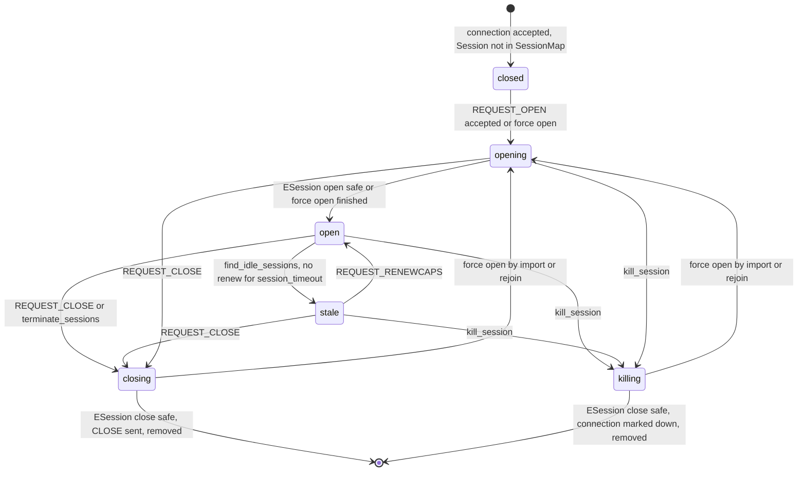
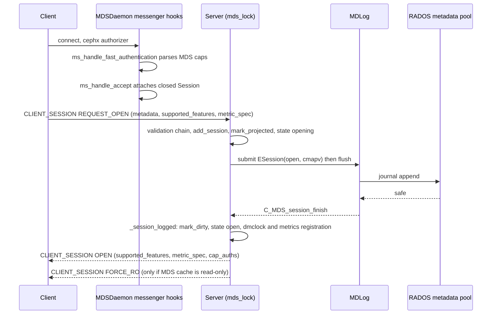
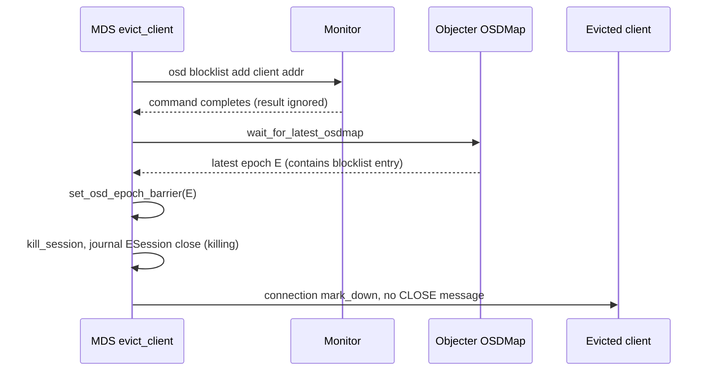
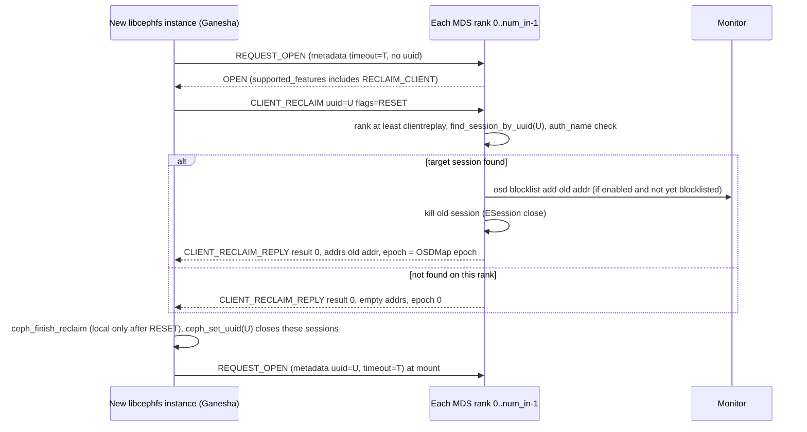
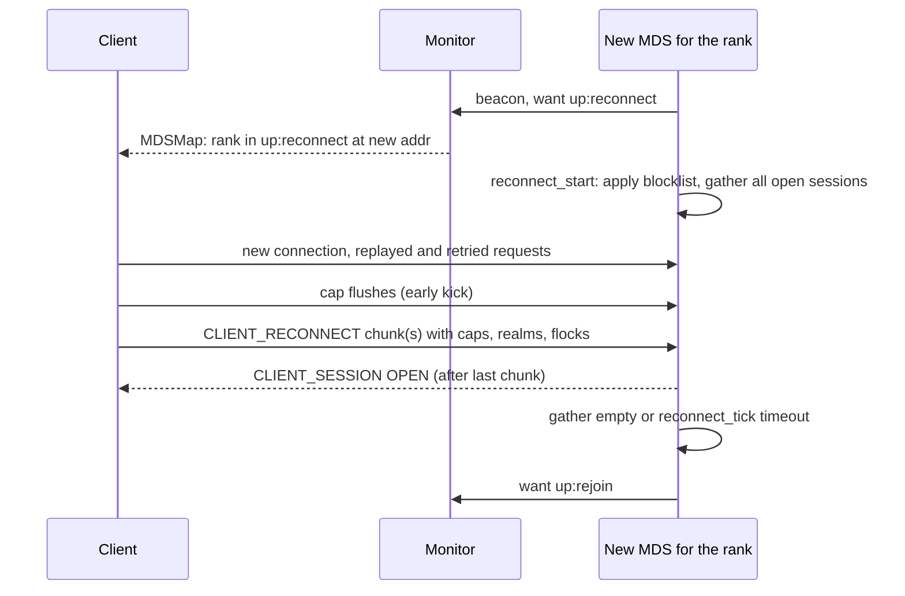

# Client Sessions: SessionMap, open/renew/close, eviction, reclaim, reconnect

> Part of the [C++ MDS project map](../README.md). Sources (commit `5f7e383ae6d`): `src/mds/SessionMap.h` (838 LOC), `src/mds/SessionMap.cc` (1423 LOC), `src/mds/Server.cc` lines 288-2125 plus session helpers at 2379-2614, 3637-3802, 12417-12427 (~2.1k LOC in scope), `src/mds/MDSRank.cc` (tick, reconnect_start, evict_client, evict_clients, config_client, ~450 LOC in scope), `src/mds/MDSDaemon.cc` (connection hooks, asok registration, ~200 LOC), `src/mds/events/ESession.h` (76), `src/mds/events/ESessions.h` (62), `src/mds/journal.cc` (ESession/ESessions/EMetaBlob session replay, ~300 LOC), `src/messages/MClientSession.h` (123), `MClientReconnect.h` (179), `MClientReclaim.h` (69), `MClientReclaimReply.h` (76), `src/mds/mdstypes.{h,cc}` (session types), `src/mds/Beacon.cc` (session health). Client cross-check: `linux/fs/ceph/mds_client.c`, `linux/fs/ceph/mds_client.h`, `src/client/Client.cc`.
> Related: [wire-protocol](wire-protocol.md), [capabilities](capabilities.md), [leases-lock-caches-and-async-dirops](leases-lock-caches-and-async-dirops.md), [kclient-expectations](kclient-expectations.md), [libcephfs-fuse-ganesha-expectations](libcephfs-fuse-ganesha-expectations.md), [request-lifecycle](../03-request-path/request-lifecycle.md), [namespace-mutations](../03-request-path/namespace-mutations.md), [auth-and-mds-caps](../01-cluster-integration/auth-and-mds-caps.md), [fsmap-and-mdsmap](../01-cluster-integration/fsmap-and-mdsmap.md), [beacon-and-monitor](../01-cluster-integration/beacon-and-monitor.md), [rank-lifecycle-and-recovery](../09-recovery/rank-lifecycle-and-recovery.md), [resolve-and-rejoin](../09-recovery/resolve-and-rejoin.md), [events-and-replay](../06-journal/events-and-replay.md), [mds-tables](../07-storage-formats/mds-tables.md), [rados-object-catalog](../07-storage-formats/rados-object-catalog.md), [rados-and-osd-interactions](../07-storage-formats/rados-and-osd-interactions.md), [subtree-migration](../08-multi-mds/subtree-migration.md), [admin-commands](../13-admin-and-config/admin-commands.md), [config-perf-counters-and-health](../13-admin-and-config/config-perf-counters-and-health.md), [process-and-threading](../00-architecture/process-and-threading.md).

## 1. Purpose and responsibilities

A *session* is the per-rank relationship between one client entity (`client.<global_id>`) and one MDS rank. Every client that talks to a rank (kernel client, ceph-fuse/libcephfs, NFS-Ganesha through libcephfs) must hold an open session with that rank before requests, caps or leases are accepted. The session subsystem is responsible for:

- The session state machine (`closed`, `opening`, `open`, `closing`, `stale`, `killing`, plus an orthogonal `importing` counter) and the `CEPH_MSG_CLIENT_SESSION` protocol (open, renew, close, stale, recall, flush, force-ro, reject).
- Admission control at open: MDS auth caps per file system, `refuse_client_session` fs flag, OSD blocklist, required client feature bits, the claimed mount `root`, duplicate `uuid`.
- Liveness: cap renewal, marking sessions stale, autoclose, eviction (OSD blocklist through the monitor plus the OSD epoch barrier), and the laggy-OSD deferral.
- Client-crash recovery for NFS gateways: the *reclaim* protocol (`CEPH_MSG_CLIENT_RECLAIM`) and per-session `timeout` metadata.
- MDS-failover recovery: the *reconnect* protocol (`CEPH_MSG_CLIENT_RECONNECT`) that rebuilds caps, snaprealms and file locks from clients while the rank is in `up:reconnect`.
- Per-session durable state used by the request path: `completed_requests` (idempotent replay of retried/replayed requests), `completed_flushes` (cap flush dedupe), preallocated inode ranges (`prealloc_inos`) and inodes delegated to clients for async creates (`delegated_inos`).
- Persistence: the per-rank `mds<rank>_sessionmap` RADOS omap object, the versioned projected/dirty protocol and the `ESession`/`ESessions` journal events (plus session fields inside `EMetaBlob`, `EUpdate`, `EImportStart`).
- Cache pressure: `CEPH_SESSION_RECALL_STATE` cap recall with per-session and global decay-counter throttles.
- Admin and observability: `session ls|evict|kill|config` commands, the `mds_sessions` perf counters, client-related health metrics in the beacon.

Out of scope here (see related pages): cap issue/revoke mechanics ([capabilities](capabilities.md)), dentry leases and async dirops on the client side ([leases-lock-caches-and-async-dirops](leases-lock-caches-and-async-dirops.md)), the rejoin cap reconciliation that consumes reconnect data ([resolve-and-rejoin](../09-recovery/resolve-and-rejoin.md)), MDS auth cap grammar ([auth-and-mds-caps](../01-cluster-integration/auth-and-mds-caps.md)).

## 2. Source map

| File | Class / function | Lines | Role |
|---|---|---|---|
| `src/mds/SessionMap.h` | `class Session` | 73-499 | In-memory session: state, `session_info_t info` (durable part), connection, caps/leases lists, request list, prealloc/delegated inos, decay counters, push seq, flush waiters |
| `src/mds/SessionMap.h` | `Session::take_ino`, `delegate_inos` | 179-216 | Hand out preallocated inode numbers; delegate ranges to clients |
| `src/mds/SessionMap.h` | `Session::add_completed_request`, `trim_completed_requests`, `add_completed_flush`, `trim_completed_flushes` | 303-349 | Idempotency tables |
| `src/mds/SessionMap.h` | `class SessionFilter` | 501-523 | Filter used by `session ls/evict` |
| `src/mds/SessionMap.h` | `class SessionMapStore` / `class SessionMap` | 535-835 | Map `entity_name_t -> Session*`, `by_state` lists, versions (`version`, `projected`, `committing`, `committed`), dirty/null sets |
| `src/mds/SessionMap.cc` | `SessionMapStore::decode_values`, `SessionMap::_load_finish`, `load`, `load_legacy`, `_load_legacy_finish` | 209-413 | Load omap object at boot |
| `src/mds/SessionMap.cc` | `SessionMap::save`, `_save_finish`, `save_if_dirty` | 442-546, 917-1005 | Write dirty sessions; segment-expiry writes |
| `src/mds/SessionMap.cc` | `mark_projected`, `mark_dirty`, `replay_*` | 805-895 | Version protocol |
| `src/mds/SessionMap.cc` | `add_session`, `remove_session`, `touch_session`, `set_state` | 568-589, 753-803 | Membership, by-state LRU |
| `src/mds/SessionMap.cc` | `Session::notify_cap_release`, `notify_recall_sent` | 1033-1066 | Recall accounting |
| `src/mds/SessionMap.cc` | `SessionFilter::parse`, `match` | 1276-1412 | Filter grammar |
| `src/mds/SessionMap.cc` | `SessionMap::apply_blocklist` | 1262-1274 | Evict sessions that exceed `mds_session_metadata_threshold` |
| `src/mds/Server.cc` | `Server::dispatch` | 319-420 | Entry for session/reconnect/reclaim messages, request gating during reconnect |
| `src/mds/Server.cc` | `find_session_by_uuid`, `reclaim_session`, `finish_reclaim_session`, `handle_client_reclaim` | 454-597 | Reclaim protocol |
| `src/mds/Server.cc` | `Server::handle_client_session` | 599-895 | Session message handler |
| `src/mds/Server.cc` | `flush_session`, `flush_client_sessions`, `finish_flush_session` | 897-923 | FLUSHMSG barrier |
| `src/mds/Server.cc` | `Server::_session_logged`, `C_MDS_session_finish` | 427-452, 925-1048 | Apply journaled open/close |
| `src/mds/Server.cc` | `prepare_force_open_sessions`, `finish_force_open_sessions`, `close_forced_opened_sessions` | 1059-1177 | Sessions opened on behalf of a client (import, rejoin, rename) |
| `src/mds/Server.cc` | `terminate_sessions` | 1187-1208 | Close all at shutdown |
| `src/mds/Server.cc` | `find_idle_sessions`, `evict_cap_revoke_non_responders` | 1211-1397 | Staleness, autoclose, revoke timeout |
| `src/mds/Server.cc` | `kill_session`, `apply_blocklist`, `journal_close_session` | 1472-1561 | Close/kill path |
| `src/mds/Server.cc` | `reconnect_clients`, `handle_client_reconnect`, `reconnect_gather_finish`, `reconnect_tick`, `recover_filelocks` | 1563-1965 | Reconnect protocol |
| `src/mds/Server.cc` | `infer_supported_features`, `update_required_client_features` | 1770-1826 | Feature negotiation |
| `src/mds/Server.cc` | `recall_client_state`, `force_clients_readonly` | 1972-2119 | Cap recall, read-only broadcast |
| `src/mds/Server.cc` | `reply_client_request` (completed requests), `trim_completed_request_list`, `set_reply_extra_bl` | 2379-2408, 2563-2614 | Reply cache, delegated inos in replies |
| `src/mds/Server.cc` | `prepare_new_inode`, `journal_allocated_inos`, `apply_allocated_inos` | 3637-3696, 3767-3802 | Prealloc ino consumption and refill |
| `src/mds/MDSRank.cc` | `MDSRankDispatcher::tick` | 710-801 | Calls `find_idle_sessions`, `evict_cap_revoke_non_responders`, `reconnect_tick`, health |
| `src/mds/MDSRank.cc` | `MDSRank::get_session(m)`, `send_message_client`, `send_message_client_counted` | 1417-1451, 1529-1571 | Connection to session binding, counted sends |
| `src/mds/MDSRank.cc` | `reconnect_start`, `apply_blocklist`, `rejoin_done`, `maybe_clientreplay_done` | 1996-2121 | Rank state hooks |
| `src/mds/MDSRank.cc` | `evict_clients`, `dump_sessions`, `config_client`, `evict_client` | 3154-3217, 3915-4068 | Admin and eviction |
| `src/mds/MDSDaemon.cc` | `ms_handle_fast_authentication`, `ms_handle_accept`, `ms_handle_reset`, `ms_handle_remote_reset` | 1175-1319 | Session object per connection |
| `src/mds/events/ESession.h`, `ESessions.h` + `src/mds/journal.cc` | `ESession::replay`, `ESessions::replay`, encoders | journal.cc 1874-2080 | Journal events |
| `src/mds/journal.cc` | `LogSegment::try_to_expire` (sessionmap part), `EMetaBlob::replay` (session part) | 318-329, 1678-1811 | Persistence at expiry, prealloc/completed replay |
| `src/messages/MClientSession.h` | `MClientSession` | 24-121 | Session message v1-v7 |
| `src/messages/MClientReconnect.h` | `MClientReconnect` | 24-176 | Reconnect message v1-v5 |
| `src/messages/MClientReclaim.h`, `MClientReclaimReply.h` | reclaim messages | whole files | Reclaim |
| `src/mds/mdstypes.h/.cc` | `session_info_t`, `client_metadata_t`, `feature_bitset_t`, `metric_spec_t`, `cap_reconnect_t`, `snaprealm_reconnect_t` | mdstypes.h 203-526; mdstypes.cc 474-717, 1184-1257 | Encodings |
| `src/mds/cephfs_features.h` | `CEPHFS_FEATURE_*` | 31-105 | Session feature bits |
| `src/mds/Beacon.cc` | `Beacon::notify_health` (client parts) | 344-559 | Health warnings derived from sessions |

## 3. How it works

### 3.1 Session objects and connection binding

- Every accepted messenger connection gets a `Session` attached as connection private data, even before any session open: `MDSDaemon::ms_handle_accept` looks up `sessionmap.get_session(entity_name_t(peer_type, peer_global_id))` and, if absent, creates `new Session(con)` in state `closed` that is *not* inserted in the `SessionMap` (src/mds/MDSDaemon.cc:1266-1319 (MDSDaemon::ms_handle_accept)). If an existing session is found (e.g. loaded from RADOS or replayed from the journal), the new connection is bound to it (`set_connection`) and any messages queued in `preopen_out_queue` are flushed to the connection.
- `MDSDaemon::ms_handle_fast_authentication` (runs without `mds_lock`) only parses the cephx-provided MDS caps string (`parse_caps`) into a throw-away object; a parse failure fails authentication of the connection (src/mds/MDSDaemon.cc:1259-1264 (MDSDaemon::ms_handle_fast_authentication); the result is consumed in src/mon/MonClient.cc:1865-1870 (MonClient::handle_auth_request)). `ms_handle_accept` parses the caps again, this time into `Session::auth_caps` (src/mds/MDSDaemon.cc:1303).
- `Session::set_connection` copies identity from the connection: `info.auth_name = peer_entity_name`, `info.inst.addr = peer_socket_addr`, `info.inst.name = entity_name_t(peer_type, peer_global_id)` (src/mds/SessionMap.h:387-395 (Session::set_connection)). The session identity is therefore the cephx global id; a remount (new global id) is a new session.
- `MDSRank::get_session(m)`: for `CEPH_MSG_CLIENT_SESSION` messages arriving on a connection whose bootstrap session is `closed`, if the `SessionMap` already holds a different `Session` for that entity (force-opened by an import or by rejoin), the connection is re-pointed to that imported session, copying `auth_name`, `auth_caps` and `last_seen`, and flushing the bootstrap session's `preopen_out_queue` (src/mds/MDSRank.cc:1417-1451 (MDSRank::get_session)).
- `ms_handle_reset` / `ms_handle_remote_reset` for a client connection whose session is `closed` mark the connection down and clear the private pointer; for non-closed sessions they do nothing (the session survives connection loss) (src/mds/MDSDaemon.cc:1175-1224).
- Client connections use the messenger policy `Messenger::Policy::stateful_server(0)` (src/ceph_mds.cc:190-191 (main)).
- Messages to a session are sent with `MDSRank::send_message_client` (not counted) or `send_message_client_counted` (increments `Session::cap_push_seq` first). If the session has no connection, the message is appended to `preopen_out_queue` (src/mds/MDSRank.cc:1551-1571).

### 3.2 State machine

States are `Session::STATE_CLOSED=0`, `STATE_OPENING=1` ("journaling open"), `STATE_OPEN=2`, `STATE_CLOSING=3` ("journaling close"), `STATE_STALE=4`, `STATE_KILLING=5` (src/mds/SessionMap.h:93-100). Every effective state change increments `state_seq` (src/mds/SessionMap.h:136-142 (Session::set_state)); asynchronous completions capture `state_seq` and become no-ops if it changed. `SessionMap::set_state` additionally moves the session to the tail of the `by_state[state]` xlist, resets the request-load decay counter when entering `open`/`stale`, and refreshes the `sessions_open`/`sessions_stale` gauges (src/mds/SessionMap.cc:568-589 (SessionMap::set_state)). An orthogonal counter `importing_count` (`inc_importing`/`dec_importing`, src/mds/SessionMap.h:240-247) marks sessions being force-opened on behalf of a client: every `prepare_force_open_sessions` call (subtree import, cap import, rejoin, cross-MDS rename) increments it, and it is decremented when the force open finishes or, for subtree imports, in `Migrator::import_finish`/`import_reverse` (3.16).

| From | Event | To | Code |
|---|---|---|---|
| (none) | connection accepted | `closed` (not in map) | src/mds/MDSDaemon.cc:1288-1292 (ms_handle_accept) |
| `closed` | valid `REQUEST_OPEN` | `opening`; added to map; `ESession(open)` journaled | src/mds/Server.cc:811-826 (Server::handle_client_session) |
| `closed`/`closing`/`killing` | `prepare_force_open_sessions` | `opening` (metadata merged) | src/mds/Server.cc:1087-1093 (Server::prepare_force_open_sessions) |
| `opening` | journal safe and `state_seq` unchanged | `open`, reply `OPEN` | src/mds/Server.cc:963-980 (Server::_session_logged) |
| `opening` | `finish_force_open_sessions` and `state_seq` unchanged | `open`, `OPEN` sent | src/mds/Server.cc:1120-1140 (Server::finish_force_open_sessions) |
| `open` | idle > cutoff in `find_idle_sessions` | `stale`, `STALE` sent (or immediate eviction) | src/mds/Server.cc:1297-1307 (Server::find_idle_sessions) |
| `stale` | `REQUEST_RENEWCAPS` | `open`, `resume_stale_caps` | src/mds/Server.cc:830-836 (Server::handle_client_session) |
| `open`/`stale`/`opening` | `REQUEST_CLOSE` with matching seq | `closing` | src/mds/Server.cc:845-876 |
| `open`/`stale`/`opening`, not importing | `kill_session` | `killing` | src/mds/Server.cc:1472-1495 (Server::kill_session) |
| `closing` | journal safe | `closed`, `CLOSE` sent, removed from map | src/mds/Server.cc:1012-1031 (Server::_session_logged) |
| `killing` | journal safe | `closed` (if connected), connection `mark_down`, removed | src/mds/Server.cc:1032-1041 (Server::_session_logged) |

Notes:
- `REQUEST_CLOSE` is accepted in `opening` (`ceph_assert(open || stale || opening)`, src/mds/Server.cc:857-859); the later open completion still calls `mark_dirty` (the projected version must be consumed in order) but sees a changed `state_seq` and makes no state change and sends no `OPEN` (src/mds/Server.cc:956-962).
- Sessions loaded from RADOS or created by journal replay are set directly to `open` (src/mds/SessionMap.cc:223-226 (SessionMapStore::decode_values); src/mds/journal.cc:1895-1897 (ESession::replay)).
- `client_opened` is set when the client itself sends `REQUEST_OPEN`; it stays false for force-opened sessions until the client opens. `close_forced_opened_sessions` only closes sessions with `client_opened == false` (src/mds/SessionMap.h:414-416; src/mds/Server.cc:1170-1171).

### 3.3 Session message dispatch and state gating

`Server::dispatch` handles `CEPH_MSG_CLIENT_RECONNECT` first, unconditionally, then routes `CEPH_MSG_CLIENT_SESSION` to `handle_client_session`, `CEPH_MSG_CLIENT_RECLAIM` to `handle_client_reclaim` (src/mds/Server.cc:319-420 (Server::dispatch)). `MDSRank::handle_message` restricts these three types to peers of type client (`ALLOW_MESSAGES_FROM(CEPH_ENTITY_TYPE_CLIENT)`, src/mds/MDSRank.cc:1249-1253). Every client message that reaches `MDSRankDispatcher::ms_dispatch` (any type: session, request, caps, cap release, lease) updates `Session::last_seen` (src/mds/MDSRank.cc:1046-1050). Note that `CEPH_MDS_STATE_CREATING` (-6) and `STARTING` (-7) are numerically below `REPLAY` (8), so state comparisons like `< STATE_CLIENTREPLAY` also hold for creating/starting ranks (src/include/ceph_fs.h:306-325).

`handle_client_session` prologue (src/mds/Server.cc:599-641):
1. No session on the connection: reply `CEPH_SESSION_REJECT` with `metadata["error_string"]="sessionless"` (sent on the raw connection).
2. `fs_name` of this rank's mdsmap non-empty and `!session->fs_name_capable(fs_name, MAY_READ)`: reply `REJECT` with `error_string = client doesn't have caps for FS "<fs>"`. This applies to every session op, not only open.
3. State gating: `REQUEST_RENEWCAPS` is always handled; `REQUEST_CLOSE` waits until the rank is `>= up:active` (`wait_for_active` + retry); all other ops wait until `>= up:clientreplay` (`wait_for_replay` + retry).
4. Perf counter `mds_server.handle_client_session` incremented.

Per-op handling:

| Op (client to MDS) | Behavior | Code |
|---|---|---|
| `CEPH_SESSION_REQUEST_OPEN` (0) | Validate and journal open (3.4) | src/mds/Server.cc:645-827 |
| `CEPH_SESSION_REQUEST_RENEWCAPS` (4) | If `open` or `stale`: `touch_session` (moves to tail of LRU, `last_cap_renew=now`); if `stale`: state `open`, `Locker::resume_stale_caps`, touch again; `trim_completed_request_list(m->oldest_client_tid)`; reply `RENEWCAPS` echoing `m->get_seq()`. Otherwise ignored. | src/mds/Server.cc:829-843 |
| `CEPH_SESSION_REQUEST_CLOSE` (2) | Drop if `closed`/`closing`/`killing` or `is_importing()`; drop if `seq < push_seq`; if `seq != push_seq` (greater) clog warning `incorrect push seq` and drop; else `journal_close_session(session, STATE_CLOSING)` | src/mds/Server.cc:845-877 |
| `CEPH_SESSION_FLUSHMSG_ACK` (9) | `finish_flush_session(session, seq)` wakes flush waiters with key `<= seq` | src/mds/Server.cc:879-881, 918-923 |
| `CEPH_SESSION_REQUEST_FLUSH_MDLOG` (12) | If rank active: `mdlog->flush()`; no reply | src/mds/Server.cc:883-886 |
| any other op | Send `REJECT`, derr, `evict_client(..., blocklist=true)` | src/mds/Server.cc:888-894 |

### 3.4 Open handshake, metadata and rejection reasons

Validation order for `REQUEST_OPEN` (src/mds/Server.cc:645-826 (Server::handle_client_session)):

| # | Check | Result | Reply details |
|---|---|---|---|
| 1 | mdsmap flag `CEPH_MDSMAP_REFUSE_CLIENT_SESSION` (bit `1<<6`, `ceph fs set <fs> refuse_client_session true`) | reject | `REJECT`, `error_string`: ``new sessions are not permitted, enable again via `ceph fs set <fs_name> refuse_client_session false` `` (always included, sent on the raw connection) |
| 2 | (side effect) `client_opened = true` | - | - |
| 3 | session `closing` | defer | `mdlog->wait_for_safe` then retry the message |
| 4 | session `opening`/`open`/`stale`/`killing`, or `terminating_sessions` | drop | if this message's `supported_features` has `CEPHFS_FEATURE_NOTIFY_SESSION_STATE` (16) and session `open` and rank not stopping: resend `OPEN` with `seq = push_seq`, `supported_features` (if the stored session features have `MIMIC`; no `metric_spec`), `cap_auths`, then `FORCE_RO` if read-only. Both clients copy a non-zero `OPEN` seq into their session seq when theirs is 0 (libcephfs only if its session was not already open) (linux/fs/ceph/mds_client.c:4601-4602; src/client/Client.cc:2725-2726), which resynchronizes the push-seq counter after a client-side session re-init |
| 5 | rank `is_stopping()` | drop silently | - |
| 6 | (side effect) `set_client_metadata(client_metadata_t(m->metadata, m->supported_features, m->metric_spec))` | - | - |
| 7 | client address in OSDMap blocklist | reject; `session->clear()` | `REJECT` with `flags = MClientSession::SESSION_BLOCKLISTED (1<<0)` and, if client has `MIMIC` bit, `error_string = "blocklisted (blacklisted)"`. The comment states the kernel matches the substring `blacklisted` |
| 8 | client sent no feature bits | `infer_supported_features` (3.5) | - |
| 9 | `required_client_features - client features` non-empty | reject; `session->clear()`; clog warn | `error_string = missing required features '<bitset>'` |
| 10 | auth caps contain `root_squash` for this fs and client lacks `CEPHFS_FEATURE_MDS_AUTH_CAPS_CHECK` (21) | not a rejection: session added to `broken_root_squash_clients` (health `MDS_CLIENTS_BROKEN_ROOTSQUASH`, HEALTH_ERR) | - |
| 11 | metadata `root` present and empty or not starting with `/` | reject; clog warn | `error_string = invalue root '<root>'` (literal typo in code) |
| 12 | metadata `root` not `auth_caps.path_capable(root without leading /)` | reject; clog warn | `error_string = non-allowable root '<root>'` |
| 13 | metadata `uuid` already used by any session in the map (`find_session_by_uuid`) | reject; clog warn | `error_string = duplicated session uuid` |
| 14 | accept | `add_session` (if closed), `pv = mark_projected`, `set_state(opening)`, `touch_session`, submit `ESession(inst, open=true, pv, client_metadata, auth_name)`, `mdlog->flush()` | `OPEN` after journal commit |

The `REJECT` built by `send_reject_message` carries `error_string` only when the client advertised `CEPHFS_FEATURE_MIMIC` (8); flags are always set but the v1 encoding (section 5, Messages) drops them when `metadata` and `supported_features` are both empty (src/mds/Server.cc:720-726; src/messages/MClientSession.h:98-115). A debug-level-2 log line `New client session: addr=...,elapsed=...,throttled=...,status="ACCEPTED"` (on commit) or `status="REJECTED",error=...` (rejections in rows 7-13), plus `root=...` when present, is emitted (src/mds/Server.cc:700-726, 818-821).

On commit, `_session_logged(open)` does: `mark_dirty(session)`; if `state_seq` unchanged: `mds_dmclock_scheduler->add_session`, `set_state(open)`, `touch_session`, `metrics_handler->add_session`, send `OPEN` (seq 0) with `supported_features = CEPHFS_FEATURES_MDS_SUPPORTED` and `metric_spec = CEPHFS_METRIC_FEATURES_ALL` if the client has the `MIMIC` bit, and `cap_auths = auth_caps.get_cap_auths()`; then `FORCE_RO` if `mdcache->is_readonly()` (src/mds/Server.cc:956-980).

Connection-level rejection (no session message at all): cephx authorizer failure or MDS caps that fail to parse (src/mds/MDSDaemon.cc:1232-1264). For `MCommand` (tell) on a connection, the session's `auth_caps.allow_all()` is required, else `-EACCES "permission denied"` (src/mds/MDSDaemon.cc:810-816 (MDSDaemon::handle_command)).

#### Client metadata keys and where the MDS uses them

`client_metadata_t` = `kv_map` (string to string) + `features` (`feature_bitset_t`) + `metric_spec` (src/mds/mdstypes.h:314-356). Sent by clients in `REQUEST_OPEN`:

| Key | Sent by | MDS use |
|---|---|---|
| `hostname` | kclient (`mdsc->nodename`), libcephfs (`uname`) | `Session::_update_human_name`: human name = hostname, plus `:<auth id>` if the auth id is not the default and shorter than 16 chars; else the numeric client id (src/mds/SessionMap.cc:1077-1098) |
| `root` | kclient always (`server_path` or `/`); libcephfs at mount always (`/` for an empty mount root, src/client/Client.cc:7095), but not for sessions opened before mount (`ceph_mds_command`, `ceph_start_reclaim` call `populate_metadata("")`, src/client/Client.cc:6897, 18885) | open validation (rows 11-12 above); QoS volume id `MDSDmclockScheduler::get_volume_id` (src/mds/MDSDmclockScheduler.cc:53-61); log line |
| `uuid` | libcephfs `ceph_set_uuid` (Ganesha) | reclaim target lookup and duplicate rejection (src/mds/Server.cc:454-474, 801-809) |
| `timeout` | libcephfs `ceph_set_session_timeout` (Ganesha); also set by `session config <id> timeout <v>` | per-session idle timeout in `find_idle_sessions`; kept alive across reconnect and gates `up:active` (3.10) |
| `ceph_version` | libcephfs | `infer_supported_features` for clients that send no feature bits |
| `kernel_version` | kclient | `infer_supported_features` |
| `entity_id`, `pid`, `ceph_sha1`, `mount_point` (ceph-fuse), user keys from `client_metadata` option | clients | not interpreted by the MDS; visible in `session ls` and matchable with `client_metadata.<key>=<value>` filters |

Client code: linux/fs/ceph/mds_client.c:1651-1657 (create_session_full_msg); src/client/Client.cc:2579-2625 (Client::populate_metadata), 18632-18642 (Client::set_uuid), 18850-18858 (Client::set_session_timeout); src/ceph_fuse.cc:308.

### 3.5 Feature negotiation

- Feature bits (`src/mds/cephfs_features.h:31-56`): `JEWEL=5, KRAKEN=6, LUMINOUS=7, MIMIC=8, REPLY_ENCODING=9, RECLAIM_CLIENT=10, LAZY_CAP_WANTED=11, MULTI_RECONNECT=12 (=NAUTILUS), DELEG_INO=13 (=OCTOPUS), METRIC_COLLECT=14, ALTERNATE_NAME=15, NOTIFY_SESSION_STATE=16, OP_GETVXATTR=17, 32BITS_RETRY_FWD=18, NEW_SNAPREALM_INFO=19, HAS_OWNER_UIDGID=20, MDS_AUTH_CAPS_CHECK=21, CHARMAP=22, BLOCKDIFF=23, QUARANTINE=24`; bits 0-4 reserved. The MDS advertises all of them (`CEPHFS_FEATURES_MDS_SUPPORTED = CEPHFS_FEATURES_ALL`, src/mds/cephfs_features.h:104; `Server::supported_features`, src/mds/Server.cc:309).
- Wire format of `feature_bitset_t`: `u32 byte_length` followed by little-endian `u64` blocks; a trailing partial block is accepted on decode (src/mds/mdstypes.cc:532-555).
- The client's bits are stored in `session->info.client_metadata.features` and tested with `session->info.has_feature(bit)` everywhere else in the MDS.
- `infer_supported_features` (src/mds/Server.cc:1770-1797) for clients without bits: userspace with `ceph_version` starting `ceph version 12.` gets up to `LUMINOUS`; userspace whose connection has `CEPH_FEATURE_FS_CHANGE_ATTR` gets up to `KRAKEN`; kernel (`kernel_version` present) with `CEPH_FEATURE_NEW_OSDOP_ENCODING` gets up to `LUMINOUS`; otherwise `CEPH_FEATURE_FS_FILE_LAYOUT_V2` gives up to `JEWEL`. The resulting bitset is all bits `0..supported`.
- Required features: `Server::required_client_features` mirrors `MDSMap::required_client_features` (set by `ceph fs required_client_features <fs> add|rm <feature>` or derived by `MDSMap::set_min_compat_client`, src/mds/MDSMap.cc:1327-1353). On mdsmap change (src/mds/MDSRank.cc:2357-2358), `update_required_client_features` evicts every non-blocklisted client session missing a required bit if the rank is `>= up:reconnect` (blocklist per `mds_session_blocklist_on_evict`) (src/mds/Server.cc:1799-1826).
- The MDS echoes `supported_features` and `metric_spec` only to clients that advertised `MIMIC` (8). Clients use the MDS bits to decide behaviors (kclient: `MULTI_RECONNECT` for reconnect chunking, `METRIC_COLLECT` for metrics, `DELEG_INO` for async dirops, `REPLY_ENCODING`; libcephfs: `RECLAIM_CLIENT` required for `ceph_start_reclaim`).
- Observed numbering divergence in the provided kernel snapshot: linux/fs/ceph/mds_client.h:25-59 defines `CEPHFS_FEATURE_SUBVOLUME_METRICS` = 22 (an enum continuing from `CEPHFS_FEATURE_MIMIC = 8`) and the kernel advertises it; in this Ceph tree bit 22 is `CEPHFS_FEATURE_CHARMAP` (used by `Server::can_handle_charmap`, src/mds/Server.cc:4876-4893, which fails dentry operations in a directory with a charmap with `-EPERM` for clients lacking the bit). This MDS therefore treats that kernel as charmap-capable. The kernel also tests bit 22 in the MDS's advertised set to enable subvolume metrics (linux/fs/ceph/mds_client.c:4580-4584 (handle_session)). The kernel does not advertise `RECLAIM_CLIENT` (10) or `NEW_SNAPREALM_INFO` (19).

### 3.6 Renewal, staleness, autoclose

Client side cadence: the kernel sends `REQUEST_RENEWCAPS` every `session_timeout/4` seconds (otherwise a messenger keepalive) and only if the rank's mdsmap state is `>= up:reconnect` (linux/fs/ceph/mds_client.c:6279-6302 (delayed_work), 2116-2145 (send_renew_caps)); it treats its caps as valid until `renew_requested + session_timeout` (linux/fs/ceph/mds_client.c:2168-2198 (renewed_caps)) and marks the session `HUNG` if no session message arrived within `session_autoclose` (linux/fs/ceph/mds_client.c:6203-6213 (check_session_state)). libcephfs renews when more than `session_timeout/3` elapsed (src/client/Client.cc:7535-7538 (Client::renew_and_flush_cap_releases)) and only to ranks in state `>= up:rejoin` (src/client/Client.cc:7766-7776 (Client::renew_caps)).

MDS side: `MDSRankDispatcher::tick` (every `mds_tick_interval`, 5 s) calls, when the rank is `clientreplay`, `active` or `stopping`: `server->clear_laggy_clients()`, `find_idle_sessions()`, `evict_cap_revoke_non_responders()` (src/mds/MDSRank.cc:732-737). The tick is skipped entirely if the beacon is laggy (src/mds/MDSRank.cc:714-717).

`Server::find_idle_sessions` (src/mds/Server.cc:1211-1359):
1. `queue_max_age` = messenger dispatch queue max age; `cutoff = queue_max_age + mdsmap.session_timeout` (default 60 s).
2. If the MDS itself cleared its laggy state (beacon acks from the monitors) less than `cutoff` seconds ago, return without marking any session stale and without any eviction in this tick.
3. Walk `by_state[open]` in LRU order (head = oldest `touch_session`):
   - `span = now - last_cap_renew`; if `span < cutoff`: stop the walk (the code assumes later entries are fresher; the list is ordered by `touch_session`/`set_state` calls, and reconnect updates `last_cap_renew` without reordering, so the order is approximate).
   - If `last_seen > last_cap_renew`, use `span = now - last_seen`; if `< cutoff` skip this session (any message counts as liveness).
   - If `span >= session_autoclose` (default 300 s): add to `laggy_clients` (evict without going stale). This check precedes the custom `timeout` check, so it bounds sessions with a larger or infinite `timeout` too.
   - If `mds_defer_session_stale` (default true) and the session has no flush waiters and the Locker is not revoking any caps from it: skip (quiet sessions are not marked stale).
   - If metadata `timeout` exists: `0` means infinite (skip); else if `span < queue_max_age + timeout` skip; else add to `laggy_clients` (no stale phase).
   - Else collect into `new_stale`.
4. For each `new_stale`: `set_state(stale)`; `Locker::revoke_stale_caps(session)` (increments `Session::cap_gen`, which invalidates every cap of the session; walks the notable caps at the front of `Session::caps` and forcibly completes each in-flight revocation that has no write bits, flagging the inode `NEEDSRECOVER` if the client held a writable range on it, then re-evaluates the inode locks). If it returns true: `remove_stale_leases`, `finish_flush_session(push_seq)`, send `CEPH_SESSION_STALE`. If it returns false (a revocation including `CEPH_CAP_ANY_WR` bits was pending): add to `laggy_clients` (src/mds/Locker.cc:2778-2843 (Locker::revoke_stale_caps)).
5. Walk `by_state[stale]`: if `now - last_cap_renew >= queue_max_age + session_autoclose`, add to `laggy_clients`.
6. If `defer_client_eviction_on_laggy_osds` (default false) and the OSDMap has any laggy OSD and `laggy_clients` is non-empty: return (the set is kept for the `MDS_CLIENTS_LAGGY` health warning until the next tick clears it).
7. For each laggy client not `is_importing()`: clog warn `evicting unresponsive client <name>, after  seconds`; if `mds_session_blocklist_on_timeout` (default true) `evict_client(blocklist=true)`, else `kill_session`.

Stale cap semantics: caps of a stale session are not re-issued (`Capability::is_stale`); when another client needs a conflicting cap, the Locker revokes the stale cap immediately without waiting for an ack, but if the revocation includes write bits it evicts the client instead (`Locker::revoke_stale_cap`, src/mds/Locker.cc:2742-2753, blocklist per `mds_session_blocklist_on_timeout`). A renewal (`stale` to `open`) runs `Locker::resume_stale_caps`, re-issuing caps (src/mds/Locker.cc:2845-2870).

`Server::evict_cap_revoke_non_responders` (src/mds/Server.cc:1361-1397): if `mds_cap_revoke_eviction_timeout` (default 0 = disabled) is set, clients with a cap revocation older than the timeout (`Locker::get_late_revoking_clients`) are evicted (blocklist per `mds_session_blocklist_on_evict`), perf counter `cap_revoke_eviction`; the laggy-OSD deferral applies.

### 3.7 Close and kill

`Server::journal_close_session(session, state, on_safe)` (src/mds/Server.cc:1524-1561):
1. `sseq = set_state(state)` (`closing` or `killing`), `pv = mark_projected(session)`.
2. `inos_to_free = pending_prealloc_inos + free_prealloc_inos`; if non-empty, `inotable->project_release_ids` and `piv = inotable projected version`.
3. Submit `ESession(inst, open=false, pv, inos_to_free, piv, inos_to_purge = delegated_inos, auth_name)` with `C_MDS_session_finish(..., ls = current segment, on_safe)`; `mdlog->flush()`.
4. Kill every in-flight request of the session (`mdcache->request_kill`).
5. `finish_flush_session(session, push_seq)` to release flush waiters.

`Server::_session_logged(close)` (src/mds/Server.cc:935-1047):
- `inos_to_purge`: removed from `info.prealloc_inos`, added to the segment's `purging_inodes`, and if the rank is `clientreplay`/`active`/`stopping`, `MDCache::purge_inodes` purges object 0 of each ino with the default file layout and then journals `EPurged` to release the inos to the InoTable (src/mds/MDCache.cc:6903-6928 (MDCache::purge_inodes)). Purges recorded while the rank is still recovering (e.g. sessions killed at the end of reconnect, or `ESession` replay, src/mds/journal.cc:1885-1886) are started by `MDCache::start_purge_inodes` from `MDSRank::recovery_done` (src/mds/MDCache.cc:6893-6901; src/mds/MDSRank.cc:2166-2175); segment expiry waits for them (src/mds/journal.cc:365-369 (LogSegment::try_to_expire)).
- `inos_to_free`: removed from `info.prealloc_inos`, `inotable->apply_release_ids`, assert InoTable version equals `piv`.
- `free_prealloc_inos = info.prealloc_inos`; `delegated_inos.clear()`; `mark_dirty(session)`.
- If `state_seq` changed (re-opened by an import): no further action.
- Otherwise remove all caps (`Locker::remove_client_cap(in, cap, kill = killing)`; with `kill` the inode is flagged `NEEDSRECOVER` if the client had a writable range, else `check_inode_max_size`, src/mds/Locker.cc:4345-4377) and all leases; erase the client from `client_reconnect_gather` (finishing reconnect if it became empty) and from `client_reclaim_gather` (calling `maybe_clientreplay_done` if empty).
- `closing`: mark the connection disposable, `dmclock remove_session`, send `CEPH_SESSION_CLOSE`, `set_state(closed)`, `session->clear()`, `metrics_handler->remove_session`, `sessionmap.remove_session`.
- `killing`: if connected, `mark_down()` the connection (no `CLOSE` message), `set_state(closed)`, detach connection (without a connection the state stays `killing` until removal); `dmclock remove_session`, metrics remove, `remove_session`. Unlike `closing`, `session->clear()` is not called.

`Server::kill_session(session, on_safe)` (src/mds/Server.cc:1472-1495): for `opening`/`open`/`stale` and not importing, `journal_close_session(killing)`; otherwise, if already `closing`/`killing`, `on_safe` waits for the whole journal to be safe; otherwise (`closed`, or `opening`/`open`/`stale` while importing) `on_safe` completes immediately, i.e. an importing session is not killed.

Push-seq contract for `REQUEST_CLOSE`: the MDS counts every message sent with `send_message_client_counted` (`MClientCaps`, `MClientLease`, `MClientSnap`, `MClientQuota`, and `MQuarantineDisable` for clients with `CEPHFS_FEATURE_QUARANTINE`, src/mds/MDCache.cc:14096-14107, 15290-15301) in `Session::cap_push_seq`. The kernel increments its `s_seq` for each received CAPS, SNAP, QUOTA and LEASE message (linux/fs/ceph/super.c:1524-1528 (ceph_inc_mds_stopping_blocker) via caps.c:4440, snap.c:1036, quota.c:51, mds_client.c:6051) and re-sends `REQUEST_CLOSE` with the new `s_seq` whenever a counted message arrives while closing (linux/fs/ceph/mds_client.c:6229-6246 (inc_session_sequence)). libcephfs does the same in `Client::got_mds_push` (src/client/Client.cc:3648-3655), called from `handle_caps`, `handle_snap`, `handle_quota` and `handle_lease` only; `Client::handle_quarantine_disable` does not call it (src/client/Client.cc:5718-5731) even though libcephfs advertises bit 24 (`CEPHFS_FEATURES_CLIENT_SUPPORTED = CEPHFS_FEATURES_ALL`, src/client/Client.cc:451). The MDS closes only when `seq == push_seq`. The push seq is not persisted; both sides reset to 0 on reconnect (`Session::clear` / new Session after restart; kernel `s_seq = 0` in `send_mds_reconnect`).

Shutdown: `terminate_sessions` sets `terminating_sessions = true`, journals a close (`closing`) for every client session not already closing/killing/closed and clears the flag once the journal is safe (src/mds/Server.cc:1187-1208); it is driven by `MDCache::shutdown_pass` while `have_unclosed_sessions()` (src/mds/MDCache.cc:8111-8116). When the stopping rank is the only `in` rank, `MDSRank::stopping_start` first evicts every client session (blocklist per `mds_session_blocklist_on_evict`) (src/mds/MDSRank.cc:2259-2281).

### 3.8 Eviction paths, blocklisting and the OSD epoch barrier

`MDSRank::evict_client(session_id, wait, blocklist, err_ss, on_killed)` (src/mds/MDSRank.cc:3951-4068):
- Refuses while `is_any_replay()` (`"MDS is replaying log"`, returns false); unknown id returns false.
- clog info `Evicting (and blocklisting) client session <id> (<addr>)`.
- If `blocklist`: sends mon command `{"prefix":"osd blocklist", "blocklistop":"add", "addr":"<session addr>"}` (no expiry argument, so the monitor default `mon_osd_blocklist_default_expire` = 1 h applies). On completion (the command result is ignored) it calls `objecter->wait_for_latest_osdmap`, then on the finisher thread takes `mds_lock`, `set_osd_epoch_barrier(latest epoch)` and kills the session (`Server::kill_session`, ESession close with state `killing`).
- If not `blocklist`: kills immediately.
- `wait=true` (only `session kill` asok) blocks the calling thread on a `C_SaferCond` with `mds_lock` dropped.

The epoch barrier (`MDSRank::osd_epoch_barrier`, src/mds/MDSRank.cc:1580-1584) is sent in subsequent `MClientCaps` messages so other clients wait for that OSDMap epoch before doing I/O to objects the evicted client may have touched (see [rados-and-osd-interactions](../07-storage-formats/rados-and-osd-interactions.md)). The barrier is also set to the current epoch on every MDSMap the rank handles while active (meant for the transition to active, because the barrier is not persisted; src/mds/MDSRank.cc:2597-2603), whenever `apply_blocklist` kills sessions, and by the `osdmap barrier <epoch>` admin command (src/mds/MDSRank.cc:2819-2834). It is raised (never lowered) to the `osd_epoch_barrier` carried in client `MClientCaps` and `MClientCapRelease` messages; when that epoch is not yet known locally, the MDS also sets the Objecter's own epoch barrier, which holds its RADOS ops until the map arrives (src/mds/Locker.cc:3495-3503, 4270-4278).

OSDMap-driven kills: `MDSRankDispatcher::handle_osd_map` (outside replay) consumes new blocklist events from the Objecter and calls `MDSRank::apply_blocklist`, which runs `Server::apply_blocklist` (kill every *client* session whose address is blocklisted in the current OSDMap; MDS peers are skipped) and sets the barrier if anything was killed (src/mds/MDSRank.cc:1996-2004, 3887-3913; src/mds/Server.cc:1497-1522). `MDSRank::reconnect_start` applies the full current blocklist before reconnect (src/mds/MDSRank.cc:2015-2026).

All eviction triggers:

| Trigger | Blocklist? | Code |
|---|---|---|
| Idle > `session_autoclose`, stale > autoclose, custom `timeout`, stale revoke failure | `mds_session_blocklist_on_timeout` (true) else plain kill | src/mds/Server.cc:1350-1355 |
| Reconnect timeout | `mds_session_blocklist_on_timeout` else kill | src/mds/Server.cc:1921-1927 |
| Revoking write caps from a stale session | `mds_session_blocklist_on_timeout` | src/mds/Locker.cc:2749-2752 |
| Cap revoke non-responder | `mds_session_blocklist_on_evict` (true) | src/mds/Server.cc:1390-1392 |
| Missing required features after mdsmap change | `mds_session_blocklist_on_evict` | src/mds/Server.cc:1821-1822 |
| Admin `session evict` / `client evict` / `session kill` | `mds_session_blocklist_on_evict` | src/mds/MDSRank.cc:2861, 2871-2872, 3193-3194 |
| Reclaim RESET of an old session | blocklist if `mds_session_blocklist_on_evict` and target not already blocklisted, else kill | src/mds/Server.cc:546-555 |
| Encoded session >= `mds_session_metadata_threshold` at save | `mds_session_blocklist_on_evict` | src/mds/SessionMap.cc:1262-1274 |
| Unknown session op from client | always | src/mds/Server.cc:893 |
| Last rank stopping | `mds_session_blocklist_on_evict` | src/mds/MDSRank.cc:2277-2278 |
| Address already in OSD blocklist | (already blocklisted) kill | src/mds/Server.cc:1497-1522 |

### 3.9 Reclaim protocol (NFS-Ganesha via libcephfs)

Purpose (doc/dev/cephfs-reclaim.rst): a restarted NFS server (new libcephfs instance, new global id) destroys the MDS session of its previous incarnation identified by an opaque `uuid`, so state held by the dead instance (caps, file locks, opens) is released immediately instead of after a timeout. Only `CEPH_RECLAIM_RESET` (1) is implemented.

MDS side:
- `handle_client_reclaim` (src/mds/Server.cc:561-597): ignore if no session; drop if no `MAY_READ` caps for the fs; wait for `>= up:clientreplay`; `FLAG_FINISH` (`1U<<31`) with any other flag gives `-EINVAL` reply; `FLAG_FINISH` alone calls `finish_reclaim_session(session)` without a reply (a no-op unless `reclaiming_from` is still set); otherwise `reclaim_session`. libcephfs sends `FLAG_FINISH` (with an empty uuid) from `ceph_finish_reclaim` only when a previous `ceph_start_reclaim` set the local `reclaiming_uuid` metadata, which only the non-RESET path does; after a RESET reclaim `ceph_finish_reclaim` sends nothing (src/client/Client.cc:18961-18978).
- `reclaim_session` (src/mds/Server.cc:476-521): the requesting session must be `open` or `stale` (else dropped silently). Empty uuid gives `-EINVAL`; flags other than exactly `CEPH_RECLAIM_RESET` give `-EINVAL`. If a session with metadata `uuid == U` exists: its `auth_name` must equal the requester's (else `-EPERM`); `session->reclaiming_from = target`; reply `addrs = target addr`. If not found: reply result 0 with empty addrs. RESET then calls `finish_reclaim_session`.
- `finish_reclaim_session` (src/mds/Server.cc:523-559): clears `reclaiming_from`; the reply is sent from a completion that re-looks-up the requester session and stamps `epoch = current OSDMap epoch`. If the target address is already blocklisted or `mds_session_blocklist_on_evict` is false, `kill_session(target, send_reply)`; else `evict_client(target, wait=false, blocklist=true, send_reply)`.
- `find_session_by_uuid` tolerates two sessions with the same uuid only as a reclaimer/target pair (asserts otherwise) (src/mds/Server.cc:454-474).
- `auth_name` is persisted in `ESession` v7 so that a session recreated by journal replay can still be reclaimed (src/mds/events/ESession.h:38-39; src/mds/journal.cc:1899-1901; test src/test/libcephfs/reclaim.cc:185-252 (ReclaimResetAfterMDSFailover)).

Client side (src/client/Client.cc:18861-19004 (Client::start_reclaim, finish_reclaim, handle_client_reclaim_reply)): requires an initialized client (`-ENOTCONN` otherwise; documented as "called before mount"); an empty uuid or its own uuid gives `-EINVAL`; for each rank `0..num_in-1` in turn (waiting for a new MDSMap while the rank is not up) it opens a session, requires `CEPHFS_FEATURE_RECLAIM_CLIENT` in that rank's `OPEN` (`-EOPNOTSUPP`), sends one `MClientReclaim` and waits for its reply before moving to the next rank; a rejected session gives `-EPERM`; any negative reply result fails with that errno; if no rank returned addrs, RESET returns `-ENOENT`; RESET otherwise returns 0 immediately (the non-RESET path that waits for `reclaim_osd_epoch` and checks the blocklist is not reachable because the MDS rejects other flags).

Interaction with `timeout` metadata and failover: sessions whose metadata contains `timeout` are not evicted at the end of reconnect; they are put in `client_reclaim_gather` and the rank stays in `up:clientreplay` until each is killed or reclaimed (3.10). Idle eviction still applies to them, so without a reclaim they are evicted about `session_autoclose` after reconnect start (section 8).

### 3.10 Reconnect protocol (MDS failover)

Entry: `MDSRank::reconnect_start` (rank enters `up:reconnect`): reopen the log if coming from replay, enable OSDMap blocklist events, kill sessions of blocklisted clients, `server->reconnect_clients(C_MDS_VoidFn(reconnect_done))`, wake `waiting_for_reconnect` (src/mds/MDSRank.cc:2007-2030).

`Server::reconnect_clients` (src/mds/Server.cc:1563-1589): every client session in state `open` (sessions loaded from the sessionmap object and from journal replay are all `open`) is added to `client_reconnect_gather`, marked `reconnecting`, `last_cap_renew = now`. Empty gather finishes immediately. `reconnect_start = now`.

Client trigger: the kernel notices the rank's address changed in the new MDSMap, closes the connection, marks the session `RESTARTING`, and when the state is `>= up:reconnect` calls `send_mds_reconnect` (linux/fs/ceph/mds_client.c:5895-5928 (check_new_map)); libcephfs reconnects when the rank state becomes exactly `up:reconnect` and closes the session if it sees a state beyond reconnect without having seen reconnect (src/client/Client.cc:3406-3415 (Client::handle_mds_map)). The kernel also sends reconnect to export targets in `up:reconnect` for which it has no session (linux/fs/ceph/mds_client.c:5951-5990).

Client-side order on the new connection (kernel `send_mds_reconnect`, linux/fs/ceph/mds_client.c:5145-5359; libcephfs `Client::send_reconnect`, src/client/Client.cc:3438-3528):
1. Reset session seq to 0, bump cap generation, drop queued cap releases, trim dcache.
2. Re-send unsafe requests with the replay flag and re-send previously attempted requests (`replay_unsafe_requests`, linux/fs/ceph/mds_client.c:4730-4764).
3. Re-send pending cap flushes (`ceph_early_kick_flushing_caps`).
4. Send `CEPH_MSG_CLIENT_RECONNECT` with all caps of this rank (ino, cap_id, wanted, issued, snaprealm ino, path base ino + path, flock blob, snap_follows) and snaprealms (ino, seq, parent): the kernel sends every snaprealm it knows (linux/fs/ceph/mds_client.c:5074-5132 (encode_snap_realms)); libcephfs sends only the realms of inodes that hold a cap from this rank (src/client/Client.cc:3512-3516).

Requests arriving before/without reconnect (src/mds/Server.cc:336-397 (Server::dispatch)): while the rank is in (or about to enter) `up:reconnect`, a client request is dropped if the session is not `open` (unless `mds_replay_unsafe_with_closed_session`); requests flagged replay or async are queued for clientreplay (`mark_queued_for_replay`, `enqueue_replay`); if they carry `head.ino` and are not in `completed_requests`, the ino is noted with `add_replay_ino_alloc` and, with `mds_replay_unsafe_with_closed_session`, moved from `free_prealloc_inos` to `delegated_inos` so it is not purged; retried requests already in `completed_requests` are also queued for clientreplay; embedded cap releases of retried requests are dropped; all other requests wait for `up:active`.

`Server::handle_client_reconnect` (src/mds/Server.cc:1591-1768):
1. No session: `REJECT "sessionless"`.
2. `refuse_client_session` flag: clog warn, reply `CLOSE` with `error_string = client cannot reconnect when file system flag refuse_client_session is set`.
3. Session not `open`: reply `CLOSE`.
4. Not yet in reconnect but `want_state == RECONNECT` (mdsmap race): `wait_for_reconnect` and retry.
5. Deny (reply `CLOSE` to the session; if `open`, record in `client_reconnect_denied`) when: `mds_deny_all_reconnect` is set, or the rank is no longer in reconnect, or `reconnect_evicting`; clog info `denied reconnect attempt (mds is <state>) from <inst> after <delay> (allowed interval <mds_reconnect_timeout>)`. Also deny with reason `session is closed`, `mds is readonly`, or `missing required features '<bits>'` (after `infer_supported_features`); the broken-root-squash check is applied here too.
6. On the last chunk (`!m->has_more()`): register with metrics handler and dmclock, send `OPEN` (with `supported_features`/`metric_spec` for `MIMIC` clients, `cap_auths`), clog debug `reconnect by <inst> after <delay>`.
7. `last_cap_renew = now`.
8. Snaprealms: skip if the inode is being purged; otherwise `mdcache->add_reconnected_snaprealm(client, ino, seq)`.
9. Caps: raise `mdcache->last_cap_id` to the max reconnected `cap_id`; skip purging inodes; inode in cache and auth: `CInode::reconnect_cap` (merge or create the `Capability`, `issue_norevoke(issued)`, reset seqs), `mdcache->add_reconnected_cap`, `recover_filelocks`; inode in cache but not auth: `rejoin_export_caps` to the authority (path dropped); inode not in cache: `rejoin_recovered_caps(ino, client, cr, MDS_RANK_NONE)` to be opened during rejoin.
10. `reconnect_last_seen = now`. On the last chunk: `mdcache->rejoin_recovered_client(client, inst)`, remove from `client_reconnect_gather`, `reconnecting=false`, finish if the gather is empty.

`Server::recover_filelocks` (src/mds/Server.cc:1945-1965): the flock blob is `i32 n` + `n` x `ceph_filelock` (fcntl locks) then `i32 n` + `n` x `ceph_filelock` (flock locks); each lock's `client` field is overwritten with the reconnecting client id and inserted into the inode's `fcntl`/`flock` lock state without conflict checks. It has a single caller and is only reached for inodes that are in cache and auth when the reconnect message is processed; the paths that attach caps resolved later during rejoin do not restore locks: `MDCache::process_imported_caps` (`CInode::reconnect_cap`, src/mds/MDCache.cc:5624), `MDCache::try_reconnect_cap` (src/mds/MDCache.cc:5912-5918) and `MDCache::rejoin_import_cap` (survivor path, src/mds/MDCache.cc:5852-5871).

`Server::reconnect_tick` (from `tick` while `up:reconnect`, src/mds/MDSRank.cc:745-746; src/mds/Server.cc:1844-1943):
- Return while `reconnect_evicting`; return if the gather is empty.
- `reject_all = mds_deny_all_reconnect && client_reconnect_gather == client_reconnect_denied`.
- If `now - reconnect_start < mds_reconnect_timeout` (45 s) and not `reject_all`: return.
- `reconnect_last_seen = max(reconnect_last_seen, last_seen of remaining sessions)`; if `now - reconnect_last_seen < mds_reconnect_timeout/2` and not `reject_all`: return ("extending reconnect interval").
- For each remaining session: if it has `timeout` metadata, keep it and add it to `client_reclaim_gather`; otherwise clog warn `evicting unresponsive client ... after waiting <s> seconds during MDS startup`, swap `delegated_inos` with `free_prealloc_inos` (so the close purges objects possibly created by lost async/unsafe creates), evict (blocklist per `mds_session_blocklist_on_timeout`, gathered) or kill, `failed_reconnects++`.
- Clear `client_reconnect_gather` and `client_reconnect_denied`; if blocklist evictions are pending, set `reconnect_evicting` and finish when they complete; else finish now.

`reconnect_gather_finish` waits for the snap table client cache to be synced, then completes `reconnect_done` which requests `up:rejoin` (src/mds/Server.cc:1828-1842; src/mds/MDSRank.cc:2031-2035). After rejoin, the rank goes to `up:clientreplay` instead of `up:active` while `client_reclaim_gather` is non-empty, and `maybe_clientreplay_done` refuses to finish clientreplay until it is empty (src/mds/MDSRank.cc:2075-2079, 2107-2121).

Reconnect message chunking (`CEPHFS_FEATURE_MULTI_RECONNECT`, bit 12): the client may split caps/realms across several messages with `more = true`, last one `more = false` (v5). The kernel only does so when a single message would exceed `RECONNECT_MAX_SIZE = INT_MAX - PAGE_SIZE` (linux/fs/ceph/mds_client.c:31, 4766-4840, 5272-5283); libcephfs splits when the approximate size reaches `INT_MAX >> 1` (src/client/Client.cc:3468-3475).

### 3.11 Session flush barrier, FLUSH_MDLOG, FORCE_RO

- `Server::flush_session` sends `CEPH_SESSION_FLUSHMSG` with `seq = wait_for_flush(ctx)` (current push seq) to `open` sessions whose connection has `CEPH_FEATURE_EXPORT_PEER`; the waiter completes on `FLUSHMSG_ACK` with `seq >=` that value, when the session goes stale, or when it is closed (src/mds/Server.cc:897-923, 1301, 1560). Clients flush pending cap releases before acking (linux/fs/ceph/mds_client.c:4637-4645; src/client/Client.cc:2779-2785). Users: subtree export, so clients have seen every cap message before the export proceeds (src/mds/Migrator.cc:1574-1580 (Migrator::export_frozen)); the cross-MDS rename peer that exports the renamed inode (src/mds/Server.cc:10641-10650 (Server::handle_peer_rename_prep)); and the `cache drop` recall loop.
- `CEPH_SESSION_REQUEST_FLUSH_MDLOG` is sent by clients to expedite journaling of unsafe requests on sync paths (kernel `send_flush_mdlog`, linux/fs/ceph/mds_client.c:6445-6468, only to MDSs with `SERVER_LUMINOUS`; libcephfs `Client::flush_mdlog`, src/client/Client.cc:7231-7240). The MDS flushes the log only when active, and never replies.
- `Server::force_clients_readonly` sends `CEPH_SESSION_FORCE_RO` to every client session in `open`/`stale` when the MDS goes read-only (`MDCache::force_readonly`, src/mds/MDCache.cc:12871-12894); new and reconnected sessions get `FORCE_RO` right after `OPEN` (src/mds/Server.cc:2105-2119, 977-980).

### 3.12 Cache-pressure recall (`CEPH_SESSION_RECALL_STATE`)

`Server::recall_client_state(gather, flags)` (src/mds/Server.cc:1972-2103). Callers: the MDCache upkeep thread every `mds_cache_trim_interval` (1 s), when the cache is trimmable and the rank is `active`, `clientreplay` or `stopping`, with `ENFORCE_MAX + ENFORCE_LIVENESS` (+ `TRIM` when `cache_toofull()`) and no gather (src/mds/MDCache.cc:14731-14747 (MDCache::upkeep_main)); the `cache drop` command (`C_Drop_Cache`) with `STEADY + TRIM` and a gather of `FLUSHMSG` acks, re-run when the gather completes or after at most 1 s, as long as the last pass recalled caps or was throttled and the command timeout has not expired (src/mds/MDSRank.cc:319-361).

Algorithm:
1. Candidate sessions (client sessions only): any if `TRIM`; or `ENFORCE_MAX` and `num_caps > mds_max_caps_per_client` (1M); or `ENFORCE_LIVENESS` and `session_cache_liveness < (num_caps >> mds_session_cache_liveness_magnitude)` (10). Sorted by `num_caps` descending.
2. Skip sessions not `open`, without connection, or not clients.
3. `newlim = min_caps_per_client` (100) if `num_caps < recall_max_caps` (30000) or `num_caps - recall_max_caps < min_caps_per_client`, else `num_caps - recall_max_caps`. If `num_caps > newlim`: `recall = min(recall_max_caps, num_caps - newlim)`, `newlim = num_caps - recall`.
4. Throttles: skip if `session.recall_caps_throttle + recall > mds_recall_max_decay_threshold` (128 Ki) (counter `session_recall_throttle`); skip if `session.recall_caps_throttle2o + recall > 2*recall_max_caps` (counter `session_recall_throttle2o`); stop the whole pass if `global recall_throttle + recall > mds_recall_global_max_decay_threshold` (128 Ki) (counter `global_recall_throttle`). Any of these sets `throttled`.
5. With `STEADY`: skip if `2*release_caps < recall_caps && 2*recall_caps > recall_max_decay_threshold`, or if `recall < recall_max_caps && 2*recall < recall_caps` (client unlikely to release more).
6. Send `RECALL_STATE` with `head.max_caps = newlim`; with a gather also `flush_session`; `caps_recalled += notify_recall_sent(newlim)`; `recall_throttle.hit(recall)`.

`Session::notify_recall_sent` hits `recall_caps_throttle`, `recall_caps_throttle2o` and `recall_caps` with `num_caps - newlim` (src/mds/SessionMap.cc:1045-1066). `notify_cap_release(n)` on each `CEPH_MSG_CLIENT_CAPRELEASE` does `recall_caps.hit(-n)` and `release_caps.hit(n)` (src/mds/SessionMap.cc:1033-1037; src/mds/Locker.cc:4285-4288). `session_cache_liveness` is hit on each `touch_cap`/`touch_lease`; `cap_acquisition` on readdir (`touch_readdir_cap`), feeding the per-session readdir/snapdiff throttle (`num_caps > mds_max_caps_per_client * mds_session_max_caps_throttle_ratio` and `cap_acquisition >= mds_session_cap_acquisition_throttle` delays the request by `mds_cap_acquisition_throttle_retry_request_timeout`, src/mds/Server.cc:5109-5121). Decay rates: `recall_caps_throttle` `mds_recall_max_decay_rate` (1.5), `recall_caps_throttle2o` fixed 0.5, `recall_caps`/`release_caps` `mds_recall_warning_decay_rate` (60), `session_cache_liveness` `mds_session_cache_liveness_decay_rate` (300), `cap_acquisition` `mds_session_cap_acquisition_decay_rate` (30) (src/mds/SessionMap.cc:50-62 (Session::Session)).

Clients: the kernel trims to `max_caps` and flushes cap releases (linux/fs/ceph/mds_client.c:4633-4635, 2345-2365 (ceph_trim_caps)); libcephfs renews/flushes releases then trims (src/client/Client.cc:2763-2777).

Health: `MDS_CLIENT_RECALL` (warn) when `recall_caps > mds_recall_warning_threshold` (256 Ki) and `num_caps > mds_min_caps_working_set` (10000); summarized to `MDS_CLIENT_RECALL_MANY` above `mds_health_summarize_threshold` (10) clients (src/mds/Beacon.cc:382-432).

### 3.13 completed_requests and completed_flushes

- `info.completed_requests: map<tid, created_ino>` records successful write requests (`req->may_write()`, result 0, except `CEPH_MDS_OP_SETFILELOCK` which is in-memory state and must be re-executed) at safe reply; the segment's `touched_sessions` gets the session (src/mds/Server.cc:2392-2405 (Server::reply_client_request)). The same tid with the client's `oldest_client_tid` is journaled in `EMetaBlob::client_reqs` by every mutating handler (`le->metablob.add_client_req`, e.g. src/mds/Server.cc:5029 (Server::handle_client_openc)) and re-added on replay (src/mds/journal.cc:1777-1795).
- Retry/replay detection: `handle_client_request` checks `have_completed_request(tid)` for replayed or retried requests (src/mds/Server.cc:2657-2694). A hit from a session that is not `open` is dropped. A replayed request always gets a traceless success reply (with the created ino in `extra_bl`). A retried, non-replay request gets the same reply unless it is `OPEN`/`CREATE` (re-executed normally with `mdr->has_completed` set) or it created an inode while the rank is in clientreplay (then converted to `LOOKUP`/`GETATTR` so the reply carries a trace). See [request-lifecycle](../03-request-path/request-lifecycle.md).
- Trimming: every client request and every v7 `REQUEST_RENEWCAPS` carries `oldest_client_tid`; entries below it are erased and the session is added to the current segment's `touched_sessions` (src/mds/Server.cc:2563-2589 (Server::trim_completed_request_list)). `UINT64_MAX` (the decode default) means no-op; `0` erases the whole table (`Session::trim_completed_requests`, src/mds/SessionMap.h:307-321). Both clients send 0 when they have no outstanding request other than `SETFILELOCK` (linux/fs/ceph/mds_client.c:1289-1290, 1311-1320, 1747; src/client/Client.cc:2270-2279, 2409-2418). Journal replay trims only when the recorded tid is non-zero (src/mds/journal.cc:1787-1788). If nothing could be trimmed and the table holds at least `mds_max_completed_requests << warnings` (100000) entries, a clog warning is emitted and `num_trim_requests_warnings` incremented (exponential backoff); health `MDS_CLIENT_OLDEST_TID` (src/mds/Beacon.cc:409-418).
- `completed_flushes: set<tid>` is the equivalent for cap flushes: added when a flush ack is sent and the client uses unique flush tids (`oldest_flush_tid > 0`), consulted to re-ack duplicate flushes, trimmed by `oldest_flush_tid`, warned at `mds_max_completed_flushes` (100000) (src/mds/Locker.cc:2386-2393, 3412-3466); the flush tid is also journaled in `EMetaBlob::client_flushes` and re-added on replay (src/mds/journal.cc:1797-1810).
- Persistence: both sets are part of `session_info_t` but changes to them do not bump the SessionMap version. `add_completed_request` and any successful trim set `completed_requests_dirty`, and the session is then written when the segment that touched it expires (`save_if_dirty`, 3.15) or with any versioned save. `add_completed_flush` does not set the flag and does not add the session to `touched_sessions` (src/mds/SessionMap.h:331-333; src/mds/Locker.cc:2386-2393), so a new flush tid reaches RADOS only with a later write of that session for some other reason; if the journal segment that recorded it expires first, the tid is kept in neither place (code observation; it only weakens duplicate-flush detection after a failover).

### 3.14 Preallocated and delegated inode numbers

- `info.prealloc_inos` (durable) = all inos owned by the session = `free_prealloc_inos` (available to the MDS for this client's creates) plus `delegated_inos` (handed to the client for async creates). `pending_prealloc_inos` is a projected refill that is added to both `info.prealloc_inos` and `free_prealloc_inos` when the request is applied (src/mds/SessionMap.h:427-429).
- `prepare_new_inode`: preallocated inos are used only while the session is `open`; otherwise, or when `take_ino` returns 0 (no free ino, or a client-chosen ino outside `info.prealloc_inos`), the ino is allocated directly from the InoTable (`mdr->alloc_ino`). `take_ino(useino)` consumes a specific ino (client-chosen, taken from delegated or free) or the lowest free ino, and the session gets a `mark_projected`. If `free + pending < mds_client_prealloc_inos/2` (1000/2), it projects `mds_client_prealloc_inos - (free+pending)` new inos from the InoTable into `pending_prealloc_inos` and calls `mark_projected` again (src/mds/Server.cc:3637-3696). `journal_allocated_inos` writes `alloc_ino`, `used_prealloc_ino`, `prealloc_inos`, client name, `sessionmapv = sessionmap.get_projected()` and the InoTable projected version into `EMetaBlob` (src/mds/Server.cc:3767-3778).
- `apply_allocated_inos` at reply: moves `pending` to `free` and `info.prealloc_inos`, `mark_dirty`; removes the used ino from `info.prealloc_inos`, `mark_dirty` (src/mds/Server.cc:3780-3802).
- Delegation: with `mds_allow_async_dirops` and `CEPHFS_FEATURE_DELEG_INO`, create replies carry `openc_response_t{created_ino, delegated_inos}`; when `pct = mds_client_delegate_inos_pct` (50) is non-zero, the request is not a queued replay, and `delegated_inos.size() < mds_client_prealloc_inos / (100/pct) / 2` (250), `delegate_inos` tops the delegated set up to `mds_client_prealloc_inos / (100/pct)` (500) inos taken from `free_prealloc_inos`; the reply lists only the newly delegated ranges (src/mds/Server.cc:2591-2614 (Server::set_reply_extra_bl); src/mds/SessionMap.h:197-216 (Session::delegate_inos)). Without both `mds_allow_async_dirops` and `DELEG_INO`, clients whose connection has `CEPH_FEATURE_REPLY_CREATE_INODE` get the created ino only.
- Delegated inos are not persisted separately (after load, `free_prealloc_inos = prealloc_inos`, src/mds/SessionMap.cc:1100-1107 (Session::decode)); the kernel discards its delegated inos at reconnect (linux/fs/ceph/mds_client.c:5168-5170).
- On close, `free + pending` are released to the InoTable and `delegated` are purged then released (3.7). `MDSRank::validate_sessions` at replay end marks the rank damaged if any session's `prealloc_inos` intersect the InoTable free set (src/mds/MDSRank.cc:1744-1768).

### 3.15 Persistence: the sessionmap object, versions and journal events

RADOS object: `mds<rank>_sessionmap` in the metadata pool (src/mds/SessionMap.cc:154-159 (SessionMap::get_object_name)).

| Part | Content | Code |
|---|---|---|
| omap header | `ENCODE_START(1,1)`, `version_t version` | src/mds/SessionMap.cc:188-203 |
| omap key | stringified `entity_name_t`, e.g. `client.4305` | src/mds/SessionMap.cc:498-503 |
| omap value | `session_info_t` `ENCODE_START(7,7)`: `entity_inst_t inst` (encoded with `mdsmap->get_up_features()`), `map<tid,inodeno_t> completed_requests`, `interval_set<inodeno_t> prealloc_inos`, `u32 0` (legacy used_inos), `set<tid> completed_flushes`, `EntityName auth_name`, `client_metadata_t` (`ENCODE_START(3,1)`: kv map, features, metric_spec) | src/mds/mdstypes.cc:671-717, 627-646 |
| object data (legacy) | pre-omap blob format; read only if the omap header is missing; erased with `truncate(0)` on the first save | src/mds/SessionMap.cc:375-413, 466-473, 591-645 |

Load (boot step `MDS_BOOT_INITIAL`, src/mds/MDSRank.cc:1659-1661): `omap_get_header` + `omap_get_vals("", "", mds_sessionmap_keys_per_op=1024)`, continued from the last key until done; each session is created in state `open`, `free_prealloc_inos = prealloc_inos`; then `by_state` lists are built and `projected = committing = committed = version` (src/mds/SessionMap.cc:235-352). Read errors or decode errors call `mds->damaged()` (rank marked damaged); a read error of the legacy blob aborts the daemon instead (src/mds/SessionMap.cc:390-393).

Versions (all per rank, src/mds/SessionMap.h:567, 797):
- `projected`: incremented by `mark_projected(session)`, which also pushes the value on the session's `projected` deque. Called on open, force open, close/kill and prealloc ino use/refill (src/mds/SessionMap.cc:888-895).
- `version`: incremented by `mark_dirty(session)`, which pops the session's oldest projected value and asserts it equals the new `version`. Therefore `mark_dirty` calls must occur in the same global order as the `mark_projected` calls (src/mds/SessionMap.cc:822-830; src/mds/SessionMap.h:122-133).
- `committing` / `committed`: version of the in-flight / last completed save.

Journal coupling: `ESession` (`EVENT_SESSION`=10), `ESessions` (`EVENT_SESSIONS`=12), `EUpdate.client_map`, `EImportStart.client_map` and `EMetaBlob.sessionmapv` carry the projected version `cmapv` of the change; `update_segment` stores it in `LogSegment::sessionmapv` (src/mds/journal.cc:484-493 (EMetaBlob::update_segment), 1876-1881 (ESession::update_segment), 2064-2067 (ESessions::update_segment), 2327-2333 (EUpdate::update_segment), 3180-3183 (EImportStart::update_segment)). When a segment expires, `try_to_expire` calls `sessionmap.save(gather, sessionmapv)` if `sessionmapv > committed`, then `save_if_dirty(touched_sessions)` (src/mds/journal.cc:318-329).

`SessionMap::save(onsave, needv)` (src/mds/SessionMap.cc:442-537): if `needv` and `committing >= needv`, wait for that commit. Otherwise one `ObjectOperation`: `omap_set_header(version)`, optional `truncate(0)` for legacy, `omap_set` of every dirty session in state `open`/`closing`/`stale`/`killing` (others ignored), `omap_rm_keys` of `null_sessions` (removed sessions); sessions whose encoding is `>= mds_session_metadata_threshold` (16 MiB) are skipped and evicted (perf `mdthresh_evicted`). Completion `_save_finish` sets `committed` and runs `commit_waiters[v]`; write errors go to `handle_write_error` (`-EBLOCKLISTED` respawns; otherwise `mds_action_on_write_error`, default 1 = read-only) (src/mds/MDSRank.cc:973-990). `_mark_dirty` pre-emptively calls `save` when `dirty_sessions` reaches `mds_sessionmap_keys_per_op` (src/mds/SessionMap.cc:805-820). `save_if_dirty` writes the touched sessions whose `completed_requests_dirty` flag is set (completed-request additions, request trims and flush trims set it; 3.13) and that are not already in `dirty_sessions`, batched by `mds_sessionmap_keys_per_op` keys per op, ahead of the header version ("never a problem to have an overly-fresh copy") (src/mds/SessionMap.cc:917-1005).

Replay rules (see [events-and-replay](../06-journal/events-and-replay.md)):
- `ESession::replay`: if `version >= cmapv` no-op; if `version + 1 == cmapv` apply: open = `get_or_add_session`, state `open`, set metadata, restore `auth_name` if empty; close = remove the session if it has no connection, else `clear()` it; `replay_dirty_session` or `replay_advance_version`; assert `version == cmapv`. Otherwise (gap) clog error and `ceph_assert(mds_wipe_sessions)` then wipe. Also replays `inos_to_free` into the InoTable (if its version is behind) and records `inos_to_purge` in the segment (src/mds/journal.cc:1883-1947).
- `ESessions::replay` / `EUpdate` / `EImportStart` with `cmapv > version`: `replay_open_sessions(cmapv, client_map, metadata_map)`; because `finish_force_open_sessions` marks sessions dirty one at a time and a pre-emptive save may have persisted some, the first `|client_map| - (cmapv - version)` sessions are treated as already saved (must not be closed); the rest are opened and dirtied; `version + |client_map| < cmapv` is fatal unless `mds_wipe_sessions` (src/mds/SessionMap.cc:848-886).
- `EMetaBlob::replay` session part: if `sessionmapv > version`, take the used prealloc ino from the session and/or add the new prealloc range, advancing the version per change; a remaining mismatch is logged and the version is forced (src/mds/journal.cc:1678-1730).

Standby-replay loads the sessionmap once at boot and then applies `ESession` events in memory on each replay pass; it never saves (it falls back to respawn if the active trimmed past its read position) (src/mds/MDSRank.cc:1835-1858).

Encodings of the events (journal format is internal, listed for tooling): `ESession` `ENCODE_START(7,5)`: `stamp`, `client_inst`, `open`, `cmapv`, `inos_to_free`, `inotablev`, `client_metadata`, `inos_to_purge`, `auth_name` (src/mds/journal.cc:1949-1987); `ESessions` `ENCODE_START(2,1)`: `client_map`, `cmapv`, `stamp`, `client_metadata_map` (src/mds/journal.cc:2012-2040).

Dev/test options: `mds_wipe_sessions` (wipe all sessions at replay end and save), `mds_wipe_ino_prealloc` (drop all prealloc inos) (src/mds/MDSRank.cc:1941-1950). Offline: `cephfs-table-tool <rank> show|reset session` reads or clears the omap object (src/tools/cephfs/TableTool.cc:198-299 (TableHandlerOmap), 377-401 (TableTool::main)).

### 3.16 Force-opened sessions (imports, rejoin, cross-MDS rename)

`prepare_force_open_sessions(client_map, metadata_map, smap)` (src/mds/Server.cc:1059-1104): drops blocklisted clients from the maps; for each client `get_or_add_session` (session without connection), `mark_projected`; sessions in `closed`/`closing`/`killing` go to `opening` (metadata merged: kv keys inserted without overwriting, features and metric_spec replaced, src/mds/mdstypes.h:336-340); `inc_importing()`; returns the projected version which the caller journals (`EImportStart.cmapv`, `ESessions`, or the rename leader's `EUpdate.client_map` with `cmapv`, src/mds/Server.cc:9758-9760 (Server::handle_client_rename)). `finish_force_open_sessions(smap, dec_import)` after the journal commit: sessions still at the captured `state_seq` become `open`, are registered with metrics and dmclock, receive `OPEN` (queued in `preopen_out_queue` until the client connects) and `FORCE_RO` if needed; `dec_importing` if requested; `mark_dirty` for every entry (src/mds/Server.cc:1106-1154). On import failure `Migrator::import_reverse` decrements `importing_count` and `close_forced_opened_sessions` journals a close for sessions the client never opened itself (src/mds/Migrator.cc:3090-3096; src/mds/Server.cc:1156-1177); a successful import decrements it in `Migrator::import_finish` (src/mds/Migrator.cc:3292). Callers: `Migrator::handle_export_dir` / `import_logged_start` / `handle_export_caps` / `logged_import_caps` (src/mds/Migrator.cc:2871, 3209, 3890-3915), rejoin (`MDCache::process_imported_caps` / `rejoin_open_sessions_finish`, src/mds/MDCache.cc:5456-5463, 5549-5563), rename (`Server::_rename_prepare_import` and `Server::_rename_apply`, src/mds/Server.cc:9863-9880, 10423).

### 3.17 Admin commands and SessionFilter

| Command (asok and `ceph tell mds.<id>`) | Behavior | Code |
|---|---|---|
| `session ls` / `client ls [cap_dump] [filters...]` | Dump client sessions matching the filter (`Session::dump`) | src/mds/MDSRank.cc:2835-2848, 3199-3217 |
| `session evict` / `client evict <filters...>` | Evict all matches (blocklist per `mds_session_blocklist_on_evict`); `-EAGAIN "MDS is replaying log"` during replay; `"no hosts match"` if none; replies when all kills complete | src/mds/MDSRank.cc:2849-2862, 3154-3197 |
| `session kill <client_id>` | `evict_client(wait=true)`; `-ENOENT` if not found | src/mds/MDSRank.cc:2863-2876 |
| `session config` / `client config <client_id> <option> [<value>]` | Only `timeout` (`-EINVAL` for other options, `-ENOENT` for an unknown session): set (the whole value must be consumed by `strtoul(value, &end, 0)`, else `-EINVAL`) or remove (`-ENODATA` if absent) the metadata key; not marked dirty (the persist call is commented out) | src/mds/MDSRank.cc:2877-2888, 3915-3949 |
| `status` while in reconnect | includes `reconnect_status.client_reconnect_gather` | src/mds/MDSRank.cc:3694-3695; src/mds/Server.cc:12422-12427 |

Filter grammar (`SessionFilter::parse`, src/mds/SessionMap.cc:1276-1374): each argument is `key=value`; keys `id` (`*` = all, stops parsing immediately; `0` invalid), `auth_name` (compared with the auth id, e.g. `admin`), `state` (state name), `reconnecting` (`true|false|1|0`), `client_metadata.<key>` (exact match on a metadata value). A bare integer argument is accepted as `id` (pre-Octopus compatibility) and also stops parsing. `match` ANDs all criteria (src/mds/SessionMap.cc:1376-1412).

`Session::dump` fields (src/mds/SessionMap.cc:647-691; src/mds/mdstypes.cc:719-742): `id`, `auth_name`, `entity`, `state`, `num_leases`, `num_caps`, optional `caps`, `request_load_avg` (open/stale only), `uptime`, `requests_in_flight`, `num_completed_requests`, `num_completed_flushes`, `reconnecting`, `importing_count`, `recall_caps`, `release_caps`, `recall_caps_throttle`, `recall_caps_throttle2o`, `session_cache_liveness`, `cap_acquisition`, `last_trim_completed_requests_tid`, `last_trim_completed_flushes_tid`, `delegated_inos` [`start`,`length`], `inst` (string), `completed_requests` [`tid`,`created_ino`], `prealloc_inos` [`start`,`length`], `client_metadata` {`client_features` {`feature_bits`: hex string}, `metric_spec` {`metric_flags` {`feature_bits`}}, plus every kv pair}.

## 4. Data structures and invariants

`Session` (src/mds/SessionMap.h:73-499), fields grouped:

| Field | Meaning |
|---|---|
| `state`, `state_seq` | state and change counter (async completions compare `state_seq`) |
| `info : session_info_t` | durable part: `inst`, `completed_requests`, `prealloc_inos`, `client_metadata`, `completed_flushes`, `auth_name` |
| `auth_caps : MDSAuthCaps` | parsed cephx MDS caps of the connection |
| `connection`, `preopen_out_queue` | current connection; messages queued while unconnected |
| `client_opened`, `reconnecting`, `importing_count`, `reclaiming_from` | flags |
| `requests : elist<MDRequestImpl*>` | in-flight requests (killed on close) |
| `pending_prealloc_inos`, `free_prealloc_inos`, `delegated_inos` | ino pools (3.14) |
| `caps : xlist<Capability*>` | caps of this client on this rank; front = notable/recent (`touch_cap`), back = `touch_cap_bottom` |
| `leases : xlist<ClientLease*>` | dentry leases |
| `last_cap_renew`, `last_seen` | liveness clocks (coarse mono) |
| `cap_gen` | cap generation, incremented when stale caps are invalidated |
| `cap_push_seq`, `waitfor_flush` | counted-message sequence and FLUSHMSG waiters |
| `projected : deque<version_t>` | projected SessionMap versions not yet dirtied |
| `load_avg`, `recall_caps`, `release_caps`, `recall_caps_throttle`, `recall_caps_throttle2o`, `session_cache_liveness`, `cap_acquisition` | decay counters |
| `completed_requests_dirty`, `num_trim_*_warnings`, `last_trim_*_tid` | persistence and warning bookkeeping |
| `birth_time`, `human_name`, `lease_seq`, `recall_limit` | misc (`recall_limit` is never assigned, src/mds/SessionMap.h:471) |

`SessionMap` (src/mds/SessionMap.h:535-835): `session_map : unordered_map<entity_name_t, Session*>` (sessions added by `add_session` or `get_or_add_session`; per-connection bootstrap sessions in state `closed` are not in it, and a session is removed right after it reaches `closed` through a journaled close), `by_state : map<int, xlist<Session*>*>` (per-state LRU by `touch_session`), `dirty_sessions`, `null_sessions`, `commit_waiters`, versions, `broken_root_squash_clients`, `total_load_avg`, `avg_birth_time`.

`Server` session state (src/mds/Server.h:387-397, 604-650): `terminating_sessions`, `client_reclaim_gather`, `reconnect_done`, `failed_reconnects`, `reconnect_evicting`, `reconnect_start`, `reconnect_last_seen`, `client_reconnect_gather`, `client_reconnect_denied`, `supported_features`, `supported_metric_spec`, `required_client_features`, `recall_throttle` (global DecayCounter), `last_recall_state`, `laggy_clients`.

Invariants (asserted or relied upon):
- A session in `session_map` is on exactly one `by_state` list; `add_session` asserts the name is new and takes a reference; `remove_session` trims `completed_requests`, unlinks, moves the name to `null_sessions` and drops the reference (src/mds/SessionMap.cc:753-787).
- `mark_dirty` order equals `mark_projected` order rank-wide (`pop_pv` assertion).
- Replayed versions advance by exactly 1 per session event; gaps abort unless `mds_wipe_sessions`.
- After load/replay, `info.prealloc_inos == free_prealloc_inos` for every session and none intersects InoTable free ranges (`validate_sessions`).
- `REQUEST_CLOSE` is only honored when `seq == cap_push_seq`.
- An importing session is not closed by `REQUEST_CLOSE`, `kill_session`, or idle eviction (`terminate_sessions` does not check the flag; `close_forced_opened_sessions` asserts it is clear).
- `notify_recall_sent` asserts `new_limit < num_caps` (src/mds/SessionMap.cc:1048).
- `find_session_by_uuid` asserts duplicates only exist as reclaimer/target pairs.

## 5. Interfaces

### Messages

| Message | Type id | Direction | Handler / sender | Versions |
|---|---|---|---|---|
| `MClientSession` | `CEPH_MSG_CLIENT_SESSION` = 22 | both | `Server::handle_client_session`; sent from many places | HEAD 7, COMPAT 1 |
| `MClientReconnect` | `CEPH_MSG_CLIENT_RECONNECT` = 23 | client to MDS | `Server::handle_client_reconnect` | HEAD 5, COMPAT 4; decodes v1-v5 |
| `MClientReclaim` | `CEPH_MSG_CLIENT_RECLAIM` = 27 | client to MDS | `Server::handle_client_reclaim` | 1 |
| `MClientReclaimReply` | `CEPH_MSG_CLIENT_RECLAIM_REPLY` = 28 | MDS to client | `Server::finish_reclaim_session` | 1 |

(src/include/ceph_fs.h:155-162)

`MClientSession` layout (front, src/messages/MClientSession.h:77-115; src/include/ceph_fs.h:382-387):

| Since | Field |
|---|---|
| v1 | `ceph_mds_session_head` packed: `le32 op`, `le64 seq`, `ceph_timespec stamp`, `le32 max_caps`, `le32 max_leases` (28 bytes) |
| v2 | `map<string,string> metadata` |
| v3 | `feature_bitset_t supported_features` |
| v4 | `metric_spec_t` (`ENCODE_START(1,1)` around a `feature_bitset_t`) |
| v5 | `u32 flags` (`SESSION_BLOCKLISTED = 1<<0`) |
| v6 | `vector<MDSCapAuth> cap_auths` (`MDSCapAuth` v1 {`MDSCapMatch` v1 {`i64 uid`, `vector<u32> gids`, `string path`, `string fs_name`, `bool root_squash`}, `bool readable`, `bool writeable`}, src/mds/MDSAuthCaps.h:174-231) |
| v7 | `u64 oldest_client_tid` (default `UINT64_MAX`) |

Encoder rule: if `metadata` and `supported_features` are both empty the message is sent as v1 (head only) regardless of other fields; otherwise v7 with all fields.

Session ops (src/include/ceph_fs.h:359-375): 0 `REQUEST_OPEN`, 1 `OPEN`, 2 `REQUEST_CLOSE`, 3 `CLOSE`, 4 `REQUEST_RENEWCAPS`, 5 `RENEWCAPS`, 6 `STALE`, 7 `RECALL_STATE`, 8 `FLUSHMSG`, 9 `FLUSHMSG_ACK`, 10 `FORCE_RO`, 11 `REJECT`, 12 `REQUEST_FLUSH_MDLOG`.

| Op sent by MDS | When | seq / fields |
|---|---|---|
| `OPEN` | open committed; force open; reconnect accepted (last chunk); duplicate open from `NOTIFY_SESSION_STATE` client | seq 0 except duplicate-open notify (`push_seq`); `supported_features` and `metric_spec` for MIMIC clients (the duplicate-open reply has no `metric_spec`), `cap_auths` |
| `CLOSE` | close committed; reconnect denied; reconnect from non-open session; refuse flag during reconnect | `error_string` only in the refuse case |
| `RENEWCAPS` | reply to renew | echoes request seq |
| `STALE` | session marked stale | - |
| `RECALL_STATE` | cache pressure | `head.max_caps = newlim` (`max_leases` 0) |
| `FLUSHMSG` | session flush barrier | seq = push seq at send |
| `FORCE_RO` | MDS read-only | - |
| `REJECT` | open rejected; sessionless; no fs caps; unknown op | `error_string` (MIMIC clients, or always for sessionless/fs caps/refuse; none for unknown op), `flags = SESSION_BLOCKLISTED` only for blocklisted clients |

`MClientReconnect` (payload in the message *data* section, src/messages/MClientReconnect.h:100-170):

| Version | Layout |
|---|---|
| 1 | `map<inodeno_t, old_cap_reconnect_t>` (path + `old_ceph_mds_cap_reconnect` with size/mtime/atime); then raw `ceph_mds_snaprealm_reconnect` records until end |
| 2 | `u32 n` + n x (`inodeno_t`, `cap_reconnect_t::encode_old` = `string path`, raw `ceph_mds_cap_reconnect{u64 cap_id, u32 wanted, u32 issued, u64 snaprealm, u64 pathbase, u32 flock_len}`, `flock_len` bytes of locks); realms raw until end |
| 3 | `map<inodeno_t, cap_reconnect_t>` with `cap_reconnect_t` `ENCODE_START(2,1)` {old fields, `u64 snap_follows`}; realms raw until end |
| 4 | caps map; `vector<snaprealm_reconnect_t>` (`ENCODE_START(1,1)` around raw `{u64 ino, u64 seq, u64 parent}`) |
| 5 | v4 + `bool more` |

Kernel: version 3 when the MDS advertised `MULTI_RECONNECT` or the connection has `CEPH_FEATURE_MDSENC`, else 2; switches to 5 only when chunking (linux/fs/ceph/mds_client.c:5241-5248, 5282, 5310-5312). libcephfs: 5 with `MULTI_RECONNECT`, else 3/2/1 by connection features (src/messages/MClientReconnect.h:100-108).

`MClientReclaim`: `string uuid`, `u32 flags` (`CEPH_RECLAIM_RESET = 1`, `FLAG_FINISH = 1U<<31`) (src/messages/MClientReclaim.h:26-49). `MClientReclaimReply`: `i32 result`, `u32 epoch`, `entity_addrvec_t addrs` (src/messages/MClientReclaimReply.h:40-53).

### Journal events

| Event | Type | Written by | Fields |
|---|---|---|---|
| `ESession` (open) | 10 | `handle_client_session` | `client_inst`, `open=true`, `cmapv`, `client_metadata`, `auth_name` |
| `ESession` (close) | 10 | `journal_close_session` | `open=false`, `cmapv`, `inos_to_free`, `inotablev`, `inos_to_purge`, `auth_name` |
| `ESessions` | 12 | `Migrator::handle_export_caps`, `MDCache::process_imported_caps` | `cmapv`, `client_map`, `client_metadata_map` |
| `EImportStart.client_map`, `EUpdate.client_map` | 4, 20 | imports, rename | `cmapv` + encoded maps |
| `EMetaBlob` session fields | - | every create, every mutating request | `sessionmapv`, `alloc_ino`, `used_preallocated_ino`, `preallocated_inos`, `client_reqs`, `client_flushes` |
| `EPurged` | 24 | `MDCache::purge_inodes` after delegated-ino purge | purged inos, segment seq, InoTable projected version |

### RADOS objects

| Object | Pool | Ops | Code |
|---|---|---|---|
| `mds<rank>_sessionmap` | metadata | load: `omap_get_header`, `omap_get_vals` (1024 per op); save: `omap_set_header`, `omap_set`, `omap_rm_keys`, once `truncate(0)`; legacy read: `read_full` | src/mds/SessionMap.cc:335-352, 442-537, 917-1005 |
| file objects `<ino>.00000000` of delegated inos | default data layout pool | `Filer::purge_range` (1 object) | src/mds/MDCache.cc:6903-6928 |

### Configuration options (defaults)

| Option | Default | Use |
|---|---|---|
| mdsmap `session_timeout` (`ceph fs set <fs> session_timeout`, min 30) | 60 s | stale cutoff; client renew cadence |
| mdsmap `session_autoclose` (min 30) | 300 s | eviction cutoff; client HUNG detection |
| mdsmap flag `refuse_client_session` | off | reject opens and reconnects |
| mdsmap `required_client_features` | empty | open/reconnect rejection, eviction on change |
| `mds_session_blocklist_on_timeout` | true | blocklist on timeouts |
| `mds_session_blocklist_on_evict` | true | blocklist on admin/other evictions |
| `mds_sessionmap_keys_per_op` | 1024 | load/save batching, pre-emptive save |
| `mds_session_metadata_threshold` | 16 MiB | max encoded session size |
| `mds_reconnect_timeout` | 45 s | reconnect window |
| `mds_deny_all_reconnect` | false | deny every reconnect |
| `mds_replay_unsafe_with_closed_session` | false (startup) | accept replays from non-open sessions |
| `mds_defer_session_stale` | true (dev) | don't mark quiet sessions stale |
| `defer_client_eviction_on_laggy_osds` | false | skip evictions when OSDs are laggy |
| `mds_cap_revoke_eviction_timeout` | 0 (off) | evict late revokers |
| `mds_max_completed_requests` / `mds_max_completed_flushes` | 100000 / 100000 | warning thresholds |
| `mds_client_prealloc_inos` | 1000 | prealloc pool size |
| `mds_client_delegate_inos_pct` | 50 | delegation size |
| `mds_allow_async_dirops` | true | delegated inos in replies |
| `mds_recall_max_caps` | 30000 | recall step |
| `mds_recall_max_decay_rate` | 1.5 | session and global recall throttle decay |
| `mds_recall_max_decay_threshold` | 128 Ki | per-session recall throttle |
| `mds_recall_global_max_decay_threshold` | 128 Ki | global recall throttle |
| `mds_recall_warning_threshold` / `mds_recall_warning_decay_rate` | 256 Ki / 60 | recall health |
| `mds_min_caps_per_client` / `mds_max_caps_per_client` | 100 / 1 Mi | recall bounds |
| `mds_min_caps_working_set` | 10000 | recall health floor |
| `mds_session_cache_liveness_decay_rate` / `_magnitude` | 300 s / 10 | liveness recall |
| `mds_session_cap_acquisition_decay_rate` / `_throttle` | 30 / 100000 | readdir throttle |
| `mds_session_max_caps_throttle_ratio` | 1.1 | readdir throttle |
| `mds_cap_acquisition_throttle_retry_request_timeout` | 0.5 s | readdir retry |
| `mds_request_load_average_decay_rate` | 60 s | session load avg |
| `mds_health_summarize_threshold` | 10 | `_MANY` health summaries |
| `mds_tick_interval` | 5 s | idle scan cadence |
| `mds_cache_trim_interval` | 1 s | upkeep recall cadence |
| `mds_wipe_sessions`, `mds_wipe_ino_prealloc` | false (dev) | testing |
| `mon_osd_blocklist_default_expire` (mon) | 1 h | lifetime of eviction blocklist entries |

(src/common/options/mds.yaml.in:68, 270-445, 498, 527-563, 1046, 1288-1305, 1408-1426, 1523-1579, 1730-1762; src/common/options/mon.yaml.in:1168-1172; src/mds/MDSMap.h:605-606; src/mon/FSCommands.cc:700-727, 793-822.) Runtime changes of decay rates rebuild the counters of `open`/`stale` sessions (src/mds/SessionMap.cc:1191-1251).

### Perf counters

| Logger | Counter | Kind |
|---|---|---|
| `mds_sessions` | `session_count` (nick `sess`), `sessions_open`, `sessions_stale`, `total_load`, `average_load`, `avg_session_uptime` | gauges |
| `mds_sessions` | `session_add`, `session_remove` | counters |
| `mds_sessions` | `mdthresh_evicted` | gauge incremented on threshold evictions |
| `mds_server` | `handle_client_session` (`hcs`), `cap_revoke_eviction` (`cre`), `session_recall_throttle` (`srt`), `session_recall_throttle2o` (`srt2`), `global_recall_throttle` (`grt`), `cap_acquisition_throttle` (`cat`) | counters |

(src/mds/SessionMap.cc:109-135; src/mds/Server.cc:192-209)

### Health metrics (beacon, src/mds/Beacon.cc:344-559; names src/messages/MMDSBeacon.h:63-76)

`MDS_CLIENT_LATE_RELEASE` / `_MANY` (revocations older than `session_timeout`), `MDS_CLIENT_RECALL` / `_MANY`, `MDS_CLIENT_OLDEST_TID` / `_MANY`, `MDS_CLIENTS_LAGGY` / `_MANY` (deferred evictions), `MDS_CLIENTS_BROKEN_ROOTSQUASH` (HEALTH_ERR; its summary form reuses the same code). Per-client metrics carry `metadata["client_id"]`, except `MDS_CLIENTS_LAGGY`, which names the client only in the message text; summaries carry `client_count`. Each kind switches to its summary form above `mds_health_summarize_threshold` (10) clients.

## 6. Concurrency and mds_lock

Threads and locks involved:
- Messenger dispatch thread: `MDSDaemon::ms_dispatch2` takes `mds_lock` and runs `Server::dispatch` (all session, reconnect and reclaim handling) (src/mds/MDSDaemon.cc:1088-1114). `ms_handle_accept`, `ms_handle_reset`, `ms_handle_remote_reset` also take `mds_lock`; `ms_handle_fast_authentication` does not.
- Timer thread (`SafeTimer` bound to `mds_lock`): `tick` runs `find_idle_sessions`, `evict_cap_revoke_non_responders`, `reconnect_tick`, `update_average_session_age`, `Beacon::notify_health` (asserts `mds_lock`, src/mds/Beacon.cc:312).
- MDLog submit/finisher: journal completions (`C_MDS_session_finish`, force-open finishers) run with `mds_lock`.
- `MDSRank::finisher`: RADOS completions for sessionmap load/save (`C_OnFinisher` + `MDSIOContextBase`, which takes `mds_lock`), the blocklist completion of `evict_client`.
- MDCache upkeep thread: takes `mds_lock` around `recall_client_state` (src/mds/MDCache.cc:14725-14747).
- Admin socket thread: `session ls/evict/kill/config` take `mds_lock`; `session kill` drops it while waiting (src/mds/MDSRank.cc:3997-4003, 4039-4046).
- Config observer: `handle_conf_change` is deferred to the finisher and applied under `mds_lock` (src/mds/MDSRank.cc:4293-4305).
- Separate locks touched from session code: `MetricsHandler::lock` (add/remove session, src/mds/MetricsHandler.cc:127-139), dmclock scheduler `volume_info_lock` (and `queue_mutex` when a new volume entry is created) (src/mds/MDSDmclockScheduler.cc:339-346, 418-457).

Serialization points:

| Point | Shared state | Why serialized | True conflict scope |
|---|---|---|---|
| All session handlers run under `mds_lock` | everything | single big lock | per session for open/renew/close of distinct clients |
| `SessionMap::projected`/`version` global counters and the `mark_projected`/`mark_dirty` ordering assertion (src/mds/SessionMap.cc:822-895) | rank-wide version | journal replay applies session changes as a gap-free sequence | per session (versions could be per session) |
| Single `mds<rank>_sessionmap` omap object, full dirty set written per save | one RADOS object | atomic header+values update | rank (one PG) |
| ESession/ESessions in the single rank journal, `mdlog->flush()` per open/close | MDLog | durability before OPEN/CLOSE | per session ordering only |
| InoTable projected version (prealloc refill, close release) | InoTable | single table version | rank (ino allocator) |
| `by_state` LRU lists scanned each tick by `find_idle_sessions` | session lists | ordered idle detection | none (per-session timers would do) |
| `Session::cap_push_seq` with counted sends | per session | client close handshake counts messages | session/connection |
| `completed_requests` per session, trimmed by `oldest_client_tid` | per session | idempotency | session (tid-keyed) |
| `client_reconnect_gather` / `reconnect_tick` | rank recovery phase | rank cannot leave reconnect until all clients reconnected or timed out | rank (protocol-visible via mdsmap state) |
| `client_reclaim_gather` gating active | rank state | rank stays in clientreplay | rank |
| `Server::recall_throttle` global decay counter | rank-wide recall budget | protect MDS from recall storms | rank (policy) |
| `osd_epoch_barrier` | rank-wide epoch | single value for simplicity (doc/cephfs/eviction.rst) | per inode in principle |
| `evict_client(wait=true)` | asok thread blocked | synchronous admin command | caller only |

What could commute: renewals, recall decisions, completed-request trimming and prealloc consumption for different clients touch disjoint per-session state except for the global version counter, the shared journal stream and the global recall throttle. Open/close of different clients only conflict through the version counter and InoTable versions.

## 7. Externally visible contract

Kernel client (linux/fs/ceph):
- Exact `MClientSession` encodings (section 5, Messages). `oldest_client_tid = 0` in requests and renewals means "no outstanding request", and the MDS then erases the whole `completed_requests` table (3.13). The kernel decodes MDS session messages by version: v3-v4 parse `metadata` looking for `error_string` containing `blacklisted`; v5+ skip metadata and use `flags & SESSION_BLOCKLISTED`; reads the first 64 bits of `supported_features`; skips `metric_spec`; parses `cap_auths` (v6+) only on `OPEN` (linux/fs/ceph/mds_client.c:4360-4534 (__decode_session_metadata, handle_session)). Any session message also resets the kernel's `s_ttl` (`session_autoclose`) and moves a `HUNG` session back to `OPEN` (linux/fs/ceph/mds_client.c:4559-4572).
- `RENEWCAPS` must echo the request seq (kernel compares with `s_renew_seq`).
- `REJECT` makes the kernel mark the session rejected; later requests fail with `-EACCES` unless mounted with `recover_session=clean`, which then auto-reconnects after a blocklist (linux/fs/ceph/mds_client.c:3741-3749, 6185-6200).
- `CLOSE` tears down the session, removes caps and kicks requests; it is also how reconnect denial is signalled.
- `STALE` makes the client bump its cap generation and renew; `RECALL_STATE` trims to `max_caps`; `FLUSHMSG` must be acked with the same seq; `FORCE_RO` sets the session read-only.
- Counted messages (CAPS, SNAP, LEASE, QUOTA) must be counted identically on both sides or `REQUEST_CLOSE` is never honored.
- The kernel sends `REQUEST_RENEWCAPS` with full metadata and `oldest_client_tid`; renew cadence `session_timeout/4`; reconnect when the rank's address changes and its state is `>= up:reconnect`, after replaying unsafe and retried requests on the new connection.
- After a kill (connection marked down without `CLOSE`) the kernel's peer-reset handler does nothing if the rank is below `up:reconnect`, sends a reconnect if it is exactly `up:reconnect`, and otherwise tears the session down locally (caps removed, requests kicked) so that a new session is opened on demand (linux/fs/ceph/mds_client.c:7106-7196 (mds_peer_reset)). A blocklisted kernel client then gets `REJECT` with `SESSION_BLOCKLISTED` on its next open.
- Feature bit numbering is shared state between independently developed code bases; see the bit 22 divergence in 3.5.

libcephfs / ceph-fuse:
- `Client::handle_client_session` aborts (`ceph_abort()`) on an unknown op; the MDS must only send the 8 MDS-to-client ops (src/client/Client.cc:2805-2806).
- Duplicate `OPEN` while already open refreshes MDS feature bits (src/client/Client.cc:2709-2720).
- Renew to ranks `>= up:rejoin` every `session_timeout/3`; the `oldest_client_tid` it sets on renew is not transmitted because the message has no metadata and no features (v1 encoding).
- `REQUEST_FLUSH_MDLOG` is used on sync paths (relevant for synchronous NFS workloads through Ganesha).
- Reconnect v5 with `more` chunks when `MULTI_RECONNECT` is advertised.
- On a messenger remote reset from the MDS: a `closing` session is treated as closed, an `opening` session is re-opened, an `open` session is marked stale locally (and an OSDMap refresh is requested to detect blocklisting) or, with `client_reconnect_stale=true`, closed so that a new session is opened (src/client/Client.cc:18227-18287 (Client::ms_handle_remote_reset)). This is how a killed (not `CLOSE`d) session is observed.

NFS-Ganesha (through libcephfs, flow per doc/dev/cephfs-reclaim.rst and src/test/libcephfs/reclaim.cc; Ganesha sources are not in this repository):
- `ceph_set_session_timeout(T)` sends `timeout=T` metadata; `ceph_start_reclaim(uuid, CEPH_RECLAIM_RESET)` before mount must kill the previous incarnation's session on every rank and reply after the kill (and after blocklisting when enabled); `ceph_set_uuid(uuid)` sends `uuid` at mount. Requires `RECLAIM_CLIENT` in the MDS feature set.
- Sessions with `timeout` metadata survive the reconnect window and keep the rank in `up:clientreplay` until reclaimed or killed; idle eviction for them is bounded by `session_autoclose` as described in 3.6, so a Ganesha restart that takes longer than `session_autoclose` loses the old session to eviction (blocklisting it by default) rather than to reclaim.
- `ceph_finish_reclaim` sends nothing after a RESET reclaim; `FLAG_FINISH` is only sent after the non-RESET path, which this MDS rejects (3.9).

Monitor:
- Eviction issues `osd blocklist add <addr>` mon commands; entries expire after `mon_osd_blocklist_default_expire`.
- MDS reads `session_timeout`, `session_autoclose`, `required_client_features`, `refuse_client_session` from the MDSMap; mon enforces `session_timeout/autoclose >= 30` and requires `refuse_client_session` before `fs rename` (src/mon/FSCommands.cc:1355-1361).
- Cluster log messages (`evicting unresponsive client ...`, `denied reconnect attempt ...`, `Evicting (and blocklisting) client session ...`) and beacon health metrics listed in section 5.

Manager modules and tools:
- `stats` module sends `client ls` and requires `client_metadata.hostname` and `client_metadata.root` (KeyError otherwise), optionally `mount_point`, `kernel_version`, and parses `client_metadata.metric_spec.metric_flags.feature_bits` as hex (src/pybind/mgr/stats/fs/perf_stats.py:56-57, 180-193).
- `volumes` module evicts with `session evict` filters `auth_name=<id>` and `client_metadata.root=<path>` on every active rank, retrying on `-ETIMEDOUT` (src/pybind/mgr/volumes/fs/operations/versions/subvolume_v1.py:605-630; rankevicter.py:60-110).
- `dashboard` uses `session ls` on rank 0 and `client evict id=<id>`; reads `ceph_version`/`kernel_version`/`hostname`/`root` from `client_metadata` (src/pybind/mgr/dashboard/controllers/cephfs.py:540-578, 795-806).
- `cephfs-table-tool show|reset session` reads/clears `mds<rank>_sessionmap` (format-dependent).

OSDs:
- Sessionmap omap object operations (section 5); delegated-ino purges; blocklist enforcement against evicted clients; epoch barrier semantics in cap messages.

Timing contract summary: open completes after one journal flush; renew reply is immediate; stale after `session_timeout` (+ dispatch queue age) without renew or any other message, but with `mds_defer_session_stale` only while caps are being revoked or a flush is pending (or immediately evicted if write caps are being revoked); eviction after `session_autoclose`; the reconnect window ends only when `mds_reconnect_timeout` has passed since reconnect start and no reconnect message and no message from a not-yet-reconnected session has arrived for `mds_reconnect_timeout/2` (checked every tick).

## 8. Edge cases, failure handling and gotchas

- Custom `timeout` metadata does not extend a session beyond `session_autoclose` because the autoclose check runs first in `find_idle_sessions`; with `mds_defer_session_stale` the custom timeout only takes effect when the MDS is revoking caps from (or flushing) that session (src/mds/Server.cc:1256-1290).
- `timeout` sessions that fail to reconnect hold the rank in `up:clientreplay` until they are reclaimed, killed, or evicted (src/mds/Server.cc:1904-1910; src/mds/MDSRank.cc:2107-2121). `find_idle_sessions` runs in clientreplay, and `reconnect_clients` set `last_cap_renew` at reconnect start, so a dead client is evicted by the autoclose check about `session_autoclose` (300 s) after reconnect start, whatever its `timeout` (even 0).
- Reconnect extension: any message from a not-yet-reconnected client (the code comment names cap flushes sent ahead of the reconnect message; replayed requests also count) refreshes `last_seen`, and every processed reconnect message sets `reconnect_last_seen`; either can extend the reconnect phase repeatedly (src/mds/Server.cc:1877-1891, 1757).
- `mds_deny_all_reconnect` denies with `CLOSE`, keeps denied sessions in the gather and then evicts them at the end of reconnect (blocklisting them by default).
- Reconnect flock recovery has no conflict checks and only applies to inodes cached and auth at reconnect time.
- `REQUEST_CLOSE` on an importing session is dropped silently; the client is not told and will resend only when another counted message arrives.
- `kill_session` on an importing session completes `on_safe` immediately without killing; an eviction of such a session only blocklists it (src/mds/Server.cc:1483-1493).
- If `refuse_client_session` is set, even a duplicate `REQUEST_OPEN` from a client whose session is open receives `REJECT` (the flag check precedes the state checks) (src/mds/Server.cc:646-655).
- Unknown session op: the client is rejected and blocklisted regardless of `mds_session_blocklist_on_evict`.
- `config_client` changes are not persisted until the session is written for another reason.
- `session evict id=*` (or a bare id) stops filter parsing, ignoring later filters (src/mds/SessionMap.cc:1286-1296, 1320-1322).
- `Session::recall_limit` is never assigned, so `notify_recall_sent` always reports `num_caps - newlim` as newly recalled unless `newlim == 0`.
- `evict_client` ignores the mon command result; if the blocklist command failed, the session is still killed after waiting for the latest OSDMap.
- If the session disappears while the blocklist command is in flight, `on_killed` is still completed (src/mds/MDSRank.cc:4004-4013).
- Load or decode failure of the sessionmap object marks the rank damaged; a write error forces read-only by default.
- Journal/sessionmap version gaps crash the MDS (`ceph_assert(mds_wipe_sessions)`), except the `EMetaBlob` path which forces the version.
- Oversized sessions (completed_requests growth from a client that never advances `oldest_client_tid`) are evicted at the next save instead of producing an oversized omap op.
- The REJECT `flags` field is lost for clients that did not advertise `MIMIC` because the message is then v1-encoded.
- The MDS counts `MQuarantineDisable` in the push seq of clients that advertise `CEPHFS_FEATURE_QUARANTINE` (24) (src/mds/MDCache.cc:14096-14107, 15290-15301); older clients never receive it. libcephfs advertises bit 24 but does not count the message (`Client::handle_quarantine_disable`, src/client/Client.cc:5718-5731), so after one such message its `REQUEST_CLOSE` seq stays below `push_seq` and the MDS keeps dropping the close as an old push seq (observed mismatch in this tree). The kernel snapshot does not advertise bit 24.
- Purging of delegated inos uses the default file layout and ignores non-default pools and namespaces ("FIXME", src/mds/MDCache.cc:6906).
- `MDSRank::get_session` re-points a connection from its bootstrap session to an imported session but flushes only the bootstrap session's `preopen_out_queue` (src/mds/MDSRank.cc:1436-1439). Messages already queued on the imported session while it had no connection (its `OPEN`, cap import messages) are not sent by this path; only `ms_handle_accept` flushes a session's own queue, when a new connection is bound (src/mds/MDSDaemon.cc:1307-1317). This is a code observation; whether the race (connection accepted before the import created the session) loses messages in practice was not tested.
- `MDSRank::stopping_start` evicts (and by default blocklists) every client when the stopping rank is the only `in` rank, so the clients of a file system being shut down with one active rank are blocklisted rather than closed (src/mds/MDSRank.cc:2259-2281).
