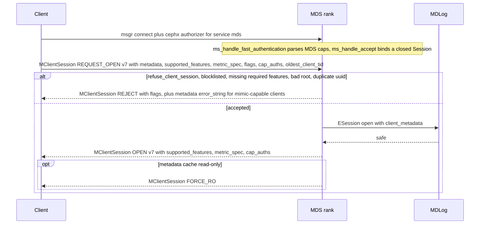
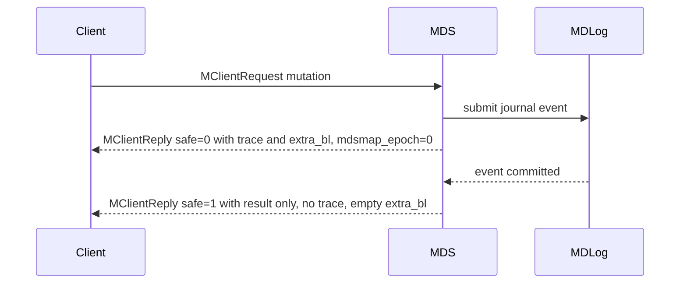
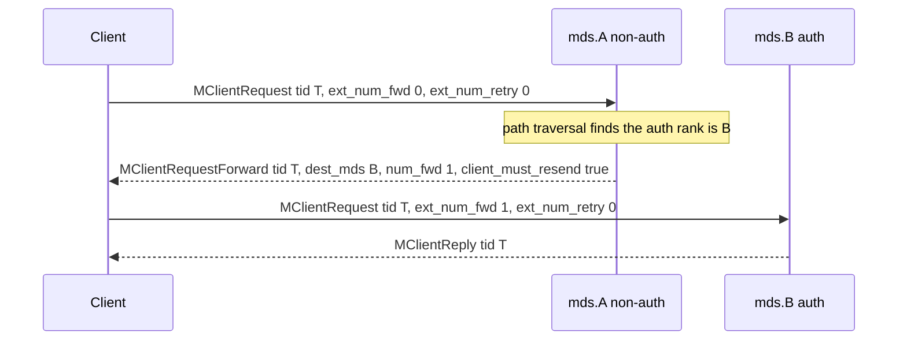

# Client wire protocol: messages, op codes, encodings, feature bits, forwarding

> Part of the C++ MDS project map ([README](../README.md)). Sources (approximate LOC):
> `src/include/ceph_fs.h` (1.1k), `src/common/ceph_fs.cc` (190), `src/include/cephfs/types.h` (1.3k),
> `src/mds/cephfs_features.{h,cc}` (200), `src/include/ceph_features.h` (290), `src/messages/MClient*.h` (~2.4k),
> `src/messages/MQuarantineDisable.h` (60), `src/include/cephfs/metrics/Types.h` (940), `src/mds/mdstypes.{h,cc}` (feature_bitset_t, metric_spec_t, cap_reconnect_t),
> `src/mds/CInode.cc` (`CInode::encode_inodestat`, ~450), `src/mds/Server.cc` (session, reply and dispatch paths, ~1.5k of 12.9k),
> `src/mds/MDSRank.cc` / `src/mds/MDSDaemon.cc` (dispatch and send helpers), `src/ceph_mds.cc` (messenger policy).
> Kernel client cross-check: `linux/fs/ceph/mds_client.{c,h}`, `linux/fs/ceph/caps.c`, `linux/fs/ceph/metric.{c,h}`, `linux/include/linux/ceph/ceph_fs.h` (Linux 7.3 snapshot; its Makefile says `7.3.0-rc6`).
> 3.6.1 summarizes [kclient expectations 7.1](kclient-expectations.md#71-client-generations-and-protocol-fallbacks), which also reads older upstream Linux tags (`linux-<tag>/...`), two CentOS Stream kernels and the Ceph release tags of this repository (`<tag>:<path>`).
> Related: [sessions](sessions.md), [capabilities](capabilities.md), [leases, lock caches and async dirops](leases-lock-caches-and-async-dirops.md),
> [kclient expectations](kclient-expectations.md), [libcephfs/ceph-fuse/Ganesha expectations](libcephfs-fuse-ganesha-expectations.md),
> [request lifecycle](../03-request-path/request-lifecycle.md), [process and threading](../00-architecture/process-and-threading.md),
> [auth and MDS caps](../01-cluster-integration/auth-and-mds-caps.md), [snapshots](../10-snapshots-quotas-subvolumes/snapshots.md),
> [metrics](../12-qos-metrics-quiesce-quarantine/metrics-and-subvolume-metrics.md), [quarantine](../12-qos-metrics-quiesce-quarantine/quarantine.md).

## 1. Purpose and responsibilities

This page is the byte-level and message-level reference for everything that crosses the wire between a CephFS client
(Linux kernel client, libcephfs / ceph-fuse / NFS-Ganesha) and an MDS rank. It covers:

- the transport facts the client depends on (messenger protocol version, policies, entity names, cephx, how a
  connection becomes a `Session`);
- the catalog of client message types (`CEPH_MSG_CLIENT_*`), their direction, message versions, segments and the
  MDS entry point;
- the field-level encoding of every client message, including all version-conditional fields;
- the complete `CEPH_MDS_OP_*` table and the per-op use of the request argument union, `path`, `path2` and the data segment;
- the reply format: reply head, trace (`InodeStat`, `DirStat`, `LeaseStat`), snap trace, `extra_bl` per op, safe vs unsafe replies, error-code conventions;
- the CephFS feature-bit system (`CEPHFS_FEATURE_*`), how it is exchanged in session open, `required_client_features`,
  and every MDS behaviour gated on a feature bit; plus the connection-level `CEPH_FEATURE_*` bits the MDS consults;
- request forwarding (`MClientRequestForward`), retry (`num_retry`), replay (`CEPH_MDS_FLAG_REPLAY`) and the idempotency
  machinery (completed requests) as far as it is visible on the wire.

Semantics of individual messages (cap state machines, session states, lease rules, snaprealm logic, quota, metrics
aggregation) are only summarised here; they are owned by the pages linked above.

## 2. Source map

| File | Class / function | Lines | Role |
|---|---|---|---|
| `src/include/ceph_fs.h` | message type numbers | 152-169 | `CEPH_MSG_CLIENT_*` numbers |
| `src/include/ceph_fs.h` | `CEPH_SESSION_*` enum, `ceph_mds_session_head` | 358-387 | session ops and fixed session head |
| `src/include/ceph_fs.h` | `CEPH_MDS_OP_*` enum, `IS_CEPH_MDS_OP_NEWINODE` | 396-456 | op codes |
| `src/include/ceph_fs.h` | `CEPH_SETATTR_*`, `CEPH_SNAPDIFF_*`, `CEPH_O_*`, `CEPH_XATTR_*`, `CEPH_READDIR_*` | 460-526 | argument flag spaces |
| `src/include/ceph_fs.h` | `ceph_mds_request_args_legacy`, `ceph_mds_request_head_legacy` | 529-599 | pre-v4 request head |
| `src/include/ceph_fs.h` | `CEPH_MDS_FLAG_*` | 584-586 | request flags |
| `src/include/ceph_fs.h` | `ceph_mds_request_args`, `ceph_mds_request_head` | 605-706 | current request head (v1..v3) |
| `src/include/ceph_fs.h` | `ceph_mds_request_release` | 712-718 | piggy-backed cap/lease release |
| `src/include/ceph_fs.h` | `ceph_mds_reply_head`, `ceph_mds_reply_cap`, `ceph_mds_reply_lease`, `ceph_mds_reply_dirfrag` | 739-788 | reply fixed structs |
| `src/include/ceph_fs.h` | `ceph_filelock`, `CEPH_LOCK_*` rules/types | 790-806 | fcntl/flock wire record |
| `src/include/ceph_fs.h` | cap bits, `CEPH_CAP_OP_*`, `ceph_mds_caps_head` and bodies, `ceph_mds_cap_item` | 823-992 | caps message structs |
| `src/include/ceph_fs.h` | `CEPH_MDS_LEASE_*`, `ceph_mds_lease` | 994-1010 | lease message |
| `src/include/ceph_fs.h` | `ceph_mds_cap_reconnect`, `ceph_mds_snaprealm_reconnect` | 1013-1037 | reconnect records |
| `src/include/ceph_fs.h` | `CEPH_SNAP_OP_*`, `ceph_mds_snap_head`, `ceph_mds_snap_realm` | 1042-1073 | snap message and trace |
| `src/common/ceph_fs.cc` | `encode/decode(ceph_mds_request_head)` | 14-114 | versioned head codec with `struct_len` skip |
| `src/common/ceph_fs.cc` | `ceph_flags_to_mode`, `ceph_caps_for_mode`, `ceph_flags_sys2wire` | 116-190 | open-flag helpers |
| `src/include/ceph_fs_encoder.h` | `WRITE_RAW_ENCODER(...)` | 21-40 | which structs are memcpy-encoded |
| `src/include/cephfs/types.h` | `charmap_md_t`, `quarantine_md_t`, `optmetadata_singleton`, `optmetadata_multiton` | 243-742 | optional inode metadata carried in `InodeStat` v8 |
| `src/include/cephfs/types.h` | `quota_info_t` | 332-368 | quota encoding (reply, `MClientQuota`) |
| `src/mds/cephfs_features.h` | `CEPHFS_FEATURE_*`, `CEPHFS_FEATURES_ALL`, `CEPHFS_METRIC_FEATURES_ALL` | 31-105 | CephFS feature bits |
| `src/mds/cephfs_features.cc` | `feature_names`, `cephfs_feature_name/from_name` | 13-60 | names used by mon commands and dumps |
| `src/include/ceph_features.h` | `DEFINE_CEPH_FEATURE(...)`, `CEPH_FEATURES_ALL` | 85-261 | connection-level feature bits |
| `src/mds/mdstypes.h/.cc` | `feature_bitset_t` | h:203-270, cc:532-555 | variable-length feature bitmap codec |
| `src/mds/mdstypes.h/.cc` | `metric_spec_t`, `client_metadata_t`, `session_info_t::has_feature` | h:272-385, cc:592-646 | session metadata/feature containers |
| `src/mds/mdstypes.h/.cc` | `cap_reconnect_t`, `snaprealm_reconnect_t`, `old_cap_reconnect_t` | h:480-570, cc:978-1260 | reconnect payload records |
| `src/mds/MDSDmclockScheduler.cc` | `handle_client_request`, `submit_request_to_mds`, `get_volume_id` | 53-111 | optional QoS queue between `Server::dispatch` and `Server::handle_client_request` |
| `src/mds/MDSAuthCaps.h` | `MDSCapMatch::encode`, `MDSCapAuth::encode`, `get_cap_auths` | 174-231, 304-311 | `cap_auths` sent in session OPEN |
| `src/messages/MClientSession.h` | `MClientSession` | 24-121 | session control |
| `src/messages/MClientRequest.h` | `MClientRequest`, `MClientRequest::Release`, `SnapPayload` | 57-416 | metadata request |
| `src/messages/MClientReply.h` | `LeaseStat`, `DirStat`, `InodeStat`, `openc_response_t`, `MClientReply` | 51-463 | reply and its sub-encodings (decoders) |
| `src/messages/MClientRequestForward.h` | `MClientRequestForward` | 22-73 | forward notification |
| `src/messages/MClientReconnect.h` | `MClientReconnect` | 24-176 | cap/realm reconnect |
| `src/messages/MClientCaps.h` | `MClientCaps` | 24-392 | cap grant/revoke/flush |
| `src/messages/MClientCapRelease.h` | `MClientCapRelease` | 23-69 | batched cap release |
| `src/messages/MClientLease.h` | `MClientLease` | 24-96 | dentry lease control |
| `src/messages/MClientSnap.h` | `MClientSnap` | 21-72 | snaprealm update/split |
| `src/messages/MClientQuota.h` | `MClientQuota` | 7-55 | quota/rstat push |
| `src/messages/MClientMetrics.h` | `MClientMetrics` | 12-59 | client metrics upload |
| `src/include/cephfs/metrics/Types.h` | `ClientMetricType`, payload structs, `ClientMetricMessage` | 20-944 | metrics payload codec |
| `src/messages/MClientReclaim.h`, `MClientReclaimReply.h` | `MClientReclaim`, `MClientReclaimReply` | 22-67, 22-74 | session reclaim (Ganesha) |
| `src/messages/MQuarantineDisable.h` | `MQuarantineDisable` | 22-57 | quarantine lift notification |
| `src/mds/CInode.cc` | `CInode::encode_inodestat` | 3959-4429 | builds `InodeStat` (both encodings), issues caps |
| `src/mds/CInode.cc` | `CInode::encode_cap_message` | 4432-4495 | fills `MClientCaps` inode fields |
| `src/mds/CDir.cc` | `CDir::encode_dirstat` | 3058-3071 | builds `DirStat` |
| `src/mds/Locker.cc` | `Locker::issue_client_lease`, `Locker::encode_lease` | 4542-4626 | builds `LeaseStat` |
| `src/mds/Server.cc` | `Server::dispatch` | 319-436 | client message routing, reconnect-state queuing |
| `src/mds/Server.cc` | `Server::handle_client_session`, `_session_logged` | 599-895, 925-1057 | session open/close/renew and feature exchange |
| `src/mds/Server.cc` | `Server::handle_client_reconnect`, `infer_supported_features`, `update_required_client_features` | 1591-1827 | reconnect, feature inference, required features |
| `src/mds/Server.cc` | `Server::early_reply`, `reply_client_request`, `set_trace_dist` | 2300-2561 | reply construction |
| `src/mds/Server.cc` | `Server::set_reply_extra_bl`, `handle_client_request`, `dispatch_client_request` | 2591-2969 | created-ino reply, idempotency, op dispatch table |
| `src/mds/Server.cc` | `Server::get_snap_trace` | 12429-12442 | old vs new snap trace selection |
| `src/mds/MDSRank.cc` | `MDSRank::is_valid_message`, `handle_message` | 1191-1307 | per-type routing and peer-type filters |
| `src/mds/MDSRank.cc` | `MDSRank::get_session`, `forward_message_mds`, `send_message_client(_counted)` | 1417-1571 | session lookup, forwarding, send helpers |
| `src/mds/MDSDaemon.cc` | `ms_dispatch2`, `ms_handle_fast_authentication`, `ms_handle_accept`, `ms_handle_reset` | 1088-1320 | lock acquisition, connection-to-Session binding |
| `src/mds/MetricsHandler.cc` | `MetricsHandler::ms_dispatch2`, `handle_client_metrics` | 46-62, 418-444 | metrics fast path (no `mds_lock`) |
| `src/ceph_mds.cc` | messenger creation and policies | 171-191 | transport policy per peer type |

## 3. How it works

### 3.1 Transport layer

- **Messenger and protocol version.** The MDS creates one public messenger named `mds.-1` with a random nonce
  (`src/ceph_mds.cc:172`) and sets the cluster protocol to `CEPH_MDS_PROTOCOL` = 36 (`src/mds/MDSDaemon.h:30`).
  For client peers the public protocol version is `CEPH_MDSC_PROTOCOL` = 32 (`src/include/ceph_fs.h:48`,
  selected in `src/msg/async/AsyncMessenger.cc:1111 (AsyncMessenger::get_proto_version)`). The protocol number is
  only negotiated by msgr v1 (`src/msg/async/ProtocolV1.cc:2011-2013`, `CEPH_MSGR_TAG_BADPROTOVER`); the kernel v1 code
  sends 32 when connecting to an MDS (`linux/net/ceph/messenger_v1.c:386`). msgr v2 has no protocol-number check.
- **Bind addresses and modes.** Defaults bind both v1 and v2 (`ms_bind_msgr1` = true, `ms_bind_msgr2` = true,
  `src/common/options/global.yaml.in:1274,1281`). Client-facing msgr2 modes default to `ms_service_mode` = `crc secure`.
  The kernel picks v1/v2 and crc/secure from its `ms_mode` mount option. `mount.ceph` passes `ms_mode=prefer-crc` for the new device syntax (`src/mount/mount.ceph.c:43`, `:306-309`); a kernel mounted without the option uses v1 (kernel side, see [kclient expectations](kclient-expectations.md) and [transport 1](../00-architecture/transport-auth-and-client-library-contract.md#1-purpose-and-responsibilities)).
  Clients learn MDS addresses (an `entity_addrvec_t` per rank) from the MDSMap they get from the monitors, never from the MDS.
- **Policies** (`src/ceph_mds.cc:184-191`): clients `stateful_server(0)` (lossless, server side never reconnects,
  standby when idle, reset detection; **no required connection features**), MDS peers `lossless_peer(CEPH_FEATURE_UID)`,
  mons `lossy_client(UID|PGID64)`, everything else `lossy_client(CEPH_FEATURE_OSDREPLYMUX)`.
- **Authentication.** `auth_service_required` defaults to `cephx` (`global.yaml.in:2227`). The client presents a cephx
  authorizer for service type `mds`; `MDSDaemon::ms_handle_fast_authentication` (`src/mds/MDSDaemon.cc:1259`) parses
  the `mds` caps string from the ticket into `MDSAuthCaps` without `mds_lock`; a parse failure returns `false`, which
  fails authentication (`src/msg/Dispatcher.h:242-247`). Message signing follows `cephx_sign_messages` (default true).
- **Connection to Session binding.** `MDSDaemon::ms_handle_accept` (`src/mds/MDSDaemon.cc:1266`) runs under `mds_lock`,
  looks up an existing `Session` by `entity_name_t(peer_type, peer_global_id)` (i.e. `client.<global_id>`) or creates a
  new closed `Session`, stores it in `Connection::priv`, re-parses the caps into `Session::auth_caps`, and flushes any
  messages queued in `Session::preopen_out_queue`. Every later client message finds its session via
  `MDSRank::get_session` (`src/mds/MDSRank.cc:1417`), which reads `Connection::priv`; for `CEPH_MSG_CLIENT_SESSION` it can
  swap in an imported open session with the same name. **The client identity is the cephx global id**; one session per
  client entity per rank.
- **Entity types.** Clients see the MDS as `CEPH_ENTITY_TYPE_MDS` (0x02); the MDS accepts session, reconnect, reclaim,
  caps, cap-release and lease messages only from `CEPH_ENTITY_TYPE_CLIENT` (0x08) peers (`src/include/msgr.h:91-95`,
  `MDSRank::handle_message`), and metrics only from client peers (`MetricsHandler::ms_dispatch2`). `ceph tell mds.*` commands also arrive over the messenger from client-type entities
  (`MSG_COMMAND`, handled by `MDSDaemon::handle_core_message`, `MDSDaemon.cc:1130`; see [admin commands](../13-admin-and-config/admin-commands.md)).
- **MDS entity name seen by clients.** Once a rank is held the messenger name becomes `mds.<rank>`
  (`src/mds/MDSRank.cc:2349`), `mds.<gid>` while in standby-replay (`:2346`), `mds.-1` (`MDS_RANK_NONE`) before
  (`src/mds/MDSDaemon.cc:738`). libcephfs derives the sending rank from `m->get_source().num()` (e.g.
  `src/client/Client.cc` `Client::handle_client_session`, `handle_client_request_forward`); the kernel keys on the
  connection (`linux/fs/ceph/mds_client.c:7198 (mds_dispatch)`).
- **Message header fields used by this protocol:** `type`, `version`, `compat_version`, `tid`, `priority`,
  `front_len`, `middle_len`, `data_len`, `src` (`src/include/msgr.h:186-222`). `tid` carries the client request tid
  (requests, replies, forwards) and the cap-flush tid (`MClientCaps`). Only three client messages use non-front
  segments: `MClientCaps` (middle = xattr blob), `MClientRequest` (data = op-specific blob), `MClientReconnect`
  (data = whole payload).
- **Decode failures.** Userspace peers decode in the messenger worker thread (`src/msg/Message.cc:1015
  (decode_message)`); an unknown type, a `compat_version` above the local `version`, or a `buffer::error` returns
  null and the v2 protocol faults the connection (`src/msg/async/ProtocolV2.cc:1446-1452`). A `ceph_assert` inside a
  `decode_payload` is not a `buffer::error` and aborts the receiving process instead: `MClientCaps` asserts
  `middle.length() == head.xattr_len` (`MClientCaps.h:260`), and `MClientReply`, `MClientSnap`, `MClientQuota` assert that
  the front was consumed exactly (`MClientReply.h:417`, `MClientSnap.h:65`, `MClientQuota.h:48`); see 8. The kernel
  instead logs and drops unknown types (`linux/fs/ceph/mds_client.c:7243`).

### 3.2 Encoding primitives

All multi-byte integers are little endian. Unless a struct is listed as raw (memcpy of a packed C struct, see
`src/include/ceph_fs_encoder.h:21-40`), Ceph's `encode()` conventions apply:

| Wire type | Encoding |
|---|---|
| `bool` | `u8` 0/1 |
| `std::string`, `bufferlist`, `std::vector<u8>` | `u32 len` + bytes |
| `vector<T>`, `set<T>`, `list<T>` | `u32 count` + elements |
| `map<K,V>` | `u32 count` + (`K`,`V`) pairs |
| `interval_set<T>` (e.g. delegated inos) | `u32 count` + (`start`,`len`) pairs |
| `utime_t` / `ceph_timespec` | `u32 sec` + `u32 nsec` (8 bytes) |
| `inodeno_t`, `snapid_t`, `version_t`, `ceph_tid_t` | `u64` |
| `frag_t` | `u32`; `fragtree_t` = `map<frag_t,i32 split_bits>` (`src/common/frag.cc:144`) |
| `mds_rank_t` | `i32` |
| `std::tuple<...>` | fields back to back, no header (`src/include/encoding.h:653`) |
| `ENCODE_START(v, compat)` | `u8 struct_v`, `u8 struct_compat`, `u32 struct_len` (bytes that follow) |
| `filepath` | `u8 struct_v`(=1), `u64 ino`, `string path` (`src/include/filepath.cc:120`); `ino`=0 means "relative" |
| `feature_bitset_t` | `u32 byte_len` + `byte_len/8` `u64` words (bit `n` = word `n/64`, bit `n%64`); a non-multiple-of-8 tail is tolerated on decode (`src/mds/mdstypes.cc:532-555`) |
| `metric_spec_t` | `ENCODE_START(1,1)` { `feature_bitset_t metric_flags` } (`src/mds/mdstypes.cc:592`) |
| `entity_addrvec_t` | feature-dependent standard Ceph address vector encoding |
| errors in `MClientReply.result` | `errorcode32_t`: host errno converted with `hostos_to_ceph_errno` (identity on Linux; `src/include/platform_errno.h`) so the wire carries Linux errno values |

### 3.3 Message catalog

| Type | Symbol | Class | Direction | HEAD / COMPAT | Segments | MDS entry point / sender | Counted in `push_seq` |
|---|---|---|---|---|---|---|---|
| 22 | `CEPH_MSG_CLIENT_SESSION` | `MClientSession` | both | 7 / 1 (sent as v1 when `metadata` and `supported_features` are empty) | front | `Server::handle_client_session` (`Server.cc:599`) | no |
| 23 | `CEPH_MSG_CLIENT_RECONNECT` | `MClientReconnect` | C to M | 5 / 4 (sender may use 1..5) | **data** | `Server::handle_client_reconnect` (`Server.cc:1591`) | n/a |
| 24 | `CEPH_MSG_CLIENT_REQUEST` | `MClientRequest` | C to M (also M to M, internal) | 6 / 1 | front + data | `MDSDmclockScheduler::handle_client_request` then `Server::handle_client_request` (`Server.cc:2616`) | n/a |
| 25 | `CEPH_MSG_CLIENT_REQUEST_FORWARD` | `MClientRequestForward` | M to C | 1 / 0 | front | `MDSRank::forward_message_mds` (`MDSRank.cc:1504`) | no |
| 26 | `CEPH_MSG_CLIENT_REPLY` | `MClientReply` | M to C (also M to M) | 1 / 0 | front | `Server::early_reply`, `Server::reply_client_request` | no |
| 27 | `CEPH_MSG_CLIENT_RECLAIM` | `MClientReclaim` | C to M | 1 / 1 | front | `Server::handle_client_reclaim` (`Server.cc:561`) | n/a |
| 28 | `CEPH_MSG_CLIENT_RECLAIM_REPLY` | `MClientReclaimReply` | M to C | 1 / 1 | front | `Server::reclaim_session`, `finish_reclaim_session` | no |
| 29 | `CEPH_MSG_CLIENT_METRICS` | `MClientMetrics` | C to M | 1 / 1, priority `CEPH_MSG_PRIO_HIGH-1` | front | `MetricsHandler::ms_dispatch2` (`MetricsHandler.cc:46`) | n/a |
| 0x310 | `CEPH_MSG_CLIENT_CAPS` | `MClientCaps` | both | 14 / 1 | front + **middle** (xattrs) | `Locker::handle_client_caps` (`Locker.cc:3386`) | yes (M to C) |
| 0x311 | `CEPH_MSG_CLIENT_LEASE` | `MClientLease` | both | 1 / 0 | front | `Locker::handle_client_lease` (`Locker.cc:4472`) | yes |
| 0x312 | `CEPH_MSG_CLIENT_SNAP` | `MClientSnap` | M to C | 1 / 0 | front | `MDCache::send_snaps` (`MDCache.cc:5779`) and others | yes |
| 0x313 | `CEPH_MSG_CLIENT_CAPRELEASE` | `MClientCapRelease` | C to M | 2 / 1 | front | `Locker::handle_client_cap_release` (`Locker.cc:4258`) | n/a |
| 0x314 | `CEPH_MSG_CLIENT_QUOTA` | `MClientQuota` | M to C | 1 / 0 | front | `MDCache::broadcast_quota_to_client` (`MDCache.cc:2103`) | yes |
| 0x315 | `CEPH_MSG_CLIENT_QUARANTINE_DISABLE` | `MQuarantineDisable` | M to C | 1 / 1 | front | `MDCache::dispatch_quiesce_inode` (quarantine mode), `MDCache::start_revoke_caps_for_inode` | yes |

Notes:
- `CEPH_MSG_MDS_MAP` (21) and `CEPH_MSG_FS_MAP_USER` (103) reach clients from the monitors; the C++ MDS sends
  `MMDSMap` only to MDS peers (`MDSRank.cc:1490`, `:2555`). The kernel nevertheless accepts both types on an MDS
  connection (`linux/fs/ceph/mds_client.c:7215-7219`).
- Peer-type filters (`MDSRank::handle_message`, `MDSRank.cc:1231`): `SESSION`, `RECONNECT`, `RECLAIM`, `CAPS`,
  `CAPRELEASE`, `LEASE` are accepted only from `CEPH_ENTITY_TYPE_CLIENT`; `REQUEST` and `REPLY` are not filtered
  because MDS ranks also exchange them (stray reintegration/migration renames `StrayManager.cc:697,729`, quota realm
  creation `Server.cc:6262 (Server::create_quota_realm)`, replies handled by `Server::handle_client_reply`, `Server.cc:2730`).
- "Counted" messages are sent with `MDSRank::send_message_client_counted` (`MDSRank.cc:1551`), which increments
  `Session::cap_push_seq`; the client increments its own session sequence for every caps, lease, snap and quota message it
  receives (kernel `inc_session_sequence`, `linux/fs/ceph/mds_client.c:6229`, reached through
  `ceph_inc_mds_stopping_blocker`, `super.c:1524`, which `caps.c:4440`, `quota.c:51`, `snap.c:1036` and `mds_client.c:6051`
  call before decoding; libcephfs `Client::got_mds_push`, `src/client/Client.cc:3648`, called from
  `handle_lease`, `handle_snap`, `handle_quota`, `handle_caps`). The two counters must agree for `REQUEST_CLOSE`
  (see 3.11.1). `MQuarantineDisable` is counted by the MDS but not by libcephfs (see 8).

### 3.4 Session open and feature exchange



Step by step (`Server::handle_client_session`, `Server.cc:599-822`, `_session_logged`, `Server.cc:925-979`):

1. No session on the connection: reply `REJECT` with `metadata["error_string"]="sessionless"` on the raw connection.
2. Session not allowed on this file system (`Session::fs_name_capable(fs_name, MAY_READ)` false): `REJECT` with an
   error string naming the file system. These two REJECTs and the `refuse_client_session` one below always carry
   `error_string` (so they are encoded as v7); every other REJECT goes through `send_reject_message`
   (`Server.cc:720-726`), which adds `error_string` only if the client advertised `CEPHFS_FEATURE_MIMIC`.
3. State gating: `REQUEST_RENEWCAPS` is always handled; `REQUEST_CLOSE` waits for `up:active`; every other op waits for
   `up:clientreplay` (`wait_for_replay`).
4. `REQUEST_OPEN`:
   - `CEPH_MDSMAP_REFUSE_CLIENT_SESSION` set: `REJECT` with an explanatory `error_string`.
   - Session `closing`: wait for the journal to be safe and retry. Session `opening/open/stale/killing` (or server
     terminating sessions): if the request advertises `CEPHFS_FEATURE_NOTIFY_SESSION_STATE` and the session is open and the
     rank is not stopping, re-send `OPEN` (seq = current `push_seq`, `supported_features` if the client has `MIMIC`,
     `cap_auths`, but **no** `metric_spec`) plus `FORCE_RO` if read-only; otherwise drop silently (`Server.cc:663-686`).
   - Rank stopping: drop.
   - `client_metadata_t(metadata, supported_features, metric_spec)` is stored on the session.
   - Blocklisted address (OSDMap): `REJECT`, `metadata["error_string"]="blocklisted (blacklisted)"` (MIMIC clients only),
     `flags = MClientSession::SESSION_BLOCKLISTED` (`Server.cc:727-743`). The kernel detects blocklisting by the substring
     `blacklisted` in `error_string` (it parses the metadata map only in v3/v4 messages) or by the flag (v5+)
     (`linux/fs/ceph/mds_client.c:4360-4385, 4417-4449`).
   - Empty feature set: `Server::infer_supported_features` (`Server.cc:1770`) synthesises bits 0..N from
     `ceph_version`/`kernel_version` metadata and connection features (`CEPHFS_FEATURE_LUMINOUS`/`KRAKEN`/`JEWEL`).
   - `missing = required_client_features - client_features`; non-empty: `REJECT` with
     `error_string = "missing required features '<hex>'"` and a cluster-log warning.
   - Root-squash in caps but no `CEPHFS_FEATURE_MDS_AUTH_CAPS_CHECK`: session is added to the "broken root squash"
     list (health warning), open continues.
   - `metadata["root"]` must start with `/` and be within the cap path (`MDSAuthCaps::path_capable`), else `REJECT`.
   - `metadata["uuid"]` already used by another session: `REJECT` "duplicated session uuid".
   - Session added to `SessionMap`, state `OPENING`, `ESession(open)` journaled, `mdlog->flush()`.
5. After the journal commit (`_session_logged`): state `OPEN`, session registered with the dmClock scheduler and
   `MetricsHandler`, then `OPEN` is sent. Only if the client has `CEPHFS_FEATURE_MIMIC` does the reply carry
   `supported_features = CEPHFS_FEATURES_MDS_SUPPORTED` (bits 0..24, i.e. word `0x0000000001ffffff`) and
   `metric_spec = CEPHFS_METRIC_FEATURES_ALL` (bits 0..16, `0x1ffff`) (`Server.cc:309-310, 970-974`). `cap_auths`
   is always filled (`MDSAuthCaps::get_cap_auths`, one `MDSCapAuth` per grant) but is only encoded in v7 messages.
6. A successful reconnect (`Server::handle_client_reconnect`, `Server.cc:1691-1700`) and a force-opened imported session
   (`Server::finish_force_open_sessions`, `Server.cc:1130-1139`) also send `OPEN` with the same feature payload.
7. `Server::update_required_client_features` (`Server.cc:1799-1826`) runs when a new MDSMap changes the required
   bitmap: once the rank is at least `up:reconnect`, client sessions that now miss a required bit and are not already
   blocklisted are evicted (and blocklisted if `mds_session_blocklist_on_evict`). A reconnect from a session missing a
   required bit is answered with `CLOSE` (`Server.cc:1650-1661`).

The client side stores the MDS feature set only from `OPEN` messages, and both clients overwrite it on every `OPEN`,
duplicates included: kernel `session->s_features` is the **first 64 bits** of the bitmap
(`linux/fs/ceph/mds_client.c:4425-4432, 4549`); libcephfs stores the full `feature_bitset_t` and
`metric_spec.metric_flags` (`src/client/Client.cc:2688-2728`, `reinit_mds_features`). Because the duplicate-`OPEN`
reply carries no `metric_spec`, it clears libcephfs's copy of the MDS metric spec (derived from code, see 8).

**Session metadata keys.** The kernel sends `hostname`, `kernel_version`, `entity_id`, `root` (always; `/` when no
server path) (`linux/fs/ceph/mds_client.c:1651-1656`); libcephfs sends `hostname`, `pid`, `entity_id`, `root` (when a
mount root is set), `ceph_version`, `ceph_sha1`, any `client_metadata` config pairs, and `uuid`/`timeout` when set
through `ceph_set_uuid`/`ceph_set_session_timeout` (`src/client/Client.cc:2579-2624, 18640, 18855`). The MDS consumes:
`root` (cap check, dmClock volume id `MDSDmclockScheduler::get_volume_id`, `MDSDmclockScheduler.cc:53`), `uuid`
(duplicate check, reclaim lookup `Server::find_session_by_uuid`), `ceph_version`/`kernel_version` (feature inference),
`hostname` (`SessionMap.cc:1079`, display), `timeout` (per-session autoclose/reconnect timeout, `Server.cc:1272, 1904`).

### 3.5 CephFS feature bits (`CEPHFS_FEATURE_*`)

Bits live in a `feature_bitset_t` (variable-length bitmap) exchanged in `MClientSession` v3+. The MDS advertises
`CEPHFS_FEATURES_ALL` (`src/mds/cephfs_features.h:58-82`); libcephfs advertises the same set unless
`client_debug_inject_features` overrides it (`src/client/Client.cc:448-452`). 3.6.1 lists the first Linux and Ceph
releases that send each bit.

| Bit | Name (`cephfs_feature_name`) | MDS behaviour gated on the **client's** bit | Kernel 7.3 advertises | Client-side use of the **MDS's** bit |
|---|---|---|---|---|
| 0-4 | reserved | none | yes (0-7 always set) | none |
| 5 | `jewel` | release marker; `MDSMap::set_min_compat_client` replaces `required_client_features` with the single marker bit 5, 6, 7, 8, 12 or 13 for jewel .. octopus+ (`MDSMap.cc:1328-1351`) | yes | none |
| 6 | `kraken` | release marker | yes | none |
| 7 | `luminous` | release marker | yes | none |
| 8 | `mimic` | session messages carry metadata/features: OPEN includes `supported_features` and (except the duplicate-OPEN reply) `metric_spec`; REJECTs sent through `send_reject_message` include `error_string` (`Server.cc:674,722,971,1131,1694`). Without it OPEN is sent as v1 | yes | none |
| 9 | `reply_encoding` | `InodeStat`/`DirStat`/`LeaseStat` use versioned `ENCODE_START` encodings instead of connection-feature-conditional ones (`CInode.cc:4315`, `CDir.cc:3059`, `Locker.cc:4612`) | yes | kernel/libcephfs choose the versioned parser (`mds_client.c:4153`, `Client.cc:1579,1816`) |
| 10 | `reclaim_client` | none (MDS always handles `MClientReclaim`) | **no** | libcephfs refuses reclaim with `-EOPNOTSUPP` if absent (`Client.cc:18913`) |
| 11 | `lazy_caps_wanted` | on stale-session resume only "notable" caps are re-issued (`Locker::resume_stale_caps`, `Locker.cc:2849`) | yes | none |
| 12 | `multi_reconnect` (= `NAUTILUS`) | none explicit (MDS always understands the reconnect `more` flag) | yes | clients split reconnect into several messages only if the MDS has it (`mds_client.c:5241`, `Client.cc:3460`) |
| 13 | `deleg_ino` (= `OCTOPUS`) | create replies carry `openc_response_t` with delegated inode ranges when the MDS-side `mds_allow_async_dirops` member is true, else a raw `u64` (`Server.cc:2595-2613`) | yes | both clients pick the `openc_response_t` parser from the **MDS's** bit, not from the reply (`mds_client.c:770-778`, `Client.cc:2159`; mismatch in 8); the kernel would use the delegated inos for async create, but against the C++ MDS at this commit it never does, because `Dc` is never granted ([async dirops §8 G1](leases-lock-caches-and-async-dirops.md#8-edge-cases-failure-handling-and-gotchas)); libcephfs discards them |
| 14 | `metric_collect` | none (MDS always accepts `MClientMetrics`) | yes | clients send metrics only to an MDS with this bit (`metric.c:356`, `Client.cc:7657`) |
| 15 | `alternate_name` | none explicit (MDS always decodes `alternate_name` in requests v5+ and sends it in `LeaseStat` v2) | yes | kernel allows setting an fscrypt policy only if the first MDS session has it (`vet_mds_for_fscrypt`, `ioctl.c:288-305`) |
| 16 | `notify_session_state` | duplicate `REQUEST_OPEN` on an open session is answered with `OPEN` instead of being dropped (`Server.cc:668`) | yes | none |
| 17 | `op_getvxattr` | none (MDS always handles `GETVXATTR`) | yes | clients only send `CEPH_MDS_OP_GETVXATTR` if set, else `-EOPNOTSUPP` locally (`inode.c:3061`, `mds_client.c:3718`, `Client.cc:8464`) |
| 18 | `32bits_retry_fwd` | none (MDS decodes by `head.version`) | yes | clients send request head v2+ and use 32-bit retry/fwd counters; without it they cap retries at 256 (`MClientRequest.h:321`, `mds_client.c:3160-3169, 3507-3520`) |
| 19 | `new_snaprealm_info` | snap traces use `SnapRealmInfoNew` (`Server::get_snap_trace`, `Server.cc:12429`) | **no** | libcephfs parses the new format (`Client.cc:5514`) |
| 20 | `has_owner_uidgid` | none (MDS decodes by `head.version`) | yes | clients send head v3 with `owner_uid/gid` (`MClientRequest.h:323`, `mds_client.c:3165`); kernel refuses idmapped-mount creates without it unless `enable_unsafe_idmap` (`mds_client.c:3323-3342`) |
| 21 | `client_mds_auth_caps` (`MDS_AUTH_CAPS_CHECK`) | sessions with root_squash caps but without this bit are flagged (`Server.cc:771, 1666`) | yes | no explicit test of the MDS bit; clients enforce the `cap_auths` list from OPEN locally (kernel `ceph_mds_check_access`, `mds_client.c:6590`; libcephfs `Client.cc:6329`) and libcephfs sends cap flushes with `caller_uid/gid = -1` (`Client.cc:4179-4189`) |
| 22 | `charmap` | create/mkdir/symlink/link/rename into a directory that has a charmap (case-insensitive/normalised) fail with `-EPERM` unless set (`Server::can_handle_charmap`, `Server.cc:4876`) | **yes, but meaning "SUBVOLUME_METRICS"** (see 8) | none in libcephfs |
| 23 | `blockdiff` | none | no | libcephfs requires it for `CEPH_MDS_OP_FILE_BLOCKDIFF` (`Client.cc:10567`) |
| 24 | `quarantine` | quarantined-inode access checks and `MQuarantineDisable` only for clients with the bit; others are blocked until quarantine is lifted (`Server.cc:3505, 3534`, `MDCache.cc:14100, 15295`) | no | libcephfs handles `MQuarantineDisable` (`Client.cc:3289`) |

`CEPHFS_FEATURE_MAX` = 24 (`cephfs_features.h:56`). `required_client_features` is a per-file-system `feature_bitset_t` in
the MDSMap, edited with `ceph fs required_client_features <fs> add|rm <name|bit>` (`src/mon/FSCommands.cc:966-1050`,
bit must be `0..CEPHFS_FEATURE_MAX`, the name `reserved` is refused) and by the deprecated
`ceph fs set <fs> min_compat_client <release>` (`FSCommands.cc:778-791`), which calls `MDSMap::set_min_compat_client`.
The MDS copies it in `Server::update_required_client_features` (`Server.cc:1799-1801`, called from
`MDSRankDispatcher::handle_mds_map` only when the bitmap changed, `MDSRank.cc:2357-2358`).

The metric spec (`CEPHFS_METRIC_FEATURES_ALL`, `cephfs_features.h:84-102`) is a separate bitmap of
`ClientMetricType` values 0..16 (`CAP_INFO` .. `SUBVOLUME_METRICS`). libcephfs sends metrics only to rank 0 and sends
subvolume metrics only if that MDS's metric spec has bit 16 (or its `_collect_and_send_global_metrics` override is set)
(`Client.cc:7650-7660, 7752-7753`); the kernel 7.3 snapshot instead keys on CephFS feature bit 22.

### 3.6 Connection-level features consulted by the client protocol

The MDS messenger advertises `CEPH_FEATURES_ALL` (`src/include/ceph_features.h:194-261`). Bits consulted on client
connections:

| Bit | Feature(s) | Where | Effect |
|---|---|---|---|
| 3 | `FLOCK` | `MClientCaps::encode_payload` (`MClientCaps.h:348`), `MClientReconnect` | without it caps are encoded as v1 (no flock blob) |
| 7 | `DIRLAYOUTHASH` | legacy `InodeStat` (`CInode.cc:4408`) | `dir_layout` present |
| 26 | `CREATEPOOLID` | `Server::handle_client_openc` (`Server.cc:4954`) | honour `args.open.pool` |
| 27 | `REPLY_CREATE_INODE` | `Server::set_reply_extra_bl` (`Server.cc:2609`) | raw `u64` created ino in `extra_bl` when the `openc_response_t` branch is not taken (client lacks `DELEG_INO`, or the `mds_allow_async_dirops` member is false) |
| 29 | `MDSENC` | `MClientReconnect` version selection | sender-chosen reconnect v3 |
| 37 | `EXPORT_PEER` | `MClientCaps` v3 (`MClientCaps.h:355`), `Server::flush_session` (`Server.cc:900`) | import peer record; FLUSHMSG only sent to such clients |
| 40 | `MDS_INLINE_DATA` | legacy `InodeStat`, `MClientCaps`, `Server::prepare_new_inode` (`Server.cc:3759`), `handle_client_open` (`Server.cc:4705`), `CInode.cc:3835` | inline data fields; opening an inline file without it is `-EPERM`; new inodes are not inline; caps lose `Fr/Fw` |
| 47 | `MDS_QUOTA` | legacy `InodeStat` | quota present |
| 58 | `FS_FILE_LAYOUT_V2` (shares bit with `CRUSH_TUNABLES5`, `NEW_OSDOPREPLY_ENCODING`) | legacy `InodeStat`, `Session::check_access` (`SessionMap.cc:1156-1162`), `CInode.cc:3837` | pool namespace field; a directory with a namespaced layout gives `-EIO` without it |
| 59 | `FS_BTIME` = `FS_CHANGE_ATTR` = `MSG_ADDR2` | `MClientRequest::encode_payload` (`MClientRequest.h:329`), legacy `InodeStat`, `Locker.cc:3995, 4067` | request head format; btime/change_attr in reply and accepted from cap flushes |
| 21 | `SERVER_LUMINOUS` | kernel only: `send_flush_mdlog` (`linux/fs/ceph/mds_client.c:6453`) | kernel sends `REQUEST_FLUSH_MDLOG` only if the MDS connection has it |
| 56, 58, 59 | `NEW_OSDOP_ENCODING`, `FS_FILE_LAYOUT_V2`, `FS_CHANGE_ATTR` | `Server::infer_supported_features` (`Server.cc:1770-1797`) | only for clients that sent an empty CephFS feature set: userspace whose `ceph_version` starts with `ceph version 12.` = luminous, other userspace with bit 59 = kraken, kernel with bit 56 = luminous, otherwise bit 58 = jewel (which clients: 3.6.1) |

The kernel advertises bit 59 under the name `MSG_ADDR2` and bit 58 under `CRUSH_TUNABLES5/NEW_OSDOPREPLY_ENCODING`
(`linux/include/linux/ceph/ceph_features.h:179-221`), so on a modern kernel the MDS sees `FS_BTIME` and
`FS_FILE_LAYOUT_V2` as present.

#### 3.6.1 Client generations: first releases per bit and per fallback

This is a compact matrix. The method, the per-cell code citations, the bit-22 analysis, the refusal mechanisms and the candidate minimum client generations are in [kclient expectations 7.1](kclient-expectations.md#71-client-generations-and-protocol-fallbacks). Sources: upstream Linux tags (fetched read-only, cited as `linux-<tag>/...`) and the Ceph release tags of this repository (`<tag>:<path>`). "Linux" is the first upstream release whose `CEPHFS_FEATURES_CLIENT_SUPPORTED` contains the bit. "Ceph" is the first stable release whose `CEPHFS_FEATURES_ALL` contains it, plus older-series point releases that carry a backport. libcephfs, ceph-fuse and the MDS of one release advertise the same set (`src/mds/cephfs_features.h:104-105`). Enterprise kernels backport CephFS changes: a CentOS Stream 8 kernel (`4.18.0-448.el8`) advertises the upstream v6.0 set and a CentOS Stream 9 kernel (`5.14.0-757.el9`) the upstream v6.10 set (kclient expectations 7.1.1).

| Bit | Name | First Linux | First Ceph |
|---|---|---|---|
| 5-7 | `jewel`, `kraken`, `luminous` | v4.19 (`linux-v4.19/fs/ceph/mds_client.h:22-27`); before that only inferred: 5 for v4.5-v4.18, 6-7 for v4.13-v4.18 | 13.2.2 (`v13.2.2:src/mds/cephfs_features.h:22-24`); older userspace only inferred |
| 8 | `mimic` | v4.19 (`linux-v4.19/fs/ceph/mds_client.h:20,24`) | 13.2.2 (`v13.2.2:src/mds/cephfs_features.h:25`) |
| 9 | `reply_encoding` | v5.1 (`linux-v5.1/fs/ceph/mds_client.h:29`) | 14.2.0 (`v14.2.0:src/mds/cephfs_features.h:26`) |
| 10 | `reclaim_client` | never | 14.2.0 |
| 11 | `lazy_caps_wanted` | v5.0 (`linux-v5.0/fs/ceph/mds_client.h:28`) | 13.2.7, 14.2.0 |
| 12 | `multi_reconnect` | v5.1 (`linux-v5.1/fs/ceph/mds_client.h:31`) | 14.2.0 |
| 13 | `deleg_ino` | v5.7 (`linux-v5.7/fs/ceph/mds_client.h:41`) | 15.2.0 |
| 14 | `metric_collect` | v5.9 (`linux-v5.9/fs/ceph/mds_client.h:47`) | 16.2.0 |
| 15 | `alternate_name` | v6.6 (`linux-v6.6/fs/ceph/mds_client.h:48`) | 16.2.0 |
| 16 | `notify_session_state` | v6.0 (`linux-v6.0/fs/ceph/mds_client.h:46`) | 16.2.11, 17.2.6, 18.2.0 |
| 17 | `op_getvxattr` | v6.1 (`linux-v6.1/fs/ceph/mds_client.h:48`); v5.18-v6.0 send the op without checking the bit | 16.2.11, 17.2.6, 18.2.0 |
| 18 | `32bits_retry_fwd` | v6.6 (`linux-v6.6/fs/ceph/mds_client.h:51`) | 16.2.14, 17.2.7, 18.2.0 |
| 19 | `new_snaprealm_info` | never | 17.2.8, 18.2.0 |
| 20 | `has_owner_uidgid` | v6.7 (`linux-v6.7/fs/ceph/mds_client.h:54`) | 17.2.8, 18.2.1, 19.2.0 |
| 21 | `client_mds_auth_caps` | v6.10 (`linux-v6.10/fs/ceph/mds_client.h:56`) | 18.2.4, 19.2.0 |
| 22 | `charmap` | v7.1, but meaning `SUBVOLUME_METRICS` (`linux-v7.1/fs/ceph/mds_client.h:40,59`) | 19.2.3, 20.2.0 |
| 23 | `blockdiff` | never | 19.2.3, 20.2.0 |
| 24 | `quarantine` | never | no tag yet (main only) |

Fallbacks the C++ MDS still carries, and the clients that need them, assuming an MDS that advertises every CephFS bit plus `FLOCK`, `EXPORT_PEER`, `MDSENC`, `REPLY_CREATE_INODE` and `FS_BTIME`. Of these rows, only the single-message reconnect is still sent by a current client (the 7.3 kernel sends one v3 message); every other row concerns older clients or legacy mount configurations:

| Fallback (MDS code) | Linux clients that use it | Ceph clients that use it |
|---|---|---|
| Legacy 88-byte request head, message version below 4 (`MClientRequest.h:271-296`) | up to v5.10, always (message v2) | 10.2.x and older |
| Request head v1 or v2 (`ceph_fs.cc:54-113`) | v1: v5.11-v6.5; v2: v6.6 | v1: up to 16.2.13 and 17.2.6; v2: 16.2.14-16.2.15, 17.2.7, 18.2.0 |
| Request message v2-v5 tails (`MClientRequest.h:300-309`) | v2: up to v5.10 (no `gid_list`); v3/v4: v5.11-v6.5 | v3: 10.2.x; v4: 11.x-15.x; v5: 16.x-17.x |
| Single-message reconnect v1-v3 (`MClientReconnect.h:139-170`) | v4.8+ send v3, older kernels v2; v5.1+ switch to v5 only above about 2 GiB of state | 13.x and older; 14.2.0+ send v5 to an MDS with bit 12 |
| Connection-feature-conditional `InodeStat`/`DirStat`/`LeaseStat` (`CInode.cc:4373-4427`, `CDir.cc:3058-3071`, `Locker.cc:4609-4626`) | up to v5.0 | up to 13.2.x |
| Raw `u64` created ino instead of `openc_response_t` (`Server.cc:2591-2615`) | up to v5.6 | up to 14.x |
| `MClientCaps` v1/v2 without the flock blob / import peer (`MClientCaps.h:347-360`) | none (`FLOCK` since 2.6.36, `EXPORT_PEER` since 3.14, `src/include/ceph_features.h:89,141`) | none since v0.75 (firefly development; `EXPORT_PEER`) |
| msgr1 | kernels mounted without `ms_mode` (old device syntax, or `ms_mode=legacy`); `mount.ceph` passes `ms_mode=prefer-crc` for the new device syntax since 17.2.0; kernels before v5.11 have no msgr2 | 13.x and older (14.x+ connect to the `v2` address) |
| No `client_mds_auth_caps`: "broken root_squash" reporting (`Server.cc:770-774`) | before v6.10 | before 18.2.4 / 19.2.0 |
| No `32bits_retry_fwd`: 8-bit retry/forward counters (`ceph_fs.cc:71-77`) | before v6.6 | before 16.2.14 / 17.2.7 / 18.1.0 |
| Empty bitmap, bits inferred (`Server.cc:1770-1797`) | up to v4.18 | up to 13.2.1 |

### 3.7 `MClientRequest` encoding

Message version 6, compat 1 (`MClientRequest.h:92-93`). Payload (front) in decode order (`MClientRequest.h:267-310`):

| # | Field | Present when (message `header.version`) | Encoding |
|---|---|---|---|
| 1 | `head` | always | v>=4: versioned `ceph_mds_request_head` (below); v<4: raw 88-byte `ceph_mds_request_head_legacy` |
| 2 | `path` | always | `filepath` (base ino + relative path) |
| 3 | `path2` | always | `filepath` |
| 4 | `releases` | always | `head.num_releases` x (`ceph_mds_request_release` raw 44 bytes + `dname_len` raw bytes, no length prefix) |
| 5 | `stamp` | v>=2 | `utime_t` (client time of the operation) |
| 6 | `gid_list` | v>=4 | `vector<u64>` supplementary gids |
| 7 | `alternate_name` | v>=5 | `string` (fscrypt ciphertext name) |
| 8 | `fscrypt_auth` | v>=6 | `vector<u8>` |
| 9 | `fscrypt_file` | v>=6 | `vector<u8>` |

Trailing bytes are ignored (no end check). The data segment carries an op-specific blob (3.7.5).

When decoding a legacy head (`header.version < 4`) the MDS synthesises `version=0`, `ext_num_retry/fwd` from the
8-bit fields, `owner_uid/gid = caller_uid/gid`, and strips `CEPH_SETATTR_BTIME` from a setattr mask
(`MClientRequest.h:271-295`).

Encoder side (libcephfs, `MClientRequest.h:312-346`): head version 1 if the MDS lacks `32BITS_RETRY_FWD`, 2 if it lacks
`HAS_OWNER_UIDGID`, else 3; raw legacy head if the connection lacks `FS_BTIME`. The kernel uses message version 3
(legacy head), 4 (head v1) or 6 (head v2/v3) and always writes the full tail; with message version 4 the MDS
therefore ignores `alternate_name` and the fscrypt fields, and with version 3 also `gid_list`
(`linux/fs/ceph/mds_client.c:3264-3274, 3350-3389`, tail writer `encode_mclientrequest_tail` at `:3124`).

#### 3.7.1 `ceph_mds_request_head` layout (`ceph_fs.h:688-706`, codec `ceph_fs.cc:14-114`)

| Offset | Size | Field | Head version | Notes |
|---|---|---|---|---|
| 0 | 2 | `version` | 1+ | 1, 2 or 3 (`CEPH_MDS_REQUEST_HEAD_VERSION` = 3) |
| 2 | 8 | `oldest_client_tid` | 1+ | lowest tid still pending at the client; drives completed-request trimming |
| 10 | 4 | `mdsmap_epoch` | 1+ | client's MDSMap epoch; ignored by the MDS (`Server.cc:2651-2655`) |
| 14 | 4 | `flags` | 1+ | `CEPH_MDS_FLAG_*` |
| 18 | 1 | `num_retry` | 1+ | legacy 8-bit; encoder writes `(u8)ext_num_retry` |
| 19 | 1 | `num_fwd` | 1+ | legacy 8-bit; encoder writes `(u8)ext_num_fwd` |
| 20 | 2 | `num_releases` | 1+ | count of release records after the paths |
| 22 | 4 | `op` | 1+ | `CEPH_MDS_OP_*` |
| 26 | 4 | `caller_uid` | 1+ | fsuid used for MDS cap checks |
| 30 | 4 | `caller_gid` | 1+ | fsgid |
| 34 | 8 | `ino` | 1+ | inode number to use for a create (async create: delegated ino; replay: the ino from the unsafe reply) |
| 42 | 56 | `args` | 1+ | `union ceph_mds_request_args` (3.7.3), copied raw |
| 98 | 4 | `ext_num_retry` | 2+ | 32-bit retry count; v1 decode copies `num_retry` |
| 102 | 4 | `ext_num_fwd` | 2+ | 32-bit forward count; v1 decode copies `num_fwd` |
| 106 | 4 | `struct_len` | 3+ | total head length including `version` (118 today); decoder skips unknown trailing head bytes and throws `malformed_input` if it consumed more |
| 110 | 4 | `owner_uid` | 3+ | owner of a new inode; both clients send the (idmapped) fsuid for `IS_CEPH_MDS_OP_NEWINODE` ops and `-1` otherwise (`mds_client.c:3376-3386`, `MetaRequest.h:84,162`); for v1/v2 and legacy heads the decoder sets owner = caller (`ceph_fs.cc:84-91`) |
| 114 | 4 | `owner_gid` | 3+ | group of a new inode (unless parent has `S_ISGID`) |

Sizes: v1 = 98, v2 = 106, v3 = 118 bytes; the raw legacy head is 88 bytes (no `version`, 48-byte args).
`MClientRequest::get_num_fwd/get_retry_attempt` return the 32-bit fields.

#### 3.7.2 Request flags (`ceph_fs.h:584-586`)

| Flag | Value | Set by clients | MDS behaviour |
|---|---|---|---|
| `CEPH_MDS_FLAG_REPLAY` | 1 | resend of a request that already got an **unsafe** reply (kernel `mds_client.c:3540-3570`, libcephfs `Client::send_request`) | no early reply (`Server.cc:2325`); embedded cap releases ignored (`:2718`); completed-request lookup returns a traceless reply (`:2659-2683`); in `up:reconnect` the request is queued for clientreplay (`:349-372`); stray-dir space check skipped (`:3607`) |
| `CEPH_MDS_FLAG_WANT_DENTRY` | 2 | kernel whenever `r_parent` is set; libcephfs when the request has a dentry | reply includes the dentry trace (`Server.cc:4819, 5833`); on `-ENOENT` the null dentry is traced (`:3906-3909`); completed create converted to `LOOKUP` instead of `GETATTR` (`:2690`) |
| `CEPH_MDS_FLAG_ASYNC` | 4 | kernel async create/unlink, only when the directory cap has `Fx\|Dc` / `Fx\|Dr`; the C++ MDS at this commit never grants those, so the kernel never sets the flag against it (`CEPH_MDS_R_ASYNC` is set only after those cap checks pass, `linux/fs/ceph/file.c:914 (ceph_atomic_open)`, `linux/fs/ceph/dir.c:1420 (ceph_unlink)`; [async dirops §8 G1](leases-lock-caches-and-async-dirops.md#8-edge-cases-failure-handling-and-gotchas)) | in `up:reconnect` queued for clientreplay like a replay (`Server.cc:349`); otherwise processed as a normal request |

#### 3.7.3 Argument union per op (`ceph_fs.h:605-680`)

| Member | Layout (offset:size) | Used by ops | Consumer |
|---|---|---|---|
| `getattr` | `mask`@0:4 (`CEPH_CAP_*`/`CEPH_STAT_CAP_*`) | `GETATTR`, `LOOKUP`, `LOOKUPSNAP` | `handle_client_getattr`; mask also forces xattr/inline data into the reply (`mdr->getattr_caps`) |
| `setattr` | `mode`@0, `uid`@4, `gid`@8, `mtime`@12:8, `atime`@20:8, `size`@28:8, `old_size`@36:8, `mask`@44:4, `btime`@48:8 | `SETATTR` | `handle_client_setattr`; `mask` = `CEPH_SETATTR_*` bits 0..14 (`ceph_fs.h:462-476`). `uid/gid` are also passed as "new uid/gid" to every MDS cap check (`Server::check_access`, `Server.cc:3500-3518`) |
| `readdir` | `frag`@0, `max_entries`@4, `max_bytes`@8, `flags`@12:2, `offset_hash`@14:4 | `READDIR`, `LSSNAP` | `handle_client_readdir`; `flags` = `CEPH_READDIR_REPLY_BITFLAGS`; resume point = `path2` (last name returned; for `LSSNAP` the last snap name), else `offset_hash` when `path2` is empty; `max_entries` 0 = no entry limit, `max_bytes` 0 = 512 KiB + max xattr size (`Server.cc:5199-5205`, `11504-11512`) |
| `mknod` | `mode`@0, `rdev`@4 | `MKNOD` | `handle_client_mknod` |
| `mkdir` | `mode`@0 | `MKDIR` | `handle_client_mkdir` |
| `open` | `flags`@0 (`CEPH_O_*`), `mode`@4, `stripe_unit`@8, `stripe_count`@12, `object_size`@16, `pool`@20, `mask`@24, `old_size`@28:8 | `OPEN`, `CREATE` | `handle_client_open/openc`; layout overrides only for new files; `pool` honoured only with `CREATEPOOLID` |
| `setxattr` | `flags`@0 (`CEPH_XATTR_CREATE/REPLACE/REMOVE/REMOVE2`), `osdmap_epoch`@4 | `SETXATTR` (and `RMXATTR` uses no args) | `handle_client_setxattr`; `osdmap_epoch` (message v3+) makes layout-pool validation wait for that OSDMap (`Server::check_layout_vxattr`, `Server.cc:6281-6321`) |
| `setlayout` | `ceph_file_layout` raw 28 bytes | `SETLAYOUT`, `SETDIRLAYOUT` | `handle_client_setlayout/setdirlayout` |
| `filelock_change` | `rule`@0:1, `type`@1:1, `owner`@2:8, `pid`@10:8, `start`@18:8, `length`@26:8, `wait`@34:1 | `SETFILELOCK`, `GETFILELOCK` | `rule` = `CEPH_LOCK_FCNTL(1)/FLOCK(2)/FCNTL_INTR(3)/FLOCK_INTR(4)`, `type` = `SHARED(1)/EXCL(2)/UNLOCK(4)` |
| `lookupino` | `mask`@0, `snapid`@4:8, `parent`@12:8, `hash`@20:4 | `LOOKUPINO`, `LOOKUPHASH`, `LOOKUPPARENT`, `LOOKUPNAME` | `handle_client_lookup_ino`; `snapid>0` diverts to `_lookup_snap_ino` |
| `snapdiff` | `frag`@0, `max_entries`@4, `max_bytes`@8, `flags`@12:2, `offset_hash`@14, `snap_other`@18:8, `mask`@26:4 (`CEPH_SNAPDIFF_*`) | `READDIR_SNAPDIFF` | `handle_client_readdir_snapdiff` |
| `blockdiff` | `scan_idx`@0:8, `max_objects`@8:8 | `FILE_BLOCKDIFF` | `handle_client_file_blockdiff` |

#### 3.7.4 Release records (`ceph_mds_request_release`, `ceph_fs.h:712-718`)

`ino`, `cap_id` (u64), `caps`, `wanted`, `seq`, `issue_seq`, `mseq`, `dname_seq`, `dname_len` (u32), then `dname_len`
raw bytes. A record with a name releases the client's dentry lease on (`ino` = parent dir, `dname`) and then the cap on
`ino`. Processed by `Locker::process_request_cap_release` (`Locker.cc:3714`) before dispatch, only for client
(non-replay) requests (`Server.cc:2716-2724`); cleared for retried (non-REPLAY, non-ASYNC, `num_retry > 0`) requests
that arrive while the rank is in `up:reconnect` (`Server.cc:363-377`). Records with a stale `mseq` or a different
`cap_id` are ignored (`Locker.cc:3758-3766`).

#### 3.7.5 Data segment (`req->get_data()`) per op

| Op | Data segment content | Consumer |
|---|---|---|
| `CREATE`, `MKNOD`, `MKDIR`, `SYMLINK` | optional initial xattrs: `u32 count` + (`string key`, `u32 len` + bytes) - kernel uses it for POSIX ACLs and security labels (`linux/fs/ceph/acl.c:200-232`) | `Server::prepare_new_inode` (`Server.cc:3748-3755`) |
| `SETXATTR` | xattr value bytes; for `ceph.*` virtual xattrs the textual value | `Server::handle_client_setxattr` (`Server.cc:7191-7214`), `handle_client_setvxattr` (`:6348`) |
| `SETATTR` with `CEPH_SETATTR_SIZE` | fscrypt last block: `ENCODE_START(1)` header {`u64 change_attr`, `u64 file_offset`, `u64 block_size`} followed by block data, max `mds_fscrypt_last_block_max_size` (4 KiB) plus header (`-EINVAL` if larger); a `change_attr` that differs from the inode's gives `-EAGAIN` so the client retries | `Server::handle_client_setattr` (`Server.cc:5643-5687`) |
| `MKSNAP` | `SnapPayload` = `ENCODE_START(1,1)` { `map<string,string> metadata` }; undecodable payload ignored | `Server::handle_client_mksnap` (`Server.cc:11697`) |
| `SNAP_METADATA` | `string key`, `string value`, `u32 op_flag`; undecodable = `-EBADMSG` | `Server::handle_client_snap_md_op` (`Server.cc:12099-12110`) |

### 3.8 Op code table (`CEPH_MDS_OP_*`, `ceph_fs.h:396-451`)

`W` = `CEPH_MDS_OP_WRITE` (0x1000) bit set. `MClientRequest::may_write()` is `op & W` or (`OPEN` with `O_CREAT|O_TRUNC`)
(`MClientRequest.h:196-200`); it decides `-EROFS` on a read-only cache and whether a success is recorded as a
completed request. Handler mapping: `Server::dispatch_client_request` (`Server.cc:2841-2963`).

| Value | Name | W | Server handler | kclient | libcephfs | path / path2 / notes |
|---|---|---|---|---|---|---|
| 0x00100 | `LOOKUP` | | `handle_client_getattr(mdr, true)` | yes | yes | path = dir ino + name; may be batched (`mds_allow_batched_ops`) |
| 0x00101 | `GETATTR` | | `handle_client_getattr(mdr, false)` | yes | yes | path = ino; batched |
| 0x00102 | `LOOKUPHASH` | | `handle_client_lookup_ino(mdr, false, false)` | no | yes (`Client.cc:10887`) | path ino |
| 0x00103 | `LOOKUPPARENT` | | `handle_client_lookup_ino(mdr, true, false)` | yes (NFS export, `export.c:332`) | yes | |
| 0x00104 | `LOOKUPINO` | | `handle_client_lookup_ino(mdr, false, false)` | yes (`export.c:149,249`) | yes | private MDS inos give `-ESTALE` (`Server.cc:4450`) |
| 0x00105 | `LOOKUPNAME` | | `handle_client_lookup_ino(mdr, false, true)` | yes (`export.c:571`) | yes | path2 ino = parent |
| 0x00106 | `GETVXATTR` | | `handle_client_getvxattr` | yes (needs bit 17) | yes (needs bit 17) | path2 = vxattr name |
| 0x00107 | `DUMMY` | | none: falls to `default`, `-EOPNOTSUPP` | no | test only (`src/test/client/TestClient.h:62`) | |
| 0x01105 | `SETXATTR` | W | `handle_client_setxattr` | yes | yes | path2 = name, data = value |
| 0x01106 | `RMXATTR` | W | `handle_client_removexattr` | yes | yes | path2 = name |
| 0x01107 | `SETLAYOUT` | W | `handle_client_setlayout` | yes (ioctl, `ioctl.c:111`) | no (uses layout vxattrs) | |
| 0x01108 | `SETATTR` | W | `handle_client_setattr` | yes | yes | |
| 0x01109 | `SETFILELOCK` | W | `handle_client_file_setlock` | yes | yes | never recorded as completed (`Server.cc:2398`) |
| 0x00110 | `GETFILELOCK` | | `handle_client_file_readlock` | yes | yes | |
| 0x0110a | `SETDIRLAYOUT` | W | `handle_client_setdirlayout` | yes (ioctl, `ioctl.c:159`) | no | |
| 0x01201 | `MKNOD` | W | `handle_client_mknod` | yes | yes | new inode op |
| 0x01202 | `LINK` | W | `handle_client_link` | yes | yes | path = new dentry, path2 = target (ino-only allowed) |
| 0x01203 | `UNLINK` | W | `handle_client_unlink` | yes | yes | async unlink possible in the protocol (never against the C++ MDS at this commit, see `CEPH_MDS_FLAG_ASYNC` above) |
| 0x01204 | `RENAME` | W | `handle_client_rename` | yes | yes | path = dest, path2 = src |
| 0x01220 | `MKDIR` | W | `handle_client_mkdir` | yes | yes | new inode op |
| 0x01221 | `RMDIR` | W | `handle_client_unlink` | yes | yes | |
| 0x01222 | `SYMLINK` | W | `handle_client_symlink` | yes | yes | path2 string = link target; new inode op |
| 0x01301 | `CREATE` | W | `handle_client_openc`; if already completed, `set_reply_extra_bl` + `handle_client_open` (`Server.cc:2896-2908`) | yes (sync and async) | yes | new inode op |
| 0x00302 | `OPEN` | (W if `O_CREAT`/`O_TRUNC`) | `handle_client_open` | yes | yes | |
| 0x00305 | `READDIR` | | `handle_client_readdir` | yes | yes | path2 = resume name |
| 0x00400 | `LOOKUPSNAP` | | `handle_client_getattr(mdr, false)` | yes | yes | |
| 0x01400 | `MKSNAP` | W | `handle_client_mksnap` | yes | yes | data = `SnapPayload` |
| 0x01401 | `RMSNAP` | W | `handle_client_rmsnap` | yes | yes | |
| 0x00402 | `LSSNAP` | | `handle_client_lssnap` | yes | yes | |
| 0x01403 | `RENAMESNAP` | W | `handle_client_renamesnap` | yes | yes | path and path2 must share base ino (`Server.cc:11924`) |
| 0x01404 | `READDIR_SNAPDIFF` | W | `handle_client_readdir_snapdiff` | no | yes | read-like op with the W bit |
| 0x01405 | `FILE_BLOCKDIFF` | W | `handle_client_file_blockdiff` | no | yes (needs bit 23) | read-like op with the W bit |
| 0x01406 | `SNAP_METADATA` | W | `handle_client_snap_md_op` | no | yes | data = key/value/op |
| 0x01500 | `FRAGMENTDIR` | W | internal only (`request_start_internal`) | - | - | from a client: `-EOPNOTSUPP` (or `-EROFS` first) |
| 0x01501 | `EXPORTDIR` | W | internal | - | - | |
| 0x01502 | `FLUSH` | W | internal | - | - | |
| 0x01503 | `ENQUEUE_SCRUB` | W | internal | - | - | |
| 0x01504 | `REPAIR_FRAGSTATS` | W | internal | - | - | |
| 0x01505 | `REPAIR_INODESTATS` | W | internal | - | - | |
| 0x01507 | `RDLOCK_FRAGSSTATS` | W | internal | - | - | 0x01506 unused |
| 0x01508 | `QUIESCE_PATH` | W | internal | - | - | |
| 0x01509 | `QUIESCE_INODE` | W | internal | - | - | |
| 0x0150a | `LOCK_PATH` | W | internal | - | - | |
| 0x0150b | `UNINLINE_DATA` | W | internal | - | - | |
| 0x0150c | `QUARANTINEDIR_AUTH` | W | internal | - | - | 0x0150d unused |
| 0x0150e | `QUARANTINE_INODE` | W | internal | - | - | |
| 0x0150f | `QUARANTINEDIR_WORK` | W | internal | - | - | |

`IS_CEPH_MDS_OP_NEWINODE(op)` = `CREATE`, `MKNOD`, `MKDIR`, `SYMLINK` (`ceph_fs.h:453`): the ops that consume
`head.ino` and `owner_uid/gid`. Before the switch, `dispatch_client_request` applies: killed/aborted requests,
`-EROFS` for `may_write()` on a read-only cache, peer errors, and when the metadata pool is full (`Server::handle_osd_map`
caches `FLAG_FULL`) `-ENOSPC` for `SETLAYOUT, SETDIRLAYOUT, RMXATTR, SETXATTR, CREATE, SYMLINK, MKSNAP` and
`LINK/RENAME` that have not started peer requests, unless the caller has the `full` MDS cap (`Server.cc:2794-2840`); because the failed `check_access` has already replied `-EACCES`, that is what clients observe, and the `-ENOSPC` reply is a duplicate they drop (`Server.cc:2829-2835`).
`MKDIR`/`MKNOD` are not in that list; a `SETATTR` that grows the size also gets `-ENOSPC` while the pool is full
(`Server.cc:5636-5640`). Charmap gating (`Server::can_handle_charmap`, `-EPERM`) is applied by `openc`, `mkdir`,
`symlink`, `link` and `rename` only (`Server.cc:4924, 7711, 7813, 7919, 9354`), not by `mknod`.

### 3.9 `MClientReply` encoding

Front payload (`MClientReply.h:403-434`): raw `ceph_mds_reply_head` (15 bytes), `bufferlist trace_bl`,
`bufferlist extra_bl`, `bufferlist snapbl`. Message version 1. `header.tid` = request tid.

| Offset | Size | `ceph_mds_reply_head` field | Notes |
|---|---|---|---|
| 0 | 4 | `op` | copied from the request (`MClientReply(req, r)`) |
| 4 | 4 | `result` | `errorcode32_t` host-to-wire (Linux errno, negative) |
| 8 | 4 | `mdsmap_epoch` | set only on the final reply in `reply_client_request` (`Server.cc:2459`); **0 in early (unsafe) replies** |
| 12 | 1 | `safe` | 1 = journaled/committed or read-only op, 0 = early reply |
| 13 | 1 | `is_dentry` | trace contains dir inode + dirstat + dentry + lease |
| 14 | 1 | `is_target` | trace contains the target inode |

#### 3.9.1 Trace layout (`Server::set_trace_dist`, `Server.cc:2491-2561`)

```
trace_bl :=
  if is_dentry:  InodeStat(dir inode)  DirStat(dir frag)  string dname  LeaseStat(dentry)
  if is_target:  InodeStat(target inode)
snapbl   := snap trace of the target's realm (or the dir's realm if no target); empty when snapid != CEPH_NOSNAP
```

- `tracei`/`tracedn` come from the request (`mdr->tracei`, `mdr->tracedn`). A trace is attached to an error reply too
  when the handler set them (e.g. `-ENOENT` with `WANT_DENTRY` gives a null-dentry trace, `is_target`=0).
- No trace is built for a reply that follows an early reply, nor for a re-executed `REPLAY` request (its single safe
  reply is traceless; the MDS calls `MDCache::try_reconnect_cap` on `tracei` instead, `Server.cc:2446-2456`).
- The dir `InodeStat` is encoded with `dir_realm = NULL`; caps may be issued on the parent as a side effect.
- `DirStat.auth` = `dir->get_dir_auth().first` (`-1` = `CDIR_AUTH_PARENT`, "same as the directory inode's auth");
  `DirStat.dist` = replica ranks plus self when the dir is auth and replicated and `mds_forward_all_requests_to_auth`
  is false (`CDir::get_dist_spec`, `CDir.h:436`). Clients use `auth`/`dist` to pick a rank for later requests
  (`linux/fs/ceph/mds_client.c:1381 (__choose_mds)`, `linux/fs/ceph/inode.c:424 (ceph_fill_dirfrag)`).
- The dentry `LeaseStat` is produced by `Locker::issue_client_lease` (`Locker.cc:4542`): mask
  `CEPH_LEASE_VALID(3) | CEPH_LEASE_PRIMARY_LINK(4 if primary)`, duration `1000 * client_lease_durations[1]` = 30000 ms
  (`MDCache.h:1198`), `seq = ++lease->seq`, `alternate_name` = dentry's alternate name; or a null lease (mask 0,
  duration 0, seq 0, still carrying `alternate_name`) when the client cannot get one (snapshot, dentry lock not
  leaseable for this client, stray dir, dir `filelock` leaseable by the client, or client holds `Fs`/`Fx` on the dir)
  (`Locker.cc:4548-4589`).
- `mds_inject_traceless_reply_probability` (default 0) drops the trace on purpose for testing, only for requests that
  journaled (`mdr->ls`) and are not truncating opens (`Server.cc:2496-2501`).

#### 3.9.2 `InodeStat` (`CInode::encode_inodestat`, `CInode.cc:3959-4429`; decoder `MClientReply.h:118-307`)

With `CEPHFS_FEATURE_REPLY_ENCODING` the record is `ENCODE_START(9, 1)` and fields are, in order:

| Field | Type | Since `struct_v` | Source / meaning |
|---|---|---|---|
| `ino` | u64 | 1 | `oi->ino` |
| `snapid` | u64 | 1 | request snapid (`CEPH_NOSNAP` = head) |
| `rdev` | u32 | 1 | |
| `version` | u64 | 1 | `oi->version * 2 + is_projected()` (odd = projected) |
| `xattr_version` | u64 | 1 | non-zero only if the xattr blob is included |
| `cap` | `ceph_mds_reply_cap` raw 33 bytes: `caps` u32, `wanted` u32, `cap_id` u64, `seq` u32, `mseq` u32, `realm` u64, `flags` u8 | 1 | caps issued by this reply; `flags` = `CEPH_CAP_FLAG_AUTH` if this rank is auth |
| `layout` | `ceph_file_layout` raw 28 bytes | 1 | legacy layout (pool id truncated to 32 bits, `fl_pg_pool`=0 for no pool) |
| `ctime`, `mtime`, `atime` | utime x3 | 1 | `ctime` from "any" projected view; m/atime from file view |
| `time_warp_seq` | u32 | 1 | |
| `size`, `max_size`, `truncate_size` | u64 x3 | 1 | `max_size` = min(current, projected) client writeable range for this client |
| `truncate_seq` | u32 | 1 | |
| `mode`, `uid`, `gid`, `nlink` | u32 x4 | 1 | |
| `nfiles`, `nsubdirs` | i64 x2 | 1 | dirstat |
| `rbytes`, `rfiles`, `rsubdirs` | i64 x3 | 1 | rstat |
| `rctime` | utime | 1 | |
| `dirfragtree` | `u32 n` + n x (`u32 frag`, `i32 bits`) | 1 | |
| `symlink` | string | 1 | |
| `dir_layout` | `ceph_dir_layout` raw 8 bytes (`dl_dir_hash` u8 + padding) | 1 | |
| `xattrs` | `u32 len` + blob; blob = `u32 count` + (`string`, `u32 len` + bytes); `len`=0 if not included | 1 | included when the client has no cap yet, its cap has an older `client_xattr_version`, or `getattr` asked for `Xs`; dropped again unless the pending caps or getattr mask contain `Xs` |
| `inline_version` | u64 | 1 | `CEPH_INLINE_NONE` (`u64 -1`) if not inline; 0 if inline data not sent |
| `inline_data` | bytes (`u32 len`) | 1 | included when the client has no cap yet (and caps are not suppressed), its cap has an older `client_inline_version`, or `getattr` asked for `Fr`; dropped again (version 0, empty data) unless the pending caps or getattr mask contain `Fs` (`CInode.cc:4079-4090, 4258-4267`) |
| `quota` | `ENCODE_START(1,1)` {`i64 max_bytes`, `i64 max_files`} | 1 | from the policy-lock view |
| `pool_ns` | string | 1 | layout namespace |
| `btime` | utime | 1 | |
| `change_attr` | u64 | 1 | |
| `dir_pin` | i32 | 2 | `export_pin`; decoders use `-ENODATA` when absent |
| `snap_btime` | utime | 3 | snapshot creation time (`SnapInfo::stamp`) for snapped inodes |
| `rsnaps` | i64 | 4 | |
| `snap_metadata` | `map<string,string>` | 5 | `SnapInfo::metadata` for snapped inodes |
| `fscrypt` flag | bool | 6 | `!fscrypt_auth.empty()`; ignored by decoders |
| `fscrypt_auth`, `fscrypt_file` | `vector<u8>` x2 | 7 | |
| `optmetadata` | `ENCODE_START(1,1)` { `u32 n` + n x (`u64 kind`, kind payload) } | 8 | kinds: 1 = `CHARMAP` (`ENCODE_START(1,1)`{bool casesensitive, string normalization (default `nfd`), string encoding (default `utf8`)}), 2 = `QUARANTINE` (`ENCODE_START(1,1)`{bool enabled, u64 sec, u32 nsec}); 0 = unknown (opaque `DECODE_UNKNOWN`) (`types.h:243-742`). The encoder copies the inode's charmap, but for a quarantined inode it emits a default-constructed record (`enabled`=true, timestamp 0), not the stored one (`CInode.cc:4120-4141`). The kernel skips the whole field (`mds_client.c:256-271`) |
| `subvolume_id` | u64 | 9 | `CInode::get_subvolume_id()`, 0 = none |

Without `REPLY_ENCODING` there is no `ENCODE_START` header and the record is: the same fields up to `symlink`, then
`dir_layout` only with `DIRLAYOUTHASH`, `xattrs` always, then `inline_version`+`inline_data` (`MDS_INLINE_DATA`),
`quota` (`MDS_QUOTA`), `pool_ns` (`FS_FILE_LAYOUT_V2`), `btime`+`change_attr` (`FS_BTIME`); nothing from `struct_v` 2+
(`CInode.cc:4373-4427`).
The fixed prefix (`ino` .. `dirfragtree.nsplits`) is byte-identical to the kernel's packed `struct
ceph_mds_reply_inode` (221 bytes, `linux/include/linux/ceph/ceph_fs.h:577-594`).

Side effects inside the encoder (wire-visible): a head (`CEPH_NOSNAP`) inode without a client cap gets a new
`Capability` (`add_client_cap`) unless caps are suppressed (`no_caps`: invalid snap view, session stale, snaprealm
differs from `dir_realm`, frozen inode, exporting caps). Issued = `(wanted | likes) & allowed`; a brand new stale cap
gets at least `CEPH_CAP_PIN`. Snapped inodes get read-only caps derived from the lock types with `seq/mseq/realm` = 0.
`max_bytes` (readdir budget) is checked against an estimate and `-ENOSPC` returned to stop the listing (`CInode.cc:4143-4176`).

#### 3.9.3 `DirStat` and `LeaseStat`

| Record | Versioned form (with `REPLY_ENCODING`) | Legacy form | Producer |
|---|---|---|---|
| `DirStat` | `ENCODE_START(1,1)` { `u32 frag`, `i32 auth`, `set<i32> dist` } | same fields, no header | `CDir::encode_dirstat` (`CDir.cc:3058`) |
| `LeaseStat` | `ENCODE_START(2,1)` { `u16 mask`, `u32 duration_ms`, `u32 seq`, `string alternate_name` (v2) } | `u16 mask`, `u32 duration_ms`, `u32 seq` (10 bytes) | `Locker::encode_lease` (`Locker.cc:4609`) |

#### 3.9.4 Snap trace

`Server::get_snap_trace` (`Server.cc:12429`) returns `SnapRealm::get_snap_trace_new()` for clients with
`NEW_SNAPREALM_INFO`, else `get_snap_trace()`. Both are a concatenation from the target realm up to the root realm
(`SnapRealm::build_snap_trace`, `SnapRealm.cc:450-508`):

- old element (`SnapRealmInfo::encode`, `src/common/snap_types.cc:10`): raw `ceph_mds_snap_realm` (48 bytes: `ino`,
  `created`, `parent`, `parent_since`, `seq` u64; `num_snaps`, `num_prior_parent_snaps` u32) followed by
  `num_snaps` and `num_prior_parent_snaps` u64 snapids (descending);
- new element (`SnapRealmInfoNew::encode`, `snap_types.cc:63`): `ENCODE_START(2,1)` { old element, `utime
  last_modified`, `u64 change_attr`, `u32 flags` (v2; `SNAPDIR_VISIBILITY` = 4) }.

#### 3.9.5 `extra_bl` per op

| Op | `extra_bl` content | Producer |
|---|---|---|
| `READDIR`, `READDIR_SNAPDIFF` | `DirStat`, `u32 num`, `u16 flags`, then `num` x (`string dname`, `LeaseStat`, `InodeStat`). `flags`: `CEPH_READDIR_FRAG_END`(1) if the frag is exhausted, `FRAG_COMPLETE`(0x100) if also started at the beginning, `HASH_ORDER`(0x200) and `OFFSET_HASH`(0x400) if the request had `CEPH_READDIR_REPLY_BITFLAGS` | `Server::_finalize_readdir` (`Server.cc:5050-5090`) |
| `LSSNAP` | empty `DirStat` (`frag` 0, `auth` -1, no dist), `u32 num`, `u16 flags` (`FRAG_END`, plus `FRAG_COMPLETE` when listing from the start), entries (`string snapname` (long name `_<name>_<ino>` for inherited snaps), `LeaseStat{VALID, 0xffffffff ms, seq 0, alternate_name}`, `InodeStat` of the dir at that snapid) | `Server::handle_client_lssnap` (`Server.cc:11520-11572`) |
| `CREATE` (new inode only) | with the `mds_allow_async_dirops` member true and client `DELEG_INO`: `openc_response_t` = `ENCODE_START(1,1)` { `u64 created_ino`, `interval_set<inodeno_t> delegated_inos` }; else with connection `REPLY_CREATE_INODE`: raw `u64 ino`; else empty. Clients choose the parser from the MDS's `DELEG_INO` bit, so the raw form breaks them (see 8) | `Server::set_reply_extra_bl` (`Server.cc:2591-2614`) |
| any op answered from the completed-request table that created an inode | same as `CREATE` (built from the recorded created ino) | `Server::handle_client_request` (`Server.cc:2673-2677`) |
| `GETFILELOCK` | raw `ceph_filelock` (41 bytes: `start`, `length`, `client`, `owner`, `pid` u64, `type` u8) describing the conflicting lock, or `type = CEPH_LOCK_UNLOCK` | `Server::handle_client_file_readlock` (`Server.cc:5525-5576`) |
| `GETVXATTR` | `ENCODE_START(1,1)` { `string value` } | `Server::handle_client_getvxattr` (`Server.cc:7514-7519`) |
| `FILE_BLOCKDIFF` | `BlockDiff` = `ENCODE_START(1,1)` { `i32 rval`, `u64 scan_idx`, `interval_set<u64> blocks` } | `Server::handle_file_blockdiff_finish` (`Server.cc:12239-12252`) |

Delegation size: when `mds_client_delegate_inos_pct` is non-zero, the request is not a queued replay, and the session
holds fewer than `mds_client_prealloc_inos / (100 / pct) / 2` delegated inos (250 with defaults),
`Session::delegate_inos` tops the session's delegated set up to `mds_client_prealloc_inos / (100 / pct)` (500 with
defaults) from its free preallocated range and returns only the newly delegated ranges (`Server.cc:2601-2606`,
`SessionMap.h:197-215`).

#### 3.9.6 Safe vs unsafe replies



- `Server::journal_and_reply` (`Server.cc:2124`) calls `Server::early_reply` before submitting the event. An early
  reply is sent unless: `mds_early_reply` is false (default true), `mdr->no_early_reply`, the request has journaled
  peers (multi-rank 2PC), the inode number came from the `InoTable` (`mdr->alloc_ino`, i.e. not from the session's
  preallocated range), the requester is an MDS, or the request is a replay (`Server.cc:2300-2328`). Before replying the
  MDS marks xlocks "done" so the uncommitted state becomes visible (`Locker::set_xlocks_done`).
- The final reply after a sent early reply carries no trace and no `extra_bl`; its `result` is the handler's result.
  Read-only ops and ops that do not journal get a single `safe=1` reply with the trace; a re-executed `REPLAY` gets a
  single traceless `safe=1` reply.
- The kernel records the unsafe reply, puts the request on the session's unsafe list, does not parse the later safe
  reply at all, and treats a second unsafe or a duplicate safe as "dup" (`linux/fs/ceph/mds_client.c:4102-4140 (handle_reply)`).
  Clients replay requests that got only an unsafe reply after an MDS failure (3.10).
- Perf counters measure latency to the first reply (`l_mds_reply_latency`, `l_mdss_req_*_latency`), i.e. to the early reply.

#### 3.9.7 Result codes

`result` is `0` or a negative Linux errno. Codes produced by the request path (from `respond_to_request` calls and
helpers in `Server.cc`, `MDCache.cc`, `Locker.cc`, `SessionMap.cc`): `-EINVAL`, `-ENOENT`, `-EPERM`, `-EACCES` (MDS cap
check, `Session::check_access`, `SessionMap.cc:1164-1168`), `-ENOTDIR`, `-EISDIR`, `-EROFS`, `-ENOTEMPTY`, `-ESTALE`,
`-ENAMETOOLONG`, `-ENOSPC`, `-EEXIST`, `-EAGAIN` (file locks, fscrypt `change_attr` mismatch), `-ENODATA` (xattrs/vxattrs), `-EBUSY`,
`-EXDEV`, `-EOPNOTSUPP`, `-EDOM`, `-ENXIO`, `-EMLINK`, `-EIO`, `-EINTR`, `-EINPROGRESS`, `-EDEADLK`, `-EBADMSG`.
The MDS does not return `-EDQUOT` (quota is enforced by clients). `-EMULTIHOP` and `-EJUKEBOX` are generated client
side only. POSIX permission bits are not checked by the MDS except where an MDS cap grant carries a uid/gid restriction
(`MDSAuthCaps::is_capable`, `MDSAuthCaps.cc:266-360`); see [auth and MDS caps](../01-cluster-integration/auth-and-mds-caps.md).

### 3.10 Forwarding, retry and replay



- **Forward.** `MDCache::request_forward` (`MDCache.cc:9970`) calls `MDSRank::forward_message_mds`
  (`MDSRank.cc:1504-1527`), which never relays the request: it sends `MClientRequestForward(tid, dest_mds,
  num_fwd = req->get_num_fwd() + 1, client_must_resend = true)` to the client and cleans up the request. Payload:
  `i32 dest_mds`, `i32 num_fwd`, `bool client_must_resend` (`MClientRequestForward.h:54-67`). For a batched
  getattr/lookup every member of the batch is forwarded (`Batch_Getattr_Lookup::_forward`, `Server.cc:139-148`).
  An internal op gets `-EXDEV`; a request that came from an MDS is dropped.
- **`num_fwd` changes MDS behaviour.** `MDCache::path_traverse` discovers (replicates) a non-local dentry/dirfrag
  instead of forwarding again when the path depth is below the request's `ext_num_fwd` (`MDCache.cc:8821-8829`), which
  bounds forward ping-pong between ranks; `request_start` also records it as `MDRequest` `attempt` (`MDCache.cc:9835`).
- **Client reaction.** The kernel reads only `next_mds` and `fwd_seq` (`linux/fs/ceph/mds_client.c:4291-4355`); if
  `fwd_seq <= r_num_fwd` or `fwd_seq >= U32_MAX` it aborts the request with `-EMULTIHOP`, otherwise it resets
  `r_attempts`, stores `r_num_fwd = fwd_seq`, `r_resend_mds = next_mds` and resends. libcephfs does the same
  (`Client::handle_client_request_forward`). The resent request carries the stored count in `ext_num_fwd`/`num_fwd`.
- **Retry.** Every (re)send increments the client's attempt counter; the head carries attempts - 1 (0 on the first
  send) in `ext_num_retry` and its low 8 bits in `num_retry` (kernel `mds_client.c:3558-3603`, libcephfs
  `Client.cc:2945`). Both clients reset the counter after a forward, and the kernel also after a local session teardown
  (`cleanup_session_requests`), so such resends look like first sends. Without `32BITS_RETRY_FWD` clients abort after
  256 attempts. The MDS uses a non-zero retry count only to consult the completed-request table and, in `up:reconnect`,
  to queue a completed request for clientreplay and drop its embedded releases (`Server.cc:363-377`).
- **Replay.** After an MDS restart the client resends every request that received only an unsafe reply with
  `CEPH_MDS_FLAG_REPLAY`, `head.ino` = the target ino from the unsafe reply and no releases, **before** sending its
  `MClientReconnect` (`linux/fs/ceph/mds_client.c:5230 (send_mds_reconnect -> replay_unsafe_requests)`, `3540-3570 (__prepare_send_request)`).
  The kernel's `replay_unsafe_requests` (`mds_client.c:4730-4764`) also resends, as plain retries with cap releases
  dropped, every request to that rank that was already sent once (`r_attempts > 0`) and got no reply. In `up:reconnect` the
  MDS queues REPLAY and ASYNC requests for clientreplay and reserves `head.ino` (`MDCache::add_replay_ino_alloc`); with
  `mds_replay_unsafe_with_closed_session` it also accepts them from closed sessions and moves the ino from free to
  delegated (`Server.cc:337-372`).
- **Idempotency (completed requests).** A successful `may_write()` request other than `SETFILELOCK` is recorded in
  `Session::info.completed_requests[tid] = created_ino` (`Server.cc:2398-2405`), persisted with the session and trimmed
  by `oldest_client_tid` from requests and `REQUEST_RENEWCAPS` (`Server::trim_completed_request_list`,
  `Server.cc:2563`). On a replayed or retried request whose tid is recorded (`Server.cc:2659-2694`; nothing at all is
  sent if the session is no longer open):
  - replay (any op), or retry of an op other than `OPEN`/`CREATE` when nothing was created or the rank is not in clientreplay:
    traceless `safe=1` reply with result 0 and, if an inode was created, the created-ino `extra_bl`;
  - retry in clientreplay of a non-open op that created an inode: converted into `LOOKUP` (if `WANT_DENTRY`) or
    `GETATTR` with mask `CEPH_STAT_CAP_INODE_ALL`, so the client gets a full trace;
  - `CREATE`/`OPEN`: re-executed as an open of the existing inode (`has_completed`), `CREATE` adds the created-ino `extra_bl`.
- **Duplicates.** `MDCache::request_start` (`MDCache.cc:9817`) drops a request whose `metareqid_t(client, tid)` is
  already active (or waits if it is a peer request). Requests from a client without a session, or with a
  closed/closing/killing session, are dropped without reply (`Server.cc:2633-2647`).
- **Inode number choice.** `head.ino` is honoured if it is in the session's preallocated set (`Session::take_ino`) or
  free in the `InoTable`; otherwise another ino is used and a cluster-log error "specified ino X but mds allocated Y" is
  emitted (`Server::prepare_new_inode`, `Server.cc:3637-3690`).
- **Operation time.** `mdr->set_op_stamp(req->get_stamp())` (`MDCache.cc:9845`); ctime/mtime/atime/btime of
  mutations come from the client's `stamp` (kernel: coarse real time at request creation, or `ia_ctime` for setattr,
  `linux/fs/ceph/mds_client.c:2792`, `inode.c:2884`), falling back to MDS time if zero (`Mutation.h:206-210`).

### 3.11 Other client messages

#### 3.11.1 `MClientSession`

Payload (`MClientSession.h:77-115`): raw `ceph_mds_session_head` (28 bytes: `op` u32, `seq` u64, `stamp` 8, `max_caps`
u32, `max_leases` u32); v2 `map<string,string> metadata`; v3 `feature_bitset_t supported_features`; v4 `metric_spec_t`;
v5 `u32 flags` (`SESSION_BLOCKLISTED` = 1); v6 `vector<MDSCapAuth> cap_auths`; v7 `u64 oldest_client_tid` (default
`UINT64_MAX` = "do not trim", also the value after decoding an older message). The encoder writes v1 (head only)
when `metadata` and `supported_features` are both empty, otherwise v7 with all fields. MDS-originated session messages are
therefore v1 unless they carry `error_string` (REJECT, or CLOSE for `refuse_client_session`) or are an `OPEN` to a
MIMIC client. The head `stamp` is read by neither the MDS, libcephfs nor
the kernel `handle_session` (search of `src/mds`, `src/client` and `linux/fs/ceph`).

`MDSCapAuth` = `ENCODE_START(1,1)` { `MDSCapMatch` = `ENCODE_START(1,1)` { `i64 uid` (-1 any), `vector<u32> gids`,
`string path`, `string fs_name`, `bool root_squash` }, `bool readable`, `bool writeable` } (`MDSAuthCaps.h:174-231`).
The kernel skips both 6-byte headers and reads the fields positionally (`linux/fs/ceph/mds_client.c:4453-4527`).

| Value | Op | Direction | MDS behaviour / sender |
|---|---|---|---|
| 0 | `REQUEST_OPEN` | C to M | 3.4 |
| 1 | `OPEN` | M to C | open ack and reconnect success (seq 0), duplicate-open notification (seq = `push_seq`, no `metric_spec`) |
| 2 | `REQUEST_CLOSE` | C to M | requires `seq == push_seq`: lower is dropped silently, higher is dropped with a cluster-log warning; importing sessions ignored; then `journal_close_session` (`Server.cc:845-875`) |
| 3 | `CLOSE` | M to C | after the close is journaled (`_session_logged`); reconnect denial or reconnect on a not-open session (with `error_string` only for `refuse_client_session`) (`Server.cc:1606-1625, 1680-1686`) |
| 4 | `REQUEST_RENEWCAPS` | C to M | open/stale sessions: touch, un-stale (`Locker::resume_stale_caps`), trim completed requests by `oldest_client_tid`, reply `RENEWCAPS` echoing `seq` (`Server.cc:831-843`) |
| 5 | `RENEWCAPS` | M to C | |
| 6 | `STALE` | M to C | session idle beyond `session_timeout` and caps revocable (`Server::find_idle_sessions`) |
| 7 | `RECALL_STATE` | M to C | `head.max_caps` = new cap limit (`Server::recall_client_state`, `Server.cc:2089-2090`) |
| 8 | `FLUSHMSG` | M to C | `seq` = current `push_seq` (`Session::cap_push_seq`, `SessionMap.h:272-278`); only to clients with `EXPORT_PEER` (`Server::flush_session`, `Server.cc:897`) |
| 9 | `FLUSHMSG_ACK` | C to M | completes every waiter registered at a seq `<=` the acked seq (`Server::finish_flush_session`, `Session::finish_flush`) |
| 10 | `FORCE_RO` | M to C | metadata cache read-only (after OPEN, and to all sessions when the cache turns read-only, `Server.cc:2117`) |
| 11 | `REJECT` | M to C | open refused (3.4); also reply to an unknown session op |
| 12 | `REQUEST_FLUSH_MDLOG` | C to M | `mdlog->flush()` if active (`Server.cc:882-885`) |
| other | - | C to M | any other value, including the M-to-C ops 1, 3, 5-8, 10, 11 sent by a client: `REJECT` (v1) sent, then the client is evicted and blocklisted (`Server.cc:887-893`) |

#### 3.11.2 `MClientCaps`

Payload (`MClientCaps.h:235-386`), version 14 compat 1: raw `ceph_mds_caps_head` (92 bytes: `op` u32, `ino`, `realm`,
`cap_id` u64, `seq`, `issue_seq`, `caps`, `wanted`, `dirty`, `migrate_seq` u32, `snap_follows` u64, `snap_trace_len`,
`uid`, `gid`, `mode`, `nlink`, `xattr_len` u32, `xattr_version` u64; `ceph_fs.h:947-965`), then the raw 84-byte
non-export body (`size`, `max_size`, `truncate_size` u64; `truncate_seq` u32; `mtime`, `atime`, `ctime`; legacy
`layout` 28 bytes; `time_warp_seq` u32) or, for `CEPH_CAP_OP_EXPORT`, the 21-byte `ceph_mds_cap_peer` padded with
zeros to 84 bytes; then `snap_trace_len` bytes of snap trace; xattr blob in the **middle** segment (`xattr_len`);
then v2 `bufferlist flockbl`; v3 `ceph_mds_cap_peer` (only for `IMPORT`); v4 `u64 inline_version` + `bufferlist
inline_data`; v5 `u32 osd_epoch_barrier`; v6 `u64 oldest_flush_tid`; v7 `u32 caller_uid`, `u32 caller_gid`; v8
`string pool_ns`; v9 `utime btime`, `u64 change_attr`; v10 `u32 flags` (`FLAG_SYNC`=1, `FLAG_NO_CAPSNAP`=2 unused,
`FLAG_PENDING_CAPSNAP`=4); v11 `i64 nfiles`, `i64 nsubdirs` (-1 = invalid); v12 `vector<u8> fscrypt_auth`, `vector<u8>
fscrypt_file`; v13 `u64 subvolume_id`; v14 `i32 oserrno`. The MDS encoder stops at v1 without `FLOCK` and at v2 without
`EXPORT_PEER`; without `MDS_INLINE_DATA` it still writes `inline_version` but an empty `inline_data`. The decoder
asserts `middle.length() == xattr_len` (see 3.1). `header.tid` carries the client flush tid (`FLUSH`, `FLUSHSNAP`) and is
echoed in the acks. The kernel sends v12 (`linux/fs/ceph/caps.c:1293`) and parses up to v12, ignoring v13/v14
(`caps.c:4455-4540`); the snap trace starts right after its combined 176-byte head+body struct.

| Value | `CEPH_CAP_OP_*` | Direction |
|---|---|---|
| 0 | `GRANT` | M to C |
| 1 | `REVOKE` | M to C |
| 2 | `TRUNC` | M to C |
| 3 | `EXPORT` | M to C |
| 4 | `IMPORT` | M to C |
| 5 | `UPDATE` | C to M |
| 6 | `DROP` | C to M |
| 7 | `FLUSH` | C to M |
| 8 | `FLUSH_ACK` | M to C |
| 9 | `FLUSHSNAP` | C to M |
| 10 | `FLUSHSNAP_ACK` | M to C |
| 11 | `RELEASE` | C to M |
| 12 | `RENEW` | C to M |

Cap bits (`ceph_fs.h:823-912`): `PIN`=1; generic `GSHARED`=1, `GEXCL`=2, `GCACHE`=4, `GRD`=8, `GWR`=16, `GBUFFER`=32,
`GWREXTEND`=64, `GLAZYIO`=128, shifted by `SAUTH`=2, `SLINK`=4, `SXATTR`=6, `SFILE`=8 (so `As`=4, `Ax`=8, `Ls`=16,
`Lx`=32, `Xs`=64, `Xx`=128, `Fs`=256 .. `Fl`=32768); directory op caps `CEPH_CAP_DIR_CREATE`=`Fc`, `CEPH_CAP_DIR_UNLINK`=`Fr`.
Semantics: [capabilities](capabilities.md), [async dirops](leases-lock-caches-and-async-dirops.md).

#### 3.11.3 `MClientCapRelease`

Version 2 compat 1 (`MClientCapRelease.h:30-61`): raw `ceph_mds_cap_release` {`u32 num`}, `num` x raw
`ceph_mds_cap_item` (`ino` u64, `cap_id` u64, `migrate_seq` u32, `issue_seq` u32 = 24 bytes), v2 `u32
osd_epoch_barrier`. Handled in `up:clientreplay/active/stopping` only (otherwise queued for replay); a non-zero
barrier the Objecter does not have yet becomes an Objecter epoch barrier (RADOS ops paused until that OSDMap arrives)
and raises the MDS's own barrier, which it then advertises in cap messages (`Locker::handle_client_cap_release`,
`Locker.cc:4258-4289`).

#### 3.11.4 `MClientLease`

Raw `ceph_mds_lease` (35 bytes: `action` u8, `mask` u16, `ino` u64 (parent dir), `first` u64, `last` u64, `seq` u32,
`duration_ms` u32) + `string dname` (`MClientLease.h:79-89`). Actions: `REVOKE`(1) M to C, `RELEASE`(2) C to M,
`RENEW`(3) both, `REVOKE_ACK`(4) C to M. The MDS revokes with `mask = 1 | CEPH_LOCK_DN` (= 1) and `last = CEPH_NOSNAP`
(`Locker::revoke_client_leases`, `Locker.cc:4592`); answers `RENEW` with a fresh `seq` and duration if the lease is still
grantable (the `RENEW` reply is counted); `RELEASE`/`REVOKE_ACK` remove the lease only if `seq` matches; messages for an
unknown inode, dentry or lease are dropped; any other action from a client (e.g. `REVOKE`) reaches `ceph_abort()`
(`Locker.cc:4472-4539`). The kernel answers a revoke, and any lease message for an inode or dentry it no longer has,
by sending the same message back with `action = REVOKE_ACK` (`linux/fs/ceph/mds_client.c:6091-6127`).

#### 3.11.5 `MClientSnap`

Raw `ceph_mds_snap_head` (24 bytes: `op` u32, `split` u64, `num_split_inos` u32, `num_split_realms` u32, `trace_len`
u32), then `num_split_inos` u64, `num_split_realms` u64, `trace_len` bytes of snap trace (`MClientSnap.h:48-66`).
`CEPH_SNAP_OP_*`: `UPDATE`(0), `CREATE`(1), `DESTROY`(2), `SPLIT`(3). What the MDS actually puts on the wire:
- per-realm notifications from `MDCache::do_realm_invalidate_and_update_notify` (`MDCache.cc:10225-10276`, used by
  mksnap, rmsnap, renamesnap, realm creation in inode updates, and link/unlink/rename that move realms) always carry op `SPLIT` with `split` = the realm's inode and
  that client's snap trace; `split_inos`/`split_realms` are filled only when the requested op was `SPLIT` (a new realm),
  so mksnap's `CREATE`, rmsnap's `DESTROY` and renamesnap's `UPDATE` (`Server.cc:11754, 11899, 12047`) reach clients as
  `SPLIT` with empty split lists;
- `prepare_realm_split`/`prepare_realm_merge` (`MDCache.cc:5728-5776`) also send `SPLIT`;
- `MDCache::notify_global_snaprealm_update` (`MDCache.cc:10348-10363`), reached from `send_snap_update` whenever a
  snap-table transaction commits (mksnap, rmsnap, renamesnap), sends every open or stale session `UPDATE` (`DESTROY`
  for rmsnap) with `split` = the global snaprealm inode (`CEPH_INO_GLOBAL_SNAPREALM` = 3) and its trace;
- `UPDATE` is also the reconnect catch-up for a client whose realm `seq` is old (`MDCache::finish_snaprealm_reconnect`,
  `MDCache.cc:6157`).
`CREATE` is never sent to clients. All `MClientSnap` sends are counted. See
[snapshots](../10-snapshots-quotas-subvolumes/snapshots.md).

#### 3.11.6 `MClientQuota`

`u64 ino`, `utime rctime`, `i64 rbytes`, `i64 rfiles`, `i64 rsubdirs`, `quota_info_t` (`MClientQuota.h:30-49`;
`rsnaps` is not sent). Sent by `MDCache::broadcast_quota_to_client` (`MDCache.cc:2103-2190`) from the auth rank
(active or stopping, inode not frozen, quota enabled or just changed) to cap holders of a quota-realm inode, skipping
caps marked `noquota`: unconditionally to every client other than `exclude_ct` when the caller passes one (quota
updates; `exclude_ct` itself goes through the normal test), otherwise only when rstat changed since the last
notification and either the file/byte count reached (bytes: within 1/8 of) the limit or it moved by more than 1/16 of
the distance between the last notified value and the limit.

#### 3.11.7 `MClientReconnect`

Payload is in the **data** segment (`MClientReconnect.h:100-170`). v4/v5 (compat 4): `map<inodeno_t, cap_reconnect_t>
caps`, `vector<snaprealm_reconnect_t> realms`, v5 `bool more` (another reconnect message follows). `cap_reconnect_t` =
`ENCODE_START(2,1)` { `string path`, raw `ceph_mds_cap_reconnect` (36 bytes: `cap_id` u64, `wanted` u32, `issued` u32,
`snaprealm` u64, `pathbase` u64, `flock_len` u32), `flock_len` bytes of lock blob, v2 `u64 snap_follows` }
(`mdstypes.cc:1184-1212`). Lock blob = `u32 n` + n raw `ceph_filelock` (fcntl), `u32 m` + m raw `ceph_filelock`
(flock) (`Server::recover_filelocks`, `Server.cc:1945`). `snaprealm_reconnect_t` = `ENCODE_START(1,1)` { raw
`ceph_mds_snaprealm_reconnect` (`ino`, `seq`, `parent` u64) }. v3: same caps map, realms raw until end of buffer; v2:
`u32 n` + (`ino`, old cap record without header); v1: `map<ino, old_cap_reconnect_t>` with the pre-FLOCK record.
The kernel sends v3 (or v2 without `MDSENC`) and switches to v5 (compat 4) multi-message only if the MDS has
`MULTI_RECONNECT` and the payload exceeds `RECONNECT_MAX_SIZE` (`INT_MAX - PAGE_SIZE`); it never sends v4
(`linux/fs/ceph/mds_client.c:4766-4834, 5241-5313`). libcephfs sends v5 to an MDS with `MULTI_RECONNECT`; otherwise
its single-message encoder (since 14.1.0) writes snaprealm records only in the v1 branch, so its v2/v3 reconnects carry
no realms (`MClientReconnect.h:117-137`, derived from code; see [kclient expectations 7.1.2](kclient-expectations.md#712-protocol-fallbacks-and-the-clients-that-exercise-them)). The MDS decodes each cap's lock blob later, under `mds_lock` and
without a `try` block (`Server::recover_filelocks`), so a malformed blob aborts it (see 8).
Semantics: [sessions](sessions.md), [resolve and rejoin](../09-recovery/resolve-and-rejoin.md).

#### 3.11.8 `MClientReclaim` / `MClientReclaimReply`

`MClientReclaim`: `string uuid`, `u32 flags` (`CEPH_RECLAIM_RESET` = 1, `FLAG_FINISH` = `1<<31`). Only `RESET` is
supported (`-EINVAL` otherwise); `FINISH` must be alone. `MClientReclaimReply`: `i32 result` (raw host errno, not
`errorcode32_t`), `u32 epoch` (OSDMap epoch after evicting the old session), `entity_addrvec_t addrs` (old session's
address) (`MClientReclaimReply.h:40-53`, `Server::reclaim_session`, `Server.cc:476-559`). The target session is found
by `metadata["uuid"]`, must have the same cephx `auth_name` (`-EPERM`), and is killed or evicted+blocklisted; if no
session has that uuid the reply is `result` 0 with no address and epoch 0. Used by
NFS-Ganesha through `ceph_start_reclaim`/`ceph_finish_reclaim` (`src/include/cephfs/libcephfs.h:2425-2432`).

#### 3.11.9 `MClientMetrics`

`vector<ClientMetricMessage>`: `u32 count`, each = `u32 metric_type` + type payload wrapped in `ENCODE_START`
(`src/include/cephfs/metrics/Types.h:804-890`). Types (`src/include/cephfs/metrics/Types.h:20-38`): 0 `CAP_INFO`, 1 `READ_LATENCY`, 2 `WRITE_LATENCY`, 3
`METADATA_LATENCY`, 4 `DENTRY_LEASE`, 5 `OPENED_FILES`, 6 `PINNED_ICAPS`, 7 `OPENED_INODES`, 8 `READ_IO_SIZES`, 9
`WRITE_IO_SIZES`, 10-15 avg/stdev latency types (no payload decoder in the MDS), 16 `SUBVOLUME_METRICS`
(`ENCODE_START(1,1)` { `u64 count`, count x `AggregatedIOMetrics` = `ENCODE_START(1,1)` { `u64 subvolume_id`, `u32
read_count`, `u32 write_count`, `u64 read_bytes`, `u64 write_bytes`, `u64 read_latency_us`, `u64 write_latency_us`, `u64
time_stamp` } }). Unknown types are skipped via their `ENCODE_START` length (`UnknownPayload`, `Types.h:537-560`).
Processed by `MetricsHandler` without `mds_lock`, dropped while the rank is not active. Details:
[metrics](../12-qos-metrics-quiesce-quarantine/metrics-and-subvolume-metrics.md).

#### 3.11.10 `MQuarantineDisable`

`u64 ino`, `i32 oserrno` (always 0, tells the client to clear its per-inode error) (`MQuarantineDisable.h:29-39`).
Sent counted, only to sessions with `CEPHFS_FEATURE_QUARANTINE`, when quarantine is lifted on an inode they hold caps
on. See [quarantine](../12-qos-metrics-quiesce-quarantine/quarantine.md).

## 4. Data structures and invariants

- `Session` per client entity (`client.<global_id>`), bound to at most one `Connection` (`Connection::priv`); messages
  for a session without a connection are queued in `preopen_out_queue` and flushed on accept.
- `session_info_t::client_metadata` holds `kv_map`, `features` (client's CephFS bits) and `metric_spec`; every
  feature-gated decision reads `session->info.has_feature(bit)` (`mdstypes.h:363`). The MDS's own advertised sets are
  constants (`Server::supported_features`, `supported_metric_spec`, `Server.cc:309-310`).
- `Session::cap_push_seq` (`inc_push_seq`/`get_push_seq`, `SessionMap.h:272-273`) counts counted messages sent;
  `REQUEST_CLOSE.seq` must equal it.
- `Session::info.completed_requests` (`map<tid, created_ino>`), `info.completed_flushes` (cap flush tids),
  `info.prealloc_inos`, and the in-memory `Session::free_prealloc_inos` / `delegated_inos` split of it back the
  idempotency and async-create contracts.
- `MDCache::active_requests` keyed by `metareqid_t(entity, tid)`: at most one active `MDRequest` per client request.
- Reply trace invariants: `is_dentry` implies the dir `InodeStat`, `DirStat`, name and `LeaseStat` are present in that
  order; `is_target` implies one trailing `InodeStat`; no other bytes in `trace_bl` (the kernel requires exact
  consumption, `linux/fs/ceph/mds_client.c:441-442`).
- Versioned sub-encodings sent to clients always use `struct_compat = 1` (`InodeStat` 9/1, `DirStat` 1/1, `LeaseStat` 2/1,
  `quota_info_t` 1/1, `openc_response_t` 1/1, getvxattr 1/1, `SnapRealmInfoNew` 2/1, optmetadata/charmap/quarantine 1/1,
  `MDSCapAuth`/`MDSCapMatch` 1/1, `BlockDiff` 1/1; the client-sent metric payloads use 1/1 or 2/1). New fields are
  only appended.
- `InodeStat.version` is odd exactly when the inode had projected (uncommitted) changes at encode time.
- Request head: `struct_len` (v3+) is the full head size including the 2-byte version. For new-inode ops the owner
  uid, and the owner gid unless the parent directory is setgid, must not be `-1` whatever the head version (pre-v3 heads
  take them from the caller ids); `Server::prepare_new_inode` asserts it (`Server.cc:3721-3734`).

## 5. Interfaces

### Messages

See the catalog in 3.3 and the per-message layouts in 3.7, 3.9, 3.11.

### Config options (`src/common/options/mds.yaml.in` unless noted)

| Option | Default | Wire effect |
|---|---|---|
| `mds_early_reply` | true | unsafe early replies |
| `mds_allow_async_dirops` | true | `openc_response_t`/delegated inos, lock caches for async dirops (no lock cache is ever created at this commit, so no async dirops happen) (member initialised true in `Server.h:618`, updated only in `handle_conf_change`) |
| `mds_client_prealloc_inos` | 1000 | session prealloc size, delegation size |
| `mds_client_delegate_inos_pct` | 50 | fraction of prealloc delegated |
| `mds_forward_all_requests_to_auth` | false | no `dist` in `DirStat`; reads forwarded to auth |
| `mds_inject_traceless_reply_probability` | 0 | test: traceless replies |
| `mds_allow_batched_ops` | true | getattr/lookup batching (shared replies/forwards) |
| `mds_max_completed_requests` | 100000 | warning threshold for non-advancing `oldest_client_tid` |
| `mds_max_completed_flushes` | 100000 | warning threshold for non-advancing `oldest_flush_tid` in cap messages (`Locker.cc:3452-3470`) |
| `mds_session_metadata_threshold` | 16M | sessions whose encoded `session_info_t` (mostly completed requests) exceeds it when the SessionMap is saved are blocklisted (`SessionMap.cc:437-439, 491-494`) |
| `mds_replay_unsafe_with_closed_session` | false | accept replays from closed sessions |
| `mds_reconnect_timeout` | 45 s | reconnect window |
| `mds_deny_all_reconnect` | false | answer every reconnect with `CLOSE` |
| `mds_session_blocklist_on_evict` | true | eviction blocklists (affects `REJECT` flags and reclaim) |
| `mds_alternate_name_max` | 8K | `-ENAMETOOLONG` for longer `alternate_name` |
| `mds_fscrypt_last_block_max_size` | 4K | `-EINVAL` for larger setattr data blob |
| `mds_default_dir_hash` | 2 (rjenkins) | `dir_layout.dl_dir_hash` of new directories, used by clients for hash-ordered readdir |
| `mds_max_caps_per_client`, `mds_session_max_caps_throttle_ratio`, `mds_session_cap_acquisition_throttle`, `mds_cap_acquisition_throttle_retry_request_timeout` | 1M, 1.1, 100000, 0.5 s | readdir throttling (delayed replies) |
| `mds_op_complaint_time` | 30 s | `slow_reply` counter |
| `mds_metrics_update_interval` | 2 s | metrics aggregation period |
| `mds_dmclock_enable` | false | when true, client requests are queued per volume (`root` metadata) and executed later on the scheduler thread (6) |
| `ms_service_mode` (global) | `crc secure` | msgr2 modes accepted |
| `ms_bind_msgr1` / `ms_bind_msgr2` (global) | true / true | address families published in MDSMap |
| `auth_service_required` (global) | `cephx` | |
| `cephx_sign_messages` (global) | true | |

### Perf counters

| Logger | Counter | Meaning |
|---|---|---|
| `mds` | `request` | client requests received (`l_mds_request`) |
| `mds` | `reply`, `reply_latency`, `slow_reply` | replies sent (first reply), latency, replies slower than `mds_op_complaint_time` |
| `mds` | `forward` | `MClientRequestForward` sent |
| `mds` | `handle_client_cap_release`, `ceph_cap_op_*` | cap message accounting |
| `mds_server` | `handle_client_request`, `dispatch_client_request`, `handle_client_session`, `cap_acquisition_throttle` | dispatch accounting |
| `mds_server` | `req_<op>_latency` (`lookuphash`, `lookupino`, `lookupparent`, `lookupname`, `lookup`, `lookupsnap`, `getattr`, `setattr`, `setlayout`, `setdirlayout`, `getvxattr`, `setxattr`, `rmxattr`, `readdir`, `setfilelock`, `getfilelock`, `create`, `open`, `mknod`, `link`, `unlink`, `rmdir`, `rename`, `mkdir`, `symlink`, `lssnap`, `mksnap`, `rmsnap`, `renamesnap`, `snap_md_op`, `snapdiff`, `blockdiff`) | per-op latency to first reply (`Server::perf_gather_op_latency`, `Server.cc:2193`) |

### Mon commands affecting the protocol

`ceph fs required_client_features <fs> add|rm <feature>` (`src/mon/FSCommands.cc:966-1050`), `ceph fs set <fs>
refuse_client_session true|false` (REJECT for new sessions and CLOSE for reconnects), and the deprecated
`ceph fs set <fs> min_compat_client <release>` (`FSCommands.cc:778-791`), which replaces `required_client_features` with
one release-marker bit (`MDSMap::set_min_compat_client`). See [FSMap/MDSMap](../01-cluster-integration/fsmap-and-mdsmap.md).

## 6. Concurrency and mds_lock

- **Threads.** Messenger worker threads read frames and run `decode_payload` for every client message, outside
  `mds_lock`. One `DispatchQueue` thread delivers non-fast-dispatch messages to dispatchers in priority order:
  `Beacon` (`PRIORITY_HIGH`), `MetricsHandler` (`PRIORITY_HIGH`, tail), Objecter/MetricAggregator/MgrClient (default),
  `MDSDaemon` (`PRIORITY_LOW`) (`MDSDaemon.cc:662-664, 893`, `MDSRank.cc:593, 2144, 2152`; ordering `Messenger.h:102-125,
  758-774`). The MDS registers no fast-dispatch handler for client messages.
- **dmClock scheduler thread.** With `mds_dmclock_enable` (default false) and a valid volume config, an active rank
  queues client requests per volume in `MDSDmclockScheduler::handle_client_request`; its own `scheduler_thread` later
  takes `mds_lock` and calls `Server::handle_client_request` (`MDSDmclockScheduler.cc:81-111, 564`). Session, cap,
  cap-release and lease messages are not queued, so they can overtake earlier requests from the same connection. See
  [dmClock scheduler](../12-qos-metrics-quiesce-quarantine/qos-dmclock-scheduler.md).
- **mds_lock.** `MDSDaemon::ms_dispatch2` takes `mds_lock` for every message it handles (`MDSDaemon.cc:1088-1112`):
  all session, request, reply, reconnect, reclaim, caps, cap-release and lease messages. `ms_handle_accept`,
  `ms_handle_reset`, `ms_handle_remote_reset` also take it. `ms_handle_fast_authentication` (cap parsing) runs without it.
  `MetricsHandler::handle_client_metrics` uses its own `MetricsHandler::lock` (`MetricsHandler.cc:424`).
- **Reply construction under the lock.** `set_trace_dist`, `encode_inodestat` (including cap issuance and lease
  creation), `encode_dirstat`, readdir/lssnap listing and snap-trace selection all run under `mds_lock` and produce
  `bufferlist`s. `MClientReply::encode_payload` only concatenates them; because client messages are not
  fast-dispatchable, the messenger encodes them later in its worker thread (`ProtocolV2::send_message`,
  `ProtocolV2.cc:445-482`). `send_message2` is thread-safe.
- **Serialization points visible in this layer:**
  - single dispatch thread plus global `mds_lock` for all client traffic (true conflict scope: per session for session
    and cap messages, per inode/dentry for requests);
  - `beacon.is_laggy()` defers every incoming message into `waiting_for_nolaggy` (global) (`MDSRank.cc:1072-1078`);
  - per-session `push_seq` and `completed_requests` updates (session scope);
  - `MDCache::active_requests` reqid map (global map, per-request conflict);
  - clientreplay queue: replayed requests are re-dispatched one at a time (`mds->queue_one_replay()`, `Server.cc:2151`);
  - optional dmClock per-volume queue and scheduler thread (above);
  - per-connection FIFO: the client relies on in-order delivery between its requests, cap messages and releases on one
    connection, and on the MDS sending replies, caps, leases and snaps for one session over one ordered connection
    (the async messenger keeps FIFO per message priority; all of these use the default priority, only
    `MClientMetrics` is sent at `CEPH_MSG_PRIO_HIGH - 1`).
  - `Session::preopen_out_queue` flush on accept (session scope).
- **What could commute.** Decoding is already parallel. Building traces for different inodes, issuing leases on
  different dentries, and handling cap messages for different sessions do not conflict except through shared cache
  objects and the session's counters. Metrics already bypass `mds_lock`.

## 7. Externally visible contract

What unmodified peers observe or depend on (kernel references are to the 7.3.0-rc6 snapshot):

1. **Transport.** MDS reachable at the MDSMap address vector with msgr v2 (current kernel mounts pass `ms_mode`, and C++
   clients prefer the v2 address; msgr v1 with protocol 32 serves only kernels mounted without `ms_mode`), cephx with service
   type `mds`, entity name `mds.<rank>` once active, lossless stateful-server semantics (the MDS never initiates a
   reconnect; on a detected session reset the MDS closes connections of closed sessions in `ms_handle_remote_reset`, and
   the kernel's `peer_reset` sends `MClientReconnect` only while the rank is `up:reconnect`, otherwise it tears the session
   down locally and reopens a fresh one, `linux/fs/ceph/mds_client.c:7106-7170`).
2. **Connection features.** Kernel paths depend on the MDS connection advertising `FS_BTIME` (bit 59; else legacy
   request head), `MDSENC` (reconnect v3 instead of v2) and `SERVER_LUMINOUS` (flush-mdlog requests). Without CephFS
   bit 9 the kernel parses replies according to `REPLY_CREATE_INODE`, `MDS_INLINE_DATA`, `MDS_QUOTA`,
   `FS_FILE_LAYOUT_V2` and `FS_BTIME` on the connection.
3. **Session open reply.** Must be `MClientSession` v>=3 for the kernel to learn features (it reads only the first
   64-bit word of the bitmap); v>=5 for `flags`; v>=6 for `cap_auths`, which the kernel parses with a fixed field
   layout (no use of `struct_len`). MDS bits consulted by the kernel: 9, 12, 13, 14, 15, 17, 18, 20, 22; by libcephfs: 9,
   10, 12, 13, 14, 17, 18, 19, 20, 23 (plus metric-spec bit 16). A missing bit degrades behaviour (legacy encodings,
   no async create, no metrics, no fscrypt policy, `-EOPNOTSUPP` for getvxattr/blockdiff/reclaim, 8-bit retry/forward
   counters). Both clients overwrite their copy of the MDS bits on every `OPEN`, so a duplicate `OPEN` must carry the
   same `supported_features` (and, for libcephfs, `metric_spec`).
4. **Reply encodings.** With bit 9 the kernel requires `struct_compat == 1` on `InodeStat`, `DirStat`, `LeaseStat` and
   `quota_info_t` and uses `struct_len` to skip unknown trailing fields (`linux/fs/ceph/mds_client.c:94-401`). The trace
   must be consumed exactly; `extra_bl` is only allowed for `GETFILELOCK`, `READDIR`, `LSSNAP`, `CREATE`, `GETVXATTR`
   (any other op with a non-empty `extra_bl` is `-EIO`, `mds_client.c:820-841`); the getvxattr payload must be exactly
   `ENCODE_START(1,1){string}` (`mds_client.c:795-818`); the whole front must be consumed (`mds_client.c:881-882`).
   A `READDIR`/`LSSNAP` reply must not hold more entries than the request's `args.readdir.max_entries`: the kernel sets
   it from the entry buffer it preallocated (`ceph_alloc_readdir_reply_buffer`, `mds_client.c:2720-2760`) and fails a
   reply whose entries overflow that buffer with `-EIO` (`:481-487`). The kernel does not parse the safe reply of a
   request that already got an unsafe one (`mds_client.c:4119-4137`).
5. **Create reply.** With bit 13 the kernel skips the 6-byte header of `openc_response_t`, reads `created_ino` and the
   interval set, ignores ranges starting below `CEPH_INO_SYSTEM_BASE` (0x1000), and fails the reply with `-EIO` if one
   reply delegates more than `CEPH_MAX_DELEG_INOS` (8192) inodes or the session would exceed it
   (`linux/fs/ceph/mds_client.c:622-718`, `super.h:655-664`). The kernel uses delegated inos as `head.ino` of async
   creates and expects the MDS to create exactly that ino. The kernel (and libcephfs) choose this parser whenever the
   MDS advertised bit 13, so every non-empty `CREATE` `extra_bl` must then be an `openc_response_t`.
6. **Forwarding.** `MClientRequestForward.num_fwd` must strictly increase per request; the kernel and libcephfs abort
   with `-EMULTIHOP` otherwise. The client always resends; the MDS must never relay.
7. **Unsafe/safe.** At most one unsafe and one safe reply per tid; unsafe must precede safe; replies to a request go
   over the session's current connection. Unsafe-replied requests are replayed with `REPLAY` and must be answered from
   the completed-request table or re-executed with the same `head.ino`.
8. **Errors.** Linux errno values, negative, in `head.result`; `MClientReclaimReply.result` raw `i32`.
9. **Session ops.** libcephfs aborts (`ceph_abort`) on any `MClientSession` op it does not handle (it handles `OPEN`,
   `CLOSE`, `RENEWCAPS`, `STALE`, `RECALL_STATE`, `FLUSHMSG`, `FORCE_RO`, `REJECT`); the kernel warns. The MDS must only
   send those ops.
10. **Sequence counting.** Caps, lease, snap and quota messages are counted on both sides (the MDS also counts
    `MQuarantineDisable`, libcephfs does not); the client's `REQUEST_CLOSE` seq must match the MDS count or the close is
    dropped (both clients resend the close when their count changes, kernel `mds_client.c:6229-6245`, libcephfs
    `Client.cc:3648-3654`).
11. **Op timestamps.** The client-supplied `stamp` becomes ctime/mtime/btime of mutations.
12. **Metrics.** Kernel 7.3 sends metrics only to an MDS with bit 14; with bit 22 also set it enables and sends subvolume
    metrics (type 16) with the layout of 3.11.9 (`linux/fs/ceph/metric.c:59-80 (ceph_encode_subvolume_metrics), 126-150, 355-362`).
13. **Blocklist detection.** `REJECT` carrying `SESSION_BLOCKLISTED` (v5+) or, in a v3/v4 message, an `error_string`
    containing `blacklisted` marks the kernel mount blocklisted (`recover_session=clean` relies on it).
14. **Malformed input.** The C++ MDS aborts on several malformed or unexpected client inputs (8). Unmodified kernel
    and libcephfs clients do not send them, so no client depends on that behaviour.

## 8. Edge cases, failure handling and gotchas

- **Kernel feature bit 22 collision.** In the 7.3.0-rc6 kernel snapshot, `CEPHFS_FEATURE_SUBVOLUME_METRICS` = 22
  (`linux/fs/ceph/mds_client.h:40-42`) while Ceph main defines bit 22 = `CEPHFS_FEATURE_CHARMAP` and has no
  `SUBVOLUME_METRICS` feature bit (`src/mds/cephfs_features.h:53-56`; libcephfs uses metric-spec bit 16 instead). Effects
  with the C++ MDS: the kernel advertises bit 22 so `Server::can_handle_charmap` lets it create/mkdir/symlink/link/rename
  into directories with a charmap (normalized or case-insensitive) although it skips the charmap optmetadata
  (`mds_client.c:254-271`); the MDS advertises bit 22 so the kernel turns on subvolume metric uploads. Release history (kernel v7.1+, Ceph 19.2.3/20.2.0+) and the
  exact behaviour in both directions: [kclient expectations 7.1.4](kclient-expectations.md#714-the-bit-22-conflict).
- **Extra blob on retried non-create ops.** A retried (not replayed) `MKNOD`/`MKDIR`/`SYMLINK` found in the
  completed-request table while the rank is not in clientreplay gets a traceless reply whose `extra_bl` holds the created
  ino (`Server.cc:2668-2677`); the kernel rejects `extra_bl` for these ops with `-EIO` (`mds_client.c:820-841`). The
  common kernel retry path (resends during `up:reconnect`) is converted to `LOOKUP`/`GETATTR` in clientreplay instead,
  and replays are safe because the kernel does not parse a safe reply after an unsafe one, so the window is narrow
  (derived from code, not reproduced). libcephfs accepts it (it parses any `extra_bl` of 8+ bytes as a created ino when
  it wants a target, `Client.cc:2156-2177`).
- **CREATE `extra_bl` format vs `mds_allow_async_dirops`.** The MDS chooses `openc_response_t` vs raw `u64` from its
  `mds_allow_async_dirops` member and the client's `DELEG_INO` bit (`Server.cc:2595-2613`), but both clients choose the
  parser from the MDS's `DELEG_INO` bit alone. With the option turned off at runtime, a raw 8-byte ino reaches a kernel
  that skips 6 header bytes and then needs 8 more, failing every `CREATE` reply with `-EIO` (`mds_client.c:770-778`),
  and libcephfs decodes the 8 bytes as an `openc_response_t` without a `try` block (`Client.cc:2159-2163`) (derived
  from code, not reproduced).
- **Duplicate `OPEN` clears libcephfs's metric spec.** The `NOTIFY_SESSION_STATE` reply sets `supported_features` but
  not `metric_spec` (`Server.cc:672-677`), and libcephfs copies both on every `OPEN` (`Client.cc:2688-2692, 2718`), so
  afterwards it stops sending metric types gated on the spec, including subvolume metrics (derived from code).
- **`MClientSnap` op is not the snapshot operation.** Per-realm notifications are always `SPLIT`, possibly with empty
  split lists, and global-realm notifications are `UPDATE`/`DESTROY`; `CREATE` is never sent (3.11.5).
- **Counted `MQuarantineDisable` vs libcephfs.** The MDS sends it with `send_message_client_counted`
  (`MDCache.cc:14107, 15301`) but `Client::handle_quarantine_disable` (`src/client/Client.cc:5718`) does not call
  `got_mds_push`, so after one such message a libcephfs `REQUEST_CLOSE` carries a seq lower than `push_seq` and is dropped
  silently (`Server.cc:860-864`) (derived from code, not verified by test).
- **Traceless replies** occur for completed requests, re-executed replays and test injection; clients must then look
  up/getattr themselves (libcephfs `Client::verify_reply_trace`).
- **`MClientReply` from a client.** `MDSRank::handle_message` does not filter `CEPH_MSG_CLIENT_REPLY` by peer type and
  `Server::handle_client_reply` does `ceph_assert(reply->is_safe())` (`Server.cc:2734`): an unsafe reply sent by a client
  aborts the MDS.
- **Other client-triggerable aborts** (derived from code). In the messenger thread: `MClientCaps` with `xattr_len` not
  equal to the middle-segment length, and `MClientReply`/`MClientSnap`/`MClientQuota` with trailing front bytes (the
  MDS decodes every known type before checking whether it accepts it), hit `ceph_assert` in `decode_payload` (3.1).
  Under `mds_lock`: `MClientLease` with an action other than `RELEASE`/`RENEW`/`REVOKE_ACK` on a dentry the client holds
  a lease on reaches `ceph_abort()` (`Locker.cc:4535-4537`); handler-side decodes of client blobs without a `try` block
  throw out of the dispatcher: the initial-xattr map of new-inode ops (`Server::prepare_new_inode`,
  `Server.cc:3748-3755`), the fscrypt last-block header of a truncating `SETATTR` (`Server.cc:5663-5670`) and the
  reconnect lock blob (`Server::recover_filelocks`, `Server.cc:1945-1965`). By contrast `MKSNAP` and `SNAP_METADATA`
  payloads are decoded inside `try`.
- **Unknown session op** from a client: REJECT plus eviction and blocklisting (`Server.cc:887-893`).
- **Unknown request op** (including `DUMMY` and internal ops): `-EOPNOTSUPP`, or `-EROFS` first for W-bit ops on a
  read-only cache.
- **W bit on read-like ops.** `READDIR_SNAPDIFF` and `FILE_BLOCKDIFF` carry `CEPH_MDS_OP_WRITE`, so they fail with
  `-EROFS` on a read-only cache and successful ones are recorded as completed requests.
- **`may_write` mixes flag spaces.** It tests `args.open.flags` against host `O_CREAT|O_TRUNC` (`MClientRequest.h:199`)
  while handlers use `CEPH_O_*` (`CEPH_O_CREAT` = 0100, `CEPH_O_TRUNC` = 01000 octal); the values only match on hosts
  whose `<fcntl.h>` uses those octal values (asm-generic Linux such as x86-64 and arm64).
- **`check_access` passes `args.setattr.uid/gid`** as new owner for every op, reading unrelated union bytes for
  non-setattr ops; only consulted for `MAY_CHOWN`/`MAY_CHGRP` in uid-restricted grants (`MDSAuthCaps.cc:349-363`).
- **Owner id `-1` for a new-inode op** (`owner_uid`, or `owner_gid` when the parent is not setgid; pre-v3 heads copy
  the caller ids) trips `ceph_assert` in `Server::prepare_new_inode` (`Server.cc:3721-3734`).
- **Uninitialised cap fields.** For snapped inodes `ecap.cap_id` and `ecap.wanted` are never assigned before encoding
  (`CInode.cc:4180-4206`; `ceph_le` default constructor leaves them indeterminate).
- **Early replies have `mdsmap_epoch` = 0**; only final replies carry the epoch.
- **Lease revoke mask** is `1 | CEPH_LOCK_DN` = 1 in userspace numbering (the comment says "old and new bits"); the
  kernel ignores the mask on revoke. Userspace and kernel `CEPH_LOCK_*` numbering differ, so no lock-type numbers may be
  exchanged with the kernel.
- **v1 session messages** drop `flags` and `cap_auths`: a pre-mimic client rejected for blocklisting gets neither
  `error_string` nor the flag.
- **Duplicate OPEN** without `NOTIFY_SESSION_STATE` is silently dropped; a client that lost the first OPEN waits.
- **Requests without a session are dropped silently**; clients must open a session first.
- **`head.ino` mismatch** is not an error to the client; it only produces a cluster-log error.
- **`optmetadata_singleton::get_kind`** treats only kinds `> 3` as unknown (`types.h:584`), so kind 3 indexes past the
  variant table; `cephfs_feature_name(25)` similarly indexes one past the name array (`if (id > size)`,
  `cephfs_features.cc:45`).
- **Decode failure** (`buffer::error`) of any client message at a userspace peer faults the whole connection; the kernel
  drops just the message. Message `compat_version` above the receiver's `version` is a decode failure. A
  `ceph_assert` in a decoder aborts the process instead (above).
- **dmClock reordering.** With `mds_dmclock_enable`, queued requests run later on the scheduler thread while cap, lease
  and session messages from the same connection are handled at once, so the C++ MDS itself does not keep
  request-versus-cap-message order in that mode (6; consequences not tested).
- **`mds_allow_async_dirops`** read from the config only through `handle_conf_change`; a value set before startup is not
  applied until it changes at runtime (`Server.h:618`, `Server.cc:1400-1401`).
- **`stamp` in `MClientSession`** is not consumed by the MDS, libcephfs or the kernel (by source search only).
- **Kernel msgr2 peer checks.** The kernel checks the peer entity type in `process_hello` and the dialled address and
  nonce in `process_server_ident` (`linux/net/ceph/messenger_v2.c:2510-2517`), but not the entity number: it overwrites
  `peer_name.num` with the number the MDS reports (its messenger name, i.e. the rank, `ProtocolV2.cc:2983-2985`).
