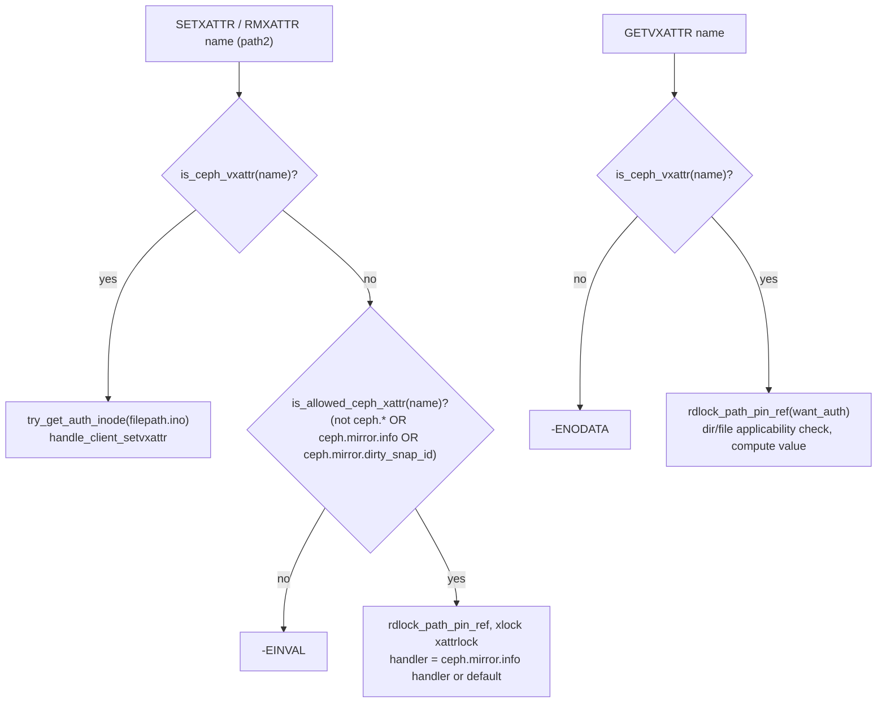
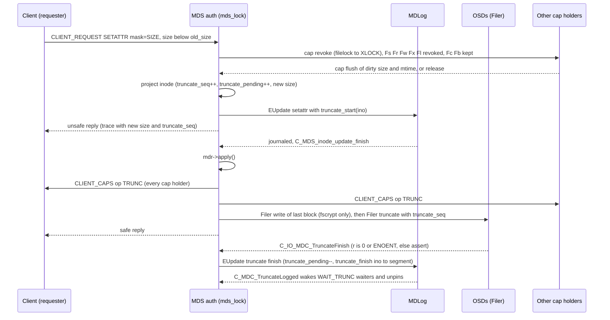
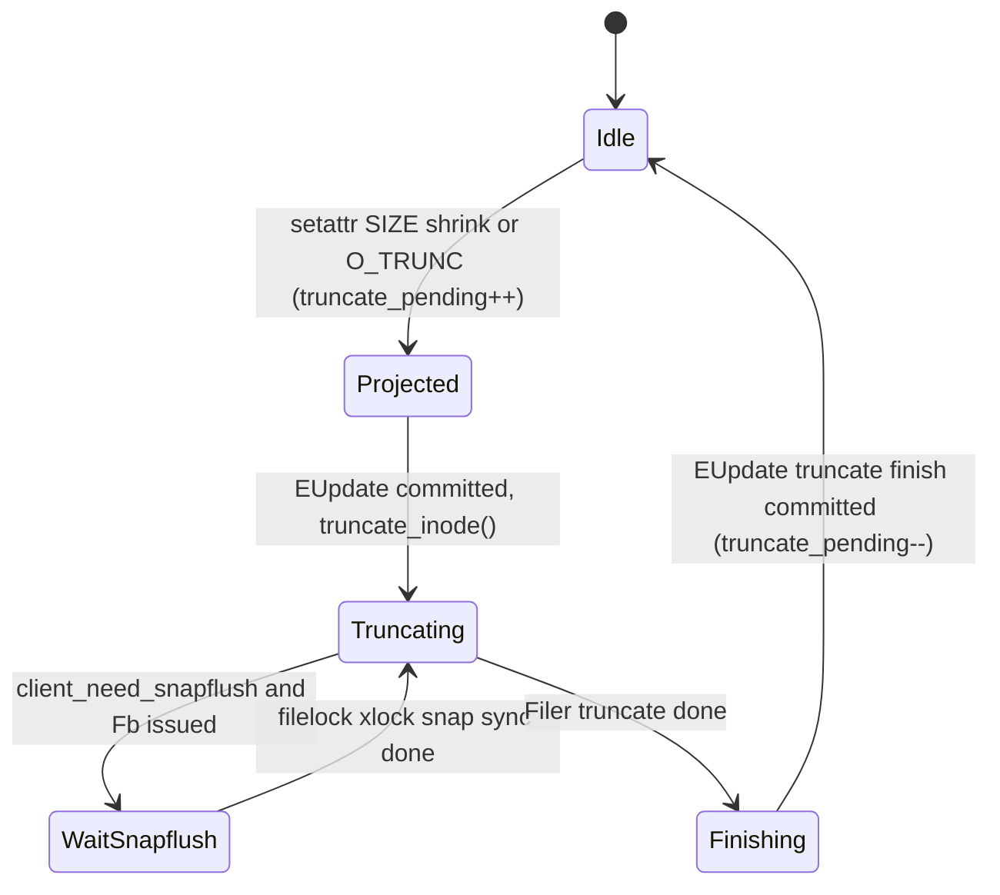

# Attributes, xattrs and virtual xattrs (setattr, truncate, layouts, `ceph.*` vxattrs)

> Part of the [C++ MDS project map](../README.md). Sources: `src/mds/Server.cc` (~2,050 LOC in scope: 4862-4895, 5340-5376, 5578-7522), `src/mds/Server.h` (~160 LOC: 405-560), `src/mds/CInode.{h,cc}` (inode/xattr projection, pins, lock-state encoders, `encode_inodestat`), `src/mds/Locker.cc` (truncate, `max_size`, cap-flush helpers), `src/mds/MDCache.cc` (truncate, quota broadcast, `predirty_journal_parents`), `src/mds/MDSAuthCaps.{h,cc}`, `src/mds/SessionMap.cc`, `src/include/cephfs/types.h`, `src/include/ceph_fs.h`, `src/messages/MClientRequest.h`; clients: `linux/fs/ceph/{inode,xattr,acl,ioctl,quota,mds_client}.c`, `src/client/Client.cc`.
> Related: [request lifecycle](request-lifecycle.md), [namespace mutations](namespace-mutations.md), [lookup/readdir/open](lookup-readdir-open-and-file-locks.md), [capabilities](../02-client-protocol/capabilities.md), [wire protocol](../02-client-protocol/wire-protocol.md), [kclient expectations](../02-client-protocol/kclient-expectations.md), [libcephfs/fuse/Ganesha expectations](../02-client-protocol/libcephfs-fuse-ganesha-expectations.md), [lock types](../05-locking/lock-types-and-state-machines.md), [acquiring locks](../05-locking/acquiring-locks.md), [CInode](../04-cache/cinode-and-inode-types.md), [rstats/quotas/subvolumes](../10-snapshots-quotas-subvolumes/rstats-quotas-and-subvolumes.md), [snapshots](../10-snapshots-quotas-subvolumes/snapshots.md), [balancer and pinning](../08-multi-mds/balancer-and-pinning.md), [auth caps](../01-cluster-integration/auth-and-mds-caps.md), [quiesce](../12-qos-metrics-quiesce-quarantine/quiesce.md), [events and replay](../06-journal/events-and-replay.md), [RADOS object catalog](../07-storage-formats/rados-object-catalog.md), [RADOS/OSD interactions](../07-storage-formats/rados-and-osd-interactions.md).

---

## 1. Purpose and responsibilities

This page covers every MDS request that changes or reads *inode attributes* rather than the namespace:

| Area | What the MDS does |
|---|---|
| `CEPH_MDS_OP_SETATTR` | chmod / chown / chgrp / utimes / btime / ctime touch / truncate (grow and shrink) / SUID-SGID kill / fscrypt context and real-size fields. |
| `O_TRUNC` on `CEPH_MDS_OP_OPEN` | `Server::do_open_truncate`: truncate to 0 as part of an open. |
| Asynchronous data truncation | Journals `truncate_start`, sends `CEPH_CAP_OP_TRUNC` to clients, truncates/rewrites RADOS objects through `Filer`, journals `truncate_finish`. |
| `CEPH_MDS_OP_SETLAYOUT` / `CEPH_MDS_OP_SETDIRLAYOUT` | Legacy ioctl-driven layout changes (file layout only on empty, never-truncated files; directory layout policy). |
| `CEPH_MDS_OP_SETXATTR` / `CEPH_MDS_OP_RMXATTR` | Regular extended attributes (opaque name/value map per inode, including POSIX ACL blobs) with `CREATE`/`REPLACE`/`REMOVE`/`REMOVE2` flag semantics and a per-inode total size limit from the MDSMap. |
| `ceph.*` virtual xattrs (set/remove) | Same two ops, routed to `Server::handle_client_setvxattr`: layouts, quotas, export pins, subvolume flag, snapshot-dir visibility, case-folding charmap, quiesce block. |
| `CEPH_MDS_OP_GETVXATTR` | Server-computed vxattr values (layout JSON with inheritance, pool name/id, pins, charmap, subvolume flags, quiesce block). |
| Permission enforcement | Only MDS auth caps (path, fsname, `rw`, `p`, `f`, uid/gid-restricted grants, `root_squash`); POSIX mode/ACL checks are done by the clients. |

Most `ceph.*` names that users read (`ceph.dir.rbytes`, `ceph.quota.max_bytes`, `ceph.dir.layout`, ...) are **synthesized by the clients** from `InodeStat` fields; the MDS only has to deliver those fields correctly (section 3.9, 3.10).

---

## 2. Source map

| File | Class / function | Lines | Role |
|---|---|---|---|
| `src/mds/Server.cc` | `Server::dispatch_client_request` | 2765-2965 | read-only FS gate, `is_full` gate (`MAY_FULL`), op switch to the handlers below |
| `src/mds/Server.cc` | `Server::handle_osd_map` | 2752 | sets `is_full` from the **metadata** pool `FLAG_FULL` |
| `src/mds/Server.cc` | `Server::check_access` | 3500 | wraps `Session::check_access` (MDS auth caps) |
| `src/mds/Server.cc` | `Server::is_valid_layout` | 4862 | `file_layout_t::is_valid()` + pool must be an FS data pool |
| `src/mds/Server.cc` | `Server::can_handle_charmap` | 4876 | EPERM for namespace ops in charmap dirs from clients lacking `CEPHFS_FEATURE_CHARMAP` |
| `src/mds/Server.cc` | `C_MDS_inode_update_finish` | 5340-5376 | common journal-commit completion: `mdr->apply()`, truncate kick-off, snaprealm notify, reply, `share_inode_max_size` |
| `src/mds/Server.cc` | `Server::handle_client_setattr` | 5578-5777 | SETATTR |
| `src/mds/Server.cc` | `Server::do_open_truncate` | 5780-5844 | O_TRUNC |
| `src/mds/Server.cc` | `Server::handle_client_setlayout` | 5848-5928 | SETLAYOUT (file) |
| `src/mds/Server.cc` | `Server::xlock_policylock` | 5930-5954 | xlock `policylock` (+ `snaplock` rd/x), rdlock ancestor snaplocks (+ policylocks for layout inheritance) |
| `src/mds/Server.cc` | `Server::try_get_auth_inode` | 5956-5969 | ESTALE if not cached/purging, forward if not auth |
| `src/mds/Server.cc` | `Server::handle_client_setdirlayout` | 5971-6043 | SETDIRLAYOUT |
| `src/mds/Server.cc` | `Server::parse_layout_vxattr_json` / `_string` / `parse_layout_vxattr` | 6046-6205 | layout vxattr value parsing |
| `src/mds/Server.cc` | `Server::parse_quota_vxattr` | 6207-6260 | quota value parsing |
| `src/mds/Server.cc` | `Server::create_quota_realm` | 6262-6273 | internal SETXATTR `ceph.quota` (empty value) sent to the auth MDS |
| `src/mds/Server.cc` | `Server::check_layout_vxattr` | 6281-6340 | parse + osdmap-epoch wait for unknown pools |
| `src/mds/Server.cc` | `Server::handle_client_setvxattr` | 6342-6966 | all `ceph.*` set/remove branches + common tail |
| `src/mds/Server.cc` | `Server::xattr_handlers[]`, `get_xattr_or_default_handler` | 6968-7002 | handler table (default, `ceph.mirror.info`) |
| `src/mds/Server.cc` | `xattr_validate`, `xattr_set`, `xattr_rm`, default handlers | 7004-7071 | flag semantics, map mutation |
| `src/mds/Server.cc` | `parse_mirror_info_xattr`, `mirror_info_*` | 7073-7149 | `ceph.mirror.info` |
| `src/mds/Server.cc` | `Server::handle_client_setxattr` | 7151-7246 | SETXATTR |
| `src/mds/Server.cc` | `Server::handle_client_removexattr` | 7248-7315 | RMXATTR |
| `src/mds/Server.cc` | `Server::handle_client_getvxattr` | 7317-7522 | GETVXATTR |
| `src/mds/Server.h` | `XattrInfo`, `MirrorXattrInfo`, `XattrOp`, `XattrHandler` | 414-471 | handler plumbing |
| `src/mds/Server.h` | `is_ceph_vxattr`, `is_ceph_dir_vxattr`, `is_ceph_file_vxattr`, `is_allowed_ceph_xattr` | 500-557 | name classification |
| `src/mds/CInode.cc` | `CInode::project_inode`, `pop_and_dirty_projected_inode` | 474-552 | RCU-style projection of inode / xattr map / srnode; pin re-evaluation on apply |
| `src/mds/CInode.cc` | `set_export_pin`, `setxattr_ephemeral_rand`, `setxattr_ephemeral_dist`, `maybe_export_pin`, `queue_export_pin`, `get_export_pin` | 5602-5830 | pin side effects |
| `src/mds/CInode.cc` | `CInode::encode_inodestat` | 3959-4430 | delivers attrs, xattrs blob, quota, layout, rstat, charmap, subvolume id to clients |
| `src/mds/CInode.cc` | `encode_lock_iauth` / `encode_lock_ixattr` / `encode_lock_ipolicy` | 1803, 2180, 2250 | what each lock replicates to other ranks |
| `src/mds/Locker.cc` | `Locker::try_rdlock_snap_layout` | 157 | ancestor snaplock/policylock rdlocks |
| `src/mds/Locker.cc` | `issue_truncate`, `calc_new_max_size`, `calc_new_client_ranges`, `share_inode_max_size` | 2717, 2980, 3017, 3191 | truncate notification, `max_size` |
| `src/mds/Locker.cc` | `decode_new_xattrs`, `_update_cap_fields`, `_do_cap_update` | 3855, 3978, 4083 | attribute/xattr changes arriving by cap flush (Ax/Fx/Fw/Xx) |
| `src/mds/MDCache.cc` | `broadcast_quota_to_client` | 2103 | `MClientQuota` + `MGatherCaps`, subvolume quota metrics; callers: quota vxattr, `predirty_journal_parents` (2465), `CInode::finish_scatter_gather_update` (`src/mds/CInode.cc:2848`) |
| `src/mds/MDCache.cc` | `predirty_journal_parents` | 2224 | parent dirfrag/rstat projection done by every attr update |
| `src/mds/MDCache.cc` | `truncate_inode`, `_truncate_inode`, `truncate_inode_write_finish`, `truncate_inode_finish`, `truncate_inode_logged`, `start_recovered_truncates` | 6586-6870 | data truncation state machine |
| `src/mds/MDSAuthCaps.cc` | `MDSAuthCaps::is_capable`, `allow_all` | 266, 585 | cap evaluation (`p`, `f`, uid/gid, root_squash) |
| `src/mds/SessionMap.cc` | `Session::check_access` | 1109 | path construction, `FS_FILE_LAYOUT_V2` EIO, calls `is_capable` |
| `src/include/cephfs/types.h` | `inode_t`, `charmap_md_t`, `quota_info_t` | 244-360, 771-1000 | data structures |

---

## 3. How it works

### 3.1 Op codes, routing and pre-dispatch gates

| Op | Code (`src/include/ceph_fs.h:397 (enum CEPH_MDS_OP_*)`) | Handler | Target lookup | Early (unsafe) reply | `EUpdate` type string |
|---|---|---|---|---|---|
| `CEPH_MDS_OP_SETATTR` | `0x01108` | `handle_client_setattr` | `rdlock_path_pin_ref(mdr, want_auth=true)` | allowed | `"setattr"` |
| `CEPH_MDS_OP_OPEN` + `CEPH_O_TRUNC` | `0x00302` | `handle_client_open` -> `do_open_truncate` | path traverse | allowed, then `mdlog->flush()` | `"open_truncate"` |
| `CEPH_MDS_OP_SETLAYOUT` | `0x01107` | `handle_client_setlayout` | `rdlock_path_pin_ref(mdr, true)` | allowed | `"setlayout"` |
| `CEPH_MDS_OP_SETDIRLAYOUT` | `0x0110a` | `handle_client_setdirlayout` | `try_get_auth_inode(filepath.ino)` | **disabled** (`no_early_reply`) | `"setlayout"` |
| `CEPH_MDS_OP_SETXATTR` (regular name) | `0x01105` | `handle_client_setxattr` | `rdlock_path_pin_ref(mdr, true)` | allowed | `"setxattr"` |
| `CEPH_MDS_OP_RMXATTR` (regular name) | `0x01106` | `handle_client_removexattr` | `rdlock_path_pin_ref(mdr, true)` | allowed | `"removexattr"` |
| SETXATTR / RMXATTR on a `ceph.*` vxattr | same | `handle_client_setvxattr` | `try_get_auth_inode(filepath.ino)` | per-branch (table 3.8.2) | `"set vxattr layout"` (all vxattrs) |
| `CEPH_MDS_OP_GETVXATTR` | `0x00106` (read op) | `handle_client_getvxattr` | `rdlock_path_pin_ref(mdr, true, false)` | n/a (no journal) | none |

Dispatch (`src/mds/Server.cc:2765 (Server::dispatch_client_request)`):

1. `req->may_write() && mdcache->is_readonly()` -> `-EROFS`. `may_write()` is `op & CEPH_MDS_OP_WRITE (0x1000)`, or `OPEN` with `O_CREAT|O_TRUNC` in `args.open.flags` (`src/messages/MClientRequest.h:196 (MClientRequest::may_write)`); GETVXATTR is not a write.
2. `is_full` gate (`src/mds/Server.cc:2805 (Server::dispatch_client_request)`): for `SETLAYOUT`, `SETDIRLAYOUT`, `RMXATTR`, `SETXATTR` (and `CREATE`, `SYMLINK`, `MKSNAP`, `LINK`/`RENAME` before peers) the MDS does `try_get_auth_inode(filepath.ino)` (so an uncached ino gets `-ESTALE` here) and `check_access(MAY_FULL)`. Without the `f` cap flag, `Server::check_access` itself replies `-EACCES`; the gate then calls `respond_to_request(mdr, -ENOSPC)` a second time on the already-finished request (a duplicate reply that clients drop as an unknown tid). The client therefore sees **`-EACCES`, not `-ENOSPC`** (by code reading, `src/mds/Server.cc:2829-2834`). `is_full` is the **metadata pool's** `pg_pool_t::FLAG_FULL` (`src/mds/Server.cc:2752 (Server::handle_osd_map)`). SETATTR is not gated here; it only refuses size growth while full (3.3.2), and that path does reply `-ENOSPC`.
3. Per-op latency counters are recorded by `perf_gather_op_latency` (`src/mds/Server.cc:2218-2235 (Server::perf_gather_op_latency)`).
4. dmClock QoS cost: SETATTR/SETXATTR/RMXATTR/SETLAYOUT/SETDIRLAYOUT cost 3; GETVXATTR is unlisted and falls to the default cost 3 (`src/mds/MDSDmclockScheduler.cc:745 (MDSDmclockScheduler::get_op_cost)`).

Name classification (`src/mds/Server.h:500-557`):



`is_ceph_vxattr` = prefix `ceph.dir.layout`, prefix `ceph.file.layout`, prefix `ceph.quota`, or exactly one of `ceph.quiesce.block`, `ceph.dir.subvolume`, `ceph.dir.pin`, `ceph.dir.pin.random`, `ceph.dir.pin.distributed`, `ceph.dir.charmap`, `ceph.dir.normalization`, `ceph.dir.encoding`, `ceph.dir.casesensitive`, `ceph.dir.subvolume.snaps.visible` (`src/mds/Server.h:500 (Server::is_ceph_vxattr)`). Any other `ceph.*` name other than the two mirror names is rejected with `-EINVAL` on set/remove (`src/mds/Server.cc:7167 (Server::handle_client_setxattr)`), e.g. `ceph.dir.rctime`, `ceph.dir.rbytes`, `ceph.snap.btime`.

### 3.2 Permission model: who checks what

The MDS never evaluates POSIX ACLs and only evaluates UNIX mode bits for uid-restricted cap grants.

| Check | Done by | Details |
|---|---|---|
| MDS auth caps (fsname, path prefix, network, `r`/`w`) | MDS `Server::check_access` -> `Session::check_access` -> `MDSAuthCaps::is_capable` | path is the inode's projected path, or `stray_prior_path` for stray inodes (`src/mds/SessionMap.cc:1109 (Session::check_access)`). Failure -> `-EACCES`. |
| `p` flag (`MAY_SET_VXATTR`) | MDS | required for **every** vxattr set/remove (`src/mds/Server.cc:6359 (Server::handle_client_setvxattr)`), for SETLAYOUT/SETDIRLAYOUT only if the resulting layout differs from the current one, and for create with a non-inherited layout. `MAY_SET_VXATTR` is *not* combined with `MAY_WRITE` in the vxattr path, so `allow rp` (read + p) permits vxattr changes and `root_squash` (applies only when `mask & MAY_WRITE`, `src/mds/MDSAuthCaps.cc:304 (MDSAuthCaps::is_capable)`) does not block root from setting vxattrs (by code reading). |
| `f` flag (`MAY_FULL`) | MDS | only in the `is_full` gate of 3.1 (missing `f` yields `-EACCES` there, by code reading). |
| UNIX mode bits | MDS **only** for grants with `uid=` (`MDS_AUTH_UID_ANY` grants return true before any mode check, `src/mds/MDSAuthCaps.cc:341 (MDSAuthCaps::is_capable)`) | owner/group/other bits only; no ACL, no `CAP_FOWNER`-like rules. With a uid grant, an owner chmod on a `0444` file fails because SETATTR always asks `MAY_WRITE`. |
| chown/chgrp policy | MDS only for uid grants | `MAY_CHOWN` (added only when uid actually changes): caller must own the file and `new_uid == caller_uid`; `MAY_CHGRP` (only when gid changes): caller owns file and `new_gid` is in the intersection of caller gids and the grant's `gids` (`src/mds/MDSAuthCaps.cc:351-364 (MDSAuthCaps::is_capable)`). |
| fscrypt fields in SETATTR | MDS | `CEPH_SETATTR_FSCRYPT_AUTH`/`FSCRYPT_FILE` require `session->auth_caps.allow_all()` = some grant with `allow *`/`all`, no path, no uid (`src/mds/MDSAuthCaps.cc:585 (MDSAuthCaps::allow_all)`), else `-EACCES`. |
| Layout pool namespace support | MDS | any access check on a directory whose layout has a `pool_ns` fails with `-EIO` if the connection lacks `CEPH_FEATURE_FS_FILE_LAYOUT_V2` (`src/mds/SessionMap.cc:1156 (Session::check_access)`). |
| POSIX permission/ownership/ACL rules | kclient: VFS `setattr_prepare()` and `posix_acl_*` (`linux/fs/ceph/inode.c:2941 (ceph_setattr)`); libcephfs: `may_setattr`, `xattr_permission`, `inode_permission`, `_posix_acl_permission` when `should_check_perms()` (`src/client/Client.cc:6394 (Client::xattr_permission)`, `:6418 (Client::may_setattr)`) | `should_check_perms()` = `(is_fuse && !fuse_default_permissions) \|\| (!is_fuse && client_permissions)` (`src/client/Client.h:2289 (Client::should_check_perms)`); defaults `client_permissions=true`, `fuse_default_permissions=false`. |
| Client-side evaluation of MDS caps | kclient `ceph_mds_check_access()` before SETATTR (`linux/fs/ceph/inode.c:2603 (__ceph_setattr)`), libcephfs `mds_check_access()` in `_do_setattr` (`src/client/Client.cc:8563`) | kclient returns `-EACCES` locally and turns any other error (or a missing dentry/path) into `do_sync`; libcephfs returns any non-zero result and uses `do_sync` only when it cannot build the absolute path. `do_sync` forces a synchronous SETATTR instead of a cap-local (Ax/Fx) update, so that the MDS performs the auth-cap check (kclient comment: "let the MDS do the mds auth check"). |
| `MAY_*` masks per op | MDS | SETATTR: `MAY_WRITE` (+`MAY_CHOWN`/`MAY_CHGRP`); O_TRUNC open: `MAY_WRITE`; SETXATTR (regular): `MAY_WRITE`; RMXATTR (regular): **no** `check_access` call at all (`src/mds/Server.cc:7248-7315 (Server::handle_client_removexattr)`); SETLAYOUT/SETDIRLAYOUT: `MAY_WRITE` (+`MAY_SET_VXATTR`); vxattr set/remove: `MAY_SET_VXATTR` only; GETVXATTR: **no** `check_access` call (by code reading). There is no generic per-op write check elsewhere in `Server.cc`. |
| Quarantine | MDS | `rdlock_path_pin_ref` calls `check_quarantine_block` (non-quarantine-aware clients wait); `check_access` passes `check_qtine` for quarantine-aware sessions. The vxattr path uses `try_get_auth_inode` and therefore skips `check_quarantine_block`. See [quarantine](../12-qos-metrics-quiesce-quarantine/quarantine.md). |

### 3.3 SETATTR

#### 3.3.1 Request

`ceph_mds_request_args.setattr` (`src/include/ceph_fs.h:609 (union ceph_mds_request_args)`): `mode u32, uid u32, gid u32, mtime ceph_timespec, atime ceph_timespec, size u64, old_size u64, mask u32, btime ceph_timespec`. `MClientRequest` v6 adds `fscrypt_auth` and `fscrypt_file` byte vectors (`src/messages/MClientRequest.h:306 (MClientRequest::decode_payload)`); the message **data** section carries the fscrypt last-block payload. Messages with header version < 4 use the legacy head; the decoder clears `CEPH_SETATTR_BTIME` from the mask for them (`src/messages/MClientRequest.h:290 (MClientRequest::decode_payload)`). The request `stamp` becomes `mdr->op_stamp` (`src/mds/MDCache.cc:9845 (MDCache::request_start)`); `get_op_stamp()` returns it, or the MDS clock at lock acquisition if zero (`src/mds/Mutation.h:206 (MutationImpl::get_op_stamp)`, `src/mds/Locker.cc:662 (Locker::acquire_locks)`). kclient sets the stamp to `attr->ia_ctime` (`linux/fs/ceph/inode.c:2884 (__ceph_setattr)`), libcephfs to `ceph_clock_now()` at request creation (`src/client/Client.cc:2265 (Client::make_request)`). **All MDS-assigned `ctime` values (and the `mtime` of a size change) therefore come from the client's clock.**

Mask bits (`src/include/ceph_fs.h:461-476 (CEPH_SETATTR_*)`): `MODE 1<<0`, `UID 1<<1`, `GID 1<<2`, `MTIME 1<<3`, `ATIME 1<<4`, `SIZE 1<<5`, `CTIME 1<<6`, `MTIME_NOW 1<<7`, `ATIME_NOW 1<<8`, `BTIME 1<<9`, `KILL_SGUID 1<<10`, `FSCRYPT_AUTH 1<<11`, `FSCRYPT_FILE 1<<12`, `KILL_SUID 1<<13`, `KILL_SGID 1<<14`.

#### 3.3.2 Preconditions and error order (`src/mds/Server.cc:5578 (Server::handle_client_setattr)`)

1. `rdlock_path_pin_ref(mdr, true)`: traverse (forward to auth, `-ESTALE` recovery via `find_ino_peers`), rdlock snaplock of the inode and all ancestors, auth-pin, wait if frozen/freezing.
2. `mdr->snapid != CEPH_NOSNAP` -> `-EROFS`.
3. `ino < MDS_INO_SYSTEM_BASE (0x1000) && !is_base()` -> `-EPERM` (stray dirs, lost+found ino 4; root and `~mdsN` are allowed).
4. Message header version < 6: `-EPERM` if the inode has `fscrypt_auth`; `-EINVAL` if the mask has `FSCRYPT_FILE|FSCRYPT_AUTH`.
5. Build lock vector (3.3.4) and `acquire_locks` (may wait and retry the whole handler).
6. `check_access(MAY_WRITE [+MAY_CHOWN if uid changes] [+MAY_CHGRP if gid changes])`.
7. `old_size = max(projected size, args.old_size)`; if `is_full && args.size > old_size` -> `-ENOSPC` (evaluated even when `SIZE` is not in the mask; clients zero the field).
8. If `SIZE`: data length > `sizeof(ceph_fscrypt_last_block_header) + mds_fscrypt_last_block_max_size` (32 + 4096 = 4128 bytes on x86_64 with defaults; the value is cached when `Server` is constructed, and the handler at `src/mds/Server.cc:1440` never fires because the key is not in `MDSRankDispatcher::get_tracked_keys()`, so a runtime change is ignored) -> `-EINVAL`; `truncating_smaller = size < old_size || (size == old_size && data present)`; if truncating smaller while `is_truncating()` -> drop locks and wait on `CInode::WAIT_TRUNC`, then retry; if truncating smaller with data and `header.change_attr != projected change_attr` -> `mdlog->flush()` and `-EAGAIN` (`src/mds/Server.cc:5678-5686 (Server::handle_client_setattr)`).
9. Project the inode, apply fields (3.3.3).
10. `-EACCES` if fscrypt bits are present and the session lacks `allow_all()` (this check happens **after** `project_inode()`; see gotcha 8.3).

#### 3.3.3 Per-field semantics

| Mask bit(s) | Effect on projected inode | Lock |
|---|---|---|
| `UID` | `uid = args.uid` | `authlock` xlock |
| `GID` | `gid = args.gid` | `authlock` xlock |
| `MODE` | `mode = (mode & ~07777) \| (args.mode & 07777)` (file type preserved). When `MODE` is present the SUID/SGID kill logic below is skipped. | `authlock` xlock |
| `UID`/`GID`/`KILL_SGUID`/`KILL_SUID`/`KILL_SGID` without `MODE`, regular file only | if (`UID\|GID\|KILL_SGUID`) and any of `S_IXUSR\|S_IXGRP\|S_IXOTH` set: clear `S_ISUID\|S_ISGID`; else `KILL_SUID` clears `S_ISUID`, `KILL_SGID` clears `S_ISGID` (`src/mds/Server.cc:5704-5719 (Server::handle_client_setattr)`) | `authlock` xlock |
| `MTIME` | `mtime = args.mtime` | `filelock` xlock |
| `ATIME` | `atime = args.atime` | `filelock` xlock |
| `BTIME` | `btime = args.btime` | `authlock` xlock |
| any of `ATIME\|MTIME\|BTIME` | `time_warp_seq++` (`src/mds/Server.cc:5729 (Server::handle_client_setattr)`) | - |
| `SIZE`, not shrinking | `size = args.size`, `rstat.rbytes = size`, `mtime = op_stamp` (overrides an explicit `MTIME`) | `filelock` xlock |
| `SIZE`, shrinking | `inode_t::truncate(old_size, new_size[, data])`: `max_size_ever = max(.., old_size)`, `truncate_from = old_size`, `size = rstat.rbytes = truncate_size = new_size`, `truncate_seq++`, `truncate_pending++`, data copied to `fscrypt_last_block` (`src/include/cephfs/types.h:796 (inode_t::truncate)`); `metablob.add_truncate_start(ino)`; `mtime = op_stamp` | `filelock` xlock |
| `SIZE` (both) | `Locker::calc_new_client_ranges(cur, size)` recomputes `client_ranges` (`max_size`) for every client with Fw/Fb issued or wanted -> `changed_ranges` | - |
| `FSCRYPT_AUTH` | `fscrypt_auth = req.fscrypt_auth` (opaque, unvalidated) | `authlock` xlock |
| `FSCRYPT_FILE` | `fscrypt_file = req.fscrypt_file` (opaque; clients put the real LE64 size) | `filelock` xlock |
| `CTIME` | nothing beyond the common tail | `versionlock` wrlock only |
| `MTIME_NOW`, `ATIME_NOW` | ignored by the MDS (never referenced in `src/mds`) | - |
| mask == 0 | still a valid op: common tail only ("touch ctime") | none |

Common tail (`src/mds/Server.cc:5759-5777 (Server::handle_client_setattr)`): `version = pre_dirty()`, `ctime = op_stamp`, `rstat.rctime = max(rctime, op_stamp)`, `change_attr++`; `EUpdate("setattr")` with `add_client_req(reqid, oldest_client_tid)`, `predirty_journal_parents(..., PREDIRTY_PRIMARY)`, `journal_dirty_inode`; `journal_and_reply` with `C_MDS_inode_update_finish(truncating_smaller, changed_ranges)`; flush the log immediately if `filelock` is xlocked and some client wants Fr/Fw.

There is **no file-type check for `SIZE`**: the MDS would apply it to a directory (clients never send it; see gotcha 8.6). There is no `max_file_size` or quota check for size growth in the MDS: kclient returns `-EFBIG`/`-EDQUOT` itself (`linux/fs/ceph/inode.c:2944-2951 (ceph_setattr)`), libcephfs too (`src/client/Client.cc:8540-8544, 8711-8716 (Client::_do_setattr)`).

#### 3.3.4 Locks taken by SETATTR

| Source | Locks |
|---|---|
| `rdlock_path_pin_ref` -> `path_traverse(MDS_TRAVERSE_RDLOCK_PATH\|RDLOCK_SNAP\|WANT_AUTH)` | rdlock `snaplock` of the target and of every ancestor (`src/mds/Locker.cc:157 (Locker::try_rdlock_snap_layout)`), auth pin on the target |
| handler mask | xlock `authlock` (`MODE\|UID\|GID\|BTIME\|KILL_*\|FSCRYPT_AUTH`), xlock `filelock` (`MTIME\|ATIME\|SIZE\|FSCRYPT_FILE`), wrlock `versionlock` (`CTIME`) (`src/mds/Server.cc:5611-5616 (Server::handle_client_setattr)`) |
| implicit in `acquire_locks` | wrlock `versionlock` for each inode xlock on the leader; wrlock `quiescelock` once, for the first lock with a cap shift (`authlock`/`filelock`/`xattrlock`/`linklock`) (`src/mds/Locker.cc:331-345 (Locker::acquire_locks)`) |
| `predirty_journal_parents` | auth pin + projected fnode on the parent dirfrag; `wrlock_force` of the parent inode's `nestlock` if wrlockable, otherwise `mark_dirty_rstat`; optional upward propagation with `wrlock_try` (3.11) |

An xlock on `filelock` revokes Fs/Fr/Fw/Fx/Fl from all clients (`LOCK_XLOCK` allows only Fc/Fb, `src/mds/locks.c:103 (filelock LOCK_XLOCK row)`), so size/mtime dirtied under Fx/Fw are flushed by cap messages **before** the handler proceeds. Fb is **not** revoked, so buffered dirty data may stay in client caches; clients discard it beyond the new size when they process `CEPH_CAP_OP_TRUNC` (3.3.5). An xlock on `authlock` revokes As/Ax. With replicas on other ranks, xlocks additionally require replica lock gathering (see [lock types](../05-locking/lock-types-and-state-machines.md)).

#### 3.3.5 Truncate (shrink) state machine





Details (`src/mds/MDCache.cc:6586-6870`):

* `truncate_inode` inserts the inode into `LogSegment::truncating_inodes` of the setattr's segment, takes `PIN_TRUNCATING` and an auth pin. If some client still needs to snapflush and Fb is issued, it waits for an xlock snap sync before truncating.
* `_truncate_inode` uses the realm's `SnapContext` and the inode's layout. Without a fscrypt last block it calls `filer.truncate(ino, layout, snapc, truncate_size, truncate_from - truncate_size, truncate_seq, ...)`. With a last block whose decoded `struct_len > block_size` it first `filer.write()`s the re-encrypted block at `header.file_offset`, then truncates with length `truncate_from - truncate_size + block_size`; for a hole it truncates with an extra `block_size`.
* A log segment containing a pending truncate cannot expire: `LogSegment::try_to_expire` waits on `CInode::WAIT_TRUNC` (`src/mds/journal.cc:359 (LogSegment::try_to_expire)`).
* Replay: `EMetaBlob::truncate_start` -> `add_recovered_truncate`, `truncate_finish` -> `remove_recovered_truncate` (`src/mds/journal.cc:1733-1747 (EMetaBlob::replay)`); `start_recovered_truncates` restarts them (`src/mds/MDCache.cc:6847 (MDCache::start_recovered_truncates)`).
* Clients receive `CEPH_CAP_OP_TRUNC` (`src/mds/Locker.cc:2717 (Locker::issue_truncate)`, perf counter `ceph_cap_op_trunc`, one message per cap holder; afterwards `check_inode_max_size` runs on the auth), carrying `size`, `truncate_seq`, `truncate_size`. The kernel applies the size only if `truncate_seq` advances (or the size grows at the same seq), queues a page-cache truncation (`linux/fs/ceph/inode.c:808 (ceph_fill_file_size)`), and warns if Fr/Fl were not revoked first.
* OSD contract: client and MDS data writes/truncates carry `truncate_seq`/`truncate_size`; OSDs use them to discard stale data beyond the truncation point. See [RADOS/OSD interactions](../07-storage-formats/rados-and-osd-interactions.md).

#### 3.3.6 fscrypt truncate (last-block read-modify-write)

For an encrypted file truncated to a size that is not a multiple of `CEPH_FSCRYPT_BLOCK_SIZE`, the client reads and re-encrypts the last block and sends: `size`/`old_size` rounded up to the block size, `fscrypt_file` = real size (LE64), data = versioned header (`ver=1`, `compat=1`, `data_len`, `change_attr` u64, `file_offset` u64, `block_size` u32) + encrypted block (`linux/fs/ceph/inode.c:2438 (fill_fscrypt_truncate)`, `src/client/Client.cc:8740-8805 (Client::_do_setattr)`). The MDS decodes the header with `DECODE_START(1)` (`src/mds/Server.cc:5662 (Server::handle_client_setattr)`); if `header.change_attr` differs from the projected `change_attr` it flushes the journal and returns `-EAGAIN`; the kclient retries up to 20 times (`linux/fs/ceph/inode.c:2899 (__ceph_setattr)`). The whole data payload is stored in `inode_t::fscrypt_last_block` (journaled) and cleared by `truncate_inode_finish`. The header struct is `src/mds/fscrypt.h:19 (ceph_fscrypt_last_block_header)`; it is not packed, and its in-memory `sizeof` is 32 bytes on x86_64 (checked by compiling the header; ABI-dependent, e.g. 28 on i386). That `sizeof` enters the size limit check. On the wire the kclient sends a packed 26-byte header (`struct ceph_fscrypt_truncate_size_header __packed`, `linux/fs/ceph/crypto.h:35`) followed by a 4096-byte block. It appends that block even for a hole, where `data_len` is only 20 (`linux/fs/ceph/inode.c:2521-2555 (fill_fscrypt_truncate)`). The MDS's `DECODE_FINISH` skips to `data_len`, and `_truncate_inode` treats `struct_len <= block_size` as a hole.

#### 3.3.7 Which attribute changes never reach SETATTR

Clients holding exclusive caps update attributes locally and flush them with `CEPH_MSG_CLIENT_CAPS` (`Locker::_update_cap_fields`, `src/mds/Locker.cc:3978`): Ax -> `uid`, `gid`, `mode`, `btime` (if `CEPH_FEATURE_FS_BTIME`), `fscrypt_auth` (no `allow_all()` check on this path); Fx -> `mtime` (any), `atime`, `time_warp_seq` (if newer), size growth (regular files only); Fw -> `mtime` only if newer, size growth, inline data if its version is newer; Fx or Fw -> `fscrypt_file` when the message carries one (no `allow_all()` check either); any dirty -> `ctime` and `change_attr` (`change_attr` needs `CEPH_FEATURE_FS_CHANGE_ATTR`) if newer; Xx -> whole xattr blob (3.6.6). kclient fast paths: `linux/fs/ceph/inode.c:2571 (__ceph_setattr)`; libcephfs: `src/client/Client.cc:8515 (Client::_do_setattr)`. A SETATTR is sent when the client lacks the exclusive cap, when the value differs from what the shared cap shows, or when the auth-cap check forces `do_sync`. kclient also sends `CEPH_SETATTR_CTIME` alone when only ctime must change and no Ax/Fx/Xx is held (`linux/fs/ceph/inode.c:2834-2856 (__ceph_setattr)`). kclient never sends `KILL_*` bits: the VFS turns `ATTR_KILL_SUID`/`ATTR_KILL_SGID` into `ATTR_MODE` with the bits cleared before calling the filesystem (`linux/fs/attr.c:495-512` (notify_change)); libcephfs computes `KILL_SUID`/`KILL_SGID` in `Client::clear_suid_sgid` (`src/client/Client.cc:17615 (Client::clear_suid_sgid)`).

### 3.4 `O_TRUNC` on open (`src/mds/Server.cc:5780 (Server::do_open_truncate)`)

Caller (`src/mds/Server.cc:4737-4760 (Server::handle_client_open)`): `O_TRUNC` on a non-regular file -> `-EISDIR` (dir) / `-EINVAL` (`src/mds/Server.cc:4697`), except that `O_TRUNC` is silently dropped for a symlink opened without `O_NOFOLLOW` (`src/mds/Server.cc:4674-4677`); xlock `filelock` (+ rdlock `snaplock`, optional rdlock `authlock`/`xattrlock` per `open.mask`), `check_access(MAY_WRITE)`, wait on `WAIT_TRUNC` if a truncate is pending, skip entirely if the request already completed (`has_completed`). Then: issue caps for the open mode, project `mtime = ctime = op_stamp`, `rctime`, `change_attr++`; `old_size = max(size, args.open.old_size)`; if `old_size > 0`: zero the first 8 bytes of `fscrypt_file` (real size) and `truncate(old_size, 0)` + `add_truncate_start`; for write opens set `client_ranges[client] = [0, layout period)`, `follows = realm newest seq`, mark the inode/cap client-writeable; `add_opened_ino(ino)`; `mdr->o_trunc = true`; `EUpdate("open_truncate")`; `journal_and_reply`, then an unconditional `mdlog->flush()` so the truncation is durable promptly.

### 3.5 Legacy layout ops

**SETLAYOUT** (`src/mds/Server.cc:5848`, kclient `CEPH_IOC_SET_LAYOUT`, `linux/fs/ceph/ioctl.c:65 (ceph_ioctl_set_layout)`): regular files only (`-EINVAL`), snap -> `-EROFS`; `-ENOTEMPTY` if `size != 0` or `truncate_seq > 1` (a fresh file has `truncate_seq = 1`, `src/mds/Server.cc:3715 (Server::prepare_new_inode)`); each non-zero `fl_object_size`, `fl_stripe_unit`, `fl_stripe_count`, `fl_pg_pool` overrides the current value (pool 0 cannot be selected); if a pool is given and the request's `mdsmap_epoch` is newer than ours, wait for that MDSMap; `MAY_SET_VXATTR` is added if the layout changes; `is_valid_layout` -> `-EINVAL`; xlock `filelock`; `check_access`; project `layout`, `add_old_pool(old pool)`, `version`, `ctime`, `rctime`, `change_attr++`; `EUpdate("setlayout")`.

**SETDIRLAYOUT** (`src/mds/Server.cc:5971`, kclient `CEPH_IOC_SET_LAYOUT_POLICY`): `try_get_auth_inode`; `-ENOTDIR`; `xlock_policylock(mdr, cur, want_layout=true)`; starting layout = own layout, else the inherited `mdr->dir_layout`, else `mdcache->default_file_layout`; same override/validation rules; `check_access` **after** locking; projects only `layout` and `version` (**no ctime/rctime/change_attr update**); `no_early_reply = true`; `EUpdate("setlayout")`.

### 3.6 Regular xattrs

#### 3.6.1 SETXATTR (`src/mds/Server.cc:7151 (Server::handle_client_setxattr)`)

1. Name routing (3.1). Snapshot -> `-EROFS`.
2. xlock `xattrlock` (+ implicit `versionlock`, `quiescelock`), `check_access(MAY_WRITE)`.
3. Size check: `cur_xattrs_size = sum(len(name)+len(value))` over the projected map, skipping the entry with the same name **only if `CEPH_XATTR_REPLACE` is set**; if `cur_xattrs_size + len(name) + len(value) > mdsmap->get_max_xattr_size()` -> `-ENOSPC` (`src/mds/Server.cc:7191-7212 (Server::handle_client_setxattr)`).
4. `handler->validate` (default: `xattr_validate`); errors returned as-is.
5. `project_inode(mdr, xattr=true)` copies the whole xattr map; `version`, `ctime = op_stamp`, `rctime`, `change_attr++`, `xattr_version++`.
6. If `flags & (CEPH_XATTR_REMOVE|CEPH_XATTR_REMOVE2)` -> `handler->removexattr`, else `handler->setxattr` (replace-or-insert, value copied into a fresh `bufferptr`).
7. `EUpdate("setxattr")`, `predirty_journal_parents`, `journal_dirty_inode`, `journal_and_reply` (early reply allowed).

#### 3.6.2 RMXATTR (`src/mds/Server.cc:7248 (Server::handle_client_removexattr)`)

Same routing, snapshot check and `xattrlock` xlock; **no `check_access`**; `validate` with op `RMXATTR` (`-ENODATA` if absent); project; `version`, `ctime`, `rctime`, `change_attr++`, `xattr_version++`; `handler->removexattr`; `EUpdate("removexattr")`.

#### 3.6.3 Flag semantics (`src/mds/Server.cc:7004 (Server::xattr_validate)`, flags `src/include/ceph_fs.h:510-513 (CEPH_XATTR_*)`)

| Flag | Value | SETXATTR semantics |
|---|---|---|
| `CEPH_XATTR_CREATE` | `1<<0` | `-EEXIST` if the name exists |
| `CEPH_XATTR_REPLACE` | `1<<1` | `-ENODATA` if the name is absent; also excludes the old value from the size accounting |
| `CEPH_XATTR_REMOVE2` | `1<<30` | `-ENODATA` if absent; then removes |
| `CEPH_XATTR_REMOVE` | `1<<31` | removes; succeeds (and bumps versions) even if absent |
| (none) | 0 | create or replace |

Client usage: kclient `ceph_sync_setxattr` sends RMXATTR when `size == 0`, `value == NULL` and `XATTR_REPLACE` is set; otherwise it sends SETXATTR, adding `CEPH_XATTR_REMOVE` when `value == NULL`. VFS flags are passed through numerically (`linux/fs/ceph/xattr.c:1107`), and only SETXATTR carries `osdmap_epoch`. removexattr(2) reaches the filesystem as a set with a NULL value, size 0 and `XATTR_REPLACE` (`linux/fs/xattr.c:544-545` (__vfs_removexattr)), so the kclient sends RMXATTR. A zero-length setxattr value is replaced by `""` before the filesystem sees it (`linux/fs/xattr.c:221-222` (__vfs_setxattr)), so the kclient sends SETXATTR with an empty value, not a removal. libcephfs `_do_setxattr` uses `CEPH_XATTR_REMOVE|CEPH_XATTR_REMOVE2` for a NULL value and `CEPH_MDS_OP_RMXATTR` for `removexattr` (`src/client/Client.cc:15300 (Client::_do_setxattr)`, `:15511 (Client::_removexattr)`). `_setxattr` turns a zero-length value into `""`, so a NULL value (a removal through SETXATTR) only comes from its POSIX-ACL paths: an access ACL equivalent to the mode, or an empty default ACL (`src/client/Client.cc:15366-15398`).

Namespace restrictions are enforced by the clients, not the MDS. The MDS accepts any name outside `ceph.*` and, inside `ceph.*`, only the vxattr names plus `ceph.mirror.info` and `ceph.mirror.dirty_snap_id` (3.1). kclient `ceph_is_valid_xattr` allows `security.`, `ceph.`, `trusted.` and `user.` (`linux/fs/ceph/xattr.c:21`), and `system.posix_acl_*` goes through the VFS POSIX-ACL handlers. libcephfs `_setxattr` allows `user.`, `security.`, `trusted.` and `ceph.`, plus `system.posix_acl_access`/`_default` when `client_acl_type=posix_acl`; `_removexattr` always accepts the two ACL names. Any other name gets `-EOPNOTSUPP` (`src/client/Client.cc:15354-15361`, `:15524-15530`).

#### 3.6.4 Size limit

`MDSMap::max_xattr_size`, default `MDS_MAX_XATTR_SIZE = 1<<16` (64 KiB) (`src/mds/MDSMap.h:64 (MDS_MAX_XATTR_SIZE)`), set with `ceph fs set <fs> max_xattr_size <n>` (`src/mon/FSCommands.cc:541 (FileSystemCommandHandler::set_val, var max_xattr_size)`), encoded in MDSMap ext version >= 18 (`src/mds/MDSMap.cc:1001 (MDSMap::decode)`). Accounting is name+value bytes without framing. kclient also reads `m_max_xattr_size` (`linux/fs/ceph/mdsmap.c:419 (ceph_mdsmap_decode)`) and falls back to a synchronous SETXATTR when its own framed blob estimate exceeds it (`linux/fs/ceph/xattr.c:1235-1271 (__ceph_setxattr)`). libcephfs does no client-side size check. The limit is **not** checked for xattrs supplied at inode creation (`src/mds/Server.cc:3748 (Server::prepare_new_inode)`), and on the cap-flush path an oversize blob is silently ignored while `xattr_version` is still bumped (`src/mds/Locker.cc:3855 (Locker::decode_new_xattrs)`).

#### 3.6.5 Handler table and `ceph.mirror.*`

`xattr_handlers[]` (`src/mds/Server.cc:6968`): `<default>` (validate/set/remove as above) and `ceph.mirror.info`. Lookup is a linear scan by exact name (`get_xattr_or_default_handler`).

`ceph.mirror.info` (written by the mgr `mirroring` module on the peer filesystem, `src/pybind/mgr/mirroring/fs/snapshot_mirror.py:424, 464`):

* validate: inode must be root (`-EINVAL`); runs `xattr_validate` for both stored names `ceph.mirror.info.cluster_id` and `ceph.mirror.info.fs_id` with the request flags; different results -> `-EINVAL` ("inconsistent"); for SETXATTR parses the value with `^cluster_id=([a-f0-9]{8}-[a-f0-9]{4}-[a-f0-9]{4}-[a-f0-9]{4}-[a-f0-9]{12}) fs_id=(\d+)$` (`-EINVAL` on mismatch) (`src/mds/Server.cc:7074-7130 (Server::mirror_info_xattr_validate)`).
* set: stores two real xattrs `ceph.mirror.info.cluster_id=<uuid>` and `ceph.mirror.info.fs_id=<id>`; remove: removes both. `ceph.mirror.info` itself is never stored. A SETXATTR with `REMOVE` flags on this name still parses the (empty) value and fails with `-EINVAL`.
* read: libcephfs synthesizes `cluster_id=<..> fs_id=<..>` from the two stored xattrs (`src/client/Client.cc:15778 (Client::_vxattrcb_mirror_info)`); kclient has no table entry, sends GETVXATTR and gets `-ENODATA`.

`ceph.mirror.dirty_snap_id` uses the default handler (set by `cephfs-mirror` on the remote dir root, `src/tools/cephfs_mirror/PeerReplayer.cc:3051 (PeerReplayer::do_synchronize)`). libcephfs reads it by first sending GETVXATTR (MDS returns `-ENODATA`) and then falling back to its cached xattr map (`src/client/Client.cc:15186-15190 (Client::_getxattr)`).

#### 3.6.6 How xattrs reach clients

* `CInode::encode_inodestat` includes the xattr blob when the client has no cap yet, when `cap->client_xattr_version < xattr_version`, or when the getattr mask asks for `CEPH_CAP_XATTR_SHARED`; it is kept only if Xs is pending or requested; it uses projected xattrs for the client that xlocks `xattrlock` or is loner (`src/mds/CInode.cc:4104-4118, 4269-4278 (CInode::encode_inodestat)`). Encoding: `u32 blob_len` + (`u32 count` + per entry `u32 name_len, name, u32 val_len, val`), or `u32 0` when not included; `xattr_version` is a separate InodeStat field.
* Cap grant messages carry the blob similarly (`encode_cap_message`, see [capabilities](../02-client-protocol/capabilities.md)).
* Clients with Xx update xattrs locally and flush the whole map (`MClientCaps::xattrbl`, `head.xattr_version`); the MDS accepts it only if the flushed version is newer, wrlocks `xattrlock` and journals an `EUpdate("cap update")` (`src/mds/Locker.cc:4188-4232 (Locker::_do_cap_update)`). kclient uses this path for non-`ceph.*` names when Xx is held (`linux/fs/ceph/xattr.c:1176 (__ceph_setxattr)`); libcephfs always sends SETXATTR.
* Listing: kclient lists every stored name including `ceph.mirror.*`; libcephfs `_listxattr` hides names starting with `ceph.` (`src/client/Client.cc:15248 (Client::_listxattr)`).

### 3.7 POSIX ACLs

The MDS has no ACL code (no reference to `posix_acl` or `system.` in `src/mds`). `system.posix_acl_access` / `system.posix_acl_default` are ordinary xattrs whose values are the Linux xattr ACL encoding produced and parsed by clients:

* kclient: `ceph_get_acl`/`ceph_set_acl` (`linux/fs/ceph/acl.c:33, 90`); setting an access ACL may first send a mode change via `__ceph_setattr` and roll it back if the xattr update fails; removing an ACL is `__ceph_setxattr(name, NULL, 0, 0)` -> SETXATTR with `CEPH_XATTR_REMOVE` (or a local Xx update). After a chmod, `posix_acl_chmod` rewrites the access ACL (`linux/fs/ceph/inode.c:2956 (ceph_setattr)`). New inodes get initial ACL xattrs in the create/mkdir request payload (`ceph_pre_init_acls`, `linux/fs/ceph/acl.c:165`), which the MDS stores verbatim (`src/mds/Server.cc:3748 (Server::prepare_new_inode)`).
* libcephfs (when `client_acl_type=posix_acl`): `posix_acl_equiv_mode` turns an equivalent access ACL into a mode change plus removal; default ACLs are only allowed on directories (`-EACCES`); `-ENODATA` on ACL removal is mapped to 0 (`src/client/Client.cc:15333-15420 (Client::_setxattr)`); `xattr_permission` lets only root or the owner write `system.*` names.
* Enforcement of ACLs is purely client side (VFS `generic_permission` in the kernel, `_posix_acl_permission` in libcephfs). The MDS's own unix check for uid-restricted caps ignores ACLs.

### 3.8 Virtual xattrs: set and remove (`src/mds/Server.cc:6342 (Server::handle_client_setvxattr)`)

#### 3.8.1 Common structure

1. Entry from SETXATTR/RMXATTR via `try_get_auth_inode(filepath.ino)` (only the base ino of the filepath is used; `-ESTALE` if the inode is not in this MDS's cache, forward if not auth).
2. `check_access(MAY_SET_VXATTR)` before any lock.
3. Branch on the name (table 3.8.2). Each branch validates, takes its locks (most via `xlock_policylock`, which xlocks `policylock`, rd- or xlocks `snaplock`, rdlocks all ancestor `snaplock`s and, for `want_layout`, ancestor `policylock`s up to the first ancestor with a layout), and projects the inode (and, for realm-changing names, a new `sr_t`).
4. Common tail (`src/mds/Server.cc:6948-6965 (Server::handle_client_setvxattr)`): `change_attr++`, `ctime = op_stamp`, `rctime = max(..)`, `version = pre_dirty()`, `update_backtrace()` for any regular file (file layouts, but also `ceph.quiesce.block` and the type-unchecked charmap names on files, which therefore also rewrite the backtrace); `EUpdate("set vxattr layout")`; `C_MDS_inode_update_finish(..., adjust_realm)`; on commit `mdr->apply()` then, if `adjust_realm`, `send_snap_update(in, 0, op)` (`MMDSSnapUpdate` carrying `op` to replica ranks) and `do_realm_invalidate_and_update_notify(in, op)`. That call sends `MClientSnap` to every client with caps in the realm and its open child realms. Here `op = CEPH_SNAP_OP_UPDATE` if the inode already had a realm before apply, else `CEPH_SNAP_OP_SPLIT` (`src/mds/Server.cc:5351-5367 (C_MDS_inode_update_finish::finish)`). The `MClientSnap` op is always `CEPH_SNAP_OP_SPLIT` with `split = ino`; `op` only decides whether `split_inos`/`split_realms` are filled (`src/mds/MDCache.cc:10225 (MDCache::do_realm_invalidate_and_update_notify)`).
5. Names that pass `is_ceph_vxattr` always land in a branch, so the final `else` (`src/mds/Server.cc:6942`) is effectively unreachable. An unknown suffix of a prefix family fails inside its branch: `ceph.quota<x>` -> `-EINVAL` from `parse_quota_vxattr` (non-dir: `-EINVAL` earlier; RMXATTR when no quota is set: success), and `ceph.dir.layout<x>`/`ceph.file.layout<x>` -> `-ENODATA` from the layout parser.
6. The vxattr path ignores the `CEPH_XATTR_CREATE`/`REPLACE` flags and has no snapshot (`-EROFS`) check. It uses only the base ino of the filepath, so the path components of a snapshot path are ignored; clients refuse setxattr on snapshot inodes themselves (kclient `-EROFS` in `__ceph_setxattr`, libcephfs `_setxattr`).

xlock on `policylock`/`snaplock` waits for the whole cluster to be recovered when any replica rank is not active (`src/mds/Locker.cc:275-306 (Locker::acquire_locks)`).

#### 3.8.2 Catalog of every `ceph.*` virtual xattr

Legend: **Get** = where the value comes from (K = kclient table, L = libcephfs table, M = MDS GETVXATTR). **Set/Remove** = MDS behavior. All MDS sets require the `p` cap flag.

| Name | Applies to | Get | Set | Remove | Validation / errors | Locks (set) | Side effects | Early reply |
|---|---|---|---|---|---|---|---|---|
| `ceph.dir.layout` | dir | K/L from InodeStat layout; ENODATA if the dir has no own layout (exists_cb); format `stripe_unit=.. stripe_count=.. object_size=.. pool=<name or id>[ pool_namespace=..]` | composite `key=value[ key=value]*` (3.8.3) applied onto own/inherited/default layout | root: reset to `default_file_layout`; other dirs: `clear_layout()` (inherit again); no-op success if no layout | not a dir -> EINVAL; encrypted dir -> EINVAL; parse errors EINVAL/ENODATA; unknown pool -> osdmap wait then EINVAL | `xlock_policylock(want_layout)`, xlock `authlock` (+`policylock` again for rm) | affects only future creates | no |
| `ceph.dir.layout.stripe_unit`, `.stripe_count`, `.object_size` | dir | K/L (hidden in K listings) | unsigned integer | EINVAL (empty value fails to parse) | `is_valid_layout` | same | same | no |
| `ceph.dir.layout.pool` | dir | K/L: pool name (or id if unknown) | pool id or name | EINVAL (empty name -> ENOENT -> EINVAL for rm) | unknown name -> ENOENT -> osdmap wait; must be an FS data pool | same | same | no |
| `ceph.dir.layout.pool_id` | dir | M: inherited layout pool id | `int64` id (no osdmap lookup) | EINVAL | must be a data pool | same | same | no |
| `ceph.dir.layout.pool_name` | dir | M: inherited layout pool name, `""` if pool missing | name; unknown -> EINVAL (no osdmap wait) | EINVAL | data pool | same | same | no |
| `ceph.dir.layout.pool_namespace` | dir | K/L | any string (single-field form) | **succeeds**: the empty value clears the namespace. On a dir without its own layout this also materializes the inherited or default layout as the dir's own layout (by code reading) | layout validity | same | clients without `FS_FILE_LAYOUT_V2` get EIO on access checks for this dir | no |
| `ceph.dir.layout.json` | dir | M: JSON with `inheritance` (3.8.3) | JSON object; `object_size`, `stripe_unit`, `stripe_count` mandatory; `pool_namespace`, `pool_id`, `pool_name` optional | EINVAL | missing field / bad JSON / unknown pool -> EINVAL | same | same | no |
| `ceph.file.layout` and `.stripe_unit`/`.stripe_count`/`.object_size`/`.pool`/`.pool_namespace` | regular file | K/L | same parsers | EINVAL (the empty value fails to parse), except `.pool_namespace`, which clears the namespace (by code reading) | not a file -> EINVAL; no layout -> success no-op; `size != 0` or `truncate_seq > 1` -> ENOTEMPTY; encrypted -> EINVAL | xlock `filelock` (no policylock, no ancestor locks) | `add_old_pool(old)`, backtrace rewritten to the new pool (`update_backtrace` + `mark_dirty_parent(dirty_pool)`) | **allowed** |
| `ceph.file.layout.pool_id`, `.pool_name`, `.json` | regular file | M (file's own layout: `@set` or `@default`) | as dir variants | EINVAL | as above | as above | as above | allowed |
| `ceph.quota` | dir | K/L: `max_bytes=N max_files=N`, exists only if a quota is set **and the inode is its own snaprealm** (L also for snapshot inodes, `src/client/Client.cc:15632`) | composite `max_bytes=.. max_files=..`; empty value = keep (internal) | success no-op if no quota is set; otherwise parses `"0"` with the key=value grammar -> **EINVAL** (by code reading) | not dir -> EINVAL; negative -> EINVAL | `xlock_policylock(xlock_snaplock = new realm needed)` | creates a snaprealm if enabling and none exists; `MClientQuota` broadcast at projection time; subvolume quota cache update | no |
| `ceph.quota.max_bytes` | dir | K/L | `strict_iec_cast<int64>` (`10G`, `1Ti`, `100MiB` accepted, binary multiples) | sets 0 | negative -> EINVAL | same | same | no |
| `ceph.quota.max_files` | dir | K/L | `int64` decimal | sets 0 | negative -> EINVAL | same | same | no |
| `ceph.dir.pin` | dir, not root | K/L from InodeStat `export_pin` (`-1` when unset); M also prints it | integer rank; `< 0` -> `MDS_RANK_NONE`; `>= MAX_MDS (256)` -> EDOM | sets -1 (no-op if already -1) | non-dir or root -> EINVAL; non-integer -> EINVAL | `xlock_policylock` (xlock policylock, rdlock snaplocks) | export-pin queue on apply (3.8.5) | allowed |
| `ceph.dir.pin.random` | dir, not root | M: double | `double` in `[0,1]` (EDOM) and `<= mds_export_ephemeral_random_max` (EINVAL) | sets 0 | NaN passes both checks (by code reading) | same | used for future ephemeral random pinning; not re-evaluated on apply | allowed |
| `ceph.dir.pin.distributed` | dir, not root | M: `0`/`1` | bool (`strict_strtob`) | sets false | bad bool -> EINVAL | same | export-pin queue on apply; dirfrags are split until there are at least `mds_export_ephemeral_distributed_factor` x `max_mds` of them (`src/mds/MDCache.cc:14676-14686`) | allowed |
| `ceph.dir.subvolume` | dir | M: `"1"`/`"0"` | bool | sets false (no-op if no subvolume) | not dir -> EINVAL; inside another subvolume -> EINVAL | rdlock snaplock (read-only pre-check), then `xlock_policylock(xlock_snaplock=true)` | sets/clears `sr_t::SUBVOLUME` in a (possibly new) snaprealm; realm notify | no |
| `ceph.dir.subvolume.snaps.visible` | dir | M: `0`/`1`; empty string if the dir has no snaprealm | bool | not supported specially: value is the (empty) request data -> EINVAL | not dir -> EINVAL; no snaprealm -> success no-op | rdlock pre-check, then `xlock_policylock(xlock_snaplock=true)` | toggles `sr_t::SNAPDIR_VISIBILITY`, `last_modified`, `change_attr++` on the realm; realm notify | no |
| `ceph.dir.charmap` | dir, not root | M: JSON `{"casesensitive":bool,"normalization":"..","encoding":".."}`; ENODATA if absent | EINVAL (decided after the emptiness check, so a non-empty dir yields ENOTEMPTY first) | deletes the charmap (no-op if absent) | non-empty dir or snapshots covering it -> ENOTEMPTY | rdlock `filelock`, `xlock_policylock` | - | allowed |
| `ceph.dir.casesensitive` | (no type check, root allowed) | M: `0`/`1`, ENODATA if no charmap | bool | sets `"1"` (creates a default charmap if absent) | ENOTEMPTY as above; bad bool -> EINVAL | rdlock `filelock`, `xlock_policylock` | creates charmap with defaults then sets the field | allowed |
| `ceph.dir.normalization` | (no type check) | M: string | any string; empty -> default `nfd` | resets to `nfd` | ENOTEMPTY | same | same | allowed |
| `ceph.dir.encoding` | (no type check) | M: string | any string; empty -> default `utf8` | resets to `utf8` | ENOTEMPTY | same | same | allowed |
| `ceph.quiesce.block` | any inode | M: `0`/`1` | bool | value is empty -> EINVAL | bad bool -> EINVAL; same value -> success no-op | rdlock `policylock` pre-check, then `xlock_policylock(xlock_snaplock=true)` | sets `inode_t::F_QUIESCE_BLOCK` | no |
| `ceph.dir.entries` / `files` / `subdirs` | dir | K/L: `dirstat.nfiles+nsubdirs` / `nfiles` / `nsubdirs` (getattr with Fs) | EOPNOTSUPP in clients (read-only); MDS would EINVAL | same | - | - | - | - |
| `ceph.dir.rentries` / `rfiles` / `rsubdirs` / `rbytes` / `rsnaps` | dir | K/L: `rstat.rfiles+rsubdirs` / `rfiles` / `rsubdirs` / `rbytes` / `rsnaps` (getattr with `CEPH_STAT_RSTAT`) | read-only in clients | same | - | - | - | - |
| `ceph.dir.rctime` | dir | K/L: `sec.nsec` | L: EOPNOTSUPP (read-only). K: the table marks it updatable, so the set is sent to the MDS, which rejects it with EINVAL | K: EINVAL; L: EOPNOTSUPP | - | - | - | - |
| `ceph.snap.btime` | dir/file inside a snapshot | K/L from InodeStat `snap_btime` (SnapInfo stamp); exists only if non-zero | read-only | - | - | - | - | - |
| `ceph.mirror.info` | root | L synthesized (3.6.5); K: ENODATA | regular-xattr path with dedicated handler | removes both stored xattrs | see 3.6.5 | xlock `xattrlock` | - | allowed |
| `ceph.mirror.dirty_snap_id` | any | stored xattr (L after a GETVXATTR miss) | default handler | default | - | xlock `xattrlock` | - | allowed |
| `ceph.caps` | dir/file | K/L: `<cap string>/0x<hex>` of issued caps | L: EOPNOTSUPP (read-only); K: not flagged read-only, so a set reaches the MDS and gets EINVAL | - | - | - | - | - |
| `ceph.cluster_fsid`, `ceph.client_id` | any | K/L local | read-only | - | - | - | - | - |
| `ceph.auth_mds` | any | K only: rank of the auth cap or -1 | read-only | - | - | - | - | - |
| `ceph.fscrypt.auth` | any | K/L: raw `fscrypt_auth` | L: converted to SETATTR `FSCRYPT_AUTH`; K: read-only | - | `allow_all()` needed in the MDS | SETATTR locks | - | - |
| `ceph.fscrypt.file` | any | L: raw `fscrypt_file` | L: converted to SETATTR `SIZE` + `FSCRYPT_FILE` aux | - | as SETATTR | SETATTR locks | - | - |

Client tables: `linux/fs/ceph/xattr.c:411 (ceph_dir_vxattrs)`, `:468 (ceph_file_vxattrs)`, `:498 (ceph_common_vxattrs)`; `src/client/Client.cc:15826 (_dir_vxattrs)`, `:15892 (_file_vxattrs)`, `:15922 (_common_vxattrs)`. Both clients send every `ceph.*` set/remove that is not marked read-only straight to the MDS (kclient: `linux/fs/ceph/xattr.c:1199-1210 (__ceph_setxattr)`; libcephfs: `src/client/Client.cc:15401-15410 (Client::_setxattr)`). For any `ceph.*` name not in their tables they send GETVXATTR; `-EOPNOTSUPP` (old MDS) is mapped to `-ENODATA`.

#### 3.8.3 Layout vxattrs

Parsing (`src/mds/Server.cc:6122 (Server::parse_layout_vxattr_string)`):

* `layout` (composite): Boost.Spirit grammar `pair (' ' pair)*`, `pair = key '=' value`, `key = [a-zA-Z_][a-zA-Z_0-9]*`, `value = [a-zA-Z0-9-_.]+` (`src/include/cephfs/keys_and_values.h:26 (keys_and_values)`); trailing input -> `-EINVAL`; results land in a `std::map` (applied in key order) and each `k=v` is applied as `layout.<k>`; validity is checked once at the end.
* `layout.object_size` / `.stripe_unit` / `.stripe_count`: `boost::lexical_cast<unsigned>`; parse failure -> `-EINVAL`.
* `layout.pool`: numeric id, else pool name lookup in the OSDMap; unknown name -> `-ENOENT`.
* `layout.pool_id`: `lexical_cast<int64_t>`; `layout.pool_name`: name lookup, unknown -> `-EINVAL`; `layout.pool_namespace`: raw string.
* any other suffix -> `-ENODATA`.
* JSON (`layout.json`, `src/mds/Server.cc:6046`): must be a JSON object; mandatory `object_size`, `stripe_unit`, `stripe_count`; optional `pool_namespace`, `pool_id` (default 0), `pool_name`; a non-empty `pool_name` wins over `pool_id`; unknown pool name or id -> `-EINVAL`. With neither pool key the pool resolves to id 0 if pool 0 exists (gotcha 8.13).
* Final validation (`src/mds/Server.cc:4862 (Server::is_valid_layout)`, `src/common/fs_types.cc:45 (file_layout_t::is_valid)`): `stripe_unit` and `object_size` non-zero multiples of `CEPH_MIN_STRIPE_UNIT` (64 KiB), `object_size % stripe_unit == 0`, `stripe_count > 0`, and `mdsmap->is_data_pool(pool_id)`.

`check_layout_vxattr` (`src/mds/Server.cc:6281 (Server::check_layout_vxattr)`): on `-ENOENT` (only from `layout.pool`, including the `pool=` key of the composite form) for SETXATTR: if the request's `osdmap_epoch` (`args.setxattr.osdmap_epoch`, set by both clients, `src/client/Client.cc:2866 (Client::send_request)`, `linux/fs/ceph/xattr.c:1154 (ceph_sync_setxattr)`) is newer than the MDS's map, wait for it (`objecter->wait_for_map`) and retry; if the client sent epoch 0, wait once for the latest map (`mdr->waited_for_osdmap`); otherwise `-EINVAL`. For RMXATTR, `-ENOENT` -> `-EINVAL`. libcephfs additionally waits for the latest OSDMap client-side before sending if it cannot resolve the pool (`src/client/Client.cc:15468 (Client::_setxattr_maybe_wait_for_osdmap)`).

Default layout: `stripe_unit = object_size = 4 MiB`, `stripe_count = 1`, pool = first data pool, empty namespace (`src/mds/MDCache.cc:417 (MDCache::gen_default_file_layout)`).

GETVXATTR output (`src/mds/Server.cc:7349-7442 (Server::handle_client_getvxattr)`): the layout is the closest one walking up projected parents (`get_inherited_layout`); if it equals `default_file_layout` the status is `@default`, else `@set` (found on the inode itself) or `@inherited`; reaching root without a layout aborts the MDS (`ceph_abort`). JSON text (exact spacing):

```
{"stripe_unit": 4194304, "stripe_count": 1, "object_size": 4194304, "pool_name": "cephfs.a.data", "pool_id": 3, "pool_namespace": "", "inheritance": "@default"}
```

`*.layout.pool_name` -> pool name (empty if the pool is not in the OSDMap); `*.layout.pool_id` -> decimal `uint64`; any other layout name -> `-ENODATA`.

#### 3.8.4 Quotas

`quota_info_t {int64 max_bytes; int64 max_files}`, valid iff both `>= 0`, enabled iff either non-zero (`src/include/cephfs/types.h:332-360 (quota_info_t)`). Set path (`src/mds/Server.cc:6456-6499`): parse before locking; `adjust_realm = quota enabled && no projected srnode`; `xlock_policylock(mdr, cur, false, adjust_realm)`; identical value -> success no-op; project inode (+ srnode with `created = seq = find_snaprealm()->get_newest_seq()` when creating a realm); `no_early_reply`; `broadcast_quota_to_client(cur, exclude_ct=requester, quota_change=true)` **before** journaling.

`broadcast_quota_to_client(in, exclude_ct = -1, quota_change = false)` (`src/mds/MDCache.cc:2103`) works as follows:

* It runs only on an active/stopping auth, non-frozen inode.
* It updates the subvolume quota cache in `MetricsHandler` (subvolume id from the snaprealm).
* It returns unless the quota is enabled or `quota_change`.
* If the inode has no srnode it calls `create_quota_realm` (gotcha 8.5).
* For each client cap (skipping `is_noquota()` caps) it may send `MClientQuota {ino, rstat.rctime, rbytes, rfiles, rsubdirs, quota}`. When `exclude_ct >= 0` (only the quota vxattr path, which passes the requester), every *other* client is sent the message unconditionally. Otherwise, and always for the excluded client, a message is sent only if that cap's last reported `rbytes`/`rsize` changed and usage is within 1/8 of `max_bytes`, at or over `max_files`, or moved by more than 1/16 of the remaining distance since the last report.
* It sends `MGatherCaps` to every replica rank.

The other callers pass `exclude_ct = -1`, so all clients are threshold-filtered there: `predirty_journal_parents` calls it for each parent inode whose rstat it projects (`src/mds/MDCache.cc:2465 (MDCache::predirty_journal_parents)`), and so does the nestlock scatter-gather finish (`src/mds/CInode.cc:2848 (CInode::finish_scatter_gather_update)`).

Enforcement is client-side: kclient `ceph_quota_is_max_bytes_exceeded` etc. walk snaprealms to find quota roots, which is why a quota directory must be its own snaprealm; both clients return `-EOPNOTSUPP` to setfattr if, after a successful quota set, the inode is not its own realm (`linux/fs/ceph/xattr.c:1328 (__ceph_setxattr)`, `src/client/Client.cc:15413-15418 (Client::_setxattr)`).

#### 3.8.5 Export pins

`ceph.dir.pin` (`src/mds/Server.cc:6723 (Server::handle_client_setvxattr)`): `CInode::set_export_pin` writes the projected inode and calls `maybe_export_pin(true)` immediately (it evaluates the *committed* inode, so the effective queueing happens at apply time: `pop_and_dirty_projected_inode` detects a changed `export_pin` or distributed flag and calls `maybe_export_pin(true)`, `src/mds/CInode.cc:531-551 (CInode::pop_and_dirty_projected_inode)`). `maybe_export_pin` requires `mds_bal_export_pin` (default true), a normal directory, and queues the inode in `MDCache::export_pin_queue` when some auth dirfrag is not already an aux subtree on the target rank (`src/mds/CInode.cc:5602 (CInode::queue_export_pin)`, `:5655 (CInode::maybe_export_pin)`). The queue is processed by `MDBalancer::tick()` -> `handle_export_pins()` (`src/mds/MDBalancer.cc:285 (MDBalancer::tick)`), which migrates subtrees with the Migrator. Replicas re-evaluate pins when `policylock` state arrives (`src/mds/CInode.cc:2306 (CInode::decode_lock_ipolicy)`). `ceph.dir.pin.random` only stores `export_ephemeral_random_pin` (no re-evaluation; consumed by `maybe_ephemeral_rand` when dirs are loaded/created). Details: [balancer and pinning](../08-multi-mds/balancer-and-pinning.md).

#### 3.8.6 Subvolume flag and snapshot-dir visibility

`ceph.dir.subvolume` (`src/mds/Server.cc:6546-6632 (Server::handle_client_setvxattr)`): two-phase locking (rdlock `snaplock` for a cheap "already set" check with `mdr->more()->rdonly_checks`, drop locks, then xlock `policylock`+`snaplock`) and re-check. Setting `1` is refused with `-EINVAL` if `find_snaprealm()->get_subvolume_ino()` is non-zero and not this inode. The effective subvolume of a realm is the **outermost** marked ancestor (`SnapRealm::check_cache`, `src/mds/SnapRealm.cc:150-154 (SnapRealm::check_cache)`). Consequences elsewhere: link/rename across different subvolumes -> `-EXDEV` (`src/mds/Server.cc:7975 (Server::handle_client_link)`, `src/mds/Server.cc:9561 (Server::handle_client_rename)`), mksnap below a subvolume root -> `-EPERM` (`src/mds/Server.cc:11650 (Server::handle_client_mksnap)`), InodeStat v9 `subvolume_id`, quarantine and subvolume metrics keyed by it. Clients learn the flag through `SnapRealmInfoNew.flags` in snap traces (`src/mds/SnapRealm.cc:450 (SnapRealm::build_snap_trace)`).

`ceph.dir.subvolume.snaps.visible` (`src/mds/Server.cc:6633-6722 (Server::handle_client_setvxattr)`): needs an existing srnode (otherwise success without change); toggles `sr_t::SNAPDIR_VISIBILITY` (default **on**, `src/mds/snap.h:126 (sr_t::flags)`), stamps `last_modified`, bumps the realm `change_attr`. libcephfs hides `.snap` when `client_respect_subvolume_snapshot_visibility` (default false) is set; the kclient has no support.

#### 3.8.7 Charmap (case-insensitive / normalized directories)

`charmap_md_t {bool casesensitive=true; string normalization="nfd"; string encoding="utf8"}` stored in `inode_t::optmetadata` (`src/include/cephfs/types.h:244 (charmap_md_t)`), replicated with `policylock` (`src/mds/CInode.cc:2250 (CInode::encode_lock_ipolicy)`), inherited by new subdirectories at mkdir (`src/mds/Server.cc:7737 (Server::handle_client_mkdir)`), sent to clients as InodeStat v8 `optmetadata` (`src/mds/CInode.cc:4120-4141 (CInode::encode_inodestat)`). Setting any field requires the directory to be empty (`_dir_is_nonempty`) and not covered by snapshots (`_dir_has_snaps`: any realm snap `>= oldest_snap`) -> `-ENOTEMPTY`. The MDS does not validate `normalization`/`encoding` strings. libcephfs folds and normalizes names itself; for an encoding other than `utf8`, a normalization other than `nfd/nfc/nfkd/nfkc`, or an invalid UTF-8 name, `_wrap_name` fails and the name operation returns **`-EACCES`** ("Permission denied", `src/client/Client.cc:1344 (Client::_wrap_name)`, `:8086`; `qa/tasks/cephfs/test_dir_charmap.py` `test_cs_set_encoding_garbage`). The `-EPERM` below is only for sessions lacking the charmap feature. The MDS stores dentries under the client-provided folded name with the original in `alternate_name`. `Server::can_handle_charmap` refuses `openc`, `mkdir`, `symlink`, `link`, `rename` into charmap directories with `-EPERM` for sessions without `CEPHFS_FEATURE_CHARMAP` (bit 22); **mknod is not checked** (`src/mds/Server.cc:4924 (handle_client_openc)`, `7711 (handle_client_mkdir)`, `7813 (handle_client_symlink)`, `7919 (handle_client_link)`, `9354 (handle_client_rename)`). The kclient does not support charmaps (it skips InodeStat v8, `linux/fs/ceph/mds_client.c:251-275 (parse_reply_info_in)`).

#### 3.8.8 `ceph.quiesce.block`

Sets `inode_t::F_QUIESCE_BLOCK` (bit 1 of `inode_t::flags`, shared with `F_EPHEMERAL_DISTRIBUTED_PIN`). A quiesce traversal that reaches such an inode drops its locks, counts it as blocked and does **not** descend into it (`src/mds/MDCache.cc:14246-14257 (MDCache::dispatch_quiesce_inode)`). See [quiesce](../12-qos-metrics-quiesce-quarantine/quiesce.md).

### 3.9 GETVXATTR (`src/mds/Server.cc:7317 (Server::handle_client_getvxattr)`)

1. Non-vxattr name -> `-ENODATA` (before any traversal).
2. `rdlock_path_pin_ref(mdr, want_auth=true, no_want_auth=false)`: forwards to the auth rank, rdlocks path dentries and snaplocks; **no** `policylock`/`authlock` rdlock and **no** `check_access`.
3. Dir-only names on a non-dir, or file-layout names on a dir -> `-ENODATA`. This includes `ceph.dir.subvolume.snaps.visible` on a non-dir, so its later `-ENOTDIR` branch is dead code.
4. Values are read from the **projected** inode/srnode (uncommitted changes are visible). Names that pass `is_ceph_vxattr` but have no branch here return `-ENODATA`: `ceph.quota*`, the composite `ceph.{dir,file}.layout`, and the single-field `stripe_unit`/`stripe_count`/`object_size`/`pool`/`pool_namespace` layout names. Clients compute those themselves.
5. Reply: `MClientReply` with `reply_extra_bl = ENCODE_START(1,1) + encode(std::string)` (i.e. `u8 1, u8 1, u32 len, u32 strlen, bytes`) and no trace. kclient requires `value_len == remaining bytes` exactly (`linux/fs/ceph/mds_client.c:795 (parse_reply_info_getvxattr)`); libcephfs decodes with `DECODE_START(1)` (`src/client/Client.cc:8443 (Client::_getvxattr)`). kclient only sends GETVXATTR if the session advertises `CEPHFS_FEATURE_OP_GETVXATTR` (else `-EOPNOTSUPP` locally, mapped to `-ENODATA`).

Value formats: bools via `operator<<` -> `0`/`1`; `ceph.dir.pin` int (`-1` unset); `ceph.dir.pin.random` default `double` formatting; layout per 3.8.3; charmap JSON via `JSONFormatter::dump_object("charmap", c)`; `ceph.dir.subvolume.snaps.visible` with no srnode -> success with an empty string.

### 3.10 Client-synthesized vxattrs and the InodeStat contract

rstat/dirstat vxattrs are computed by clients from InodeStat fields after a forced getattr: `VXATTR_FLAG_RSTAT` -> getattr mask `CEPH_STAT_RSTAT` (= `CEPH_CAP_FILE_WREXTEND` bit, `src/include/ceph_fs.h:883 (CEPH_STAT_RSTAT)`), which only makes the MDS serve the request on the auth rank (`src/mds/Server.cc:4286 (Server::handle_client_getattr)`); no `nestlock` is taken, so recursive stats may lag by the scatter/propagation delay (`mds_dirstat_min_interval` and scatter ticks, see [rstats](../10-snapshots-quotas-subvolumes/rstats-quotas-and-subvolumes.md)). `VXATTR_FLAG_DIRSTAT` -> mask `CEPH_CAP_FILE_SHARED` (rdlocks `filelock`). InodeStat v9 (`src/mds/CInode.cc:4316-4371 (CInode::encode_inodestat)`) carries: `ctime, mtime, atime, time_warp_seq, size, max_size, truncate_size, truncate_seq, mode, uid, gid, nlink, dirstat.nfiles, dirstat.nsubdirs, rstat.rbytes, rfiles, rsubdirs, rctime`, dirfragtree, symlink, `dir_layout`, xattr blob, inline data, `quota` (from the policy-projected inode), `pool_ns`, `btime`, `change_attr`, `export_pin`, `snap_btime`, `rstat.rsnaps`, `snap_metadata`, fscrypt flag/auth/file, `optmetadata` (charmap, quarantine), `subvolume_id`. `change_attr` is the NFS change attribute exposed as `stx_version` by libcephfs (`src/client/Client.cc:9336 (Client::fill_statx)`).

### 3.11 Parent and rstat side effects of every attribute update

Each SETATTR/SETXATTR/RMXATTR/vxattr/SETLAYOUT calls `predirty_journal_parents(mdr, blob, cur, nullptr, PREDIRTY_PRIMARY)` (`src/mds/MDCache.cc:2224`):

* projects the parent dirfrag's fnode (`pre_dirty`, new fnode version) - every attribute change dirties its parent dirfrag;
* if the parent inode's `nestlock` and `versionlock` are wrlockable, `wrlock_force`s `nestlock` and projects the inode's rstat delta (e.g. `rbytes` after a size change, `rctime`) into the dirfrag, else marks the inode `dirty_rstat`;
* continues upward (projecting each ancestor dirfrag and inode, journaling them in the same `EUpdate`) while ancestors are auth, auth-pinnable, their `nestlock` can be `wrlock_try`'d and, for every ancestor above the immediate parent inode, the last propagation is older than `mds_dirstat_min_interval` (default 1 s); where it stops it marks the `nestlock` scatter-dirty for lazy propagation; calls `broadcast_quota_to_client` for each ancestor inode it projects.

`journal_dirty_inode` journals the full projected inode **plus the complete projected xattr map, srnode and old_inodes** (`src/mds/events/EMetaBlob.h:458-490 (EMetaBlob::add_primary_dentry)`).

---

## 4. Data structures and invariants

### 4.1 `inode_t` fields touched (`src/include/cephfs/types.h:771`)

| Field | Written by | Notes |
|---|---|---|
| `mode`, `uid`, `gid`, `btime`, `fscrypt_auth` | SETATTR (authlock), cap flush Ax | replicated via `authlock` state (`encode_lock_iauth`: version, ctime, mode, uid, gid, fscrypt_auth; `btime` is not in that blob, `src/mds/CInode.cc:1803`) |
| `size`, `mtime`, `atime`, `time_warp_seq`, `fscrypt_file`, `truncate_seq`, `truncate_size`, `truncate_from`, `truncate_pending`, `max_size_ever`, `fscrypt_last_block`, `client_ranges` | SETATTR/O_TRUNC (filelock), cap flush Fx/Fw, truncate finish | `truncate_seq` starts at 1 for new inodes, `truncate_size = -1` |
| `ctime`, `change_attr`, `version`, `rstat.rctime` | every mutation in this page | `ctime` and `rctime` from client stamp |
| `xattr_version` + `InodeStoreBase::xattrs` | SETXATTR/RMXATTR, cap flush Xx | xattr map is an immutable `shared_ptr<map<string,bufferptr>>`; projection copies the whole map |
| `layout`, `old_pools`, `backtrace_version` | layout ops | `add_old_pool` sets `backtrace_version = version` before the new `pre_dirty` |
| `quota`, `export_pin`, `export_ephemeral_random_pin`, `flags` (`F_EPHEMERAL_DISTRIBUTED_PIN`, `F_QUIESCE_BLOCK`), `optmetadata` (charmap) | vxattrs (policylock) | replicated via `encode_lock_ipolicy`: dirs send version, ctime, layout, quota, export_pin, flags, random pin, optmetadata; files send flags, optmetadata |
| `sr_t` (`SUBVOLUME`, `SNAPDIR_VISIBILITY`, `seq`, `created`, `last_modified`, `change_attr`) | subvolume / snaps.visible / quota realm creation (snaplock) | `sr_t::flags` default `SNAPDIR_VISIBILITY` |

### 4.2 Invariants

* Projection is a per-inode FIFO (`CInode::projected_nodes`); `project_inode()` stacks on the previous projection; `mdr->apply()` pops in order after the journal commit (`src/mds/CInode.cc:474, 522`). A mutation projects an inode at most once (a second `project_inode` call in the same mutation returns the same projection and must not request xattr/snap copies).
* Readers that are xlockers or loners see projected values; others see committed values in InodeStat (`pfile`/`pauth`/`pxattr`/`ppolicy`, `src/mds/CInode.cc:4046-4069 (CInode::encode_inodestat)`); GETVXATTR always reads projected values.
* `truncate_pending > 0` means an OSD truncate is outstanding; a new shrink or O_TRUNC waits on `WAIT_TRUNC`; the inode stays in `LogSegment::truncating_inodes` and auth-pinned until `truncate_inode_logged`.
* Every regular file has a valid layout; root always has a layout; directories may have none (inheritance).
* `ceph.mirror.info` exists iff both stored halves exist (validated as a pair).
* A quota directory created by the vxattr path is its own snaprealm; clients rely on it.
* `change_attr` strictly increases on every SETATTR/SETXATTR/RMXATTR/vxattr/SETLAYOUT/O_TRUNC (not on SETDIRLAYOUT).

---

## 5. Interfaces

### 5.1 Messages

| Message | Direction | Handler / sender | Notes |
|---|---|---|---|
| `CEPH_MSG_CLIENT_REQUEST` (`MClientRequest`) SETATTR / SETXATTR / RMXATTR / SETLAYOUT / SETDIRLAYOUT / GETVXATTR / OPEN+O_TRUNC | client -> MDS | `Server::handle_client_request` -> handlers above | `path` = `filepath(ino)` (for snapshots relative to the first non-snapped parent), `path2` = xattr name, data = xattr value / fscrypt last block; embedded cap releases (`r_inode_drop`: As, Fs/Fr/Fw/Fx, Xs) processed first |
| `CEPH_MSG_CLIENT_REPLY` (`MClientReply`) | MDS -> client | `early_reply` (unsafe) and `reply_client_request` (safe) | trace with the updated InodeStat (+ snap trace); GETVXATTR: extra_bl only |
| `MClientRequest` SETXATTR `ceph.quota` (empty) | MDS -> auth MDS | `Server::create_quota_realm` | no reply is sent to MDS sources (except RENAME) |
| `CEPH_MSG_CLIENT_CAPS` op `CEPH_CAP_OP_TRUNC` | MDS -> all cap holders | `Locker::issue_truncate` | after journal commit of a shrink |
| `CEPH_MSG_CLIENT_CAPS` op `CEPH_CAP_OP_GRANT` | MDS -> Fw/Fb holders | `Locker::share_inode_max_size` | after `client_ranges` change |
| cap revoke/grant traffic | both | Locker | caused by xlocks of `authlock`/`filelock`/`xattrlock` |
| `CEPH_MSG_CLIENT_QUOTA` (`MClientQuota`) | MDS -> clients | `MDCache::broadcast_quota_to_client` | `ino, rctime, rbytes, rfiles, rsubdirs, quota{v1}` |
| `MGatherCaps` | MDS -> replica ranks | same | asks replicas to push quota info to their clients |
| `CEPH_MSG_CLIENT_SNAP` (`MClientSnap`, op SPLIT) | MDS -> clients | `MDCache::do_realm_invalidate_and_update_notify` | after realm-changing vxattrs (quota realm creation, subvolume, snaps.visible) |
| `MMDSSnapUpdate` | MDS -> replica ranks | `MDCache::send_snap_update(in, 0, op)` | same trigger |
| `MLock` | MDS <-> MDS | Locker | replica gathering for xlocks; lock state carries the fields of 4.1 |

### 5.2 Journal events

| Event | Emitted by | Content |
|---|---|---|
| `EUpdate("setattr")` | SETATTR | client_req, dir contexts, parent dirfrag(s), ancestors propagated, full inode (+xattrs, srnode), `truncate_start` when shrinking |
| `EUpdate("open_truncate")` | O_TRUNC | same + `opened_ino` + `truncate_start` |
| `EUpdate("setlayout")` | SETLAYOUT, SETDIRLAYOUT | inode with new layout (`old_pools`) |
| `EUpdate("set vxattr layout")` | every vxattr set/remove | inode (+ new/updated srnode) |
| `EUpdate("setxattr")`, `EUpdate("removexattr")` | regular xattrs | inode with the full xattr map |
| `EUpdate("truncate finish")` | `MDCache::truncate_inode_finish` | `truncate_pending--`, `truncate_finish[ino] = segment seq` |
| `EUpdate("cap update")` | `Locker::_do_cap_update` | attribute/xattr changes arriving by cap flush |

### 5.3 RADOS objects

| Object / op | When | Notes |
|---|---|---|
| file data objects `<ino hex>.<objno %08x>` in the layout pool/namespace | truncate | `Filer::truncate` with the realm `SnapContext` and `truncate_seq`; `Filer::write` of the fscrypt last block |
| first data object `<ino>.00000000` xattrs `parent` (backtrace) and `layout` | after a file layout pool change (`mark_dirty_parent(dirty_pool)`) | written to the new pool; with `STATE_DIRTYPOOL` the backtrace is also rewritten in every pool listed in `old_pools` (`src/mds/CInode.cc:1499-1515 (CInode::_store_backtrace)`). Old pools get only `parent`, whose `pool` field points readers at the new pool (`src/mds/CInode.cc:67-90 (CInodeCommitOperation::update)`); see [RADOS object catalog](../07-storage-formats/rados-object-catalog.md) |
| dirfrag omap entries | via normal dirfrag commit | inode + xattrs are stored inside the parent dentry encoding |

### 5.4 Configuration

| Option / map field | Default | Effect |
|---|---|---|
| `MDSMap::max_xattr_size` (`ceph fs set <fs> max_xattr_size`) | 65536 | xattr total-size limit (SETXATTR ENOSPC; cap-flush silent ignore) |
| `mds_fscrypt_last_block_max_size` | 4 KiB | max last-block payload in a SETATTR |
| `mds_early_reply` | true | unsafe replies for SETATTR/SETXATTR/RMXATTR/SETLAYOUT/O_TRUNC and pin/charmap/file-layout vxattrs |
| `mds_export_ephemeral_random_max` | 0.01 | upper bound for `ceph.dir.pin.random` |
| `mds_export_ephemeral_random` | true | enables random ephemeral pinning |
| `mds_export_ephemeral_distributed` | true | enables distributed ephemeral pinning |
| `mds_export_ephemeral_distributed_factor` | 2 | dirfrag split factor for distributed pins |
| `mds_bal_export_pin` | true | enables export pins (else `maybe_export_pin` is a no-op) |
| `mds_client_writeable_range_max_inc_objs` | 1024 | `calc_new_max_size` cap on `max_size` growth |
| `mds_dirstat_min_interval` | 1 s | upward rstat propagation throttle in `predirty_journal_parents` |
| `mds_forward_all_requests_to_auth` | false | forces auth processing in traversals |
| `mds_snap_rstat` | false | snapshot rstat propagation in `predirty_journal_parents` |
| client: `client_permissions` (true), `fuse_default_permissions` (false), `client_acl_type` ("") , `client_respect_subvolume_snapshot_visibility` (false) | - | client-side permission/ACL/visibility behavior |

### 5.5 Perf counters

| Counter | Logger | Meaning |
|---|---|---|
| `req_setattr_latency`, `req_setlayout_latency`, `req_setdirlayout_latency`, `req_setxattr_latency`, `req_rmxattr_latency`, `req_getvxattr_latency` | `mds_server` (`src/mds/Server.cc:227-238 (Server::create_logger)`) | per-op reply latency (vxattr sets count as setxattr/rmxattr) |
| `ceph_cap_op_trunc` | `mds` (`src/mds/MDSRank.cc:3755 (MDSRank::create_logger)`) | TRUNC cap messages sent |
| `reply`, `reply_latency`, `slow_reply` | `mds` | generic |

### 5.6 Admin commands

No asok/tell command is specific to this page. `ceph fs set <fs> max_xattr_size <bytes>` (mon) is the only related admin knob; layouts/quotas/pins are normally driven by `setfattr` or the mgr `volumes` module (`src/pybind/mgr/volumes/fs/operations/*`), which uses `ceph.quota.max_bytes`, `ceph.quota.max_files`, `ceph.dir.layout.pool`, `ceph.dir.layout.pool_namespace`, `ceph.dir.subvolume`, `ceph.dir.subvolume.snaps.visible`, `ceph.dir.pin`, `ceph.dir.pin.random`, `ceph.dir.pin.distributed`, `ceph.dir.casesensitive`, `ceph.dir.normalization`, `ceph.dir.charmap`, `ceph.dir.rbytes`, `ceph.dir.rentries`, `ceph.snap.btime`, `ceph.fscrypt.*`.

---

## 6. Concurrency and mds_lock

### 6.1 Threads and contexts

All handlers run under the rank-global `mds_lock` on the dispatch path. Completions:

* `C_MDS_inode_update_finish` and `C_MDC_TruncateLogged` are log contexts; `MDSLogContextBase::complete` takes `mds_lock` (`src/mds/MDSContext.cc:95 (MDSIOContextBase::complete)`, `:122 (MDSLogContextBase::complete)`).
* OSD completions of truncate (`C_IO_MDC_TruncateFinish`, `C_IO_MDC_TruncateWriteFinish`) are wrapped in `C_OnFinisher` and run on `mds->finisher`, re-taking `mds_lock`; `-EBLOCKLISTED`/`-ETIMEDOUT` respawn the MDS; other errors assert.
* osdmap waits (`check_layout_vxattr`) use `C_IO_Wrapper` + `C_MDS_RetryRequest`; mdsmap waits use `wait_for_mdsmap`; lock waits re-dispatch the whole handler (`C_MDS_RetryRequest`), so handlers are written to be idempotent up to the projection point (`locking_state`, `rdonly_checks`, `waited_for_osdmap` flags).

### 6.2 Lock sets per operation

| Operation | rdlock | wrlock | xlock | Other waits |
|---|---|---|---|---|
| SETATTR | `snaplock` of inode + all ancestors | `versionlock` (implicit or `CTIME`), `quiescelock` (if authlock/filelock xlocked), parent `nestlock` (forced, if possible) | `authlock` and/or `filelock` per mask | `WAIT_TRUNC`, frozen/freezing inode, replica gathering |
| O_TRUNC | `snaplock`, path dentries, optional `authlock`/`xattrlock` | `versionlock`, `quiescelock` | `filelock` | `WAIT_TRUNC` |
| SETXATTR / RMXATTR | `snaplock` of inode + ancestors | `versionlock`, `quiescelock` | `xattrlock` | - |
| SETLAYOUT | snaplocks | `versionlock`, `quiescelock` | `filelock` | mdsmap epoch |
| SETDIRLAYOUT, `ceph.dir.layout*` | ancestor `snaplock`s; ancestor `policylock`s up to the first layout; own `snaplock` | `versionlock`, `quiescelock` (vxattr path, via authlock) | `policylock` (+ `authlock` in the vxattr path) | cluster degraded, osdmap/mdsmap epoch |
| `ceph.file.layout*` | none | `versionlock`, `quiescelock` | `filelock` | osdmap epoch |
| `ceph.quota*` | ancestor `snaplock`s, own `snaplock` unless creating a realm | `versionlock` | `policylock` (+ `snaplock` when creating a realm) | cluster degraded |
| `ceph.dir.pin*` | ancestor + own `snaplock` | `versionlock` | `policylock` | cluster degraded |
| `ceph.dir.subvolume`, `.snaps.visible`, `ceph.quiesce.block` | phase 1: own `snaplock` (or `policylock`); phase 2: ancestor `snaplock`s | `versionlock` | `policylock` + `snaplock` | cluster degraded |
| charmap family | own `filelock`, ancestor + own `snaplock` | `versionlock` | `policylock` | cluster degraded |
| GETVXATTR | path dentries (if any), `snaplock` of inode + ancestors | - | - | - |

`policylock` and `snaplock` have no cap shift, so policy-only vxattrs do not take the implicit `quiescelock`; they are instead blocked by a running quiesce because `quiesce_inode` holds an rdlock on `policylock` (`src/mds/MDCache.cc:14209 (MDCache::dispatch_quiesce_inode)`). A ctime-only (or empty-mask) SETATTR takes only the local `versionlock` and therefore no `quiescelock` (by code reading).

### 6.3 Serialization points and their true conflict scope

| Point | Shared state | Scope | Inherent? |
|---|---|---|---|
| `mds_lock` around every handler/completion | whole rank | global (rank) | no |
| MDLog single journal stream + explicit `mdlog->flush()` (O_TRUNC, fscrypt EAGAIN, Fr/Fw waiters, no early reply) | per-rank event order | rank | partly (durability ordering per object is inherent; one stream per rank is not) |
| `authlock` xlock (mode/uid/gid/btime/fscrypt_auth/kill bits) | auth fields, As/Ax caps of all clients | inode | yes for conflicting writers and cached-attr holders |
| `filelock` xlock for `ATIME`/`MTIME`-only updates | Fr/Fw/Fs caps of all clients | inode | partly (timestamps only need ordering with cap-held timestamps, not a full data revoke) |
| `filelock` xlock for `SIZE` | size, data caching/writes | inode | yes |
| `xattrlock` xlock | whole xattr map, Xs caps | inode | partly (different names commute logically, but clients cache the whole map under one cap) |
| projected-inode FIFO + `versionlock` | inode version, ctime, change_attr | inode | partly (different lock domains, e.g. chmod and setxattr, could commute apart from version/ctime/change_attr ordering) |
| parent dirfrag fnode projection in `predirty_journal_parents` | dirfrag version, accounted rstat | dirfrag | no for pure attr changes (only `rbytes`/`rctime` deltas need aggregation) |
| upward rstat propagation (`nestlock` wrlocks, ancestor projections) | ancestors' rstat | subtree path | no (aggregation could be asynchronous) |
| ancestor `snaplock` rdlocks (all ops) | snaprealm stability | subtree path | partly (conflicts only with snapshot/realm changes) |
| `policylock` xlock on a dir (layout/quota/pin/charmap/quiesce.block/subvolume) | policy fields | inode, but blocks creates below that rdlock ancestor policylocks for layout inheritance | partly: layout changes truly conflict with creates; pins/quota/charmap do not |
| `snaplock` xlock (realm creation, subvolume, snaps.visible, quiesce.block) | srnode | inode + realm subtree | yes for realm changes; quiesce.block does not need it |
| realm split/notify (`split_at`, `do_realm_invalidate_and_update_notify`) | client snaprealm membership | realm subtree (all clients with caps inside) | yes (clients must move inodes between realms) |
| cluster-degraded wait for `policylock`/`snaplock` xlock | recovery ordering | global | no |
| `WAIT_TRUNC` (pending OSD truncate) | truncate_seq/size | inode | yes |
| log segment pinned by `truncating_inodes` | journal trimming | rank | no |
| `is_full` (metadata pool flag) | full state | global | yes (cluster state) |
| export-pin queue processed on balancer tick | subtree map | rank | no |

### 6.4 What could commute (observations only)

* Attribute updates on different inodes conflict only through the shared parent dirfrag projection, rstat propagation and the rank journal.
* Within one inode, auth-field changes (authlock), timestamp/size changes (filelock) and xattr changes (xattrlock) already use different locks; they serialize on the projection FIFO and the shared `ctime`/`change_attr`/`version` updates.
* Policy vxattrs on a directory serialize with every create below it that must read the inherited layout.

---

## 7. Externally visible contract

### 7.1 Encodings and error codes observed by all clients

* SETATTR/SETXATTR/RMXATTR/SETLAYOUT/SETDIRLAYOUT/GETVXATTR op numbers, `ceph_mds_request_args.setattr`/`.setxattr {flags, osdmap_epoch}`/`.setlayout {ceph_file_layout}`, `MClientRequest` v6 fscrypt vectors and data payload (3.3.1).
* Error codes per path: EROFS (snapshot), EPERM (system inode, old client on fscrypt inode, charmap feature missing), EINVAL (bad names/values, non-dir, encrypted layout change, fscrypt bits from old client), ENOTEMPTY (file layout on non-empty/truncated file, charmap on non-empty dir), ENOTDIR (SETDIRLAYOUT), EDOM (pin out of range), EEXIST/ENODATA (xattr flags), ENOSPC (xattr size, SETATTR size growth on a full metadata pool), EACCES (caps, fscrypt without `allow *`, and also the full-pool gate for SETXATTR/RMXATTR/SETLAYOUT/SETDIRLAYOUT without `f`, by code reading, 3.1), EAGAIN (fscrypt change_attr race), ESTALE (vxattr on uncached inode), EIO (layout namespace without `FS_FILE_LAYOUT_V2`).
* Unsafe reply followed by safe reply; vxattrs that change policy/realms (dir layout, quota, subvolume, snaps.visible, quiesce.block, SETDIRLAYOUT) only get a safe reply. Completed write requests are recorded in the session (`add_completed_request`, journaled via `add_client_req`) so replays after MDS failover return success without re-execution.
* `ctime` (and `mtime` on size change) equal the client-supplied request stamp; `change_attr` increments on each mutation; `time_warp_seq` increments on explicit atime/mtime/btime sets.

### 7.2 Linux kernel client

* Sends SETATTR with `USE_AUTH_MDS`, `r_stamp = ia_ctime`, cap drops in `r_inode_drop`; retries SETATTR on `-EAGAIN` up to 20 times for fscrypt truncation (`linux/fs/ceph/inode.c:2571-2922 (__ceph_setattr)`).
* Requires `CEPH_CAP_OP_TRUNC` with a newer `truncate_seq` and that Fr/Fl were revoked before it (`linux/fs/ceph/inode.c:808-853 (ceph_fill_file_size)`).
* Uses `m_max_xattr_size` from the MDSMap to decide between local (Xx) and synchronous xattr updates.
* Passes every non-read-only `ceph.*` set/remove to the MDS synchronously (`osdmap_epoch` is filled only for SETXATTR, not RMXATTR); checks after a quota set that the inode is its own snaprealm (else returns EOPNOTSUPP to the user).
* GETVXATTR reply is parsed as `u8 v, u8 compat, u32 payload_len` (all three skipped unchecked) followed by `u32 value_len, value`, and `value_len` must equal the remaining bytes exactly (else `-EIO`); requires the `OP_GETVXATTR` session feature.
* Reads layout, quota, pin, rstat, dirstat, snap_btime from InodeStat (v1-v9 parsing in `linux/fs/ceph/mds_client.c:117 (parse_reply_info_in)`), consumes `MClientQuota` (`linux/fs/ceph/quota.c:40`), ignores charmap (v8 optmetadata skipped) and snapdir visibility.
* Layout ioctls use SETLAYOUT/SETDIRLAYOUT; `ceph.dir.rctime` is writable in its table but the MDS answers EINVAL.

### 7.3 libcephfs / ceph-fuse / NFS-Ganesha

* Same request formats; `_do_setxattr` uses `REMOVE|REMOVE2` for NULL values; `removexattr` uses RMXATTR; ACL removal ENODATA mapped to 0.
* For unknown `ceph.*` names: GETVXATTR first, and on `-ENODATA` falls back to the cached xattr map (how `ceph.mirror.dirty_snap_id` is read).
* `ceph.fscrypt.auth`/`ceph.fscrypt.file` are turned into SETATTR requests.
* Charmap-dependent name folding happens in the client; needs InodeStat optmetadata and the `CEPHFS_FEATURE_CHARMAP` negotiation.
* `stx_version` (NFS change attribute for Ganesha) = `change_attr`; requesting it pulls As/Ls/Fs/Xs.
* Ganesha's FSAL_CEPH (nfs-ganesha V15.7) sets attributes with `ceph_ll_setattr`, followed by `ceph_ll_sync_inode` when built with `USE_FSAL_CEPH_LL_SYNC_INODE` (`FSAL_CEPH/statx_compat.h:199-217`). It handles `user.*` xattrs with `ceph_ll_getxattr`, `ceph_ll_setxattr`, `ceph_ll_removexattr` and `ceph_ll_listxattr` (`FSAL_CEPH/handle.c:3303-3509`), and POSIX ACLs through the `system.posix_acl_*` xattrs (`FSAL_CEPH/internal.c:241-422`). See [libcephfs, ceph-fuse and Ganesha expectations](../02-client-protocol/libcephfs-fuse-ganesha-expectations.md).

### 7.4 mgr modules and tools

* `volumes`: relies on the vxattr names/values listed in 5.6, on `ceph.dir.subvolume` returning `"0"`/`"1"`, on the charmap JSON format and on quota/layout semantics.
* `mirroring` mgr module and `cephfs-mirror`: `ceph.mirror.info` value format and root-only restriction; `ceph.mirror.dirty_snap_id` free-form storage.

### 7.5 Monitor

* `max_xattr_size` lives in the MDSMap (set via `fs set`); the MDS must honor the value distributed by the (unmodified) monitor.

### 7.6 OSDs

* Truncation uses OSD truncate ops carrying `truncate_seq`/`truncate_size` under the realm's SnapContext; fscrypt truncation writes one block first.
* Backtraces (`parent` xattr) and `layout` xattr on the first object of a file are rewritten after a pool change (consumed by `cephfs-data-scan`, scrub and inode lookup by ino).

---

## 8. Edge cases, failure handling and gotchas

1. **Client clock defines ctime/mtime.** All MDS-assigned timestamps in this page use `mdr->get_op_stamp()` (client stamp); `rctime` only moves forward, so a client with a fast clock pushes `rctime` permanently ahead.
2. **SIZE overrides MTIME.** If a SETATTR carries both, `mtime` ends up as the op stamp (`src/mds/Server.cc:5738 (Server::handle_client_setattr)`). A SIZE setattr also bumps `mtime` when the size does not change.
3. **fscrypt EACCES after projection.** The `allow_all()` check for fscrypt fields runs after `cur->project_inode(mdr)` and after allocating the `EUpdate`. The error path neither journals nor pops that projection, and the `EUpdate` is leaked (`src/mds/Server.cc:5695-5752 (Server::handle_client_setattr)`). Request cleanup (`MutationImpl::cleanup`) only drops pins, so the orphan stays at the front of `CInode::projected_nodes`. Later projections copy it, so its field changes (uid/mode/size etc. from the rejected request) end up in later journal entries, and every later `mdr->apply()` pops the oldest entry, so the committed inode lags one projection behind (by code reading; not observed on a cluster). It is triggered by any session without `allow *` that sends `FSCRYPT_*` bits, for example a kclient truncating an encrypted file.
4. **`removexattr ceph.quota` -> EINVAL when a quota is set.** The remove path returns success if no quota is enabled; otherwise it substitutes `"0"`, which the composite `key=value` grammar rejects because a key must start with a letter or `_` (`src/mds/Server.cc:6463-6476 (Server::handle_client_setvxattr)`, `src/include/cephfs/keys_and_values.h:32-35`). `ceph.quota.max_bytes`/`max_files` removal works (by code reading).
5. **`create_quota_realm` appears to be a no-op.** The internal empty-value `ceph.quota` request comes from an MDS source, so `mdr->session` is null and `check_access` passes. It leaves the quota unchanged (`parse_quota_vxattr` returns 0 for an empty value) and hits the "same quota" early return before projecting a realm (`src/mds/Server.cc:6484-6487 (Server::handle_client_setvxattr)`). `broadcast_quota_to_client` re-sends it on every call for a quota dir without a realm, including every rstat propagation through that dir (by code reading).
6. **No file-type check for SIZE.** The MDS applies `SIZE` to any inode type (directories included); only clients prevent it.
7. **SETDIRLAYOUT does not update ctime/rctime/change_attr**, unlike every other op here.
8. **Legacy SETLAYOUT and backtraces.** `add_old_pool` sets `backtrace_version` to the pre-`pre_dirty` version, so after SETLAYOUT `is_backtrace_updated()` is false. `journal_dirty_inode` then journals the inode without `DIRTYPARENT`/`DIRTYPOOL`, and `pop_and_dirty_projected_inode` does not call `mark_dirty_parent` (`src/mds/MDCache.cc:1812`, `src/mds/CInode.cc:547`). SETLAYOUT therefore writes no backtrace to the new pool and no forwarding pointer to the old pool, until some later op dirties the backtrace (by code reading; not observed on a cluster). The vxattr path calls `update_backtrace()` after `pre_dirty` and does rewrite it.
9. **Charmap vxattrs lack type/root checks.** `ceph.dir.casesensitive`/`normalization`/`encoding` have no `is_dir()`/`is_root()` check (a regular file or an empty root could get a charmap); setting `ceph.dir.charmap` is rejected with EINVAL (after the emptiness check, so a non-empty dir reports ENOTEMPTY); removing `casesensitive`/`normalization`/`encoding` creates a default charmap if none existed. `mknod` is not covered by `can_handle_charmap`.
10. **`ceph.dir.pin.random` accepts NaN** (comparisons with NaN are false) (by code reading).
11. **Size accounting quirks.** Without `CEPH_XATTR_REPLACE`, replacing an existing xattr counts both old and new values against `max_xattr_size`; a `REMOVE` via SETXATTR can fail with ENOSPC near the limit; RMXATTR performs no size check and no `check_access`.
12. **RMXATTR (regular xattrs) has no MDS auth-cap check at all.** `handle_client_removexattr` never calls `check_access`, so path restrictions, read-only (`allow r`) grants and uid-restricted grants are not enforced by the MDS for xattr removal; only the clients' own permission checks apply (by code reading). GETVXATTR likewise skips `check_access`.
13. **Layout JSON without pool keys** resolves to pool id 0 (if pool 0 exists) and is then rejected unless pool 0 is a data pool; JSON/`pool_name` with an unknown pool fail immediately (no osdmap wait), while `pool` waits for the client's osdmap epoch.
14. **vxattr ops use only the base ino** of the request filepath. They return ESTALE if the inode is not cached on the receiving MDS (no `find_ino_peers` recovery as in `rdlock_path_pin_ref`). They have no snapshot `-EROFS` check and ignore `CEPH_XATTR_CREATE`/`REPLACE`; quarantine blocking is skipped too (3.2).
15. **GETVXATTR exposes uncommitted state and does no access check**; a path-restricted client that knows an ino can read layout/pin/quiesce/charmap values outside its path (by code reading).
16. **Pending truncate blocks journal trimming and further shrinks.** A stuck OSD truncate keeps its log segment unexpirable; non-`ENOENT` OSD errors assert in `C_IO_MDC_TruncateFinish`.
17. **Cap-flush xattr updates bypass name validation and silently drop oversize maps** (version still bumped), while SETXATTR returns ENOSPC.
18. **Initial xattrs on create** (ACLs, security labels) are stored without name or size validation.
19. **Quota broadcast happens before the journal commit** (projected values); clients may see a quota that is later lost if the MDS crashes before the commit.
20. **Export pin changes take effect asynchronously** on the next `MDBalancer::tick()`; pins on non-existent ranks are accepted (only `>= 256` is rejected).
21. **Subvolume marking of an ancestor** silently changes the effective subvolume of nested, already-marked directories (outermost wins).
22. **`ceph.dir.subvolume.snaps.visible` on a non-realm dir** succeeds without effect, and its GETVXATTR returns an empty string rather than ENODATA.
23. **Degraded cluster:** while the cluster is degraded, any vxattr needing a `policylock`/`snaplock` xlock on an inode with a replica on a rank below `STATE_ACTIVE` waits until the whole cluster is recovered (`wait_for_cluster_recovered`); plain SETATTR/SETXATTR do not.
24. **kclient vs libcephfs listing difference:** kclient lists stored `ceph.mirror.*` names, libcephfs hides all `ceph.*` names.
25. **atime-only SETATTR** xlocks `filelock` and revokes Fs/Fr/Fw/Fx from every other client of the file. libcephfs sends ATIME to the MDS whenever it lacks Fx and cannot apply the change under Fw, even when the value is unchanged (`src/client/Client.cc:8880-8900`).
26. **Full-pool gate replies twice.** For SETXATTR/RMXATTR/SETLAYOUT/SETDIRLAYOUT on a full metadata pool without the `f` cap flag, the client receives `-EACCES` from `check_access`, followed by a second `-ENOSPC` reply for the same tid that the client drops (`src/mds/Server.cc:2829-2834`, by code reading).
27. **Charmap clients and bad charmap strings.** An unusable `encoding`/`normalization` makes every new name in that directory fail with `-EACCES` in libcephfs, while the MDS accepted the setting (3.8.7).
