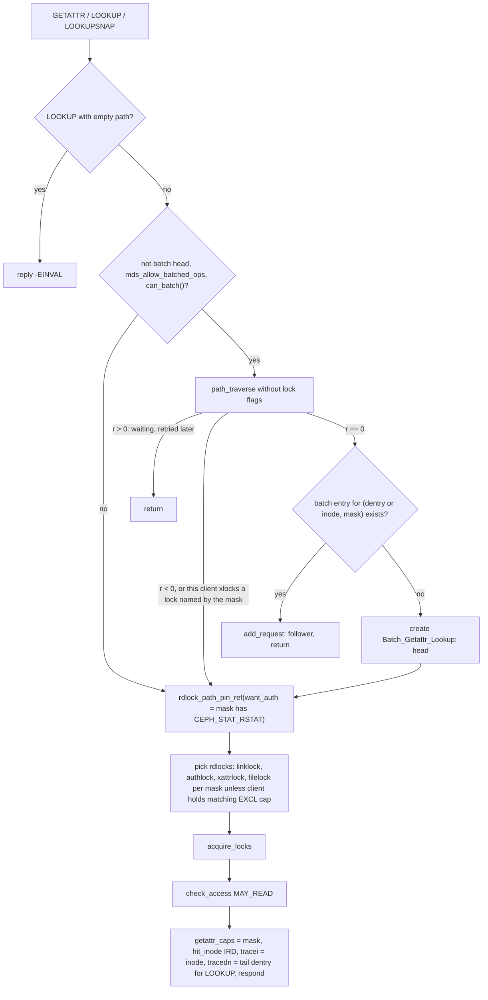
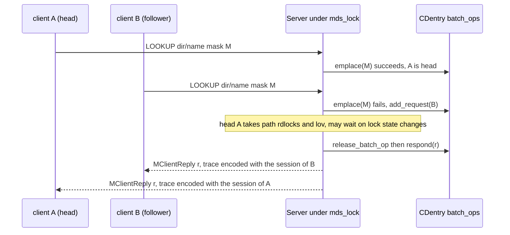
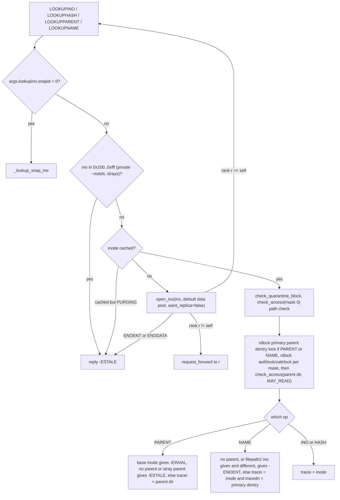
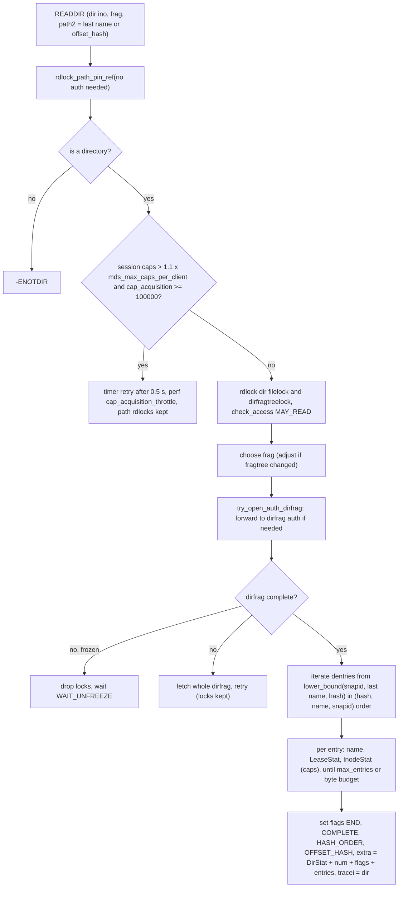
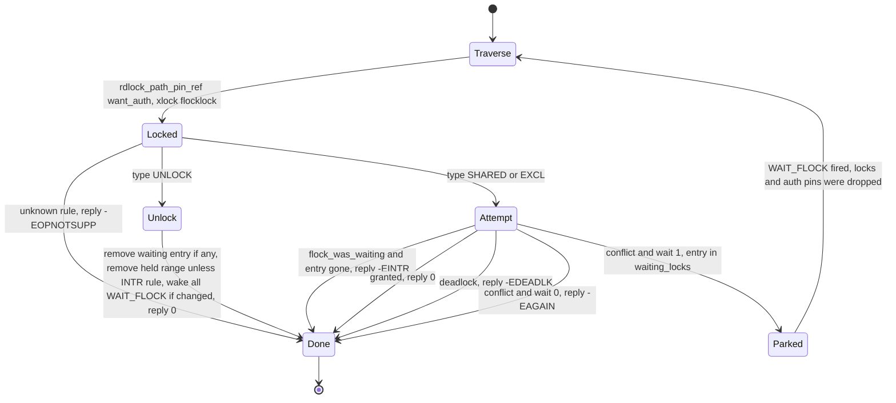
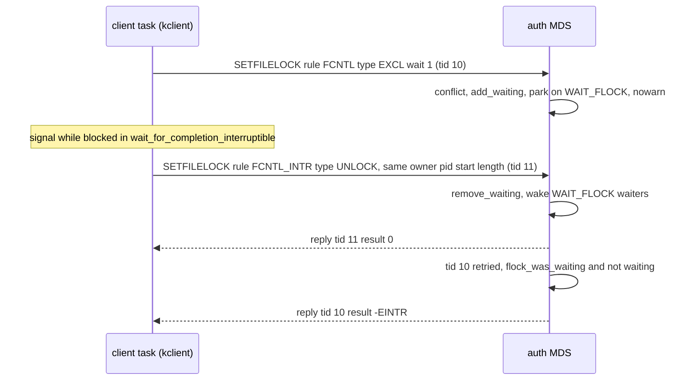
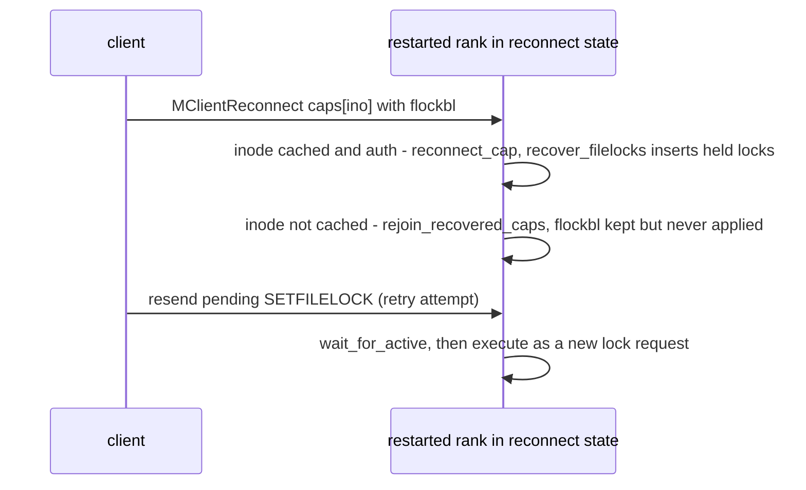

# Read-side requests: getattr, lookup (incl. NFS handle lookups), open, readdir, and fcntl/flock file locks

> Part of the [C++ MDS project map](../README.md). Sources: `src/mds/Server.cc` (12,935 LOC; in scope: handlers at 4272-4895 and 5050-5578, plus `recover_filelocks` 1945-1965, `Batch_Getattr_Lookup` 108-164, reply helpers 2172-2560, `rdlock_path_pin_ref` 3869-3946, `do_open_truncate` 5780-5844, `handle_client_lssnap` 11475-11573), `src/mds/flock.h` (266), `src/mds/flock.cc` (679), `src/mds/BatchOp.{h,cc}` (78), `src/mds/Mutation.{h,cc}` (batch helpers), `src/mds/CInode.cc` (`encode_inodestat` and cap helpers, ~600 LOC used), `src/mds/Locker.cc` (leases, `issue_new_caps`, max_size, ~400 LOC used), `src/mds/MDCache.cc` (`path_traverse`, `open_ino`, `request_cleanup`), `src/include/ceph_fs.h`; Linux client `linux/fs/ceph/{locks.c,dir.c,export.c,file.c,inode.c,mds_client.c,caps.c}` and VFS `linux/fs/locks.c` (scanned tree: Makefile 7.3.0-rc6, mainline commit `af32da41b032`); userspace client `src/client/Client.cc`.
> Related: [request-lifecycle](request-lifecycle.md), [namespace-mutations](namespace-mutations.md), [attributes-and-xattrs](attributes-and-xattrs.md), [wire-protocol](../02-client-protocol/wire-protocol.md), [sessions](../02-client-protocol/sessions.md), [capabilities](../02-client-protocol/capabilities.md), [leases-lock-caches-and-async-dirops](../02-client-protocol/leases-lock-caches-and-async-dirops.md), [kclient-expectations](../02-client-protocol/kclient-expectations.md), [libcephfs-fuse-ganesha-expectations](../02-client-protocol/libcephfs-fuse-ganesha-expectations.md), [cinode-and-inode-types](../04-cache/cinode-and-inode-types.md), [cdir-cdentry-and-cache-objects](../04-cache/cdir-cdentry-and-cache-objects.md), [mdcache-subtrees-traversal-replication](../04-cache/mdcache-subtrees-traversal-replication.md), [dirfrags-and-fragmentation](../04-cache/dirfrags-and-fragmentation.md), [lock-types-and-state-machines](../05-locking/lock-types-and-state-machines.md), [acquiring-locks](../05-locking/acquiring-locks.md), [events-and-replay](../06-journal/events-and-replay.md), [mds-tables](../07-storage-formats/mds-tables.md), [rados-object-catalog](../07-storage-formats/rados-object-catalog.md), [subtree-migration](../08-multi-mds/subtree-migration.md), [resolve-and-rejoin](../09-recovery/resolve-and-rejoin.md), [snapshots](../10-snapshots-quotas-subvolumes/snapshots.md), [quarantine](../12-qos-metrics-quiesce-quarantine/quarantine.md), [process-and-threading](../00-architecture/process-and-threading.md), [mds_lock-analysis](../00-architecture/mds_lock-analysis.md).

## 1. Purpose and responsibilities

* Serve the read-mostly client operations: `CEPH_MDS_OP_GETATTR`, `LOOKUP`, `LOOKUPSNAP`, the inode-number lookups used by NFS file handles (`LOOKUPINO`, `LOOKUPHASH`, `LOOKUPPARENT`, `LOOKUPNAME`, and snapshot-inode lookup), `OPEN` (without `O_CREAT`, plus the "already created, just open" path of a resent `CREATE`), `READDIR`, `LSSNAP` (snapdir listing, summarized here, owned by [snapshots](../10-snapshots-quotas-subvolumes/snapshots.md)), `SETFILELOCK` and `GETFILELOCK` (`src/mds/Server.cc:2841` (Server::dispatch_client_request)).
* Attach a **trace** to every successful reply: inode stats (`InodeStat`), the capabilities newly granted to the client on those inodes, and dentry leases. Read replies are the main way a client acquires caps; no separate `MClientCaps` grant is sent for them (`src/mds/Server.cc:2491` (Server::set_trace_dist), `src/mds/CInode.cc:3959` (CInode::encode_inodestat)).
* Coalesce concurrent identical GETATTR/LOOKUP requests ("batch ops") so that only one of them takes locks (`src/mds/Server.cc:108` (Batch_Getattr_Lookup)).
* Resolve inode numbers that are not cached, using RADOS backtraces and peer ranks (`open_ino`), so stateless NFS handles keep working across MDS restarts and cache trims (`src/mds/Server.cc:4433` (Server::handle_client_lookup_ino)).
* Open: register the caps the client "wants" for the file mode, truncate on `O_TRUNC` (journaled), grow the client's writeable range (`max_size`) for writers, and journal `EOpen` so open files survive MDS failover (`src/mds/Server.cc:4639` (Server::handle_client_open)).
* Readdir: page through one directory fragment in dentry-hash order, honoring entry/byte budgets, granting per-entry caps and leases (`src/mds/Server.cc:5092` (Server::handle_client_readdir)).
* Advisory locks: hold all POSIX (fcntl) and BSD (flock) lock state in MDS memory per inode, block/wake waiters, detect fcntl deadlocks, drop a client's locks when its caps go away, and rebuild state from client reconnect after an MDS restart (`src/mds/Server.cc:5418` (Server::handle_client_file_setlock), `src/mds/flock.cc:210` (ceph_lock_state_t::add_lock), `src/mds/Server.cc:1945` (Server::recover_filelocks)).
* Out of scope here: `O_CREAT` opens (see [namespace-mutations](namespace-mutations.md)), `GETVXATTR` (see [attributes-and-xattrs](attributes-and-xattrs.md)), `READDIR_SNAPDIFF` and snapshot ops (see [snapshots](../10-snapshots-quotas-subvolumes/snapshots.md)). `Server::journal_quarantine_inode` sits in this line range and is described briefly in section 3.12; the quarantine feature itself is in [quarantine](../12-qos-metrics-quiesce-quarantine/quarantine.md).

## 2. Source map

| File | Class / function | Lines | Role |
|---|---|---|---|
| `src/include/ceph_fs.h` | `CEPH_MDS_OP_*`, `ceph_mds_request_args` (`getattr`, `readdir`, `open`, `filelock_change`, `lookupino`), `CEPH_O_*`, `CEPH_READDIR_*`, `ceph_mds_reply_head`, `ceph_mds_reply_cap`, `ceph_mds_reply_lease`, `ceph_filelock`, `CEPH_LOCK_FCNTL/FLOCK/*_INTR`, `CEPH_LOCK_SHARED/EXCL/UNLOCK`, `CEPH_STAT_*` | 397-447, 494-526, 604-675, 727-800, 862-912 | wire constants and structs |
| `src/mds/Server.cc` | `Batch_Getattr_Lookup` | 108-164 | batch head and followers for GETATTR/LOOKUP |
| `src/mds/Server.cc` | `Server::recover_filelocks` | 1945-1965 | rebuild lock tables from `MClientReconnect` |
| `src/mds/Server.cc` | `Server::respond_to_request`, `reply_client_request`, `set_trace_dist` | 2172, 2379, 2491 | reply construction, batch fan-out, trace encoding |
| `src/mds/Server.cc` | `Server::handle_client_request` | 2616-2726 | completed-request detection, retried CREATE/OPEN conversion |
| `src/mds/Server.cc` | `Server::dispatch_client_request` | 2765-2950 | read-only gate, op switch |
| `src/mds/Server.cc` | `Server::check_access`, `Server::check_quarantine_block` | 3500, 3529 | MDS-cap permission check, quarantine gate |
| `src/mds/Server.cc` | `C_MDS_TryFindInode`, `Server::rdlock_path_pin_ref` | 3834-3946 | traverse, path rdlocks, auth pin, ESTALE recovery |
| `src/mds/Server.cc` | `Server::try_open_auth_dirfrag` | 4231-4266 | open dirfrag or forward to its auth |
| `src/mds/Server.cc` | `Server::handle_client_getattr` | 4272-4420 | GETATTR, LOOKUP, LOOKUPSNAP |
| `src/mds/Server.cc` | `C_MDS_LookupIno2`, `handle_client_lookup_ino`, `_lookup_snap_ino`, `_lookup_ino_2` | 4422-4636 | LOOKUPINO/HASH/PARENT/NAME, snap inode lookup |
| `src/mds/Server.cc` | `Server::handle_client_open` | 4639-4827 | OPEN |
| `src/mds/Server.cc` | `Server::_finalize_readdir`, `Server::handle_client_readdir` | 5050-5329 | READDIR |
| `src/mds/Server.cc` | `C_MDS_quarantine_inode_update_finish`, `Server::journal_quarantine_inode` | 5379-5416 | journal the quarantine flag (adjacent code) |
| `src/mds/Server.cc` | `Server::handle_client_file_setlock`, `Server::handle_client_file_readlock` | 5418-5576 | SETFILELOCK, GETFILELOCK |
| `src/mds/Server.cc` | `Server::do_open_truncate` | 5780-5844 | `O_TRUNC` mutation |
| `src/mds/Server.cc` | `Server::handle_client_lssnap` | 11475-11573 | snapdir listing |
| `src/mds/BatchOp.h`, `BatchOp.cc` | `BatchOp::forward/respond` | h:25-40, cc:22-36 | batch interface |
| `src/mds/Mutation.h`, `Mutation.cc` | `MDRequestImpl::can_batch`, `release_batch_op`, `is_batch_head`, fields `getattr_caps`, `o_trunc`, `has_completed`, `More::flock_was_waiting`, `batch_op_map` | h:348, 434-437, 471-476, 494; cc:438-469 | per-request state used here |
| `src/mds/MDCache.cc` | `MDCache::path_traverse`, `maybe_request_forward_to_auth` | 8443-8907 | traversal, null dentries, forwarding |
| `src/mds/MDCache.cc` | `MDCache::open_ino`, `fetch_backtrace`, `open_ino_finish` | 9591, 10457, 9362 | inode open by number via backtrace |
| `src/mds/MDCache.cc` | `MDCache::request_forward`, `request_cleanup` | 9970, 10064 | forwarding (incl. batch), batch head hand-over |
| `src/mds/MDCache.cc` | `MDCache::trim_client_leases`, `process_imported_caps` | 7933, 5483 | lease expiry; caps of inodes missing at reconnect |
| `src/mds/MDCache.h` | `lookup_snap_inode`, `client_lease_durations` | 882, 1198 | snap inode map lookup, lease durations {5, 30, 300} s |
| `src/mds/CInode.cc` | `CInode::encode_inodestat` | 3959-4400 | InodeStat encoding and cap issue |
| `src/mds/CInode.cc` | `get_caps_liked`, `get_caps_allowed_by_type`, `get_caps_allowed_for_client`, `get_caps_quiesce_mask`, `get_caps_quarantine_mask` | 3712-3842 | which caps may be issued |
| `src/mds/CInode.cc` | `add_client_cap`, `remove_client_cap`, `reconnect_cap` | 3595, 3625, 3676 | cap objects; lock cleanup on cap removal |
| `src/mds/CInode.cc` | `encode_lock_iflock`, `decode_lock_iflock`, `encode_export`, `decode_import` | 2231, 2239, 4656, 4706 | lock tables on the wire between ranks |
| `src/mds/CInode.cc` | `InodeStoreBase::hash_dentry_name`, `CInode::has_snap_data` | 720, 3260 | dentry hash; snapshot range test |
| `src/mds/CInode.h` | `WAIT_TRUNC`, `WAIT_FLOCK`, `WAIT_QUARANTINE`, `batch_ops`, `get_fcntl_lock_state`, `get_flock_lock_state`, `clear_file_locks`, `_encode_file_locks`, `_decode_file_locks` | 414-416, 429, 1178-1224 | per-inode lock tables, waiters |
| `src/mds/CDentry.h` | `batch_ops`, `use_projected`, `key()` | 391, 214, 158 | per-dentry batch map; projected linkage rule |
| `src/mds/Locker.cc` | `Locker::issue_client_lease`, `encode_lease`, `handle_client_lease`, `revoke_client_leases` | 4542, 4609, 4472, 4592 | dentry leases |
| `src/mds/Locker.cc` | `Locker::issue_new_caps` | 2436-2499 | wanted caps for OPEN |
| `src/mds/Locker.cc` | `calc_new_max_size`, `check_client_ranges`, `calc_new_client_ranges`, `check_inode_max_size`, `share_inode_max_size` | 2980-3229 | writer `max_size` |
| `src/mds/Locker.cc` | `Locker::try_rdlock_snap_layout` | 157-226 | rdlock `snaplock` of every ancestor |
| `src/mds/Locker.cc` | `Locker::_do_cap_update` (flock blob in `MClientCaps`) | 4161-4180 | legacy lock import via cap message |
| `src/mds/flock.h` | `ceph_filelock_owner_equal`, `ceph_filelock_compare`, `ceph_lock_state_t` | 17-264 | lock table type |
| `src/mds/flock.cc` | `global_waiting_locks`, `add_lock`, `adjust_locks`, `remove_lock`, `look_for_lock`, `is_deadlock`, `remove_all_from`, waiting helpers | 19-662 | lock algorithms (also linked into the userspace client) |
| `src/mds/mdstypes.h` | `dentry_key_t` ordering, `cap_reconnect_t` (with `flockbl`) | 388-422, 480-506 | readdir order; reconnect record |
| `src/common/ceph_fs.cc` | `ceph_flags_to_mode`, `ceph_caps_for_mode` | 116-159 | open flags to file mode to wanted caps |

## 3. How it works

### 3.1 Shared plumbing used by every handler on this page

**Dispatch.** All ops arrive as `MClientRequest` and are routed by `Server::dispatch_client_request`. Before the switch, any op with the write bit (`CEPH_MDS_OP_WRITE` = `0x1000`) or an `OPEN` with `O_CREAT|O_TRUNC` (`MClientRequest::may_write`) is refused with `-EROFS` if the cache is read-only (`src/mds/Server.cc:2794` (Server::dispatch_client_request), `src/messages/MClientRequest.h:196` (MClientRequest::may_write)). `SETFILELOCK` (`0x1109`) carries the write bit; `GETFILELOCK` (`0x0110`) does not. The routing (`src/mds/Server.cc:2841-2915`):

| Op | Code | Handler call |
|---|---|---|
| `LOOKUPHASH` | `0x102` | `handle_client_lookup_ino(mdr, false, false)` (identical to LOOKUPINO) |
| `LOOKUPINO` | `0x104` | `handle_client_lookup_ino(mdr, false, false)` |
| `LOOKUPPARENT` | `0x103` | `handle_client_lookup_ino(mdr, true, false)` |
| `LOOKUPNAME` | `0x105` | `handle_client_lookup_ino(mdr, false, true)` |
| `LOOKUP` | `0x100` | `handle_client_getattr(mdr, true)` |
| `LOOKUPSNAP` | `0x400` | `handle_client_getattr(mdr, false)` ("does not reference a CDentry; treat it as a getattr") |
| `GETATTR` | `0x101` | `handle_client_getattr(mdr, false)` |
| `READDIR` | `0x305` | `handle_client_readdir` |
| `SETFILELOCK` | `0x1109` | `handle_client_file_setlock` |
| `GETFILELOCK` | `0x110` | `handle_client_file_readlock` |
| `CREATE` with `mdr->has_completed` | `0x1301` | set created-ino extra blob, then `handle_client_open` |
| `OPEN` | `0x302` | `handle_client_open` |
| `LSSNAP` | `0x402` | `handle_client_lssnap` |

**Completed requests.** If a request is a replay or retry and the session's `completed_requests` contains its tid, `Server::handle_client_request` either replies immediately with a traceless 0 (plus the created ino in the extra blob, if any), or, when the completed request created an inode and the MDS is in clientreplay, converts it into `LOOKUP` (if the client wanted a dentry) or `GETATTR` with mask `CEPH_STAT_CAP_INODE_ALL` so the client gets a trace (`src/mds/Server.cc:2655-2693` (Server::handle_client_request)). Replays (`CEPH_MDS_FLAG_REPLAY`) always get the immediate traceless reply; non-replay retries of `OPEN` and `CREATE` are always re-executed with `mdr->has_completed = true`, which suppresses a second truncate (`src/mds/Server.cc:4738` (Server::handle_client_open)).

**`rdlock_path_pin_ref(mdr, want_auth, no_want_auth)`** (`src/mds/Server.cc:3879` (Server::rdlock_path_pin_ref)) is the common "find the target inode" helper:

* If `PATH_LOCKED` is already set (a retried request), it returns `mdr->in[0]` without re-traversing.
* Path through the snapdir (`filepath::is_last_snap()`, which is true when the **first** component is empty): `want_auth` is forced on unless `no_want_auth`, and no path rdlocks are taken. Otherwise `MDS_TRAVERSE_RDLOCK_PATH | MDS_TRAVERSE_RDLOCK_SNAP` are set and `mds_forward_all_requests_to_auth` forces `want_auth`.
* `path_traverse` then rdlocks the `snaplock` of the base inode and every ancestor up to the root (`src/mds/Locker.cc:157` (Locker::try_rdlock_snap_layout)), rdlocks `dn->lock` of every dentry on the path (and wrlocks the parent `filelock` if it is lock-cached, forcing an async-dirop client to flush), rdlocks the `snaplock` of every inode reached, discovers or forwards when a dirfrag is not local, fetches missing dentries from RADOS, and opens remote (hard-link) targets (`src/mds/MDCache.cc:8443` (MDCache::path_traverse)).
* Errors: `-ENOENT` with a non-empty dentry vector replies with the (null) tail dentry as trace if the client set `CEPH_MDS_FLAG_WANT_DENTRY`; `-ESTALE` starts `find_ino_peers`, then `open_ino`, and re-dispatches (or replies `-ESTALE` if the inode is being purged) (`src/mds/Server.cc:3834` (C_MDS_TryFindInode)); other errors are returned.
* Then `check_quarantine_block` (requests from clients without `CEPHFS_FEATURE_QUARANTINE` on an inode whose enclosing subvolume root is being quarantined **or is already quarantined** wait on `CInode::WAIT_QUARANTINE` of that root, so such clients block for the whole quarantine, `src/mds/Server.cc:3529`), and with `want_auth` an auth pin on the target (waiting on `WAIT_UNFREEZE` if frozen/freezing). A retried request that already has `PATH_LOCKED` skips both.

**`check_access(mdr, in, mask)`** calls `Session::check_access`, i.e. the `MDSAuthCaps` grant match (fs name, path, network, root_squash, quarantine access, and Unix mode checks only when the grant restricts uid), using the caller uid/gids carried in the request (`src/mds/Server.cc:3500` (Server::check_access), `src/mds/SessionMap.cc:1109` (Session::check_access), `src/mds/MDSAuthCaps.cc:266` (MDSAuthCaps::is_capable)). The MDS does not check POSIX search permission on intermediate directories during traversal; clients do that. See [auth-and-mds-caps](../01-cluster-integration/auth-and-mds-caps.md).

**Reply construction.** `respond_to_request` replies through the batch op if the request is a batch head, otherwise `reply_client_request` (`src/mds/Server.cc:2172`). `reply_client_request` drops non-rdlocks, then, if the reply is not an early-replied request and `tracei` or `tracedn` is set, calls `set_trace_dist`, sets the extra blob (`mdr->reply_extra_bl`) and the mdsmap epoch, sends, and finishes the request (`src/mds/Server.cc:2379`). `set_trace_dist(reply, in, dn, mdr)` encodes, in order (`src/mds/Server.cc:2491`):

1. `snapbl` = snap trace of the inode's realm (only when `mdr->snapid == CEPH_NOSNAP`).
2. If `dn`: parent directory `InodeStat` (this also issues caps on the parent directory), `DirStat` (frag, auth rank, replica set when the dir is auth and `mds_forward_all_requests_to_auth` is false), dentry name, `LeaseStat` from `Locker::issue_client_lease`; `head.is_dentry = 1`.
3. If `in`: target `InodeStat` with `getattr_caps = mdr->getattr_caps`; `head.is_target = 1`.

### 3.2 GETATTR, LOOKUP and LOOKUPSNAP (`Server::handle_client_getattr`)

Step by step (`src/mds/Server.cc:4272-4420`):

1. `LOOKUP` with path depth 0 returns `-EINVAL` (GETATTR with depth 0 is the normal "stat by ino" form, also used to stat `/` at mount).
2. `mask = args.getattr.mask`. If the mask contains `CEPH_STAT_RSTAT` (= `CEPH_CAP_FILE_WREXTEND`) the request needs the auth MDS (recursive stats are only exact on the auth) (`src/mds/Server.cc:4286`).
3. Batching (section 3.3).
4. `rdlock_path_pin_ref(mdr, want_auth, false)`.
5. `issued` = caps currently issued to this client on the target, but only if `mdr->snapid == CEPH_NOSNAP` or `snapid <= cap->client_follows` (`src/mds/Server.cc:4351`).
6. Lock selection (`src/mds/Server.cc:4359-4397`):

| Mask bit | Lock rdlocked | Skipped when client already holds |
|---|---|---|
| `CEPH_CAP_LINK_SHARED` (Ls) | `linklock` | `CEPH_CAP_LINK_EXCL` |
| `CEPH_CAP_AUTH_SHARED` (As) | `authlock` | `CEPH_CAP_AUTH_EXCL` |
| `CEPH_CAP_XATTR_SHARED` (Xs) | `xattrlock` | `CEPH_CAP_XATTR_EXCL` |
| `CEPH_CAP_FILE_SHARED` (Fs) | `filelock`, with the exception below | `CEPH_CAP_FILE_EXCL` |
| `CEPH_CAP_PIN` | none | n/a |

   The rationale (comment at `src/mds/Server.cc:4343`): a client's stat is correct if either it holds the EXCL cap on the field or the MDS rdlocks the field. Filelock exception: if `filelock` is **unstable**, has **no wrlocks**, and `can_read(client)` is true, the MDS does not rdlock it and returns the current values (lower stat latency with concurrent writers; the reply then may not carry Fs). If the request already rdlocks `filelock` (from an earlier attempt) it keeps the rdlock. Because the decision can change between retries, if the request now needs the filelock rdlock but already holds rdlocks on link/auth/xattr locks, it calls `drop_locks` and `drop_local_auth_pins` and requeues itself with `C_MDS_RetryRequest` (lock-order safety); otherwise it adds the rdlock and clears `ALL_LOCKED` so `acquire_locks` runs again.
7. `acquire_locks`, then `check_access(MAY_READ)`.
8. `mdr->getattr_caps = mask` ("so we return at least a snapshot value for them", which matters for xattrs and inline data, section 3.4), `balancer->hit_inode(ref, META_POP_IRD)`, `tracei = ref`, and for LOOKUP `tracedn = mdr->dn[0].back()`; reply.

`LOOKUPSNAP` is the client's lookup of a name inside a `.snap` directory (kclient `ceph_lookup` and libcephfs `_do_lookup` use it when the parent is the snapdir): its path is `(dir ino, "", snapname)` (the empty component means snapdir), `path_traverse` resolves the snapshot name with `SnapRealm::resolve_snapname` and returns the directory inode itself with `mdr->snapid` set (`src/mds/MDCache.cc:8538-8555` (MDCache::path_traverse)). It is never batched and never carries a dentry trace.

### 3.3 Batching (`Batch_Getattr_Lookup`)

* Eligible when `mds_allow_batched_ops` (default true, runtime-changeable), the request is not already a batch head, and `MDRequestImpl::can_batch()` holds: no auth pins, no remote auth pins, no lock cache, no locks held, and either `GETATTR` with path depth 0 (stat by ino) or `LOOKUP` with path depth 1 that does not go through the snapdir (`src/mds/Mutation.cc:438` (MDRequestImpl::can_batch)).
* The candidate runs a lock-free `path_traverse` (flags 0, or `MDS_TRAVERSE_WANT_AUTH`), which still waits (and returns `r > 0`) if a dentry on the path is not readable. If the traverse fails, or the requesting client holds an xlock on any lock named by the mask (`is_xlocked_by_client`), the request is not batched (`src/mds/Server.cc:4289-4306`).
* Key: `std::map<int /*mask*/, std::unique_ptr<BatchOp>> batch_ops` on the **tail `CDentry`** for LOOKUP, on the **target `CInode`** for GETATTR (`src/mds/CDentry.h:391`, `src/mds/CInode.h:429`). The first request creates the entry and becomes head (`mdr->batch_op_map` points at the map); later identical requests `add_request` and return without doing anything else.
* The head then executes normally. When it responds (`Server::respond_to_request` with `is_batch_head()`), `release_batch_op()` removes the map entry and `Batch_Getattr_Lookup::_respond(r)` replies to every non-killed follower with the head's `tracei`, `tracedn` and result, and finally to the head (`src/mds/Server.cc:149-160`). Each follower's reply is encoded with the follower's own session (its own caps and leases). Followers are answered first, while the head still holds its rdlocks, so their traces are encoded under the head's locks; the head's own `reply_client_request` drops them afterwards. Followers hold no locks of their own, only a pin on the dentry or inode taken when they joined.
* Forwarding: `MDCache::request_forward` on a batch head forwards the head and every non-killed follower (`src/mds/Server.cc:139-148`, `src/mds/MDCache.cc:9978`).
* Head death: if the head is killed, `MDCache::request_cleanup` promotes the most recently queued non-killed follower (`find_new_head`) and re-dispatches it via `C_MDS_RetryRequest`; if none, the map entry is erased (`src/mds/MDCache.cc:10070-10085`).
* Followers never execute `check_access`, `check_quarantine_block` or `getattr_caps = mask`; they inherit the head's result code and target (section 8).
* Op tracker events: `creating lookup batch head`, `joining batch lookup`, `creating getattr batch head`, `joining batch getattr`.

### 3.4 What a trace carries, and which caps are issued (`CInode::encode_inodestat`)

`encode_inodestat(bl, session, dir_realm, snapid, max_bytes, getattr_caps)` (`src/mds/CInode.cc:3959-4400`) is called for the target inode, the parent directory of a dentry trace, and every readdir entry.

**Cap issue.** For `snapid == CEPH_NOSNAP`:

* `no_caps` is true if any of: the inode is a non-auth snapshot (for snapped reads only), the session is stale, `dir_realm` was passed and the inode's snaprealm differs from it (readdir entries in a different realm, e.g. a subvolume root or a directory with its own snapshots, get **no caps**), the inode is frozen, or it is `STATE_EXPORTINGCAPS` (`src/mds/CInode.cc:4027-4031`).
* If not `no_caps` and the client has no cap, a new `Capability` is created (wanted = 0) and, on the auth, `choose_ideal_loner()` runs (`src/mds/CInode.cc:4208-4213`).
* Issued set = `(cap->wanted() | get_caps_liked()) & get_caps_allowed_for_client()`, applied with `Capability::issue_norevoke` (adds bits, never revokes, bumps `last_sent`), and the reply carries `cap->pending()` (`src/mds/CInode.cc:4215-4223`).
* `get_caps_liked()`: directories `p | As Ax Ls Lx Xs Xx Fs Fx` (never `Fc Fr Fw Fb`); files everything except `Fl` (LAZYIO); both masked by the quiesce mask (a quiesced inode only allows `ANY_RD | Fc | Fb | p`) (`src/mds/CInode.cc:3737`).
* `get_caps_allowed_for_client()`: from the current state of `filelock`, `authlock`, `xattrlock`, `linklock` (loner and xlocker columns for the loner client), masked by quarantine (`p` only for clients without quarantine access to a quarantined inode) and quiesce; for directories `CEPH_CAP_ANY_DIR_OPS` is removed unless a lock cache grants it; for files with inline data or a pool namespace, `Fr`/`Fw` are removed for clients lacking `CEPH_FEATURE_MDS_INLINE_DATA` / `CEPH_FEATURE_FS_FILE_LAYOUT_V2` (`src/mds/CInode.cc:3798`).
* If `no_caps` holds but the client's cap is still marked new (created by `issue_new_caps` for an OPEN while the session is stale; the code asserts `cap->is_stale()`) and this is not a readdir entry (`dir_realm` null), `CEPH_CAP_PIN` is issued so the new cap is not lost (`src/mds/CInode.cc:4224-4233`). With nothing issued, the reply cap record is all zeros.
* `ecap.flags = CEPH_CAP_FLAG_AUTH` when this MDS is auth (replicas also issue caps, with their replica-allowed sets).

For snapshots (`snapid != CEPH_NOSNAP`): on the auth, caps = all caps allowed by lock type (`get_caps_allowed_by_type(CAP_ANY)`, masked by quarantine and quiesce), intersected with the per-client allowance when the inode is head or has caps; on a non-auth rank (`valid == false`, because `old_inodes` are only valid on the auth) only `CEPH_STAT_CAP_INODE` (`p`); `seq = mseq = realm = 0`; the `Capability` table is not touched (`src/mds/CInode.cc:4181-4206`). The `cap_id` and `wanted` fields of `ecap` are not assigned on this path (section 8).

**Data selection.** Field groups come from the projected inode when this client holds the corresponding xlock or is the loner (`pfile`, `pauth`, `plink`, `pxattr`, `plocal` via `versionlock`), else from the committed inode (`src/mds/CInode.cc:4045-4105`). `version` is `oi->version * 2 + is_projected()`. `max_size` = min of the committed and projected `client_ranges[client]` (so a range that is only projected is not yet visible). Xattrs are included if the client has no cap yet, or `cap->client_xattr_version` is older, or `getattr_caps` contains `Xs`; and only if the resulting `pending | getattr_caps` contains `Xs` (otherwise `xattr_version = 0`). Inline data analogously with `Fr` in `getattr_caps` and `Fs` in `pending | getattr_caps` (`src/mds/CInode.cc:4079-4118`, `4258-4278`). Optional metadata carries the directory `charmap` and the quarantine marker; `subvolume_id` is appended (InodeStat v9, `CEPHFS_FEATURE_REPLY_ENCODING` clients) (`src/mds/CInode.cc:4120-4141`, `4315-4372`).

**Byte budget.** With `max_bytes != 0` (readdir), the function estimates the encoded size and returns `-ENOSPC` without encoding if it does not fit (`src/mds/CInode.cc:4143-4176`).

### 3.5 Dentry leases (`Locker::issue_client_lease`)

Every dentry trace (lookup, open with `WANT_DENTRY`, LOOKUPNAME, readdir entries) carries a `LeaseStat`. A **valid** lease is issued only if all hold (`src/mds/Locker.cc:4542-4590`):

| Condition | Meaning |
|---|---|
| `mdr->snapid == CEPH_NOSNAP` | no leases inside snapshots |
| `dn->lock.can_lease(client)` | dentry lock state allows leases (e.g. `LOCK_SYNC`) |
| `!diri->is_stray()` | never in stray directories |
| `!diri->filelock.can_lease(client)` | in `sm_filelock` the lease column is `ANY` only in `LOCK_SYNC` (and `XCL` in `LOCK_XLOCKDONE`), so the parent's `filelock` must be in any other state (`LOCK_LOCK`, `LOCK_MIX`, `LOCK_EXCL`, `LOCK_XSYN`, transitions) (`src/mds/locks.c`); in `LOCK_SYNC` clients rely on `Fs` on the directory instead |
| client has neither `Fs` nor `Fx` pending on the parent | same reason |

Consequence: READDIR rdlocks the directory `filelock`, which normally keeps it in `LOCK_SYNC`, so readdir entries normally carry **null** leases and the client relies on the `Fs` cap that the reply's own directory `InodeStat` grants. Valid leases mostly come from LOOKUP (which does not lock the parent `filelock`) while the directory is in a non-SYNC state and the client has no `Fs`/`Fx` on it.

Valid lease: `ClientLease` added to the dentry (`PIN_CLIENTLEASE`, `lock.get_client_lease()`), touched into lease pool 1, `mask = CEPH_LEASE_VALID (3) | CEPH_LEASE_PRIMARY_LINK (4) if the linkage is primary`, `duration_ms = 30000` (`client_lease_durations[1]`, `src/mds/MDCache.h:1198`), `seq = ++lease->seq`. Otherwise a **null lease**: `mask = 0`, duration 0, seq 0. Both carry `alternate_name` (case-insensitive original spelling or fscrypt ciphertext name) when encoded as `LeaseStat` v2 (`CEPHFS_FEATURE_REPLY_ENCODING`), else the legacy 10-byte struct (`src/mds/Locker.cc:4609` (Locker::encode_lease)).

Lifecycle: expired by `MDCache::trim_client_leases` when `ttl` passes (`src/mds/MDCache.cc:7933`); `MClientLease` from clients handled by `Locker::handle_client_lease` (`REVOKE_ACK`/`RELEASE` with matching seq remove it; `RENEW` re-arms it if `dn->lock.can_lease`) (`src/mds/Locker.cc:4472`); revoked with `CEPH_MDS_LEASE_REVOKE` when the dentry lock must change state (`src/mds/Locker.cc:4592`). Full protocol: [leases-lock-caches-and-async-dirops](../02-client-protocol/leases-lock-caches-and-async-dirops.md).

### 3.6 Negative lookups

When the tail name is missing in an **auth** dirfrag that is **complete**, or (head lookups only) whose bloom filter (names of head dentries trimmed since it was last complete, `src/mds/MDCache.cc:7244`, `src/mds/CDir.cc:749`) does not contain the name, `path_traverse` concludes `-ENOENT` without RADOS I/O; a non-auth dirfrag means discover or forward instead. For head lookups of the last component it **creates a null `CDentry`**, rdlocks it (with `RDLOCK_PATH`), and returns it in the dentry vector (`src/mds/MDCache.cc:8744-8801`). Otherwise the incomplete dirfrag is fetched and the request retried: with the default `mds_dir_prefetch = true` the whole dirfrag is read (omap pages of `mds_dir_keys_per_op` = 16384 keys); with `mds_dir_prefetch = false` only the one omap key is read (`CDir::fetch_keys`), optionally followed by a background full fetch after `mds_dir_prefetch_backend_hit_threshold` (16) keyed fetches when `mds_dir_prefetch_backend` is enabled (`src/mds/CDir.cc:1563-1648` (CDir::fetch)). A cached null dentry that is readable also yields `-ENOENT` (`src/mds/MDCache.cc:8683-8694`). `rdlock_path_pin_ref` then replies `-ENOENT` with `tracedn` set if the client asked `CEPH_MDS_FLAG_WANT_DENTRY` (both kclient lookups and libcephfs `_do_lookup` do), so the client receives the parent inode, `DirStat`, name and a lease on the negative dentry (`src/mds/Server.cc:3906-3910`). Negative lookups are not batched. Lookups inside snapshots never create null dentries.

### 3.7 Lookup by inode number: LOOKUPINO, LOOKUPHASH, LOOKUPPARENT, LOOKUPNAME, snapshot inodes

These serve NFS file handles (kclient `export.c`, Ganesha through libcephfs `ceph_ll_lookup_inode`/`ceph_ll_lookup_vino`) and libcephfs `..`/getcwd fallbacks. Path: `filepath(ino)`; LOOKUPNAME may carry `filepath2(parent ino)`; args `lookupino {mask, snapid, parent, hash}` share the first word with `getattr.mask`.

Details (`src/mds/Server.cc:4433-4636`):

* `MDS_IS_PRIVATE_INO(ino)` (`[MDS_INO_MDSDIR_OFFSET=0x100, MDS_INO_SYSTEM_BASE=0x1000)`, i.e. `~mdsN` dirs, logs, purge queues, strays) returns `-ESTALE` (tracker #49922).
* Not cached: `open_ino(ino, -1 /*default data pool*/, C_MDS_LookupIno2, want_replica=false)`. `open_ino` (deduplicated per ino in `opening_inodes`) first asks every other active rank with `MMDSOpenIno` (`check_peers` starts true), then reads the backtrace (`getxattr "parent"` on `<ino hex>.00000000` in the default data pool, follows `backtrace.pool` redirection, falls back to the metadata pool on `-ENOENT`; an empty backtrace gives `-ESTALE`, a corrupt one `-EIO`), opens the ancestors recursively (`open_ino` of the parent directory in the metadata pool, then a dirfrag fetch), and completes with the auth rank (`src/mds/MDCache.cc:9591` (MDCache::open_ino), `9372` (MDCache::do_open_ino), `9414` (MDCache::do_open_ino_peer), `9117` (MDCache::_open_ino_backtrace_fetched), `10457` (MDCache::fetch_backtrace)). If some rank in the map is not yet active, the peer phase waits ("waiting for more peers to be active") until it is. `_lookup_ino_2`: own rank re-dispatches the request (now cached), another rank forwards, `-ENOENT`/`-ENODATA` become `-ESTALE`, other errors are returned.
* Cached inodes are answered by **any** rank that has them (auth not required); no forwarding.
* The `check_access(mdr, in, 0)` call applies only the MDS-cap path restriction; read access on the parent directory is checked only when some lock was needed (`lov` non-empty).
* `mask` (if non-zero): rdlock `authlock` for `As` and `xattrlock` for `Xs` unless the client holds the matching EXCL cap; `getattr_caps = mask`. Ls/Fs bits in the mask take no lock here.
* `LOOKUPHASH` is handled exactly like `LOOKUPINO`: the `filepath2 (dirino, "<hash>")` that libcephfs `Client::lookup_hash` sends is ignored (`src/client/Client.cc:10877` (Client::lookup_hash)). The old hash-based handler was removed (git `ded2e84f3d4`).
* `LOOKUPNAME` returns the **primary** dentry (`get_projected_parent_dn()`), so for hard-linked inodes it names the primary link, and fails with `-ENOENT` if the client named a different parent.

**Snapshot inodes** (`args.lookupino.snapid > 0`; kclient sends this for `FILEID_BTRFS_WITH_PARENT` snapshot handles, libcephfs `_lookup_vino` for any `snapid < CEPH_NOSNAP`) (`src/mds/Server.cc:4539` (Server::_lookup_snap_ino)):

1. `lookup_snap_inode(vino)` (a cached snapped `CInode` whose `[first, last]` covers the snapid), else the head inode if `has_snap_data(snapid)` (head range or an `old_inodes` interval covers it). A purging inode or one without the snap data: directories and requests without `parent` get `-ESTALE`.
2. Found: `check_access(MAY_READ)`, `mdr->snapid = snapid`, reply with the inode (encoded for that snapid).
3. Not found but `parent` given: open the parent (`open_ino(parent, metadata pool)`), require a directory (`-EINVAL`), rdlock `dirfragtreelock`, pick the frag for `hash` (the dentry hash from the handle), `try_open_auth_dirfrag` (forwards to the frag auth), fetch the whole dirfrag if incomplete (waiting for unfreeze if frozen), then retry; if the dirfrag is complete and the inode still is not found: `-ESTALE`.
4. No parent: `open_ino(ino, metadata pool, want_replica=false)` then the same `_lookup_ino_2` logic.

### 3.8 OPEN (`Server::handle_client_open`, `Server::do_open_truncate`)

Wire flags are `CEPH_O_*` (Linux numeric values: `RDONLY 0`, `WRONLY 1`, `RDWR 2`, `CREAT 0100`, `EXCL 0200`, `TRUNC 01000`, `LAZY 020000`, `DIRECTORY 0200000`, `NOFOLLOW 0400000`). `ceph_flags_to_mode`: `O_DIRECTORY` gives `CEPH_FILE_MODE_PIN (0)`; else access mode gives `RD 1`, `WR 2`, `RDWR 3` (accmode 3 also RDWR); `O_LAZY` adds `LAZY 4` (`src/common/ceph_fs.cc:116`). `ceph_caps_for_mode`: always `p`; RD adds `Fs Fr Fc`; WR adds `Fx Fw Fb As Ax Xs Xx`; LAZY adds `Fl` (`src/common/ceph_fs.cc:143`).

Sequence (`src/mds/Server.cc:4639-4827`):

1. `cmode < 0`: `-EINVAL`.
2. `need_auth = !readonly(cmode) || flags & (CEPH_O_TRUNC | CEPH_O_DIRECTORY)`; a read-only open of a regular file can be served by a replica. Write mode on a read-only cache: `-EROFS`.
3. `rdlock_path_pin_ref(mdr, need_auth)`. If the inode is frozen or exporting caps (only possible on the non-auth path), re-traverse with `want_auth` (auth forward or freeze wait).
4. Non-regular inodes are opened with `CEPH_FILE_MODE_PIN`; for a symlink being followed (`!O_NOFOLLOW`) `O_TRUNC` is ignored.
5. `O_DIRECTORY` on something that is neither a directory nor a symlink: `-EINVAL`. `O_TRUNC` on a non-regular inode: `-EISDIR` for directories, `-EINVAL` otherwise. Inline-data inode and client lacking `CEPH_FEATURE_MDS_INLINE_DATA`: `-EPERM`. Snapshot path with write mode or `may_write()`: `-EROFS`.
6. Locks: rdlock `snaplock`; `args.open.mask` handled like LOOKUPINO's mask (As/Xs rdlocks, `getattr_caps`).
7. `O_TRUNC` and not `has_completed`: xlock `filelock`, `check_access(MAY_WRITE)`; if a previous truncate is still pending (`is_truncating()`), drop locks and wait on `CInode::WAIT_TRUNC`; else `do_open_truncate` (below) and stop.
8. Snapshot open of a non-directory: rdlock `filelock` (forces writers' snap flushes so snapped size and data are final).
9. `acquire_locks`; `check_access(MAY_READ | (WR ? MAY_WRITE : 0))`.
10. Files and directories: head opens call `Locker::issue_new_caps(cur, cmode, mdr, nullptr)`; snapshot opens only compute `ceph_caps_for_mode` into `mdr->snap_caps` (never read later). Symlinks and special files register nothing here (the reply still creates a cap via `encode_inodestat`).
11. Write mode: `Locker::check_inode_max_size(cur)`.
12. Auth head inode and `open_file_table.should_log_open(cur)`: submit `EOpen` with `add_clean_inode(cur)` (fire and forget; the reply does not wait for it).
13. `hit_inode(IWR or IRD)`; `tracei = cur`, `tracedn` = tail dentry if `WANT_DENTRY`; reply (safe, no early reply).

**`issue_new_caps`** (`src/mds/Locker.cc:2436`): creates the cap (`mark_new`) or ORs `ceph_caps_for_mode(mode)` into `wanted`; suppresses cap messages for this cap; on the auth runs `eval(in, CEPH_CAP_LOCKS)`, which may move `filelock`/`authlock`/`xattrlock`/`linklock` to new states and **revoke caps from other clients** (e.g. loner `LOCK_EXCL` or multi-writer `LOCK_MIX`), and flushes the journal if a wanted cap is blocked on an unstable lock waiting for journal (`_need_flush_mdlog`); on a replica sends `MInodeFileCaps` to the auth (`request_inode_file_caps`). The reply's caps are whatever is allowed at encode time; the rest arrive later via `MClientCaps` grants.

**max_size for writers** (`src/mds/Locker.cc:3077` (Locker::check_inode_max_size)): if the client ranges must change (`check_client_ranges`: a cap with `Fw|Fb|Fx` issued or wanted lacks a range or has one ending below the new target `ms`, or a range exists for a client that is no longer a writer), project new `client_ranges[client] = [0, ms]` for every writer (and drop the ranges of non-writers), with `ms = round_up(min((size+1)*2, size + mds_client_writeable_range_max_inc_objs*object_size), layout period)` (`calc_new_max_size`, `src/mds/Locker.cc:2980`), journal it as `EOpen` (if any cap is wanted) or `EUpdate "check_inode_max_size"`, wrlock-force `filelock` for the duration, flush the log if the max increased, and on commit (`UPDATE_SHAREMAX`) send `CEPH_CAP_OP_GRANT` with the new `max_size` to every non-suppressed cap holding `Fw|Fb` (`src/mds/Locker.cc:3191` (Locker::share_inode_max_size)). If `filelock` cannot be wrlocked it is pushed to `LOCK_EXCL` (target loner wanting writes) or `LOCK_LOCK` and the check waits for a stable state. Because `encode_inodestat` reports the min of committed and projected ranges, the OPEN reply itself typically still reports the old `max_size` for a new writer.

**`do_open_truncate`** (`src/mds/Server.cc:5780`): `issue_new_caps`; `EUpdate "open_truncate"`; projected inode gets `mtime = ctime = op stamp` (the client's request stamp), `rctime`, `change_attr++`; `old_size = max(size, args.open.old_size)`; if `old_size > 0` the inode is truncated to 0 (`truncate_from`, `truncate_seq++`, `truncate_pending++`, fscrypt logical size zeroed) and `add_truncate_start(ino)` is journaled; writers get `client_ranges[client] = [0, layout period]`; `add_client_req`, `predirty_journal_parents(PREDIRTY_PRIMARY)`, `journal_dirty_inode`, `add_opened_ino`; `journal_and_reply` (early unsafe reply allowed, `mdr->o_trunc = true`), then `mdlog->flush()`. Completion `C_MDS_inode_update_finish` applies, issues `CEPH_CAP_OP_TRUNC` and starts the RADOS truncate (`issue_truncate`, `truncate_inode`), replies safe, then shares `max_size`.

### 3.9 READDIR (`Server::handle_client_readdir`, `Server::_finalize_readdir`)

1. `rdlock_path_pin_ref(mdr, false, true)`: no auth requirement and `no_want_auth`; the request is served by the dirfrag's auth (see step 5). `-ENOTDIR` if not a directory.
2. **Cap acquisition throttle**: if `session->get_num_caps() > mds_max_caps_per_client * mds_session_max_caps_throttle_ratio` and the session's decaying `cap_acquisition` counter (half-life `mds_session_cap_acquisition_decay_rate`, fed by `touch_readdir_cap(numfiles)` on every readdir reply) is `>= mds_session_cap_acquisition_throttle`, the request is re-run from the timer after `mds_cap_acquisition_throttle_retry_request_timeout`, increments `cap_acquisition_throttle`, and marks event `cap_acquisition_throttle` (`src/mds/Server.cc:5109-5121`). The check runs after `rdlock_path_pin_ref` and before the directory locks are taken, so on a first attempt only the path rdlocks (dentry locks and ancestor `snaplock`s) are held during the delay; a request retried after a dirfrag fetch also still holds the directory rdlocks of step 3.
3. rdlock the directory inode's `filelock` and `dirfragtreelock`, `check_access(MAY_READ)` (`src/mds/Server.cc:5123-5131`).
4. **Frag and offset**: `fg = args.readdir.frag`; `offset_str = path2` (the last name the client received); `offset_hash = ceph_frag_value(hash_dentry_name(offset_str))` if a name is given, else `args.readdir.offset_hash` (`src/mds/Server.cc:5134-5142`). If `fg` is no longer a leaf of the fragtree (`dirfragtree[fg.value()] != fg`):

| Client sent `CEPH_READDIR_REPLY_BITFLAGS` | `fg` contains `offset_hash` | New frag |
|---|---|---|
| yes | yes | leaf containing `offset_hash` (continue at the hash position) |
| yes | no | leaf containing `fg.value()` ("client actually wants next frag") |
| no | n/a | leaf containing `fg.value()`; `offset_str` is cleared, but an `offset_hash` already computed from that name is kept, so the listing restarts at that hash position inside the new leaf (a true restart of the leaf only when no name was sent) |

5. `try_open_auth_dirfrag(diri, fg)`: forward to the dirfrag auth if the frag is open but not auth; if not open and the inode is not auth, forward to the inode auth; if the inode is frozen wait; else open (create in-memory) the dirfrag (`src/mds/Server.cc:4231`).
6. Incomplete dirfrag: frozen, drop locks and wait `WAIT_UNFREEZE`; else `CDir::fetch(C_MDS_RetryRequest, ignore_authpinnability=true)` of the whole dirfrag and retry (locks stay held during the RADOS read).
7. Budgets: `max = args.readdir.max_entries`, or `dir->get_num_any()` when 0; `max_bytes = args.readdir.max_bytes`, or `512 KiB + mdsmap max_xattr_size` (default 64 KiB) when 0. `bytes_left = max_bytes - (encoded DirStat + 4 + 2) - len(snap trace of the dir's realm)` (`src/mds/Server.cc:5198-5220`).
8. `DirStat`: `frag`, `auth = dir_auth.first` (`CDIR_AUTH_PARENT` = -1 unless the dirfrag is a subtree root), `dist` = replica ranks plus self, or empty when the dirfrag has no replicas (`CDir::get_dist_spec`, `src/mds/CDir.h:436`); `dist` is filled only when this rank is auth and `mds_forward_all_requests_to_auth` is false. The same rule applies to the `DirStat` of every dentry trace.
9. Iteration (`src/mds/Server.cc:5225-5322`): `start = (offset_hash == 0 && offset_str empty)`; begin at `dir->begin()` or `dir->lower_bound(dentry_key_t(snapid, offset_str, offset_hash))`. The `CDir` item map is ordered by `dentry_key_t`: 24-bit frag value of the dentry hash, then name, then `last` snapid (`src/mds/mdstypes.h:410` (operator<)). For each dentry:
   * skip `STATE_PURGING`;
   * linkage: projected if `dn->use_projected(client, mdr)` (dentry lock readable-projected for this client, i.e. the client's own early-replied mutation), else committed;
   * null linkage: skip, and remove the dentry from cache if unreferenced and not projected;
   * skip if `[first, last]` does not contain `snapid` (head readdir sees only `last == CEPH_NOSNAP` dentries; snapshot readdir sees the versions alive at that snapid);
   * if not `start`, skip unless `dentry_key_t(dn->last, offset_str, offset_hash) < dn->key()` (strictly after the resume point; with only `offset_hash`, all names with that hash are returned again);
   * skip `CEPH_INO_CEPH` (ino 2, the hidden `/.ceph` directory);
   * remote dentry (hard link) without a cached target: link it if the inode is cached; skip it if `STATE_BADREMOTEINO`; otherwise LRU-touch all dentries of the frag and either stop the reply here (if entries were already encoded; the open continues in the background) or drop locks, `open_remote_dentry` and retry;
   * stop if `dnbl + name + 4 + sizeof(LeaseStat) > bytes_left`;
   * encode name, `issue_client_lease`, `encode_inodestat(dnbl, session, dir realm, snapid, bytes_left - dnbl)`; on `-ENOSPC` remove this entry's name and lease bytes from the blob and stop (a valid `ClientLease` that `issue_client_lease` already registered stays registered until it expires or is revoked, although the client never received it);
   * `numfiles++`, LRU-touch the dentry.
10. Flags: `CEPH_READDIR_FRAG_END (1)` if the iterator reached the end of the dirfrag; `CEPH_READDIR_FRAG_COMPLETE (0x100)` if additionally this reply started at the beginning; `CEPH_READDIR_HASH_ORDER (0x200) | CEPH_READDIR_OFFSET_HASH (0x400)` if the client sent `CEPH_READDIR_REPLY_BITFLAGS`. `_finalize_readdir` appends `u32 numfiles`, `u16 flags`, the entries, stores the blob as `reply_extra_bl`, hits `META_POP_READDIR` with `numfiles`, sets `tracei = diri` (the reply also carries the directory's own `InodeStat` and caps) (`src/mds/Server.cc:5050-5090`).

**Case-insensitive (charmap) directories.** The MDS never folds or normalizes names. Clients that implement charmap (libcephfs with `CEPHFS_FEATURE_CHARMAP`) send the normalized/case-folded name as the dentry name and the original spelling as `alternate_name` (`src/client/Client.cc:1344` (Client::_wrap_name)); the MDS stores both, hashes and orders the folded name, returns `alternate_name` in every `LeaseStat` v2, and exposes the directory's `charmap` in `InodeStat` optional metadata so the client knows to fold (`src/mds/CInode.cc:4125-4132`). Dentry-creating ops refuse clients without the feature (`Server::can_handle_charmap`, `-EPERM`, `src/mds/Server.cc:4876`); lookups and readdir have no such check.

### 3.10 LSSNAP (snapdir listing)

Summary (owned by [snapshots](../10-snapshots-quotas-subvolumes/snapshots.md)), `src/mds/Server.cc:11475-11573`: requires the auth (`try_get_auth_inode`, forward otherwise, `-ESTALE` if absent or purging), quarantine block, `-ENOTDIR`, rdlock the snaplocks to the root, `check_access(MAY_READ)`. Entries are the realm's snapshots with id `>= diri->get_oldest_snap()`, ordered by snapid, resuming after `resolve_snapname(path2)`. Names are the plain name for snapshots taken on this directory and `_<name>_<ino decimal>` for inherited ones. Each entry has an "infinite" lease (`mask CEPH_LEASE_VALID`, `duration_ms = 0xffffffff`, seq 0, with the snapshot's `alternate_name`) and the directory's `InodeStat` at that snapid. `DirStat` is empty; flags `FRAG_END` when exhausted and `FRAG_COMPLETE` if also started from the beginning; `max_entries`/`max_bytes` defaults as readdir.

### 3.11 File locks (fcntl and flock)

#### 3.11.1 Data model

* Wire record `struct ceph_filelock` (packed, 41 bytes): `start u64`, `length u64` (0 means "to end of file"), `client u64`, `owner u64`, `pid u64`, `type u8` (`CEPH_LOCK_SHARED 1`, `CEPH_LOCK_EXCL 2`, `CEPH_LOCK_UNLOCK 4`) (`src/include/ceph_fs.h:799`). Raw little-endian encoder (`src/include/ceph_fs_encoder.h:26` (WRITE_RAW_ENCODER(ceph_filelock))).
* Request args `filelock_change {u8 rule, u8 type, u64 owner, u64 pid, u64 start, u64 length, u8 wait}` with `rule` one of `CEPH_LOCK_FCNTL 1`, `CEPH_LOCK_FLOCK 2`, `CEPH_LOCK_FCNTL_INTR 3`, `CEPH_LOCK_FLOCK_INTR 4`.
* **Owner identity** (`src/mds/flock.h:17` (ceph_filelock_owner_equal)): `client` (always overwritten by the MDS with the session's client id, `req->get_orig_source().num()`), plus `owner`; if bit 63 of `owner` is set (all current clients: kclient `secure_addr()` of `fl_owner`, libcephfs `owner | 1<<63`) the pid is ignored, else `pid` also identifies the owner (old clients).
* Per inode, two lazily allocated `ceph_lock_state_t`: `fcntl_locks` (type `CEPH_LOCK_FCNTL`) and `flock_locks` (type `CEPH_LOCK_FLOCK`) (`src/mds/CInode.h:1178-1194`). flock locks are stored as byte ranges too (clients send `start 0, length 0`).
* `ceph_lock_state_t` (`src/mds/flock.h:69`): `held_locks` and `waiting_locks` (multimaps keyed by `start`), `client_held_lock_counts`, `client_waiting_lock_counts`. Only `held_locks` and `client_held_lock_counts` are encoded (`src/mds/flock.cc:52`).
* Process-global `static multimap<ceph_filelock, ceph_lock_state_t*> global_waiting_locks` holding every waiting **fcntl** lock of every inode, used only for deadlock detection; entries are removed by `remove_waiting`, `remove_all_from` and the `ceph_lock_state_t` destructor (`src/mds/flock.cc:19`, `43`).
* `flocklock`: an MDS-internal `SimpleLock` of type `CEPH_LOCK_IFLOCK (1<<13)` using the simplelock state machine, with cap shift 0, i.e. **no client capability bits correspond to file locks** (in cap strings `Fl` means `CEPH_CAP_FILE_LAZYIO`, unrelated). Its "locked state" is the pair of lock tables, encoded by `encode_lock_iflock` (inode version + `_encode_file_locks`) when the lock is synced to replicas (`src/mds/CInode.cc:2231`, `src/mds/SimpleLock.cc:127` (SimpleLock::get_cap_shift)).

#### 3.11.2 Algorithms (`src/mds/flock.cc`)

* `share_space(iter, start, end)`: overlap test where a 0-length lock extends to `UINT64_MAX` (`flock.cc:549`).
* `get_overlapping_locks(lock, overlaps, self_neighbors)`: walk `held_locks` backward from the last lock starting at or before `start + length` (one past the request end, so a right-adjacent lock is visited; `UINT64_MAX` for length 0); collect overlapping locks (any owner) in ascending start order; collect same-owner, any-type locks adjacent by one byte (`neighbor_check_lock` widened by 1 on each side) as neighbors; stop early when passing an EXCL lock that starts before the request (`flock.cc:562`).
* `split_by_owner`: separate the requester's own locks from others' (`flock.cc:624`).
* `add_lock(new_lock, wait_on_fail, replay, &deadlock)` (`flock.cc:210`):
  * others' overlapping locks exist and the request is `EXCL`, or it is `SHARED` and one of them is `EXCL`: not granted; if `wait_on_fail && !replay`, run `is_deadlock`; deadlock sets `*deadlock`, else `add_waiting` (also into `global_waiting_locks` for fcntl). With `replay` (the MDS passes `flock_was_waiting`) nothing changes: the entry is already queued.
  * otherwise granted: `remove_waiting(new_lock)`, `adjust_locks(own overlaps, new_lock, neighbors)`, insert, `++client_held_lock_counts`.
* `adjust_locks` (`flock.cc:392`): for each own overlapping lock, same type merges into the new lock (union range), different type trims the old lock to the part before and/or splits off the part after the new range; then same-type adjacent neighbors are coalesced. Net invariant: one owner's locks in one table never overlap and adjacent same-type ranges are merged (POSIX "replace" semantics, including atomic upgrade/downgrade when unopposed). The finite-length same-type merge computes the merged end in an `int` (`int new_end = ...`, `flock.cc:452`), so merges of ranges ending at or beyond 2^31 produce a wrong length (section 8).
* `remove_lock(removal, activated)` (`flock.cc:291`): trims, splits or erases the owner's locks covering the range (0 length = to EOF). `activated_locks` is never filled.
* `look_for_lock(testing)` (`flock.cc:267`): if some other owner's lock conflicts (any overlap for an EXCL test, an overlapping EXCL for a SHARED test) the record is overwritten with that lock (the first conflicting one in ascending start order); else only `type` becomes `CEPH_LOCK_UNLOCK` (other fields echo the request).
* `is_deadlock(fl, overlaps)` (`flock.cc:137`), fcntl only: for each conflicting holder, if it is the original requester a cycle exists; otherwise, for each lock that holder is itself waiting for (looked up in `global_waiting_locks`, on any inode), recurse on that lock's conflicting holders, up to `MAX_DEADLK_DEPTH = 5`.
* `remove_all_from(client)` (`flock.cc:360`): drops all held and waiting locks of a client in one table (waiting fcntl entries also leave `global_waiting_locks`). It returns true **only if held locks were removed**; removing only waiting entries returns false.

#### 3.11.3 SETFILELOCK (`Server::handle_client_file_setlock`, `src/mds/Server.cc:5418`)

1. `rdlock_path_pin_ref(mdr, true)`: always on the inode's **auth** (forward otherwise), auth-pinned, path rdlocked.
2. `xlock(flocklock)` (plus implicit `versionlock` wrlock; no quiescelock because the cap shift is 0, `src/mds/Locker.cc:331-357` (Locker::acquire_locks)). The xlock moves `flocklock` from `LOCK_SYNC` through `LOCK_SYNC_LOCK` (gathering rdlocks and, on a replicated inode, the replicas) to `LOCK_LOCK`, then via `LOCK_LOCK_XLOCK`/`LOCK_PREXLOCK` to `LOCK_XLOCK` (`src/mds/Locker.cc:2137` (Locker::xlock_start), `5163` (Locker::simple_xlock)); afterwards it returns to `LOCK_SYNC`, shipping the new tables to replicas with `LOCK_AC_SYNC` (`src/mds/Locker.cc:1428-1443` (Locker::eval_gather)).
3. Build `ceph_filelock` from the args with `client = req->get_orig_source().num()`; select the table by `rule`; `_INTR` rules set `interrupt = true`; unknown rule: `-EOPNOTSUPP`.
4. `UNLOCK`: if a waiting entry with the same `(start, length, owner)` exists, remove it; unless `interrupt`, `remove_lock`. `changed` is set by either step, so a plain UNLOCK always (and an INTR only when it removed a waiting entry) takes **all** `CInode::WAIT_FLOCK` waiters and requeues them; reply 0 (also when nothing was locked).
5. `SHARED`/`EXCL`: if this request previously parked (`more()->flock_was_waiting`) but its entry is no longer in `waiting_locks` (cancelled by an INTR unlock, an unlock of the same range by the same owner, or `remove_all_from`), reply `-EINTR`. Else `add_lock(set_lock, wait, flock_was_waiting, &deadlock)`: granted 0; `-EDEADLK`; `-EAGAIN` if not waiting; else assert the entry is queued, set `flock_was_waiting`, drop all locks and local auth pins, mark event `failed to add lock, waiting`, **`mark_nowarn()`** (blocked lock requests never count as slow ops), add `C_MDS_RetryRequest` to `WAIT_FLOCK`.
6. The request is **not** recorded in `completed_requests`: "setfilelock requests are special, they only modify states in MDS memory ... MDS should re-execute" (`src/mds/Server.cc:2394` (Server::reply_client_request)). Nothing is journaled.

**Wakeups.** `WAIT_FLOCK` waiters are woken (all of them, for both tables) by: any UNLOCK/INTR request that changed state; `CInode::remove_client_cap` when `remove_all_from` removed **held** locks of that client (removing only waiting entries does not wake anyone, `src/mds/CInode.cc:3653-3660`); and the generic wake-all when the inode stops being auth (export, `src/mds/Migrator.cc:1892`; import reversal, `src/mds/Migrator.cc:3037`; both `take_waiting(WAIT_ANY_MASK)`). Granting a lock, or converting an EXCL lock to SHARED, wakes nobody.

The kclient sends the INTR request from `ceph_lock_wait_for_completion` (only if the original request was sent and has no result yet) and then waits (killable) for the original request's safe reply (`linux/fs/ceph/locks.c:157` (ceph_lock_wait_for_completion)). libcephfs, when its interrupt callback fires, marks the original request aborted with `-EINTR` (so it is not resent) and sends the same INTR request (`src/client/Client.cc:13856` (Client::_interrupt_filelock)); `_do_filelock` then returns the abort code even if the MDS reply was 0 (`src/client/Client.cc:13790-13800`).

#### 3.11.4 GETFILELOCK (`Server::handle_client_file_readlock`, `src/mds/Server.cc:5525`)

Auth-only (`rdlock_path_pin_ref(mdr, true)`), rdlock `flocklock`, build the test record, select table by rule (`FCNTL` or `FLOCK`; anything else `-EINVAL`), `look_for_lock`, reply 0 with the 41-byte raw `ceph_filelock` as the extra blob. There is no trace and no cap issue.

#### 3.11.5 Lifetime, migration and recovery

* **Not persistent**: lock tables live only in `CInode` memory; nothing is journaled or stored in RADOS.
* **Cap removal drops locks**: `CInode::remove_client_cap` calls `remove_all_from(client)` on both tables and wakes waiters if held locks were removed. This covers cap release by the client (`src/mds/Locker.cc:4306` (Locker::_do_cap_release)), session close/eviction/blocklist (every cap is removed in `src/mds/Server.cc:989` (Server::_session_logged)), and cap teardown on export and import reversal (`CInode::clear_client_caps_after_export`, `Migrator`). A lock held by a client that holds no cap on that inode is therefore not removed even when the session ends; it disappears only when the inode leaves the cache (`~CInode` calls `clear_file_locks`, `src/mds/CInode.cc:120`; file locks take no pin on the inode), on export, or on MDS restart. Clients avoid this situation: the kclient never trims the auth cap while `i_filelock_ref > 0` (`linux/fs/ceph/mds_client.c:2299` (trim_caps_cb)). A stale session only has its caps revoked (`Locker::revoke_stale_cap`), not removed, so its locks stay in place until the session is evicted, and are kept if it resumes.
* **Export**: `CInode::encode_export` carries `_encode_file_locks` (held locks only); the importer decodes them; the exporter clears its tables and wakes all waiters, whose retries are forwarded to the new auth (the client resends, so `flock_was_waiting` starts false there) (`src/mds/CInode.cc:4685`, `src/mds/Migrator.cc:1889` (Migrator::finish_export_inode)).
* **MDS restart (reconnect)**: each client's `MClientReconnect` carries, per cap, `cap_reconnect_t::flockbl` = `u32 n_fcntl, ceph_filelock[n_fcntl], u32 n_flock, ceph_filelock[n_flock]` (kclient `ceph_locks_to_pagelist`; libcephfs `_encode_filelocks`). `Server::handle_client_reconnect` calls `recover_filelocks` **only for inodes that are cached and auth at that moment**; it inserts the records into `held_locks` verbatim (no conflict check, no merge), forcing `client` to the session's id (`src/mds/Server.cc:1740`, `1945`). Waiting locks are not part of reconnect; the clients resend their pending SETFILELOCK requests (kclient `replay_unsafe_requests` resends "old requests" during reconnect, `linux/fs/ceph/mds_client.c:4730`), which the MDS holds until active and then executes afresh. Caps for inodes that were not cached at reconnect (`rejoin_recovered_caps`), or cached but not auth on this rank (`rejoin_export_caps`, handed to the auth rank during rejoin), are reattached later in `MDCache::process_imported_caps`/`rejoin_import_cap`, which do not look at `flockbl`; `Server.cc:1740` is the only place the MDS applies a reconnect lock blob (section 8).

* **Legacy cap-message import**: `Locker::_do_cap_update` also inserts locks found in `MClientCaps::flockbl` (`src/mds/Locker.cc:4161`); unlike `recover_filelocks` it keeps the `client` field from the blob instead of forcing the session's id; current clients always send an empty blob (kclient `encode_cap_msg` writes length 0, `linux/fs/ceph/caps.c:1335`).

### 3.12 `Server::journal_quarantine_inode` (adjacent code in this range)

Called only from the internal `CEPH_MDS_OP_QUARANTINE_INODE` work on the subvolume root after it xlocked `authlock`, `linklock`, `xattrlock` and `filelock` (plus `snaplock` and `policylock` when the inode is the subvolume root of its realm) and projected `set_quarantine()`/`del_quarantine()` (`src/mds/MDCache.cc:15261` (MDCache::quarantine_inode)). It journals `EUpdate "quarantine flag add"` or `"quarantine flag del"` (`predirty_journal_parents(PREDIRTY_PRIMARY)` + `journal_dirty_inode`) via `journal_and_reply`; the completion `C_MDS_quarantine_inode_update_finish` applies, replies, clears `being_quarantined` on the root and signals `QuarantineTracker::work_done()` (`src/mds/Server.cc:5379-5416`). See [quarantine](../12-qos-metrics-quiesce-quarantine/quarantine.md).

## 4. Data structures and invariants

| Structure | Where | Fields / invariant used here |
|---|---|---|
| `MDRequestImpl` | `src/mds/Mutation.h` | `dn[0]`, `in[0]` (traverse result), `snapid`, `tracei`, `tracedn`, `getattr_caps` (default 0), `reply_extra_bl`, `o_trunc`, `has_completed`, `snap_caps` (unused), `batch_op_map` (non-null only for a batch head), `locking_state` (`SNAP_LOCKED 1`, `PATH_LOCKED 4`, `ALL_LOCKED 8`), `more()->flock_was_waiting` |
| `CDentry::batch_ops`, `CInode::batch_ops` | `CDentry.h:391`, `CInode.h:429` | `map<mask, BatchOp>`; at most one head per (object, mask); must be empty at destruction (`CDentry.cc:71`, `CInode.cc:125`) |
| `dentry_key_t` | `mdstypes.h:388` | order: `ceph_frag_value(hash)` (24 bits), name, snapid; dentry hash = `ceph_str_hash(dl_dir_hash or LINUX if 0, name)`, new dirs use `mds_default_dir_hash = 2` (rjenkins) |
| `DirStat` | `src/messages/MClientReply.h:88` | `frag`, `auth` (default `CDIR_AUTH_PARENT`), `dist` set |
| `LeaseStat` | `messages/MClientReply.h` | `mask u16`, `duration_ms u32`, `seq u32`, `alternate_name` (v2) |
| `ClientLease` | `CDentry` | one per (dentry, client) on `dn->client_leases` and the session lease list; the first lease on a dentry takes `PIN_CLIENTLEASE` and bumps `dn->lock`'s client-lease count; `seq` starts from `++session->lease_seq` and is bumped on every issue/renew (`src/mds/CDentry.cc:598` (CDentry::add_client_lease)) |
| `ceph_lock_state_t` | `flock.h:69` | per owner: no overlapping ranges, adjacent same-type ranges coalesced; `client_*_lock_counts` equal the number of entries per client; `waiting_locks` entries mirrored in `global_waiting_locks` for fcntl |
| `cap_reconnect_t` | `mdstypes.h:480` | `path`, `capinfo` (incl. `flock_len`), `snap_follows`, `flockbl` |
| `Capability` | `Capability.h` | `issue_norevoke` only adds bits, `client_xattr_version`/`client_inline_version` track what the client already has, `client_follows` gates snapshot getattr |

Invariants worth stating:

* A request's reply caps on an inode are always a superset of what it already had (`issue_norevoke`); revocations only happen through `MClientCaps` from lock state changes.
* Only the inode's auth MDS mutates lock tables; replicas hold read-only copies shipped with `flocklock` sync.
* A readdir reply never mixes frags: all entries come from the single dirfrag named in its `DirStat`.

## 5. Interfaces

### 5.1 Client operations

| Op (code) | Args used | Needs auth | Locks taken (besides path) | Reply trace | Extra blob | Journal |
|---|---|---|---|---|---|---|
| `GETATTR` (0x101) | `getattr.mask` | only for `CEPH_STAT_RSTAT`, snap paths, or `mds_forward_all_requests_to_auth` | rd `linklock`/`authlock`/`xattrlock`/`filelock` per mask | target | none | none |
| `LOOKUP` (0x100) | `getattr.mask`, path `(dir ino, name)` | same | same | dir + dentry + lease + target, or dir + dentry on ENOENT | none | none |
| `LOOKUPSNAP` (0x400) | path `(dir ino, "", snap)` | yes | same | target (dir at snapid) | none | none |
| `LOOKUPINO` (0x104), `LOOKUPHASH` (0x102) | ino, `lookupino.{mask,snapid,parent,hash}` | no | rd `authlock`/`xattrlock` per mask | target | none | none |
| `LOOKUPPARENT` (0x103) | ino, mask | no | rd primary `dn->lock`; As/Xs per mask | parent dir | none | none |
| `LOOKUPNAME` (0x105) | ino, mask, `filepath2` parent ino | no | rd primary `dn->lock`; As/Xs per mask | dir + dentry + lease + inode | none | none |
| `OPEN` (0x302) | `open.{flags,mask,old_size}` | if write mode, `O_TRUNC` or `O_DIRECTORY` | rd `snaplock`; As/Xs per mask; `O_TRUNC` xlock `filelock`; snapshot files rd `filelock` | target (+ dentry if `WANT_DENTRY`) | created ino for a resent CREATE | `EOpen` (maybe), `EUpdate "open_truncate"`, `EOpen`/`EUpdate "check_inode_max_size"` |
| `READDIR` (0x305) | `readdir.{frag,max_entries,max_bytes,flags,offset_hash}`, `path2` | no (served by dirfrag auth) | rd dir `filelock`, `dirfragtreelock` | dir | `DirStat`, `u32 num`, `u16 flags`, entries | none |
| `LSSNAP` (0x402) | `readdir.{max_entries,max_bytes}`, `path2` | yes | rd snaplocks to root | dir | as readdir | none |
| `SETFILELOCK` (0x1109) | `filelock_change` | yes | xlock `flocklock` | none | none | none (not in completed_requests) |
| `GETFILELOCK` (0x110) | `filelock_change` | yes | rd `flocklock` | none | `ceph_filelock` | none |

### 5.2 Messages

| Message | Direction | Handler / sender | Use here |
|---|---|---|---|
| `MClientRequest` | client to MDS | `Server::handle_client_request` | all ops above |
| `MClientReply` | MDS to client | `Server::reply_client_request`, `early_reply` | head (`op`, `result`, `mdsmap_epoch`, `safe`, `is_dentry`, `is_target`), trace, extra, snapbl |
| `MClientRequestForward` | MDS to client | `MDSRank::forward_message_mds` | every forward; client must resend (`client_must_resend = true`), batch followers forwarded too |
| `MClientLease` | both | `Locker::handle_client_lease`, `revoke_client_leases` | release/renew/revoke of leases issued here |
| `MClientCaps` (`GRANT`, `REVOKE`, `TRUNC`) | MDS to client | `share_inode_max_size`, lock `eval` after `issue_new_caps`, `issue_truncate` | follow-ups of OPEN |
| `MClientReconnect` (`flockbl`) | client to MDS | `Server::handle_client_reconnect` | lock recovery |
| `MInodeFileCaps` | replica MDS to auth | `Locker::request_inode_file_caps` | OPEN served by a replica |
| `MLock` | MDS to MDS | Locker | `flocklock` xlock gather/sync on replicated inodes, remote rdlocks for getattr on replicas |
| `MDiscover`/`MDiscoverReply`, `MMDSOpenIno`/`MMDSOpenInoReply`, `MMDSFindIno`/`MMDSFindInoReply` | MDS to MDS | MDCache | traversal of non-local paths, `open_ino`, `find_ino_peers` |

### 5.3 Journal events

| Event | Emitted by | Content |
|---|---|---|
| `EOpen` | `handle_client_open` when `should_log_open` | `add_clean_inode(cur)` |
| `EUpdate "open_truncate"` | `do_open_truncate` | client req, truncate start, opened ino, dirty inode, parents |
| `EOpen` (`add_ino`) or `EUpdate "check_inode_max_size"` | `Locker::check_inode_max_size` | new `client_ranges` |
| `EUpdate "quarantine flag add"/"quarantine flag del"` | `journal_quarantine_inode` | dirty inode, parents |

GETATTR, LOOKUP*, READDIR, LSSNAP and file-lock operations write no journal events. Event formats: [events-and-replay](../06-journal/events-and-replay.md).

### 5.4 RADOS objects

| Object | Pool | Access | Trigger |
|---|---|---|---|
| dirfrag `<dir ino hex>.<frag as %08x>` (omap header + values) | metadata | `omap_get_vals` of the whole dirfrag, or `omap_get_vals_by_keys` of one key when `mds_dir_prefetch = false` | lookup miss in an incomplete dirfrag; READDIR and `_lookup_snap_ino` on an incomplete dirfrag (always whole) |
| `<ino hex>.00000000`, xattr `parent` (backtrace) | default data pool, pool named by the backtrace, then metadata pool | `getxattr` | `open_ino` for uncached LOOKUPINO/HASH/PARENT/NAME, snap lookups, ESTALE recovery, remote dentry targets |
| file data objects | data pool | truncate/purge via `truncate_inode` | `O_TRUNC` completion |

See [rados-object-catalog](../07-storage-formats/rados-object-catalog.md).

### 5.5 Configuration

| Option | Default | Effect here |
|---|---|---|
| `mds_allow_batched_ops` | `true` (runtime) | enable GETATTR/LOOKUP batching (`Server::handle_conf_change`) |
| `mds_forward_all_requests_to_auth` | `false` | force `want_auth` in `rdlock_path_pin_ref`; omit `dist` in `DirStat` |
| `mds_max_caps_per_client` | `1M` | readdir throttle base |
| `mds_session_max_caps_throttle_ratio` | `1.1` | readdir throttle ratio |
| `mds_session_cap_acquisition_throttle` | `100000` | readdir throttle counter threshold |
| `mds_session_cap_acquisition_decay_rate` | `30` (s) | half-life of the session cap acquisition counter |
| `mds_cap_acquisition_throttle_retry_request_timeout` | `0.5` (s) | throttled readdir retry delay |
| `mds_client_writeable_range_max_inc_objs` | `1K` (objects) | cap on writer `max_size` growth |
| `mds_default_dir_hash` | `2` (rjenkins) | dentry hash of new dirs, hence readdir order |
| `mds_dir_prefetch` | `true` | lookup miss fetches the whole dirfrag instead of one key |
| `mds_dir_prefetch_backend`, `_max`, `_hit_threshold` | `false`, `1`, `16` | background full fetch after repeated keyed fetches (only when prefetch is off) |
| `mds_dir_keys_per_op` | `16384` | omap keys per RADOS read during dirfrag fetch |
| `mds_early_reply` | `true` | `O_TRUNC` open may get an unsafe early reply |
| `mds_inject_traceless_reply_probability` | `0` | debug: drop traces of journaled requests (`mdr->ls` set), never for `O_TRUNC` |
| `mds_op_complaint_time` | `30` (s) | slow reply counting; parked lock requests are `nowarn` |
| MDSMap `max_xattr_size` | `65536` | readdir/LSSNAP default `max_bytes` = 512 KiB + this |
| `MDCache::client_lease_durations` (code) | `{5.0, 30.0, 300.0}` s, pool 1 used | dentry lease duration 30 s |
| `ceph_lock_state_t::MAX_DEADLK_DEPTH` (code) | `5` | fcntl deadlock search depth |

### 5.6 Perf counters and observability

* `mds_server`: `req_getattr_latency`, `req_lookup_latency`, `req_lookupsnap_latency`, `req_lookupino_latency`, `req_lookuphash_latency`, `req_lookupparent_latency`, `req_lookupname_latency`, `req_open_latency`, `req_readdir_latency`, `req_lssnap_latency`, `req_setfilelock_latency`, `req_getfilelock_latency` (time averages from receive to first reply, `Server::perf_gather_op_latency`), `cap_acquisition_throttle`, `handle_client_request`, `dispatch_client_request` (`src/mds/Server.cc:188` (Server::create_logger)).
* `mds`: `request`, `reply`, `reply_latency`, `slow_reply`, `forward`, `traverse`, `traverse_hit`, `traverse_forward`, `traverse_discover`, `traverse_dir_fetch`, `traverse_remote_ino`, `traverse_lock`, `dir_fetch_complete`, `dir_fetch_keys`, `dir_fetch_background`, `openino_backtrace_fetch`, `openino_dir_fetch`, `openino_peer_discover` (`src/mds/MDSRank.cc:3725-3811` (MDSRank::create_logger)).
* Op tracker events visible in `dump_ops_in_flight`: `creating lookup batch head`, `joining batch lookup`, `creating getattr batch head`, `joining batch getattr`, `cap_acquisition_throttle`, `failed to add lock, waiting`, `forwarding request to mds.N`.
* No admin command dumps the fcntl/flock tables; `dump inode` shows only the `flocklock` SimpleLock state (`src/mds/CInode.cc:5409`).

## 6. Concurrency and mds_lock

**Threads.** Everything on this page runs with `mds_lock` held: messenger dispatch (`MDSDaemon::ms_dispatch2` takes `mds_lock`, `src/mds/MDSDaemon.cc:1091`), then `Server::dispatch` and `MDSDmclockScheduler::handle_client_request`, which either calls `Server::handle_client_request` directly or, when dmClock QoS is enabled and the rank is active, queues the request and later submits it from the scheduler's own thread after taking `mds_lock` (`src/mds/MDSDmclockScheduler.cc:81`, `106`); waiter retries (`C_MDS_RetryRequest`) from `MDSRank::ProgressThread`, which runs `finished_queue` under `mds_lock` (`src/mds/MDSRank.cc:999`); RADOS completions (dirfrag fetch, backtrace fetch, journal commits) are `MDSIOContextBase` contexts that take `mds_lock` before running (`src/mds/MDSContext.cc:103` (MDSIOContextBase::complete)); the readdir throttle retry fires from `mds->timer` (SafeTimer under `mds_lock`). No other mutex protects any structure on this page; `global_waiting_locks` relies solely on `mds_lock`. See [process-and-threading](../00-architecture/process-and-threading.md).

**Serialization points.**

| # | Point | Shared state | Why serialized | True conflict scope |
|---|---|---|---|---|
| 1 | `mds_lock` around every handler | whole cache | single-threaded MDS | none for reads of unrelated inodes |
| 2 | `flocklock` xlock in SETFILELOCK, rdlock in GETFILELOCK | per-inode fcntl/flock tables | table mutation safety, replica sync | byte ranges of different owners on one inode; non-overlapping ranges and the other table are serialized needlessly |
| 3 | `global_waiting_locks` | waiting fcntl locks of all inodes | cross-inode deadlock detection | global wait-for graph (only waiting fcntl locks) |
| 4 | `WAIT_FLOCK` wake-all | per-inode waiter list | simple retry model | waiters whose range overlaps the freed range; every waiter is re-run and re-xlocks `flocklock` |
| 5 | Batch head per (dentry or inode, mask) | `batch_ops` | coalesce identical reads | none (followers wait for the head even if the head is stuck on a lock) |
| 6 | GETATTR rdlocks on `authlock`/`linklock`/`xattrlock`/`filelock` | inode fields | consistent read vs. writers and cap holders | per field group per inode; skipped when the client holds the EXCL cap |
| 7 | Path rdlocks: `dn->lock` of every path dentry and `snaplock` of every ancestor up to the root | dentries/ancestors | consistent path vs. rename/unlink/mksnap | path (each request touches all ancestors to the root) |
| 8 | READDIR rdlock of directory `filelock` (and `dirfragtreelock`) | directory inode, all frags | consistent listing vs. creates/unlinks (which wrlock the same `filelock` in `LOCK`/`MIX`/`EXCL`) | directory (not per dirfrag); readdir and namespace mutations in one directory alternate through `filelock` state changes and cap revocations |
| 9 | Locks held across dirfrag fetch I/O (readdir, snap lookup) and across the readdir throttle delay | as 7/8 | retry design | as 7/8, extended by RADOS latency or 0.5 s |
| 10 | Dirfrag fetch | `CDir` complete flag | one fetch per dirfrag, waiters | dirfrag |
| 11 | `opening_inodes` in `open_ino` | per ino | dedupe backtrace fetches | inode |
| 12 | `O_TRUNC`: xlock `filelock` + journal + `WAIT_TRUNC` | file inode | truncate ordering | inode |
| 13 | Open for write: `check_inode_max_size` wrlock_force `filelock` + journal | file inode, rank journal | durable `client_ranges` before granting | inode |
| 14 | `EOpen` submissions | rank journal (single MDLog) | open-file tracking for recovery | none per file; rank journal is shared |
| 15 | Dentry leases | `dn->lock` lease count | client cache coherence | dentry (writers must revoke leases or wait for expiry) |
| 16 | `issue_new_caps` `eval` | inode locks, other clients' caps | cap coherence | inode (an OPEN can trigger revocations to other clients) |
| 17 | Session cap acquisition counter | per session | throttle readdir cap growth | session |
| 18 | `open_ino`/`find_ino_peers` peer phase | MDSMap rank states | an uncached ino may be cached on any rank, so every rank is asked first | global: waits while any other rank is not active (`src/mds/MDCache.cc:9440-9447`, `9698`) |

**What could commute.** GETATTR/LOOKUP/READDIR on different inodes or directories; LOOKUPs and READDIRs in the same directory (all readers); GETFILELOCKs (shared); fcntl operations on disjoint ranges or by the same owner on its own ranges (no other owner overlaps); flock and fcntl tables on the same inode; OPENs for read on different files; LOOKUPINO on cached inodes (no locks for mask 0).

## 7. Externally visible contract

### 7.1 Reply layouts

| Op | `is_dentry` part | `is_target` part | extra blob | snapbl |
|---|---|---|---|---|
| GETATTR, LOOKUPINO, LOOKUPHASH | none | inode | none | inode realm (head only) |
| LOOKUP success | parent `InodeStat`, `DirStat`, name, `LeaseStat` | inode | none | inode realm |
| LOOKUP `-ENOENT` with `WANT_DENTRY` | parent, `DirStat`, name, lease on null dentry | none | none | parent realm |
| LOOKUPSNAP, snapshot LOOKUPINO | none | inode at snapid | none | none |
| LOOKUPPARENT | none | parent dir | none | parent realm |
| LOOKUPNAME | parent, `DirStat`, primary name, lease | inode | none | realm |
| OPEN | dentry part if `WANT_DENTRY` | inode | created ino (resent CREATE only) | realm |
| READDIR, LSSNAP | none | directory | `DirStat`, `u32` count, `u16` flags, count x (`string` name, `LeaseStat`, `InodeStat`) | dir realm |
| SETFILELOCK | none | none | none | none |
| GETFILELOCK | none | none | 41-byte `ceph_filelock` | none |

Encodings depend on `CEPHFS_FEATURE_REPLY_ENCODING` (versioned `InodeStat` v9, `DirStat` v1, `LeaseStat` v2) versus the legacy feature-gated layout (`src/mds/CInode.cc:4315`, `src/mds/CDir.cc:3058`, `src/mds/Locker.cc:4609`). The kclient rejects (EIO) any extra blob on ops other than GETFILELOCK, READDIR, LSSNAP, CREATE and GETVXATTR (`linux/fs/ceph/mds_client.c:820` (parse_reply_info_extra)), and requires the trace to be fully consumed (`parse_reply_info_trace`). Full message format: [wire-protocol](../02-client-protocol/wire-protocol.md).

### 7.2 GETATTR and LOOKUP

* Clients choose any rank (kclient `USE_ANY_MDS` for lookup; for getattr it picks the auth if it holds any EXCL cap and the mask has a SHARED bit, or the mask has `CEPH_STAT_RSTAT`/`Xs`, `linux/fs/ceph/inode.c:2961` (ceph_try_to_choose_auth_mds)). Replicas must answer reads or forward; forwarding is always "client resends".
* The mask is a request for fresh values of those field groups; the reply must contain values at least as fresh as rdlock semantics give, except where the client holds the EXCL cap. If the mask has `Xs`, the reply must include the xattr blob; libcephfs with `client_debug_getattr_caps` aborts if a LOOKUP/GETATTR reply (or an OPEN/CREATE reply, checked against `open.mask`) lacks xattrs when `Xs` was requested (`src/client/Client.cc:1850-1859` (Client::insert_trace)).
* kclient lookup mask: `CEPH_STAT_CAP_INODE | As` (+ `Xs` with security xattrs) and it sets `WANT_DENTRY` (`linux/fs/ceph/dir.c:806` (ceph_lookup), `mds_client.c:3596` (__prepare_send_request)). A lookup of the client's snapdir name (default `.snap`) must fail with `-ENOENT` so the client can splice its virtual snapdir (`linux/fs/ceph/dir.c:727` (ceph_handle_snapdir)).
* Negative replies with a dentry trace let clients cache negative dentries; a `-ENOENT` without trace is also accepted (`ceph_finish_lookup`).
* Caps granted in replies (including on the parent directory of a dentry trace) are real caps that the client will later flush/release with `MClientCaps`; `cap_id`, `seq`, `mseq`, `realm` and the AUTH flag must be consistent with the cap protocol ([capabilities](../02-client-protocol/capabilities.md)).

### 7.3 NFS handle lookups

* LOOKUPINO must resolve any live inode number without a path, including inodes not in any cache (via backtrace), returning `-ESTALE` for unknown, purged, or private inos; kclient maps a missing target to `-ESTALE` and then requires `Ls` via GETATTR to check `nlink` (`linux/fs/ceph/export.c:131` (__lookup_inode), `:189` (__fh_to_dentry)).
* LOOKUPPARENT: `-EINVAL` for the root, `-ESTALE` for unlinked inodes; kclient's `ceph_fh_to_parent` falls back to the handle's parent ino on `-ENOENT` (`linux/fs/ceph/export.c:420` (ceph_fh_to_parent)).
* LOOKUPNAME: must return the dentry name (and `alternate_name`) of the inode under the given parent; kclient copies `rinfo->dname` (`linux/fs/ceph/export.c:557` (ceph_get_name)).
* Snapshot handles: LOOKUPINO with `snapid`, optional `parent` + `hash`; the reply's inode must carry that snapid, else the kclient returns `-EOPNOTSUPP` ("mds does not support lookup snapped inode") (`linux/fs/ceph/export.c:211` (__snapfh_to_dentry)).
* Ganesha resolves handles with `ceph_ll_lookup_inode`/`ceph_ll_lookup_vino`, which issue LOOKUPINO with mask 0 (`src/client/Client.cc:10911` (Client::_lookup_vino)); Ganesha's own reaction to `-ESTALE` is (unverified).

### 7.4 OPEN

* kclient skips the OPEN request whenever it already holds any real cap on the inode (an auth cap for write modes) and the path-based `ceph_mds_check_access` succeeded; it then only records the file mode and, if the MDS-side wanted set lacks the mode's caps, updates it asynchronously with an `MClientCaps` (`ceph_check_caps`). Otherwise it sends OPEN, `USE_AUTH_MDS` for `O_WRONLY|O_RDWR|O_CREAT|O_TRUNC` (`USE_ANY_MDS` otherwise), and always sends `O_DIRECTORY` as the only flag when opening a directory (`linux/fs/ceph/file.c:379` (ceph_open), `:199` (prepare_open_request)). So the MDS must also accept wanted-cap changes through cap messages, not only through OPEN. libcephfs sends OPEN unless it holds the wanted caps (always for `O_TRUNC`), with `open.mask = 0` (`DEBUG_GETATTR_CAPS` under `client_debug_getattr_caps`), `pool = -1`, `old_size` = its view of the size (`src/client/Client.cc:11093` (Client::_open)).
* The MDS must record the wanted caps (`ceph_caps_for_mode`) so that conflicting holders are revoked. libcephfs with delegations enabled (Ganesha) blocks after OPEN until it obtains `Fr`/`Fw`, relying on that revocation to break other clients' delegations (`src/client/Client.cc:11160-11186`).
* Writers get `max_size` later via `CEPH_CAP_OP_GRANT`; the client must not write past `max_size` until then.
* `O_TRUNC` sets mtime/ctime to the client's request stamp and returns an unsafe reply before the truncate is durable; the client sees `truncate_seq`/`truncate_size` updates via the trace and `CEPH_CAP_OP_TRUNC`.

### 7.5 READDIR

* Requests: kclient sends `frag`, `REPLY_BITFLAGS`, `path2` = last name or `offset_hash` (24-bit hash from `f_pos`), `max_entries = min(max(i_files + i_subdirs, 1), readdir_max_entries 1024)` adjusted to its buffer, `max_bytes = readdir_max_bytes 512 KiB`, and drops `Fx` on the directory (embedded release); it sends READDIR with `USE_AUTH_MDS` and `r_direct_hash = ceph_frag_value(frag)`, i.e. to its idea of the dirfrag's auth, and LSSNAP instead of READDIR for the snapdir (`linux/fs/ceph/dir.c:317` (ceph_readdir), `mds_client.c:2720` (ceph_alloc_readdir_reply_buffer)). libcephfs sends `frag`, `REPLY_BITFLAGS`, `path2` or `offset_hash`, and leaves both budgets 0 (MDS defaults) (`src/client/Client.cc:10100` (Client::readdir_r_cb)).
* **Hard requirements**: never return more entries than `max_entries` (kclient treats overflow of its reply buffer as EIO, `mds_client.c:455` (parse_reply_info_readdir)); with `HASH_ORDER` the entries of one reply and consecutive replies must be in non-decreasing `ceph_frag_value(ceph_str_hash(dir_hash, name))` order with a stable order among equal hashes, because both clients derive `f_pos`/cookies as `(hash << 28) | collision index` and the kclient fails with EIO if an entry's offset is below the current position (`linux/fs/ceph/inode.c:2001` (ceph_readdir_prepopulate), `dir.c:317`); the directory hash function must be the one reported in `InodeStat.dir_layout`.
* `DirStat.frag` may differ from the requested frag (split/merge); clients adopt it. `FRAG_END` means "no more entries in this frag" and drives moving to the next frag; `FRAG_COMPLETE` is not used by the kclient except for debugging output.
* Resume by `offset_hash` alone must be supported (seekdir/telldir, NFS cookies via libcephfs `dir_result_t` offsets) and returns every entry whose hash is at or after it.
* The reply's per-entry leases and caps are honored by clients exactly as for lookups; `alternate_name` carries the display name for charmap/fscrypt directories.

### 7.6 File locks

* Semantics observed by applications: POSIX byte-range locks (`fcntl F_SETLK/F_SETLKW/F_GETLK`) and BSD `flock`, cluster-wide, per inode, owner = (client session, owner cookie, [pid]). Open-file-description locks (`F_OFD_*`) reach the MDS as ordinary `CEPH_LOCK_FCNTL` locks whose owner is the open file: the VFS sets `FL_POSIX|FL_OFDLCK` and `flc_owner = filp` (`linux/fs/locks.c:550`, `2595-2596`, `2604-2605`), and `ceph_lock` only checks `FL_POSIX` before sending `secure_addr(flc_owner)` (`linux/fs/ceph/locks.c:259`, `111`). For POSIX locks `flc_owner` is `current->files`; for `flock` it is the `struct file` (`linux/fs/locks.c:547`, `489`). Return codes: 0, `-EAGAIN` (non-blocking conflict), `-EDEADLK` (fcntl cycle within 5 hops), `-EINTR` (cancelled wait), `-EOPNOTSUPP` (unknown rule in SETFILELOCK), `-EINVAL` (bad rule in GETFILELOCK), `-EROFS` (read-only MDS), path errors (`-ENOENT`, `-ESTALE`, ...). No permission check is made (section 8).
* `wait = 1` requests are answered only when granted or cancelled; there is no MDS-side timeout. A client cancels with an `*_INTR` UNLOCK carrying the same owner/pid/start/length.
* GETFILELOCK returns the conflicting lock (`client`, `owner`, `pid`, range, type) or the request echoed with `type = CEPH_LOCK_UNLOCK`. kclient negates the returned pid and converts `start + length` into `fl_end` (`linux/fs/ceph/locks.c:131-147` (ceph_lock_message)).
* Locks disappear when the client's cap on the inode is removed or its session ends (eviction makes the locks available to others); clients mark their local locks as lost (kclient sets `CEPH_I_ERROR_FILELOCK` in `ceph_purge_inode_cap`, libcephfs `I_ERROR_FILELOCK` in `remove_session_caps`, then fail lock calls and I/O with `-EIO`) (`linux/fs/ceph/caps.c:5099`, `src/client/Client.cc:4963`).
* After an MDS restart, clients resubmit held locks in `MClientReconnect` (`flock_len` field, v2+ cap records; the kclient sends an empty blob with both counts 0 when it already flagged lock errors, `linux/fs/ceph/mds_client.c:4946-4948`, `4981-4986`) and the MDS must reinstate them; pending blocking requests are resent and must be re-executed (not answered from the completed-request table).
* Re-execution of a resent SETFILELOCK must be harmless: same-owner re-lock merges, unlock is idempotent.
* Ganesha uses `ceph_ll_getlk`/`ceph_ll_setlk`/`ceph_ll_flock` with its own owner values (unverified beyond the libcephfs API). When a client reclaims a previous session with `MClientReclaim` (the HA path intended for Ganesha; Ganesha's use is unverified here), the old session is killed or evicted, which drops its caps and therefore its locks (`src/mds/Server.cc:523` (Server::finish_reclaim_session)).

### 7.7 Error codes by operation

| Op | Codes produced by code in scope |
|---|---|
| GETATTR/LOOKUP | `-EINVAL` (lookup without name, snapdir not first), `-ENOENT`, `-ENOTDIR`, `-ESTALE`, `-EIO` (damaged dirfrag/dentry/remote ino; dir layout pool_ns for old clients), `-EACCES` |
| LOOKUPINO/HASH | `-ESTALE`, `-EACCES`, errors from `open_ino` (e.g. `-EIO` for a corrupt backtrace) |
| LOOKUPPARENT | `-EINVAL`, `-ESTALE`, `-EACCES`, errors from `open_ino` |
| LOOKUPNAME | `-ENOENT`, `-ESTALE` (private, purging or unresolvable ino), `-EACCES`, errors from `open_ino` |
| snapshot LOOKUPINO | `-ESTALE`, `-EINVAL`, `-EACCES` |
| OPEN | `-EINVAL`, `-EISDIR`, `-EROFS`, `-EPERM`, `-EACCES`, path errors |
| READDIR | `-ENOTDIR`, `-EACCES`, path errors |
| LSSNAP | `-ESTALE`, `-ENOTDIR`, `-EACCES` |
| SETFILELOCK | `-EAGAIN`, `-EDEADLK`, `-EINTR`, `-EOPNOTSUPP`, `-EROFS`, path errors |
| GETFILELOCK | `-EINVAL`, path errors |

## 8. Edge cases, failure handling and gotchas

* **Batched followers skip permission and quarantine checks.** A follower joins before `rdlock_path_pin_ref`, so it never runs `check_quarantine_block` or `check_access(MAY_READ)`; it receives the head's result and trace (encoded with its own caps and leases). With path- or uid-restricted MDS caps, a follower can obtain attributes the head was allowed to read, and conversely inherits the head's `-EACCES` (`src/mds/Server.cc:4310-4336`, `149-160`).
* **Followers' `getattr_caps` is 0.** Their replies include xattrs/inline data only if they have no cap yet or their cap's `client_xattr_version`/`client_inline_version` is older than the inode's; a libcephfs follower running with `client_debug_getattr_caps` can abort on a reply without xattrs.
* **Null lease never carries `CEPH_LEASE_PRIMARY_LINK`.** The kclient permits async unlink only for dentries whose last received lease (valid or null) carried `PRIMARY_LINK`; it sets or clears its `CEPH_DENTRY_PRIMARY_LINK` flag from every lease it parses (`linux/fs/ceph/inode.c:1436-1439` (__update_dentry_lease), `linux/fs/ceph/dir.c:1309` (get_caps_for_async_unlink)). The MDS sets the bit only on valid leases, which are only issued when the client has no `Fs`/`Fx` on the directory and its `filelock` is not in `LOCK_SYNC` (section 3.5), so a dentry last seen through a readdir or a lookup made while holding `Fs` is not eligible for async unlink.
* **Feature bit 22 collision (observed).** The C++ MDS defines bit 22 as `CEPHFS_FEATURE_CHARMAP` (`src/mds/cephfs_features.h:53`), while the scanned Linux tree (Makefile 7.3.0-rc6, mainline commit `af32da41b032` merged after rc6) defines `CEPHFS_FEATURE_SUBVOLUME_METRICS` as bit 22 and advertises it (`linux/fs/ceph/mds_client.h:40`, `59`). Such a kclient therefore passes `can_handle_charmap` although it does not fold names.
* **LOOKUPHASH ignores the hash.** It behaves as LOOKUPINO; the `filepath2` sent by libcephfs is unused.
* **LOOKUPINO path check only.** `check_access(in, 0)` checks the MDS-cap path; parent `MAY_READ` is checked only when a lock was needed. Cached inodes are answered by replicas, possibly with replica-allowed caps.
* **Private inode guard.** `0x100 <= ino < 0x1000` is always `-ESTALE`, including legitimate-looking LOOKUPINO of `~mdsN` (tracker #49922).
* **Snapshot `InodeStat` cap fields.** On the snapshot path of `encode_inodestat`, `ecap.cap_id` and `ecap.wanted` are left uninitialized (`src/mds/CInode.cc:4180-4206`); clients ignore them for snapped inodes.
* **`mdr->snap_caps` is dead.** Computed for snapshot opens, never read.
* **Shadowed variable in OPEN.** The re-traverse for frozen/exporting inodes assigns a block-local `cur` (`src/mds/Server.cc:4667`); harmless because it is the same `CInode`.
* **OPEN reply `max_size`.** New writers usually see the old range in the OPEN reply; the grant comes after the journal commit. `check_inode_max_size` may itself wait for `filelock` to stabilize or the inode to unfreeze.
* **Resent CREATE becomes OPEN.** With `has_completed`, no second truncate and no re-create; the reply carries the created ino (and, for `CEPHFS_FEATURE_DELEG_INO` clients, possibly new delegated inos) in the extra blob.
* **Readdir holds locks while waiting.** The dirfrag fetch keeps the path rdlocks and the directory `filelock`/`dirfragtreelock` rdlocks during the RADOS read; the cap-acquisition throttle retry keeps the path rdlocks (plus the directory rdlocks if an earlier attempt already took them) for the 0.5 s timer. Creates/unlinks/renames needing those locks wait.
* **Readdir byte budget can yield zero entries.** If the first eligible entry does not fit, the reply has `num = 0` and no `FRAG_END`; clients must cope. The MDS default (used when the client sends `max_bytes = 0`, as libcephfs does) leaves 64 KiB above 512 KiB for one entry's xattrs; the kclient always sends its own 512 KiB `max_bytes`, so an entry with large xattrs can hit this case there.
* **Readdir leases that the client never sees.** On `-ENOSPC` from `encode_inodestat` the entry's bytes are cut from the blob, but a valid `ClientLease` already registered by `issue_client_lease` stays on the dentry until it expires (30 s) or is revoked; a later dentry lock change sends a revoke for it, which the kclient acknowledges even for an unknown dentry (`linux/fs/ceph/mds_client.c:6033` (handle_lease)), so the cost is an extra round trip, or a wait until expiry if the client does not answer.
* **Hidden entries.** `CEPH_INO_CEPH` (`/.ceph`) is never listed; purging dentries and remote dentries flagged `BADREMOTEINO` are silently omitted; null dentries met during readdir are trimmed.
* **Readdir caps across realms.** Entries whose snaprealm differs from the directory's (subvolume roots, snapshot-bearing dirs, and hard-link targets whose primary dentry lives in another realm) get no caps in readdir.
* **Readdir on remote links.** If a hard-link target is not cached and some entries were already encoded, the reply is cut short at that entry and the open proceeds in the background.
* **Readdir shows the client its own unsafe mutations** (`use_projected`), but other clients only see committed linkage; their lookups wait on `XLOCKDONE` dentries and nudge the journal (`Locker::nudge_log`).
* **Stale comment.** `handle_client_readdir` says "acquire the quiescelock", but only rdlocks are taken and `acquire_locks` adds the quiescelock only for xlocks/wrlocks with a cap shift (`src/mds/Server.cc:5123`, `src/mds/Locker.cc:338`). Similarly file-lock xlocks never take the quiescelock, so quiesce does not block lock operations.
* **File-lock waits wake everyone.** Any unlock wakes all waiters on the inode for both tables; each retries in turn under the `flocklock` xlock. Downgrading EXCL to SHARED wakes nobody, so compatible SHARED waiters stay parked until some unlock happens on that inode.
* **No validation of lock `type`, `start` or `length`.** Values other than SHARED/EXCL/UNLOCK are processed as non-EXCL locks; an `*_INTR` rule with a non-UNLOCK type is processed as a normal lock attempt; `start + length` can overflow.
* **Interrupt races.** If the lock was granted before the INTR arrives, INTR removes nothing (held locks are only removed by non-INTR unlocks) and the original request returns 0; the client is responsible for consistency. The kclient then reports success; libcephfs still returns `-EINTR` to the caller (abort code wins), so the MDS keeps a lock the application believes it did not get, until a later unlock or cap removal.
* **Unlock cancels the owner's pending wait.** A non-INTR UNLOCK with the same `(start, length, owner)` also removes a queued wait, making that pending request return `-EINTR`.
* **Recovery gaps (observed in code, not at runtime).** `recover_filelocks` runs only for inodes already cached and auth when the reconnect message is processed; inodes loaded later (`process_imported_caps`, open-file-table prefetch, `rejoin_import_cap`) and, with several ranks, inodes cached here as replicas (caps passed to the auth via `rejoin_export_caps`) get their caps back but not their locks. Recovered locks are inserted without conflict checks or coalescing. kclient-encoded whole-file locks arrive with finite lengths (`fl_end - fl_start + 1`, i.e. up to `2^63 - start`), not 0.
* **Leaked or silently lost locks without caps.** Locks are dropped only via cap removal, inode eviction from cache, export or restart. A lock owner without a cap on the inode keeps the lock past its session end; conversely, since file locks do not pin the inode, an inode whose only "reference" is a lock can be trimmed and its locks silently vanish (clients avoid both by holding a cap while they hold locks). SETFILELOCK and GETFILELOCK replies carry no trace, so they never create or re-add a cap; the kclient comment in `trim_caps_cb` that "reply of lock mds request will re-add auth caps" does not match the MDS code (`linux/fs/ceph/mds_client.c:2296-2298`).
* **Waiters not woken when only waiting entries are removed.** `remove_all_from` returns true only when held locks were removed, so a cap release by a client that only had a queued wait on the inode wakes nobody; that client's parked request stays on `WAIT_FLOCK` until some other unlock on the inode, then returns `-EINTR` (`src/mds/flock.cc:360-389`, `src/mds/CInode.cc:3653-3660`).
* **Same-owner merge overflow.** `adjust_locks` stores the merged end of two overlapping same-type finite ranges in an `int` (`src/mds/flock.cc:452`), so for ends at or beyond 2^31 the merged length is wrong (it wraps to a huge value); neighbor coalescing and the to-EOF paths use 64-bit arithmetic.
* **No permission check on file locks.** SETFILELOCK and GETFILELOCK never call `check_access`, so MDS-cap path, uid and `rw` restrictions do not apply to advisory locks; any session that can name the inode (by ino or path) can lock or test it. Only the read-only gate (SETFILELOCK) and the quarantine block apply.
* **Locks on snapshots and directories.** No `snapid` or inode-type check in SETFILELOCK/GETFILELOCK; only the read-only-cache gate (SETFILELOCK) and the quarantine block apply.
* **Uncached LOOKUPINO waits for all ranks.** `open_ino` asks every other rank before reading the backtrace and, if some rank in the map is not yet active, waits for it ("waiting for more peers to be active", `src/mds/MDCache.cc:9440-9447`), so NFS handle resolution of uncached inodes stalls while any rank is down or recovering. `find_ino_peers`, used by the `-ESTALE` recovery in `rdlock_path_pin_ref`, has the same wait (`src/mds/MDCache.cc:9698`).
* **`global_waiting_locks` is process-global and unsynchronized** apart from `mds_lock`; it holds raw `ceph_lock_state_t*` pointers that are removed only by the paths listed in 3.11.1.
* **Replica lock tables.** Replicas receive table copies when `flocklock` returns to `LOCK_SYNC` (`src/mds/Locker.cc:1428-1443` (Locker::eval_gather)), but a newly created replica does not get them: `MDCache::encode_replica_inode` sends only the base inode and each lock's state enum (`src/mds/MDCache.cc:11133`, `src/mds/CInode.cc:4571` (CInode::_encode_locks_state_for_replica)). Replicas never use the tables for decisions (all lock ops are auth-only).
* **Truncate wait.** An `O_TRUNC` open on an inode with a truncate in progress drops its locks and waits on `WAIT_TRUNC`; if the earlier truncate stalls (e.g. OSD full), the open blocks.
* **Getattr restart on filelock state change.** The unstable-filelock optimization can make a getattr drop its locks and requeue itself once per state change; under heavy write traffic the request may loop several times.
