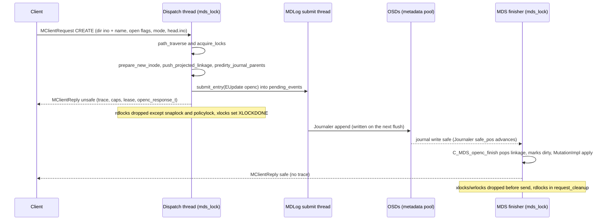
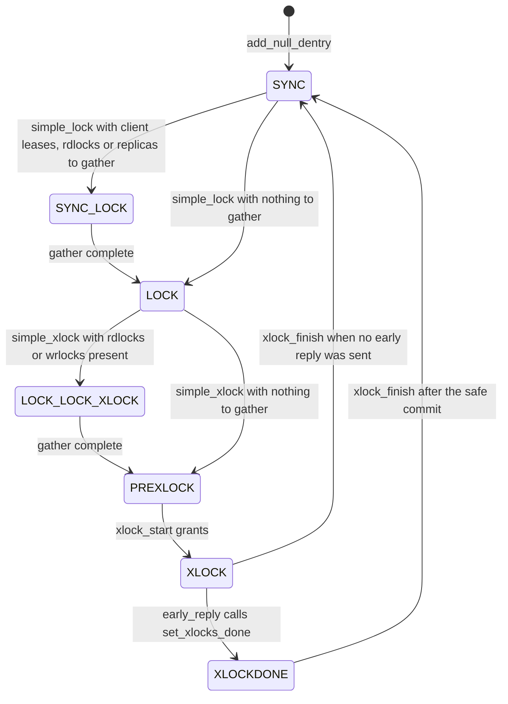
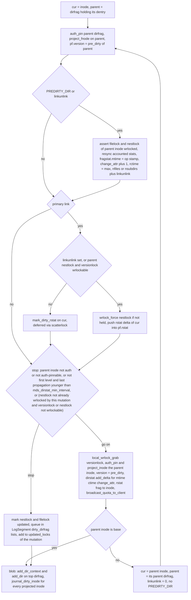
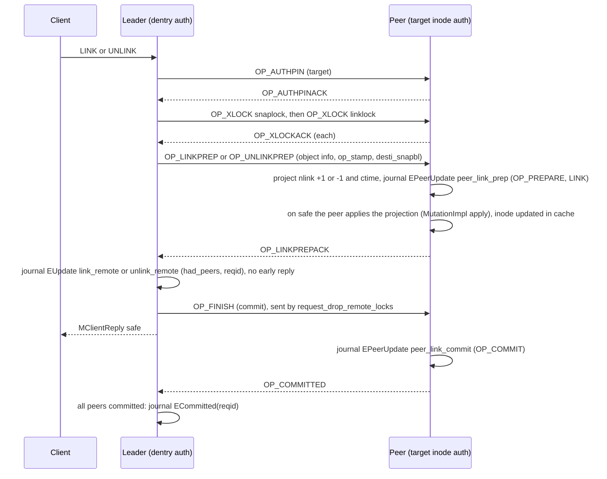
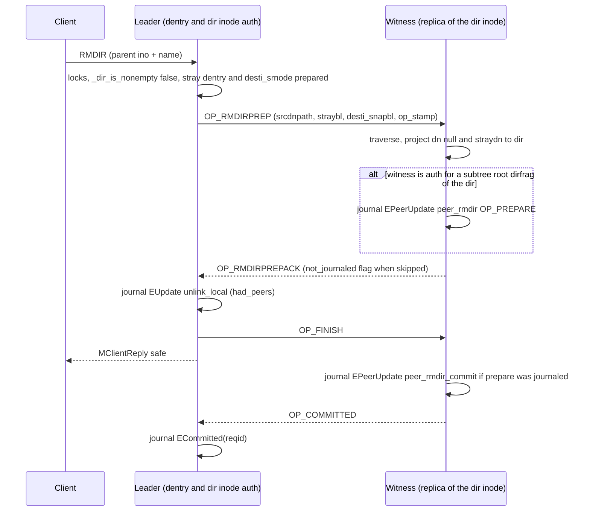

# Namespace mutations: create, mknod, mkdir, symlink, link, unlink, rmdir

> Part of the C++ MDS project map ([cpp-map/README.md](../README.md)). Sources (commit 5f7e383ae6d): `src/mds/Server.cc` (~2,300 LOC in scope: 2124-2614, 3500-4266, 4829-5047, 7532-9287), `src/mds/MDCache.cc` (~1,100 LOC: 776-923, 1450-2595, 3563-3660, 8443-8907, 9917-10200, 11304-11646), `src/mds/Locker.cc` (~900 LOC of helpers), `src/mds/InoTable.{h,cc}` (345), `src/mds/SessionMap.{h,cc}` (ino sets, versions), `src/mds/Mutation.{h,cc}`, `src/mds/events/EMetaBlob.h` (616), `src/mds/events/EUpdate.h`, `src/mds/events/EPeerUpdate.h`, `src/mds/journal.cc` (EMetaBlob replay, segment expiry), `src/mds/StrayManager.cc` (447-738), `src/mds/CDir.cc`, `src/mds/CDentry.cc`, `src/mds/CInode.cc` (projection primitives); Linux client `linux/fs/ceph/{dir.c,file.c,mds_client.c,caps.c}`; libcephfs `src/client/Client.cc`.
> Related: [request lifecycle](request-lifecycle.md), [rename](rename.md), [lookup/readdir/open](lookup-readdir-open-and-file-locks.md), [attributes and xattrs](attributes-and-xattrs.md), [lock state machines](../05-locking/lock-types-and-state-machines.md), [acquiring locks](../05-locking/acquiring-locks.md), [CDir/CDentry](../04-cache/cdir-cdentry-and-cache-objects.md), [CInode](../04-cache/cinode-and-inode-types.md), [MDS tables](../07-storage-formats/mds-tables.md), [MDLog](../06-journal/mdlog-and-journaler.md), [events and replay](../06-journal/events-and-replay.md), [strays and purge](../11-background-services/strays-and-purge.md), [rstats/quotas/subvolumes](../10-snapshots-quotas-subvolumes/rstats-quotas-and-subvolumes.md), [snapshots](../10-snapshots-quotas-subvolumes/snapshots.md), [leases, lock caches, async dirops](../02-client-protocol/leases-lock-caches-and-async-dirops.md), [capabilities](../02-client-protocol/capabilities.md), [sessions](../02-client-protocol/sessions.md), [resolve and rejoin](../09-recovery/resolve-and-rejoin.md), [mds_lock analysis](../00-architecture/mds_lock-analysis.md).

## 1. Purpose and responsibilities

The namespace-mutation handlers in `Server` implement every client operation that adds or removes a directory entry, except rename (see [rename.md](rename.md)):

| Wire op (value) | Entry handler | Effect |
|---|---|---|
| `CEPH_MDS_OP_CREATE` (`0x01301`) | `Server::handle_client_openc` | new regular file, primary dentry, opened with caps (falls back to `handle_client_open` if the name exists and `O_EXCL` is not set) |
| `CEPH_MDS_OP_MKNOD` (`0x01201`) | `Server::handle_client_mknod` | new REG/FIFO/CHR/BLK/SOCK inode (`S_IFREG` if no type bits) |
| `CEPH_MDS_OP_MKDIR` (`0x01220`) | `Server::handle_client_mkdir` | new directory inode plus its first (empty, complete, new) dirfrag |
| `CEPH_MDS_OP_SYMLINK` (`0x01222`) | `Server::handle_client_symlink` | new symlink inode, target stored in the inode |
| `CEPH_MDS_OP_LINK` (`0x01202`) | `Server::handle_client_link` then `_link_local` or `_link_remote` | new remote dentry, target `nlink++`; two-phase commit with the target's auth rank when the target inode is not local |
| `CEPH_MDS_OP_UNLINK` (`0x01203`) | `Server::handle_client_unlink` then `_unlink_local` or `_link_remote(inc=false)` | removes a dentry; a primary link moves the inode into a stray directory; a remote link decrements the target's `nlink` (2PC if remote) |
| `CEPH_MDS_OP_RMDIR` (`0x01221`) | `Server::handle_client_unlink` (rmdir mode) | removes an empty directory; witness 2PC with replicas when the directory has subtree-root dirfrags |

Responsibilities, in order of execution for every op: validation and MDSAuthCaps permission checks; path traversal with locking of the target dentry and its parent directory inode; inode-number allocation (session preallocation or `InoTable`); projection of all changes (new linkage, parent `fnode`/inode, ancestors' recursive stats); building one `EUpdate` (or `EPeerUpdate`) journal event; early ("unsafe") reply; application of projections after the journal write is safe; replica notification (`MDentryLink`/`MDentryUnlink`); safe reply; and hand-off of unlinked inodes to the `StrayManager`.

## 2. Source map

| File | Class / function | Lines | Role |
|---|---|---|---|
| `src/mds/Server.cc` | `Server::dispatch` (reconnect branch) | 320-420 | queues replay/async requests in `up:reconnect`, records client-chosen `head.ino` (`add_replay_ino_alloc`) |
| `src/mds/Server.cc` | `Server::handle_client_request` | 2616-2728 | completed-request idempotency, `trim_completed_request_list`, `request_start`, embedded cap releases |
| `src/mds/Server.cc` | `Server::dispatch_client_request` | 2765-2965 | read-only and pool-full gates, op switch (`CREATE` already completed becomes an open) |
| `src/mds/Server.cc` | `Server::journal_and_reply`, `submit_mdlog_entry`, `respond_to_request` | 2124-2190 | common commit pipeline |
| `src/mds/Server.cc` | `Server::early_reply` | 2300-2372 | unsafe reply, `set_xlocks_done` |
| `src/mds/Server.cc` | `Server::reply_client_request` | 2379-2484 | completed-request record, `apply_allocated_inos`, lock drop, safe reply |
| `src/mds/Server.cc` | `Server::set_trace_dist`, `Server::set_reply_extra_bl` | 2491-2614 | reply trace and `openc_response_t` |
| `src/mds/Server.cc` | `check_access`, `check_quarantine_block`, `check_fragment_space`, `check_dir_max_entries` | 3500-3592 | permission and size limits |
| `src/mds/Server.cc` | `Server::prepare_stray_dentry` | 3595-3631 | stray dentry for a primary unlink |
| `src/mds/Server.cc` | `Server::prepare_new_inode` | 3637-3765 | ino allocation, inode initialization |
| `src/mds/Server.cc` | `journal_allocated_inos`, `apply_allocated_inos` | 3767-3802 | journal and apply ino allocation |
| `src/mds/Server.cc` | `C_MDS_TryOpenInode`, `Server::_try_open_ino`, `C_MDS_TryFindInode` | 3804-3867 | `ESTALE` recovery of an unknown base inode |
| `src/mds/Server.cc` | `Server::rdlock_path_xlock_dentry` | 3960-4057 | path locks plus xlock of the tail dentry |
| `src/mds/Server.cc` | `Server::rdlock_two_paths_xlock_destdn` | 4073-4221 | two-path locking (LINK by path) |
| `src/mds/Server.cc` | `C_MDS_openc_finish`, `is_valid_layout`, `can_handle_charmap`, `handle_client_openc` | 4829-5047 | CREATE |
| `src/mds/Server.cc` | `C_MDS_mknod_finish`, `handle_client_mknod`, `handle_client_mkdir`, `handle_client_symlink` | 7532-7857 | MKNOD, MKDIR, SYMLINK |
| `src/mds/Server.cc` | `handle_client_link`, `_link_local`, `_link_local_finish` | 7865-8086 | LINK |
| `src/mds/Server.cc` | `_link_remote`, `_link_remote_finish` | 8106-8223 | leader side of link/unlink 2PC |
| `src/mds/Server.cc` | `handle_peer_link_prep`, `_logged_peer_link`, `_commit_peer_link`, `_committed_peer`, `do_link_rollback`, `_link_rollback_finish`, `handle_peer_link_prep_ack` | 8251-8564 | peer side of link/unlink 2PC |
| `src/mds/Server.cc` | `handle_client_unlink`, `_unlink_local`, `_unlink_local_finish` | 8572-8888 | UNLINK and RMDIR |
| `src/mds/Server.cc` | `_rmdir_prepare_witness`, `handle_peer_rmdir_prep`, `_logged_peer_rmdir`, `handle_peer_rmdir_prep_ack`, `_commit_peer_rmdir`, `do_rmdir_rollback`, `_rmdir_rollback_finish` | 8890-9215 | RMDIR witness 2PC |
| `src/mds/Server.cc` | `_dir_is_nonempty_unlocked`, `_dir_has_snaps`, `_dir_is_nonempty` | 9225-9287 | emptiness checks (`_dir_has_snaps` is not used by RMDIR; its callers are the charmap vxattr handlers in `handle_client_setvxattr`, `src/mds/Server.cc:6843`) |
| `src/mds/Server.cc` | `handle_peer_request`, `handle_peer_request_reply`, `dispatch_peer_request` | 2971-3295 | peer message routing |
| `src/mds/MDCache.cc` | `MDCache::path_traverse`, `maybe_request_forward_to_auth` | 8443-8907 | traversal, path locks, forwarding |
| `src/mds/MDCache.cc` | `MDCache::predirty_journal_parents` | 2224-2488 | parent and ancestor projection |
| `src/mds/MDCache.cc` | `project_rstat_inode_to_frag`, `_project_rstat_inode_to_frag`, `project_rstat_frag_to_inode` | 1836-2101 | rstat arithmetic incl. snapshots |
| `src/mds/MDCache.cc` | `cow_inode`, `journal_cow_dentry`, `journal_dirty_inode` | 1573-1830 | snapshot copy-on-write, inode journaling |
| `src/mds/MDCache.cc` | `broadcast_quota_to_client` | 2103-2190 | `MClientQuota` push after rstat change |
| `src/mds/MDCache.cc` | leader/peer bookkeeping (`log_leader_commit` .. `finish_committed_leaders`, `add_uncommitted_peer`, `finish_uncommitted_peer`, `finish_rollback`) | 2504-2595, 3563-3660 | 2PC state |
| `src/mds/MDCache.cc` | `get_stray_dir`, `advance_stray` | 912-923, 776-818 | stray directory selection |
| `src/mds/MDCache.cc` | `send_dentry_link`, `handle_dentry_link`, `send_dentry_unlink`, `handle_dentry_unlink`, `encode_replica_stray` | 11304-11646 | replica notifications |
| `src/mds/MDCache.cc` | `request_finish`, `request_cleanup`, `request_kill`, `purge_inodes` | 9917-10200, 6903-6928 | teardown, purge of delegated inos |
| `src/mds/MDCache.h` | `insert_taken_inos`, `test_and_clear_taken_inos`, `notify_stray`, `add_uncommitted_leader`, `add_replay_ino_alloc` | 223-233, 278-284, 471-481, 735-737 | helpers |
| `src/mds/Locker.cc` | `try_rdlock_snap_layout`, `acquire_locks` | 157-669 | ancestor rdlocks, lock acquisition with implied locks |
| `src/mds/Locker.cc` | `request_drop_remote_locks`, `set_xlocks_done`, `_drop_locks`, `handle_locks_for_early_reply` | 687-939 | release, `OP_FINISH` to peers |
| `src/mds/Locker.cc` | `create_lock_cache`, `find_and_attach_lock_cache` | 1092-1267 | async-dirop lock caches |
| `src/mds/Locker.cc` | `rdlock_start`, `nudge_log`, `wrlock_force`, `wrlock_try`, `wrlock_start`, `xlock_start` | 1791-2233 | lock primitives |
| `src/mds/Locker.cc` | `issue_new_caps`, `share_inode_max_size`, `issue_client_lease` | 2436-2499, 3191-3229, 4542-4589 | caps and dentry lease to the creator |
| `src/mds/Locker.cc` | `simple_lock`, `simple_xlock`, `local_wrlock_grab`, `local_xlock_start` | 5075-5202, 5606-5689 | state transitions used here |
| `src/mds/InoTable.cc` | `InoTable::*` | 29-239 | per-rank inode-number allocator |
| `src/mds/SessionMap.h` | `Session::take_ino`, `delegate_inos`, ino sets | 179-225, 427-429 | per-session preallocation |
| `src/mds/Mutation.h` / `.cc` | `MutationImpl`, `MDRequestImpl`, `LockOpVec::sort_and_merge`, `MutationImpl::apply` | Mutation.h 64-499, Mutation.cc 94-285 | request state |
| `src/mds/events/EMetaBlob.h` | `fullbit`, `remotebit`, `nullbit`, `dirlump`, `set_ino_alloc`, `add_*` | 64-616 | journal payload |
| `src/mds/events/EUpdate.h`, `EPeerUpdate.h` | `EUpdate`, `EPeerUpdate`, `link_rollback`, `rmdir_rollback` | EUpdate.h 24-53, EPeerUpdate.h 29-150 | events |
| `src/mds/journal.cc` | `LogSegment::try_to_expire`, `EMetaBlob::add_dir_context`, `EMetaBlob::replay`, `EUpdate::replay`, `ECommitted::replay`, `EPeerUpdate::replay` | 127-502, 1239-1817, 2327-2371, 2453-2462, 2747-2777 | expiry and replay |
| `src/mds/StrayManager.cc` | `_eval_stray`, `eval_remote`, `_eval_stray_remote`, `reintegrate_stray`, `migrate_stray` | 447-738 | purge hand-off, hard-link relink |

## 3. How it works

### 3.1 The common skeleton

Every handler is **re-entrant**: it is called by `dispatch_client_request` and called again from the top after every wait (`C_MDS_RetryRequest::finish` increments `mdr->retry` and calls `MDCache::dispatch_request`, `src/mds/MDCache.cc:13271 (C_MDS_RetryRequest::finish)`). Progress is memoized on the `MDRequestImpl`:

- `locking_state` bits `SNAP_LOCKED`, `SNAP2_LOCKED`, `PATH_LOCKED`, `ALL_LOCKED` (`src/mds/Mutation.h:281 (MutationImpl)`); helpers return early when the bit is set (for example `src/mds/Server.cc:3967 (Server::rdlock_path_xlock_dentry)`).
- `dn[0]`/`dn[1]`, `in[0]`, `straydn` (`src/mds/Server.cc:3600 (Server::prepare_stray_dentry)` reuses it), `more()->desti_srnode`, `more()->witnessed`, `more()->waiting_on_peer`.
- A wait inside `path_traverse` for a frozen dir, a dirfrag fetch, a discover or a remote-dentry open uses `CF_MDS_RetryRequestFactory(..., drop_locks=true)`, which drops **all** locks and local auth pins before queueing the retry (`src/mds/MDCache.cc:13279 (CF_MDS_RetryRequestFactory::build)`); `Locker::drop_locks` also clears `locking_state` (`src/mds/Locker.cc:891 (Locker::drop_locks)`). A wait for a lock *state* inside `acquire_locks` (failed `xlock_start`/`wrlock_start`/`rdlock_start`) keeps the locks already acquired (hold-and-wait; deadlock freedom relies on the ordering rules in the comment above `MDCache::path_traverse`, `src/mds/MDCache.cc:8425-8441`). Two waits drop everything first: an object that cannot be auth-pinned (freezing/frozen, or ambiguous auth) in `acquire_locks` (`src/mds/Locker.cc:434-496 (Locker::acquire_locks)`) and a snaplock/policylock that cannot be rdlocked in `try_rdlock_snap_layout` (`src/mds/Locker.cc:218-226 (Locker::try_rdlock_snap_layout)`).

Phases of every mutation:

1. **Path lock** (`rdlock_path_xlock_dentry` or `rdlock_two_paths_xlock_destdn`) and validation of the tail.
2. **Op-specific locks** (`ALL_LOCKED`) for link/unlink/rmdir.
3. **Permission and space checks** (`check_access`, `check_fragment_space`, `check_dir_max_entries`).
4. **Allocate and project**: new `CInode` (added to the cache immediately, but the dentry linkage is only *projected*), projected inodes/fnodes of parent and ancestors (`predirty_journal_parents`).
5. **Journal**: build `EUpdate` and call `journal_and_reply(mdr, tracei, tracedn, le, fin)` (`src/mds/Server.cc:2124 (Server::journal_and_reply)`), which does `early_reply`, sets `mdr->committing = true`, calls `mdlog->submit_entry(le, fin)`, then: for a request queued for clientreplay, starts the next queued replay request (`MDSRank::queue_one_replay`); otherwise `Locker::handle_locks_for_early_reply` (if the early reply was sent: drops rdlocks other than `snaplock`/`policylock`, and flushes the log through `nudge_log` if one of the request's locks is unstable with waiters, `src/mds/Locker.cc:906 (Locker::handle_locks_for_early_reply)`) or `mdlog->flush()` (if not).
6. **Commit** (journal safe): the `ServerLogContext` finisher (`C_MDS_openc_finish`, `C_MDS_mknod_finish`, `C_MDS_link_local_finish`, `C_MDS_link_remote_finish`, `C_MDS_unlink_local_finish`) pops the projected linkage, marks objects dirty, calls `mdr->apply()` (pops projected inodes and fnodes, `src/mds/Mutation.cc:254 (MutationImpl::apply)`), notifies replicas, bumps popularity and calls `respond_to_request(mdr, 0)`.
7. **Safe reply and teardown** (`src/mds/Server.cc:2379 (Server::reply_client_request)`): record the completed request with the created ino, `apply_allocated_inos`, `request_drop_non_rdlocks` (sends `OP_FINISH` to peers first), send the reply, `request_finish` (drops rdlocks, auth pins, pins).

### 3.2 Entry, routing and idempotency

- **QoS hop**: client requests go through `mds->mds_dmclock_scheduler->handle_client_request` before `Server::handle_client_request` (`src/mds/Server.cc:405 (Server::dispatch)`); see [qos-dmclock-scheduler.md](../12-qos-metrics-quiesce-quarantine/qos-dmclock-scheduler.md).
- **Reconnect phase**: a request marked replay or async that arrives in `up:reconnect` is queued for the clientreplay phase; if it carries `head.ino` and is not already completed, the ino is recorded with `MDCache::add_replay_ino_alloc` (so cache rejoin does not try to open it), and with `mds_replay_unsafe_with_closed_session` the ino is moved from `free_prealloc_inos` to `delegated_inos` (code comment: "don't purge inodes that will be created by later replay"; at session close it is then handled as a delegated ino, purged and released after `EPurged`, instead of being returned to the `InoTable` at once) (`src/mds/Server.cc:349 (Server::dispatch)`). Async or replayed requests from a session that is closed and not covered by that option are dropped.
- **Completed requests**: for a request flagged replay or with a non-zero retry count, `Session::have_completed_request(tid, &created)` is consulted (`src/mds/Server.cc:2659 (Server::handle_client_request)`). If the session is not open the request is dropped. A completed replay (any op), or a completed retry of an op other than OPEN/CREATE when either no inode was created or the rank is not in clientreplay, gets an immediate traceless `MClientReply(0)` whose `extra_bl` carries the created ino (`set_reply_extra_bl`). In clientreplay, a completed MKNOD/MKDIR/SYMLINK that created an inode is rewritten into `CEPH_MDS_OP_LOOKUP` (if `CEPH_MDS_FLAG_WANT_DENTRY`) or `CEPH_MDS_OP_GETATTR` with mask `CEPH_STAT_CAP_INODE_ALL` so the client gets a trace (`src/mds/Server.cc:2686 (Server::handle_client_request)`). A completed CREATE that is retried (not replayed) is turned into an open of the created file with the created ino in `extra_bl` (`src/mds/Server.cc:2896 (Server::dispatch_client_request)`).
- `trim_completed_request_list(oldest_client_tid)` drops completed entries older than the client's oldest outstanding tid and warns via clog when the list keeps growing past `mds_max_completed_requests` (`src/mds/Server.cc:2563 (Server::trim_completed_request_list)`).
- Embedded cap/dentry releases (`MClientRequest::releases`) are processed before dispatch except on replay (`src/mds/Server.cc:2718 (Server::handle_client_request)`).
- **Gates** in `dispatch_client_request`: `EROFS` if `may_write()` and the cache is read-only; a stored peer error is returned; when the metadata pool has `FLAG_FULL`, `CREATE`, `SYMLINK`, and `LINK` (before any witness) return `ENOSPC` unless the session's caps grant `MAY_FULL` — `MKNOD`, `MKDIR`, `UNLINK` and `RMDIR` are **not** blocked when full (`src/mds/Server.cc:2805 (Server::dispatch_client_request)`).
- **Forwarding**: traversal flag `MDS_TRAVERSE_WANT_AUTH` forwards the request to the auth of the dirfrag that owns (or would own) the tail dentry (`src/mds/MDCache.cc:8618 (MDCache::path_traverse)`), so every namespace mutation executes on the authoritative rank of the parent dirfrag. With `MDS_TRAVERSE_WANT_INODE` (CREATE without `O_EXCL`) an existing target is forwarded to the target inode's auth instead (`src/mds/MDCache.cc:8869 (MDCache::path_traverse)`).
- **`ESTALE` recovery**: when the path's base ino is not in cache, `find_ino_peers` queries the other active ranks one at a time with `MMDSFindIno` until one has it (`src/mds/MDCache.cc:9672 (MDCache::_do_find_ino_peer)`); on failure `C_MDS_TryFindInode` falls back to `MDCache::open_ino` (backtrace lookup) and `_try_open_ino` dispatches locally or forwards to the returned rank; `ENOENT`/`ENODATA` are converted to `ESTALE` (`src/mds/Server.cc:3814 (Server::_try_open_ino)`, `src/mds/Server.cc:3834 (C_MDS_TryFindInode)`).

### 3.3 Path locking for a new or doomed dentry

`Server::rdlock_path_xlock_dentry(mdr, create, okexist=false, authexist=false, want_layout=false)` (`src/mds/Server.cc:3960 (Server::rdlock_path_xlock_dentry)`):

| Check | Result |
|---|---|
| `refpath.depth() == 0` | `EINVAL` |
| first component empty (path walks into a snapdir, `filepath::is_last_snap`) | `EROFS` |
| last component is `.` or `..` | `EEXIST` if `create`, else `ENOTEMPTY` |
| traversal error | `ESTALE` triggers peer search (3.2), other errors returned |
| parent quarantined and client lacks `CEPHFS_FEATURE_QUARANTINE` | request parked on `WAIT_QUARANTINE` of the subvolume root (`src/mds/Server.cc:3529 (Server::check_quarantine_block)`) |
| parent is a system directory other than root (unless op is UNLINK in lost+found), for client requests | `EROFS` |
| parent directory is itself in a stray directory (it was unlinked) | `ENOENT` |
| tail null and `!create && okexist` (UNLINK/RMDIR) | `ENOENT` |
| tail non-null and `!okexist` | `EEXIST` |
| tail null | `dn->first = max(dn->first, global_snaprealm.newest_seq + 1)` |

Traversal flags: always `RDLOCK_SNAP | RDLOCK_PATH | WANT_DENTRY | XLOCK_DENTRY | WANT_AUTH`; `CHECK_LOCKCACHE` when the path has depth 1 and the lock cache is not disabled; `RDLOCK_AUTHLOCK` when `create`; `WANT_INODE` when `authexist`; `WANT_DIRLAYOUT` when `want_layout` (`src/mds/Server.cc:3993 (Server::rdlock_path_xlock_dentry)`). MKNOD, MKDIR, SYMLINK, LINK and RMDIR call `mdr->disable_lock_cache()` first, so only CREATE and UNLINK can attach a lock cache.

What `MDCache::path_traverse` (`src/mds/MDCache.cc:8443 (MDCache::path_traverse)`) does with these flags:

1. `CHECK_LOCKCACHE`: `Locker::find_and_attach_lock_cache` attaches a client lock cache of the same opcode on the base directory, if any (`src/mds/Locker.cc:1247 (Locker::find_and_attach_lock_cache)`).
2. If a lock cache is attached, no snap rdlocks are taken and the directory layout is copied from the cache. Otherwise `Locker::try_rdlock_snap_layout(base, mdr, 0, want_layout)` rdlocks `snaplock` of the base inode **and of every ancestor up to the root** directly (`get_rdlock`, not via `acquire_locks`), and when `want_layout` also rdlocks `policylock` from the base upward until an inode whose projected inode has a layout, storing it in `mdr->dir_layout` (`src/mds/Locker.cc:157 (Locker::try_rdlock_snap_layout)`). It records `mdr->dir_root[0]` and `dir_depth[0]` for two-path lock ordering.
3. For each intermediate component: rdlock the dentry lock (plus a wrlock of that directory's `filelock` if the filelock is held by any lock cache, which forces the client owning it to flush async dirops), then rdlock the next inode's `snaplock` (`src/mds/MDCache.cc:8643-8729 (MDCache::path_traverse)`). Remote dentries whose inode is not cached are opened (`open_remote_dentry`) and the request retried.
4. Tail dentry missing: if the dirfrag is complete (or the bloom filter excludes the name) a null dentry is created with `CDir::add_null_dentry` (waiting if the dirfrag is frozen); an incomplete dirfrag is fetched from RADOS and the request retried (`src/mds/MDCache.cc:8747-8818 (MDCache::path_traverse)`).
5. Tail locks (`src/mds/MDCache.cc:8646-8655 (MDCache::path_traverse)` for an existing dentry, `8769-8791` for a new null one): `wrlock(dir->filelock)`, `wrlock(dir->nestlock)`, `rdlock(dir->authlock)` if `RDLOCK_AUTHLOCK`, `xlock(dn->lock)`. When a lock cache is attached and the tail is at depth 0, only `xlock(dn->lock)` is requested (the cache already holds the directory locks). With `WANT_INODE` and an existing tail, the dentry is rdlocked instead of xlocked.
6. On success sets `SNAP_LOCKED` and `PATH_LOCKED`.

`Locker::acquire_locks` (`src/mds/Locker.cc:245 (Locker::acquire_locks)`) adds **implied locks** to the requested set:

| Requested | Implied addition | Source |
|---|---|---|
| `xlock` of a dentry `lock` (auth) | `wrlock(dn->versionlock)` on the leader, `xlock(dn->versionlock)` on a peer | `src/mds/Locker.cc:318-330 (Locker::acquire_locks)` |
| `xlock` of an inode lock other than `IVERSION`/`IQUIESCE` (auth only; nothing is added for a replica inode) | `wrlock(in->versionlock)` on the leader, `xlock(in->versionlock)` on a peer | `src/mds/Locker.cc:331-357 (Locker::acquire_locks)` |
| first lock in the vector with a cap shift (`IAUTH`, `ILINK`, `IFILE`, `IXATTR`) taken as xlock, wrlock or remote wrlock | `wrlock(in->quiescelock)` of that inode (also when the inode is a replica) — **once per `acquire_locks` call** (`need_quiescelock` flips to false); skipped entirely when the caller passes `skip_quiesce` (peer lock requests) | `src/mds/Locker.cc:338-343, 371-376, 382-387 (Locker::acquire_locks)` |
| any auth object of an xlock/wrlock/rdlock, any remote object of an xlock | auth pin (local) or `OP_AUTHPIN` peer request (remote) | `src/mds/Locker.cc:262-558 (Locker::acquire_locks)` |

`LockOpVec::sort_and_merge` only sorts runs of consecutive entries that share a parent object by lock type, and merges duplicates (an xlock overrides other modes) (`src/mds/Mutation.cc:132 (MutationImpl::LockOpVec::sort_and_merge)`). Lock-type order is `DN(1) < DVERSION(2) < IQUIESCE(16) < ISNAP(32) < IPOLICY(64) < IFILE(128) < INEST(256) < IDFT(512) < IAUTH(1024) < ILINK(2048) < IXATTR(4096) < IFLOCK(8192) < IVERSION(16384)` (`src/include/ceph_fs.h:336-350 (CEPH_LOCK_* defines)`). Across objects, the caller's order is the acquisition order.

**Exact lock set per operation** (path = parent directory inode `D` plus one name, the kernel-client shape; `A*` = every ancestor of `D` up to the root):

| Op | Snap/policy (step 2) | Tail (step 5, one `acquire_locks` call, in acquisition order) | Op-specific (`ALL_LOCKED`, second call) |
|---|---|---|---|
| CREATE (name absent) | rd `snaplock` on `D`,`A*`; rd `policylock` on `D`.. first ancestor with a layout | wr `D.quiescelock`, wr `D.filelock`, wr `D.nestlock`, rd `D.authlock`, x `dn.lock`, wr `dn.versionlock` | none |
| CREATE via lock cache | none (held by cache) | x `dn.lock`, wr `dn.versionlock` | none |
| CREATE (name exists, no `O_EXCL`) | as above | rd `dn.lock` (+ wr `D.filelock` if lock-cached), rd target `snaplock`, then `handle_client_open` | per open |
| MKNOD | rd `snaplock` `D`,`A*`; rd `policylock` only if `S_ISREG(mode)` | same as CREATE | none |
| MKDIR, SYMLINK | rd `snaplock` `D`,`A*` | same as CREATE | none |
| LINK by ino (`filepath2` depth 0, used by libcephfs `ll_link` and kclient for disconnected dentries) | rd `snaplock` on the target's parent dir and its ancestors (`SNAP2`); rd `snaplock` `D`,`A*` | wr `D.quiescelock`, wr `D.filelock`, wr `D.nestlock`, x `dn.lock`, wr `dn.versionlock` (no `authlock`) | wr `T.quiescelock`, x `T.snaplock`, x `T.linklock`, wr `T.versionlock` on target `T`, in that order after sorting (if `T` is not auth: local wrlock of the replica's `quiescelock`, remote auth pin + one `OP_XLOCK` per lock, no versionlock) |
| LINK by two paths (both depth 1) | rd `snaplock` chains of both parents | `rdlock_two_paths_xlock_destdn(xlock_srcdn=false)`: wr dest `filelock`/`nestlock`, x `destdn.lock`, rd `srcdn.lock`, ordered by `MDRequestImpl::compare_paths` and dentry names (`src/mds/Server.cc:4145-4197 (Server::rdlock_two_paths_xlock_destdn)`) | same as above |
| UNLINK (primary) | rd `snaplock` `D`,`A*` (or lock cache) | wr `D.quiescelock`, wr `D.filelock`, wr `D.nestlock`, x `dn.lock`, wr `dn.versionlock` | wr `T.quiescelock`, x `T.snaplock`, x `T.linklock`, wr `T.versionlock`, wr `Stray.filelock`, wr `Stray.nestlock`, x `straydn.lock`, wr `straydn.versionlock` |
| UNLINK (remote dentry) | same | same | x `T.snaplock`, x `T.linklock` (+ implied); remote xlocks if `T` is on another rank |
| RMDIR | same (no lock cache) | same | as primary UNLINK plus rd `T.filelock` ("to verify it's empty"), which sorts between `T.snaplock` and `T.linklock` |

Notes: `authlock` of `D` is rdlocked only for creating ops; its consumers are `prepare_new_inode`, which reads `D`'s projected mode and gid for `S_ISGID` inheritance (`src/mds/Server.cc:3722 (Server::prepare_new_inode)`), and `check_access`, which passes `D`'s uid/gid/mode to MDSAuthCaps (the code does not state the rationale). The stray directory inode's `snaplock` is not rdlocked. Unlink takes `D.quiescelock` in the tail call and `T.quiescelock` in the second call because the "one quiescelock per call" rule restarts per call. The `predirty_journal_parents` step later adds `local_wrlock_grab` of `D.versionlock` and opportunistic wrlocks on ancestors (3.6).

Simplified dentry-lock life cycle during a create (see [lock state machines](../05-locking/lock-types-and-state-machines.md) for the full table):

In `XLOCKDONE` the xlocking *client* (not only the request) may read, rdlock and lease the dentry (`XCL` columns in `src/mds/locks.c:28 (simplelock state table)`) and may xlock it again for its next request (`src/mds/Locker.cc:2177-2192 (Locker::xlock_start)`), which lets one client pipeline unsafe operations on the same name; other clients' lookups of the name wait for the commit and call `Locker::nudge_log`, which flushes the journal (`src/mds/Locker.cc:1855 (Locker::nudge_log)`).

### 3.4 Inode-number allocation

Sources: `src/mds/Server.cc:3637 (Server::prepare_new_inode)`, `src/mds/SessionMap.h:179 (Session::take_ino)`, `src/mds/InoTable.cc:46 (InoTable::project_alloc_id)`.

Allocator state:

| State | Owner | Meaning |
|---|---|---|
| `InoTable::free` / `projected_free` | rank (`mds<rank>_inotable`) | free inode numbers; initial range `[(rank+1)<<40, (rank+2)<<40)` (`src/mds/InoTable.cc:29 (InoTable::reset_state)`); `projected_version`/`version` counters |
| `session->info.prealloc_inos` | session (durable, in the SessionMap and journal) | inos owned by the session: free + delegated + taken-but-not-yet-applied |
| `session->free_prealloc_inos` | session (memory) | available to `take_ino(0)` |
| `session->delegated_inos` | session (memory) | handed to the client for async create; only taken by an explicit `take_ino(ino)` |
| `session->pending_prealloc_inos` | session (memory) | projected refill, not yet journaled |
| `MDCache::replay_taken_inos` | rank (memory) | inos known to be in use (from fetched dirfrags `src/mds/CDir.cc:2017 (CDir::_load_dentry)` and replayed events whose table versions were already persisted, `src/mds/journal.cc:1655 (EMetaBlob::replay)`); allocation skips them; an entry is dropped on such a collision or when the inode leaves the cache (`src/mds/MDCache.cc:398 (MDCache::remove_inode)`) |

Algorithm (`prepare_new_inode`):

1. `allow_prealloc_inos = session->is_open()` (sessions re-opened by `prepare_force_open_sessions` may be closing; their prealloc set is being freed).
2. Loop until an ino is chosen: if allowed, `session->take_ino(useino)` where `useino = req->head.ino` on the first iteration. `take_ino(ino)` returns 0 unless `info.prealloc_inos` contains `ino`; it removes `ino` from `delegated_inos` or `free_prealloc_inos` and asserts if it is in neither (`src/mds/SessionMap.h:179 (Session::take_ino)`). `take_ino(0)` pops the lowest free prealloc ino. Success sets `mdr->used_prealloc_ino` and `sessionmap.mark_projected(session)`. Otherwise `mdr->alloc_ino = inotable->project_alloc_id(useino)`. If the chosen ino is in `replay_taken_inos` it is discarded (for the table path the table allocation is applied immediately) and the loop retries with `useino = 0`.
3. If the client asked for an ino and got another one: clog error `"<client> specified ino X but mds.N allocated Y"`.
4. **Refill**: if allowed and `free_prealloc_inos.size() + pending_prealloc_inos.size() < mds_client_prealloc_inos / 2`, project `need = mds_client_prealloc_inos - projected` inos from the table (`InoTable::project_alloc_ids`) into `mdr->prealloc_inos` and `session->pending_prealloc_inos`, and `mark_projected(session)` (`src/mds/Server.cc:3688 (Server::prepare_new_inode)`).
5. `journal_allocated_inos` records into the metablob: `allocated_ino`, `used_preallocated_ino`, `preallocated_inos`, `client_name`, `sessionmapv = sessionmap.get_projected()`, `inotablev = inotable->get_projected_version()` (`src/mds/Server.cc:3767 (Server::journal_allocated_inos)`, `src/mds/events/EMetaBlob.h:392 (EMetaBlob::set_ino_alloc)`).
6. At the **safe** reply, `apply_allocated_inos` (`src/mds/Server.cc:3780 (Server::apply_allocated_inos)`): `inotable->apply_alloc_id(alloc_ino)`; for a refill: move from `pending_prealloc_inos` into `free_prealloc_inos` and `info.prealloc_inos`, `apply_alloc_ids`, `sessionmap.mark_dirty`; for a used prealloc ino: erase it from `info.prealloc_inos` and `mark_dirty`.

Consequences:

- **Early reply is forbidden when `alloc_ino` is set** (`src/mds/Server.cc:2315 (Server::early_reply)`): an ino taken from the table is not durable until this very event is journaled, so it must not be exposed. Inos from the session prealloc set were journaled by an earlier event, so they can be exposed before this event commits; the client replays the create with that ino after an MDS failure.
- **Delegation** for async create: `set_reply_extra_bl` (called for CREATE, and for replies to completed requests that created an inode), if `mds_allow_async_dirops` and the session has `CEPHFS_FEATURE_DELEG_INO`: `frac = 100 / mds_client_delegate_inos_pct`; when `delegated_inos.size() < mds_client_prealloc_inos / frac / 2` (250 with defaults) and the request is not a queued replay, `Session::delegate_inos(mds_client_prealloc_inos / frac)` tops `delegated_inos` up to 500 (defaults): it moves `500 - delegated_inos.size()` inos from `free_prealloc_inos` to `delegated_inos` and returns only those newly delegated inos in `openc_response_t::delegated_inos` (`src/mds/Server.cc:2591 (Server::set_reply_extra_bl)`, `src/mds/SessionMap.h:197 (Session::delegate_inos)`). Delegated inos come from `free_prealloc_inos`, which only holds inos whose allocation was already journaled, so they may be sent in an unsafe reply.
- **Session close** (`src/mds/Server.cc:1524 (Server::journal_close_session)`): `pending_prealloc_inos` and `free_prealloc_inos` are released to the table (projected, applied after `ESession` commits); `delegated_inos` are passed as "inos to purge": `MDCache::purge_inodes` purges object 0 of each such ino in the default data pool (the code carries `FIXME: handle non-default data pool and namespace`), then journals `EPurged` and releases them (`src/mds/MDCache.cc:6903 (MDCache::purge_inodes)`, `src/mds/Server.cc:936 (Server::_session_logged)`).
- **Replay** (`src/mds/journal.cc:1648-1730 (EMetaBlob::replay)`): if the table/sessionmap version is already at or past the event's version, the allocated/used ino is just added to `replay_taken_inos`; otherwise `replay_alloc_id(s)` and session `take_ino(used)` plus prealloc insertion are re-applied, and a version mismatch is repaired with a clog error.

### 3.5 New-inode initialization (`prepare_new_inode`)

| Field | Value |
|---|---|
| `version`, `xattr_version` | 1 (the create handlers then overwrite `version` with the dentry's projected version) |
| `nlink` | 1, also for directories (marked `// FIXME`); a parent directory's `nlink` is never changed by mkdir |
| `mode` | from the request (`args.open.mode \| S_IFREG`, `args.mknod.mode` with `S_IFREG` default, `args.mkdir.mode` with `S_IFDIR`, `S_IFLNK \| 0777`) |
| `dir_layout` | zeroed; directories get `dl_dir_hash = mds_default_dir_hash` (default 2) |
| `layout` | non-directories (files, symlinks, device/FIFO/socket nodes): the layout passed by the handler or `MDCache::default_file_layout`; directories: none |
| `truncate_size`, `truncate_seq` | `-1`, `1` |
| `gid` | parent's `gid` if the parent has `S_ISGID` (and new directories inherit `S_ISGID`), else `head.owner_gid` (asserted `!= -1`) |
| `uid` | `head.owner_uid` (asserted `!= -1`); request heads older than version 3 use the caller uid/gid (`src/common/ceph_fs.cc:79-91 (decode(ceph_mds_request_head&))`) |
| `btime`, `ctime`, `mtime`, `atime` | `mdr->get_op_stamp()`: the client-supplied request stamp (`MDCache::request_start` sets it from `req->get_stamp()`, `src/mds/MDCache.cc:9845 (MDCache::request_start)`), falling back to the MDS stamp |
| `change_attr` | 0 |
| `fscrypt_auth`, `fscrypt_file` | copied from the request |
| xattrs | if the request has a data payload it is decoded as an xattr map (clients put POSIX ACL / security xattrs here) |
| `inline_data.version` | `CEPH_INLINE_NONE` unless the MDSMap enables inline data and the client has `CEPH_FEATURE_MDS_INLINE_DATA` |

`mdcache->add_inode(in)` inserts the inode into the inode map immediately (before journaling); the dentry linkage remains projected until commit. The new inode itself is written in place (`_get_inode()`), it is never "projected".

Handler-specific additions: `rstat` seed (`rfiles = 1` for files and symlinks, `rsubdirs = 1` for directories, `rbytes = symlink length` for symlinks) with `accounted_rstat = rstat` (required by `project_rstat_inode_to_frag`, which asserts that an unprojected inode is fully accounted, `src/mds/MDCache.cc:1886 (MDCache::project_rstat_inode_to_frag)`); `update_backtrace()`; `first = dn->first`; for a file whose pool differs from the default data pool, `add_old_pool(default pool)` so the backtrace is also written to the default data pool.

### 3.6 Parent and ancestor updates: `predirty_journal_parents`

`MDCache::predirty_journal_parents(mut, blob, in, parent, flags, linkunlink, cfollows)` (`src/mds/MDCache.cc:2224 (MDCache::predirty_journal_parents)`) projects the parent dirfrag and walks up the tree. Flags: `PREDIRTY_PRIMARY` (the link is primary, so rstat must be propagated), `PREDIRTY_DIR` (update the parent's mtime/change_attr), `PREDIRTY_SHALLOW` (only logged; it has no other effect in this function). `linkunlink` is `+1`, `-1` or `0`.

Details:

- First level (the directory being modified): `fragstat.mtime = op stamp` (an assignment, not a max), `fragstat.change_attr++`, `rstat.rctime = max(rctime, mtime)`, `nfiles` or `nsubdirs += linkunlink` (`src/mds/MDCache.cc:2286-2306 (MDCache::predirty_journal_parents)`). The directory inode then receives `dirstat.add_delta(fragstat, accounted_fragstat)`, which adds the `nfiles`/`nsubdirs` difference but keeps the **maximum** of `mtime` and of `change_attr` (`src/include/cephfs/types.h:91 (frag_info_t::add_delta)`); only if the dirfrag's `mtime` exceeded the inode's `dirstat.mtime` is `mtime = ctime = dirstat.mtime` set, and only if the dirfrag's counter exceeded `dirstat.change_attr` is the inode's own `change_attr` incremented (`src/mds/MDCache.cc:2406-2416 (MDCache::predirty_journal_parents)`).
- rstat delta (`src/mds/MDCache.cc:1909 (MDCache::_project_rstat_inode_to_frag)`): `+1` adds `rstat`, `-1` subtracts `accounted_rstat`, `0` adds `rstat - accounted_rstat`; with snapshots the delta may be split into `dirty_old_rstat` intervals (only if `mds_snap_rstat`, default false). Then `project_rstat_frag_to_inode` moves `pf.rstat - pf.accounted_rstat` into the directory inode and sets `accounted_rstat = rstat`.
- For single-fragment directories, a mismatch between the inode's `dirstat`/`rstat.rbytes` and the dirfrag's is logged to clog (`"unmatched fragstat size on single dirfrag"`, `"unmatched rstat rbytes on single dirfrag"`) and repaired from the dirfrag; it asserts only when `mds_verify_scatter` is true (`src/mds/MDCache.cc:2418-2462 (MDCache::predirty_journal_parents)`).
- Ancestors are updated opportunistically: an ancestor inode is projected only if it is auth, auth-pinnable, its `versionlock` and `nestlock` are wrlockable (checked only when the mutation does not already hold that nestlock wrlock; `wrlock_try` may itself call `simple_lock` on a clean, stable, non-scatter-wanted nestlock of an inode without subtree dirfrags), and, beyond the first level, its last propagation is older than `mds_dirstat_min_interval` (default 1 s) (`src/mds/MDCache.cc:2347-2388 (MDCache::predirty_journal_parents)`). When propagation stops, the delta stays in the dirfrag (`rstat != accounted_rstat`), the nestlock is put on `updated_scatterlocks` and the inode on the segment's `dirty_dirfrag_nest` list; `Locker::scatter_tick` nudges it after `mds_scatter_nudge_interval` (default 5 s) and segment expiry nudges it too (`src/mds/Locker.cc:5517 (Locker::scatter_tick)`, `src/mds/journal.cc:200-215 (LogSegment::try_to_expire)`).
- Even when propagation stops at the grandparent inode, the **grandparent dirfrag** (the one holding the parent directory's dentry) is projected, version-bumped and journaled, because `project_fnode`/`pre_dirty` run before the stop test; the parent's rstat delta is pushed into it when the grandparent inode's `nestlock` and `versionlock` are wrlockable, otherwise the parent inode is only marked dirty-rstat.
- `broadcast_quota_to_client(pin)` runs for every projected ancestor (it returns early unless the rank is active or stopping and the inode is auth and not frozen): for an inode inside a subvolume with a quota it updates the subvolume quota cache in `MetricsHandler`; for an inode with a quota it sends `MClientQuota` to cap holders whose last reported `rbytes`/`rsize` are near or past the limits and `MGatherCaps` to every replica rank, and creates a snaprealm for a quota inode that lacks one (`src/mds/MDCache.cc:2103 (MDCache::broadcast_quota_to_client)`).
- Journal shape: `add_dir_context(top)` adds the primary dentries from the auth subtree root down to the top projected dirfrag (skipping inodes already journaled in this major segment where safe, `src/mds/journal.cc:390 (EMetaBlob::add_dir_context)`), then `add_dir(top, dirty=true)` and a `fullbit` per projected ancestor inode (via `journal_dirty_inode`, which also performs snapshot COW of the ancestor's dentry where needed). The lower projected dirfrags (for example `D`'s) enter the blob as dirlumps carrying their projected fnode through `add_primary_dentry`/`journal_dirty_inode`, but are not flagged dirty: only the top dirfrag can still have `rstat != accounted_rstat` or `fragstat != accounted_fragstat`, and on replay a dirty lump with such a difference re-marks the nestlock/filelock as updated (`src/mds/journal.cc:1324-1341 (EMetaBlob::replay)`); the lower ones are dirtied on replay through their dirty dentries.

**Version numbering.** `CDir::pre_dirty(min)` sets `projected_version = max(projected_version, min) + 1` (`src/mds/CDir.cc:1439 (CDir::pre_dirty)`). A dentry takes its projected version from its dirfrag (`src/mds/CDentry.cc:208 (CDentry::pre_dirty)`); an inode's version is allocated from its **parent dentry's** dirfrag (`src/mds/CInode.cc:1177 (CInode::pre_dirty)`). One create therefore bumps the parent dirfrag's counter at least twice (dentry, projected fnode) and the grandparent dirfrag's counter (parent inode, grandparent fnode), and more ancestors when propagation continues. Projections are kept in per-object FIFO lists and `MutationImpl::apply` pops the **front**, so correctness relies on journal completions being processed in submission order (3.10). `CDir::mark_dirty` tolerates `pv` lagging the dir version ("journal commits complete out of order", `src/mds/CDir.cc:1448 (CDir::mark_dirty)`); this tolerance was added by commit `fc0f61ca6ba` (tracker 79136) after an assert fired, so in-order completion is not guaranteed for every mutation path that projects a dirfrag (which paths complete out of order was not traced here).

### 3.7 Per-operation walkthroughs

#### 3.7.1 CREATE (`src/mds/Server.cc:4895 (Server::handle_client_openc)`)

1. `cmode = ceph_flags_to_mode(args.open.flags)`; `< 0` gives `EINVAL`.
2. `rdlock_path_xlock_dentry(mdr, create=true, okexist=!O_EXCL, authexist=true, want_layout=true)`. If the name exists and `O_EXCL` is not set, call `handle_client_open` (see [lookup-readdir-open](lookup-readdir-open-and-file-locks.md)); no create ino is put in `extra_bl`, which is how clients learn the file already existed.
3. `can_handle_charmap`: if `D` has a charmap (case-folding/normalization settings) and the session lacks `CEPHFS_FEATURE_CHARMAP`, `EPERM`. `alternate_name` longer than `mds_alternate_name_max` (8 KiB) gives `ENAMETOOLONG`; it is stored on the dentry.
4. Layout = `mdr->dir_layout` (nearest ancestor layout found while rdlocking `policylock`) or the default file layout; `stripe_unit`, `stripe_count`, `object_size` and (with `CEPH_FEATURE_CREATEPOOLID` and `pool >= 0`) `pool` from the request override it. When the client specifies a pool, the MDS first waits until its MDSMap epoch is at least the client's (`wait_for_mdsmap`). If the result differs from the inherited layout the access mask adds `MAY_SET_VXATTR` (MDS caps `p` flag). `is_valid_layout` (valid stripe geometry and a data pool of the fs) else `EINVAL`.
5. `check_access(D, MAY_WRITE[|MAY_SET_VXATTR])` (MDSAuthCaps: fs name, path, `root_squash`, the `p` flag, and only for grants restricted with `uid=`/`gids=` a plain owner/group/other mode-bit check of `D`, `src/mds/MDSAuthCaps.cc:340-400 (MDSAuthCaps::is_capable)`; full POSIX checks with ACLs and the sticky bit are done by the clients, 7), `check_fragment_space` (`fragstat.size() >= mds_bal_fragment_size_max` (100000) gives `ENOSPC`), `check_dir_max_entries` (`D` dirstat `nfiles + nsubdirs >= mds_dir_max_entries` when non-zero, default 0, gives `ENOSPC`).
6. If `mds_allow_async_dirops` and the path depth is 1: `create_lock_cache(mdr, D, &mdr->dir_layout)`. It is created only if `D` is auth, the client has a cap on `D` with `Dc` (= `CEPH_CAP_DIR_CREATE`) already issued (at this commit this check is never satisfied, so no lock cache is created; see section 8), no lock cache for this opcode exists, the request has no peers, every dirfrag of `D` is auth and auth-pinnable with no freezing/frozen inodes, and the involved locks are stable; it then takes over the wrlocks on `D` and the rdlocks on `D` and its ancestors and auth-pins `D`'s dirfrags (`src/mds/Locker.cc:1092 (Locker::create_lock_cache)`).
7. `prepare_new_inode(mdr, dir, head.ino, mode|S_IFREG, &layout)`; `dn->push_projected_linkage(newi)`; `version = dn->pre_dirty()`; `add_old_pool` if needed; `update_backtrace()`; `rstat.rfiles = 1`; `accounted_rstat = rstat`; asserts `dn->first == global newest_seq + 1`; `newi->first = dn->first`.
8. Caps: `Locker::issue_new_caps(newi, cmode, mdr, realm)` adds (or augments) the client's cap with wanted `ceph_caps_for_mode(cmode)` and runs `Locker::eval`, which makes the creator the loner because it holds the only cap (for a file, only if the wanted caps include `Fr` or a write cap; for a directory, unless it has subtree dirfrags) (`src/mds/Locker.cc:1511-1521 (Locker::eval)`, `src/mds/CInode.cc:3415 (CInode::calc_ideal_loner)`); for a request queued for replay (replayed or async create in clientreplay) it only tries to reconnect a cap (`src/mds/Locker.cc:2446 (Locker::issue_new_caps)`); then `authlock` and `xattrlock` are forced to `LOCK_EXCL`. If the open mode includes write, `client_ranges[client] = [0, layout.stripe_unit]` with `follows`, and the inode/cap are marked client-writeable (initial `max_size` = stripe unit).
9. `EUpdate("openc")`: `add_client_req(reqid, oldest_client_tid)`, `journal_allocated_inos`, `predirty_journal_parents(newi, D-dirfrag, PRIMARY|DIR, +1)`, `add_primary_dentry(dn, newi, dirty, dirty_parent, dirty_pool)`, `add_opened_ino(newi)` (registers the inode in the segment's open-file list at replay).
10. `set_reply_extra_bl(req, ino, mdr->reply_extra_bl)`, then `journal_and_reply(mdr, newi, dn, le, C_MDS_openc_finish)`; finally `MDBalancer::maybe_fragment(dir, false)` (early split check while many opencs are in flight).
11. Commit (`src/mds/Server.cc:4829 (C_MDS_openc_finish)`): `dn->pop_projected_linkage()` (links the inode, `num_head_items++`), `newi->mark_dirty(ls)`, `mark_dirty_parent(ls, dirty_pool=true)` (backtrace write at segment expiry), `mdr->apply()`, `share_inode_max_size(newi)` (cap `GRANT` to clients holding `Fw`/`Fb`), `send_dentry_link(dn)`, `hit_inode(META_POP_IWR)`, `respond_to_request(mdr, 0)`.

#### 3.7.2 MKNOD (`src/mds/Server.cc:7582 (Server::handle_client_mknod)`)

Mode gets `S_IFREG` if `S_IFMT` bits are 0. `rdlock_path_xlock_dentry(mdr, true, false, false, S_ISREG(mode))`. Checks: `check_access(D, MAY_WRITE)`, fragment space, max entries, `alternate_name` length; **no charmap check** (unlike CREATE/MKDIR/SYMLINK/LINK). Layout is the inherited/default one and is validated for all node types. After `prepare_new_inode`: `rdev = args.mknod.rdev`, `rstat.rfiles = 1`. For `S_ISREG`: `issue_new_caps(newi, CEPH_FILE_MODE_RDWR)`, `cap->set_wanted(0)`, `filelock`/`authlock`/`xattrlock` forced to `LOCK_EXCL`, writable client range `[0, stripe_unit]`. Event `EUpdate("mknod")` = client req + ino alloc + `predirty(PRIMARY|DIR, +1)` + `add_primary_dentry(dn, newi, true, true, true)`; no `opened_ino`. Finisher `C_MDS_mknod_finish` (`src/mds/Server.cc:7532 (C_MDS_mknod_finish)`): pop linkage, mark dirty and dirty parent, `apply`, `send_dentry_link`, `share_inode_max_size` for files, `hit_inode`, reply.

#### 3.7.3 MKDIR (`src/mds/Server.cc:7688 (Server::handle_client_mkdir)`)

`rdlock_path_xlock_dentry(mdr, true)`; checks as CREATE (incl. charmap). Mode `(args.mkdir.mode & ~S_IFMT) | S_IFDIR`. `rstat.rsubdirs = 1`; the new directory inherits `D`'s charmap. The first dirfrag is created in memory: `newi->get_or_open_dirfrag(frag_t())`, state `STATE_CREATING`, `mark_complete()`, `fnode.version = newdir->pre_dirty()`. Event `EUpdate("mkdir")`: client req, ino alloc, `predirty(PRIMARY|DIR, +1)`, `add_primary_dentry(dn, newi, dirty, dirty_parent)`, `add_new_dir(newdir)` (dirlump `dirty|complete|new`), `add_opened_ino`. Caps (issued after the metablob is built): `issue_new_caps(newi, RDWR)`, wanted 0, `filelock`/`authlock`/`xattrlock` forced to `LOCK_EXCL` (only if a cap was created), so that the creating client, which `calc_ideal_loner` makes the loner as the only cap holder of a directory without subtree dirfrags (`src/mds/CInode.cc:3415 (CInode::calc_ideal_loner)`), is issued exclusive caps on the new directory in the reply (directories "like" `p` plus all `x` and `s` caps, `src/mds/CInode.cc:3737 (CInode::get_caps_liked)`; directory-op cap bits are filtered separately, `src/mds/CInode.cc:3818 (CInode::get_caps_allowed_for_client)`; see [capabilities](../02-client-protocol/capabilities.md)). Commit (`C_MDS_mknod_finish`): additionally `newdir->mark_dirty(ls)` and `mark_new(ls)` (queues the dirfrag on the segment's `new_dirfrags` list so its object is written at segment expiry, clears `STATE_CREATING` and wakes `WAIT_CREATED` waiters such as a pending export, `src/mds/CDir.cc:1492 (CDir::mark_new)`), and `CInode::maybe_ephemeral_rand()` evaluates ephemeral random pinning.

#### 3.7.4 SYMLINK (`src/mds/Server.cc:7792 (Server::handle_client_symlink)`)

As MKDIR for locks and checks; mode `S_IFLNK|0777`; `newi->symlink = path2` (for encrypted directories this is the client-encrypted, base64 target); `size = rstat.rbytes = target length`, `rfiles = 1`; no explicit cap issue (the reply's `encode_inodestat` creates a cap for the client, `src/mds/CInode.cc:4208 (CInode::encode_inodestat)`); `newi->first = dn->first` without the `dn->first == follows + 1` assertion the other creating ops make. Event `EUpdate("symlink")` (`add_primary_dentry(dn, newi, true, true)`). With `mds_kill_after_journal_logs_flushed` the log is flushed immediately (test hook).

#### 3.7.5 LINK, local target (`src/mds/Server.cc:7865 (Server::handle_client_link)`, `src/mds/Server.cc:8015 (Server::_link_local)`)

1. Target resolution: `filepath2.depth() == 0` means link-by-ino: the target must be cached (else `find_ino_peers`), it must have a projected parent dentry (else `EINVAL`), and `try_rdlock_snap_layout` rdlocks the snaplocks of its parent directory chain (`SNAP2_LOCKED`); then `rdlock_path_xlock_dentry(mdr, false)` for the destination. Otherwise `rdlock_two_paths_xlock_destdn(mdr, false)` (both paths depth 1, `EINVAL` otherwise; `ENOENT` if the source dentry is null; `EEXIST` if the destination exists; the source path is traversed with `DISCOVER`, so the source dentry may be a replica).
2. `can_handle_charmap`, `alternate_name` length; a directory target gives `EINVAL`.
3. `ALL_LOCKED`: xlock `T.snaplock`, xlock `T.linklock` (3.3).
4. `T.nlink == 0` gives `ENOENT`. Before any witness: `check_access(T, MAY_WRITE)`, `check_access(D, MAY_WRITE)`, fragment space, max entries.
5. Subvolume boundary: if `T`'s primary parent is not `D`, `T`'s realm subvolume differs from `D`'s, and `T`'s primary parent is not a stray directory, `EXDEV` (`src/mds/Server.cc:7975 (Server::handle_client_link)`).
6. `_link_local`: `dnpv = dn->pre_dirty()`, `tipv = T->pre_dirty()`; project `T`: `nlink++`, `ctime = op stamp`, `rctime = max`, `change_attr++`, `version = tipv`. If `T`'s realm is not inside any subvolume (`SnapRealm::get_subvolume_ino()` is 0; it returns the outermost enclosing subvolume root, `src/mds/SnapRealm.cc:150-154`) and `T` is not already in a "global" snaprealm, project a snaprealm marked parent-global and record the old parent dentry (`mark_snaprealm_global`, `record_snaprealm_parent_dentry`), `adjust_realm = true`.
7. `EUpdate("link_local")`: client req, `predirty(T, D-dirfrag, PREDIRTY_DIR, +1)` (a remote dentry does not carry rstat), `predirty(T, T's primary dirfrag, PREDIRTY_PRIMARY, 0)` (propagates `T`'s rctime/ctime), `add_remote_dentry(dn, dirty, T.ino, T.d_type)`, `journal_dirty_inode(T)`. Then `dn->push_projected_linkage(T.ino, d_type)` and `journal_and_reply(mdr, T, dn, ...)`; early reply allowed.
8. Commit (`src/mds/Server.cc:8057 (Server::_link_local_finish)`): pop linkage and `link_remote`, `dn->mark_dirty(dnpv)`, `apply`, `send_dentry_link`, if `adjust_realm`: `send_snap_update(T, 0, CEPH_SNAP_OP_SPLIT)` + `do_realm_invalidate_and_update_notify(T, SPLIT)`, `hit_inode`, `hit_dir`, reply.

#### 3.7.6 LINK and UNLINK with a remote target: two-phase commit

When `T` is not auth on the leader (the rank that is auth for the destination/removed dentry), `_link_remote(mdr, inc, dn, T)` (`src/mds/Server.cc:8106 (Server::_link_remote)`) runs a 2PC with `T`'s auth rank. Before that, `acquire_locks` has already remote-auth-pinned `T` (`OP_AUTHPIN`) and remote-xlocked `T.snaplock` and `T.linklock` (`OP_XLOCK`, one lock per round trip; the peer runs `acquire_locks` with `skip_quiesce=true`, which also xlocks `T.versionlock` because it is a peer, `src/mds/Server.cc:3187-3247 (Server::dispatch_peer_request)`).

Leader details: if the target's rank is not active in a degraded cluster, wait for it. After the ack (`handle_peer_link_prep_ack`, `src/mds/Server.cc:8540 (Server::handle_peer_link_prep_ack)`: `peers`, `witnessed`, `has_journaled_peers = true`) the handler is re-dispatched from the top; locks are already held (`ALL_LOCKED`). The event is `EUpdate("link_remote"|"unlink_remote")` with `reqid`, `had_peers = true` and `add_uncommitted_leader(reqid, ls, witnessed)`. For link: `predirty(PREDIRTY_DIR, +1)`, `add_remote_dentry`, push remote linkage. For unlink: `predirty(PREDIRTY_DIR, -1)`, `journal_cow_dentry(dn)` (snapshot copy of the remote dentry), `add_null_dentry(dn, dirty)`, push null linkage. Early reply is disallowed by `has_journaled_peers`. Commit (`src/mds/Server.cc:8179 (Server::_link_remote_finish)`): `logged_leader_update(reqid)`, pop linkage, mark dirty, `apply`, `send_dentry_link` or `send_dentry_unlink`, popularity, reply, `try_remove_unlinked_dn` for unlink.

Peer details (`src/mds/Server.cc:8251 (Server::handle_peer_link_prep)`): `link_rollback{reqid, ino, was_inc, old_ctime, old_dir_mtime, old_dir_rctime, snapbl}` is stored in the event and in `more()->rollback_bl`. For `LINKPREP`, a global snaprealm is projected under the same rule as the local case; for `UNLINKPREP` the leader's `desti_srnode` (from `desti_snapbl`) is projected if `T` is in a global realm. The commit blob is `predirty(T, PREDIRTY_SHALLOW|PREDIRTY_PRIMARY)` + `journal_dirty_inode(T)`; `add_uncommitted_peer`; `peer_commit = C_MDS_PeerLinkCommit`. On `OP_FINISH`, `request_finish` invokes `peer_commit` with 0 (commit: `mdr->cleanup()`, journal `EPeerUpdate("peer_link_commit", OP_COMMIT)`, then `_committed_peer` sends `OP_COMMITTED`) or with -1 if aborted (`do_link_rollback`: project the old ctime and `nlink`, restore the parent dirfrag's mtime/rctime when they equal the inode's new ctime, restore or merge the snaprealm, journal `EPeerUpdate("peer_link_rollback", OP_ROLLBACK)`, `src/mds/Server.cc:8440 (Server::do_link_rollback)`). Recovery of in-doubt transactions (leader or peer failure between prepare and commit) is handled by resolve; see [resolve-and-rejoin.md](../09-recovery/resolve-and-rejoin.md).

#### 3.7.7 UNLINK of a primary link (`src/mds/Server.cc:8572 (Server::handle_client_unlink)`, `src/mds/Server.cc:8738 (Server::_unlink_local)`)

1. `rdlock_path_xlock_dentry(mdr, create=false, okexist=true)`; the linkage is read with `dn->get_linkage(client, mdr)` (projected, since this request holds the xlock).
2. Type checks: directory and UNLINK gives `EISDIR`; non-directory and RMDIR gives `ENOTDIR`; RMDIR runs `_dir_is_nonempty_unlocked` (3.7.9).
3. Before any witness: `check_access(D, MAY_WRITE)`.
4. `prepare_stray_dentry(mdr, T)` (`src/mds/Server.cc:3595 (Server::prepare_stray_dentry)`): name = `T`'s ino in lowercase hex (`src/mds/CInode.cc:1170 (CInode::name_stray_dentry)`); directory = the dirfrag of `strays[stray_index]` (the **local** rank's `~mds<rank>/stray<idx>`, ino `0x600 + rank*10 + idx`) chosen by name hash (`src/mds/MDCache.cc:912 (MDCache::get_stray_dir)`); `stray_index` rotates at every new log segment, skipping a stray directory being fragmented (`src/mds/MDCache.cc:776 (MDCache::advance_stray)`, `src/mds/MDLog.cc:388 (MDLog::_start_new_segment)`). Except on replay, `check_fragment_space(straydir)` can return `ENOSPC`. A frozen stray dirfrag makes the request drop its locks and wait. The null stray dentry is created, marked `new` and `STATE_STRAY`, and pinned.
5. `ALL_LOCKED` (3.3); after locking, RMDIR runs `_dir_is_nonempty`; `straydn->first = global newest_seq + 1`.
6. Snaprealm preparation (only once, kept in `more()->desti_srnode`, `src/mds/Server.cc:8667-8689 (Server::handle_client_unlink)`): if `T` is in a global (hard-link) snaprealm, a new srnode records the removed dentry as a past parent (`record_snaprealm_parent_dentry`) and clears the global flag when at most the primary link remains afterwards (projected `nlink == 1`, or `nlink == 2` while a remote dentry is removed and the primary is not in a stray directory); otherwise, for a primary link, if `T` has a snaprealm or its realm's newest snap seq + 1 > `T.oldest_snap`, a new srnode records the old parent realm's snapshots as past-parent snaps (`record_snaprealm_past_parent` against the stray directory's realm) so snapshots taken above `D` still cover the inode after it moves to the stray directory.
7. RMDIR only: witnesses (3.7.9).
8. UNLINK of a primary dentry with path depth 1 and `mds_allow_async_dirops`: `create_lock_cache(mdr, D)` (opcode UNLINK, requires `Dr` = `CEPH_CAP_DIR_UNLINK` issued on `D`, which never happens at this commit, see section 8; `src/mds/Server.cc:8714`).
9. `_unlink_local`: `straydn->push_projected_linkage(T)`; `dn->pre_dirty()`; project `T`: `stray_prior_path` = old path (used for MDSAuthCaps checks of stray inodes, `src/mds/SessionMap.cc:1127 (Session::check_access)`), `version = T->pre_dirty()` (now in the stray dirfrag's version space because the projected parent is the stray dentry), `ctime`, `rctime`, `change_attr++`, `nlink--` (if 0: `STATE_ORPHAN`), `project_snaprealm(desti_srnode)`; `predirty(T, D-dirfrag, PRIMARY|DIR, -1)` and `predirty(T, stray dirfrag, PRIMARY|DIR, +1)` (moves `T`'s rstat out of `D`'s tree into `~mdsN`); `update_backtrace()`; `add_primary_dentry(straydn, T, dirty, dirty_parent)`; `journal_cow_dentry(dn)` (snapshot copy of the old dentry and inode when snapshots cover it); `add_null_dentry(dn, dirty)`; for directories `renamed_dirino = T.ino` and `project_subtree_rename(T, D-dirfrag, stray dirfrag)`; `dn->push_projected_linkage()` (null); `T->first = straydn->first`. Event name `EUpdate("unlink_local")` (also used for RMDIR). `journal_and_reply(mdr, nullptr, dn, ...)`: the reply carries only the dentry trace.
10. Commit (`src/mds/Server.cc:8828 (Server::_unlink_local_finish)`): `logged_leader_update` if witnessed; `early_pop_projected_snaprealm` (split realms before linkage moves); `D->unlink_inode(dn)`, pop dn linkage, `dn->mark_dirty(dnpv)`; pop `straydn` linkage, `touch_dentry_bottom(straydn)`; `apply`; `send_dentry_unlink(dn, straydn, mdr)` (skips witnesses); directories: `adjust_subtree_after_rename`; new realm: `do_realm_invalidate_and_update_notify(SPLIT)`; `hit_dir`; reply; `try_remove_unlinked_dn(dn)`; if `straydn` is still linked, `MDCache::notify_stray(straydn)` (3.7.10).

#### 3.7.8 UNLINK of a remote dentry

`straydn` is not used (an existing `mdr->straydn` from an earlier attempt is unpinned). If `T` is auth locally, `_unlink_local(mdr, dn, nullptr)`: `predirty(T, D-dirfrag, PREDIRTY_DIR, -1)` (fragstat only), `predirty(T, T's primary dirfrag, PREDIRTY_PRIMARY, 0)`, `journal_dirty_inode(T)` (with `nlink-1`, ctime, `stray_prior_path`), `journal_cow_dentry(dn)`, `add_null_dentry(dn)`. If `T` is remote: `_link_remote(mdr, false, dn, T)` (3.7.6). When a remote dentry is unlinked while `T`'s primary sits in a stray directory, the last link may disappear; the stray is then re-evaluated on `T`'s auth when the inode's extra references are dropped (`CInode::_put` calls `MDCache::maybe_eval_stray(in, delay=true)`, which queues a delayed `eval_stray` when `nlink == 0` and the primary dentry is in a stray directory, `src/mds/CInode.cc:991 (CInode::_put)`, `src/mds/MDCache.cc:13983 (MDCache::maybe_eval_stray)`).

#### 3.7.9 RMDIR: emptiness, snapshots and witnesses

RMDIR is `handle_client_unlink` with `rmdir = true`, so all of 3.7.7 applies, plus:

- **Fast unlocked check** (`src/mds/Server.cc:9225 (Server::_dir_is_nonempty_unlocked)`, asserts `T` is auth): returns "maybe empty" if `T.filelock` is lock-cached (pending async creates/unlinks); returns non-empty (`ENOTEMPTY`) if `T` has its own snaprealm with snapshots (`srnode.snaps` not empty); returns non-empty if any **auth** dirfrag in cache has projected `fragstat.size() > 0`.
- **Locked check** after `rdlock(T.filelock)` (`src/mds/Server.cc:9262 (Server::_dir_is_nonempty)`): the rdlock moves the filelock to `SYNC`, which gathers every replica's/auth's fragstat into `T`'s `dirstat`. For every dirfrag of `T` in cache (auth or replica): non-empty if projected `fragstat.size() > 0`; otherwise accumulate `accounted_fragstat` (if its version equals `T.dirstat.version`) or `fragstat`. Non-empty if the accumulated size differs from `T.dirstat.size()` (entries exist in dirfrags that are not cached or not accounted).
- Snapshots of ancestors do not block RMDIR; they are preserved through the past-parent srnode (step 6 of 3.7.7). A stray directory with past-parent snapshots is not purged until those snapshots are deleted (`src/mds/StrayManager.cc:487-497 (StrayManager::_eval_stray)`).
- **Witnesses** (`src/mds/Server.cc:8692-8712 (Server::handle_client_unlink)`): if `T->has_subtree_root_dirfrag()` (any dirfrag of `T` in cache is a subtree root, on any rank), every rank in `T->list_replicas()` must witness. For each not yet witnessed or pending: `_rmdir_prepare_witness` sends `OP_RMDIRPREP` with `srcdnpath` (trace path), `straybl` (`encode_replica_stray`: replicas of the mdsdir inode, the mdsdir dirfrag, the stray directory's dentry, inode and dirfrag, the stray dentry, and the inode linked to it if its projected linkage is not null, `src/mds/MDCache.cc:11304 (MDCache::encode_replica_stray)`), `desti_snapbl`, `op_stamp` (`src/mds/Server.cc:8890 (Server::_rmdir_prepare_witness)`). A witness rank that is not active (degraded cluster) delays the request.
- **Witness side** (`src/mds/Server.cc:8936 (Server::handle_peer_rmdir_prep)`): traverses `srcdnpath` with `DISCOVER|PATH_LOCKED` (no locks are taken on the peer; the leader holds them), builds `rmdir_rollback{reqid, src_dir, src_dname, dest_dir, dest_dname, snapbl}`, projects `straydn -> T` and `dn -> null`. Only if the peer is auth for a subtree-root dirfrag of `T` does it journal `EPeerUpdate("peer_rmdir", OP_PREPARE, RMDIR)` (commit blob: stray dir context + `straydn` primary dentry + `renamed_dirino`), `project_subtree_rename`, `add_uncommitted_peer`; otherwise it acks with `mark_not_journaled()`. `_logged_peer_rmdir` applies the snaprealm blob, relinks in cache, `adjust_subtree_after_rename`, acks `OP_RMDIRPREPACK`.
- **Leader** (`src/mds/Server.cc:9062 (Server::handle_peer_rmdir_prep_ack)`): adds the peer to `witnessed`; sets `has_journaled_peers` unless not journaled; re-dispatches when all acks arrived; `_unlink_local` journals with `had_peers` and `add_uncommitted_leader`. Early reply only if no witness journaled.
- **Commit/abort on the witness** (`src/mds/Server.cc:9084 (Server::_commit_peer_rmdir)`): commit, when the prepare was journaled and the directory has no snaprealm, calls `MDCache::clear_dirty_bits_for_stray` (drops the remaining dentries of the directory's auth dirfrags and its dirty rstat/scatter state, `src/mds/MDCache.cc:14004 (MDCache::clear_dirty_bits_for_stray)`) and journals `EPeerUpdate("peer_rmdir_commit", OP_COMMIT)` when the prepare was journaled; abort runs `do_rmdir_rollback` (relink `dn -> T`, null the stray, restore/merge the snaprealm, journal `EPeerUpdate("peer_rmdir_rollback", OP_ROLLBACK)` if the prepare was journaled or when rolling back during resolve, `src/mds/Server.cc:9124 (Server::do_rmdir_rollback)`). A non-journaled witness still answers `OP_FINISH` with `OP_COMMITTED` (`_committed_peer`).

#### 3.7.10 After unlink: stray evaluation, purge hand-off and hard-link relink

`MDCache::notify_stray(straydn)` calls `StrayManager::eval_stray` unless the dentry is already purging (`src/mds/MDCache.h:278 (MDCache::notify_stray)`). `StrayManager::_eval_stray` (`src/mds/StrayManager.cc:447 (StrayManager::_eval_stray)`):

- `nlink == 0`: wait while the dentry is replicated, has client leases, the inode has caps (open files keep the inode alive), needs file recovery, or holds extra references; directories with past-parent snapshots wait for snapshot deletion; files with past-parent snapshots and old inodes are only truncated; otherwise `enqueue(dn)` hands it to the `PurgeQueue` (journaled separately; see [strays-and-purge.md](../11-background-services/strays-and-purge.md)).
- `nlink > 0` (other remote links exist): `_eval_stray_remote` picks a remote dentry (head, not projected). If that dentry is auth here, `reintegrate_stray` sends an internal `CEPH_MDS_OP_RENAME` request (source = stray dentry, destination = the remote dentry) to the remote dentry's auth, turning the remote dentry into the primary link; if only the stray is auth here, `migrate_stray` renames it into the target rank's stray directory first (`src/mds/StrayManager.cc:625-738 (StrayManager::_eval_stray_remote, StrayManager::reintegrate_stray, StrayManager::migrate_stray)`). `eval_remote` is also invoked opportunistically when a reply's trace dentry is a remote link (`src/mds/Server.cc:2479-2482 (Server::reply_client_request)`) and when a remote linkage is attached (`src/mds/CDentry.cc:356 (CDentry::link_remote)`).
- Counters `num_strays`, `strays_created` move when a linkage is projected into/out of a stray directory (`src/mds/CDentry.cc:380-410 (CDentry::push_projected_linkage)`).

### 3.8 Same-directory concurrency: why creates do or do not serialize

Two creates of **different names** in the same directory `D` on the auth rank:

| Resource | Taken by each create | Do two creates conflict? | Why |
|---|---|---|---|
| `mds_lock` | held for the whole handler and for the finisher (6) | **Yes, always** (CPU serialization, not a wait) | the entire prepare phase (traverse, lock, allocate, project, queue the event; encoding happens later on the submit thread) and the commit phase run one at a time per rank |
| `D.snaplock`, ancestors' `snaplock` | rdlock | No | shared; conflicts with xlocks of these snaplocks: mksnap/rmsnap, RMDIR of `D` or rename of `D` or of an ancestor (they xlock that inode's `snaplock`, `src/mds/Server.cc:8642, 9468`). These rdlocks are kept past the early reply until the safe reply, so such operations wait for every unsafe create below them |
| `policylock` chain | rdlock (CREATE, MKNOD REG) | No | conflicts with `xlock_policylock` users: layout, quota, pin and similar vxattr changes on `D` or the ancestors up to the first one with a layout (also kept until the safe reply) |
| `D.authlock` | rdlock | No, unless `D.authlock` is `LOCK_EXCL` for a loner client: `rd = REQ` in `LOCK_EXCL`, so the first create triggers a transition revoking `Ax` (`src/mds/locks.c:31 (simplelock state table)`) | |
| `D.filelock` (ScatterLock, `sm_filelock`) | wrlock | No while the state allows wrlocks: `LOCK_LOCK` (auth only), `LOCK_MIX` (any), `LOCK_EXCL`/`XSYN` only for the loner client (`src/mds/locks.c:94, 108, 114, 120 (filelock state table)`) | the first create after readers moves `SYNC` to `LOCK` (or `MIX` when the directory has subtree dirfrags or scatter is wanted, `src/mds/Locker.cc:1997 (Locker::wrlock_start)`), revoking `Fs` (and every other cap bit the target state does not allow) from all clients, gathering replicas, and writing back dirty scatter data first; meanwhile both creates wait |
| `D.nestlock` (ScatterLock) | wrlock | No in `LOCK`/`MIX` | same transition rules |
| `D.quiescelock` (LocalLock) | wrlock | No | conflicts only with a quiesce xlock; a queued xlock waiter already blocks new wrlocks (`LocalLockC::can_wrlock`, `src/mds/LocalLockC.h:37`) |
| `dn.lock` | xlock | **No for different names, Yes for the same name** | the second create of the same name finds the projected (non-null) linkage, xlocks or rdlocks the dentry and waits until the first commits; it then gets `EEXIST` or opens the file |
| `dn.versionlock` | wrlock | No | per dentry |
| `D.versionlock` | `local_wrlock_grab` in `predirty_journal_parents` | No | LocalLock wrlocks are shared; only a peer's xlock excludes them |
| `D`'s dirfrag projected fnode and `projected_version` | `project_fnode`, two `pre_dirty` | No wait, but a total order | each create pushes a projected fnode; commits pop them FIFO |
| `D` projected inode | `project_inode`, `pre_dirty` (in the grandparent dirfrag) | No wait, total order | stacked projections |
| grandparent dirfrag projected fnode and version | `project_fnode` + `pre_dirty` | No wait, total order; also shared with creates in **sibling** directories | rstat of `D` is pushed one level up on every create |
| ancestors above | `wrlock_try` nestlock, project inode/fnode, at most once per `mds_dirstat_min_interval` per ancestor | No wait | otherwise deferred to scatter nudges |
| journal | one `EUpdate` each, appended in submission order | serial append, batched flush | single `MDLog` stream per rank |
| `InoTable`, `SessionMap` versions | projected counters | No wait (counters bumped under `mds_lock`) | rank-global counters |
| session prealloc set | `take_ino` | No | per session |

Consequences:

- Creates of different names in one directory never wait on each other's locks in steady state; they are serialized only by `mds_lock` (prepare and commit run on one thread at a time) and ordered by the dirfrag/inode projection stacks and the journal. Throughput per directory is bounded by single-threaded handler cost plus journal batching, not by lock waits.
- Waits arise from lock-state transitions triggered by other operations: a `readdir`, a `getattr` needing directory `Fs` fields, or any rdlock of `D.filelock`/`D.nestlock` forces `LOCK -> LOCK_LOCK_SYNC -> SYNC` (or `MIX -> MIX_SYNC -> SYNC`), and those intermediate states grant no wrlocks (`wr = 0` in `src/mds/locks.c:87, 89 (filelock state table)`); in-flight creates must commit (their wrlocks are released only at the safe reply) before readers proceed, and the next create must move the lock back and revoke `Fs` again. Mixed create+readdir/stat workloads therefore ping-pong the directory's scatterlocks.
- A lookup of the **new name** by another client blocks until the creating request's journal entry is safe (the dentry is `XLOCK`/`XLOCKDONE`; only the creating client may read it); the waiting rdlock triggers `nudge_log`, which flushes the journal (`src/mds/Locker.cc:1851 (Locker::rdlock_start)`).
- Async creates from one client (lock cache attached) skip all directory locks and take only the new dentry's xlock (but see section 8: at this commit a lock cache is never created, so this path does not run). Another client's operation on `D` that needs a different state of a lock held by the cache invalidates it: the lock-state transition functions (`simple_lock`, `simple_xlock`, `simple_sync`, `simple_excl`, `scatter_mix`, `file_excl`, ...) call `Locker::invalidate_lock_caches(lock)` when they must gather on a cached lock (for example `src/mds/Locker.cc:5105-5106 (Locker::simple_lock)`), and losing the `Dc`/`Dr` cap bit invalidates it through `Locker::eval_lock_caches` (`src/mds/Locker.cc:1024-1069 (Locker::invalidate_lock_cache)`).
- Creates in sibling directories contend on the grandparent dirfrag's projection stack and version counter, and every create anywhere below an ancestor may project that ancestor's inode at most once per `mds_dirstat_min_interval`.
- Auth pins taken on `D`, `dn`, `D`'s dirfrag and every projected ancestor dirfrag/inode block freezing for fragmentation and export until the create commits; conversely a freezing dirfrag makes new creates wait (`src/mds/Locker.cc:448-497 (Locker::acquire_locks)`).

### 3.9 Journal event contents

| Op | Event | Metablob contents |
|---|---|---|
| CREATE | `EUpdate("openc")` | `client_reqs[(reqid, oldest_client_tid)]`; ino alloc (`allocated_ino` or `used_preallocated_ino`, `preallocated_inos`, `client_name`, `inotablev`, `sessionmapv`); dir context; dirlumps with projected fnodes for `D`'s dirfrag and each projected ancestor dirfrag (only the topmost one flagged dirty, 3.6); `fullbit`s of projected ancestor inodes; `fullbit` of the new dentry (`STATE_DIRTY \| DIRTYPARENT \| DIRTYPOOL`); `opened_ino` |
| MKNOD | `EUpdate("mknod")` | as CREATE without `opened_ino` |
| MKDIR | `EUpdate("mkdir")` | as CREATE (`fullbit` dirty + dirty_parent, includes the dirfragtree) plus a `dirlump` for the new dirfrag (`complete \| dirty \| new`, empty) |
| SYMLINK | `EUpdate("symlink")` | as MKNOD, but the `fullbit` is `DIRTY \| DIRTYPARENT` without `DIRTYPOOL`; it carries the symlink target |
| LINK local | `EUpdate("link_local")` | client req; dirlump of `D` (fragstat); dirlumps/fullbits from the target's primary-side predirty; `remotebit` (dirty, ino, d_type, alternate_name); `fullbit` of `T` (nlink+1, snapbl) |
| LINK remote, leader | `EUpdate("link_remote")`, `reqid`, `had_peers=true` | client req; dirlump of `D`; `remotebit` |
| LINK/UNLINK remote, peer | `EPeerUpdate("peer_link_prep", OP_PREPARE, LINK)` then `("peer_link_commit", OP_COMMIT)` or `("peer_link_rollback", OP_ROLLBACK)` | prepare: commit blob = `T`'s primary-side predirty + `fullbit(T)`; `rollback` = encoded `link_rollback`; rollback blob = parent dir + `fullbit(T)` |
| UNLINK remote dentry, remote target, leader | `EUpdate("unlink_remote")`, `had_peers` | client req; dirlump of `D`; COW dentries; `nullbit` |
| UNLINK primary / RMDIR | `EUpdate("unlink_local")` (`had_peers` with journaled witnesses) | client req; dirlumps of `D` (-1) and stray dirfrag (+1) and ancestors; `fullbit(straydn -> T)` (dirty, dirty_parent); COW dentries; `nullbit(dn)`; `renamed_dirino` for directories |
| UNLINK remote dentry, local target | `EUpdate("unlink_local")` | client req; dirlump of `D`; `T`'s primary-side predirty and `fullbit(T)`; COW; `nullbit(dn)` |
| RMDIR witness | `EPeerUpdate("peer_rmdir", OP_PREPARE, RMDIR)`, `("peer_rmdir_commit")`, `("peer_rmdir_rollback")` | stray dir context + `fullbit(straydn -> T)` + `renamed_dirino`; rollback = encoded `rmdir_rollback` |
| 2PC end (leader) | `ECommitted(reqid)` | written by `MDCache::log_leader_commit` once every peer reported `OP_COMMITTED` |

`EUpdate::update_segment` records `inotablev`/`sessionmapv` on the `LogSegment` and adds `reqid` to `uncommitted_leaders` when `had_peers` (`src/mds/journal.cc:2327 (EUpdate::update_segment)`). Replay (`EUpdate::replay`, `src/mds/journal.cc:2339 (EUpdate::replay)`) applies the metablob, registers completed requests with their created ino (asserting at most one client request per inode-allocating event, `src/mds/journal.cc:1781-1783 (EMetaBlob::replay)`), re-adds `opened_ino` to the segment's open files, and re-creates the uncommitted-leader record.

### 3.10 Apply, commit and durability path

1. **Submission**: `MDLog::submit_entry` (under `mds_lock`, takes `submit_mutex`) assigns `event_seq`, sets `last_journaled` on touched inodes, calls `update_segment`, queues `PendingEvent(le, fin)` (`src/mds/MDLog.cc:393 (MDLog::_submit_entry)`); `submit_entry` then runs `_segment_upkeep`, which may submit an `ESegment`/`ESubtreeMap` boundary event that starts a new segment and rotates the stray index (`src/mds/MDLog.h:147 (MDLog::submit_entry)`, `src/mds/MDLog.cc:443 (MDLog::_segment_upkeep)`).
2. **Encoding and append**: the `_submit_thread` (holding only `submit_mutex`, released around encoding) encodes the event, `Journaler::append_entry`, and registers `fin` with `Journaler::wait_for_flush` at the new write position (`src/mds/MDLog.cc:491 (MDLog::_submit_thread)`).
3. **Flush**: the handler flushes only when no early reply was sent (or, after an early reply, when `handle_locks_for_early_reply` finds one of its locks unstable with waiters). Early-replied mutations become safe at the next `MDLog::flush()` by anyone: any mutation without early reply, `Locker::nudge_log` (a waiter on an unstable locked lock), other `Locker` paths, a peer's `MMDSFindIno` for an inode that is auth here but not yet linked (an uncommitted create, `src/mds/MDCache.cc:9732 (MDCache::handle_find_ino)`), `Locker::scatter_tick`, the rank tick every `mds_tick_interval` (default 5 s, `src/mds/MDSRank.cc:726 (MDSRankDispatcher::tick)`), a client's `CEPH_SESSION_REQUEST_FLUSH_MDLOG` (`src/mds/Server.cc:883 (Server::handle_client_session)`), or the Journaler crossing an object boundary (`src/osdc/Journaler.cc:633-648 (Journaler::append_entry)`).
4. **Completion order**: `Journaler::_finish_flush` completes `waitfor_safe` contexts in offset order through the MDS finisher thread (`src/osdc/Journaler.cc:594 (Journaler::_finish_flush)`); each `MDSLogContextBase::complete` takes `mds_lock` (`src/mds/MDSContext.cc:95-129 (MDSIOContextBase::complete, MDSLogContextBase::complete)`). This in-order completion of log contexts is what the FIFO pop of projections relies on (see the out-of-order tolerance in `CDir::mark_dirty`, 3.6).
5. **In-memory commit**: `MutationImpl::apply` pops projected inodes (marking them dirty and dirty-parent when the backtrace changed), marks COW inodes/dentries dirty, pops projected fnodes (marking dirfrags dirty) and marks updated scatterlocks dirty (`src/mds/Mutation.cc:254 (MutationImpl::apply)`).
6. **RADOS write-back** at segment expiry (`src/mds/journal.cc:127 (LogSegment::try_to_expire)`): every dirty/new dirfrag and every dirfrag holding a dirty dentry or inode is committed (`CDir::commit`, omap of `<dir ino>.<frag>` objects in the metadata pool); dirty scatterlocks are nudged; backtraces of `dirty_parent` inodes are written (`parent` xattr on `<ino>.00000000` in the inode's pool, and in `old_pools` when `DIRTYPOOL`); `mds<rank>_inotable` and `mds<rank>_sessionmap` are saved if the segment's versions are newer than committed; touched sessions' completed requests are saved; uncommitted leader/peer 2PC records hold the segment until resolved. See [rados-object-catalog.md](../07-storage-formats/rados-object-catalog.md).

## 4. Data structures and invariants

`MDRequestImpl` fields used here (`src/mds/Mutation.h:448-499 (MDRequestImpl)`; `lock_cache`, `locking_state`, `committing`, `aborted` and `killed` are inherited from `MutationImpl`): `session`, `client_request`, `dn[2]`, `in[2]`, `straydn`, `dir_layout`, `dir_root[2]`/`dir_depth[2]` (lock ordering), `alloc_ino`, `used_prealloc_ino`, `prealloc_inos`, `tracei`/`tracedn`, `reply_extra_bl`, `no_early_reply`, `did_early_reply`, `has_completed`, `cap_releases`, `lock_cache`, `locking_state`, `committing`, `aborted`, `killed`. `More` (`src/mds/Mutation.h:317-372 (MDRequestImpl::More)`): `peers`, `waiting_on_peer`, `witnessed`, `has_journaled_peers`, `peer_update_journaled`, `peer_rolling_back`, `desti_srnode`, `peer_commit`, `rollback_bl`, `peer_error`.

`MutationImpl` (`src/mds/Mutation.h:64-304 (MutationImpl)`): `locks` (`std::set<LockOp>` ordered by lock pointer), `object_states` (pins, auth pins, remote auth pins), `projected_nodes`, `updated_locks`, `dirty_cow_inodes`, `dirty_cow_dentries`, `ls` (the log segment of the event), `mds_stamp`, `op_stamp`.

Invariants:

1. **One journal event per mutation on each rank**, and the event is submitted in the same `mds_lock` critical section as the projections it describes (`journal_and_reply` follows projection directly).
2. **Projection before visibility**: the new linkage is pushed with `push_projected_linkage` and becomes the current linkage only after the event is safe. Readers that are not the xlocking request or client see the old linkage (`CDentry::use_projected`, `src/mds/CDentry.h:214 (CDentry::use_projected)`).
3. **FIFO projections**: each `CInode` and `CDir` has a FIFO of projected nodes; `apply` pops the front regardless of which mutation pushed it, which relies on log contexts completing in submission order (3.10); because each projection copies the previous one, the final state is right even if pops happen out of order, but intermediate states and dirfrag versions are not (hence the tolerance in `CDir::mark_dirty`, 3.6).
4. **Version spaces**: dentry versions and inode versions live in the parent dirfrag's `projected_version` sequence; fnode versions in their own dirfrag; versions strictly increase per dirfrag.
5. **Stat accounting**: for a dirfrag, `fnode.fragstat` is the exact count of head entries and `fnode.rstat` the sum of children's rstat; `accounted_fragstat`/`accounted_rstat` record what was already folded into the directory inode; any difference is pending propagation tracked by a dirty `filelock`/`nestlock`. A new inode starts with `accounted_rstat == rstat`.
6. **Locking discipline for stats**: `fragstat` is never updated without `filelock` and `nestlock` wrlocks held by the caller (asserted at `src/mds/MDCache.cc:2278-2279 (MDCache::predirty_journal_parents)`); `rstat` may be pushed under an opportunistic wrlock or deferred.
7. **Inode-number uniqueness**: rank-partitioned `InoTable` ranges; an ino is in at most one of `InoTable::free`, a session's `info.prealloc_inos`, or in use; `replay_taken_inos` guards against table lag.
8. **Snapshot boundary**: a new dentry's `first` is the next snapid (`newest_seq + 1`), asserted equal to `follows + 1` in CREATE/MKNOD/MKDIR, so a dentry is never visible in snapshots taken before it was created.
9. **Hard links**: only non-directories can have remote (hard-link) dentries (`handle_client_link` returns `EINVAL` for a directory target); `nlink` counts the primary plus remote links; rstat is accounted only through the primary link; outside subvolumes a hard-linked inode gets a "global" snaprealm so snapshots on any path cover it; links never cross a subvolume boundary (`EXDEV`), except when the target's primary is in a stray directory.
10. **Stray placement**: unlinked primaries always move to the unlinking rank's stray directory, named by ino; a stray dentry is `new` until its dirfrag is committed.
11. **2PC durability order**: peer prepare is durable before the leader journals its update (except an RMDIR witness that is not auth for any subtree-root dirfrag of the removed directory, which does not journal its prepare, section 8); the leader's update is durable before `OP_FINISH`; `ECommitted` is journaled only after every peer journaled its commit; log segments holding uncommitted leader/peer records cannot expire.

## 5. Interfaces

### 5.1 Client requests (`MClientRequest`, `CEPH_MSG_CLIENT_REQUEST`)

| Op | Fields read by the MDS | Reply | Main errors |
|---|---|---|---|
| CREATE | `path` (dir ino + name), `args.open.{flags, mode, stripe_unit, stripe_count, object_size, pool, mask}`, `head.ino`, `owner_uid/gid`, `alternate_name`, `fscrypt_auth/file`, data (xattrs), releases, flags `REPLAY`/`ASYNC`/`WANT_DENTRY` | trace: realm snapbl, dir inodestat + dirstat, dname + lease, new inodestat with cap; `extra_bl` = `openc_response_t{created_ino, delegated_inos}` or legacy `u64 ino` | `EINVAL`, `EEXIST`, `ENOENT`, `ENOTDIR`, `EROFS`, `EPERM` (charmap), `ENAMETOOLONG`, `EACCES`, `ENOSPC`, `EIO` (damaged dirfrag/dentry), `ESTALE` |
| MKNOD | `args.mknod.{mode, rdev}` + common | trace with new inode | as CREATE minus charmap |
| MKDIR | `args.mkdir.mode` + common | trace with new dir inode | as CREATE |
| SYMLINK | `path2` (target) + common | trace with new inode | as CREATE |
| LINK | `path` (dest), `path2` (source path, or bare ino when depth 0) | trace: dest dentry + target inode | `EINVAL` (dir target, bad depth, no parent), `EEXIST`, `ENOENT` (`nlink == 0`), `EXDEV`, `EACCES`, `ENOSPC`, `ESTALE` |
| UNLINK | `path` | dentry-only trace (null linkage) | `ENOENT`, `EISDIR`, `EACCES`, `ENOSPC` (stray dirfrag full), `EROFS` |
| RMDIR | `path` | dentry-only trace | `ENOENT`, `ENOTDIR`, `ENOTEMPTY` (non-empty, own snapshots, `.`/`..`), `EACCES`, `ENOSPC` |

Session message: `CEPH_SESSION_REQUEST_FLUSH_MDLOG` makes an active MDS flush its journal (`src/mds/Server.cc:883 (Server::handle_client_session)`).

### 5.2 MDS-to-MDS messages

| Message / op | Direction | Handler | Purpose |
|---|---|---|---|
| `MMDSPeerRequest::OP_AUTHPIN` / `OP_AUTHPINACK` (3/-3) | leader to peer / back | `handle_peer_auth_pin`, `handle_peer_auth_pin_ack` | remote auth pin of the target inode |
| `OP_XLOCK` / `OP_XLOCKACK` (1/-1) | leader to peer / back | `dispatch_peer_request`, `handle_peer_request_reply` | remote xlock of `snaplock`/`linklock` |
| `OP_LINKPREP`, `OP_UNLINKPREP` / `OP_LINKPREPACK` (4, 5 / -4) | leader to target auth / back | `handle_peer_link_prep`, `handle_peer_link_prep_ack` | 2PC prepare of `nlink` change |
| `OP_RMDIRPREP` / `OP_RMDIRPREPACK` (10 / -10) | leader to witness / back | `handle_peer_rmdir_prep`, `handle_peer_rmdir_prep_ack` | witness prepare; carries `straybl`, `desti_snapbl`, `srcdnpath`; ack may be `not_journaled` |
| `OP_FINISH` (17, optional abort flag) | leader to peers | `handle_peer_request` | commit (or abort), implicitly drops remote locks |
| `OP_COMMITTED` (-18) | peer to leader | `MDCache::committed_leader_peer` | peer commit durable |
| `OP_DROPLOCKS` (11) | leader to peers | `handle_peer_request` | drop remote locks on retry |
| `MDentryLink` (`subtree`, `dirfrag`, `dn`, `is_primary`, replica inode or remote ino) | auth to dentry replicas | `MDCache::handle_dentry_link` | new linkage on replicas |
| `MDentryUnlink` (`dirfrag`, `dn`, `straybl`) | auth to dentry and stray replicas | `MDCache::handle_dentry_unlink` | unlink on replicas, relink into stray replica |
| `MMDSFindIno` | any to peers | `MDCache::handle_find_ino` | `ESTALE` recovery |
| `MLock` (`LOCK_AC_LOCK`, `LOCK_AC_REQSCATTER`, ...) | auth/replicas | Locker | scatterlock and dentry-lock transitions triggered by these ops |

### 5.3 Journal events

`EUpdate` (types `openc`, `mknod`, `mkdir`, `symlink`, `link_local`, `link_remote`, `unlink_remote`, `unlink_local`), `EPeerUpdate` (`peer_link_prep`, `peer_link_commit`, `peer_link_rollback`, `peer_rmdir`, `peer_rmdir_commit`, `peer_rmdir_rollback`; ops `OP_PREPARE=1`, `OP_COMMIT=2`, `OP_ROLLBACK=3`; origop `LINK=1`, `RMDIR=3`), `ECommitted`, and indirectly `ESession`/`EPurged` (delegated inos at session close). Payload types are in 3.9; encodings in [events-and-replay.md](../06-journal/events-and-replay.md).

### 5.4 RADOS objects touched (indirectly, through journal and expiry)

| Object | Pool | When |
|---|---|---|
| MDS journal objects of the rank | metadata | every mutation (`EUpdate`/`EPeerUpdate`/`ECommitted`) |
| `<dir ino hex>.<frag hex>` (omap) | metadata | segment expiry: new dentries, null dentries, updated parent fnode and inodes; new dirfrag of MKDIR |
| `<ino hex>.00000000` xattr `parent` (backtrace) | file's data pool (and old pools / default data pool), metadata pool for directories | segment expiry for `dirty_parent` inodes (new inodes, unlinked inodes moved to stray) |
| `mds<rank>_inotable` | metadata | expiry when `inotablev` advanced |
| `mds<rank>_sessionmap` (omap) | metadata | expiry when `sessionmapv` advanced or completed requests changed |
| object 0 of delegated inos | default data pool | `MDCache::purge_inodes` at session close |

### 5.5 Configuration options

| Option | Default | Effect here |
|---|---|---|
| `mds_client_prealloc_inos` | 1000 | session prealloc target; refill below half |
| `mds_client_delegate_inos_pct` | 50 | share of prealloc delegated to async-create clients (no upper bound in the schema; values above 100 make `frac` zero) |
| `mds_allow_async_dirops` | true | enables lock caches and `openc_response_t` |
| `mds_early_reply` | true | unsafe replies |
| `mds_bal_fragment_size_max` | 100000 | per-dirfrag entry limit (`ENOSPC`), also applied to stray dirfrags |
| `mds_dir_max_entries` | 0 (unlimited) | per-directory entry limit (`ENOSPC`) |
| `mds_alternate_name_max` | 8 KiB | `ENAMETOOLONG` |
| `mds_default_dir_hash` | 2 | dentry hash of new directories |
| `mds_dirstat_min_interval` | 1 s | throttle of ancestor stat propagation |
| `mds_scatter_nudge_interval` | 5 s | deferred propagation of dirty scatterlocks |
| `mds_snap_rstat` | false | per-snapshot rstat accounting |
| `mds_verify_scatter` | false (dev) | assert on stat mismatches |
| `mds_max_completed_requests` | 100000 (dev) | warning threshold of per-session completed list |
| `mds_replay_unsafe_with_closed_session` | false | replay unsafe requests from sessions that failed to reconnect |
| `mds_forward_all_requests_to_auth` | false | affects dir dist info in replies and lookups |
| `mds_tick_interval` | 5 s | periodic journal flush |
| `mds_inject_traceless_reply_probability` | 0 (dev) | randomly omit traces |
| `mds_kill_openc_at`, `mds_kill_link_at`, `mds_kill_after_journal_logs_flushed`, `mds_inject_skip_replaying_inotable` | 0/false (dev) | test kill points and fault injection |

### 5.6 Perf counters

`mds_server`: `handle_client_request`, `dispatch_client_request`, `handle_peer_request`, `dispatch_server_request`, `req_create_latency`, `req_mknod_latency`, `req_mkdir_latency`, `req_symlink_latency`, `req_link_latency`, `req_unlink_latency`, `req_rmdir_latency` (latency to the **first** reply: unsafe when early-replied, `src/mds/Server.cc:2368, 2429 (Server::early_reply, Server::reply_client_request)`). `mds`: `request`, `reply`, `reply_latency`, `slow_reply` (over `mds_op_complaint_time`), `traverse`, `traverse_hit`, `traverse_forward`, `traverse_discover`, `traverse_dir_fetch`, `traverse_remote_ino`, `traverse_lock`. `mds_log`: `evadd`, `ev`, `evlrg`, `jlat`, `segadd`, `wrpos`. `mds_cache`: `num_strays`, `strays_created`, `strays_reintegrated`, `strays_migrated`, `num_strays_delayed`. Op tracker events visible in `dump_ops_in_flight`: `"acquired locks"`, `"failed to xlock, waiting"`, `"failed to wrlock, waiting"`, `"failed to rdlock, waiting"`, `"requesting remote authpins"`, `"submit entry: journal_and_reply"`, `"early_replied"`, `"replying"`, `"cleaned up request"`.

## 6. Concurrency and mds_lock

**Threads**

| Thread | Holds | Role in these ops |
|---|---|---|
| messenger dispatch | `mds_lock` (`src/mds/MDSDaemon.cc:1091 (MDSDaemon::ms_dispatch2)`) | runs every handler in this page from start to `submit_entry`, early reply, and peer message handlers |
| dmClock scheduler (when QoS enabled) | takes `mds_lock` before `Server::handle_client_request` | request admission ([qos page](../12-qos-metrics-quiesce-quarantine/qos-dmclock-scheduler.md)) |
| `MDLog::_submit_thread` | `submit_mutex` (not `mds_lock`) | encodes and appends events |
| Objecter/messenger (OSD replies) | Journaler lock | journal write completion |
| MDS finisher (`mds-rank-fin`) | takes `mds_lock` in `MDSIOContextBase::complete` | runs all `C_MDS_*_finish` commit contexts in log order, peer log contexts, retries |

Everything that touches cache objects, locks, sessions, the `InoTable` and the `SessionMap` runs under `mds_lock`. `submit_mutex` is taken inside `mds_lock` (order `mds_lock` then `submit_mutex`). There are no per-directory or per-inode mutexes: `SimpleLock`/`ScatterLock`/`LocalLock` objects are cooperative state machines protected by `mds_lock`, and a request that cannot proceed registers a `C_MDS_RetryRequest` waiter on the object (`WAIT_RD`, `WAIT_WR`, `WAIT_XLOCK`, `WAIT_STABLE`, `WAIT_UNFREEZE`, `WAIT_SINGLEAUTH`, dentry waiters, `WAIT_QUARANTINE`) and returns.

**Serialization points and their true conflict scope**

| # | Point | Location | Shared state | Scope today | Semantic conflict scope | Inherent? |
|---|---|---|---|---|---|---|
| 1 | `mds_lock` | `src/mds/MDSDaemon.cc:1091 (MDSDaemon::ms_dispatch2)` | whole cache | rank | none for independent names | no |
| 2 | tail dentry xlock | `src/mds/MDCache.cc:8778 (MDCache::path_traverse)` | one `CDentry` | dentry | same name in same dirfrag | yes |
| 3 | parent `filelock` wrlock and state | `src/mds/MDCache.cc:8773 (MDCache::path_traverse)` | dirfrag fragstat, client `Fs` caps on `D` | directory inode (all frags) | creates commute among themselves; conflict only with readers needing a stable listing/size/mtime | partly |
| 4 | parent `nestlock` wrlock | `src/mds/MDCache.cc:8774 (MDCache::path_traverse)` | rstat of `D` | directory inode | creates commute (additive deltas); conflict with rstat readers | partly |
| 5 | parent `authlock` rdlock | `src/mds/MDCache.cc:8776 (MDCache::path_traverse)` | `D` mode/uid/gid | directory inode | conflicts with chmod/chown/setfacl of `D` | yes |
| 6 | ancestors' `snaplock` rdlocks | `src/mds/Locker.cc:157 (Locker::try_rdlock_snap_layout)` | snap realm structure | path to root | conflicts with mksnap/rmsnap/realm split above `D`, and with RMDIR or rename of `D` or of an ancestor (held until the safe reply) | partly |
| 7 | `policylock` rdlocks | `src/mds/Locker.cc:190-205 (Locker::try_rdlock_snap_layout)` | layouts | path to first layout | conflicts with `xlock_policylock` users (layout, quota, pin vxattrs) on that path; held until the safe reply | partly |
| 8 | `quiescelock` wrlock | `src/mds/Locker.cc:338-343 (Locker::acquire_locks)` | quiesce state of `D` | inode | conflicts with quiesce of the subvolume | yes (by design) |
| 9 | dirfrag `projected_version` + projected fnode FIFO | `src/mds/CDir.cc:1400, 1439 (CDir::project_fnode, CDir::pre_dirty)` | fnode, version counter | dirfrag | none for different names (counts are additive) | no |
| 10 | parent inode projected FIFO + `versionlock` | `src/mds/MDCache.cc:2389-2403 (MDCache::predirty_journal_parents)` | `D` inode | inode | none for additive stats | no |
| 11 | grandparent/ancestor projections (rstat propagation) | `src/mds/MDCache.cc:2264-2477 (MDCache::predirty_journal_parents)` | ancestor fnodes/inodes | subtree up to root (throttled) | none (additive), needs eventual consistency only | no |
| 12 | single journal stream | `src/mds/MDLog.cc:393, 491 (MDLog::_submit_entry, MDLog::_submit_thread)` | log segments, `event_seq` | rank | ordering only between dependent mutations | no |
| 13 | in-order completion on one finisher | `src/osdc/Journaler.cc:594 (Journaler::_finish_flush)`, `src/mds/MDSContext.cc:95 (MDSIOContextBase::complete)` | projections popped FIFO | rank | none | no |
| 14 | `InoTable` projected state | `src/mds/InoTable.cc:46, 63 (InoTable::project_alloc_id, InoTable::project_alloc_ids)` | free ranges, version | rank | uniqueness of inos only | partly |
| 15 | `SessionMap` projected version | `src/mds/SessionMap.cc:888 (SessionMap::mark_projected)` | sessionmap version | rank | none (per-session state) | no |
| 16 | stray directory of the rank | `src/mds/MDCache.cc:912 (MDCache::get_stray_dir)` | stray dirfrag locks, fnode | rank (current stray index) | none between unrelated unlinks | no |
| 17 | target `linklock`/`snaplock` xlock (link/unlink) | `src/mds/Server.cc:7942, 8641 (Server::handle_client_link, Server::handle_client_unlink)` | `nlink`, realm of `T` | inode | link/unlink of the same inode, `Ls` readers | yes |
| 18 | `rdlock(T.filelock)` for rmdir | `src/mds/Server.cc:8644 (Server::handle_client_unlink)` | `T` dirstat | inode | creates inside `T` vs its removal | yes |
| 19 | 2PC with peers | `src/mds/Server.cc:8106, 8890 (Server::_link_remote, Server::_rmdir_prepare_witness)` | target inode / subtree map | ranks involved | cross-rank atomicity | partly |
| 20 | auth pins and freezing | `src/mds/Locker.cc:411-509 (Locker::acquire_locks)`, `src/mds/MDCache.cc:2272, 2397 (MDCache::predirty_journal_parents)` | dirfrags, inodes | dirfrag/subtree | conflicts with fragmentation and export | partly |
| 21 | lock cache | `src/mds/Locker.cc:1092, 1247 (Locker::create_lock_cache, Locker::find_and_attach_lock_cache)` | directory locks held on behalf of one client | directory | other clients' conflicting ops | partly |
| 22 | session completed requests | `src/mds/SessionMap.h:303 (Session::add_completed_request)` | per-session map | session | idempotency only | no |

**What commutes.** Two creates or unlinks of different names in the same directory touch disjoint dentries and only additive state (`nfiles`/`nsubdirs` +/-1, rstat deltas, `change_attr++`); the remaining order dependence is `fragstat.mtime = op stamp` (an assignment at the dirfrag level, so the dirfrag keeps the stamp of the last applied mutation, while the directory inode's `dirstat.mtime`, `mtime` and `ctime` only move forward because `frag_info_t::add_delta` takes the maximum) and the version counters, which exist to order dirfrag commits. Link and unlink of the same inode are additive on `nlink` except for the transition to zero (`STATE_ORPHAN`, stray purge). Rstat propagation to ancestors is already eventually consistent in the C++ design (deferred through dirty scatterlocks). Operations that genuinely conflict: same-name operations, operations on an inode vs. its removal (`linklock`, `filelock` rdlock for rmdir), mutations under a path vs. snapshot creation/removal on an ancestor, chmod/chown of the parent vs. creates that inherit from it, and quiesce.

## 7. Externally visible contract

**Linux kernel client** (`linux/fs/ceph`):

- Requests are sent to the auth MDS (`USE_AUTH_MDS`) with path = parent ino + name (`CEPH_MDS_R_PARENT_LOCKED`) and `CEPH_MDS_FLAG_WANT_DENTRY` when a parent is set (`linux/fs/ceph/mds_client.c:3595 (__prepare_send_request)`). The VFS `->create` hook (`ceph_create`, used by `vfs_create` callers such as knfsd and `mknod(2)` of a regular file) sends **MKNOD** with `S_IFREG`, not CREATE; only `->atomic_open` sends CREATE (`linux/fs/ceph/dir.c:991 (ceph_create)`, `linux/fs/ceph/dir.c:2270`). This is why MKNOD of a regular file issues RDWR caps and a writable range. CREATE/MKNOD/MKDIR/SYMLINK attach POSIX ACL/security xattrs as the data payload and drop `Fs|Ax|Xx` on the parent unless they hold `Fx` (`linux/fs/ceph/dir.c:924 (ceph_mknod)`, `linux/fs/ceph/dir.c:1109 (ceph_mkdir)`); LINK drops `Fs|Xx` on the parent and `Ls|Lx` on the source inode, and sends the bare ino when the source dentry is disconnected (`linux/fs/ceph/dir.c:1200 (ceph_link)`). The MDS must process these embedded releases before locking.
- **Unsafe then safe replies**: the kernel accepts one unsafe and one safe reply; once it has the unsafe reply it ignores the content of the safe one (`linux/fs/ceph/mds_client.c:4127 (handle_reply)`). The unsafe reply must carry the full trace; a create without trace triggers an extra lookup (`linux/fs/ceph/dir.c:901 (ceph_handle_notrace_create)`).
- **Replay**: after an MDS restart, unsafe requests are resent with `CEPH_MDS_FLAG_REPLAY` and `head.ino` set to the inode number returned in the unsafe reply (`linux/fs/ceph/mds_client.c:3540-3557 (__prepare_send_request)`); the MDS must recreate the object with exactly that ino (it comes from the session's journaled prealloc set) and must answer replays of already-completed requests from `completed_requests`.
- **Create reply extra data**: with `CEPHFS_FEATURE_DELEG_INO` the kernel decodes `openc_response_t` (versioned struct: `created_ino`, then `delegated_inos` as an interval set of `(start, len)`); otherwise a bare `u64` when `CEPH_FEATURE_REPLY_CREATE_INODE` (`linux/fs/ceph/mds_client.c:759 (parse_reply_info_create)`). The presence of `created_ino` is how the kernel distinguishes "created" from "opened existing" (it discards its pre-allocated inode otherwise, `linux/fs/ceph/mds_client.c:4161-4176 (handle_reply)`). Delegated ranges below `CEPH_INO_SYSTEM_BASE` are ignored; a reply that delegates more than `CEPH_MAX_DELEG_INOS` (8192) inos, or that would push the session's unused delegated set past 8192, fails reply parsing with `EIO` (`linux/fs/ceph/mds_client.c:622-705 (ceph_insert_deleg_ino, ceph_parse_deleg_inos)`).
- **Async create** (`linux/fs/ceph/file.c:525 (try_prep_async_create)`, `linux/fs/ceph/file.c:795 (ceph_atomic_open)`): enabled by default (the `wsync` mount option disables it, `linux/fs/ceph/super.h:50-53`, `linux/fs/ceph/super.c:580-585`); requires an auth cap with `Fx` and `Dc` (`CEPH_CAP_DIR_CREATE` = `Fc`) issued on the directory, a delegated ino, a valid cached layout from the directory, at most one page of initial xattrs, and either a complete directory (for a dentry being looked up) or a negative dentry still valid for the directory's current `Fs` generation (`i_shared_gen`). The kernel sends CREATE with `CEPH_O_EXCL`, `head.ino` = delegated ino and `CEPH_MDS_FLAG_ASYNC`, and instantiates the inode locally before any reply with caps `CEPH_CAP_ALL_FILE`, `max_size = stripe_unit`, `nlink = 1`, `truncate_seq = 1`, `truncate_size = -1`, uid from fsuid and gid following `S_ISGID` (`linux/fs/ceph/file.c:672 (ceph_finish_async_create)`). The MDS must honor `head.ino` (a different ino produces "inode number mismatch") and grant the caps the client assumed; a failure is reported to the application only through the directory mapping error and inode shutdown (`linux/fs/ceph/file.c:616 (ceph_async_create_cb)`). Against the C++ MDS at this commit `Dc` is never granted (section 8), so `try_prep_async_create` always fails at its cap check (`linux/fs/ceph/file.c:545`) and every create is sent synchronously.
- **Async unlink** (`linux/fs/ceph/dir.c:1309 (get_caps_for_async_unlink)`, `linux/fs/ceph/dir.c:1348 (ceph_unlink)`): requires `Fx` and `Dr` (`CEPH_CAP_DIR_UNLINK` = `Fr`) on the directory and a primary-link dentry with a current lease generation; the kernel drops `nlink` and the dentry immediately. Async requests are never queued: if the MDS is not active or the session not open, the kernel gets `EJUKEBOX` and retries synchronously (`linux/fs/ceph/mds_client.c:3689, 3729 (__do_request)`). Against the C++ MDS at this commit `Dr` is never granted (section 8), so `get_caps_for_async_unlink` returns 0 (`linux/fs/ceph/dir.c:1316`) and every unlink is sent synchronously.
- **fsync** sends `CEPH_SESSION_REQUEST_FLUSH_MDLOG` to every MDS with unsafe requests on the inode and waits for safe replies (`linux/fs/ceph/caps.c:2405 (flush_mdlog_and_wait_inode_unsafe_requests)`).
- **Quotas** (`max_files`) are enforced by the kernel before sending (`ceph_quota_is_max_files_exceeded`), using rstat values the MDS pushes (`MClientQuota`) or reports in inodestats; the MDS does not enforce quotas on these ops.
- `nlink` is taken from the MDS for all inode types (`linux/fs/ceph/inode.c:1155 (ceph_fill_inode)`), but `ceph_getattr` reports `2 + i_subdirs` for a directory whose MDS `nlink` is 1 (`linux/fs/ceph/inode.c:3217-3224 (ceph_getattr)`), so `stat` shows POSIX-style directory link counts built from the dirstat `nsubdirs` the MDS reports. The MDS must therefore keep directory `nlink` at 1 (0 once unlinked) and report an accurate `nsubdirs`.
- Dentry leases issued in replies last 30 s (`MDCache::client_lease_durations[1]`, `src/mds/MDCache.h:1198 (MDCache::client_lease_durations)`).

**libcephfs / ceph-fuse / NFS-Ganesha** (`src/client/Client.cc`):

- POSIX permission checks are done client side (`Client::may_create`, `may_delete` with sticky-bit rule, `may_hardlink`), `src/client/Client.cc:6552-6669 (Client::may_create, Client::may_delete, Client::may_hardlink)`; the MDS only enforces MDSAuthCaps (which adds a plain mode-bit check only for caps restricted with `uid=`/`gids=`, 3.7.1). With `client_permissions` disabled, MDS-only errors such as `EINVAL` for a directory link target can surface.
- `Client::_create` relies on `extra_bl` to report `created` (`src/client/Client.cc:2146 (Client::verify_reply_trace)`); Ganesha's open-with-create semantics depend on this flag (Ganesha source not checked, unverified). libcephfs advertises `CEPHFS_FEATURE_DELEG_INO` (`CEPHFS_FEATURES_CLIENT_SUPPORTED` = all, `src/mds/cephfs_features.h:105`) but decodes and **discards** delegated inos (no async create, `src/client/Client.cc:2164-2170 (Client::verify_reply_trace)`), so each of its sessions holds up to 500 unused delegated inos that the MDS purges (one `purge_range` of object 0 per ino) and then releases at session close.
- Directory `nlink`: `Client::fill_stat`/`fill_statx` report `2 + dirstat.nsubdirs` when the MDS says 1, 0 when it says 0, and call `ceph_abort()` for any other value (`src/client/Client.cc:9192-9203 (Client::fill_stat)`), so an MDS that reports a directory `nlink` other than 0 or 1 crashes libcephfs clients.
- `ll_link` sends the source as a bare ino (`filepath2` depth 0) (`src/client/Client.cc:16913 (Client::ll_link)`).
- Unsafe requests are tracked per directory and per target inode; fsync flushes the MDS log with `CEPH_SESSION_REQUEST_FLUSH_MDLOG` and waits (`src/client/Client.cc:3071-3075, 7202-7240 (Client::handle_client_reply, Client::flush_mdlog_sync)`).

**OSDs**: see 5.4. Clients write file data to `<ino>.<objno>` objects in the pool of the layout returned at create time, and async-create clients may write before the MDS has processed the create.

**Monitors/mgr**: no direct interaction; perf counters in 5.6 are exported through the mgr; `ENOSPC` behavior depends on the metadata pool's `FLAG_FULL` from the OSDMap (`Server::handle_osd_map`).

## 8. Edge cases, failure handling and gotchas

- **Client-chosen inode numbers are only partially validated.** `take_ino(ino)` returns 0 when the ino is not in `info.prealloc_inos`, after which `InoTable::project_alloc_id(useino)` erases that specific ino from `projected_free`; the strict `interval_set::erase` asserts when the ino is not free there (`src/mds/InoTable.cc:46 (InoTable::project_alloc_id)`, `src/include/interval_set.h:683-693 (interval_set::erase)`). `take_ino(ino)` itself asserts if the ino is in `info.prealloc_inos` but in neither the free nor the delegated set, for example when two in-flight requests carry the same `head.ino` (`src/mds/SessionMap.h:188 (Session::take_ino)`). Both are reachable from client input (derived from code, not tested).
- Early reply is suppressed for table-allocated inos (`alloc_ino`), replays, journaled peers, MDS-originated requests, requests with `no_early_reply` set (some setattr/vxattr and internal paths, none of the ops on this page) and `mds_early_reply=false` (`src/mds/Server.cc:2300-2328 (Server::early_reply)`); such ops flush the journal immediately and have higher latency. A create therefore loses its early reply whenever the session has no free preallocated ino left (or is not open) and the ino comes from the `InoTable`.
- Early-replied operations are not flushed by their handler (3.10); their safe reply can lag by up to `mds_tick_interval` unless something flushes the log.
- `fragstat.mtime` is assigned the client-supplied op stamp, so a dirfrag's own `fragstat.mtime` can move backwards, but the directory inode's `dirstat.mtime`/`mtime`/`ctime` only advance (`add_delta` keeps the maximum). A create from a client whose clock is behind therefore leaves the directory's mtime and ctime unchanged rather than moving them backwards; `rctime` also uses `max`.
- The directory inode's `change_attr` is incremented only when the touched dirfrag's `fragstat.change_attr` exceeds `dirstat.change_attr`, which is the maximum over the dirfrags (`src/include/cephfs/types.h:97-101`, `src/mds/MDCache.cc:2414-2415`). In a directory with several dirfrags, a create or unlink in a dirfrag whose counter is behind therefore does not bump the directory's `change_attr`, which clients expose as the inode version / NFS change attribute (derived from code, not tested).
- MKNOD does not perform the charmap feature check that CREATE, MKDIR, SYMLINK and LINK perform.
- CREATE, SYMLINK and LINK are refused when the metadata pool is full (without `MAY_FULL`), but MKNOD and MKDIR are not. The code intends `ENOSPC`, but `check_access` has already replied `EACCES`, so the caller observes `EACCES` and the later `ENOSPC` reply is a duplicate that clients drop (`src/mds/Server.cc:2829-2835`).
- UNLINK and RMDIR can fail with `ENOSPC` when the current stray dirfrag reached `mds_bal_fragment_size_max`.
- `mds_client_delegate_inos_pct` above 100 makes `frac` zero and the following division undefined (`src/mds/Server.cc:2603-2605 (Server::set_reply_extra_bl)`).
- **Lock caches are never created at this commit.** Status: confirmed by code reading of the MDS, the kernel client and libcephfs, and by git history; no test covers it and it was not observed at runtime.
  - `create_lock_cache` returns early unless the client's cap on `D` already has `Dc`/`Dr` issued (`src/mds/Locker.cc:1124-1128 (Locker::create_lock_cache)`). Commit `9b4a93f2b7b` (2024-03) added this check; it is in squid v19.1.0 and later and in v20.x.
  - For a directory, the MDS strips `CEPH_CAP_ANY_DIR_OPS` from the allowed caps and adds back only `cap->get_lock_cache_allowed()`, and only while `Fx` is allowed (`src/mds/Locker.cc:2563-2567 (Locker::get_allowed_caps)`, `src/mds/CInode.cc:3818-3822 (CInode::get_caps_allowed_for_client)`). The only writer of `lock_cache_allowed` is `create_lock_cache` itself, after that check (`src/mds/Locker.cc:1187`).
  - Cap updates and releases are clipped to `issued()`. Cap imports carry only another rank's equally masked cap. The one unmasked entry point is reconnect (`CInode::reconnect_cap`, `src/mds/CInode.cc:3676-3690`), and unmodified clients never report these bits there: the kernel clears them (`linux/fs/ceph/mds_client.c:4931-4937 (reconnect_caps_cb)`) and libcephfs reports only granted bits.
  - So `Dc`/`Dr` are never granted, kclient async create and unlink always fall back to synchronous requests, and the lock-cache paths in this page never run against a current MDS.
  - Full evidence, history and test coverage: [leases, lock caches, async dirops, §8 G1](../02-client-protocol/leases-lock-caches-and-async-dirops.md#8-edge-cases-failure-handling-and-gotchas).
- Session close purges only object 0 of each delegated ino in the default data pool (`FIXME` in `MDCache::purge_inodes`); data written by an async create that never reached the MDS beyond the first object, or in another pool, is not purged.
- `replay_taken_inos` gets an entry for every inode loaded from a dirfrag (`src/mds/CDir.cc:2017 (CDir::_load_dentry)`) and for allocations replayed from events the tables already covered; an entry is removed when an allocation collides with it or when the inode is removed from the cache (`src/mds/MDCache.cc:398 (MDCache::remove_inode)`), so its size tracks the cached inodes rather than growing without bound. Every fetched inode still costs one `std::set` insert and erase.
- `MDentryUnlink::snapbl` is set by the sender (`src/mds/MDCache.cc:11574 (MDCache::send_dentry_unlink)`) but is not part of the message encoding (`src/messages/MDentryUnlink.h:54-66 (MDentryUnlink::decode_payload, MDentryUnlink::encode_payload)`), so the receiving branch that decodes it never runs for remote messages; replicas obtain the stray inode's snaprealm through the replica inode encoded in `straybl`.
- `PREDIRTY_SHALLOW` (used by the link peer) has no effect besides logging.
- Two-path LINK requires both paths to have depth 1 (`EINVAL` otherwise); kernel and libcephfs always send relative single-component paths or a bare ino.
- The `.`/`..` check returns `ENOTEMPTY` for every non-create caller of `rdlock_path_xlock_dentry` (UNLINK, RMDIR and LINK destinations).
- `request_kill` of a request with outstanding peer requests does not abort it once `ALL_LOCKED` is set; before that it sets `aborted` and waits for the peer reply (`src/mds/MDCache.cc:10168-10184 (MDCache::request_kill)`).
- A peer may apply its prepared state in cache before the leader commits (`_logged_peer_link` calls `mdr->apply()`); the leader's xlocks on the target keep the intermediate `nlink` invisible to clients, and rollback re-projects old values.
- A witness that is not auth for any subtree-root dirfrag of the removed directory does not journal its prepare, but it still registers `peer_commit`, so after a leader failure the request is treated as prepared and resolved like any other (`src/mds/MDCache.cc:3041-3054 (MDCache::handle_mds_failure)`); a rollback then only reverts the in-memory relink (`do_rmdir_rollback` skips journaling when `peer_update_journaled` is false, `src/mds/Server.cc:9167-9172 (Server::do_rmdir_rollback)`). A witness that crashes loses that in-memory state entirely.
- The directory being removed may have dirfrags that are not cached; `_dir_is_nonempty` relies on the inode's `dirstat` gathered by the `filelock` rdlock to detect entries in them.
- An inode whose primary link is unlinked while open (caps held) stays in the stray directory, still readable/writable by openers, and is purged when the last cap is released (`StrayManager::_eval_stray`).
- Clientreplay requests whose session failed to reconnect are dropped unless `mds_replay_unsafe_with_closed_session` is set; an unsafe create from such a client is lost although the client saw an unsafe success.
