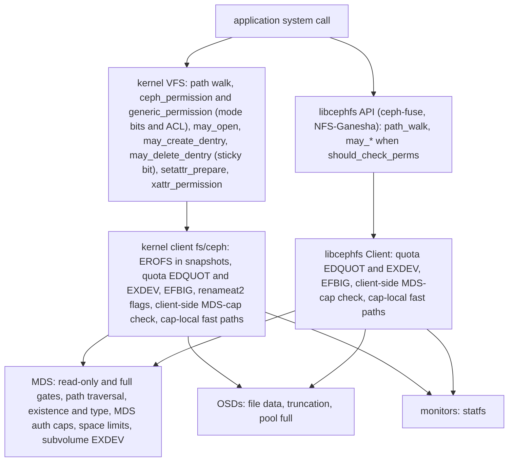

# POSIX semantics contract

> Part of the [C++ MDS project map](../README.md). Sources: `doc/cephfs/posix.rst` (104 lines), `doc/cephfs/lazyio.rst`, `doc/cephfs/quota.rst`; at commit `5f7e383ae6d`: `src/mds/Server.cc` (dispatch gates 2765-2840, `check_access` 3500-3520, `prepare_new_inode` 3637-3760, path helpers 3879-4057, getattr 4272-4410, open and create 4639-5047, readdir 5092-5145, file locks 5418-5578, setattr and open-truncate 5578-5845, xattrs 7004-7316, mknod/mkdir/symlink/link 7582-8056, unlink 8572-8828, emptiness checks 9225-9300, rename 9321-9565 and 10060-10100), `src/mds/MDCache.cc` (`predirty_journal_parents` 2224-2420, `identify_files_to_recover` 6444, `path_traverse` 8443-8907, `request_start` 9817-9848), `src/mds/Locker.cc` (`handle_client_caps` 3650-3700, `_update_cap_fields` 3978-4060, `remove_client_cap` 4345-4372), `src/mds/RecoveryQueue.cc`, `src/mds/locks.c` (filelock table), `src/mds/MDSAuthCaps.cc`, `src/mds/SessionMap.cc`, `src/include/cephfs/types.h`, `src/include/ceph_fs.h`, `src/common/ceph_fs.cc`, `src/messages/MClientRequest.h`, `src/client/Client.cc` (permission helpers 6305-6680, setattr 8515-8720, stat 9179-9340, readdir 9830-10230, open 10765-11200, write and fsync 12793-13470, statfs 13637-13730, setattr entry 14880-14900, xattrs 15144-15530, namespace calls 16011-16900, file-size and suid helpers 17615-17650, ACLs 18527-18610), `src/client/Client.h`, `src/client/Inode.cc`, `src/client/Fh.h`, `src/client/fuse_ll.cc`, `src/mon/MgrStatMonitor.cc`, `src/common/options/mds-client.yaml.in`, `qa/workunits/suites/pjd.sh`, `qa/suites/fs/**/*pjd*.yaml`, `qa/tasks/cephfs/xfstests_dev.py`; Linux 7.3-rc6+ tree (HEAD `af32da41b03`): `linux/fs/ceph/{inode,dir,file,caps,xattr,acl,locks,ioctl,addr,super,quota,mds_client}.c` and the VFS files `linux/fs/{namei,attr,open,xattr,sync}.c`, `linux/include/linux/fs.h`; nfs-ganesha V15.7 `src/FSAL/FSAL_CEPH/main.c`; fstests `3e1ee800e52a` `tests/generic/{003,075,531,538}`; pjd-fstest 20090130-RC `tests/`. Related: [auth and MDS caps](../01-cluster-integration/auth-and-mds-caps.md), [attributes and xattrs](attributes-and-xattrs.md), [namespace mutations](namespace-mutations.md), [rename](rename.md), [lookup, readdir, open and file locks](lookup-readdir-open-and-file-locks.md), [request lifecycle](request-lifecycle.md), [capabilities](../02-client-protocol/capabilities.md), [leases, lock caches and async dirops](../02-client-protocol/leases-lock-caches-and-async-dirops.md), [kclient expectations](../02-client-protocol/kclient-expectations.md), [libcephfs, ceph-fuse and NFS-Ganesha expectations](../02-client-protocol/libcephfs-fuse-ganesha-expectations.md), [wire protocol](../02-client-protocol/wire-protocol.md), [rstats, quotas and subvolumes](../10-snapshots-quotas-subvolumes/rstats-quotas-and-subvolumes.md), [snapshots](../10-snapshots-quotas-subvolumes/snapshots.md), [RADOS and OSD interactions](../07-storage-formats/rados-and-osd-interactions.md), [QA and conformance suites](../14-testing/qa-and-conformance-suites.md), [`mds_lock` analysis](../00-architecture/mds_lock-analysis.md).

## 1. Purpose and responsibilities

This page states the POSIX contract of CephFS in one place. For every POSIX call it records the POSIX rule, the component that enforces each part of it, the MDS operation and handler that serve it (if any), the errors the MDS can return in the order the MDS checks them, the effect on `ctime`, `mtime` and `change_attr` of the target and of the parent directory, and the cache-coherency guarantee that applies. It then lists the places where CephFS departs from POSIX: the departures documented in `doc/cephfs/posix.rst` (7.2) and further ones found in the code (7.3), each marked by whether the MDS is involved.

This page is the acceptance checklist for any MDS implementation that serves unmodified Linux kernel, ceph-fuse, libcephfs and NFS-Ganesha clients, and the reference against which pjd-fstest and xfstests results are judged (7.1, 7.4). It records the behaviour of the C++ MDS and its clients at the pinned commits and contains no design. Detail stays on the pages linked from each row; claims made here are cited to the code again.

**Who checks permissions.** The C++ MDS does not evaluate POSIX discretionary access control. A search of `src/mds` for `S_ISVTX`, `posix_acl` and `MAY_EXECUTE` finds no use outside `MDSAuthCaps` (code search at the pinned commit; also stated in [auth-and-mds-caps 1](../01-cluster-integration/auth-and-mds-caps.md#1-purpose-and-responsibilities)). Mode bits, POSIX ACLs, the sticky bit and the ownership rules of `chmod`, `chown` and `utimes` are checked in the clients, which also decide when setuid and setgid bits are cleared (the MDS applies a clearing requested with `CEPH_SETATTR_KILL_*`, and itself clears both bits of a regular file that has an execute bit when a `SETATTR` carries `UID` or `GID`, even with an unchanged value, and no `MODE`, `src/mds/Server.cc:5706-5711`, 3.3.5):

* Linux kernel client: the VFS calls `ceph_permission`, which refreshes the `As` cap with a `GETATTR` if needed and then calls `generic_permission`, which also evaluates POSIX ACLs (`linux/fs/ceph/inode.c:3101-3114 (ceph_permission)`). The sticky-bit rule is in `may_delete_dentry` (`linux/fs/namei.c:3678 (may_delete_dentry)`, `linux/fs/namei.c:3645 (__check_sticky)`); the `chmod`/`chown` rules and the ownership rule for explicit times are in `setattr_prepare` (`linux/fs/attr.c:161-235 (setattr_prepare)`), and the owner-or-write-permission rule for setting both times to now is in `may_setattr`, called by `notify_change` (`linux/fs/attr.c:386-395 (may_setattr)`, `:438`; `linux/fs/utimes.c:62-64 (vfs_utimes)`).
* libcephfs, and through it ceph-fuse and NFS-Ganesha: `Client::inode_permission`, `xattr_permission`, `may_setattr`, `may_open`, `may_lookup`, `may_create`, `may_delete` (sticky bit) and `may_hardlink` (`src/client/Client.cc:6371-6670`). They run only when `should_check_perms()` is true, that is `(is_fuse && !fuse_default_permissions) || (!is_fuse && client_permissions)` (`src/client/Client.h:2289-2291 (Client::should_check_perms)`); the defaults are `client_permissions=true` and `fuse_default_permissions=false` (`src/common/options/mds-client.yaml.in:308-313`, `:365-373`).

The MDS evaluates only the session's MDS auth caps (`Server::check_access`, `src/mds/Server.cc:3500-3520`, which calls `MDSAuthCaps::is_capable`, `src/mds/MDSAuthCaps.cc:266`): file-system name, path prefix, network, the `r`/`w` spec, `root_squash`, the `p`, `s` and `f` flags and, only for grants restricted with `uid=`/`gids=`, a plain owner/group/other mode-bit test (a grant with an unrestricted uid returns before any mode check, `src/mds/MDSAuthCaps.cc:340`). The caller uid and gids it evaluates are those the client writes into the request ([auth-and-mds-caps 3.1](../01-cluster-integration/auth-and-mds-caps.md#31-trust-model-and-layering)). For changes buffered under exclusive caps and flushed in cap messages, the MDS checks only that the message belongs to a cap it issued (a cap exists, the migration sequence is not older, the cap id matches: `src/mds/Locker.cc:3509`, `:3521`, `:3590 (Locker::handle_client_caps)`); neither the dirty bits nor the values are checked against the issued caps or the MDS auth caps ([capabilities 8](../02-client-protocol/capabilities.md#8-edge-cases-failure-handling-and-gotchas), inferred there from code reading; the MDS-cap check in `Locker::_do_cap_update` was removed, [auth-and-mds-caps 1](../01-cluster-integration/auth-and-mds-caps.md#1-purpose-and-responsibilities)). Besides the auth caps, the MDS enforces the structural rules listed per call (existence, file type, emptiness, `nlink`, ancestry, subvolume boundaries, directory size limits, read-only and full states), and it is the component that applies setgid-directory inheritance to new inodes (`src/mds/Server.cc:3722-3735 (Server::prepare_new_inode)`). Quotas are enforced only by clients ([rstats-quotas-and-subvolumes 3.11](../10-snapshots-quotas-subvolumes/rstats-quotas-and-subvolumes.md#311-enforcement-clients-only)).

**What the MDS never sees.** `access`, `readlink`, file data reads and writes, `statfs` and `fdatasync` have no MDS operation of their own (some of them may cause a `GETATTR` or a cap message, table 3.2). The open flags that reach the MDS are the access mode, `O_CREAT`, `O_EXCL`, `O_TRUNC`, `O_DIRECTORY` and `O_NOFOLLOW` (kernel: `linux/fs/ceph/file.c:42-75 (ceph_flags_sys2wire)`; libcephfs: `src/common/ceph_fs.cc:161-190 (ceph_flags_sys2wire)`), plus `CEPH_O_LAZY` when libcephfs runs with `client_force_lazyio` (`src/client/Client.cc:11103-11104 (Client::_open)`). `O_APPEND`, `O_DIRECT`, `O_SYNC`, `O_DSYNC` and `O_NOATIME` stay in the client.

Tags used on this page:

| Tag | Component |
|---|---|
| VFS | the Linux VFS in front of the kernel client (`linux/fs/*.c`); ceph-fuse mounts also pass through the kernel VFS and the FUSE module, whose checks this page does not trace (`fs/fuse` is not in the kernel snapshot; unverified) |
| kc | the Linux kernel CephFS client (`linux/fs/ceph`) |
| lib | the libcephfs `Client` (`src/client`): ceph-fuse, NFS-Ganesha (FSAL_CEPH) and direct API users; its permission helpers run only when `should_check_perms()` |
| MDS | the C++ MDS |
| OSD | the OSDs holding file data |
| MON | the monitors |

## 2. Source map

| Area | File | Symbols (line) | What it decides |
|---|---|---|---|
| Upstream statement | `doc/cephfs/posix.rst` | — | documented departures (7.2) |
| MDS request gates | `src/mds/Server.cc` | `dispatch_client_request` (2765), `check_access` (3500), `rdlock_path_pin_ref` (3879), `rdlock_path_xlock_dentry` (3960) | read-only and full gates, MDS auth caps, path and existence errors |
| MDS handlers | `src/mds/Server.cc` | `handle_client_getattr` (4272), `handle_client_open` (4639), `handle_client_openc` (4895), `handle_client_readdir` (5092), `handle_client_file_setlock` (5418), `handle_client_file_readlock` (5525), `handle_client_setattr` (5578), `do_open_truncate` (5780), `xattr_validate` (7004), `handle_client_setxattr` (7151), `handle_client_removexattr` (7248), `handle_client_getvxattr` (7317), `handle_client_mknod` (7582), `handle_client_mkdir` (7688), `handle_client_symlink` (7792), `handle_client_link` (7865), `_link_local` (8015), `handle_client_unlink` (8572), `_unlink_local` (8738), `_dir_is_nonempty_unlocked` (9225), `handle_client_rename` (9321), `_rename_prepare` (9932) | per-call error order and inode/parent effects |
| New inodes | `src/mds/Server.cc` | `prepare_new_inode` (3637) | owner, setgid inheritance, timestamps, initial xattrs and ACLs |
| Parent updates | `src/mds/MDCache.cc`, `src/include/cephfs/types.h` | `predirty_journal_parents` (2224), `frag_info_t::add_delta` (91) | parent `mtime`/`ctime`/`change_attr`, `nfiles`/`nsubdirs` |
| Timestamp source | `src/mds/MDCache.cc`, `src/mds/Mutation.h` | `request_start` (9817; op stamp set at 9845), `MutationImpl::get_op_stamp` (206) | client clock as the source of MDS-set times |
| Cap flushes | `src/mds/Locker.cc` | `handle_client_caps` (3386; sync flag 3656, journal flush 3691-3692), `_update_cap_fields` (3978), `remove_client_cap` (4345) | buffered attribute changes, synchronous flush, file-recovery trigger |
| File size recovery | `src/mds/RecoveryQueue.cc`, `src/mds/MDCache.cc` | `RecoveryQueue::_start` (93), `_recovered` (187), `identify_files_to_recover` (6444) | size and `mtime` after a writer is lost |
| Data coherency | `src/mds/locks.c` | filelock table (85-125) | which file caps clients may hold together |
| MDS auth caps | `src/mds/MDSAuthCaps.cc`, `src/mds/SessionMap.cc` | `is_capable` (266), `Session::check_access` (1109) | the only permission evaluation in the MDS |
| Stored attributes | `src/include/cephfs/types.h` | `inode_t` (952-984) | POSIX-visible inode fields |
| Kernel permission | `linux/fs/ceph/inode.c`, `linux/fs/namei.c`, `linux/fs/attr.c`, `linux/fs/xattr.c`, `linux/fs/open.c` | `ceph_permission`, `generic_permission`, `may_open`, `may_create_dentry`, `may_delete_dentry`, `may_mknod`, `may_linkat`, `setattr_prepare`, `notify_change`, `xattr_permission`, `__vfs_setxattr`, `__vfs_removexattr`, `chown_common`, `vfs_truncate` | DAC, ACL, sticky bit, ownership rules |
| Kernel operations | `linux/fs/ceph/{dir,file,inode,xattr,acl,locks,caps,super,quota,addr}.c` | `ceph_atomic_open`, `ceph_open`, `ceph_mknod`, `ceph_mkdir`, `ceph_symlink`, `ceph_link`, `ceph_unlink`, `ceph_rename`, `ceph_setattr`, `__ceph_setattr`, `ceph_getattr`, `ceph_readdir`, `ceph_lock`, `ceph_flock`, `ceph_fsync`, `ceph_sync_fs`, `ceph_statfs`, `ceph_read_iter`, `ceph_write_iter`, `ceph_sync_write`, `ceph_filemap_fault` | client-side rules, cap-local fast paths |
| libcephfs | `src/client/Client.cc`, `Client.h`, `Inode.cc`, `Fh.h`, `fuse_ll.cc` | `may_*`, `create_and_open`, `_create`, `_open`, `_do_setattr`, `fill_stat`, `fill_statx`, `readdir_r_cb`, `_write`, `_fsync`, `fsync`, `ll_fsync`, `_statfs`, `_setxattr`, `_rename`, `_link`, `fuse_ll_access`, `fuse_ll_rename` | client-side rules for ceph-fuse and Ganesha |
| statfs | `src/mon/MgrStatMonitor.cc` | `preprocess_statfs` (484) | statfs is answered by the monitors |
| Tests | `qa/workunits/suites/pjd.sh`, `qa/suites/fs/permission/tasks/cfuse_workunit_suites_pjd.yaml`, `qa/tasks/cephfs/xfstests_dev.py` | — | how pjd and xfstests are run (7.4) |

## 3. How it works

### 3.1 Layers and the order of checks

Errors produced by a client layer are returned before the operation's own MDS request is sent (the permission checks may first send a `GETATTR` to refresh `As`). There is one exception: the kernel's `->atomic_open` sends `CREATE` or `OPEN` before the VFS checks the opened file with `may_open` (`linux/fs/namei.c:4507-4523 (lookup_open)`, `:4835 (do_open)`; comment at `linux/fs/ceph/file.c:821-825`), so an open can reach the MDS and still fail with a client-side `EACCES`. For a call that breaks several rules, the application therefore usually sees the first failing client check, and only if all client checks pass, the first failing MDS check in the handler order given below. For namespace operations the kernel client sends the parent inode number and one name ([kclient-expectations 3.6.2](../02-client-protocol/kclient-expectations.md#362-paths-on-the-wire)); libcephfs resolves paths with its own `path_walk` before sending ([libcephfs page 3.5](../02-client-protocol/libcephfs-fuse-ganesha-expectations.md#35-operation-map-api-to-mds-op)). Symlinks are resolved by clients: `MDCache::path_traverse` returns `ENOTDIR` when a component is not a directory (`src/mds/MDCache.cc:8525`) and never follows a link.

**Shared MDS gates**, run by `Server::dispatch_client_request` (`src/mds/Server.cc:2765`) before every handler:

1. `EROFS` when the request may write (`op & CEPH_MDS_OP_WRITE`, or `OPEN` with `O_CREAT|O_TRUNC`, `src/messages/MClientRequest.h:196-200 (MClientRequest::may_write)`) and the MDS cache is read-only (`src/mds/Server.cc:2794-2797`).
2. A stored peer error (`src/mds/Server.cc:2799-2802`).
3. **Full gate**: when the metadata pool has `FLAG_FULL`, `SETLAYOUT`, `SETDIRLAYOUT`, `RMXATTR`, `SETXATTR`, `CREATE`, `SYMLINK`, `MKSNAP`, and `LINK`/`RENAME` before any witness acked, need the `f` MDS cap flag (`MAY_FULL`) on the base inode of the path (`src/mds/Server.cc:2805-2836`). The code then answers `ENOSPC`, but `check_access` has already replied `EACCES`, so clients observe `EACCES` (code reading; [auth-and-mds-caps 3.7](../01-cluster-integration/auth-and-mds-caps.md#37-where-checks-happen-per-request)). `MKNOD`, `MKDIR`, `UNLINK`, `RMDIR` and `SETATTR` are not gated.

**Create gates** (`CREATE`, `MKNOD`, `MKDIR`, `SYMLINK`, the new name of `LINK`), from `Server::rdlock_path_xlock_dentry` (`src/mds/Server.cc:3960-4057`): `EINVAL` (no name) → `EROFS` (name inside `.snap`) → `EEXIST` (name `.` or `..`; `ENOTEMPTY` for the new name of `LINK`, which calls the function with `create=false`, `src/mds/Server.cc:3984-3987`, `:7900`) → path errors → wait while the parent is in a quarantined subvolume and the client lacks `CEPHFS_FEATURE_QUARANTINE` → `EROFS` (parent is an MDS system directory) → `ENOENT` (parent already unlinked) → `EEXIST` (name exists; for `CREATE` without `O_EXCL` the existing file is opened instead).

**Remove gates** (`UNLINK`, `RMDIR`): the same function with `ENOTEMPTY` for `.`/`..` (`src/mds/Server.cc:3982-3989`) and `ENOENT` for an absent name (`:4040-4044`).

**Path errors**: `MDCache::path_traverse` (`src/mds/MDCache.cc:8443`) returns `ESTALE` for an unknown base inode (the MDS asks the other ranks and then reads the backtrace before giving up, [namespace-mutations 3.2](namespace-mutations.md#32-entry-routing-and-idempotency)), `ENOTDIR`, `ENOENT`, `EINVAL` and `EIO` for damaged metadata (`src/mds/MDCache.cc:8486-8864`).

### 3.2 Main table

Shorthands used in the table; 3.4 gives the code:

* **op stamp**: the time the client wrote into the request. The MDS uses it for every `ctime` and `mtime` it sets.
* **T-ctime**: on the target inode, `ctime := op stamp`, `rctime := max(rctime, op stamp)`, `change_attr += 1`.
* **P-touch**: on the parent directory, the dirfrag's `fragstat.mtime := op stamp`, `fragstat.change_attr += 1`, and `nfiles` or `nsubdirs` ± 1 for a link or unlink; the directory inode's `mtime = ctime := fragstat.mtime` only if that is newer than its `dirstat.mtime`, and its `change_attr += 1` only if the dirfrag counter exceeds `dirstat.change_attr`. The inode part is applied in the same mutation only when the directory inode is auth on the same rank and its `nestlock` and `versionlock` can be wrlocked; otherwise it is deferred to the next scatter-gather of the directory's `filelock` (`src/mds/MDCache.cc:2347-2388 (MDCache::predirty_journal_parents)`).
* Cap names are those of [capabilities 3.1](../02-client-protocol/capabilities.md#31-the-cap-bit-model).

| Call | POSIX rule | Enforced by | MDS op → handler | MDS errors, in check order | ctime / mtime / change_attr | Caps and coherency | Details |
|---|---|---|---|---|---|---|---|
| `open` of an existing file (no `O_CREAT`) | permission for the access mode; `EISDIR` when writing a directory; no timestamp change | VFS `may_open` (`EISDIR`, `EACCES`); lib `may_open` (`ELOOP`, `EISDIR`, `EACCES`); kc and lib check the MDS caps locally before using cached caps; MDS: MDS caps | `OPEN` 0x302 → `Server::handle_client_open` (`src/mds/Server.cc:4639`); not sent when the client already holds caps | read-only gate → `EINVAL` (mode) → `EROFS` (write mode, read-only MDS) → path errors → `EINVAL` (`O_DIRECTORY` on a non-directory) → `EISDIR`/`EINVAL` (`O_TRUNC` on a directory/other non-regular inode) → `EPERM` (inline data, old client) → `EROFS` (write in a snapshot) → `EACCES` (MDS caps `MAY_READ`, plus `MAY_WRITE` for write modes) | none | wanted caps registered for the mode: read `Fs Fr Fc`, write `Fx Fw Fb As Ax Xs Xx`; lock state changes revoke conflicting caps of other clients; writers get `max_size` later | [3.3.1](#331-open-creat-and-the-open-flags), [lookup 3.8](lookup-readdir-open-and-file-locks.md#38-open-serverhandle_client_open-serverdo_open_truncate) |
| `open` with `O_CREAT` (no `O_EXCL`) | create a regular file if absent: owner = effective uid, group = effective gid or the parent's group if the parent is setgid, mode masked by the umask; set its times; mark the parent's `mtime`/`ctime`; open an existing file as above | VFS and kc (umask or default ACL, `S_ISGID` stripping, write and search on the parent); lib `may_create`; kc and lib `max_files` quota (`EDQUOT`); MDS: existence, setgid inheritance, MDS caps, space | `CREATE` 0x1301 → `Server::handle_client_openc` (`src/mds/Server.cc:4895`); existing name → `handle_client_open` (`:4913-4920`); kc sends `CREATE` only from `->atomic_open`, `vfs_create` callers send `MKNOD` | read-only and full gates → `EINVAL` (flags) → create gates → `EPERM` (charmap directory, client without `CEPHFS_FEATURE_CHARMAP`) → `ENAMETOOLONG` (`alternate_name` over 8 KiB) → `EINVAL` (layout) → `EACCES` (MDS caps on the parent) → `ENOSPC` (dirfrag at `mds_bal_fragment_size_max`) → `ENOSPC` (`mds_dir_max_entries`) | new inode: `atime = mtime = ctime = btime := op stamp`, `change_attr = 0`; parent: P-touch (+1 file) | the dentry xlock serializes all creators of the name; the creator gets caps in the reply (writers get a writable range of one stripe unit); other clients see the name after the journal commit | [3.3.1](#331-open-creat-and-the-open-flags), [namespace-mutations 3.7.1](namespace-mutations.md#371-create-srcmdsservercc4895-serverhandle_client_openc) |
| `open` with `O_CREAT\|O_EXCL` | `EEXIST` if the name exists, a final symlink included; the existence check and the creation are one atomic step | VFS (`EEXIST` when the dentry is already known positive); lib `create_and_open` (`EEXIST`, final symlink not followed); MDS: authoritative check under the dentry xlock | `CREATE` with `CEPH_O_EXCL` → `handle_client_openc` | as the previous row; `EEXIST` comes from the create gates | as the previous row, on success only | as the previous row; kc async create always sets `CEPH_O_EXCL` | [3.3.1](#331-open-creat-and-the-open-flags) |
| `open` with `O_TRUNC` | truncate an existing regular file opened for writing to length 0 and mark `mtime`/`ctime`; ignored for FIFOs and devices | VFS (drops `O_TRUNC` for FIFOs and devices; truncates after the open through `handle_truncate` → setattr); kc `ceph_atomic_open` strips `O_TRUNC`; lib `may_open` asks for write permission; MDS for an `OPEN` carrying `CEPH_O_TRUNC` | `OPEN` with `CEPH_O_TRUNC` → `handle_client_open` → `Server::do_open_truncate` (`src/mds/Server.cc:5780`); lib sends `OPEN` whenever `O_TRUNC` is given for an existing file; kc truncates through `SETATTR` (row `truncate`) and passes `O_TRUNC` only when it sends `OPEN` | as the `open` row up to the snapshot check → `EACCES` (`MAY_WRITE`) → wait while an earlier truncation runs | target: `mtime = ctime := op stamp`, `change_attr += 1`, also when the size is already 0; parent: none | `filelock` xlock revokes `Fs Fr Fw Fx Fl` from every client first; holders receive `CEPH_CAP_OP_TRUNC`; OSD objects are truncated after the journal commit; the journal is flushed at once | [3.3.1](#331-open-creat-and-the-open-flags), [attributes 3.4](attributes-and-xattrs.md#34-o_trunc-on-open-srcmdsservercc5780-serverdo_open_truncate) |
| `write` with `O_APPEND` | the offset is set to end of file before each write, with no intervening modification | kc and lib only (flag not sent); OSD stores the data | none; the MDS supplies the size (`GETATTR` with `Fs`) and grants `Fw` | client errors only (`EFBIG`, `EDQUOT`, `ENOSPC` for a full pool) | as `write`: the client sets `mtime`/`ctime`/`change_attr` under `Fw` and flushes them; the MDS keeps `mtime` only if newer and `size` only if larger | kc reads the size with `GETATTR(Fs)` before waiting for `Fw` and re-reads `i_size` after; lib seeks to its cached end of file before waiting for caps (code comment "FIXME: this is racy"); nothing makes the append atomic between clients that hold `Fw` together (`filelock` `MIX`) (derived from code, not tested) | [3.3.1](#331-open-creat-and-the-open-flags), [3.5](#35-data-coherency-between-clients) |
| `O_DIRECT` | not POSIX; Linux: the transfer bypasses the page cache | kc and lib only; OSD serves the I/O | none | client and OSD errors | as `write` | still needs `Fr`/`Fw` and, past `max_size`, an MDS grant; kc does uncached I/O and does not want `Fc`/`Fb` (an `O_DIRECT\|O_APPEND` write still asks for `Fb` but writes directly); lib drops `Fb`/`Fl` from the caps it uses | [3.3.1](#331-open-creat-and-the-open-flags) |
| `O_SYNC`, `O_DSYNC` | a write returns once its data (`O_DSYNC`) or data and metadata (`O_SYNC`) are stable | kc and lib; OSD acknowledges the data; MDS only through the `fsync` path | none for the flag; kc runs `ceph_fsync` after the write (row `fsync`) | client errors | as `write` | kc: `O_DSYNC` waits for the data only; `O_SYNC` also sends dirty caps with the sync flag and flushes the MDS journal for unsafe requests but does not wait for the size/`mtime` flush; lib flushes the written data range to the OSDs only | [3.3.10](#3310-fsync-fdatasync-syncfs-and-synchronous-writes) |
| `creat` | `open(path, O_CREAT\|O_WRONLY\|O_TRUNC, mode)` | as the `O_CREAT` and `O_TRUNC` rows | `CREATE`; for an existing name the MDS opens it; kc then truncates through the VFS (`SETATTR`); lib, when `path_walk` found the file, sends `OPEN` with `O_TRUNC` instead | as those rows | as those rows | as those rows | [3.3.1](#331-open-creat-and-the-open-flags) |
| `mknod`, `mkfifo` | create a FIFO, character or block device, socket or regular file; `EEXIST`; Linux returns `EPERM` for `S_IFDIR` and `EINVAL` for an unknown type | VFS `may_mknod` (type), permission; lib `may_create` (no type check); kc and lib quota; MDS: existence, setgid inheritance, MDS caps, space; no type validation | `MKNOD` 0x1201 → `Server::handle_client_mknod` (`src/mds/Server.cc:7582`) | read-only gate (no full gate) → create gates → `EACCES` → `ENOSPC` → `ENOSPC` → `ENAMETOOLONG` → `EINVAL` (layout); no charmap check | new inode as for `O_CREAT`, `rdev` stored; parent: P-touch | a regular file gets read-write caps and a writable range; other types get the cap from the reply | [3.3.2](#332-mknod-mkdir-symlink-readlink), [namespace-mutations 3.7.2](namespace-mutations.md#372-mknod-srcmdsservercc7582-serverhandle_client_mknod) |
| `mkdir` | create a directory; mode masked by the umask; group and setgid bit inherited from a setgid parent; parent link count +1; `EEXIST` | VFS/lib permission; kc and lib quota; MDS: existence, setgid inheritance, MDS caps, space, charmap | `MKDIR` 0x1220 → `Server::handle_client_mkdir` (`src/mds/Server.cc:7688`); inside `.snap` clients send `MKSNAP` | read-only gate (no full gate) → create gates → `EACCES` → `ENOSPC` → `ENOSPC` → `EPERM` (charmap) → `ENAMETOOLONG` | new directory as for `O_CREAT`; parent: P-touch (+1 subdirectory) | the creator becomes loner of the new directory; stored `nlink` stays 1 and clients report `2 + nsubdirs` | [3.3.2](#332-mknod-mkdir-symlink-readlink), [namespace-mutations 3.7.3](namespace-mutations.md#373-mkdir-srcmdsservercc7688-serverhandle_client_mkdir) |
| `symlink` | create a link holding the target string; `EEXIST`; `ENAMETOOLONG` for a too-long target | VFS (target copied with a `PATH_MAX` limit), permission; lib; kc and lib quota; MDS: existence, MDS caps, space, charmap; no target length limit | `SYMLINK` 0x1222 → `Server::handle_client_symlink` (`src/mds/Server.cc:7792`); mode `S_IFLNK\|0777`, `size` = target length | read-only and full gates → create gates → `EACCES` → `ENOSPC` → `ENOSPC` → `EPERM` (charmap) → `ENAMETOOLONG` (`alternate_name`) | new inode as for `O_CREAT`; parent: P-touch | the cap is created by the reply's inode stat | [3.3.2](#332-mknod-mkdir-symlink-readlink), [namespace-mutations 3.7.4](namespace-mutations.md#374-symlink-srcmdsservercc7792-serverhandle_client_symlink) |
| `readlink` | return the target; `EINVAL` for a non-symlink | kc and lib only | none: the target travels in the inode stat of `LOOKUP`/`GETATTR` replies and is cached | client only | none (no `atime` update) | the target never changes after creation | [3.3.2](#332-mknod-mkdir-symlink-readlink) |
| `link` | new name for an existing non-directory; target `nlink` +1 and `ctime`; `EEXIST`; `EPERM` for a directory; `EXDEV` across file systems; `EMLINK` at the link limit | VFS (`EPERM` for a directory, `may_linkat` with `protected_hardlinks`); lib (`EPERM` for a directory, `may_hardlink`, `may_create`, quota); kc: no quota check; MDS: existence, `nlink`, MDS caps on target and directory, space, subvolume `EXDEV`; no link limit | `LINK` 0x1202 → `Server::handle_client_link` (`src/mds/Server.cc:7865`) → `_link_local` (`:8015`) or a two-phase commit with the target's rank | read-only and full gates (before witnesses) → `EINVAL` (target without a parent dentry) or path errors → create gates for the new name (`EEXIST`) → `EPERM` (charmap) → `ENAMETOOLONG` → `EINVAL` (target is a directory) → `ENOENT` (target `nlink` 0) → `EACCES` (target) → `EACCES` (directory) → `ENOSPC` → `ENOSPC` → `EXDEV` (subvolume) | target: T-ctime, `nlink += 1`; new parent: P-touch (+1 file) | target `linklock` and `snaplock` xlocked (revokes `Ls`/`Lx`) | [3.3.3](#333-link-unlink-rmdir), [namespace-mutations 3.7.5](namespace-mutations.md#375-link-local-target-srcmdsservercc7865-serverhandle_client_link-srcmdsservercc8015-server_link_local) |
| `unlink` | remove a name; `nlink` −1; an open file stays usable; `EISDIR` (Linux) for a directory; sticky-bit rule | VFS `may_delete_dentry` (`EACCES`, sticky `EPERM`, `EISDIR`); lib `may_delete` (sticky); MDS: existence, type, MDS caps on the parent only | `UNLINK` 0x1203 → `Server::handle_client_unlink` (`src/mds/Server.cc:8572`) → `_unlink_local` (`:8738`) | read-only gate → remove gates → `EISDIR` → `EACCES` (parent) → `ENOSPC` (stray dirfrag full) | target: T-ctime, `nlink -= 1`; parent: P-touch (−1) | a primary link moves the inode to a stray directory, where it lives while any client holds caps; purge after the last cap | [3.3.3](#333-link-unlink-rmdir), [namespace-mutations 3.7.7](namespace-mutations.md#377-unlink-of-a-primary-link-srcmdsservercc8572-serverhandle_client_unlink-srcmdsservercc8738-server_unlink_local) |
| `rmdir` | remove an empty directory; `ENOTEMPTY`/`EEXIST`; `ENOTDIR`; `EINVAL` for `.`; `EBUSY` for a mount point | VFS (`EINVAL` for `.`, `ENOTEMPTY` for `..`, `EBUSY`, sticky); lib `may_delete`; MDS: emptiness, type, MDS caps | `RMDIR` 0x1221 → `handle_client_unlink` (rmdir mode) | read-only gate → remove gates → `ENOTEMPTY` (non-zero `fragstat` of an auth dirfrag, or snapshots in the directory's own realm) or `ENOTDIR` → `EACCES` → `ENOSPC` (stray) → `ENOTEMPTY` (check with `filelock` rdlocked) | as `unlink` (−1 subdirectory) | ranks holding subtree-root dirfrags of the directory witness the removal | [3.3.3](#333-link-unlink-rmdir), [namespace-mutations 3.7.9](namespace-mutations.md#379-rmdir-emptiness-snapshots-and-witnesses) |
| `rename` of a file to a new name or over a file | the new name refers to the source atomically, replacing an existing target; two names of one inode: no-op; both parents' `mtime`/`ctime` | VFS (`may_delete_dentry` on both names, sticky); lib `may_delete` on both; MDS: existence, types, MDS caps, space, subvolume `EXDEV` | `RENAME` 0x1204 → `Server::handle_client_rename` (`src/mds/Server.cc:9321`), projection in `_rename_prepare` (`:9932`) | read-only and full gates → `EBUSY` (`.`/`..`) → `ENAMETOOLONG` → path checks (`EINVAL`, `EROFS`, `ENOENT`) → `EPERM` (charmap) → 0 (same dentry) → `EINVAL` (directory moved below itself) → `ENOTEMPTY`/`EISDIR`/`ENOTDIR` → 0 (same inode) → `EINVAL` (`alternate_name` mismatch) → `ENOSPC` (stray full) → `EACCES` (source dir, destination dir) → `ENOSPC` (dirfrag, entries) → `EACCES` (source inode) → `ENOTEMPTY` (locked check) → `EXDEV` (subvolume) | renamed inode: T-ctime; replaced inode: T-ctime, `nlink -= 1`; both parents: P-touch | both dentries xlocked for the whole operation; across ranks a two-phase commit with witnesses; the replaced inode goes to a stray directory | [3.3.4](#334-rename), [rename 3.3](rename.md#33-validation-checks-evaluation-order) |
| `rename` of a directory over an empty directory | allowed only over an empty directory (`ENOTEMPTY` or `EEXIST` otherwise); `ENOTDIR`/`EISDIR` on type mismatch; `EINVAL` when moving a directory below itself | VFS (ancestor traps: `EINVAL`, `ENOTEMPTY`); MDS: emptiness, ancestry, types | as above | as above; emptiness checked twice (unlocked fast path, then with `filelock` rdlocked) | as above; parents' `nsubdirs` change | snapshots of the target's own realm are checked only by the unlocked fast path | [3.3.4](#334-rename), [rename 8](rename.md#8-edge-cases-failure-handling-and-gotchas) |
| `renameat2` with `RENAME_NOREPLACE`, `RENAME_EXCHANGE`, `RENAME_WHITEOUT` | Linux extensions: no-replace, atomic exchange, whiteout | kc `ceph_rename` returns `EINVAL` for any flag; the VFS answers `EEXIST` first when `RENAME_NOREPLACE` meets an existing target; ceph-fuse returns `EINVAL`; the libcephfs API has no flags | none (`RENAME` has no flag argument) | client only | none | — | [3.3.4](#334-rename) |
| `rename`, `link` across boundaries | `EXDEV` across file systems | snapshots: kc and lib `EXDEV` for different snap ids; quota realms: kc and lib `EXDEV` for `rename` only (not for `link`); subvolumes: MDS `EXDEV` for `rename` (realms of the two parents) and for `link` | `RENAME`, `LINK` | `EXDEV` is the last `rename` check; for `link` it follows the access and space checks | none | — | [3.3.4](#334-rename), [rstats-quotas-and-subvolumes 3.13](../10-snapshots-quotas-subvolumes/rstats-quotas-and-subvolumes.md#313-what-the-subvolume-flag-changes-inside-the-mds) |
| `chmod`, `fchmod` | owner or privileged caller only; `S_ISGID` cleared when the caller is not in the file's group; `ctime` updated | VFS `setattr_prepare` (`EPERM`, clears `S_ISGID`); lib `may_setattr`; MDS: MDS caps only | `SETATTR` 0x1108 with `CEPH_SETATTR_MODE` → `Server::handle_client_setattr` (`src/mds/Server.cc:5578`); no request when the client holds `Ax` (the change is flushed with caps) | read-only gate → path errors → `EROFS` (snapshot) → `EPERM` (MDS-private inode) → `EPERM`/`EINVAL` (fscrypt with an old request header) → `EACCES` (MDS caps `MAY_WRITE`) | target: T-ctime; parent: none | `authlock` xlock revokes `As`/`Ax` first; kc then rewrites the access ACL | [3.3.5](#335-chmod-chown-utimes-truncate), [attributes 3.3](attributes-and-xattrs.md#33-setattr) |
| `chown`, `fchown`, `lchown` | changing the owner needs privilege; the owner may change the group to one of its groups; setuid/setgid of non-directories cleared | VFS (`EPERM`; the kill-suid flags become a mode change in `notify_change`); lib `may_setattr`; MDS: MDS caps (`MAY_CHOWN`/`MAY_CHGRP` matter only for `uid=` grants) | `SETATTR` with `CEPH_SETATTR_UID`/`GID`, or local under `Ax` | as `chmod`; `uid=` grants refuse a real owner change (`EACCES`) | target: T-ctime | as `chmod`; without `MODE` in the mask the MDS clears `S_ISUID\|S_ISGID` of a regular file that has an execute bit | [3.3.5](#335-chmod-chown-utimes-truncate) |
| `utime`, `utimes`, `utimensat`, `futimens` | explicit times need ownership; `UTIME_NOW` needs ownership or write permission; `ctime` set to now | VFS `setattr_prepare` (explicit times) and `may_setattr` (both times now); lib `may_setattr`; MDS: MDS caps only | `SETATTR` with `CEPH_SETATTR_MTIME`/`ATIME` (lib may add `BTIME`); local under `Fx` (any value) or `Fw` (forward only) | as `chmod` | `mtime`/`atime` := client values, `time_warp_seq += 1`, T-ctime; parent: none | `filelock` xlock; an `atime`-only forward change flushed under `Fw` is not applied by the MDS | [3.3.5](#335-chmod-chown-utimes-truncate) |
| `truncate`, `ftruncate` | set the size, growth reads as zeros; mark `mtime`/`ctime` | VFS (`EISDIR` for a directory, `EINVAL` for other non-regular inodes, `EACCES`, `EINVAL` for a negative length); kc `EFBIG` and `EDQUOT`; lib `EFBIG`, `EDQUOT`, `may_setattr`; MDS: MDS caps, full pool on growth; OSD: objects truncated by the MDS with `truncate_seq` | `SETATTR` with `CEPH_SETATTR_SIZE` → `handle_client_setattr`; kc grows locally under `Fx` | as `chmod` → `ENOSPC` (growth while the metadata pool is full) → `EINVAL` (fscrypt block too large) → wait for a running truncation → `EAGAIN` (fscrypt `change_attr` mismatch); no file-type check | `size := new size`, `rbytes := size`, `mtime := op stamp` (also over an explicit `MTIME`), T-ctime; shrink: `truncate_seq += 1` | `filelock` xlock revokes `Fs Fr Fw Fx Fl` (keeps `Fc Fb`); holders receive `CEPH_CAP_OP_TRUNC`; OSD objects truncated after the journal commit | [3.3.5](#335-chmod-chown-utimes-truncate), [attributes 3.3.5](attributes-and-xattrs.md#335-truncate-shrink-state-machine) |
| `stat`, `fstat`, `lstat`, `statx` | return current attributes | VFS/lib: search permission on the path; MDS: MDS caps `MAY_READ` on the target | `GETATTR` 0x101 or `LOOKUP` 0x100 → `Server::handle_client_getattr` (`src/mds/Server.cc:4272`), only when cached caps do not cover the requested fields | path errors → `EACCES` (MDS caps) | none | cached under `As` (mode, uid, gid, btime), `Ls` (nlink), `Fs` (size, times, directory counts), `Xs` (xattrs); `GETATTR` rdlocks the matching locks unless the client holds the exclusive cap, which makes other clients flush first | [3.3.6](#336-stat-statx-access), [lookup 3.2](lookup-readdir-open-and-file-locks.md#32-getattr-lookup-and-lookupsnap-serverhandle_client_getattr) |
| `access`, `faccessat` | check permission with the real ids | client only: kc `ceph_permission` → `generic_permission`; ceph-fuse `Client::inode_permission`; libcephfs has no `access` call | none (kc may send `GETATTR` for `As`) | client only | none | uses the cached mode; a later operation can still be refused by the MDS caps | [3.3.6](#336-stat-statx-access) |
| `getxattr`, `listxattr` | return a value or the names; `ENODATA`; `ERANGE` for a small buffer | VFS and kc namespace rules; lib (`system.*` gives `EOPNOTSUPP` without ACL support); MDS: MDS caps `MAY_READ` through `GETATTR` | `GETATTR` with `Xs` (the whole xattr blob is in the inode stat); `GETVXATTR` 0x106 → `handle_client_getvxattr` (`src/mds/Server.cc:7317`) for `ceph.*` names the client cannot compute | path errors → `EACCES`; `GETVXATTR`: `ENODATA` for unknown names, no MDS-cap check | none | `Xs` caches the blob; lib hides `ceph.*` names in `listxattr`, kc lists them | [3.3.7](#337-xattrs-and-posix-acls), [attributes 3.6.6](attributes-and-xattrs.md#366-how-xattrs-reach-clients) |
| `setxattr` | set a value; `XATTR_CREATE` → `EEXIST`, `XATTR_REPLACE` → `ENODATA`; size limits; `ctime` updated | VFS (`E2BIG` above 64 KiB, `xattr_permission`); kc namespaces (`EOPNOTSUPP`); lib `xattr_permission` and namespaces; MDS: flags, total size, `ceph.*` names, MDS caps | `SETXATTR` 0x1105 → `Server::handle_client_setxattr` (`src/mds/Server.cc:7151`); kc updates locally under `Xx` while the blob fits `max_xattr_size` | read-only and full gates → `EINVAL` (disallowed `ceph.*` name) → path errors → `EROFS` (snapshot) → `EACCES` (MDS caps) → `ENOSPC` (all names and values over `max_xattr_size`, default 64 KiB) → `EEXIST`/`ENODATA` (flags) | target: T-ctime, `xattr_version += 1`; parent: none | `xattrlock` xlock revokes `Xs`/`Xx`; an `Xx` flush carries the whole blob | [3.3.7](#337-xattrs-and-posix-acls), [attributes 3.6.1](attributes-and-xattrs.md#361-setxattr-srcmdsservercc7151-serverhandle_client_setxattr) |
| `removexattr` | remove a name; `ENODATA` if absent | VFS `xattr_permission`; lib; MDS: existence only, no MDS-cap check (names outside `ceph.*`; a `ceph.*` vxattr goes to `handle_client_setvxattr`, which checks `MAY_SET_VXATTR`, `src/mds/Server.cc:7254-7261`, `:6359`) | kc: the VFS passes a `NULL` value with `XATTR_REPLACE`, sent as `RMXATTR` 0x1106 → `Server::handle_client_removexattr` (`src/mds/Server.cc:7248`); a POSIX ACL is removed through `ceph_set_acl` instead and sent as `SETXATTR` with `CEPH_XATTR_REMOVE` (3.3.7); lib `RMXATTR`; kc local under `Xx` | read-only and full gates → `EINVAL` (`ceph.*`) → path errors → `EROFS` (snapshot) → `ENODATA` | target: T-ctime, `xattr_version += 1` | as `setxattr` | [3.3.7](#337-xattrs-and-posix-acls) |
| POSIX ACLs (`system.posix_acl_access`, `system.posix_acl_default`) | the ACL takes part in access decisions; new objects inherit the parent's default ACL; `chmod` updates the ACL | clients only: kc (on unless mounted `noacl`); lib only with `client_acl_type=posix_acl` (empty by default; NFS-Ganesha FSAL_CEPH sets it); MDS stores them as ordinary xattrs and never evaluates them | `SETXATTR`/`RMXATTR`; initial ACLs travel in the `CREATE`/`MKNOD`/`MKDIR` payload and are stored as sent (clients compute none for symlinks: `linux/fs/posix_acl.c:650-651 (posix_acl_create)`, `src/client/Client.cc:18573-18574 (Client::_posix_acl_create)`) | as `setxattr` | as `setxattr` | evaluation needs the xattrs (`Xs`); lib forces a `GETATTR` with `Xs` the first time | [3.3.7](#337-xattrs-and-posix-acls), [attributes 3.7](attributes-and-xattrs.md#37-posix-acls) |
| `fcntl` `F_SETLK`, `F_SETLKW`, `F_GETLK`, open-file-description locks | advisory byte-range locks per owner; conflict → `EAGAIN`/`EACCES`; `EDEADLK`; released on close and exit | VFS (descriptor mode checks, local bookkeeping); kc and lib send every change to the MDS; MDS: cluster-wide arbitration | `SETFILELOCK` 0x1109 → `Server::handle_client_file_setlock` (`src/mds/Server.cc:5418`); `GETFILELOCK` 0x110 → `handle_client_file_readlock` (`:5525`); served by the inode's auth rank | `SETFILELOCK`: read-only gate → path errors → `EOPNOTSUPP` (rule) → `EINTR` (cancelled wait) → `EDEADLK` (fcntl cycle within 5 hops) → `EAGAIN`; `GETFILELOCK`: `EINVAL` (rule); no MDS-cap check | none | no cap bits; lock tables live only in MDS memory; dropped when the client's cap on the inode is removed (eviction), after which the client fails lock calls and I/O with `EIO`; reinstated from client reconnect after an MDS restart | [3.3.8](#338-fcntl-and-flock-locks), [lookup 3.11](lookup-readdir-open-and-file-locks.md#311-file-locks-fcntl-and-flock) |
| `flock` | BSD whole-file locks per open file (not POSIX) | as `fcntl` | `SETFILELOCK`/`GETFILELOCK` with rule `CEPH_LOCK_FLOCK` | as `fcntl`; no deadlock detection | none | separate table from the `fcntl` locks, same lifetime rules | [3.3.8](#338-fcntl-and-flock-locks) |
| `readdir`/`getdents`, `telldir`, `seekdir` | every entry present for the whole scan is returned once; entries added or removed during the scan may or may not appear; `telldir` values are valid for `seekdir` | kc and lib emit `.` (offset 0) and `..` (offset 1) and compute offsets; MDS: `ENOTDIR`, MDS caps | `READDIR` 0x305 → `Server::handle_client_readdir` (`src/mds/Server.cc:5092`), resuming after the last name or at an `offset_hash`; `LSSNAP` inside `.snap` | path errors → `ENOTDIR` → (cap-acquisition throttle delay) → `EACCES` (MDS caps `MAY_READ`) | none (no directory `atime`) | entries come in (name hash, name) order per dirfrag; offsets `(0xff << 52) \| (hash << 28) \| n`; a cached listing is used while the client holds the directory's `Fs` and the listing is complete | [3.3.9](#339-readdir-telldir-seekdir), [lookup 3.9](lookup-readdir-open-and-file-locks.md#39-readdir-serverhandle_client_readdir-server_finalize_readdir) |
| `fsync` | data and metadata of the file are stable on return; write-back errors are reported | kc and lib; the MDS flushes its journal on request | no request: dirty caps go out with the sync flag (the MDS flushes its journal), `CEPH_SESSION_REQUEST_FLUSH_MDLOG` goes to ranks with unsafe requests, and the client waits for their safe replies | client errors: kc write-back errors through `file_check_and_advance_wb_err`; lib the flush result and per-handle async errors | none | kc waits for unsafe requests and for the flush of non-file caps only, not for size/`mtime` (the MDS recovers those if the client fails); lib waits for the cap flush acknowledgement | [3.3.10](#3310-fsync-fdatasync-syncfs-and-synchronous-writes) |
| `fdatasync` | data and the metadata needed to read it are stable | kc and lib | none: kc writes the data and returns; lib `syncdataonly` skips the cap flush and the unsafe-request wait | client only | none | size growth reaches the MDS by a later cap flush or by file recovery | [3.3.10](#3310-fsync-fdatasync-syncfs-and-synchronous-writes) |
| `sync`, `syncfs` | flush the whole file system | kc `ceph_sync_fs`; lib `sync_fs` | `CEPH_SESSION_REQUEST_FLUSH_MDLOG` and cap flushes; waits for every unsafe request and cap flush | kc `sync_fs` returns 0; `syncfs` reports write-back errors recorded on the superblock | none | — | [3.3.10](#3310-fsync-fdatasync-syncfs-and-synchronous-writes) |
| `statfs`, `fstatfs`, `statvfs` | report file-system capacity | answered by the monitors; clients substitute quota values | none for the totals; quota limits and `rbytes` come from inode stats and `MClientQuota`; lib sends a `GETATTR` for the byte-quota root on each call when a byte quota applies and `client_quota_df` is on | monitor errors | none | 4 MiB blocks (kc: 4 KiB when the byte quota is below 4 MiB); with a byte quota on the mount's quota root, the totals are the quota and `rbytes`; `f_files` = RADOS objects (kc) or `rfiles + rsubdirs` (lib); `f_ffree = -1`; `f_namelen` 255 | [3.3.11](#3311-statfs) |

### 3.3 Per-call notes

#### 3.3.1 open, creat and the open flags

* **Kernel client, named open.** VFS `do_open` returns `EEXIST` for `O_CREAT|O_EXCL` when the file was not created by this call and `EISDIR` for `O_CREAT` on a directory (`linux/fs/namei.c:4806-4810 (do_open)`). `may_open` returns `EISDIR` for writing a directory and `EACCES` through `inode_permission` → `ceph_permission` (`linux/fs/namei.c:4231-4285 (may_open)`). `do_open` truncates only regular files, so `O_TRUNC` has no effect on FIFOs and devices; on an existing regular file it is applied after the open by `handle_truncate` → `do_truncate(ATTR_MTIME|ATTR_CTIME|ATTR_OPEN)` (`linux/fs/namei.c:4290-4304`, `:4829-4841`).
* **Kernel client, `->atomic_open`** (`linux/fs/ceph/file.c:795 (ceph_atomic_open)`): `ENAMETOOLONG` above 255 bytes (`:815-816`), `O_TRUNC` removed because "atomic_open is called before the permission check" (`:821-825`), local MDS-cap check (`:842-850`), `EDQUOT` for `max_files` (`:858-859`), `CREATE` built by `prepare_open_request` (`:199-216`). An async create sets `CEPH_O_EXCL` (`:915`). `ceph_open` (`:379`) drops `O_CREAT|O_EXCL` and opens directories with `O_DIRECTORY` only (`:399-402`), checks the MDS caps locally (`:426`), and skips the `OPEN` request when real caps are held (`:455`).
* **libcephfs.** `Client::create_and_open` (`src/client/Client.cc:10765`) does not follow a final symlink for `O_CREAT|O_EXCL` (`:10786`), returns `EEXIST` (`:10803-10804`) and `ELOOP` for `O_NOFOLLOW` on a symlink (`:10807-10811`), runs `may_create` for a new name (`:10815`) and `may_open` for an existing one (`:10832`). `Client::_create` (`:16137`) returns `EROFS` in snapshots and `EDQUOT` (`:16149`, `:16153`) and sends `CREATE` with the caller's flags plus `CEPH_O_CREAT`. `Client::_open` (`:11093`) skips the `OPEN` request only when the wanted caps are already issued, `O_TRUNC` is absent and a local MDS-cap check passes (`:11124-11141`); otherwise it sends `OPEN`.
* **MDS `OPEN`** (`src/mds/Server.cc:4639 (Server::handle_client_open)`): `EINVAL` for a bad mode (`:4645-4649`); `EROFS` for a write mode on a read-only cache (`:4654-4658`); traversal (`:4660`); non-regular inodes are opened in `PIN` mode and `O_TRUNC` is ignored for a followed symlink (`:4672-4677`); `EINVAL` for `O_DIRECTORY` on a non-directory (`:4691-4695`); `EISDIR`/`EINVAL` for `O_TRUNC` on a directory/other non-regular inode (`:4697-4701`); `EPERM` for inline data and an old client (`:4704-4709`); `EROFS` for a write open in a snapshot (`:4712-4717`); for `O_TRUNC` an xlock on `filelock`, `check_access(MAY_WRITE)`, a wait for a running truncation and `do_open_truncate` (`:4738-4760`); otherwise `check_access(MAY_READ [| MAY_WRITE])` (`:4772-4777`) and `Locker::issue_new_caps` (`:4785`). POSIX `ENOTDIR` for `O_DIRECTORY` on a non-directory comes from the VFS (`linux/fs/namei.c:4820-4821`); the MDS answer for the same case is `EINVAL`.
* **MDS `CREATE`** (`src/mds/Server.cc:4895 (Server::handle_client_openc)`): `EINVAL` (`:4902-4906`); `rdlock_path_xlock_dentry(create, okexist = !O_EXCL, authexist, want_layout)` (`:4908-4911`); open of an existing name (`:4913-4920`); `EPERM` for a charmap directory (`:4924`, `Server::can_handle_charmap` `:4876`); `ENAMETOOLONG` (`:4928-4932`); layout overrides add `MAY_SET_VXATTR` when they differ from the inherited layout (`:4942-4968`); `EINVAL` (`:4971-4974`); `check_access` (`:4980`), `check_fragment_space` (`:4982`), `check_dir_max_entries` (`:4984`); `predirty_journal_parents(PREDIRTY_PRIMARY|PREDIRTY_DIR, +1)` (`:5031`).
* **New inode** (`src/mds/Server.cc:3637 (Server::prepare_new_inode)`): `nlink = 1` (`:3700`); the gid of a setgid parent and `S_ISGID` on a new subdirectory (`:3722-3728`), otherwise the request's `owner_gid` (`:3730`); uid from `owner_uid` (`:3734`); `btime = ctime = mtime = atime := op stamp` (`:3737-3738`); `change_attr = 0` (`:3740`); xattrs from the request payload, which carries the ACLs and security labels the client computed, stored as given (`:3748-3755`). The MDS applies no umask and does not strip `S_ISGID` from a new file whose creator is not in the group. The kernel strips `S_ISGID` in `vfs_prepare_mode` (`linux/fs/namei.c:4145-4150`), which applies the umask only when the file system has ACLs off (`linux/include/linux/namei.h:190-195 (mode_strip_umask)`); with ACLs on, `ceph_pre_init_acls` → `posix_acl_create` applies the parent's default ACL or the umask (`linux/fs/ceph/acl.c:165-174`). No equivalent `S_ISGID` stripping was found in libcephfs's create paths (code search).
* **Truncation by `OPEN`** (`src/mds/Server.cc:5780 (Server::do_open_truncate)`): `mtime = ctime := op stamp` and `change_attr += 1` whatever the old size (`:5797-5800`); truncation to 0 when the old size is non-zero (`:5802-5810`); `PREDIRTY_PRIMARY` only, so the parent's `mtime` is untouched (`:5824`); immediate journal flush (`:5843`).
* **`O_APPEND`.** kc: `GETATTR(CEPH_STAT_CAP_SIZE)` before taking caps (`linux/fs/ceph/file.c:2431-2435 (ceph_write_iter)`); `ceph_get_caps` asks for `Fw` (wanting `Fb`, `Fl`) and nothing exclusive (`:2471-2477`); then `ki_pos` is moved to the current `i_size` (`:2489-2525`). The comment at `:2482-2488` assumes `Fwx` is held, which the call does not request. lib: `_lseek(f, 0, SEEK_END)` before `get_caps`, under the comment "FIXME: this is racy in that we may block _after_ this point waiting for caps, and size may change out from under us" (`src/client/Client.cc:12826-12838 (Client::_write)`). With several writers the `filelock` is `MIX`, which grants `Fr Fw Fl` and neither `Fs` nor `Fx` (`src/mds/locks.c:108`), so concurrent appenders on different clients can compute the same end of file (derived from code, not tested).
* **`O_DIRECT`.** kc: direct reads and writes do not want `Fc`/`Fb` (`linux/fs/ceph/file.c:2193-2194`, `:2422-2423`, `:2472-2473`), except that an `O_DIRECT|O_APPEND` write is not treated as direct for this purpose and still wants `Fb` (`:2422-2423`); both use `ceph_direct_read_write` (`:2557-2561`). lib: `O_DIRECT` removes `Fb`/`Fl` from the caps used for the write (`src/client/Client.cc:12885-12886`) and `Fc`/`Fl` for reads (`:11739-11740`).

#### 3.3.2 mknod, mkdir, symlink, readlink

* **Kernel client.** `ceph_mknod` (`linux/fs/ceph/dir.c:924`): `EROFS` in snapshots (`:934`), `EDQUOT` (`:940-941`); `ceph_create`, the `vfs_create` hook, calls `ceph_mknod` (`:991-995`). `ceph_mkdir` (`:1109`): `MKSNAP` inside `.snap` (`:1125-1126`), `EROFS` (`:1134`), `EDQUOT` (`:1139-1140`). `ceph_symlink` (`:1035`): `EROFS` (`:1046`), `EDQUOT` (`:1052-1053`). The VFS rejects `S_IFDIR` with `EPERM` and unknown types with `EINVAL` (`linux/fs/namei.c:5276-5291 (may_mknod)`); a symlink target is copied with the `PATH_MAX` limit of `getname` (`linux/fs/namei.c:174-175`).
* **libcephfs.** `Client::_mknod` (`src/client/Client.cc:16011`), `_mkdir` (`:16247`) and `_symlink` (`:16399`) return `EEXIST` when `path_walk` finds the name, run `may_create`, and return `EROFS` and `EDQUOT` (`:16036`, `:16268`, `:16424`). `_mknod` does not check the file type.
* **MDS `MKNOD`** (`src/mds/Server.cc:7582`): mode `S_IFREG` when the type bits are 0, no other type check (`:7587-7589`); create gates (`:7592`); `EACCES` (`:7598`); `ENOSPC` (`:7600`, `:7602`); `ENAMETOOLONG` (`:7605-7609`); `EINVAL` for the layout (`:7619-7622`); `rdev` stored; parent P-touch (`:7677`). No charmap check ([namespace-mutations 8](namespace-mutations.md#8-edge-cases-failure-handling-and-gotchas)).
* **MDS `MKDIR`** (`src/mds/Server.cc:7688`): create gates (`:7693`); `EACCES` (`:7701`); `ENOSPC` (`:7704`, `:7706`); `EPERM` (charmap, `:7711`); `ENAMETOOLONG` (`:7715-7719`); mode `(mode & ~S_IFMT) | S_IFDIR` (`:7723-7725`); parent P-touch (`:7762`).
* **MDS `SYMLINK`** (`src/mds/Server.cc:7792`): create gates (`:7797`); `EACCES` (`:7804`); `ENOSPC` (`:7806`, `:7808`); `EPERM` (`:7813`); `ENAMETOOLONG` (`:7817-7821`); mode `S_IFLNK | 0777`, `symlink` = request `path2`, `size` = its length, no length limit (`:7824-7835`); parent P-touch (`:7847`).
* **Directory link counts.** The MDS stores `nlink = 1` for directories (`src/mds/Server.cc:3700`, marked `// FIXME`) and never changes a parent's `nlink`; the parent's `dirstat.nsubdirs` is maintained by P-touch. kc reports `2 + i_subdirs` for a directory whose `nlink` is 1 (`linux/fs/ceph/inode.c:3217-3224 (ceph_getattr)`); lib reports `2 + dirstat.nsubdirs` and calls `ceph_abort()` for any value other than 0 or 1 (`src/client/Client.cc:9192-9204 (Client::fill_stat)`).
* **readlink.** kc serves it from the inode: `i_link = i_symlink` with `simple_get_link` (`linux/fs/ceph/inode.c:1316-1319`, `:2417-2418`); lib from the cached `Inode::symlink` (`src/client/Client.cc:8377 (Client::_readlink)`). There is no readlink op code (`src/include/ceph_fs.h:396-451`).

#### 3.3.3 link, unlink, rmdir

* **Kernel client.** `vfs_link` returns `EPERM` for a directory (`linux/fs/namei.c:5907-5908 (vfs_link)`), `filename_linkat` applies `protected_hardlinks` (`linux/fs/namei.c:5987 (filename_linkat)`, `:1360-1381 (may_linkat)`), and `vfs_link` returns `EMLINK` only when the superblock sets `s_max_links` (`:5880`, `:5919`), which the kernel client does not set (no `s_max_links` in `linux/fs/ceph`). `ceph_link` (`linux/fs/ceph/dir.c:1200`) returns `EINVAL` for a disconnected new dentry (`:1208-1209`) and `EROFS` in snapshots (`:1215-1216`) and checks neither quotas nor quota realms. `may_delete_dentry` gives `EACCES` without write and search permission on the directory, `EPERM` for the sticky-bit rule, `ENOTDIR`/`EISDIR` for type mismatches (`linux/fs/namei.c:3678-3720`); `filename_rmdir` maps `..` to `ENOTEMPTY`, `.` to `EINVAL` and the root to `EBUSY` (`linux/fs/namei.c:5547-5558 (filename_rmdir)`). `ceph_unlink` (`linux/fs/ceph/dir.c:1348`) sends `RMSNAP` inside `.snap`, `RMDIR` or `UNLINK` otherwise, `EROFS` in other snapshots, after a local MDS-cap check (`:1362-1395`); async unlink is tried only for `UNLINK` (`:1414-1416`).
* **libcephfs.** `Client::_link` (`src/client/Client.cc:16836`): `EEXIST` (`path_walk` found the new name), then with `should_check_perms()` `EPERM` for a directory, `may_hardlink`, `may_create`; `EROFS`; `EDQUOT` (`:16868-16869`). `Client::may_hardlink` allows the owner and root and otherwise needs a regular file without setuid or setgid-with-group-execute and read-write permission (`:6643-6669`). `_unlink` (`:16534`) and `_rmdir` (`:16593`) run `may_delete` (sticky rule at `:6611-6614`) and return `EROFS`; they leave `EISDIR`/`ENOTDIR`/`ENOTEMPTY` to the MDS.
* **MDS `LINK`** (`src/mds/Server.cc:7865`): link by inode number needs a cached target with a parent dentry (`EINVAL`, `:7888-7893`); two-path form `EEXIST` (`:7909-7912`); create gates for the new name (`:7900`); `EPERM` charmap (`:7919`); `ENAMETOOLONG` (`:7923-7927`); `EINVAL` for a directory target (`:7930-7934`); locks; `ENOENT` for `nlink == 0` (`:7951-7955`); before any witness `check_access` on the target and the directory (`:7958`, `:7961`), `ENOSPC` (`:7964`, `:7967`); `EXDEV` across subvolumes (`:7971-7983`). Effects in `_link_local`: `nlink += 1`, T-ctime (`:8027-8031`); destination parent P-touch (`:8045`).
* **MDS `UNLINK`/`RMDIR`** (`src/mds/Server.cc:8572`): remove gates (`:8582`); for `RMDIR` the unlocked emptiness check `ENOTEMPTY` (`:8601-8603`), which also reports snapshots of the directory's own realm (`:9232-9233 (Server::_dir_is_nonempty_unlocked)`); `EISDIR` for `UNLINK` of a directory (`:8605-8608`); `ENOTDIR` for `RMDIR` of a non-directory (`:8612-8615`); before any witness `check_access` on the parent only (`:8620-8623`); stray dentry with `ENOSPC` when the stray dirfrag is full (`:8628`, `:3606-3608`); locks; locked emptiness check (`:8658-8661`). Effects in `_unlink_local`: T-ctime, `nlink -= 1`, `stray_prior_path` (`:8768-8781`); parent P-touch (`:8793` primary, `:8800` remote).
* **Open-unlinked files.** An unlinked primary inode moves to `~mdsN/strayK` and is purged only when no client holds caps on it ([namespace-mutations 3.7.10](namespace-mutations.md#3710-after-unlink-stray-evaluation-purge-hand-off-and-hard-link-relink)).

#### 3.3.4 rename

* **Kernel client.** `ceph_rename` (`linux/fs/ceph/dir.c:1481`): `EINVAL` for any `renameat2` flag (`:1491-1492`); `EXDEV` for different snap ids (`:1494-1495`); `RENAMESNAP` inside `.snap`, `EROFS` in other snapshots (`:1496-1500`); `EXDEV` across quota realms (`:1502-1505`). Before that the VFS validates the flags (`linux/fs/namei.c:6259-6264 (filename_renameat2)`), returns `EEXIST` for `RENAME_NOREPLACE` with an existing target through an exclusive lookup (`linux/fs/namei.c:3875-3876 (__start_renaming)`, `:6285-6286`) and runs `may_delete_dentry` on the source and target or `may_create_dentry` for a new name (`linux/fs/namei.c:6095-6110 (vfs_rename)`), and returns 0 when both names are the same inode (`:6092-6093`).
* **ceph-fuse and libcephfs.** `fuse_ll_rename` returns `EINVAL` for any flag ("cephfs does not support renameat2 flavors", `src/client/fuse_ll.cc:769-775`). `Client::_rename` (`src/client/Client.cc:16686`): `EINVAL` for `/`, `EXDEV` for different snap ids, `RENAMESNAP` or `EROFS` in snapshots, `may_delete` on both names (`:16740-16747`), `EXDEV` across quota roots when `client_quota` is on (`:16749-16758`).
* **MDS** (`src/mds/Server.cc:9321 (Server::handle_client_rename)`): `EBUSY` (`:9328-9331`); `ENAMETOOLONG` (`:9333-9337`); `rdlock_two_paths_xlock_destdn` (`:9339`): `EINVAL` for a path deeper than one name, `EROFS` for snapshot paths and system parents, `ENOENT` for an unlinked destination parent or a missing source ([rename 3.2](rename.md#32-intake-forwarding-and-the-first-lock-batch)); `EPERM` charmap (`:9354`); 0 for the same dentry (`:9359-9363`); `EINVAL` for a directory moved below itself (`:9367-9371`); with an existing target `ENOTEMPTY` (unlocked check), `EISDIR`, `ENOTDIR`, 0 when both names link the same inode, `EINVAL` for an `alternate_name` mismatch (`:9384-9413`); stray dentry `ENOSPC` (`:9452`); locks; before any witness `check_access` on both parent directories, `ENOSPC` for the destination dirfrag and entries, `check_access` on the source inode (`:9506-9521`); locked `ENOTEMPTY` (`:9524-9529`); `EXDEV` when the parents' realms differ in subvolume (`:9548-9565`). Effects: renamed inode T-ctime, replaced inode T-ctime and `nlink -= 1` (`:10068-10094`); both parents P-touch unless the source is a stray directory (`:10098`).
* **What the MDS does not check.** Quota realms ([rename 3.7](rename.md#37-snaprealms-subvolumes-and-snapshots)); permission and sticky bits ([rename 3.3](rename.md#33-validation-checks-evaluation-order)); there is no flag field in the `RENAME` request ([wire-protocol 3.7.3](../02-client-protocol/wire-protocol.md#373-argument-union-per-op-ceph_fsh605-680)).

#### 3.3.5 chmod, chown, utimes, truncate

* **Kernel client.** `ceph_setattr` (`linux/fs/ceph/inode.c:2924`): `EROFS` in snapshots (`:2932`), `setattr_prepare` (`:2941`), `EFBIG` above `max(i_size, max_file_size)` (`:2946-2947`), `EDQUOT` (`:2950-2951`), `__ceph_setattr`, then `posix_acl_chmod` for mode changes (`:2955-2956`). `setattr_prepare` returns `EPERM` for a disallowed chown or chgrp, for chmod by a non-owner, for explicit times by a non-owner, and clears `S_ISGID` for a caller outside the group (`linux/fs/attr.c:186-222`). `chown_common` adds the kill-suid flags for non-directories (`linux/fs/open.c:816-818`) and `notify_change` turns them into a mode change (`linux/fs/attr.c:495-512`), so the kernel client never sends `CEPH_SETATTR_KILL_*`. `__ceph_setattr` (`linux/fs/ceph/inode.c:2571`) applies uid, gid and mode locally under `Ax` (`:2684-2733`), `atime` under `Fx` or a forward change under `Fw` (`:2735-2757`), size growth under `Fx` (`:2758-2809`), `mtime` under `Fx` or forward under `Fw` (`:2810-2832`); a change of `ctime` alone dirties an exclusive cap or sends `CEPH_SETATTR_CTIME` (`:2834-2856`); the request stamp is `attr->ia_ctime` (`:2884`). The VFS handles `truncate` on a directory (`EISDIR`) or other non-regular file (`EINVAL`) (`linux/fs/open.c:81-90 (vfs_truncate)`), refuses a negative length with `EINVAL` (`:135-136 (ksys_truncate)`), and requires a regular file opened for writing for `ftruncate` (`:170-171 (do_ftruncate)`).
* **libcephfs.** `may_setattr` (`src/client/Client.cc:6418-6490`): write permission for a size change; `EPERM` for chown by non-root, chgrp by a non-owner or to a group the caller is not in, chmod by a non-owner (clearing only setuid/setgid is allowed), explicit times by a non-owner; `S_ISGID` cleared for callers outside the group. `_ll_setattrx` strips `CEPH_SETATTR_MTIME_NOW`/`ATIME_NOW` after the check (`:14893-14900`). `_do_setattr` returns `EROFS` and `EDQUOT` (`:8537-8545`), checks the MDS caps before buffering (`:8563`), `EFBIG` for a new size at or above `max_file_size` (`:8711-8714`). A write clears setuid/setgid with `CEPH_SETATTR_KILL_SUID`/`KILL_SGID` (`:17615-17650 (Client::clear_suid_sgid)`).
* **MDS** (`src/mds/Server.cc:5578 (Server::handle_client_setattr)`): `EROFS` for a snapshot (`:5585-5588`); `EPERM` for an MDS-private inode (`:5589-5592`); for request headers older than version 6, `EPERM` on an fscrypt inode and `EINVAL` for fscrypt bits (`:5596-5607`); locks (`:5610-5619`); `check_access(MAY_WRITE [| MAY_CHOWN] [| MAY_CHGRP])` (`:5621-5628`); `ENOSPC` when growing while full (`:5635-5640`); fscrypt last-block checks with `EINVAL` and `EAGAIN` (`:5643-5686`); uid, gid, mode and the kill bits (`:5699-5719`); `mtime`, `atime`, `btime`, `time_warp_seq` (`:5722-5729`); size and `mtime := op stamp` (`:5730-5738`); `EACCES` for fscrypt fields without `allow *` (`:5747-5752`); `ctime := op stamp`, `rctime`, `change_attr += 1` (`:5759-5763`); `PREDIRTY_PRIMARY` only, so the parent's `mtime` is untouched (`:5767`). `CEPH_SETATTR_MTIME_NOW`/`ATIME_NOW` are not used by the MDS ([attributes 3.3.3](attributes-and-xattrs.md#333-per-field-semantics)). The MDS does not check the file type for `SIZE` nor `max_file_size` (no use of `max_file_size` in `src/mds` outside `MDSMap`).

#### 3.3.6 stat, statx, access

* **Kernel client.** `ceph_getattr` (`linux/fs/ceph/inode.c:3148`) calls `ceph_do_getattr` with the caps that cover the requested fields unless `AT_STATX_DONT_SYNC` (`:3161-3166`); `statx_to_caps` maps mode/uid/gid/btime to `As`, nlink to `Ls` (`Fs` for directories), times/size/blocks to `Fs` and `ctime`/change cookie to all four (`:3117-3141`); `__ceph_do_getattr` sends `GETATTR` only when those caps are not issued (`:2995-3015`). It reports `btime` when non-zero, the change cookie from `i_version` (`:3175-3184`), and for directories `size` = entries (or `rbytes` with the `rbytes` mount option), `blocks` 0, `blksize` 65536, `nlink` `2 + subdirs` (`:3191-3225`). Regular files have `i_blocks = ceil(size / 512)` (`:795-798 (calc_inode_blocks)`) and a block size of the largest power of two not above the stripe unit, or 4 MiB when the layout has no stripe unit (`:1145-1151`).
* **libcephfs.** `fill_stat` (`src/client/Client.cc:9179`) and `fill_statx` (`:9256`) report `st_ctime = max(ctime, mtime)` (`:9210-9216`, `:9337-9340`), directory `st_size = rbytes` when `client_dirsize_rbytes` is set and `st_blocks = 1` (`:9222-9236`), file `st_blocks = (size + 511) >> 9` (`:9241`), `st_blksize = max(stripe_unit, 4096)` (`:9245`), `stx_version = change_attr` (`:9336`). `client_dirsize_rbytes` defaults to true (`src/common/options/mds-client.yaml.in:318-325`).
* **MDS** (`src/mds/Server.cc:4272 (Server::handle_client_getattr)`): rdlocks `linklock`, `authlock`, `xattrlock`, `filelock` for the requested shared caps unless the client holds the matching exclusive cap; for `filelock` it skips the rdlock while the lock is unstable, has no wrlocks and is readable by the client (`:4358-4396`); `check_access(MAY_READ)` (`:4402`). Batched `GETATTR`/`LOOKUP` followers skip this check ([lookup 8](lookup-readdir-open-and-file-locks.md#8-edge-cases-failure-handling-and-gotchas)).
* **access.** kc: the VFS calls `ceph_permission` (`linux/fs/ceph/inode.c:3101-3114`). ceph-fuse: `fuse_ll_access` calls `Client::inode_permission` on the cached inode (`src/client/fuse_ll.cc:1252-1266`); `inode_permission` itself sends no `GETATTR` (`src/client/Client.cc:6371-6391`), unlike the `may_*` helpers that call `_getattr_for_perm` (`:6671-6680`). libcephfs exports no `access` call (no such function in `src/client/Client.h` or `src/include/cephfs/libcephfs.h`).

#### 3.3.7 xattrs and POSIX ACLs

* **Kernel VFS and client.** `xattr_permission` leaves `security.*` and `system.*` to the file system, requires `CAP_SYS_ADMIN` for `trusted.*`, allows `user.*` only on regular files, directories (owner or privileged for sticky directories) and sockets, and then checks permission (`linux/fs/xattr.c:126-178`). `__vfs_setxattr` passes a zero-length value as `""` ("empty EA, do not remove", `linux/fs/xattr.c:221-222`); `__vfs_removexattr` calls the handler with a `NULL` value and `XATTR_REPLACE` (`:544-545`); values over `XATTR_SIZE_MAX` give `E2BIG` (`:642-643`). Both helpers refuse POSIX ACL names (`:213-214`, `:536-537`): ACLs are set through `do_set_acl` (`:658-659 (do_setxattr)`) and removed through `vfs_remove_acl` → `set_posix_acl(..., NULL)` (`:1034-1035 (removexattr)`; `linux/fs/posix_acl.c:1247 (vfs_remove_acl)`), both ending in `ceph_set_acl`, which calls `__ceph_setxattr` with flags 0 (`linux/fs/ceph/acl.c:146`), so a removed ACL is sent as `SETXATTR` with `CEPH_XATTR_REMOVE`, not as `RMXATTR`, unless it is applied locally under `Xx`. The kernel client accepts `security.`, `ceph.`, `trusted.`, `user.` (`linux/fs/ceph/xattr.c:21 (ceph_is_valid_xattr)`); `ceph_sync_setxattr` sends `RMXATTR` for a `NULL` value with `XATTR_REPLACE` and `SETXATTR` with `CEPH_XATTR_REMOVE` for other `NULL` values (`linux/fs/ceph/xattr.c:1107-1135`); `__ceph_setxattr` (`:1176`) updates locally under `Xx`.
* **libcephfs.** `_getxattr` returns `EOPNOTSUPP` for `system.*` without ACL support (`src/client/Client.cc:15194-15197`); `_setxattr` accepts `user.`, `security.`, `trusted.`, `ceph.` and, with `client_acl_type=posix_acl`, `system.posix_acl_*` (`:15352-15361`); `xattr_permission` lets only root or the owner write `system.*` (`:6394-6412`); `_listxattr` hides `ceph.*` (`:15248`).
* **MDS.** `handle_client_setxattr` (`src/mds/Server.cc:7151`): `ceph.*` vxattrs go to `handle_client_setvxattr` (`:7157-7163`); other `ceph.*` names give `EINVAL` (`:7166-7169`); `EROFS` for a snapshot (`:7176-7179`); `xattrlock` xlock, `check_access(MAY_WRITE)` (`:7182-7189`); `ENOSPC` when names plus values exceed `max_xattr_size` (`:7193-7212`); `xattr_validate`: `EEXIST` for `CREATE`, `ENODATA` for `REPLACE` and `REMOVE2` (`:7004-7022`); T-ctime and `xattr_version += 1` (`:7224-7230`); `PREDIRTY_PRIMARY` (`:7242`). `handle_client_removexattr` (`:7248`): same routing, no `check_access`, `ENODATA` when absent (`:7026-7030`), T-ctime (`:7300-7304`).
* **ACLs.** Kernel: `SB_POSIXACL` is set by default when built with `CONFIG_CEPH_FS_POSIX_ACL` and cleared by `noacl` (`linux/fs/ceph/super.c:569-578`, `:1483-1485`); `ceph_get_acl`, `ceph_set_acl` and `ceph_pre_init_acls` (`linux/fs/ceph/acl.c:33`, `:90`, `:165`) read, write and pre-compute the ACL xattrs; `ceph_setattr` rewrites the access ACL after a mode change (`linux/fs/ceph/inode.c:2955-2956`). libcephfs: `client_acl_type` has no default value (`src/common/options/mds-client.yaml.in:298-307`), so ACLs are off unless it is set to `posix_acl` (`src/client/Client.cc:445-446`); ACL evaluation in `_posix_acl_permission` (`:18527`), inheritance in `_posix_acl_create` (`:18567`), `chmod` in `_posix_acl_chmod` (`:18540`). NFS-Ganesha FSAL_CEPH V15.7 sets `client_acl_type=posix_acl` on every mount (`nfs-ganesha src/FSAL/FSAL_CEPH/main.c:1301`). ceph-fuse needs `fuse_default_permissions=false` for its own checks (`src/common/options/mds-client.yaml.in:365-373`; `-o default_permissions` is passed only when it is true, `src/client/fuse_ll.cc:1652-1654`). The MDS stores ACLs as xattrs, including those in a create request's payload (`src/mds/Server.cc:3748-3755`).

#### 3.3.8 fcntl and flock locks

* **Kernel client.** `ceph_lock` (`linux/fs/ceph/locks.c:248`) returns `ENOLCK` for non-POSIX locks (`:259-260`), maps `F_GETLK` to `GETFILELOCK` and `F_SETLKW` to `wait = 1` (`:268-271`), returns `EIO` while the inode has lost locks (`:273-277`), sends the change to the MDS and records a granted lock locally with `posix_lock_file`, undoing the MDS lock if the local call fails (`:298-312`). `ceph_flock` (`:318`) does the same for `FL_FLOCK`. Open-file-description locks arrive as `CEPH_LOCK_FCNTL` locks owned by the open file ([lookup 7.6](lookup-readdir-open-and-file-locks.md#76-file-locks)).
* **libcephfs.** `Client::_do_filelock` (`src/client/Client.cc:13742`) maps `F_RDLCK`/`F_WRLCK`/`F_UNLCK`, sets bit 63 of the owner and `wait` only for blocking requests ([libcephfs page 3.12](../02-client-protocol/libcephfs-fuse-ganesha-expectations.md#312-file-locks)).
* **MDS.** `handle_client_file_setlock` (`src/mds/Server.cc:5418`): auth-only traversal (`:5424`), xlock of `flocklock`, `EOPNOTSUPP` for an unknown rule (`:5471`), `EINTR` for a cancelled wait (`:5501`), `EDEADLK` (`:5506`), `EAGAIN` (`:5508`). `handle_client_file_readlock` (`:5525`): `EINVAL` for an unknown rule (`:5566`). Neither calls `check_access`. Locks are not journaled, not recorded in `completed_requests` (`:2394`), dropped with the client's cap and reinstated from reconnect messages only for inodes cached and auth at that moment ([lookup 3.11.5](lookup-readdir-open-and-file-locks.md#3115-lifetime-migration-and-recovery)).

#### 3.3.9 readdir, telldir, seekdir

* **Offsets.** kc: `.` at position 0 and `..` at position 1 (`linux/fs/ceph/dir.c:335-357`); hash-order positions `(0xff << 52) | (hash24 << 28) | n` and frag-order positions `(frag << 28) | n` (`linux/fs/ceph/dir.c:60-76 (ceph_make_fpos)`); a request resumes after the last name returned or, after a seek in hash order, at `offset_hash` (`:425-446`), and entries before the position are skipped locally (`:524-552`). lib: the same encoding (`src/client/Client.h:167-201 (dir_result_t)`, `src/client/Client.cc:1723`), `.`/`..` emitted at offsets 0 and 1 (`src/client/Client.cc:10177-10235 (Client::_readdir_r_cb)`), `telldir`/`seekdir` (`:9830`, `:9837`).
* **MDS** (`src/mds/Server.cc:5092 (Server::handle_client_readdir)`): `ENOTDIR` (`:5102-5107`); the cap-acquisition throttle retries later instead of failing (`:5112-5121`); rdlocks of `filelock` and `dirfragtreelock`, `check_access(MAY_READ)` (`:5124-5131`); resume point from the last name or `offset_hash` (`:5136-5142`). Entries are returned in `dentry_key_t` order (name hash, then name) within a dirfrag; inode 2 (`/.ceph`) and purging dentries are skipped ([lookup 3.9](lookup-readdir-open-and-file-locks.md#39-readdir-serverhandle_client_readdir-server_finalize_readdir)). No `atime` is updated.

#### 3.3.10 fsync, fdatasync, syncfs and synchronous writes

* **Kernel client.** `ceph_fsync` (`linux/fs/ceph/caps.c:2522`) writes and waits for the data (`:2534`) and returns there for `fdatasync` (`:2535-2536`); waits for an async create of the inode (`:2538`); sends dirty caps with `CEPH_CLIENT_CAPS_SYNC` (`:2542`; `try_flush_caps` `:2327-2380`, flag at `:2359`); if the inode (or, for a directory, its directory operations) has unsafe requests, sends `CEPH_SESSION_REQUEST_FLUSH_MDLOG` to every rank holding one and to the auth rank, then waits for the safe replies of the newest of them (`:2405-2519`); waits for the cap flush only when non-file caps were dirty, "the mds can recover size and mtime, so we don't need to wait for that" (`:2547-2556`); reports write-back errors with `file_check_and_advance_wb_err` (`:2560`). The wait for safe replies has no time limit for ordinary requests: `r_timeout` is set only for the mount's root lookup (`linux/fs/ceph/super.c:1089`), and a zero timeout means no limit (`linux/include/linux/ceph/libceph.h:102-105`). The same function is the directory `fsync` (`linux/fs/ceph/dir.c:2243`). `O_SYNC`/`O_DSYNC` writes call `generic_write_sync` (`linux/fs/ceph/file.c:2612`), which runs `vfs_fsync_range` with `datasync` set for `O_DSYNC` (`linux/include/linux/fs.h:2683-2690`). `ceph_sync_fs` (`linux/fs/ceph/super.c:125-143`) syncs the OSD client and calls `ceph_mdsc_sync`, which flushes all dirty caps and cap releases, flushes the MDS journals and waits for every unsafe request and cap flush (`linux/fs/ceph/mds_client.c:6742-6771`); the `syncfs` syscall returns write-back errors recorded on the superblock (`linux/fs/sync.c:148-164`).
* **libcephfs.** `_fsync` (`src/client/Client.cc:13395`): flushes the object cacher, sends dirty caps synchronously unless `syncdataonly`, flushes the MDS log and waits for the newest unsafe request, waits for the data and then for the cap flush acknowledgement (`:13408-13455`). `Client::fsync` returns a pending per-handle async error when the flush itself succeeded (`:13170-13185`); `ll_fsync`, used by ceph-fuse and NFS-Ganesha, does not (`:17582-17598`). Write-back errors are recorded on every open handle of the inode (`src/client/Inode.cc:649-654 (Inode::set_async_err)`) and returned by `_flush` and `_release_fh` (`src/client/Client.cc:13107-13118`, `:11040-11080`). `O_SYNC`/`O_DSYNC` flush only the written data range (`:12421-12422`, `:13013-13017`).
* **MDS.** A cap message with `FLAG_SYNC` makes the MDS flush its journal (`src/mds/Locker.cc:3656`, `:3691-3692 (Locker::handle_client_caps)`); `CEPH_SESSION_REQUEST_FLUSH_MDLOG` flushes it while active (`src/mds/Server.cc:883-886`). When a client that had a writable range loses its cap by eviction, the inode is marked for recovery (a session being killed removes its caps with `kill` set, `src/mds/Server.cc:984-989 (Server::_session_logged)`, and `src/mds/Locker.cc:4363-4369 (Locker::remove_client_cap)` then sets `STATE_NEEDSRECOVER`; a normal close only recomputes `max_size`); recovery probes the objects up to `max_size` and journals the larger of the recorded and the probed size, with the newer `mtime` (`src/mds/RecoveryQueue.cc:93-112`, `:187-235`; `src/mds/Locker.cc:3086-3092 (Locker::check_inode_max_size)`). After an MDS restart, inodes with a writable range of a client that did not reconnect are queued the same way (`src/mds/MDCache.cc:6444-6495 (MDCache::identify_files_to_recover)`).

#### 3.3.11 statfs

* **Kernel client.** `ceph_statfs` (`linux/fs/ceph/super.c:59-123`) asks the monitors (`ceph_monc_do_statfs`) for the single data pool or the whole cluster; reports `f_frsize = f_bsize = 4 MiB`, replaces `f_blocks`/`f_bfree`/`f_bavail` by the `max_bytes` quota of the mount root's quota realm unless mounted `noquotadf`, switching to 4 KiB blocks when that quota is below 4 MiB (`linux/fs/ceph/quota.c:504-563 (ceph_quota_update_statfs)`, `:532-537`; `f_bsize` is copied from `f_frsize` afterwards, `linux/fs/ceph/super.c:105`), and sets `f_files` = RADOS object count, `f_ffree = -1`, `f_namelen = NAME_MAX`.
* **libcephfs.** `Client::_statfs` (`src/client/Client.cc:13637`) asks the monitors through the objecter, reports `f_files` = `rfiles + rsubdirs` of the files quota root (`:13688`), `f_ffree = f_favail = -1`, `f_fsid = -1`, `f_namemax = NAME_MAX` (`:13693`), and with `client_quota_df` and a byte quota sends a `GETATTR` for the quota root (unless a session is stale) and reports the quota and `rbytes` (`:13702-13725`).
* **Monitor.** `MStatfs` is answered by `MgrStatMonitor::preprocess_statfs` (`src/mon/MgrStatMonitor.cc:484`).

### 3.4 Timestamps and change_attr

| What | Value and rule | Code |
|---|---|---|
| op stamp, kernel client | coarse real time when the request is created; for `SETATTR` the VFS `ia_ctime` | `linux/fs/ceph/mds_client.c:2792 (ceph_mdsc_create_request)`, `linux/fs/ceph/inode.c:2884 (__ceph_setattr)` |
| op stamp, libcephfs | `ceph_clock_now()` when the request is made | `src/client/Client.cc:2265 (Client::make_request)`, `:2916` |
| op stamp, MDS | copied from the request; the MDS clock only when the request stamp is zero | `src/mds/MDCache.cc:9845 (MDCache::request_start)`, `src/mds/Mutation.h:206-209 (MutationImpl::get_op_stamp)` |
| new inode | `atime = mtime = ctime = btime := op stamp`, `change_attr = 0` | `src/mds/Server.cc:3737-3740 (Server::prepare_new_inode)` |
| T-ctime | `ctime := op stamp`, `rctime := max`, `change_attr += 1` in `SETATTR`, `SETXATTR`, `RMXATTR`, `LINK`, `UNLINK`/`RMDIR`, `RENAME` and open with `O_TRUNC` (which also sets `mtime`) | `src/mds/Server.cc:5759-5763` (setattr), `:7224-7230` (setxattr), `:7300-7304` (removexattr), `:8027-8031` (link), `:8775-8779` (unlink), `:10068-10094` (rename), `:5797-5800` (open-truncate) |
| P-touch | first level: `fragstat.mtime := op stamp` (assignment), `fragstat.change_attr += 1`, `nfiles`/`nsubdirs` ± 1; directory inode: `dirstat.add_delta` keeps the maximum `mtime` and `change_attr`, and `mtime = ctime := dirstat.mtime` / `change_attr += 1` only when they grew; the inode step is deferred to the `filelock` scatter-gather when the directory inode is not auth or its `nestlock`/`versionlock` cannot be wrlocked (`src/mds/MDCache.cc:2347-2388`) | `src/mds/MDCache.cc:2286-2306`, `:2406-2416 (MDCache::predirty_journal_parents)`, `src/include/cephfs/types.h:91-104 (frag_info_t::add_delta)` |
| explicit times | `SETATTR` copies `mtime`/`atime`/`btime` from the request and increments `time_warp_seq`; `SIZE` sets `mtime := op stamp` | `src/mds/Server.cc:5722-5738` |
| cap flush | `ctime` and `change_attr` only if newer; `mtime` only if newer under `Fw`, any value under `Fx`; `atime` and `time_warp_seq` only under `Fx`; `size` only grows, regular files only | `src/mds/Locker.cc:3987-4042 (Locker::_update_cap_fields)` |
| access time | kc mounts set `SB_NOATIME \| SB_NODIRATIME`; libcephfs never assigns `atime` on reads; the MDS sets `atime` only at creation, on `SETATTR`, and on `Fx` flushes | `linux/fs/ceph/super.c:1235`, `src/client/Client.cc:11679 (Client::_read)` (no `atime` assignment in the read path; code search), `src/mds/Server.cc:3737`, `:5725`, `src/mds/Locker.cc:4033-4036` |
| client-side updates | kc updates `mtime`/`ctime` and `i_version` locally on write (`file_update_time`, `inode_inc_iversion_raw`) and dirties `Fw`; lib updates them in `_write_success` | `linux/fs/ceph/file.c:2529-2533`, `:2583-2590`, `src/client/Client.cc:12398-12399 (Client::_write_success)` |
| change_attr exposed | kc `STATX_CHANGE_COOKIE` from `i_version`; lib `stx_version` | `linux/fs/ceph/inode.c:3181-3184`, `src/client/Client.cc:9336` |
| ctime presented by libcephfs | `max(ctime, mtime)` | `src/client/Client.cc:9210-9216`, `:9337-9340` |

Consequences recorded on other pages: a create from a client whose clock is behind leaves the parent's `mtime`/`ctime` unchanged because only a larger value is applied, and in a directory with several dirfrags a create or unlink does not always increment the directory's `change_attr` ([namespace-mutations 8](namespace-mutations.md#8-edge-cases-failure-handling-and-gotchas)).

### 3.5 Data coherency between clients

CephFS does not use close-to-open semantics. File data coherency follows from the file caps that the `filelock` state allows (`src/mds/locks.c:85-125`):

| `filelock` state | Caps any client may hold | Caps of the loner | When |
|---|---|---|---|
| `LOCK_SYNC` (`src/mds/locks.c:86`) | `Fs Fc Fr Fl` | — | readers only |
| `LOCK_MIX` (`src/mds/locks.c:108`) | `Fr Fw Fl` | — | several writers, or readers and writers on different clients |
| `LOCK_EXCL` (`src/mds/locks.c:114`) | — | `Fs Fx Fc Fr Fw Fb` | one client wants to write or holds all caps |
| `LOCK_LOCK`/`XLOCK` (`src/mds/locks.c:94`, `:103`) | `Fc Fb` | — | during `SETATTR`, truncation and transitions |

* Reads use the page cache only with `Fc` (or `Fl`); otherwise they read the OSDs synchronously (`linux/fs/ceph/file.c:2193-2225 (ceph_read_iter)`). Writes are buffered only with `Fb` (or `Fl`); otherwise they go synchronously to the OSDs (`:2538-2563 (ceph_write_iter)`; lib `src/client/Client.cc:12888`). In `MIX` no client caches or buffers (unless it uses LazyIO), so a read after another client's completed write returns the written data. A state change revokes `Fc`/`Fb`, which makes the holder write back dirty data and drop cached pages before the new state is reached ([capabilities 3.5](../02-client-protocol/capabilities.md#35-revocation-and-gather)).
* A synchronous write is split at object boundaries into separate OSD operations (`linux/fs/ceph/file.c:1792-1815 (ceph_sync_write)`; lib "simple, non-atomic sync write", `src/client/Client.cc:13023`), so a write that spans objects is not atomic for concurrent readers and writers (`doc/cephfs/posix.rst:19-23`).
* LazyIO: a file opened with `CEPH_O_LAZY` (libcephfs with `client_force_lazyio`), or switched to lazy mode after the open with libcephfs `ceph_lazyio`/`ceph_ll_lazyio` (`src/client/Client.cc:14269-14286`) or the kernel `CEPH_IOC_LAZYIO` ioctl (`linux/fs/ceph/ioctl.c:248-278 (ceph_ioctl_lazyio)`), wants `Fl`, which the `SYNC` and `MIX` states allow, and uses it in place of `Fc`/`Fb` (`linux/fs/ceph/file.c:2195-2196`, `:2474-2475`; `src/client/Client.cc:11728-11729`, `:12865-12866`). Applications then call `ceph_lazyio_propagate`/`ceph_lazyio_synchronize` (`src/include/cephfs/libcephfs.h:1581-1603`; `doc/cephfs/lazyio.rst:5-7`, `:26-40`).
* Shared `mmap`: a page fault fills the page cache even when neither `Fc` nor `Fl` is held (`linux/fs/ceph/addr.c:2022-2026 (ceph_filemap_fault)`), and such pages are not invalidated by another client's writes because no cap revocation targets them (derived from code; stated in `doc/cephfs/posix.rst:30-35`).
* `O_APPEND` between clients: see 3.3.1.
* Writes past `max_size` wait for the MDS to raise it ([capabilities 3.9](../02-client-protocol/capabilities.md#39-max_size-and-client_ranges)).
* Attributes: a `stat` that needs `Fs` makes the MDS rdlock `filelock`, which revokes `Fw`/`Fx`/`Fb` and collects size and `mtime` from writers, except in the unstable-lock case of 3.3.6 ([rstats-quotas-and-subvolumes 3.7](../10-snapshots-quotas-subvolumes/rstats-quotas-and-subvolumes.md#37-consistency-guarantees-what-is-exact-and-when)).
* Names: dentry leases and directory `Fs` let clients cache positive and negative lookups and complete listings; the MDS revokes them before changing a dentry ([leases 3.1](../02-client-protocol/leases-lock-caches-and-async-dirops.md#31-dentry-leases)); in `ceph_lookup` the kernel client concludes `ENOENT` without a request only with directory `Fs` and a complete listing (`linux/fs/ceph/dir.c:835-857 (ceph_lookup)`), and an already cached negative dentry is reused while its dentry lease is valid or the directory still holds `Fs` with an unchanged shared generation (`linux/fs/ceph/dir.c:2005-2013 (ceph_d_revalidate)`, `:1942-1972 (dir_lease_is_valid)`).

### 3.6 Visibility and durability of metadata changes

* A mutation is answered twice when an early reply is allowed: an unsafe reply after the event is submitted to the journal and a safe reply after it is committed; requests that may not reply early (for example a create whose inode number comes from the `InoTable`, or one with journaled peers) get only the safe reply ([namespace-mutations 8](namespace-mutations.md#8-edge-cases-failure-handling-and-gotchas)) ([request-lifecycle 3.10](request-lifecycle.md#310-mutation-commit-pipeline-journal_and_reply), [wire-protocol 3.9.6](../02-client-protocol/wire-protocol.md#396-safe-vs-unsafe-replies)). The system call returns on the unsafe reply.
* Other clients observe the change only after the commit: xlocks taken by the mutation stay until then, and other requests on the same objects wait and flush the journal (`Locker::nudge_log`, `src/mds/Locker.cc:1855`); the issuing client may already see its own projected state ([namespace-mutations 3.3](namespace-mutations.md#33-path-locking-for-a-new-or-doomed-dentry), [lookup 8](lookup-readdir-open-and-file-locks.md#8-edge-cases-failure-handling-and-gotchas)).
* If the MDS fails before the commit, the client replays the unsafe request to the next MDS ([request-lifecycle 3.18](request-lifecycle.md#318-clientreplay-of-client-requests)); if the client also fails, the change is lost. `fsync` on the file or its directory, `syncfs` and `sync` wait for the safe replies (3.3.10).
* File data is written by clients to the OSDs; the file size and `mtime` known to the MDS come from cap flushes and, after a writer is lost, from object probing (3.3.10).

## 4. Data structures and invariants

| Structure | Fields used by POSIX calls | Code |
|---|---|---|
| `inode_t` | `rdev`, `ctime`, `btime`, `mode`, `uid`, `gid`, `nlink` (`int32_t`), `size`, `mtime`, `atime`, `time_warp_seq`, `change_attr`, `truncate_seq`/`truncate_size`, `client_ranges`, `dirstat`, `rstat`, `quota` | `src/include/cephfs/types.h:952-1000` |
| `frag_info_t` | `mtime`, `change_attr`, `nfiles`, `nsubdirs` (directory counts behind `st_nlink` and `st_size`) | `src/include/cephfs/types.h:83-132` |
| `CInode::symlink` | symlink target | `src/mds/Server.cc:7831` |
| xattr map | user xattrs, `security.*`, `system.posix_acl_*`, stored `ceph.mirror.*` | [attributes 4.1](attributes-and-xattrs.md#41-inode_t-fields-touched-srcincludecephfstypesh771) |
| lock tables | `fcntl_locks`, `flock_locks` (memory only) | [lookup 3.11.1](lookup-readdir-open-and-file-locks.md#3111-data-model) |

Cap-to-field mapping: `authlock` (`As`/`Ax`) covers mode, uid, gid, btime; `linklock` (`Ls`/`Lx`) covers `nlink`; `xattrlock` (`Xs`/`Xx`) covers the xattr blob; `filelock` (`F*`) covers size, times and directory counts ([capabilities 3.1](../02-client-protocol/capabilities.md#31-the-cap-bit-model)).

Invariants of the existing implementation (facts):

1. A directory's stored `nlink` is 1 while linked and 0 once unlinked; clients present `2 + nsubdirs` (3.3.2).
2. A directory inode's `mtime`, `ctime` and `change_attr` set by P-touch never decrease (3.4).
3. `rstat.rbytes` of a file equals its logical `size`, holes included (`src/mds/Server.cc:5736`, `src/mds/Locker.cc:4017-4022`).
4. A file shrinks only through `SETATTR` with `SIZE` or an `OPEN` with `O_TRUNC`, each of which increments `truncate_seq`; cap flushes and file recovery only grow `size` (`src/mds/Locker.cc:4017-4022`, `:3086-3092 (Locker::check_inode_max_size)`).
5. `atime` changes only at creation, by `SETATTR`, or by an `Fx` flush (3.4).
6. Every `ctime`/`mtime` the MDS writes comes from the client's clock unless the request stamp is zero (3.4).
7. A setgid directory passes its gid to every new inode and its `S_ISGID` bit to new subdirectories (3.3.1).
8. No MDS code path evaluates mode bits for grants without `uid=`, ACLs or the sticky bit (section 1).

## 5. Interfaces

### 5.1 What each POSIX call puts on the wire

| POSIX call | MDS traffic | Other traffic |
|---|---|---|
| `open`, `creat` | `CREATE` 0x1301, `OPEN` 0x302, or a cap message updating `wanted` when satisfied locally | — |
| `mknod`, `mkdir`, `symlink`, `link`, `unlink`, `rmdir`, `rename` | `MKNOD` 0x1201, `MKDIR` 0x1220, `SYMLINK` 0x1222, `LINK` 0x1202, `UNLINK` 0x1203, `RMDIR` 0x1221, `RENAME` 0x1204; in `.snap`: `MKSNAP`, `RMSNAP`, `RENAMESNAP` | — |
| `chmod`, `chown`, `utimes`, `truncate` | `SETATTR` 0x1108, or a cap flush (`MClientCaps` `UPDATE`/`FLUSH` with dirty `Ax`/`Fx`/`Fw`) | OSD truncation by the MDS after a shrink |
| `stat`, `access`, `readlink`, `getxattr`, `listxattr` | `GETATTR` 0x101 / `LOOKUP` 0x100 when caps are missing; `GETVXATTR` 0x106 | — |
| `setxattr`, `removexattr`, ACL changes | `SETXATTR` 0x1105, `RMXATTR` 0x1106, or an `Xx` cap flush | — |
| `fcntl` locks, `flock` | `SETFILELOCK` 0x1109, `GETFILELOCK` 0x110 | — |
| `readdir` | `READDIR` 0x305, `LSSNAP` 0x402 | — |
| `read`, `write` | cap messages only (wanted caps, `max_size`, flush of size/`mtime`) | OSD reads and writes |
| `fsync`, `syncfs` | cap flush with the sync flag, `CEPH_SESSION_REQUEST_FLUSH_MDLOG` | OSD writes |
| `statfs` | `GETATTR` of the quota root (libcephfs only) | `MStatfs` to the monitors |

Op codes: `src/include/ceph_fs.h:396-451`; encodings: [wire-protocol](../02-client-protocol/wire-protocol.md).

### 5.2 Options and mount options that change POSIX behaviour

| Option | Default | Effect | Code |
|---|---|---|---|
| `client_permissions` (lib) | true | client-side permission checks for libcephfs | `src/common/options/mds-client.yaml.in:308-313` |
| `fuse_default_permissions` (ceph-fuse) | false | true: the FUSE kernel module checks permissions (`-o default_permissions`) and libcephfs does not | `src/common/options/mds-client.yaml.in:365-373`, `src/client/fuse_ll.cc:1652-1654` |
| `client_acl_type` (lib) | empty | `posix_acl` enables ACL handling | `src/common/options/mds-client.yaml.in:298-307` |
| `fuse_set_user_groups` | true | ceph-fuse passes the caller's supplementary groups | `src/common/options/mds-client.yaml.in:454-458` |
| `client_quota`, `client_quota_df` (lib) | true, true | quota enforcement and quota-based `statfs` | `src/common/options/mds-client.yaml.in:587-592`, `:155-160` |
| `client_dirsize_rbytes` (lib) | true | directory `st_size` = `rbytes` | `src/common/options/mds-client.yaml.in:318-325` |
| `client_force_lazyio` (lib) | false | every open is lazy | `src/common/options/mds-client.yaml.in:331-335` |
| `client_snapdir` (lib) | `.snap` | name of the snapshot directory | `src/common/options/mds-client.yaml.in:95-100` |
| kc `acl`/`noacl` | `acl` when built with `CONFIG_CEPH_FS_POSIX_ACL` | POSIX ACLs | `linux/fs/ceph/super.c:569-578`, `:1483-1485` |
| kc `rbytes`, `noquotadf`, `snapdirname`, `wsync`/`nowsync` | off, off, `.snap`, async dirops on | directory size, `statfs`, snapshot name, async create/unlink | `linux/fs/ceph/super.h:35-55`, `:70 (CEPH_SNAPDIRNAME_DEFAULT)` |
| `mds_bal_fragment_size_max` | 100000 | `ENOSPC` for a full dirfrag (also the stray dirfrag) | `src/common/options/mds.yaml.in:824-830` |
| `mds_dir_max_entries` | 0 (off) | `ENOSPC` for directory size | `src/common/options/mds.yaml.in:1683-1689` |
| `mds_alternate_name_max` | 8 KiB | `ENAMETOOLONG` for `alternate_name` | `src/common/options/mds.yaml.in:5-9` |
| `max_xattr_size` (MDSMap) | 64 KiB | `ENOSPC` for xattrs | [attributes 3.6.4](attributes-and-xattrs.md#364-size-limit) |
| `max_file_size` (MDSMap) | 1 TiB | `EFBIG`, enforced by clients only | `src/mds/MDSMap.h:607`, `linux/fs/ceph/mds_client.c:7065`, `src/client/Client.cc:12808-12811` |

## 6. Concurrency and mds_lock

* The checks and effects listed in 3.3 run in the MDS request handlers, which in the C++ MDS execute with `mds_lock` held ([process-and-threading](../00-architecture/process-and-threading.md), [`mds_lock` analysis](../00-architecture/mds_lock-analysis.md)).
* The objects a POSIX call waits for are its locks: the dentry xlock taken by `path_traverse` for a created or removed name (`MDS_TRAVERSE_XLOCK_DENTRY`, [namespace-mutations 3.3](namespace-mutations.md#33-path-locking-for-a-new-or-doomed-dentry)): concurrent creates of one name serialize on it, and a later one finds the name linked and gets `EEXIST` with `O_EXCL` or opens the file without it (`src/mds/Server.cc:4048-4052`, `:4913-4920`); the source and destination dentry xlocks of a rename ([rename 3.6](rename.md#36-lock-set-and-ordering)); the `authlock`/`filelock`/`xattrlock` xlocks of attribute changes ([attributes 6.2](attributes-and-xattrs.md#62-lock-sets-per-operation)); the `flocklock` xlock of file-lock changes ([lookup 3.11.3](lookup-readdir-open-and-file-locks.md#3113-setfilelock-serverhandle_client_file_setlock-srcmdsservercc5418)).
* Namespace mutations of one name are executed by the rank that is auth for the dirfrag holding it (`MDS_TRAVERSE_WANT_AUTH`); renames and links whose objects are on several ranks use a two-phase commit with witnesses ([rename 3.8](rename.md#38-witness-selection-and-the-two-phase-commit-leader-side), [namespace-mutations 3.7.6](namespace-mutations.md#376-link-and-unlink-with-a-remote-target-two-phase-commit)).
* Client-side checks run under client locks (the kernel's inode and dentry locks; libcephfs `client_lock`) and are not repeated by the MDS, so the check and the operation are not atomic with respect to other clients changing mode bits or ACLs (derived from the split of responsibilities in section 1).

## 7. Externally visible contract

### 7.1 Use of this page as the acceptance checklist

This page is the acceptance checklist for any MDS implementation under unmodified clients, and the reference for judging pjd-fstest and xfstests results. For a failing test, the row of table 3.2 for the call names the component that produces the error and the MDS check order; 7.2 and 7.3 list the expected departures. The behaviours that unmodified clients rely on from the MDS, as recorded in the cited code, are:

1. The structural checks and their order per call (3.2, 3.3), including `EEXIST` for `O_EXCL` under concurrency, `ENOTEMPTY`, `EISDIR`/`ENOTDIR`, `EINVAL` for moving a directory below itself, `EXDEV` across subvolumes, and the MDS auth-cap checks; libcephfs-based clients depend on the MDS for the type and emptiness errors because they do not check them themselves (3.3.3).
2. Inode creation: owner from the request, setgid-directory inheritance, timestamps from the op stamp, initial xattrs and ACLs stored as sent (3.3.1).
3. Timestamp and `change_attr` updates on the target and the parent as in 3.4; directory `nlink` of 0 or 1 with accurate `nsubdirs` (libcephfs aborts otherwise, 3.3.2).
4. Cap revocation before conflicting access, so that cached attributes, names and file data stay coherent (3.5).
5. Journal flushes on `CEPH_SESSION_REQUEST_FLUSH_MDLOG` and on sync cap flushes, and safe replies only after commit (3.6).
6. Recovery of size and `mtime` for files whose writer is lost, which the kernel client's `fsync` relies on (3.3.10).
7. Cluster-wide `fcntl`/`flock` arbitration with the error codes of 3.3.8 and reinstatement after an MDS restart.
8. Readdir order and resume rules that keep `telldir`/`seekdir` offsets valid (3.3.9).

### 7.2 Departures documented in `doc/cephfs/posix.rst`

| # | Statement (`posix.rst` lines) | What the code shows | Code | MDS involved |
|---|---|---|---|---|
| 1 | CephFS keeps strong cache coherency across clients (5-9) | coherency comes from cap revocation driven by MDS lock states (3.5), with the exceptions in this table and 7.3 | `src/mds/locks.c:85-125` | yes |
| 2 | writes of a client that fails are not necessarily atomic (14-18) | data goes to the OSDs object by object; when a writer's cap is removed on eviction the MDS recovers size and `mtime` by probing the objects up to `max_size` | `src/mds/Locker.cc:4363-4369`, `src/mds/RecoveryQueue.cc:93-112`, `:187-235` | yes (recovery of size and `mtime`) |
| 3 | a write crossing an object boundary is not atomic with concurrent writers (19-23) | sync writes are split per object; with several writers `MIX` denies `Fb`, so each piece is a separate OSD operation | `linux/fs/ceph/file.c:1792-1815`, `src/client/Client.cc:13023`, `src/mds/locks.c:108` | no (the MDS only selects `MIX`) |
| 4 | `st_blocks` is the size divided by the block size; recursive size includes holes (24-29) | kc `ceil(size / 512)`; lib `(size + 511) >> 9`; directories 0 (kc) or 1 (lib); the MDS sets `rbytes` to the logical size | `linux/fs/ceph/inode.c:795-798`, `src/client/Client.cc:9236-9241`, `src/mds/Server.cc:5736`, `src/mds/Locker.cc:4017-4022` | partly (`rbytes`, used for directory sizes and quotas) |
| 5 | shared writable `mmap` is not coherent across hosts (30-35) | page faults fill the page cache without `Fc`/`Fl`, so mapped pages are not invalidated by other clients' writes (derived from code, not tested) | `linux/fs/ceph/addr.c:2022-2026` | no |
| 6 | a hidden `.snap` directory exists; creating that name fails; the name is configurable (36-42) | the MDS has no notion of the name (no `".snap"` in `src/mds`); clients turn it into an empty path component; the kernel client looks the name up at the MDS first and splices its snapdir only on `ENOENT`, so a real `.snap` dentry (created by a client with another `snapdirname`) shadows the snapdir for kernel clients (derived from code, not tested); libcephfs answers locally | `src/mds/MDCache.cc:8528-8555`, `linux/fs/ceph/dir.c:727-746`, `:880-889`, `src/client/Client.cc:7884-7892` | no (the name is reserved by clients only) |
| 7 | `atime` is not maintained but can be set (43-47) | kc mounts `SB_NOATIME`; libcephfs never updates it on reads; the MDS stores `atime` from `SETATTR` and `Fx` flushes only; a forward `atime` change flushed under `Fw` alone is dropped | `linux/fs/ceph/super.c:1235`, `src/mds/Server.cc:5725`, `src/mds/Locker.cc:4033-4036`, [capabilities 8](../02-client-protocol/capabilities.md#8-edge-cases-failure-handling-and-gotchas) | yes (the MDS never updates `atime` itself) |
| 8 | `fsync` reports write-back errors as the kernel does (88-99) | kc uses the `errseq` mechanism; libcephfs keeps per-handle async errors, returned by `fsync` (not by `ll_fsync`) and at flush/close | `linux/fs/ceph/caps.c:2560`, `src/client/Inode.cc:649-654`, `src/client/Client.cc:13170-13185`, `:17582-17598` | partly (the MDS flushes its journal on request; error reporting is client-side) |

### 7.3 Further departures found in the code

| Departure | Facts | Code | MDS involved |
|---|---|---|---|
| Permission checks are client-side | mode bits, ACLs, sticky bit and ownership rules are checked by the kernel VFS or libcephfs (only when `should_check_perms()`); the MDS checks MDS auth caps; a client that skips its checks (e.g. libcephfs with `client_permissions=false`) is limited only by its MDS caps | section 1 | yes (by omission) |
| Caller identity is asserted by the client | `caller_uid`/`caller_gid`/group list in the request are not verified | [auth-and-mds-caps 3.1](../01-cluster-integration/auth-and-mds-caps.md#31-trust-model-and-layering) | yes |
| `stat` needs read permission under `uid=` grants | `GETATTR`/`LOOKUP` check `MAY_READ` on the target, POSIX needs only search permission on the parent | `src/mds/Server.cc:4402`, [auth-and-mds-caps 3.8](../01-cluster-integration/auth-and-mds-caps.md#38-uidgid-checks-versus-posix-permission-checks) | yes |
| Timestamps come from client clocks | op stamp from the request; directory `mtime`/`ctime` only move forward | 3.4 | yes |
| Timestamp range | seconds are unsigned 32-bit in `utime_t` and in the wire `ceph_timespec`, so times before 1970 or after 2106 cannot be represented; the kernel client sets `s_time_min = 0`, `s_time_max = U32_MAX` and a granularity of 1 ns | `src/include/utime.h:47-51`, `src/include/rados.h:42-45`, `linux/fs/ceph/super.c:1232-1234` | yes (inode and wire encoding) |
| Directory link count | stored as 1; clients synthesize `2 + nsubdirs` | 3.3.2 | yes |
| Directory `st_size` | entries (kc), `rbytes` (lib default, kc with `rbytes`) | 3.3.6 | no (clients choose; the MDS supplies both counts) |
| Recursive statistics lag | `rbytes`, `rctime`, `rfiles` propagate lazily | [rstats-quotas-and-subvolumes 3.7](../10-snapshots-quotas-subvolumes/rstats-quotas-and-subvolumes.md#37-consistency-guarantees-what-is-exact-and-when) | yes |
| Quotas are client-side and approximate | `EDQUOT` from clients; writers stop "within tens of seconds"; `rename` across quota realms gives `EXDEV`; the kernel client allows `link` across realms and does not check `max_files` on `link` | `doc/cephfs/quota.rst:92-105`, `linux/fs/ceph/dir.c:1200-1240`, [rstats-quotas-and-subvolumes 3.11](../10-snapshots-quotas-subvolumes/rstats-quotas-and-subvolumes.md#311-enforcement-clients-only) | no enforcement in the MDS |
| `EXDEV` across subvolumes | `rename` and `link` between different subvolumes | `src/mds/Server.cc:7971-7983`, `:9548-9565` | yes |
| `renameat2` flags unsupported | `EINVAL` (kc, ceph-fuse); `EEXIST` from the VFS first for `RENAME_NOREPLACE` with a target | `linux/fs/ceph/dir.c:1491-1492`, `src/client/fuse_ll.cc:769-775` | no (no MDS support either) |
| `O_TMPFILE` unsupported by the kernel client | `ceph_dir_iops` has no `.tmpfile`, so `vfs_tmpfile` returns `EOPNOTSUPP` | `linux/fs/ceph/dir.c:2255-2271`, `linux/fs/namei.c:4884-4885` | no (no MDS op exists) |
| `O_APPEND` is not atomic across clients | 3.3.1 (derived from code, not tested) | `linux/fs/ceph/file.c:2431-2525`, `src/client/Client.cc:12826-12838` | no |
| Hard link to a directory | clients return `EPERM`; the MDS returns `EINVAL` (seen with `client_permissions=false`) | `src/mds/Server.cc:7930-7934`, `src/client/Client.cc:16852-16855` | yes |
| `O_DIRECTORY` on a non-directory | the VFS returns `ENOTDIR`; the MDS returns `EINVAL`; libcephfs `create_and_open` has no `ENOTDIR` check (derived) | `linux/fs/namei.c:4820-4821`, `src/mds/Server.cc:4691-4695` | yes |
| No name-length limit in the MDS | `NAME_MAX` is enforced by clients (kc `ENAMETOOLONG`, lib `_lookup`); the MDS limits only `alternate_name` and snapshot names | `linux/fs/ceph/dir.c:820-821`, `src/client/Client.cc:7879-7880`, `src/mds/Server.h:624` | yes |
| `ENOSPC` from directory limits | create, link and rename into a dirfrag at `mds_bal_fragment_size_max` or a directory at `mds_dir_max_entries`; unlink, rmdir and rename over a file when the stray dirfrag is full | [rstats-quotas-and-subvolumes 3.14](../10-snapshots-quotas-subvolumes/rstats-quotas-and-subvolumes.md#314-directory-entry-limits) | yes |
| Full metadata pool | `CREATE`, `SYMLINK`, `LINK`, `RENAME`, `SETXATTR`, `RMXATTR` without the `f` flag are refused with `EACCES` (intended `ENOSPC`); `MKNOD`, `MKDIR`, `UNLINK`, `RMDIR` proceed; `SETATTR` growth gets `ENOSPC` | 3.1, `src/mds/Server.cc:5635-5640` | yes |
| `rmdir` of a directory that has snapshots | `ENOTEMPTY` when its own realm has snapshots; only the unlocked pre-check tests this, and it returns "not known to be non-empty" before the snapshot test while the directory's `filelock` is held by a lock cache | `src/mds/Server.cc:9230-9233` | yes |
| File locks | not persistent; dropped on eviction (client then returns `EIO`); no MDS permission check; deadlock detection for `fcntl` only, 5 hops | 3.3.8 | yes |
| Async create and unlink | when an MDS issues `Dc`/`Dr`, the kernel client completes `create`/`unlink` before the MDS answers and reports a later failure only through the directory's write-back error (`fsync` of the directory) and inode shutdown; the C++ MDS at this commit appears never to issue `Dc`/`Dr` (derived from code, not tested) | `linux/fs/ceph/file.c:616-662 (ceph_async_create_cb)`, [namespace-mutations 8](namespace-mutations.md#8-edge-cases-failure-handling-and-gotchas), [leases 3.2.2](../02-client-protocol/leases-lock-caches-and-async-dirops.md#322-how-dcdr-are-granted) | yes |
| `statfs` values | answered by the monitors; `f_files` is a RADOS object count (kc); `f_ffree = -1`; quota totals for quota-rooted mounts | 3.3.11 | no |
| `fsync` does not wait for the size/`mtime` flush (kc) | relies on MDS file recovery after a client failure | `linux/fs/ceph/caps.c:2547-2556` | yes (recovery) |
| `O_SYNC` in libcephfs | only the data range is flushed; metadata reaches the MDS with a later cap flush | `src/client/Client.cc:12421-12422`, `:13013-13017` | no |
| Zero-length write in libcephfs | `Client::_write` returns `EINVAL` for size 0 | `src/client/Client.cc:12804-12806` | no |
| `st_ctime` in libcephfs | reported as `max(ctime, mtime)` | `src/client/Client.cc:9210-9216` | no |
| ACL support differs by client | kc on by default; libcephfs off unless `client_acl_type=posix_acl`; Ganesha turns it on | 3.3.7 | no |
| `MKNOD` file type is not validated by the MDS | a type of 0 becomes `S_IFREG`, any other `S_IFMT` value is stored; the VFS filters types for the kernel client, libcephfs `_mknod` does not | `src/mds/Server.cc:7587-7589`, `linux/fs/namei.c:5276-5291` | yes |

### 7.4 pjd-fstest and xfstests in the tree

* **pjd-fstest** ([QA and conformance suites 7.4](../14-testing/qa-and-conformance-suites.md#74-workunits)). `qa/workunits/suites/pjd.sh:5-14` downloads `pjd-fstest-20090130-RC-aclfixes.tgz` from `download.ceph.com/qa`, builds it and runs `prove -r` over its `tests` directory as root. The workunit is used by `qa/suites/fs/permission/tasks/cfuse_workunit_suites_pjd.yaml` (ceph-fuse with `client acl type: posix_acl` and `fuse set user groups: true`), `qa/suites/fs/workload/tasks/6-workunit/suites/pjd.yaml` (with `fuse default permissions: false`), `qa/suites/fs/thrash/workloads/tasks/2-workunit/suites/pjd.yaml`, `qa/suites/fs/thrash/multifs/tasks/2-workunit/cfuse_workunit_suites_pjd.yaml`, `qa/suites/fs/32bits/tasks/cfuse_workunit_suites_pjd.yaml`, and `qa/suites/fs/fscrypt/tasks/1-tests/fscrypt-pjd.yaml` (through `fs/fscrypt.sh`). The copy of the tarball read for this page (sha256 `35055d82b285979a0a348f7cf583b1dcf0d879382ec2d46eb9e38a510964713f`, the digest that the source line of [QA and conformance suites](../14-testing/qa-and-conformance-suites.md) records for the file `pjd.sh` downloads) has the test directories `chflags`, `chmod`, `chown`, `link`, `mkdir`, `mkfifo`, `open`, `rename`, `rmdir`, `symlink`, `truncate`, `unlink`, `xacl`, a `tests/conf` with `fs="ext3"`, FreeBSD-only cases gated by `case "${os}:${fs}"` (for example `link/05.t`, `EMLINK`), and `00.t` tests that check `ctime`/`mtime` changes, including the `ctime` of a renamed file (`pjd-fstest-20090130-RC/tests/rename/00.t:74-104`). Every directory except `chflags` corresponds to a row of 3.2 (`mkfifo` → `mknod`; `xacl` → POSIX ACLs); the `chflags` tests start with `require chflags`, which exits early unless the system is FreeBSD with UFS (`tests/misc.sh:120-143`). Permission-error cases (`EACCES`, `EPERM`) exercise the client checks of section 1; existence, type, emptiness and timestamp cases exercise the MDS checks and effects of 3.3 and 3.4.
* **xfstests.** The qa harness runs fstests with `FSTYP=ceph` or `ceph-fuse` ([QA and conformance suites 3.5](../14-testing/qa-and-conformance-suites.md#35-fstests-xfstests)) and writes a `ceph.exclude` file listing `ceph/001`, `generic/003`, `generic/075`, `generic/538` and `generic/531`, "These tests will fail or take too much time" (`qa/tasks/cephfs/xfstests_dev.py:328-336`). Only `TestFSCryptXFS.test_fscrypt_dummy_encryption_with_quick_group` passes that file to `./check -E` (`qa/tasks/cephfs/test_fscrypt.py:591`); the generic `run_test` helper does not (`qa/tasks/cephfs/xfstests_dev.py:346-357`), so the other xfstests runs include those five tests. At fstests `3e1ee800e52a`, `_require_atime` marks atime tests "not run" for `ceph` and `ceph-fuse` ("atime not maintained") and `_require_negative_timestamps` does the same for `ceph` (`fstests common/rc:4610-4621`, `fstests common/rc:5813-5817`); `generic/003` tests the `noatime`, `relatime`, `strictatime` and `nodiratime` options (`tests/generic/003:7`; see 7.2 row 7), `generic/075` is fsx (`tests/generic/075:7`), `generic/531` creates many unlinked `O_TMPFILE` files (`tests/generic/531:7-10`; see 7.3), and `generic/538` is a non-block-aligned direct AIO write test (`tests/generic/538:7`).

## 8. Edge cases, failure handling and gotchas

* **Two replies on a full pool.** A refused request on a full metadata pool receives `EACCES` from `check_access` and then a second reply `ENOSPC` for the same tid, which clients drop (`src/mds/Server.cc:2829-2834`, `:3514-3516`; code reading).
* **Unchecked MDS paths.** The handlers of `RMXATTR` (for names outside `ceph.*`), `GETVXATTR`, `SETFILELOCK` and `GETFILELOCK` never call `check_access` (only the full gate may call it for `RMXATTR`), and batched `GETATTR`/`LOOKUP` followers reuse the head's result ([auth-and-mds-caps 3.7](../01-cluster-integration/auth-and-mds-caps.md#37-where-checks-happen-per-request), [lookup 8](lookup-readdir-open-and-file-locks.md#8-edge-cases-failure-handling-and-gotchas)).
* **Stale mode in ceph-fuse `access`.** `fuse_ll_access` evaluates the cached mode without refreshing `As` (`src/client/fuse_ll.cc:1252-1266`, `src/client/Client.cc:6371-6391`; derived from code, not tested).
* **Double truncation by the kernel client.** When `ceph_open` sends `OPEN` with `O_TRUNC`, the MDS truncates (and sets `mtime`/`ctime`), and the VFS then calls `handle_truncate`, which issues another setattr (`linux/fs/ceph/file.c:399`, `:483`, `linux/fs/namei.c:4829-4841`; derived from code).
* **`O_TRUNC` on an empty file.** The MDS still sets `mtime`/`ctime` and increments `change_attr` (`src/mds/Server.cc:5797-5800`).
* **Truncate to the same size.** The kernel client sends no `SIZE` when it holds `Fs` and the size is unchanged (`linux/fs/ceph/inode.c:2788-2790`), while a `SETATTR` with `SIZE` always sets `mtime := op stamp` (`src/mds/Server.cc:5738`).
* **`MKNOD` of `S_IFDIR` through libcephfs.** The MDS creates an inode with directory type through the `MKNOD` path, which does not create a dirfrag (unlike `MKDIR`) (`src/mds/Server.cc:7582-7690`; derived from code, not tested).
* **A real `.snap` dentry.** The MDS will create a dentry named `.snap` for a client whose snapshot directory has another name; kernel clients then see that entry instead of the snapdir (7.2 row 6; derived from code, not tested).
* **`unlink` can fail with `ENOSPC`** when the stray dirfrag chosen for the inode is full (`src/mds/Server.cc:3606-3608`).
* **Clock skew.** A client whose clock is behind cannot move a directory's `mtime` backwards, and its own new files get timestamps in the past (3.4).
* **No hard-link limit.** `nlink` is a signed 32-bit field with no `EMLINK` check in the MDS or the kernel client (`src/include/cephfs/types.h:966`, `src/mds/Server.cc:8027`).
* **Lost unsafe operations.** A mutation acknowledged with an unsafe reply is lost when both the client and the MDS fail before the commit, and a clientreplay request from a session that did not reconnect is dropped unless `mds_replay_unsafe_with_closed_session` is set ([namespace-mutations 8](namespace-mutations.md#8-edge-cases-failure-handling-and-gotchas)).
* **`ll_fsync` and background errors.** ceph-fuse and NFS-Ganesha call `ll_fsync`, which returns only the error of its own flush and leaves a recorded async error to `flush`/`close` (`src/client/Client.cc:17582-17598`, `:13107-13118`).
* **Async create errors are invisible to `open`.** With async dirops granted, a failed create is reported through the directory's mapping error and the new inode is shut down (`linux/fs/ceph/file.c:616-662`); an application sees it on `fsync` of the directory or on later I/O.
* **File locks without caps.** A lock whose owner holds no cap on the inode survives the owner's session end, and a lock on an inode trimmed from the cache disappears silently ([lookup 8](lookup-readdir-open-and-file-locks.md#8-edge-cases-failure-handling-and-gotchas)).
