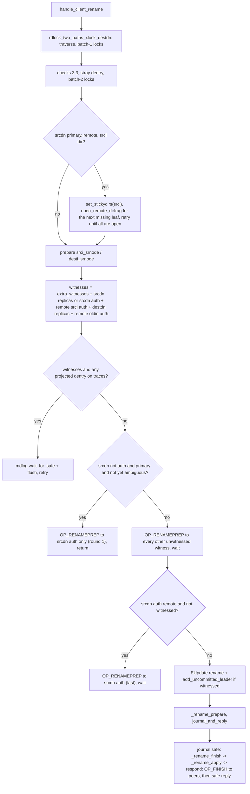
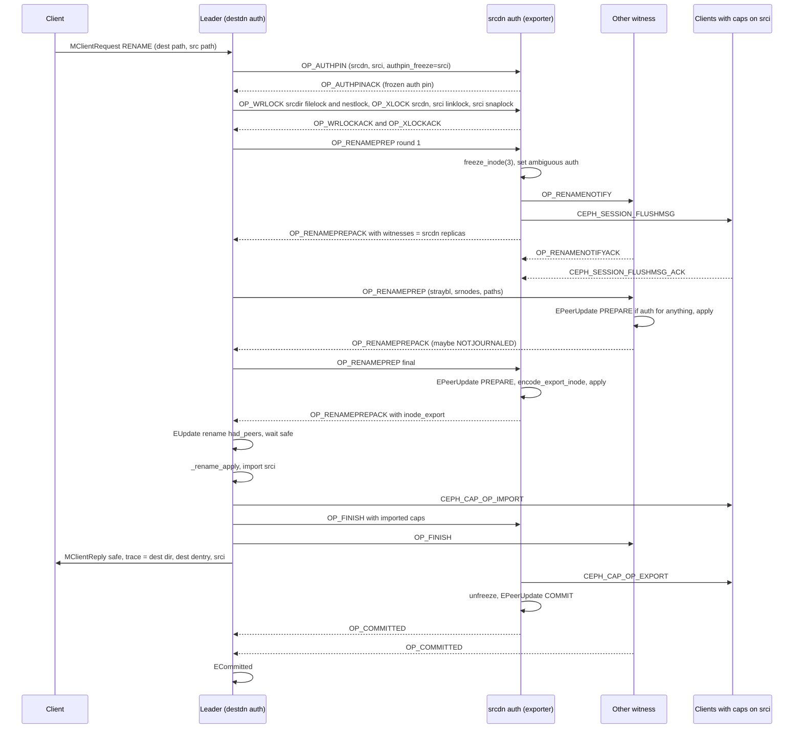
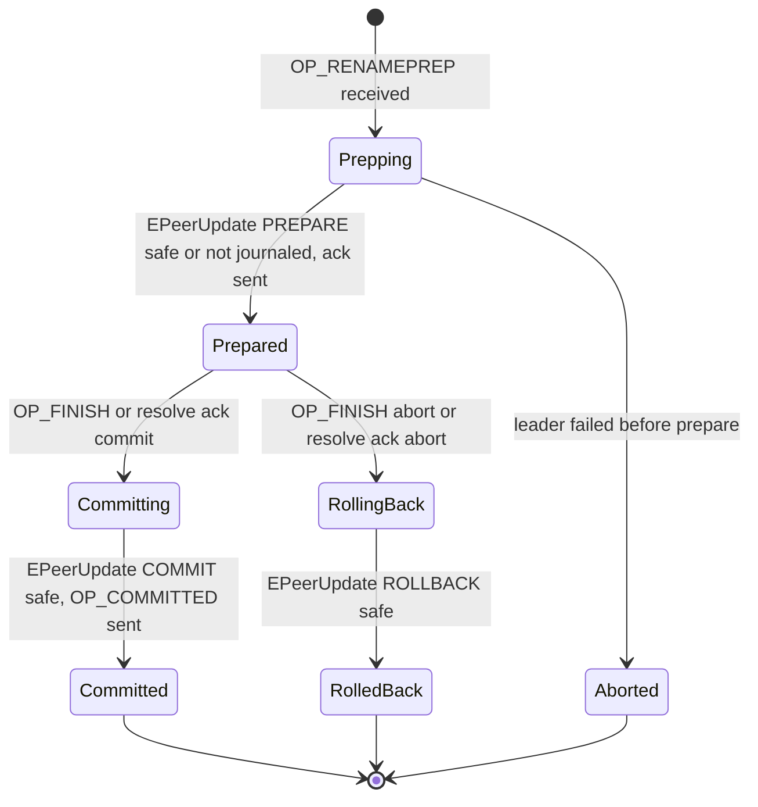

# Rename (`CEPH_MDS_OP_RENAME`)

> Part of the C++ MDS project map ([README](../README.md)). Sources: `src/mds/Server.cc` (rename section 9293-11472, ~2,180 LOC, plus `rdlock_two_paths_xlock_destdn` 4059-4220 and peer plumbing 2971-3495), `src/mds/MDCache.cc` (`project_subtree_rename` / `adjust_subtree_after_rename` 1450-1541, leader/peer commit tracking 2490-2600, `create_subtree_map` 2624-2772, resolve 2782-3660), `src/mds/events/EPeerUpdate.h` (158), `src/mds/events/ECommitted.h` (44), `src/mds/journal.cc` (`rename_rollback`, `EPeerUpdate`, `EUpdate`, `ECommitted`, renamed-dir handling in `EMetaBlob::replay`), `src/messages/MMDSPeerRequest.h` (236), `src/mds/Locker.cc`, `src/mds/Mutation.{h,cc}`, `src/mds/Migrator.cc` (inode export/import helpers), `src/mds/StrayManager.cc`. Kernel client: `linux/fs/ceph/dir.c`, `inode.c`, `mds_client.c`. Related: [request lifecycle](request-lifecycle.md), [namespace mutations](namespace-mutations.md), [lock types](../05-locking/lock-types-and-state-machines.md), [acquiring locks](../05-locking/acquiring-locks.md), [resolve and rejoin](../09-recovery/resolve-and-rejoin.md), [events and replay](../06-journal/events-and-replay.md), [snapshots](../10-snapshots-quotas-subvolumes/snapshots.md), [rstats, quotas, subvolumes](../10-snapshots-quotas-subvolumes/rstats-quotas-and-subvolumes.md), [strays and purge](../11-background-services/strays-and-purge.md), [subtree migration](../08-multi-mds/subtree-migration.md), [capabilities](../02-client-protocol/capabilities.md), [kclient expectations](../02-client-protocol/kclient-expectations.md), [libcephfs/ceph-fuse/Ganesha expectations](../02-client-protocol/libcephfs-fuse-ganesha-expectations.md), [leases, lock caches, async dirops](../02-client-protocol/leases-lock-caches-and-async-dirops.md), [auth and MDS caps](../01-cluster-integration/auth-and-mds-caps.md), [quiesce](../12-qos-metrics-quiesce-quarantine/quiesce.md), [quarantine](../12-qos-metrics-quiesce-quarantine/quarantine.md), [mds_lock analysis](../00-architecture/mds_lock-analysis.md).

## 1. Purpose and responsibilities

`CEPH_MDS_OP_RENAME` (`0x01204`, src/include/ceph_fs.h:418) atomically re-points a name. The C++ implementation is responsible for:

- POSIX `rename(2)` semantics for one namespace: move a primary or remote (hard-link) dentry from `srcdir/srcname` to `destdir/destname`, optionally replacing an existing target (file over file, empty dir over dir), refusing directory loops, treating "both names link the same inode" as a successful no-op.
- Replacement semantics: the overwritten inode loses one link; if the replaced dentry was its primary link, the inode is re-homed into a stray dentry of the leader so it stays reachable for open file handles, snapshots and deferred purge.
- Subvolume isolation: `EXDEV` when source and destination parents are in different snaprealms belonging to different subvolumes.
- Snapshot correctness: copy-on-write of the old dentries, recording `past_parent_snaps` on inodes that leave a snaprealm, `CEPH_SNAP_OP_SPLIT` notifications when a new realm is opened.
- Multi-MDS atomicity: a two-phase commit between the *leader* (always the auth of the destination dentry) and *witnesses* (every rank replicating `srcdn` or `destdn`, the auth of `srcdn`, and the auth of remote-linked source/target inodes); when the source is a primary dentry on another rank the inode's authority (and all client capabilities) migrates to the leader inside the same transaction.
- Crash consistency: leader `EUpdate("rename", had_peers)` + `ECommitted`; peer `EPeerUpdate` PREPARE / COMMIT / ROLLBACK with an encoded `rename_rollback`; outcome resolution through the `resolve` recovery stage.
- MDS-internal renames: stray *reintegration* (stray primary merged onto a remote link) and stray *migration* (stray moved to another rank's stray dir, e.g. while a rank is stopping).

Out of scope here: `CEPH_MDS_OP_RENAMESNAP` (renaming a snapshot inside `.snap`, `Server::handle_client_renamesnap`), see [snapshots](../10-snapshots-quotas-subvolumes/snapshots.md).

## 2. Source map

| File | Class / function | Lines | Role |
|---|---|---|---|
| src/mds/Server.cc | `C_MDS_rename_finish` | 9293-9306 | Leader journal-commit callback -> `_rename_finish` |
| src/mds/Server.cc | `Server::handle_client_rename` | 9321-9767 | Leader entry point: checks, locks, snaprealm prep, witness rounds, journal |
| src/mds/Server.cc | `Server::_rename_finish` | 9770-9812 | Leader: apply, notify replicas, reply, cap eval, stray eval |
| src/mds/Server.cc | `Server::_rename_prepare_witness` | 9818-9861 | Builds/sends `OP_RENAMEPREP` |
| src/mds/Server.cc | `Server::_rename_prepare_import` | 9863-9891 | Leader: decode exported srci + caps, force-open sessions |
| src/mds/Server.cc | `Server::_need_force_journal` | 9893-9930 | Does this rank own subtrees under a renamed dir |
| src/mds/Server.cc | `Server::_rename_prepare` | 9932-10287 | Projection + metablob construction (leader and peers) |
| src/mds/Server.cc | `Server::_rename_apply` | 10290-10484 | Pops projections, relinks, finishes import, subtree map, realm split |
| src/mds/Server.cc | `C_MDS_PeerRenamePrep`, `C_MDS_PeerRenameCommit`, `C_MDS_PeerRenameSessionsFlushed` | 10491-10520 | Peer contexts |
| src/mds/Server.cc | `Server::handle_peer_rename_prep` | 10522-10758 | Peer prepare: freeze/ambiguous auth, notify, flush, rollback record, journal |
| src/mds/Server.cc | `Server::_logged_peer_rename` | 10760-10836 | Peer: export srci, apply, ack |
| src/mds/Server.cc | `Server::_commit_peer_rename` | 10838-10941 | Peer commit or abort |
| src/mds/Server.cc | `_rollback_repair_dir` | 10943-10968 | Restore source dirfrag stats |
| src/mds/Server.cc | `Server::do_rename_rollback` | 10992-11315 | Peer rollback (live or during resolve) |
| src/mds/Server.cc | `Server::_rename_rollback_finish` | 11317-11391 | Apply rollback |
| src/mds/Server.cc | `Server::handle_peer_rename_prep_ack` | 11393-11437 | Leader: record witness, extra witnesses, inode export |
| src/mds/Server.cc | `Server::handle_peer_rename_notify_ack`, `_peer_rename_sessions_flushed` | 11439-11472 | srcdn-auth gathers before prepare |
| src/mds/Server.cc | `Server::rdlock_two_paths_xlock_destdn` | 4059-4221 | Two-path traversal + first lock batch |
| src/mds/Server.cc | `Server::prepare_stray_dentry` | 3595-3631 | Stray dentry for the overwritten primary target |
| src/mds/Server.cc | `Server::_dir_is_nonempty_unlocked`, `_dir_is_nonempty` | 9225-9287 | Target directory emptiness |
| src/mds/Server.cc | `Server::handle_peer_request`, `handle_peer_request_reply`, `dispatch_peer_request` | 2971-3295 | Peer message routing (`OP_RENAMENOTIFY` auto-ack, `OP_FINISH`, `OP_COMMITTED`) |
| src/mds/Server.cc | `Server::handle_peer_auth_pin`, `handle_peer_auth_pin_ack` | 3297-3486 | Remote auth pins incl. frozen auth pin on srci |
| src/mds/Server.cc | `Server::_committed_peer` | 8415-8426 | Peer sends `OP_COMMITTED` (shared with link/rmdir) |
| src/mds/Server.cc | `Server::early_reply` | 2300-2372 | No early reply with journaled peers; dentry xlocks not "done" for rename |
| src/mds/Server.cc | `Server::dispatch_client_request` | 2765-2965 (checks at 2794-2839) | Read-only, stored `peer_error` and full-pool checks before `handle_client_rename` |
| src/mds/Server.cc | `Server::flush_session`, `flush_client_sessions`, `prepare_force_open_sessions`, `finish_force_open_sessions` | 897-916, 1059-1154 | `FLUSHMSG` before cap export; session force-open on inode import |
| src/mds/MDCache.cc | `MDCache::project_subtree_rename`, `adjust_subtree_after_rename` | 1450-1541 | Subtree-map maintenance for dir renames |
| src/mds/MDCache.cc | `log_leader_commit`, `committed_leader_peer`, `logged_leader_update`, `finish_committed_leaders`, `_logged_peer_commit` | 2504-2600 | 2PC bookkeeping |
| src/mds/MDCache.cc | `MDCache::create_subtree_map` (projected renames) | 2624-2772 | `ESubtreeMap` accounts for in-flight dir renames |
| src/mds/MDCache.cc | `send_peer_resolves`, `handle_mds_failure`, `handle_resolve`, `handle_resolve_ack`, `add_uncommitted_peer`, `finish_uncommitted_peer`, `finish_rollback` | 2832-3660 | Recovery of in-flight renames |
| src/mds/MDCache.cc | `encode_replica_stray` / `decode_replica_stray` | 11304-11345 | Ship the stray dentry to witnesses |
| src/mds/MDCache.cc | `MDCache::send_dentry_link` | 11469-11498 | Inform non-witness replicas of the new linkage |
| src/mds/events/EPeerUpdate.h | `rename_rollback`, `EPeerUpdate` | 68-158 | Rollback record, peer event |
| src/mds/events/ECommitted.h | `ECommitted` | 1-44 | Leader "all peers committed" marker |
| src/mds/journal.cc | `rename_rollback::encode/decode`, `EPeerUpdate::encode/replay`, `EUpdate::replay`, `ECommitted::replay`, `EMetaBlob::replay` | 2584-2780, 2278-2373, 2453-2484, 1239-1625 | Encodings and replay |
| src/messages/MMDSPeerRequest.h | `MMDSPeerRequest` | 23-233 | `OP_RENAMEPREP(7)`, `OP_RENAMEPREPACK(-7)`, `OP_RENAMENOTIFY(12)`, `OP_RENAMENOTIFYACK(-12)`, `OP_FINISH(17)`, `OP_COMMITTED(-18)` |
| src/mds/Locker.cc | `Locker::acquire_locks`, `try_rdlock_snap_layout`, `request_drop_remote_locks`, `xlock_export`, `xlock_import` | 157-669, 687-737, 2324-2346 | Lock acquisition, `OP_FINISH` emission, xlock hand-over |
| src/mds/Mutation.{h,cc} | `MDRequestImpl::More`, `freeze_auth_pin`, `set_ambiguous_auth`, `compare_paths`, `LockOpVec::sort_and_merge`, `MDPeerUpdate` | Mutation.h:317-372, 519-533; Mutation.cc:132-177, 341-405, 470-481 | Per-request rename state |
| src/mds/StrayManager.cc | `_eval_stray_remote`, `reintegrate_stray`, `migrate_stray` | 625-738 | MDS-originated renames |

## 3. How it works

### 3.1 Roles and vocabulary

| Term | Meaning (code) |
|---|---|
| `srcdn`, `srcdnl`, `srci` | Source dentry, its *projected* linkage, and the inode it links (`Server.cc:9348-9351`) |
| `destdn`, `destdnl`, `oldin` | Destination dentry, projected linkage, existing target inode if the linkage is not null (`Server.cc:9344-9388`) |
| `straydn` | `~mds<leader>/stray<k>/<oldin ino in hex>`; created only when `destdnl` is primary and not a link merge (`Server.cc:9450-9459`, `CInode::name_stray_dentry` CInode.cc:1170, `MDCache::get_stray_dir` MDCache.cc:912) |
| linkmerge | `srcdnl->get_inode() == destdnl->get_inode()`; only legal as "stray primary onto its remote link" (`Server.cc:9445`, `9504-9505`) |
| silent | `srcdn->get_dir()->inode->is_stray()`: no nlink/ctime/dir-mtime changes (`Server.cc:9950`, `10068`, `10098`) |
| Leader | The rank that is auth for `destdn` (asserted `destdir->is_auth()`, `Server.cc:9345`); the client request is forwarded there by `path_traverse(... MDS_TRAVERSE_WANT_AUTH ...)` |
| srcdn auth | Auth of the source dentry; if not the leader it is always the *last* witness (`Server.cc:9695-9732`) |
| Witness / peer | Any rank that receives `OP_RENAMEPREP` and is recorded in `More::witnessed` when it acks |
| Inode exporter / importer | When `srcdnl` is primary and `srcdn` is not auth on the leader: srcdn auth exports `srci` to the leader (`_logged_peer_rename` Server.cc:10777-10813, `_rename_prepare_import` Server.cc:9863) |

The design comment at `Server.cc:9309-9320` (`handle_client_rename`) states why the leader is the destdn auth: cached inodes must stay connected, so every replica of `srci` must also replicate `destdn` (and possibly `straydn`); the leader freezes `srci` and verifies that all other ranks replicated `destdn`/`straydn` before the linkage changes.

### 3.2 Intake, forwarding and the first lock batch

1. The client message carries `filepath` = destination (`destdir ino` + one name) and `filepath2` = source (`srcdir ino` + one name), an optional `alternate_name` (fscrypt), embedded cap/dentry releases and a client `stamp`. `MDCache::request_start` sets `op_stamp = req->get_stamp()` (MDCache.cc:9845), so all ctime/mtime values written by the rename come from the client clock when the client sends one (`MutationImpl::get_op_stamp`, Mutation.h:206). Path: `Server::dispatch` -> dmClock scheduler (`MDSDmclockScheduler::handle_client_request`) -> `Server::handle_client_request`, which answers already-completed retries/replays, processes the embedded releases (`Locker::process_request_cap_release`, skipped for replays; Server.cc:2714-2723) and calls `dispatch_client_request` (generic checks, see end of 3.3) -> `handle_client_rename`.
2. `handle_client_rename` rejects `.`/`..` as last component with `EBUSY` and `alternate_name` longer than `mds_alternate_name_max` with `ENAMETOOLONG` (Server.cc:9328-9337).
3. `rdlock_two_paths_xlock_destdn(mdr, xlock_srcdn=true)` (Server.cc:4073):
   - Both paths must have depth 1 (`EINVAL`, 4084-4086); a path whose component is empty (`filepath::is_last_snap()`, the wire form of a walk into the snapdir) gives `EROFS` (4089-4091).
   - Destination: `path_traverse(refpath, MDS_TRAVERSE_RDLOCK_SNAP | WANT_DENTRY | WANT_AUTH)` (4096-4097). `WANT_AUTH` forwards the request to the auth of the destination dirfrag before the last-component lookup (`MDCache::path_traverse` MDCache.cc:8443). `ESTALE` triggers `find_ino_peers` with `C_MDS_TryFindInode` (4098-4103).
   - Source: `path_traverse(refpath2, MDS_TRAVERSE_RDLOCK_SNAP2 | WANT_DENTRY | DISCOVER)` (4109-4110): never forwards, discovers remote metadata as replicas instead.
   - `RDLOCK_SNAP`/`RDLOCK_SNAP2` call `Locker::try_rdlock_snap_layout(cur, mdr, n)` (Locker.cc:157), which rdlocks `snaplock` of the base directory and every projected ancestor up to the root. From the first ancestor that this request already rdlocked, it takes no new rdlocks but keeps walking to the root. It records `mdr->dir_root[n]` / `mdr->dir_depth[n]` (Locker.cc:173-216). If it cannot rdlock one of them, it drops all of the request's locks and local auth pins and waits. With `WANT_DENTRY` the tail inode's snaplock is *not* rdlocked (MDCache.cc path_traverse, `rdlock_snap && !(want_dentry && !want_inode && depth == path.depth() - 1)`).
   - Quarantine: requests from clients without `CEPHFS_FEATURE_QUARANTINE` wait if either parent is under a quarantined subvolume (`check_quarantine_block`, 4127-4129; Server.cc:3529).
   - Client (non-MDS) renames whose source or destination parent is a system inode other than the root (`~mdsN`, stray dirs) get `EROFS` (4131-4136).
   - Destination parent that is itself unlinked (its projected parent is a stray dir) gives `ENOENT` (4138-4142). The source parent is not checked this way.
   - Lock vector (4146-4196), then `acquire_locks(mdr, lov, auth_pin_freeze)` where `auth_pin_freeze = srci` if the source dentry is not auth and primary (4199-4205).
   - Source linkage null after locking: `ENOENT` (4207-4210). Null destination: `destdn->first = max(first, global newest_seq + 1)` (4212-4215). Sets `PATH_LOCKED`.

### 3.3 Validation checks (evaluation order)

| # | Check | Result | Code |
|---|---|---|---|
| 1 | last component `.` or `..` | `EBUSY` | Server.cc:9328 (`handle_client_rename`) |
| 2 | `alternate_name` > `mds_alternate_name_max` | `ENAMETOOLONG` | Server.cc:9333 |
| 3 | depth != 1, snap path, system parent, dest parent unlinked, src missing | `EINVAL` / `EROFS` / `ENOENT` | Server.cc:4084-4210 (`rdlock_two_paths_xlock_destdn`) |
| 4 | dest dir has a charmap and client lacks `CEPHFS_FEATURE_CHARMAP` | `EPERM` | Server.cc:9354, 4876 (`can_handle_charmap`) |
| 5 | `destdn == srcdn` (also two names that normalize to the same dentry in a charmap dir, see client comment Client.cc:16693) | `0`, no-op | Server.cc:9359-9363 |
| 6 | `srci` is a dir and a projected ancestor of `destdir` (`CInode::is_projected_ancestor_of`, CInode.cc:1078) | `EINVAL` | Server.cc:9367-9371 |
| 7 | MDS-originated request whose two path bases are not both stray dirs and whose destination is not a remote link to the source inode | `EINVAL` (comment: "this won't reply") | Server.cc:9374-9381 |
| 8 | target dir obviously non-empty without locks (`_dir_is_nonempty_unlocked`: has snapshots in its own realm, or an auth dirfrag with `fragstat.size()>0`; returns "empty" if `filelock.is_cached()` because async dirops may be pending) | `ENOTEMPTY` | Server.cc:9391-9394, 9225 |
| 9 | target dir, source not dir | `EISDIR` | Server.cc:9397-9400 |
| 10 | target not dir, source dir | `ENOTDIR` | Server.cc:9401-9404 |
| 11 | `srci == oldin` and source dir not a stray dir (two hard links of one inode) | `0`, no-op | Server.cc:9405-9408 |
| 12 | existing target dentry with a different `alternate_name` | `EINVAL` | Server.cc:9409-9413 |
| 13 | stray dirfrag at `mds_bal_fragment_size_max` (skipped for replayed requests) / stray dir frozen (waits) | `ENOSPC` / wait | Server.cc:3604-3617 (`prepare_stray_dentry`) |
| 14 | second lock batch (3.6) | wait / forward / peer error | Server.cc:9463-9502 |
| 15 | only before any witness acked: MDS-cap `MAY_WRITE` on the srcdir inode, then the destdir inode | `EACCES` (or another `Session::check_access` error, e.g. `EIO` for a layout-v2 dir and an old client) | Server.cc:9507-9512, 3500 (`check_access`), SessionMap.cc:1109 |
| 16 | same window: (non-linkmerge only) dest dirfrag size >= `mds_bal_fragment_size_max`, then dest dir `nfiles+nsubdirs` >= `mds_dir_max_entries` (if non-zero); then (always) MDS-cap `MAY_WRITE` on `srci` itself. Checks 15-16 are no-ops for MDS-originated requests (no session) | `ENOSPC` / `EACCES` | Server.cc:9514-9521, 3563, 3582 |
| 17 | target dir non-empty with `filelock` rdlocked (`_dir_is_nonempty`: projected fragstat of every cached frag, plus comparison of summed accounted fragstat with inode dirstat to catch uncached frags) | `ENOTEMPTY` | Server.cc:9525-9530, 9262 |
| 18 | not linkmerge, `src_realm != dest_realm` and `src_realm->get_subvolume_ino() != dest_realm->get_subvolume_ino()` | `EXDEV` | Server.cc:9548-9565 |

Generic request-level outcomes that also apply (all evaluated in `dispatch_client_request` before `handle_client_rename` runs): `EROFS` when the MDS cache is read-only (Server.cc:2794-2797); a stored `peer_error` is returned on re-dispatch (Server.cc:2799-2802): for rename only `EROFS` (a read-only peer refused `OP_AUTHPIN`) can occur, because `EAGAIN` comes only from non-blocking auth pins and rename never asks for them; when the metadata pool has `FLAG_FULL` and no witness has acked yet, the MDS checks the MDS-cap `full` flag on the destination dir inode (`try_get_auth_inode`, then `check_access(MAY_FULL)`; Server.cc:2805-2836). The intended answer is `ENOSPC`, but `Server::check_access` itself replies with the cap-check error (`EACCES`) before the explicit `respond_to_request(mdr, -ENOSPC)` (Server.cc:2829-2834, 3514-3516). The client therefore gets `EACCES` first, and a second reply for an already-finished request follows (found by reading the code; not tested). POSIX permission bits / sticky-bit checks are not done by the MDS for rename; the MDS only evaluates MDS auth caps (`Session::check_access`, which may evaluate uid/gid if the cap restricts them). Clients perform `may_delete` style checks themselves (libcephfs `Client::_rename`, Client.cc:16740-16747).

### 3.4 Extending the traces to a common ancestor

`mdr->dn[1]` (srctrace) and `mdr->dn[0]` (desttrace) initially contain only the tail dentries. Unless both parents are the same inode, or the request is MDS-originated with a stray source, the code prepends projected parent dentries to `srctrace` until its base is `destbase` or an ancestor of it, then prepends to `desttrace` until both start at the same inode (Server.cc:9419-9442). These traces are used to (a) decide whether projected (unjournaled) dentries exist on the paths (3.8 "need_flush") and (b) build `srcdnpath`/`destdnpath` for witnesses, which therefore traverse from the common ancestor (Server.cc:9835-9840).

### 3.5 Overwriting a target; the stray dentry

- `oldin` is resolved with `MDCache::get_dentry_inode(destdn, mdr, true)`; a remote link to an uncached inode triggers `open_remote_dentry` and a retry (MDCache.cc:8975).
- If `destdnl` is primary and not linkmerge, `prepare_stray_dentry(mdr, oldin)` picks the leader's current stray dir (`strays[stray_index]`, one of `NUM_STRAY` per rank, rotated by `MDCache::advance_stray` MDCache.cc:776), picks the dirfrag by hashing the name (`pick_dirfrag`, MDCache.cc:912-923), looks up or adds a null dentry named by the hex inode number (a newly added one is marked `new`), marks it `STATE_STRAY`, pins it, and stores it in `mdr->straydn` (Server.cc:3595-3631). The stray dentry is always on the leader.
- In `_rename_prepare` the target is projected: primary target -> `oldin` projected with `version = straydn->pre_dirty(...)` and `update_backtrace()`, linkage pushed onto `straydn` (Server.cc:9990-9999); remote target -> `oldin` projected on its auth (Server.cc:10000-10007). Unless silent, `tpi->ctime = op_stamp`, `rctime` raised, `change_attr++`, `stray_prior_path = destdn path` (set for both primary and remote targets), `nlink--`, `STATE_ORPHAN` when nlink reaches 0 (Server.cc:10077-10094).
- After the reply, `_rename_finish` calls `mdcache->notify_stray(straydn)` if the stray linkage is still non-null (`StrayManager::eval_stray`), noting that "respond_to_request() drops locks. So stray reintegration can race with us." (Server.cc:9807-9811). For a remote target whose primary already lives in a stray dir, stray evaluation happens later through reference drops (`CInode::_put` CInode.cc:991, `CDentry::_put` CDentry.cc:646 -> `maybe_eval_stray`).

### 3.6 Lock set and ordering

Most locks are taken through `Locker::acquire_locks` (Locker.cc:245). The exceptions are the ancestor `snaplock` rdlocks, which `try_rdlock_snap_layout` takes directly (Locker.cc:177-188), and the `nestlock`/`versionlock` grabs inside `predirty_journal_parents` (see "Implicit later locks" below). `acquire_locks` (a) auth-pins every lock parent that is auth (and requests remote auth pins with `OP_AUTHPIN` for non-auth parents of xlocks and of rdlocks/wrlocks that may need a remote state change), (b) appends implicit locks, (c) calls `LockOpVec::sort_and_merge()`, which only sorts consecutive entries *of the same object* by lock type (`CEPH_LOCK_*` value) and merges duplicates, keeping the object order chosen by the caller (Mutation.cc:132).

**Batch 1 - `rdlock_two_paths_xlock_destdn`** (Server.cc:4146-4205):

| Object | Lock | Mode | Notes |
|---|---|---|---|
| destdir inode and all projected ancestors | `snaplock` (`CEPH_LOCK_ISNAP`) | rdlock | taken during traversal by `try_rdlock_snap_layout(n=0)` |
| srcdir inode and ancestors not yet rdlocked | `snaplock` | rdlock | `try_rdlock_snap_layout(n=1)` |
| destdir inode | `filelock` (`IFILE`), `nestlock` (`INEST`) | wrlock | scatter locks; a wrlock may be held concurrently by other mutators |
| destdn | `lock` (`CEPH_LOCK_DN`) | xlock | plus implicit `versionlock` (`DVERSION`) wrlock on the leader (Locker.cc:318-330) |
| srcdir inode | `filelock`, `nestlock` | wrlock if the srcdir *dirfrag* auth is this rank, else `remote_wrlock` targeted at the srcdir dirfrag auth (`OP_WRLOCK`) | in the same-inode case remote wrlocks are added only when the two names live in different dirfrags with a remote auth (4150-4154) |
| srcdn | `lock` | xlock (remote `OP_XLOCK` if srcdn is not auth) | `DVERSION` wrlock only if auth |
| first inode in the batch with a cap-bearing (`IFILE`/`IAUTH`/`ILINK`/`IXATTR`) wr/xlock | `quiescelock` (`IQUIESCE`) | wrlock | added once per `acquire_locks` call (Locker.cc:338-343, 371-387) |

Order inside batch 1:
- Same parent inode: dir `filelock`/`nestlock` first, then the two dentry xlocks in name order (lower name first) (4146-4166).
- Different parents: `cmp = mdr->compare_paths()` compares `dir_root` (inode number of the hierarchy root reached: the fs root `1` sorts before `~mdsN` dirs) then `dir_depth`; destination first if `cmp < 0` or (`cmp == 0` and `destdir ino < srcdir ino`) (4168-4196; Mutation.cc:470). Each side is "dir filelock, dir nestlock, dentry".
- This implements the ordering rules documented at Server.cc:4059-4071 and MDCache.cc:8425-8441: (1) objects under the fs root before objects under mdsdir, (2) by depth ascending, (3) by inode number / parent inode number, (4) dentries of one dir by name, (5) non-directory inodes by inode number.

**Batch 2 - `handle_client_rename`** (Server.cc:9463-9502), skipped once `ALL_LOCKED` is set:

| Object | Lock | Mode | Why (code comment) |
|---|---|---|---|
| srci | `linklock` (`ILINK`), `snaplock` | xlock (remote `OP_XLOCK` if srci not auth) | "update srci's ctime. xlock its least contended lock"; snaplock freezes realm membership |
| oldin (if any) | `linklock`, `snaplock` | xlock | "xlock oldin (for nlink--)" |
| oldin (dir) | `filelock` | rdlock | "to verify it's empty" |
| stray dir inode | `filelock`, `nestlock` | wrlock | stray dir link count / rstat |
| straydn | `lock` | xlock | |
| implicit | `versionlock` (`IVERSION`) of each auth inode with an xlock | leader: wrlock, peer: xlock (Locker.cc:346-354) | |
| implicit | `quiescelock` of the first cap-bearing inode | wrlock | |

Order inside batch 2: srci before oldin, reversed when (target is a dir and `cmp < 0` or (`cmp == 0` and `oldin ino < srci ino`)) or (target is a file and `srci ino > oldin ino`); straydn locks are appended last (Server.cc:9474-9495). `auth_pin_freeze = srci` when srcdn is not auth and primary (Server.cc:9497).

**Snaplock xlocks while the cluster is degraded**: batch 2 always xlocks `srci->snaplock` (and `oldin->snaplock`). For an `ISNAP`/`IPOLICY` xlock requested by a leader (not a replayed request) while `mds->is_cluster_degraded()`, `acquire_locks` drops all locks and waits for `wait_for_cluster_recovered` when the object is auth and not yet xlocked and any replica rank is below `STATE_ACTIVE`, or when the object is not auth (unless the xlock is already held and is not the last lock taken) (Locker.cc:275-307). So during any rank's recovery, renames whose `srci`/`oldin` is replicated on a recovering rank, or lives on another rank, stall until the whole cluster is active again.

**Locks taken on peers**: remote `OP_XLOCK`/`OP_WRLOCK` requests are applied by `dispatch_peer_request` through `acquire_locks(..., skip_quiesce=true)`, so no `quiescelock` is taken on the auth rank of a remotely locked object (Server.cc:3226-3233). Each remote lock costs one round trip, because `acquire_locks` returns after sending each request (Locker.cc:585-597, 2220-2231).

**Implicit later locks**: `predirty_journal_parents` (MDCache.cc:2224) auth-pins each parent dirfrag, wrlock-forces the parent `nestlock` if the caller does not hold it, grabs the parent `versionlock`, and keeps walking up the tree while it can `wrlock_try` the next `nestlock`; otherwise it marks the scatterlock dirty for later propagation. On a peer, `acquire_locks` turns every dentry/inode versionlock into an *xlock* ("exclusively lock the dentry version ... this makes rollback safe", Locker.cc:325-328, 350-353).

**Lock release**: early reply (allowed only without journaled peers, 3.13) marks inode xlocks "done" but *not* dentry xlocks for rename ("the xlocks prevent dentries that have projected linkages from getting new replica", Server.cc:2333-2339, `Locker::set_xlocks_done` Locker.cc:781) and drops rdlocks other than `ISNAP`/`IPOLICY` (Locker.cc:906-937). In `LOCK_XLOCKDONE` only the xlocking client may rdlock (`XCL` in the `simplelock` table, src/mds/locks.c:28), so the renaming client can keep working under a renamed directory after the unsafe reply while other clients wait for the safe reply. All non-rdlocks are dropped when the safe reply is sent (`request_drop_non_rdlocks`, Server.cc:2439), before the trace is encoded so a dentry lease can be issued; everything is dropped in `request_cleanup`.

### 3.7 Snaprealms, subvolumes and snapshots

Realm selection (Server.cc:9548-9565): `dest_realm = destdir->inode->find_snaprealm()`, `src_realm = srcdir->inode->find_snaprealm()` (the *parents'* realms, not srci's own realm). `SnapRealm::get_subvolume_ino()` returns the inode of the outermost realm flagged `is_subvolume()` (SnapRealm.cc:150-154), and subvolumes cannot be nested (`ceph.dir.subvolume` setxattr, Server.cc:6598-6611), so the rule is "both parents in the same subvolume, or both outside any subvolume". Moving a subvolume root itself between non-subvolume parents is allowed (mgr/volumes trash moves rely on this, 7.3). Quota realms (a quota on a dir creates a snaprealm, Server.cc:6478-6493) are *not* checked by the MDS; clients refuse cross-quota-realm renames themselves (7.1, 7.2).

New `sr_t` nodes are prepared once per request (guarded by `mdr->more()->srci_srnode` / `desti_srnode`) at Server.cc:9592-9639:

| Case | Action |
|---|---|
| linkmerge, `srci` nlink==1 and realm is "global" (hard-linked inode outside subvolumes) | new srnode recording the remote parent dentry's snaps, then `clear_snaprealm_global` (Server.cc:9592-9601) |
| target `oldin` with a global realm | `record_snaprealm_parent_dentry(new, dest_realm, destdn, primary)`; clear the global flag if this drops the last link or the last remote link while the primary is not in a stray dir (Server.cc:9604-9614) |
| primary target, `dest_realm->get_newest_seq()+1 > oldin->get_oldest_snap()` or oldin already has a realm | `record_snaprealm_past_parent(new, stray dir's realm)` (Server.cc:9615-9621) |
| `srci` with a global realm | `record_snaprealm_parent_dentry(new, src_realm, srcdn, primary)` (Server.cc:9625-9628) |
| primary `srci`, `src_realm != dest_realm` and (srci has a realm or `src_realm newest_seq+1 > srci->get_oldest_snap()`) | `record_snaprealm_past_parent(new, dest_realm)`: copies the old parent's snaps since `current_parent_since` into `past_parent_snaps` (CInode.cc:631-654) |

`CInode::prepare_new_srnode(snapid)` copies the current projected srnode or creates one with `seq = created = snapid` (the global newest seq when `snapid == 0`; rename passes `0` for the global-realm cases and the old realm's `get_newest_seq()` for the past-parent cases), `current_parent_since = get_oldest_snap()` and the parent realm's `change_attr` (CInode.cc:554-575). The srnodes travel to witnesses in `srci_snapbl` / `desti_snapbl` (Server.cc:9845-9848) so every rank installs the identical realm. On the leader they are projected in `_rename_prepare` (Server.cc:10148-10152, 10170-10178, 10206-10209, 10217-10222); `_rename_apply` pops them *before* the linkage change ("need to split old snaprealm's inodes_with_caps", Server.cc:10314-10327, 10361-10376) and, if a realm was newly opened, calls `do_realm_invalidate_and_update_notify(in, CEPH_SNAP_OP_SPLIT, true)` for `srci` (clients notified) and `(..., false)` for `oldin` (no client notification) (Server.cc:10476-10479; MDCache.cc:10225).

Copy-on-write: `journal_cow_dentry` is called for the old `destdn` linkage (if non-null), the source dentry, and the remote-target / remote-source primary dentries (Server.cc:10181, 10191, 10212, 10225, 10259). If snapshots exist in `[dn->first, newest_seq]`, the old dentry is preserved as a snapshotted dentry (`[oldfirst, follows]`, primary with a COW inode for non-multiversion inodes, or a remote dentry + `cow_old_inode` for multiversion inodes) so snapshots keep showing the old names (MDCache.cc:1679-1810). New linkages get `first = global newest_seq + 1`; `srci->first` follows `destdn->first`, `oldin->first` follows `straydn->first` (Server.cc:10154, 10227, 10270-10278).

### 3.8 Witness selection and the two-phase commit (leader side)

Details (Server.cc:9641-9766):

- **Witness set** (9652-9662): starts from `More::extra_witnesses` (srcdn replica list returned by srcdn auth); adds all replicas of `srcdn` if the leader is srcdn auth, else the srcdn auth; adds srci's auth if `srcdnl` is remote and srci is not local; adds all replicas of `destdn`; adds oldin's auth if `destdnl` is remote and oldin is not local. The comment states that using *all* replicas "probably isn't totally necessary (esp for file renames)" but rejoin relies on it.
- **need_flush** (9664-9693): if there is any witness and any dentry in `srctrace`, or any ancestor dentry of `destdn` up to the root, is projected (`dn->is_projected()`), the leader waits for `mdlog->wait_for_safe` and flushes, then retries, because "Replicas can't see projected dentry linkages".
- **srcdn auth last** (9695-9709): `srcdn_auth_mds` is set; when `srcdnl` is primary and the srci ambiguous-auth handshake has not happened yet, the first `OP_RENAMEPREP` goes to the srcdn auth alone (asserting the remote frozen auth pin on srci is held).
- **Other witnesses** (9711-9725): `_rename_prepare_witness` per witness not yet witnessed or awaited. It returns `false` (and waits with `wait_for_active_peer`) if the cluster is degraded and that rank is not clientreplay/active/stopping (9824-9830).
- **`OP_RENAMEPREP` contents** (9833-9856): `srcdnpath`, `destdnpath` (from the common ancestor), `alternate_name`, `straybl` (`encode_replica_stray`: replicas of the leader's mdsdir inode, its dirfrag, the stray dir dentry/inode/dirfrag and the stray dentry, plus the stray-linked inode if any; MDCache.cc:11304; `handle_peer_request` decodes it with `in = nullptr`, so that trailing inode replica is skipped, MDCache.cc:11321-11343), `srci_snapbl`, `desti_snapbl`, `srcdn_auth`, `witnesses` (full set, so srcdn auth can check it), `op_stamp`.
- **Acks** (`handle_peer_rename_prep_ack`, 11393-11437): adds the sender to `More::peers` (it will get `OP_FINISH`); if it is the srcdn auth and the leader holds the remote frozen auth pin, `set_ambiguous_auth(srci)` locally; an interrupted ack is a no-op; an ack with a non-empty `witnesses` list sets `extra_witnesses` (minus self) and does *not* count as witnessed; otherwise the sender joins `witnessed` and `has_journaled_peers` is set unless the ack is flagged `NOTJOURNALED`; `inode_export`/`inode_export_v` are stashed in `More::inode_import`; when `waiting_on_peer` empties, the request is re-dispatched from the top.
- **Journal** (9741-9765): `set_mds_stamp(now)`; `EUpdate(mdlog, "rename")` with `add_client_req(reqid, oldest_client_tid)`; if any witness: `le->reqid`, `le->had_peers = true`, `add_uncommitted_leader(reqid, ls, witnessed)` and `is_remote_frozen_authpin = false`; `_rename_prepare(...)`; if a client map was produced (inode import) `le->cmapv = sessionmap projected version`; `journal_and_reply(mdr, srci, destdn, le, C_MDS_rename_finish)`; then `balancer->maybe_fragment(destdir)`.

#### Participant matrix (who does what)

L = leader (destdn auth), S = srcdn auth, I = auth of a remote-linked srci, T = auth of a remote-linked target, R = any other rank replicating srcdn or destdn, O = rank owning a subtree nested under a renamed directory (it replicates srcdn, so it is also an R). Derived from Server.cc:9652-9661 (witness set), 9932-10287 (`_rename_prepare`) and 10746-10757 (empty metablob => not journaled).

| Case | Witnesses | Peer journal entries | Leader journal | Early reply possible |
|---|---|---|---|---|
| everything on L, no replicas elsewhere | none | - | `EUpdate` without `had_peers` | yes |
| everything on L, srcdn/destdn replicated on R | R | none (`NOTJOURNALED`) unless R is an O | `EUpdate(had_peers)` | yes if no peer journaled |
| srcdn primary on S != L | S (last), all srcdn replicas, destdn replicas | S: srcdir fnode, COW + null srcdn (+ primary srcdn for files, destdn context + srci dirfrags for dirs) | `EUpdate(had_peers)` with imported inode and `client_map` | no |
| srcdn remote (hard link) on S != L | S, replicas, I if srci not on L | S: srcdir fnode + null srcdn; I: srci ctime (+ srnode) | destdn remote dentry | no |
| destdn remote, target on T != L | T + replicas | T: target nlink-- (+ srnode) | destdn new linkage | no |
| directory rename with nested subtrees on O | O among R | O: forced `destdn` (or `straydn`) entry with `renamed_dirino` | as above | no |

### 3.9 Peer side: `handle_peer_rename_prep`

`Server::handle_peer_request` (Server.cc:2971) answers `OP_RENAMENOTIFY` immediately with `OP_RENAMENOTIFYACK` ("enforcing causal message ordering", 2982-2988), decodes `straybl` into a replica stray dentry, waits until the rank is clientreplay/active/stopping, de-duplicates by `reqid`/`attempt` (a local peer request with an older attempt is closed out; a message older than the local request is dropped), creates a peer `MDRequest` (`request_start_peer`) and dispatches `OP_RENAMEPREP` to `handle_peer_rename_prep` (Server.cc:10522):

1. Interrupted request (srcdn auth failed while the prep was queued, see 3.15): reply `OP_RENAMEPREPACK` with `FLAG_INTERRUPTED` (10529-10536).
2. Traverse `destdnpath` with `DISCOVER | PATH_LOCKED | WANT_DENTRY` (`ESTALE` -> `find_ino_peers`), then `srcdnpath` with `DISCOVER | PATH_LOCKED`; any other error asserts (10539-10573). `PATH_LOCKED` lets traversal pass dentries xlocked by the leader.
3. `op_stamp` from the message; `srcdn_auth_mds = srcdn->authority().first`; create `peer_commit = C_MDS_PeerRenameCommit` early "to clean up any freezing etc we do" (10583-10588).
4. **If this rank is srcdn auth** (10591-10676):
   - For a primary source not yet `STATE_AMBIGUOUSAUTH`: `freeze_inode(allowance = 3)` ("1 for the mdr auth_pin, 1 for the link lock, 1 for the snap lock"), waiting on `WAIT_FROZEN` if other auth pins exist; release the earlier frozen auth pin; `set_ambiguous_auth(srci)`; if `witnesses.size() > 1` set `reply_witness` (this round only marks srci ambiguous and returns the replica list; the leader sends another `OP_RENAMEPREP` later). Send `OP_RENAMENOTIFY` to every srcdn replica except the leader and non-active ranks and add them to `waiting_on_peer` ("make sure bystanders have received all lock related messages"). Send `CEPH_SESSION_FLUSHMSG` to every client holding caps on srci (`Migrator::get_export_client_set`, `flush_client_sessions`; only open sessions whose connection has `CEPH_FEATURE_EXPORT_PEER`, Server.cc:897-907); `waiting_on_peer` contains `MDS_RANK_NONE` until all `FLUSHMSG_ACK`s arrive (10596-10652). A `reply_witness` ack is sent right away without waiting for these acks; they are awaited before the final prepare.
   - Witness-list sufficiency: if any srcdn replica (other than the leader) is missing from `witnesses`, reply `OP_RENAMEPREPACK` with `witnesses = srcdnrep` and stop (10654-10670).
   - Otherwise wait for outstanding notify acks / session flush before continuing (10672-10676); `handle_peer_rename_notify_ack` and `_peer_rename_sessions_flushed` re-dispatch (11439-11472).
5. **Else, if the source is primary and srcdn auth != destdn auth**: `set_ambiguous_auth(srci)` on this witness too (10677-10680).
6. **Rollback record** (10682-10735): `rename_rollback{reqid, orig_src, orig_dest, stray, srci_snapbl, desti_snapbl}` where each `drec` holds `dirfrag`, `dirfrag_old_mtime`, `dirfrag_old_rctime` (from the projected fnode), `dname`, and `ino` (primary) or `remote_ino`+`remote_d_type`; snap blobs hold a `bool hadrealm` plus the current srnode when the leader sent a new srnode. `rename_rollback::ctime` and `drec::old_ctime` are never assigned here (see 8).
7. **Journal** (10737-10757): `EPeerUpdate(mdlog, "peer_rename_prep", reqid, leader, OP_PREPARE, RENAME)` with `rollback = rollback_bl` and `commit` filled by `_rename_prepare` (3.11). If the metablob is empty the event is discarded and `_logged_peer_rename` runs immediately (not journaled); otherwise `add_uncommitted_peer(reqid, ls, leader)`, `peer_update_journaled = true`, submit with `C_MDS_PeerRenamePrep`, flush.
8. **`_logged_peer_rename`** (10760-10836): builds `OP_RENAMEPREPACK` (flag `NOTJOURNALED` if applicable; no reply if the request was aborted meanwhile, in which case `request_finish` triggers the rollback path). If srcdn auth with a primary source: temporarily mark srci's dirfrags `EXPORTBOUND`, `Migrator::encode_export_inode` (inode state, locks, file locks, bounding fragstat/rstat, caps; client map and client metadata map in front), `inode_export_v = version`, drop the request's auth pin on srci, `is_inode_exporter = true`, `mark_clean()`. Then `_rename_apply`, popularity bump, `reset_peer_request`, send the ack.

### 3.10 Inode migration inside a rename

Only when `srcdnl` is primary and the leader is not srcdn auth:

| Step | Exporter (srcdn auth) | Importer (leader) |
|---|---|---|
| Lock phase | handles `OP_AUTHPIN` with `authpin_freeze = srci`: `MDRequestImpl::freeze_auth_pin` (`freeze_inode(1)`, then `freeze_auth_pin` so no new auth pins are granted; comment explains the ABBA deadlock this avoids) (Server.cc:3355-3377, Mutation.cc:341) | records `set_remote_frozen_auth_pin(srci)` (Server.cc:3443) |
| Prepare round 1 | `freeze_inode(3)`, `STATE_AMBIGUOUSAUTH`, notify bystanders, flush client sessions | sets ambiguous auth on srci when the ack arrives |
| Prepare final | journals `EPeerUpdate` PREPARE, exports inode+caps in the ack (cap export state `STATE_EXPORTINGCAPS`, `PIN_EXPORTINGCAPS`) | `_rename_prepare_import`: decode client map, `prepare_force_open_sessions` (skips blocklisted clients, moves closed sessions to `OPENING`), `decode_import_inode` (links srci at srcdn, sets `STATE_AUTH`, notes caps in `cap_imports`), then forces `!auth` and clean "temporarily" (Server.cc:9863-9891) |
| Journal | - | `EUpdate.client_map` + `cmapv`; destdn primary dentry with full inode; for a dir: `renamed_dir_frags` = srci frags not auth here |
| Apply | `_rename_apply` (srci still auth, frozen, ambiguous) | `_rename_apply` (Server.cc:10416-10453): `finish_force_open_sessions` (sends `CEPH_SESSION_OPEN` to force-opened clients), `Migrator::finish_import_inode_caps(..., auth_cap=true)` (sends `CEPH_CAP_OP_IMPORT` with the exporter's cap id/mseq as peer, `CEPH_CAP_FLAG_AUTH`), replaces `inode_import` with the encoded `map<client_t, Capability::Import>`, `xlock_import` for every non-local xlock held on srci, sets `STATE_AUTH`, `clear_ambiguous_auth` |
| Commit | on `OP_FINISH` carrying the importer's cap map: `xlock_export` for xlocks on srci, `finish_export_inode` (clear replica map, `export_twiddle` all locks, clear `STATE_AUTH`, send `CEPH_CAP_OP_EXPORT` with the importer's cap ids), `unfreeze_inode`, `clear_ambiguous_auth`, journal `EPeerUpdate` COMMIT (Server.cc:10853-10906) | sends `OP_FINISH` with `inode_export = imported caps` (Locker.cc:699-706) |
| Abort | `abort_export()` then rollback (Server.cc:10912-10923) | - |

For a directory `srci`, only the inode moves: its dirfrags keep their old authority and become subtree roots bounded under the new parent (`adjust_subtree_after_rename`, 3.17). The importer opened all of srci's dirfrags beforehand (`set_stickydirs`, `open_remote_dirfrag`, Server.cc:9572-9588) "so that auth can properly delegate from inode to dirfrags after the inode is _ours_".

### 3.11 `_rename_prepare`: projection and journaling per role

`_rename_prepare(mdr, metablob, client_map_bl, srcdn, destdn, alternate_name, straydn)` (Server.cc:9932) runs on the leader (metablob = `EUpdate::metablob`) and on each peer (metablob = `EPeerUpdate::commit`). Each rank journals only what it is auth for, plus forced entries:

| Condition | Projection / metablob entries | Code |
|---|---|---|
| srci is a dir, this rank is not destdn auth | `force_journal_dest` = true if this rank exports srci ("journal replay needs the source inode to create auth subtrees"), else `_need_force_journal(srci, false)` (some frag of srci contains an auth subtree of this rank) | 9952-9961, 9893 |
| oldin is a dir, straydn not auth here | `force_journal_stray = _need_force_journal(oldin, true)` (an auth subtree-root frag of oldin) | 9963-9965 |
| srci dir and (destdn auth or forced) | `renamed_dirino = srci ino`; else if forced stray, `renamed_dirino = oldin ino` | 9976-9982 |
| destdn null | `destdn->set_alternate_name(alternate_name)` | 10011-10014 |
| source remote, not linkmerge | destdn `pre_dirty` (if auth) + projected remote linkage; srci projected on its auth (ctime) | 10015-10026 |
| source remote, linkmerge | unreachable: linkmerge implies a primary source (asserted at 9949), so this `else` branch never runs | 10027-10033 |
| source primary, destdn auth (also linkmerge) | `oldpv` = srci projected version or import version; srci projected, `version = destdn->pre_dirty(oldpv)`, `update_backtrace()` | 10035-10060 |
| srcdn auth | `srcdn->pre_dirty()`; the null linkage is pushed on every rank | 10064-10066 |
| not silent | ctime/rctime/change_attr on srci and on target (3.5); the `nlink--` on linkmerge never runs because a linkmerge source is always in a stray dir (silent) | 10068-10095 |
| destdnl primary, straydn auth | stray dirfrag journaled first ("guarantee stray dir is processed first during journal replay") | 10100-10108 |
| remote target, oldin auth, oldin's dir is neither srcdir nor destdir | `predirty_journal_parents(oldin, its dir, PREDIRTY_PRIMARY)` | 10110-10114 |
| destdn auth, target exists | `predirty(oldin, destdir, (PRIMARY if primary target) + (DIR unless silent), -1)`; primary target: `predirty(oldin, straydir, PRIMARY + DIR, +1)` (here "+" means bitwise OR of `PREDIRTY_*` flags) | 10116-10125 |
| remote source, srci auth, dir differs | `predirty(srci, its dir, PREDIRTY_PRIMARY)` | 10127-10131 |
| move | `flags = (silent ? 0 : PREDIRTY_DIR) + (PREDIRTY_PRIMARY if primary and dirfrags differ)`; srcdn auth: `predirty(srci, srcdir, SHALLOW + flags, -1)` (`SHALLOW` has no effect, see below); destdn auth: `predirty(srci, destdir, flags, +1)` | 10133-10139 |
| primary target, destdn auth | project `desti_srnode`; `straydn->first = newest_seq+1`; `add_primary_dentry(straydn, oldin, dirty, dirty_parent)` | 10144-10155 |
| primary target, forced stray | `add_dir_context(straydir)` + primary straydn | 10156-10160 |
| remote target, oldin auth | project srnode (from message on peers); COW + primary dentry of oldin's parent dn | 10161-10183 |
| remote source | COW old destdn (if any) or set `destdn->first`; remote dentry for destdn; on srci auth: srnode + COW + srci primary dn | 10188-10214 |
| primary source | project srci srnode (destdn auth); COW old destdn; `destdn->first`; destdn auth: `add_primary_dentry(destdn, srci, dirty, dirty_parent)`; forced: dir context + primary destdn + (if srcdn auth dir) every auth dirfrag of srci (new subtree roots) | 10215-10254 |
| srcdn auth | COW srcdn; for a non-dir primary exported by a peer also `add_primary_dentry(srcdn, srci)` "in case we need do peer rename rollback"; `add_null_dentry(srcdn)` | 10256-10267 |
| dirs | `project_subtree_rename(oldin, destdir, straydir)`, `project_subtree_rename(srci, srcdir, destdir)` | 10280-10285 |

`PREDIRTY_SHALLOW` is documented as "only go to immediate parent (for easier rollback)" (MDCache.h:154). In practice `predirty_journal_parents` only reads it into a local variable that is printed (MDCache.cc:2231, 2244), so source-side propagation walks up the tree exactly like any other call. Dirstat changes (`nfiles`/`nsubdirs`, `fragstat.mtime`, `change_attr`) require the dir `filelock`+`nestlock` wrlocks (asserted in `predirty_journal_parents`, MDCache.cc:2277-2280); when the parent inode can be updated directly, `mtime = ctime = dirstat.mtime` (MDCache.cc:2406-2415).

### 3.12 `_rename_apply`

Runs on the leader after the `EUpdate` is safe and on peers right after their prepare is logged (Server.cc:10290-10484):

1. Target: primary -> pop srnode early (or decode `desti_snapbl` on peers), `destdir->unlink_inode(destdn)`, pop straydn linkage, pop+dirty oldin on destdn auth, `touch_dentry_bottom(straydn)`; remote -> unlink, pop+dirty oldin on its auth, or install `desti_snapbl` on peers (10309-10354).
2. Source: pop srci srnode early (primary source) and `srcdir->unlink_inode(srcdn)` (10357-10378).
3. Destination link: remote source -> pop destdn linkage, `link_remote`, `mark_dirty(pvmap[destdn])` if auth, pop srci on its auth (10381-10402; the "merging remote onto primary link" `else` at 10403-10406 cannot run, see 3.11); primary source -> for linkmerge first `unlink_inode(destdn)` to drop the remote linkage (10408-10411), then pop destdn linkage (which links srci as primary); inode import finalisation if the leader is the importer (3.10); pop+dirty srci on destdn auth (10407-10457). Peers that did not journal assert that no other projection exists on the dentries (10332-10333, 10385-10386, 10413-10414, 10463-10464).
4. `srcdn->mark_dirty` if auth, pop the null linkage, `mdr->apply()` for nested projections (dirfrag fnodes, parent inodes) (10459-10467).
5. Subtree map: `adjust_subtree_after_rename(srci, srcdir, true)` and `(oldin, destdir, true)` (10469-10474).
6. Realm split notifications (3.7), then `srcdir->try_remove_unlinked_dn(srcdn)` (drops a never-committed `new` dentry; CDir.cc:687) (10476-10483).

### 3.13 Completion

- `journal_and_reply` (Server.cc:2124) sets `tracei = srci`, `tracedn = destdn`, tries `early_reply` (unsafe reply with the trace) unless `mds_early_reply` is false, `no_early_reply`, there are journaled peers, the request is from an MDS, or it is a replay (Server.cc:2300-2328); marks `committing`, submits the event and flushes the log (or releases early-reply locks).
- `_rename_finish` (Server.cc:9770): if there were witnesses, `logged_leader_update(reqid)` marks the uncommitted-leader entry `safe` and, when `pending_leaders` empties, replays delayed resolves; `_rename_apply`; `send_dentry_link(destdn)` to replicas that are not witnesses and are at least rejoining (MDCache.cc:11469); `need_eval` if srci had cap imports; popularity `META_POP_IWR` on srcdir (and on srci for remote dest linkage); `respond_to_request(mdr, 0)`; `Locker::eval(srci, CEPH_CAP_LOCKS)` if needed; `notify_stray(straydn)`.
- The safe reply path (`reply_client_request`, Server.cc:2379) records the completed request in the session (`add_completed_request(tid)`), drops non-rdlocks (`request_drop_non_rdlocks` -> `request_drop_remote_locks` sends `OP_FINISH` to every rank in `More::peers`, carrying the importer's cap map to the srcdn auth, Locker.cc:687-737), encodes the trace (unless already early-replied) and replies. For an MDS-originated rename it also sends the reply back to the requesting MDS (Server.cc:2463-2465).
- Peers on `OP_FINISH` (Server.cc:3032-3047) call `request_finish`, which runs `peer_commit` with `r = 0` (`committing = true`) or `r = -1` if aborted (`peer_rolling_back = true`) (MDCache.cc:9917-9937). `_commit_peer_rename(r=0)` finishes the export (3.10), clears ambiguous auth, if the prepare was journaled and the replaced inode now under the stray dir has no snaprealm, calls `clear_dirty_bits_for_stray` (drops dentries from its auth dirfrags that are not frozen, clears its dirty rstat and scatter bits; MDCache.cc:14004), cleans up the mutation and either journals `EPeerUpdate("peer_rename_commit", OP_COMMIT)` then `_committed_peer`, or calls `_committed_peer` directly if nothing was journaled (Server.cc:10850-10906). `_committed_peer` drops the `uncommitted_peers` entry and sends `OP_COMMITTED` (Server.cc:8415).
- Leader: `OP_COMMITTED` -> `committed_leader_peer` removes the peer; when none remain (and not recovering) `log_leader_commit` journals `ECommitted(reqid)`; `_logged_leader_commit` erases the entry and wakes log-segment expiry waiters (MDCache.cc:2512-2537).

### 3.14 Rollback

`do_rename_rollback(rbl, leader, mdr, finish_mdr)` (Server.cc:10992) is used live (abort while the leader is alive) and during `resolve` (`mdr` null, from the journaled `MDPeerUpdate`):

1. `add_rollback(reqid, leader)` puts the reqid in `resolve_need_rollback`, which holds back `send_subtree_resolves` until the rollback is journaled (11001; MDCache.cc:2802-2830).
2. Locate objects by `dirfrag` (or by ino+dname if the dir was refragmented); assert `srcdn` is null and `straydn` primary; `authority()` is used instead of `is_auth()` ("can't use is_auth() in the resolve stage"); asserts that this rank is neither destdn nor straydn auth (11006-11071).
3. `force_journal_src` if srci is a dir and srcdn is not ours (`_need_force_journal(in, false)`); `force_journal_dest` if a target exists and is a dir, computed as `_need_force_journal(in, true)` on the *renamed* inode (11073-11078).
4. Re-link: srcdn gets srci (primary) or the remote ino; if the dir holding srci's (projected) primary dentry is ours, srci is projected (plus that dir's fnode when it is not srcdir, i.e. for a remote source); otherwise its inode is reset in place; srnode restored (`hadrealm` -> old srnode; otherwise the realm opened by the rename is merged back into its parent with `prepare_realm_merge` producing `MClientSnap` splits when not in resolve) (11080-11146). Destination gets the target back (primary/remote) or a null linkage ("the dentry will be trimmed soon"); straydn gets null; the target is projected (or, if the dir holding its primary dentry is not ours, its inode is reset in place) with `nlink++` (except for stray-source cases, asserted at 11186-11191) and its srnode restored (11148-11225).
5. `_rollback_repair_dir(srcdir)` on srcdn auth: `nfiles` or `nsubdirs` += 1, rstat += srci's accounted rstat (only for a primary source, `r.ino != 0`), restore `fragstat.mtime`/`rctime` only if they equal `rollback.ctime` (11227-11231; 10943-10968).
6. Journal `EPeerUpdate("peer_rename_rollback", OP_ROLLBACK)` whose `commit` metablob carries srcdn (primary or remote), srci's primary dn for remote links, destdn when forced, the remote target's primary dn, and `renamed_dirino`/`renamed_dir_frags`; "peer: no need to journal straydn" (11242-11288). Project subtree renames back (11290-11298). If the live peer never journaled the prepare, skip journaling and finish immediately (11300-11314).
7. `_rename_rollback_finish` (11317-11391): pop linkages, `mark_dirty(srcdnpv)` and set `STATE_AUTH` on srci if srcdn is ours, `mut->apply()`, adjust subtree map, in resolve `try_trim_non_auth_subtree` for the affected subtree root else `send_snaps(splits)`, unfreeze/clear ambiguous auth on the live request, finish the request (or keep it, see ambiguous peer updates in 3.15), `finish_rollback(reqid)`.

Abort without a rollback record: if a live peer is aborted while `rollback_bl` is still empty (the srcdn auth froze srci and returned an extended witness list, and the leader failed or aborted before sending the next prepare), `_commit_peer_rename(r<0)` only unfreezes srci on the srcdn auth, clears ambiguous auth and finishes the request; nothing is journaled (Server.cc:10924-10936).

### 3.15 Failures and recovery via resolve

Bookkeeping (MDCache.h:1252-1268, 1417-1430):
- Leader: `uncommitted_leaders[reqid] = {peers, ls, waiters, safe, committing, recovering}`. Created at journal submission; `EUpdate::update_segment` / `replay` inserts the reqid into `LogSegment::uncommitted_leaders` so the segment cannot expire before `ECommitted` (journal.cc:2327-2353, 175-182).
- Peer: `uncommitted_peers[reqid] = {leader, ls, su, waiters}`; `LogSegment::uncommitted_peers` blocks expiry "waiting for leader to ack OP_FINISH" (journal.cc:184-190). `EPeerUpdate::replay` OP_PREPARE replays the commit metablob with an `MDPeerUpdate` that preserves non-auth "old dirs" and unlinked inodes until commit (journal.cc:2752-2758, 1555-1620).
- Replay: `EUpdate(had_peers)` -> `add_uncommitted_leader(reqid, seg, {}, safe=true)` (journal.cc:2345-2350); `ECommitted` removes it (journal.cc:2453-2462); `EPeerUpdate` OP_COMMIT/OP_ROLLBACK call `finish_uncommitted_peer` (journal.cc:2760-2770).

`MDCache::handle_mds_failure(who)` (MDCache.cc:3006) on every survivor:

| Local request | Condition | Action |
|---|---|---|
| peer of `who` | prepared | wait for resolve; drop any `ambiguous_peer_updates` entry; if still waiting for notify acks (this rank is srcdn auth), reset the peer request and clear the wait ("will rollback") (3041-3053) |
| peer of `who` | not prepared, not committing | mark `aborted` (if a peer request is in progress or rolling back) or finish (3054-3060) |
| any prepared peer | waiting for `who`'s rename-notify ack | drop `who` from the wait and retry (3063-3071) |
| any prepared peer | `who` is the rename's srcdn auth and the leader is alive | `add_ambiguous_peer_update` - "resolve even I'm a survivor" (3072-3077) |
| queued `OP_RENAMEPREP` | `srcdn_auth == who` | `mark_interrupted` -> noop ack (FIXME notes a late prep can still crash the MDS) (3078-3085) |
| leader, not committing | `srcdn_auth_mds == who` | clear ambiguous auth, `witnessed.clear()` ("all witnesses will rollback"), drop from `pending_leaders` (3087-3098) |
| leader, not committing | `who` witnessed | if the request waits only for the srcdn auth's reply, add to `pending_leaders` (delay resolve acks) else forget that witness (3099-3119) |
| leader, not committing | waiting on `who` | retry when `who` becomes active (`wait_for_active_peer`) (3121-3127) |
| `uncommitted_leaders` | `who` among peers | mark `recovering`, remove `who` ("may have already committed") (3134-3142) |

Resolve exchange:
- `send_peer_resolves` (MDCache.cc:2832): a rank in `resolve` sends every `uncommitted_peers` reqid to its leader; a survivor sends prepared/committing peer requests whose leader is resolving or which are ambiguous peer updates. A survivor exporter that is not yet committing re-sends its cap export state (`peer_inode_cap{ino, cap_exports}`) (2862-2875).
- Leader `handle_resolve` (MDCache.cc:3257): if active and some reqid in the message is in `uncommitted_leaders` but not yet `safe` (it is added to `pending_leaders`), or `pending_leaders` is already non-empty from `handle_mds_failure`, the whole message is parked in `delayed_resolve` until `pending_leaders` empties (MDCache.cc:3275-3287, 2539-2550). Otherwise reply `MMDSResolveAck`: reqid known in `uncommitted_leaders` -> commit (recording the peer in `peers` so `ECommitted` waits for its `OP_COMMITTED`); for a re-sent cap export the leader (must be in resolve) assigns new cap ids into `rejoin_imported_caps` and `rejoin_peer_exports` and returns them in the commit blob; unknown reqid -> abort (3273-3343).
- Peer `handle_resolve_ack` (MDCache.cc:3476): commit in resolve state -> journal `EPeerUpdate("unknown", OP_COMMIT)`, send `OP_COMMITTED` when safe, `finish_uncommitted_peer`; commit while active -> take the leader's imported-cap blob and `request_finish` (commit path). Abort in resolve -> `do_rename_rollback(su->rollback, from, null)`; abort while active -> `aborted = true` and either `add_rollback` (prep in progress) or `request_finish` (rollback). For ambiguous peer updates a commit just clears the ambiguity; an abort runs the rollback but keeps the peer request alive (`finish_mdr = false`) because the leader will retry the rename (3494-3560; Server.cc:10917-10921).
- `maybe_resolve_finish` -> `finish_committed_leaders` journals `ECommitted` for leaders whose peers set is empty ("Leader may crash after receiving all peers' commit acks, but before journalling the final commit") (MDCache.cc:2558-2577, 3450-3474).
- Rejoin: survivors report remote auth pins, the frozen auth pin on srci (`add_inode_frozen_authpin`) and remote xlocks of in-flight leader requests (MDCache.cc:4245-4275); after resolve, exported caps re-sent by an exporter are installed and announced with `CEPH_CAP_OP_IMPORT` (MDCache.cc:5565-5592). See [resolve and rejoin](../09-recovery/resolve-and-rejoin.md).
- Client side: a client that did not get the safe reply resends the request after the leader recovers; if the leader's `EUpdate` was replayed, the session's completed-request table answers `0` without re-execution (Server.cc:2659-2690), otherwise the rename runs again.

Failure scenarios (composed from the handlers above):

| Failure | Survivors | Outcome |
|---|---|---|
| Leader fails before its `EUpdate` is journaled | prepared peers wait; unprepared peers abort (MDCache.cc:3041-3060) | leader replay has no `uncommitted_leaders` entry -> resolve ack *abort* -> peers roll back (survivor: `request_finish` -> `_commit_peer_rename(-1)`; resolving peer: `do_rename_rollback`); the client resend re-executes the rename |
| Leader fails after its `EUpdate` is journaled (safe) | prepared peers wait | replay -> `add_uncommitted_leader(..., safe=true)` -> resolve ack *commit* (with imported caps for a surviving exporter) -> peers commit, send `OP_COMMITTED` -> `ECommitted`; the client resend is answered from the completed-request table |
| Leader fails after all peers committed, before `ECommitted` | peers finished | no peer reports the reqid -> `finish_committed_leaders` journals `ECommitted` when resolve finishes (MDCache.cc:2558) |
| Non-srcdn witness fails before the leader journaled | if the leader waits only for the srcdn auth's reply it keeps the witness and puts the reqid in `pending_leaders`; otherwise it forgets the witness (`witnessed.erase`) and, if it was waiting on it, retries when the rank is active (MDCache.cc:3100-3127) | forgotten witness: its journaled PREPARE (if any) gets *abort* in resolve (no `uncommitted_leaders` entry yet) and is rolled back, and the leader sends a fresh `OP_RENAMEPREP` later. Kept witness: the leader delays all peer resolves while `pending_leaders` is non-empty (MDCache.cc:3283-3287), journals its `EUpdate` with the witness still in `witnessed`, and once that is safe (`logged_leader_update` -> `process_delayed_resolve`) answers *commit*. If the srcdn auth also fails, the reqid leaves `pending_leaders`, `witnessed` is cleared and the answer becomes *abort* |
| Witness fails after the leader journaled | leader marks the entry `recovering` and removes the peer (MDCache.cc:3134-3141) | resolve -> commit (delayed until the leader's `EUpdate` is safe); `ECommitted` after its `OP_COMMITTED`, or at the end of resolve if the witness had not journaled and so reports nothing |
| srcdn auth fails before the leader journaled | leader clears ambiguous auth and `witnessed` and waits for it (MDCache.cc:3089-3098); prepared witnesses become `ambiguous_peer_updates` (3072-3077); queued preps naming it as `srcdn_auth` are interrupted (3078-3085) | witnesses ask the leader in resolve although they survive; the leader answers abort; they roll back but keep the peer request; the leader re-runs the witness rounds once the srcdn auth is active |
| srcdn auth fails after the leader journaled | the leader request is already `committing` | the srcdn auth replays its PREPARE and gets *commit* in resolve (the leader delays the answer until its `EUpdate` is safe); how client caps still attributed to the restarted exporter are reconciled is handled by reconnect/rejoin (unverified for this path) |

### 3.16 MDS-internal renames: stray reintegration and migration

`StrayManager::_eval_stray_remote` (StrayManager.cc:625) handles a stray primary inode that still has remote links: if a non-projected remote dentry is auth and its dir can be auth-pinned -> `reintegrate_stray` (rename `~mdsX/strayN/<ino>` -> remote dentry; the `MClientRequest` goes through the messenger to the remote dentry's auth, which here is the local rank); if only the stray dentry is auth -> `migrate_stray(dn, remote_dn auth)`. `MDCache::shutdown_export_strays` migrates all strays to rank 0 while a rank is stopping (MDCache.cc:8236, `migrate_stray(dn, 0)` at 8318; at most 100 in flight). Both build an `MClientRequest(CEPH_MDS_OP_RENAME)` with `filepath` = destination, `filepath2` = stray source, `tid = mds->issue_tid()`, register a `StrayEvalRequest` (pins the dentry, sets `reintegration_reqid` to avoid duplicates), and send it to the destination auth (StrayManager.cc:679-738, StrayManager.h:38-49). Migration targets the stray dir with the same index on the target rank (`MDS_INO_STRAY(to, MDS_INO_STRAY_INDEX(dirino))`, StrayManager.cc:725). The reply returns via `Server::handle_client_reply`, which only erases the tracking entry (Server.cc:2730-2750).

Server-side specifics: reqid name is an MDS, so only stray->stray (migration) or linkmerge (reintegration) is accepted (Server.cc:9374-9381); the source traversal may start in a stray dir and skips trace extension (Server.cc:9420-9422); the operation is `silent` (no nlink/ctime/mtime changes, no `PREDIRTY_DIR`). Linkmerge unlinks the remote dentry and links the inode as primary there (`_rename_apply` 10408-10412); migration to another rank is an inode export (3.10) and, on the exporter while stopping, `_commit_peer_rename` reports `shutdown_export_stray_finish(ino)` (Server.cc:10845-10847, 10939-10940). The `mds_cache` perf counters `strays_reintegrated` / `strays_migrated` count these requests (MDCache.cc:13929-13931).

### 3.17 Subtree map maintenance for directory renames

- `project_subtree_rename(diri, olddir, newdir)` queues `(olddir, newdir)` in `MDCache::projected_subtree_renames[diri]` (MDCache.cc:1450-1455) so that `create_subtree_map` writes an `ESubtreeMap` that already reflects in-flight renames (MDCache.cc:2679-2725).
- `adjust_subtree_after_rename(diri, olddir, pop)` (MDCache.cc:1457-1541): pops the projection, fixes freeze auth-pin accounting (`adjust_freeze_after_rename`), and for every subtree/nested dirfrag of `diri`: if it is a subtree root, move it from the old parent's bounds to the new parent's (then `try_subtree_merge_at`); if it is mid-subtree, move nested bounds and, if old and new parent subtrees have different authority, create a new subtree with the old authority (`adjust_subtree_auth`). Popularity is moved with `adjust_pop_for_rename`.
- Replay: `EMetaBlob::replay` with `renamed_dirino` locates the inode's previous parent, asserts at most one null dentry in the blob, calls `adjust_subtree_after_rename(..., false)`, preserves non-auth old dirs until peer commit (`MDPeerUpdate::olddirs`), and opens `renamed_dir_frags` as non-auth bounds on the importer (journal.cc:1262-1279, 1532-1605).

## 4. Data structures and invariants

`MDRequestImpl::More` fields used by rename (Mutation.h:317-372):

| Field | Leader meaning | Peer meaning |
|---|---|---|
| `peers` | ranks that received peer requests (get `OP_FINISH`) | - |
| `waiting_on_peer` | outstanding acks | outstanding `OP_RENAMENOTIFYACK`s; `MDS_RANK_NONE` = client session flush |
| `witnessed` | ranks whose prepare acked (journaled or not) | - |
| `extra_witnesses` | srcdn replica list from srcdn auth | - |
| `has_journaled_peers` | disables early reply | - |
| `peer_update_journaled` | - | prepare written to the journal |
| `peer_rolling_back` | - | rollback in progress |
| `pvmap` | projected dentry versions (`destdn`, `srcdn`) | same |
| `srcdn_auth_mds` | srcdn auth if not local | `srcdn->authority().first` |
| `inode_import`, `inode_import_v` | exported inode blob, then imported-cap map | importer's cap map from `OP_FINISH` / resolve |
| `rename_inode`, `is_freeze_authpin`, `is_ambiguous_auth`, `is_remote_frozen_authpin`, `is_inode_exporter` | srci freeze/ambiguity state | same |
| `imported_session_map`, `cap_imports` | force-opened sessions, caps to import | - |
| `srci_srnode`, `desti_srnode` | prepared snaprealm nodes | - |
| `peer_commit`, `rollback_bl` | - | commit/abort callback, encoded rollback |
| `straydn` (a member of `MDRequestImpl`, Mutation.h:461, not of `More`) | stray dentry | decoded stray replica |

`rename_rollback` (EPeerUpdate.h:68-101; encoding journal.cc:2584-2670): `drec` = `ENCODE_START(2,2)` `{dirfrag_t dirfrag, utime_t dirfrag_old_mtime, utime_t dirfrag_old_rctime, inodeno_t ino, inodeno_t remote_ino, string dname, char remote_d_type, utime_t old_ctime}`; `rename_rollback` = `ENCODE_START(3,2)` `{metareqid_t reqid, drec orig_src, drec orig_dest, drec stray, utime_t ctime, bufferlist srci_snapbl, bufferlist desti_snapbl}`.

`EPeerUpdate` (`ENCODE_START(3,3)`: `stamp, type, reqid, leader, op, origop, commit(EMetaBlob), rollback(bufferlist)`; ops `OP_PREPARE=1, OP_COMMIT=2, OP_ROLLBACK=3`; origop `LINK=1, RENAME=2, RMDIR=3`). `EUpdate` (`ENCODE_START(4,4)`: `stamp, type, metablob, client_map, cmapv, reqid, had_peers`). `ECommitted` (`ENCODE_START(3,3)`: `stamp, reqid`). These are MDS-internal journal formats, read only by the MDS itself and by offline tools such as `cephfs-journal-tool`.

Invariants (from asserts and comments):
- The leader is always destdn auth and straydn auth; peers are never destdn or straydn auth (Server.cc:9345, 11070-11071).
- Linkmerge implies source dir is a stray dir, source primary and destination remote (Server.cc:9504-9505, 9949).
- While a primary inode changes authority it is frozen on the exporter and `STATE_AMBIGUOUSAUTH` on every participant; objects in that state cannot be auth-pinned, forwarded to or remotely locked (requests wait for `WAIT_SINGLEAUTH`, Locker.cc:434-443, 2203-2208; MDCache.cc path_traverse `maybe_request_forward_to_auth`).
- Every replica of srcdn is a witness; srcdn auth enforces it (Server.cc:10654-10670), so no rank keeps a replica of srci disconnected from the hierarchy.
- A peer journals before acking; the leader journals after all prepares acked; the safe reply and `OP_FINISH` happen only after the leader journal is safe (an unsafe early reply is possible only when no peer journaled); `ECommitted` only after all `OP_COMMITTED`.
- `nnull <= 1` in a metablob carrying `renamed_dirino` (journal.cc:1269-1277).
- Peer-side dentry and inode versionlocks are xlocked, so no other journaled update interleaves on those objects between prepare and commit/rollback.

## 5. Interfaces

### 5.1 Client-facing messages

| Message | Direction | Handler / sender | Notes |
|---|---|---|---|
| `MClientRequest` op `CEPH_MDS_OP_RENAME` (`CEPH_MSG_CLIENT_REQUEST`) | client -> MDS | `Server::dispatch` -> dmClock scheduler -> `Server::handle_client_request` -> `dispatch_client_request` -> `handle_client_rename` | path1 = dest, path2 = src, `alternate_name`, releases, `stamp` |
| `MClientRequestForward` | MDS -> client | `MDCache::request_forward` | when not destdn auth |
| `MClientReply` (unsafe and/or safe) | MDS -> client | `early_reply`, `reply_client_request` | trace: dest dir inode + dirstat + dest name + lease + srci inodestat, `snapbl` of srci's realm |
| `MClientLease` `CEPH_MDS_LEASE_REVOKE` | MDS -> client | `Locker::revoke_client_leases` (Locker.cc:4592) | for leases on srcdn/destdn/straydn while xlocking |
| `MClientCaps` `CEPH_CAP_OP_REVOKE` | MDS -> client | lock state changes | e.g. `Ls`/`Lx` on srci and oldin (linklock xlock), `Fs` on parent dirs (filelock wrlock) |
| `MClientSession` `CEPH_SESSION_FLUSHMSG` / `_ACK` | srcdn auth -> client / back | `Server::flush_session` (Server.cc:897) | only cross-rank primary renames; sent only to open sessions whose connection has `CEPH_FEATURE_EXPORT_PEER`; the client must ack |
| `MClientSession` `CEPH_SESSION_OPEN` | importer -> client | `finish_force_open_sessions` | force-opened sessions for cap holders |
| `MClientCaps` `CEPH_CAP_OP_IMPORT` / `CEPH_CAP_OP_EXPORT` | importer / exporter -> client | `MDCache::do_cap_import` (MDCache.cc:5954), `Migrator::finish_export_inode_caps` (Migrator.cc:1824) | cap migration with peer cap id/seq/mseq |
| `MClientSnap` `CEPH_SNAP_OP_SPLIT` | MDS -> client | `do_realm_invalidate_and_update_notify`, rollback `send_snaps` | when a realm is opened on srci (or merged back on rollback) |

### 5.2 MDS-to-MDS messages (internal; no client, mon or OSD sees them)

| Message / op | Direction | Handler |
|---|---|---|
| `MMDSPeerRequest` `OP_AUTHPIN(3)` / `OP_AUTHPINACK(-3)` (with `authpin_freeze`) | leader <-> auth | `handle_peer_auth_pin`, `handle_peer_auth_pin_ack` |
| `OP_XLOCK(1)`/`-1`, `OP_WRLOCK(8)`/`-8`, `OP_UNXLOCK(2)`, `OP_UNWRLOCK(9)`, `OP_DROPLOCKS(11)` | leader <-> auth | `dispatch_peer_request` (`OP_DROPLOCKS` is handled directly in `handle_peer_request`) |
| `OP_RENAMEPREP(7)` | leader -> witness | `handle_peer_rename_prep` |
| `OP_RENAMEPREPACK(-7)` (`witnesses`, `inode_export`, `inode_export_v`, flags `NOTJOURNALED`, `INTERRUPTED`) | witness -> leader | `handle_peer_rename_prep_ack` |
| `OP_RENAMENOTIFY(12)` / `OP_RENAMENOTIFYACK(-12)` | srcdn auth <-> srcdn replicas | auto-ack in `handle_peer_request`; `handle_peer_rename_notify_ack` |
| `OP_FINISH(17)` (flag `ABORT`; `inode_export` = imported caps for srcdn auth) | leader -> peers | `handle_peer_request` -> `request_finish` -> `_commit_peer_rename` |
| `OP_COMMITTED(-18)` | peer -> leader | `MDCache::committed_leader_peer` |
| `MMDSResolve.peer_requests{reqid -> {inode_caps, committing}}` | peer -> leader | `MDCache::handle_resolve` |
| `MMDSResolveAck{commit: reqid -> imported caps, abort: [reqid]}` | leader -> peer | `MDCache::handle_resolve_ack` |
| `MDentryLink` | leader -> non-witness replicas | `MDCache::handle_dentry_link` |

`MMDSPeerRequest` (`HEAD_VERSION = COMPAT_VERSION = 1`) encoding order (MMDSPeerRequest.h:178-198): `reqid, attempt, op, flags, lock_type, object_info, authpins, srcdnpath, destdnpath, witnesses, op_stamp, inode_export, inode_export_v, srcdn_auth, straybl, srci_snapbl, desti_snapbl, alternate_name`.

### 5.3 Journal events

| Event | Writer | Content | Replay |
|---|---|---|---|
| `EUpdate` type `"rename"` | leader | metablob (3.11), `client_map`+`cmapv` on import, `reqid`+`had_peers` | metablob replay; `had_peers` -> uncommitted leader; open sessions if `cmapv` newer |
| `EPeerUpdate` `"peer_rename_prep"` OP_PREPARE RENAME | peer | `commit` metablob + `rollback` | apply metablob, keep `MDPeerUpdate(rollback)` |
| `EPeerUpdate` `"peer_rename_commit"` OP_COMMIT | peer | empty metablob | `finish_uncommitted_peer` |
| `EPeerUpdate` `"peer_rename_rollback"` OP_ROLLBACK | peer | restoring metablob | apply metablob, `finish_uncommitted_peer` |
| `EPeerUpdate` `"unknown"` OP_COMMIT | peer in resolve | empty | same as commit |
| `ECommitted` | leader | reqid | erase uncommitted leader |
| `ESubtreeMap` | any | includes projected dir renames | - |

### 5.4 RADOS objects touched (asynchronously, at log-segment expiry)

| Object | Change |
|---|---|
| source and destination dirfrag objects `<dir ino hex>.<frag hex>` in the metadata pool | omap dentry removal / insertion (or overwrite), fnode header (fragstat, rstat, version) |
| stray dirfrag object of the leader `~mdsN/strayK` | omap insertion of the target's primary dentry |
| snapshotted (COW) dentries | omap keys with snap bounds in the same dirfrag objects |
| first object of srci and of the stray-bound target (`<ino hex>.00000000`, data pool for files, metadata pool for dirs) | `parent` (backtrace) and `layout` xattrs (plus `symlink` for symlinks) rewritten because of `update_backtrace()` + `STATE_DIRTYPARENT` (CInode.cc:70-90, `get_backtrace_pool` CInode.cc:5585, journal.cc:261-271) |
| journal objects of each participating rank | events above |

No RADOS write is atomic across objects; atomicity comes from the journal. See [RADOS object catalog](../07-storage-formats/rados-object-catalog.md).

### 5.5 Config options

| Option | Default | Effect on rename |
|---|---|---|
| `mds_alternate_name_max` | `8_K` | `ENAMETOOLONG` threshold |
| `mds_bal_fragment_size_max` | `100000` | `ENOSPC` for dest dirfrag and stray dirfrag |
| `mds_dir_max_entries` | `0` (unlimited) | `ENOSPC` for dest dir |
| `mds_early_reply` | `true` | unsafe reply when no journaled peers |
| `mds_kill_rename_at` | `0` | test kill points 1 (before witness work), 3/4 (peers prepared, file/dir), 5/6 (applied, file/dir), 7 (before reply) |
| `mds_inject_rename_corrupt_dentry_first` | `0.0` | probabilistically sets `destdn->first = -10` (test) |
| `mds_inject_traceless_reply_probability` | `0` | test: probability of a traceless reply (clients must cope) |
| `mds_dirstat_min_interval` | `1` (seconds) | throttles upward rstat propagation in `predirty_journal_parents` |
| `client_quota` (client) | `true` | libcephfs refuses cross-quota-realm renames |

### 5.6 Perf counters

| Counter | Meaning |
|---|---|
| `mds_server.req_rename_latency` | rename reply latency (`perf_gather_op_latency`) |
| `mds_server.handle_peer_request` | peer requests received (includes rename preps/notifies) |
| `mds_server.dispatch_server_request` | peer requests dispatched (`l_mdss_dispatch_peer_request`) |
| `mds_cache.strays_reintegrated`, `mds_cache.strays_migrated` | MDS-originated renames issued |
| `mds.traverse*`, `mds.reply`, `mds.reply_latency`, `mds.forward` | generic, also counted for rename |

No admin command is rename-specific; in-flight renames are visible via `dump_ops_in_flight` flag points such as "failed to acquire_locks", "waiting for single auth, object is being migrated", "submit entry: journal_and_reply", "early_replied".

## 6. Concurrency and mds_lock

Threads: everything above runs with `mds_lock` held: message dispatch (client requests via the dmClock scheduler, peer messages), retries (`C_MDS_RetryRequest`, completed either inline by the code that wakes the waiter, e.g. `MDSCacheObject::finish_waiting`, or through `MDSRank::queue_waiters` -> `finished_queue` -> the progress thread, which holds `mds_lock`; MDSCacheObject.cc:26-30, MDSRank.h:251-264, MDSRank.cc:999-1014), and journal completions (`MDSLogContextBase::complete` -> `MDSIOContextBase::complete` takes `mds_lock`, MDSContext.cc:95-130). `MDRequestImpl::lock` only protects op-tracker dumps and `peer_request` swaps. A rename never blocks a thread; it parks the request on waiter lists and re-enters `handle_client_rename` / `handle_peer_rename_prep` from the top, relying on `PATH_LOCKED` / `ALL_LOCKED` and `More` state to skip completed steps.

Serialization points:

| # | Point | Shared state | Conflict scope | Inherent? |
|---|---|---|---|---|
| 1 | `mds_lock` | whole rank | global (rank) | no |
| 2 | dentry xlocks on srcdn, destdn, straydn | dentry linkage | dentry | yes |
| 3 | dir `filelock`/`nestlock` wrlocks on srcdir/destdir/stray dir | dirfrag fnode, dir inode dirstat/rstat | dirfrag/inode; wrlocks are shared among mutators but exclude rdlockers (readdir, `Fs`-dependent clients, stat of dir sizes) | partly |
| 4 | `snaplock` rdlocks on all ancestors of both parents vs. snaplock xlock on a renamed directory | ancestry / realm membership | subtree: renaming dir D waits for every in-flight request that rdlocked D's snaplock (any traversal through D) and blocks new ones until the safe reply; also conflicts with mksnap/rmsnap/subvolume/quota realm changes on ancestors | partly (loop prevention and realm stability need it for dir renames; file renames inherit it from generic traversal) |
| 5 | srci `linklock` xlock | srci ctime/nlink, `Ls` caps | inode | partly |
| 6 | oldin `linklock`/`snaplock` xlock, `filelock` rdlock | target nlink, emptiness | inode | yes (emptiness + nlink) |
| 7 | versionlock wrlock (leader) / xlock (peer) | object version / projection order | inode/dentry; peer side exclusive until commit or rollback | no |
| 8 | `predirty_journal_parents` nestlock/versionlock on ancestors | rstat/dirstat up to root | subtree path to root (best effort; stops and marks dirty if not lockable) | partly |
| 9 | freeze of srci (`freeze_auth_pin`, `freeze_inode(3)`) on srcdn auth | auth pins on srci | inode (all ops that auth-pin srci: setattr, cap flushes, etc.) | no (artifact of moving inode authority with the dentry) |
| 10 | `STATE_AMBIGUOUSAUTH` on srci at every participant | authority of srci | inode, cluster-wide | no |
| 11 | client session flush (`FLUSHMSG`) on srcdn auth | client message ordering for cap migration | client | partly |
| 12 | `OP_RENAMENOTIFY` round | causal ordering of lock messages from srcdn auth to bystanders | rank pairs | no |
| 13 | witness fan-out to all replicas of srcdn/destdn | replica linkage | every rank caching the dentries | no |
| 14 | need_flush (wait for log safe when traces have projected dentries) | journal safety of unrelated earlier updates | rank (waits for whole-log flush) | no |
| 15 | single `MDLog` per rank; prepare -> leader journal -> commit chain | journal order | rank | partly (the 2PC needs each participant's prepare to be durable before the leader commits; the single log per rank also orders unrelated updates) |
| 16 | `uncommitted_leaders` / `uncommitted_peers` / `LogSegment` expiry | log trimming | rank | partly |
| 17 | `projected_subtree_renames`, subtree map | rank-wide subtree map | rank | no |
| 18 | stray dir choice (`stray_index`) and stray dirfrag capacity | 10 stray dirs per rank | rank | no |
| 19 | `quiescelock` wrlock | quiesce barrier | inode (first cap-bearing inode per batch on the leader; not taken for remote locks on peers) | partly |
| 20 | snaplock xlock while the cluster is degraded (`wait_for_cluster_recovered`, Locker.cc:275-307) | ordering of replayed requests vs. new snap-realm changes | cluster: any rename whose `srci`/`oldin` is non-auth or replicated on a rank below `active` stalls until all ranks are active | no (needed only because replayed requests and mksnap/setlayout must be processed in order) |
| 21 | remote xlocks/wrlocks acquired one round trip at a time (Locker.cc:585-597, 2220-2231); remote auth pins go out as one `OP_AUTHPIN` per rank, in parallel (Locker.cc:512-557) | locks on objects owned by other ranks | per request (latency) | no |

What commutes in principle (and partially already in C++, modulo `mds_lock` and the per-rank journal): renames with disjoint names in the same directory (shared wrlocks, distinct dentry xlocks); renames in unrelated directories (only shared ancestor rdlocks); file renames vs. operations below unrelated directories. What does not commute: anything on the same names; a directory rename vs. any operation traversing that directory; rename vs. readdir/`Fs`-consumers of the same directories (scatter-lock state flips); two renames that could form a loop.

## 7. Externally visible contract

### 7.1 Linux kernel client

- `ceph_rename` (linux/fs/ceph/dir.c:1481): any `renameat2` flag (`RENAME_NOREPLACE`, `RENAME_EXCHANGE`, `RENAME_WHITEOUT`) -> `-EINVAL` locally; different snap ids -> `-EXDEV`; in a snapdir -> `CEPH_MDS_OP_RENAMESNAP`, otherwise non-head snap -> `-EROFS`; different quota realms (`ceph_quota_is_same_realm`, linux/fs/ceph/quota.c:286) -> `-EXDEV`; waits for a conflicting async unlink of the target name (`ceph_wait_on_conflict_unlink`, linux/fs/ceph/mds_client.c:933); `fscrypt_prepare_rename`. The MDS never sees these cases.
- Request: `USE_AUTH_MDS`, `r_dentry` = new dentry (path1), `r_old_dentry` = old dentry (path2), `r_parent` = new dir, `CEPH_MDS_R_PARENT_LOCKED` set (the VFS holds both parents' locks), `r_num_caps = 2`; both paths are encoded as parent ino + one name (`build_dentry_path`; for encrypted dirs `ceph_mdsc_build_path(..., for_wire=1)` also stops at the parent), which satisfies the MDS depth-1 check; releases: both dentries drop `Fs|Xx` unless `Fx` is held, source inode drops `Ls|Lx`, existing target drops `Ls|Lx` (+ unwanted caps when nlink is 1, `ceph_drop_caps_for_unlink` linux/fs/ceph/caps.c:4892). `r_stamp` is the client's coarse real time (linux/fs/ceph/mds_client.c:2792, `ceph_mdsc_create_request`), so ctime/mtime come from the client clock.
- Reply processing (`ceph_fill_trace`, linux/fs/ceph/inode.c:1593): requires `is_dentry` trace whose directory inode is exactly `r_parent` (the destination dir; `BUG_ON` otherwise) and whose dentry name is the destination; on rename it clears "ordered" on both dirs, `d_move(old, new)`, invalidates the destination dentry lease, and splices the target inode (`is_target` = renamed inode). A traceless reply is accepted: `ceph_rename` then calls `d_move` itself (dir.c:1540-1548). After an unsafe reply the safe reply is not re-parsed (mds_client.c:4127-4137). The request is tracked as an unsafe dir op on the old dir until safe.
- Concurrent effects it must handle: `CEPH_MDS_LEASE_REVOKE` (acked with `CEPH_MDS_LEASE_REVOKE_ACK`, `handle_lease` mds_client.c:6033), cap revokes, `CEPH_SESSION_FLUSHMSG` (answered with `FLUSHMSG_ACK` after flushing cap releases, mds_client.c:4637-4644), `CEPH_CAP_OP_EXPORT`/`IMPORT` in either order (`handle_cap_export` caps.c:4154, `handle_cap_import` caps.c:4288), `CEPH_SNAP_OP_SPLIT` (`ceph_handle_snap` snap.c:1016), `MClientRequestForward`.
- Error codes the kernel may surface from the MDS: `EBUSY`, `ENAMETOOLONG`, `EINVAL`, `EROFS`, `ENOENT`, `ENOTDIR`, `EISDIR`, `ENOTEMPTY`, `EXDEV` (cross-subvolume), `ENOSPC`, `EACCES` (also what a session without the `full` cap gets on a full metadata pool, see 3.3), `EPERM` (charmap), `ESTALE`, `EIO` (damaged metadata). `EAGAIN` from a peer cannot happen for rename (no non-blocking auth pins).

### 7.2 libcephfs / ceph-fuse / NFS-Ganesha

- `Client::_rename` (src/client/Client.cc:16686), used by `ceph_rename` and `ceph_ll_rename` (libcephfs.cc:1136, 2416; Ganesha's FSAL is assumed to use `ceph_ll_rename`, unverified here): walks both paths, `EINVAL` for `/`, `ENOKEY` for locked fscrypt dirs, `EXDEV` for different snap ids, `RENAMESNAP` in snapdirs, `may_delete` permission checks when enabled, `EXDEV` across quota roots when `client_quota` (default true). It breaks NFS delegations on source and target (`break_all_delegs`), sets releases `Fs` (unless `Fx`) on both dentries, `Ls` on the source inode and `Ls|Lx` on the target, and marks the destination dentry `is_renaming` until the reply.
- Reply: `insert_trace` (Client.cc:1771) moves the old `Dentry` to the new name via `insert_dentry_inode(..., old_dentry)`; on a traceless reply it unlinks the old dentry and clears dir completeness (1788-1810). After success it tries to trim the replaced inode.
- NFSv4-visible: `change_attr` is bumped on the renamed inode, the replaced inode and (via `fragstat.change_attr` and `dirstat`) on both parent dirs unless silent (Server.cc:10073, 10081; MDCache.cc:2286-2288, 2414-2415).

### 7.3 mgr modules

`mgr/volumes` depends on rename for atomic metadata replacement (`.meta.tmp` -> `.meta`, metadata_manager.py:108), for moving subvolume incarnations into the subvolume's `.trash` (subvolume_v2.py:365) and for moving entities into `/volumes/_deleting` (trash.py:87). These rely on: overwrite of an existing file being atomic, renames inside one subvolume being allowed, and moving a subvolume root between non-subvolume parents being allowed.

### 7.4 OSDs, monitors, tools

OSDs only see the asynchronous dirfrag omap/xattr writes and backtrace updates (5.4); no ordering between those objects is guaranteed or required by clients. Monitors are not involved directly (the MDS only consults the OSDMap for the pool `FLAG_FULL` and for blocklisted clients during session force-open). Offline tools (`cephfs-data-scan`, `cephfs-journal-tool`) read backtraces and journal events, both of which are MDS-internal formats.

## 8. Edge cases, failure handling and gotchas

- **Rollback never restores ctime/mtime**: `handle_peer_rename_prep` does not set `rename_rollback::ctime` or `drec::old_ctime` (Server.cc:10683-10733, confirmed by grep: only link rollback assigns `old_ctime`, Server.cc:8318), so the comparisons `ctime == rollback.ctime` in `do_rename_rollback` (11106, 11110, 11184) and `fragstat.mtime == ctime` in `_rollback_repair_dir` (10961) compare against a zero `utime_t` and do not fire; after a rolled-back cross-rank rename the source dir keeps the rename's mtime and the inodes keep the new ctime.
- **`force_journal_dest` in rollback uses the renamed inode**: `if (in && target && target->is_dir()) force_journal_dest = _need_force_journal(in, true)` (Server.cc:11077-11078) inspects `in`'s dirfrags rather than `target`'s; whether intentional is unverified.
- **Witness path errors crash**: in `handle_peer_rename_prep` any traversal result other than success, "retry" or (destination) `ESTALE` hits `ceph_assert(r == 0)` (Server.cc:10552, 10567). The FIXME in `handle_mds_failure` (MDCache.cc:3080-3081) notes that a peer rename request arriving after the MDS noticed a failure can crash the MDS.
- **Possible self-conflict on snaplock (unverified, code reading only)**: for a target directory that is an ancestor of the source parent (e.g. `rename("a/b/c", "a")` with `c` a directory, sent by a client that does not pre-check ancestry; for a file source the `EISDIR` check fires first), the unlocked emptiness check returns "maybe empty" when the target's `filelock.is_cached()` (Server.cc:9230-9231); batch 2 then asks for an xlock on the target's `snaplock` while the same request holds an rdlock on it from source traversal (`try_rdlock_snap_layout`), which `Locker::xlock_start` does not special-case. If this reading is right, `simple_lock` moves the snaplock to `LOCK_SYNC_LOCK`, which allows no new rdlocks (src/mds/locks.c:23), and the gather never finishes because the request keeps its own rdlock. New path traversals through the target directory would then block as well until the request is killed. The Linux VFS rejects this rename before it reaches the MDS (ENOTEMPTY); direct libcephfs callers do not.
- **Same-inode renames** succeed as no-ops without touching ctime (POSIX). `srcdn == destdn` likewise; in charmap (case-insensitive) dirs this includes renames that only change case (Client.cc:16693-16699).
- **Directory target** must be empty, including snapshots of its own realm (`_dir_is_nonempty_unlocked`); the MDS does not check `_dir_has_snaps` for rename (unlike some setxattr paths, Server.cc:6843). The own-realm snapshot test exists only in the unlocked fast path, which returns "empty" early when the target's `filelock.is_cached()` (Server.cc:9230-9233). The locked `_dir_is_nonempty` check counts only entries. So when async dirops hold a lock cache on the target, an empty target dir that has its own snapshots is not refused. rmdir has the same gap. This was found by reading the code and was not tested.
- **Source parent unlinked**: only the destination parent is rejected when it lives in a stray dir; renaming *out of* an unlinked directory is not blocked by `rdlock_two_paths_xlock_destdn` (code fact).
- **Overwritten target with remaining remote links**: nlink is decremented on the primary inode's auth; if the primary dentry is the one replaced, the inode moves to the stray dir and later reintegration re-links it at a remote dentry (3.16).
- **Cross-rank directory rename moves only the inode**: the directory's dirfrags stay on the old rank as new subtree roots; a later balancer/export may consolidate them. Subtree-owning ranks below the renamed dir must journal (forced journaling) and are witnesses.
- **Early reply semantics**: with journaled peers there is no unsafe reply; latency includes two sequential journal commits (peer prepare, leader update) plus message round trips (auth pins, remote wrlocks/xlocks one at a time, notify, client flush, prepare rounds).
- **Retries restart the handler**: after every wait the handler re-runs checks; checks 15-16 (access, fragment space, max entries) are skipped once any witness has acked to avoid aborting a prepared transaction (Server.cc:9507).
- **Request kill**: a leader request with witnesses or outstanding peer waits is not killed (client eviction just detaches the session); before `ALL_LOCKED` it is marked aborted and finishes when peers reply (MDCache.cc:10167-10183, `request_kill`).
- **Attempts**: peer messages carry `attempt` (= client forward count); a newer attempt closes an older peer request, an older one is ignored (Server.cc:3010-3025, `handle_peer_request`). A client request that arrives while the same reqid is active as a peer request waits for it (`MDCache::request_start`, MDCache.cc:9817-9830).
- **Full metadata pool**: renames from sessions without the `full` MDS cap are refused only before any witness acked; afterwards they complete (Server.cc:2805-2815). The refusal reaches the client as `EACCES` followed by a second `ENOSPC` reply, not as a clean `ENOSPC` (3.3; found by reading the code).
- **Stray capacity**: the overwritten-primary path can fail with `ENOSPC` if the chosen stray dirfrag is full, even though the destination is fine (Server.cc:3604-3606).
- **Session force-open**: importing an inode can resurrect closed client sessions (`OPENING` -> `OPEN`) for clients that hold caps on the inode on the exporter; blocklisted clients are skipped (Server.cc:1059-1100).
- **Test hooks** `mds_kill_rename_at` 1, 3-7 and `mds_inject_rename_corrupt_dentry_first` exist only for QA.
