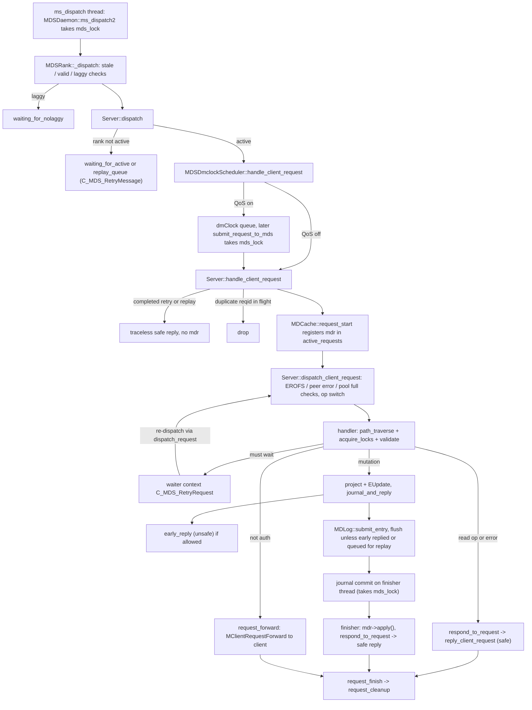
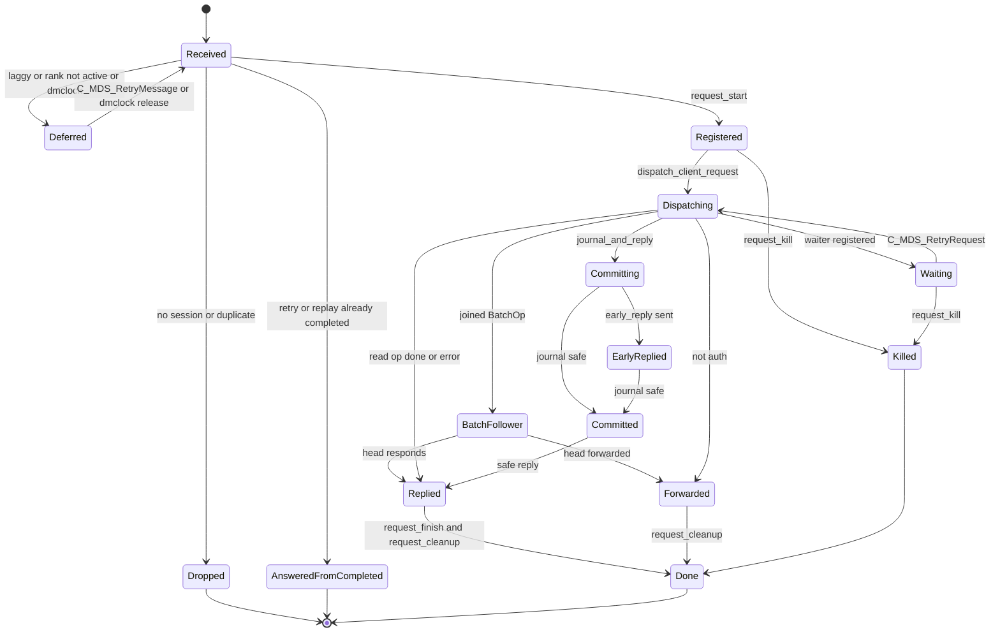
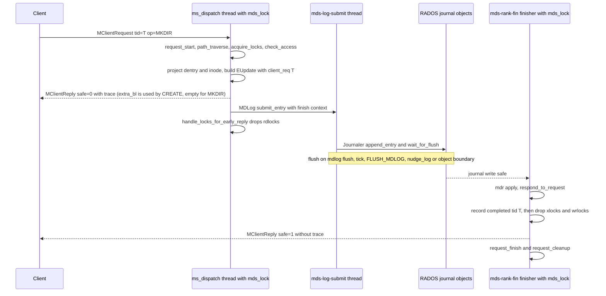
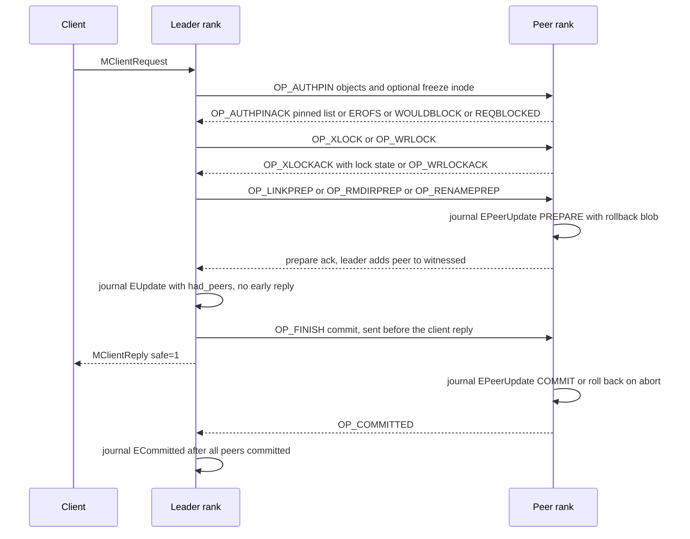

# Request lifecycle: intake, MDRequest, replies, forwarding and peer requests

> Part of the C++ MDS project map ([README](../README.md)). Sources (commit `5f7e383ae6d`): `src/mds/Server.cc` (~2,400 of 12,935 lines in scope: 94-186, 319-420, 2124-4420), `src/mds/Mutation.h` (599) and `src/mds/Mutation.cc` (688), `src/mds/BatchOp.{h,cc}` (78), `src/mds/MDCache.cc` (request registry 9804-10212, `path_traverse` 8443-8907, retry contexts 13271-13286), `src/mds/MDSRank.{h,cc}` (dispatch, waiter queues, clientreplay queue, OpTracker; ~700 lines), `src/mds/MDSDaemon.cc` (dispatch entry, asok registration), `src/mds/MDSContext.{h,cc}` (361), `src/mds/RetryRequest.h`, `src/mds/RetryMessage.h`, `src/mds/MDSContinuation.h`, `src/mds/Locker.cc` (lock acquire/drop helpers used by every request, ~900 lines), `src/mds/MDSDmclockScheduler.cc` (intercept, ~60 lines), `src/messages/{MClientRequest,MClientReply,MClientRequestForward,MMDSPeerRequest}.h`, `src/common/TrackedOp.{h,cc}`. Kernel client: `linux/fs/ceph/mds_client.c`, `linux/fs/ceph/caps.c`. Userspace client: `src/client/Client.cc`.
>
> Related: [process and threading](../00-architecture/process-and-threading.md), [mds_lock analysis](../00-architecture/mds_lock-analysis.md), [wire protocol](../02-client-protocol/wire-protocol.md), [sessions](../02-client-protocol/sessions.md), [capabilities](../02-client-protocol/capabilities.md), [leases, lock caches, async dirops](../02-client-protocol/leases-lock-caches-and-async-dirops.md), [kclient expectations](../02-client-protocol/kclient-expectations.md), [libcephfs/fuse/Ganesha expectations](../02-client-protocol/libcephfs-fuse-ganesha-expectations.md), [namespace mutations](namespace-mutations.md), [rename](rename.md), [attributes and xattrs](attributes-and-xattrs.md), [lookup/readdir/open/file locks](lookup-readdir-open-and-file-locks.md), [subtrees, traversal, replication](../04-cache/mdcache-subtrees-traversal-replication.md), [cache objects, pins, freezing](../04-cache/cdir-cdentry-and-cache-objects.md), [lock state machines](../05-locking/lock-types-and-state-machines.md), [acquiring locks](../05-locking/acquiring-locks.md), [MDLog and Journaler](../06-journal/mdlog-and-journaler.md), [events and replay](../06-journal/events-and-replay.md), [rank lifecycle and recovery](../09-recovery/rank-lifecycle-and-recovery.md), [resolve and rejoin](../09-recovery/resolve-and-rejoin.md), [dmClock QoS](../12-qos-metrics-quiesce-quarantine/qos-dmclock-scheduler.md), [quarantine](../12-qos-metrics-quiesce-quarantine/quarantine.md), [quiesce](../12-qos-metrics-quiesce-quarantine/quiesce.md), [admin commands](../13-admin-and-config/admin-commands.md), [config, perf counters, health](../13-admin-and-config/config-perf-counters-and-health.md).

## 1. Purpose and responsibilities

The request layer turns every inbound `CEPH_MSG_CLIENT_REQUEST` (an `MClientRequest`) into an `MDRequestImpl` ("mdr"), registers it under its `metareqid_t`, and drives it to exactly one terminal outcome on this rank:

| Terminal outcome | Wire effect | Where |
|---|---|---|
| Silent drop | nothing sent | session closed/closing/killing, duplicate in-flight reqid, stale MDS source, reconnect-phase drop |
| Forward hint | `MClientRequestForward` (client must resend) | `MDCache::request_forward` -> `MDSRank::forward_message_mds` |
| Error reply | one `MClientReply` with `safe=1`, `result<0` | `Server::respond_to_request` |
| Success without journal | one `MClientReply`, `safe=1` | read-only ops |
| Success with journal | optional unsafe reply (`safe=0`) before the journal write, then a `safe=1` reply after journal commit | `Server::journal_and_reply` |
| Killed | nothing sent, except that a request killed after `committing` was set still sends its safe reply when the journal commits (the kill only unlinks it from `Session::requests`) | `MDCache::request_kill` |

Responsibilities in this scope:

- Message intake and gating by rank state, laggy state and (optionally) dmClock QoS.
- Idempotency of retried and replayed write requests (`Session::info.completed_requests`, journaled `EMetaBlob::client_reqs`).
- The re-entrant execution model: every wait registers an `MDSContext` that re-dispatches the request from the top of its handler.
- Path traversal and locking helpers that every handler uses (`rdlock_path_pin_ref`, `rdlock_path_xlock_dentry`, `rdlock_two_paths_xlock_destdn`, `try_open_auth_dirfrag`, `try_get_auth_inode`).
- Generic validation (`check_access`, `check_quarantine_block`, `check_fragment_space`, `check_dir_max_entries`, read-only and pool-full checks).
- Generic finishing: `journal_and_reply`, `early_reply`, `reply_client_request`, `set_trace_dist`, `respond_to_request`.
- Coalescing of identical `GETATTR`/`LOOKUP` requests (`BatchOp`).
- The peer-request framework (`MMDSPeerRequest`) used for remote auth pins, remote locks and the prepare/commit messages of cross-rank link/unlink/rmdir/rename.
- Internal (MDS-originated) requests that reuse the same machinery.
- Observability: OpTracker events, perf counters, slow-request health warnings, asok commands.

## 2. Source map

| File | Class / function | Lines | Role |
|---|---|---|---|
| `src/mds/MDSDaemon.cc` | `MDSDaemon::ms_dispatch2` | 1088-1111 | messenger entry; takes `mds_lock` for every message |
| `src/mds/MDSRank.cc` | `MDSRankDispatcher::ms_dispatch` | 1037-1056 | updates `Session::last_seen`, asserts MDS messages are `MMDSOp` |
| `src/mds/MDSRank.cc` | `MDSRank::_dispatch`, `is_valid_message`, `handle_message`, `_advance_queues`, `is_stale_message`, `retry_dispatch` | 1058-1415, 1586-1591 | stale/laggy filtering, routing, draining `finished_queue` |
| `src/mds/MDSRank.cc` | `MDSRank::forward_message_mds` | 1504-1527 | builds `MClientRequestForward` |
| `src/mds/MDSRank.cc` | `clientreplay_start`, `queue_one_replay`, `maybe_clientreplay_done`, `active_start` | 2083-2162 | clientreplay queue, release of `waiting_for_active` |
| `src/mds/MDSRank.cc` | `check_ops_in_flight`, OpTracker setup, `ops`/`op get`/`op kill` asok | 485-542, 2687-2815, 3870-3884 | slow request tracking |
| `src/mds/MDSRank.h` | `queue_waiter*`, `wait_for_*`, `enqueue_replay` | 251-367 | waiter queues |
| `src/mds/Server.cc` | `Server::dispatch` | 319-420 | rank-state gating, dmClock hand-off |
| `src/mds/Server.cc` | `Batch_Getattr_Lookup` | 108-164 | `BatchOp` implementation |
| `src/mds/Server.cc` | `ServerLogContext` | 166-186 | journal-commit context, marks `journal_committed:` |
| `src/mds/Server.cc` | `journal_and_reply`, `submit_mdlog_entry`, `respond_to_request` | 2124-2190 | generic finishing |
| `src/mds/Server.cc` | `perf_gather_op_latency`, `early_reply`, `reply_client_request`, `set_trace_dist` | 2193-2560 | reply construction |
| `src/mds/Server.cc` | `trim_completed_request_list`, `set_reply_extra_bl` | 2563-2614 | idempotency map trimming, create reply payload |
| `src/mds/Server.cc` | `handle_client_request` | 2616-2728 | completed-request detection, registration, embedded cap releases |
| `src/mds/Server.cc` | `handle_client_reply`, `handle_osd_map` | 2730-2763 | MDS-as-client replies, pool-full flag |
| `src/mds/Server.cc` | `dispatch_client_request` | 2765-2965 | global checks + op switch |
| `src/mds/Server.cc` | `handle_peer_request`, `handle_peer_request_reply`, `dispatch_peer_request`, `handle_peer_auth_pin`, `handle_peer_auth_pin_ack` | 2971-3486 | peer-request framework |
| `src/mds/Server.cc` | `check_access`, `check_quarantine_block`, `check_fragment_space`, `check_dir_max_entries` | 3500-3592 | validation helpers |
| `src/mds/Server.cc` | `_try_open_ino`, `C_MDS_TryFindInode` | 3814-3867 | `ESTALE` recovery |
| `src/mds/Server.cc` | `rdlock_path_pin_ref`, `rdlock_path_xlock_dentry`, `rdlock_two_paths_xlock_destdn`, `try_open_auth_dirfrag` | 3869-4266 | traversal + locking helpers |
| `src/mds/Server.cc` | `handle_client_getattr` | 4272-4420 | batching entry point, reference example of a read op |
| `src/mds/Server.cc` | `try_get_auth_inode` | 5956-5969 | ino-addressed auth check |
| `src/mds/Mutation.h` / `.cc` | `MutationImpl`, `LockOp`, `LockOpVec`, `MDRequestImpl`, `MDRequestImpl::More`, `MDRequestImpl::Params`, `MDPeerUpdate`, `MDLockCache` | `.h` 64-597, `.cc` 28-688 | request state |
| `src/mds/BatchOp.h` / `.cc` | `BatchOp` | `.h` 25-40, `.cc` 22-36 | batch interface |
| `src/mds/MDCache.cc` | `request_start`, `request_start_peer`, `request_start_internal`, `request_get`, `request_finish`, `request_forward`, `dispatch_request`, `request_cleanup`, `request_kill` | 9817-10212 | request registry |
| `src/mds/MDCache.cc` | `path_traverse`, `maybe_request_forward_to_auth` | 8443-8907 | traversal, forwarding decision |
| `src/mds/MDCache.cc` | `C_MDS_RetryRequest::finish`, `CF_MDS_RetryRequestFactory::build` | 13271-13286 | re-dispatch contexts |
| `src/mds/RetryRequest.h`, `RetryMessage.h` | `C_MDS_RetryRequest`, `CF_MDS_RetryRequestFactory`, `C_MDS_RetryMessage`, `CF_MDS_RetryMessageFactory` | 21-39 / 22-44 | |
| `src/mds/MDSContext.h` / `.cc` | `MDSContext`, `MDSInternalContext`, `MDSIOContextBase`, `MDSLogContextBase`, `C_IO_Wrapper`, `MDSGather` | `.h` 38-212, `.cc` 24-147 | completion contexts, lock assertions |
| `src/mds/MDSContinuation.h` | `MDSContinuation` | 23-35 | only used by scrub validation (`CInode.cc:4909`), not by client requests |
| `src/mds/Locker.cc` | `try_rdlock_snap_layout`, `acquire_locks`, `request_drop_*`, `set_xlocks_done`, `_drop_locks`, `drop_locks`, `handle_locks_for_early_reply`, `remote_wrlock_start`, `xlock_start`, `process_request_cap_release`, `kick_cap_releases` | 157-984, 2086-2322, 3714-3844 | lock helpers used by the request path |
| `src/mds/MDSDmclockScheduler.cc` | `handle_client_request`, `submit_request_to_mds`, `get_op_cost` | 81-113, 745-779 | QoS interception |
| `src/messages/MClientRequest.h` | `MClientRequest` | 90-414 | request message |
| `src/messages/MClientReply.h` | `openc_response_t`, `MClientReply` | 309-460 | reply message |
| `src/messages/MClientRequestForward.h` | `MClientRequestForward` | 22-73 | forward hint |
| `src/messages/MMDSPeerRequest.h` | `MMDSPeerRequest` | 23-234 | inter-MDS request message |

## 3. How it works

### 3.1 End-to-end overview

The states are implicit; there is no state enum. The observable markers are the OpTracker events (`flag_point` in `dump_ops_in_flight`) and the flags `committing`, `did_early_reply`, `killed`, `aborted`, `dead` on the mdr (`src/mds/Mutation.h:289-292`, `src/mds/Mutation.h:474`).

### 3.2 Intake and gating

**Daemon and rank level.** All MDS messages arrive on the messenger dispatch thread. `src/mds/MDSDaemon.cc:1088 (MDSDaemon::ms_dispatch2)` takes `mds_lock` (a `ceph::fair_mutex`, `src/mds/MDSDaemon.h:74`) for the whole dispatch. `src/mds/MDSRank.cc:1037 (MDSRankDispatcher::ms_dispatch)` asserts MDS-sourced messages are `MMDSOp` types and stamps `Session::last_seen` for client messages, then calls `_dispatch(m, true)`:

1. `quiesce_dispatch(m)` consumes only quiesce DB messages (`src/mds/MDSRankQuiesce.cc:372`).
2. `is_stale_message` (`src/mds/MDSRank.cc:1377`) drops messages from an MDS rank that is down in the MDSMap or whose connection differs from the one in the map (except `MMDSMap` and some cache-expire messages).
3. `is_valid_message` (`src/mds/MDSRank.cc:1191`) accepts `MDS_PORT_CACHE`, `MDS_PORT_MIGRATOR`, client session/reconnect/reclaim/request/reply, peer request, heartbeat, table request, `MLock`, `MInodeFileCaps`, scrub, client caps/cap release/lease.
4. If `beacon.is_laggy()` (no beacon ack from the monitors for more than `mds_beacon_grace`, default 15 s, `src/mds/Beacon.cc:261`), the message is appended to `waiting_for_nolaggy`; a new message is also deferred while that list is non-empty, so FIFO order is kept (`src/mds/MDSRank.cc:1072-1081`). This defers every client request while the MDS cannot reach the monitors.
5. `handle_message` (`src/mds/MDSRank.cc:1231`) routes `CEPH_MSG_CLIENT_REQUEST` and `CEPH_MSG_CLIENT_REPLY` to `Server::dispatch` without peer-type filtering (both clients and MDS daemons send them); `MSG_MDS_PEER_REQUEST` is accepted only from MDS peers (`ALLOW_MESSAGES_FROM`).
6. When the outermost dispatch returns (`dispatch_depth == 1`), `_advance_queues` (`src/mds/MDSRank.cc:1320`) completes every context in `finished_queue` and replays `waiting_for_nolaggy` unless laggy again.

**Server level.** `src/mds/Server.cc:319 (Server::dispatch)` handles `CEPH_MSG_CLIENT_RECONNECT` immediately. For `CEPH_MSG_CLIENT_REQUEST` while the rank is not `up:active`:

| Rank state | Request | Action | Code |
|---|---|---|---|
| `up:reconnect`, or want_state is reconnect | no session, or session not open and `mds_replay_unsafe_with_closed_session=false` | dropped silently | `Server.cc:341-346` |
| same | `CEPH_MDS_FLAG_REPLAY` or `CEPH_MDS_FLAG_ASYNC` | `mark_queued_for_replay()`, `enqueue_replay(C_MDS_RetryMessage)`; if `head.ino != 0` and the tid is not completed, `MDCache::add_replay_ino_alloc(ino)` (adds to `cap_imports_missing` so rejoin does not try to open it); with `mds_replay_unsafe_with_closed_session` the ino is moved from `free_prealloc_inos` to `delegated_inos` | `Server.cc:349-362`, `378-381` |
| same | `ext_num_retry > 0` and tid already completed | queued for replay (so the reply precedes later modifications of a created file) | `Server.cc:363-373` |
| same | any `ext_num_retry > 0` without `REPLAY`/`ASYNC` (completed or not) | embedded cap releases cleared (`req->releases.clear()`); a non-completed one then falls through to `wait_for_active` | `Server.cc:374-376` |
| `up:stopping` | any | processed now | `Server.cc:386-387` |
| `up:clientreplay` | `is_queued_for_replay()` | processed now | `Server.cc:388-391` |
| any other non-active state (replay, resolve, reconnect or rejoin for requests not queued above, clientreplay for non-queued) | any | `wait_for_active(C_MDS_RetryMessage)` | `Server.cc:393-397` |
| `up:active` | any | `mds_dmclock_scheduler->handle_client_request(req)` | `Server.cc:404-406` |

`waiting_for_active` is drained in FIFO order by `src/mds/MDSRank.cc:2129 (MDSRank::active_start)` after `reissue_all_caps()`; each `C_MDS_RetryMessage` calls `MDSRank::retry_dispatch` which runs the full `_dispatch(m, false)` again. `replay_queue` is drained by `clientreplay_start` (see 3.18).

**dmClock interception.** `src/mds/MDSDmclockScheduler.cc:81 (MDSDmclockScheduler::handle_client_request)` enqueues the request only if QoS is enabled (`mds_dmclock_enable`, default false), the source is a client, the rank is active, and the volume record of the session's mount root (client metadata `root`, truncated to `SUBVOL_ROOT_DEPTH = 3` path components) is valid and updated; otherwise it calls `Server::handle_client_request` synchronously. Queued requests are moved by the scheduler thread (`process_request_handler`, `MDSDmclockScheduler.cc:490`) into a `crimson::dmclock::PushPriorityQueue`; when released, `submit_request_to_mds` (`MDSDmclockScheduler.cc:97`) takes `mds_lock` and calls `Server::handle_client_request`. The release callback runs either on the scheduler thread (from `add_request`) or on the queue's own `sched_ahead_thd` for limit-deferred requests (`src/dmclock/src/dmclock_server.h:1540-1560, 1761`). Cost is 1 for `LOOKUP`, `LOOKUPHASH`, `LOOKUPPARENT`, `LOOKUPINO`, `LOOKUPNAME`, `GETATTR`, `READDIR`, `OPEN`, `LOOKUPSNAP`, `LSSNAP`, `GETFILELOCK` and 3 for everything else, including `GETVXATTR` (`MDSDmclockScheduler.cc:745 (get_op_cost)`). Requests that are released from the dmClock queue do not pass through `MDSRank::_dispatch` again. Details: [dmClock QoS](../12-qos-metrics-quiesce-quarantine/qos-dmclock-scheduler.md).

### 3.3 `handle_client_request`: session checks, idempotency, registration

`src/mds/Server.cc:2616 (Server::handle_client_request)`:

1. Increment `mds.request` (`l_mds_request`) and `mds_server.handle_client_request`. These count every pass, including re-dispatched messages.
2. If the cache is not open (`MDCache::is_open()`), wait on `wait_for_open` with `C_MDS_RetryMessage`.
3. If the source is a client: look up the session from the connection (`MDSRank::get_session`). Drop silently (no reply) if there is none, or it is closed (unless `up:clientreplay` and `mds_replay_unsafe_with_closed_session`), closing or killing. If the dropped request was queued for replay, call `queue_one_replay()`.
4. The request's `mdsmap_epoch` is compared with the rank's map but nothing is done (`Server.cc:2652-2655`).
5. Completed-request detection, only when the request carries `CEPH_MDS_FLAG_REPLAY` or `ext_num_retry > 0` (table in 3.4).
6. `trim_completed_request_list(req->get_oldest_client_tid(), session)` (`Server.cc:2563`) for every request.
7. `mdcache->request_start(req)`; a null return means the reqid is already active (dropped; next replay op queued if needed).
8. Link into the session: `mdr->session = session; session->requests.push_back(&mdr->item_session_request)`. This list is what `journal_close_session` walks to kill requests (`Server.cc:1554-1557`).
9. If not a replay and the source is a client, process embedded cap/lease releases: `Locker::process_request_cap_release(mdr, client, item, dname)` for each `ceph_mds_request_release` (`src/mds/Locker.cc:3714`). It drops the named dentry lease, confirms the cap release (`cap->confirm_receipt`), adjusts wanted, evaluates locks with issue suppressed, and records `mdr->cap_releases[vino] = cap->get_last_seq()` so `kick_cap_releases` can re-issue caps at cleanup (`Locker.cc:3833`). If the inode is frozen the release is deferred (`C_Locker_RetryRequestCapRelease`).
10. `dispatch_client_request(mdr)`.

`src/mds/MDCache.cc:9817 (MDCache::request_start)`: if `active_requests` already holds the reqid and that mdr is a peer request (this rank is a peer for the same reqid, a forward race), the client message is parked on `more()->waiting_for_finish` (re-dispatched by `request_cleanup`); otherwise the new message is dropped. A new mdr is created through `op_tracker.create_request<MDRequestImpl>` with `attempt = req->get_num_fwd()`, the message's receive stamps, and `set_op_stamp(req->get_stamp())`: the client-supplied timestamp becomes the time used for `ctime`/`mtime` of the mutation (`MutationImpl::get_op_stamp`, `Mutation.h:206-210`; falls back to `mds_stamp` when the client sent no stamp).

### 3.4 Idempotency: reqid and completed requests

- **Identity.** `metareqid_t(get_orig_source(), header.tid)` (`src/messages/MClientRequest.h:188 (get_reqid)`): entity name plus the client-assigned message tid. The MDS assumes one incarnation per client name.
- **Recording.** In `reply_client_request`, a request with `may_write()` (op has bit `CEPH_MDS_OP_WRITE = 0x1000`, or `OPEN` with `O_CREAT|O_TRUNC`, `MClientRequest.h:196`), result 0, op not `SETFILELOCK`, and a session is recorded with `session->add_completed_request(tid, created_ino)`; if the mdr has a log segment, the session is added to `ls->touched_sessions` so the SessionMap object is persisted before that segment expires (`Server.cc:2398-2405`). `SETFILELOCK` is excluded because file-lock state is not persisted and must be re-executed after an MDS failure (comment at `Server.cc:2394-2397`).
- **Journal.** Mutating handlers add `EMetaBlob::add_client_req(reqid, oldest_client_tid)` to their `EUpdate` (19 call sites in `Server.cc`, e.g. `Server.cc:5766` in setattr). Replay re-creates the completed entry and trims with the journaled oldest tid (`src/mds/journal.cc:1776-1793 (EMetaBlob::replay)`).
- **Trimming.** `Session::trim_completed_requests(mintid)` erases tids `< mintid`; `mintid == 0` erases everything (`src/mds/SessionMap.h:307-321`). When nothing could be trimmed and the map holds at least `mds_max_completed_requests << num_trim_requests_warnings` entries, the MDS increments the warning count and logs to the cluster log `client.N does not advance its oldest_client_tid (...)` (`Server.cc:2577-2588`); the beacon raises `MDS_CLIENT_OLDEST_TID` / `MDS_CLIENT_OLDEST_TID_MANY` (`src/mds/Beacon.cc:409-445`).

Behaviour for a request with `REPLAY` or `ext_num_retry > 0` whose tid is in `completed_requests` (`Server.cc:2659-2694`):

| Condition | Response |
|---|---|
| session not open | return; no reply, and `queue_one_replay()` is not called on this path |
| `REPLAY` flag | traceless reply: `MClientReply(req, 0)`, `safe=1`, no trace; if an ino was created, `extra_bl` carries it via `set_reply_extra_bl` |
| retry, op not `OPEN`/`CREATE`, and (no ino created or rank not in clientreplay) | same traceless reply |
| retry in clientreplay, op created an ino, op not `OPEN`/`CREATE` | op rewritten in place to `LOOKUP` (if `CEPH_MDS_FLAG_WANT_DENTRY`) or `GETATTR` with mask `CEPH_STAT_CAP_INODE_ALL`, so the client receives a trace for the created inode |
| retry (no `REPLAY` flag) of `OPEN`/`CREATE` | processed normally with `mdr->has_completed = true`; `CREATE` becomes `handle_client_open` with `extra_bl` set to the created ino (`Server.cc:2896-2908`); `O_TRUNC` is not re-applied (`Server.cc:4738`). A `REPLAY` of `OPEN`/`CREATE` gets the traceless reply of row 2 |

Requests without these flags are never checked against the completed map. Duplicate detection of an in-flight request is by `active_requests` only (3.3).

### 3.5 `dispatch_client_request`

`src/mds/Server.cc:2765 (Server::dispatch_client_request)` is called on the first pass and on every re-dispatch:

1. Assert no outstanding peer replies (`waiting_on_peer` empty).
2. `killed` -> return; `aborted` -> clear and `request_kill`.
3. Debug hooks: `mds_server_dispatch_client_request_delay` sleeps while holding `mds_lock`; `mds_server_dispatch_killpoint_random` aborts the daemon.
4. `may_write()` and `MDCache::is_readonly()` -> `-EROFS`.
5. `more()->peer_error` set by a peer ack -> reply with it (`-EROFS` or `-EAGAIN`).
6. Metadata pool full (`Server::is_full`, set from `pg_pool_t::FLAG_FULL` of the metadata pool in `handle_osd_map`, `Server.cc:2752`): for `SETLAYOUT`, `SETDIRLAYOUT`, `RMXATTR`, `SETXATTR`, `CREATE`, `SYMLINK`, `MKSNAP`, and `LINK`/`RENAME` before any witness, fetch the base inode with `try_get_auth_inode` and require `MAY_FULL` (the `full` MDS cap); otherwise `check_access` replies `-EACCES` and the code then sends a second, duplicate `-ENOSPC` reply for the same tid that clients drop (`Server.cc:2829-2835`, `3514-3516`), so the caller observes `-EACCES` (see [auth and MDS caps](../01-cluster-integration/auth-and-mds-caps.md)). Other ops (including `MKDIR`, `MKNOD`, `UNLINK`, `RMDIR`) are allowed. `SETATTR` growing a file is rejected separately inside the handler (`Server.cc:5635-5640`).
7. Op switch:

| Op (hex) | `may_write` | Handler | Notes |
|---|---|---|---|
| `LOOKUP` 0x100 | no | `handle_client_getattr(mdr, true)` | batchable |
| `GETATTR` 0x101, `LOOKUPSNAP` 0x400 | no | `handle_client_getattr(mdr, false)` | `GETATTR` batchable |
| `LOOKUPHASH` 0x102, `LOOKUPINO` 0x104 | no | `handle_client_lookup_ino(mdr, false, false)` | |
| `LOOKUPPARENT` 0x103 | no | `handle_client_lookup_ino(mdr, true, false)` | |
| `LOOKUPNAME` 0x105 | no | `handle_client_lookup_ino(mdr, false, true)` | |
| `GETVXATTR` 0x106 | no | `handle_client_getvxattr` | |
| `SETATTR` 0x1108 | yes | `handle_client_setattr` | |
| `SETLAYOUT` 0x1107, `SETDIRLAYOUT` 0x110a | yes | `handle_client_setlayout`, `handle_client_setdirlayout` | setdirlayout disables early reply |
| `SETXATTR` 0x1105, `RMXATTR` 0x1106 | yes | `handle_client_setxattr`, `handle_client_removexattr` | some `ceph.*` vxattrs disable early reply |
| `READDIR` 0x305 | no | `handle_client_readdir` | cap-acquisition throttle |
| `SETFILELOCK` 0x1109 | yes | `handle_client_file_setlock` | never recorded as completed |
| `GETFILELOCK` 0x110 | no | `handle_client_file_readlock` | |
| `CREATE` 0x1301 | yes | `handle_client_openc`, or `handle_client_open` if `has_completed` | |
| `OPEN` 0x302 | if `O_CREAT`/`O_TRUNC` | `handle_client_open` | |
| `MKNOD` 0x1201, `MKDIR` 0x1220, `SYMLINK` 0x1222 | yes | `handle_client_mknod/mkdir/symlink` | |
| `LINK` 0x1202 | yes | `handle_client_link` | may use peers |
| `UNLINK` 0x1203, `RMDIR` 0x1221 | yes | `handle_client_unlink` | may use peers |
| `RENAME` 0x1204 | yes | `handle_client_rename` | may use peers |
| `LSSNAP` 0x402 | no | `handle_client_lssnap` | |
| `MKSNAP` 0x1400, `RMSNAP` 0x1401, `RENAMESNAP` 0x1403, `SNAP_METADATA` 0x1406 | yes | `handle_client_mksnap/rmsnap/renamesnap/snap_md_op` | journal via `submit_mdlog_entry` + flush, no early reply |
| `READDIR_SNAPDIFF` 0x1404, `FILE_BLOCKDIFF` 0x1405 | yes (bit 0x1000 set although read-only) | `handle_client_readdir_snapdiff`, `handle_client_file_blockdiff` | see section 8 |
| anything else (`DUMMY` 0x107, internal 0x15xx) | | `respond_to_request(-EOPNOTSUPP)` | |

Handler bodies are documented in [namespace mutations](namespace-mutations.md), [rename](rename.md), [attributes and xattrs](attributes-and-xattrs.md), [lookup/readdir/open/file locks](lookup-readdir-open-and-file-locks.md) and [snapshots](../10-snapshots-quotas-subvolumes/snapshots.md).

### 3.6 Execution model: restart from the top

Handlers are written to be re-entered from the beginning every time a wait completes. Progress that must not be repeated is stored on the mdr:

| Progress marker | Set by | Effect on re-entry |
|---|---|---|
| `locking_state & SNAP_LOCKED` / `SNAP2_LOCKED` | `path_traverse` success with `MDS_TRAVERSE_RDLOCK_SNAP`/`SNAP2` (`MDCache.cc:8882-8885`), `handle_client_link` | skip `try_rdlock_snap_layout` |
| `locking_state & PATH_LOCKED` | `path_traverse` with `MDS_TRAVERSE_RDLOCK_PATH`; `rdlock_two_paths_xlock_destdn` | `rdlock_path_*` helpers return the cached `mdr->in[0]` / `mdr->dn[n].back()` immediately |
| `locking_state & ALL_LOCKED` | handlers after their final `acquire_locks` (e.g. `Server.cc:8655` unlink, `9501` rename, `7948` link) | skip lock declaration |
| `mdr->locks` | `acquire_locks` | already-held locks are skipped (`already xlocked/wrlocked/rdlocked`) |
| `more()->witnessed`, `waiting_on_peer`, `stid`, `srci_srnode`/`desti_srnode`, `straydn`, prealloc state | handlers | prepare steps not repeated |

`Locker::drop_locks` resets `locking_state = 0` (`Locker.cc:891`), so any wait that drops locks forces the whole traversal to be redone.

**Wait points and what is held while waiting.**

| Wait | Registered by | Context | Locks/auth pins while waiting |
|---|---|---|---|
| dirfrag fetch, discover, open remote dentry, frozen dir, unreadable dentry, foreign mdsdir, single-auth (ambiguous auth) | `MDCache::path_traverse` (`MDCache.cc:8443`) via `cf.build()` | `CF_MDS_RetryRequestFactory`; the path helpers pass `drop_locks=true`, the batching traversal in `handle_client_getattr` passes `false` (`Server.cc:4290`) | with `drop_locks=true`, all locks and local auth pins are dropped when the waiter is built (`MDCache.cc:13279`) |
| ancestor `snaplock`/`policylock` not rdlockable | `Locker::try_rdlock_snap_layout` (`Locker.cc:157`) | `C_MDS_RetryRequest` on `WAIT_RD` | dropped (`drop_locks` + `drop_local_auth_pins`) |
| lock not acquirable | `Locker::acquire_locks` -> `xlock_start`/`wrlock_start`/`rdlock_start` | `C_MDS_RetryRequest` on lock `WAIT_*` | locks acquired earlier in this or previous `acquire_locks` calls are kept |
| object cannot be auth-pinned (freezing/frozen for export or fragmentation), ambiguous auth | `acquire_locks` | `WAIT_UNFREEZE` / `WAIT_SINGLEAUTH` | all locks and local auth pins dropped first (`Locker.cc:434-496`) |
| quiesce lock failure | `acquire_locks` -> `handle_quiesce_failure` | `C_MDS_RetryRequest` on the `quiescelock` (`WAIT_WR` or `WAIT_XLOCK`, `Locker.cc:5618-5662`) | everything dropped via `request_drop_locks`, which also sends `OP_FINISH` to every peer, plus local auth pins (`Locker.cc:679-685`) |
| `ISNAP`/`IPOLICY` xlock while cluster degraded; rdlock on lock needing rejoin recovery (both skipped for queued-for-replay requests) | `acquire_locks` | `wait_for_cluster_recovered` | locks dropped; local auth pins dropped only in the `ISNAP`/`IPOLICY` case (`Locker.cc:303-305`, `641-642`) |
| remote auth pin / remote xlock / remote wrlock | `acquire_locks`, `xlock_start`, `remote_wrlock_start` | `more()->waiting_on_peer`; re-dispatched by the ack handler | kept |
| remote rank not active | same | `wait_for_active_peer` | kept |
| target inode frozen/freezing (want_auth) | `rdlock_path_pin_ref` (`Server.cc:3932`) | `cf.build()` (drops) | dropped |
| dirfrag inode frozen | `try_open_auth_dirfrag` (`Server.cc:4254`) | `C_MDS_RetryRequest` | kept |
| quarantine (old clients) | `check_quarantine_block` | `C_MDS_RetryRequest` on subvolume root `WAIT_QUARANTINE` | kept |
| pending truncate | setattr/open (`Server.cc:5653-5660`, `4748-4756`) | `WAIT_TRUNC` | dropped first |
| client's mdsmap newer (create with pool) | `handle_client_openc` | `wait_for_mdsmap` | kept |
| cap acquisition throttle | readdir, readdir_snapdiff (`Server.cc:5112-5121`, `12274`) | `mds->timer.add_event_after(mds_cap_acquisition_throttle_retry_request_timeout)` | kept |
| filelock state changed between retries (getattr) | `handle_client_getattr` (`Server.cc:4384-4392`) | `queue_waiter(C_MDS_RetryRequest)` | dropped |
| `ESTALE` on base ino | path helpers | `find_ino_peers` -> `C_MDS_TryFindInode` -> possibly `open_ino` -> `C_MDS_TryOpenInode` | whatever was held (normally nothing) |
| batch follower | `handle_client_getattr` | head's `BatchOp` | none (pins only) |
| journal commit | `journal_and_reply` / `submit_mdlog_entry` | `ServerLogContext` subclass | xlocks, wrlocks and auth pins kept until the safe reply; after an early reply, rdlocks other than `ISNAP`/`IPOLICY` are already dropped (3.8) |

**Re-dispatch.** `src/mds/MDCache.cc:13271 (C_MDS_RetryRequest::finish)` increments `mdr->retry` (a debug counter) and calls `src/mds/MDCache.cc:9995 (MDCache::dispatch_request)`, which ignores `dead` requests and otherwise routes to `dispatch_client_request`, `dispatch_peer_request`, or the internal-op switch. Every context holds an intrusive `MDRequestRef`, so a finished request stays allocated until its last context is destroyed; the `dead` flag set in `request_cleanup` turns late contexts into no-ops.

**Synchronous versus queued wake-ups.** `MDSCacheObject::finish_waiting` completes contexts synchronously (`finish_contexts`, `src/mds/MDSCacheObject.cc:26`), so a lock state change re-dispatches waiting requests inside the call stack of whatever changed the lock. `MDSRank::queue_waiter(s)` (`MDSRank.h:251-269`) instead appends to `finished_queue`, which runs at the end of the current dispatch or in the `mds-rank-progr` thread. Lock waiters are ordered: `SimpleLock::add_waiter` adds `WAIT_ORDERED`, which gives each waiter an increasing sequence number per parent object (`src/mds/SimpleLock.h:248-250`, `src/mds/MDSCacheObject.h:267-279`); non-ordered waiters are kept at sequence 0 (front).

**Context types** (`src/mds/MDSContext.h`): `MDSContext::complete` asserts `mds_lock` is held and resets the heartbeat (`MDSContext.cc:24`). `MDSIOContextBase::complete` (used for RADOS and journal completions) takes `mds_lock`, drops the completion if the daemon is stopping, and respawns the daemon on `-EBLOCKLISTED` or `-ETIMEDOUT` (`MDSContext.cc:95-120`). `MDSLogContextBase::complete` runs `pre_finish` (for `ServerLogContext`: event `journal_committed: `), then the IO completion, then `MDLog::set_safe_pos(write_pos)` (`MDSContext.cc:122-130`). `C_IO_Wrapper` bounces a completion through the `mds-rank-fin` finisher. `MDSContinuation` (`src/mds/MDSContinuation.h:23`) is used only by scrub's `CInode::validate_disk_state` (`CInode.cc:4909`), not by client requests.

### 3.7 Path traversal and locking helpers

`src/mds/MDCache.cc:8443 (MDCache::path_traverse)` returns `0` (done), `1` (waiting; a context from the factory was registered, or `try_rdlock_snap_layout`/`acquire_locks` registered their own `C_MDS_RetryRequest`), `2` (forwarded via `maybe_request_forward_to_auth` -> `request_forward`), or `-errno`. `PATH_LOCKED`, `SNAP_LOCKED`/`SNAP2_LOCKED` are set only on the success path (`MDCache.cc:8882-8888`). Relevant flags (`src/mds/MDCache.h:136-148`):

| Flag | Meaning |
|---|---|
| `MDS_TRAVERSE_DISCOVER` | fetch replicas from other ranks instead of forwarding |
| `MDS_TRAVERSE_PATH_LOCKED` | proceed through xlocked dentries |
| `MDS_TRAVERSE_WANT_DENTRY` | return the tail dentry (create a null dentry if missing) |
| `MDS_TRAVERSE_WANT_INODE` | with `WANT_DENTRY`: when the tail exists, require auth on the tail inode instead of the dentry and do not xlock the tail dentry; the dentry-auth check is deferred until the tail is known to be null (`MDCache.cc:8618-8641`, `8646`) |
| `MDS_TRAVERSE_WANT_AUTH` | forward to the auth of the tail inode or tail dentry |
| `MDS_TRAVERSE_RDLOCK_SNAP` / `RDLOCK_SNAP2` | rdlock `snaplock` of the base inode and every ancestor (`try_rdlock_snap_layout`), recording `dir_root[n]`/`dir_depth[n]`; during the walk also rdlock `snaplock` of each traversed inode except the tail when only the dentry is wanted (`MDCache.cc:8722-8729`) |
| `MDS_TRAVERSE_WANT_DIRLAYOUT` | also rdlock `policylock` up to the first ancestor with a layout, store it in `mdr->dir_layout` |
| `MDS_TRAVERSE_RDLOCK_PATH` | rdlock every traversed dentry lock; also wrlock the parent `filelock` when it is held by a lock cache this request does not use ("force client to flush async dir operation if necessary", `MDCache.cc:8657-8662`) |
| `MDS_TRAVERSE_XLOCK_DENTRY` | xlock the tail dentry, wrlock parent `filelock` + `nestlock` (skipped at depth 0 when a lock cache is attached) |
| `MDS_TRAVERSE_RDLOCK_AUTHLOCK` | also rdlock the parent `authlock` |
| `MDS_TRAVERSE_CHECK_LOCKCACHE` | try `Locker::find_and_attach_lock_cache` for the base directory |
| `MDS_TRAVERSE_IMPORT` | return `-EAGAIN` instead of discovering when the parent inode is quiesced (used by subtree import, `MDCache.cc:8574-8577`, `8832-8835`) |

Forward-versus-discover: on a cache miss in a dirfrag that is not auth on this rank, `path_traverse` forwards unless `depth < num_fwd` of the client request, in which case it discovers instead (`MDCache.cc:8822-8829`); when the dirfrag is not open and the inode is not auth it always discovers (`MDCache.cc:8572-8584`). Missing or purging base inode: `-ESTALE`, except mdsdir inos (open foreign mdsdir) and stray inos (discover the stray dir).

**`rdlock_path_pin_ref(mdr, want_auth, no_want_auth)`** (`src/mds/Server.cc:3879`): used by getattr, setattr, open, readdir, xattr ops. Returns `mdr->in[0]` if `PATH_LOCKED`. Flags: snapshot paths only add `WANT_AUTH` (unless `no_want_auth`); other paths add `RDLOCK_PATH | RDLOCK_SNAP`, and `WANT_AUTH` if `want_auth`, or if `mds_forward_all_requests_to_auth` and not `no_want_auth`. On `-ENOENT` with a non-empty dentry vector, sets `mdr->tracedn` to the tail null dentry when the client asked for `CEPH_MDS_FLAG_WANT_DENTRY` and replies `-ENOENT` (the reply carries a null-dentry trace and lease). On `-ESTALE`, starts `find_ino_peers`. Then `check_quarantine_block`; then for `want_auth` waits if the inode is frozen, auth-pin-frozen, or freezing and not already auth-pinned by this mdr, else `auth_pin`; finally `pin`.

**`rdlock_path_xlock_dentry(mdr, create, okexist, authexist, want_layout)`** (`src/mds/Server.cc:3960`): used by create/mknod/mkdir/symlink/link/unlink/rmdir. Returns the cached dentry if `PATH_LOCKED`. Errors before traversal: depth 0 -> `-EINVAL`; tail is a snapshot -> `-EROFS`; tail is `.`/`..` -> `-EEXIST` (create) or `-ENOTEMPTY`. Flags `RDLOCK_SNAP | RDLOCK_PATH | WANT_DENTRY | XLOCK_DENTRY | WANT_AUTH`, plus `CHECK_LOCKCACHE` for depth-1 paths without a disabled lock cache, `RDLOCK_AUTHLOCK` if `create`, `WANT_INODE` if `authexist`, `WANT_DIRLAYOUT` if `want_layout`. After traversal: `check_quarantine_block(diri)`; parent is a system dir other than root (except unlink in lost+found) -> `-EROFS` for non-MDS requesters; parent already unlinked into a stray dir -> `-ENOENT`; null dentry with `!create && okexist` -> `-ENOENT`; existing dentry with `!okexist` -> `-EEXIST`; existing dentry sets `mdr->in[0]`; null dentry gets `dn->first = global newest snap seq + 1`.

**`rdlock_two_paths_xlock_destdn(mdr, xlock_srcdn)`** (`src/mds/Server.cc:4073`): used by rename and by link with a path-addressed target. Both paths must have depth 1 (`-EINVAL`), no snapshots (`-EROFS`). Traverses `filepath` (destination) with `RDLOCK_SNAP | WANT_DENTRY | WANT_AUTH` and `filepath2` (source) with `RDLOCK_SNAP2 | WANT_DENTRY | DISCOVER`; neither traversal uses `RDLOCK_PATH`, so only ancestor `snaplock`s are rdlocked, not the traversed dentries. Then quarantine block on both parent dirs, `-EROFS` for system dirs other than root, `-ENOENT` if the destination parent is already in a stray dir (`Server.cc:4127-4143`). Then builds one `LockOpVec` in a canonical order (comment at `Server.cc:4059-4071` and `MDCache.cc:8425-8441`): objects under the fs root before objects under mdsdir, shallower directories first, then lower inode number, dentries in the same directory by name, non-directory inodes by inode number. Same parent inode: wrlock `filelock`+`nestlock` of the destination dir inode (plus remote wrlocks on a remote source dirfrag auth when source and destination are different fragments), then the two dentry locks by name order. Different parents: `compare_paths()` on `(dir_root, dir_depth)` decides which side is locked first. The source inode becomes `auth_pin_freeze` when the source dentry is not auth and primary. After `acquire_locks`: source null -> `-ENOENT`; sets `PATH_LOCKED`.

**`try_open_auth_dirfrag(diri, fg, mdr)`** (`src/mds/Server.cc:4231`): forwards to the dirfrag auth (if the dirfrag is open) or the inode auth (if not open), waits on `WAIT_UNFREEZE` if the inode is frozen, else opens the dirfrag. **`try_get_auth_inode(mdr, ino)`** (`src/mds/Server.cc:5956`): `-ESTALE` if missing or purging, forwards if not auth.

**`ESTALE` recovery**: `find_ino_peers(ino)` asks other ranks; `C_MDS_TryFindInode` re-dispatches on success, and on `-ESTALE` either replies (inode is purging) or calls `open_ino(ino)`; `_try_open_ino` re-dispatches locally, forwards to the returned rank, or maps `-ENOENT`/`-ENODATA` to `-ESTALE` (`Server.cc:3814-3867`).

### 3.8 Declaring locks: `LockOpVec`

Each handler declares the locks it needs in a `MutationImpl::LockOpVec` (`src/mds/Mutation.h:107`), a `std::vector<LockOp>` with 32 reserved slots:

| Method | `LockOp` flags | Meaning |
|---|---|---|
| `add_rdlock(lock, idx=-1)` | `RDLOCK` (1) | shared read |
| `add_wrlock(lock, idx=-1)` | `WRLOCK` (2) | scatter/local write (several writers allowed by the state machine) |
| `add_xlock(lock, idx=-1)` | `XLOCK` (4) | exclusive |
| `add_remote_wrlock(lock, rank)` | `REMOTE_WRLOCK` (8), `wrlock_target=rank` | wrlock taken on another rank's authoritative copy |
| `lock_scatter_gather(lock)` | `WRLOCK` + `STATE_PIN` (2 + 16) | pin a scatter lock's state (used by fragment and export internal ops) |
| `erase_rdlock(lock)` | | remove the last rdlock entry for `lock` |
| `sort_and_merge()` | | sort entries of the same parent object by lock type, merge duplicates (XLOCK wins; remote wrlock target kept) (`Mutation.cc:132-177`) |

`Locker::acquire_locks(mdr, lov, auth_pin_freeze, auth_pin_nonblocking, skip_quiesce)` (`src/mds/Locker.cc:245`) is the single acquisition entry point; details are in [acquiring locks](../05-locking/acquiring-locks.md). Facts relevant to the request lifecycle:

- It augments the vector: an xlocked auth dentry or inode lock gets a `versionlock` wrlock on the leader or xlock on a peer; the first xlock, wrlock or remote wrlock on a lock with a cap shift (rdlocks do not count) adds a `quiescelock` wrlock on that inode unless `skip_quiesce` (`Locker.cc:266-402`).
- It computes the auth-pin set. It never forwards: on an ambiguous-auth object it waits on `WAIT_SINGLEAUTH`, on an object that cannot be auth-pinned it waits on `WAIT_UNFREEZE` (or, with `auth_pin_nonblocking`, sets `aborted` and returns), in both cases after dropping all locks and local auth pins. Objects owned by other ranks get one `OP_AUTHPIN` per rank (`FLAG_NONBLOCKING` or, if locks are already held, `FLAG_NOTIFYBLOCKING`), and it returns false until the acks arrive (`Locker.cc:404-558`).
- It acquires locks in vector order; on the first failure it returns false with earlier locks still held (`Locker.cc:566-668`); on success it sets `mds_stamp`.
- Acquisition is cumulative across calls: helpers lock the path first and handlers then call `acquire_locks` again for the target locks (for example link: `Server.cc:7940-7949`). Already-held locks are skipped.

Typical lock sets (see the handler pages for complete lists):

| Op | Locks declared by the request layer and handler |
|---|---|
| getattr / lookup | path: rdlock ancestors' `snaplock`, rdlock traversed dentries; target: rdlock `linklock`/`authlock`/`xattrlock`/`filelock` per requested mask, skipping fields for which the client holds the EXCL cap; `filelock` is skipped when it is unstable, has no wrlocks and the client may read it (`Server.cc:4351-4400`) |
| setattr | `authlock` xlock (mode/uid/gid/btime/fscrypt_auth/kill-suid/kill-sgid), `filelock` xlock (mtime/atime/size/fscrypt_file), `versionlock` wrlock whenever `CEPH_SETATTR_CTIME` is set (`Server.cc:5610-5616`) |
| open with `O_TRUNC` | `snaplock` rdlock, optional `authlock`/`xattrlock` rdlock, `filelock` xlock (`Server.cc:4719-4744`) |
| create / mknod / mkdir / symlink | via `rdlock_path_xlock_dentry`: parent `filelock`+`nestlock` wrlock, parent `authlock` rdlock, tail dentry xlock (+ dentry `versionlock` wrlock added by `acquire_locks`) |
| unlink / rmdir | tail dentry xlock (path helper), target `linklock`+`snaplock` xlock, `filelock` rdlock for directories, stray dir `filelock`+`nestlock` wrlock and stray dentry xlock (`Server.cc:8638-8655`) |
| link | ino-addressed target: `try_rdlock_snap_layout` on the target's parent (`SNAP2_LOCKED`) and `rdlock_path_xlock_dentry(mdr, false)` for the destination (parent `filelock`+`nestlock` wrlock and dentry xlock, but no parent `authlock` rdlock); path-addressed target: the two-path helper; then target `snaplock`+`linklock` xlock (`Server.cc:7878-7949`) |
| rename | two-path helper set; source inode `linklock`+`snaplock` xlock, overwritten inode `linklock`+`snaplock` xlock (+ `filelock` rdlock if a directory), stray dentry locks; order reversed by path comparison or ino order (`Server.cc:9463-9501`) |

**Lock caches.** For async dirops a lock cache (`MDLockCache`, `Mutation.h:540`) holds pre-acquired parent-directory locks and dirfrag auth pins tied to a client capability (`CEPH_CAP_DIR_CREATE` / `CEPH_CAP_DIR_UNLINK`); depth-1 requests attach it during traversal and skip the parent wrlocks. Handlers create one with `Locker::create_lock_cache` when `mds_allow_async_dirops` (`Server.cc:4987`, `8714`). See [leases, lock caches, async dirops](../02-client-protocol/leases-lock-caches-and-async-dirops.md).

**How locks are dropped:**

| Function | Called from | Drops |
|---|---|---|
| `Locker::set_xlocks_done(mut, skip_dentry)` (`Locker.cc:781`) | `early_reply` | moves every held xlock to `LOCK_XLOCKDONE` (dentry and dentry-version locks skipped for rename) |
| `Locker::handle_locks_for_early_reply(mut)` (`Locker.cc:906`) | `journal_and_reply` after an early reply | rdlocks, except `ISNAP` and `IPOLICY` rdlocks (kept so a later mksnap/setlayout on another rank waits for this unsafe request); nudges the log once if a held lock is unstable with waiters |
| `Locker::request_drop_non_rdlocks(mdr)` (`Locker.cc:742`) | `reply_client_request`, before the reply is sent | sends `OP_FINISH` to every rank in `more()->peers` (`request_drop_remote_locks`, `Locker.cc:687`; `FLAG_ABORT` if killed and not committing, rename cap-import data to the srcdn auth), forgets remote xlocks/wrlocks, clears `peers`, then drops local xlocks and wrlocks |
| `Locker::request_drop_locks(mdr)` (`Locker.cc:750`) | `request_cleanup` | remote locks, then all locks including rdlocks and the lock-cache reference |
| `Locker::drop_locks(mut)` (`Locker.cc:878`) | waits that must not hold locks | cancels an in-progress lock, drops everything local, sends `OP_DROPLOCKS` to ranks holding remote xlocks/wrlocks for this mdr (if they are at least `up:rejoin`), resets `locking_state` |
| `Locker::drop_lock(mut, lock)` (`Locker.cc:941`) | specific internal ops | one lock |
| `Locker::drop_locks_for_fragment_unfreeze` (`Locker.cc:968`) | fragmentation | all but `IDFT` |

### 3.9 Validation helpers

- **`check_access(mdr, in, mask)`** (`src/mds/Server.cc:3500`): only when the mdr has a session (internal and MDS-originated requests skip it). Calls `Session::check_access(fs_name, in, mask, caller_uid, caller_gid, gid_list, setattr.uid, setattr.gid, check_quarantine)` (`src/mds/SessionMap.cc:1109`), which evaluates `MDSAuthCaps::is_capable` against the inode's path (or `stray_prior_path` for stray inodes), uid/gid/mode. It returns `-EACCES` on denial and `-EIO` when a directory has a layout with a pool namespace and the client lacks `CEPH_FEATURE_FS_FILE_LAYOUT_V2`. On failure `check_access` itself replies and returns false. `check_quarantine` is true when the inode is under quarantine and the client advertises `CEPHFS_FEATURE_QUARANTINE`; then grants need quarantine access. Masks used: `MAY_READ`, `MAY_WRITE`, `MAY_CHOWN`, `MAY_CHGRP`, `MAY_SET_VXATTR`, `MAY_SNAPSHOT`, `MAY_FULL` (`src/mds/MDSAuthCaps.h`). Handlers call it after acquiring locks. See [auth and MDS caps](../01-cluster-integration/auth-and-mds-caps.md).
- **`check_quarantine_block(mdr, in)`** (`src/mds/Server.cc:3529`): for client requests from sessions without `CEPHFS_FEATURE_QUARANTINE` on an inode under quarantine, walks the snaprealm parents; if a subvolume root inode is being quarantined or is quarantined, registers `C_MDS_RetryRequest` on `CInode::WAIT_QUARANTINE` of that root and returns true. Called from the three path helpers and directly from `handle_client_lookup_ino` and the `lssnap`/`mksnap`/`rmsnap`/`renamesnap` handlers (`Server.cc:4465`, `11485`, `11608`, `11797`, `11934`). Waiters are woken when a quarantine is removed (`MDCache.cc:14113`, `QUARANTINE_DEL` only) or a quarantine operation aborts (`MDCache::abort_quarantine_op`, `MDCache.cc:15051`). See [quarantine](../12-qos-metrics-quiesce-quarantine/quarantine.md).
- **`check_fragment_space(mdr, dir)`** (`src/mds/Server.cc:3563`): `dir->get_frag_size() >= mds_bal_fragment_size_max` (default 100000) -> `-ENOSPC`. Called by openc, mknod, mkdir, symlink, link, rename (destination, unless link-merge) and `prepare_stray_dentry` for the stray dirfrag (unless replay).
- **`check_dir_max_entries(mdr, dir)`** (`src/mds/Server.cc:3582`): when `mds_dir_max_entries` (default 0 = unlimited) is non-zero and the projected `dirstat.nfiles + nsubdirs` of the directory inode is at least the limit -> `-ENOSPC`. Same callers except the stray dir.
- Other generic checks done in the request layer: read-only FS and pool full (3.5), snapshot paths (`-EROFS`), system directories (`-EROFS`), parent in stray (`-ENOENT`).

### 3.10 Mutation commit pipeline: `journal_and_reply`

Mutating handlers follow the same sequence: path + lock acquisition, validation, set `mdr->ls = mdlog->get_current_segment()`, create an `EUpdate`, project inode/dirfrag/dentry state (`project_inode`, `push_projected_linkage`, `pre_dirty`, `predirty_journal_parents`, `journal_dirty_inode`), `add_client_req`, and call `src/mds/Server.cc:2124 (Server::journal_and_reply)(mdr, tracei, tracedn, le, fin)`:

1. Assert `!mdr->has_completed`; set and pin `tracei`/`tracedn`.
2. `early_reply(mdr, tracei, tracedn)` (3.11).
3. `mdr->committing = true`; `submit_mdlog_entry(le, fin, mdr, "journal_and_reply")` marks `submit entry: journal_and_reply` and calls `MDLog::submit_entry` (`src/mds/MDLog.h:147`), which takes `submit_mutex`, assigns the event to the current segment (`MDLog::_submit_entry`, `MDLog.cc:393`, asserts `mds_lock` is held), queues it in `pending_events`, runs `_segment_upkeep()` and wakes the `mds-log-submit` thread.
4. If the request is queued for replay: set `queued_next_replay_op` and `queue_one_replay()` (the next replayed request starts while this one's journal write is in flight; no flush here, the journal is flushed when the replay queue drains, 3.18). Else if an early reply was sent: `handle_locks_for_early_reply`. Else: `mdlog->flush()` so the single safe reply is not delayed.

The `mds-log-submit` thread (`src/mds/MDLog.cc:491 (MDLog::_submit_thread)`) encodes events in submit order, appends them to the Journaler and registers the context with `journaler->wait_for_flush(fin)`. The journal is flushed by `MDLog::flush()` (called from `journal_and_reply` without early reply, the 5 s `MDSRankDispatcher::tick`, `CEPH_SESSION_REQUEST_FLUSH_MDLOG` from clients, `Locker::nudge_log` when an unstable lock has waiters, and many internal paths) or when an append crosses an object boundary. Completions run on the `mds-rank-fin` finisher thread, take `mds_lock`, and are delivered in journal position order. See [MDLog and Journaler](../06-journal/mdlog-and-journaler.md).

The finisher (e.g. `C_MDS_inode_update_finish`, `Server.cc:5340`) calls `mdr->apply()` (`src/mds/Mutation.cc:254`), which pops projected inodes, marks COW inodes/dentries dirty, pops projected fnodes and marks updated scatter locks dirty, all in segment `mdr->ls`; then performs op-specific work and calls `respond_to_request(mdr, 0)`.

Handlers that do not use `journal_and_reply` (snapshot ops, some internal ops, peer prepares/commits) call `submit_mdlog_entry` + `mdlog->flush()` directly and therefore never early-reply.

### 3.11 Replies

**Early (unsafe) reply** (`src/mds/Server.cc:2300 (Server::early_reply)`). Sent only if all hold:

| Condition | Code |
|---|---|
| `mds_early_reply` is true (default true) | `Server.cc:2302` |
| `!mdr->no_early_reply` (set by `setdirlayout`, `ceph.dir.layout`, `ceph.quota.*`, `ceph.quiesce.block`, `ceph.dir.subvolume`, `ceph.dir.subvolume.snaps.visible` vxattrs at `Server.cc:6041-6721`, and by internal ops that use `journal_and_reply`) | `Server.cc:2305` |
| no journaled peers (`more()->has_journaled_peers`) | `Server.cc:2310` |
| no ino allocated from the InoTable (`mdr->alloc_ino == 0`; using a session-preallocated ino is allowed) | `Server.cc:2315` |
| requester is not an MDS | `Server.cc:2322` |
| request is not a replay | `Server.cc:2325` |

Content: `MClientReply(req, 0)` with `safe=0` (the result is always 0), `set_xlocks_done` (all xlocks except dentry locks for rename go to `LOCK_XLOCKDONE`, where only the xlocking client may read, rdlock or get leases, `src/mds/locks.c:28,104`), erase `cap_releases` entries for the traced inodes, trace via `set_trace_dist`, `extra_bl` moved out of `mdr->reply_extra_bl`, no `mdsmap_epoch`. Perf counters and `perf_gather_op_latency` are updated here, so per-op latency counters measure the time to the first reply.

**Final reply** (`src/mds/Server.cc:2379 (Server::reply_client_request)`), always `safe=1`:

1. Record the completed request (3.4).
2. `apply_allocated_inos` (`Server.cc:3780`): commit InoTable allocation and move preallocated inos into the session (`prealloc_inos`, `free_prealloc_inos`, `pending_prealloc_inos`).
3. If no early reply and not a replay: update `mds.reply`, `mds.reply_latency`, `mds.slow_reply` (latency >= `mds_op_complaint_time`), session load, per-op latency; erase `cap_releases` for traced inodes.
4. `request_drop_non_rdlocks` (sends `OP_FINISH` to peers, drops xlocks/wrlocks) before replying, "so that we can issue leases".
5. If the requester is a client with a session: if no early reply and there is a trace target, either `try_reconnect_cap(tracei, session)` (replay) or `set_trace_dist`; `set_extra_bl(reply_extra_bl)` (empty if already sent); `set_mdsmap_epoch`; send.
6. If the requester is an MDS and the op is `RENAME` (stray migration/reintegration), send on the request's connection; other MDS-originated requests get no reply.
7. If the request was queued for replay and failed, log `failed to replay <reqid> error <r>` to the cluster log.
8. `mdcache->request_finish(mdr)`; then `eval_remote(tracedn)` if the traced dentry is a remote link.

| Reply kind | `safe` | `result` | trace / `snapbl` | `extra_bl` | `mdsmap_epoch` |
|---|---|---|---|---|---|
| early reply | 0 | 0 | yes if traced | yes | 0 |
| safe reply after early reply | 1 | result (0) | empty | empty | set |
| single safe reply | 1 | result (may be negative) | yes if traced, including error replies with a null-dentry trace | if set | set |
| replayed request | 1 | result | none (caps reconnected instead) | if set | set |
| already-completed answer (3.4) | 1 | 0 | none | created ino if any | 0 |

**Trace encoding** (`src/mds/Server.cc:2491 (Server::set_trace_dist)`): skipped with probability `mds_inject_traceless_reply_probability` (debug) for journaled non-`O_TRUNC` requests. `snapbl` = snap trace of the target's (or parent's) realm when `snapid == CEPH_NOSNAP`. If a dentry is traced: `head.is_dentry=1`, then the parent inode's `encode_inodestat`, the dirfrag's `DirStat` (`frag`, `auth`, `dist` = the replica ranks plus this rank, filled only when this rank is auth, the dirfrag has at least one replica and `mds_forward_all_requests_to_auth` is false, `CDir::get_dist_spec`, `CDir.h:436`; encoded by `CDir::encode_dirstat`, `CDir.cc:3058`, with `ENCODE_START(1,1)` if the client has `CEPHFS_FEATURE_REPLY_ENCODING`), the dentry name, and a lease from `Locker::issue_client_lease`. If an inode is traced: `head.is_target=1` and `encode_inodestat(..., mdr->getattr_caps)`, which may issue or update a capability for the client. Formats: [wire protocol](../02-client-protocol/wire-protocol.md).

**`extra_bl` for creates** (`src/mds/Server.cc:2591 (Server::set_reply_extra_bl)`): if `mds_allow_async_dirops` and the session has `CEPHFS_FEATURE_DELEG_INO`, an `openc_response_t` (`created_ino`, `delegated_inos`; versioned 1/1, `MClientReply.h:309`); delegation of up to `mds_client_prealloc_inos / (100 / mds_client_delegate_inos_pct)` inos happens when `mds_client_delegate_inos_pct` is non-zero, the session's delegated set is below half of that, and the request is not queued for replay (`is_queued_for_replay`, not `is_replay`). Otherwise, if the connection has `CEPH_FEATURE_REPLY_CREATE_INODE`, the raw 8-byte ino.

`src/mds/Server.cc:2172 (Server::respond_to_request)` stores `mdr->result` and dispatches: client request -> batch head respond or `reply_client_request`; internal op -> `request_finish` then `internal_op_finish->complete(r)`; peer requests do nothing (peers reply with explicit messages).

### 3.12 Completion and cleanup

`src/mds/MDCache.cc:9917 (MDCache::request_finish)`: if a peer has a pending `more()->peer_commit` context, complete it with 0 (commit, sets `committing`) or -1 (abort, sets `peer_rolling_back`) and return; that context must call `request_finish` again. Otherwise bump internal-op counters and call `request_cleanup`.

`src/mds/MDCache.cc:10064 (MDCache::request_cleanup)` performs, in order: set `dead`; if a killed batch head, hand the batch to a new head (3.15); clear ambiguous auth; queue `waiting_for_finish`; kill associated quiesce sub-requests; free internal-op private state; `request_drop_locks`; `drop_local_auth_pins`; `put_stickydirs`; `kick_cap_releases` (re-issue caps whose seq did not change since the embedded release); `drop_pins`; remove from the session list; erase from `active_requests`; `queue_one_replay()` if queued for replay and not yet done; `log_stat`; event `cleaned up request`. The `MDRequestImpl` object stays alive while references remain (contexts, OpTracker history).

### 3.13 Forwarding

`src/mds/MDCache.cc:9970 (MDCache::request_forward)`: marks `forwarding request to mds.N`, then:

- client source, batch head: `release_batch_op()->forward(who)` forwards the head and every live follower;
- client source: `src/mds/MDSRank.cc:1504 (MDSRank::forward_message_mds)` sends `MClientRequestForward(tid, dest_mds, num_fwd + 1, client_must_resend = true)` on the client's session; the request is never relayed to the other MDS ("NEW: always make the client resend!"; `MClientRequestForward` asserts `client_must_resend`). If the session cannot be found, nothing is sent;
- internal op: `internal_op_finish->complete(-EXDEV)`;
- MDS-originated client request: dropped;
- then `request_cleanup` (sends `OP_FINISH` to any peers, releases locks/pins).

Counters: `mds.forward` (client-sourced forwards only), and `mds.traverse_forward` only when `path_traverse` forwards on a cache miss in a non-auth dirfrag (`MDCache.cc:8851`), not for its `WANT_AUTH` forwards. Triggers: `path_traverse` (cache miss in a non-auth dirfrag without `DISCOVER`, or `WANT_AUTH` with a non-auth tail), `try_open_auth_dirfrag`, `try_get_auth_inode`, `_try_open_ino`, handler-specific checks. Forward loops are bounded by the discover heuristic (3.7) and by clients, which abort with `-EMULTIHOP` if the new `num_fwd` does not increase (`linux/fs/ceph/mds_client.c:4320 (handle_forward)`, `src/client/Client.cc:2955 (Client::handle_client_request_forward)`).

### 3.14 Request kill and abort

`src/mds/MDCache.cc:10155 (MDCache::request_kill)` (callers: session close in `Server::journal_close_session`, `op kill` asok, quiesce (`MDSRankQuiesce.cc:586`, quiesce sub-requests in `request_cleanup`), Migrator (`Migrator.cc:448`, `1172`), `lock_path` (`MDCache.cc:14622`), quarantine cleanup (`MDCache.cc:15027`), and re-dispatch of an `aborted` request in `dispatch_client_request`/`dispatch_request`):

- Ignored if already killed or dead.
- If the request has witnesses or outstanding peer replies (and is not `LOCK_PATH`): if not `ALL_LOCKED`, set `aborted` (re-dispatch will kill it once the peer replies arrive); otherwise do nothing and let it run. In both cases detach from the session (`mdr->session = NULL`), so no reply will be sent.
- Otherwise set `killed`; if `committing`, only detach from the session list (the journal completion still runs); else complete `internal_op_finish` with `-ECANCELED` and `request_cleanup`.

A killed request that was not yet committing gets no reply, so `op kill` on such a client request leaves the client waiting until it resends (on reconnect). A request killed while `committing` keeps `mdr->session`, so the journal completion still calls `respond_to_request` and the safe reply is sent; its `OP_FINISH` to peers is a commit, not an abort, because `request_drop_remote_locks` marks abort only for `killed && !committing` (`Locker.cc:700`).

### 3.15 BatchOp: coalescing getattr and lookup

`src/mds/Server.cc:4289-4337 (Server::handle_client_getattr)` batches when `mds_allow_batched_ops` (default true), the mdr is not already a batch head, and `MDRequestImpl::can_batch()` (`Mutation.cc:438`): no auth pins, remote auth pins, lock cache or locks; op is `GETATTR` with a depth-0 path (ino-addressed) or `LOOKUP` with a depth-1 non-snapshot path.

1. `path_traverse` without lock flags (`WANT_AUTH` only if the mask has `CEPH_STAT_RSTAT`), with a non-dropping factory.
2. Not batched if the requesting client is the xlocker of `linklock`, `authlock`, `xattrlock` or `filelock` for a corresponding bit of the mask (`Server.cc:4297-4306`); such a client is the only one allowed to read an `XLOCKDONE` lock.
3. Key: `(CDentry::batch_ops or CInode::batch_ops, mask)` (`std::map<int, std::unique_ptr<BatchOp>>`, `CDentry.h:391`, `CInode.h:429`). If no entry exists, this mdr becomes the head (`Batch_Getattr_Lookup`, event `creating getattr batch head` or `creating lookup batch head`) and continues normally; otherwise it is appended as a follower (event `joining batch getattr` or `joining batch lookup`) and returns holding only a cache pin.
4. When the head responds (`respond_to_request` -> `release_batch_op()->respond(r)`), each live follower gets the head's `tracei`/`tracedn` and its own reply via `respond_to_request`, then the head replies (`Server.cc:149-160`). Followers' `getattr_caps` is not copied.
5. When the head is forwarded, all live followers are forwarded too (`Server.cc:139-148`).
6. When the head is killed, `request_cleanup` promotes the most recently added live follower (LIFO, `find_new_head`) and queues `C_MDS_RetryRequest` for it; with no follower the map entry is erased (`MDCache.cc:10070-10085`).

### 3.16 Internal requests

`src/mds/MDCache.cc:9870 (MDCache::request_start_internal)` creates an mdr with `reqid = (mds.<rank>, issue_tid())`, `internal_op = op`, marked `continuous` (excluded from slow-op warnings) for `QUIESCE_PATH`, `QUIESCE_INODE`, `LOCK_PATH`, `QUARANTINEDIR_AUTH`, `QUARANTINE_INODE`, `QUARANTINEDIR_WORK`. `dispatch_request` routes `FRAGMENTDIR`, `EXPORTDIR`, `ENQUEUE_SCRUB`, `FLUSH`, `REPAIR_FRAGSTATS`, `REPAIR_INODESTATS`, `RDLOCK_FRAGSSTATS`, `UNINLINE_DATA`, quiesce, lock-path and quarantine ops (`MDCache.cc:10015-10060`). Completion goes through `internal_op_finish`. Internal ops that call `journal_and_reply` set `no_early_reply` (otherwise `early_reply` would dereference a null `client_request`).

MDS-originated client requests: `StrayManager::reintegrate_stray`/`migrate_stray` send an `MClientRequest(CEPH_MDS_OP_RENAME)` to another rank and remember it in `MDSRank::internal_client_requests` (`src/mds/StrayManager.cc:679-736`). The receiving rank processes it like a client request without a session (no access checks, no early reply); the safe reply is handled by `Server::handle_client_reply` (`Server.cc:2730`), which asserts `is_safe()` and erases the tid.

### 3.17 Slow request tracking

- The OpTracker (`MDSRank::op_tracker`, `osd_num_op_tracker_shard` = 32 shards, enabled by `mds_enable_op_tracker`, default true) tracks every `MDRequestImpl` created through `create_request`, with an `initiated` event at `tracking_start` and then `header_read`, `throttled`, `all_read`, `dispatched` from the message stamps (`src/common/TrackedOp.h:202-222`, `368-372`). `initiated_at` is the message receive time, so time spent in `waiting_for_active`, the replay queue or the dmClock queue counts toward the age once the request is registered, but the request is invisible before registration.
- Events marked by the request layer: `submit entry: <func>`, `journal_committed: `, `early_replied`, `replying`, `finishing request`, `cleaned up request`, `killing request`, `forwarding request to mds.N`, batch events, `cap_acquisition_throttle`, and the `acquire_locks` markers, emitted once per call by a `MarkEventOnDestruct` holding the last message set (`Locker.cc:229-258`): `acquired locks`, `failed to acquire_locks` (default, e.g. the `ISNAP`/`IPOLICY` cluster-degraded wait), `failed to authpin local pins`, `failed to xlock, waiting`, `failed to wrlock, waiting`, `failed to wrlock, dropping remote wrlock and waiting` (also what a remote-wrlock wait reports: `waiting for remote wrlocks` is overwritten before the marker fires, `Locker.cc:593-596`), `failed to rdlock, waiting`, `requesting remote authpins`, `failed to authpin, subtree is being exported`, `failed to authpin, dir is being fragmented`, `failed to authpin, inode is being exported`, `waiting for single auth, object is being migrated`, `rejoin recovering lock, waiting for cluster recovered`, `failed to acquire quiesce lock`; `try_rdlock_snap_layout` marks `failed to acquire snap lock` / `failed to acquire policy lock`. The last event is reported as `flag_point`. When the last reference is dropped the op gets event `done` and moves to the history (`src/common/TrackedOp.cc:557`).
- Every tick (`mds_tick_interval`, default 5 s; skipped while laggy) `MDSRank::check_ops_in_flight` (`MDSRank.cc:3870`) asks the tracker for ops older than `mds_op_complaint_time` (default 30 s), logs up to `mds_op_log_threshold` (5) per pass as `slow request <age> seconds old, received at <t>: <desc> currently <flag_point>` with exponential back-off per op, a summary `<n> slow requests, <m> included below; oldest blocked for > <s> secs`, and stores the count. The beacon reports `MDS_SLOW_REQUEST` (`<n> slow requests are blocked > <t> secs`) while the count is non-zero (`src/mds/Beacon.cc:448-458`).
- `mds.slow_reply` counts replies whose latency exceeded `mds_op_complaint_time`.

### 3.18 Clientreplay of client requests

1. During `up:reconnect` replayed (`REPLAY`), async (`ASYNC`) and already-completed retried requests are queued into `MDSRank::replay_queue` (3.2). Both clients send them before their `CEPH_MSG_CLIENT_RECONNECT` (`linux/fs/ceph/mds_client.c:5145 (send_mds_reconnect)` calls `replay_unsafe_requests` at line 5230 before sending the reconnect at line 5317; `src/client/Client.cc:3438 (Client::send_reconnect)` calls `resend_unsafe_requests` at line 3455). Kernel replays also carry `num_retry = r_attempts - 1` (`mds_client.c:3560-3563`), so they usually have both `REPLAY` and a non-zero retry count.
2. `MDSRank::rejoin_done` (`MDSRank.cc:2048`) requests `up:active` if the queue is empty and no session reclaim is pending, else `up:clientreplay`.
3. `clientreplay_start` (`MDSRank.cc:2083`) wakes `waiting_for_replay` (messages parked until the rank can serve: peer requests and replies, client session and reclaim messages, client caps and cap releases, `MInodeFileCaps`, discovers; e.g. `Server.cc:580`, `635`, `2999`, `3091`, `Locker.cc:2936`, `3416`, `4264`, `MDCache.cc:10666`) and calls `queue_one_replay`, which moves exactly one context to `finished_queue` (`MDSRank.cc:2090`).
4. The next replay op is queued when the current one submits its journal entry (`journal_and_reply`) or is cleaned up or dropped. Replayed ops are therefore dispatched strictly one at a time per rank, in arrival order, while their journal writes overlap.
5. When the queue is empty: `mdlog->flush()`, then `maybe_clientreplay_done` waits for the journal to be safe (`wait_for_safe`) and requests `up:active` (if no reclaim is pending).
6. Replay semantics inside handlers: no early reply, no embedded cap releases, the client-supplied `head.ino` (also sent by async creates using delegated inos) is passed to `prepare_new_inode` (`Server.cc:3637-3686`): it is taken from the session's preallocated set if it is there (and the session is open), otherwise it is handed to `InoTable::project_alloc_id(ino)`; only if the chosen ino is in `replay_taken_inos` does the MDS pick another one and log `client.N specified ino X but mds.R allocated Y` to the cluster log at error level. The ino is not validated first; see section 8; `acquire_locks` skips the cluster-degraded waits for queued-for-replay requests.

Status: the `status` asok shows `clientreplay_status` with `clientreplay_queue` and `active_replay` (`MDSRank.cc:3704-3710`). See [rank lifecycle and recovery](../09-recovery/rank-lifecycle-and-recovery.md).

### 3.19 Peer-request framework

A rank that needs objects or locks that another rank is authoritative for (or needs a witness to journal a prepare) sends `MMDSPeerRequest` messages tagged with the leader's `reqid` and `attempt`. On the peer, a separate `MDRequestImpl` with `peer_to_mds = leader rank` represents the work.

**Operations** (`src/messages/MMDSPeerRequest.h:27-55`):

| Op | Value | Direction | Peer handler / leader handler | Purpose |
|---|---|---|---|---|
| `OP_XLOCK` / `OP_XLOCKACK` | 1 / -1 | leader -> peer / back | `dispatch_peer_request` / `handle_peer_request_reply` | remote xlock (lock types with `can_remote_xlock`); ack carries `encode_locked_state` data in the `inode_export` field (`get_lock_data`) |
| `OP_UNXLOCK` | 2 | leader -> peer | `dispatch_peer_request` (`xlock_finish`) | release, no ack |
| `OP_AUTHPIN` / `OP_AUTHPINACK` | 3 / -3 | both | `handle_peer_auth_pin` / `handle_peer_auth_pin_ack` | remote auth pins, optional freeze of one inode |
| `OP_LINKPREP`, `OP_UNLINKPREP` / `OP_LINKPREPACK` | 4, 5 / -4 | both | `handle_peer_link_prep` / `handle_peer_link_prep_ack` | remote link count change (2PC prepare) |
| `OP_RENAMEPREP` / `OP_RENAMEPREPACK` | 7 / -7 | both | `handle_peer_rename_prep` / `handle_peer_rename_prep_ack` | rename witness/prepare |
| `OP_WRLOCK` / `OP_WRLOCKACK` | 8 / -8 | both | `dispatch_peer_request` / `handle_peer_request_reply` | remote wrlock |
| `OP_UNWRLOCK` | 9 | leader -> peer | `dispatch_peer_request` (`wrlock_finish`) | release, no ack |
| `OP_RMDIRPREP` / `OP_RMDIRPREPACK` | 10 / -10 | both | `handle_peer_rmdir_prep` / `handle_peer_rmdir_prep_ack` | rmdir of a subtree root replicated elsewhere |
| `OP_DROPLOCKS` | 11 | leader -> peer | `handle_peer_request` (`drop_locks`) | drop all of the peer mdr's locks (auth pins stay) |
| `OP_RENAMENOTIFY` / `OP_RENAMENOTIFYACK` | 12 / -12 | rename srcdn auth (itself a peer, from `handle_peer_rename_prep`, `Server.cc:10636`) -> srcdn replicas / back | answered immediately without an mdr / `handle_peer_rename_notify_ack` | causal ordering: bystanders have received all lock messages from the srcdn auth |
| `OP_FINISH` | 17 | leader -> peer | `handle_peer_request` | finish (commit) or, with `FLAG_ABORT`, abort; may carry `inode_export` (rename cap import info) |
| `OP_COMMITTED` | -18 | peer -> leader | `MDCache::committed_leader_peer` | peer journaled its commit |
| `OP_ABORT` | 20 | | (unused by the MDS) | |

Flags (`MMDSPeerRequest.h:102-109`): `FLAG_NONBLOCKING` (fail instead of waiting on auth pins), `FLAG_WOULDBLOCK` (reply: would block, mapped to `-EAGAIN`), `FLAG_NOTJOURNALED` (prepare ack without a journaled prepare), `FLAG_EROFS` (reply: read-only, mapped to `-EROFS`), `FLAG_ABORT`, `FLAG_INTERRUPTED` (rename prep interrupted by srcdn auth failure), `FLAG_NOTIFYBLOCKING` (ask the peer to report once if it blocks), `FLAG_REQBLOCKED` (reply: the peer blocked). Payload: `reqid`, `attempt`, `op`, `flags`, `lock_type`, `object_info` (also used as `authpin_freeze`), `authpins`, `srcdnpath`, `destdnpath`, `witnesses`, `op_stamp`, `inode_export`, `inode_export_v`, `srcdn_auth`, `straybl`, `srci_snapbl`, `desti_snapbl`, `alternate_name`.

**Peer side** (`src/mds/Server.cc:2971 (Server::handle_peer_request)`):

1. Replies (`op < 0`) go to `handle_peer_request_reply` (`Server.cc:3079`): while this rank is not clientreplay/active/stopping, a reply for an uncommitted leader request is parked on `wait_for_replay` and any other reply is ignored; `OP_COMMITTED` goes to `MDCache::committed_leader_peer`; replies from another attempt are ignored. `OP_RENAMENOTIFY` is acked immediately. A `straybl` is decoded into a replica stray dentry.
2. If the rank is not clientreplay/active/stopping: `wait_for_replay`.
3. Existing mdr for the reqid: a newer local attempt drops the message; an older one is finished (`request_finish`) and replaced; a different leader rank drops the message. `OP_DROPLOCKS` drops locks. `OP_FINISH` with abort sets `aborted` (or finishes immediately when no peer op is in flight); without abort it stores `inode_export` and calls `request_finish` (which runs `peer_commit` if a prepare was journaled).
4. No mdr: `OP_FINISH` is dropped ("lost race with a forward"); otherwise `request_start_peer` creates one with the leader's `op_stamp`.
5. Only one peer op may be in flight per peer mdr (`ceph_assert(mdr->peer_request == 0)`).
6. In clientreplay, if the leader is not in clientreplay and the peer mdr holds no locks: `wait_for_active`.
7. `dispatch_peer_request` (`Server.cc:3173`): `aborted` -> `request_finish`. `OP_XLOCK`/`OP_WRLOCK`: an xlock on a non-auth object is dropped silently; otherwise rebuild a `LockOpVec` from the xlocks and wrlocks already held plus the new one and call `acquire_locks(..., skip_quiesce=true)` (comment at `Server.cc:3226-3232`: blocking on quiesce in a peer could deadlock; replicas do not issue caps); on success reply `OP_XLOCKACK` (with lock state) or `OP_WRLOCKACK`. `OP_UNXLOCK`/`OP_UNWRLOCK` release and re-issue caps. Prepares go to their handlers.

**Remote auth pins** (`src/mds/Server.cc:3297 (Server::handle_peer_auth_pin)`): read-only FS -> `EROFS` flag; any object missing or not auth -> failure; an object that cannot be auth-pinned -> `WOULDBLOCK` if nonblocking, otherwise wait on `WAIT_UNFREEZE` after dropping local auth pins (if the leader set `FLAG_NOTIFYBLOCKING`, one `OP_AUTHPINACK` with `FLAG_REQBLOCKED` is sent). The optional `authpin_freeze` inode is frozen (`freeze_inode(1)` then `freeze_auth_pin`) to avoid an ABBA deadlock with `handle_peer_rename_prep` (comment at `Server.cc:3363-3370`). The ack lists every object this peer mdr has auth-pinned. On the leader (`Server.cc:3423`), `REQBLOCKED` makes it drop all its locks (`drop_locks`) while still waiting for the real ack; a normal ack updates `remote_auth_pinned` per object, removes `from` from `waiting_on_peer`, records `peer_error`, and re-dispatches when nothing is outstanding.

**Leader-side bookkeeping** (`MDRequestImpl::More`): `peers` (ranks holding peer state; each gets `OP_FINISH` at cleanup), `waiting_on_peer` (outstanding replies; the leader never cleans up while non-empty, which `handle_peer_request_reply` relies on since `request_get` asserts existence), `witnessed` (ranks that journaled a prepare), `has_journaled_peers` (disables early reply), `peer_error`, `srcdn_auth_mds`, `extra_witnesses`, `inode_import`, `is_remote_frozen_authpin`. Before journaling the leader `EUpdate` (`had_peers = true`) the leader calls `add_uncommitted_leader`; after commit `logged_leader_update`; when all peers sent `OP_COMMITTED`, `log_leader_commit` journals `ECommitted` (`MDCache.cc:2512-2537`). The prepare/commit/rollback details are in [rename](rename.md), [namespace mutations](namespace-mutations.md) and [resolve and rejoin](../09-recovery/resolve-and-rejoin.md).

### 3.20 Throttles and admission control

There is no per-session or per-rank cap on in-flight requests in the MDS. Admission is limited only by:

| Mechanism | Scope | Config | Code |
|---|---|---|---|
| Messenger dispatch byte throttle | all messages of the daemon | `ms_dispatch_throttle_bytes` (default 100 MiB) | `src/msg/DispatchQueue.h:227` |
| Laggy deferral | all rank messages | `mds_beacon_grace` (15 s) | `MDSRank.cc:1072` |
| dmClock QoS | per volume (session mount root) | `mds_dmclock_enable` (false), `mds_dmclock_reservation`/`weight`/`limit` (1000.0 each) | `MDSDmclockScheduler.cc:81` |
| Cap acquisition throttle | readdir and readdir_snapdiff per session | `mds_session_cap_acquisition_throttle` (100000), `mds_session_max_caps_throttle_ratio` (1.1), `mds_max_caps_per_client` (1 Mi), `mds_cap_acquisition_throttle_retry_request_timeout` (0.5 s) | `Server.cc:5112`, `12274` |
| Lock waits, freezes, journal back-pressure (`Journaler` `write_buf_throttle`) | object / rank | | |

The counter `mds_server.cap_acquisition_throttle` counts throttled readdirs.

## 4. Data structures and invariants

### 4.1 `MutationImpl` (`src/mds/Mutation.h:64`)

Base for every mutation, request and lock cache; derives from `TrackedOp`.

| Field | Type | Meaning |
|---|---|---|
| `reqid` | `metareqid_t` | identity (`entity_name_t` + tid) |
| `attempt` | `__u32` | client `num_fwd` for leaders; leader attempt for peers |
| `result` | `std::optional<int>` | set by `respond_to_request` |
| `ls` | `LogSegmentRef` | segment the mutation dirties |
| `peer_to_mds` | `mds_rank_t` | `MDS_RANK_NONE` for a leader; leader rank for a peer |
| `object_states` | `unordered_map<MDSCacheObject*, ObjectState{pinned, auth_pinned, remote_auth_pinned}>` | cache pins (`PIN_REQUEST`) and auth pins |
| `num_pins`, `num_auth_pins`, `num_remote_auth_pins` | `int` | counters (destructor asserts 0 pins and auth pins) |
| `stickydiri` | `CInode*` | inode whose dirfrags are kept open |
| `locks` | `std::set<LockOp>` ordered by lock pointer | held locks |
| `lock_cache`, `lock_cache_disabled` | `MDLockCache*`, `bool` | attached lock cache |
| `last_locked`, `locking`, `locking_target_mds` | | lock bookkeeping; `locking` must be null at destruction |
| `locking_state` | `int` | `SNAP_LOCKED=1`, `SNAP2_LOCKED=2`, `PATH_LOCKED=4`, `ALL_LOCKED=8` |
| `committing`, `aborted`, `killed`, `dead` | `bool` | lifecycle flags |
| `projected_nodes`, `updated_locks`, `dirty_cow_inodes`, `dirty_cow_dentries` | | applied by `apply()` |
| `mds_stamp`, `op_stamp` | `utime_t` | MDS time of lock acquisition; client-supplied op time |

### 4.2 `MDRequestImpl` (`src/mds/Mutation.h:311`)

| Field | Meaning |
|---|---|
| `session`, `item_session_request` | owning session and membership in `Session::requests` |
| `client_request` | the `MClientRequest` (null for peer and internal requests) |
| `dir_root[2]`, `dir_depth[2]` | root ino and depth of the two paths (lock ordering) |
| `dir_layout` | inherited layout from `WANT_DIRLAYOUT` traversal or lock cache |
| `dn[2]`, `in[2]` | traversal results for `filepath` and `filepath2` |
| `straydn` | stray dentry for unlink/rename |
| `snapid`, `snapid_diff_other` | snapshot of the traversed path |
| `tracei`, `tracedn` | reply trace targets (pinned by `journal_and_reply`) |
| `alloc_ino`, `used_prealloc_ino`, `prealloc_inos` | ino allocation state, applied in `apply_allocated_inos` |
| `snap_caps`, `getattr_caps` | caps the reply must reflect |
| `no_early_reply`, `did_early_reply`, `o_trunc`, `has_completed` | reply control |
| `reply_extra_bl` | `extra_bl` to send (moved on first reply) |
| `cap_releases` | `vinodeno_t -> seq` of embedded cap releases |
| `peer_request` | in-flight `MMDSPeerRequest` on a peer (one at a time) |
| `internal_op`, `internal_op_finish`, `internal_op_private` | internal request data |
| `retry` | number of re-dispatches (debug only) |
| `batch_op_map` | non-null iff this mdr is a batch head |
| `waited_for_osdmap` | vxattr osdmap wait marker |
| `qtine_op`, `qtine_mgr`, `qtine_root_ino` | quarantine internal ops |
| `queued_next_replay_op` | next replay op already queued |
| `_more` | lazily allocated `More` |

`MDRequestImpl::More` (`Mutation.h:317`): `peer_error`, `peers`, `waiting_on_peer`, `witnessed`, `pvmap`, `has_journaled_peers`, `peer_update_journaled`, `peer_rolling_back`, rename fields (`extra_witnesses`, `srcdn_auth_mds`, `inode_import`, `inode_import_v`, `rename_inode`, `is_freeze_authpin`, `is_ambiguous_auth`, `is_remote_frozen_authpin`, `is_inode_exporter`, `rdonly_checks`, `imported_session_map`, `cap_imports`), `flock_was_waiting`, snapshot fields (`stid`, `snapidbl`, `srci_srnode`, `desti_srnode`), `peer_commit`, `rollback_bl`, `waiting_for_finish`, `quiesce_ops`, `export_dir`, `fragment_base`, `filepath1`/`filepath2` (internal ops).

`MDRequestImpl::Params` (`Mutation.h:375`): `reqid`, `attempt`, `client_req`, `triggering_peer_req`, `peer_to`, stamps (`initiated`, `throttled`, `all_read`, `dispatched`), `internal_op`, `continuous`.

`MDPeerUpdate` (`Mutation.h:519`): `origop`, `rollback` blob, `waiter` (completed on destruction), `olddirs`, `unlinked`; used by peers to track uncommitted updates.

`BatchOp` (`src/mds/BatchOp.h:25`): `add_request`, `find_new_head`, `forward(rank)`, `respond(r)`, `print`. `Batch_Getattr_Lookup` holds the head `mdr`, the follower vector and `res`.

### 4.3 Rank-level containers

| Container | Owner | Content |
|---|---|---|
| `active_requests` | `MDCache` (`MDCache.h:1406`) | `unordered_map<metareqid_t, MDRequestRef>`: every live client, peer and internal request of the rank |
| `Session::requests` | session (`SessionMap.h:425`) | `elist<MDRequestImpl*>` of that client's live requests |
| `session_info_t::completed_requests` | session (`mdstypes.h:379`) | `map<ceph_tid_t, inodeno_t>` |
| `finished_queue` | `MDSRank` (`MDSRank.h:626`) | contexts to run at the end of dispatch or by the progress thread |
| `waiting_for_active`, `waiting_for_replay`, `waiting_for_nolaggy`, `replay_queue` | `MDSRank` | deferred messages/contexts |
| `internal_client_requests` | `MDSRank` (`MDSRank.h:450`) | MDS-originated client requests awaiting a reply |
| object waiter lists | every `MDSCacheObject` | `multimap<seq, {mask, ctx}>` |
| `batch_ops` | `CInode`, `CDentry` | `map<mask, unique_ptr<BatchOp>>` |

### 4.4 Invariants

1. At most one `MDRequestImpl` per reqid per rank (`active_requests`); duplicates are dropped or parked (`MDCache.cc:9820-9830`).
2. `dispatch_client_request` is never entered with outstanding peer replies (`Server.cc:2768`), and a leader with outstanding peer replies is not cleaned up (`request_kill` defers via `aborted`).
3. A peer mdr processes one `MMDSPeerRequest` at a time (`Server.cc:3060`).
4. `journal_and_reply` is never called for `has_completed` requests (`Server.cc:2127`).
5. `batch_op_map != nullptr` exactly when the mdr is a batch head; `release_batch_op` clears it (`Mutation.cc:456-468`).
6. A `dead` mdr is never re-dispatched (`MDCache.cc:10001`).
7. After an early reply, the safe reply carries no trace and no `extra_bl` (`Server.cc:2444-2457`).
8. Completed-request entries exist only for successful write ops other than `SETFILELOCK`.
9. Early reply is never sent with journaled peers, InoTable allocation, replays, or MDS requesters.
10. Xlocks held across an early reply are in `LOCK_XLOCKDONE`, readable only by the xlocking client, until the safe reply drops them (rename leaves its dentry and dentry-version xlocks in `LOCK_XLOCK`, `Locker.cc:788-790`).
11. A `MutationImpl` is destroyed only with no `locking` lock, no lock cache, zero pins and zero auth pins (`Mutation.h:151-156`).
12. `peer_commit` contexts call `request_finish` again (`MDCache.cc:9935`).

## 5. Interfaces

### 5.1 Messages

| Message | Direction | Handler / sender | Notes |
|---|---|---|---|
| `MClientRequest` (`CEPH_MSG_CLIENT_REQUEST`, header v6, compat 1) | client -> MDS; MDS -> MDS (stray rename) | `Server::dispatch` -> `handle_client_request` | head `ceph_mds_request_head` v1-3; `path`, `path2`, releases, `stamp`, `gid_list`, `alternate_name`, `fscrypt_auth`, `fscrypt_file`; reqid from header tid |
| `MClientReply` (`CEPH_MSG_CLIENT_REPLY`) | MDS -> client / MDS | `early_reply`, `reply_client_request`, completed-request path | head `{op, result, mdsmap_epoch, safe, is_dentry, is_target}`; `trace_bl`, `extra_bl`, `snapbl`; result converted with `errorcode32_t` |
| `MClientRequestForward` (`CEPH_MSG_CLIENT_REQUEST_FORWARD`) | MDS -> client | `forward_message_mds` | `dest_mds` (i32), `num_fwd` (i32), `client_must_resend` (bool, always true); header tid = request tid |
| `MMDSPeerRequest` (`MSG_MDS_PEER_REQUEST`, v1) | MDS <-> MDS | `handle_peer_request` | 3.19 |
| `MClientSession` `CEPH_SESSION_REQUEST_FLUSH_MDLOG` | client -> MDS | `handle_client_session` (`Server.cc:883`) | `mdlog->flush()` if active; used by clients to get safe replies sooner |
| `MClientReconnect` | client -> MDS | `handle_client_reconnect` | handled before rank-state gating |

### 5.2 Journal events touched by the request layer

| Event | Producer | Content relevant here |
|---|---|---|
| `EUpdate` | every journaled client mutation | `metablob.client_reqs` (reqid, oldest tid), `had_peers` for leaders with witnesses |
| `EPeerUpdate` (`OP_PREPARE`, `OP_COMMIT`, `OP_ROLLBACK`) | peers | prepare/commit of peer updates |
| `ECommitted` | leader | all peers committed |
| `ESession` | session close | releases preallocated inos while requests are killed |

### 5.3 RADOS objects

The request layer issues no RADOS operations itself. Its durable effects are the journal events above (objects of the rank's journal) and the `completed_requests` part of `session_info_t`, persisted in the SessionMap object of the rank (see [RADOS object catalog](../07-storage-formats/rados-object-catalog.md)).

### 5.4 Configuration options

| Option | Default | Effect in this layer |
|---|---|---|
| `mds_early_reply` | true | allow unsafe replies |
| `mds_forward_all_requests_to_auth` | false | always want auth in `rdlock_path_pin_ref`; omit `dist` in dirstats |
| `mds_replay_unsafe_with_closed_session` | false | accept replayed/queued requests from closed sessions |
| `mds_allow_batched_ops` | true | getattr/lookup batching |
| `mds_allow_async_dirops` | true | lock caches, `openc_response_t` in create replies |
| `mds_client_prealloc_inos` | 1000 | preallocation and delegation size |
| `mds_client_delegate_inos_pct` | 50 | share of preallocated inos delegated |
| `mds_max_completed_requests` | 100000 | trim warning threshold |
| `mds_max_completed_flushes` | 100000 | flush-tid equivalent (health check) |
| `mds_bal_fragment_size_max` | 100000 | `check_fragment_space` |
| `mds_dir_max_entries` | 0 | `check_dir_max_entries` |
| `mds_op_complaint_time` | 30 s | slow request and slow reply threshold |
| `mds_op_log_threshold` | 5 | slow ops logged per tick |
| `mds_op_history_size` / `mds_op_history_duration` | 20 / 600 s | OpTracker history |
| `mds_op_history_slow_op_size` / `mds_op_history_slow_op_threshold` | 20 / 10 s | slow-op history |
| `mds_enable_op_tracker` | true | OpTracker on/off |
| `osd_num_op_tracker_shard` | 32 | OpTracker shards |
| `mds_beacon_grace` | 15 s | laggy deferral |
| `mds_tick_interval` | 5 s | slow-request check and periodic journal flush |
| `mds_session_cap_acquisition_throttle`, `mds_session_max_caps_throttle_ratio`, `mds_max_caps_per_client`, `mds_cap_acquisition_throttle_retry_request_timeout` | 100000, 1.1, 1 Mi, 0.5 s | readdir throttle |
| `mds_dmclock_enable`, `mds_dmclock_reservation`, `mds_dmclock_weight`, `mds_dmclock_limit` | false, 1000, 1000, 1000 | QoS |
| `mds_inject_traceless_reply_probability` | 0 | debug: drop traces |
| `mds_server_dispatch_client_request_delay` | 0 ms | debug: sleep in dispatch holding `mds_lock` |
| `mds_server_dispatch_killpoint_random` | 0.0 | debug: random abort |
| `mds_heartbeat_reset_grace` | 1000 | iterations between heartbeat resets in long loops |

`mds_replay_unsafe_with_closed_session` is read once in the `Server` constructor (option flag `startup`, `Server.cc:296`) and `osd_num_op_tracker_shard` only when the OpTracker is constructed. `mds_allow_async_dirops` is the opposite case: the member `Server::mds_allow_async_dirops` is initialised to `true` (`Server.h:618`) and is not read in the constructor, only updated by `Server::handle_conf_change` (`Server.cc:1400-1402`), so a value of `false` configured before the daemon starts does not reach `set_reply_extra_bl` or lock-cache creation until the option is changed at runtime (inferred from code; unverified at runtime). The options cached in `Server`/`MDSRank` members are refreshed by `Server::handle_conf_change` (`Server.cc:1399`) or `MDSRankDispatcher::handle_conf_change`; the others (`mds_early_reply`, `mds_client_prealloc_inos`, `mds_max_completed_requests`, `mds_beacon_grace`, `mds_inject_traceless_reply_probability`) are read from `g_conf()` at each use.

### 5.5 Perf counters

| Set | Counter | Type | Meaning |
|---|---|---|---|
| `mds` | `request` (`req`) | counter | requests seen by `handle_client_request` (also used by `MDBalancer` for request rate) |
| `mds` | `reply`, `reply_latency` (`rlat`), `slow_reply` (`slr`) | counter, time avg, counter | first-reply statistics |
| `mds` | `forward` (`fwd`) | counter | forwarded requests |
| `mds` | `traverse`, `traverse_hit`, `traverse_forward`, `traverse_discover`, `traverse_dir_fetch`, `traverse_remote_ino`, `traverse_lock` | counters | `path_traverse` outcomes |
| `mds` | `process_request_cap_release` (`prcr`) | counter | embedded cap releases |
| `mds_server` | `handle_client_request` (`hcr`), `handle_peer_request` (`hsr`), `dispatch_client_request`, `dispatch_server_request` | counters | intake and dispatch passes |
| `mds_server` | `req_<op>_latency` for lookuphash, lookupino, lookupparent, lookupname, lookup, lookupsnap, getattr, setattr, setlayout, setdirlayout, getvxattr, setxattr, rmxattr, readdir, setfilelock, getfilelock, create, open, mknod, link, unlink, rmdir, rename, mkdir, symlink, lssnap, mksnap, rmsnap, renamesnap, snap_md_op, snapdiff, blockdiff | time avg | time from message receipt to first reply |
| `mds_server` | `cap_acquisition_throttle` (`cat`) | counter | throttled readdirs |
| `mds_cache` | `ireq_quiesce_path`, `ireq_quiesce_inode`, `ireq_enqueue_scrub`, `ireq_exportdir`, `ireq_flush`, `ireq_fragmentdir`, `ireq_fragstats`, `ireq_inodestats` | counters | finished internal requests |
| `mds_sessions` | `total_load`, `average_load` | gauges | `SessionMap::hit_session` decay counters |

### 5.6 Admin commands (asok / `ceph tell mds.X`)

| Command | `mds_lock` | Effect |
|---|---|---|
| `dump_ops_in_flight` | no | in-flight tracked ops: `description`, `initiated_at`, `age`, `duration`, `continuous`, `type_data` (`result`, `flag_point`, `reqid`, `op_type` = `client_request` / `peer_request` / `internal_op`, events; peers add `leader_info` and `request_info`) |
| `ops [flags=locks] [path=<file>]` | only with `flags=locks` | same; `locks` adds held locks per op; `path` writes JSON to a file |
| `op get <reqid> [flags=locks]` | yes | one request |
| `op kill <reqid>` | yes | `request_kill` (no client reply unless the request was already `committing`, 3.14) |
| `dump_blocked_ops`, `dump_blocked_ops_count` | no | ops older than the complaint time |
| `dump_historic_ops`, `dump_historic_ops_by_duration` | no | history |
| `status` | | includes `clientreplay_status` in clientreplay |

Registration: `src/mds/MDSDaemon.cc:309-344` (in `MDSDaemon::set_up_admin_socket`, `MDSDaemon.cc:295`); handling: `src/mds/MDSRank.cc:2687-2815` (in `MDSRankDispatcher::handle_asok_command`, `MDSRank.cc:2656`). `ops` takes `mds_lock` whenever any `flags` value is given; `locks` is the only accepted value.

### 5.7 Health and cluster log

| Item | Trigger | Code |
|---|---|---|
| `MDS_SLOW_REQUEST` | slow request count > 0 | `Beacon.cc:448-458` |
| `MDS_CLIENT_OLDEST_TID` / `_MANY` | a session has trim warnings and at least `mds_max_completed_requests` completed entries | `Beacon.cc:409-445` |
| clog `slow request ...` | per slow op | `TrackedOp.cc:502-511` |
| clog `client.N does not advance its oldest_client_tid ...` | completed map not trimmable | `Server.cc:2581-2585` |
| clog `failed to replay <reqid> error <r>` | replayed request failed | `Server.cc:2467-2473` |
| clog (error level) `client.N specified ino X but mds.R allocated Y` | a create carrying `head.ino` got a different ino because the requested one was in `replay_taken_inos` | `Server.cc:3680-3686` |

## 6. Concurrency and mds_lock

### 6.1 Threads touching requests

| Thread | Entry | `mds_lock` | Work |
|---|---|---|---|
| messenger dispatch | `MDSDaemon::ms_dispatch2` | held for the whole message | intake, gating, all handler code |
| `mds-rank-progr` | `MDSRank::ProgressThread::entry` (`MDSRank.cc:999`) | held | `_advance_queues`: `finished_queue` (retries, replay queue), `waiting_for_nolaggy` |
| `mds-rank-fin` finisher | `C_IO_Wrapper`, Journaler completions | taken in `MDSIOContextBase::complete` | journal commit callbacks (apply + safe reply), IO completions |
| Objecter / messenger reply threads | RADOS op completions | not held | most MDS IO completions are wrapped in `C_OnFinisher` / `C_IO_Wrapper` and handed to `mds-rank-fin` (e.g. dirfrag fetch, `CDir.cc:1820-1821`), which then takes `mds_lock` in `MDSIOContextBase::complete` and re-dispatches waiting requests |
| MDS `SafeTimer` | `MDSRankDispatcher::tick` and timer events | timer runs callbacks with `mds_lock` | tick (slow ops, journal flush), cap-throttle retries |
| `mds-log-submit` | `MDLog::_submit_thread` | not held (uses `MDLog::submit_mutex`) | encodes and appends events, schedules flushes |
| dmClock scheduler thread and `PushPriorityQueue` sched-ahead thread | `MDSDmclockScheduler::process_request`, `PushPriorityQueue::run_sched_ahead` | taken in `submit_request_to_mds` | releases queued client requests |
| admin socket | asok hook | per command (5.6) | op dumps, kills |

### 6.2 Other mutexes on the request path

- `TrackedOp::lock` protects the event list, `client_request` and `peer_request` against concurrent dumps from the admin socket; `MDRequestImpl::release_client_request` and `reset_peer_request` take it (`Mutation.cc:483-496`). OpTracker shard locks protect the in-flight lists.
- `MDLog::submit_mutex` (`ceph::fair_mutex`) protects `pending_events`, `unflushed` and segments between the request path (under `mds_lock`) and the submit thread.
- `MDSDmclockScheduler::queue_mutex` and `volume_info_lock`.
- The `MDSIOContextBase` tracking list uses a spinlock (`MDSContext.cc:38-62`).

Everything else in this document (sessions, `active_requests`, cache objects, locks, waiters, journal submission ordering, completed maps) is protected only by `mds_lock`. Every `MDSContext::complete` asserts it (`MDSContext.cc:27`).

### 6.3 Serialization points and their true conflict scope

| Serialization point | Location | Shared state | True conflict scope | Inherent? |
|---|---|---|---|---|
| `mds_lock` around all request processing | `MDSDaemon.cc:1088`, `MDSContext.cc:103` | the whole rank | none for most pairs of requests: two requests on unrelated inodes never touch the same object | no |
| Single messenger dispatch thread | messenger | intake queue | none (decode and gating are per message) | no |
| `MDCache::active_requests` | `MDCache.cc:9817` | reqid registry | same reqid only | partly (uniqueness per reqid) |
| Session `completed_requests` / `Session::requests` | `Server.cc:2398`, `2563` | per-session maps | same client session | partly |
| Rank journal (single `MDLog` stream, single submit thread, ordered completions) | `MDLog.cc:491` | event order, segment, safe position | events on the same objects; unrelated events are ordered only because there is one stream | partly |
| Journal flush policy coupling | `journal_and_reply` | `unflushed` | none; one request's flush also flushes others | no |
| Clientreplay one-at-a-time dispatch | `MDSRank.cc:2090` | `replay_queue` | dependent replays (same inode/dentry, or ordering of creates and later ops by the same client) | partly |
| `finished_queue` FIFO | `MDSRank.h:251` | context queue | none | no |
| Per-object waiter FIFO (`WAIT_ORDERED`) | `MDSCacheObject.h:267` | waiter list | same object | yes (fairness on one object) |
| Lock state machines (`SimpleLock`, `ScatterLock`, `LocalLock`) | Locker | per-lock state | same inode/dentry lock in conflicting modes | yes |
| Ancestor `snaplock` rdlocks on every path request | `Locker.cc:157` | every ancestor's snaplock | snapshot creation (xlock of a snaplock) against requests below that directory | partly |
| Parent directory `filelock`/`nestlock` wrlocks | path helpers | dirfrag stats | scatter-gather of that directory (wrlocks are shared among writers) | partly |
| Dentry xlock | `rdlock_path_xlock_dentry` | one name | same name in the same directory | yes |
| Auth pins vs freezing (export, fragmentation, rename auth-pin freeze) | `acquire_locks`, `handle_peer_auth_pin` | subtree / dirfrag / inode | operations inside the frozen subtree or dirfrag | partly |
| `XLOCKDONE` until journal commit | early reply | xlocked locks | other clients reading or writing the same object until the commit | partly (durability visibility) |
| Peer request: one op at a time per peer mdr | `Server.cc:3060` | peer mdr | same reqid | no |
| `waiting_on_peer` | Locker, Server | leader mdr | same request | yes (RPC dependency) |
| BatchOp map | `Server.cc:4313-4335` | per inode/dentry + mask | identical getattr/lookup; it removes work rather than adding conflicts | no |
| InoTable allocation and session prealloc | `prepare_new_inode` | rank-wide ino allocator | none per request (the allocator is global per rank) | no |
| `SessionMap::hit_session` total load | `SessionMap.cc:1174` | global decay counter | none | no |
| `MDSDmclockScheduler` queue | dmClock | per volume queues, one release thread | per volume | partly |
| `l_mds_*` perf counters | PerfCounters | atomics | none | no |

What could commute in the current semantics: requests from different clients on disjoint inodes and directories, read-only requests on the same inode (they share rdlocks), wrlock holders on the same directory scatter locks, journal events for disjoint objects, completions of unrelated journal events, and clientreplay of requests on disjoint objects. The code serializes them through `mds_lock`, the single journal stream and the one-at-a-time replay queue, not because of object-level conflicts.

## 7. Externally visible contract

### 7.1 Linux kernel client (`linux/fs/ceph`)

1. **Reply matching.** Replies are matched by header tid; a reply from a session other than the one the request was sent on is rejected (`mds_client.c:4062-4100 (handle_reply)`). The MDS replies on the session that received the request (it never relays).
2. **Unsafe then safe.** A `safe=0` reply sets `CEPH_MDS_R_GOT_UNSAFE`, puts the request on `s_unsafe` and the inode unsafe lists; a later `safe=1` reply unregisters it without parsing ("the MDS doesn't include any result info in the safe response"). Duplicate unsafe/safe replies and unsafe-after-safe are logged and ignored (`mds_client.c:4101-4145`). A single safe reply (no early reply) is parsed fully.
3. **Durability.** `fsync` sends `CEPH_SESSION_REQUEST_FLUSH_MDLOG` to the relevant MDS sessions and waits for the safe reply of the last unsafe dirop/iop (`caps.c:2405 (flush_mdlog_and_wait_inode_unsafe_requests)`, `mds_client.c:6445 (send_flush_mdlog)`). The safe reply is the metadata durability point.
4. **Replay.** On MDS restart the client resends unsafe requests with `CEPH_MDS_FLAG_REPLAY`, `head.ino` set to the target inode, and no releases, then old requests with `num_retry > 0`, and only then the reconnect message (`mds_client.c:3496 (__prepare_send_request)`, `4730 (replay_unsafe_requests)`, `5145 (send_mds_reconnect)`, which calls the replay at line 5230 and sends the reconnect at line 5317). The MDS must accept them during `up:reconnect`, answer completed ones, re-execute the others using the supplied ino, and send safe replies.
5. **Forwarding.** On `MClientRequestForward` the client resends to `dest_mds` with `num_fwd = fwd_seq` and `num_retry` reset to 0; `fwd_seq <= r_num_fwd` or overflow aborts with `-EMULTIHOP`; the client `BUG_ON`s if a forward arrives for a request that already has a result (`mds_client.c:4291-4345 (handle_forward)`). The MDS must therefore never forward after replying.
6. **oldest_client_tid** excludes `SETFILELOCK` requests (`mds_client.c:1289`, `1311-1321`); the MDS trims completed requests with it.
7. **Retry/forward counter width.** With `CEPHFS_FEATURE_32BITS_RETRY_FWD` advertised by the MDS the client fills `ext_num_retry`/`ext_num_fwd`; otherwise the 8-bit legacy fields and a retry limit of 256 (`mds_client.c:3510-3525`).
8. **Create reply payload.** If the MDS advertised `CEPHFS_FEATURE_DELEG_INO`, a non-empty `extra_bl` of a create is parsed as `openc_response_t`, otherwise as a raw ino (`mds_client.c:759 (parse_reply_info_create)`). More generally, a parsed reply may carry a non-empty `extra_bl` only for `GETFILELOCK`, `READDIR`, `LSSNAP`, `CREATE` and `GETVXATTR` (keyed on the reply's `head.op`); for any other op the kernel rejects the whole reply with `-EIO` (`mds_client.c:820-838 (parse_reply_info_extra)`, `866-872`). A safe reply that follows an unsafe one is not parsed at all.
9. **Routing.** The client chooses the target rank from forward hints, the `DirStat` auth/dist of earlier replies (random replica for `USE_ANY_MDS`), or caps (`mds_client.c:1381 (__choose_mds)`); `dist` is empty when the dirfrag is not auth on the replying rank, has no replicas, or `mds_forward_all_requests_to_auth` is set.
10. **Negative dentries.** An `-ENOENT` lookup reply may carry a null-dentry trace with a lease (`rdlock_path_pin_ref` sets `tracedn`).

### 7.2 libcephfs / ceph-fuse (`src/client/Client.cc`)

1. Same tid/session matching (`Client.cc:3022 (handle_client_reply)`: stale replies from another rank dropped; duplicate unsafe dropped).
2. **Hard contract:** after an unsafe reply, the safe reply must carry an empty trace: `insert_trace` asserts `p.end()` when `got_unsafe` (`Client.cc:1781-1785`), so a trace in that reply aborts the client process.
3. Created-ino detection uses `extra_bl.length() >= 8`, decoding `openc_response_t` when the MDS advertised `DELEG_INO` (`Client.cc:2157-2177 (verify_reply_trace)`).
4. Forward handling mirrors the kernel (`Client.cc:2955`), including `-EMULTIHOP`.
5. Unsafe requests and old requests are resent before the reconnect message (`Client.cc:3555 (resend_unsafe_requests)`, `3455`); `send_request` sets `REPLAY` and `head.ino` on replays, sets the client's MDSMap epoch, and the OSDMap epoch for `SETXATTR` (`Client.cc:2838-2890`).
6. `_fsync` calls `flush_mdlog_sync(in)` and waits for the last unsafe op's safe reply (`Client.cc:13395-13430`).
7. Traceless replies are tolerated: the client invalidates directory completeness and, for rename/unlink/rmdir, unlinks the cached dentries (`Client.cc:1787-1810`); when the caller needs the target inode it uses the created ino from `extra_bl` if cached, else issues its own lookup by name (or a getattr) and returns `-EINTR` if the looked-up ino differs from the created ino (`Client.cc:2182-2224 (verify_reply_trace)`).

### 7.3 NFS-Ganesha

Ganesha uses libcephfs, so 7.2 applies unchanged. Metadata durability for NFS commit semantics is obtained through libcephfs sync calls that wait for safe replies (Ganesha source not available here; unverified).

### 7.4 Monitors, mgr, admin tools

- Monitors receive `MDS_SLOW_REQUEST`, `MDS_CLIENT_OLDEST_TID(_MANY)` and `MDS_READ_ONLY` health metrics through the beacon and the cluster-log lines of 5.7.
- Perf counters of 5.5 are exported through the standard perf-counter interfaces (consumers such as mgr modules are documented in [metrics](../12-qos-metrics-quiesce-quarantine/metrics-and-subvolume-metrics.md)); `MDBalancer` uses `mds.request` for the request rate.
- Admin tooling depends on the asok commands and JSON field names of 5.6.

### 7.5 Error codes generated by this layer

`-EROFS` (read-only MDS, snapshot path, system dir, peer read-only), `-ENOSPC` (fragment size, dir entries; for a full pool without the `full` cap only as a dropped duplicate after `-EACCES`), `-EACCES` / `-EIO` (`check_access`, including the full-pool gate), `-ESTALE` (unknown ino after recovery attempts), `-ENOENT` (traversal, parent in stray, missing source), `-EEXIST`, `-EINVAL`, `-ENOTEMPTY` (path helpers), `-EOPNOTSUPP` (unknown op), `-EAGAIN` (peer would block; also setattr fscrypt change_attr mismatch), `-EXDEV` (forwarded internal op), `-ECANCELED` (killed internal op).

## 8. Edge cases, failure handling and gotchas

1. **Completed requests are per rank and per session.** A write retried on another rank after a subtree migration is not recognized as completed; the comment in `MDSRank.cc:1510-1516 (forward_message_mds)` gives this as the reason forwarded requests are resent by the client instead of being relayed by the MDS.
2. **Only flagged requests are checked for completion.** A resend without `REPLAY` or `ext_num_retry > 0` is executed again.
3. **Failed writes are not recorded**; a retry after a lost error reply re-executes the operation.
4. **Session not open, completed request:** when a `REPLAY`/retried request finds its tid completed but the session is not open (closed and admitted because of `mds_replay_unsafe_with_closed_session` in clientreplay, or for example stale), it returns without a reply and without `queue_one_replay()` (`Server.cc:2664-2665`), unlike the other early returns; for a request taken from the replay queue this could leave the queue without a next op (inferred from code; unverified at runtime).
5. **Pool-full path double reply:** when `check_access(mdr, cur, MAY_FULL)` fails it has already replied (typically `-EACCES`), and `dispatch_client_request` then calls `respond_to_request(mdr, -ENOSPC)` again on the same mdr (`Server.cc:2829-2835`). The client sees the first reply (`-EACCES`). The second pass repeats `reply_client_request`/`request_finish` on a cleaned-up mdr whose `session` pointer is still set, so a second safe reply (`-ENOSPC`) with the same tid is sent; both clients drop it as an unknown tid (`mds_client.c:4086-4090`, `Client.cc:3035-3040`) (observed in code; unverified at runtime).
6. **Quarantine wait keeps locks and skips checks on retry:** `check_quarantine_block` waits without dropping the locks taken by the traversal, and `path_traverse` already set `PATH_LOCKED`. On retry `rdlock_path_xlock_dentry` returns the cached dentry immediately, skipping the system-dir, stray-parent and `EEXIST`/`ENOENT` checks; handlers such as mknod, mkdir and symlink then assert the dentry is null (`Server.cc:7605`, `7709`, `7811`). `rdlock_path_pin_ref` likewise skips the frozen check, auth pin and pin of the target on retry. Because the quarantine check itself is not repeated either, a request woken by `finish_waiting(WAIT_QUARANTINE)` proceeds without re-checking. Waiters are woken when a quarantine is removed (`MDCache.cc:14113`, `QUARANTINE_DEL`) and when any quarantine operation aborts (`MDCache::abort_quarantine_op`, `MDCache.cc:15051`); after an aborted removal the subvolume is still quarantined but the woken request runs anyway (observed in code; unverified at runtime).
7. **`READDIR_SNAPDIFF` (0x1404) and `FILE_BLOCKDIFF` (0x1405) have the write bit**, so `may_write()` is true: they get `-EROFS` on a read-only MDS and successful ones are recorded in `completed_requests`; a retried one with `ext_num_retry > 0` would receive the traceless "already completed" reply with no data (observed in code; impact unverified).
8. **Create reply encoding depends on a runtime option, decoding on a static feature bit.** `set_reply_extra_bl` emits `openc_response_t` only if `mds_allow_async_dirops` is true; clients choose the decoder from the MDS-advertised `CEPHFS_FEATURE_DELEG_INO`, which is always advertised (`CEPHFS_FEATURES_MDS_SUPPORTED = CEPHFS_FEATURES_ALL`). With `mds_allow_async_dirops=false` a `DELEG_INO` client receives a raw 8-byte ino where it expects `openc_response_t`: the kernel skips 6 header bytes and then fails `ceph_decode_64_safe` on the 2 that remain, so the reply is treated as corrupt (`-EIO`, `mds_client.c:770-774`), and libcephfs runs `decode(openc_response_t)` on 8 bytes (`Client.cc:2159-2162`). Because `Server::mds_allow_async_dirops` ignores the startup value (5.4), this is reachable only after the option is switched off at runtime (observed in code; unverified at runtime).
9. **Batch followers do not inherit `getattr_caps`**, so `encode_inodestat` may omit xattrs or inline data for a follower whose cap lacks `Xs`/`Fs` even though it asked for them (`Server.cc:149-160`, `CInode.cc:4259-4276`; observed in code).
10. **Early reply exposes uncommitted state to the requesting client only.** If the rank fails before the commit, the client replays; the result of the replay may differ (for example a different ino if the original was taken).
11. **Safe-reply latency after an early reply depends on journal flushes** (tick every 5 s, client `FLUSH_MDLOG`, lock nudges, other requests' flushes); requests without early reply flush immediately.
12. **`journal_and_reply` for internal ops requires `no_early_reply`**, otherwise `early_reply` dereferences a null `client_request`.
13. **`op kill` on a client request sends no reply** unless the request was already `committing`, in which case the kill only unlinks it from the session list and the safe reply still goes out (3.14); otherwise the client waits until it resends on reconnect.
14. **Forward without a session**: `forward_message_mds` silently drops the hint if the session cannot be found.
15. **MDS-originated requests that need forwarding are dropped** (`MDCache.cc:9987-9989`); the originating rank's `internal_client_requests` entry stays.
16. **`OP_XLOCK` for a non-auth object is dropped without an ack** (`Server.cc:3201-3203`); the leader keeps waiting on that peer.
17. **Readdir cap throttle retries hold locks** taken by `rdlock_path_pin_ref` for the 0.5 s timer period.
18. **dmClock with a session-less client message** would hit `ceph_assert(session != nullptr)` in `get_volume_id` (`MDSDmclockScheduler.cc:55`); client connections normally always have a session object (`MDSDaemon::ms_handle_accept`), so this is theoretical (unverified).
19. **Same-directory renames are subject to `check_dir_max_entries` and `check_fragment_space`** on the destination even though the entry count does not grow (`Server.cc:9514-9518`).
20. **Unlink can fail with `-ENOSPC`** when the stray dirfrag reached `mds_bal_fragment_size_max` (`prepare_stray_dentry`, `Server.cc:3607-3609`).
21. **Laggy MDS defers all client messages**, including session renewals and cap messages, until a beacon is acked again.
22. **Per-op latency counters measure time to the first reply**; for early-replied ops this excludes journal latency.
23. **`mds.request` double counts** messages re-dispatched through `C_MDS_RetryMessage` (each pass increments it).
24. **`dispatch_client_request` re-runs global checks on every retry** (read-only, peer error, pool full), so a request can fail with `-EROFS` or, for the full-pool gate, `-EACCES` (followed by a dropped duplicate `-ENOSPC` reply) after waiting.
25. **Synchronous waiter completion recursion:** finishing waiters inside lock transitions re-dispatches requests recursively on the same stack; long chains are bounded only by heartbeat resets.
26. **Already-completed `MKNOD`/`MKDIR`/`SYMLINK` retried outside clientreplay:** a retry without `REPLAY` whose tid is in `completed_requests` with a created ino gets, when the rank is not in `up:clientreplay`, a traceless reply whose `extra_bl` carries that ino (`Server.cc:2668-2679`). The kernel parses this reply (no unsafe reply was seen) and rejects non-empty `extra_bl` for these ops with `-EIO` (`mds_client.c:820-838`), so the operation that did succeed is reported as failed (observed in code; unverified at runtime). In clientreplay the same retry is converted to `LOOKUP`/`GETATTR` instead (3.4).
27. **Client-supplied `head.ino` is not validated.** `prepare_new_inode` hands an ino that is not in `Session::info.prealloc_inos` (or any ino when the session is not open) to `InoTable::project_alloc_id(id)`, which does `projected_free.erase(id)` (`src/mds/InoTable.cc:46-55`). `interval_set` is strict by default and `erase` of an id that is not free fails `ceph_assert` (`src/include/interval_set.h:34`, `683-693`), so a `CREATE`/`MKNOD`/`MKDIR`/`SYMLINK` carrying an ino that is neither preallocated to the session nor free in the InoTable would abort the MDS rather than fall back to another ino (inferred from code; unverified at runtime).
