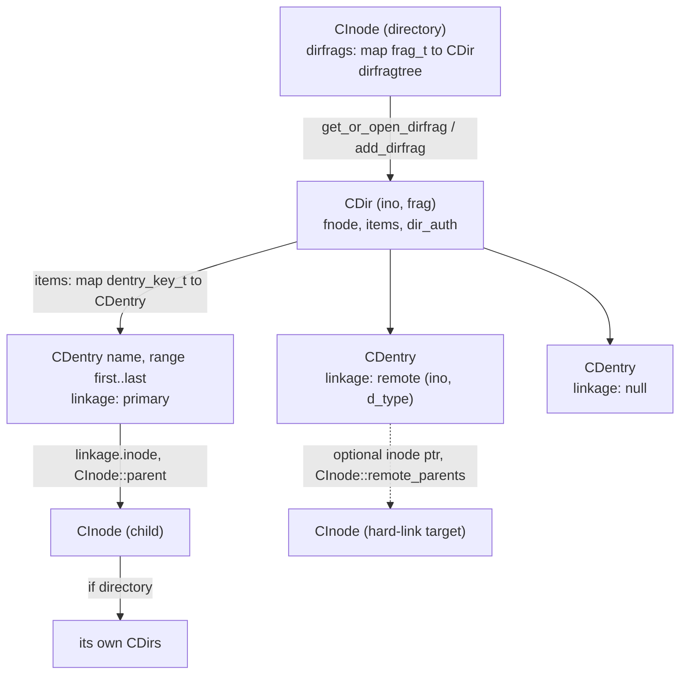
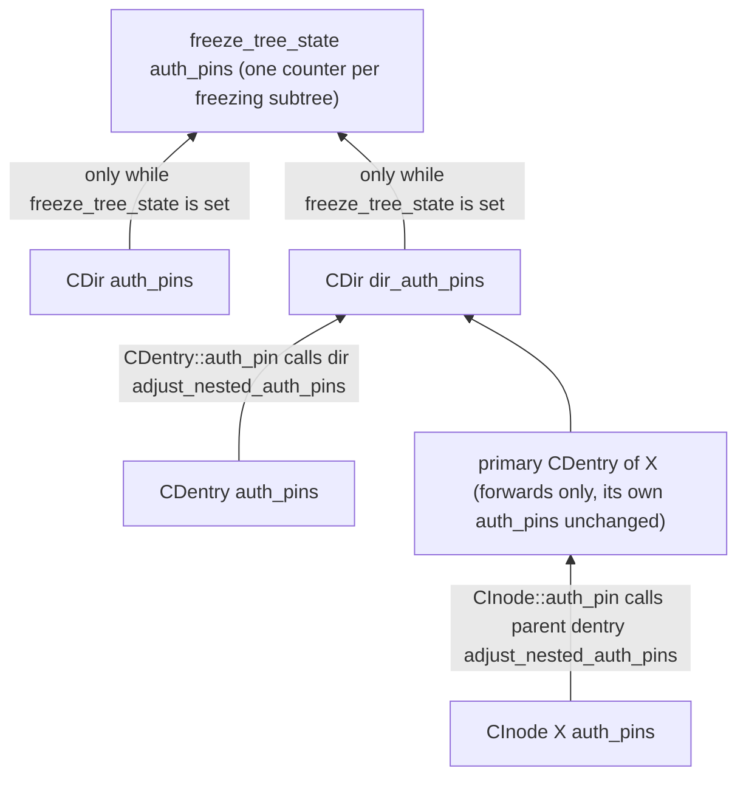
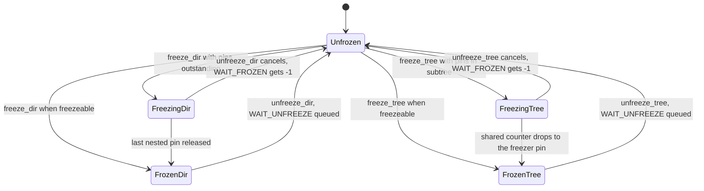
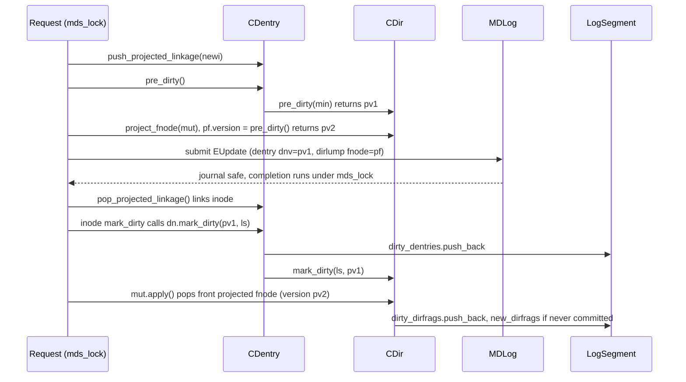
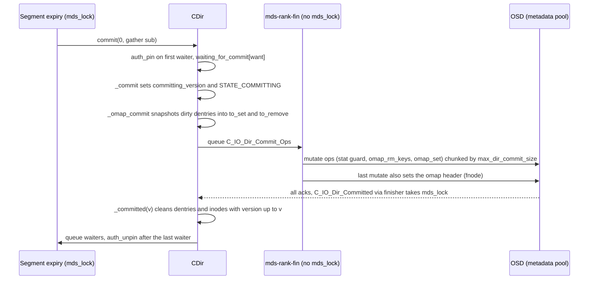
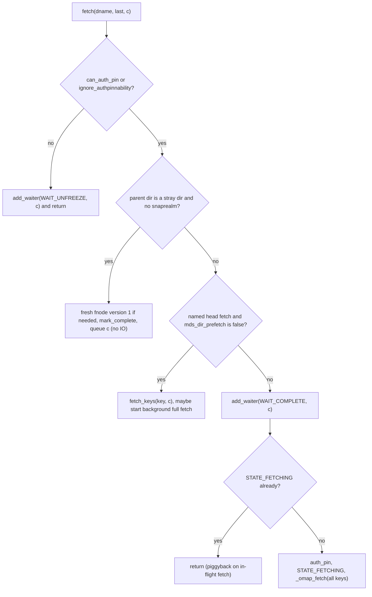

# CDir, CDentry and MDSCacheObject: the dirfrag/dentry object model

> Part of the C++ MDS project map ([README](../README.md)). Sources: `src/mds/MDSCacheObject.{h,cc}` (~460 LOC), `src/mds/CDentry.{h,cc}` (~1250), `src/mds/CDir.{h,cc}` (~4730), `src/mds/LogSegment.{h,cc}` (~150) plus `LogSegment::try_to_expire` in `src/mds/journal.cc` (~250), `src/include/frag.h` (~470) and `src/include/ceph_frag.h` (~105), `src/mds/MDSContext.{h,cc}` (~360), `src/include/lru.h` (~250), `src/include/elist.h` (~200). Supporting reads: `src/mds/CInode.cc` (auth pins, freezing, waiter routing), `src/mds/MDCache.{h,cc}` (LRU, trim, replica encoders), `src/mds/Locker.cc`, `src/mds/Migrator.cc`, `src/mds/Mutation.cc`, `src/mds/Server.cc`, `src/mds/SimpleLock.{h,cc}`, `src/mds/mdstypes.{h,cc}`.
> Related: [CInode and inode types](cinode-and-inode-types.md), [subtrees, traversal, replication](mdcache-subtrees-traversal-replication.md), [cache lifecycle, trim and memory](mdcache-lifecycle-trim-and-memory.md), [dirfrags and fragmentation](dirfrags-and-fragmentation.md), [lock types and state machines](../05-locking/lock-types-and-state-machines.md), [acquiring locks](../05-locking/acquiring-locks.md), [MDLog and Journaler](../06-journal/mdlog-and-journaler.md), [journal events and replay](../06-journal/events-and-replay.md), [RADOS object catalog](../07-storage-formats/rados-object-catalog.md), [RADOS and OSD interactions](../07-storage-formats/rados-and-osd-interactions.md), [subtree migration](../08-multi-mds/subtree-migration.md), [process and threading](../00-architecture/process-and-threading.md), [request lifecycle](../03-request-path/request-lifecycle.md), [namespace mutations](../03-request-path/namespace-mutations.md), [leases, lock caches and async dirops](../02-client-protocol/leases-lock-caches-and-async-dirops.md), [strays and purge](../11-background-services/strays-and-purge.md), [scrub and damage](../11-background-services/scrub-and-damage.md), [snapshots](../10-snapshots-quotas-subvolumes/snapshots.md), [rstats, quotas and subvolumes](../10-snapshots-quotas-subvolumes/rstats-quotas-and-subvolumes.md).

## 1. Purpose and responsibilities

This page describes the three cache object classes that hold the namespace below an inode, plus the generic machinery every cached metadata object shares:

- `MDSCacheObject` is the abstract base of `CInode`, `CDir` and `CDentry`. It provides state bits, reference counting with named pin types, the auth-pin counter, the replica map (on the authority) or replica nonce (on a replica), and a 128-bit-mask waiter queue used both by the object itself and by every `SimpleLock` it embeds (`src/mds/MDSCacheObject.h:37 (MDSCacheObject)`).
- `CDir` is one **directory fragment** ("dirfrag"): the set of dentries of one directory inode whose name hashes fall into one `frag_t`. It owns the dentry map, the per-fragment `fnode_t` (version, fragstat, rstat, scrub stamps), dirty tracking and versioning for its dentries, fetch from and commit to its RADOS object, completeness tracking, the authority delegation field `dir_auth` (subtree roots), auth-pin aggregation and the freeze protocols used by subtree migration and fragmentation (`src/mds/CDir.h:48 (CDir)`).
- `CDentry` is one name in a dirfrag, valid for a snapshot range `[first, last]`. Its linkage is primary (owns a `CInode`), remote (hard link: inode number plus `d_type`) or null (negative entry). It carries a projected-linkage list for in-flight mutations, its own version, the dentry lock (`CEPH_LOCK_DN`) and dentry version lock (`CEPH_LOCK_DVERSION`), client dentry leases, and LRU membership (it is the only `LRUObject` in the MDS) (`src/mds/CDentry.h:76 (CDentry)`).
- `LogSegment` keeps, per journal segment, intrusive lists of the dirty objects that segment is responsible for flushing before it can be trimmed (`src/mds/LogSegment.h:45 (LogSegment)`).
- `frag_t`/`fragtree_t` define how names map to dirfrags (`src/include/frag.h:81 (frag_t)`, `src/include/frag.h:186 (fragtree_t)`).
- `MDSContext` and friends are the continuation objects stored in waiter queues and passed to I/O (`src/mds/MDSContext.h:38 (MDSContext)`).

Everything on this page runs under `mds_lock`, with one exception called out in section 6 (`CDir::_omap_commit_ops`).

## 2. Source map

| File | Class / function | Lines | Role |
|---|---|---|---|
| `src/mds/MDSCacheObject.h` | `MDSCacheObject` | 37-336 | State bits (`STATE_AUTH`...), `PIN_*` ids, `get`/`put` with `ref_map`, `auth_pins`, `replica_map`/`replica_nonce`, `waiting` multimap and `add_waiter` |
| `src/mds/MDSCacheObject.cc` | `generic_pin_name`, `finish_waiting`, `dump`, `is_waiter_for`, `take_waiting` | 8-116 | Waiter extraction, admin dump of generic fields |
| `src/mds/CDentry.h` | `CDentry`, `CDentry::linkage_t`, `ClientLease` | 45-414 | Linkage + projection list, versions, LRU hooks, export/import encoders, leases |
| `src/mds/CDentry.cc` | `pre_dirty`, `_mark_dirty`, `mark_dirty`, `mark_clean`, `push/pop_projected_linkage`, `auth_pin`, `encode/decode_lock_state`, `add/remove_client_lease`, `_put`, `encode/decode_remote`, `check_corruption` | 42-829 | Dentry behavior |
| `src/mds/CDir.h` | `CDir`, `freeze_tree_state_t`, `dentry_commit_item`, `scrub_info_t` | 48-801 | Dirfrag state, pins, waits, masks, freeze predicates |
| `src/mds/CDir.cc` | `add_*_dentry`, `remove_dentry`, `link_*_inode`, `unlink_inode` | 381-796 | Dentry map maintenance, counters, LRU placement |
| `src/mds/CDir.cc` | `steal_dentry`, `split`, `merge`, `*_fragment` | 883-1226 | Data movement for fragmentation |
| `src/mds/CDir.cc` | `add_dentry_waiter` ... `finish_waiting` | 1311-1394 | Waiters |
| `src/mds/CDir.cc` | `project_fnode` ... `last_put` | 1400-1553 | Projection, versions, dirty/clean |
| `src/mds/CDir.cc` | `fetch` ... `go_bad` | 1563-2347 | Fetch from RADOS |
| `src/mds/CDir.cc` | `commit` ... `_committed` | 2358-2921 | Commit to RADOS |
| `src/mds/CDir.cc` | `encode_export` ... `encode_dirstat` | 2948-3071 | Migration encoders, client `DirStat` |
| `src/mds/CDir.cc` | `authority`, `set_dir_auth` | 3081-3192 | Authority |
| `src/mds/CDir.cc` | `auth_pin` ... `enable_frozen_inode` | 3210-3681 | Auth pins and freezing |
| `src/mds/LogSegment.h` / `.cc` | `LogSegment` | `.h` 45-100, `.cc` 26-37 | Per-segment dirty lists |
| `src/mds/journal.cc` | `LogSegment::try_to_expire` | 127-378 | What a segment must flush before trimming |
| `src/include/frag.h`, `src/include/ceph_frag.h` | `frag_t`, `fragtree_t`, `fragset_t`, `ceph_frag_*` | 81-465, 23-104 | Fragment encoding and tree |
| `src/mds/mdstypes.h` | `fnode_t`, `dentry_key_t`, `string_snap_t`, `mds_authority_t`, `CDIR_AUTH_*` | 167, 388-459, 751-759 | Value types |
| `src/mds/MDSContext.{h,cc}` | `MDSContext`, `MDSIOContextBase`, `MDSLogContextBase`, `C_IO_Wrapper`, `C_MDSInternalNoop`, `MDSGather` | `.h` 38-210, `.cc` 24-147 | Continuations and their locking rules |
| `src/include/lru.h` | `LRU`, `LRUObject` | 27-236 | Midpoint LRU with pin tail |
| `src/mds/MDCache.h` | `touch_dentry`, `lru`, `bottom_lru`, `cache_size`, `max_dir_commit_size` | 239-251, 919-933, 1182-1203 | Cache-wide pieces CDir/CDentry call into |

## 3. How it works

### 3.1 Object graph, identity and keys

- A directory inode owns its open dirfrags in `CInode::dirfrags` (a map keyed by `frag_t`). `CInode::get_or_open_dirfrag` creates a `CDir` on demand, only on the authority or during replay (`src/mds/CInode.cc:837 (CInode::get_or_open_dirfrag)`); replica dirfrags are created by `MDCache::decode_replica_dir` (`src/mds/MDCache.cc:11154`); `CInode::add_dirfrag` inserts it and applies sticky pins (`src/mds/CInode.cc:852`); `CInode::close_dirfrag` removes null dentries, cleans it, asserts `get_num_ref() == 0` and deletes it (`src/mds/CInode.cc:867`).
- A `CDir` is identified by `dirfrag_t(inode->ino(), frag)` (`src/mds/CDir.h:347 (CDir::dirfrag)`). Its on-disk object is `file_object_t(ino(), frag)` (`src/mds/CDir.h:481 (CDir::get_ondisk_object)`) which prints as `"%llx.%08llx"`, i.e. `<ino hex>.<encoded frag as 8 hex digits>` (`src/include/object.cc:46 (file_object_t::c_str)`), in the metadata pool.
- `CDir::items` is a `mempool::mds_co::map<dentry_key_t, CDentry*>` holding null and non-null dentries (`src/mds/CDir.h:715`). `dentry_key_t` is `(snapid, name, hash)` (`src/mds/mdstypes.h:388`); its `operator<` orders by `ceph_frag_value(hash)` (the low 24 bits of the name hash), then by name (byte compare), then by snapid (`src/mds/mdstypes.h:410`). `CDentry::key()` builds the key from `last`, the dentry's own name storage and `hash` (`src/mds/CDentry.h:158`), so the map key points into the dentry and the dentry must outlive its map entry.
- `CDentry::hash` is computed once at construction from the parent directory inode's hash function (`inode->hash_dentry_name(dname)` in every `CDir::add_*_dentry`, e.g. `src/mds/CDir.cc:388`), which is `ceph_str_hash(dir_layout.dl_dir_hash or CEPH_STR_HASH_LINUX if 0, name)` (`src/mds/CInode.cc:720 (InodeStoreBase::hash_dentry_name)`). New directories get `dl_dir_hash = mds_default_dir_hash` (default 2, rjenkins) (`src/mds/Server.cc:3707`).
- Names are compared byte-wise. The MDS does no charmap/casefold normalization at all: for directories with `ceph.dir.charmap` the **client** normalizes/folds the name (`Client::_wrap_name`, `src/client/Client.cc:1344`) and the MDS only stores the charmap metadata on the inode and rejects namespace requests from sessions lacking `CEPHFS_FEATURE_CHARMAP` with `EPERM` (`Server::can_handle_charmap`, `src/mds/Server.cc:4876`). `alternate_name` (an opaque, client-supplied per-dentry string used by fscrypt and charmap clients, length-limited by `mds_alternate_name_max`) is stored alongside the name (`src/mds/CDentry.h:413`).
- Each object has a static ordering `is_lt()`: `CDentry` by (dir ino, name, last) (`src/mds/CDentry.cc:165 (operator<)`), `CDir` by `dirfrag_t` (`src/mds/CDir.h:229`). The comparator wrapper `MDSCacheObject::ptr_lt` (`src/mds/MDSCacheObject.h:51`) has no caller in the tree (lock ordering is done in `MutationImpl::LockOpVec::sort_and_merge`, see [acquiring locks](../05-locking/acquiring-locks.md)).

### 3.2 Reference counting and pins

`MDSCacheObject` keeps `ref` (total) and, because `MDS_REF_SET` is unconditionally `#define`d (`src/mds/MDSCacheObject.h:18`), a per-pin-type `ref_map` (`flat_map<int,int>` in mempool `mds_co`) (`src/mds/MDSCacheObject.h:312-315`).

- `get(by)`: calls `first_get()` on the 0 to 1 transition, increments `ref` and `ref_map[by]` (`src/mds/MDSCacheObject.h:164`).
- `put(by)`: if `ref == 0` or `ref_map[by] == 0` calls `bad_put()` which asserts; otherwise decrements, calls `last_put()` on reaching 0, and calls `_put()` on **every** put if `STATE_NOTIFYREF` is set (`src/mds/MDSCacheObject.h:138`).
- Negative pin ids historically mean "may be held more than once"; this is not enforced (`get()` never calls `bad_get()`).
- Objects are not freed while `ref > 0`, but this is enforced only partly. Deletion points: `CDir::remove_dentry` deletes a dentry without checking its ref count (it asserts only that no client leases remain; callers such as `trim_dentry`, readdir and `_committed` check `get_num_ref()` first) (`src/mds/CDir.cc:519`); `CInode::close_dirfrag` deletes a dirfrag after asserting `get_num_ref() == 0` (`src/mds/CInode.cc:867`); `MDCache::remove_inode` deletes an inode after asserting `get_num_ref() == 0` (`src/mds/MDCache.cc:359`).

Upward pinning hooks make every referenced object pin its ancestors:

| Hook | Effect | Code |
|---|---|---|
| `CDentry::first_get` / `last_put` | `lru_pin()` / `lru_unpin()`: a referenced dentry is never chosen for expiry | `src/mds/CDentry.h:223-228` |
| `CDir::first_get` / `last_put` | `inode->get/put(CInode::PIN_DIRFRAG)` | `src/mds/CDir.cc:1545-1553` |
| `CInode::first_get` / `last_put` | `parent->get/put(CDentry::PIN_INODEPIN)` on its primary dentry | `src/mds/CInode.cc:977-989` |
| `CDir::add_*_dentry` / `remove_dentry` | `get(PIN_CHILD)` when the first item is added, `put(PIN_CHILD)` when the last is removed | `src/mds/CDir.cc:419, 563` |
| `CDir::link_inode_work` / `unlink_inode_work` | transfers `PIN_INODEPIN` when linking/unlinking an already-referenced inode | `src/mds/CDir.cc:632, 723` |

Consequence: a non-empty `CDir` pins its inode, which pins its primary dentry, which is LRU-pinned, recursively up to the root. Only dentries whose subtree holds no references are expirable, so trimming always proceeds leaf-first (see [cache lifecycle](mdcache-lifecycle-trim-and-memory.md)).

Pin table (all ids from the headers; "who" lists the main takers found by grep):

| Pin | Id | Object | Held while | Taken/released at |
|---|---|---|---|---|
| `PIN_REPLICATED` | 1000 | any (auth) | `replica_map` non-empty | `add_replica`, `remove_replica`, `clear_replica_map` (`src/mds/MDSCacheObject.h:215-242`) |
| `PIN_DIRTY` | 1001 | any | `STATE_DIRTY` set | `CDir::_set_dirty_flag` (`src/mds/CDir.h:289`), `CDentry::_mark_dirty` (`src/mds/CDentry.cc:216`), `mark_clean` |
| `PIN_LOCK` | -1002 | any | any rd/wr/xlock held on one of its locks | `SimpleLock::get_rdlock/get_wrlock/get_xlock` (`src/mds/SimpleLock.h:393-420`, `src/mds/SimpleLock.cc:33`) |
| `PIN_REQUEST` | -1003 | any | a `MutationImpl` references it | `MutationImpl::pin/unpin/drop_pins` (`src/mds/Mutation.cc:30-75`) |
| `PIN_WAITER` | 1004 | any | `waiting` multimap non-empty | `add_waiter`, `take_waiting` (`src/mds/MDSCacheObject.h:267`, `src/mds/MDSCacheObject.cc:97`) |
| `PIN_DIRTYSCATTERED` | -1005 | inode | a `ScatterLock` is dirty | `src/mds/ScatterLock.h:110, 125` |
| `PIN_AUTHPIN` | 1006 | any | `auth_pins > 0` | `CDir::auth_pin` (`src/mds/CDir.cc:3210`), `CDentry::auth_pin` (`src/mds/CDentry.cc:465`) |
| `PIN_PTRWAITER` | -1007 | any | a caller keeps a raw pointer across an async wait | Migrator, Locker, StrayManager (e.g. `src/mds/Locker.cc:1571`) |
| `PIN_TEMPEXPORTING` | 1008 | dir, dentry, inode | between `encode_export` and `finish_export`/`abort_export` | `src/mds/CDir.cc:2966`, `src/mds/CDentry.h:291-305`, `src/mds/CInode.cc:4689, 4703` |
| `PIN_CLIENTLEASE` | 1009 | dentry | `client_leases` non-empty | `src/mds/CDentry.cc:607, 633` |
| `PIN_DISCOVERBASE` | 1010 | inode | base of an outstanding discover | `src/mds/MDCache.h:170-174` |
| `PIN_SCRUBQUEUE` | 1011 | inode, dir | queued on the scrub stack | `src/mds/ScrubStack.cc:67, 110` |
| `CDir::PIN_DNWAITER` | 1 | dir | `waiting_on_dentry` non-empty | `src/mds/CDir.cc:1311-1342` |
| `CDir::PIN_INOWAITER` | 2 | dir | defined, no user found | - |
| `CDir::PIN_CHILD` | 3 | dir | `items` non-empty | `src/mds/CDir.cc:419, 563` |
| `CDir::PIN_FROZEN` | 4 | dir | `STATE_FROZENDIR` or `STATE_FROZENTREE` | `src/mds/CDir.cc:3443, 3638` |
| `CDir::PIN_SUBTREE` | 5 | dir | dir is in the subtree map | `src/mds/MDCache.cc:1007, 1092` |
| `CDir::PIN_IMPORTING` | 7 | dir | import in progress | `src/mds/Migrator.cc:2697, 2929` |
| `CDir::PIN_IMPORTBOUND` / `PIN_EXPORTBOUND` | 9 / 10 | dir | dir is an import/export bound | `src/mds/Migrator.cc:1554, 2755` |
| `CDir::PIN_STICKY` | 11 | dir | inode holds sticky dirs (`stickydir_ref > 0`) | `src/mds/CInode.cc:923-946` |
| `CDir::PIN_SUBTREETEMP` | 12 | dir | during `MDCache::trim_non_auth` | `src/mds/MDCache.cc:7409, 7480` |
| `CDentry::PIN_INODEPIN` | 1 | dentry | primary inode has `ref > 0` | see hooks above |
| `CDentry::PIN_FRAGMENTING` | -2 | dentry | dir has `STATE_DNPINNEDFRAG` | `src/mds/CDir.cc:410-413`, `src/mds/MDCache.cc:12084 (MDCache::fragment_mark_and_complete)` |
| `CDentry::PIN_PURGING` | 3 | dentry | stray purge in progress | `src/mds/StrayManager.cc:330, 280` |
| `CDentry::PIN_SCRUBPARENT` | 4 | dentry | defined, no user found | - |

`STATE_NOTIFYREF` users: `CDentry::STATE_STRAY == STATE_NOTIFYREF` (`src/mds/CDentry.h:117`) and `CInode::STATE_ORPHAN`. For a stray dentry, `CDentry::_put()` calls `maybe_eval_stray()` on its primary inode once the only remaining refs are the dirty pin and the inode pin (`src/mds/CDentry.cc:646`), so the stray manager reacts as soon as the last user (open file, request) drops it (see [strays and purge](../11-background-services/strays-and-purge.md)).

### 3.3 State bits

Generic bits (`src/mds/MDSCacheObject.h:72-76`): `STATE_AUTH` (1<<30, this rank is authoritative), `STATE_DIRTY` (1<<29), `STATE_NOTIFYREF` (1<<28), `STATE_REJOINING` (1<<27, replica not yet rejoined), `STATE_REJOINUNDEF` (1<<26, contents undefined until fetched after rejoin).

`CDir` bits (`src/mds/CDir.h:126-146`):

| Bit | Name | Meaning / set by |
|---|---|---|
| 0 | `STATE_COMPLETE` | every dentry of the fragment is in cache (section 3.14) |
| 1 | `STATE_FROZENTREE` | root of a frozen tree (`_freeze_tree`) |
| 2 | `STATE_FREEZINGTREE` | root of a tree being frozen (`freeze_tree`) |
| 3 | `STATE_FROZENDIR` | dirfrag frozen (`_freeze_dir`) |
| 4 | `STATE_FREEZINGDIR` | dirfrag being frozen (`freeze_dir`) |
| 5 | `STATE_COMMITTING` | a commit is in flight (`_commit`, cleared in `_committed`) |
| 6 | `STATE_FETCHING` | a full fetch is in flight |
| 7 | `STATE_CREATING` | new dirfrag (mkdir) not yet journaled; `WAIT_CREATED` waiters (`src/mds/Server.cc:7753`, cleared by `CDir::mark_new`) |
| 8, 9 | `STATE_IMPORTBOUND`, `STATE_EXPORTBOUND` | migration bounds |
| 10, 11 | `STATE_EXPORTING`, `STATE_IMPORTING` | migration in progress (`mark_exporting` also bumps `inode->num_exporting_dirs`, `src/mds/CDir.h:238`) |
| 12 | `STATE_FRAGMENTING` | participates in a split/merge |
| 13 | `STATE_STICKY` | sticky pin due to inode stickydirs |
| 14 | `STATE_DNPINNEDFRAG` | all dentries carry `PIN_FRAGMENTING`; dentries added meanwhile get it too (`src/mds/CDir.cc:410`) |
| 15 | `STATE_ASSIMRSTAT` | `assimilate_dirty_rstat_inodes` ran, finish pending (`src/mds/CDir.cc:1259-1302`) |
| 16 | `STATE_DIRTYDFT` | dirfragtree scatter data dirty |
| 17 | `STATE_BADFRAG` | damaged dirfrag (`go_bad`) |
| 18 | `STATE_TRACKEDBYOFT` | tracked by the open file table |
| 19 | `STATE_AUXSUBTREE` | subtree root that must not be merged into its parent subtree |
| 20 | `STATE_BACKEND_FETCH` | a background full prefetch is in flight |

Masks: `MASK_STATE_EXPORTED = COMPLETE|DIRTY|DIRTYDFT|BADFRAG` (travel with an export); `MASK_STATE_IMPORT_KEPT = IMPORTING|IMPORTBOUND|EXPORTBOUND|FROZENTREE|STICKY|TRACKEDBYOFT`; `MASK_STATE_EXPORT_KEPT = EXPORTING|IMPORTBOUND|EXPORTBOUND|FROZENTREE|FROZENDIR|STICKY|TRACKEDBYOFT`; `MASK_STATE_FRAGMENT_KEPT = DIRTY|EXPORTBOUND|IMPORTBOUND|AUXSUBTREE|REJOINUNDEF` (`src/mds/CDir.h:153-176`).

`CDentry` bits (`src/mds/CDentry.h:109-118`):

| Bit | Name | Meaning |
|---|---|---|
| 0 | `STATE_NEW` | dentry created in this cache life and never committed; can be dropped silently if unlinked (only set for new stray dentries by `Server::prepare_stray_dentry`, `src/mds/Server.cc:3621`; cleared by `mark_clean` and by `_parse_dentry` at commit) |
| 1 | `STATE_FRAGMENTING` | carries `PIN_FRAGMENTING` |
| 2 | `STATE_PURGING` | stray being purged; readdir skips it (`src/mds/Server.cc:5234`) |
| 3 | `STATE_BADREMOTEINO` | remote target could not be opened (`src/mds/MDCache.cc:9033`); readdir skips it (`src/mds/Server.cc:5268`) |
| 4 | `STATE_EVALUATINGSTRAY` | re-entrancy guard in `StrayManager::eval_stray` |
| 5 | `STATE_PURGINGPINNED` | purge holds `PIN_PURGING` |
| 6 | `STATE_BOTTOMLRU` | dentry lives in `MDCache::bottom_lru` instead of `lru` |
| 28 | `STATE_STRAY` (= `STATE_NOTIFYREF`) | dentry in a stray dir; notify on each put |

`CDentry::MASK_STATE_IMPORT_KEPT = STATE_BOTTOMLRU` (`src/mds/CDentry.h:118`).

### 3.4 Authority, replicas and nonces

`authority()` resolution (returns `mds_authority_t = pair<rank, rank>`):

- `CDentry::authority()` is its dir's authority (`src/mds/CDentry.cc:191`).
- `CDir::authority()` is `dir_auth` if the dir is a subtree root (`dir_auth != CDIR_AUTH_DEFAULT`), else `inode->authority()` (`src/mds/CDir.cc:3081`).
- `CInode::authority()` is `inode_auth` if set (`first >= 0`), else the parent dir's authority, else the first projected parent's dir (new, not yet linked inode), else `CDIR_AUTH_UNDEF` (`src/mds/CInode.cc:3157 (CInode::authority)`).

`dir_auth` encoding (`src/mds/CDir.h:793-800`, constants `src/mds/mdstypes.h:756-759`: `CDIR_AUTH_PARENT = -1`, `CDIR_AUTH_UNKNOWN = -2`, `CDIR_AUTH_DEFAULT = (-1,-2)`, `CDIR_AUTH_UNDEF = (-2,-2)`):

| `dir_auth` | Meaning |
|---|---|
| `(-1, -2)` | normal: not a subtree root, same authority as the inode |
| `(m, -2)` | delegation: subtree root owned by rank `m` |
| `(m1, m2)` | ambiguous: migration in progress between `m1` and `m2` (`is_ambiguous_dir_auth()`) |
| `(-1, m2)` | ambiguous, first side "parent" |
| `(me, me)` | set by `_freeze_tree` on an auth frozen tree root (`src/mds/CDir.cc:3419-3422`) and undone by `unfreeze_tree` |

`MDSCacheObject::is_ambiguous_auth()` is `authority().second != CDIR_AUTH_UNKNOWN` (`src/mds/MDSCacheObject.h:110`). `CDir::set_dir_auth()` (`src/mds/CDir.cc:3143`) maintains `inode->num_subtree_roots`; when a frozen dir (`STATE_FROZENDIR`) becomes (or stops being) a subtree root while its inode is auth, it releases (or retakes) the auth pin it holds on its own directory inode (`CDir::inode`); and when the dir stops being ambiguous it queues all `WAIT_SINGLEAUTH` waiters.

Replication bookkeeping:

- On the authority, `replica_map` maps rank to the **nonce** last handed to that rank (`src/mds/MDSCacheObject.h:324`). `add_replica(mds)` returns 1 for a new replica and increments the nonce if the rank is already a replica (`src/mds/MDSCacheObject.h:215`). `PIN_REPLICATED` is held while the map is non-empty.
- On a replica, `replica_nonce` stores the nonce received (`src/mds/MDSCacheObject.h:323`). `MDCache::encode_replica_dir`/`encode_replica_dentry` call `add_replica(to)` and ship the nonce (`src/mds/MDCache.cc:11104, 11115`); the decoders set it (`src/mds/MDCache.cc:11154, 11199`).
- When a replica trims, it sends `MCacheExpire` with its nonce; the authority removes the replica only if the nonce equals the current one, otherwise the expire is stale (a newer replication raced it) and is dropped (`src/mds/MDCache.cc:7811, 7861 (MDCache::handle_cache_expire)`).
- `EXPORT_NONCE = 1` (`src/mds/CDir.h:183`, `src/mds/CDentry.h:126`): after export the old authority becomes a replica with nonce 1 (`Migrator::finish_export_dir`, `src/mds/Migrator.cc:2000`; `CDentry::finish_export`); the importer adds the exporter as replica with nonce 1 (`src/mds/Migrator.cc:3633 (Migrator::decode_import_dir)`).
- Replica objects are never dirty, never fetched and never committed (`CDir::mark_dirty`, `fetch`, `commit` assert `is_auth()`: `src/mds/CDir.cc:1450, 1571, 2366`).
- `CDir::get_dist_spec()` returns the replica ranks plus the auth rank when the dir is auth and replicated; it feeds the `dist` field of the client-visible `DirStat` (`src/mds/CDir.h:436`, `src/mds/CDir.cc:3058 (CDir::encode_dirstat)`). Replication of hot dirs (`dir_rep = REP_ALL`) is decided by the balancer (`src/mds/MDBalancer.cc:1349-1373`, see [balancer](../08-multi-mds/balancer-and-pinning.md)).
- Lock state for replicas: `CDentry::encode_lock_state` ships `first` plus linkage kind (1 = primary ino, 2 = remote ino, nothing = null); `decode_lock_state` on a replica advances `first` (asserting it only grows) and notices null to non-null transitions (`src/mds/CDentry.cc:526-588`).

### 3.5 Auth pins

An auth pin means "an operation is using this object as its authority; do not let the authority change and do not restructure the object until I release it". Main takers: requests (`MutationImpl::auth_pin`, `src/mds/Mutation.cc:188`), `CDir::fetch`/`fetch_keys` (until `_omap_fetched`/`go_bad`), `CDir::commit` (from the first commit waiter until the last one is kicked), the freezer itself during `freeze_tree`/`freeze_dir`, `prepare_old_fragment`, `MDCache::fragment_freeze_dirs` and `_fragment_logged`, lock caches (`Locker::create_lock_cache`, `src/mds/Locker.cc:1092`), `predirty_journal_parents` (`mut->auth_pin(parent)`, `src/mds/MDCache.cc:2272`), and the directory inode (`CDir::inode`) of a frozen non-subtree-root dirfrag. Other takers found by grep: the scrub stack (`src/mds/ScrubStack.cc:102, 1408`), the stray manager during purge (`src/mds/StrayManager.cc:366`), the Migrator during export (`src/mds/Migrator.cc:504, 994, 1320, 2113, 3882`) and the file recovery queue (`src/mds/RecoveryQueue.cc:172`).

Counters:

| Counter | Object | Updated by |
|---|---|---|
| `auth_pins` | every object | its own `auth_pin`/`auth_unpin` |
| `dir_auth_pins` | `CDir` | `adjust_nested_auth_pins`: +1/-1 for every auth pin on one of its dentries (`src/mds/CDentry.cc:477, 498`) or on the primary inode of one of its dentries (`CInode::auth_pin` calls `parent->adjust_nested_auth_pins`, `src/mds/CInode.cc:3113-3155`) |
| `freeze_tree_state->auth_pins` | shared by every dirfrag of a freezing subtree | every `CDir::auth_pin/auth_unpin` and every `adjust_nested_auth_pins` on a member dir (`src/mds/CDir.cc:3222, 3243, 3259`) |

Propagation is exactly one level: a pin on an inode or dentry is visible in its own dirfrag's `dir_auth_pins` and nowhere else; a `CDir` auth pin does not propagate to its directory inode (only a frozen dir pins it, section 3.6). Cross-level aggregation exists only while a tree freeze is in progress, through the shared `freeze_tree_state` counter. `link_inode_work`/`unlink_inode_work` transfer an inode's existing pins when it is (un)linked (`src/mds/CDir.cc:641, 732`), and `steal_dentry` moves `dn->get_num_dir_auth_pins()` between dirfrags during split/merge (`src/mds/CDir.cc:943-949`).

`can_auth_pin()` (checked by callers; `auth_pin()` itself never checks):

| Object | Fails with | When |
|---|---|---|
| `CDir` | `ERR_NOT_AUTH` | not auth |
| `CDir` | `ERR_FRAGMENTING_DIR` | freezing or frozen **dir** |
| `CDir` | `ERR_EXPORTING_TREE` | member of a freezing or frozen **tree** (`src/mds/CDir.cc:3528`) |
| `CDentry` | as its dir | `src/mds/CDentry.cc:459` |
| `CInode` | `ERR_NOT_AUTH`, `ERR_EXPORTING_INODE` (freezing/frozen inode or frozen auth pin), else as its parent dentry | `src/mds/CInode.cc:3094` |

Request discipline: in `Locker::acquire_locks`, if any object cannot be auth-pinned, the request drops **all** its locks and local auth pins, adds a `WAIT_UNFREEZE` waiter (or returns aborted if `auth_pin_nonblocking`) and is retried from scratch by `C_MDS_RetryRequest` (`src/mds/Locker.cc:448-494`). So a request never waits for *authpinnability* (an unfreeze) while holding local auth pins, which is what lets a freeze make progress. It does keep its auth pins while waiting for **locks**: once the pins are taken, a failed `xlock_start`/`wrlock_start`/`rdlock_start` returns `false` with locks and pins still held (`src/mds/Locker.cc:566-655`); freezes still complete because lock waits do not depend on freezes. Remote auth pins are also kept (the remote authority is notified via `notify_freeze_waiter`). The exception to the drop rule is a request running under a lock cache whose dir inode matches: it is allowed to force the pin (`src/mds/Locker.cc:449-461`).

Callers that force pins on non-pinnable objects pass `ignore_authpinnability`: `CDir::fetch(c, true)` from readdir/fragmentation (`src/mds/Server.cc:5182`, `src/mds/MDCache.cc:12060`), discover of a version-0 base dir (`src/mds/MDCache.cc:10858-10859`) and `commit(..., true)` from fragmentation (`src/mds/MDCache.cc:12073, 12439`).

### 3.6 Freezing

Freezing is the mechanism that drains auth pins from a region of the cache and keeps new ones out, so that the region's authority or structure can change while nothing is using it:

- **Subtree migration** (`freeze_tree`): the exporter must hand over a consistent snapshot of every object, lock state and capability in the subtree and switch authority. Any in-flight mutation (auth-pinned, possibly with an un-journaled projection) would be lost or duplicated, so the Migrator freezes the subtree root first (`dir->freeze_tree()` then waits `WAIT_FROZEN`, `src/mds/Migrator.cc:1294-1296 (Migrator::dispatch_export_dir)`). The freeze is deliberately held in `FREEZINGTREE` by the export request's own auth pins until the target acks `MExportDirDiscover`; `handle_export_discover_ack` then finishes that request and drops the Migrator's dir pin (`src/mds/Migrator.cc:1381-1394`). The importer freezes its copy with `_freeze_tree()` directly (`src/mds/Migrator.cc:2788 (Migrator::handle_export_prep)`). See [subtree migration](../08-multi-mds/subtree-migration.md).
- **Fragmentation** (`freeze_dir`): split/merge moves `CDentry` objects between `CDir` objects (`steal_dentry`); requests hold raw `CDir*`/`CDentry*` pointers and projections while auth-pinned, so the dirfrag (and the dentries and inodes directly in it) must be idle. `MDCache::fragment_freeze_dirs` auth-pins each dir, sets `STATE_FRAGMENTING` and calls `freeze_dir()` (`src/mds/MDCache.cc:12002`). See [dirfrags and fragmentation](dirfrags-and-fragmentation.md).

**freeze_dir** (`src/mds/CDir.cc:3610 (CDir::freeze_dir)`): asserts not already freezing/frozen, auth-pins itself, and if `is_freezeable_dir(true)` (no auth pin on the dir besides the freezer's, `dir_auth_pins == 0`, and, unless the dir is a subtree root, its inode must not be frozen except through a frozen-dir parent) freezes immediately; otherwise sets `STATE_FREEZINGDIR` and invalidates lock caches that auth-pin this dir (`Locker::invalidate_lock_caches(CDir*)`, `src/mds/Locker.cc:1072`). `_freeze_dir()` sets `STATE_FROZENDIR`, takes `PIN_FROZEN`, and if auth and not a subtree root auth-pins the dirfrag's own **directory inode** (`CDir::inode`) for the duration of the freeze; that pin counts in the `dir_auth_pins` of the dirfrag holding the directory's dentry, which keeps that enclosing dirfrag from freezing above a frozen child (`src/mds/CDir.cc:3629`). Only the dirfrag's own pins and its direct children's pins count; pins deeper in the tree do not block a dir freeze ("we can freeze the _dir_ even with nested pins", `src/mds/CDir.cc:3570`).

**freeze_tree** (`src/mds/CDir.cc:3345 (CDir::freeze_tree)`):

1. Auth-pin itself; allocate `freeze_tree_state = {dir=this, auth_pins = own auth_pins + dir_auth_pins, frozen=false}` (`src/mds/CDir.h:87`).
2. `_walk_tree` breadth-first over all nested dirfrags (dirfrags of primary-linked directory inodes that are **not** subtree roots, i.e. stopping at nested subtree bounds, `src/mds/CInode.cc:5883 (CInode::get_nested_dirfrags)`); each one not already in a freeze gets the same shared `freeze_tree_state` pointer and adds its `auth_pins + dir_auth_pins` to the shared counter; lock caches auth-pinning any member are invalidated.
3. If `is_freezeable(true)` (the shared counter equals the root's own `auth_pins`, the root has no pins besides the freezer's, and a non-subtree-root's inode is not frozen) call `_freeze_tree()` and drop the freezer pin; else set `STATE_FREEZINGTREE` and bump the static `num_freezing_trees`.

**Completion** (`src/mds/CDir.cc:3565 (CDir::maybe_finish_freeze)`), called from every `auth_unpin` and every negative `adjust_nested_auth_pins` on a member: returns while `dir_auth_pins != 0`; a freezing dir completes when `auth_pins == 1` (only the freezer's pin); a freezing tree completes when `freeze_tree_state->auth_pins == 1`, delegating to the root's `maybe_finish_freeze` if called on another member. If the root is not a subtree root and its inode is frozen, it re-takes an auth pin and waits for the inode to unfreeze (`C_Dir_AuthUnpin`, `src/mds/CDir.cc:3557-3598`). Completion queues/finishes `WAIT_FROZEN` waiters.

**`_freeze_tree`** (`src/mds/CDir.cc:3385`): marks the shared state frozen. On the authority it computes the subtree's authority, walks members again and, for every dirfrag found in the tree that does **not** share this `freeze_tree_state` (dirfrags opened after the freeze started do not inherit it; `CInode::get_or_open_dirfrag` creates them without it), makes it a separate subtree root with the same authority, so it becomes a bound and stays outside the frozen region. Then the root itself becomes a subtree root with `dir_auth = (me, me)` (temporarily auth-pinning the inode if it was not a subtree root). On a non-auth (importing) copy it just propagates the state pointer. Finally `STATE_FROZENTREE`, static `num_frozen_trees++`, `PIN_FROZEN`.

**Unfreeze**: `unfreeze_tree()` (`src/mds/CDir.cc:3446`) collects `WAIT_UNFREEZE` waiters from the root and every member sharing the state, resets the members' state pointers; if frozen it clears `STATE_FROZENTREE`, drops `PIN_FROZEN` and on the authority restores `dir_auth.second = UNKNOWN`; if still freezing it cancels: `WAIT_FROZEN` waiters are completed **synchronously with -1** and the freezer pin is dropped. `unfreeze_dir()` (`src/mds/CDir.cc:3645`) mirrors this for dirs (frozen: drop `PIN_FROZEN` and the directory-inode pin, finish `WAIT_UNFREEZE`; freezing: finish `WAIT_FROZEN` with -1, drop the freezer pin, finish `WAIT_UNFREEZE`).

Related details:

- Freeze predicates are cheap for the common case: `is_freezing_tree()`/`is_frozen_tree()` first test the static counters `num_freezing_trees`/`num_frozen_trees` (process-wide, `src/mds/CDir.h:574-587, 734-735`), and only then the dir's `freeze_tree_state`.
- `adjust_freeze_after_rename(dir)`: when a directory is renamed out of a freezing (not yet frozen) tree into a non-freezing location, its dirfrags and their nested dirfrags leave the freeze set, their pins are subtracted from the shared counter and their `WAIT_UNFREEZE` waiters are queued (`src/mds/CDir.cc:3497`, called from `src/mds/MDCache.cc:1478 (MDCache::adjust_subtree_after_rename)`).
- Frozen **inodes** inside a dirfrag (used by cross-rank rename to migrate an inode, see [rename](../03-request-path/rename.md)): `CDir::freezing_inodes` (elist) and `num_frozen_inodes` count them (`src/mds/CDir.h:738-740`, maintained by `CInode::freeze_inode`/`maybe_finish_freeze_inode`/`unfreeze_inode`, `src/mds/CInode.cc:2967-3058`, and transferred by `link_inode_work`/`unlink_inode_work`). `frozen_inode_suppressed` is a counter of lock caches auth-pinning the dirfrag; while non-zero, inodes in it cannot complete freezing (`CDir::disable_frozen_inode`/`enable_frozen_inode`, `src/mds/CDir.h:621`, `src/mds/CDir.cc:3670`; `Locker::create_lock_cache`, `src/mds/Locker.cc:1193`; `Locker::put_lock_cache`, `src/mds/Locker.cc:1018`).
- Stale freezes are cancelled: if the cumulative auth-pin count of a freezing export or fragment has not changed for `mds_freeze_tree_timeout` (30 s) and there are remote waiters or the parent dir is also freezing (two-rank or nested-freeze deadlock shapes documented in the code comment), the export/fragment is aborted (`src/mds/Migrator.cc:268 (Migrator::find_stale_export_freeze)`, `src/mds/MDCache.cc:12169 (MDCache::find_stale_fragment_freeze)`).

### 3.7 Waiters

`MDSCacheObject::waiting` is a `compact_multimap<waiter_seq_t, {waitmask_t mask, MDSContext*}>` (lazily allocated `std::multimap`) (`src/mds/MDSCacheObject.h:329-335`). `waitmask_t` is `std::bitset<128>`:

| Bits | Owner | Waits |
|---|---|---|
| 0-3 | `CDir` | `WAIT_DENTRY` (0), `WAIT_COMPLETE` (1), `WAIT_FROZEN` (2), `WAIT_CREATED` (3); `WAIT_ANY_MASK = 0xf` (`src/mds/CDir.h:186-195`) |
| 0-4 | `CInode` | `WAIT_DIR`, `WAIT_FROZEN`, `WAIT_TRUNC`, `WAIT_FLOCK`, `WAIT_QUARANTINE` (`src/mds/CInode.h:412-419`) |
| 59 | all | `WAIT_UNFREEZE` ("pka AUTHPINNABLE") |
| 60 | all | `WAIT_SINGLEAUTH` (= `CDir::WAIT_ATSUBTREEROOT`) |
| 61 | all | `WAIT_ORDERED` (flag only, stripped before storing) (`src/mds/MDSCacheObject.h:79-81`) |
| 64 + 4k ... 64 + 4k + 3 | the embedded `SimpleLock` with wait shift k | `WAIT_RD`, `WAIT_WR`, `WAIT_XLOCK`/`WAIT_STABLE`, `WAIT_REMOTEXLOCK` (`src/mds/SimpleLock.h:83-89, 230-241`) |

Lock wait shifts k (`src/mds/SimpleLock.cc:107 (SimpleLock::get_wait_shift)`): DN 0, DVERSION 1, IAUTH 2, ILINK 3, IDFT 4, IFILE 5, IVERSION 6, IXATTR 7, ISNAP 8, INEST 9, IFLOCK 10, IPOLICY 11, IQUIESCE 12. `CDir::WAIT_DNLOCK_OFFSET = 4` is a leftover constant with no user.

Ordering (`src/mds/MDSCacheObject.h:267 (add_waiter)`): if the mask carries `WAIT_ORDERED` the waiter gets `seq = ++last_wait_seq` (a **static, process-wide** counter, `src/mds/MDSCacheObject.cc:116`), otherwise `seq = 0`. `SimpleLock::add_waiter` always sets `WAIT_ORDERED` (`src/mds/SimpleLock.h:248`). Iteration is by key, so all unordered waiters (FIFO among themselves, since multimap inserts equal keys at the end of the range) come before all lock waiters, which are FIFO by global sequence. The first waiter takes `PIN_WAITER`; `take_waiting` drops it when the map empties and frees the map (`src/mds/MDSCacheObject.cc:97`).

Routing (where a waiter is actually stored):

| `add_waiter` on | Mask | Stored on |
|---|---|---|
| `CDentry` | `WAIT_UNFREEZE` or `WAIT_SINGLEAUTH` (64-bit overload only) | its `CDir` (`src/mds/CDentry.cc:197`) |
| `CDir` | `WAIT_SINGLEAUTH` and the dir is not a subtree root | recursively the parent dir (`inode->parent->dir`) until a subtree root (`src/mds/CDir.cc:1344`) |
| `CDir` | `WAIT_CREATED` | itself; asserts `STATE_CREATING` (`src/mds/CDir.cc:1358`) |
| `CInode` | `WAIT_SINGLEAUTH` and inode not `STATE_AMBIGUOUSAUTH`, or `WAIT_UNFREEZE` and inode not freezing/frozen/frozen-auth-pin | its parent dir (`src/mds/CInode.cc:2929`) |
| `SimpleLock` | any lock wait | the parent object via the 128-bit overload, no forwarding |

Taking and finishing:

- `MDSCacheObject::take_waiting(mask, ls)` moves every waiter whose mask intersects into `ls` in sequence order (`src/mds/MDSCacheObject.cc:97`). `CDir::take_waiting` additionally takes **all** dentry waiters if `WAIT_DENTRY` is in the mask (`src/mds/CDir.cc:1366`); `CInode::take_waiting` takes all `waiting_on_dir` entries for `WAIT_DIR`.
- `MDSCacheObject::finish_waiting(mask, r)` completes the contexts **synchronously** in the caller's stack (`finish_contexts`, `src/mds/MDSCacheObject.cc:26`, `src/include/Context.h:204`). `CDir::finish_waiting` completes synchronously only when `r < 0`; otherwise it appends them to `MDSRank::finished_queue` (`src/mds/CDir.cc:1384`), which the progress thread drains under `mds_lock`, completing each with `r = 0` (`src/mds/MDSRank.cc:1320 (MDSRank::_advance_queues)`). Many call sites use `take_waiting` + `mds->queue_waiters()` explicitly (e.g. `set_dir_auth`, `mark_new`, `unfreeze_tree`).
- Dentry waiters: `CDir::waiting_on_dentry` maps `string_snap_t(name, snapid)` to contexts (`src/mds/CDir.h:765`). Used by keyed fetches (`fetch_keys` registers one entry per requested key) and by remote discover (`MDCache::discover_path` / `handle_discover_reply`, `src/mds/MDCache.cc:10634, 11074`). `take_dentry_waiting(name, first, last)` takes the entries for that name with snapid in `[first, last]` (`src/mds/CDir.cc:1321`). Split re-homes dentry waiters to the child fragments by name hash, merge moves them all to the merged fragment (`src/mds/CDir.cc:1108-1117, 1205-1211`).
- Commit waiters: `CDir::waiting_for_commit` maps wanted version to contexts (`src/mds/CDir.h:762`, section 3.10).
- `is_waiter_for(mask)` scans all waiters (`src/mds/MDSCacheObject.cc:88`). `count_waiters(mask)` is implemented as `waiting.count(mask)`, i.e. it counts entries whose **sequence key** equals the mask value, not waiters whose mask matches (`src/mds/MDSCacheObject.h:262`); its only user is the `unfreeze_tree_waiters` field of the Migrator export status dump (`src/mds/Migrator.cc:3423`).

Continuation classes (`src/mds/MDSContext.h`):

| Class | Lock behavior | Used for |
|---|---|---|
| `MDSContext` | `complete()` asserts `mds_lock` is held by the caller and resets the heartbeat (`src/mds/MDSContext.cc:24`) | all waiters stored on cache objects |
| `MDSInternalContext` | same, carries `MDSRank*` | generic internal continuations |
| `MDSIOContextBase` / `MDSIOContext` | `complete()` **takes** `mds_lock`; drops the context (returns without running it) if the daemon is stopping; respawns the daemon on `-EBLOCKLISTED`/`-ETIMEDOUT`; every tracked instance (constructor `track=true`, the default) sits on a global list (protected by a spinlock) used to report slow metadata IO (`src/mds/MDSContext.cc:47-120`) | RADOS completions: `C_IO_Dir_OMAP_Fetched`, `C_IO_Dir_OMAP_FetchedMore`, `C_IO_Dir_Committed` (via `CDirIOContext`, `src/mds/CDir.cc:79`) |
| `MDSLogContextBase` | as IO context, then advances the journal safe position | journal completions |
| `C_IO_Wrapper` | first completion bounces to the finisher, second runs under the lock | wrapping internal contexts for IO paths |
| `C_MDSInternalNoop` | `complete()` just deletes itself | placeholder (e.g. `commit()` with no callback, `src/mds/CDir.cc:2371`) |
| `MDSGather`/`MDSGatherBuilder` | completes the finisher when all subs complete | segment expiry, fragmentation |
| `C_MDS_RetryRequest` | re-dispatches the request, ignoring `r` (`src/mds/MDCache.cc:13271`) | the universal "retry after wait" continuation |

RADOS callbacks are wrapped in `C_OnFinisher(..., mds->finisher)`; the single `mds-rank-fin` finisher thread (`src/mds/MDSRank.cc:516`) then runs the `MDSIOContextBase::complete`, which acquires `mds_lock`.

### 3.8 Versions, projection and dirty tracking

Version fields:

| Field | Object | Meaning |
|---|---|---|
| `fnode->version` (`get_version()`) | `CDir` | version of the dirfrag in the applied (journaled and applied) plane |
| `projected_version` | `CDir` | highest version handed out by `pre_dirty()`; `>= get_version()` |
| `committing_version` | `CDir` | version being written by the in-flight commit |
| `committed_version` | `CDir` | highest version known durable in RADOS; 0 means "never committed in this cache life" |
| `version` | `CDentry` | dir version at which the dentry's applied state last changed |
| `projected_version` | `CDentry` | version its pending projection will have |
| `inode->version` | `CInode` | equal to the version its primary dentry got when it last changed (see [CInode](cinode-and-inode-types.md)) |

Invariant: `committed_version <= committing_version <= get_version() <= projected_version` on an auth dirfrag (one exception: `go_bad` on a fresh dir sets the fnode version to 1 without touching `projected_version`, section 8). Cleaning rule: `_committed` marks a dirty dentry or primary inode clean once `committed_version >= item version`. The converse does not hold: items loaded clean by a fetch get `version = projected_version` of the dir at load time, which can exceed `committed_version` when the dir already had journaled (dirty) state.

Version assignment:

- `CDir::pre_dirty(min)` raises `projected_version` to `min` if needed and returns `++projected_version` (`src/mds/CDir.cc:1439`). `CDentry::pre_dirty(min)` sets the dentry's `projected_version = dir->pre_dirty(min)` (`src/mds/CDentry.cc:208`). `CInode::pre_dirty()` calls `get_projected_parent_dn()->pre_dirty(projected inode version)` (base inodes just increment) (`src/mds/CInode.cc:1177`). So **every dirtying change to any dentry or primary inode in a dirfrag consumes a number from that dirfrag's single sequence**, and the fnode projection itself consumes another (`pf->version = parent->pre_dirty()` in `MDCache::predirty_journal_parents`, `src/mds/MDCache.cc:2274-2275`).
- `CDir::project_fnode(mut)` copies the latest projected fnode into a new `fnode_t` (read-copy-update: `fnode` and the journal's dirlump share `shared_ptr<const fnode_t>`, `src/mds/CDir.h:703-707`), folds pending scrub stamps into it, appends it to `projected_fnode`, and registers it with the mutation; it asserts `get_version() != 0`. A mutation that already projected this dir gets `projected_fnode.back()` back, which is its own projection only if no other mutation projected the dir in between (true when both calls happen in one `mds_lock` critical section, the normal case) (`src/mds/CDir.cc:1400`). The journal entry records the projected fnode and `dn->get_projected_version()` for dentries (`src/mds/events/EMetaBlob.h:426-481, 544-575`).
- Apply: `MutationImpl::apply()` pops projected inodes, marks COW'd items dirty, then calls `pop_and_dirty_projected_fnode(ls)` for every projected dir (`src/mds/Mutation.cc:254`). `pop_and_dirty_projected_fnode` takes the **front** (oldest) projection, not necessarily the one this mutation pushed, makes it the current `fnode` and marks the dir dirty (`src/mds/CDir.cc:1425`). Projections are therefore installed in the order they were made, whatever order the mutations apply in. Mutations of the same dir do **not** always apply in projection order: the comment in `CDir::mark_dirty` (added by commit `fc0f61ca6ba`, "mds: tolerate stale version in CDir::mark_dirty", tracker 79136) states that journal commits of mutations projecting the same directory can complete out of order, so a later mutation's apply may install an earlier mutation's projected fnode. Because each projection is a full copy of the previous projected fnode plus its own change, the applied fnode only ever moves forward along the projection sequence and equals the newest projection once every outstanding mutation has applied; in between it can contain changes of a mutation that has not applied yet. Which paths complete out of order is not identified here (unverified).
- `CDentry::mark_dirty(pv, ls)`: asserts `pv <= projected_version`, sets `version = pv`, `_mark_dirty(ls)` and `dir->mark_dirty(ls, pv)` (`src/mds/CDentry.cc:230`). `CDir::mark_dirty(ls, pv)` returns early if `get_version() >= pv` (a later projection already advanced the dir; comment cites out-of-order journal completion), else asserts `pv <= projected_version` and `pv <= projected_fnode.front()->version` and marks dirty (`src/mds/CDir.cc:1448`).
- `_mark_dirty(ls)` sets `STATE_DIRTY` + `PIN_DIRTY` if clean and (re)links the object onto the segment's list: `CDentry` onto `ls->dirty_dentries` (via `item_dirty`) and its dir's `dirty_dentries` (via `item_dir_dirty`, with `num_dirty++`) (`src/mds/CDentry.cc:216`); `CDir` onto `ls->dirty_dirfrags`, and, if `committed_version == 0` and not yet on any list, onto `ls->new_dirfrags` (`src/mds/CDir.cc:1474`).
- `mark_clean()` clears `STATE_DIRTY` (and dentry `STATE_NEW`), unlinks from all lists, drops `PIN_DIRTY` (`src/mds/CDentry.cc:244`, `src/mds/CDir.cc:1516`).
- `CDir::log_mark_dirty()` dirties a clean, unprojected dir **without a journal entry** (new fnode copy with `version = pre_dirty()`, marked in the current segment) so a later commit rewrites it; used after fetch to drop stale snapshot keys (`src/mds/CDir.cc:1529`).
- `set_fresh_fnode()` installs a loaded fnode on a fresh dir and sets `projected_version = committing_version = committed_version = version` (and finishes rejoin-undef handling) (`src/mds/CDir.cc:1502`). `update_projected_version()` resets `projected_version` to the fnode version; it asserts no projections (`src/mds/CDir.h:248`). `CDentry::set_version(v)` sets both dentry versions (replay/import).

### 3.9 LogSegment dirty lists and what forces a commit

`LogSegment` (`src/mds/LogSegment.h:45`) holds intrusive `elist`s bound to member items of the cache objects (`src/mds/LogSegment.cc:26`):

| List | Item member | Pushed by | On expiry (`LogSegment::try_to_expire`, `src/mds/journal.cc:127`) |
|---|---|---|---|
| `dirty_dirfrags` | `CDir::item_dirty` | `CDir::_mark_dirty` | commit the dir |
| `new_dirfrags` | `CDir::item_new` | `CDir::_mark_dirty` (first time, never committed), `CDir::mark_new` | commit the dir (creates its object) |
| `dirty_dentries` | `CDentry::item_dirty` | `CDentry::_mark_dirty` | commit the dentry's dir |
| `dirty_inodes` | `CInode::item_dirty` | `CInode::_mark_dirty` | commit the parent dir (base inodes: `CInode::store`) |
| `dirty_parent_inodes` | `CInode::item_dirty_parent` | `CInode::mark_dirty_parent` | write backtraces (batched per pool) |
| `dirty_dirfrag_dir` / `_nest` / `_dirfragtree` | `CInode::item_dirty_dirfrag_*` | scatter-lock updates (`MDCache`, `CDir::decode_import`, replay) | `scatter_nudge` the filelock / nestlock / dirfragtreelock |
| `open_files` | `CInode::item_open_file` | replay, `EOpen` | re-journal snap inodes needing flush, else drop |
| `truncating_inodes`, `purging_inodes` | std containers | truncate, purge | wait for truncate / purge |
| `pending_commit_tids`, `uncommitted_leaders/peers/fragments`, `inotablev`, `sessionmapv`, `tablev`, `touched_sessions` | std containers | table clients, 2PC, fragmentation, sessions | wait for acks / save tables / sessions |

Semantics:

- An `elist` item can be on one list at a time; `push_back` first unlinks it from whatever list it is on (`src/include/elist.h:116`). A re-dirtied object therefore moves to the newest segment's list. This is safe because journal entries carry full object state (full dentry+inode in `fullbit`, full fnode in each dirlump), so a newer segment supersedes the older one, and segments are trimmed oldest first.
- Exception: `item_new` is only pushed if not already on a list (`src/mds/CDir.cc:1487`), so a never-committed dirfrag stays attached to the **oldest** segment that mentions it ("if i've never committed, i need to be before _any_ mention of me is trimmed from the journal").
- `try_to_expire` commits each collected dir with `dir->commit(0, gather_sub, false, op_prio)` if `can_auth_pin()`, else waits `WAIT_UNFREEZE`; when the gather finishes, `MDLog::_maybe_expired` re-runs `try_to_expire` until nothing is pending (`src/mds/MDLog.cc:909-941`).
- **There is no per-dirfrag dirty-count or age threshold that triggers a commit.** Dirty dirfrags are written back only when: (1) `MDLog::trim()` expires the segment holding them, which happens when untrimmed segments exceed `mds_log_max_segments` (128) or events exceed `mds_log_max_events` (-1, unlimited), throttled by `mds_log_trim_threshold` (128 segments per decay window), with op priority growing with the expiring backlog (`src/mds/MDLog.cc:723 (MDLog::trim)`; it runs on the `mds-log-trim` upkeep thread and returns immediately when the FS is read-only); (2) `flush journal` (asok/tell) trims all segments (`src/mds/MDSRank.cc:148`); (3) `MDLog::trim_all()` from rank shutdown (`MDCache::shutdown_pass`, `src/mds/MDCache.cc:8133`) and after a scrub that repaired something (`src/mds/ScrubStack.cc:1232, 1371`); (4) `flush_path <path>` flushes only the target inode: it writes its backtrace if dirty and, if the inode is dirty, commits the one dirfrag holding its primary dentry (base inodes: `CInode::store`) (`MDCache::flush_dentry_work` then `CInode::flush`, `src/mds/MDCache.cc:13870`, `src/mds/CInode.cc:1320`); (5) fragmentation commits a never-committed source dirfrag before splitting it and the resulting fragments right after `EFragment` is logged (`src/mds/MDCache.cc:12073, 12439`); (6) mkfs/system dirs (`src/mds/MDCache.cc:518, 554, 571`). The only size threshold is per RADOS op (`max_dir_commit_size`, section 3.10).

### 3.10 Commit (write-back) flow

The full omap value/header encoding is documented in the [RADOS object catalog](../07-storage-formats/rados-object-catalog.md); this section covers the control flow.

1. `CDir::commit(want, c, ignore_authpinnability, op_prio)` (`src/mds/CDir.cc:2358`): `want = 0` means the current version. Asserts `want <= get_version()` (or version 0), `want > committed_version`, auth, and pinnable unless overridden. A missing callback becomes `C_MDSInternalNoop`. The **first** entry in `waiting_for_commit` auth-pins the dir; the callback is stored under `waiting_for_commit[want]`.
2. `_commit(want, op_prio)` (`src/mds/CDir.cc:2757`): returns if `committed_version >= want` or `committing_version >= want` (covered by the in-flight commit), and also if an older commit is in flight (`committing_version > committed_version`): **at most one commit per dirfrag is in flight**. Otherwise `committing_version = get_version()`, set `STATE_COMMITTING`, bump `dir_commit`, record `META_POP_STORE` popularity, call `_omap_commit`.
3. `_omap_commit(op_prio)` (`src/mds/CDir.cc:2605`, under `mds_lock`) walks `dirty_dentries` (or, for a new dirfrag created by fragmentation, every non-null item). If the realm destroyed snapshots past `fnode->snap_purged_thru`, walked snapshot dentries that no longer cover any existing snapshot are removed from cache (`try_trim_snap_dentry`) and their keys deleted. It builds `to_remove` (null dentries) and `to_set` (`dentry_commit_item`: key, `first`, remote ino/`d_type`/`alternate_name`, or the primary inode's `shared_ptr<const>` inode/xattrs/old_inodes, symlink, srnode, oldest_snap, damage flags, and the dirfragtree encoded into a side buffer). `_parse_dentry` clears the dentry's `STATE_NEW` (`src/mds/CDir.cc:2706`). Newly corrupt dentries are checked here (`check_corruption(false)`). `stale_items` (keys of stale snapshot dentries noticed at fetch) are moved into the batch. Encoding and submission are then handed to the finisher as `C_IO_Dir_Commit_Ops`, which captures `version = get_version()` and `is_new = item_new.is_on_list()` at this point (`src/mds/CDir.cc:2395-2426, 2700-2703`).
4. `_omap_commit_ops(...)` (`src/mds/CDir.cc:2465`, runs on the `mds-rank-fin` thread **without `mds_lock`**, per its own comment; `C_IO_Dir_Commit_Ops` is a plain `Context`, not an `MDSContext`): builds RADOS `ObjectOperation`s on `<ino>.<frag>` in the metadata pool:
   - Ops are split so that each carries roughly at most `max_dir_commit_size` bytes (`mds_dir_max_commit_size` MiB, default 10; if set to 0, 90 % of `osd_max_write_size`; computed once at `MDCache` construction, `src/mds/MDCache.cc:188`). The size estimate is key length + 4 for a removal and key + encoded value + 8 for a set; an entry is never split across ops, so an op holding an entry larger than the limit exceeds it (the code logs "skipping empty commit" when such an entry arrives with nothing batched yet). Removals (stale keys first, then null dentries) are packed before sets; `sizeof(fnode_t)` is added to the running size after the removals and before the sets, to leave room for the header in the last op.
   - Every op on an existing dirfrag starts with `stat` so that it fails with `-ENOENT` instead of silently creating the object ("don't create new dirfrag blindly"); new dirfrags omit it.
   - Each op carries `omap_rm_keys` and/or `omap_set`; the **last** op also carries `omap_set_header(encode(*fnode))`. The header is written last so that a crash mid-commit can never leave a header claiming a version whose dentries are not on disk; ordering relies on per-object op ordering from MDS to OSD.
   - All ops share one `C_GatherBuilder` whose finisher is `C_IO_Dir_Committed(version)` routed through the finisher (`src/mds/CDir.cc:2477-2479, 2597-2598`).
5. `_committed(r, v)` (`src/mds/CDir.cc:2808`, under `mds_lock`):
   - `-ENOENT` on a never-committed dir whose parent is a stray dir is treated as success (the dir was partially purged during failover); if the inode has a snaprealm it gets `STATE_MISSINGOBJS`. Any other error logs `failed to commit dir ... object, errno r` to the cluster log and calls `MDSRank::handle_write_error` (default `mds_action_on_write_error = 1`: force read-only; `-EBLOCKLISTED`: respawn; `>= 2`: respawn) and returns, leaving `STATE_COMMITTING`, the waiters and the commit auth pin in place.
   - `committed_version = v`; clear `STATE_COMMITTING` if caught up; remove `item_new` (any successful commit means the object exists); `mark_clean()` the dir if `committed_version == get_version()`.
   - For each dirty dentry: its primary inode is marked clean if `committed_version >= inode version`; the dentry is marked clean if `committed_version >= dn->version`; clean, unreferenced, unprojected null dentries in stray dirs are removed immediately.
   - Waiters with `want <= committed_version` are queued; the first waiter with a larger `want` triggers `_commit(want, -1)` again (priority -1 becomes `CEPH_MSG_PRIO_DEFAULT` in `_omap_commit`, so a follow-up commit does not keep the expiry's raised priority). A stray-parented dir with a snaprealm gets `maybe_eval_stray`. When the last waiter is gone the commit auth pin is dropped.

### 3.11 Fetch (read) flow

Entry points (all auth-only, all assert `!is_complete()`):

- `fetch(c, ignore_authpinnability)` = full fetch (`src/mds/CDir.h:486`).
- `fetch(dname, last, c, ...)` (`src/mds/CDir.cc:1563`): with `mds_dir_prefetch = true` (default) a named fetch is a full fetch. With `mds_dir_prefetch = false` and a head name it becomes `fetch_keys({key}, c)`; in addition, if `mds_dir_prefetch_backend` (default false) is on and this dirfrag has been hit `mds_dir_prefetch_backend_hit_threshold` times (default 16, saturating `uint8_t` counter) and fewer than `mds_dir_prefetch_backend_max` (default 1) background fetches are running, it starts a background full fetch (`STATE_FETCHING|STATE_BACKEND_FETCH`, counter `dir_fetch_background`).
- `fetch_keys(keys, c)` (`src/mds/CDir.cc:1653`): registers one `waiting_on_dentry` entry per key not already being fetched; the context is attached to the first newly registered key, or, if every key is already being fetched, appended to the first existing entry. If nothing new is needed and the dir has a version, returns. If a non-background full fetch is in flight it waits for `WAIT_COMPLETE` instead. Otherwise auth-pins and issues a keyed read (counter `dir_fetch_keys`). A dir under a stray parent without a snaprealm short-cuts to `fetch(c, true)`. Keyed fetches are not only a `mds_dir_prefetch = false` feature: rejoin prefetch (`src/mds/MDCache.cc:6122`) and batched open-by-ino (`src/mds/MDCache.cc:9578`) call `fetch_keys` directly. `fetch_keys({}, c)` loads just the header of a version-0 dir (scrub, open root, and request paths: `src/mds/ScrubStack.cc:418`, `src/mds/MDCache.cc:886, 13758`; callers check `get_version() == 0`; with a non-null context and a non-zero version it would assert).

RADOS read (`src/mds/CDir.cc:1796 (CDir::_omap_fetch)`): one `ObjectOperation` with `omap_get_header`, then either `omap_get_vals_by_keys(keys)` or `omap_get_vals("", "", mds_dir_keys_per_op)` (default 16384), plus `getxattr("parent")` with `FAILOK` on frag `*` (the unfragmented root fragment `frag_t()`) when `mds_verify_backtrace > 0` (default 1) to verify the directory's backtrace (`CInode::verify_diri_backtrace`, `src/mds/CInode.cc:1614`; mismatch logs `bad backtrace on directory inode`, marks the backtrace dirty, and asserts if `mds_verify_backtrace > 1`). Large dirfrags are read in batches: `C_IO_Dir_OMAP_Fetched` sees `more` and issues `_omap_fetch_more` continuing after the last key (`src/mds/CDir.cc:1824`). The context records `omap_version = committing_version` at issue time; if, when a batch returns with more to read, `committed_version` has advanced beyond that value (a commit that started after the read was issued has completed), the batched read is restarted from scratch, because consecutive batches would otherwise mix two on-disk versions (`src/mds/CDir.cc:1729-1734, 1778-1781`). A single-batch read is one atomic omap read and is never restarted.

`_omap_fetched(hdr, omap, complete, keys, r)` (`src/mds/CDir.cc:2056`, under `mds_lock`, asserts auth and not frozen):

- It asserts `r` is 0, `-ENOENT` or `-ENODATA` (`src/mds/CDir.cc:2063`). `-EBLOCKLISTED`/`-ETIMEDOUT` respawn earlier in `MDSIOContextBase::complete`; any other read error from the OSD (for example `-EIO`) aborts the daemon.
- Empty header means the object is missing: cluster log `dir <dirfrag> object missing on disk; some files may be lost (<path>)` and `go_bad(complete)`. Undecodable or trailing-garbage headers also `go_bad` (`src/mds/CDir.cc:2067-2097`).
- If `get_version() == 0` (fresh dir, nothing from the journal) the loaded fnode is installed with `set_fresh_fnode`; otherwise the in-cache fnode (from replay or earlier activity) wins.
- If `fnode->snap_purged_thru < realm->get_last_destroyed()`, snapshot dentries whose `[first,last]` no longer covers any snapshot are skipped; their keys go to `stale_items` and the dir is later re-dirtied (`log_mark_dirty`) so the next commit deletes them. If the dir has no snap items in cache, `snap_purged_thru` is bumped in place.
- Each omap entry is decoded by `_load_dentry` (`src/mds/CDir.cc:1844`): value = `first` + marker `'l'`/`'L'` (remote, versioned/legacy) or `'i'`/`'I'` (primary with embedded inode, versioned/legacy); other markers throw and the dentry is recorded as damaged (`go_bad_dentry`) while the fetch continues. Existing cache entries win. "Underwater" handling: if the dir was never committed in this cache life (`committed_version == 0`) and a dirty cached dentry/inode exactly matches what is on disk (same remote target, or same ino and inode version), it is marked clean, because it was flushed before the previous MDS died. A primary inode that already exists elsewhere in cache is reported as `loaded dup inode` (unless `mds_hack_allow_loading_invalid_metadata`). Rejoin-undefined inodes are filled in and later `opened_undef_inode`.
- Requested keys (keyed fetch) or waited names (full fetch) that are absent on disk become **null dentries** (`first = global snaprealm newest_seq + 1`), so a subsequent lookup of the same name returns ENOENT from cache.
- On a full fetch: `mark_complete()`, clear `STATE_FETCHING`/`STATE_BACKEND_FETCH`, counter `dir_fetch_complete`, take `WAIT_COMPLETE` waiters. Then `auth_unpin` and queue all collected waiters (dentry waiters and complete waiters).
- Every `mds_heartbeat_reset_grace` (1000) items the loops reset the heartbeat, because a whole dirfrag (creates stop at `mds_bal_fragment_size_max` = 100000 head entries, but nothing caps what a fetch loads, and snapshot entries come on top) is processed in one `mds_lock` critical section.
- `go_bad(complete)` (`src/mds/CDir.cc:2323`) notifies the `DamageTable`; if the damage is fatal the rank is marked damaged. Otherwise, for a full fetch, the dir gets version 1 if fresh, `STATE_BADFRAG` and `mark_complete()`; in all cases it clears `STATE_FETCHING`, drops the fetch auth pin and finishes `WAIT_COMPLETE` waiters synchronously with `-EIO`. It does not take `waiting_on_dentry` waiters and does not undo `STATE_BACKEND_FETCH` accounting (section 8). `go_bad_dentry` registers dentry damage the same way (`src/mds/CDir.cc:2309`). Requests woken this way retry and find the damage through the `DamageTable` (see [scrub and damage](../11-background-services/scrub-and-damage.md)).

### 3.12 CDentry linkage and projection

`CDentry::linkage_t` (`src/mds/CDentry.h:81`) is `{CInode* inode, inodeno_t remote_ino, uchar remote_d_type}`:

| Kind | Test | Meaning |
|---|---|---|
| primary | `remote_ino == 0 && inode != null` | the dentry owns the inode; `inode->parent == this`; the inode is stored inside the dirfrag object under this dentry's key |
| remote | `remote_ino > 0` | hard link to `remote_ino`; `remote_d_type` caches the file type; `inode` is set only when the target is in cache (`link_remote`, which, for the applied linkage only, also registers this dentry in `CInode::remote_parents`, taking `PIN_REMOTEPARENT` on the inode when the set becomes non-empty, `src/mds/CDentry.cc:356`, `src/mds/CInode.cc:997`) |
| null | both zero | negative entry: a cached "does not exist", a placeholder being created, or a deleted name awaiting commit |

Committed (`linkage`) vs projected (`projected` list) planes:

- `push_projected_linkage()` (null, `src/mds/CDentry.cc:380`), `push_projected_linkage(ino, d_type)` (remote, inline in `src/mds/CDentry.h:188`) and `push_projected_linkage(CInode*)` (primary, `src/mds/CDentry.cc:392`; also `inode->push_projected_parent(this)`, and a dirty-rstat inode is re-registered on the new projected parent dir's `dirty_rstat_inodes`, since `CInode::mark_dirty_rstat` uses the projected parent, `src/mds/CInode.cc:446`) append a `linkage_t` to `projected`. On an auth dentry in a stray dir the null variant calls `notify_stray_removed()` and the primary variant `notify_stray_created()`; the remote variant touches no counters.
- `get_projected_linkage()` returns the last projection or the committed linkage (`src/mds/CDentry.h:198`). Readers choose with `use_projected(client, mut)`: the projected plane is visible if the dentry lock state allows `can_read_projected` for that client or the lock is xlocked by this mutation (`src/mds/CDentry.h:214`).
- `pop_projected_linkage()` (`src/mds/CDentry.cc:412`) applies the **front** projection: remote via `dir->link_remote_inode()`, primary via `dir->link_primary_inode()` + `inode->pop_projected_parent()`; for a null projection the caller must already have called `dir->unlink_inode(dn)` (pattern in `Server::_unlink_local_finish`, `src/mds/Server.cc:8848-8850`). It asserts the committed linkage equals the projection.
- `CDir::link_primary_inode`/`link_remote_inode`/`unlink_inode` maintain counters, LRU placement, inode parent pointers, `PIN_INODEPIN`, nested auth pins, frozen-inode bookkeeping, open-file-table notifications, `num_inodes_with_caps`, snaprealm parent adjustments and quiesce propagation (`src/mds/CDir.cc:567-747`).
- The dentry lock `lock` is a `SimpleLock` of type `CEPH_LOCK_DN` (simplelock state machine); `versionlock` is a `LocalLockC` of type `CEPH_LOCK_DVERSION` (`src/mds/CDentry.h:384-385`). When a request xlocks a dentry on its authority, `acquire_locks` adds a **wrlock** on the dentry's versionlock if the request is a leader (so several updates can be pipelined into the journal) or an **xlock** if it is a peer (blocks other journal updates so rollback is safe) (`src/mds/Locker.cc:317-329`). See [lock types](../05-locking/lock-types-and-state-machines.md).

### 3.13 Snapshot ranges on dentries

- A dentry is valid for snapids `[first, last]`; head dentries have `last = CEPH_NOSNAP`. The map key uses `last`, so several dentries with the same name and disjoint ranges coexist, ordered by `last` (`src/mds/CDentry.h:158, 374`).
- `CDir::lookup(name, snap)` takes `lower_bound(key(snap, name, hash))`, i.e. the dentry with the smallest `last >= snap`, and accepts it only if the name matches and `first <= snap` (`src/mds/CDir.cc:328`). `lookup_exact_snap(name, last)` finds an exact key (`src/mds/CDir.cc:344`). All `add_*_dentry` assert that no dentry with the same `(name, last)` exists.
- `add_null_dentry` defaults to `first = 2`, `last = CEPH_NOSNAP` (`src/mds/CDir.h:386-392`); callers creating names set `first` to `follows + 1` (e.g. mkdir asserts `dn->first == follows + 1`, `src/mds/Server.cc:7748 (Server::handle_client_mkdir)`).
- `CDir::first` (default 2) and `dirty_old_rstat` track snapshotted rstat of the dirfrag (`src/mds/CDir.h:638-639`, `src/mds/MDCache.cc:1909 (MDCache::_project_rstat_inode_to_frag)`); see [rstats](../10-snapshots-quotas-subvolumes/rstats-quotas-and-subvolumes.md) and [snapshots](../10-snapshots-quotas-subvolumes/snapshots.md).
- Corruption checks: `check_corruption(load)` flags `first > last` or (when the snap client is synced) `first > last_seq + 1`. It is called with `load = true` by every `CDir::add_*_dentry` (fetch, replay, creates) and with `load = false` from `_omap_commit` (skipped for dentries already flagged `corrupt_first_loaded`). With `load` it sets `corrupt_first_loaded`; on commit it logs `newly corrupt dentry to be committed`. With `mds_go_bad_corrupt_dentry` (default true) the dentry is recorded as damaged; with `mds_abort_on_newly_corrupt_dentry` (default true) a newly corrupt dentry about to be committed aborts the MDS (`src/mds/CDentry.cc:806`). `CDentry::scrub()` applies the same `first` checks during scrub (`src/mds/CDentry.cc:771`).

### 3.14 Directory contents, counters and completeness

Counters (`src/mds/CDir.h:716-723`): `num_head_items`, `num_head_null`, `num_snap_items`, `num_snap_null` (asserted to sum to `items.size()` after every change), `num_dirty` (dirty dentries), `num_inodes_with_caps` (when it goes 0 to 1 the dirfrag is added to the open file table, `src/mds/CDir.cc:316`). `get_frag_size()` is `projected fnode fragstat.size()` (files + subdirs, head only) (`src/mds/CDir.h:377`), which drives ENOSPC (`Server::check_fragment_space`: `size >= mds_bal_fragment_size_max`, default 100000, `src/mds/Server.cc:3563`) and split/merge decisions (`should_split`: `frag_size + snap_items > mds_bal_split_size` (10000); `should_merge`: `< mds_bal_merge_size` (50); `should_split_fast`: above `split_size * mds_bal_fragment_fast_factor` (1.5) counting non-null projected linkages, `src/mds/CDir.cc:1036, 3871, 3906`).

Completeness (`STATE_COMPLETE`) means every dentry of the fragment that exists in RADOS or in the journal is present in `items`, so a miss is authoritative:

- Set by: a full fetch (`_omap_fetched`), mkdir of a new dir (`src/mds/Server.cc:7754`), creation of system dirs at mkfs and in `populate_mydir` (`src/mds/MDCache.cc:515, 551, 568, 602, 841`), fragment creation on the authority (`prepare_new_fragment`, `merge`), journal replay of a dirlump flagged complete (`src/mds/journal.cc:1350`), `go_bad(complete)`, and the stray shortcut in `fetch`. It is carried by migration (`MASK_STATE_EXPORTED`) and split (`STATE_COMPLETE` copied to children).
- Cleared by: trimming an auth dentry that is not a clean null (`MDCache::trim_dentry`, `src/mds/MDCache.cc:7203-7246`), `trim_non_auth` (`src/mds/MDCache.cc:7459, 7542`), rejoin of non-auth dirs (`src/mds/MDCache.cc:3963`) and replay of an importing dirlump (`src/mds/journal.cc:1322`).
- Consumers: readdir requires a complete dir and fetches otherwise (`src/mds/Server.cc:5172-5183`); `path_traverse` answers ENOENT on a miss in a complete dir (or creates a null dentry for a create), `src/mds/MDCache.cc:8749`; open-by-ino and discover do the same (`src/mds/MDCache.cc:9328, 10849`). Directory emptiness for rmdir/rename is decided from the projected fragstat, not from completeness (`Server::_dir_is_nonempty_unlocked`, `src/mds/Server.cc:9225`).

Bloom filter for incomplete dirs (`src/mds/CDir.cc:749-780`): when `trim_dentry` removes a head dentry that is not a clean null from an auth dir, the name is first inserted into a per-dir bloom filter, then completeness is cleared (`src/mds/MDCache.cc:7243-7245`). The filter is created lazily on the first such trim from a **complete** dir (capacity `max(100, head+snap items)`, false-positive rate `1/capacity`; never created for an incomplete dir or in standby-replay); once it exists, later trims from the now-incomplete dir keep inserting into it. A head lookup that misses in cache and is **not** in the bloom filter is answered as ENOENT without a fetch (`src/mds/MDCache.cc:8749-8752, 10852-10853`); open-by-ino skips the fetch the same way (`src/mds/MDCache.cc:9328-9329`). `mark_complete()` deletes the filter; export and `abort_import` remove it (`src/mds/Migrator.cc:1999`, `src/mds/CDir.cc:3046`). The filter is not serialized and not part of `mds_co` accounting.

Null dentries:

- A null dentry in a complete dir is redundant; clean null dentries are trimmable and their removal does not clear completeness. Readdir deletes unreferenced, unprojected null dentries it walks over (`src/mds/Server.cc:5240-5244`).
- Dirty null dentries represent deletions that must reach RADOS (`omap_rm_keys` at commit).
- `try_remove_unlinked_dn(dn)` removes a dentry that became null if it is `STATE_NEW` and has no refs other than the dirty pin: it was never written, so nothing must be deleted on disk (`src/mds/CDir.cc:687`; callers `Server::_link_remote_finish`, `_unlink_local_finish` and `_rename_apply`, `src/mds/Server.cc:8222, 8879, 10483`). Since only new stray dentries carry `STATE_NEW`, this drops stray dentries that were created and emptied again before any commit.
- `remove_null_dentries()` (used by `close_dirfrag`) removes unprojected null dentries without checking their refs and then asserts no null dentries remain (`src/mds/CDir.cc:782`). `try_remove_dentries_for_stray()` runs on a dirfrag of a directory whose inode sits in a stray dir: head dentries must be null and unprojected; if the directory has no snaprealm, dirty dentries and inodes are marked clean (nothing will be committed) and finally the dirfrag itself; client leases are dropped and unreferenced dentries (with their snapshot inodes) are removed (`src/mds/CDir.cc:805`).

### 3.15 LRU membership

Only dentries are in an LRU; inodes and dirfrags are trimmed through their dentries (`MDCache::trim_inode`, `trim_dirfrag`). There are two LRUs in `MDCache` (`src/mds/MDCache.h:1182-1183`): `lru` (midpoint `mds_cache_mid`, default 0.7) and `bottom_lru` (midpoint 0, "dentries that should be trimmed ASAP") (`src/mds/MDCache.cc:206-208`).

| Event | Placement | Code |
|---|---|---|
| auth dentry added (any kind) | `lru`, inserted at the midpoint | `src/mds/CDir.cc:392-394, 438-441, 488-490` |
| replica null dentry added | `bottom_lru` + `STATE_BOTTOMLRU` | `src/mds/CDir.cc:396-397` |
| replica primary dentry in a stray dir | `bottom_lru` | `src/mds/CDir.cc:440-445` |
| remote dentry | always `lru` | `src/mds/CDir.cc:490, 579-583` |
| `link_primary_inode` on auth or non-stray dir | moved to `lru` | `src/mds/CDir.cc:604-609` |
| `unlink_inode` on a replica | moved to `bottom_lru` | `src/mds/CDir.cc:670-675` |
| auth bit changes (`mark_auth`/`clear_auth`, import/export) | re-evaluated by `adjust_dentry_lru` | `src/mds/CDir.cc:352`, `src/mds/CDentry.cc:267-281` |
| `touch_dentry` | bottom-LRU dentries: mid-touch in `bottom_lru`; auth: move to top; replica: mid-touch | `src/mds/MDCache.h:919` |
| `touch_dentry_bottom` | `lru_bottouch` (next to expire) unless in `bottom_lru` | `src/mds/MDCache.h:929` |

LRU mechanics (`src/include/lru.h`): three lists `top`, `bottom`, `pintail`; `adjust()` keeps `midpoint * (size - pinned)` items in `top`; `lru_expire()` scans the tail of `bottom` then of `top`, moving pinned items to `pintail`; `lru_unpin()` moves an item from `pintail` to the bottom tail. Since `CDentry::first_get` pins the dentry in the LRU, any referenced dentry is skipped. `MDCache::trim_lru` drains `bottom_lru` first, then `lru` while the cache is over its memory target or a count is requested, throttled by `mds_cache_trim_threshold` (256K dentries per decay window) (`src/mds/MDCache.cc:6933`). `trim_dentry` refuses replica dentries whose lock is not readable (outside stray dirs) (`src/mds/MDCache.cc:7172`). Details: [cache lifecycle, trim and memory](mdcache-lifecycle-trim-and-memory.md).

### 3.16 Fragments: `frag_t` and `fragtree_t` basics

- `frag_t` is a 32-bit value: upper 8 bits = number of bits `b`, lower 24 bits = value using the **most significant** `b` bits of the 24-bit space (`ceph_frag_make(b, v) = (b << 24) | (v & (0xffffff << (24-b)) & 0xffffff)`, `src/include/ceph_frag.h:23`). A hash `h` falls in `f` iff `(h & mask(f)) == value(f)` with `mask(f) = (0xffffff << (24-b)) & 0xffffff` (`src/include/ceph_frag.h:37-48`). Only the low 24 bits of the 32-bit name hash participate. `frag_t()` (`0/0`) is the whole space; frags print as their value bits in binary followed by `*` (e.g. `01*`; the root prints as `*`) (`src/common/frag.cc:77`); valid frags have `b <= 24` and no stray value bits (`src/include/frag.h:104`). (The comment in `frag.h` describing the right-most bit as most significant predates the current encoding; `ceph_frag.h` is authoritative.)
- `frag_t::split(nb, out)` returns the `2^nb` children `make_child(i, nb)` in increasing value order (`src/include/frag.h:131`). `operator<` orders by value, then bits.
- `fragtree_t` stores only split points: `_splits` maps a frag to the number of bits it is split by; leaves are frags not in the map (`src/include/frag.h:186-417`). `operator` descends from the root to the leaf containing `h` (`src/include/frag.h:339`). `split`/`merge` edit the map and `try_assimilate_children` collapses uniformly split children into the parent's split count. `force_to_leaf` is used by replicas/clients to accept a frag they were told about (`src/mds/MDCache.cc:11178 (MDCache::decode_replica_dir)`).
- `InodeStoreBase::pick_dirfrag(name)` (inherited by `CInode`) returns `frag_t()` if the tree is empty (skipping the hash), else `dirfragtree[hash_dentry_name(name)]` (`src/mds/CInode.cc:729`).
- `CDir::split(bits, ...)` (`src/mds/CDir.cc:1042`) creates the child `CDir` objects (copying the replica map, popularity scaled by `1/2^bits`, `dir_auth`, the shared `freeze_tree_state`, and `MASK_STATE_FRAGMENT_KEPT|STATE_COMPLETE` bits); `merge(subs, ...)` (`src/mds/CDir.cc:1145`) is called on an already constructed merged `CDir` and takes `dir_auth`/`freeze_tree_state` from the first sub, the max nonce per replica and the union of the subs' `MASK_STATE_FRAGMENT_KEPT` bits. Both move every dentry with `steal_dentry` (re-accounting fragstat/rstat from the inodes' `accounted_rstat`, dirty lists and nested auth pins), re-home dentry waiters (split by name hash), set the new fnode version (split: the old dirfrag's version; merge: the highest sub version), reset `accounted_*` to the new totals, and give any outstanding unaccounted delta to the first (split) or the merged fragment. On the authority the new fragments are created frozen-dir and complete (`prepare_new_fragment`). The protocol around this (EFragment, notify, commit) is in [dirfrags and fragmentation](dirfrags-and-fragmentation.md).

### 3.17 Memory accounting

- `CDentry`, `CDir`, `CDir::scrub_info_t` and `ClientLease` are allocated from mempool `mds_co` (`MEMPOOL_DEFINE_OBJECT_FACTORY`, `src/mds/CDentry.cc:591, 829`, `src/mds/CDir.cc:3922-3923`), as are their names (`mempool::mds_co::string`), the `items` map, projection lists, `fnode_t` copies (`allocate_fnode` uses an `mds_co` allocator, `src/mds/CDir.h:58-62`), `replica_map`, `ref_map`, the waiter multimap, `waiting_on_dentry`, `waiting_for_commit`, `stale_items`, `dir_rep_by` and `dirty_old_rstat`.
- Not in the pool (explicit FIXMEs or plain containers): the bloom filter, `SimpleLock`/`LocalLockC` side allocations, the `std::string` inside `string_snap_t`, `freeze_tree_state` (`std::make_shared`), `CDentry::batch_ops` (`std::map`).
- `MDCache::cache_size()` is `mempool::mds_co` allocated bytes (`src/mds/MDCache.h:246`), compared with `mds_cache_memory_limit` (4 GiB): `cache_toofull_ratio = max(0, (size - limit*(1-mds_cache_reservation)) / (limit*(1-mds_cache_reservation)))` with reservation 0.05 drives trimming, and `cache_overfull` (size > limit * `mds_health_cache_threshold` 1.5) raises `MDS_CACHE_OVERSIZED` (`src/mds/MDCache.h:239-251`, `src/mds/Beacon.cc:513`).
- `Counter<CDentry>` / `Counter<CDir>` keep atomic live/created counts, exported as `mds_mem` perf counters `dn`, `dn+`, `dn-`, `dir`, `dir+`, `dir-` (`src/include/counter.h:21`, `src/mds/MDSRank.cc:1172 (MDSRank::update_mlogger)`).
- Size-oriented design choices: per-object `ref_map` (always compiled in), compact (lazily allocated) maps for waiters and replicas, `elist` intrusive list items embedded in objects instead of separate allocations, shared immutable `fnode_t`/inode buffers between cache and journal events.

### 3.18 Migration encoders and other per-object payloads

- `CDir::encode_export` (asserts no projections) ships `first`, the fnode, `dirty_old_rstat`, `committed_version`, the state word, `dir_rep`, `pop_me`, `pop_auth_subtree`, `dir_rep_by` and the replica map, and takes `PIN_TEMPEXPORTING` (`src/mds/CDir.cc:2948`). `finish_export` keeps only `MASK_STATE_EXPORT_KEPT`, zeroes popularity and drops `PIN_TEMPEXPORTING`; the caller `Migrator::finish_export_dir` first clears the replica map, `STATE_AUTH` and the bloom filter, sets `replica_nonce = EXPORT_NONCE`, cleans the dir and takes its waiters (`src/mds/Migrator.cc:1987-2009`). `decode_import` keeps `MASK_STATE_IMPORT_KEPT`, adds `STATE_AUTH` plus the exported bits, re-dirties into the importing segment, sets `committing_version = committed_version`, and re-marks dirty scatterlock data (nest/dir/dirfragtree) for the inode (`src/mds/CDir.cc:2970-3040`). `abort_import` reverts to a replica with `EXPORT_NONCE` (`src/mds/CDir.cc:3042`).
- `CDentry::encode_export`/`decode_import` ship `first`, state, versions, the dentry lock and replicas; import keeps only `STATE_BOTTOMLRU`, marks auth, re-dirties if the exporter had it dirty (`src/mds/CDentry.h:283-325`).
- `CDir::_encode_base`/`_decode_base` (`first`, fnode, `dir_rep`, `dir_rep_by`) are the replica payload (`src/mds/CDir.h:446-465`).
- These encodings are MDS-to-MDS only. See [subtree migration](../08-multi-mds/subtree-migration.md).
- Client leases (`ClientLease`: owning dentry, session, `seq` from `++session->lease_seq`, `ttl`, membership in the session's and the global lease lists) hang off `CDentry::client_leases` (an intrusive set keyed by client). The first lease sets the dentry lock's `LEASED` flag and `PIN_CLIENTLEASE`; removing the last one clears them and kicks `eval_gather` if the lock was mid-transition (`src/mds/CDentry.cc:598-644`). Lease issue/revoke is described in [leases, lock caches and async dirops](../02-client-protocol/leases-lock-caches-and-async-dirops.md).
- `CDentry::batch_ops` (keyed by getattr/lookup mask) lets identical concurrent lookups share one execution (`src/mds/Server.cc:4313`); the destructor asserts it is empty (`src/mds/CDentry.cc:70`).

### 3.19 Admin dumps

- `CDir::dump(f, flags)` (`src/mds/CDir.cc:3688`) emits `path`, `dirfrag`, `snapid_first`, `projected_version`, `version`, `committing_version`, `committed_version`, `is_rep`, `dir_auth`, `states[]` (generic + `complete`, `freezingtree`, `frozentree`, `frozendir`, `freezingdir`, `exportbound`, `importbound`, `badfrag`), the generic object section, and with `DUMP_ITEMS` a `dentries[]` array.
- Generic section (`src/mds/MDSCacheObject.cc:32`): `is_auth`, `auth_state.replicas{rank: nonce}`, `replica_state.authority[first, second]`, `replica_state.replica_nonce`, `auth_pins`, `is_frozen`, `is_freezing`, `pins{name: count}`, `nref`.
- `CDentry::dump` (`src/mds/CDentry.cc:690`): `path`, `alternate_name` (base64), `path_ino`, `snap_first`, `snap_last`, `is_primary`, `is_remote`, `is_null`, `is_new`, `inode`, `remote_type`, `version`, `projected_version`, `auth_pins`, the generic section (which emits `auth_pins` a second time), `lock`, `versionlock`, `states[]`.
- Commands: `dump dir <path> [dentry_dump]` (`src/mds/MDSRank.cc:3650`, `src/mds/MDCache.cc:14641`), `get subtrees` (`src/mds/MDSRank.cc:3274`), `dump tree`, `dump cache`, `dump inode` (inodes dump their dirfrags with items, `src/mds/CInode.cc:5486-5491`), and the Migrator export status (`src/mds/Migrator.cc:3367`).

## 4. Data structures and invariants

`CDir` key members (`src/mds/CDir.h:633-800`): `mdcache`, `inode`, `frag`, `first`, `dirty_old_rstat`, `dirty_rstat_inodes` (elist of inodes whose rstat is not yet folded into this fnode), `dirty_dentries` (elist), `item_dirty`/`item_new` (segment list hooks), `lock_caches_with_auth_pins`, `freeze_tree_state` (shared_ptr), `fnode` + `projected_fnode` list + `projected_version`, `scrub_infop`, `items` + four counters, `num_dirty`, `num_inodes_with_caps`, `backend_hit_count`, `committing_version`, `committed_version`, `stale_items`, static `num_frozen_trees`/`num_freezing_trees`, `num_frozen_inodes`, `frozen_inode_suppressed`, `freezing_inodes`, `dir_auth_pins`, `dir_rep`/`dir_rep_by`, four `dirfrag_load_vec_t` popularity vectors, `pop_lru_subdirs`, `bloom`, `waiting_for_commit`, `waiting_on_dentry`, `dir_auth`.

`CDentry` key members (`src/mds/CDentry.h:373-413`): `hash`, `first`, `last`, `corrupt_first_loaded`, `item_dirty` (segment list), `item_dir_dirty` (dir list), `item_stray` (stray manager delayed list), `lock`, `versionlock`, `client_leases`, `batch_ops`, `reintegration_reqid`, `dir`, `linkage`, `projected`, `version`, `projected_version`, `name`, `alternate_name`.

`fnode_t` (`src/mds/mdstypes.h:167`): `version`, `snap_purged_thru`, `fragstat`/`accounted_fragstat` (`frag_info_t`: scatter `version`, mtime, change_attr, nfiles, nsubdirs; `size()` = nfiles + nsubdirs, `src/include/cephfs/types.h:83`), `rstat`/`accounted_rstat` (`nest_info_t`), `damage_flags`, `recursive_scrub_version/stamp`, `localized_scrub_version/stamp`; encoded with `ENCODE_START(4, 3)` (`src/mds/mdstypes.cc:337`). The `accounted_*` copies are what the directory inode (`CDir::inode`) has already absorbed through scatter-gather (see [lock types](../05-locking/lock-types-and-state-machines.md)).

Invariants (each either asserted in code or maintained by every mutator listed):

1. `num_head_items + num_head_null + num_snap_items + num_snap_null == items.size()` after every add/remove/link/unlink (asserted, e.g. `src/mds/CDir.cc:421, 564, 592, 619, 684`).
2. `PIN_CHILD` is held iff `items` is non-empty; `PIN_DNWAITER` iff `waiting_on_dentry` is non-empty; `PIN_WAITER` iff `waiting` is non-empty; `PIN_DIRTY` iff `STATE_DIRTY`; `PIN_AUTHPIN` iff `auth_pins > 0`; `PIN_REPLICATED` iff `replica_map` is non-empty; `PIN_FROZEN` iff frozen dir or frozen tree root; `PIN_CLIENTLEASE` iff `client_leases` is non-empty.
3. A referenced object's ancestors (dirfrag, directory inode, primary dentry, ...) are all referenced (hooks in section 3.2), so the cached namespace is always connected to a base inode, and expiry is leaf-first.
4. Only authoritative objects are dirty, fetched or committed; `replica_map` is meaningful only on the authority, `replica_nonce` only on a replica.
5. `committed_version <= committing_version <= get_version() <= projected_version` (except after `go_bad` on a fresh dir, section 8). A dirty dentry or primary inode with `version <= committed_version` is cleaned by `_committed`; clean items may still carry a version above `committed_version` (fetched while the dir had journaled state). A dentry's `version <= projected_version`.
6. At most one commit and at most one full fetch per dirfrag are in flight. The dir holds one auth pin while `waiting_for_commit` is non-empty and one per in-flight fetch operation.
7. A dirty object is linked on exactly one segment list for each list hook it has (re-dirtying moves it to the newest segment), except `item_new`, which stays with the oldest segment that mentioned a never-committed dirfrag until the first successful commit.
8. Projections (`projected_fnode`, `CDentry::projected`, inode projections) are FIFO and are applied front-first; a dirfrag with projections cannot be exported (`encode_export` asserts) or have `update_projected_version` called.
9. `(name, last)` is unique within a dirfrag, and every dentry's name hashes into the dirfrag's `frag` (maintained by `split`/`merge` repartitioning with `pick_dirfrag`).
10. Primary linkage implies `inode->parent == dentry` (applied plane) or the dentry is in the inode's projected parents; remote linkage with a cached inode implies the dentry is in `inode->remote_parents` (applied plane only).
11. `STATE_BOTTOMLRU` set iff the dentry is in `MDCache::bottom_lru` (else in `lru`).
12. `dir_auth == CDIR_AUTH_DEFAULT` iff the dir is not a subtree root; subtree roots are in the subtree map and hold `PIN_SUBTREE` (maintained by `MDCache::adjust_subtree_auth`).
13. While a tree freeze is in progress, `freeze_tree_state->auth_pins` equals the sum of `auth_pins + dir_auth_pins` over all dirfrags sharing the state; the freeze completes when that sum equals 1 (the freezer's own pin).
14. On the authority, a frozen dirfrag that is not a subtree root holds one auth pin on its directory inode (taken in `_freeze_dir`, released or retaken by `set_dir_auth` when the dir becomes or stops being a subtree root while the inode is auth, released in `unfreeze_dir`).
15. `STATE_COMPLETE` implies every dentry of the fragment is cached; when it is cleared by trimming a head dentry of an auth dir, the trimmed name is in the bloom filter (if one exists).

## 5. Interfaces

### 5.1 Message payloads produced or consumed by these classes

These classes have no message handlers of their own; the following payloads are built from or applied to them.

| Payload | Direction | Built / applied by | Notes |
|---|---|---|---|
| `DirStat` (`frag`, `auth`, `dist`) inside `MClientReply` traces and readdir replies | MDS to client | `CDir::encode_dirstat` (`src/mds/CDir.cc:3058`); filled in `Server::set_trace_dist` (`src/mds/Server.cc:2491`, DirStat at 2536-2542) and readdir (`src/mds/Server.cc:5208-5214`) | versioned (`ENCODE_START(1,1)`) iff the session has `CEPHFS_FEATURE_REPLY_ENCODING`; `auth = dir_auth.first` (-1 = same as inode); `dist` empty unless the dir is auth, replicated and `mds_forward_all_requests_to_auth` is false |
| replica dir / dentry payloads (`MDiscoverReply`, `MMDSFragmentNotify`, rejoin acks...) | MDS to MDS | `MDCache::encode_replica_dir/dentry`, `CDir::_encode_base`, `SimpleLock::encode_state_for_replica` | carry nonces |
| `MCacheExpire` entries | replica to auth | `MDCache::trim_dentry/trim_dirfrag` with `get_replica_nonce()` | stale nonce means ignore |
| `MLock` lock state for `CEPH_LOCK_DN` | MDS to MDS | `CDentry::encode_lock_state/decode_lock_state` | `first` + linkage kind |
| `MDirUpdate` (`dir_rep`, `dir_rep_by`) | auth to replicas | `MDCache::send_dir_updates` (`src/mds/MDCache.cc:11348`) | popularity replication hint |
| `MExportDir` dir/dentry state | exporter to importer | `CDir::encode_export`, `CDentry::encode_export` | MDS-to-MDS only |
| `MClientLease` / lease in replies | MDS to client | `CDentry::add_client_lease` provides `seq` | see leases page |

### 5.2 Journal events

| Event part | Content from these classes | Replay effect |
|---|---|---|
| `EMetaBlob::dirlump` | the dir's **projected** fnode pointer; flags `STATE_COMPLETE`, `STATE_DIRTY`, `STATE_NEW`, `STATE_IMPORTING`, `STATE_DIRTYDFT` (`src/mds/events/EMetaBlob.h:205-237, 544-575`) | `reset_fnode` + `update_projected_version`; dirty: `_mark_dirty` and scatterlock dirty lists; new: `mark_new`; complete: `mark_complete`; importing: set auth, clear complete (`src/mds/journal.cc:1317-1351`) |
| `fullbit` / `remotebit` / `nullbit` | `dn->first`, `dn->last`, `dnv = dn->get_projected_version()`, dirty flag (`src/mds/events/EMetaBlob.h:419-481`) | `dn->set_version(dnv)`; dirty: `dn->_mark_dirty(logseg)` (`src/mds/journal.cc:1363-1514`) |
| `EFragment`, `EExport`/`EImportStart` | dirfrag ids, bounds | see fragmentation and migration pages |

There is no journal event for a dirfrag commit; commits are write-back of journaled state.

### 5.3 RADOS objects and operations

| Object | Pool | Operations from this layer |
|---|---|---|
| `<ino hex>.<frag 8 hex>` (one per dirfrag) | metadata | read: `omap_get_header`, `omap_get_vals(start_after, "", mds_dir_keys_per_op)` or `omap_get_vals_by_keys`, `getxattr("parent")` (frag `*` only, `FAILOK`); write: optional `stat` guard, `omap_rm_keys`, `omap_set`, `omap_set_header` (last op only), op priority from the caller (segment expiry: `CEPH_MSG_PRIO_LOW` up to `HIGH` with backlog) |

Omap keys are `<name>_head` or `<name>_<snapid hex>` (`src/mds/mdstypes.cc:772 (dentry_key_t::encode)`, parsed from the last `_`, `src/mds/mdstypes.cc:793`); values are `encode(first)` + marker byte + payload; the header is `fnode_t`. Full byte-level layout: [RADOS object catalog](../07-storage-formats/rados-object-catalog.md).

### 5.4 Configuration options

| Option | Default | Effect here |
|---|---|---|
| `mds_dir_prefetch` | true | named fetch loads the whole dirfrag |
| `mds_dir_prefetch_backend` | false | with prefetch off, allow background full fetches |
| `mds_dir_prefetch_backend_hit_threshold` | 16 (1..255) | keyed hits before a background full fetch |
| `mds_dir_prefetch_backend_max` | 1 | concurrent background full fetches per rank |
| `mds_dir_keys_per_op` | 16384 | omap entries per read op |
| `mds_dir_max_commit_size` | 10 (MiB) | approximate max bytes per commit op; 0 means 0.9 x `osd_max_write_size` (that option defaults to 90 MiB, giving 81 MiB); read once at `MDCache` construction |
| `mds_verify_backtrace` | 1 (dev) | >0 read and verify dir backtrace on fetch; >1 assert on mismatch |
| `mds_go_bad_corrupt_dentry` | true | record dentries with bad `first` as damaged |
| `mds_abort_on_newly_corrupt_dentry` | true | abort before committing a newly corrupt dentry |
| `mds_hack_allow_loading_invalid_metadata` | false | allow loading duplicate primary inodes |
| `mds_debug_scatterstat` | false (dev) | `check_rstats` asserts fragstat/rstat sums |
| `mds_default_dir_hash` | 2 (rjenkins) | name hash for new directories |
| `mds_cache_mid` | 0.7 | `lru` midpoint |
| `mds_cache_memory_limit` / `mds_cache_reservation` / `mds_health_cache_threshold` | 4 GiB / 0.05 / 1.5 | memory target, trim and health thresholds |
| `mds_cache_trim_threshold` / `mds_cache_trim_decay_rate` | 256K / 1.0 | trim throttle |
| `mds_bal_split_size` / `mds_bal_merge_size` / `mds_bal_fragment_fast_factor` | 10000 / 50 / 1.5 | `should_split` / `should_merge` / `should_split_fast` |
| `mds_bal_fragment_size_max` | 100000 | ENOSPC limit per dirfrag |
| `mds_dir_max_entries` | 0 (off) | ENOSPC limit per directory (inode dirstat, checked in Server) |
| `mds_freeze_tree_timeout` | 30 s (dev) | stale export/fragment freeze cancellation |
| `mds_heartbeat_reset_grace` | 1000 | items processed between heartbeat resets in fetch/commit loops |
| `mds_log_max_segments` / `mds_log_max_events` / `mds_log_trim_threshold` | 128 / -1 / 128 | when segment expiry (and therefore dir commits) starts |
| `mds_log_trim_upkeep_interval` | 1000 ms | period of the `mds-log-trim` thread that calls `MDLog::trim` (only while active or stopping) |
| `mds_action_on_write_error` | 1 | commit error: 0 ignore, 1 read-only, 2 respawn |
| `mds_decay_halflife` | 5 s | decay of the dirfrag popularity vectors |
| `mds_bal_replicate_threshold` / `mds_bal_unreplicate_threshold` | 8000 / 0 | set/clear `dir_rep = REP_ALL` |
| `osd_op_complaint_time` | 30 s | age after which in-flight metadata IO contexts are reported slow |

### 5.5 Perf counters

| Counter | Type | Source |
|---|---|---|
| `mds.dir_fetch_complete` | counter | full fetch completed (`src/mds/CDir.cc:2274-2275`) |
| `mds.dir_fetch_keys` | counter | keyed fetch issued (`src/mds/CDir.cc:1713-1714`) |
| `mds.dir_fetch_background` | counter | background full fetch issued (`src/mds/CDir.cc:1627-1628`) |
| `mds.dir_commit` | counter | commit started (`src/mds/CDir.cc:2795`) |
| `mds.dir_split` / `mds.dir_merge` | counter | fragmentation (incremented in `MDCache`) |
| `mds.inodes`, `mds.inodes_pinned`, `mds.inodes_top`, `mds.inodes_bottom`, `mds.inodes_pin_tail` | gauge | sizes of `MDCache::lru` (dentries, not inodes; `bottom_lru` excluded) (`src/mds/MDCache.cc:292 (MDCache::log_stat)`) |
| `mds.inodes_expired` | gauge | incremented per trimmed dentry (`src/mds/MDCache.cc:7251`) |
| `mds.inodes_with_caps` | gauge | `MDCache::num_inodes_with_caps` |
| `mds_mem.dn`, `mds_mem.dir` / `dn+`, `dn-`, `dir+`, `dir-` | gauge / counter | `Counter<CDentry>`, `Counter<CDir>` live / created / destroyed counts, copied in `MDSRank::update_mlogger` (`src/mds/MDSRank.cc:1172`, registered at `src/mds/MDSRank.cc:3838-3854`) |
| `mds_cache.cache_trim_throttle` | counter | trim throttled (`src/mds/MDCache.cc:13960`) |

### 5.6 Admin commands

`dump dir <path> [dentry_dump]`, `get subtrees`, `dump tree <root> [depth]`, `dump cache [path]`, `dump inode <ino>`, `flush_path <path>` (writes the target inode's backtrace and commits only the dirfrag holding its dentry, via `CInode::flush`; returns `EROFS` on a read-only FS), `flush journal` (expires all segments, hence commits all dirty dirfrags), `dirfrag ls|split|merge` (see [admin commands](../13-admin-and-config/admin-commands.md)). JSON field names are listed in section 3.19.

### 5.7 Health and cluster log

- `MDS_SLOW_METADATA_IO`: `MDSIOContextBase` instances (dirfrag fetch/commit completions among them) older than `osd_op_complaint_time` (`src/mds/MDSContext.cc:64 (MDSIOContextBase::check_ios_in_flight)`, `src/mds/Beacon.cc:468`).
- `MDS_CACHE_OVERSIZED` from `cache_overfull()` (`src/mds/Beacon.cc:513`).
- `MDS_TRIM` (behind on trimming) when untrimmed segments exceed `mds_log_max_segments * mds_log_warn_factor` (2) (`src/mds/MDLog.cc:703 (MDLog::is_trim_slow)`, `src/mds/Beacon.cc:328`); slow or blocked dirfrag commits (frozen dirs, OSD latency) delay segment expiry and surface here.
- Cluster log messages (warnings: `Corrupt fnode header in <df>`, `header buffer of dir <df> has N extra bytes`, `Corrupt dentry '<name>' in dir frag <df>`; errors: the rest): `dir <df> object missing on disk; some files may be lost (<path>)`, `loaded dup inode ...`, `failed to commit dir <df> object, errno <r>`, `bad backtrace on directory inode <ino>`, `MDS abort because newly corrupt dentry to be committed`.
- Damage: `DamageTable::notify_dirfrag/notify_dentry`; fatal damage marks the rank damaged (`MDSRank::damaged`).

## 6. Concurrency and mds_lock

### 6.1 Threads

| Thread | What it does with these objects | Holds `mds_lock` |
|---|---|---|
| `ms_dispatch` (messenger dispatch) | client/peer requests create, link, unlink, look up, auth-pin, project and wait on dirfrags/dentries | yes (whole handler) |
| `mds-rank-progr` | drains `finished_queue`: every queued waiter (fetch done, commit done, unfreeze, single-auth...) | yes (`src/mds/MDSRank.cc:999-1015`) |
| `mds-rank-fin` (single `Finisher`) | runs `MDSIOContextBase` completions (`C_IO_Dir_OMAP_Fetched`, `..._FetchedMore`, `C_IO_Dir_Committed`, journal completions) | takes it inside `MDSIOContextBase::complete` |
| `mds-rank-fin` | runs `C_IO_Dir_Commit_Ops` (`CDir::_omap_commit_ops`): encodes values and submits RADOS ops | **no** |
| `mds-cache-trim` (upkeep) | LRU trimming, which removes dentries/dirfrags | yes (`src/mds/MDCache.cc:14726-14727`) |
| `mds-log-trim` (`MDLog::log_trim_upkeep`) | every `mds_log_trim_upkeep_interval` (1 s) while active or stopping, the only caller of `MDLog::trim()`: segment expiry, i.e. `LogSegment::try_to_expire` calling `CDir::commit` on every dirty dirfrag of the expiring segments | yes (`src/mds/MDLog.cc:707-721`) |
| Objecter / messenger threads | only wrap completions into `C_OnFinisher` | no |

### 6.2 What runs under `mds_lock` and the one exception

All `MDSCacheObject`/`CDir`/`CDentry` state (counters, maps, lists, versions, pins, waiters, freeze state, LRU links, segment lists) is protected only by `mds_lock`; there are no per-object mutexes. `MDSContext::complete` asserts the caller holds `mds_lock` (`src/mds/MDSContext.cc:27`).

`CDir::_omap_commit_ops` runs without `mds_lock`. The data it encodes was snapshotted under the lock in `_omap_commit` (immutable `shared_ptr<const>` inode/xattr/old-inode buffers, copied strings, a pre-encoded dirfragtree buffer). It still dereferences live `CDir` state: `*fnode` for the header (`src/mds/CDir.cc:2516`), `get_ondisk_object()` (inode number and frag), `mdcache->max_dir_commit_size`, and calls `heartbeat_reset()`. A concurrent `reset_fnode` under `mds_lock` (for example `pop_and_dirty_projected_fnode`) can therefore race with the header encoding: `fnode` is a plain `std::shared_ptr` member, so reading it on the finisher thread while another thread assigns it is a data race on the pointer object itself, and the header may describe a newer fnode than the dentries in the batch (the `version` passed to `_committed` was captured earlier). Whether this matters in practice is not established here (unverified, see open questions).

Other synchronization: the `MDSIOContextBase` tracking list uses a spinlock (`src/mds/MDSContext.cc:38-62`); `Counter<T>` uses atomics; the static `CDir::num_frozen_trees`/`num_freezing_trees` and `MDSCacheObject::last_wait_seq` are plain globals relying on `mds_lock`.

### 6.3 Serialization points

| Point | Shared state | Why serialized | True conflict scope | Could commute? |
|---|---|---|---|---|
| `mds_lock` | everything on this page | single coarse lock model | global | yes: operations on unrelated dirfrags and dentries share no state |
| dirfrag version sequence (`CDir::pre_dirty`) | `projected_version` | every dirtying change to any dentry or primary inode in the frag takes the next number; cleanliness is `committed_version >= version` | dirfrag | partly: only per-dirfrag monotonicity and the comparison with `committed_version` are relied upon |
| fnode projection FIFO (`project_fnode` / `pop_and_dirty_projected_fnode`) | `projected_fnode`, `fnode` | every create/unlink/rename/setattr-of-dir-stats in a frag pushes a full fnode copy; apply pops the front | dirfrag | mostly: `nfiles`/`nsubdirs`/rstat changes are additive deltas, `mtime` is a max and `change_attr` an increment; the frag's journal order defines the result |
| dentry projection FIFO | `CDentry::projected` | protected by the dentry xlock | dentry | no (same name) |
| dentry `versionlock` | `CEPH_LOCK_DVERSION` | leaders wrlock (pipelined), peers xlock (rollback safety) | dentry | partly |
| single in-flight commit per dirfrag | `committing_version`, `STATE_COMMITTING` | later commits wait for `_committed` | dirfrag | partly: successive commits of one dirfrag must reach the OSD in version order, nothing else conflicts |
| single in-flight full fetch per dirfrag | `STATE_FETCHING` | later fetchers wait `WAIT_COMPLETE` | dirfrag | n/a (deduplication, not a conflict) |
| whole-dirfrag processing in one critical section | `_omap_fetched`, `_omap_commit`, `_committed` loops over up to 100k+ items | done under the global lock with heartbeat resets | dirfrag (but blocks the rank) | yes: only the target dirfrag's state is involved |
| freeze_tree | all auth pins in a subtree | migration needs a quiescent subtree | subtree | partly (inherent to moving authority; the subtree walk and shared counter are implementation choices) |
| freeze_dir | auth pins on a dirfrag and its direct children | fragmentation moves objects between containers | dirfrag | partly |
| auth-pin accounting | `dir_auth_pins`, `freeze_tree_state->auth_pins` | every auth pin on a dentry/inode updates its dirfrag counter | dirfrag / subtree | yes: the counters are consulted only by freeze logic |
| global LRUs | `MDCache::lru`, `bottom_lru` | every dentry add/remove/touch/pin edits shared lists | rank | yes: entries of different dirfrags do not conflict |
| segment dirty lists | current `LogSegment` lists | every dirty mark relinks objects onto the newest segment | rank (one journal) | yes: objects of different dirfrags interact only through the single journal's segment order |
| waiter wake-up | `finished_queue`, `last_wait_seq` | one progress thread completes all queued waiters | rank | yes: waiters on different objects are independent |
| single finisher thread | all IO completions | then serialized again by `mds_lock` | rank | yes: completions for different dirfrags are independent |
| lock-cache auth pins | `lock_caches_with_auth_pins`, `frozen_inode_suppressed` | async dirops keep dirfrags pinned; freezes must invalidate them | dirfrag | partly |

## 7. Externally visible contract

Kernel client references are to the Linux 7.3-rc6 tree used for this map; older kernels may differ.

| Peer | Item | Detail |
|---|---|---|
| kclient | `DirStat` encoding | `struct ceph_mds_reply_dirfrag {le32 frag; le32 auth; le32 ndist; le32 dist[]}` optionally wrapped in a v1/compat-1 envelope when the reply encoding feature is negotiated (`linux/include/linux/ceph/ceph_fs.h:607`, `linux/fs/ceph/mds_client.c:325 (parse_reply_info_dir)`). MDS side: `src/mds/CDir.cc:3058 (CDir::encode_dirstat)`. |
| kclient | `auth = -1` semantics | `-1` (`CDIR_AUTH_PARENT`) means "same as the directory inode's auth cap MDS"; with `ndist == 0` and auth equal to the inode's auth, the client drops the frag's delegation record; otherwise it stores `mds` and up to `CEPH_MAX_DIRFRAG_REP` (4) replicas (`linux/fs/ceph/inode.c:424 (ceph_fill_dirfrag)`, `linux/fs/ceph/super.h:310`). |
| kclient | replica routing | for read-type requests (`USE_ANY_MDS`) the client may send to a random rank from `dist`, otherwise to `frag.mds`, otherwise to the auth cap (`linux/fs/ceph/mds_client.c:1381 (__choose_mds)`). The MDS must accept or forward such requests. |
| libcephfs / ceph-fuse / Ganesha | `DirStat` handling | `auth >= 0` records `fragmap[frag] = auth`, negative erases it; the frag is forced to be a leaf in the client's fragtree; `dist` is accepted only from the auth rank's replies (`src/client/Client.cc:1525 (Client::update_dir_dist)`). |
| kclient, libcephfs | name hash and frag selection | the MDS hashes names with `ceph_str_hash(dl_dir_hash, name)`, using `CEPH_STR_HASH_LINUX` (`ceph_str_hash_linux`) when `dl_dir_hash` is 0 (`src/mds/CInode.cc:720`), and selects the frag from the low 24 bits. New dirs use rjenkins (2), and for rjenkins the kclient computes the identical hash. For legacy 0/`CEPH_STR_HASH_LINUX` layouts the kclient's routing hash is the kernel dcache `d_name.hash` (`linux/fs/ceph/dir.c:2215 (ceph_dentry_hash)`), not `ceph_str_hash_linux`, so its frag choice is only a hint the MDS may have to forward. The `frag_t` 8+24-bit encoding is shared (`src/include/ceph_frag.h:23`). |
| kclient, libcephfs | readdir order | dentries are returned in `items` order: by 24-bit hash value, then name, then snapid; with `CEPH_READDIR_REPLY_BITFLAGS` the MDS sets `CEPH_READDIR_HASH_ORDER | CEPH_READDIR_OFFSET_HASH` and the kclient recomputes each entry's `raw_hash = ceph_str_hash(dl_dir_hash, name)` itself, builds `f_pos` from `ceph_frag_value(raw_hash)` and resumes with `offset_hash` (`src/mds/Server.cc:5225-5228, 5324-5327 (Server::handle_client_readdir)`, `linux/fs/ceph/mds_client.c:475, 508`, `linux/fs/ceph/inode.c:2001 (ceph_readdir_prepopulate)`). The MDS order and the client's hash must therefore agree. |
| all clients | ENOENT correctness | negative answers come from complete dirfrags, null dentries or the bloom filter; a wrong negative is a POSIX violation. |
| all clients | ENOSPC | creating a name in a dirfrag whose projected fragstat size is `>= mds_bal_fragment_size_max` (100000) fails with ENOSPC (`src/mds/Server.cc:3563`). |
| all clients | EIO and hidden entries | damaged dentries/dirfrags (missing object, corrupt header or value) yield EIO via the DamageTable; readdir silently skips remote dentries with `STATE_BADREMOTEINO`, purging strays and the hidden `CEPH_INO_CEPH` inode (`src/mds/Server.cc:5230-5272`). |
| mon | health | `MDS_SLOW_METADATA_IO`, `MDS_CACHE_OVERSIZED`, damage (`MDS_DAMAGE`), rank damaged on fatal damage; read-only on commit error (`MDS_READ_ONLY`). |
| mgr | perf counters | `ceph fs status` reads `mds_mem.dn`, `mds_mem.ino`, `mds_mem.dir`, `mds_mem.cap` (`src/pybind/mgr/status/module.py:75-78 (handle_fs_status)`); the dashboard reads `mds.inodes`, `mds.caps`, `mds_mem.ino` and others (`src/pybind/mgr/dashboard/controllers/cephfs.py:294 (_mds_counters)`). |
| OSD | op shapes | dirfrag reads/writes are omap ops on one object; writes may be split into several ops, the header is set in the last one, and existing objects are guarded with `stat` (ENOENT instead of implicit create). |
| tools | on-disk format | `cephfs-data-scan`, `first-damage.py`, `cephfs-meta-injection` and `cephfs-journal-tool` read dirfrag objects/keys directly (`src/tools/cephfs/`); they depend on the C++ format. |
| admin / QA | JSON dumps | field names in section 3.19 (`dump dir`, `get subtrees`, `dump tree`, `dump cache`). |

## 8. Edge cases, failure handling and gotchas

- **Synchronous vs queued waiter completion.** `MDSCacheObject::finish_waiting` (used by `CInode`, locks) completes contexts in the caller's stack; `CDir::finish_waiting` queues them unless `r < 0`. Queued waiters always complete with `r = 0`, and `C_MDS_RetryRequest` ignores `r` anyway, so errors must be rediscovered by the retried request (e.g. via the DamageTable).
- **Cancelled freezes** complete `WAIT_FROZEN` waiters synchronously with `-1` (`unfreeze_tree`, `unfreeze_dir`); callers such as `C_MDC_ExportFreeze` treat that as abort.
- **Dirfrags opened during a tree freeze** do not inherit `freeze_tree_state`; `_freeze_tree` turns them into separate subtree roots (bounds) so they stay out of the export (`src/mds/CDir.cc:3410-3417`).
- **`count_waiters()` counts by sequence key**, not by mask, so `unfreeze_tree_waiters` in export status is effectively always 0 (`src/mds/MDSCacheObject.h:262`).
- **FIFO pop of projections**: `MutationImpl::apply` pops the front projection of each dir, not its own. Journal completions of mutations on the same dir can arrive out of order (comment and commit `fc0f61ca6ba` in `CDir::mark_dirty`), so a mutation may install another mutation's earlier projection; `CDir::mark_dirty` now returns early for a stale `pv` instead of asserting (`src/mds/CDir.cc:1453-1465`). The applied fnode still converges to the newest projection once all outstanding mutations apply.
- **Shared fnode mutated in place**: `_omap_fetched` writes `snap_purged_thru` through a `const_cast` on the shared `fnode` (`src/mds/CDir.cc:2119`), bypassing the read-copy-update rule stated in `CDir.h:704-705`.
- **Commit failure leaves state behind**: on a non-ENOENT commit error `_committed` returns early; `STATE_COMMITTING`, `committing_version`, the waiters and the commit auth pin remain. The rank normally goes read-only (`mds_action_on_write_error = 1`), and blocklisting respawns it. Once read-only, `MDLog::trim` and `_maybe_expired` return immediately and `log_mark_dirty` is skipped, so no further dirfrag write-back happens (`src/mds/MDLog.cc:727-730, 935-938`).
- **Fetch read errors abort**: `_omap_fetched` asserts the result is 0, `-ENOENT` or `-ENODATA` (`src/mds/CDir.cc:2063`); any other OSD error on a dirfrag read (other than `-EBLOCKLISTED`/`-ETIMEDOUT`, which respawn) crashes the daemon instead of marking damage. Likewise an omap key without `_` trips the assert in `dentry_key_t::decode_helper` (`src/mds/mdstypes.cc:795`), which `_omap_fetched` calls outside its `try` block (`src/mds/CDir.cc:2188`); only value decode errors are turned into dentry damage.
- **`go_bad` leaves keyed-fetch waiters behind**: on a missing or corrupt header, `go_bad` only finishes `WAIT_COMPLETE` waiters; contexts registered in `waiting_on_dentry` by `fetch_keys` (rejoin prefetch, batched open-by-ino, `mds_dir_prefetch = false`) are not woken, and a later `fetch_keys` for the same names just re-reads the header and fails again. Observed in code, runtime effect unverified.
- **Background fetch slot leak**: if a background full fetch hits `go_bad`, `STATE_BACKEND_FETCH` stays set and `MDCache::num_backend_fetching` is never decremented (only the success path in `_omap_fetched` does it), so with `mds_dir_prefetch_backend_max = 1` background prefetch stops for the life of the rank. Observed in code (only with the non-default `mds_dir_prefetch = false` plus `mds_dir_prefetch_backend = true`), runtime effect unverified.
- **`go_bad` version skew**: on a fresh dir `go_bad(true)` installs an fnode with version 1 via `reset_fnode` without updating `projected_version` (still 0), so the next `pre_dirty()` hands out version 1 again (`src/mds/CDir.cc:2334-2338`). The dir is `STATE_BADFRAG`; impact unverified.
- **ENOENT on commit** of a never-committed dirfrag under a stray dir is success (purged during failover), with `STATE_MISSINGOBJS` for snapshotted dirs (`src/mds/CDir.cc:2810-2817`).
- **Underwater items**: after replay, dirty items whose on-disk copy already matches are marked clean only if the dirfrag was never committed in this cache life (`committed_version == 0`).
- **Stale snapshot dentries** found at fetch are not loaded; their keys are removed at the next commit, which `log_mark_dirty` schedules without a journal entry (lost on crash, harmless).
- **Batched fetch restart**: a multi-batch read restarts from scratch if a commit that started after the read was issued completes before the next batch is requested, so very large dirs under constant write load can refetch repeatedly.
- **Fetch of an unlinked directory** (parent is a stray dir, no snaprealm) does no IO and marks the dir complete and empty (`src/mds/CDir.cc:1584-1597`).
- **Keyed fetch misses create null dentries** with `first = newest_seq + 1`; these are clean and trimmable.
- **`fetch_keys({}, c)` with a non-zero version asserts**; callers must only use it on version-0 dirs.
- **`WAIT_CREATED` assert**: adding a `WAIT_CREATED` waiter requires `STATE_CREATING` (`src/mds/CDir.cc:1358`). The two callers are `MDCache::fragment_mark_and_complete`, which tests `STATE_CREATING` first (`src/mds/MDCache.cc:12065-12068`), and `Migrator::dispatch_export_dir`, which waits whenever the dir inode has no applied parent dentry (`src/mds/Migrator.cc:1200-1203`); that holds for a mkdir'ed dir until its journal entry is applied, which is also when `mark_new` clears `STATE_CREATING`, and system dirs are excluded from export earlier (`src/mds/Migrator.cc:941`). Inferred safe, not verified at runtime.
- **Bloom filter**: only created when a complete dir is first trimmed, and never in standby-replay; once it exists every later trim of a non-clean-null head dentry from that auth dir inserts into it. A stale "maybe" just costs a fetch; a missing entry would be a wrong ENOENT, so every such trim must insert before completeness is cleared.
- **`perf mds.inodes` counts dentries** in `lru`, not inodes, and excludes `bottom_lru`.
- **Duplicate JSON key**: `CDentry::dump` emits `auth_pins` twice.
- **Process-wide statics** (`num_frozen_trees`, `num_freezing_trees`, `last_wait_seq`, `empty_fnode`) are shared by all ranks in the process image (one rank per process in practice).
- **Large dirfrags** are fetched, committed and cleaned in single `mds_lock` critical sections with periodic heartbeat resets; latency for every other client of the rank grows with dirfrag size.
- **Unused definitions** present in the headers: `CDir::PIN_INOWAITER`, `CDentry::PIN_SCRUBPARENT`, `CDir::WAIT_DNLOCK_OFFSET`, `CDir::commit_to()` (declared, not defined), `MDSCacheObject::ptr_lt`.
