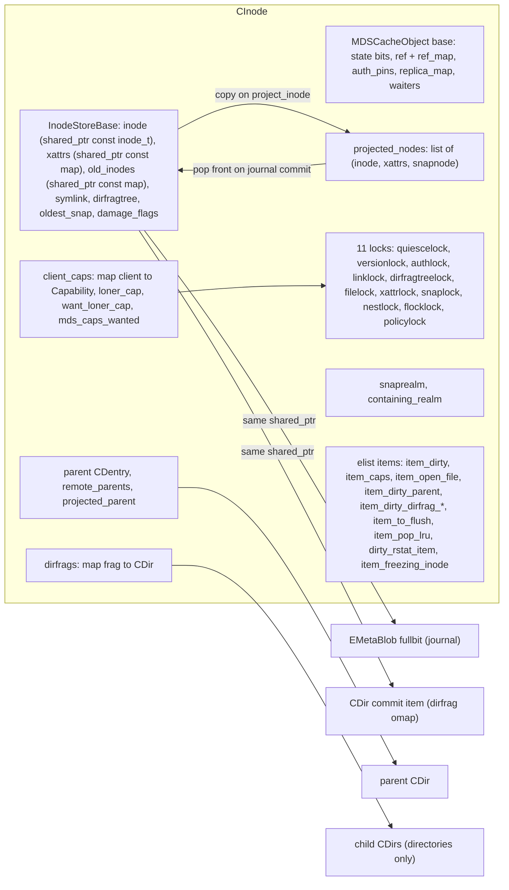
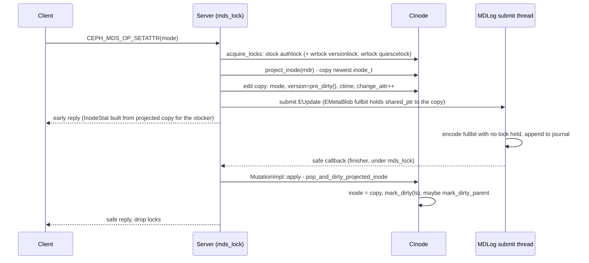
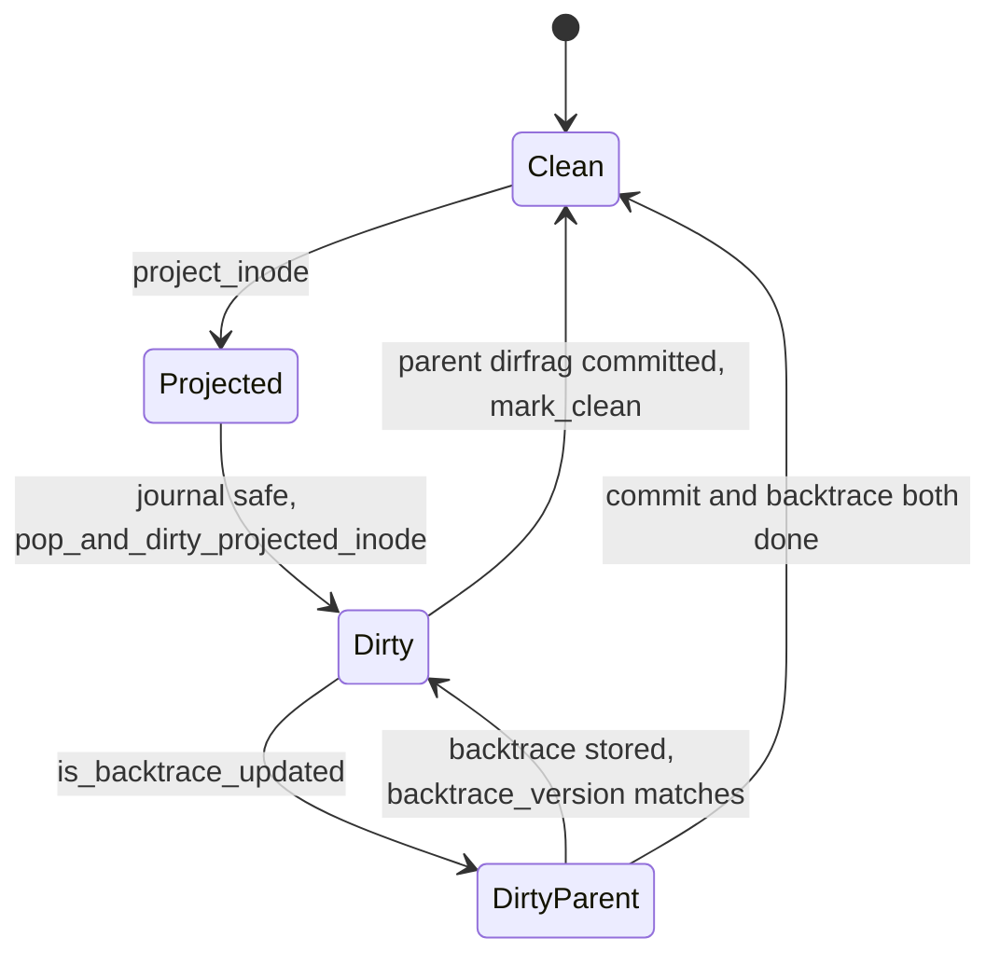
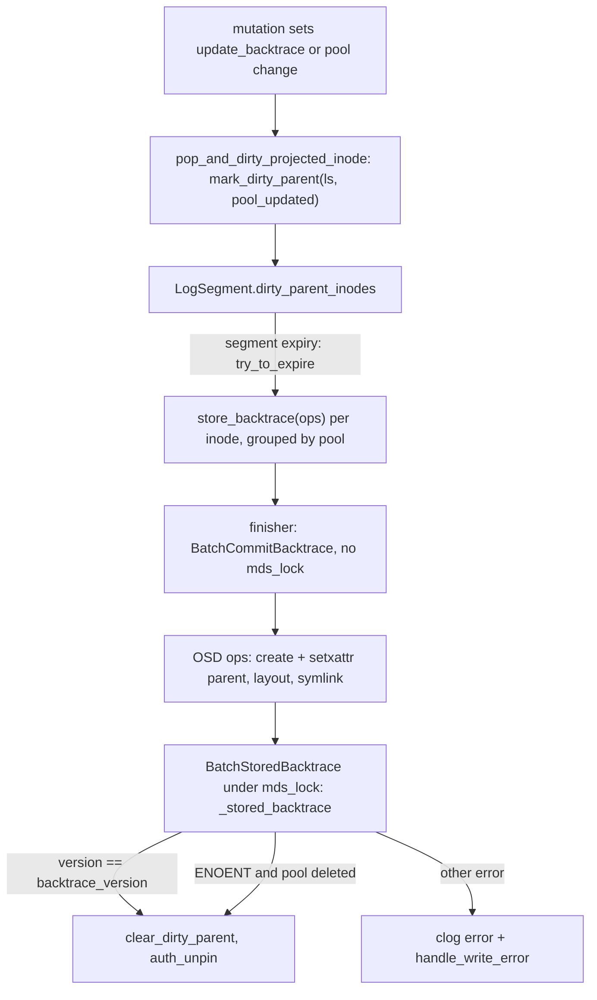

# CInode and inode types: inode_t, InodeStore, old inodes, backtraces, per-inode locks and caps

> Part of the C++ MDS project map ([README](../README.md)). Sources: `src/mds/CInode.h` (1,305 LOC), `src/mds/CInode.cc` (5,952), `src/include/cephfs/types.h` (1,340), `src/include/cephfs/dump.h` (139), `src/include/cephfs/json.h`, `src/mds/mdstypes.h` (848), `src/mds/mdstypes.cc` (1,349), `src/mds/old_inode.h` (87), `src/mds/inode_backtrace.{h,cc}` (279), `src/mds/fscrypt.h` (42); supporting reads in `src/mds/{SimpleLock.h,ScatterLock.h,LocalLockC.h,MDSCacheObject.h,Mutation.cc,Server.cc,Locker.cc,MDCache.cc,CDir.cc,CDentry.cc,journal.cc,MDLog.cc,Capability.cc}`, `src/messages/MClientReply.h`, `src/client/Client.cc`; kernel client `linux/fs/ceph/{inode.c,mds_client.c,super.h,file.c,dir.c}`. Related: [cdir-cdentry-and-cache-objects](cdir-cdentry-and-cache-objects.md), [mdcache-subtrees-traversal-replication](mdcache-subtrees-traversal-replication.md), [mdcache-lifecycle-trim-and-memory](mdcache-lifecycle-trim-and-memory.md), [dirfrags-and-fragmentation](dirfrags-and-fragmentation.md), [lock-types-and-state-machines](../05-locking/lock-types-and-state-machines.md), [acquiring-locks](../05-locking/acquiring-locks.md), [capabilities](../02-client-protocol/capabilities.md), [wire-protocol](../02-client-protocol/wire-protocol.md), [kclient-expectations](../02-client-protocol/kclient-expectations.md), [libcephfs-fuse-ganesha-expectations](../02-client-protocol/libcephfs-fuse-ganesha-expectations.md), [leases-lock-caches-and-async-dirops](../02-client-protocol/leases-lock-caches-and-async-dirops.md), [request-lifecycle](../03-request-path/request-lifecycle.md), [namespace-mutations](../03-request-path/namespace-mutations.md), [attributes-and-xattrs](../03-request-path/attributes-and-xattrs.md), [rename](../03-request-path/rename.md), [mdlog-and-journaler](../06-journal/mdlog-and-journaler.md), [events-and-replay](../06-journal/events-and-replay.md), [rados-object-catalog](../07-storage-formats/rados-object-catalog.md), [mds-tables](../07-storage-formats/mds-tables.md), [subtree-migration](../08-multi-mds/subtree-migration.md), [balancer-and-pinning](../08-multi-mds/balancer-and-pinning.md), [resolve-and-rejoin](../09-recovery/resolve-and-rejoin.md), [snapshots](../10-snapshots-quotas-subvolumes/snapshots.md), [rstats-quotas-and-subvolumes](../10-snapshots-quotas-subvolumes/rstats-quotas-and-subvolumes.md), [strays-and-purge](../11-background-services/strays-and-purge.md), [scrub-and-damage](../11-background-services/scrub-and-damage.md), [quiesce](../12-qos-metrics-quiesce-quarantine/quiesce.md), [quarantine](../12-qos-metrics-quiesce-quarantine/quarantine.md), [process-and-threading](../00-architecture/process-and-threading.md), [mds_lock-analysis](../00-architecture/mds_lock-analysis.md).

## 1. Purpose and responsibilities

`CInode` (`src/mds/CInode.h:255` (CInode)) is the in-memory cache object for one inode number over one snapshot-id range `[first, last]` on one MDS rank. It is simultaneously:

- **The holder of the persistent inode record.** Through its base class `InodeStoreBase` (`src/mds/CInode.h:113` (InodeStoreBase)) it owns an immutable, reference-counted `inode_t` (`src/include/cephfs/types.h:771` (inode_t)), the xattr map, the symlink target, the directory fragment tree (`dirfragtree`), the snapshot-era copies of the inode (`old_inodes`), `oldest_snap` and `damage_flags`. Its snaprealm node (`sr_t`) hangs off `CInode::snaprealm`.
- **The unit of projection.** Every metadata mutation copies the newest (projected) `inode_t`, edits the copy, journals it, and only after the journal commit swaps the copy in as the stable inode (read-copy-update) (`src/mds/CInode.cc:474` (CInode::project_inode), `src/mds/CInode.cc:522` (CInode::pop_and_dirty_projected_inode)).
- **The owner of 11 per-inode lock objects** (`authlock`, `linklock`, `dirfragtreelock`, `filelock`, `xattrlock`, `snaplock`, `nestlock`, `flocklock`, `policylock`, `versionlock`, `quiescelock`) (`src/mds/CInode.h:1153` (CInode::quiescelock) .. `:1163` (CInode::policylock)). Four of them back client capabilities.
- **The per-client capability table** (`client_caps`), the loner (exclusive-client) choice, replica "caps wanted", and the helpers that compute allowed/issued/wanted caps (`src/mds/CInode.cc:3415`-`3955` (CInode::calc_ideal_loner)).
- **The encoder of client-visible inode state**: `InodeStat` in every `MClientReply` trace/readdir entry (`src/mds/CInode.cc:3959` (CInode::encode_inodestat)) and the inode fields of `MClientCaps` (`src/mds/CInode.cc:4432` (CInode::encode_cap_message)).
- **The writer of backtraces**: a `parent` xattr on the inode's first RADOS object that records the ancestor path, used to find an inode by number (`src/mds/CInode.cc:1418` (CInode::build_backtrace) .. `:1612` (CInode::clear_dirty_parent)).
- **Persistence of base inodes** (root, `~mdsN`) as standalone `.inode` objects (`src/mds/CInode.cc:1271` (CInode::store), `:1359` (CInode::fetch)); all other inodes are persisted embedded in their parent dirfrag's omap (see [cdir-cdentry-and-cache-objects](cdir-cdentry-and-cache-objects.md)).
- **Replication and migration encodings** (base state, lock state for replicas and rejoin, export/import) (`src/mds/CInode.cc:4505`-`4790` (CInode::_encode_base)).
- **Cache-graph glue**: parent dentry links, dirfrag map, auth pins, freezing, waiters, reference pins, scrub state, export/ephemeral pin policy, and quiesce/quarantine checks.

`src/mds/mdstypes.{h,cc}` define the special inode-number layout and most small shared value types (frag/nest stats, `fnode_t`, `dirfrag_t`, `session_info_t`, `client_metadata_t`, reconnect records, load vectors); `src/mds/inode_backtrace.{h,cc}` define the backtrace format; `src/mds/old_inode.h` the snapshot-era copy; `src/mds/fscrypt.h` the fscrypt truncation header.

Out of scope here (described elsewhere): lock state machines and the acquire algorithm ([lock-types-and-state-machines](../05-locking/lock-types-and-state-machines.md), [acquiring-locks](../05-locking/acquiring-locks.md)); cap issue/revoke/flush protocol ([capabilities](../02-client-protocol/capabilities.md)); `CDir`/`CDentry` internals and dirfrag storage ([cdir-cdentry-and-cache-objects](cdir-cdentry-and-cache-objects.md)); snapshot semantics ([snapshots](../10-snapshots-quotas-subvolumes/snapshots.md)); rstat propagation and quotas ([rstats-quotas-and-subvolumes](../10-snapshots-quotas-subvolumes/rstats-quotas-and-subvolumes.md)); journal event formats ([events-and-replay](../06-journal/events-and-replay.md)).

## 2. Source map

| File | Class / function | Lines | Role |
|---|---|---|---|
| `src/include/cephfs/types.h` | `CEPH_FS_ONDISK_MAGIC`, `MAX_MDS`, `mds_rank_t`, `MDS_RANK_EPHEMERAL_DIST/RAND` | 40-77 | On-disk magic "ceph fs volume v011", rank constants |
| `src/include/cephfs/types.h` | `frag_info_t`, `nest_info_t` | 83-203 | dirstat / rstat value types |
| `src/include/cephfs/types.h` | `vinodeno_t` | 205-241 | (ino, snapid) identity |
| `src/include/cephfs/types.h` | `charmap_md_t`, `quota_info_t`, `client_writeable_range_t`, `inline_data_t` | 243-458 | Field value types |
| `src/include/cephfs/types.h` | `unknown_md_t`, `quarantine_md_t`, `optmetadata_server_t/_client_t`, `optmetadata_singleton`, `optmetadata_multiton` | 467-768 | Extensible optional metadata (charmap, quarantine) |
| `src/include/cephfs/types.h` | `inode_t<Allocator>` + `encode`/`decode`/`compare`/`older_is_consistent` | 770-1333 | The persistent inode record, its encoding (v20) and divergence check |
| `src/include/cephfs/types.h` | `QUARANTINE_NONE/ADD/DEL` | 1335-1339 | Quarantine op codes |
| `src/include/cephfs/dump.h`, `json.h` | `inode_t::dump`, `decode_json`, optmetadata dumps | dump.h:21-139 | JSON form for admin dumps and offline tools |
| `src/mds/mdstypes.h` | `MDS_INO_*`, `NUM_STRAY`, `MDS_IS_PRIVATE_INO` | 30-59 | Special inode numbers, message port prefixes |
| `src/mds/mdstypes.h/.cc` | `gcap_string`, `ccap_string` | h:91-124 | Cap bit rendering (`pAsLsXsFsxcrwbal`) |
| `src/mds/mdstypes.h/.cc` | `xattr_map`, `decode_noshare` | h:143-162 | Xattr map type (key -> `bufferptr`) |
| `src/mds/mdstypes.h/.cc` | `fnode_t`, `old_rstat_t`, `dirfrag_t`, `dentry_key_t`, `string_snap_t` | h:167-201, 388-459, 570-603 | Dirfrag-level types |
| `src/mds/mdstypes.h/.cc` | `feature_bitset_t`, `metric_spec_t`, `client_metadata_t`, `session_info_t` | h:203-385, cc:474-756 | Session/client metadata types |
| `src/mds/mdstypes.h/.cc` | `cap_reconnect_t`, `snaprealm_reconnect_t`, `old_cap_reconnect_t` | h:480-567, cc:978-1274 | Client reconnect records |
| `src/mds/mdstypes.h/.cc` | `inode_load_vec_t`, `dirfrag_load_vec_t`, `mds_load_t`, `META_POP_*` | h:606-748 | Popularity / balancer load vectors |
| `src/mds/mdstypes.h/.cc` | `mds_authority_t`, `CDIR_AUTH_*`, `MDSCacheObjectInfo`, `EstimatedReplayTime`, `BlockDiff`, `SubvolumeMetric` | h:751-847 | Misc shared types |
| `src/mds/old_inode.h` | `old_inode_t<Allocator>` | 15-85 | Snapshot-era copy: first + inode + xattrs |
| `src/mds/inode_backtrace.h/.cc` | `inode_backpointer_t`, `inode_backtrace_t`, `compare` | h:31-101, cc:11-176 | Backtrace format |
| `src/mds/fscrypt.h` | `ceph_fscrypt_last_block_header` | 19-40 | Header of the fscrypt truncation blob |
| `src/mds/CInode.h` | `cinode_lock_info_t`, `CInodeCommitOperation(s)` | 73-105 | Write-cap table; backtrace commit ops |
| `src/mds/CInode.h` | `InodeStoreBase`, `InodeStore`, `InodeStoreBare` | 113-252 | Persistent part, shared-pointer storage, encodings |
| `src/mds/CInode.h` | `CInode` pins/states/waiters/dump flags | 330-422 | Constants |
| `src/mds/CInode.h` | `projected_inode`, `projected_const_node`, `projected_nodes` | 518-580, 1271-1283 | Projection structures |
| `src/mds/CInode.h` | members: locks, caps, parents, elist items, dirfrags | 1102-1297 | Data members |
| `src/mds/CInode.cc` | `CInodeCommitOperation::update` | 67-90 | Builds `parent`/`layout`/`symlink` xattr ops |
| `src/mds/CInode.cc` | `operator<<(CInode)` | 173-345 | Log representation |
| `src/mds/CInode.cc` | `add/remove/split_need_snapflush` | 379-444 | Snapflush bookkeeping |
| `src/mds/CInode.cc` | `mark_dirty_rstat`, `clear_dirty_rstat` | 446-472 | Unpropagated rstat tracking |
| `src/mds/CInode.cc` | `project_inode`, `pop_and_apply_projected_inode`, `pop_and_dirty_projected_inode` | 474-552 | Projection / commit |
| `src/mds/CInode.cc` | `prepare_new_srnode` .. `pop_projected_snaprealm` | 554-711 | Snaprealm projection |
| `src/mds/CInode.cc` | `hash_dentry_name`, `pick_dirfrag`, dirfrag map ops, sticky dirs | 718-946 | Dirfrag management |
| `src/mds/CInode.cc` | `bad_put`, `bad_get`, `first_get`, `last_put`, `_put`, remote parents | 954-1008 | Pin hooks |
| `src/mds/CInode.cc` | ancestry, `make_path_string`, `name_stray_dentry` | 1013-1175 | Hierarchy helpers |
| `src/mds/CInode.cc` | `pre_dirty`, `_mark_dirty`, `mark_dirty`, `mark_clean` | 1177-1243 | Version and dirty state |
| `src/mds/CInode.cc` | `get_object_name`, `store`, `_stored`, `flush`, `fetch`, `_fetched` | 1262-1416 | Base-inode object I/O |
| `src/mds/CInode.cc` | `build_backtrace`, `_commit_ops`, `_store_backtrace`, `store_backtrace`, `_stored_backtrace`, `fetch_backtrace`, `mark_dirty_parent`, `clear_dirty_parent`, `verify_diri_backtrace` | 1418-1640 | Backtraces |
| `src/mds/CInode.cc` | `InodeStoreBase::encode*/decode*`, `encode_store`, `decode_store` | 1646-1774 | Persistent encodings |
| `src/mds/CInode.cc` | `get_lock`, `encode_lock_*`/`decode_lock_*`, `encode_lock_state`, `decode_lock_state` | 1779-2429 | Lock-state payloads |
| `src/mds/CInode.cc` | `start_scatter`, `finish_scatter_update`, `finish_scatter_gather_update(_accounted)` | 2470-2880 | Scatter-gather of dirstat/rstat |
| `src/mds/CInode.cc` | freeze, waiters, auth pins, authority | 2884-3171 | Cache-object protocol |
| `src/mds/CInode.cc` | `get_oldest_snap`, `cow_old_inode`, `pre_cow_old_inode`, `has_snap_data`, `purge_stale_snap_data`, `pick_old_inode`, snaprealm open/close/find, snap blobs | 3176-3411 | Snapshot-era data |
| `src/mds/CInode.cc` | loner, lock state recovery, caps add/remove/reconnect/export, allowed/issued/wanted, notable/clientwriteable | 3415-3955 | Cap tracking |
| `src/mds/CInode.cc` | `encode_inodestat`, `encode_cap_message` | 3959-4501 | Client encodings |
| `src/mds/CInode.cc` | `_encode_base`, lock state for replica/rejoin, `encode_export`, `finish_export`, `decode_import` | 4505-4790 | Replication/migration |
| `src/mds/CInode.cc` | `InodeStoreBase::dump/decode_json`, test instances | 4793-4904 | Debug/tool JSON |
| `src/mds/CInode.cc` | `validate_disk_state` (`ValidationContinuation`) | 4906-5305 | Scrub validation |
| `src/mds/CInode.cc` | `CInode::dump` | 5360-5502 | `dump inode` output |
| `src/mds/CInode.cc` | scrub info, `get_backtrace_pool`, `get_subvolume_id`, export/ephemeral pins, `get_charmap`, quiesce/quarantine predicates | 5505-5950 | Policy hooks |

## 3. How it works

### 3.1 Object model at a glance



`CInode` inherits `MDSCacheObject` (state bits, pins, auth pins, replicas, waiters), `InodeStoreBase` (persistent data) and `Counter<CInode>` (global live/created counters) (`src/mds/CInode.h:255` (CInode)). The constructor wires every lock to its static `LockType` and sets `STATE_AUTH` when constructed as authoritative (`src/mds/CInode.cc:347` (CInode::CInode)).

### 3.2 Identity, snapshot ranges and special inode numbers

- **Head vs snapped inodes.** A CInode covers snapids `[first, last]` (`src/mds/CInode.h:1106` (CInode::first/last)). `last == CEPH_NOSNAP` is the live "head" inode (`src/mds/CInode.h:697` (CInode::is_head)); `vino()` is `(ino, last)` (`src/mds/CInode.h:671` (CInode::vino)). Head inodes are indexed in `MDCache::inode_map` (unordered_map by ino), snapped CInodes in `MDCache::snap_inode_map` (map by vinodeno_t) (`src/mds/MDCache.cc:331` (MDCache::add_inode), `src/mds/MDCache.h:1384` (MDCache::inode_map)). Ordering between cache objects (`is_lt`) is `(ino, last)` (`src/mds/CInode.h:750` (CInode::is_lt)).
- **Multiversion inodes.** Directories, inodes with their own snaprealm, inodes with `nlink > 1`, and inodes that already have `old_inodes` keep snapshot-era copies *inside* the head CInode (`old_inodes`), instead of COWing a separate snapped CInode (`src/mds/CInode.h:487` (CInode::is_multiversion), `src/mds/MDCache.cc:1679` (MDCache::journal_cow_dentry)). Other (plain file) inodes are COWed into a separate CInode `[first, follows]` by `MDCache::cow_inode` (`src/mds/MDCache.cc:1573` (MDCache::cow_inode)).
- **Authority.** `inode_auth` is normally `CDIR_AUTH_DEFAULT` (= `(-1,-2)`, "use parent") and an inode's authority is that of the dirfrag holding its primary dentry; only base inodes set `inode_auth` explicitly (root: the creating rank; `~mdsN`: rank N) (`src/mds/CInode.cc:3157` (CInode::authority), `src/mds/MDCache.cc:441` (MDCache::create_unlinked_system_inode)). An inode not yet linked uses its first projected parent.

Special inode numbers (`src/include/ceph_fs.h:52-60` (CEPH_INO_ROOT..CEPH_INO_LOST_AND_FOUND), `src/mds/mdstypes.h:34-59` (NUM_STRAY, MDS_INO_*), `MAX_MDS = 0x100`, `NUM_STRAY = 10`):

| Inode number | Name | Meaning | Predicate |
|---|---|---|---|
| `0x1` | `CEPH_INO_ROOT` | Filesystem root `/`; stored as `1.00000000.inode` + dirfrag `1.00000000` | `is_root`, `is_base` |
| `0x2` | `CEPH_INO_CEPH` | Hidden legacy `.ceph` dir: no longer created, skipped by readdir (`src/mds/Server.cc:5259` (Server::handle_client_readdir)), never fragmented (`src/mds/MDCache.cc:11889` (MDCache::can_fragment)) | `is_system` |
| `0x3` | `CEPH_INO_GLOBAL_SNAPREALM` | Dummy unlinked in-memory inode carrying the global snaprealm (`src/mds/MDCache.cc:10217` (MDCache::create_global_snaprealm)); its number is visible to clients as a realm ino | `is_base` |
| `0x4` | `CEPH_INO_LOST_AND_FOUND` | Reserved for recovery tools (`cephfs-data-scan`) | `is_lost_and_found` |
| `0x100 + r` | `MDS_INO_MDSDIR(r)` | Per-rank private dir `~mdsR` (contains `stray0..9`); `100.00000000.inode` for rank 0 | `is_mdsdir`, `is_base` |
| `0x200 + r` | `MDS_INO_LOG_OFFSET` | Rank r journal (`src/mds/MDLog.cc:279` (MDLog::create)) | private |
| `0x300 + r` | `MDS_INO_LOG_BACKUP_OFFSET` | Journal backup used during journal format rewrite (`src/mds/MDLog.cc:1253` (MDLog::_reformat_journal)) | private |
| `0x400 + r` | `MDS_INO_LOG_POINTER_OFFSET` | Journal pointer object (`src/mds/JournalPointer.cc:38` (JournalPointer::get_object_id)) | private |
| `0x500 + r` | `MDS_INO_PURGE_QUEUE` | Purge queue journal (`src/mds/PurgeQueue.cc:153` (PurgeQueue::PurgeQueue)) | private |
| `0x600 + r*10 + i` | `MDS_INO_STRAY(r, i)` | Stray dir i of rank r (i in 0..9) | `is_stray` |
| `0x1000` | `MDS_INO_SYSTEM_BASE` | First non-system number; `is_system()` is `ino < 0x1000` (`src/mds/CInode.h:680` (CInode::is_system)) | |
| `(r+1) << 40` .. `+2^40` | InoTable range | Normal inode numbers handed out by rank r (`src/mds/InoTable.cc:29` (InoTable::reset_state)); see [mds-tables](../07-storage-formats/mds-tables.md) | `is_normal` |

`MDS_IS_PRIVATE_INO(i)` is `0x100 <= i < 0x1000` (`src/mds/mdstypes.h:59` (MDS_IS_PRIVATE_INO)). The MDS answers `LOOKUPINO` on a private ino with `-ESTALE` (`src/mds/Server.cc:4450` (Server::handle_client_lookup_ino)), refuses `setattr` on system inodes other than base ones with `-EPERM` (`src/mds/Server.cc:5589` (Server::handle_client_setattr)), refuses namespace changes in system dirs other than root with `-EROFS` (except unlink in lost+found) (`src/mds/Server.cc:4026` (Server::rdlock_path_xlock_dentry)), and refuses snapshots in them with `-EPERM` (`src/mds/Server.cc:11616` (Server::handle_client_mksnap)). Both clients independently reject this range (section 7).

### 3.3 `inode_t` field reference

`inode_t` is a template over the allocator; the MDS uses `inode_t<mempool::mds_co::pool_allocator>` (`mempool_inode`, `src/mds/CInode.h:115` (InodeStoreBase::mempool_inode)), clients and tools use `std::allocator`. Field declarations: `src/include/cephfs/types.h:953-1033` (inode_t fields). "Enc v" is the `inode_t` struct_v that introduced the field (`src/include/cephfs/types.h:1121` (inode_t::decode)). "Lock" is the lock under which the auth MDS changes the field, confirmed by the lock-state payloads in section 3.13 and the callers cited.

| Field | Type | Meaning / invariants | Initial value | Changed by (examples) | Lock | Enc v | Client-visible via |
|---|---|---|---|---|---|---|---|
| `ino` | `inodeno_t` (u64) | Immutable inode number | session prealloc range or InoTable (`src/mds/Server.cc:3637` (Server::prepare_new_inode)); fixed for system inodes | never | none | 1 | InodeStat `ino`, MClientCaps `ino` |
| `rdev` | u32 | Device number for special files | `mknod` args (`src/mds/Server.cc:7632` (Server::handle_client_mknod)) | never | none | 1 | InodeStat `rdev` |
| `ctime` | `utime_t` | Change time | op stamp | most mutations (setattr, xattrs, vxattrs, link/unlink, rename, quarantine); client cap flush if newer (`src/mds/Locker.cc:3990` (Locker::_update_cap_fields)); directory `dirstat.mtime` propagation sets `mtime = ctime = dirstat.mtime` (`src/mds/MDCache.cc:2413` (MDCache::predirty_journal_parents)) | whichever lock the op holds; versionlock wrlock for setattr CTIME (`src/mds/Server.cc:5616` (Server::handle_client_setattr)); replicas keep the max ctime of any lock payload | 1 | InodeStat (`any_i`), MClientCaps |
| `btime` | `utime_t` | Birth time | op stamp (`src/mds/Server.cc:3737` (Server::prepare_new_inode)) | setattr `CEPH_SETATTR_BTIME` (`src/mds/Server.cc:5727` (Server::handle_client_setattr)); cap flush with Ax and `FS_BTIME` (`src/mds/Locker.cc:4071` (Locker::_update_cap_fields)) | authlock (setattr); not carried in any lock payload | 14 | InodeStat (`FS_BTIME`/v1+), MClientCaps |
| `mode` | u32 | `S_IFMT` + permission bits; setattr keeps the type bits (`(mode & ~07777) \| (new & 07777)`), but a cap flush with Ax copies the client's whole `mode` unmasked, so type-bit immutability rests on client behavior on that path | request mode; `S_ISGID` inherited by subdirs of setgid dirs (`src/mds/Server.cc:3722` (Server::prepare_new_inode)) | setattr MODE / kill-suid/sgid (`src/mds/Server.cc:5705` (Server::handle_client_setattr)); cap flush Ax (`src/mds/Locker.cc:4065` (Locker::_update_cap_fields)) | authlock | 1 | InodeStat (`auth_i`), MClientCaps |
| `uid`, `gid` | u32 | Owner | request owner uid; gid from parent if parent is setgid else request owner gid (`src/mds/Server.cc:3722`-`3735` (Server::prepare_new_inode)) | setattr UID/GID; cap flush Ax | authlock | 1 | InodeStat, MClientCaps |
| `nlink` | i32 | Link count. Directories only ever hold 1 (or 0 once removed); files count hard links | 1 (`src/mds/Server.cc:3700` (Server::prepare_new_inode)) | link `nlink++` (`src/mds/Server.cc:8027` (Server::_link_local)), unlink `nlink--` and `STATE_ORPHAN` at 0 (`src/mds/Server.cc:8779` (Server::_unlink_local)), rename over target (`src/mds/Server.cc:10075` (Server::_rename_prepare)) | linklock | 1 | InodeStat (`link_i`), MClientCaps |
| `dir_layout` | `ceph_dir_layout` (8 bytes) | `dl_dir_hash`: dentry-name hash function id for the dir | dirs: `mds_default_dir_hash` (default 2 = rjenkins) (`src/mds/Server.cc:3707` (Server::prepare_new_inode)); others: zeroed | never | none | 4 | InodeStat (`DIRLAYOUTHASH`/v1+) |
| `layout` | `file_layout_t` | Files: striping + pool + namespace. Dirs: empty unless set by `ceph.dir.layout` (root gets default layout on first data pool, `src/mds/MDCache.cc:487` (MDCache::create_root_inode)); new files inherit the nearest ancestor dir layout found by `try_rdlock_snap_layout` (`src/mds/Locker.cc:157` (Locker::try_rdlock_snap_layout)) | inherited or `default_file_layout` | file: `SETLAYOUT` / `ceph.file.layout` only while size 0 and `truncate_seq <= 1` (`src/mds/Server.cc:5862` (Server::handle_client_setlayout), `6431` (Server::handle_client_setvxattr)); dir: `ceph.dir.layout` | file: filelock; dir: policylock | 1 | InodeStat legacy layout + `pool_ns`, MClientCaps layout |
| `old_pools` | `compact_set<i64>` | Pools that may still hold a (stale) backtrace object; purge deletes `<ino>.00000000` in each of them (`src/mds/StrayManager.cc:147` (StrayManager::purge), `src/mds/PurgeQueue.cc:671` (PurgeQueue::_execute_item)) | default data pool added when a file or mknod node is created in a non-default pool (`src/mds/Server.cc:5001` (Server::handle_client_openc), `7636` (Server::handle_client_mknod)) | `add_old_pool` on pool change (`src/include/cephfs/types.h:868` (inode_t::add_old_pool)); nothing in `src/mds` removes entries, so the set only grows | filelock (with layout) | 7 | no |
| `size` | u64 | File size; symlink target length; not maintained for dirs | 0 / symlink length (`src/mds/Server.cc:7834` (Server::handle_client_symlink)) | setattr SIZE (`truncate()` when shrinking); cap flush if larger (`src/mds/Locker.cc:4021` (Locker::_update_cap_fields)); open `O_TRUNC` | filelock | 1 | InodeStat, MClientCaps |
| `max_size_ever` | u64 | Largest size ever seen; purge range | 0 | `truncate()` (`src/include/cephfs/types.h:802` (inode_t::truncate)); zeroed by stray truncation (`src/mds/StrayManager.cc:199` (StrayManager::_purge_stray_purged)) | filelock | 8 | no (purge range in `src/mds/StrayManager.cc:142` (StrayManager::purge)) |
| `truncate_seq` | u32 | Truncation epoch; OSD ops carry it | 1 ("0 is kept for no-truncation") (`src/mds/Server.cc:3715` (Server::prepare_new_inode)) | `truncate()` `++` | filelock | 1 | InodeStat, MClientCaps |
| `truncate_size` | u64 | Size after last truncation | `-1ull` (not truncated) | `truncate()` | filelock | 1 | InodeStat, MClientCaps |
| `truncate_from` | u64 | Size before the pending truncation | 0 | `truncate()`; cleared by `MDCache::truncate_inode_finish` (`src/mds/MDCache.cc:6781` (MDCache::truncate_inode_finish)) | filelock | 1 | no |
| `truncate_pending` | u32 | Number of truncations not yet applied to objects; `is_truncating()` | 0 | `++` in `truncate()`, `--` in `truncate_inode_finish` | filelock | 5 | no |
| `mtime`, `atime` | `utime_t` | Data times; dir mtime mirrors `dirstat.mtime` | op stamp | setattr; cap flush Fw (`mtime` if newer) / Fx (any) (`src/mds/Locker.cc:4013` (Locker::_update_cap_fields), `4036` (Locker::_update_cap_fields)); dirstat propagation | filelock | 1 | InodeStat (`file_i`), MClientCaps |
| `time_warp_seq` | u32 | Bumped whenever times are set explicitly ("serialization point") so clients ignore older cached times | 0 | `++` on setattr ATIME/MTIME/BTIME (`src/mds/Server.cc:5729` (Server::handle_client_setattr)); cap flush Fx if client's is newer (`ceph_seq_cmp`) | filelock | 1 | InodeStat, MClientCaps |
| `inline_data` | `inline_data_t {version, data}` | Inline file data; `version == CEPH_INLINE_NONE` (`(u64)-1`) when disabled | version 1, or `CEPH_INLINE_NONE` when inline data is off or the client lacks `MDS_INLINE_DATA` (`src/mds/Server.cc:3758` (Server::prepare_new_inode)) | cap flush Fw with newer `inline_version` (`src/mds/Locker.cc:4027` (Locker::_update_cap_fields)); scrub uninline | filelock | 9 | InodeStat `inline_version`/`inline_data`, MClientCaps |
| `change_attr` | u64 | Monotonic change counter (NFSv4 change attribute) | 0 (`src/mds/Server.cc:3740` (Server::prepare_new_inode)) | `++` on setattr, setlayout, xattrs, vxattrs, link/unlink, rename, quarantine; dir: `++` when `dirstat.change_attr` advanced (`src/mds/MDCache.cc:2415` (MDCache::predirty_journal_parents)); cap flush if client's is larger and `FS_CHANGE_ATTR` (`src/mds/Locker.cc:3999` (Locker::_update_cap_fields)) | as ctime | 14 | InodeStat (`any_i`), MClientCaps |
| `client_ranges` | map client -> `{range.first, range.last, follows}` | Per-client writable byte range; `max_size` given to that client = `range.last` | empty | `Locker::calc_new_client_ranges` (`src/mds/Locker.cc:3017` (Locker::calc_new_client_ranges)), cap update max_size (`src/mds/Locker.cc:4204` (Locker::_do_cap_update)); `trim_client_ranges(last)` on COW | filelock | 1 (format v3) | InodeStat `max_size` = min(stable, projected) range for that client; MClientCaps `max_size` |
| `dirstat` | `frag_info_t {version, mtime, change_attr, nfiles, nsubdirs}` | Dir: sum of dirfrag `fragstat`s | zero | `predirty_journal_parents` (`src/mds/MDCache.cc:2224` (MDCache::predirty_journal_parents)), scatter gather (`src/mds/CInode.cc:2624` (CInode::finish_scatter_gather_update)) | filelock (scatter) | 1 | InodeStat `files`/`subdirs`, MClientCaps `nfiles`/`nsubdirs` |
| `rstat` | `nest_info_t {version, rctime, rbytes, rfiles, rsubdirs, rsnaps}` | Recursive stats. File: `rbytes = size`, `rfiles = 1`; dir: `rsubdirs` counts itself | file `rfiles=1`; dir `rsubdirs=1` (`src/mds/Server.cc:7734` (Server::handle_client_mkdir)) | data/size changes, propagation from dirfrags (`src/mds/MDCache.cc:2029` (MDCache::project_rstat_frag_to_inode)) | nestlock (scatter) | 1 | InodeStat `rbytes/rfiles/rsubdirs/rctime/rsnaps` |
| `accounted_rstat` | `nest_info_t` | The part of `rstat` already added into the parent dirfrag's `rstat`; `is_dirty_rstat()` is `rstat != accounted_rstat` | `= rstat` at creation | `_project_rstat_inode_to_frag` sets `accounted_rstat = rstat` (`src/mds/MDCache.cc:2025` (MDCache::_project_rstat_inode_to_frag)) | parent's nestlock | 1 | no |
| `quota` | `quota_info_t {max_bytes, max_files}` | Directory quota | 0/0 | `ceph.quota.*` vxattrs | policylock | 11 | InodeStat `quota` (`policy_i`) |
| `export_pin` | `mds_rank_t` (i32) | Export pin; `MDS_RANK_NONE = -1` | -1 | `ceph.dir.pin` (`src/mds/CInode.cc:5764` (CInode::set_export_pin)) | policylock | 15 | InodeStat `dir_pin` (v2+) |
| `export_ephemeral_random_pin` | double | Random ephemeral pin probability | 0 | `ceph.dir.pin.random` (`src/mds/CInode.cc:5752` (CInode::setxattr_ephemeral_rand)) | policylock | 16 | no |
| `flags` | u8 | `F_EPHEMERAL_DISTRIBUTED_PIN = 1`, `F_QUIESCE_BLOCK = 2` (`src/include/cephfs/types.h:782` (inode_t::F_EPHEMERAL_DISTRIBUTED_PIN)) | 0 | `ceph.dir.pin.distributed` (`src/mds/CInode.cc:5758` (CInode::setxattr_ephemeral_dist)), `ceph.quiesce.block` (`src/mds/Server.cc:6541` (Server::handle_client_setvxattr)) | policylock | 16 | no |
| `version` | `version_t` | Per-inode version; drawn from the parent dirfrag counter (section 3.8); "auth only" | `dn->pre_dirty()` at creation (`src/mds/Server.cc:4999` (Server::handle_client_openc)) | every projection: `pi.inode->version = in->pre_dirty()` | (implicit: versionlock) | 1 | InodeStat `version = 2*version + projected` |
| `file_data_version` | `version_t` | Never written in current code; read only by `Locker::issue_file_data_version` (`src/mds/Locker.cc:2350` (Locker::issue_file_data_version)) | 0 | none | - | 1 | no |
| `xattr_version` | `version_t` | Version of the xattr map | 1 (`src/mds/Server.cc:3699` (Server::prepare_new_inode)) | `++` on setxattr/removexattr (`src/mds/Server.cc:7230` (Server::handle_client_setxattr), `7304` (Server::handle_client_removexattr)); cap flush Xx sets client's value (`src/mds/Locker.cc:3864` (Locker::decode_new_xattrs)) | xattrlock | 1 | InodeStat `xattr_version` (0 when blob omitted), MClientCaps |
| `last_scrub_stamp`, `last_scrub_version` | `utime_t`, `version_t` | Last completed scrub | 0 | piggy-backed into the next projection when `scrub_infop->last_scrub_dirty` (`src/mds/CInode.cc:485` (CInode::project_inode)) | none specific | 13 | no |
| `backtrace_version` | `version_t` | `version` at which the backtrace was last changed; `is_backtrace_updated()` is `backtrace_version == version` | via `update_backtrace()` at creation | `update_backtrace()` on create (openc/mknod/mkdir/symlink), unlink-to-stray, rename, and every `setvxattr` on a regular file, not only layout ones (`src/mds/Server.cc:5002` (Server::handle_client_openc), `7637` (Server::handle_client_mknod), `7736` (Server::handle_client_mkdir), `7838` (Server::handle_client_symlink), `8796` (Server::_unlink_local), `9996` (Server::_rename_prepare), `10057` (Server::_rename_prepare), `6954` (Server::handle_client_setvxattr)); hard link does not call it; `add_old_pool()` sets it to the current (pre-`pre_dirty`) version | with the op | 2 (forced 0 when decoding struct_v < 10) | no |
| `oldest_snap` (in `inode_t`) | `snapid_t` | Declared but never encoded or used; the live value is `InodeStoreBase::oldest_snap` | - | - | - | - | no |
| `stray_prior_path` | string | Path before the inode moved to a stray dir | empty | unlink (`src/mds/Server.cc:8772` (Server::_unlink_local)), rename over primary (`src/mds/Server.cc:10089` (Server::_rename_prepare)) | with the op | 12 | no (`dump stray`) |
| `fscrypt_auth` | bytes | Opaque fscrypt context (non-empty = encrypted) | from request (`src/mds/Server.cc:3745` (Server::prepare_new_inode)) | setattr `FSCRYPT_AUTH` (requires `allow_all` MDS caps, else `-EACCES`) (`src/mds/Server.cc:5749` (Server::handle_client_setattr)); cap flush Ax | authlock (payload v2) | 18 (flag v17) | InodeStat (v7), MClientCaps |
| `fscrypt_file` | bytes | Opaque per-file fscrypt data (e.g. real size) | from request | setattr `FSCRYPT_FILE`; cap flush Fw/Fx | filelock (payload v2) | 18 | InodeStat (v7), MClientCaps |
| `fscrypt_last_block` | bytes | Raw truncation blob (header + last block) used to rewrite the last encrypted block | empty | `truncate(old, new, blob)` (`src/include/cephfs/types.h:796` (inode_t::truncate)); cleared by `truncate_inode_finish` | filelock | 19 | no |
| `optmetadata` | vector of `{u64 kind, payload}` | Extensible optional metadata: `CHARMAP=1`, `QUARANTINE=2`; unknown kinds preserved (section 3.5) | charmap copied from parent dir at mkdir (`src/mds/Server.cc:7737` (Server::handle_client_mkdir)) | charmap vxattrs (empty dir only); quarantine set/clear (`src/mds/MDCache.cc:15243` (MDCache::quarantine_inode)) | policylock (payload v4) | 20 | InodeStat `optmetadata` (v8) |

### 3.4 `inode_t` binary encoding (struct_v 20, compat 6)

`inode_t::encode` (`src/include/cephfs/types.h:1053` (inode_t::encode)) writes, inside `ENCODE_START(20, 6)`:

| # | Field | Encoding |
|---|---|---|
| 1-3 | `ino`, `rdev`, `ctime` | u64, u32, utime (u32 sec, u32 nsec) |
| 4-7 | `mode`, `uid`, `gid`, `nlink` | u32, u32, u32, i32 |
| 8 | removed `anchored` | bool, always 0 |
| 9 | `dir_layout` | 8 raw bytes |
| 10 | `layout` | `file_layout_t`: legacy 28-byte `ceph_file_layout` if the feature set lacks `FS_FILE_LAYOUT_V2`, else versioned v2 `{su, sc, os, pool_id i64, pool_ns string}`; decoder dispatches on a leading 0 byte (`src/common/fs_types.cc:89` (file_layout_t::encode)) |
| 11-15 | `size`, `truncate_seq`, `truncate_size`, `truncate_from`, `truncate_pending` | u64, u32, u64, u64, u32 |
| 16-18 | `mtime`, `atime`, `time_warp_seq` | utime, utime, u32 |
| 19 | `client_ranges` | map<client_t (i64), `client_writeable_range_t` v2 `{first, last, follows}`> |
| 20-22 | `dirstat`, `rstat`, `accounted_rstat` | `frag_info_t` v3 `{version, mtime, nfiles, nsubdirs, change_attr}`; `nest_info_t` v3 `{version, rbytes, rfiles, rsubdirs, ranchors=0, rsnaps, rctime}` (`src/mds/mdstypes.cc:46` (frag_info_t::encode), `119` (nest_info_t::encode)) |
| 23-26 | `version`, `file_data_version`, `xattr_version`, `backtrace_version` | u64 x 4 |
| 27-29 | `old_pools`, `max_size_ever`, `inline_data` | set<i64>, u64, `{u64 version, u32 len, bytes}` (`src/mds/mdstypes.cc:293` (inline_data_t::encode)) |
| 30 | `quota` | `quota_info_t` v1 `{max_bytes, max_files}` |
| 31 | `stray_prior_path` | string |
| 32-33 | `last_scrub_version`, `last_scrub_stamp` | u64, utime |
| 34-35 | `btime`, `change_attr` | utime, u64 |
| 36-38 | `export_pin`, `export_ephemeral_random_pin`, `flags` | i32, double, u8 |
| 39 | fscrypt flag | bool `!fscrypt_auth.empty()` (ignored on decode) |
| 40-42 | `fscrypt_auth`, `fscrypt_file`, `fscrypt_last_block` | vector<u8> x 3 |
| 43 | `optmetadata` | `optmetadata_multiton` v1 (section 3.5) |

The decoder declares `DECODE_START_LEGACY_COMPAT_LEN(19, 6, 6)` although the encoder writes v20 (`src/include/cephfs/types.h:1123` (inode_t::decode)); it still decodes the v20 field because the compat check only compares against the compat value 6. The same "decoder declares one version less" pattern exists for `InodeStoreBase` (encode v6, decode declares 5: `src/mds/CInode.cc:1706` (InodeStoreBase::encode), `1764` (InodeStoreBase::decode)) and `fnode_t` (encode v4, decode declares 3: `src/mds/mdstypes.cc:339` (fnode_t::encode), `356` (fnode_t::decode)).

`inode_t::compare()` (`src/include/cephfs/types.h:1254` (inode_t::compare)) is used by scrub to compare an on-disk base inode with the in-memory one: equal versions with differing field values, or an older copy with a larger `max_size_ever`/`truncate_seq`/`time_warp_seq`/`inline_data.version`/stat versions/`xattr_version`/`backtrace_version`, is "divergent" (`older_is_consistent`, `:1305` (inode_t::older_is_consistent)).

### 3.5 Xattrs, `optmetadata` and flags

- **Xattrs** are `xattr_map<Allocator>` = map<string, `bufferptr`> (`src/mds/mdstypes.h:144` (xattr_map)); the map is held by `shared_ptr<const ...>` (`InodeStoreBase::xattrs`, `src/mds/CInode.h:197` (InodeStoreBase::xattrs)), `nullptr` meaning "no xattrs" (`decode_xattrs` stores `nullptr` for an empty map, `src/mds/CInode.cc:1654` (InodeStoreBase::decode_xattrs)). Decoding copies values deep (`decode_noshare`, `src/mds/mdstypes.h:151` (decode_noshare)) so cached values do not pin message buffers. The bufferptr payloads are not accounted in the `mds_co` mempool (FIXME at `src/mds/mdstypes.h:148` (xattr_map)). The total size limit is the MDSMap `max_xattr_size` (default `MDS_MAX_XATTR_SIZE = 64 KiB`, `src/mds/MDSMap.h:64` (MDS_MAX_XATTR_SIZE)); a cap flush whose xattrs exceed it is ignored but `xattr_version` is still bumped (`src/mds/Locker.cc:3855` (Locker::decode_new_xattrs)). Virtual `ceph.*` xattrs are not stored here (see [attributes-and-xattrs](../03-request-path/attributes-and-xattrs.md)).
- **`optmetadata`** (`src/include/cephfs/types.h:532`-`742` (optmetadata_server_t)) is a sorted vector of `optmetadata_singleton {u64 kind; variant payload}`, encoded as `ENCODE_START(1,1){ vector }`; each singleton is `u64 kind` + the payload's own encoding (no outer version) (`:606` (optmetadata_singleton::encode)). Kinds: `UNKNOWN=0` (raw bytes of an unrecognized versioned blob, re-encoded verbatim so newer kinds round-trip, `:468` (unknown_md_t)), `CHARMAP=1` (`charmap_md_t` v1 `{bool casesensitive, string normalization="nfd", string encoding="utf8"}`, `:244` (charmap_md_t)), `QUARANTINE=2` (`quarantine_md_t` v1 `{bool enabled=true, u64 sec, u32 nsec}`, `:490` (quarantine_md_t)). `get_or_create_opt` inserts in kind order (`:693` (optmetadata_multiton::get_or_create_opt)). Equality uses `memcmp` over the in-memory variant object (FIXME, tracker 73382, `:633` (optmetadata_singleton::operator==)): for charmaps (strings) and unknown payloads (`vector`) that compares heap pointers, and for `quarantine_md_t` it includes padding bytes, so equal values can compare unequal. The only consumer is `inode_t::compare` (scrub's divergence check), which can therefore report spurious divergence for equal-version inodes that carry optmetadata. `get_kind()` maps `kind > variant_size` to UNKNOWN but lets `kind == variant_size` (3) through (`:584` (optmetadata_singleton::get_kind)), which would index past the default-constructor table (observed in code; behavior with a future kind 3 is unverified).
  - Charmap: set/removed only on an empty directory without snapshots (`-ENOTEMPTY` otherwise) (`src/mds/Server.cc:6843` (Server::handle_client_setvxattr)), inherited by new subdirectories at `mkdir` (`src/mds/Server.cc:7737` (Server::handle_client_mkdir)). `CInode::get_charmap()` reads the projected inode (`src/mds/CInode.cc:5771` (CInode::get_charmap)). In a charmap directory, openc/mkdir/symlink/link/rename (not mknod) are refused with `-EPERM` unless the session's client metadata has feature bit `CEPHFS_FEATURE_CHARMAP` (22) (`src/mds/Server.cc:4876` (Server::can_handle_charmap)). The kernel snapshot used here assigns bit 22 to `CEPHFS_FEATURE_SUBVOLUME_METRICS` (`linux/fs/ceph/mds_client.h:40` (CEPHFS_FEATURE_SUBVOLUME_METRICS)), so a kernel advertising it passes this check although it skips `optmetadata` and does no name folding.
  - Quarantine: the flag lives on the subvolume root inode; `has_quarantined()` = QUARANTINE opt present and `enabled` (`src/include/cephfs/types.h:915` (inode_t::has_quarantined)). A transient `quarantine_op` (`QUARANTINE_ADD/DEL`) on the CInode marks an in-progress change (`src/mds/CInode.h:1297` (CInode::quarantine_op), `src/mds/MDCache.cc:15175` (MDCache::quarantine_dir_auth)).
- **`flags`** (`F_EPHEMERAL_DISTRIBUTED_PIN`, `F_QUIESCE_BLOCK`) re-use the byte that used to encode a bool (comment at `src/include/cephfs/types.h:997` (inode_t::flags)).

### 3.6 Old inodes (snapshot-era copies)

`old_inode_t {snapid_t first; inode_t inode; xattr_map xattrs}` (`src/mds/old_inode.h:15` (old_inode_t)), encoded v2/compat 2 with features (`:28` (old_inode_t::encode)). A CInode's `old_inodes` is a `shared_ptr<const map<snapid_t last, old_inode_t>>`: key = last snapid of the interval, value.first = first snapid (`src/mds/CInode.h:198` (InodeStoreBase::old_inodes)).

- `cow_old_inode(follows, cow_head)` (`src/mds/CInode.cc:3184` (CInode::cow_old_inode)) copies the projected (or previous projected) inode and xattrs into a new map entry `[first, follows]`, drops from the copy every client range whose own `follows` is `>=` the COW point (`trim_client_ranges(follows)`), records `dirty_old_rstats` when `mds_snap_rstat` is on and `rstat != accounted_rstat`, lowers `oldest_snap` and sets `first = follows+1`. The map is copied (RCU) and swapped in.
- `pre_cow_old_inode()` (`src/mds/CInode.cc:3222` (CInode::pre_cow_old_inode)) chooses `follows`: the global snaprealm's newest seq when `mds_use_global_snaprealm_seq_for_subvol` (default true) is set; otherwise the containing realm's seq for subvolume realms or realms without snaps, else the global seq; COWs if `first <= follows`.
- `pick_old_inode(snap)` / `has_snap_data(snap)` (`:3308` (CInode::pick_old_inode), `:3260` (CInode::has_snap_data)) look up the interval containing a snapid; `encode_inodestat` uses the same lookup to answer stat on a snapshot (`src/mds/CInode.cc:3982` (CInode::encode_inodestat)).
- `purge_stale_snap_data(snaps)` (`:3278` (CInode::purge_stale_snap_data)) drops old inodes not covering any existing snap; called before storing base inodes (`src/mds/CInode.cc:1276` (CInode::store)) and when committing dirfrags (`src/mds/CDir.cc:2731` (CDir::_parse_dentry)).
- `get_oldest_snap()` = min(first of oldest old inode or `first`, `oldest_snap`) (`src/mds/CInode.cc:3176` (CInode::get_oldest_snap)).
- Snapshot flush bookkeeping lives on the head inode: `client_need_snapflush` (snapid -> clients) and `client_snap_caps` on snapped inodes; `add_need_snapflush` auth-pins the head inode (once) and the snapped inode (once per snapid) (`src/mds/CInode.cc:379` (CInode::add_need_snapflush)); the code comments that this can block freezes/migrations for long periods. See [snapshots](../10-snapshots-quotas-subvolumes/snapshots.md).

### 3.7 Projection mechanics (read-copy-update)

Storage model: `InodeStoreBase::inode`, `xattrs`, `old_inodes` are `shared_ptr<const T>` "pointers to constant data [that] can be shared by CInode and log events. To update these members in CInode, read-copy-update should be used" (`src/mds/CInode.h:193`-`198` (InodeStoreBase::inode/xattrs/old_inodes)). New CInodes start pointing at a shared static `empty_inode` (`src/mds/CInode.cc:718` (InodeStoreBase::empty_inode)); `_get_inode()` allocates a private copy only for freshly created inodes (`src/mds/CInode.h:723` (CInode::_get_inode)).

Projection list: `projected_nodes` is a `list<projected_const_node{inode, xattrs, snapnode}>` (`src/mds/CInode.h:1271`-`1283` (CInode::projected_const_node)). `num_projected_srnodes` counts entries whose `snapnode != UNDEF_SRNODE` (`(sr_t*)-1`, `src/mds/CInode.cc:103` (CInode::projected_inode::UNDEF_SRNODE)); a `nullptr` snapnode means "projected removal of the snaprealm".

`project_inode(mut, xattr=false, snap=false)` (`src/mds/CInode.cc:474` (CInode::project_inode)):
1. If this mutation already projected the inode (`mut->is_projected(this)`), return the existing newest node (no new copy; xattr/snap projection must not be requested twice).
2. Otherwise allocate a copy of `get_projected_inode()` (the newest projected or stable inode); fold in pending scrub stamps; if `xattr`, copy the newest xattr map into a new map (the `bufferptr` values stay shared, reference-counted), else share the newest xattr pointer; if `snap`, `prepare_new_srnode(0)` copies the projected `sr_t`, or, when the inode has no realm yet, creates one with `seq = created =` the global snaprealm's newest seq, `current_parent_since = get_oldest_snap()`, and only `change_attr` inherited from the containing realm (`:554` (CInode::prepare_new_srnode)).
3. Push `{inode, xattrs, snapnode}` at the back and register the inode in `mut->projected_nodes` (`src/mds/Mutation.h:230` (MutationImpl::add_projected_node)). The returned `projected_inode` exposes mutable pointers for the caller to edit.

Readers: `get_projected_inode()` / `get_projected_xattrs()` / `get_projected_srnode()` return the newest projected value; `get_previous_projected_inode()` returns the one before it (used by COW and journaling to compare old vs new pool) (`src/mds/CInode.h:545`-`580` (CInode::get_projected_inode)).

Commit: when the journal entry is safe, `MutationImpl::apply()` (`src/mds/Mutation.cc:254` (MutationImpl::apply)) calls, for every projected CInode, `pop_and_dirty_projected_inode(ls, nullptr)` (`src/mds/CInode.cc:522` (CInode::pop_and_dirty_projected_inode)), which pops the **front** node (FIFO; relies on journal completion order matching projection order), swaps in the inode and (if changed) the xattr pointer, applies the snapnode via `pop_projected_snaprealm` (opens or merges the realm, `:688` (CInode::pop_projected_snaprealm)), `mark_dirty(ls)`, `mark_dirty_parent(ls, pool_changed)` if `is_backtrace_updated()`, and re-evaluates export pins if `export_pin` or the distributed-pin flag changed. Rename is the only caller that pops explicitly (`src/mds/Server.cc:10337`-`10456` (Server::_rename_apply)); unlink and rename may apply a projected snaprealm early (`early_pop_projected_snaprealm`, `src/mds/CInode.cc:678` (CInode::early_pop_projected_snaprealm); callers `src/mds/Server.cc:8844` (Server::_unlink_local_finish), `10318` (Server::_rename_apply)). `pop_and_apply_projected_inode` (`src/mds/CInode.cc:514` (CInode::pop_and_apply_projected_inode), "for quarantine inode on replica") swaps without dirtying; it has no caller in this tree.



### 3.8 Versions

- **`inode.version`** is not a private counter. `CInode::pre_dirty()` (`src/mds/CInode.cc:1177` (CInode::pre_dirty)) asks the projected parent dentry for `dn->pre_dirty(projected_version)`, which sets the **parent dirfrag's** `projected_version = max(projected_version, inode's own projected version) + 1` and returns it (`src/mds/CDentry.cc:208` (CDentry::pre_dirty), `src/mds/CDir.cc:1439` (CDir::pre_dirty)); the `max` keeps an inode's version monotonic when it moves into a dirfrag with a lower counter. Base inodes use `projected_version + 1`. Every mutation of any child of a dirfrag therefore draws from the same counter, and `mark_dirty` stamps the dentry and dirfrag with that version (`src/mds/CInode.cc:1210` (CInode::mark_dirty), `src/mds/CDentry.cc:230` (CDentry::mark_dirty)). On rename the moved inode takes its version from the destination dirfrag (`src/mds/Server.cc:10056` (Server::_rename_prepare)). `pre_dirty()` also forces a backtrace update for inodes decoded from struct_v < 10 (`backtrace_version == 0`).
- **Client-visible version**: `encode_inodestat` sends `2 * stable.version + (is_projected() ? 1 : 0)` (`src/mds/CInode.cc:4043` (CInode::encode_inodestat)). Clients only apply attributes from an auth reply when its version is greater than their cached even value (section 7).
- **`xattr_version`**, **`inline_data.version`**: per-blob versions so clients only receive blobs they lack (`Capability::client_xattr_version`, `client_inline_version`, `src/mds/Capability.h:334` (Capability::client_xattr_version)).
- **`dirstat.version` / `rstat.version`**: scatter-gather epochs. A gather first bumps the inode's version; a dirfrag whose `accounted_fragstat.version` (or `accounted_rstat.version`) equals the new version minus 1 is current, so its delta (`fragstat - accounted_fragstat`) is folded in; any other value marks the frag stale and its delta is skipped (`src/mds/CInode.cc:2666` (CInode::finish_scatter_gather_update), `2785` (CInode::finish_scatter_gather_update)).
- **`backtrace_version`** and **`file_data_version`**: see section 3.3.

### 3.9 Dirty state and log-segment membership

| State | Set by | Cleared by | Pin | Log-segment list | Meaning |
|---|---|---|---|---|---|
| `STATE_DIRTY` (`MDSCacheObject`, 1<<29) | `_mark_dirty(ls)` / `mark_dirty(ls)` (`src/mds/CInode.cc:1197` (CInode::_mark_dirty), `1210` (CInode::mark_dirty)); journal replay (`src/mds/journal.cc:1429` (EMetaBlob::replay)) | `mark_clean()` (`src/mds/CInode.cc:1233` (CInode::mark_clean)) after the parent dirfrag commit or base-inode store; `_stored` when `v == projected version` (`src/mds/CInode.cc:1314` (CInode::_stored)) | `PIN_DIRTY` | `LogSegment::dirty_inodes` via `item_dirty` | Stable inode newer than its on-disk copy; segment cannot expire until the dirfrag (or `.inode`) is committed |
| `STATE_DIRTYPARENT` (1<<9) | `mark_dirty_parent(ls, dirty_pool)` (`src/mds/CInode.cc:1589` (CInode::mark_dirty_parent)): on projection pop when `is_backtrace_updated()`, on create (`src/mds/Server.cc:4845` (C_MDS_openc_finish), `7551` (C_MDS_mknod_finish)), replay, scrub repair, dir-backtrace mismatch | `clear_dirty_parent()` (`src/mds/CInode.cc:1603` (CInode::clear_dirty_parent)) after `_stored_backtrace` with matching `backtrace_version`; also on export (`src/mds/Migrator.cc:1885` (Migrator::finish_export_inode)), when a stray is queued for purge so expiry will not rewrite its backtrace (`src/mds/StrayManager.cc:323` (StrayManager::enqueue)), on cache removal (`src/mds/MDCache.cc:373` (MDCache::remove_inode)), on rejoin demotion (`src/mds/MDCache.cc:3997` (MDCache::recalc_auth_bits)) and standby-replay segment trim (`src/mds/MDCache.cc:7663` (MDCache::standby_trim_segment)) | `PIN_DIRTYPARENT` | `LogSegment::dirty_parent_inodes` via `item_dirty_parent` | Backtrace object must be rewritten before the segment expires |
| `STATE_DIRTYPOOL` (1<<13) | `mark_dirty_parent(ls, true)` | with DIRTYPARENT | - | - | Also rewrite backtraces in `old_pools` (pointing at the new pool) |
| `STATE_DIRTYRSTAT` (1<<10) | `mark_dirty_rstat()` (`src/mds/CInode.cc:446` (CInode::mark_dirty_rstat)), e.g. when the parent's nestlock or versionlock cannot be wrlocked during propagation (`src/mds/MDCache.cc:2316` (MDCache::predirty_journal_parents)) | `clear_dirty_rstat()` (`src/mds/CInode.cc:464` (CInode::clear_dirty_rstat)) when propagated | `PIN_DIRTYRSTAT` | parent `CDir::dirty_rstat_inodes` via `dirty_rstat_item`; parent nestlock marked updated | `rstat` not yet folded into parent dirfrag |
| scatter-dirty (`ScatterLock` flags DIRTY/FLUSHING) on filelock/nestlock/dirfragtreelock | `ScatterLock::mark_dirty()` (`src/mds/ScatterLock.h:107` (ScatterLock::mark_dirty)) | `finish_flush()` -> `clear_dirty_scattered(type)` (`src/mds/CInode.cc:2447` (CInode::clear_dirty_scattered)) | `PIN_DIRTYSCATTERED` | `LogSegment::dirty_dirfrag_dir/nest/dirfragtree` via `item_dirty_dirfrag_*` | Dirfrag stats need gathering into the inode |
| `STATE_CLIENTWRITEABLE` (1<<22) | `mark_clientwriteable()` when a client gets a writable range (`src/mds/CInode.cc:3937` (CInode::mark_clientwriteable)) | `clear_clientwriteable()` | - | OpenFileTable membership | File may have data being written by clients |

`CInode::flush(fin)` (`src/mds/CInode.cc:1320` (CInode::flush)) writes the backtrace if dirty-parent and the inode itself (`store()` for base inodes, parent `CDir::commit` otherwise). During dirfrag fetch after recovery, a dentry that is dirty from replay but whose on-disk version equals the in-memory version ("underwater") is marked clean (`src/mds/CDir.cc:1967` (CDir::_load_dentry)).



### 3.10 Persistence of inodes

- **Normal inodes** live inside the parent dirfrag object's omap as the value of their primary dentry key (`<name>_head` or `<name>_<snapid hex>`, `src/mds/mdstypes.cc:772` (dentry_key_t::encode)). The value is `u64 first` + marker `'i'` + `ENCODE_START(2,1){ alternate_name, ENCODE_START(6,4){ inode_t, [symlink if non-empty], dirfragtree, xattrs (or u32 0), snap blob (encoded `sr_t` or empty), old_inodes (or u32 0), oldest_snap, damage_flags } }` (`src/mds/CDir.cc:2571` (CDir::_omap_commit_ops), `src/mds/CDir.cc:2429` (CDir::_encode_primary_inode_base)). The legacy marker `'I'` holds an unversioned `InodeStore::decode_bare` body (`src/mds/CDir.cc:1930` (CDir::_load_dentry)). The commit always writes the **stable** inode pointer (`item.inode = in->inode`, `src/mds/CDir.cc:2743` (CDir::_parse_dentry)), never projected state.
- **Base inodes** (root, `~mdsN`) are stored by `CInode::store()` (`src/mds/CInode.cc:1271` (CInode::store)) as a full-object write to `<ino hex>.<frag 08x>.inode` (e.g. `1.00000000.inode`, `100.00000000.inode`) in the metadata pool: string `"ceph fs volume v011"` + `InodeStore` encoding v6 (`InodeStoreBase::encode`, `src/mds/CInode.cc:1703` (InodeStoreBase::encode)) with the snaprealm in the snap blob. `fetch()` (`:1359` (CInode::fetch)) reads both the legacy `inode` xattr of `<ino>.00000000` and the `.inode` object, preferring the latter; wrong magic or decode failure completes with `-EINVAL`, no data with `-ENOENT` (`:1381` (CInode::_fetched)). Store errors go to `clog` and `MDSRank::handle_write_error` (`:1302` (CInode::_stored)).
- **`InodeStoreBase::encode_bare`** (`src/mds/CInode.cc:1684` (InodeStoreBase::encode_bare)): `inode_t`, symlink (only if `is_symlink()`), dirfragtree, xattrs, snap blob, old_inodes, oldest_snap, damage_flags. `decode_bare` (`:1719` (InodeStoreBase::decode_bare)) accepts legacy struct_v 2 directory "default_file_layout" and, for v>=5, treats trailing `oldest_snap`/`damage_flags` as optional because the bare form is embedded without its own length.
- **`InodeStore` / `InodeStoreBare`** (`src/mds/CInode.h:207` (InodeStore), `242` (InodeStoreBare)) are tool-facing wrappers that keep the snap blob as raw bytes (they cannot rebuild a `SnapRealm` without an `MDCache`); registered in `ceph-dencoder` together with `inode_t`, `old_inode_t`, `inode_backtrace_t` (`src/tools/ceph-dencoder/mds_types.h:27`-`71` (TYPE_FEATUREFUL(inode_t))).
- **Journal**: every journaled inode update carries the *whole* inode: `EMetaBlob::fullbit` stores the `inode_const_ptr`, xattr pointer, old_inodes pointer, dirfragtree, symlink, snap blob and state flags DIRTY/DIRTYPARENT/DIRTYPOOL/NEED_SNAPFLUSH/EPHEMERAL_RANDOM (`src/mds/events/EMetaBlob.h:64` (EMetaBlob::fullbit)). `MDCache::journal_dirty_inode` sets DIRTYPARENT/DIRTYPOOL when `is_backtrace_updated()` (`src/mds/MDCache.cc:1812` (MDCache::journal_dirty_inode)). Replay rebuilds the CInode by `fullbit::update_inode` (`src/mds/journal.cc:636` (EMetaBlob::fullbit::update_inode)). See [events-and-replay](../06-journal/events-and-replay.md).

### 3.11 Backtraces

**Format** (`src/mds/inode_backtrace.h:31`-`90` (inode_backpointer_t, inode_backtrace_t)):

```
inode_backtrace_t  (ENCODE_START(5, 4))
  inodeno_t ino                              // this inode
  vector<inode_backpointer_t> ancestors      // [0] = immediate parent
      inode_backpointer_t (ENCODE_START(2, 2))
        inodeno_t dirino                     // containing directory
        string    dname                      // name of the linking primary dentry
        version_t version                    // version of the CHILD inode at that level
  int64_t pool = -1                          // pool holding the authoritative backtrace
  vector<int64_t> old_pools                  // old_pools minus 'pool'
```

`decode` returns early for struct_v < 3 ("sorry, the old data was crap", `src/mds/inode_backtrace.cc:73` (inode_backtrace_t::decode)) and reads pre-v4 backpointers unversioned. `compare()` (`:127` (inode_backtrace_t::compare)) decides newer/older/equivalent/divergent from the first differing level and per-level versions.

**Building** (`CInode::build_backtrace`, `src/mds/CInode.cc:1418` (CInode::build_backtrace)): walk the *stable* primary parent chain (`get_parent_dn()`), pushing `(parent dir ino, dentry name, this level's inode version)` until a base inode; `pool` = `get_backtrace_pool()` (directories: metadata pool; everything else: `layout.pool_id`, asserted != -1, `src/mds/CInode.cc:5585` (CInode::get_backtrace_pool)); `old_pools` = `inode.old_pools` without `pool` "to avoid looping (e.g. setlayout 0, 1, 0)".

**Writing** (`_store_backtrace`, `src/mds/CInode.cc:1477` (CInode::_store_backtrace); `CInodeCommitOperation::update`, `:67` (CInodeCommitOperation::update)): auth-pins the inode, then for the object `<ino hex>.00000000` in `pool` issues `create(exclusive=false)` + `setxattr("parent", bt)` + `setxattr("layout", file_layout_t encoded with MDSMap up-features)` + (symlinks only, when `mds_symlink_recovery` is true, default true) `setxattr("symlink", target)`. If `STATE_DIRTYPOOL` and `old_pools` is non-empty, it also issues `create` + `setxattr("parent")` (same backtrace, `pool` = new pool) on `<ino>.00000000` in each old pool so readers of an old pool are redirected. Ops use an empty `SnapContext` and priority `op_prio`: `CEPH_MSG_PRIO_DEFAULT` when the caller passes none, and during journal trimming a value scaled from `CEPH_MSG_PRIO_LOW` to `CEPH_MSG_PRIO_HIGH` by the number of expiring segments relative to the segment limit (`src/mds/MDLog.cc:751` (MDLog::trim)).

Consequences: every non-directory inode gets a head object `<ino>.00000000` in its data pool once its backtrace is first stored, whether or not any data was written (the `create` op is non-exclusive, so an existing data object is kept); files created in a non-default pool also get a backtrace object in the default data pool (`default_file_layout.pool_id` = the MDSMap's first data pool, `src/mds/MDCache.cc:417` (MDCache::gen_default_file_layout)), because that pool is added to `old_pools` at creation and new inodes are always marked `dirty_pool` (`src/mds/Server.cc:5001` (Server::handle_client_openc), `4845` (C_MDS_openc_finish), `7551` (C_MDS_mknod_finish, shared by mknod/mkdir/symlink)). `doc/cephfs/createfs.rst:24` states the operational consequence ("all CephFS inodes have at least one RADOS object in the default data pool") (true for non-directory inodes per the code; directory backtraces live in the metadata pool).

**When**: backtraces are written lazily. Mutations only mark `STATE_DIRTYPARENT`; `LogSegment::try_to_expire` (`src/mds/journal.cc:127` (LogSegment::try_to_expire)) collects all dirty-parent inodes of the expiring segment that can be auth-pinned (others: wait for unfreeze), groups ops by pool (the main-pool op is built with `ignore_old_pools=true`; for `STATE_DIRTYPOOL` inodes each old pool gets its own `CInodeCommitOperations` entry in that pool's batch, with one extra auth pin per entry and the main pool's backtrace, `src/mds/journal.cc:261`-`296` (LogSegment::try_to_expire)) and queues one `BatchCommitBacktrace` per pool on the finisher (`src/mds/journal.cc:103` (BatchCommitBacktrace)), which issues the RADOS ops **without `mds_lock`** (`CInode::_commit_ops`, `src/mds/CInode.cc:1453` (CInode::_commit_ops)); completion runs `BatchStoredBacktrace` -> `_stored_backtrace` under `mds_lock` (`src/mds/journal.cc:85` (BatchStoredBacktrace)). Eager writes: `store_backtrace(fin)` for root/stray creation (`src/mds/MDCache.cc:522` (MDCache::create_empty_hierarchy), `556` (MDCache::create_mydir_hierarchy)), `CInode::flush`, scrub repair (via mark dirty + later expiry).



**Errors**: `-ENOENT` is treated as success when the inode's current backtrace pool (`get_backtrace_pool()`) no longer exists in the OSDMap ("a data pool was deleted beneath us"); other errors log `failed to store backtrace on ino ...` and call `handle_write_error` (`src/mds/CInode.cc:1544` (CInode::_stored_backtrace)). The check looks only at the current pool, and in the batched path every entry of a per-pool batch receives that batch's gather result, so an `-ENOENT` from a deleted *old* pool reaches `handle_write_error` (code reading, not tested).

**Readers**: `MDCache::open_ino` / `fetch_backtrace` read `parent` first from the pool the caller passes, or from the default (first) data pool when it passes `-1` as `LOOKUPINO` does (`src/mds/MDCache.cc:9625` (MDCache::open_ino)); they then follow `bt.pool` if it differs and fall back to the metadata pool on `-ENOENT` (`src/mds/MDCache.cc:10457` (MDCache::fetch_backtrace), `9117` (MDCache::_open_ino_backtrace_fetched)). This lookup order is why files in other data pools also keep a backtrace in the default data pool, and it is how `LOOKUPINO` (NFS file handles, `ceph_ll_lookup_inode`) finds uncached inodes ([mdcache-subtrees-traversal-replication](mdcache-subtrees-traversal-replication.md)). Other readers: fetching a directory's root frag (`frag_t()`) also reads its `parent` xattr (as a `FAILOK` op) when `mds_verify_backtrace > 0`, and `verify_diri_backtrace` re-marks a mismatching dir backtrace dirty (asserting if `mds_verify_backtrace > 1`) (`src/mds/CDir.cc:1813` (CDir::_omap_fetch), `src/mds/CInode.cc:1614` (CInode::verify_diri_backtrace)); scrub compares on-disk and in-memory backtraces and can set `scrub_tag` (`src/mds/CInode.cc:4949` (CInode::validate_disk_state)); offline tools (`cephfs-data-scan`, `cephfs-meta-injector`) read `parent`/`layout`/`scrub_tag` (`src/tools/cephfs/DataScan.cc:1773` (DataScan::scan_frags), `src/tools/cephfs/MetaTool.cc:820` (MetaTool::_file_meta)).

### 3.12 Per-inode locks

Lock ids are bit values in `src/include/ceph_fs.h:336`-`351` (CEPH_LOCK_*); within one object locks are sorted by this value before acquisition (`src/mds/Mutation.cc:132` (MutationImpl::LockOpVec::sort_and_merge)), so the effective intra-inode order is quiesce, snap, policy, file, nest, dft, auth, link, xattr, flock, version. The class/state machine comes from `LockType` (`src/mds/SimpleLock.h:46` (LockType)); cap shift from `SimpleLock::get_cap_shift` and waiter bit offset from `get_wait_shift` (`src/mds/SimpleLock.cc:107` (SimpleLock::get_wait_shift), `127` (SimpleLock::get_cap_shift)).

| Lock member | Type id (bit) | C++ class / state machine | Cap shift (bits) | Protects (fields / structures) | Typical holders |
|---|---|---|---|---|---|
| `quiescelock` | `CEPH_LOCK_IQUIESCE` (1<<4) | `LocalLockC` / `sm_locallock` (always state LOCK) | - | No data; a superlock: wrlocked implicitly by acquire_locks, xlocked by `quiesce_inode`; while xlocked by a QUIESCE_INODE op, caps are masked to `ANY_RD \| Fc \| Fb \| p` | `Locker::acquire_locks` (`src/mds/Locker.cc:267` (Locker::acquire_locks)); `MDCache::dispatch_quiesce_inode` (`src/mds/MDCache.cc:14208` (MDCache::dispatch_quiesce_inode)) |
| `snaplock` | `CEPH_LOCK_ISNAP` (1<<5) | `SimpleLock` / `sm_simplelock` | - | `snaprealm->srnode` (`sr_t`) and `oldest_snap` (payload: snap blob + oldest_snap) | rdlocked on every ancestor during path traversal (`src/mds/Locker.cc:157` (Locker::try_rdlock_snap_layout)); xlocked by mksnap/rmsnap/renamesnap (`src/mds/Server.cc:11636` (Server::handle_client_mksnap)), on the target inode of link/unlink/rename (`src/mds/Server.cc:7942` (Server::handle_client_link), `8642` (Server::handle_client_unlink), `9468` (Server::handle_client_rename)), subvolume vxattr |
| `policylock` | `CEPH_LOCK_IPOLICY` (1<<6) | `SimpleLock` / `sm_simplelock` | - | dirs: `layout`, `quota`, `export_pin`, `flags`, `export_ephemeral_random_pin`, `optmetadata`; non-dirs: `flags`, `optmetadata` | rdlocked on ancestors while searching for an inherited layout; xlocked by `ceph.dir.layout`, `ceph.quota.*`, pins, `ceph.quiesce.block`, charmap, subvolume (`src/mds/Server.cc:5930` (Server::xlock_policylock)) |
| `filelock` | `CEPH_LOCK_IFILE` (1<<7) | `ScatterLock` / `sm_filelock` | 8 (8 bits: s x c r w b a l) | files: `size`, `mtime`, `atime`, `time_warp_seq`, `layout`, `truncate_*`, `client_ranges`, `inline_data`, `fscrypt_file`, `old_pools`; dirs: `dirstat` + dirfrag `fragstat`/`accounted_fragstat` (scattered), dir `mtime` | setattr times/size, setlayout, cap flush (wrlock_force), create/unlink in dir (wrlock on parent) |
| `nestlock` | `CEPH_LOCK_INEST` (1<<8) | `ScatterLock` / `sm_scatterlock` | - | `rstat` + dirfrag `rstat`/`accounted_rstat`/`dirty_old_rstat` (scattered); children's `accounted_rstat` | wrlocked by namespace ops on the parent; `predirty_journal_parents` up the tree |
| `dirfragtreelock` | `CEPH_LOCK_IDFT` (1<<9) | `ScatterLock` / `sm_scatterlock` | - | `dirfragtree` (which frags exist) and which frags are auth where | fragmentation, readdir/lookup of fragmented dirs ([dirfrags-and-fragmentation](dirfrags-and-fragmentation.md)) |
| `authlock` | `CEPH_LOCK_IAUTH` (1<<10) | `SimpleLock` / `sm_simplelock` | 2 (As, Ax) | `mode`, `uid`, `gid`, `fscrypt_auth`; setattr BTIME is also done under it | setattr, cap flush Ax, `ceph.dir.layout` (fscrypt context check) |
| `linklock` | `CEPH_LOCK_ILINK` (1<<11) | `SimpleLock` / `sm_simplelock` | 4 (Ls, Lx) | `nlink` | xlocked with the snaplock on the target inode of link/unlink/rename |
| `xattrlock` | `CEPH_LOCK_IXATTR` (1<<12) | `SimpleLock` / `sm_simplelock` | 6 (Xs, Xx) | xattr map, `xattr_version` | setxattr/removexattr (`src/mds/Server.cc:7184` (Server::handle_client_setxattr), `7279` (Server::handle_client_removexattr)), cap flush Xx |
| `flocklock` | `CEPH_LOCK_IFLOCK` (1<<13) | `SimpleLock` / `sm_simplelock` | - | `fcntl_locks`, `flock_locks` (`ceph_lock_state_t`) | `SETFILELOCK` xlock (`src/mds/Server.cc:5428` (Server::handle_client_file_setlock)), `GETFILELOCK` rdlock (`:5538` (Server::handle_client_file_readlock)) |
| `versionlock` | `CEPH_LOCK_IVERSION` (1<<14) | `LocalLockC` / `sm_locallock` | - | Ordering of journaled inode updates; `last_wrlock_client` selects projected values for the writer | auto wrlock by a leader for any xlock of an auth inode lock ("so we can pipeline inode updates to journal"), auto **xlock** by a peer ("makes rollback safe") (`src/mds/Locker.cc:344`-`354` (Locker::acquire_locks)); wrlock for setattr CTIME; `local_wrlock_grab` on ancestors in `predirty_journal_parents` (`src/mds/MDCache.cc:2390` (MDCache::predirty_journal_parents)) |

Notes:

- `cinode_lock_info[]` (`src/mds/CInode.cc:165` (cinode_lock_info)) lists the 4 cap-bearing locks and their write caps (`IFILE: ANY_FILE_WR`, `IAUTH: AUTH_EXCL`, `ILINK: LINK_EXCL`, `IXATTR: XATTR_EXCL`); it drives snapshot COW of write caps (`src/mds/MDCache.cc:1601` (MDCache::cow_inode), `src/mds/Locker.cc:2418` (Locker::file_update_finish)).
- Quiescelock rule as coded: `acquire_locks` adds a wrlock on the quiescelock of the inode owning the **first** xlock/wrlock/remote-wrlock of a cap-bearing lock (cap shift > 0) in the vector, then clears `need_quiescelock`, so one quiescelock is added per `acquire_locks` call (`src/mds/Locker.cc:267`-`387` (Locker::acquire_locks)); `doc/dev/mds_internals/quiesce.rst:57` describes it as "every operation". For an xlock the quiescelock wrlock is added before the `is_auth()` test, so it is taken on replica inodes too, and callers passing `skip_quiesce=true` get none: the quiesce walk itself, the quarantine walk and peer lock requests (`src/mds/MDCache.cc:14241` (MDCache::dispatch_quiesce_inode), `15233` (MDCache::quarantine_inode), `src/mds/Server.cc:3233` (Server::dispatch_peer_request)).
- `SimpleLock` keeps hot fields inline (`state`, `state_flags`, `num_rdlock`) and allocates `unstable_bits_t` (gather set, wr/xlock counts, xlocker, `excl_client`, lock-cache list) lazily; it is freed when empty (`src/mds/SimpleLock.h:609`-`641` (SimpleLock::unstable_bits_t)). Setting a loner allocates it for the four cap locks (`src/mds/SimpleLock.h:199` (SimpleLock::set_excl_client)).
- Lock waiters are stored on the CInode itself (a 128-bit wait mask whose upper 64 bits are per-lock waiter bits at `get_wait_shift()`, `src/mds/MDSCacheObject.h:49` (MDSCacheObject::waitmask_t), `src/mds/SimpleLock.h:230` (SimpleLock::getmask)).
- The `dump inode` output prints all 11 locks (`src/mds/CInode.cc:5376` (CInode::dump)); `operator<<` only prints locks that are not sync-and-unlocked (`:258` (operator<<(ostream&, const CInode&))).

### 3.13 Lock-state payloads (what replicas receive)

When the auth MDS changes a lock state it sends `MLock` messages carrying `encode_lock_state(type)` (`src/mds/CInode.cc:2315` (CInode::encode_lock_state)): `ENCODE_START(1,1){ first, parent->first (if not base), per-lock payload }`. Replicas apply them in `decode_lock_state` (`:2367` (CInode::decode_lock_state)) by allocating a new `inode_t` copy (RCU) and resetting it. Scattered locks are bidirectional (replica -> auth carries a dirty flag and the replica's auth dirfrag stats).

| Lock | Payload (auth -> replica) | Payload (replica -> auth) | Code |
|---|---|---|---|
| IAUTH | v2: `version`, `ctime`, `mode`, `uid`, `gid`, `fscrypt_auth` | - | `src/mds/CInode.cc:1803` (CInode::encode_lock_iauth) |
| ILINK | v1: `version`, `ctime`, `nlink` | - | `:1833` (CInode::encode_lock_ilink) |
| IDFT | v1: `version`, `dirfragtree`, set of frags auth on sender | dirty flag, tree, sender's auth frags (auth forces those frags to leaves) | `:1856` (CInode::encode_lock_idft), `:1884` (CInode::decode_lock_idft) |
| IFILE | v2: `version`, `ctime`, `mtime`, `atime`, `time_warp_seq`, [files: `layout`, `size`, `truncate_seq`, `truncate_size`, `client_ranges`, `inline_data`], `dirstat`, n x {frag, dirfrag first, fragstat, accounted_fragstat}, `fscrypt_file` | dirty flag, `dirstat`, per auth dirfrag stats | `:1938` (CInode::encode_lock_ifile), `:1986` (CInode::decode_lock_ifile) |
| INEST | v1: `version`, `rstat`, n x {frag, first, rstat, accounted_rstat, dirty_old_rstat} | dirty flag, same per-frag data | `:2073` (CInode::encode_lock_inest), `:2109` (CInode::decode_lock_inest) |
| IXATTR | v2: `version`, `ctime`, xattr map, `xattr_version` | - | `:2180` (CInode::encode_lock_ixattr) |
| ISNAP | v1: `version`, `ctime`, `{snap blob, oldest_snap}` | - | `:2208` (CInode::encode_lock_isnap) |
| IFLOCK | v1: `version`, fcntl + flock lock states | - | `:2231` (CInode::encode_lock_iflock) |
| IPOLICY | v4 dir: `version`, `ctime`, `layout`, `quota`, `export_pin`, `flags`, `export_ephemeral_random_pin`, `optmetadata`; non-dir: `flags`, `optmetadata` | - | `:2250` (CInode::encode_lock_ipolicy), `:2269` (CInode::decode_lock_ipolicy) |

Not carried by any lock payload: `btime`, `change_attr`, `rdev`, `dir_layout`, `old_pools`, `max_size_ever`, `truncate_from`, `truncate_pending`, `backtrace_version`, `stray_prior_path`, `last_scrub_*`, inode-level `accounted_rstat`, `fscrypt_last_block`. Replicas get those only with a full base re-encode (discover/replicate, `_encode_base`, `src/mds/CInode.cc:4505` (CInode::_encode_base)). Replica decode of IPOLICY re-evaluates export pins and, on a subvolume root whose quarantine flag flipped, calls `MDCache::handle_quarantine_policy_update` (`src/mds/CInode.cc:2301`-`2312` (CInode::decode_lock_ipolicy)).

### 3.14 Scatter-gather hooks on the inode

(Algorithm in [lock-types-and-state-machines](../05-locking/lock-types-and-state-machines.md) and [rstats-quotas-and-subvolumes](../10-snapshots-quotas-subvolumes/rstats-quotas-and-subvolumes.md).)

- `start_scatter(lock)` (`src/mds/CInode.cc:2475` (CInode::start_scatter)): when the auth scatters filelock/nestlock, every auth dirfrag whose accounted version lags is brought up to date via `finish_scatter_update`; for IDFT clears `CDir::STATE_DIRTYDFT`.
- `finish_scatter_update(lock, dir, inode_version, dir_accounted_version)` (`:2521` (CInode::finish_scatter_update)): if the dirfrag is not frozen and loaded and its accounted version differs, journals an `EUpdate` named `"lock ifile accounted scatter stat update"` or `"lock inest accounted scatter stat update"` that sets the frag's accounted stats to the current ones at `inode_version` (on a replica in MIX, also assimilates dirty-rstat child inodes).
- `finish_scatter_gather_update(type, mut)` (`:2624` (CInode::finish_scatter_gather_update)): on the auth during gather, bumps `dirstat.version`/`rstat.version`, adds each non-stale frag's delta (`fragstat - accounted_fragstat`) into the projected inode, updates frag accounted values where updatable, recomputes `mtime=ctime=dirstat.mtime` and `change_attr++` when touched, and checks sums against a fresh total when all leaves are open (mismatch: `clog` error and assert if `mds_verify_scatter`; repaired silently with `STATE_REPAIRSTATS`); negative counts are clamped to 0. For INEST it starts with `rsubdirs = 1` and `rsnaps = srnode->snaps.size()` and finishes with `broadcast_quota_to_client` (`:2848` (CInode::finish_scatter_gather_update)).
- `finish_scatter_gather_update_accounted` (`:2860` (CInode::finish_scatter_gather_update_accounted)) journals the updated dirfrags.
- `is_dirty_scattered` / `clear_scatter_dirty` / `clear_dirty_scattered` manage the three scatter-dirty flags and LogSegment lists (`:2432`-`2467` (CInode::is_dirty_scattered)).

### 3.15 Client capability tracking on the inode

(Protocol in [capabilities](../02-client-protocol/capabilities.md).)

- **Storage**: `client_caps` is `mempool::mds_co::map<client_t, Capability>`: the `Capability` objects live inside the inode's map (`src/mds/CInode.h:1237` (CInode::client_caps)). `mds_caps_wanted` (auth only: replica rank -> caps its clients want, from `MInodeFileCaps`) and `replica_caps_wanted` (replica: what it asked the auth for) (`:1238`-`1239` (CInode::mds_caps_wanted)). Only head inodes hold caps (`add_client_cap` asserts `last == CEPH_NOSNAP`, `src/mds/CInode.cc:3598` (CInode::add_client_cap)).
- **`add_client_cap(client, session, conrealm, new_inode)`** (`:3595` (CInode::add_client_cap)): on the first cap takes `PIN_CAPS`, joins the containing snaprealm's `inodes_with_caps` list (`item_caps`), increments `MDCache::num_inodes_with_caps` and the parent dir's `num_inodes_with_caps`. `cap_id` is `1` for an inode created by this request (`new_inode`), else `++mdcache->last_cap_id`; `client_follows = first - 1`; registers the cap with the realm.
- **`remove_client_cap(client)`** (`:3625` (CInode::remove_client_cap)): unlinks the cap from session/revoking lists and the realm, drops the loner if it was this client, adjusts notable counts, releases `PIN_CAPS`/realm membership on the last cap, and removes all fcntl/flock locks owned by that client, waking `WAIT_FLOCK` waiters.
- **Loner** (exclusive client): `calc_ideal_loner()` (`:3415` (CInode::calc_ideal_loner)) returns -1 if the filesystem is read-only or any replica wants caps; otherwise the single non-stale client that (dirs) exists when the dir has no subtree-root or exporting dirfrag, or (files) wants any write cap or `Fr`. `choose_ideal_loner()` sets `want_loner_cap`, drops the old loner if possible and sets the new one (`:3438` (CInode::choose_ideal_loner)); `set_loner_cap` mirrors it into `excl_client` of authlock/filelock/linklock/xattrlock (`:3467` (CInode::set_loner_cap)); `try_drop_loner` only succeeds when the loner's issued caps are within what non-loners would be allowed (`:3476` (CInode::try_drop_loner)). `get_target_loner()` is the loner only when `loner_cap == want_loner_cap` (`src/mds/CInode.h:898` (CInode::get_target_loner)).
- **Allowed caps**:
  - `get_caps_liked()` (`src/mds/CInode.cc:3737` (CInode::get_caps_liked)): dirs `p + ANY_EXCL + ANY_SHARED`; files `ANY` minus `Fl`; masked by the quiesce mask.
  - `get_caps_allowed_ever()` (`src/mds/CInode.cc:3746` (CInode::get_caps_allowed_ever)), `get_caps_allowed_by_type(qtine, CAP_ANY/LONER/XLOCKER)` (`:3761` (CInode::get_caps_allowed_by_type)), `get_caps_careful()` (`:3772` (CInode::get_caps_careful)), `get_xlocker_mask(client)` (`:3782` (CInode::get_xlocker_mask)): each ORs the four cap locks' `gcaps_*` values shifted into place. `allowed_ever` and `allowed_by_type` also include `p`; `careful` and `xlocker_mask` do not. `allowed_by_type`, `careful` and `xlocker_mask` are masked by the quarantine and quiesce masks; `allowed_ever` (dir/file base set only) is not.
  - `get_caps_allowed_for_client(session, cap, file_i)` (`:3798` (CInode::get_caps_allowed_for_client)): loner gets loner caps plus xlocker caps for locks it xlocks; others get `CAP_ANY`. Dirs drop `CEPH_CAP_ANY_DIR_OPS` (`Fc Fr Fa Fl`) except what the cap's lock cache allows (async dirops); files drop `Fr`/`Fw` when the inode has inline data and the client cannot handle it (`cap->is_noinline()` or no `MDS_INLINE_DATA` feature) or the layout has a pool namespace and the client lacks `FS_FILE_LAYOUT_V2`.
  - Quiesce mask (`:3726` (CInode::get_caps_quiesce_mask)): when `is_quiesced()` (quiescelock xlocked by a `CEPH_MDS_OP_QUIESCE_INODE` request, `:5901` (CInode::is_quiesced)) only `ANY_RD | Fc | Fb | p`.
  - Quarantine mask (`:3712` (CInode::get_caps_quarantine_mask)): when `is_under_quarantine()` (`:5918` (CInode::is_under_quarantine)) and the session's MDS auth caps lack quarantine access for this path (`MDSAuthCaps::quarantine_access_in_caps`, `src/mds/MDSAuthCaps.h:324` (MDSAuthCaps::quarantine_access_in_caps)), only `p`. Each such check builds the inode's full path string (`make_path_string(path, true)`) and looks up the session.
- **Issued / wanted aggregation**: `get_caps_issued(&loner, &other, &xlocker, shift, mask)` (`src/mds/CInode.cc:3845` (CInode::get_caps_issued)) ORs issued caps of all clients (on a replica it also resets `loner_cap` to -1); `get_caps_wanted` (`:3878` (CInode::get_caps_wanted)) ORs non-stale wanted caps plus `mds_caps_wanted` (auth), masked by the quiesce mask; `issued_caps_need_gather(lock)` (`:3912` (CInode::issued_caps_need_gather)) tells the lock code whether outstanding caps exceed the target state's allowance; `count_nonstale_caps`/`multiple_nonstale_caps` (`:3546` (CInode::count_nonstale_caps)).
- **Lock-state recovery from caps**: `choose_lock_states(dirty_caps)` / `choose_lock_state` (`src/mds/CInode.cc:3533` (CInode::choose_lock_states), `:3503` (CInode::choose_lock_state)) pick EXCL/MIX/LOCK/SYNC on the auth for filelock, nestlock, dirfragtreelock, authlock, xattrlock and linklock (skipping xlocked locks and locks already in MIX) after rejoin, from the caps clients hold plus dirty caps; they first re-choose the loner when any exclusive or write cap is issued.
- **Notable caps and OpenFileTable**: `num_caps_notable` counts caps whose wanted set includes write caps or `Fr` (`Capability::is_wanted_notable`, `src/mds/Capability.h:227` (Capability::is_wanted_notable)) plus 1 if `mds_caps_wanted` is non-empty; the inode is added to the OpenFileTable when it first becomes notable or client-writeable and removed when both drop (`src/mds/CInode.cc:3924`-`3955` (CInode::adjust_num_caps_notable)). See [mds-tables](../07-storage-formats/mds-tables.md).
- **Reconnect / export**: `reconnect_cap` merges or creates a cap from `cap_reconnect_t` (`:3676` (CInode::reconnect_cap)); `export_client_caps` / `clear_client_caps_after_export` (`:3705` (CInode::export_client_caps), `:3693` (CInode::clear_client_caps_after_export)); `move_to_realm` re-homes caps on realm split (`:3663` (CInode::move_to_realm)).
- **Snapflush**: `client_need_snapflush`, `add/remove/split_need_snapflush` (`:379`-`444` (CInode::add_need_snapflush)); `item_to_flush` links snapped inodes into `Locker::need_snapflush_inodes` (`src/mds/Locker.cc:3323` (Locker::mark_need_snapflush_inode)), which re-uses `last_dirstat_prop` as the enqueue timestamp.

### 3.16 Encoding inode state to clients

**`encode_inodestat(bl, session, dir_realm, snapid, max_bytes, getattr_caps)`** (`src/mds/CInode.cc:3959` (CInode::encode_inodestat)), called for trace inodes (`src/mds/Server.cc:2529` (Server::set_trace_dist), `2552` (Server::set_trace_dist)), readdir entries (`src/mds/Server.cc:5308` (Server::handle_client_readdir)), lssnap (`:11550` (Server::handle_client_lssnap)) and snapdiff readdir (`:12525` (Server::_readdir_diff), called from `Server::handle_client_readdir_snapdiff`):

1. **Pick the inode version.** `oi` = stable inode, `pi` = projected inode. For `snapid != CEPH_NOSNAP`: only the auth is "valid" (old_inodes are auth-only); if an old inode covers `snapid`, `oi = pi = &old.inode` and xattrs come from it; snapshot birth time and metadata come from the realm's `SnapInfo` (`src/mds/CInode.cc:3976`-`4024` (CInode::encode_inodestat)).
2. **Decide whether caps can be issued**: not when invalid, session stale, `dir_realm` given and different from the inode's realm, inode frozen, or `STATE_EXPORTINGCAPS` (`:4027` (CInode::encode_inodestat)).
3. **Projected vs stable per lock group** (`:4046`-`4055` (CInode::encode_inodestat)): `pfile`/`pauth`/`plink`/`pxattr` = that lock xlocked by this client or this client is the loner; `plocal` = this client is the versionlock's last wrlocker; `ppolicy` = policylock xlocked by client or loner. The client therefore sees its own uncommitted changes (early reply); others see stable values. `any_i` (ctime, btime, change_attr) is projected if any of the five flags is set.
4. **Fields**: `max_size = min(stable range, projected range)` for this client; inline data included only if version != NONE and (no cap yet and caps allowed, or client's `client_inline_version` is older, or `getattr_caps & Fr`); xattrs likewise using `client_xattr_version` and `Xs` (otherwise `xattr_version = 0`); `cap->last_rbytes/last_rsize` record what was sent (quota updates); optmetadata carries the projected charmap and, if quarantined, a QUARANTINE opt (`:4120`-`4141` (CInode::encode_inodestat)).
5. **Size check**: when `max_bytes` is set (readdir), an estimate larger than it returns `-ENOSPC` so the caller stops adding entries (`:4144`-`4176` (CInode::encode_inodestat)).
6. **Caps**: snapped inode: `caps = allowed_by_type(ANY)` (or `CEPH_STAT_CAP_INODE` if invalid), masked by `allowed_for_client` if head or it has caps; `seq = mseq = realm = 0`; issued state is not changed (the code leaves `ecap.cap_id` and `ecap.wanted` unset on this path). Head inode: creates a cap if none and caps are allowed (and re-chooses the loner on the auth), issues `(wanted | liked) & allowed` without revoking, or `p` for a new stale cap; fills `caps, wanted, cap_id, seq, mseq, realm = realm root ino`; `flags = CEPH_CAP_FLAG_AUTH` iff auth (`:4179`-`4256` (CInode::encode_inodestat)). Inline data/xattrs are dropped again if the cap ends up without `Fs`/`Xs` (`:4258`-`4278` (CInode::encode_inodestat)).
7. **Wire encoding** (matches `InodeStat` in `src/messages/MClientReply.h:118` (InodeStat)):

| Session has `CEPHFS_FEATURE_REPLY_ENCODING` (bit 9) | Encoding |
|---|---|
| yes | `ENCODE_START(9, 1)`: `ino`, `snapid`, `rdev`, `version (2v+p)`, `xattr_version`, `ceph_mds_reply_cap {caps, wanted, cap_id, seq, mseq, realm, flags}`, legacy `ceph_file_layout`, `ctime(any_i)`, `mtime`, `atime`, `time_warp_seq`, `size`, `max_size`, `truncate_size`, `truncate_seq`, `mode`, `uid`, `gid` (from `auth_i`), `nlink (link_i)`, `dirstat.nfiles`, `dirstat.nsubdirs`, `rbytes`, `rfiles`, `rsubdirs`, `rctime`, `dirfragtree`, `symlink`, `dir_layout`, xattr blob (`u32 len` + map), `inline_version`, `inline_data`, `quota (policy_i)`, `pool_ns`, `btime`, `change_attr`, [v2] `export_pin` as `dir_pin`, [v3] `snap_btime`, [v4] `rstat.rsnaps`, [v5] `snap_metadata`, [v6] fscrypt flag, [v7] `fscrypt_auth`, `fscrypt_file`, [v8] `optmetadata`, [v9] `subvolume_id` (`src/mds/CInode.cc:4315`-`4371` (CInode::encode_inodestat)) |
| no (legacy) | same leading fields unversioned; then `dir_layout` only with `DIRLAYOUTHASH`, inline only with `MDS_INLINE_DATA`, quota only with `MDS_QUOTA`, `pool_ns` only with `FS_FILE_LAYOUT_V2`, `btime`+`change_attr` only with `FS_BTIME` (`:4373`-`4427` (CInode::encode_inodestat)) |

Field-source selection: `file_i` (projected if `pfile`) feeds layout (files), `mtime`, `atime`, `time_warp_seq`, size, truncation, dirstat, rstat, `dir_layout`, `export_pin`, `rsnaps` and both fscrypt blobs (so `fscrypt_auth`, although guarded by authlock, follows `pfile`); `ctime`, `btime` and `change_attr` come from `any_i`; dirs take `layout` from `ppolicy ? pi : oi`.

**`encode_cap_message(m, cap)`** (`src/mds/CInode.cc:4432` (CInode::encode_cap_message)), used for grant/revoke/trunc/import messages (`src/mds/Locker.cc:2646` (Locker::issue_caps), `2705` (Locker::issue_caps), `2732` (Locker::issue_truncate), `3223` (Locker::share_inode_max_size); `src/mds/MDCache.cc:5969` (MDCache::do_cap_import)): `pfile` = filelock xlocked by the client or the cap has `Fx` issued; `pauth/plink/pxattr` = xlocked by the client. Sets `layout`, `size`, `truncate_seq`, `truncate_size`, `fscrypt_file`, `fscrypt_auth`, `mtime`, `atime`, `ctime`, `btime`, `change_attr`, `time_warp_seq`, `nfiles`, `nsubdirs` (from `file_i`), inline data if the client's inline version is older, `max_size = min(stable, projected range)`, `mode/uid/gid` (`auth_i`), `nlink` (`link_i`), and the xattr blob + `xattr_version` only when `Xs` is pending and the client's version is older. `Locker::maybe_set_subvolume_id` adds `subvolume_id` to cap acks (`src/mds/Locker.cc:2501` (Locker::maybe_set_subvolume_id)).

### 3.17 Replication, export/import and rejoin encodings

(Protocols in [mdcache-subtrees-traversal-replication](mdcache-subtrees-traversal-replication.md), [subtree-migration](../08-multi-mds/subtree-migration.md), [resolve-and-rejoin](../09-recovery/resolve-and-rejoin.md).)

- `_encode_base` (`src/mds/CInode.cc:4505` (CInode::_encode_base)): v1 `{first, inode_t, symlink, dirfragtree, xattrs, old_inodes, damage_flags, encode_snap{snap blob, oldest_snap}}`. `_decode_base` resets all of them (`:4518` (CInode::_decode_base)).
- Replica: `MDCache::encode_replica_inode` = `{ino, last, nonce (add_replica), _encode_base, _encode_locks_state_for_replica (9 lock states as `__s16` replica state + need_recover), state}` (`src/mds/MDCache.cc:11133` (MDCache::encode_replica_inode)); decode creates `new CInode(..., auth=false, first=2, last)` or refreshes an existing replica, and copies only `STATE_RANDEPHEMERALPIN` (`MASK_STATE_REPLICATED`) from the state (`src/mds/MDCache.cc:11253` (MDCache::decode_replica_inode)). `need_recover` marks all replica locks NEED_RECOVER when the auth was still recovering (`src/mds/CInode.cc:4601` (CInode::_decode_locks_state_for_replica)).
- Rejoin: `_encode_locks_state_for_rejoin` / `_decode_locks_rejoin` (scatter locks encode rejoin-specific state; unstable non-wrlocked scatter locks are queued for eval) (`:4587` (CInode::_encode_locks_state_for_rejoin), `:4632` (CInode::_decode_locks_rejoin)).
- Export: `encode_export` v5 `{_encode_base, state, pop, replicas, bounding dirfrag fragstat/rstat (for EXPORTBOUND frags), _encode_locks_full (full lock state incl. gather sets + loner_cap), file locks}` and takes `PIN_TEMPEXPORTING` (`:4656` (CInode::encode_export)); `finish_export` keeps only `MASK_STATE_EXPORT_KEPT` bits, zeroes `pop`, clears the loner (`:4692` (CInode::finish_export)); `decode_import` keeps `MASK_STATE_EXPORTED` bits (DIRTY, NEEDSRECOVER, DIRTYPARENT, DIRTYPOOL, ephemeral pins), re-adds the inode to the importer's log segment lists, takes bounding frag stats only for non-auth frags whose lock is not MIX, and restores full lock state and file locks (`:4706` (CInode::decode_import)).

### 3.18 Hierarchy, authority, auth pins, freezing and waiters

- **Parents**: `parent` (primary `CDentry`), `remote_parents` (cached remote/hard-link dentries; `PIN_REMOTEPARENT` while non-empty), `projected_parent` (list of dentries whose projected linkage points here during link/rename/create; `pop_projected_parent` makes the front one the primary parent) (`src/mds/CInode.h:1228`-`1231` (CInode::parent/remote_parents/projected_parent), `src/mds/CDentry.cc:392` (CDentry::push_projected_linkage), `412` (CDentry::pop_projected_linkage)). `get_projected_parent_dn()` returns the newest projected parent; `get_oldest_parent_dn()` the stable or first projected one.
- **Path strings**: `make_path_string(s, projected, use_parent, n)` (`src/mds/CInode.cc:1105` (CInode::make_path_string)) yields `""` for root, `~mdsN` for mdsdirs, `#<hex ino>` for unlinked inodes, and `...` when truncated; `make_trimmed_path_string` (10 components) is used for logging. `name_stray_dentry` names a stray dentry by the hex ino (`:1170` (CInode::name_stray_dentry)).
- **Ancestry**: `is_ancestor_of` (optionally memoized), `is_projected_ancestor_of`, `is_any_ancestor_inode_a_replica` (`:1033`-`1091` (CInode::is_ancestor_of)).
- **Auth pins**: `can_auth_pin()` fails with `ERR_NOT_AUTH` or `ERR_EXPORTING_INODE` (freezing/frozen/frozen-auth-pin inode) and otherwise defers to the parent dentry (and thus dirfrag/subtree freeze state) (`:3094` (CInode::can_auth_pin)); `auth_pin`/`auth_unpin` take `PIN_AUTHPIN` on 0->1 and propagate nested counts to the parent dentry/dir (`:3113` (CInode::auth_pin), `:3129` (CInode::auth_unpin)).
- **Freezing a single inode** (used only by cross-MDS rename: `handle_peer_rename_prep` freezes the source inode with allowance 3, and a peer auth-pin request carrying `auth_pin_freeze` freezes the source inode's auth pins to avoid an ABBA deadlock; rejoin restores frozen auth pins; `src/mds/Server.cc:10604` (Server::handle_peer_rename_prep), `3373` (Server::handle_peer_auth_pin), `src/mds/MDCache.cc:4998` (MDCache::handle_cache_rejoin_strong); cap export uses `STATE_EXPORTINGCAPS`, not a freeze): `freeze_inode(allowance)` freezes immediately if `auth_pins == allowance` (and the dir does not suppress frozen inodes), else sets `STATE_FREEZING`, joins `CDir::freezing_inodes` and invalidates lock caches on the dir and on any cached inode locks; `maybe_finish_freeze_inode` completes when pins drop; `freeze_auth_pin` adds `STATE_FROZENAUTHPIN` (`src/mds/CInode.cc:2967`-`3077` (CInode::maybe_finish_freeze_inode)). `is_frozen()`/`is_freezing()` include the parent dir's state.
- **Ambiguous auth**: `STATE_AMBIGUOUSAUTH` during cross-MDS rename of this inode (`src/mds/Mutation.cc:374` (MDRequestImpl::set_ambiguous_auth)); `clear_ambiguous_auth` releases `WAIT_SINGLEAUTH` waiters (`src/mds/CInode.cc:3079` (CInode::clear_ambiguous_auth)).
- **Waiters**: CInode tags `WAIT_DIR` (dirfrag open), `WAIT_FROZEN`, `WAIT_TRUNC` (pending truncation), `WAIT_FLOCK` (file-lock waiters), `WAIT_QUARANTINE` (bits 0-4, `src/mds/CInode.h:412` (CInode::WAIT_*)); `MDSCacheObject` adds `WAIT_UNFREEZE` (59), `WAIT_SINGLEAUTH` (60), `WAIT_ORDERED` (61). `add_waiter` forwards `WAIT_SINGLEAUTH`/`WAIT_UNFREEZE` to the parent dir unless the inode itself is ambiguous/freezing/frozen (`src/mds/CInode.cc:2929` (CInode::add_waiter)). Per-frag dirfrag-open waiters use `waiting_on_dir` and `PIN_DIRWAITER` (`:2904` (CInode::add_dir_waiter)). Waiter ordering uses a global sequence `MDSCacheObject::last_wait_seq` (`src/mds/MDSCacheObject.h:335` (MDSCacheObject::last_wait_seq)).

### 3.19 Dirfrag management on the inode

`dirfrags` is a `compact_map<frag_t, CDir*>` of open fragments (`src/mds/CInode.h:1286` (CInode::dirfrags)); `dirfragtree` is the authoritative frag tree (invariant: open dirfrags are leaves, checked by `verify_dirfrags`, repaired by `force_dirfrags`, `src/mds/CInode.cc:783` (CInode::verify_dirfrags), `796` (CInode::force_dirfrags)). `get_or_open_dirfrag` creates a `CDir` only on the auth or during replay (`:837` (CInode::get_or_open_dirfrag)); `add_dirfrag` applies sticky pins and re-evaluates export pins (`:852` (CInode::add_dirfrag)); `close_dirfrag` removes null dentries, marks the dir clean and deletes it (requires zero refs) (`:867` (CInode::close_dirfrag)). `get_dirfrags_under(fg)` reports whether the cached frags fully cover `fg` (by counting 24-bit leaf equivalents) (`:738` (CInode::get_dirfrags_under)); `get_approx_dirfrag` falls back to children or parents (`:818` (CInode::get_approx_dirfrag)). `num_subtree_roots`/`num_exporting_dirs` make `has_subtree_root_dirfrag`/`has_subtree_or_exporting_dirfrag` O(1) in the common case (`:902` (CInode::has_subtree_root_dirfrag), `:916` (CInode::has_subtree_or_exporting_dirfrag)). `get_stickydirs`/`put_stickydirs` pin all dirfrags (`CDir::STATE_STICKY`) while referenced (`:923` (CInode::get_stickydirs)). `InodeStoreBase::hash_dentry_name` uses `dir_layout.dl_dir_hash` (0 means Linux dcache hash) and `pick_dirfrag` maps a name to a leaf (`:720` (InodeStoreBase::hash_dentry_name), `:729` (InodeStoreBase::pick_dirfrag)). See [dirfrags-and-fragmentation](dirfrags-and-fragmentation.md).

### 3.20 Pins (reference counts)

`MDS_REF_SET` is defined (`src/mds/MDSCacheObject.h:18` (MDS_REF_SET)), so every cache object keeps a per-pin-type `ref_map` (flat_map) in addition to `ref`. `first_get`/`last_put` pin/unpin the primary dentry (`CDentry::PIN_INODEPIN`), so any referenced inode keeps its dentry (and path) in cache (`src/mds/CInode.cc:977` (CInode::first_get), `984` (CInode::last_put)). With `STATE_NOTIFYREF` (= `STATE_ORPHAN`, set when `nlink` reaches 0), `_put()` calls `MDCache::maybe_eval_stray` when the only remaining refs are the dirty and dirty-parent pins (`:991` (CInode::_put)); this is how an unlinked-but-open file gets purged once the last cap/reference goes.

| Pin | Value | Taken by |
|---|---|---|
| `PIN_DIRFRAG` | -1 | each child `CDir` while it has any reference (`src/mds/CDir.cc:1547` (CDir::first_get), `1552` (CDir::last_put)) |
| `PIN_CAPS` | 2 | first client cap (`src/mds/CInode.cc:3600` (CInode::add_client_cap)) |
| `PIN_IMPORTING` | -4 | Migrator during import (`src/mds/Migrator.cc:2512` (Migrator::handle_export_discover)) |
| `PIN_OPENINGDIR`, `PIN_BATCHOPENJOURNAL`, `PIN_SCATTERED`, `PIN_PASTSNAPPARENT` | 7, 9, 10, -16 | defined but not referenced in this tree |
| `PIN_REMOTEPARENT` | 8 | non-empty `remote_parents` |
| `PIN_STICKYDIRS` | 11 | `get_stickydirs` |
| `PIN_FREEZING`, `PIN_FROZEN` | 13, 14 | inode freeze |
| `PIN_IMPORTINGCAPS`, `PIN_EXPORTINGCAPS` | -15, 22 | cap migration (`src/mds/Migrator.cc:3527` (Migrator::decode_import_inode_caps), `1810` (Migrator::encode_export_inode_caps)) |
| `PIN_OPENINGSNAPPARENTS` | 17 | `src/mds/MDCache.cc:5291` (MDCache::handle_cache_rejoin_ack) |
| `PIN_TRUNCATING` | 18 | `MDCache::truncate_inode` until finished (`src/mds/MDCache.cc:6595` (MDCache::truncate_inode)) |
| `PIN_STRAY` | 19 | this rank's stray dir inodes (`src/mds/MDCache.cc:866` (MDCache::populate_mydir)) |
| `PIN_NEEDSNAPFLUSH` | 20 | non-empty `client_need_snapflush` |
| `PIN_DIRTYRSTAT`, `PIN_DIRTYPARENT` | 21, 23 | dirty states (section 3.9) |
| `PIN_DIRWAITER` | 24 | non-empty `waiting_on_dir` |
| generic (`MDSCacheObject`) | `PIN_REPLICATED` 1000, `PIN_DIRTY` 1001, `PIN_LOCK` -1002, `PIN_REQUEST` -1003, `PIN_WAITER` 1004, `PIN_DIRTYSCATTERED` -1005, `PIN_AUTHPIN` 1006, `PIN_PTRWAITER` -1007, `PIN_TEMPEXPORTING` 1008, `PIN_CLIENTLEASE` 1009, `PIN_DISCOVERBASE` 1010, `PIN_SCRUBQUEUE` 1011 | `src/mds/MDSCacheObject.h:58`-`69` (MDSCacheObject::PIN_*) |

State bits are listed in `src/mds/CInode.h:364`-`409` (CInode::STATE_*). `STATE_EXPORTING` and `STATE_OPENINGDIR` are defined and dumped but never set in this tree. Other states and their setters: `STATE_EXPORTINGCAPS` (`src/mds/Migrator.cc:1809` (Migrator::encode_export_inode_caps)), `STATE_NEEDSRECOVER` (stale/evicted writer, `src/mds/Locker.cc:2758` (Locker::revoke_stale_cap)), `STATE_RECOVERING` (`src/mds/RecoveryQueue.cc:171` (RecoveryQueue::enqueue)), `STATE_PURGING` (`src/mds/StrayManager.cc:317` (StrayManager::enqueue)), `STATE_STRAYPINNED` (`src/mds/MDCache.cc:867` (MDCache::populate_mydir)), `STATE_REPAIRSTATS` (`src/mds/MDCache.cc:13764` (MDCache::repair_inode_stats_work)), `STATE_MISSINGOBJS` (`src/mds/CDir.cc:2816` (CDir::_committed)), `STATE_EVALSTALECAPS` (`src/mds/Locker.cc:2863` (Locker::resume_stale_caps)), `STATE_QUEUEDEXPORTPIN` (`src/mds/CInode.cc:5650` (CInode::queue_export_pin)), `STATE_TRACKEDBYOFT` (`src/mds/OpenFileTable.cc:101` (OpenFileTable::get_ref)), `STATE_DELAYEDEXPORTPIN` (`src/mds/MDBalancer.cc:173` (MDBalancer::handle_export_pins)), `STATE_DISTEPHEMERALPIN`/`STATE_RANDEPHEMERALPIN` (section 3.21).

### 3.21 Export pins and ephemeral pins

(Policy in [balancer-and-pinning](../08-multi-mds/balancer-and-pinning.md).)

- `get_export_pin(inherit)` (`src/mds/CInode.cc:5781` (CInode::get_export_pin)) walks up linked, non-system ancestors with `nlink > 0`: the first explicit `export_pin >= 0` wins; a distributed-pin ancestor yields `hash_into_rank_bucket(ancestor ino, frag)` (or `MDS_RANK_EPHEMERAL_DIST` on the inode itself); a random-pinned inode yields `MDS_RANK_EPHEMERAL_RAND` or a hash. Disabled entirely when `mds_bal_export_pin` (default true) is false.
- `maybe_export_pin(update)` (`:5655` (CInode::maybe_export_pin)) -> `check_pin_policy` (sets/clears `STATE_DISTEPHEMERALPIN`/`STATE_RANDEPHEMERALPIN`, `:5835` (CInode::check_pin_policy)) -> `queue_export_pin(target)` (`:5602` (CInode::queue_export_pin)), which inserts the inode into `MDCache::export_pin_queue` (a `std::set<CInode*>`) when some auth dirfrag needs to become/stop being an aux subtree or be exported. `set_ephemeral_pin`/`clear_ephemeral_pin` maintain `MDCache::export_ephemeral_pins` (`src/mds/MDCache.h:1231`-`1233` (MDCache::export_pin_queue/export_ephemeral_pins)). `maybe_ephemeral_rand` draws a random number against `min(export_ephemeral_random_pin, mds_export_ephemeral_random_max=0.01)` (`src/mds/CInode.cc:5713` (CInode::maybe_ephemeral_rand), `:5851` (CInode::get_ephemeral_rand)).

### 3.22 Scrub hooks

`scrub_info_t` (`src/mds/CInode.h:313` (CInode::scrub_info_t)) is allocated lazily (`scrub_infop`) and freed when idle; it holds the in-progress flags, queued frags, the `ScrubHeader` and stamps that are persisted on the next projection (`src/mds/CInode.cc:5505`-`5583` (CInode::scrub_info_create)). `validate_disk_state` (`:4906` (CInode::validate_disk_state)) runs a continuation: fetch backtrace (+ optional `scrub_tag` xattr write) from the backtrace pool, compare with a freshly built one (divergence tolerated for dirty-parent, nlink 0, or replica ancestors), optionally repair (mark dirty-parent, remove the damage entry), repair an InoTable that wrongly marks the ino free, and for directories check dirfrag stat sums against the inode (repair via `MDCache::repair_inode_stats`). Only base directories (root, `~mdsN`) also have their on-disk `.inode` fetched into a shadow CInode and compared with `inode_t::compare`; non-base directories and files get no on-disk inode check ("TODO" in the code, `src/mds/CInode.cc:5135`-`5160` (CInode::validate_disk_state)). Details in [scrub-and-damage](../11-background-services/scrub-and-damage.md).

### 3.23 Quiesce and quarantine hooks

- `is_quiesced()` (`src/mds/CInode.cc:5901` (CInode::is_quiesced)): quiescelock xlocked by an internal `CEPH_MDS_OP_QUIESCE_INODE` request. `will_block_for_quiesce(mdr)` (`:5945` (CInode::will_block_for_quiesce)): the request does not already wrlock the quiescelock and it cannot be wrlocked now.
- `is_under_quarantine()` (`:5918` (CInode::is_under_quarantine)): walks snaprealms upward; for each realm's subvolume root that is cached: "being removed" -> false, "being quarantined" or flag set -> true; an uncached subvolume root -> false (fail-open, documented in the comment as deliberate). `get_subvolume_id()` = containing realm's cached subvolume ino (the outermost subvolume ancestor), 0 if none (`:5597` (CInode::get_subvolume_id), `src/mds/SnapRealm.cc:150` (SnapRealm::check_cache)).
- `WAIT_QUARANTINE` waiters (requests blocked on a subvolume root whose quarantine is being changed, `src/mds/Server.cc:3549` (Server::check_quarantine_block)) are released when a QUARANTINE_DEL walk reaches the inode (`src/mds/MDCache.cc:14113` (MDCache::dispatch_quiesce_inode)) or when the quarantine op is aborted (`src/mds/MDCache.cc:15051` (MDCache::abort_quarantine_op)). See [quiesce](../12-qos-metrics-quiesce-quarantine/quiesce.md), [quarantine](../12-qos-metrics-quiesce-quarantine/quarantine.md).

### 3.24 Other value types defined in `mdstypes.h`

| Type | Fields | Encoding | Used for / carrier |
|---|---|---|---|
| `mds_role_t` | fscid, rank | not encoded | role printing `fscid:rank` |
| `fnode_t` | version, snap_purged_thru, fragstat, accounted_fragstat, rstat, accounted_rstat, damage_flags, recursive/localized scrub version+stamp | v4/c3 | dirfrag omap header ([cdir-cdentry-and-cache-objects](cdir-cdentry-and-cache-objects.md)) |
| `old_rstat_t` | first, rstat, accounted_rstat | v2/c2 | `CDir::dirty_old_rstat` (snapshotted rstats) |
| `feature_bitset_t` | vector<u64> | `u32 byte_len` + raw LE u64 blocks; decoder accepts a partial trailing block (`src/mds/mdstypes.cc:532` (feature_bitset_t::encode)) | client feature bits and metric flags in `MClientSession` |
| `metric_spec_t` | metric_flags | v1 | supported metrics ([metrics-and-subvolume-metrics](../12-qos-metrics-quiesce-quarantine/metrics-and-subvolume-metrics.md)) |
| `client_metadata_t` | kv_map, features, metric_spec | v3/c1 | `MClientSession` metadata, persisted in sessions |
| `session_info_t` | inst, completed_requests (tid -> created ino), prealloc_inos, `u32 0` (old used_inos), completed_flushes, auth_name, client_metadata | v7/**c7** (`src/mds/mdstypes.cc:673` (session_info_t::encode)) | SessionMap objects ([sessions](../02-client-protocol/sessions.md)) |
| `dentry_key_t` | snapid, name, hash | string `name_head` or `name_<hex snapid>`; ordered by (frag value of hash, name, snapid) (`src/mds/mdstypes.h:410` (operator<(dentry_key_t))) | dirfrag omap keys, readdir order |
| `string_snap_t` | name, snapid | v2 | rejoin/dentry identification |
| `mds_table_pending_t` | reqid, mds, tid | v2 | table server state ([mds-tables](../07-storage-formats/mds-tables.md)) |
| `cap_reconnect_t` | path, `ceph_mds_cap_reconnect {cap_id, wanted, issued, snaprealm, pathbase, flock_len}` (packed), flock blob, snap_follows | v2/c1; `encode_old` = unversioned body | `MClientReconnect` ([sessions](../02-client-protocol/sessions.md)) |
| `old_cap_reconnect_t` | path, packed pre-FLOCK record with old_size/mtime/atime | unversioned | pre-FLOCK clients |
| `snaprealm_reconnect_t` | `{ino, seq, parent}` packed | v1 | `MClientReconnect` |
| `dirfrag_t` | ino, frag | unversioned (u64, u32) | everywhere |
| `inode_load_vec_t` | 2 `DecayCounter`s | v2 | `CInode::pop` (exported with the inode) |
| `dirfrag_load_vec_t` | 5 `DecayCounter`s (IRD, IWR, READDIR, FETCH, STORE); `meta_load = 1*IRD + 2*IWR + 1*READDIR + 2*FETCH + 4*STORE` (`src/mds/mdstypes.h:686` (dirfrag_load_vec_t::meta_load)) | v2 | balancer |
| `mds_load_t` | auth, all, req_rate, cache_hit_rate, queue_len, cpu_load_avg | v2 | `MHeartbeat` ([balancer-and-pinning](../08-multi-mds/balancer-and-pinning.md)) |
| `mds_authority_t`, `CDIR_AUTH_PARENT/UNKNOWN/DEFAULT/UNDEF` | pair<rank, rank> | - | authority of cache objects |
| `MDSCacheObjectInfo` | ino, dirfrag, dname, snapid | v2 | inter-MDS identification of inodes/dentries/dirfrags |
| `EstimatedReplayTime` | percent, estimated, elapsed | not encoded | replay progress (`src/mds/MDLog.cc:227` (MDLog::get_estimated_replay_finish_time)) |
| `BlockDiff` | rval, scan_idx, blocks | v1 | blockdiff replies ([snapshots](../10-snapshots-quotas-subvolumes/snapshots.md)) |
| `SubvolumeMetric` | path, read/write ops/size/latency, time window, quota_bytes, used_bytes | DENC v2/c1 | per-subvolume metrics to mgr |
| `MDS_PORT_CACHE/LOCKER/MIGRATOR` | 0x200/0x300/0x400 | - | message-type high byte routing inter-MDS messages to MDCache (0x200) and Migrator (0x400) (`src/mds/MDSRank.cc:1191` (MDSRank::is_valid_message), `1235` (MDSRank::handle_message)); `MDS_PORT_LOCKER` is defined but referenced nowhere else |
| `gcap_string`/`ccap_string` | - | - | cap rendering, e.g. `pAsLsXsFscr` |

## 4. Data structures and invariants

### 4.1 CInode members (LP64; sizes are hand estimates from member types, unverified)

| Member(s) | Type | Approx. bytes | Notes |
|---|---|---|---|
| `MDSCacheObject` base | vptr, `item_scrub`, state, ref, `ref_map` (flat_map), auth_pins, replica_nonce, `replica_map` (compact_map), `waiting` (compact_multimap) | ~80 + heap for `ref_map` entries | `ref_map` exists because `MDS_REF_SET` is defined |
| `InodeStoreBase` | `symlink` (mempool string), `dirfragtree` (compact_map), `oldest_snap`, `damage_flags`, 3 shared_ptrs | ~104 + shared `inode_t` (~600 bytes, estimate) | inode/xattrs/old_inodes shared with journal events and commit items |
| `batch_ops` | std::map<int, unique_ptr<BatchOp>> | 48 | getattr/lookup batching keyed by mask (`src/mds/Server.cc:4326` (Server::handle_client_getattr)) |
| `mdcache`, `snaprealm`, `containing_realm` | pointers | 24 | `snaprealm` only on realm roots |
| `first`, `last`, `dirty_old_rstats`, `last_journaled`, `last_dirstat_prop` | | 48 | `last_journaled` = event seq of last journaling (`src/mds/MDLog.cc:417` (MDLog::_submit_entry)) |
| `client_snap_caps` | std::set<client_t> | 48 | snapped inodes |
| `client_need_snapflush` | compact_map | 8 | head inode |
| 8 log-segment elist items (`item_dirty` .. `item_to_flush`) + `dirty_rstat_item` + `item_freezing_inode` + `item_pop_lru` | 16 bytes each | 176 (+16 for the two reference members) | `item_recover_queue`/`_front` are reference members aliasing `item_dirty_dirfrag_dir`/`_nest` (dirs vs files never conflict), costing 16 bytes of reference storage (`src/mds/CInode.h:1130` (CInode::item_recover_queue)) |
| `pop` | 2 DecayCounters | 48 | popularity |
| 11 locks | 6 x `SimpleLock` (~40), 3 x `ScatterLock` (~48), 2 x `LocalLockC` (~48) | ~480 | "FIXME not part of mempool" comments; `unstable_bits_t` (gather set, xlock owner, lock-cache list) allocated lazily, also not in mempool |
| `loner_cap`, `want_loner_cap` | client_t x2 | 16 | |
| `parent`, `remote_parents`, `projected_parent`, `inode_auth` | | 48 | |
| `client_caps` | mempool map<client_t, Capability> | 48 + per-cap node | `Capability` objects are large ([capabilities](../02-client-protocol/capabilities.md)) |
| `mds_caps_wanted`, `replica_caps_wanted`, `num_caps_notable` | | 16 | |
| `fcntl_locks`, `flock_locks` | pointers to lazily allocated `ceph_lock_state_t` | 16 | |
| `waiting_on_dir`, `auth_pin_freeze_allowance` | | 16 | |
| `projected_nodes`, `num_projected_srnodes` | list + size_t | 32 + 1 node and one `inode_t` copy per projection | |
| `dirfrags`, `num_subtree_roots`, `num_exporting_dirs`, `stickydir_ref` | | 24 | |
| `scrub_infop`, `dirty_remote_dirfrag_scrubbed`, `quarantine_op` | | 16 | |

Total: roughly 1.3 KB per CInode plus ~0.6 KB for its `inode_t` (estimate). `doc/dev/mds_internals/data-structures.rst` states "size of CInode is about 1400 bytes" (historical). Memory accounting: `CInode`, `CDir`, `CDentry` and `Capability` are allocated from the `mds_co` mempool (`MEMPOOL_DEFINE_OBJECT_FACTORY`, `src/mds/CInode.cc:5952` (MEMPOOL_DEFINE_OBJECT_FACTORY(CInode))), as are `inode_t`, xattr maps and old-inode maps via `allocate_shared` with mempool allocators (`src/mds/CInode.h:120`-`144` (InodeStoreBase::allocate_inode)); `MDCache::cache_size()` is the `mds_co` allocated bytes compared against `mds_cache_memory_limit` (default 4 GiB) (`src/mds/MDCache.h:247` (MDCache::cache_size)). Not accounted: xattr value buffers, lock unstable bits, `validated_data`, `InodeStore::snap_blob`.

### 4.2 Invariants

1. `ino` never changes; `(ino, last)` is unique per rank (`add_inode` asserts no duplicates, `src/mds/MDCache.cc:336` (MDCache::add_inode)).
2. Head inodes: `last == CEPH_NOSNAP`; only head inodes hold client caps; snapped CInodes cover disjoint `[first, last]` intervals; `old_inodes` intervals are below `first`.
3. `projected_nodes` is non-empty iff some mutation is in flight; entries are popped in FIFO order; a mutation projects an inode at most once (`project_inode` reuses its node).
4. `num_projected_srnodes` equals the number of projected entries with a defined snapnode (asserted 0 in the destructor, `src/mds/CInode.cc:121` (CInode::~CInode)).
5. Only the auth inode may become dirty (`mark_dirty` asserts `is_auth()`, `:1222` (CInode::mark_dirty)); `STATE_DIRTY` <=> `PIN_DIRTY` <=> on some segment's `dirty_inodes`.
6. `STATE_DIRTYPARENT` <=> `PIN_DIRTYPARENT`; `STATE_DIRTYPOOL` implies DIRTYPARENT.
7. `is_dirty_rstat()` (state) implies the inode is on its parent dirfrag's `dirty_rstat_inodes` (or under cross-MDS rename with ambiguous auth) (`:452`-`461` (CInode::mark_dirty_rstat)).
8. Open dirfrags are leaves of `dirfragtree` (`verify_dirfrags`).
9. `client_caps` non-empty <=> `PIN_CAPS` <=> on `containing_realm->inodes_with_caps`.
10. Directories report `nlink` 1 (0 after removal); clients rely on it (section 7).
11. Files have `layout.pool_id != -1` (asserted by `get_backtrace_pool`).
12. `rstat == accounted_rstat` for an inode whose rstat has been fully propagated; new inodes start equal.
13. On destruction: no projected srnodes, no notable caps, no subtree roots or exporting dirs, no batch ops (`src/mds/CInode.cc:117` (CInode::~CInode)).

## 5. Interfaces

### 5.1 Encodings produced by CInode and their carriers

| Encoding | Producer | Carrier / direction | Consumer |
|---|---|---|---|
| `InodeStat` | `encode_inodestat` | `MClientReply` trace and readdir (`CEPH_MSG_CLIENT_REPLY`), MDS -> client | kclient `parse_reply_info_in` (`linux/fs/ceph/mds_client.c:117` (parse_reply_info_in)), libcephfs `InodeStat::decode` (`src/messages/MClientReply.h:168` (InodeStat::decode)) |
| inode fields of `MClientCaps` | `encode_cap_message` | `CEPH_MSG_CLIENT_CAPS` GRANT/REVOKE/TRUNC/IMPORT, MDS -> client | kclient `handle_cap_grant`, libcephfs |
| lock-state payloads | `encode_lock_state` | `MLock` (`MSG_MDS_LOCK`), MDS <-> MDS | `decode_lock_state` |
| replica base | `_encode_base` + lock states | `MDiscoverReply`, `MMDSCacheRejoin`, export prep | `decode_replica_inode` |
| export | `encode_export` | `MExportDir` | `decode_import` |
| `cap_reconnect_t`, `snaprealm_reconnect_t` | client | `MClientReconnect`, client -> MDS | `reconnect_cap` |
| `inode_backtrace_t` | `build_backtrace` | RADOS xattr `parent` | `open_ino`, scrub, tools |
| `InodeStore` | `encode_store` | RADOS object `<ino>.00000000.inode` | `fetch` |
| `EMetaBlob::fullbit` | `EMetaBlob::add_primary_dentry` | MDS journal | replay |

### 5.2 Journal events created in CInode.cc

| Event | Where | Content |
|---|---|---|
| `EUpdate("lock ifile accounted scatter stat update")` | `finish_scatter_update` (`src/mds/CInode.cc:2546` (CInode::finish_scatter_update)) | dirfrag with `accounted_fragstat = fragstat` at the inode's dirstat version |
| `EUpdate("lock inest accounted scatter stat update")` | `finish_scatter_update` (`:2551` (CInode::finish_scatter_update)) | dirfrag rstat accounted update (+ assimilated dirty-rstat inodes on a MIX replica) |

All other inode journaling is done by callers (`EUpdate`, `EOpen`, `EPeerUpdate`, ...) through `MDCache::journal_dirty_inode` / `EMetaBlob::add_primary_dentry` / `add_root` (see [events-and-replay](../06-journal/events-and-replay.md)).

### 5.3 RADOS objects and xattrs

| Object | Pool | Content | Written by / read by |
|---|---|---|---|
| `<ino hex>.00000000.inode` (base inodes: `1.00000000.inode`; `100.00000000.inode` for rank 0, `101.00000000.inode` for rank 1, ...) | metadata | magic string + `InodeStore` v6 | `CInode::store` (write_full) / `CInode::fetch` |
| `<ino hex>.00000000`, xattr `inode` | metadata | legacy base-inode location | read only (`CInode::fetch`) |
| `<ino hex>.00000000` (file's first data object), xattrs `parent`, `layout`, `symlink` | file layout pool | backtrace, layout, symlink target | `_store_backtrace` / `open_ino`, scrub, `cephfs-data-scan` |
| `<ino hex>.00000000`, xattr `parent` | each pool in `old_pools` (incl. default data pool for files created elsewhere) | backtrace with `pool` = current pool | `_store_backtrace` when DIRTYPOOL |
| `<dir ino hex>.00000000` (dirfrag root object), xattrs `parent`, `layout` | metadata | directory backtrace | `_store_backtrace` / `CDir::_omap_fetch` (verify) |
| any of the above, xattr `scrub_tag` | backtrace pool | scrub tag string | `validate_disk_state` (`src/mds/CInode.cc:4970` (CInode::validate_disk_state)) / `cephfs-data-scan` |
| parent dirfrag omap entry `<name>_head` | metadata | `first` + `'i'` + inode body | `CDir::_omap_commit_ops` / `CDir::_load_dentry` |

### 5.4 Configuration options

| Option | Default | Effect here |
|---|---|---|
| `mds_root_ino_uid` / `mds_root_ino_gid` | 0 / 0 | owner of a newly created root (`src/mds/MDCache.cc:491` (MDCache::create_root_inode)) |
| `mds_default_dir_hash` | 2 (`CEPH_STR_HASH_RJENKINS`) | `dir_layout.dl_dir_hash` for new dirs |
| `mds_client_prealloc_inos` | 1000 | session ino preallocation refill in `prepare_new_inode` |
| `mds_symlink_recovery` | true | store `symlink` xattr with backtraces |
| `mds_verify_backtrace` | 1 | >0: read dir `parent` on dirfrag fetch; >1: assert on mismatch |
| `mds_verify_scatter` | false | assert on scatter-gather mismatches |
| `mds_debug_scatterstat` | false | print projected stats in `operator<<` |
| `mds_debug_frag` | false | verify dirfrags after IDFT decode |
| `mds_snap_rstat` | false | track `dirty_old_rstats` for snapshotted rstats |
| `mds_use_global_snaprealm_seq_for_subvol` | true | `pre_cow_old_inode` follows choice |
| `mds_hack_allow_loading_invalid_metadata` | false | permits a second primary parent (`set_primary_parent`) |
| `mds_bal_export_pin` | true | enables export pin evaluation |
| `mds_export_ephemeral_random` / `_distributed` | true / true | ephemeral pin policies |
| `mds_export_ephemeral_random_max` | 0.01 | cap on random pin probability |
| `mds_dirstat_min_interval` | 1 (s) | throttles upward dirstat/rstat propagation (projection of ancestors) (`src/mds/MDCache.cc:2355` (MDCache::predirty_journal_parents)) |
| `mds_allow_batched_ops` | true | getattr/lookup batching via `batch_ops` |
| `mds_fscrypt_last_block_max_size` | 4 KiB | max fscrypt last-block payload in truncating setattr |
| `mds_cache_memory_limit` | 4 GiB | compared with `mds_co` mempool usage |

### 5.5 Perf counters

| Counter | Meaning | Source |
|---|---|---|
| `mds.inodes` | Note: set from the **dentry** LRU size, not the CInode count | `src/mds/MDCache.cc:294` (MDCache::log_stat) |
| `mds.inodes_pinned`, `inodes_top`, `inodes_bottom`, `inodes_pin_tail` | LRU statistics (dentries) | `src/mds/MDCache.cc:295`-`298` (MDCache::log_stat) |
| `mds.inodes_with_caps` | `MDCache::num_inodes_with_caps` | `src/mds/MDCache.cc:299` (MDCache::log_stat) |
| `mds.inodes_expired` | dentries trimmed from the cache (counted per trimmed dentry) | `src/mds/MDCache.cc:7251` (MDCache::trim_dentry) |
| `mds_mem.ino`, `ino+`, `ino-` | `CInode::count()`, increments, decrements (`Counter<CInode>`) | `src/mds/MDSRank.cc:1175`-`1180` (MDSRank::update_mlogger) |
| `mds.openino_backtrace_fetch` | backtrace reads by open_ino and scrub | `src/mds/MDCache.cc:10462` (MDCache::fetch_backtrace), `src/mds/CInode.cc:4961` (CInode::validate_disk_state) |
| `mds.scrub_backtrace_fetch`, `scrub_set_tag`, `scrub_backtrace_repaired`, `scrub_inotable_repaired`, `scrub_dir_inodes`, `scrub_dir_base_inodes`, `scrub_dirfrag_rstats`, `scrub_file_inodes` | scrub validation steps | `src/mds/CInode.cc:4962`-`5159` (CInode::validate_disk_state) |

### 5.6 Admin commands that expose CInode state

| Command | Output from | Consumers |
|---|---|---|
| `dump inode <ino>` | `CInode::dump(DUMP_DEFAULT \| DUMP_PATH)`: path, inode_t fields, symlink, xattrs, dirfragtree, old_inodes, oldest_snap, damage_flags, cache-object state (is_auth, replicas, authority, auth_pins, frozen, pins, nref), all 11 locks, states, client caps (client_id, pending, issued, wanted, last_sent), loner, want_loner, mds_caps_wanted, `is_subvolume` (`src/mds/MDCache.cc:14630` (MDCache::dump_inode)) | QA tests (`qa/tasks/cephfs/test_misc.py`, `test_volumes.py`, `test_scrub_checks.py`, `test_uninlining.py`); no mgr module |
| `dump tree`, `dump cache` | `CInode::dump(DUMP_DEFAULT \| DUMP_DIRFRAGS)` | admins/QA |
| `openfiles ls` | `DUMP_PATH \| DUMP_INODE_STORE_BASE \| DUMP_CAPS` for open files (`src/mds/MDCache.cc:5829` (MDCache::dump_openfiles)) | admins |
| `dump stray` | ino, `stray_prior_path`, caps (`src/mds/MDCache.cc:10430` (MDCache::scan_stray_dir)) | admins |

## 6. Concurrency and mds_lock

**Threads.** All CInode mutation (projection, pop, dirty state, caps, locks, pins, waiters, dirfrag map, export pin queues) happens on threads holding the global `mds_lock`: the messenger dispatch thread, the MDS finisher when running `MDSContext`s, and IO completions wrapped in `MDSIOContextBase`, which takes `mds_lock` in `complete()` (`src/mds/MDSContext.cc:95` (MDSIOContextBase::complete)). CInode has no mutex of its own.

**Off-lock readers enabled by immutability.** Three paths read inode state without `mds_lock` and are safe only because `inode`, `xattrs` and `old_inodes` are `shared_ptr<const ...>` snapshots that are never modified in place:
1. The MDLog submit thread encodes `EMetaBlob::fullbit` (holding the projected `inode_const_ptr`) with no lock held: it pops the pending event under `submit_mutex`, then releases it before `encode_with_header` (`src/mds/MDLog.cc:518`-`525` (MDLog::_submit_thread)).
2. Dirfrag commit encodes `dentry_commit_item`s (stable `inode`/`xattrs`/`old_inodes` pointers captured under the lock) in `C_IO_Dir_Commit_Ops` on the finisher ("This is not locked by mds_lock", `src/mds/CDir.cc:2465` (CDir::_omap_commit_ops)).
3. Backtrace commits run `CInode::_commit_ops` from `BatchCommitBacktrace` (a plain `Context`) on the finisher using a backtrace and layout copy built under the lock; on error they take `mds_lock` via `handle_write_error_with_lock` (`src/mds/journal.cc:103` (BatchCommitBacktrace), `src/mds/MDSRank.cc:993` (MDSRank::handle_write_error_with_lock)). `_commit_ops` still calls `ino()` (dereferencing the shared pointer) and `CInodeCommitOperation` keeps a `string_view` into `CInode::symlink`; the inode is auth-pinned so it cannot be freed, and symlink targets are immutable.

**Global (non-inode) state touched by inode operations**: `MDSCacheObject::last_wait_seq` (static, non-atomic, `src/mds/MDSCacheObject.h:335` (MDSCacheObject::last_wait_seq)), `Counter<CInode>` atomics on every construct/destruct, `InodeStoreBase::empty_inode` (static shared), `MDCache::inode_map`/`snap_inode_map`, `num_inodes_with_caps`, `last_cap_id`, `export_pin_queue`/`export_ephemeral_pins`, OpenFileTable add/remove, LogSegment dirty lists, SnapRealm `inodes_with_caps`.

**Serialization points and their true conflict scope**

| # | Point | Shared state | Why serialized | True conflict scope | Inherent? |
|---|---|---|---|---|---|
| 1 | Every CInode access under `mds_lock` | all cache state | single-threaded design | per inode/lock | no |
| 2 | `projected_nodes` FIFO + `MutationImpl::apply` pops the front | per-inode pending list | commit order must equal projection order; relies on the single journal's ordered completion | inode | partly (same-inode ordering is inherent; coupling to one global journal is not) |
| 3 | `inode.version` drawn from the parent dirfrag's `projected_version` via `pre_dirty` | dirfrag counter | dentry/inode/dirfrag versions in one sequence for commit tracking | dirfrag (siblings contend) | no (clients only rely on per-inode monotonicity, section 7) |
| 4 | Parent inode projection in `predirty_journal_parents` (dirstat, rstat, mtime, change_attr, version) | parent dir inode and ancestors | every create/unlink/size change projects the parent inode; ancestors throttled by `mds_dirstat_min_interval` and nestlock wrlock availability | directory inode (and ancestors) | partly (counts are commutative deltas; the scatter design already allows MIX) |
| 5 | versionlock: auto wrlock (leader) / xlock (peer) for any xlock of an auth inode lock | inode | pipelining of journaled updates; peer rollback safety blocks all other updates | inode | partly |
| 6 | quiescelock: auto wrlock by the first cap-related wr/xlock; xlock by quiesce | inode | quiesce superlock and cap suppression | inode (subtree via QuiesceDb) | yes for quiesce semantics |
| 7 | Cap-bearing locks vs issued caps (`issued_caps_need_gather`, loner) | inode, clients | coherence of client caches | inode x client | yes |
| 8 | Ancestor snaplock/policylock rdlocks in path traversal | every ancestor inode | snapshot/layout/quota consistency during an op | subtree | partly |
| 9 | Backtrace batching at log-segment expiry | log segment, pools | backtraces must exist before journal trim | rank (segment) | no (each inode's backtrace object is independent; only the segment-expiry barrier couples them) |
| 10 | `make_path_string` + session lookup in quarantine-aware cap computations (`get_xlocker_mask` is called per client inside `get_caps_issued`) | CPU under mds_lock | MDS auth caps are path based | inode | no |
| 11 | Auth pins / single-inode freeze propagate counts to parent dentries/dirs | ancestors' nested auth pin counters | migration and cross-MDS rename need quiescence | subtree | partly |
| 12 | `WAIT_TRUNC`: shrinking truncate waits for a pending truncation | inode | ordering of object truncations | inode | yes |
| 13 | Global counters/maps (`inode_map`, `num_inodes_with_caps`, `last_wait_seq`, Counter atomics) | rank-global | bookkeeping | none | no |

**What could commute.** Field groups map onto independent locks (auth/link/xattr/file/policy/snap/flock), so mutations of different groups of the same inode only conflict through (2) the shared projection list, (3) the shared version counter and (5) the versionlock; with per-field-group versioning they could proceed concurrently. Mutations of different inodes in one directory conflict only through (3) and (4) (parent dirstat/rstat), both of which are counters or max-merges. Encoding/journaling/commit of inode state already runs off the lock thanks to the immutable snapshots.

## 7. Externally visible contract

| Peer | Contract item | Detail | Code |
|---|---|---|---|
| kclient | Reserved inode numbers | The kernel refuses any inode number in `[0x100, 0x1000)` (`ceph_vino_is_reserved` -> `ceph_get_inode` returns `-EREMOTEIO`, warns for `>= 0x200`); the MDS must never hand these out (mdsdirs are refused silently) | `linux/fs/ceph/super.h:666` (ceph_vino_is_reserved), `linux/fs/ceph/inode.c:184` (ceph_get_inode) |
| libcephfs / Ganesha | Reserved inode numbers | `Client::is_reserved_vino` rejects `MDS_IS_PRIVATE_INO` | `src/client/Client.cc:192` (Client::is_reserved_vino) |
| all clients | Root and realm inos | Root is ino 1; the global snaprealm ino 3 appears as a realm ino and libcephfs keeps that realm pinned until unmount | `src/client/Client.cc:5439` (Client::get_snap_realm), `7421` (Client::_unmount) |
| all clients | Inode number lifetime | 64-bit inos are the identity in caps, file handles (NFS export via kclient/Ganesha) and `LOOKUPINO`; any ino a client holds must stay resolvable by number (C++ uses backtraces) | `src/mds/MDCache.cc:9591` (MDCache::open_ino) |
| kclient | `InodeStat` envelope | With `CEPHFS_FEATURE_REPLY_ENCODING` the kernel requires `struct_v >= 1` and `struct_compat == 1` and skips unknown trailing bytes; it parses the fixed `ceph_mds_reply_inode` struct (packed) followed by fragtree splits, symlink, dir layout, xattr blob, inline, quota (`v1`, compat must be 1), pool_ns, btime, change_attr, dir_pin (v2), snap_btime (v3), rsnaps (v4), snap_metadata (v5, skipped), fscrypt flag (v6), fscrypt blobs (v7), optmetadata (v8, skipped), subvolume_id (v9) | `linux/fs/ceph/mds_client.c:117` (parse_reply_info_in), `:94` (parse_reply_info_quota), `linux/include/linux/ceph/ceph_fs.h:577` (ceph_mds_reply_inode) |
| libcephfs | `InodeStat` decode | same v9 layout via `InodeStat::decode`; legacy path gated by connection features | `src/messages/MClientReply.h:168` (InodeStat::decode) |
| kclient, libcephfs | Version semantics | Attributes are applied when `i_version == 0` or the reply is from the auth (`CEPH_CAP_FLAG_AUTH`) and `version > (cached & ~1)`; the MDS sends `2*v + projected` | `linux/fs/ceph/inode.c:1104` (ceph_fill_inode), `src/client/Client.cc:1150` (Client::add_update_inode) |
| kclient, libcephfs | Directory nlink | Directories must report `nlink` 0 or 1: kclient reports `2 + subdirs` when it is 1; libcephfs `ceph_abort()`s on any other value | `linux/fs/ceph/inode.c:3222` (ceph_getattr), `src/client/Client.cc:9192` (Client::fill_stat) |
| kclient | Dir size | `st_size` of a directory = `files + subdirs` from dirstat, `rbytes` with the `rbytes` mount option, or the realm's snapshot count in `.snap` | `linux/fs/ceph/inode.c:3192`-`3213` (ceph_getattr) |
| kclient, libcephfs | `dir_layout` + fragtree | Clients hash dentry names with `dl_dir_hash` (0/1 = Linux dcache hash, else `ceph_str_hash`) to pick frags/MDS and to order hashed readdir; must match the MDS's hash | `linux/fs/ceph/dir.c:2215` (ceph_dentry_hash), `linux/fs/ceph/mds_client.c:508` (parse_reply_info_readdir) |
| kclient, NFS | `change_attr` | Exposed as the inode i_version (`STATX_ATTR_CHANGE_MONOTONIC`); must be monotonic | `linux/fs/ceph/inode.c:1110` (ceph_fill_inode) |
| kclient (fscrypt) | Truncation header | Shrinking setattr carries `ceph_fscrypt_truncate_size_header {ver, compat, data_len, change_attr, file_offset, block_size}` + last block; MDS returns `-EAGAIN` if `change_attr` differs from the projected inode's, `-EINVAL` if the payload exceeds `sizeof(ceph_fscrypt_last_block_header)` + `mds_fscrypt_last_block_max_size`. The MDS struct is unpacked (32 bytes on LP64) while the kernel's packed wire header is 26 bytes, so the bound admits 6 extra bytes; the MDS decodes the header with `DECODE_START(1)` as `u64 change_attr, u64 file_offset, u32 block_size` | `linux/fs/ceph/crypto.h:35` (ceph_fscrypt_truncate_size_header), `src/mds/Server.cc:5643`-`5684` (Server::handle_client_setattr), `src/mds/fscrypt.h:19` (ceph_fscrypt_last_block_header) |
| kclient | `subvolume_id` | Must be immutable per inode once non-zero (kernel WARNs on change) | `linux/fs/ceph/inode.c:891` (ceph_inode_set_subvolume) |
| kclient | Async create fabrication | For async creates the kernel fabricates the inode with `cap_id = 1`, `version = 1`, `truncate_seq = 1`, `truncate_size = -1`, `xattr_version = 1`, setgid inheritance like the MDS; the MDS gives newly created inodes `cap_id = 1` | `linux/fs/ceph/file.c:708` (ceph_finish_async_create), `src/mds/CInode.cc:3613` (CInode::add_client_cap) |
| kclient, libcephfs | xattr blob | `u32 count` + (`u32 len`, key, `u32 len`, value)*; only sent when `xattr_version` > client's or `Xs` requested; `xattr_version = 0` means "no blob" | `src/mds/CInode.cc:4295` (CInode::encode_inodestat) |
| libcephfs | `optmetadata` | CHARMAP drives client-side name normalization/case folding; QUARANTINE marks quarantined inodes (libcephfs tests presence on the inode or any cached ancestor); the kernel skips the field | `src/client/Client.cc:1355` (Client::_wrap_name), `src/client/Inode.cc:917` (Inode::is_under_quarantine) |
| kclient, libcephfs | Charmap feature gate | In charmap directories the MDS refuses openc/mkdir/symlink/link/rename with `-EPERM` unless the session advertises CephFS feature bit 22 (`CEPHFS_FEATURE_CHARMAP` in `src/mds/cephfs_features.h`); the kernel snapshot advertises bit 22 meaning `CEPHFS_FEATURE_SUBVOLUME_METRICS`, so such kernels pass the gate without folding names | `src/mds/Server.cc:4876` (Server::can_handle_charmap), `linux/fs/ceph/mds_client.h:40` (CEPHFS_FEATURE_SUBVOLUME_METRICS) |
| all clients | Cap bits per lock | `As/Ax` (shift 2), `Ls/Lx` (4), `Xs/Xx` (6), 8 file bits (8) map to auth/link/xattr/file locks; cap masks under quiesce (`ANY_RD Fc Fb p`) and quarantine (`p` only) | `src/include/ceph_fs.h:841` (CEPH_CAP_SAUTH..CEPH_CAP_SFILE), `src/mds/CInode.cc:3712`-`3734` (CInode::get_caps_quarantine_mask) |
| mon / mgr | none directly | MDSMap `max_xattr_size`, inline-data flag and up-features influence encodings | `src/mds/Locker.cc:3864` (Locker::decode_new_xattrs), `src/mds/CInode.cc:1284` (CInode::store) |
| OSD | Backtrace ops | `create(non-exclusive)` + `setxattr parent/layout/symlink` on `<ino>.00000000` objects in data and metadata pools with an empty SnapContext; reads are `getxattr parent` (plain for open_ino, `CEPH_OSD_OP_FLAG_FAILOK` when piggy-backed on a dirfrag omap read) | `src/mds/CInode.cc:67` (CInodeCommitOperation::update), `1453` (CInode::_commit_ops), `src/mds/CDir.cc:1814` (CDir::_omap_fetch), `src/mds/MDCache.cc:10457` (MDCache::fetch_backtrace) |
| tools | On-disk formats | `cephfs-data-scan`, `cephfs-journal-tool`, `cephfs-meta-injector`, `ceph-dencoder` decode `inode_t`, `InodeStore(Bare)`, `inode_backtrace_t`, `parent`/`layout`/`scrub_tag` xattrs | `src/tools/cephfs/DataScan.cc:1773` (DataScan::scan_frags), `src/tools/ceph-dencoder/mds_types.h:27` (TYPE_FEATUREFUL(inode_t)) |
| admin / QA | `dump inode`, `dump tree`, `openfiles ls`, `dump stray` JSON | field names from `inode_t::dump` and `CInode::dump` | `src/include/cephfs/dump.h:22` (inode_t::dump), `src/mds/CInode.cc:5360` (CInode::dump) |

## 8. Edge cases, failure handling and gotchas

- **FIFO pop assumption.** `pop_and_dirty_projected_inode` always pops the front node, not "the node of this mutation" (`src/mds/CInode.cc:525` (CInode::pop_and_dirty_projected_inode)). Correctness depends on journal commits completing in projection order for each inode.
- **One projection per mutation.** `project_inode` returns the existing node if the mutation already projected the inode and asserts that no xattr/snap projection is requested the second time (`src/mds/CInode.cc:477`-`481` (CInode::project_inode)); callers must request xattr/snap projection on the first call (except `project_snaprealm`, which may be added later to the newest node).
- **Projected values leak to the acting client only.** `encode_inodestat` returns projected fields to the xlocker/loner/last versionlock wrlocker (early reply). Other clients see stable values; if the MDS fails before the commit, the acting client has seen uncommitted state and resends the still-unsafe request to the recovering rank (kernel: `linux/fs/ceph/mds_client.c:4730` (replay_unsafe_requests); see [request-lifecycle](../03-request-path/request-lifecycle.md)).
- **`inode.version` coupling.** Because versions come from the parent dirfrag counter, an inode's version jumps by the number of sibling updates in between; clients only rely on monotonicity.
- **Backtrace laziness.** Backtraces are written only at log-segment expiry (or explicit flush/creation of system dirs). Until then, an on-disk backtrace can be missing (new file) or stale (after rename); `open_ino` handles missing/stale backtraces by retrying pools and comparing ancestors, and scrub tolerates divergence for dirty-parent inodes.
- **Legacy SETLAYOUT and backtraces.** `Server::handle_client_setlayout` calls `add_old_pool()` (which sets `backtrace_version = version`) before `version = pre_dirty()` (`src/mds/Server.cc:5913`-`5914` (Server::handle_client_setlayout)), so `is_backtrace_updated()` is false afterwards and the op itself does not mark the backtrace dirty; the vxattr path calls `update_backtrace()` after `pre_dirty()` (`src/mds/Server.cc:6952`-`6954` (Server::handle_client_setvxattr)). From the code: if the backtrace dirtied at creation is still pending (create marks `DIRTYPARENT|DIRTYPOOL`, and SETLAYOUT requires size 0 and `truncate_seq <= 1`), the eventual store uses the new pool and rewrites the old pools. If it was already stored, the new pool gets no backtrace until a later `update_backtrace()` mutation, and that later store does not set `DIRTYPOOL` (`pool_updated` is computed only at the pop that changed the pool), so old-pool backtraces are not refreshed. This was traced in the code, not tested.
- **Deleted data pool.** `_stored_backtrace` treats `-ENOENT` as success if the pool no longer exists so files can still be deleted (`src/mds/CInode.cc:1546`-`1561` (CInode::_stored_backtrace)); any other backtrace or base-inode write error goes to `handle_write_error` (respawn on blocklist, or read-only depending on configuration).
- **Base inode fetch** returns `-EINVAL` on bad magic or a decode exception, `-ENOENT` when neither the `.inode` object nor the legacy xattr exists (`src/mds/CInode.cc:1381` (CInode::_fetched)).
- **Decode version declarations.** `inode_t` (20 vs 19), `InodeStoreBase` (6 vs 5) and `fnode_t` (4 vs 3) decoders declare an older version than the encoders write; this works only because compat values are low. `inode_backtrace_t::decode` returns without `DECODE_FINISH` for struct_v < 3 (`src/mds/inode_backtrace.cc:73` (inode_backtrace_t::decode)).
- **`optmetadata` kind bound.** `get_kind()` uses `>` instead of `>=` against the variant size (`src/include/cephfs/types.h:584` (optmetadata_singleton::get_kind)); a kind equal to 3 from a newer peer would index past the default-constructor table (unverified in practice). Singleton equality uses `memcmp` (tracker 73382).
- **Stale replica fields.** `btime` and `change_attr` are not in any lock payload (section 3.13); a replica that issues stat replies or caps may report older values until it re-receives the base inode.
- **Uninitialized reply cap fields.** For snapshot stats `encode_inodestat` does not set `ecap.cap_id` and `ecap.wanted` (`src/mds/CInode.cc:4180`-`4206` (CInode::encode_inodestat)), so stack bytes go on the wire. The kernel and libcephfs read `cap_id`/`wanted` only for `CEPH_NOSNAP` inodes and just OR `caps` into the snap caps otherwise (`linux/fs/ceph/inode.c:1332`-`1362` (ceph_fill_inode), `src/client/Client.cc:1246`-`1277` (Client::add_update_inode)); other clients were not checked.
- **Quarantine fail-open.** `is_under_quarantine()` returns false when the subvolume root is not cached; enforcement relies on `check_access` fetching the root and on the revocation walk (comment at `src/mds/CInode.cc:5931` (CInode::is_under_quarantine)).
- **Cost of quarantine-aware cap math.** `get_caps_issued` calls `get_xlocker_mask` per client, and each call builds the full path string and checks MDS auth caps (`src/mds/CInode.cc:3782`-`3861` (CInode::get_xlocker_mask)); `try_drop_loner`/`get_xlocker_mask` dereference the session without a null check.
- **Snapflush pins block freezing.** `add_need_snapflush` auth-pins head and snapped inodes until clients flush (`src/mds/CInode.cc:386` (CInode::add_need_snapflush)), which can delay migrations and quiesce.
- **Scrub stamps persist lazily.** `last_scrub_*` reach disk only when the inode is next projected (`src/mds/CInode.cc:485` (CInode::project_inode)).
- **Truncation ordering.** A shrinking setattr waits (`WAIT_TRUNC`) while an earlier truncation is pending (`src/mds/Server.cc:5651` (Server::handle_client_setattr)); `truncate()` asserts `new_size <= old_size`; `MDCache::_truncate_inode` asserts `truncate_size < truncate_from` unless an fscrypt last block is present (`src/mds/MDCache.cc:6651` (MDCache::_truncate_inode)).
- **`STATE_ORPHAN` purge trigger.** An unlinked inode is evaluated for purge from `_put()` whenever its ref count drops to `dirty + dirty_parent` (`src/mds/CInode.cc:991` (CInode::_put)); open files keep it alive through caps.
- **Unused definitions.** `file_data_version`, `inode_t::oldest_snap`, `pop_and_apply_projected_inode`, `STATE_EXPORTING`, `STATE_OPENINGDIR` and several pins are defined but not used in this tree.
- **`mds.inodes` perf counter** reports the dentry LRU size, not the number of CInodes (`mds_mem.ino` is the CInode count).
- **Reserved range enforcement is client-side too.** If an MDS ever returned an inode in `[0x100, 0x1000)`, kernel mounts would fail the lookup with `-EREMOTEIO`.
- **Directories' nlink.** Any MDS that reported a POSIX-style directory link count (`2 + subdirs`) would crash libcephfs (`ceph_abort()` in `Client::fill_stat`).
- **Directory hash is fixed at creation.** `dir_layout.dl_dir_hash` comes from `mds_default_dir_hash` at mkdir and is never changed. Rejoin placeholder inodes take the current option value, and `MDCache::opened_undef_inode` asserts that the loaded value equals it ("FIXME: re-hash dentries if necessary", `src/mds/MDCache.cc:6137` (MDCache::opened_undef_inode)), so changing the option while directories with another hash exist can abort a recovering rank. The kernel hashes with the VFS dcache hash for values 0 and 1 (`linux/fs/ceph/dir.c:2221`-`2223` (ceph_dentry_hash)) while the MDS maps 0 to `CEPH_STR_HASH_LINUX`, so only non-Linux hash ids (the default 2, rjenkins) give identical results on both sides (code reading).
- **Deleted old pool.** A dirty-pool backtrace update to a pool that was deleted while still listed in `old_pools` returns `-ENOENT`, which `_stored_backtrace` treats as a write error because its pool-existence check only looks at the current backtrace pool (section 3.11; code reading, not tested).
