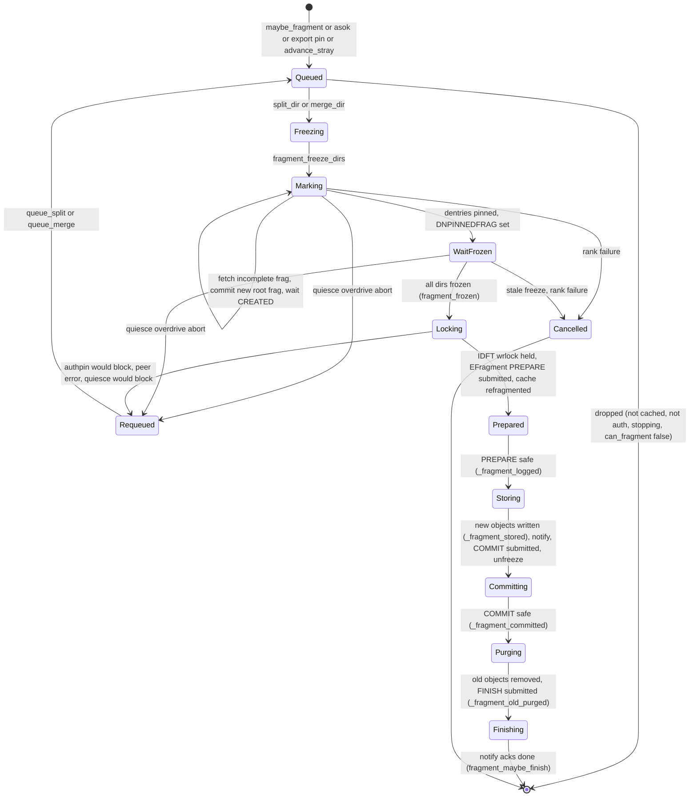
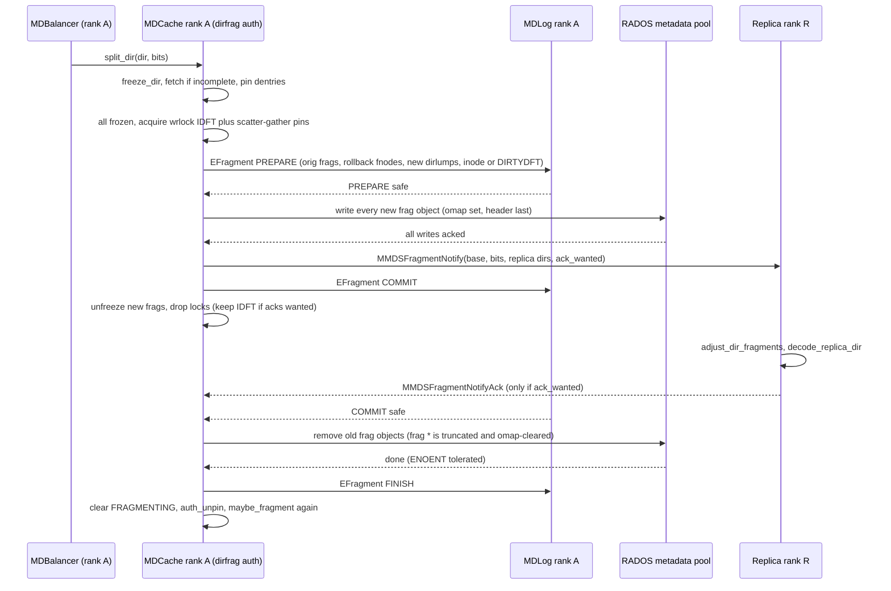
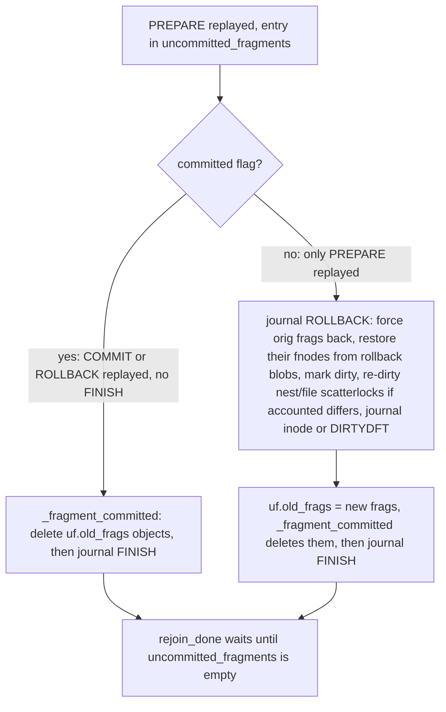

# Directory fragmentation: fragtrees, split/merge protocol, recovery and client effects

> Part of the [C++ MDS project map](../README.md). Sources: `src/include/frag.h` (~470 LOC), `src/include/ceph_frag.h` (~110), `src/common/frag.cc` (~260), `src/common/ceph_hash.cc` (~130), `src/mds/MDCache.cc` (fragment section L11653-12898, ~1250 LOC, plus callers), `src/mds/CDir.cc` (split/merge/freeze, ~450), `src/mds/MDBalancer.cc` (triggers, ~200), `src/mds/events/EFragment.h` (82) and `src/mds/journal.cc` (EFragment replay, ~130), `src/messages/MMDSFragmentNotify.h` + `MMDSFragmentNotifyAck.h` (~145), `src/mds/Server.cc` (readdir, ENOSPC checks, ~350), `src/mds/CInode.cc` (dirfrag helpers, IDFT lock state, ~300), `src/client/Client.cc` (readdir and frag map), kernel `linux/fs/ceph/{inode.c,dir.c,mds_client.c,export.c}`.
>
> Related: [CDir, CDentry and cache objects](cdir-cdentry-and-cache-objects.md), [CInode and inode types](cinode-and-inode-types.md), [subtrees, traversal, replication](mdcache-subtrees-traversal-replication.md), [lock state machines](../05-locking/lock-types-and-state-machines.md), [acquiring locks](../05-locking/acquiring-locks.md), [journal events and replay](../06-journal/events-and-replay.md), [MDLog and Journaler](../06-journal/mdlog-and-journaler.md), [RADOS object catalog](../07-storage-formats/rados-object-catalog.md), [balancer and pinning](../08-multi-mds/balancer-and-pinning.md), [subtree migration](../08-multi-mds/subtree-migration.md), [resolve and rejoin](../09-recovery/resolve-and-rejoin.md), [rank lifecycle and recovery](../09-recovery/rank-lifecycle-and-recovery.md), [lookup, readdir, open](../03-request-path/lookup-readdir-open-and-file-locks.md), [namespace mutations](../03-request-path/namespace-mutations.md), [kclient expectations](../02-client-protocol/kclient-expectations.md), [libcephfs/fuse/Ganesha expectations](../02-client-protocol/libcephfs-fuse-ganesha-expectations.md), [leases, lock caches and async dirops](../02-client-protocol/leases-lock-caches-and-async-dirops.md), [quiesce](../12-qos-metrics-quiesce-quarantine/quiesce.md), [strays and purge](../11-background-services/strays-and-purge.md), [rstats, quotas and subvolumes](../10-snapshots-quotas-subvolumes/rstats-quotas-and-subvolumes.md), [admin commands](../13-admin-and-config/admin-commands.md), [config, perf counters and health](../13-admin-and-config/config-perf-counters-and-health.md).

## 1. Purpose and responsibilities

A CephFS directory is cached and stored as one or more *directory fragments* (dirfrags). Each dirfrag covers a contiguous range of the 24-bit dentry-name hash space, is a separate `CDir` object in the cache, is a separate RADOS object `<ino hex>.<frag hex8>` in the metadata pool, and is the unit of subtree authority and migration between ranks. The fragmentation subsystem:

- defines fragment identifiers (`frag_t`), the per-directory partition (`fragtree_t`, held in `CInode::dirfragtree`) and the dentry-name to fragment mapping (`dir_layout.dl_dir_hash` + `ceph_str_hash`, then `fragtree_t::operator[]`);
- decides when to split (size, fast size, read/write temperature, ephemeral distributed pin, stray-dir rotation) and when to merge (size) (`MDBalancer::maybe_fragment`, `queue_split`, `queue_merge`, `MDCache::advance_stray`);
- executes a split or merge as the internal request `CEPH_MDS_OP_FRAGMENTDIR` using a freeze, journal `EFragment` PREPARE, store new objects, journal COMMIT, purge old objects, journal FINISH protocol (`MDCache::split_dir` / `merge_dir` through `MDCache::fragment_maybe_finish`);
- informs replica ranks (`MMDSFragmentNotify` / `MMDSFragmentNotifyAck`) and the directory inode's auth rank (scatterlock `dirfragtreelock`, lock type `CEPH_LOCK_IDFT`);
- rolls in-flight operations back or forward after a crash (`uncommitted_fragments`, `rollback_uncommitted_fragments`);
- exposes fragment boundaries to clients only as hints (`InodeStat.dirfragtree`, `DirStat` in traces and readdir replies), while readdir positions are hash based and survive refragmentation;
- enforces the per-fragment size limit `mds_bal_fragment_size_max` (ENOSPC on create/link/rename and on unlink when the stray dirfrag is full).

## 2. Source map

| File | Class / function | Lines | Role |
|---|---|---|---|
| `src/include/ceph_frag.h` | `ceph_frag_make`, `ceph_frag_value`, `ceph_frag_mask`, `ceph_frag_contains_value`, `ceph_frag_make_child`, `ceph_frag_next`, ... | 23-109 | Bit encoding of a fragment (shared with the kernel copy `linux/include/linux/ceph/ceph_frag.h`) |
| `src/include/frag.h` | `frag_t` | 81-177 | C++ wrapper: `value()`, `bits()`, `contains()`, `split()`, `next()`, `parent()`, ordering |
| `src/include/frag.h` | `fragtree_t` | 186-417 | Partition of a directory: map of split points, `operator[]`, `get_leaves_under`, `split`, `merge`, `try_assimilate_children` |
| `src/include/frag.h` | `fragset_t` | 431-466 | Set of frags with sibling simplification (used in resolve bound sets) |
| `src/common/frag.cc` | `frag_t::decode`, `operator<<`, `fragtree_t::force_to_leaf`, encoders | 38-257 | Validation and byte-swap repair on decode, printing (`01*`), forcing a frag to be a leaf |
| `src/common/ceph_hash.cc` | `ceph_str_hash_rjenkins`, `ceph_str_hash_linux`, `ceph_str_hash` | 23-106 | Dentry name hash functions |
| `src/mds/CInode.cc` | `InodeStoreBase::hash_dentry_name`, `pick_dirfrag`, `CInode::get_dirfrags_under`, `verify_dirfrags`, `force_dirfrags`, `get_approx_dirfrag`, `get_or_open_dirfrag`, `add_dirfrag`, `close_dirfrag` | 720-900 | Name to frag mapping and the inode's dirfrag map |
| `src/mds/CInode.cc` | `encode_lock_idft`, `decode_lock_idft` | 1856-1934 | Scatter/gather of the fragtree between ranks |
| `src/mds/MDCache.cc` | `adjust_dir_fragments` (two overloads), `force_dir_fragment` | 11668-11860 | In-memory refragmentation, subtree map maintenance |
| `src/mds/MDCache.cc` | `can_fragment`, `split_dir`, `merge_dir`, `fragment_freeze_dirs`, `fragment_mark_and_complete`, `fragment_unmark_unfreeze_dirs`, `fragment_are_all_frozen`, `fragment_freeze_inc_num_waiters`, `find_stale_fragment_freeze` | 11874-12215 | Start, freeze, mark, cancel |
| `src/mds/MDCache.cc` | `fragment_frozen`, `dispatch_fragment_dir`, `_fragment_logged`, `_fragment_stored`, `_fragment_committed`, `_fragment_old_purged`, `fragment_drop_locks`, `fragment_maybe_finish` | 12263-12628 | Main protocol |
| `src/mds/MDCache.cc` | `handle_fragment_notify_ack`, `handle_fragment_notify` | 12631-12708 | Replica side and ack handling |
| `src/mds/MDCache.cc` | `add_uncommitted_fragment`, `finish_uncommitted_fragment`, `rollback_uncommitted_fragment`, `wait_for_uncommitted_fragments`, `rollback_uncommitted_fragments` | 12710-12869 | Recovery bookkeeping, rollback and roll-forward |
| `src/mds/MDCache.cc` | `quiesce_overdrive_fragmenting_async` | 14019-14055 | Quiesce aborts a freezing fragment op |
| `src/mds/MDCache.h` | `dirfrag_killpoint`, `ufragment`, `fragment_info_t`, `uncommitted_fragments`, `fragments` | 1468-1510, 1628-1630 | State |
| `src/mds/CDir.cc` | `steal_dentry`, `prepare_old_fragment`, `prepare_new_fragment`, `finish_old_fragment`, `init_fragment_pins`, `should_split`, `split`, `merge` | 883-1226 | Dentry repartitioning and stats invariants |
| `src/mds/CDir.cc` | `should_split_fast`, `should_merge` | 3871-3920 | Size tests |
| `src/mds/CDir.cc` | `freeze_dir`, `_freeze_dir`, `unfreeze_dir`, `maybe_finish_freeze`, `can_auth_pin` | 3528-3663 | Dirfrag freeze mechanics |
| `src/mds/CDir.cc` | `_omap_commit`, `_omap_commit_ops` | 2465-2704 | Full write of a new (FRAGMENTING) dirfrag object |
| `src/mds/MDBalancer.cc` | `queue_split`, `queue_merge`, `is_fragment_pending`, `maybe_fragment`, `hit_dir`, `handle_export_pins` | 152-760, 1296-1338 | Triggers and debouncing |
| `src/mds/events/EFragment.h` | `EFragment`, `dirfrag_rollback` | 22-80 | Journal event |
| `src/mds/journal.cc` | `EFragment::replay`, `encode`, `decode`, `dirfrag_rollback::encode/decode` | 2978-3097 | Replay |
| `src/mds/journal.cc` | `LogSegment::try_to_expire`, `EMetaBlob::replay`, `EMetaBlob::fullbit::update_inode` | 127-215, 1239-1350, 636-660 | Segment expiry blocking, replay-time refragmentation |
| `src/messages/MMDSFragmentNotify.h`, `MMDSFragmentNotifyAck.h` | message classes | 21-77, 21-63 | Inter-MDS messages |
| `src/mds/Server.cc` | `check_fragment_space`, `check_dir_max_entries`, `prepare_stray_dentry`, `try_open_auth_dirfrag`, `_lookup_snap_ino`, `_finalize_readdir`, `handle_client_readdir`, `set_trace_dist` | 2491-5330 | Client-facing frag handling |
| `src/mds/MDSRank.cc` | `command_dirfrag_split`, `command_dirfrag_merge`, `command_dirfrag_ls`, `reopen_log`, `rejoin_done`, `MDSRankDispatcher::tick` | 710-760, 1970-2060, 3379-3525 | Admin commands, recovery hooks, stale-freeze tick |
| `src/mds/Locker.cc` | `notify_freeze_waiter`, `drop_locks_for_fragment_unfreeze`, `should_defer_client_cap_frozen`, `check_inode_max_size` | 758-790, 968-985, 3077-3110, 3363-3383 | Locking interactions |

## 3. How it works

### 3.1 Fragment identifiers (`frag_t`)

A fragment is a 32-bit word: the upper 8 bits are `bits` (depth), the lower 24 bits are `value`; the value uses the *most significant* bits of the 24-bit field so values sort logically (`src/include/ceph_frag.h:6` header comment, `ceph_frag_make` at `src/include/ceph_frag.h:23`).

| Helper | Definition (all in `src/include/ceph_frag.h`) |
|---|---|
| `ceph_frag_make(b, v)` | `(b << 24) \| (v & (0xffffff << (24-b)) & 0xffffff)` (L23) |
| `ceph_frag_mask(f)` | `(0xffffff << (24-bits)) & 0xffffff` (L36) |
| `ceph_frag_contains_value(f, v)` | `(v & mask(f)) == value(f)`; only bits 23..(24-bits) of a 32-bit hash matter (L45) |
| `ceph_frag_make_child(f, by, i)` | `make(bits+by, value \| (i << (24-bits-by)))` (L85) |
| `ceph_frag_next(f)` | `make(bits, value + (0x1000000 >> bits))`, used by clients to walk frags left to right (L99) |
| `ceph_frag_is_rightmost(f)` | `value == mask` (L95) |
| `ceph_frag_compare(a, b)` | by value, then bits (`src/common/ceph_frag.cc:6`) |

`frag_t` wraps the encoding (`src/include/frag.h:81`). `operator<` orders by value then bits, so a parent sorts before its first child (`src/include/frag.h:167`). `is_frag_valid()` requires `bits <= 24` and no value bits outside the mask (`src/include/frag.h:104`). `frag_t::decode` rejects invalid encodings; if the byte-swapped word is valid it is silently corrected (tracker 73792), otherwise it throws `malformed_input` (`src/common/frag.cc:42` (frag_t::decode)). Printing shows the value bits in binary followed by `*` (`*` for the root, `101*` for value `0xa00000` with 3 bits) (`src/common/frag.cc:77` (operator<<)). The admin parser accepts `"%x/%d"`, i.e. hex value field and bit count, e.g. `a00000/3` (`src/common/frag.cc:28` (frag_t::parse)).

Example, splitting the root of directory `0x10000000000` by 3 bits (default `mds_bal_split_bits`): children `000*`..`111*` are encoded `0x03000000, 0x03200000, 0x03400000, 0x03600000, 0x03800000, 0x03a00000, 0x03c00000, 0x03e00000`, stored in objects `10000000000.03000000` .. `10000000000.03e00000` (`src/mds/CInode.cc:1262` (InodeStoreBase::get_object_name) uses `"%llx.%08llx"`). A dentry whose hash `h` has `(h >> 21) & 7 == i` lands in child `i`.

Gotcha: `ceph_frag_is_right_child` compares a masked bit with `== 1`, which is only true for `bits == 24` (`src/include/ceph_frag.h:66`); `frag_t::is_right()` is unused in the tree (grep). The `frag.h` comment saying the right-most bit is most significant (`src/include/frag.h:68`) contradicts the actual MSB-first encoding.

### 3.2 Fragment trees (`fragtree_t`) and `fragset_t`

`fragtree_t::_splits` is a `compact_map<frag_t, int32_t>` holding only internal nodes: "frag `f` is split by `b` bits"; any frag not in the map is a leaf if reachable (`src/include/frag.h:186-191`). Key operations:

| Operation | Semantics | Code |
|---|---|---|
| `operator` | Walk from root, choosing the child containing `v`, until a leaf | `src/include/frag.h:339` |
| `get_leaves()` / `get_leaves_under(x)` | All leaves (under `x`); returns nothing if `x` lies strictly inside a leaf | `src/include/frag.h:228`, `:296` |
| `is_leaf(x)` | `get_leaves_under(x) == {x}` | `src/include/frag.h:217` |
| `split(x, b)` | Asserts `x` is a leaf, records the split, then `try_assimilate_children(get_branch_above(x))` | `src/include/frag.h:365` |
| `merge(x, b)` | Asserts `_splits[x] == b`, erases | `src/include/frag.h:372` |
| `try_assimilate_children(x)` | If all children of `x` are split by the same `c`, replace with one split of `x` by `nb + c` (canonical form) | `src/include/frag.h:385` |
| `force_to_leaf(x)` | Makes `x` a leaf: split the containing leaf down to `x` (adding intermediate splits) or "hoover up" (merge) everything under `x` | `src/common/frag.cc:88` |

Encoding: `u32 count` followed by `count` pairs `(u32 frag, i32 bits)` in `frag_t` order (`src/common/frag.cc:144`, `src/include/compact_map.h:300`). The kernel decodes the same bytes as `struct ceph_frag_tree_head { __le32 nsplits; struct { __le32 frag; __le32 by; } splits[]; }` (`linux/include/linux/ceph/ceph_fs.h:554-562`).

`fragset_t::simplify()` replaces sibling pairs by their parent (`src/common/frag.cc:231`); it is used when interpreting peer subtree bounds during resolve (`src/mds/MDCache.cc:1252` (MDCache::get_force_dirfrag_bound_set)).

### 3.3 Mapping dentry names to fragments

- Each directory inode carries `inode_t::dir_layout` (`struct ceph_dir_layout { __u8 dl_dir_hash; __u8 dl_unused1; __u16 dl_unused2; __u32 dl_unused3; }`, `src/include/ceph_fs.h:87`). New directories get `dl_dir_hash = mds_default_dir_hash` (default 2 = `CEPH_STR_HASH_RJENKINS`) (`src/mds/Server.cc:3707` (Server::prepare_new_inode), `src/mds/MDCache.cc:458` (MDCache::create_unlinked_system_inode, used by create_system_inode), `src/common/options/mds.yaml.in:566`). The hash function is therefore fixed per directory at creation and never changes afterwards. The only other assignments are placeholder inodes created during rejoin (`src/mds/MDCache.cc:4779` (MDCache::rejoin_invent_dirfrag), `:5088`, `:5161` (MDCache::handle_cache_rejoin_ack)), which are overwritten when the real inode arrives. Inodes decoded from an `inode_t` encoding older than v4 get `dl_dir_hash = 0` and are hashed with LINUX (`src/include/cephfs/types.h:1139-1144`).
- `InodeStoreBase::hash_dentry_name(dn)` returns `ceph_str_hash(dl_dir_hash ? dl_dir_hash : CEPH_STR_HASH_LINUX, name)` (`src/mds/CInode.cc:720`). `CEPH_STR_HASH_LINUX = 1` is `hash = (hash + (c<<4) + (c>>4)) * 11` over unsigned bytes; `CEPH_STR_HASH_RJENKINS = 2` is Bob Jenkins' 96-bit-state mix returning `c` (`src/common/ceph_hash.cc:23`, `:84`).
- `pick_dirfrag(dn)` returns `frag_t()` without hashing if the fragtree is empty, else `dirfragtree[hash]` (`src/mds/CInode.cc:729` (InodeStoreBase::pick_dirfrag)). Every name-based lookup goes through it: path traversal (`src/mds/MDCache.cc:8558` (MDCache::path_traverse)), discover (`:10746` (MDCache::handle_discover)), stray placement (`:919` (MDCache::get_stray_dir)), client lease messages (`src/mds/Locker.cc:4486` (Locker::handle_client_lease)) and dentry repartitioning in `CDir::split`. `hash_dentry_name` asserts that the hash type is valid (1 or 2).
- Inside a `CDir`, dentries are kept in a map keyed by `dentry_key_t(snapid last, name, hash)` ordered by `ceph_frag_value(hash)` (low 24 bits), then name, then snapid (`src/mds/mdstypes.h:410` (operator<)). This is the "hash order" that readdir exposes.
- On-disk dentry keys are `name_head` / `name_<snap>` strings (omap order is lexicographic, independent of hash order); see [CDir, CDentry and cache objects](cdir-cdentry-and-cache-objects.md).

### 3.4 Where the fragtree lives and how it stays consistent

- `CInode::dirfragtree` (`src/mds/CInode.h:186`, comment "always consistent with our dirfrag map"). It is **not projected**: `projected_inode` holds only `inode`, `xattrs`, `snapnode` (`src/mds/CInode.h:518`), and `adjust_dir_fragments` modifies the tree in place (`src/mds/MDCache.cc:11747-11751`).
- Persisted as part of the directory inode's `InodeStore` encoding, i.e. inside the parent directory's dentry value (`src/mds/CInode.cc:1691` (InodeStoreBase::encode_bare), pre-encoded per child in `src/mds/CDir.cc:2747` (CDir::_parse_dentry)). Base inodes (`/`, `~mdsN`) have no parent dentry; their `InodeStore`, tree included, is written to the `<ino>.00000000.inode` object (`src/mds/CInode.cc:1271` (CInode::store)). Journaled in every `EMetaBlob::fullbit` of the inode (`src/mds/events/EMetaBlob.h:76`, `:481`).
- The set of open `CDir`s must be leaves of the tree. `CInode::verify_dirfrags` asserts it (`src/mds/CInode.cc:783`). Fragment code calls it only when `mds_debug_frag` is set (`src/mds/MDCache.cc:12365`, `src/mds/journal.cc:3025`, `src/mds/CInode.cc:1929`); `force_dirfrags` always calls it (`src/mds/CInode.cc:815`). Replay of a fullbit with a different tree replaces the tree and calls `force_dirfrags()`, which refragments open dirfrags to match (`src/mds/journal.cc:646-650` (EMetaBlob::fullbit::update_inode), `src/mds/CInode.cc:796` (CInode::force_dirfrags)).
- `dirfragtreelock` is a `ScatterLock` (`CEPH_LOCK_IDFT = 1<<9`, state machine `sm_scatterlock`) (`src/include/ceph_fs.h:343`, `src/mds/SimpleLock.h:58`). In `sm_scatterlock`, rdlock is possible only in `LOCK_SYNC`; wrlock in `LOCK_LOCK` (auth only) or `LOCK_MIX` (any rank) (`src/mds/locks.c:53`). Readers: readdir (`src/mds/Server.cc:5125`), readdir_snapdiff (`:12286`), snapshot lookup by hash (`:4591`), export (`src/mds/Migrator.cc:893`, `:1235`, `:1259`), the internal stats-repair and `rdlock_dirfrags_stats` ops (`src/mds/MDCache.cc:13633`, `:13735`, `:13834`), and the `lock path` admin op (`src/mds/MDCache.cc:14550`). Writers: fragment operations (`src/mds/MDCache.cc:12324`) and the auth's scatter writebehind, which forces a wrlock to journal a dirty tree (`src/mds/Locker.cc:5270` (Locker::scatter_writebehind)).

### 3.5 When splits and merges are triggered

All automatic triggers go through `MDBalancer` and end in `MDCache::split_dir` / `MDCache::merge_dir`.

| Trigger | Condition | Path |
|---|---|---|
| Size split (delayed) | `should_split()`: `split_size > 0 && projected fragstat.size() + num_snap_items > mds_bal_split_size` (`src/mds/CDir.cc:1036`) | `maybe_fragment` -> `queue_split(dir, false)`: timer `mds_bal_fragment_interval` seconds, only if not already in `split_pending` (`src/mds/MDBalancer.cc:1305-1308`, `:664-670`) |
| Fast split (immediate) | Already pending and `should_split_fast()`: with `limit = mds_bal_split_size * mds_bal_fragment_fast_factor`, true if projected `fragstat.size() > limit`, or (when `size + num_head_null > limit`) if the number of cached dentries whose projected linkage is non-null exceeds `limit` (`src/mds/CDir.cc:3871`) | `queue_split(dir, true)`: `mds->queue_waiter` (runs after the current dispatch) (`src/mds/MDBalancer.cc:1309-1311`, `:659-663`) |
| Temperature split | `hit_dir`: decayed `pop_me` IRD counter `> mds_bal_split_rd` or IWR counter `> mds_bal_split_wr` (`src/mds/MDBalancer.cc:1325-1338`); counters decay with `mds_decay_halflife` (`src/mds/MDCache.cc:210`, `src/mds/CDir.cc:218`) | same as size split (`hot` argument). READDIR hits (`META_POP_READDIR`) do not count toward `mds_bal_split_rd` |
| Size merge | `should_merge()`: not root frag, `fragstat.size() + num_snap_items < mds_bal_merge_size`, and not below the ephemeral-distributed minimum (`src/mds/CDir.cc:3906`) | `queue_merge`: timer only, once per frag via `merge_pending` (`src/mds/MDBalancer.cc:1318-1321`, `:748-755`). Callback climbs from the frag toward the root (stopping at depth `export_ephemeral_dist_frag_bits` for distributed-pinned dirs) while all dirfrags under the sibling are in cache (`get_dirfrags_under(sib).first`), auth and `should_merge()`, then merges to the highest qualifying ancestor (`src/mds/MDBalancer.cc:716-745`) |
| Ephemeral distributed pin | `ceph.dir.pin.distributed` dirs are split until `frag.bits() >= export_ephemeral_dist_frag_bits = ceil(log2(mds_export_ephemeral_distributed_factor * max_mds))` (0 when `max_mds <= 1`) | `handle_export_pins` -> `queue_split(dir, true)` (`src/mds/MDBalancer.cc:197`); bit count raised in the callback (`:648-652`); computation at `src/mds/MDCache.cc:14676-14686` (MDCache::handle_mdsmap) |
| Stray directories | After each rotation of `stray_index`, the stray dir three slots ahead, `(stray_index + 3) % NUM_STRAY`, has its frags split (fast path, `queue_split(dir, true)`) or merged if `should_split`/`should_merge`; rotation skips a stray dir that is still fragmenting | `src/mds/MDCache.cc:776-814` (MDCache::advance_stray) |
| Opportunistic | openc, mknod, mkdir, symlink, link and rename call `maybe_fragment(dir, false)` right after `journal_and_reply` ("an early chance to split the dir if this ... makes it oversized"); every `hit_dir` call (lookups, getattr, open, unlink/link/rename finish, dirfrag fetch and commit, readdir) also calls it | `src/mds/Server.cc:5046`, `:7682`, `:7786`, `:7851`, `:7993`, `:9766`; `src/mds/MDBalancer.cc:1338` |
| End of a fragment op | Each resulting frag is re-evaluated (may split again immediately) | `src/mds/MDCache.cc:12624` (MDCache::fragment_maybe_finish) |
| End of dir scrub | `mdcache->maybe_fragment(dir)` | `src/mds/ScrubStack.cc:559` |
| Admin | `dirfrag split` / `dirfrag merge` asok/tell | `src/mds/MDSRank.cc:3428`, `:3454` |
| Test | `mds_thrash_fragments` (random split by 1 or `queue_merge`) | `src/mds/MDSRank.cc:1135-1153` (MDSRank::_dispatch) |

`maybe_fragment` itself only acts if `mds_bal_fragment_dirs` is true, `mds_bal_fragment_interval > 0`, the dirfrag is auth, the inode is not a base inode (root, mdsdir, global snaprealm) and not a stray directory (`src/mds/MDBalancer.cc:1299-1302`). The timer/waiter callback drops the request if the rank is stopping, the dirfrag is no longer in cache, or it is no longer auth (`src/mds/MDBalancer.cc:613-642`, `:677-706`). Both a timer and a waiter can be armed for one split; whichever runs second finds the entry already erased from `split_pending` and returns (`src/mds/MDBalancer.cc:614-620`).

### 3.6 Preconditions

`MDCache::can_fragment(diri, dirs)` (`src/mds/MDCache.cc:11874`) refuses when any of these hold (no error is reported; the op is silently dropped):

| Refusal | Code |
|---|---|
| File system read-only | `:11876` |
| `mds->is_cluster_degraded()` (any rank failed, damaged, or in replay..clientreplay) | `:11880`, `src/mds/MDSMap.cc:1287` |
| Directory's parent is a stray directory (unlinked dir) | `:11884` |
| `diri` is an mdsdir (`~mdsN`) or `CEPH_INO_CEPH` (`/.ceph`) | `:11889` |
| `diri->is_quiesced()` | `:11893` |
| `diri` is the root directory (added in commit f4bcf5bfd53, 2025) | `:11897` |
| Any dir: scrub in progress, `STATE_FRAGMENTING`, not auth, bad (`STATE_BADFRAG`), freezing or frozen (dir or tree) | `:11902-11925` |

Additional checks: `split_dir` drops the split if `frag.bits() + bits > 24` (`src/mds/MDCache.cc:11944`); `merge_dir` requires every frag under the target to be in cache (`get_dirfrags_under(frag).first`) and the target not to be a leaf already (`src/mds/MDCache.cc:11968-11977`). `merge_dir` computes `bits` from the first source frag only; for mixed-depth merges the magnitude is only informational (journal, counters, notify), because merging always uses `force_to_leaf` on the base (`src/mds/MDCache.cc:11983`, `:11747`).

### 3.7 The fragment operation on the dirfrag auth

Step by step:

1. **Start** (`split_dir` `src/mds/MDCache.cc:11930`, `merge_dir` `:11964`). Creates an internal `MDRequest` with `internal_op = CEPH_MDS_OP_FRAGMENTDIR` (0x01500), `reqid = (mds.<rank>, issue_tid())` (`src/mds/MDCache.cc:9870` (MDCache::request_start_internal)); sets `more()->fragment_base` to the base dirfrag (split: the source dirfrag; merge: `(ino, target frag)`). Inserts `fragments[base] = {mdr, dirs, bits (+split / -merge), last_cum_auth_pins_change = now}`; asserts no existing entry for the base.
2. **Freeze** (`fragment_freeze_dirs`, `src/mds/MDCache.cc:12002`). For each source dir: `auth_pin(dir)` ("until we mark and complete them"), set `CDir::STATE_FRAGMENTING`, `freeze_dir()` (asserts it is now `FREEZINGDIR`; `freeze_dir` takes its own auth pin and, if not immediately freezable, sets `STATE_FREEZINGDIR` and invalidates lock caches that auth-pin the dir, `src/mds/CDir.cc:3610-3627`). If some sources are subtree roots and some are not, the non-roots are made aux subtree roots (`STATE_AUXSUBTREE`, `adjust_subtree_auth(dir, me)`) so the set is homogeneous (`:12018-12027`).
3. **Mark and complete** (`fragment_mark_and_complete`, `src/mds/MDCache.cc:12040`). Exits with `request_finish` if the `fragments` entry vanished or belongs to another mdr ("must have aborted"). For each dir: if not complete, `fetch(gather, ignore_authpinnability=true)` (a full fetch of all keys); if it is the root frag `*` and still `STATE_CREATING`, wait `WAIT_CREATED`; if it is a never-committed (`is_new()`) root frag, `commit` it first, because "the COMPLETE flag gets lost if we fragment a new dirfrag, then rollback the operation" and a later fetch would find no object (`:12062-12075`). Once ready and not yet marked: every dentry gets `PIN_FRAGMENTING` and `CDentry::STATE_FRAGMENTING`, dir gets `STATE_DNPINNEDFRAG`, and the step-2 auth pin is released (`:12080-12092`); dentries added later to a `DNPINNEDFRAG` dir are pinned automatically (`src/mds/CDir.cc:410`, `:462`, `:502`). Pending fetches/commits re-enter this function (`C_MDC_FragmentMarking`). Then, for dirs not yet frozen, register `WAIT_FROZEN` waiters and flush the journal "so that request auth_pins are retired" (`:12100-12112`).
4. **Frozen** (`fragment_frozen`, `src/mds/MDCache.cc:12263`). The freeze completes when the dir has no nested auth pins and only the freeze's own auth pin (`src/mds/CDir.cc:3565` (CDir::maybe_finish_freeze)); a non-subtree-root frozen dir auth-pins its inode for the duration (`src/mds/CDir.cc:3629` (CDir::_freeze_dir)). With `r < 0` (freeze cancelled) the mdr is finished. Otherwise `all_frozen = true` and `dispatch_fragment_dir`.
5. **Locks** (`dispatch_fragment_dir`, `src/mds/MDCache.cc:12282`). Aborts if `more()->peer_error` is set. If locks are not yet held: aborts if `diri->will_block_for_quiesce(mdr)` (taking the locks would wait on the inode's `quiescelock` while dirs are frozen, a deadlock with `quiesce_inode` ops on children) (`:12310-12320`); otherwise `acquire_locks(mdr, {wrlock dirfragtreelock, lock_scatter_gather(nestlock), lock_scatter_gather(filelock)}, nullptr, auth_pin_nonblocking=true)` (`:12322-12334`). `lock_scatter_gather` is `WRLOCK | STATE_PIN`: "prevent a racing gather", checked against the lock's exclusive client so a loner's EXCL state is not revoked (`src/mds/Mutation.h:126`, `src/mds/Locker.cc:361`, `:1996`). With the nonblocking flag, a failed auth pin sets `mdr->aborted` instead of waiting (`src/mds/Locker.cc:475-478`), and remote auth-pin requests are marked nonblocking (`src/mds/Locker.cc:546-547`). The filelock wrlock makes `acquire_locks` add a wrlock on `diri->quiescelock` (cap-shift locks only) (`src/mds/Locker.cc:370-375`).
6. **Abort path** (`src/mds/MDCache.cc:12338-12350`): re-queue (`queue_split(dir, false)` or `queue_merge(dir)`), `fragment_unmark_unfreeze_dirs` (unpin dentries or drop the step-2 auth pin, `unfreeze_dir`), erase the `fragments` entry, `request_finish`.
7. **PREPARE** (`src/mds/MDCache.cc:12352-12410`):
   - `mdr->ls = current segment`; `EFragment(OP_PREPARE, base, bits)`; for each source dir `add_orig_frag(frag, dirfrag_rollback{fnode})` (the rollback blob holds the full pre-op `fnode_t` of each source frag).
   - **Refragment in memory** with `adjust_dir_fragments(diri, dirs, base, bits, &resultfrags, waiters, replay=false)` (section 3.8) and queue the waiters taken from the old frags.
   - Metablob: `add_dir_context(first result)`, then one dirlump per result frag via `add_fragmented_dir(dir, dirty=false, dirtydft)`; `dirtydft` is true (and `CDir::STATE_DIRTYDFT` set) when this rank is not the inode auth.
   - Fragtree change: if `diri` is auth, `project_inode` + `pre_dirty` version + `predirty_journal_parents(PREDIRTY_PRIMARY)` + `journal_dirty_inode` (the fullbit carries the already-modified tree). Else mark `dirfragtreelock` updated and put the inode on `ls->dirty_dirfrag_dirfragtree` (scatter to the auth later, section 3.10).
   - `add_uncommitted_fragment(base, bits, orig_frags, ls)` (no rollback blob in live operation), `submit_mdlog_entry(le, C_MDC_FragmentPrep)`, `mdlog->flush()`.
8. **Store** (`_fragment_logged`, `src/mds/MDCache.cc:12413`): `mdr->apply()` (pops the projected inode / marks the scatterlock dirty); for each result frag `mark_dirty(ls)`, `mark_new(ls)`, `auth_pin(this)`, set `STATE_FRAGMENTING`, `commit(0, gather, ignore_authpinnability=true)`. Because the dir is `FRAGMENTING && is_new()`, `_omap_commit` writes **every non-null dentry** (not only dirty ones) (`src/mds/CDir.cc:2624`, `:2677`); the new object is created without the `stat` guard used for existing objects, writes are split by `mds_dir_max_commit_size` and the omap header (`fnode`) is written in the last op (`src/mds/CDir.cc:2491-2597` (CDir::_omap_commit_ops)). The omap encoding and `objecter->mutate` calls run on the MDS finisher thread without `mds_lock` (`src/mds/CDir.cc:2464` comment "This is not locked by mds_lock").
9. **Stored** (`_fragment_stored`, `src/mds/MDCache.cc:12445`):
   - For each replica rank of the first result frag (after split all children copy the source replica map; after merge the maps are merged) whose state is `>= REJOIN` and that is not still in `rejoin_gather`, send `MMDSFragmentNotify(base, bits, tid = mdr->reqid.tid)` with `encode_replica_dir` of every result frag (`:12460-12498`). `ack_wanted` is set (and the rank added to `notify_ack_waiting`) only if the first result frag is a subtree root, this rank is not the inode auth, and the replica is not the inode auth (`:12457-12489`; the comment at `:12470-12485` explains the trim race this prevents).
   - Submit `EFragment(OP_COMMIT)` with `C_MDC_FragmentCommit` (no explicit flush) (`:12501-12502`).
   - Unpin every dentry (`STATE_FRAGMENTING`, `PIN_FRAGMENTING`) and `unfreeze_dir()` each result frag; queued requests resume here (`:12506-12518`).
   - If no acks are pending: `fragment_drop_locks` (drop all locks, `request_finish`). Else drop every lock except IDFT (`src/mds/Locker.cc:968` (Locker::drop_locks_for_fragment_unfreeze)).
   - Result frags keep `STATE_FRAGMENTING` and an `MDCache` auth pin until step 12: they cannot be fragmented again or frozen for export in the meantime.
10. **Committed** (`_fragment_committed`, `src/mds/MDCache.cc:12529`): for each `uf.old_frags`, RADOS-mutate object `<ino>.<frag>`: `remove()`, except the root frag `*`, which gets `truncate(0)` + `omap_clear()` because `<ino>.00000000` also carries the directory backtrace (`src/mds/CInode.cc:1465` (CInode::_commit_ops), `src/mds/CInode.cc:5585` (CInode::get_backtrace_pool)). Completion `C_IO_MDC_FragmentPurgeOld` asserts `r == 0 || r == -ENOENT`. On the OSD, `remove` of a missing object returns ENOENT. For a missing `<ino>.00000000`, `truncate` is a no-op but `omap_clear` returns ENOENT, so the compound op fails with ENOENT and creates nothing (`src/osd/PrimaryLogPG.cc:8487` (PrimaryLogPG::_delete_oid), `:7142-7143`, `:8195-8196`). Repeating the purge is therefore idempotent.
11. **Old purged** (`_fragment_old_purged`, `src/mds/MDCache.cc:12569`): submit `EFragment(OP_FINISH)` (no context), `finish_uncommitted_fragment(base, OP_FINISH)` (erases the entry, wakes segment-expiry and rejoin waiters), increment `mds.dir_split` (bits > 0) or `mds.dir_merge`. If driven by a live mdr: `finishing = true` and `fragment_maybe_finish` unless acks are still pending.
12. **Finish** (`fragment_maybe_finish`, `src/mds/MDCache.cc:12608`; also reached from `handle_fragment_notify_ack` when the last ack arrives, `:12648-12651`): clear `STATE_FRAGMENTING`, `auth_unpin(this)`, `balancer->maybe_fragment(dir, false)` for each result frag, erase the `fragments` entry.

Phase summary on the dirfrag auth:

| Phase | Source frags | Result frags | Locks held by the op | Durable state |
|---|---|---|---|---|
| Freezing / marking | `FRAGMENTING`, `FREEZINGDIR`, dentries pinned after marking | n/a | none | old objects |
| Frozen, before PREPARE | `FROZENDIR` | n/a | IDFT wrlock, filelock + nestlock STATE_PIN wrlocks, quiescelock wrlock, auth pin on inode | old objects |
| PREPARE submitted .. new objects stored | closed (`close_dirfrag`) | frozen (born frozen by `prepare_new_fragment`), complete, dentries pinned | same | PREPARE (once safe) |
| Stored .. COMMIT safe | gone | unfrozen, `FRAGMENTING`, MDCache auth pin | none, or IDFT only while acks are pending | new objects complete; old objects still present (stale) |
| COMMIT safe .. FINISH | gone | `FRAGMENTING` | as above | old objects being removed |

### 3.8 In-memory refragmentation

`MDCache::adjust_dir_fragments(diri, srcfrags, basefrag, bits, resultfrags, waiters, replay)` (`src/mds/MDCache.cc:11734`):

- Fragtree: if `basefrag` is not a leaf, `force_to_leaf(basefrag)` ("we may have discovered the inode while it was being fragmented"; for merges this is what merges the tree); if `bits > 0`, `split(basefrag, bits)` (`:11747-11751`). With no source dirs in cache only the tree changes.
- Split (`bits > 0`, exactly one source): `CDir::split`; if the source was a subtree root, every child becomes its own subtree root, replaces the source in its parent subtree's bound set, and the source's bounds are redistributed to the child that now contains each bound (`get_subtree_root(bound->get_parent_dir())`) (`:11764-11800`); then `close_dirfrag(source)`.
- Merge: sources must be all subtree roots or none (asserted; `fragment_freeze_dirs` already made a mixed set homogeneous, so the aux-subtree code after the assert is defensive). If they are subtree roots, their bound sets are unioned and the merged frag replaces them in the parent's bound set (`:11807-11856`); `new CDir(diri, basefrag)` + `CDir::merge`.

`CDir::split(bits, subs, waiters, replay)` (`src/mds/CDir.cc:1042`):

- Asserts `replay || is_complete() || !is_auth()`.
- Pending stat deltas: if `accounted_rstat.version == inode rstat.version`, `rstatdiff = accounted_rstat - rstat`; same for fragstat with `dirstat.version` (`:1058-1064`).
- `prepare_old_fragment`: auth-pin the old frag (live, auth) and take its per-dentry waiters (`:959`).
- For each child: `new CDir`, inherit state `MASK_STATE_FRAGMENT_KEPT | STATE_COMPLETE` (`DIRTY`, `EXPORTBOUND`, `IMPORTBOUND`, `AUXSUBTREE`, `REJOINUNDEF`, `COMPLETE`; `src/mds/CDir.h:171`), copy the replica map, scale `pop_me`, `pop_nested`, `pop_auth_subtree`, `pop_auth_subtree_nested` by `1/2^bits`, copy `dir_auth` and `freeze_tree_state`, `prepare_new_fragment` (live auth: `_freeze_dir()` + `mark_complete()`; always `inode->add_dirfrag`) (`src/mds/CDir.cc:976`), `init_fragment_pins` (`:1069-1094`).
- Repartition: each dentry moves to child `n = (subfrag.value() & (subfrag.mask() ^ frag.mask())) >> subfrag.mask_shift()` where `subfrag = inode->pick_dirfrag(name)` (uses the already-updated tree) via `steal_dentry` (`:1096-1106`). Dentry waiters are redistributed by name hash (`:1108-1117`).
- `steal_dentry` (`src/mds/CDir.cc:883`) moves the `CDentry` object itself (state, locks, client leases, replica map, pins) and recomputes counters on the destination: head/snap item and null counts, `fragstat.nfiles/nsubdirs` from the linkage (remote links by `d_type`), `rstat` summed from each primary child's `accounted_rstat`, `num_inodes_with_caps` (which also moves the frag's OpenFileTable registration, `src/mds/CDir.cc:316` (CDir::adjust_num_inodes_with_caps)), `dirty_rstat_inodes`, dirty dentry list and `num_dirty`, and moves nested auth pins.
- Each child gets `fnode.version = projected_version = old version`, `rstat.version`/`fragstat.version` = the inode's projected versions, `accounted_* = *`; the first child also gets the old pending delta added to its `accounted_*`, so the next scatter-gather still propagates it ("give any outstanding frag stat differential to first frag", `:1122-1140`).
- `finish_old_fragment`: take all `WAIT_ANY_MASK` waiters into `waiters` (for `CDir` this mask is only the low four bits: dentry, complete, frozen, created; `src/mds/CDir.h:194`), then, live and auth only, auth-unpin and `unfreeze_dir()` the old frag, which queues its `WAIT_UNFREEZE` waiters (mask bit 59, not in `WAIT_ANY_MASK`) on the MDS finished queue. It then asserts that no auth pins remain, drop replica map, dirty flag and subtree/bound pins (`src/mds/CDir.cc:985`).

`CDir::merge(subs, waiters, replay)` (`src/mds/CDir.cc:1145`) mirrors this: takes `dir_auth` and `freeze_tree_state` from the first sub (asserting all equal), `prepare_new_fragment`, accumulates each sub's pending deltas, steals all dentries, merges replica maps (max nonce per rank), takes the max fnode version, ORs `MASK_STATE_FRAGMENT_KEPT` state, `finish_old_fragment` + `close_dirfrag` each sub, re-attaches dentry waiters, `mark_complete` (live auth), sets `accounted_* = * + delta`. Popularity counters of the merged frag start from zero (no `pop_*` merging in `CDir::merge`).

`MDCache::force_dir_fragment(diri, fg, replay=true)` (`src/mds/MDCache.cc:11681`) makes `fg` exist in cache: return it if open; else split the nearest open ancestor by the bit difference; else merge whatever is open under `fg`; else return null. `get_force_dirfrag(df, replay)` wraps it (`src/mds/MDCache.h:903`). It is used by replay (every `EMetaBlob` dirlump, `src/mds/journal.cc:1291` (EMetaBlob::replay); `ESubtreeMap::replay`, `:2883`), rollback, resolve (`src/mds/MDCache.cc:3404` (MDCache::handle_resolve), `:3679` (MDCache::disambiguate_other_imports)) and rejoin ack (`src/mds/MDCache.cc:5072-5077` (MDCache::handle_cache_rejoin_ack)). `get_force_dirfrag_bound_set` only splits, never merges ("split if one of our frags spans the provided bounding set") (`src/mds/MDCache.cc:1252`).

### 3.9 Replicas: `MMDSFragmentNotify` and `MMDSFragmentNotifyAck`

`handle_fragment_notify` (`src/mds/MDCache.cc:12655`), run on every replica that received a notify:

- Dropped if the local rank is in a state before `REJOIN`.
- The directory inode must be in cache (`ceph_abort()` otherwise). Replicas keep it: `trim_inode` refuses to trim a replica dir inode whose `dirfragtreelock` cannot be rdlocked, because a fragment op on the auth holds it out of SYNC and "MMDSFragmentNotify only replicates the new dirfrags" (`src/mds/MDCache.cc:7313-7322` (MDCache::trim_inode)).
- `adjust_dir_fragments(diri, base, bits, ...)` (non-auth split/merge: no freeze, no auth pins), take inode dir-waiters for each resulting frag, `decode_replica_dir` each encoded frag (updates nonce and base fnode; if a frag was not open it is forced to leaf in the tree and added, and a subtree boundary is created when the sender is not the inode auth) (`src/mds/MDCache.cc:11154` (MDCache::decode_replica_dir)), queue waiters, then send `MMDSFragmentNotifyAck(base, bits, tid)` if `ack_wanted`.

`handle_fragment_notify_ack` (`src/mds/MDCache.cc:12631`) ignores acks when the rank is not yet active, or when the `fragments` entry is gone or carries a different tid; when the last expected ack arrives it drops the remaining IDFT wrlock, finishes the mdr and calls `fragment_maybe_finish`.

Other replica-side consequences: cache expires that name an old frag are dropped as "mismatched frags" (`src/mds/MDCache.cc:7795-7800` (MDCache::handle_cache_expire)); dentry expires for a vanished frag are re-routed by hashing the name (`:7830-7850`); discover requests wait on frozen dirfrags only when the whole fragment op is frozen (`fragment_are_all_frozen`) and correct the base frag in the reply if a refragment happened since the request was sent (`src/mds/MDCache.cc:10801-10825` (MDCache::handle_discover)).

### 3.10 Multi-MDS fragtree propagation (`dirfragtreelock`)

- A rank that is auth for a dirfrag but not for the directory inode can fragment that dirfrag: it holds the IDFT scatterlock wrlock on its replica of the inode, which requires `LOCK_MIX`: the replica sends `LOCK_AC_REQSCATTER` to the inode auth and waits, and the auth itself chooses `scatter_mix` over `simple_lock` for wrlocks when the inode has subtree-root or exporting dirfrags or a scatter was requested (`src/mds/Locker.cc:1997-2033` (Locker::wrlock_start)); it then journals `DIRTYDFT` dirlumps and marks the lock dirty (step 7). The change reaches the auth through the scatterlock: the replica's `encode_lock_idft` sends `dirty` plus the raw tree plus the set of frags it is auth for; the auth `force_to_leaf`s each of those frags in its tree and marks the lock dirty, so the next scatter writebehind journals and stores the updated tree (`src/mds/CInode.cc:1856-1934`). Replicas receiving the auth's state take the new tree but force their open dirfrags to remain leaves ("racing with split|merge") and clear `STATE_DIRTYDFT` on their auth frags.
- Subtree migration and fragmentation exclude each other: an export rdlocks the IDFT lock of the exported dirfrag's inode and of every bound inode, because scatterlock state shipped for bound dirfrags "is useless" if it races with a refragment (`src/mds/Migrator.cc:1235-1262` (Migrator::dispatch_export_dir), `:877-895` (Migrator::export_try_grab_locks)); `can_fragment` refuses freezing/frozen trees; the fragment op's auth pins block the export's tree freeze; `maybe_split_export` skips dirfrags that are freezing or frozen as dirs (`src/mds/Migrator.cc:1076`); the importer forces each imported dirfrag to be a leaf of its tree (`src/mds/Migrator.cc:2848-2849` (Migrator::handle_export_dir)). See [subtree migration](../08-multi-mds/subtree-migration.md).
- A log segment with dirty dirfragtree state cannot expire until `scatter_nudge(&in->dirfragtreelock)` flushes it (`src/mds/journal.cc:206-210` (LogSegment::try_to_expire)).
- During rejoin, weak and strong rejoin messages carry the `dft` lock state, decoded with the same rules (`src/mds/MDCache.cc:4546` (MDCache::handle_cache_rejoin_weak), `:4807` (MDCache::handle_cache_rejoin_strong)); a recovering rank may name dirfrags that no longer exist and the strong rejoin handler maps it onto local leaves and re-picks dentries by name hash (`:4839-4871`).

### 3.11 Cancellation, abort and deadlock avoidance

| Mechanism | Trigger | Effect | Code |
|---|---|---|---|
| Nonblocking lock/authpin | Auth pin on `diri` (or remote auth pin for a replica inode) would block, e.g. the parent dirfrag is freezing for export or fragmentation | `mdr->aborted`, requeue via balancer | `src/mds/MDCache.cc:12328-12350`, `src/mds/Locker.cc:475` |
| Peer error | Remote authpin reply with error | abort and requeue | `src/mds/MDCache.cc:12298-12299` |
| Quiesce would block | `diri->quiescelock` cannot be wrlocked | abort and requeue | `src/mds/MDCache.cc:12317-12320` |
| Quiesce overdrive | A `quiesce_inode` or `quiesce_path` op meets a `STATE_FRAGMENTING` dir | Asynchronously (queued waiter) sets `aborted` and re-dispatches, unless the mdr is dead or `all_frozen` is already set ("too late, won't abort"); the abort path then requeues the split/merge | `src/mds/MDCache.cc:14019` (MDCache::quiesce_overdrive_fragmenting_async), callers `:14297`, `:14426` |
| Stale freeze | Tick on active ranks: an op that is not `all_frozen`, whose marked-and-unfrozen dirs' summed auth pins did not change for `mds_freeze_tree_timeout` (30 s), and that has remote authpin waiters or a freezing parent dir | Cancel: erase entry, unmark, unfreeze (no requeue) | `src/mds/MDCache.cc:12169` (MDCache::find_stale_fragment_freeze), `src/mds/MDSRank.cc:750` (MDSRankDispatcher::tick) |
| Remote waiter accounting | A request holding remote auth pins blocks on a freezing dirfrag | `num_remote_waiters++` for the containing op | `src/mds/Locker.cc:758` (Locker::notify_freeze_waiter), callers `src/mds/Locker.cc:494` (Locker::acquire_locks), `src/mds/Server.cc:3351` (Server::handle_peer_auth_pin), `:3937` (Server::rdlock_path_pin_ref) |
| Rank failure | Any other rank fails | Ops past PREPARE: remove the rank from `notify_ack_waiting` (finish if empty). Ops before PREPARE: cancel (no requeue) | `src/mds/MDCache.cc:3153-3174` (MDCache::handle_mds_failure) |

When an op is cancelled while dirs are still freezing, `unfreeze_dir` completes the `WAIT_FROZEN` waiters with `-1` and `fragment_frozen(mdr, -1)` finishes the mdr (`src/mds/CDir.cc:3645-3663`, `src/mds/MDCache.cc:12267-12270`).

### 3.12 Journal replay and recovery of in-flight operations

`EFragment` (`src/mds/events/EFragment.h:30`, event type `EVENT_FRAGMENT = 6`) fields: `op` (u8: 1 PREPARE, 2 COMMIT, 3 ROLLBACK, 4 FINISH), `ino`, `basefrag`, `bits` (s32, + split / - merge), `metablob`, `orig_frags` (vector of frag_t), `rollback` (bufferlist of `dirfrag_rollback{fnode}` per orig frag, PREPARE only). Encoding `ENCODE_START(5, 4)`: stamp, op, ino, basefrag, bits, metablob, orig_frags, rollback; versions < 5 lack `orig_frags`/`rollback` ("old format") (`src/mds/journal.cc:3029-3057`).

Replay (`src/mds/journal.cc:2978` (EFragment::replay)):

| op | Replay action |
|---|---|
| PREPARE | `add_uncommitted_fragment(base, bits, orig_frags, segment, &rollback)`; if the inode is cached, `adjust_dir_fragments(..., replay=true)`; then metablob replay (forces the result frags, sets their fnodes, replays the inode fullbit with the new tree or marks DIRTYDFT) |
| COMMIT, FINISH | `finish_uncommitted_fragment(base, op)`: COMMIT with non-empty `old_frags` sets `committed = true`; FINISH (or COMMIT of an old-format entry) erases the entry and wakes waiters (`src/mds/MDCache.cc:12724`) |
| ROLLBACK | `old_frags = leaves under base` (the new frags), force each `orig_frag` back (`force_dir_fragment`), then `rollback_uncommitted_fragment(base, old_frags)`: entry becomes `committed` with `old_frags` = the new frags (objects to delete) (`src/mds/MDCache.cc:12741`) |

When the rank leaves replay, `MDSRank::reopen_log` (called from `resolve_start`, or from `reconnect_start` when the previous state was replay, i.e. single-rank recovery) runs `rollback_uncommitted_fragments` (`src/mds/MDSRank.cc:1970-1980`, `:2010-2013`; `src/mds/MDCache.cc:12778`):

Details: the rollback metablob journals each restored frag with `dirty=true`, plus either the inode or `DIRTYDFT` (`src/mds/MDCache.cc:12809-12855`). The code's "auth" test here is `diri->authority() != CDIR_AUTH_UNDEF` (authority known), not `is_auth()`. `_fragment_committed` is invoked immediately, without waiting for the ROLLBACK event to be safe (`:12864-12867`). Old-format entries (no `orig_frags`) are rolled back with `adjust_dir_fragments(-bits)`. The `mds.dir_split`/`mds.dir_merge` counters are incremented when the purge completes, including for rolled-back operations (`src/mds/MDCache.cc:12582-12588`).

Why this is safe: the old objects are only removed after COMMIT is durable; the new objects are fully written before COMMIT is submitted; and COMMIT is submitted before the new frags are unfrozen, so any later mutation of the new frags is journaled after COMMIT (this follows from the submission order in `_fragment_stored` and the sequential journal). A replayed PREPARE without COMMIT therefore implies the new frags were never modified by clients. Between store and purge, dentries that were on disk before the op exist in both the old and the new objects; `cephfs-data-scan scan_links` tolerates such duplicates ("in the middle of dir fragmentation?", `src/tools/cephfs/DataScan.cc:1539`).

Waiting points: a log segment containing a PREPARE cannot expire until FINISH (`src/mds/journal.cc:192-198` (LogSegment::try_to_expire), `src/mds/LogSegment.h:86`), and `rejoin_done` waits for all uncommitted fragments before leaving rejoin (`src/mds/MDSRank.cc:2054-2058` (MDSRank::rejoin_done)).

### 3.13 Client-visible behavior

No message tells clients that a directory was refragmented. Clients learn fragment boundaries lazily from replies:

- **InodeStat** of a directory carries `dirfragtree` (current in-memory tree) and `dir_layout` (`src/mds/CInode.cc:4350-4352`, `:4405-4409` (CInode::encode_inodestat); legacy encoding sends `dir_layout` only with `CEPH_FEATURE_DIRLAYOUTHASH`).
- **DirStat** (`frag`, `auth`, `dist`) for the dentry's dirfrag in every trace (`src/mds/Server.cc:2536-2543` (Server::set_trace_dist)) and for the served frag in readdir (`src/mds/Server.cc:5208-5214`). `auth = dir_auth.first` (`-1` = same as inode auth for non-subtree-roots), `dist` = replica ranks plus the auth (empty when the dirfrag has no replicas), only when this rank is auth and `mds_forward_all_requests_to_auth` is false (`src/mds/CDir.h:436` (CDir::get_dist_spec)). Encoded with `ENCODE_START(1,1)` for sessions with `CEPHFS_FEATURE_REPLY_ENCODING`, else raw (`src/mds/CDir.cc:3058` (CDir::encode_dirstat)).

Readdir (`src/mds/Server.cc:5092` (Server::handle_client_readdir)):

1. rdlock `filelock` and `dirfragtreelock` of the directory (blocks while a fragment op holds the IDFT wrlock).
2. Requested frag `fg = args.readdir.frag`; resume key `offset_str = path2` (last name returned) and `offset_hash = frag_value(hash(offset_str))`, or `args.readdir.offset_hash` when no name is given.
3. If `fg` is not a current leaf: with `CEPH_READDIR_REPLY_BITFLAGS` in `args.readdir.flags`, serve `dirfragtree[offset_hash]` if `fg` contains `offset_hash`, else `dirfragtree[fg.value()]` ("client actually wants next frag"); without the flag, clear `offset_str` and serve `dirfragtree[fg.value()]` (`:5147-5163`). `offset_hash` is not cleared: if the client sent a `path2`, the scan still starts at the first key whose hash is `>=` the hash of that name, and that name may be returned again. Only without `path2` (and with `offset_hash` 0) does it start at the beginning of the frag.
4. `try_open_auth_dirfrag` forwards to the dirfrag auth (or the inode auth if the frag is not open here) (`src/mds/Server.cc:4231`); fetch if incomplete (wait for unfreeze if frozen).
5. Emit dentries in `dentry_key_t` order starting at `lower_bound(snapid, offset_str, offset_hash)` and skipping keys `<= (offset_hash, offset_str)`, bounded by `max_entries` and `max_bytes` (default `512 KiB + max_xattr_size`) (`:5198-5322`).
6. Flags: `FRAG_END` when the frag is exhausted, plus `FRAG_COMPLETE` if it also started at the beginning; `HASH_ORDER | OFFSET_HASH` when the client sent `REPLY_BITFLAGS` (`src/mds/Server.cc:5323-5327`, `:5063-5069` (Server::_finalize_readdir)).

What the kernel does with this (`linux/fs/ceph/dir.c:317` (ceph_readdir)): positions are `HASH_ORDER (0xff << 52) | (24-bit hash << 28) | collision index` (`linux/fs/ceph/dir.c:60-75` (ceph_make_fpos)); it picks the request frag with `ceph_choose_frag(fpos_hash(pos))` (`:401`), always sends `REPLY_BITFLAGS`, `path2 = last_name` or `offset_hash` (`:425-451`), routes the request by frag (`r_direct_hash`, `:421`), accepts a different frag in the reply (`:469-479`), and after `FRAG_END` moves to `ceph_frag_next(frag)` until `ceph_frag_is_rightmost` (`:589-606`). Entry positions are computed client-side from `ceph_str_hash(i_dir_layout.dl_dir_hash, name)` (`linux/fs/ceph/mds_client.c:507-509` (parse_reply_info_readdir), `linux/fs/ceph/inode.c:2078-2084` (ceph_readdir_prepopulate)), so entries must arrive in non-decreasing 24-bit hash order. The kernel numbers same-hash entries in arrival order, so the MDS's name order within one hash is what keeps `path2` resumption exact. A reply entry below the current position makes `ceph_readdir` return `EIO` (`linux/fs/ceph/dir.c:545-551`). The fragtree is refreshed from InodeStat in `ceph_fill_fragtree`, which rejects splits with `by == 0` or `bits + by > 24` and detects changes by sampling one random split when the count is unchanged (`linux/fs/ceph/inode.c:509`); DirStat updates the per-frag `mds`/`dist` delegation info (`linux/fs/ceph/inode.c:424` (ceph_fill_dirfrag)). Request routing uses the frag's `dist` (random replica for `USE_ANY_MDS`) or `mds`, else the auth cap (`linux/fs/ceph/mds_client.c:1466-1503` (__choose_mds)); the dentry hash for routing uses `dn->d_name.hash` (the VFS hash) when `dl_dir_hash` is 0 or 1 (`linux/fs/ceph/dir.c:2215` (ceph_dentry_hash)). `ceph_str_hash` returns `-1` for unknown types including 0 (`linux/net/ceph/ceph_hash.c:107`).

libcephfs (`src/client/Client.cc`): replaces its tree whenever InodeStat differs (`:1213-1216` (Client::add_update_inode)), records `fragmap[frag] = auth` and `force_to_leaf(frag)` from DirStat (`:1525` (Client::update_dir_dist)), routes by `dirfragtree[hash]` (`:2046-2068` (Client::choose_target_mds)), uses the same hash-order offset layout (`src/client/Client.h:166-233` (dir_result_t)), advances with `frag.next()` (`:9901` (Client::_readdir_next_frag)) and accepts a substituted frag in the reply (`:1648-1656` (Client::insert_readdir_results)). `telldir`/`seekdir` return and accept these offsets (`:9830`, `:9837`), which is what NFS-Ganesha (via libcephfs) uses as readdir cookies (Ganesha source not inspected; unverified).

Snapshot NFS handles: the kernel stores `hash = ceph_dentry_hash(dir, dentry)` in snap file handles (`linux/fs/ceph/export.c:71`) and sends it in `LOOKUPINO` (`:263`); the MDS rdlocks IDFT, opens `dirfragtree[hash]` and fetches it so the snapped dentry can be found (`src/mds/Server.cc:4580-4605` (Server::_lookup_snap_ino)).

Side effects visible to clients during a fragment op:

- Namespace ops that need auth pins in a freezing/frozen dirfrag wait. Because `CInode::can_auth_pin` defers to the parent dentry's dirfrag (`src/mds/CInode.cc:3094`), this also applies to child inodes (setattr, open for write, etc.).
- Cap messages for child inodes are deferred while the parent dirfrag is frozen, or freezing and the inode has no auth pins (unless the parent dirfrag is auth-pinned by a lock cache) (`src/mds/Locker.cc:3363` (Locker::should_defer_client_cap_frozen), `:3515-3519`); `max_size` increases wait for unfreeze (`src/mds/Locker.cc:3105` (Locker::check_inode_max_size)); cap reissue is delayed (`src/mds/Locker.cc:3822` (Locker::kick_issue_caps)).
- Freezing invalidates lock caches pinning the dirfrag, clearing the client's async dirop cap bits (`CEPH_CAP_DIR_CREATE`/`DIR_UNLINK`) via a cap update (`src/mds/CDir.cc:3622-3623`, `src/mds/Locker.cc:1024` (Locker::invalidate_lock_cache), `:1072`).
- Readdir and snapshot lookup-by-hash on any frag of the directory wait while the IDFT wrlock is held: from lock acquisition (just before PREPARE) until the new objects are stored, or until the notify acks arrive.
- On the dirfrag auth even lookups and getattrs that rdlock a dentry of the fragmenting dirfrag wait: `acquire_locks` auth-pins every auth object it rdlocks (`src/mds/Locker.cc:388-392` (Locker::acquire_locks)), and the dentry cannot be auth-pinned while its dirfrag is freezing or frozen. The traversal itself does not wait on frozen dirs (that check is commented out, `src/mds/MDCache.cc:8604-8613` (MDCache::path_traverse)). Readdir of a frozen frag does not auth-pin the frag and proceeds (frozen frags are complete) until the IDFT wrlock is taken. Replica ranks never freeze their copies.
- Dentry leases survive because `CDentry` objects are moved, not recreated (`src/mds/CDir.cc:883`).

Fragment-size limits (ENOSPC): `check_fragment_space` returns `-ENOSPC` when `fragstat.size() >= mds_bal_fragment_size_max` (`src/mds/Server.cc:3563`) for `openc` (`:4982`), `mknod` (`:7600`), `mkdir` (`:7704`), `symlink` (`:7806`), `link` (`:7964`), every `rename` that is not a link-merge, including same-directory renames and renames over an existing name (`:9514`), and for the stray dirfrag in `prepare_stray_dentry` (unlink, rmdir, rename-over) except for replayed requests (`:3607-3609`). `check_dir_max_entries` applies `mds_dir_max_entries` to the whole directory (`dirstat.nfiles + nsubdirs`) (`src/mds/Server.cc:3582`).

### 3.14 Administrative interface

| Command (asok and `ceph tell mds.<id>`) | Behavior | Code |
|---|---|---|
| `dirfrag ls <path>` | Leaves of the in-memory tree of a cached directory: `{value, bits, str: "<hex value>/<bits>"}` | `src/mds/MDSRank.cc:3489` |
| `dirfrag split <path> <frag> <bits>` | `bits > 0`; dirfrag must be cached and auth; calls `split_dir` (asynchronous, may be silently dropped by `can_fragment`) | `src/mds/MDSRank.cc:3428`, `:3379` (MDSRank::_command_dirfrag_get) |
| `dirfrag merge <path> <frag>` | Calls `merge_dir` | `src/mds/MDSRank.cc:3454` |

Registration: `src/mds/MDSDaemon.cc:509-526`; dispatch ignores the boolean result, so argument errors are only reported in the output text (`src/mds/MDSRank.cc:3091-3096` (MDSRankDispatcher::handle_asok_command)). `dump tree` (and `dump cache`) list each inode's cached dirfrags (`CInode::DUMP_DIRFRAGS`, `src/mds/MDCache.cc:13114`) with `dirfrag` strings `0x<ino>.<binary frag>*`, or plain `0x<ino>` for the root frag (`src/mds/mdstypes.cc:993` (dirfrag_t::print)); `qa/tasks/cephfs/test_fragment.py:119` asserts them through `read_cache`, which runs `dump tree` (`qa/tasks/cephfs/filesystem.py:1474-1481`). `dump inode` does not include dirfrags (`DUMP_DEFAULT` excludes `DUMP_DIRFRAGS`, `src/mds/CInode.h:361`, `src/mds/MDCache.cc:14636`).

## 4. Data structures and invariants

| Structure | Fields | Code |
|---|---|---|
| `MDCache::fragment_info_t` | `bits`, `dirs` (sources), `resultfrags`, `mdr`, `notify_ack_waiting` (ranks), `finishing`, `all_frozen`, `last_cum_auth_pins_change`, `last_cum_auth_pins`, `num_remote_waiters`; `is_fragmenting()` = `!resultfrags.empty()`; `get_tid()` = `mdr->reqid.tid` | `src/mds/MDCache.h:1494` |
| `MDCache::fragments` | `map<dirfrag_t, fragment_info_t>` keyed by base dirfrag; ops on one inode are found with `lower_bound(dirfrag_t(ino, 0))` | `src/mds/MDCache.h:1630` |
| `MDCache::ufragment` | `bits`, `committed`, `ls` (segment of the PREPARE), `waiters`, `old_frags`, `rollback` | `src/mds/MDCache.h:1484` |
| `MDCache::uncommitted_fragments` | `map<dirfrag_t, ufragment>`; mirrored in `LogSegment::uncommitted_fragments` (set of base dirfrags) | `src/mds/MDCache.h:1628`, `src/mds/LogSegment.h:86` |
| `CDir` states | `STATE_FRAGMENTING` (1<<12), `STATE_DNPINNEDFRAG` (1<<14), `STATE_DIRTYDFT` (1<<16), `STATE_AUXSUBTREE` (1<<19), `STATE_FROZENDIR` (1<<3), `STATE_FREEZINGDIR` (1<<4); `MASK_STATE_FRAGMENT_KEPT` | `src/mds/CDir.h:126-176` |
| `CDentry` | `STATE_FRAGMENTING` (1<<1), `PIN_FRAGMENTING` (-2) | `src/mds/CDentry.h:110`, `:122` |
| `EMetaBlob::dirlump` | `STATE_DIRTYDFT` (1<<5) | `src/mds/events/EMetaBlob.h:209` |
| `MDBalancer` | `split_pending`, `merge_pending` (sets of dirfrag_t) | `src/mds/MDBalancer.h:183` |

Invariants (from asserts and comments):

- Open dirfrags of an inode are leaves of its `dirfragtree` (`src/mds/CInode.h:186`, `src/mds/CInode.cc:783`).
- At most one fragment op per base dirfrag (`ceph_assert(fragments.count(...) == 0)`, `src/mds/MDCache.cc:11952`, `:11990`) and a dirfrag in `STATE_FRAGMENTING` cannot enter another op (`:11908`).
- After refragmenting, every original frag is no longer a leaf (`src/mds/MDCache.cc:12369-12370`).
- The source dirs of a merge are all subtree roots or none (`src/mds/MDCache.cc:11816`); all subs share `dir_auth` and `freeze_tree_state` (`src/mds/CDir.cc:1154-1157`).
- A split source is complete unless replaying or non-auth (`src/mds/CDir.cc:1046`); merged subs are complete when auth and live (`:1173`).
- An old frag has no auth pins when it is retired (`src/mds/CDir.cc:997-998`) and its refcount is 0, or 1 when sticky (`:1019`).
- Pending deltas `fragstat - accounted_fragstat` and `rstat - accounted_rstat` are preserved across split and merge (section 3.8); rollback restores exact fnodes.
- New-frag objects are complete before COMMIT is journaled; old objects are removed only after COMMIT is safe; COMMIT precedes any post-unfreeze mutation in the journal (section 3.12).
- Every result frag keeps `STATE_FRAGMENTING` plus an MDCache auth pin until FINISH is submitted and all acks are in (`src/mds/MDCache.cc:12437-12438`, `:12616-12618`).

## 5. Interfaces

### 5.1 Messages

| Message | Type id | Direction | Fields / encoding | Handler |
|---|---|---|---|---|
| `MMDSFragmentNotify` | `MSG_MDS_FRAGMENTNOTIFY` 0x209 | dirfrag auth -> replica ranks | header v2 compat 1; `dirfrag_t base_dirfrag`, `int8_t bits`, `bufferlist basebl` (concatenated `encode_replica_dir` blobs, each in an `ENCODE_START(1,1)` envelope: dirfrag_t, nonce (from `add_replica`, so the replica nonce is bumped), `_encode_base` = versioned {first, fnode, dir_rep, dir_rep_by}; `src/mds/MDCache.cc:11104`, `src/mds/CDir.h:446`), `bool ack_wanted` (v2+); header tid = mdr tid | `MDCache::handle_fragment_notify` (`src/mds/MDCache.cc:12655`), dispatch `:8394` |
| `MMDSFragmentNotifyAck` | `MSG_MDS_FRAGMENTNOTIFYACK` 0x212 | replica -> dirfrag auth | `dirfrag_t base_dirfrag`, `int8_t bits`; tid copied from notify | `MDCache::handle_fragment_notify_ack` (`:12631`) |
| `MClientRequest` READDIR / READDIR_SNAPDIFF | client op | client -> MDS | `args.readdir {__le32 frag, max_entries, max_bytes; __le16 flags; __le32 offset_hash}`, `path2` = resume name (`src/include/ceph_fs.h:542-548`); READDIR_SNAPDIFF uses `args.snapdiff` (same fields plus `snap_other`, `mask`, `:665-673`) with the same frag remapping | `Server::handle_client_readdir`, `Server::handle_client_readdir_snapdiff` (`src/mds/Server.cc:12255`) |
| `MClientRequest` LOOKUPINO (snap) | client op | client -> MDS | `args.lookupino {mask, snapid, parent, hash}` (`src/include/ceph_fs.h:659-664`) | `Server::_lookup_snap_ino` |
| `MClientReply` | | MDS -> client | readdir extra bl: `DirStat`, `u32 num`, `u16 flags` (`FRAG_END` 1<<0, `FRAG_COMPLETE` 1<<8, `HASH_ORDER` 1<<9, `OFFSET_HASH` 1<<10), entries; trace: DirStat per dentry; InodeStat with `dirfragtree` and `dir_layout` | `Server::_finalize_readdir`, `Server::set_trace_dist` |
| `MMDSPeerRequest` OP_AUTHPIN (nonblocking) | | fragmenting rank -> inode auth | needed when `diri` is a replica and the IDFT lock must be scattered | `src/mds/Locker.cc:536-547` |
| `MLock` for `CEPH_LOCK_IDFT` | | between ranks | `encode_lock_idft`: auth sends version; replica sends dirty flag; both send tree and own auth frags | `src/mds/CInode.cc:1856` |

### 5.2 Journal events

| Event | When submitted | Metablob content | Context |
|---|---|---|---|
| `EFragment OP_PREPARE` | `dispatch_fragment_dir` after locks | dir context; result dirlumps carrying only the projected fnode, no dentries (`dirty=false`, `DIRTYDFT` if not inode auth; `src/mds/events/EMetaBlob.h:557` (add_fragmented_dir)); inode fullbit + parent predirty if inode auth; `orig_frags` + rollback fnodes | `C_MDC_FragmentPrep` -> `_fragment_logged`; followed by `mdlog->flush()` |
| `EFragment OP_COMMIT` | `_fragment_stored` | empty | `C_MDC_FragmentCommit` -> `_fragment_committed` |
| `EFragment OP_FINISH` | `_fragment_old_purged` | empty | none |
| `EFragment OP_ROLLBACK` | `rollback_uncommitted_fragments` | restored frags (`dirty=true`, `DIRTYDFT` if not inode auth), inode if auth; `orig_frags` without rollback | `C_MDC_FragmentRollback` (apply, drop locks) |

### 5.3 RADOS objects (metadata pool)

| Object | Use during fragmentation |
|---|---|
| `<ino hex>.<frag hex8>` | One per dirfrag: omap header = `fnode_t`, omap keys = dentries. New frags written in full (no `stat` guard, header last); old frags removed after COMMIT |
| `<ino hex>.00000000` | Root-frag object and directory backtrace holder (`parent` xattr; also `layout`): truncated and omap-cleared instead of removed when the root frag is retired (`src/mds/MDCache.cc:12551-12555`). If the object is missing the op returns ENOENT without creating it (section 3.7 step 10) |
| Parent dirfrag object | Holds the directory inode, including its `dirfragtree`, in the dentry value |
| `<ino hex>.00000000.inode` | Base inodes only (`/`, `~mdsN`): their whole `InodeStore`, including `dirfragtree` (`src/mds/CInode.cc:1271` (CInode::store)) |

### 5.4 Configuration options

| Option | Default | Effect | Code |
|---|---|---|---|
| `mds_bal_fragment_dirs` | true (runtime) | Gates `maybe_fragment` (size and temperature triggers); export-pin and stray-rotation triggers call `queue_split`/`queue_merge` directly | `src/mds/MDBalancer.cc:1299` |
| `mds_bal_split_size` | 10000 (runtime) | Split threshold (`>`) on head+snap items | `src/mds/CDir.cc:1036` |
| `mds_bal_merge_size` | 50 (runtime) | Merge threshold (`<`) | `src/mds/CDir.cc:3906` |
| `mds_bal_split_bits` | 3 (runtime, 1..24) | Bits per split (2^bits children) | `src/mds/MDBalancer.cc:647` |
| `mds_bal_split_rd` | 25000 (runtime) | IRD temperature split threshold | `src/mds/MDBalancer.cc:1332` |
| `mds_bal_split_wr` | 10000 (runtime) | IWR temperature split threshold | `src/mds/MDBalancer.cc:1333` |
| `mds_bal_fragment_interval` | 5 s (runtime) | Debounce delay for split/merge timers; 0 disables `maybe_fragment` | `src/mds/MDBalancer.cc:668`, `:751`, `:1299` |
| `mds_bal_fragment_fast_factor` | 1.5 (runtime) | Immediate split above factor * split size | `src/mds/CDir.cc:3871` |
| `mds_bal_fragment_size_max` | 100000 | ENOSPC limit per dirfrag (observed at runtime by `Server::handle_conf_change`) | `src/mds/Server.cc:3563`, `:1448` |
| `mds_dir_max_entries` | 0 = off (runtime) | ENOSPC limit per directory | `src/mds/Server.cc:3582` |
| `mds_default_dir_hash` | 2 (rjenkins) | Hash function stamped on new directories | `src/mds/Server.cc:3707` |
| `mds_export_ephemeral_distributed_factor` | 2.0 (1..100) | Minimum frag bits for distributed ephemeral pins | `src/mds/MDCache.cc:14679` |
| `mds_freeze_tree_timeout` | 30 s (dev) | Stale fragment freeze cancellation | `src/mds/MDCache.cc:12175` |
| `mds_decay_halflife` | 5 s | Decay of dirfrag temperature counters | `src/mds/MDCache.cc:210` |
| `mds_dir_max_commit_size` | 10 MiB | Max bytes per RADOS op when writing a new frag | `src/mds/CDir.cc:2488` |
| `mds_dir_keys_per_op` | 16384 | Keys per omap read when fetching a frag to complete it | see [CDir page](cdir-cdentry-and-cache-objects.md) |
| `mds_debug_frag` | false (dev) | `verify_dirfrags` after refragmentation | `src/mds/MDCache.cc:12365` |
| `mds_kill_dirfrag_at` | 0 (dev, runtime) | Crash at kill point 1..10 (section 5.6) | `src/mds/MDCache.cc:201`, `:256` |
| `mds_thrash_fragments` | 0 (dev) | Random split/merge passes per dispatch | `src/mds/MDSRank.cc:1135` |

### 5.5 Perf counters

| Counter | Logger | Meaning | Code |
|---|---|---|---|
| `dir_split` | `mds` | Fragment ops with `bits > 0` that reached FINISH (including rolled-back ones) | `src/mds/MDSRank.cc:3776`, `src/mds/MDCache.cc:12584` |
| `dir_merge` | `mds` | Same for `bits < 0` | `src/mds/MDSRank.cc:3777`, `src/mds/MDCache.cc:12586` |
| `ireq_fragmentdir` | `mds_cache` | `request_finish` calls on internal FRAGMENTDIR requests, including aborted and cancelled ones (and counted twice in the double-finish case, section 8) | `src/mds/MDCache.cc:13945`, `:9947` |

All three are registered with priority `PRIO_USEFUL` and are therefore sent to the mgr at the default `mgr_stats_threshold` 5 (`src/mgr/MgrClient.cc:357`). Teuthology fs suites assert `mds.dir_split > 0` through the `check-counter` task (`qa/tasks/check_counter.py:37` docstring; e.g. `qa/suites/fs/workload/tasks/6-workunit/suites/fsx.yaml:5`, `qa/suites/fs/libcephfs/tasks/libcephfs/test.yaml:14`; 11 YAML files under `qa/suites` and `qa/cephfs`). The task reads the counter with `perf dump` over the admin socket (`qa/tasks/check_counter.py:108`).

### 5.6 Kill points (`mds_kill_dirfrag_at`)

| Value | Name | Location |
|---|---|---|
| 1 | `FRAGMENT_FREEZE` | `fragment_freeze_dirs` entry |
| 2 | `FRAGMENT_HANDLE_NOTIFY` | `handle_fragment_notify` entry |
| 3 | `FRAGMENT_HANDLE_NOTIFY_POSTACK` | after sending the ack |
| 4 | `FRAGMENT_STORED_POST_NOTIFY` | after each notify send |
| 5 | `FRAGMENT_STORED_POST_JOURNAL` | after COMMIT submit and unfreeze |
| 6 | `FRAGMENT_HANDLE_NOTIFY_ACK` | `handle_fragment_notify_ack` entry |
| 7 | `FRAGMENT_MAYBE_FINISH` | `fragment_maybe_finish` entry |
| 8 | `FRAGMENT_LOGGED` | `_fragment_logged` entry |
| 9 | `FRAGMENT_COMMITTED` | `_fragment_committed` entry |
| 10 | `FRAGMENT_OLD_PURGED` | `_fragment_old_purged` entry |

(`src/mds/MDCache.h:1468-1479`.)

## 6. Concurrency and mds_lock

Threads and contexts involved:

| Context | Thread | Holds `mds_lock` | Code |
|---|---|---|---|
| Message handlers (`MMDSFragmentNotify(Ack)`, client readdir, lock messages) | dispatch thread via `MDSRank::_dispatch` | yes | `src/mds/MDCache.cc:8394` |
| Balancer timer callbacks (delayed split/merge), tick (`find_stale_fragment_freeze`) | `SafeTimer` constructed with `mds_lock` | yes | `src/mds/MDSDaemon.cc:87`, `src/mds/MDSRank.cc:750` |
| Fast split, retried requests, quiesce-overdrive lambda, waiters taken from old frags | MDS progress thread draining `finished_queue` | yes | `src/mds/MDSRank.h:251-264` |
| `C_MDC_FragmentPrep`, `C_MDC_FragmentCommit`, `C_MDC_FragmentRollback` | MDLog/journaler completion | yes (`MDSIOContextBase::complete`) | `src/mds/MDSContext.cc:95`, `:122` |
| Dirfrag fetch/commit completions, `C_IO_MDC_FragmentPurgeOld` | objecter -> MDS finisher | yes | `src/mds/MDCache.cc:12540-12544` |
| `C_IO_Dir_Commit_Ops` (encode new-frag omap ops, submit RADOS writes) | MDS finisher | **no** | `src/mds/CDir.cc:2464` |

Serialization points and their true conflict scope:

| Point | What it serializes | True conflict |
|---|---|---|
| `mds_lock` | Every protocol step, all refragmentation of cache objects | None beyond the dirfrags and inode involved |
| Dirfrag freeze | All new auth pins on the dirfrag, its dentries and every child inode (`CInode::can_auth_pin` delegates to the parent dirfrag), hence every auth-side rdlock/wrlock/xlock on them (lookups included), cap messages and `max_size` growth of children. The freeze itself completes only after in-flight mutations that hold auth pins in the dirfrag become journal-safe and drop them, which is why the op flushes the log (`src/mds/MDCache.cc:12109-12110`) | Only creations/removals/renames of names in the moving hash range conflict with repartitioning; child inode attributes do not |
| IDFT wrlock on the directory inode | Readdir, readdir_snapdiff, snap lookup-by-hash, exports and stats repair on the whole directory | Readers of other frags only need a stable view of the frags they read |
| filelock / nestlock STATE_PIN wrlocks | Scatter-gather of fragstat/rstat for the directory | Gather must see a consistent frag set; ordinary creates still wrlock in parallel |
| `fragments` / `STATE_FRAGMENTING` | One op per dirfrag; result frags cannot be refragmented until FINISH and acks | Inherent per dirfrag |
| `can_fragment` degraded check | No fragmentation anywhere while any rank recovers | Only directories whose frags are replicated to or owned by the recovering rank |
| `uncommitted_fragments` per log segment | Journal trimming (segment expiry) and `rejoin_done` | Only the affected directory |
| Notify ack wait | IDFT wrlock held until replicas ack (subtree-root frag on a non-inode-auth rank) | Replicas of that directory |
| Ordered journal | COMMIT must precede any mutation of the new frags | Per-directory ordering only |

What could commute in principle (observations from the code, not C++ behavior): lookups of existing names never change the partition, yet on the auth they wait because every auth rdlock takes an auth pin; mutations in sibling frags of the same directory do not touch the moving dentries and are only coupled through the IDFT wrlock (readdir) and the scatter-gather pins; child inode attribute updates (cap flushes, setattr, `max_size` growth) never read or write the dentry partition but are blocked by the freeze because authority and freezing are tracked per parent dirfrag.

## 7. Externally visible contract

| Peer | Item | Detail |
|---|---|---|
| kclient, libcephfs | Name hash | Entry positions and routing use `ceph_str_hash(dl_dir_hash, name)`; `dl_dir_hash` comes from InodeStat `dir_layout`. Kernel: unknown type (including 0) gives `0xffffffff`; hash order is by the low 24 bits |
| kclient, libcephfs | `frag_t` / fragtree wire format | `u32 (bits<<24 \| value)`; tree = `u32 n` + n x (`u32 frag`, `u32/i32 by`); kernel rejects `by == 0` or depth > 24 |
| kclient, libcephfs | DirStat | `frag`, `s32 auth` (-1 = inode auth), `set<s32> dist`; versioned envelope with `CEPHFS_FEATURE_REPLY_ENCODING` |
| kclient, libcephfs, Ganesha | Readdir per frag | Reply covers one leaf; `FRAG_END` means "advance to `frag.next()`"; the served frag may differ from the requested one and is reported in DirStat |
| kclient, libcephfs, Ganesha | Hash order and resume | With `REPLY_BITFLAGS`: entries sorted by `(hash24, name, snapid)`, `HASH_ORDER \| OFFSET_HASH` set, resume after `(hash(path2), path2)` or at `offset_hash`; offsets/cookies stay valid across splits and merges |
| kclient, libcephfs | Stale frags in requests | Any frag value must be accepted and mapped (`dirfragtree[offset_hash]` or `dirfragtree[fg.value()]`); misrouted requests are forwarded, not failed |
| kclient (NFS export) | Snap file handles | `LOOKUPINO` with `parent` + `hash` must resolve via the frag containing `hash` |
| kclient, libcephfs | Errors | `ENOSPC` when a dirfrag reaches `mds_bal_fragment_size_max` (creates, link, rename; unlink/rmdir via stray dirfrag) or a directory reaches `mds_dir_max_entries` |
| kclient | Async dirops | Fragmentation freeze revokes `DIR_CREATE`/`DIR_UNLINK` lock-cache cap bits; client falls back to synchronous ops |
| all clients | Latency | Ops and cap flushes for entries of a fragmenting dirfrag stall from freeze until the new objects are stored; readdir of the whole directory stalls while IDFT is wrlocked |
| mgr | Perf counters | `mds.dir_split`, `mds.dir_merge`, `mds_cache.ireq_fragmentdir` |
| admin/tools | Commands | `dirfrag ls/split/merge`, `dump tree` / `dump cache` dirfrag strings, `get subtrees` |
| OSD | RADOS ops | omap set/rm with header, `remove`, `truncate` + `omap_clear` on `<ino>.00000000`; ENOENT tolerated on purge (OSD returns it for `remove` and `omap_clear` on a missing object; `truncate` of a missing object is a no-op) |
| tools (C++ format only) | Offline | `cephfs-data-scan` handles duplicate dentries from interrupted fragmentation; `cephfs-journal-tool` filters by `--frag` and decodes `EFragment` (`src/tools/cephfs/JournalFilter.cc:237-267`) |

Not visible to clients or mons: `MMDSFragmentNotify(Ack)`, `EFragment`, IDFT lock traffic (MDS-to-MDS and journal only).

## 8. Edge cases, failure handling and gotchas

- **Root directory never fragments.** `can_fragment` refuses `CEPH_INO_ROOT`, and `maybe_fragment` skips base inodes, so `/` is limited by `mds_bal_fragment_size_max` (100000 entries) (`src/mds/MDCache.cc:11897`, `src/mds/MDBalancer.cc:1301`). The mdsdir `~mdsN` itself, `/.ceph`, and unlinked directories sitting in a stray directory are never fragmented either; the stray directories themselves are.
- **Stray dirs** are fragmented automatically only through `advance_stray` (`maybe_fragment` skips them), which looks three rotations ahead to avoid dirs that in-flight requests may still use (`src/mds/MDCache.cc:798-801`). A full stray dirfrag makes unlink/rmdir fail with ENOSPC.
- **Hot splits can churn on small directories** (inference from the trigger code). Temperature splits have no size floor and merges look only at size, so a hot directory with fewer than `mds_bal_merge_size` entries per frag can be split and later merged again (`src/mds/MDBalancer.cc:1305-1321`).
- **New root frag must be committed first.** A never-committed root frag is committed before splitting, otherwise a rollback would leave a frag that is neither complete nor on disk (`src/mds/MDCache.cc:12063-12075`).
- **Re-split window.** Result frags cannot be split again until FINISH and all acks; very fast creates can push a result frag toward `mds_bal_fragment_size_max` during that window (`qa/tasks/cephfs/test_fragment.py:156-168`).
- **Cancellation without requeue.** Stale-freeze cancellation and rank-failure cancellation do not re-queue the split/merge; only the lock-acquisition abort path does (`src/mds/MDCache.cc:12208-12213`, `:3169-3173`, `:12342-12345`). The next `maybe_fragment` call re-arms it.
- **Double `request_finish`.** Only the quiesce-overdrive abort reaches `dispatch_fragment_dir`'s abort path before `all_frozen`. If the dirs are still freezing, `fragment_unmark_unfreeze_dirs` completes the `WAIT_FROZEN` gather synchronously with `-1` (`CDir::finish_waiting` runs contexts inline for `r < 0`, `src/mds/CDir.cc:1390-1391`), so `fragment_frozen` calls `request_finish`, and then `dispatch_fragment_dir` calls it again (`src/mds/MDCache.cc:12346-12348`, `:12267-12270`). If marking is still waiting on a fetch or commit, the later `C_MDC_FragmentMarking` finds the entry gone and calls `request_finish` a second time (`:12044-12047`). `request_cleanup` consists of idempotent steps (drop locks and pins, erase from `active_requests`). The visible effect is a double increment of `mds_cache.ireq_fragmentdir` (`:9947`). This comes from code reading; runtime behavior is unverified.
- **Unused `abort_if_freezing` parameter.** No caller passes `true` to `dispatch_fragment_dir` (`grep`).
- **Merge `bits` magnitude is approximate** for mixed-depth sources. Only its sign matters to replicas and replay (section 3.6). The exception is the rollback of a pre-v5 `EFragment` (no `orig_frags`), which re-splits by `-bits` (`src/mds/journal.cc:3005`, `src/mds/MDCache.cc:12807`).
- **Notify loss.** Notifies to ranks before REJOIN are not sent or are dropped; such ranks learn the fragmentation from rejoin (strong dirfrags in the rejoin ack). A replica that lacks the inode when a notify arrives aborts the daemon (`src/mds/MDCache.cc:12698-12700`).
- **Notify acks ignored before active.** `handle_fragment_notify_ack` drops acks while the auth is not active (`src/mds/MDCache.cc:12637-12639`); ranks that fail are removed from `notify_ack_waiting` by `handle_mds_failure`.
- **COMMIT and FINISH are not flushed explicitly**; purge of old objects waits for the next journal flush (`src/mds/MDCache.cc:12501-12502`, `:12577-12578`).
- **Purge errors.** Any purge error other than ENOENT asserts (`src/mds/MDCache.cc:12255`); `EBLOCKLISTED`/`ETIMEDOUT` respawn the daemon first (`src/mds/MDSContext.cc:114-116`). New-frag store (RADOS write) errors arrive in `CDir::_committed`, which logs to the cluster log and calls `MDSRank::handle_write_error`. That function respawns on `EBLOCKLISTED`, then follows `mds_action_on_write_error` (respawn, force read-only, or ignore) (`src/mds/CDir.cc:2808-2823`, `src/mds/MDSRank.cc:973-991`). The default is 1, read-only. `_committed` returns before finishing the commit waiters, so `C_MDC_FragmentStore` never fires and the op stays stuck with its new frags frozen (code reading).
- **Recovery blocks rejoin.** A rank does not leave rejoin until all rollbacks/roll-forwards have removed their objects and journaled FINISH (`src/mds/MDSRank.cc:2054-2058`).
- **Rollback does not wait for the ROLLBACK event** before deleting the new objects; a crash simply repeats the rollback (deletes tolerate ENOENT) (`src/mds/MDCache.cc:12864-12867`).
- **Fragtree is not projected.** Between PREPARE submission and its durability, InodeStat replies can already carry the new tree (`src/mds/CInode.cc:4405`); clients treat it as a hint.
- **Changing `mds_default_dir_hash`** only affects new directories; rejoin-invented inodes assume the default and `opened_undef_inode` asserts the loaded directory uses it (`src/mds/MDCache.cc:6137` (MDCache::opened_undef_inode)).
- **Kernel routing hash mismatch** for `dl_dir_hash` 0 or 1: the kernel routes with the VFS dcache hash (`linux/fs/ceph/dir.c:2220-2223`), which is a different function from `ceph_str_hash_linux`; routing is only a hint and the MDS forwards. The same VFS hash is stored in snapshot NFS handles (`linux/fs/ceph/export.c:71`), so for such directories `LOOKUPINO` may probe the wrong frag and return ESTALE.
- **Legacy readdir** (no `REPLY_BITFLAGS`) uses frag-relative positions. When the requested frag is no longer a leaf, the MDS drops the resume name but keeps `offset_hash` (derived from `path2` when one was sent), so it serves the new frag from the first key with hash `>=` that hash, not from the frag start. The last returned name can be repeated (`src/mds/Server.cc:5138-5141`, `:5157-5159`, `:5226-5228`).
- **`dirfrag split` / `merge` report success** even when `can_fragment` later refuses; argument errors appear only in the output string (`src/mds/MDSRank.cc:3091-3096`).
- **Documentation drift.** `doc/cephfs/dirfrags.rst` says the read threshold tracks readdir operations; the code compares `mds_bal_split_rd` only against `META_POP_IRD` hits (inode reads such as lookup/getattr/open) (`src/mds/MDBalancer.cc:1332`).
- **frag_t decode** silently byte-swaps invalid encodings when the swapped value is valid (`src/common/frag.cc:44-55`); client request heads (`args.readdir.frag`) are raw `__le32` and bypass this validation.
