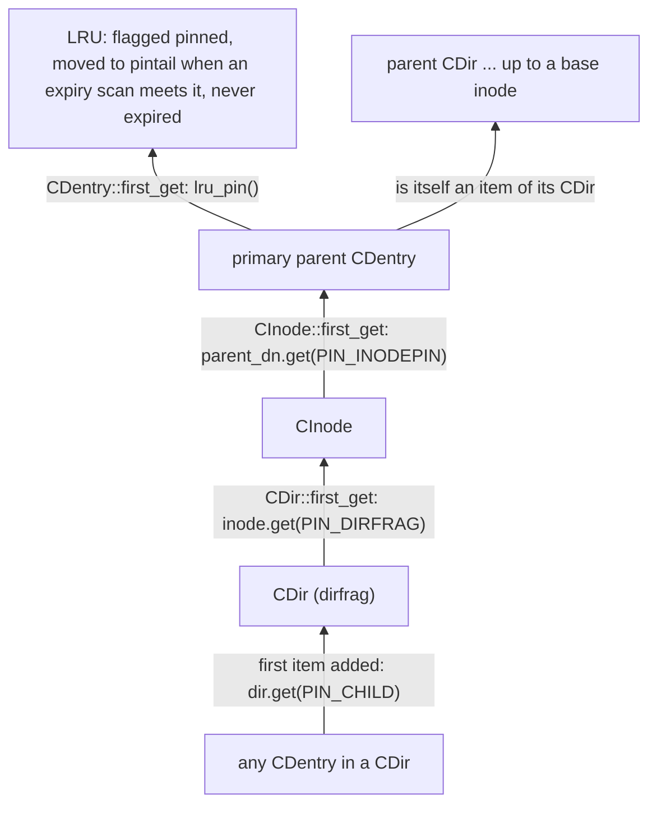
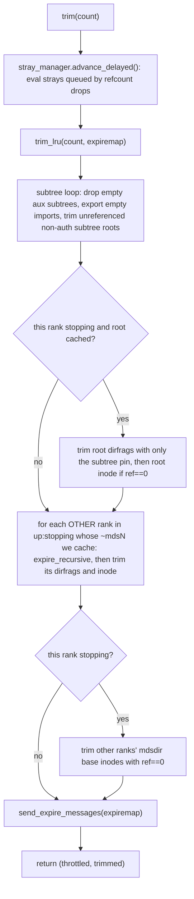
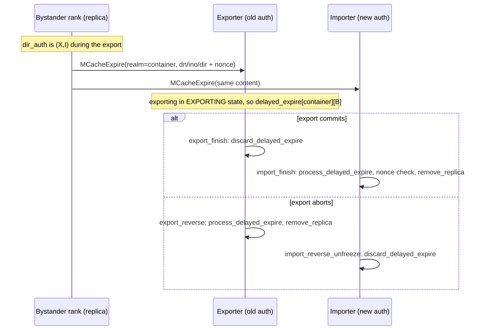
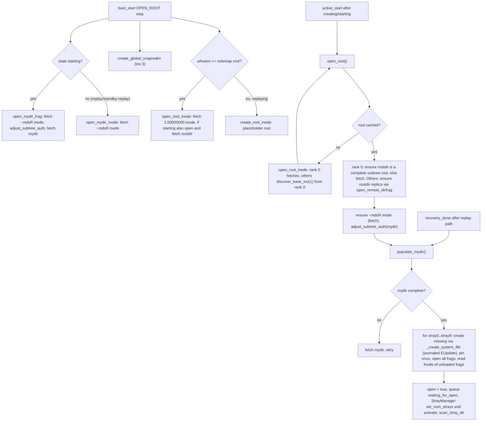
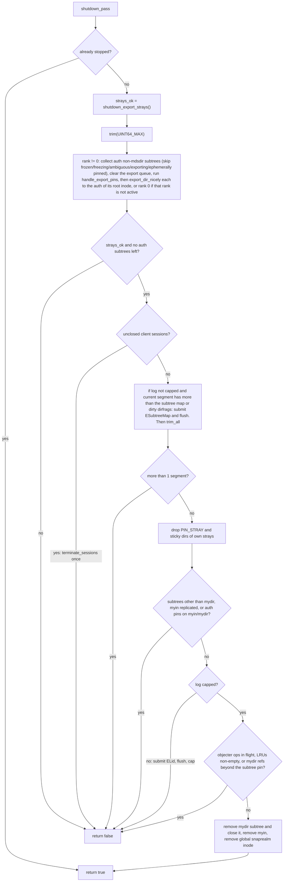
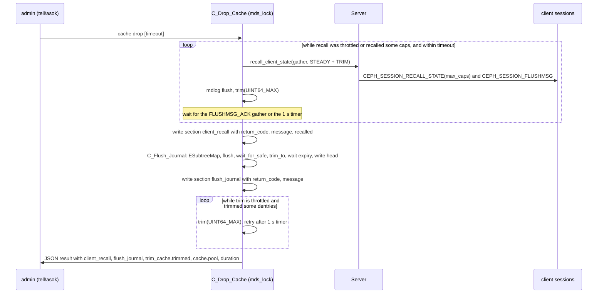

# MDCache lifecycle: pinning, LRU trimming, memory limits, base hierarchy and shutdown

> Part of the C++ MDS project map ([README](../README.md)). Sources: `src/mds/MDCache.{h,cc}` (~17,000 LOC; read in depth: `.cc` 175-948, 3829-3896, 6933-8351, 10217-10223, 10388-10455, 12903-13269, 13886-14017, 14647-14769; `.h` 158-320, 800-980, 1178-1649), `src/include/lru.h` (238), `src/messages/MCacheExpire.h` (115), `src/mds/MDSRank.cc` (cache-drop/journal-flush contexts 82-466, tick 710-802, boot/stopping 1622-2290, admin 3015-3070 and 3342-3370, conf 4089-4300), `src/mds/CDir.cc` (LRU placement 352-685, bloom 749-780), `src/mds/CDentry.{h,cc}`, `src/mds/CInode.{h,cc}` (pins, store/fetch/backtrace 867-1545), `src/mds/MDSCacheObject.{h,cc}`, `src/mds/mdstypes.h` (system inode numbers), `src/mds/Beacon.cc` (cache health), `src/mds/Server.cc` (recall), `src/common/options/mds.yaml.in`.
> Related: [process and threading](../00-architecture/process-and-threading.md), [mds_lock analysis](../00-architecture/mds_lock-analysis.md), [CInode](cinode-and-inode-types.md), [CDir/CDentry/cache objects](cdir-cdentry-and-cache-objects.md), [subtrees, traversal, replication](mdcache-subtrees-traversal-replication.md), [dirfrags](dirfrags-and-fragmentation.md), [sessions and recall](../02-client-protocol/sessions.md), [capabilities](../02-client-protocol/capabilities.md), [leases](../02-client-protocol/leases-lock-caches-and-async-dirops.md), [MDLog](../06-journal/mdlog-and-journaler.md), [RADOS object catalog](../07-storage-formats/rados-object-catalog.md), [subtree migration](../08-multi-mds/subtree-migration.md), [balancer and pinning](../08-multi-mds/balancer-and-pinning.md), [rank lifecycle](../09-recovery/rank-lifecycle-and-recovery.md), [resolve and rejoin](../09-recovery/resolve-and-rejoin.md), [strays and purge](../11-background-services/strays-and-purge.md), [beacon and monitor](../01-cluster-integration/beacon-and-monitor.md), [admin commands](../13-admin-and-config/admin-commands.md), [config/perf/health](../13-admin-and-config/config-perf-counters-and-health.md).

## 1. Purpose and responsibilities

`MDCache` is the per-rank owner of all cached metadata objects (`CInode`, `CDir`, `CDentry`). This page covers the part of `MDCache` that decides **what is resident and for how long**:

- **Indexing**: `inode_map` (head inodes by ino), `snap_inode_map` (snapshotted inodes by `vinodeno_t`), the base-inode set (`root`, `myin`, `strays[0..9]`, `base_inodes`, `global_snaprealm`) (`src/mds/MDCache.h:1384-1394 (MDCache::inode_map .. base_inodes)`, `src/mds/MDCache.cc:331 (MDCache::add_inode)`, `src/mds/MDCache.cc:359 (MDCache::remove_inode)`).
- **Residency rules**: reference counts ("pins") on every cache object, propagated up the tree, and two dentry LRUs (`lru`, `bottom_lru`) from which only unpinned leaf dentries can be expired (`src/mds/MDCache.h:1182-1183 (MDCache::lru, MDCache::bottom_lru)`).
- **Trimming**: `trim()` / `trim_lru()` / `trim_dentry()` / `trim_inode()` / `trim_dirfrag()` with a decay-counter throttle; trimming of empty non-auth subtrees; recovery-time non-auth trimming (`src/mds/MDCache.cc:6933-7683 (MDCache::trim_lru .. standby_trim_segment)`).
- **Memory target**: soft limit `mds_cache_memory_limit` measured as bytes allocated in the `mds_co` mempool; "too full" triggers aggressive trimming plus client cap recall; "overfull" raises `MDS_CACHE_OVERSIZED` (`src/mds/MDCache.h:236-251 (MDCache::cache_toofull_ratio, cache_toofull, cache_size, cache_overfull)`, `src/mds/Beacon.cc:513 (Beacon::notify_health)`).
- **Replica expiry**: tells the authoritative rank when a replica was dropped (`MCacheExpire`) and processes expiries from other ranks (`src/mds/MDCache.cc:7155-7931 (MDCache::send_expire_messages .. dentry_remove_replica)`).
- **Upkeep thread** `mds-cache-trim`: periodic memory sampling, client-lease expiry, trimming, recall, heap release (`src/mds/MDCache.cc:14696 (MDCache::upkeep_main)`).
- **Base hierarchy**: mkfs-time creation of `/` (ino 1), `~mdsN` (ino `0x100+N`) and 10 stray directories per rank; boot-time opening (`open_root`, `populate_mydir`); stray-directory rotation (`src/mds/MDCache.cc:441-923 (MDCache::create_unlinked_system_inode .. get_stray_dir)`).
- **Rank stopping**: `shutdown_pass()` exports subtrees and strays away, terminates sessions, flushes and caps the journal and empties the cache (`src/mds/MDCache.cc:8043-8351 (MDCache::shutdown_pass, MDCache::shutdown_export_strays)`).
- **Introspection**: `cache status`, `cache drop`, `dump cache`, `dump tree`, debug printers, perf counters (`src/mds/MDCache.cc:12903-13269, 13886 (MDCache::show_subtrees .. dump_cache, register_perfcounters)`, `src/mds/MDSRank.cc:236 (C_Drop_Cache)`).

Out of scope here (linked pages): subtree map/authority/discover/open_ino, the fragmentation protocol, stray purge decisions, the cap-recall throttles themselves, journal segment expiry.

## 2. Source map

| File | Class / function | Lines | Role |
|---|---|---|---|
| `src/mds/MDCache.cc` | `MDCache::MDCache` / `~MDCache` | 175-222 | reads cache options, sets LRU midpoints, starts `upkeeper` thread; dtor joins it |
| `src/mds/MDCache.cc` | `handle_conf_change` | 224-290 | runtime option updates |
| `src/mds/MDCache.cc` | `log_stat` | 292-306 | sets `mds.inodes*`, `mds.caps`, `mds.root_r*` perf counters |
| `src/mds/MDCache.cc` | `shutdown` | 311-325 | signals the upkeep thread to exit at daemon shutdown (the dtor joins it) |
| `src/mds/MDCache.cc` | `add_inode`, `remove_inode` | 331-415 | inode maps, base-inode pointers, teardown of per-inode registrations |
| `src/mds/MDCache.cc` | `gen_default_file_layout`, `gen_default_log_layout`, `init_layouts` | 417-439 | default layouts from MDSMap |
| `src/mds/MDCache.cc` | `create_unlinked_system_inode`, `create_system_inode`, `create_root_inode` | 441-496 | in-memory construction of system inodes |
| `src/mds/MDCache.cc` | `create_empty_hierarchy`, `create_mydir_hierarchy` | 498-574 | mkfs: root and `~mdsN` + strays written to RADOS |
| `src/mds/MDCache.cc` | `_create_system_file(_finish)`, `C_MDC_CreateSystemFile` | 576-664 | journaled (re)creation of a missing stray dir |
| `src/mds/MDCache.cc` | `C_MDS_RetryOpenRoot`, `open_root_inode`, `open_mydir_inode`, `open_mydir_frag`, `open_root` | 668-774 | boot-time loading/discovery of base inodes |
| `src/mds/MDCache.cc` | `advance_stray` | 776-819 | per-segment stray-dir rotation, proactive stray fragmentation |
| `src/mds/MDCache.cc` | `populate_mydir` | 821-905 | pin strays, open stray frags, set `open=true`, start StrayManager |
| `src/mds/MDCache.cc` | `open_foreign_mdsdir`, `get_stray_dir`, `get_object` | 907-939 | helpers |
| `src/mds/MDCache.cc` | `expire_recursive` | 3829-3873 | expire replicas of a stopping peer's mdsdir |
| `src/mds/MDCache.cc` | `trim_lru` | 6933-7017 | LRU expiry loop with throttle |
| `src/mds/MDCache.cc` | `trim` | 7025-7153 | full trim pass |
| `src/mds/MDCache.cc` | `send_expire_messages` | 7155-7169 | sends `MCacheExpire` per peer |
| `src/mds/MDCache.cc` | `trim_dentry`, `trim_dirfrag`, `trim_inode` | 7172-7382 | per-object removal + expiry accounting |
| `src/mds/MDCache.cc` | `trim_non_auth`, `trim_non_auth_subtree`, `try_trim_non_auth_subtree` | 7401-7642 | recovery-time removal of non-auth metadata |
| `src/mds/MDCache.cc` | `standby_trim_segment` | 7644-7683 | standby-replay: mark expired segment objects clean |
| `src/mds/MDCache.cc` | `handle_cache_expire`, `process_delayed_expire`, `discard_delayed_expire` | 7685-7893 | auth side of replica expiry |
| `src/mds/MDCache.cc` | `inode_remove_replica`, `dentry_remove_replica` | 7895-7931 | drop replica from replica maps and locks |
| `src/mds/MDCache.cc` | `trim_client_leases` | 7933-7957 | expire dentry leases by TTL |
| `src/mds/MDCache.cc` | `check_memory_usage` | 7959-7989 | RSS/heap sampling, invariant assert |
| `src/mds/MDCache.cc` | `shutdown_check`, `shutdown_start`, `shutdown_pass` | 7996-8234 | stopping-state driver |
| `src/mds/MDCache.cc` | `shutdown_export_strays` | 8236-8351 | migrate strays to rank 0 |
| `src/mds/MDCache.cc` | `show_subtrees`, `show_cache` | 12903-13084 | debug printing (+ asserts) |
| `src/mds/MDCache.cc` | `cache_status`, `dump_tree`, `dump_cache` | 13086-13269 | admin output |
| `src/mds/MDCache.cc` | `register_perfcounters` | 13886-13968 | `mds_cache` perf counters |
| `src/mds/MDCache.cc` | `maybe_eval_stray`, `clear_dirty_bits_for_stray` | 13983-14017 | stray hooks invoked by trim and refcount drops |
| `src/mds/MDCache.cc` | `handle_mdsmap`, `is_ready_to_trim_cache`, `upkeep_main` | 14647-14769 | map-driven pin queues; upkeep thread |
| `src/mds/MDCache.h` | `cache_toofull_ratio`, `cache_toofull`, `cache_size`, `cache_overfull` | 236-251 | memory predicates |
| `src/mds/MDCache.h` | `touch_dentry`, `touch_dentry_bottom`, `touch_inode` | 919-933, 1336-1339 | LRU promotion |
| `src/include/lru.h` | `LRU`, `LRUObject` | 27-236 | three-list LRU with pin tail |
| `src/mds/CDir.cc` | `adjust_dentry_lru`, `add_{null,primary,remote}_dentry`, `remove_dentry`, `link_*`, `unlink_inode` | 352-685 | which LRU a dentry lives in |
| `src/mds/CDir.cc` | `add_to_bloom`, `is_in_bloom` | 749-776 | record names of trimmed dentries |
| `src/mds/CDentry.h` | `first_get` / `last_put` | 223-228 | LRU pin on first ref |
| `src/mds/CInode.cc` | `first_get` / `last_put` / `_put`, `get_stickydirs`, `close_dirfrag` | 867-995 | pin propagation, sticky dirfrags |
| `src/mds/MDSCacheObject.h` | `get`/`put`, generic pins, replica map/nonce | 57-244 | refcount core |
| `src/messages/MCacheExpire.h` | `MCacheExpire` | 23-113 | expiry message |
| `src/mds/MDSRank.cc` | `C_Flush_Journal`, `C_Drop_Cache`, `command_cache_drop` | 82-466, 4089 | `cache drop` |
| `src/mds/MDSRank.cc` | `MDSRankDispatcher::tick`, `stopping_start`, `stopping_done`, `boot_create` | 710-802, 2189-2290 | callers: periodic stats, stopping, mkfs |
| `src/mds/Beacon.cc` | `Beacon::notify_health` | 303, 513-528 | `MDS_HEALTH_CACHE_OVERSIZED` |
| `src/mds/Server.cc` | `Server::recall_client_state` | 1972-2104 | cap recall used by upkeep and cache drop |

## 3. How it works

### 3.1 Object graph and residency ("what is pinned and why")

**Only dentries are in an LRU.** `CDentry` derives from `LRUObject` (`src/mds/CDentry.h:76 (class CDentry)`); `CInode` and `CDir` do not (`src/mds/CInode.h:255 (class CInode)`, `src/mds/CDir.h:48 (class CDir)`). An inode leaves the cache through its primary dentry (`trim_dentry` -> `trim_inode`), a dirfrag through its inode (`trim_inode` -> `trim_dirfrag`) or through the subtree loop of `trim()`. Base inodes have no parent dentry and are removed only by explicit code paths (Section 3.5.3, 3.11).

**Reference counting.** Every `MDSCacheObject` has `ref` plus a per-reason `ref_map` (`MDS_REF_SET` is defined unconditionally, `src/mds/MDSCacheObject.h:18 (MDS_REF_SET)`). `get(by)` calls `first_get()` on 0->1, `put(by)` calls `last_put()` on 1->0 and additionally `_put()` on every put if `STATE_NOTIFYREF` is set (`src/mds/MDSCacheObject.h:138-173 (MDSCacheObject::put, MDSCacheObject::get)`). `STATE_NOTIFYREF` is aliased as `CDentry::STATE_STRAY` and `CInode::STATE_ORPHAN` (`src/mds/CDentry.h:117`, `src/mds/CInode.h:389`), so ref drops on stray dentries and orphan inodes call `_put()`, which, once only dirty pins remain, calls `maybe_eval_stray(in, true)` to queue a delayed stray evaluation (`src/mds/CInode.cc:991 (CInode::_put)`, `src/mds/CDentry.cc:646 (CDentry::_put)`).

**Upward propagation** (this is the residency invariant):



- `CDir::add_null_dentry/add_primary_dentry/add_remote_dentry` take `PIN_CHILD` when the dirfrag goes from 0 to 1 items; `CDir::remove_dentry` drops it at 0 (`src/mds/CDir.cc:419, 471, 511, 563 (CDir::add_null_dentry, add_primary_dentry, add_remote_dentry, remove_dentry)`).
- `CDir::first_get` -> `inode->get(CInode::PIN_DIRFRAG)` (`src/mds/CDir.cc:1545 (CDir::first_get)`).
- `CInode::first_get` -> `parent->get(CDentry::PIN_INODEPIN)` (`src/mds/CInode.cc:977 (CInode::first_get)`); linking an already-referenced inode takes `PIN_INODEPIN` immediately (`src/mds/CDir.cc:631 (CDir::link_inode_work)`).
- `CDentry::first_get` -> `lru_pin()`, `last_put` -> `lru_unpin()` (`src/mds/CDentry.h:223-228 (CDentry::first_get, CDentry::last_put)`).

Consequence: a cached dentry keeps every ancestor dirfrag, inode and dentry resident, up to `/` or a `~mdsN`. Only unpinned dentries are expirable; for a primary dentry that means its inode has zero refs and therefore no referenced (in particular no non-empty) dirfrags, i.e. a leaf. Directory inodes are evicted bottom-up.

**Pin reasons** (name string from `pin_name()`; "unused" = constant defined but never acquired in `src/mds`):

| Object | Pin | Taken when (verified site) |
|---|---|---|
| any | `PIN_REPLICATED` (1000) "replicated" | first replica added to `replica_map` (`src/mds/MDSCacheObject.h:215-241 (MDSCacheObject::add_replica, remove_replica)`) |
| any | `PIN_DIRTY` (1001) "dirty" | object dirty: journaled but not yet written back to RADOS (`src/mds/CDentry.cc:221 (CDentry::_mark_dirty)`, `src/mds/CInode.cc:1201 (CInode::_mark_dirty)`, `src/mds/CDir.h:292 (CDir::_set_dirty_flag)`) |
| any | `PIN_LOCK` (-1002) "lock" | lock held (`src/mds/SimpleLock.h:395-419 (SimpleLock::get_rdlock, put_rdlock, get_wrlock, put_wrlock)`, `src/mds/SimpleLock.cc:37 (SimpleLock::get_xlock)`) |
| any | `PIN_REQUEST` (-1003) "request" | pinned by an `MDRequest`/mutation (`src/mds/Mutation.cc:34 (MutationImpl::pin)`) |
| any | `PIN_WAITER` (1004) "waiter" | first waiter queued (`src/mds/MDSCacheObject.h:267-269 (MDSCacheObject::add_waiter)`) |
| any | `PIN_DIRTYSCATTERED` (-1005) | scatterlock dirty (`src/mds/ScatterLock.h:110 (ScatterLock::mark_dirty)`) |
| any | `PIN_AUTHPIN` (1006) "authpin" | auth-pinned (`src/mds/CDentry.cc:468 (CDentry::auth_pin)`, `src/mds/CDir.cc:3213 (CDir::auth_pin)`) |
| any | `PIN_PTRWAITER` (-1007) | a pending callback context holds a raw pointer to the object (e.g. `C_Locker_Eval`, `C_Locker_FileUpdate_finish`, `C_MDC_ExportFreeze`; also StrayManager and MDCache contexts) (`src/mds/Locker.cc:1571 (C_Locker_Eval)`, `src/mds/Migrator.cc:867 (C_MDC_ExportFreeze)`) |
| any | `PIN_TEMPEXPORTING` (1008) | between encode and finish of export (`src/mds/CDir.cc:2966 (CDir::encode_export)`, `src/mds/CInode.cc:4689 (CInode::encode_export)`) |
| any | `PIN_CLIENTLEASE` (1009) | dentry has client leases (`src/mds/CDentry.cc:607 (CDentry::add_client_lease)`) |
| any | `PIN_DISCOVERBASE` (1010) | base of an outstanding discover (`src/mds/MDCache.h:174 (MDCache::discover_info_t::pin_base)`) |
| any | `PIN_SCRUBQUEUE` (1011) | queued for scrub (`src/mds/ScrubStack.cc:110 (ScrubStack::_enqueue)`) |
| CDentry | `PIN_INODEPIN` (1) | linked primary inode has refs (`src/mds/CInode.cc:977 (CInode::first_get)`, `src/mds/CDir.cc:631 (CDir::link_inode_work)`) |
| CDentry | `PIN_FRAGMENTING` (-2) | dir is refragmenting (`STATE_DNPINNEDFRAG`, `src/mds/CDir.cc:411 (CDir::add_null_dentry)`) |
| CDentry | `PIN_PURGING` (3) | stray being purged (`src/mds/StrayManager.cc:330 (StrayManager::enqueue)`) |
| CDentry | `PIN_SCRUBPARENT` (4) | unused |
| CInode | `PIN_DIRFRAG` (-1) | a dirfrag of this inode has refs (`src/mds/CDir.cc:1545 (CDir::first_get)`) |
| CInode | `PIN_CAPS` (2) | at least one client capability (`src/mds/CInode.cc:3595 (CInode::add_client_cap)`) |
| CInode | `PIN_IMPORTING` (-4) | import in progress (`src/mds/Migrator.cc:2512 (Migrator::handle_export_discover)`) |
| CInode | `PIN_REMOTEPARENT` (8) | remote (hard-link) dentries in cache point to it (`src/mds/CInode.cc:997 (CInode::add_remote_parent)`) |
| CInode | `PIN_STICKYDIRS` (11) | `get_stickydirs()`; each dirfrag also gets `CDir::PIN_STICKY` (`src/mds/CInode.cc:923 (CInode::get_stickydirs)`) |
| CInode | `PIN_FREEZING`/`PIN_FROZEN` (13/14) | inode freeze (`src/mds/CInode.cc:2975-3046 (CInode::maybe_finish_freeze_inode, freeze_inode, unfreeze_inode)`) |
| CInode | `PIN_IMPORTINGCAPS`/`PIN_EXPORTINGCAPS` (-15/22) | cap migration (`src/mds/Migrator.cc:3527, 1810 (Migrator::decode_import_inode_caps, Migrator::encode_export_inode_caps)`) |
| CInode | `PIN_OPENINGSNAPPARENTS` (17) | rejoin opening snap parents (`src/mds/MDCache.cc:5291 (MDCache::handle_cache_rejoin_ack)`) |
| CInode | `PIN_TRUNCATING` (18) | truncate in progress (`src/mds/MDCache.cc:6595 (MDCache::truncate_inode)`) |
| CInode | `PIN_STRAY` (19) | own stray dir inodes while the rank is up (`src/mds/MDCache.cc:866 (MDCache::populate_mydir)`) |
| CInode | `PIN_NEEDSNAPFLUSH` (20) | waiting for client snapflush (`src/mds/CInode.cc:384 (CInode::add_need_snapflush)`) |
| CInode | `PIN_DIRTYRSTAT` (21) | rstat dirty (`src/mds/CInode.cc:451 (CInode::mark_dirty_rstat)`) |
| CInode | `PIN_DIRTYPARENT` (23) | backtrace dirty (`src/mds/CInode.cc:1594 (CInode::mark_dirty_parent)`) |
| CInode | `PIN_DIRWAITER` (24) | waiting for a dirfrag (`src/mds/CInode.cc:2907 (CInode::add_dir_waiter)`) |
| CInode | `PIN_OPENINGDIR`, `PIN_BATCHOPENJOURNAL`, `PIN_SCATTERED`, `PIN_PASTSNAPPARENT` | unused |
| CDir | `PIN_CHILD` (3) | dirfrag has >= 1 dentry (`src/mds/CDir.cc:419 (CDir::add_null_dentry)`) |
| CDir | `PIN_SUBTREE` (5) | dirfrag is a subtree root in `subtrees` (`src/mds/MDCache.cc:1007 (MDCache::adjust_subtree_auth)`, dropped in `src/mds/MDCache.cc:1366 (MDCache::remove_subtree)`) |
| CDir | `PIN_DNWAITER` (1) | dentry fetch waiters (`src/mds/CDir.cc:1314 (CDir::add_dentry_waiter)`) |
| CDir | `PIN_FROZEN` (4), `PIN_IMPORTING` (7), `PIN_IMPORTBOUND` (9), `PIN_EXPORTBOUND` (10) | freeze/migration (`src/mds/CDir.cc:3443, 1029-1031 (CDir::_freeze_tree, CDir::init_fragment_pins)`, `src/mds/Migrator.cc:2697 (Migrator::handle_export_prep)`) |
| CDir | `PIN_STICKY` (11) | parent inode has sticky dirs (`src/mds/CInode.cc:859, 929 (CInode::add_dirfrag, CInode::get_stickydirs)`) |
| CDir | `PIN_SUBTREETEMP` (12) | temporary pin inside `trim_non_auth()` |
| CDir | `PIN_INOWAITER` (2) | unused |

Practical meaning: a dentry/inode cannot be trimmed while any client holds a cap on the inode (`PIN_CAPS`), while it is dirty (`PIN_DIRTY`, released when the object is written back to RADOS, which journal segment expiry forces), while a lease is outstanding (`PIN_CLIENTLEASE`), while replicated to another rank (`PIN_REPLICATED`, on the auth), while locked/requested/waited-on, or while any descendant is cached. **Client caps are the dominant pin**, which is why trimming is coupled to cap recall (Section 3.8).

### 3.2 LRU mechanics (`src/include/lru.h`)

`LRU` keeps three intrusive `xlist`s: `top`, `bottom`, `pintail`, a `num_pinned` count and a `midpoint` (`src/include/lru.h:204-210 (LRU members)`). `lru_get_size() = top + bottom + pintail`.

| Operation | Effect | Ref |
|---|---|---|
| `lru_insert_top(o)` | `top.push_front` | `src/include/lru.h:68 (LRU::lru_insert_top)` |
| `lru_insert_mid(o)` | `bottom.push_front` (the "midpoint") | `src/include/lru.h:77 (LRU::lru_insert_mid)` |
| `lru_insert_bot(o)` | `bottom.push_back` (next to expire) | `src/include/lru.h:86 (LRU::lru_insert_bot)` |
| `lru_touch(o)` | move to `top` head (insert if absent) | `src/include/lru.h:107 (LRU::lru_touch)` |
| `lru_midtouch(o)` | if in `top`: no-op; else move to `bottom` head | `src/include/lru.h:121 (LRU::lru_midtouch)` |
| `lru_bottouch(o)` | move to `bottom` tail | `src/include/lru.h:136 (LRU::lru_bottouch)` |
| `lru_touch_entire_pintail()` | append all of `pintail` to `top` tail | `src/include/lru.h:149 (LRU::lru_touch_entire_pintail)` |
| `lru_get_next_expire()` | `adjust()`; scan `bottom` from the tail, then `top` from the tail; every pinned object encountered is moved to `pintail` head; return first unpinned | `src/include/lru.h:158 (LRU::lru_get_next_expire)` |
| `lru_expire()` | `lru_get_next_expire()` + `lru_remove()` | `src/include/lru.h:182 (LRU::lru_expire)` |
| `adjust()` | move objects across the top/bottom boundary so `top.size() == floor(midpoint * (size - num_pinned))` | `src/include/lru.h:191 (LRU::adjust)` |
| `lru_pin()` / `lru_unpin()` | toggle `lru_pinned`, maintain `num_pinned`; unpinning an object that sits in `pintail` moves it to the `bottom` tail (`lru_bottouch`) | `src/include/lru.h:219-236 (LRUObject::lru_pin, lru_unpin)` |

`MDCache` owns two instances (`src/mds/MDCache.h:1182-1183 (MDCache::lru, MDCache::bottom_lru)`):

- `lru`: midpoint `mds_cache_mid` (default 0.7) (`src/mds/MDCache.cc:206 (MDCache::MDCache)`).
- `bottom_lru`: midpoint 0 (`src/mds/MDCache.cc:208 (MDCache::MDCache)`), so everything lives in `bottom`; holds dentries that "should be trimmed ASAP" and is drained first by every trim, regardless of memory pressure or `count` (only the trim throttle stops it).

Which list a dentry is in is recorded by `CDentry::STATE_BOTTOMLRU` (`src/mds/CDentry.h:115 (CDentry::STATE_BOTTOMLRU)`):

| Event | Placement | Ref |
|---|---|---|
| `add_null_dentry` | auth dir: `lru` mid; non-auth dir: `bottom_lru` mid | `src/mds/CDir.cc:381 (CDir::add_null_dentry)` |
| `add_primary_dentry` | auth dir or non-stray parent: `lru` mid; replica dentry in a **stray** dir: `bottom_lru` | `src/mds/CDir.cc:426 (CDir::add_primary_dentry)` |
| `add_remote_dentry` | always `lru` mid | `src/mds/CDir.cc:476 (CDir::add_remote_dentry)` |
| `link_remote_inode` | move out of `bottom_lru` to `lru` mid | `src/mds/CDir.cc:572 (CDir::link_remote_inode)` |
| `link_primary_inode` | move to `lru` unless (non-auth dir and stray parent) | `src/mds/CDir.cc:595 (CDir::link_primary_inode)` |
| `unlink_inode(dn, adjust_lru=true)` in a non-auth dir | move to `bottom_lru` | `src/mds/CDir.cc:660 (CDir::unlink_inode)` |
| `CDentry::mark_auth`/`clear_auth` | re-evaluate via `adjust_dentry_lru` (primary: bottom iff non-auth dir and stray parent; remote: never bottom; null: bottom iff non-auth dir) | `src/mds/CDentry.cc:267-281 (CDentry::mark_auth, CDentry::clear_auth)`, `src/mds/CDir.cc:352 (CDir::adjust_dentry_lru)` |

Promotion ("touch") sources:

| Caller | Call | Effect |
|---|---|---|
| `MDCache::touch_dentry` | bottom-LRU dentry: `bottom_lru.lru_midtouch`; auth: `lru.lru_touch` (top); replica: `lru.lru_midtouch` | `src/mds/MDCache.h:919 (MDCache::touch_dentry)` |
| `MDCache::touch_inode` (path traversal) | `touch_dentry(projected parent dn)` | `src/mds/MDCache.h:1336 (MDCache::touch_inode)`, called from `src/mds/MDCache.cc:8735, 8814, 9477 (MDCache::path_traverse, MDCache::handle_open_ino)` |
| `CDir` fetch of wanted dentries | `touch_dentry` | `src/mds/CDir.cc:2231, 2263 (CDir::_omap_fetched)` |
| `Server::handle_client_readdir`, `_readdir_diff`, `build_snap_diff` | `lru.lru_touch` on every returned dentry (readdir also touches every non-null dentry of the dirfrag before it waits to open a remote inode) | `src/mds/Server.cc:5275, 5321, 12550, 12733 (Server::handle_client_readdir, Server::_readdir_diff, Server::build_snap_diff)` |
| `MDCache::touch_dentry_bottom` | `lru.lru_bottouch` (not for bottom-LRU dentries) | `src/mds/MDCache.h:929 (MDCache::touch_dentry_bottom)` |
| ... used by unlink/rename for the new stray dentry | "drop dn as quickly as possible" | `src/mds/Server.cc:8856, 10339 (Server::_unlink_local_finish, Server::_rename_apply)` |
| ... used by Migrator for exported dentries | exporter `finish_export_dir`, importer `import_reverse` | `src/mds/Migrator.cc:2029, 3060 (Migrator::finish_export_dir, Migrator::import_reverse)` |

### 3.3 Memory accounting

```
cache_size()          = mempool::get_pool(mempool::mds_co::id).allocated_bytes()
cache_toofull_ratio() = max(0, (cache_size() - L*(1-R)) / (L*(1-R)))
cache_toofull()       = cache_toofull_ratio() > 0          // size > 95% of L
cache_overfull()      = cache_size() > L * H               // size > 150% of L
   L = mds_cache_memory_limit (4 GiB), R = mds_cache_reservation (0.05), H = mds_health_cache_threshold (1.5)
```
(`src/mds/MDCache.h:236-251 (MDCache::cache_toofull_ratio, cache_toofull, cache_size, cache_overfull)`.) At defaults: aggressive LRU trimming and recall-with-TRIM start above 4,080,218,931 bytes; the health warning starts above 6 GiB.

- `allocated_bytes()` sums the per-shard `std::atomic<size_t>` byte counters into a signed total without locks (a shard can wrap below zero when frees land on a different shard than the allocation) and clamps a negative race result to 0 (`src/common/mempool.cc:124 (mempool::pool_t::allocated_bytes)`, `src/include/mempool.h:214-216 (mempool::stats_t)`). Reading `cache_size()` therefore needs no lock.
- Counted (mempool `mds_co`): `CInode`, `CDir`, `CDentry`, `Capability`, `ClientLease`, `CDir::scrub_info_t` objects (`MEMPOOL_DEFINE_OBJECT_FACTORY` at `src/mds/CInode.cc:5952 (MEMPOOL_DEFINE_OBJECT_FACTORY(CInode))`, `src/mds/CDir.cc:3922-3923 (MEMPOOL_DEFINE_OBJECT_FACTORY for CDir, CDir::scrub_info_t)`, `src/mds/CDentry.cc:591, 829 (MEMPOOL_DEFINE_OBJECT_FACTORY for ClientLease, CDentry)`, `src/mds/Capability.cc:350 (MEMPOOL_DEFINE_OBJECT_FACTORY for Capability)`) and the `mds_co` allocators of their containers: `inode_t` (`mempool_inode`), xattr maps, old_inodes, dirfrag dentry maps, symlink strings, waiter maps, `ref_map`, replica maps, etc. (`src/mds/CInode.h:115-142, 1229-1286 (CInode mempool types and members)`, `src/mds/CDir.h:52-76, 639-765 (CDir mds_co containers)`).
- Not counted: xattr value `bufferptr`s (FIXME at `src/mds/CInode.h:125 (CInode::mempool_xattr_map)`), dirfrag bloom filters (`src/mds/CDir.h:758 (CDir::bloom)`), `inode_map`/`snap_inode_map`/`subtrees` containers themselves (`std::unordered_map`/`std::map`, `src/mds/MDCache.h:1384-1402 (MDCache::inode_map .. subtrees)`), sessions, requests, messages, journal buffers. RSS can therefore exceed `mds_cache_memory_limit` by a large factor; the limit is a target on cache objects only.
- Object counts for `mds_mem` perf counters come from `Counter<T>` process-wide atomics (`src/include/counter.h`): `CInode::count()`, `CDir::count()`, `CDentry::count()`, `Capability::count()` (`src/mds/MDSRank.cc:1172 (MDSRank::update_mlogger)`).
- `check_memory_usage()` (upkeep thread, under `mds_lock`) samples `/proc/self/status` and `/proc/self/maps` via `MemoryModel::full_sample()` and sets `mds_mem.rss` (VmRSS, **kB**) and `mds_mem.heap` (sum of anonymous rw mappings plus `[heap]`/`[stack]`, **bytes**) (`src/mds/MDCache.cc:7959 (MDCache::check_memory_usage)`, `src/common/MemoryModel.cc:111-139 (MemoryModel::full_sample)`). If sampling is unavailable or a sample fails, a zeroed snapshot is used, so `rss`/`heap` are reported as 0 for that period. It also refreshes the `mds_mem` object counts (`update_mlogger()`) and asserts `CInode::count() == inode_map.size() + snap_inode_map.size() + num_shadow_inodes` (`src/mds/MDCache.cc:7972 (MDCache::check_memory_usage)`); "shadow inodes" are temporary scrub copies of base inodes (`src/mds/CInode.cc:5147-5150 (CInode::validate_disk_state, ValidationContinuation::validate_directory_data)`). If the first sample at thread start fails, sampling is disabled for the process lifetime (`src/mds/MDCache.cc:14707-14719 (MDCache::upkeep_main)`).

### 3.4 The upkeep thread `mds-cache-trim`

Started in the constructor (`src/mds/MDCache.cc:212 (MDCache::MDCache)`), named `mds-cache-trim` (`src/mds/MDCache.cc:14698 (MDCache::upkeep_main)`), joined in `~MDCache` (`src/mds/MDCache.cc:220 (MDCache::~MDCache)`). Loop (`src/mds/MDCache.cc:14721-14768 (MDCache::upkeep_main)`):

```
hold upkeep_mutex
loop until upkeep_trim_shutdown:
  if now - last_trim >= 0.9 * mds_cache_trim_interval (1 s):
     unlock upkeep_mutex; lock mds_lock; lock upkeep_mutex       // order: mds_lock -> upkeep_mutex
     if shutdown flagged: return
     check_memory_usage()                                       // every period, any state
     if mds->is_cache_trimmable()   // standby-replay | clientreplay | active | stopping
        active_with_clients = active | clientreplay | stopping
        if active_with_clients: trim_client_leases()
        if is_ready_to_trim_cache() or standby-replay: trim()   // count = 0
        if active_with_clients:
           flags = ENFORCE_MAX | ENFORCE_LIVENESS (| TRIM if cache_toofull())
           server->recall_client_state(nullptr, flags)
        last_trim = now          // only when trimmable, otherwise the block reruns on the next wake-up
     (mds_lock released at end of this block)
  if now - last_release >= 0.9 * mds_cache_release_free_interval (10 s):
     ceph_heap_release_free_memory()                            // tcmalloc ReleaseFreeMemory, no mds_lock
  wait on upkeep_cvar for min(remaining trim, remaining release interval)
```

- `is_ready_to_trim_cache() = is_open() && !rejoin_done` (`src/mds/MDCache.cc:14689 (MDCache::is_ready_to_trim_cache)`): the base hierarchy is open (Section 3.10) and rejoin has completed (`rejoin_done` is set by `rejoin_start` and released when rejoin finishes, `src/mds/MDCache.cc:4065-4069, 6054-6055 (MDCache::rejoin_start, MDCache::open_snaprealms)`).
- The condition variable is notified only by `MDCache::shutdown()` (`src/mds/MDCache.cc:311-317 (MDCache::shutdown)`); there is no wake-up on allocation pressure. Reaction latency to a memory spike is up to one `mds_cache_trim_interval`.
- `mds_cache_trim_interval` and `mds_cache_release_free_interval` are re-read every iteration, so changes apply without restart.

### 3.5 `trim(count)` — the trimming pass (`src/mds/MDCache.cc:7025 (MDCache::trim)`)



#### 3.5.1 `trim_lru` and the trim throttle (`src/mds/MDCache.cc:6933 (MDCache::trim_lru)`)

```
T     = mds_cache_trim_threshold (262144 dentries), re-read on every call
start = trim_counter.get()                 // DecayCounter, half-life mds_cache_trim_decay_rate (1 s)
phase 1 (bottom_lru): repeat
    if start + trimmed >= T: throttled; logger.inc(cache_trim_throttle); stop
    dn = bottom_lru.lru_expire(); if none: stop
    trim_dentry(dn) ? keep dn for reinsertion : trimmed++
  reinsert kept dns with bottom_lru.lru_insert_mid
phase 2 (lru): while !throttled and (cache_toofull() or count > 0)
    if start + trimmed >= T: throttled; logger.inc(cache_trim_throttle); stop
    dn = lru.lru_expire(); if none: stop
    if standby-replay and dn's inode is on a LogSegment open_files list: keep
    elif trim_dentry(dn): keep
    else trimmed++, count-- (if > 0)
trim_counter.hit(trimmed)
reinsert kept dns with lru.lru_insert_mid
return (throttled, trimmed)
```

- The bottom LRU is drained regardless of memory pressure or `count`; the main LRU is trimmed only while the cache is too full or while `count` dentries have not yet been trimmed. With `count = 0` (upkeep thread) and the cache under 95% of the limit, only `bottom_lru` is trimmed.
- `DecayCounter(rate)` builds a `DecayRate` whose argument is a **half-life in seconds** (`src/common/DecayCounter.h:36-54 (DecayRate)`; `decay()` multiplies by `exp(elapsed * ln(0.5)/half_life)`, `src/common/DecayCounter.cc:71 (DecayCounter::decay)`). The option name says "rate" but larger values mean slower decay and less trimming.
- Derived throughput (not in code): starting cold, one pass may trim up to `T`; with the 1 s upkeep period and a 1 s half-life, a throttled steady state admits about `T * (1 - 2^-1) = 131072` dentries per second. The documentation's continuous-time figure is `ln 2 / half_life * T` (~181,700/s) (`doc/cephfs/cache-configuration.rst:74-79`). Only LRU expirations count against the throttle; subtree/base-inode trims in `trim()` are unthrottled and not recorded in `trim_counter`, but `trim()` adds them to the count it returns (`auto& trimmed = result.second`, `src/mds/MDCache.cc:7040`).
- Every `trim_lru` call that hits the throttle increments `mds_cache.cache_trim_throttle` once.

#### 3.5.2 `trim_dentry`, `trim_inode`, `trim_dirfrag`

`trim_dentry(dn)` returns `true` ("keep, reinsert") or removes the dentry (`src/mds/MDCache.cc:7172 (MDCache::trim_dentry)`):

1. `con = get_subtree_root(dir)`; if none the dentry must be auth ("under a not-yet-linked dir").
2. Keep a **non-auth** dentry whose `lock` is not readable unless its dir is a stray: an `MDentryLink`/`MDentryUnlink` is probably in flight and an unconnected replica would break migration (`src/mds/MDCache.cc:7189-7197 (MDCache::trim_dentry)`).
3. `clear_complete = dn->is_auth() && !(null && clean)`: removing anything but a clean null dentry makes the auth dirfrag incomplete.
4. remote linkage: `unlink_inode(dn, false)`. primary: `trim_inode(dn, in, con)`; if it returns `true` (stray handed to purge or re-referenced by `maybe_eval_stray`, or a replica dir inode whose `dirfragtreelock` is unreadable) keep the dentry. null: nothing.
5. Non-auth: add `(con.dirfrag, dir.dirfrag, name, last, replica_nonce)` to the `MCacheExpire` for `auth.first` and, if ambiguous and different, `auth.second`; skip ourselves; send nothing if we are `auth.second` and `con` is importing (`src/mds/MDCache.cc:7221-7240 (MDCache::trim_dentry)`).
6. If `clear_complete`: for head dentries add the name to the dirfrag **bloom filter** (`CDir::add_to_bloom`; the filter is created on first use with capacity `max(100, head+snap items)` and false-positive rate `1/capacity`, but only if the dirfrag is complete and the rank is not in standby-replay; once it exists, later names are added unconditionally, `src/mds/CDir.cc:749 (CDir::add_to_bloom)`), then clear `CDir::STATE_COMPLETE`. The filter is discarded by `CDir::mark_complete()` (a full re-fetch) and `CDir::abort_import()` (`src/mds/CDir.cc:1540-1543, 3046`). For head lookups (`snapid == CEPH_NOSNAP`), `path_traverse` treats a miss in an auth dirfrag that is not complete but has a bloom filter not containing the name as a definitive ENOENT without a RADOS fetch (`src/mds/MDCache.cc:8745-8752 (MDCache::path_traverse)`); `open_ino_traverse_dir` and `handle_discover` use the same test (`src/mds/MDCache.cc:9329, 10852`).
7. `dir->remove_dentry(dn)`; `mds.inodes_expired++`.

`trim_inode(dn, in, con)` (`src/mds/MDCache.cc:7307 (MDCache::trim_inode)`), asserting `in->get_num_ref() == 0`:

- Directory: a **non-auth** dir inode whose `dirfragtreelock` cannot be rdlocked (`rdlock_try`) is kept (an `MMDSFragmentNotify` is likely pending, `src/mds/MDCache.cc:7313-7322 (MDCache::trim_inode)`); otherwise every dirfrag is trimmed via `trim_dirfrag(dir, con ? con : dir)` (none may be a subtree root).
- Auth inode with a parent dentry that is not `STATE_PURGING`: `maybe_eval_stray(in)`; if that started purging (`STATE_PURGING`) or added refs, keep (`src/mds/MDCache.cc:7333-7339 (MDCache::trim_inode)`). This is how trimming hands unlinked inodes in stray dirs to the `StrayManager`.
- Non-auth inode: add `(con.dirfrag or dirfrag_t(0,frag_t()), vino, replica_nonce)` to the expire map for the authority (same two-authority rule).
- Unlink from the dentry and `remove_inode(in)`.

`trim_dirfrag(dir, con)` (`src/mds/MDCache.cc:7256 (MDCache::trim_dirfrag)`): a subtree-root dirfrag must be non-auth, or auth+unreplicated+base; it is removed from the subtree map first. Asserts `num_ref == 0`. Non-auth: expire `(condf, dirfrag, replica_nonce)` where `condf` is the dirfrag itself if it is a subtree root. Then `inode->close_dirfrag(frag)` (`src/mds/CInode.cc:867 (CInode::close_dirfrag)`), which removes null dentries, cleans dirty state, drops sticky pins and deletes the `CDir`.

`remove_inode(in)` (`src/mds/MDCache.cc:359 (MDCache::remove_inode)`) unlinks a remaining parent dentry (asserting it is clean), clears dirty/dirty-parent/scatter-dirty/client-writeable state, removes it from the LogSegment open-file list, export-pin queues and ephemeral pins, erases it from `inode_map`/`snap_inode_map` and `replay_taken_inos`, clears `root`/`myin`/`strays[i]`/`base_inodes` pointers, asserts `num_ref == 0` and deletes it.

#### 3.5.3 Subtree and base-inode trimming inside `trim()` (`src/mds/MDCache.cc:7042-7147 (MDCache::trim)`)

For each subtree root `dir` (inode `diri`):

| Case | Action |
|---|---|
| `dir` auth, `diri` auth, not base, 0 head items, `num_ref == 1` (subtree pin only), `STATE_AUXSUBTREE` | "trimming empty pinned subtree": clear `AUXSUBTREE`, `remove_subtree`, close dirfrag (export-pin leftovers) |
| `dir` auth, `diri` non-auth, not base, 0 head items, not exporting, rank active or stopping, not freezing/frozen | `migrator->export_empty_import(dir)`: give the empty import back to `diri`'s auth (`src/mds/Migrator.cc:231 (Migrator::export_empty_import)`) |
| `dir` non-auth, `diri` non-auth, `dir.num_ref <= 1`, `diri.num_ref <= diri.num_subtree_roots`, and not (subtree root whose auth is in `rejoin_ack_gather`) | `trim_dirfrag(dir, 0)`: drop an unused replica subtree (expire sent) |

Then: if this rank is stopping, trim root dirfrags whose only ref is the subtree pin and the root inode if unreferenced (`src/mds/MDCache.cc:7084-7096 (MDCache::trim)`). For every **other** rank in `up:stopping` whose `~mdsN` inode is cached here, ensure an (possibly empty) `MCacheExpire` exists for it and call `expire_recursive(mdsdir)` (`src/mds/MDCache.cc:3829 (MDCache::expire_recursive)`): it walks all dentries, aborting on a nested subtree root below the mdsdir (the mdsdir's own dirfrags are subtree roots and allowed), on a non-stray inode with `nlink > 0` ("may be the target of a rename() as the owning MDS shuts down") or on any pinned dentry; otherwise every replica dentry is trimmed. If nothing aborted, the peer's mdsdir dirfrags (subtree pin only) and inode are trimmed (`src/mds/MDCache.cc:7098-7130 (MDCache::trim)`). If this rank is stopping, other ranks' mdsdir base inodes with zero refs are trimmed too (`src/mds/MDCache.cc:7133-7147 (MDCache::trim)`). The purpose is to let the stopping peer drop its `PIN_REPLICATED` pins and empty its cache.

#### 3.5.4 Callers of `trim`

| Caller | `count` | When |
|---|---|---|
| `MDCache::upkeep_main` | 0 | every `mds_cache_trim_interval` when trimmable and (open and rejoin done, or standby-replay) |
| `MDCache::shutdown_pass` | `UINT64_MAX` | every tick while `up:stopping` |
| `C_Drop_Cache::do_trim` (`src/mds/MDSRank.cc:310 (C_Drop_Cache::do_trim)`) | `UINT64_MAX` | `cache drop` admin command |
| `Migrator::export_finish` (`src/mds/Migrator.cc:2388 (Migrator::export_finish)`) | number of exported dentries | after an export (dentries were bottom-touched) |
| `Migrator::import_reverse` (`src/mds/Migrator.cc:3101 (Migrator::import_reverse)`) | number of dentries | after a failed import |
| `MDLog::standby_trim_segments` (`src/mds/MDLog.cc:1649 (MDLog::standby_trim_segments)`) | 0 | standby-replay, after removing expired segments |
| `MDLog::replay` (`src/mds/MDLog.cc:1035 (MDLog::replay)`) | 0 | replay found an empty journal |

The comment on `trim()` ("only called while MDS is active or stopping") is outdated: the replay and standby-replay callers above also run it.

### 3.6 Replica expiry protocol (`MCacheExpire`)

`MCacheExpire` (type `MSG_MDS_CACHEEXPIRE = 0x207`, `src/msg/Message.h:176 (MSG_MDS_CACHEEXPIRE)`) carries `from` and `map<dirfrag_t, realm>`; each `realm` is keyed by the **container** (the subtree-root dirfrag that determines authority, or `dirfrag_t(0, frag_t())` for containerless base/stray inodes) and holds `inodes: map<vinodeno_t, nonce>`, `dirs: map<dirfrag_t, nonce>`, `dentries: map<dirfrag_t, map<(name, snapid), nonce>>` (`src/messages/MCacheExpire.h:32-63 (MCacheExpire::realm)`). Encoding: `from` then `realms` (`src/messages/MCacheExpire.h:94-105 (MCacheExpire::decode_payload, encode_payload)`). Trims accumulate one message per peer rank in an `expiremap` and `send_expire_messages` sends them at the end of the pass (`src/mds/MDCache.cc:7155 (MDCache::send_expire_messages)`).

**Nonces.** On the auth, `add_replica(mds)` returns nonce 1 for a peer that holds no replica and increments the stored nonce if the peer already holds one (`src/mds/MDSCacheObject.h:215-221 (MDSCacheObject::add_replica)`); the replica stores it in `replica_nonce`. An expiry is applied only if its nonce equals the auth's current nonce for that peer; otherwise it is an old expiry that crossed a newer replication and is dropped (`src/mds/MDCache.cc:7756-7769, 7811-7822, 7861-7869 (MDCache::handle_cache_expire)`). The nonce lookup itself (`get_replica_nonce(from)`) asserts that the sender is in the object's replica map (`src/mds/MDSCacheObject.h:227-230`).

**Sender filtering.** While the cluster is degraded, expiries to ranks in a state before `up:rejoin`, or in `up:rejoin` before we sent them our rejoin, are silently dropped (not queued) (`src/mds/MDCache.cc:7159-7164 (MDCache::send_expire_messages)`). `MDSRank::is_stale_message` accepts a cache-expire from a rank marked down if its address still matches (`src/mds/MDSRank.cc:1403-1407 (MDSRank::is_stale_message)`).

**Receiver** `handle_cache_expire` (`src/mds/MDCache.cc:7685 (MDCache::handle_cache_expire)`):

1. Ignore the whole message if this rank is before `up:rejoin`.
2. For each realm with a container ino: find the container dirfrag (`get_approx_dirfrag`). If it is not auth here, or it is being exported in state `EXPORT_WARNING` (and the sender was already warned), `EXPORT_EXPORTING`, `EXPORT_LOGGINGFINISH`, or `EXPORT_NOTIFYING` (and the sender not yet notified), merge the realm into `delayed_expire[container][from]` and continue (asserts the container is a frozen tree root).
3. Inodes: must exist and be auth; nonce match -> `inode_remove_replica(in, from, false)`: remove from replica map, clear `mds_caps_wanted[from]`, call `remove_replica(from)` on all 9 inode locks (scatter locks keep the peer in the gather set during rejoin), collect locks that need `eval_gather` (`src/mds/MDCache.cc:7895 (MDCache::inode_remove_replica)`).
4. Dirs: missing dirfrag is tolerated if mismatched frags exist or (in rejoin before sending acks, inode not replicated) by removing the peer from nested dirfrags; otherwise assert. Nonce match -> `dir->remove_replica(from)`.
5. Dentries: dirfrag may have been refragmented (look up by `pick_dirfrag`); nonce match -> `dentry_remove_replica`: drop replica and lock replica, then `maybe_eval_stray` on a primary inode (a replicated stray may now be purgeable) (`src/mds/MDCache.cc:7918 (MDCache::dentry_remove_replica)`).
6. `eval_gather` every unstable lock collected.

Delayed expiries are replayed by `process_delayed_expire` on `import_finish`, `export_reverse` and `export_try_cancel` in `EXPORT_WARNING`, and discarded by `discard_delayed_expire` on `export_finish` and `import_reverse_unfreeze` (`src/mds/Migrator.cc:403, 2181, 3321, 2356, 3158 (Migrator::export_try_cancel, export_reverse, import_finish, export_finish, import_reverse_unfreeze)`). Because bystanders send expiries to both `auth.first` and `auth.second` while authority is ambiguous (Section 3.5.2 step 5), the new auth receives a copy when an export commits and the old auth replays its copy when an export aborts.



### 3.7 Client dentry lease expiry

`client_leases` is an array of 3 `xlist<ClientLease*>` pools with durations `{5, 30, 300}` seconds (`src/mds/MDCache.h:1197-1199, 1399 (MDCache::client_lease_durations, MDCache::client_leases)`). Both issue and renew use pool 1 ("fixme.. do something smart!"), so every lease lasts 30 s (`src/mds/Locker.cc:4569-4575 (Locker::issue_client_lease)`, `src/mds/Locker.cc:4520-4528 (Locker::handle_client_lease)`). `touch_client_lease` appends to the pool tail with `ttl = now + duration`, which keeps each list sorted by TTL (`src/mds/MDCache.h:301 (MDCache::touch_client_lease)`; `xlist::push_back` first removes the item from its current list, `src/include/xlist.h:116 (xlist::push_back)`). `trim_client_leases()` pops expired heads and calls `CDentry::remove_client_lease`, which drops `PIN_CLIENTLEASE` and lock lease state when the last lease goes and may `eval_gather` the dentry lock (`src/mds/MDCache.cc:7933 (MDCache::trim_client_leases)`, `src/mds/CDentry.cc:618 (CDentry::remove_client_lease)`). No message is sent to the client at MDS-side expiry; the client expires the lease from the `duration_ms` it was given. It runs only from the upkeep thread when active/clientreplay/stopping.

### 3.8 Cache pressure and client recall

Because client caps pin inodes (`PIN_CAPS`), the MDS shrinks below its target only if clients drop caps. The upkeep thread calls `Server::recall_client_state(nullptr, ENFORCE_MAX|ENFORCE_LIVENESS[|TRIM])` each period (`src/mds/MDCache.cc:14741-14747 (MDCache::upkeep_main)`):

- Session selection (`src/mds/Server.cc:1994-2001 (Server::recall_client_state)`): `TRIM` (set when `cache_toofull()`) selects every session; otherwise only sessions with more than `mds_max_caps_per_client` (1M) caps (`ENFORCE_MAX`) or whose cache-liveness decay counter is below `num_caps >> mds_session_cache_liveness_magnitude` (`ENFORCE_LIVENESS`).
- Sessions are processed in descending cap count; each recall asks for at most `mds_recall_max_caps` (30000) caps down to no lower than `mds_min_caps_per_client` (100), subject to per-session, second-order and global decay throttles (details: [sessions](../02-client-protocol/sessions.md)).
- Wire effect: `MClientSession(CEPH_SESSION_RECALL_STATE)` with `head.max_caps = newlim` (`src/mds/Server.cc:2089-2094 (Server::recall_client_state)`). With a gather (only `cache drop`), also `CEPH_SESSION_FLUSHMSG` and wait for `FLUSHMSG_ACK` (`src/mds/Server.cc:897 (Server::flush_session)`, requires `CEPH_FEATURE_EXPORT_PEER`).
- Released caps unpin inodes; the next trim pass can then evict them. Clients that do not keep up produce `MDS_HEALTH_CLIENT_RECALL` (`src/mds/Beacon.cc:395-406 (Beacon::notify_health)`).

### 3.9 Non-auth trimming for recovery and standby-replay

- `trim_non_auth()` (`src/mds/MDCache.cc:7401 (MDCache::trim_non_auth)`), called at the end of `process_imported_caps()` during rejoin before the rank sends its own rejoin (`src/mds/MDCache.cc:5641 (MDCache::process_imported_caps)`): temporarily pins all subtree roots (`PIN_SUBTREETEMP`); drains both LRUs; auth dentries are put back (`bottom_lru` mid or `lru` top) and auth remote dentries pointing at non-auth inodes are unlinked from them; non-auth dentries are removed with their primary inodes and non-subtree dirfrags, their dirfrag is marked incomplete (must have no bloom filter) and closed if empty and not a subtree root; then `lru_touch_entire_pintail()`, unpin subtree roots, and if both LRUs are empty remove every remaining non-auth inode in `inode_map` (base inodes) together with its subtree dirfrags. Rationale (code comment): non-auth linkage may be inaccurate, so the rank cannot declare it to the right authority in rejoin.
- `trim_non_auth_subtree(dir)` (`src/mds/MDCache.cc:7515 (MDCache::trim_non_auth_subtree)`): recursive; keeps inodes leading to nested subtree roots, keeps null dentries when the dirfrag is an ambiguous import or an uncommitted peer-rename source (`can_trim_non_auth_dirfrag`, `src/mds/MDCache.h:823 (MDCache::can_trim_non_auth_dirfrag)`) for rollback, clears `STATE_AUTH` on what it keeps, and returns whether `dir` must stay.
- `try_trim_non_auth_subtree(dir)` (`src/mds/MDCache.cc:7582 (MDCache::try_trim_non_auth_subtree)`), called from replay/resolve/rename/peer paths when a subtree turns out not to be ours: closes empty non-auth bound subtrees, trims `dir`, and walks up closing empty non-auth subtrees until an auth parent subtree or a base inode (removing non-root foreign base inodes).
- `standby_trim_segment(ls)` (`src/mds/MDCache.cc:7644 (MDCache::standby_trim_segment)`), called by `MDLog::standby_trim_segments` for each segment the active rank has expired (`src/mds/MDLog.cc:1615-1650 (MDLog::standby_trim_segments)`): clears the segment's new-dirfrag and open-file lists and marks every dirty dirfrag, inode, dentry, dirty-parent and dirty scatter state clean, and drops `PIN_TRUNCATING`; after that the objects can be trimmed. While standby-replay, `trim_lru` additionally keeps dentries whose inode is still on an open-file list (`src/mds/MDCache.cc:6997-7000 (MDCache::trim_lru)`).
- `trim_unlinked_inodes()` (`src/mds/MDCache.cc:3875 (MDCache::trim_unlinked_inodes)`): when a resolving rank finishes resolve (`src/mds/MDCache.cc:3467 (MDCache::maybe_resolve_finish)`), removes every non-base inode without a parent dentry, recursively, resetting the heartbeat periodically.

### 3.10 System inodes and the base hierarchy

#### 3.10.1 Inode number map

`MAX_MDS = 0x100` (`src/include/cephfs/types.h:41 (MAX_MDS)`), `NUM_STRAY = 10` (`src/mds/mdstypes.h:34 (NUM_STRAY)`):

| Inode(s) | Macro | Meaning |
|---|---|---|
| `1` | `CEPH_INO_ROOT` | `/` (`src/include/ceph_fs.h:52 (CEPH_INO_ROOT)`) |
| `2` | `CEPH_INO_CEPH` | legacy hidden `.ceph` directory, no longer created but still recognised (readdir skips it, `src/mds/Server.cc:5259`) (`src/include/ceph_fs.h:53-58 (CEPH_INO_CEPH)`) |
| `3` | `CEPH_INO_GLOBAL_SNAPREALM` | dummy in-memory inode carrying the global snaprealm; created at every boot by `create_global_snaprealm()`, never stored (`src/mds/MDCache.cc:10217 (MDCache::create_global_snaprealm)`) |
| `4` | `CEPH_INO_LOST_AND_FOUND` | reserved for recovery tools |
| `0x100 + r` | `MDS_INO_MDSDIR(r)` | `~mdsR` private directory of rank r |
| `0x200 + r`, `0x300 + r`, `0x400 + r`, `0x500 + r` | `MDS_INO_LOG_OFFSET`, `_LOG_BACKUP_OFFSET`, `_LOG_POINTER_OFFSET`, `MDS_INO_PURGE_QUEUE` | journal, journal backup, journal pointer, purge queue object prefixes (see [RADOS catalog](../07-storage-formats/rados-object-catalog.md)) |
| `0x600 + 10*r + i` | `MDS_INO_STRAY(r,i)` | stray directory i (0..9) of rank r, linked as `~mdsR/stray<i>` |
| `< 0x1000` | `MDS_INO_SYSTEM_BASE` (`6*MAX_MDS + MAX_MDS*NUM_STRAY`) | `CInode::is_system()` |
| `[0x100, 0x1000)` | `MDS_IS_PRIVATE_INO` | never exposed to clients |
| `[(r+1)<<40, (r+2)<<40)` | `InoTable` initial range | client-visible inodes allocated by rank r (`src/mds/InoTable.cc:29 (InoTable::reset_state)`) |

Predicates: `is_base()` = root, global snaprealm or any mdsdir; `is_stray()`, `is_mdsdir()`, `is_normal()` (`src/mds/CInode.h:673-682 (CInode::is_root .. is_normal)`, `src/mds/mdstypes.h:49-59 (MDS_INO_* macros)`). `add_inode` sets `root`, `myin` (own mdsdir), `strays[i]` (own strays only) and `base_inodes` for inos below `MDS_INO_SYSTEM_BASE` (`src/mds/MDCache.cc:344-356 (MDCache::add_inode)`).

#### 3.10.2 In-memory construction

`create_unlinked_system_inode(in, ino, mode)` (`src/mds/MDCache.cc:441 (MDCache::create_unlinked_system_inode)`): `version = 1`, `xattr_version = 1`, `mode = 0500 | mode`, `size = 0`, `ctime = mtime = btime = now`, `nlink = 1`, `truncate_size = -1`, `change_attr = 0`, `export_pin = MDS_RANK_NONE`, zeroed `dir_layout`; directories get `dl_dir_hash = mds_default_dir_hash` (2 = rjenkins), `rstat.rsubdirs = 1`, `rctime = ctime`; files get the default layout and `rfiles = 1`; `accounted_rstat = rstat`. Base inodes get `inode_auth = (whoami, UNKNOWN)` for root or `(ino - 0x100, UNKNOWN)` otherwise, and an own empty snaprealm with `srnode.seq = 1`. The global-snaprealm inode (ino 3) is also `is_base()`, so it takes the second branch and gets the meaningless rank `3 - 0x100` (`src/mds/MDCache.cc:467-475`, `src/mds/mdstypes.h:55 (MDS_INO_IS_BASE)`); it is never linked into the namespace and no code path reviewed here consults its authority (observation, not audited across all of `src/mds`).

`create_root_inode()` (`src/mds/MDCache.cc:487 (MDCache::create_root_inode)`): mode `S_IFDIR|0755`, `uid = mds_root_ino_uid` (0), `gid = mds_root_ino_gid` (0), `layout = default_file_layout` with `pool_id = first data pool`. The default file layout is `file_layout_t::get_default()` with the MDSMap's first data pool; the log layout uses the metadata pool and, if `mds_log_segment_size > 0`, that object size and stripe unit (`src/mds/MDCache.cc:417-439 (MDCache::gen_default_file_layout, gen_default_log_layout, init_layouts)`). Mdsdir and stray dirs end up with mode `S_IFDIR|0500` (`create_system_inode(..., S_IFDIR)`).

#### 3.10.3 mkfs (`up:creating`)

`MDSRank::boot_create()` (`src/mds/MDSRank.cc:2189 (MDSRank::boot_create)`): `init_layouts`, create the journal, submit an `ELid` (opens a segment without a subtree map), then on the root rank (`mdsmap->get_root()`, always 0: `MDSMap::root` defaults to 0 and is never reassigned, `src/mds/MDSMap.h:601 (MDSMap::root)`) `create_empty_hierarchy`, on every rank `create_mydir_hierarchy` and `create_global_snaprealm`; reset/save InoTable, SessionMap, purge queue, SnapTable (table server); finally submit an `ESubtreeMap` and wait for it to be safe; completion calls `creating_done()` -> `request_state(up:active)`.

- `create_empty_hierarchy` (`src/mds/MDCache.cc:498 (MDCache::create_empty_hierarchy)`): create root, open dirfrag `frag_t()`, `adjust_subtree_auth(rootdir, whoami)`, `dir_rep = REP_ALL`, mark complete, `pre_dirty` + `mark_dirty` in the current segment, `commit` (omap object `1.00000000`); `root->store()` (`write_full` of `1.00000000.inode` = `CEPH_FS_ONDISK_MAGIC` "ceph fs volume v011" + `encode_store`, `src/mds/CInode.cc:1271 (CInode::store)`); `mark_dirty_parent` + `store_backtrace` (`parent` and `layout` xattrs on `1.00000000` in the metadata pool, `src/mds/CInode.cc:67-90, 1517, 5585 (CInodeCommitOperation::update, CInode::store_backtrace, CInode::get_backtrace_pool)`).
- `create_mydir_hierarchy` (`src/mds/MDCache.cc:525 (MDCache::create_mydir_hierarchy)`): create `~mdsR` (`0x100+R`), open its dirfrag, `adjust_subtree_auth(mydir, whoami)`; for i in 0..9 create stray `0x600+10R+i`, open its dirfrag, add primary dentry `stray<i>` to mydir (dirty), fold stray stats into mydir's `fnode`, mark the stray dirfrag complete/dirty and commit it, `store_backtrace` of the stray (ancestor `~mdsR/stray<i>`); then set mydir/myin accounted stats (`rsubdirs + 1`), commit mydir, `myin->store()` (`<0x100+R>.00000000.inode`). The mdsdir itself has no backtrace.

#### 3.10.4 Opening at boot



- `boot_start` step `MDS_BOOT_OPEN_ROOT` (`src/mds/MDSRank.cc:1684-1705 (MDSRank::boot_start)`); `active_start` calls `open_root()` only if the previous state was `creating` or `starting` (`src/mds/MDSRank.cc:2137-2140 (MDSRank::active_start)`); `recovery_done` calls `populate_mydir()` (`src/mds/MDSRank.cc:2166-2179 (MDSRank::recovery_done)`); `Migrator::import_finish` calls `populate_mydir()` if the rank just imported its own mdsdir (`src/mds/Migrator.cc:3347-3349 (Migrator::import_finish)`).
- Inside `open_root()`/`populate_mydir()` every asynchronous step re-enters through `C_MDS_RetryOpenRoot`; an error there makes the rank call `mds->damaged()` (rank marked damaged via the monitor) and abort (`src/mds/MDCache.cc:668-683 (C_MDS_RetryOpenRoot)`). Errors in the `boot_start` gather (e.g. a missing `1.00000000.inode` gives `-ENOENT`) are handled by `boot_start` itself: `-EINVAL`/`-ENOENT` mark the rank damaged, `-EROFS` continues read-only, `-EAGAIN` in standby-replay respawns, anything else suicides (`src/mds/MDSRank.cc:1624-1644 (MDSRank::boot_start)`; see [rank lifecycle](../09-recovery/rank-lifecycle-and-recovery.md)).
- `populate_mydir` (`src/mds/MDCache.cc:821 (MDCache::populate_mydir)`): if `mydir` has version 0 and `STATE_BADFRAG`, logs "fragment ... was unreadable, recreating it now" to the cluster log and recreates it dirty; accepts legacy `stray` instead of `stray0`; a missing or unlinked `stray<i>` dentry is recreated by `_create_system_file` (journals `EUpdate("create system file")` with `predirty_journal_parents` under forced wrlocks of mydir's `filelock`/`nestlock`, `src/mds/MDCache.cc:588-664 (MDCache::_create_system_file, _create_system_file_finish)`) and the whole open is retried; each stray is pinned exactly once (`PIN_STRAY`, `STATE_STRAYPINNED`, `get_stickydirs()` which pins every stray dirfrag with `PIN_STICKY`); unloaded stray dirfrags are read with a keyless `fetch_keys` (omap header only) to learn their size; `BADFRAG` strays are asserted impossible (DamageTable marks the rank damaged first). Finally `open = true`, waiters released, `StrayManager::set_num_strays(sum of frag sizes)`, `activate()`, `scan_stray_dir()` (fully loads every stray dirfrag, marks dentries `STATE_STRAY`, marks `nlink == 0` inodes `STATE_ORPHAN`, evaluates them for purge, `src/mds/MDCache.cc:10388 (MDCache::scan_stray_dir)`).
- Requests and some messages wait on `wait_for_open` until then (`src/mds/Server.cc:2625-2627 (Server::handle_client_request)`, `src/mds/Migrator.cc:2469-2471 (Migrator::handle_export_discover)`, `src/mds/MDBalancer.cc:461, 518 (MDBalancer::send_heartbeat, MDBalancer::handle_heartbeat)`).
- `open_foreign_mdsdir(ino)` discovers another rank's mdsdir from its owner `ino & (MAX_MDS-1)` (`src/mds/MDCache.cc:907 (MDCache::open_foreign_mdsdir)`); used by `path_traverse` and `open_ino` for paths rooted at `~mdsN` or its strays (`src/mds/MDCache.cc:8475, 9275 (MDCache::path_traverse, MDCache::open_ino_traverse_dir)`).
- `get_object(MDSCacheObjectInfo)` (`src/mds/MDCache.cc:925 (MDCache::get_object)`) resolves `(ino, snapid)` to a `CInode`, `(dirfrag, dname, snapid)` to a `CDentry`, or `dirfrag` to a `CDir`, returning null when not cached; used by peer auth-pin requests (`src/mds/Server.cc:3316 (Server::handle_peer_auth_pin)`, `src/mds/Server.cc:3438 (Server::handle_peer_auth_pin_ack)`).

#### 3.10.5 Stray-directory rotation

New stray dentries go into `strays[stray_index]` at the dirfrag picked by the stray name (the inode number in hex, `src/mds/CInode.cc:1170 (CInode::name_stray_dentry)`) (`get_stray_dir`, `src/mds/MDCache.cc:912 (MDCache::get_stray_dir)`; used by `Server::prepare_stray_dentry`, `src/mds/Server.cc:3605 (Server::prepare_stray_dentry)`). `advance_stray()` (`src/mds/MDCache.cc:776 (MDCache::advance_stray)`) runs whenever a new log segment starts and the rank is not stopping (`src/mds/MDLog.cc:387-389 (MDLog::_start_new_segment)`): it clears `stray_fragmenting_index` once that stray has no fragmenting or pending-fragment dirfrag, advances `stray_index` by one, skipping the fragmenting one (the loop step is cumulative, `stray_index = (stray_index + i) % 10` for i = 1, 2, ..., so a skip lands three past the old index), and, if none is fragmenting and the cache is open, picks `(stray_index + 3) % 10` and queues a fast split (`should_split`) or a merge (`should_merge`) for its dirfrags, so a stray dir is refragmented while it is not in use ("We don't choose past stray dir because in-flight requests may still use it").

### 3.11 Rank stopping (`up:stopping`)

`MDSRank::stopping_start()` (`src/mds/MDSRank.cc:2252 (MDSRank::stopping_start)`) disables dmClock QoS; if this is the only `in` rank and sessions exist it **evicts every client session** (`evict_client(..., mds_session_blocklist_on_evict (true))`); then `MDCache::shutdown_start()` arms the `mds_shutdown_check` debug timer if non-zero (`src/mds/MDCache.cc:8031 (MDCache::shutdown_start)`). `MDSRankDispatcher::tick` (every `mds_tick_interval`, 5 s, and skipped entirely while the beacon is laggy) calls `shutdown_pass()`; when it returns true and the purge queue is drained, `stopping_done()` requests `down:stopped` from the monitor; while the purge queue drains it logs "MDS rank N waiting for purge queue (progress/total N files purging)" to the cluster log each tick (`src/mds/MDSRank.cc:774-797, 2286 (MDSRankDispatcher::tick, MDSRank::stopping_done)`). The first `PurgeQueue::drain()` call also lifts the purge op throttle (`max_purge_ops = 0xffff`) so the stopping rank purges as fast as it can (`src/mds/PurgeQueue.cc:838-872 (PurgeQueue::drain)`).



(`src/mds/MDCache.cc:8043-8234 (MDCache::shutdown_pass)`.) `mds_kill_shutdown_at` (dev, 0) asserts at each step (`KILL_SHUTDOWN_AT` enum, `src/mds/MDCache.h:1512-1527 (MDCache::KILL_SHUTDOWN_AT)`).

`shutdown_export_strays()` (`src/mds/MDCache.cc:8236 (MDCache::shutdown_export_strays)`): rank 0 returns true immediately. Otherwise it walks own stray dirfrags from the resume cursor `shutdown_export_next` (dirfrag, dentry name); an incomplete dirfrag is fetched and the walk stops there (the fetch completion re-enters only when nothing is in flight; otherwise stray completions or the next tick re-enter). For each non-null stray dentry it inserts the ino into `shutdown_exporting_strays` and, unless it is being purged, calls `StrayManager::migrate_stray(dn, 0)`: an internal `MClientRequest(CEPH_MDS_OP_RENAME)` sent to rank 0 moving `~mdsR/stray<i>/<name>` to `~mds0/stray<i>/<name>` (`src/mds/StrayManager.cc:708 (StrayManager::migrate_stray)`). At most `MAX_EXPORTING = 100` are in flight; the walk pauses at 100 and resumes when the set drops below 2/3 of that; completions arrive through `shutdown_export_stray_finish(ino)` (`src/mds/MDCache.h:852 (MDCache::shutdown_export_stray_finish)`, from `src/mds/StrayManager.cc:299, 797 (StrayManager::_purge_stray_logged, _truncate_stray_logged)` and `src/mds/Server.cc:10940 (Server::_commit_peer_rename)`). If rank 0 is not active, only dentries already being purged are accounted and the walk waits. It returns true only when the in-flight set is empty and a full pass from stray0 found nothing.

`MDCache::shutdown()` is different: it is the daemon-exit path (called from `MDSRankDispatcher::shutdown` with `mds_lock` held, `src/mds/MDSRank.cc:823`) that only signals the upkeep thread to stop and logs "WARNING: mdcache shutdown with non-empty cache" at level 7 (`src/mds/MDCache.cc:311 (MDCache::shutdown)`); objects are not freed.

### 3.12 Admin and introspection

| Command (asok and `ceph tell mds.X`) | Handler | Locking | Behavior |
|---|---|---|---|
| `cache status` | `MDCache::cache_status` (`src/mds/MDCache.cc:13086 (MDCache::cache_status)`) | `mds_lock` in the asok thread (`src/mds/MDSRank.cc:3055 (MDSRankDispatcher::handle_asok_command)`) | `{"cache":{"pool":{"items":N,"bytes":B}}}` from the `mds_co` mempool (`by_type` added if mempool debug mode) |
| `cache drop [timeout]` | `MDSRank::command_cache_drop` -> `C_Drop_Cache` (`src/mds/MDSRank.cc:236, 4089 (C_Drop_Cache, MDSRank::command_cache_drop)`) | queued to the finisher, then `mds_lock`; asynchronous | see below |
| `dump cache [path] [timeout]` | `MDCache::dump_cache` (`src/mds/MDCache.cc:13132 (MDCache::dump_cache)`) | `mds_lock` (`src/mds/MDSRank.cc:3025-3039 (MDSRankDispatcher::handle_asok_command)`) | JSON array `inodes` (no path) or text file; refused above `mds_dump_cache_threshold_formatter` (1 GiB) / `mds_dump_cache_threshold_file` (0 = unlimited); timeout default `mds_beacon_interval/2`, capped at `mds_beacon_interval`, checked every 1000 inodes |
| `dump tree <root> [depth] [path]` | `MDSRank::command_dump_tree` -> `MDCache::dump_tree` (`src/mds/MDSRank.cc:3342 (MDSRank::command_dump_tree)`, `src/mds/MDCache.cc:13097 (MDCache::dump_tree)`) | `mds_lock` | `cache_traverse(root)`; post-order JSON dump of cached inodes up to `depth`; "inode for path '...' is not in cache" if absent; optional JSON file output |

`cache drop` sequence (`C_Drop_Cache`):



- `timeout = 0` means no recall timeout. With a timeout, the recall phase stops once the deadline passes and the command continues. `client_recall.return_code` is `-ETIMEDOUT` when FLUSHMSG acks are still outstanding at the deadline, and 0 when the final recall pass recalled nothing (no gather subs) (`src/mds/MDSRank.cc:319-375 (C_Drop_Cache::recall_client_state, handle_recall_client_state)`).
- `C_Flush_Journal` returns `-EROFS` on a read-only rank and is a no-op success unless `up:active` (`src/mds/MDSRank.cc:91-109 (C_Flush_Journal::send)`). Any non-zero result from it takes the error path described in Section 8, which aborts the MDS.
- Debug printers: `show_subtrees(dbl=10, force)` prints only if the debug level gathers `dbl` and skips large maps (more than 5 subtrees or depth > 5) unless `debug_mds >= 25`; when it prints it also **asserts** subtree-map consistency (no lost entries; root/myin/stray pointers match) (`src/mds/MDCache.cc:12903-13052 (MDCache::show_subtrees)`). `show_cache()` prints at level 7 (`src/mds/MDCache.cc:13054 (MDCache::show_cache)`). `shutdown_check()` (only if `mds_shutdown_check > 0`) temporarily sets `debug_mds=10`, prints the cache, reports LRU sizes, log length and in-flight objecter ops, and re-arms itself (`src/mds/MDCache.cc:8004 (MDCache::shutdown_check)`).
- Developer options `mds_dump_cache_on_map` and `mds_dump_cache_after_rejoin` call `dump_cache()` to `cachedump.<epoch>.mds<rank>` (`src/mds/MDSRank.cc:2361, 2503 (MDSRankDispatcher::handle_mds_map)`).

### 3.13 Configuration changes and MDSMap updates

- `MDSRankDispatcher::handle_conf_change` receives only keys in `get_tracked_keys()` (which includes `mds_cache_memory_limit`, `mds_cache_mid`, `mds_cache_reservation`, `mds_cache_trim_decay_rate`, `mds_cache_quiesce_decay_rate`/`_sleep`/`_threshold` (not `_delay` or `_splitauth`), `mds_health_cache_threshold`, `mds_dump_cache_threshold_*`, `mds_export_ephemeral_distributed`/`_random`/`_random_max`, `mds_kill_dirfrag_at`, `mds_kill_shutdown_at`, `mds_symlink_recovery`, `mds_use_global_snaprealm_seq_for_subvol`) and queues a finisher context that takes `mds_lock` and calls `MDCache::handle_conf_change` (`src/mds/MDSRank.cc:4120-4219, 4293-4305 (MDSRankDispatcher::get_tracked_keys, MDSRankDispatcher::handle_conf_change)`). Options without the `runtime` flag still update live when their type is bool/int/uint/float/size/secs/millisecs (`Option::can_update_at_runtime()`, `src/common/options.h:400-412`) or when an observer tracks them (`src/common/config.cc:1414-1422`); both apply to `mds_cache_mid` and `mds_health_cache_threshold`.
- `MDCache::handle_conf_change` (`src/mds/MDCache.cc:224 (MDCache::handle_conf_change)`): updates limit/reservation/health threshold/LRU midpoint; **recreates** `trim_counter` (and `quiesce_counter`) when their decay rate changes, which resets the throttle state to 0; on ephemeral-pin option changes re-evaluates every inode in `export_ephemeral_pins` with `maybe_export_pin(true)`; forwards to `Migrator` and `MDBalancer`. `mds_cache_trim_threshold`, `mds_cache_trim_interval` and `mds_cache_release_free_interval` are read at use time.
- `log_stat()` (`src/mds/MDCache.cc:292 (MDCache::log_stat)`), every tick: copies `lru` size/pinned/top/bottom/pintail, `num_inodes_with_caps`, `Capability::count()` and the cached root inode's `rstat.rfiles/rbytes/rsnaps` into the `mds` perf counters (Section 5.5).
- `MDCache::handle_mdsmap` (`src/mds/MDCache.cc:14647 (MDCache::handle_mdsmap)`, called from `MDSRankDispatcher::handle_mds_map`, `src/mds/MDSRank.cc:2618 (MDSRankDispatcher::handle_mds_map)`): moves inodes whose delayed `export_pin` is now `< max_mds` from `export_pin_delayed_queue` to the export-pin queue; on `max_mds` change re-evaluates ephemeral pins; sets `export_ephemeral_dist_frag_bits = ceil(log2(mds_export_ephemeral_distributed_factor (2) * max_mds))` (0 if `max_mds <= 1`). Details in [balancer and pinning](../08-multi-mds/balancer-and-pinning.md).

## 4. Data structures and invariants

| Structure | Type | Content / invariant |
|---|---|---|
| `inode_map` | `std::unordered_map<inodeno_t, CInode*>` | all cached head (`last == CEPH_NOSNAP`) inodes; no duplicates (asserted in `add_inode`) |
| `snap_inode_map` | `std::map<vinodeno_t, CInode*>` | cached snapshotted inodes; ordered for `lookup_snap_inode` lower-bound search |
| `root`, `myin`, `strays[NUM_STRAY]`, `base_inodes`, `global_snaprealm` | pointers / set | maintained only by `add_inode`/`remove_inode` (and `create_global_snaprealm`) |
| `lru`, `bottom_lru` | `LRU` | contain every `CDentry` exactly once (outside the middle of a trim pass, which removes and reinserts); `STATE_BOTTOMLRU` iff in `bottom_lru`; pinned (ref > 0) dentries are never returned by `lru_expire` |
| `trim_counter` | `DecayCounter` | number of dentries LRU-trimmed recently (half-life `mds_cache_trim_decay_rate`) |
| `delayed_expire` | `map<CDir*, map<mds_rank_t, ref_t<MCacheExpire>>>` | expiries waiting for an export/import outcome, keyed by subtree root |
| `client_leases[3]` | `xlist<ClientLease*>` | each list sorted by TTL (append-only with monotonic TTL) |
| `num_inodes_with_caps`, `num_shadow_inodes` | `int` | `CInode::count() == inode_map.size() + snap_inode_map.size() + num_shadow_inodes` (asserted every upkeep period) |
| `open`, `waiting_for_open` | `bool`, `vector<MDSContext*>` | `open` set exactly once per rank incarnation by `populate_mydir` (asserted) |
| `stray_index`, `stray_fragmenting_index` | `int` | current stray dir for new strays; stray being refragmented (or -1); never equal after `advance_stray` |
| `shutdown_exporting_strays`, `shutdown_export_next` | `set<inodeno_t>`, `(dirfrag_t, string)` | in-flight stray migrations and resume cursor |
| `upkeep_*` | thread, mutex, cvar, times, atomic flag, `optional<MemoryModel>` | upkeep thread state |

Invariants:

1. A cached dentry implies cached ancestors up to a base inode, except transient non-auth "unconnected" cases that `trim_dentry`/`trim_inode` try not to create (Sections 3.1, 3.5.2) and objects removed by recovery code.
2. Only objects with `ref == 0` are trimmed: `trim_inode` and `trim_dirfrag` assert it; `trim_dentry` is only called on unpinned dentries.
3. Dirty objects are pinned; the cache cannot shrink below the dirty working set until the journal is trimmed (`shutdown_pass` therefore calls `mdlog->trim_all()`).
4. An auth dirfrag loses `STATE_COMPLETE` as soon as any non-(null, clean) dentry is trimmed from it; trimmed head names go to its bloom filter if it was complete or already has a filter, and the filter is dropped when the dirfrag becomes complete again.
5. Replica bookkeeping is reference-counted: the auth's `PIN_REPLICATED` is held until every replica is expired or the peer leaves (rejoin/resolve cleanup).
6. Own stray inodes stay pinned (`PIN_STRAY` + sticky dirfrags) from `populate_mydir` until late in `shutdown_pass`.

## 5. Interfaces

### 5.1 Messages

| Message | Type | Direction | Handler / sender |
|---|---|---|---|
| `MCacheExpire` | `MSG_MDS_CACHEEXPIRE` 0x207 | MDS <-> MDS | `MDCache::handle_cache_expire` via `MDCache::dispatch` (`src/mds/MDCache.cc:8383 (MDCache::dispatch)`); sent by `send_expire_messages` |
| `MClientSession(CEPH_SESSION_RECALL_STATE, max_caps)` | `CEPH_MSG_CLIENT_SESSION` | MDS -> client | `Server::recall_client_state`, driven by the upkeep thread and `cache drop` |
| `MClientSession(CEPH_SESSION_FLUSHMSG)` / `FLUSHMSG_ACK` | `CEPH_MSG_CLIENT_SESSION` | MDS -> client -> MDS | `Server::flush_session`; on this page's paths only `cache drop` sends it (the Migrator export and cross-rank rename also use it, `src/mds/Migrator.cc:1577`, `src/mds/Server.cc:10646`); skipped for sessions without `CEPH_FEATURE_EXPORT_PEER` |
| `MDiscover` / `MDiscoverReply` for base inos | `MSG_MDS_DISCOVER` / `MSG_MDS_DISCOVERREPLY` | MDS <-> MDS | `discover_base_ino` from `open_root_inode` (root from rank 0) and `open_foreign_mdsdir` |
| `MClientRequest(CEPH_MDS_OP_RENAME)` | `CEPH_MSG_CLIENT_REQUEST` | MDS -> rank 0 | `StrayManager::migrate_stray` from `shutdown_export_strays` |
| `MMDSBeacon` health metric `MDS_HEALTH_CACHE_OVERSIZED` | `MSG_MDS_BEACON` | MDS -> mon | `Beacon::notify_health` (`src/mds/Beacon.cc:513-528 (Beacon::notify_health)`) |

### 5.2 Journal events produced here

| Event | Where | Purpose |
|---|---|---|
| `EUpdate("create system file")` | `_create_system_file` (`src/mds/MDCache.cc:620 (MDCache::_create_system_file)`) | recreate a missing `stray<i>` dentry + dirfrag |
| `ELid` | `boot_create` (segment start); `shutdown_pass` before `mdlog->cap()` (`src/mds/MDCache.cc:8183 (MDCache::shutdown_pass)`) | mark a segment boundary / final lid |
| `ESubtreeMap` | `boot_create`; `shutdown_pass` (`src/mds/MDCache.cc:8127 (MDCache::shutdown_pass)`); `C_Flush_Journal::flush_mdlog` (`src/mds/MDSRank.cc:118 (C_Flush_Journal::flush_mdlog)`) | seal the current segment so older ones can expire |

### 5.3 RADOS objects touched here (metadata pool unless noted)

| Object | Operation | When |
|---|---|---|
| `1.00000000` | dirfrag omap commit; `parent` + `layout` xattrs (backtrace) | mkfs on rank 0; later normal commits |
| `1.00000000.inode` | `write_full` (magic + `InodeStore`); read on boot (with fallback to legacy `inode` xattr of `1.00000000`) | mkfs; root store; boot fetch (`src/mds/CInode.cc:1359 (CInode::fetch)`) |
| `<0x100+r>.00000000`, `<0x100+r>.00000000.inode` | mdsdir dirfrag and inode object | mkfs; boot fetch |
| `<0x600+10r+i>.00000000` | stray dirfrag (+ backtrace xattrs) | mkfs; boot keyless fetch / full fetch by `scan_stray_dir` |
| `cachedump.<epoch>.mds<rank>` | local file (not RADOS), created `O_EXCL`, mode 0600 | `dump cache` without path |

### 5.4 Configuration options

| Option | Default | Level / flags | Used by |
|---|---|---|---|
| `mds_cache_memory_limit` | 4 GiB | basic, runtime | `cache_toofull`/`cache_overfull`; health message; cephadm memory autotune reads it |
| `mds_cache_reservation` | 0.05 | advanced, runtime | toofull threshold `L*(1-R)` |
| `mds_health_cache_threshold` | 1.5 | advanced; no `runtime` flag, but a float and tracked, so `config set` applies it live (Section 3.13) | `cache_overfull` |
| `mds_cache_mid` | 0.7 | advanced; no `runtime` flag, but a float and tracked, so `config set` applies it live (Section 3.13) | `lru` midpoint |
| `mds_cache_trim_threshold` | 256 Ki (262144) | advanced, runtime | LRU trim throttle |
| `mds_cache_trim_decay_rate` | 1 (half-life seconds) | advanced, runtime | `trim_counter` |
| `mds_cache_trim_interval` | 1 s | advanced, runtime | upkeep period |
| `mds_cache_release_free_interval` | 10 s | dev, runtime | heap release period |
| `mds_cache_quiesce_decay_rate` / `_threshold` / `_sleep` / `_delay` / `_splitauth` | 1 / 512 Ki / 200 ms / 0 / true | | quiesce throttle (see [quiesce](../12-qos-metrics-quiesce-quarantine/quiesce.md)) |
| `mds_dump_cache_threshold_formatter` | 1 GiB | dev | `dump cache` to formatter |
| `mds_dump_cache_threshold_file` | 0 (unlimited) | dev | `dump cache` to file |
| `mds_dump_cache_on_map` / `mds_dump_cache_after_rejoin` | false | dev | debug dumps |
| `mds_shutdown_check` | 0 | dev | stopping debug timer period |
| `mds_kill_shutdown_at` | 0 | dev, runtime | shutdown kill points |
| `mds_root_ino_uid` / `mds_root_ino_gid` | 0 / 0 | advanced | mkfs root owner |
| `mds_default_dir_hash` | 2 (rjenkins) | advanced | system dir `dir_layout` |
| `mds_log_segment_size` | 0 | advanced | default log layout |
| `mds_decay_halflife` | 5 | advanced | `MDCache::decayrate` (balancer popularity) |
| `mds_dir_max_commit_size` | 10 (MiB) | advanced | `max_dir_commit_size` (0 -> 0.9 * `osd_max_write_size`) |
| `mds_tick_interval` | 5 s | advanced | `log_stat`, `shutdown_pass`, beacon health cadence |
| `mds_max_caps_per_client`, `mds_min_caps_per_client`, `mds_recall_*`, `mds_session_cache_liveness_*` | 1M, 100, ... | | recall (see [sessions](../02-client-protocol/sessions.md)) |
| `mds_session_blocklist_on_evict` | true | | eviction of clients when the last rank stops |

### 5.5 Perf counters

| Logger.counter | Type, prio | Source |
|---|---|---|
| `mds.inodes` | u64, critical | `lru.lru_get_size()`: **main-LRU dentry count**, excludes `bottom_lru` despite the name (`src/mds/MDCache.cc:294 (MDCache::log_stat)`) |
| `mds.inodes_pinned`, `mds.inodes_top`, `mds.inodes_bottom`, `mds.inodes_pin_tail` | u64; useful / debug | `lru` pinned/top/bottom/pintail sizes |
| `mds.inodes_with_caps` | u64, useful | `num_inodes_with_caps` |
| `mds.caps` | u64, interesting | `Capability::count()` |
| `mds.inodes_expired` | u64 (incremented), useful | +1 per `trim_dentry` removal |
| `mds.root_rfiles`, `mds.root_rbytes`, `mds.root_rsnaps` | u64, useful | root inode `rstat` (meaningful on rank 0) |
| `mds_mem.ino`, `.dn`, `.dir`, `.cap` and `+`/`-` variants | u64 / counters | `Counter<T>` totals, set after each dispatched message and by `check_memory_usage` |
| `mds_mem.rss` (kB), `mds_mem.heap` (bytes) | u64, useful | `check_memory_usage` |
| `mds_cache.cache_trim_throttle` (`ctt`) | counter, interesting | trim passes that hit the throttle |
| `mds_cache.num_strays`, `num_strays_delayed`, `num_strays_enqueuing`, `strays_created`, `strays_enqueued`, `strays_reintegrated`, `strays_migrated` | mixed | StrayManager (registered here, `src/mds/MDCache.cc:13901-13932 (MDCache::register_perfcounters)`) |
| `mds_cache.num_recovering_*`, `recovery_started/completed` | mixed | RecoveryQueue |
| `mds_cache.dir_update`, `dir_update_receipt`, `dir_try_discover`, `dir_send_discover`, `dir_handle_discover` | counters, debug | replication |
| `mds_cache.ireq_*` (8), `uninline_*` (3) | counters, useful | internal requests, uninlining |

`log_stat()` runs every tick (`src/mds/MDSRank.cc:740-743 (MDSRankDispatcher::tick)`).

### 5.6 Health

| Metric | Condition | Text |
|---|---|---|
| `MDS_HEALTH_CACHE_OVERSIZED` (enum value 11) -> mon check `MDS_CACHE_OVERSIZED`, `HEALTH_WARN`, summary "%num% MDSs report oversized cache" | `cache_overfull()` at beacon health evaluation | "MDS cache is too large (<size>/<limit>)" plus, except in standby-replay, "; N inodes in use by clients, M stray files" (`src/mds/Beacon.cc:513-528 (Beacon::notify_health)`, `src/messages/MMDSBeacon.h:38-57, 72, 108-109 (mds_metric_t, mds_metric_name, mds_metric_summary)`) |

## 6. Concurrency and mds_lock

| Thread | Entry | Lock held | Work |
|---|---|---|---|
| `mds-cache-trim` | `upkeep_main` | `upkeep_mutex` always (except while acquiring `mds_lock`); `mds_lock` for the periodic block | memory sample, lease expiry, `trim()`, recall; heap release without `mds_lock` |
| messenger dispatch | `MDSRank::handle_message` -> `MDCache::dispatch` | `mds_lock` | `handle_cache_expire` |
| `SafeTimer` (mds timer) | `MDSRankDispatcher::tick` | `mds_lock` (timer lock, `src/mds/MDSDaemon.cc:87`) | `log_stat`, `shutdown_pass`, beacon health (`cache_overfull`), all skipped while the beacon is laggy; `shutdown_check`; `C_Drop_Cache` 1 s retries |
| finisher (`mds-rank-fin`) | conf-change lambda, `cache drop`, I/O completions (`C_OnFinisher`) | takes `mds_lock` | `handle_conf_change`, `C_Drop_Cache::send`, fetch/store completions of base inodes |
| admin socket | `handle_asok_command` | takes `mds_lock` | `cache status`, `dump cache`, `dump tree` |

- All state in this page (maps, LRUs, refcounts, replica maps, subtree map, lease lists, stray cursors) is protected **only** by `mds_lock`. `LRU`, `xlist`, `MDSCacheObject` refcounts are not thread-safe. The exceptions are lock-free counters: mempool byte counters (sharded atomics), `Counter<T>` object counts, `upkeep_trim_shutdown`.
- Lock order is `mds_lock -> upkeep_mutex`; the upkeep thread drops `upkeep_mutex` before blocking on `mds_lock` (`src/mds/MDCache.cc:14726-14728 (MDCache::upkeep_main)`), and `MDCache::shutdown()` (called with `mds_lock` held) only takes `upkeep_mutex`.
- A trim pass is a stop-the-world operation for the rank: up to `mds_cache_trim_threshold` dentry removals plus the full subtree-map scan run inside one `mds_lock` hold, once per second. `dump cache` holds `mds_lock` up to its timeout (2 s default); `scan_stray_dir` and `trim_unlinked_inodes` iterate large sets under the lock (the latter resets the heartbeat periodically).

Serialization points and their true conflict scope:

| Point | Shared state | True conflict scope | Inherent? |
|---|---|---|---|
| Single `lru`/`bottom_lru` | intrusive lists touched by every dentry add/touch/remove in every subtree | none between unrelated dentries; only list links | no |
| `inode_map` / `snap_inode_map` | global hash/tree | per-ino key | no |
| Ref-count propagation | `PIN_CHILD`/`PIN_DIRFRAG`/`PIN_INODEPIN` on ancestors | ancestor chain (dirfrag/inode/dentry) on 0<->1 transitions only | partly (hierarchical residency needs a parent-before-child rule, not a global lock) |
| Trim throttle `trim_counter` | rank-wide decay counter | rank-wide memory budget | partly |
| Whole trim pass under `mds_lock` | all cache objects | per-dentry (leaf, unpinned) | no |
| Upkeep recall scan | all sessions | per session | no |
| Lease expiry lists | 3 global TTL lists | per dentry/client | no |
| `MCacheExpire` processing | replica maps and lock gather sets | per object; per subtree root while migrating (`delayed_expire`) | partly (migration ordering) |
| Stray dir selection | `strays[stray_index]` dirfrags shared by every unlink/rename on the rank | per stray dirfrag | no |
| `open` gate | rank-wide boot flag | rank | yes (boot only) |
| `shutdown_pass` | whole rank | rank | yes (rank retirement) |
| `check_memory_usage` assertion | global object counters | rank | no |

What could commute: trimming of leaf dentries in different dirfrags, lease expiry of different dentries, recall of different sessions, expiry processing for objects in unrelated subtrees, and the mempool reading (already lock-free).

## 7. Externally visible contract

| Peer | What it observes or depends on |
|---|---|
| kclient | Root is ino 1: mount sends `CEPH_MDS_OP_GETATTR` with path relative to `CEPH_INO_ROOT` (`linux/fs/ceph/super.c:1086 (open_root_dentry)`). Inos in `[0x100, 0x1000)` are reserved: `ceph_vino_is_reserved` makes `ceph_get_inode` return `-EREMOTEIO` and lookups fail; it warns (rate-limited) for `>= 0x200` (`linux/fs/ceph/super.h:666 (ceph_vino_is_reserved)`, `linux/fs/ceph/inode.c:184 (ceph_get_inode)`). Delegated-ino ranges starting below `0x1000` are ignored (`linux/fs/ceph/mds_client.c:663 (ceph_parse_deleg_inos)`). NFS file-handle decoding also returns `-ESTALE` for reserved inos (`linux/fs/ceph/export.c:141, 237 (__lookup_inode, __snapfh_to_dentry)`). The global snaprealm ino 3 is kept for the mount lifetime (`linux/fs/ceph/snap.c:126 (ceph_create_snap_realm)`). `.ceph` under ino 1 is excluded from the negative-dentry shortcut in lookup (`linux/fs/ceph/dir.c:796 (is_root_ceph_dentry)`). |
| kclient | `CEPH_SESSION_RECALL_STATE`: `ceph_trim_caps(max_caps)` walks the session's caps until `s_nr_caps - max_caps` have been dealt with: if another MDS also issues caps on the inode, this MDS's cap is removed directly; otherwise the client prunes dentry aliases of the inode so the VFS can evict it (the cap is released on eviction); then it flushes cap releases. `CEPH_SESSION_FLUSHMSG`: flush cap releases, reply `FLUSHMSG_ACK` with the same seq (`linux/fs/ceph/mds_client.c:4633-4645 (handle_session)`, `linux/fs/ceph/mds_client.c:2345 (ceph_trim_caps)`). The auth cap is kept while the inode has dirty/flushing caps or cap snaps, uses or wants write caps, or holds file locks; any cap that alone provides bits in use or wanted is kept (a regular file whose only use is cached pages and that wants nothing counts as unused) (`linux/fs/ceph/mds_client.c:2263 (trim_caps_cb)`). |
| libcephfs / ceph-fuse | `MDS_IS_PRIVATE_INO` inos are rejected: `_lookup_vino` and `ll_lookup_vino` return `-ESTALE`, `ll_get_inode` returns NULL (`src/client/Client.cc:192 (Client::is_reserved_vino)`, `src/client/Client.cc:10919 (Client::_lookup_vino)`, `src/client/Client.cc:14555 (Client::ll_lookup_vino)`, `src/client/Client.cc:14812 (Client::ll_get_inode)`). `RECALL_STATE` -> `renew_and_flush_cap_releases()` + `Client::trim_caps` (`src/client/Client.cc:2763 (Client::handle_client_session)`, `src/client/Client.cc:5143 (Client::trim_caps)`). |
| NFS-Ganesha (via libcephfs) | Recall triggers `ino_release_cb` upcalls for inodes whose only reference is the application's, so Ganesha can drop handles (`src/client/Client.cc:5136 (Client::_schedule_ino_release_callback)`). Ganesha's handle cache therefore directly limits how far the MDS can trim. |
| all clients | Root directory initial attributes after mkfs: directory with mode `0755`, uid/gid `mds_root_ino_uid/gid`, `ctime=mtime=btime` = creation time, root inode layout = default file layout on the first data pool, `dir_layout` hash rjenkins. Session closes during rank stopping (`terminate_sessions`), and eviction (with blocklist) of every client when the last `in` rank stops. |
| mon | Beacon health metric type `MDS_HEALTH_CACHE_OVERSIZED` (11) becomes check `MDS_CACHE_OVERSIZED` (`src/mon/MDSMonitor.cc:299-318 (MDSMonitor::encode_pending)`); the mon refuses `mds fail` and `fs fail` with `-EPERM` unless `--yes-i-really-mean-it` while an MDS reports `MDS_TRIM` or `MDS_CACHE_OVERSIZED` (`src/mon/MDSMonitor.cc:1662 (MDSMonitor::filesystem_command)`, `src/mon/FSCommands.cc:125-128 (FailHandler::handle)`). A rank in `up:stopping` must eventually beacon `down:stopped` (`MDSRank::stopping_done`). |
| mgr | Perf counter names consumed: `mds_mem.{ino,dn,dir,cap}` (`status` module `ceph fs status`, dashboard, telemetry), `mds.{inodes,caps,subtrees}` and `mds_cache.num_strays` (dashboard), `mds.root_{rfiles,rbytes,rsnaps}` of rank 0 and `mds.subtrees` (telemetry) (`src/pybind/mgr/status/module.py:75-78 (Module.handle_fs_status)`, `src/pybind/mgr/dashboard/controllers/cephfs.py:305-313 (CephFS._mds_counters)`, `src/pybind/mgr/telemetry/module.py:1248-1261 (Module.compile_report)`). cephadm's memory autotuner subtracts each MDS's `mds_cache_memory_limit` config value from host memory (`src/pybind/mgr/cephadm/autotune.py:39-41 (MemoryAutotuner.tune)`). |
| admin / QA | `cache drop`, `cache status`, `dump cache`, `dump tree` names, arguments and JSON keys (`client_recall.return_code`, `flush_journal.return_code`, `trim_cache.trimmed`, `duration`) are exercised by `qa/tasks/cephfs/test_misc.py:680-760 (TestCacheDrop)` and other QA tests (`cache drop` in `test_exports.py`, `test_strays.py`, `test_quiesce.py`, `test_uninlining.py`); no mgr module or offline tool calls them. |
| OSDs | Only ordinary object I/O (omap commits, `write_full` of `.inode` objects, xattr backtraces); no OSD-side dependency on these formats. |

Not an external contract: `MCacheExpire` and every other MDS<->MDS message (the Rust MDS never runs next to C++ ranks), the LRU policy, the RADOS formats of base inodes (but see the open question on offline tools in the staging JSON).

## 8. Edge cases, failure handling and gotchas

- **Cache limit is soft and partial.** Nothing is trimmed while pinned; a client holding caps on millions of inodes keeps them resident until it honors recall. `MDS_CACHE_OVERSIZED` appears only at 150% of the limit, and RSS also includes non-mempool memory.
- **Throttled trimming.** At defaults the LRU can be trimmed by about 128K dentries per second sustained (up to 256K in one burst from a cold counter); `mds_cache.cache_trim_throttle` counts throttled passes. `cache drop` loops (1 s timer) while throttled.
- **Trim latency.** Trimming happens at most once per `mds_cache_trim_interval`, under `mds_lock`; there is no immediate trim on allocation.
- **Upkeep does not stop on a laggy monitor connection**, unlike `tick()` which skips upkeep when the beacon is laggy (`src/mds/MDSRank.cc:714-717 (MDSRankDispatcher::tick)`).
- **Bottom LRU is always fully drained** each pass (up to the throttle) regardless of memory; replica null dentries and replica stray dentries are short-lived by design.
- **Unexpirable reinsertion**: dentries skipped by `trim_dentry` (unreadable replica lock, fragmenting replica dir inode, stray becoming purge-eligible) or, in standby-replay, dentries of open files are reinserted at the midpoint (head of the `bottom` list), so they are reconsidered only after everything else currently below the midpoint.
- **Not every removal goes through the LRU**: `handle_client_readdir` deletes unreferenced, unprojected null dentries it walks over (`src/mds/Server.cc:5240-5243`), and `close_dirfrag` drops null dentries of a dirfrag being closed.
- **Bloom-filter negative lookups** rely on the filter being exact for trimmed names (only false positives allowed). It is not created for incomplete dirfrags or in standby-replay, it is dropped by `mark_complete()` and `abort_import()`, and `trim_non_auth*` assert it is absent on non-auth dirfrags.
- **Expiry drops during degradation**: expiries to recovering ranks are discarded, not queued; recovery relies on rejoin to rebuild replica sets. `handle_cache_expire` ignores everything before `up:rejoin`.
- **Asserts on malformed expiries**: an expiry for an inode/dentry the auth does not have, or that is not auth, aborts the auth MDS (`src/mds/MDCache.cc:7748-7753, 7802-7804, 7859 (MDCache::handle_cache_expire)`); so does an expiry from a rank that is not in the object's replica map, because `get_replica_nonce(from)` asserts (`src/mds/MDSCacheObject.h:227-230`).
- **`l_mds_inodes` is a dentry count** of the main LRU only.
- **Lease pools**: three pools exist but only the 30 s pool is used; changing durations requires code changes.
- **`dump cache` quirks**: over threshold in formatter mode returns success with `{"result":{"error":"cache usage exceeds dump threshold"}}`; file mode returns `-EINVAL`; open failure returns a **positive** `errno`, which the admin-socket wrapper treats as success (`r >= 0`) and passes through as the return code; the default file name includes the MDSMap epoch and is created with `O_EXCL`, so a second dump in the same epoch fails with `EEXIST`. On timeout the formatter mode closes `inodes`, adds `{"result":{"error":"the operation timeout"}}` and returns `-ETIMEDOUT`, while file mode appends "error : the operation timeout" and returns the `safe_write` result (0) (`src/mds/MDCache.cc:13249-13268`).
- **`cache drop` aborts the MDS if the journal flush fails** (static reading, not reproduced): `handle_flush_journal(r != 0)` calls `cmd_err()`, which `f->reset()`s the formatter and writes a closed `{"result":{"error":...}}`; then `finish()` dumps `duration` outside any section and calls `close_section()` on an empty stack, which trips `ceph_assert(!m_stack.empty())` in `JSONFormatter::close_section` (`src/mds/MDSRank.cc:391-394, 433-440, 460-465 (C_Drop_Cache::handle_flush_journal, finish, cmd_err)`, `src/common/JSONFormatter.cc:140-147 (JSONFormatter::close_section)`). `C_Flush_Journal` fails with `-EROFS` on a read-only rank and on journal write/trim errors (`src/mds/MDSRank.cc:96-100, 135-139, 148-153`), so `cache drop` on a read-only MDS hits this path.
- **Changing `mds_cache_trim_decay_rate` at runtime resets the trim counter** (a fresh `DecayCounter`), briefly allowing a full burst.
- **Boot failures**: any error inside `open_root()`/`populate_mydir()` marks the rank damaged (`C_MDS_RetryOpenRoot`), errors in the `boot_start` gather are classified by `boot_start`; an unreadable mdsdir fragment (BADFRAG, version 0) is recreated automatically, with only a cluster-log warning; a damaged stray dirfrag is handled by DamageTable before `populate_mydir` asserts.
- **Stopping can stall**: rank > 0 waits for rank 0 to be active before migrating non-purging strays; waits for every auth subtree to be exported (ephemerally pinned subtrees are not exported directly while `max_mds > 0`; they are left to `handle_export_pins` but still count as auth subtrees); waits for client sessions to close, the log to trim to one segment, replicas of its mdsdir to be expired by peers (`myin->is_replicated()`), objecter ops, and the purge queue to drain (logged each tick). No `shutdown_pass` runs while the beacon is laggy, because `tick()` returns early. Rank 0 stopping does not export anything; when it is the last `in` rank it evicts all clients at `stopping_start`.
- **`show_subtrees` assertions run only at debug levels that gather its output**, so raising `debug_mds` can turn a latent subtree-map inconsistency into a crash.
- **`trim()` comment is stale**: it is also called in replay (empty journal) and standby-replay.
- **`MDCache::shutdown()` frees nothing**; daemon exit relies on process teardown.
