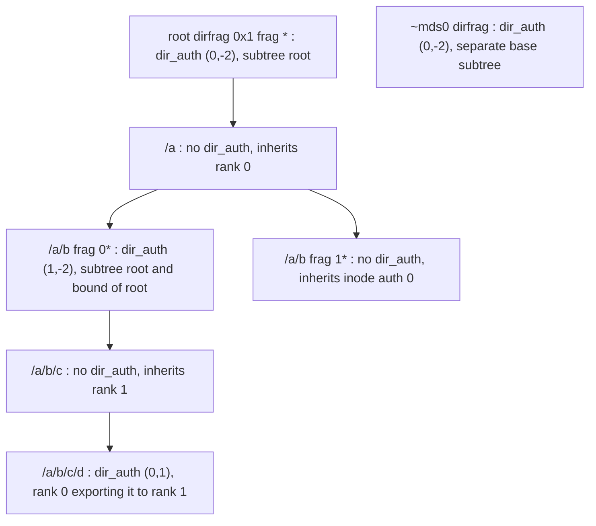
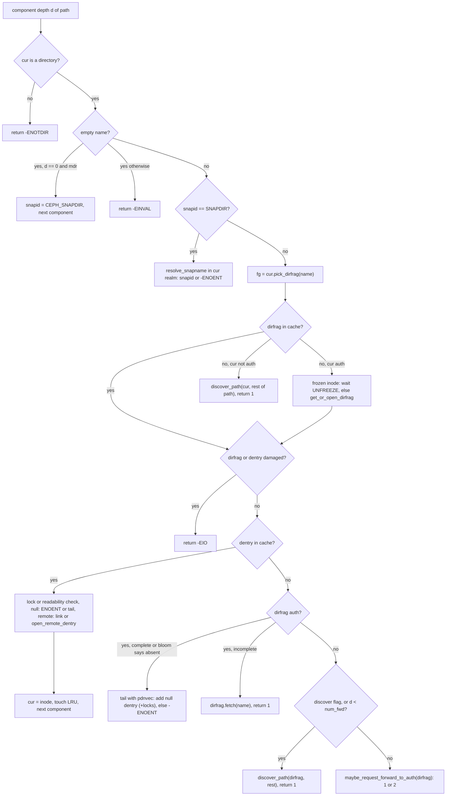
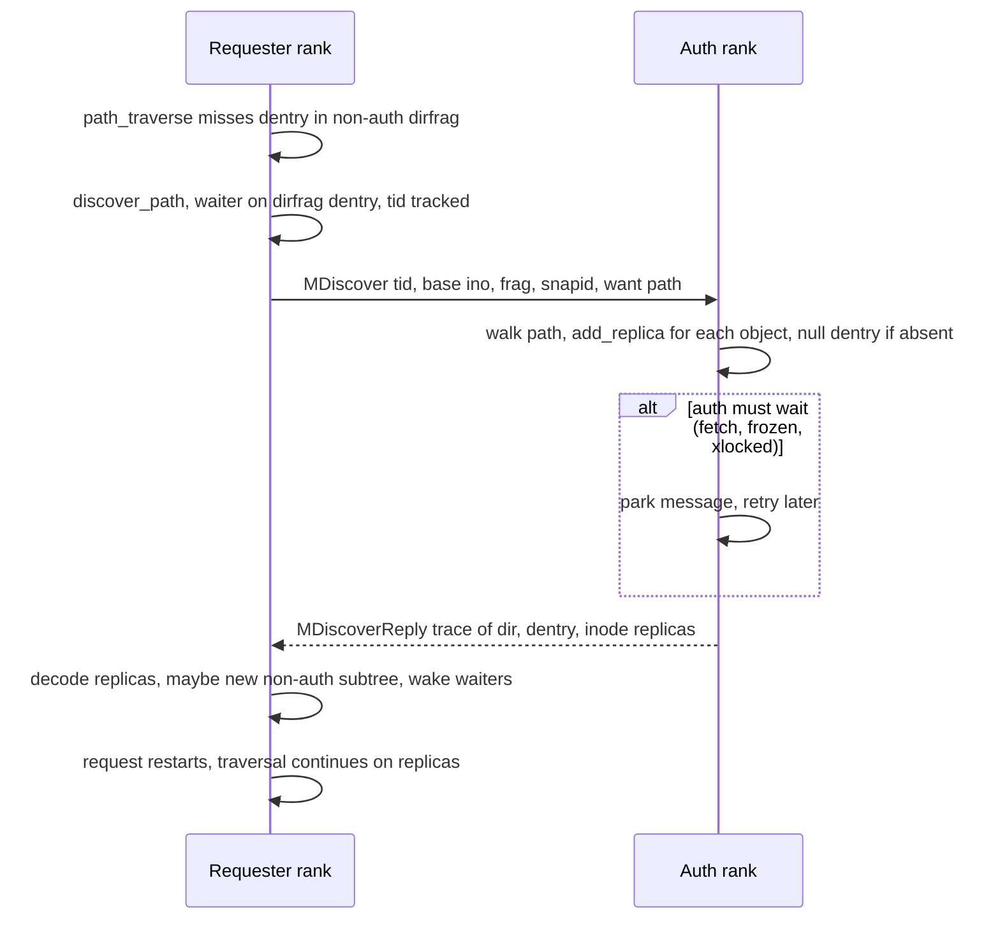
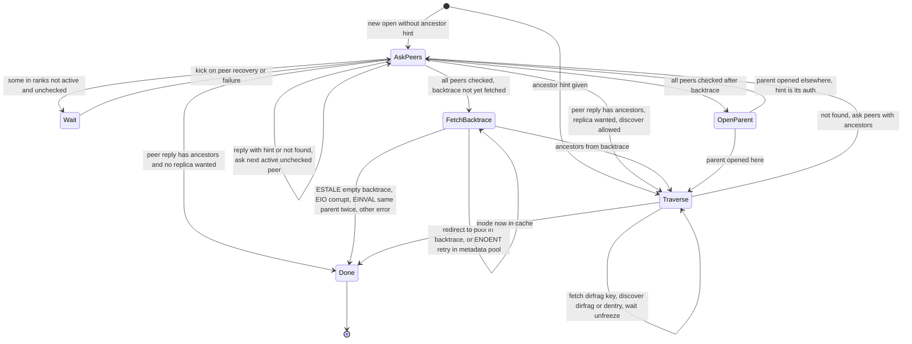
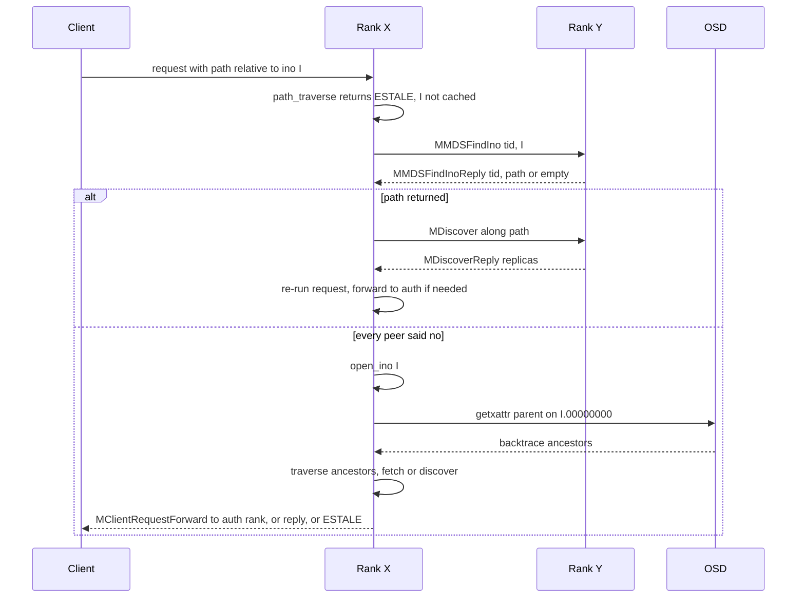

# MDCache core: subtree map, authority, path traversal, replication and lookup-by-ino

> Part of the C++ MDS project map ([README](../README.md)). Sources (commit `5f7e383ae6d`): `src/mds/MDCache.cc` (about 3,400 of 15,324 lines in scope: 907-1550 subtree map and hashing, 2605-2774 `create_subtree_map`, 8355-9804 dispatch, `path_traverse`, `open_ino`, `find_ino_peers`, 10457-11668 backtrace fetch, discover, replica codec, dir updates, dentry link/unlink), `src/mds/MDCache.h` (1,671), `src/messages/{MDiscover,MDiscoverReply,MDirUpdate,MDentryLink,MDentryUnlink,MMDSOpenIno,MMDSOpenInoReply,MMDSFindIno,MMDSFindInoReply}.h` (about 830), authority helpers in `src/mds/CDir.{h,cc}`, `src/mds/CInode.{h,cc}`, `src/mds/CDentry.cc`, `src/mds/MDSCacheObject.h`, `src/mds/mdstypes.h`, `src/include/filepath.{h,cc}`, `src/msg/Message.{h,cc}` (cache-port message ids, `decode_message`); callers in `src/mds/Server.cc`, `src/mds/Migrator.cc`, `src/mds/journal.cc`, `src/mds/MDBalancer.cc`, `src/mds/OpenFileTable.cc`. Kernel client: `linux/fs/ceph/{mds_client.c,inode.c,export.c,quota.c}`. Userspace client: `src/client/{Client.cc,Inode.cc}`.
>
> Related: [process and threading](../00-architecture/process-and-threading.md), [mds_lock analysis](../00-architecture/mds_lock-analysis.md), [beacon and monitor](../01-cluster-integration/beacon-and-monitor.md), [wire protocol](../02-client-protocol/wire-protocol.md), [kclient expectations](../02-client-protocol/kclient-expectations.md), [libcephfs/fuse/Ganesha expectations](../02-client-protocol/libcephfs-fuse-ganesha-expectations.md), [request lifecycle](../03-request-path/request-lifecycle.md), [namespace mutations](../03-request-path/namespace-mutations.md), [rename](../03-request-path/rename.md), [lookup/readdir/open](../03-request-path/lookup-readdir-open-and-file-locks.md), [CInode and inode types](cinode-and-inode-types.md), [CDir/CDentry/cache objects](cdir-cdentry-and-cache-objects.md), [cache lifecycle and trimming](mdcache-lifecycle-trim-and-memory.md), [dirfrags and fragmentation](dirfrags-and-fragmentation.md), [lock state machines](../05-locking/lock-types-and-state-machines.md), [acquiring locks](../05-locking/acquiring-locks.md), [MDLog and Journaler](../06-journal/mdlog-and-journaler.md), [events and replay](../06-journal/events-and-replay.md), [RADOS object catalog](../07-storage-formats/rados-object-catalog.md), [MDS tables and OpenFileTable](../07-storage-formats/mds-tables.md), [subtree migration](../08-multi-mds/subtree-migration.md), [balancer and pinning](../08-multi-mds/balancer-and-pinning.md), [rank lifecycle and recovery](../09-recovery/rank-lifecycle-and-recovery.md), [resolve and rejoin](../09-recovery/resolve-and-rejoin.md), [snapshots](../10-snapshots-quotas-subvolumes/snapshots.md), [strays and purge](../11-background-services/strays-and-purge.md), [scrub and damage](../11-background-services/scrub-and-damage.md), [admin commands](../13-admin-and-config/admin-commands.md), [config, perf counters, health](../13-admin-and-config/config-perf-counters-and-health.md).

## 1. Purpose and responsibilities

This part of `MDCache` answers three questions for every metadata object (inode `CInode`, directory fragment `CDir`, dentry `CDentry`): which rank is authoritative for it, how a rank that receives a path or an inode number finds the object, and how other ranks keep read copies (replicas) of it.

| Responsibility | Mechanism | Main symbols |
|---|---|---|
| Partition the namespace among active ranks | Subtree map: dirfrags with an explicit `dir_auth` are delegation points; everything below inherits | `MDCache::subtrees`, `CDir::dir_auth`, `adjust_subtree_auth`, `adjust_bounded_subtree_auth`, `try_subtree_merge` |
| Express "authority is changing" | Ambiguous authority pairs `(a,b)` plus `WAIT_SINGLEAUTH` waiters | `mds_authority_t`, `is_ambiguous_auth`, `CDir::set_dir_auth` |
| Persist this rank's partition in the journal | `ESubtreeMap` event at each major segment boundary (spanning tree from root to every auth subtree and bound) | `create_subtree_map`, `ESubtreeMap::replay` |
| Deterministic placement for ephemeral pins | Jump consistent hash of `(ino, frag)` over `max_mds` | `hash_into_rank_bucket` |
| Resolve a client or internal path to cache objects, taking per-component locks, forwarding or discovering when not auth | `path_traverse` (flags `MDS_TRAVERSE_*`) | `path_traverse`, `maybe_request_forward_to_auth`, `open_remote_dentry` |
| Pull replicas from the auth rank | Discover protocol | `MDiscover`, `MDiscoverReply`, `discover_*`, `handle_discover*` |
| Encode and decode replicas, track who holds them | Replica blobs with per-replica nonces; `replica_map` on auth | `encode_replica_*`, `decode_replica_*`, `MDSCacheObject::add_replica` |
| Push namespace changes to replicas | `MDentryLink`, `MDentryUnlink`, `MDirUpdate` (lock messages carry lock-protected data, see the locking pages) | `send_dentry_link`, `send_dentry_unlink`, `send_dir_updates` |
| Find an inode by number (NFS handles, hard links, cap reconnect, OpenFileTable prefetch) | Peer cache query, then RADOS backtrace (`parent` xattr), then ancestor traversal | `open_ino`, `MMDSOpenIno(Reply)`, `fetch_backtrace` |
| Recover from `ESTALE` (request base inode not in cache) | Ask each peer for a path to the inode, then discover it | `find_ino_peers`, `MMDSFindIno(Reply)` |

Everything on this page runs on one rank under the global `mds_lock` (see section 6).

## 2. Source map

| File | Class / function | Lines | Role |
|---|---|---|---|
| `src/mds/mdstypes.h` | `mds_authority_t`, `CDIR_AUTH_PARENT/UNKNOWN/DEFAULT/UNDEF`, `MDS_INO_*` | 34-59, 751-759 | authority constants, system inode numbering |
| `src/mds/MDSCacheObject.h` | `STATE_AUTH`, `WAIT_SINGLEAUTH`, `WAIT_UNFREEZE`, `add_replica`, `replica_map`, `replica_nonce`, `is_ambiguous_auth` | 39, 72-81, 102-112, 212-252, 323-324 | auth bit, replica bookkeeping |
| `src/mds/CDir.h` / `CDir.cc` | `dir_auth`, `is_subtree_root`, `authority`, `set_dir_auth`, `contains`, `get_dist_spec`, `_encode_base`, `REP_NONE/ALL/LIST`, `can_rep`, `add_waiter` | `.h` 179-183, 415-475, 745-746, 793-800; `.cc` 3058-3185, 3385-3500 | dirfrag authority, replication hints, freeze-induced subtrees |
| `src/mds/CInode.h` / `CInode.cc` | `inode_auth`, `authority`, `STATE_AMBIGUOUSAUTH`, `is_ambiguous_auth`, `pick_dirfrag`, `get_or_open_dirfrag`, `add_dir_waiter`, `_encode_base`, `_encode_locks_state_for_replica`, `make_path`, `get_backtrace_pool` | `.h` 368, 409, 708-716, 1233; `.cc` 720-736, 837-850, 1159-1168, 2904-2950, 3157-3172, 4505-4625, 5585-5595 | inode authority, dirfrag selection, replica payload |
| `src/mds/CDentry.cc` | `CDentry::authority` | 191 | dentry authority = dirfrag authority |
| `src/mds/MDCache.h` | `MDS_TRAVERSE_*`, `discover_info_t`, `find_ino_peer_info_t`, `open_ino_info_t`, `subtrees`, `projected_subtree_renames`, `discovers`, `waiting_for_base_ino`, `opening_inodes` | 136-148, 166-207, 1205-1224, 1270-1291, 1384-1415 | declarations and state |
| `src/mds/MDCache.cc` | `open_foreign_mdsdir`, `get_object` | 907-938 | foreign `~mdsN` discovery, object lookup by `MDSCacheObjectInfo` |
| `src/mds/MDCache.cc` | `hash_into_rank_bucket` | 948-967 | jump consistent hash |
| `src/mds/MDCache.cc` | `adjust_subtree_auth`, `try_subtree_merge`, `try_subtree_merge_at`, `eval_subtree_root` | 978-1121 | create/move/merge subtrees |
| `src/mds/MDCache.cc` | `adjust_bounded_subtree_auth` (two overloads), `get_force_dirfrag_bound_set`, `map_dirfrag_set` | 1125-1340 | impose an exact `[root, bounds)` region |
| `src/mds/MDCache.cc` | `get_subtree_root`, `get_projected_subtree_root`, `remove_subtree`, `get_subtree_bounds`, `get_wouldbe_subtree_bounds`, `verify_subtree_bounds` | 1342-1448 | queries |
| `src/mds/MDCache.cc` | `project_subtree_rename`, `adjust_subtree_after_rename` | 1450-1542 | subtree map maintenance for directory renames |
| `src/mds/MDCache.cc` | `_move_subtree_map_bound`, `create_subtree_map` | 2605-2774 | build `ESubtreeMap` |
| `src/mds/MDCache.cc` | `dispatch` | 8355-8423 | routes all `0x2xx` MDS-to-MDS cache messages |
| `src/mds/MDCache.cc` | `path_traverse`, `maybe_request_forward_to_auth`, `cache_traverse` | 8443-8945 | path resolution |
| `src/mds/MDCache.cc` | `open_remote_dirfrag`, `get_dentry_inode`, `open_remote_dentry`, `_open_remote_dentry_finish`, `make_trace` | 8955-9069 | remote dirfrags and hard-link targets |
| `src/mds/MDCache.cc` | `_open_ino_*`, `open_ino_traverse_dir`, `open_ino_finish`, `do_open_ino`, `do_open_ino_peer`, `handle_open_ino`, `handle_open_ino_reply`, `kick_open_ino_peers`, `open_ino_batch_*`, `open_ino` | 9073-9637 | lookup by inode number |
| `src/mds/MDCache.cc` | `find_ino_peers`, `_do_find_ino_peer`, `handle_find_ino`, `handle_find_ino_reply`, `kick_find_ino_peers` | 9651-9802 | ESTALE recovery |
| `src/mds/MDCache.cc` | `fetch_backtrace` | 10457-10463 | RADOS `getxattr("parent")` |
| `src/mds/MDCache.cc` | `_send_discover`, `discover_base_ino`, `discover_dir_frag`, `discover_path` (two overloads), `kick_discovers`, `handle_discover`, `handle_discover_reply` | 10482-11096 | discover protocol |
| `src/mds/MDCache.cc` | `encode_replica_{dir,dentry,inode,stray}`, `decode_replica_{dir,dentry,inode,stray}` | 11104-11345 | replica codec |
| `src/mds/MDCache.cc` | `send_dir_updates`, `handle_dir_update` | 11348-11440 | replication hints |
| `src/mds/MDCache.cc` | `encode/decode_remote_dentry_link`, `send_dentry_link`, `handle_dentry_link`, `send_dentry_unlink`, `handle_dentry_unlink` | 11447-11643 | push link/unlink to replicas |
| `src/messages/MDiscover.h`, `MDiscoverReply.h`, `MDirUpdate.h`, `MDentryLink.h`, `MDentryUnlink.h`, `MMDSOpenIno.h`, `MMDSOpenInoReply.h`, `MMDSFindIno.h`, `MMDSFindInoReply.h` | message classes | whole files | wire formats (section 5.1) |
| `src/msg/Message.h` / `Message.cc` | `MSG_MDS_*` ids 0x200-0x212 (including reserved `MSG_MDS_INODEUPDATE`), `decode_message` | `.h` 169-186; `.cc` 883-886, 980-986 | cache-port message type ids; decode rejects ids with no `case` before MDS dispatch (section 5.1) |
| `src/mds/journal.cc` | `ESubtreeMap::encode/decode/replay` | 2783-2970 | subtree map journaling |
| `src/mds/Server.cc` | `rdlock_path_pin_ref`, `rdlock_path_xlock_dentry`, `rdlock_two_paths_xlock_destdn`, `C_MDS_TryFindInode`, `_try_open_ino`, `handle_client_lookup_ino`, `_lookup_ino_2` | 3814-4130, 4433-4636 | main traversal and lookup-by-ino callers |

## 3. How it works

### 3.1 The authority model

#### 3.1.1 `mds_authority_t`

`typedef std::pair<mds_rank_t, mds_rank_t> mds_authority_t` (`src/mds/mdstypes.h:751 (mds_authority_t)`). Constants (`src/mds/mdstypes.h:756-759 (CDIR_AUTH_*)`): `CDIR_AUTH_PARENT = -1`, `CDIR_AUTH_UNKNOWN = -2`, `CDIR_AUTH_DEFAULT = (-1,-2)`, `CDIR_AUTH_UNDEF = (-2,-2)`. The comment at `src/mds/CDir.h:793-799 (CDir::dir_auth comment)` lists the meanings; the full set observed in code:

| `CDir::dir_auth` | Meaning | Set by (examples) |
|---|---|---|
| `(-1,-2)` `CDIR_AUTH_DEFAULT` | Not a subtree root; authority inherited from the directory inode | CDir constructor (`src/mds/CDir.cc:210 (CDir::CDir)`), `try_subtree_merge_at` |
| `(a,-2)` | Delegation point, single auth `a` | `adjust_subtree_auth(dir, a)` |
| `(a,b)`, `a != b`, `b >= 0` | Ambiguous: authority moving between `a` and `b` (export/import in flight; an importer in `IMPORT_ACKING` whose exporter fails keeps `(me,oldauth)` as an ambiguous import until resolve, `src/mds/Migrator.cc:622 (Migrator::handle_mds_failure_or_stop)`) | Migrator only (table below); replay never produces it, journaled ambiguous imports replay as `(me,me)` |
| `(a,a)` | Ambiguous "self": tree frozen on auth `a` (export in progress) or import being acked | `CDir::_freeze_tree` (`src/mds/CDir.cc:3385 (CDir::_freeze_tree)`), `Migrator::import_finish` (`src/mds/Migrator.cc:3260 (Migrator::import_finish)`), `Migrator::export_reverse` (`src/mds/Migrator.cc:2178 (Migrator::export_reverse)`), journaled ambiguous imports in `ESubtreeMap::replay` (`src/mds/journal.cc:2960 (ESubtreeMap::replay)`) and `EImportStart::replay` (`src/mds/journal.cc:3210 (EImportStart::replay)`) |
| `(-2,-2)` `CDIR_AUTH_UNDEF` | Unknown (replay of base dirfrags and renamed-in dirfrags; subtrees exported or whose import failed, during replay; root dirfrag on non-root ranks at resolve start) | `src/mds/journal.cc:1313 (EMetaBlob::replay)` (also line 1588), `src/mds/journal.cc:3125 (EExport::replay)`, `src/mds/journal.cc:3290 (EImportFinish::replay)` (failed import), `src/mds/MDCache.cc:2795 (MDCache::resolve_start)` |

`CDir::is_subtree_root()` is simply `dir_auth != CDIR_AUTH_DEFAULT` (`src/mds/CDir.h:429 (CDir::is_subtree_root)`). `is_ambiguous_dir_auth()` is `dir_auth.second != CDIR_AUTH_UNKNOWN` (`src/mds/CDir.h:419 (CDir::is_ambiguous_dir_auth)`), `is_full_dir_auth()` = auth bit set and not ambiguous, `is_full_dir_nonauth()` = auth bit clear and not ambiguous.

#### 3.1.2 Authority of each object type

| Object | `authority()` | Code |
|---|---|---|
| `CDir` | `dir_auth` if subtree root, else `inode->authority()` | `src/mds/CDir.cc:3081 (CDir::authority)` |
| `CInode` | `inode_auth` if `inode_auth.first >= 0`; else the parent dentry's dirfrag authority; else the first projected parent's dirfrag authority ("new items not yet linked belong to their first parent"); else `CDIR_AUTH_UNDEF` | `src/mds/CInode.cc:3157 (CInode::authority)` |
| `CDentry` | `dir->authority()` | `src/mds/CDentry.cc:191 (CDentry::authority)` |

`inode_auth` is only set for base inodes: the root inode gets `(whoami,-2)` when created locally (`src/mds/MDCache.cc:469 (create_unlinked_system_inode)`), `.first = mdsmap->get_root()` in `src/mds/MDCache.cc:3907 (recalc_auth_bits)`, and rank 0 hard-coded when it is decoded as a replica (`src/mds/MDCache.cc:11270 (decode_replica_inode)`); `~mdsN` gets `(N,-2)` (`src/mds/MDCache.cc:471 (create_unlinked_system_inode)`, `src/mds/MDCache.cc:11272 (decode_replica_inode)`); rejoin may give a barebones `~mdsN` inode `(from,-2)` (`src/mds/MDCache.cc:5092 (handle_cache_rejoin_ack)`). `MDSMap::root` is always 0 (`src/mds/MDSMap.h:601 (MDSMap::root)`).

Consequences:

- An inode is owned by the rank that owns the dirfrag holding its primary dentry. A directory inode can be owned by rank A while some of its dirfrags (subtree roots) are owned by rank B; the directory inode's `filelock`/`nestlock` are then scattered (section 3.2.7).
- Different dirfrags of the same directory can have different authorities.
- Hard links: a remote dentry (`linkage_t::remote_ino`) has the authority of its own dirfrag; the target inode has the authority of its primary dentry's dirfrag (possibly on another rank, possibly in a stray directory).

#### 3.1.3 The `STATE_AUTH` bit versus `authority()`

`MDSCacheObject::is_auth()` tests a cached bit `STATE_AUTH = 1<<30` (`src/mds/MDSCacheObject.h:72 (STATE_AUTH)`, `src/mds/MDSCacheObject.h:102 (is_auth)`). Almost all decision code uses `is_auth()`; `authority()` is used to decide where to forward or discover and to fill hints. The bit is set or cleared:

- at construction: `src/mds/CDir.cc:210 (CDir::CDir, auth parameter)`, `src/mds/CInode.cc:371 (CInode::CInode, auth=true default declared at src/mds/CInode.h:426)`; dentries inherit from their dirfrag in `src/mds/CDir.cc:393 (CDir::add_null_dentry)`, `src/mds/CDir.cc:439 (CDir::add_primary_dentry)`, `src/mds/CDir.cc:489 (CDir::add_remote_dentry)`; replicas are created with `auth=false` by `decode_replica_*`;
- by migration: `src/mds/Migrator.cc:1876 (Migrator::finish_export_inode)`, `src/mds/Migrator.cc:1998 (Migrator::finish_export_dir)`, `src/mds/CDir.cc:2999 (CDir::decode_import)`, `src/mds/CInode.cc:4720 (CInode::decode_import)`, `src/mds/CDir.cc:3045 (CDir::abort_import)`, `src/mds/Migrator.cc:3020 (Migrator::import_reverse)`;
- by cross-rank rename inode export/import: `src/mds/Server.cc:9887 (Server::_rename_prepare_import)`, `src/mds/Server.cc:10450 (Server::_rename_apply)`, `src/mds/Server.cc:11336 (Server::_rename_rollback_finish)`;
- wholesale by `MDCache::recalc_auth_bits` (`src/mds/MDCache.cc:3902 (MDCache::recalc_auth_bits)`) after replay/resolve: it walks every subtree, sets or clears the bit on every dirfrag, dentry and primary inode according to the subtree's `authority().first`, and on non-replay also marks non-auth objects `STATE_REJOINING`, cleans their dirty state and closes empty non-auth non-subtree dirfrags.

Outside migration, cross-rank rename and recovery windows `is_auth() == (authority().first == whoami)`; during export/import the bit flips at specific Migrator steps while `dir_auth` is ambiguous, during a cross-rank rename the renamed inode's bit changes at the `Server.cc` steps above while it is `STATE_AMBIGUOUSAUTH`, and during replay/resolve the bits are only made consistent by `recalc_auth_bits`.

#### 3.1.4 Ambiguous authority and `WAIT_SINGLEAUTH`

`MDSCacheObject::is_ambiguous_auth()` returns `authority().second != CDIR_AUTH_UNKNOWN` (`src/mds/MDSCacheObject.h:110 (MDSCacheObject::is_ambiguous_auth)`). `CInode::is_ambiguous_auth()` additionally returns true when `STATE_AMBIGUOUSAUTH` (1<<4) is set (`src/mds/CInode.h:708 (CInode::is_ambiguous_auth)`); that bit is set on an inode whose authority moves during a cross-rank rename (see [rename](../03-request-path/rename.md)) and cleared by `CInode::clear_ambiguous_auth`, which wakes `WAIT_SINGLEAUTH` waiters (`src/mds/CInode.cc:3079 (CInode::clear_ambiguous_auth)`).

Waiting for single authority uses `WAIT_SINGLEAUTH = 1<<60` (`src/mds/MDSCacheObject.h:80 (MDSCacheObject::WAIT_SINGLEAUTH)`). Waiters are hoisted:

- `CDentry::add_waiter` passes `WAIT_UNFREEZE|WAIT_SINGLEAUTH` to the dirfrag (`src/mds/CDentry.cc:197 (CDentry::add_waiter)`).
- `CInode::add_waiter` passes `WAIT_SINGLEAUTH` to the parent dirfrag unless the inode itself is `STATE_AMBIGUOUSAUTH` (`src/mds/CInode.cc:2929 (CInode::add_waiter)`).
- `CDir::add_waiter` passes `WAIT_ATSUBTREEROOT` (= `WAIT_SINGLEAUTH`, `src/mds/CDir.h:195 (CDir::WAIT_ATSUBTREEROOT)`) up to the enclosing subtree root (`src/mds/CDir.cc:1344 (CDir::add_waiter)`).

So all "wait for single auth" waiters in a subtree are queued on the subtree root and woken together by `CDir::set_dir_auth` when `.second` becomes `CDIR_AUTH_UNKNOWN` (`src/mds/CDir.cc:3143 (CDir::set_dir_auth)`, "newly single auth?").

`CDir::set_dir_auth` also maintains `CInode::num_subtree_roots` and, for auth inodes, moves the auth pin that a frozen dirfrag holds on its parent inode when the dirfrag becomes or stops being a subtree root (`src/mds/CDir.cc:3143-3185 (CDir::set_dir_auth)`). It does not touch `STATE_AUTH`.

Freezing a tree on the auth (`CDir::_freeze_tree`, `src/mds/CDir.cc:3385 (CDir::_freeze_tree)`) forces the frozen root to become a subtree root with `dir_auth = (a,a)` and makes every nested region with a different freeze state a subtree root with authority `a`; `CDir::unfreeze_tree` (`src/mds/CDir.cc:3446 (CDir::unfreeze_tree)`) asserts `(a,a)` and sets `(a,-2)`. Consequently every request that needs the auth of an object inside a tree being exported waits on `WAIT_SINGLEAUTH` at the subtree root.

Migration transitions of `dir_auth` (details in [subtree migration](../08-multi-mds/subtree-migration.md)):

| Side | Step | `dir_auth` after | Code |
|---|---|---|---|
| Exporter | tree frozen | `(me,me)` | `src/mds/CDir.cc:3385 (CDir::_freeze_tree)`, asserted at `src/mds/Migrator.cc:1520 (export_frozen)` |
| Exporter | export sent | `(me,dest)` | `src/mds/Migrator.cc:1733 (export_go_synced)` |
| Exporter | `MExportDirAck` received | `(dest,me)` "list us second, them first" | `src/mds/Migrator.cc:2094 (handle_export_ack)` |
| Exporter | notifies acked | `(dest,-2)` | `src/mds/Migrator.cc:2339 (export_finish)` |
| Exporter | abort | `(me,me)` then unfreeze `(me,-2)` | `src/mds/Migrator.cc:2178 (export_reverse)` |
| Importer | `MExportDirPrep` | bounded `(oldauth,me)` | `src/mds/Migrator.cc:2784 (handle_export_prep)` |
| Importer | `MExportDir` decoded and journaled | `(me,oldauth)` | `src/mds/Migrator.cc:2861 (handle_export_dir)` |
| Importer | finish | `(me,me)` then unfreeze `(me,-2)` | `src/mds/Migrator.cc:3260 (import_finish)` |
| Importer | abort (prepped, cancelled, or reversed) | `(oldauth,-2)` | `src/mds/Migrator.cc:2995 (import_reverse)`, `src/mds/Migrator.cc:2568 (handle_export_cancel)`, `src/mds/Migrator.cc:607 (handle_mds_failure_or_stop)` |
| Bystander | `MExportDirNotify` | bounded `new_auth` | `src/mds/Migrator.cc:3769 (handle_export_notify)` |

#### 3.1.5 Example



As seen by rank 0, the subtree map is `{root: {/a/b 0*}, ~mds0: {}, /a/b 0*: {/a/b/c/d}, /a/b/c/d: {}}`: the non-auth `/a/b 0*` is a key because it is a bound of rank 0's root subtree, and `/a/b/c/d` is a key because rank 0 is (ambiguously) auth for it. `/a/b 1*` belongs to rank 0 through the `/a/b` inode, which lives in rank 0's root subtree.

### 3.2 The subtree map

#### 3.2.1 Structure

`std::map<CDir*, std::set<CDir*>> subtrees` (`src/mds/MDCache.h:1402 (MDCache::subtrees)`): the keys are all dirfrags with `dir_auth != DEFAULT` known to this rank, the value is the set of *bounds*, the subtree roots directly nested under that root (non-recursive). Every key holds a `CDir::PIN_SUBTREE` reference (`src/mds/CDir.h:118 (CDir::PIN_SUBTREE)`). Each key except base dirfrags is itself in the bound set of exactly one other key (its parent subtree).

A rank's map contains: its auth subtrees (rank 0: the root dirfrag(s); every rank: its own `~mdsN` dirfrag; imported subtrees; aux subtrees created by export pins); every bound of those (by construction non-auth, ambiguous, or aux/export bound); non-auth subtree roots created when replicas are decoded at a delegation boundary (section 3.7.2); `CDIR_AUTH_UNDEF` subtrees during replay.

Queries: `get_subtree_root(dir)` walks `inode->get_parent_dir()` until a subtree root and returns `nullptr` for an unlinked directory (`src/mds/MDCache.cc:1342 (MDCache::get_subtree_root)`); projected parents are walked by `src/mds/MDCache.cc:1354 (MDCache::get_projected_subtree_root)`; `src/mds/MDCache.cc:1382 (MDCache::get_subtree_bounds)` copies the bound set; `src/mds/MDCache.cc:1388 (MDCache::get_wouldbe_subtree_bounds)` computes the bounds a non-root dirfrag would have; `is_leaf_subtree`, `is_subtree`, `get_auth_subtrees`, `get_fullauth_subtrees`, `num_subtrees*` are inline (`src/mds/MDCache.h:343-440 (MDCache::is_subtrees .. num_subtrees)`). `src/mds/MDCache.cc:12903 (MDCache::show_subtrees)` prints the tree (suppressed above 5 subtrees or depth 5 unless debug level 25, `SUBTREES_COUNT_THRESHOLD`/`SUBTREES_DEPTH_THRESHOLD`) and counts entries not reachable from base dirfrags.

#### 3.2.2 `adjust_subtree_auth(dir, auth, adjust_pop=true)` (`src/mds/MDCache.cc:978 (MDCache::adjust_subtree_auth)`)

1. Find the current root: if `dir->inode->is_base()`, `root = dir`, creating an empty entry and taking `PIN_SUBTREE` if missing ("bootstrap hack"); else `root = get_subtree_root(dir)`.
2. If `root == dir`: just `set_dir_auth(auth)`.
3. Else (new subtree): create `subtrees[dir] = {}`, take `PIN_SUBTREE`, `set_dir_auth(auth)`; move every bound `p` of `root` whose `get_subtree_root(p->get_parent_dir())` is now `dir` into `dir`'s bounds ("claiming child bound"); insert `dir` into `root`'s bounds; if `adjust_pop && dir->is_auth()`, subtract `dir->pop_auth_subtree` from every ancestor dirfrag's `pop_auth_subtree` up to and including the old subtree root.

It never merges; merging is a separate, explicit step.

#### 3.2.3 `try_subtree_merge(dir)` and `try_subtree_merge_at(dir, to_eval, adjust_pop)` (`src/mds/MDCache.cc:1045 (MDCache::try_subtree_merge)`, `src/mds/MDCache.cc:1065 (MDCache::try_subtree_merge_at)`)

`try_subtree_merge` copies `dir`'s bounds, calls `try_subtree_merge_at(dir)` then `try_subtree_merge_at(bound)` for each old bound, and (unless in replay or resolve) calls `eval_subtree_root` on every auth inode whose dirfrag got merged.

`try_subtree_merge_at` returns immediately if `dir->dir_auth.second != CDIR_AUTH_UNKNOWN` (ambiguous), `STATE_EXPORTBOUND` or `STATE_AUXSUBTREE` (pinned, "no subtree merge", `src/mds/CDir.h:145 (CDir::STATE_AUXSUBTREE)`). Otherwise, with `parent = get_subtree_root(dir->get_parent_dir())` (or `dir` itself for base inodes), if `parent != dir && parent->dir_auth == dir->dir_auth` (exact pair equality) it merges: `dir_auth = DEFAULT`, `dir`'s bounds are moved to `parent`, `dir` is removed from `subtrees` and from `parent`'s bounds, `PIN_SUBTREE` dropped, popularity added back to ancestors and `pop_lru_subdirs` relinked, and the inode is added to `to_eval` if auth.

`eval_subtree_root(diri)` asserts auth and calls `Locker::try_eval(diri, CEPH_LOCK_IFILE | CEPH_LOCK_INEST)` (`src/mds/MDCache.cc:1116 (MDCache::eval_subtree_root)`) because a directory that no longer has subtree-root dirfrags no longer needs scattered `filelock`/`nestlock`.

#### 3.2.4 `adjust_bounded_subtree_auth(dir, bounds, auth)` (`src/mds/MDCache.cc:1125 (MDCache::adjust_bounded_subtree_auth)`)

Makes the region `[dir, bounds)` a single subtree with authority `auth` and bound set exactly `bounds`:

1. Make `dir` a subtree root as in 3.2.2 (bootstrap special case only when `dir->ino() == CEPH_INO_ROOT`), remembering `oldauth = dir->authority()`.
2. For each requested bound not already a bound of `dir`:
   - if its subtree root is `dir` (it is inside the region), `adjust_subtree_auth(bound, oldauth)` ("new bound, adjusting auth back to old");
   - else it lies under an intervening subtree `t`: make `bound` a subtree with `t->authority()` if needed, then repeatedly walk `t` up to a direct bound of `dir`, `adjust_subtree_auth(t, auth)` and `try_subtree_merge_at(t)` ("swallowing intervening subtree") until `bound`'s parent subtree is `dir`.
3. While `dir` has bounds not in `bounds`, set them to `auth` and merge them ("swallowing extra subtree"), repeating while the bound set changes.
4. `verify_subtree_bounds(dir, bounds)` asserts exact equality (`src/mds/MDCache.cc:1412 (MDCache::verify_subtree_bounds)`; a mismatch aborts the daemon).
5. Unless replay or resolve, `eval_subtree_root` on merged inodes.

The `vector<dirfrag_t>` overload (`src/mds/MDCache.cc:1296 (MDCache::adjust_bounded_subtree_auth)`) first converts dirfrag ids with `src/mds/MDCache.cc:1252 (MDCache::get_force_dirfrag_bound_set)`: for each inode in cache it builds a temporary fragtree forcing the given frags to leaves; for a given frag that is finer than the local fragtree, the locally covering dirfrag is split (`force_dir_fragment`) to match ("only split if one of our frags spans the provided bounding set. Never merge."); then all open dirfrags under each given frag become bounds. `src/mds/MDCache.cc:1306 (MDCache::map_dirfrag_set)` maps dirfrag ids to open `CDir*` under the current fragtree without forcing (used by bystander notification, `src/mds/Migrator.cc:3768 (Migrator::handle_export_notify)`, and by `src/mds/Migrator.cc:2535 (Migrator::import_reverse_prepping)`).

Callers: `src/mds/journal.cc:2960 (ESubtreeMap::replay)` (also line 2964), `src/mds/journal.cc:3125 (EExport::replay)`, `src/mds/journal.cc:3210 (EImportStart::replay)`, `src/mds/journal.cc:3290 (EImportFinish::replay)`, `src/mds/MDCache.cc:3407 (MDCache::handle_resolve)`, `src/mds/MDCache.cc:3685 (MDCache::disambiguate_other_imports)`, `src/mds/MDCache.cc:3799 (MDCache::finish_ambiguous_import)`, `src/mds/Migrator.cc:2784 (Migrator::handle_export_prep)`, `src/mds/Migrator.cc:3769 (Migrator::handle_export_notify)`.

#### 3.2.5 Other mutations

- `src/mds/MDCache.cc:1366 (MDCache::remove_subtree)`: erase entry, drop `PIN_SUBTREE`, erase from the parent subtree's bounds; it does not reset `dir_auth`. Used when a subtree-root dirfrag is trimmed (non-auth, or an unreplicated base dirfrag, asserted in `src/mds/MDCache.cc:7261 (MDCache::trim_dirfrag)`), when `MDCache::trim` drops an empty aux subtree whose inode is also auth (`src/mds/MDCache.cc:7055 (MDCache::trim)`), by `src/mds/MDCache.cc:3823 (MDCache::remove_inode_recursive)`, `src/mds/MDCache.cc:7494 (MDCache::trim_non_auth)`, `src/mds/MDCache.cc:7596 (MDCache::try_trim_non_auth_subtree)` (also lines 7612, 7630) and `src/mds/MDCache.cc:8213 (MDCache::shutdown_pass)`. Fragmentation does not call it: `adjust_dir_fragments` edits `subtrees` directly (`src/mds/MDCache.cc:11781-11841 (MDCache::adjust_dir_fragments)`).
- Explicit `adjust_subtree_auth(dir, me)` on bootstrap: `src/mds/MDCache.cc:505 (MDCache::create_empty_hierarchy)` (also sets `rootdir->dir_rep = REP_ALL`), `src/mds/MDCache.cc:533 (MDCache::create_mydir_hierarchy)`, `src/mds/MDCache.cc:700 (MDCache::open_root_inode)`, `src/mds/MDCache.cc:730 (MDCache::open_mydir_frag)`, `src/mds/MDCache.cc:750 (MDCache::open_root)` (root dirfrag; `~mdsN` at line 771), `src/mds/journal.cc:3377 (EResetJournal::replay)` (also line 3381). Rejoin acks also create non-auth subtree roots for barebones dirfrags (`src/mds/MDCache.cc:5105 (MDCache::handle_cache_rejoin_ack)`).
- Export pins: `MDBalancer::handle_export_pins` sets `STATE_AUXSUBTREE` and calls `adjust_subtree_auth(dir, me)` to keep a dirfrag pinned to this rank as its own subtree, clears the bit and calls `try_subtree_merge` when the pin goes away, and exports to other targets (`src/mds/MDBalancer.cc:206-232 (MDBalancer::handle_export_pins)`); `Migrator::export_finish` clears the bit (`src/mds/Migrator.cc:2352 (Migrator::export_finish)`). Under `mds_thrash_exports` (testing), `Migrator::export_dir` picks a random nested dirfrag `bd` "to create a random subtree bound", but the code sets `STATE_AUXSUBTREE` on, and calls `adjust_subtree_auth` for, the export root `dir` itself, not `bd` (`src/mds/Migrator.cc:983-984 (Migrator::export_dir)`).
- Fragmentation: when only some of the dirfrags being split or merged are subtree roots, the others are made aux subtree roots with `adjust_subtree_auth(dir, me)` and the existing roots are asserted to be `STATE_AUXSUBTREE` already ("either all dirfrags are subtree roots or all are not", `src/mds/MDCache.cc:12025 (MDCache::fragment_freeze_dirs)`); `adjust_dir_fragments` does the same for source frags when any of them is a subtree root before moving their bounds (`src/mds/MDCache.cc:11824 (MDCache::adjust_dir_fragments)`); `STATE_AUXSUBTREE`, `STATE_EXPORTBOUND`, `STATE_IMPORTBOUND` survive split/merge (`src/mds/CDir.h:171 (CDir::MASK_STATE_FRAGMENT_KEPT)`); see [dirfrags and fragmentation](dirfrags-and-fragmentation.md).

#### 3.2.6 Directory renames (`src/mds/MDCache.cc:1450 (MDCache::project_subtree_rename)`, `src/mds/MDCache.cc:1457 (MDCache::adjust_subtree_after_rename)`)

Every rename or rmdir of a directory inode registers `project_subtree_rename(diri, olddir, newdir)` before journaling (`src/mds/Server.cc:8822 (Server::_unlink_local)`, `src/mds/Server.cc:9013 (Server::handle_peer_rmdir_prep)`, `src/mds/Server.cc:9185 (Server::do_rmdir_rollback)`, `src/mds/Server.cc:10282 (Server::_rename_prepare)`, `src/mds/Server.cc:11292 (Server::do_rename_rollback)`); the list `projected_subtree_renames[diri]` is used only by `create_subtree_map` (3.3) so that a subtree map written between journaling and applying the rename already reflects it.

After the in-memory rename is applied, `adjust_subtree_after_rename(diri, olddir, pop)`:

1. If `pop`, pops the front `(olddir,newdir)` pair (asserting it matches).
2. If the parent dirfrag changed, fixes freeze accounting of nested dirfrags (`olddir->adjust_freeze_after_rename`).
3. For every dirfrag of `diri` (subtree roots first): with `oldparent = get_subtree_root(olddir)`, `newparent = get_subtree_root(newdir)`:
   - same parent: nothing;
   - dirfrag is a subtree root: move it from `oldparent`'s bounds to `newparent`'s and `try_subtree_merge_at(dir, NULL, false)`;
   - dirfrag is mid-subtree: move every bound of `oldparent` that now lies under `newparent` to `newparent`; if `oldparent->authority() != newparent->authority()`, make the dirfrag a subtree root that keeps the old authority (`adjust_subtree_auth(dir, oldparent->authority(), false)`) and try to merge it.
   - popularity is moved between the old and new parent chains through `MDBalancer::adjust_pop_for_rename`.

So renaming a directory across an authority boundary moves the directory inode to the destination dirfrag's auth but leaves its contents with the old auth, creating a new delegation point. Replicas run the same function when they process `MDentryUnlink` for a directory moved to a stray (`src/mds/MDCache.cc:11613 (MDCache::handle_dentry_unlink)`) and during replay (`src/mds/journal.cc:1563 (EMetaBlob::replay)`, `src/mds/journal.cc:1601 (EMetaBlob::replay)`).

#### 3.2.7 Subtrees and scatterlocks

A directory inode with subtree-root dirfrags (`CInode::num_subtree_roots > 0`) or exporting dirfrags returns true from `has_subtree_or_exporting_dirfrag()` (`src/mds/CInode.cc:916 (CInode::has_subtree_or_exporting_dirfrag)`); `Locker::wrlock_start` then insists on `LOCK_MIX` for `filelock`/`nestlock` wrlocks on the auth (`want_scatter`, `src/mds/Locker.cc:1981 (Locker::wrlock_start)`), so that the ranks owning different dirfrags can update `fragstat`/`rstat` concurrently and the inode auth gathers them. See [lock state machines](../05-locking/lock-types-and-state-machines.md).

### 3.3 `ESubtreeMap`: journaling the subtree map

#### 3.3.1 When it is written

| Caller | Situation |
|---|---|
| `MDLog::_segment_upkeep` (`src/mds/MDLog.cc:452 (MDLog::_segment_upkeep)`) | `minor_segments_since_last_major_segment > minor_segments_per_major_segment` (config `mds_log_minor_segments_per_major_segment`, default 16, min 4): start of a new major segment |
| `MDLog::_segment_upkeep` (`src/mds/MDLog.cc:463 (MDLog::_segment_upkeep)`) | `mds_debug_subtrees` (default false): an extra copy with type `EVENT_SUBTREEMAP_TEST` (50) whenever the current segment holds more than one event; the code comment says it is not a segment boundary, but it is still an `ESubtreeMap` (a major `SegmentBoundary`), so each copy starts a new major segment (`src/mds/MDLog.cc:403-412`, `src/mds/events/ESubtreeMap.h:46`) |
| `MDSRank::boot_create` (`src/mds/MDSRank.cc:2241 (MDSRank::boot_create)`) | creating a new rank |
| `MDSRank::boot_start` (`src/mds/MDSRank.cc:1726 (MDSRank::boot_start)`) | rank starting (not replaying): "positioning at end of old mds log" |
| `C_Flush_Journal::flush_mdlog` (`src/mds/MDSRank.cc:118 (C_Flush_Journal::flush_mdlog)`) | `flush journal` admin command: seal the current segment |
| `MDCache::shutdown_pass` (`src/mds/MDCache.cc:8127 (MDCache::shutdown_pass)`) | stopping: seal before trimming everything |

`ESubtreeMap` is a `SegmentBoundary` with `is_major_segment_boundary() == true` (`src/mds/events/ESubtreeMap.h:23-48 (ESubtreeMap)`); ordinary minor boundaries use `ESegment`. Replay must start at a major boundary (see [MDLog and Journaler](../06-journal/mdlog-and-journaler.md)).

#### 3.3.2 `create_subtree_map()` (`src/mds/MDCache.cc:2624 (MDCache::create_subtree_map)`)

1. Always include `~mdsN` frag 0 (`myin`) in `dirs_to_add`.
2. For every subtree with `dir_auth.first == whoami` (including `(me,-2)`, `(me,me)` and `(me,other)`; excluding `(other,*)`): record `le->subtrees[root] = [all bounds]`; mark it in `le->ambiguous_subtrees` if `Migrator::is_ambiguous_import(dirfrag)` or it is in `my_ambiguous_imports`; add the root and each bound to `dirs_to_add`.
3. Apply `projected_subtree_renames` to the journaled map (not to the live map): for each projected `(olddir, newdir)` of each renamed directory, compute the projected subtree roots of both; a subtree-root dirfrag moves between bound lists (`_move_subtree_map_bound`, `src/mds/MDCache.cc:2605 (MDCache::_move_subtree_map_bound)`) and is added to `dirs_to_add` if the new parent is journaled and the auths differ; a mid-subtree dirfrag whose old and new parents have different `dir_auth` becomes a journaled subtree (if the old parent is ours) and/or a new bound of the new parent (if the new parent is ours); bounds of the old parent contained in the moved dirfrag (`CDir::contains`, projected parents) move to the new parent, or under the moved dirfrag itself when the auths differ (the code reassigns `newparent = dir` in that case).
4. Simplify: for each non-ambiguous journaled subtree, any bound that is itself a journaled non-ambiguous subtree is swallowed (its bounds are appended, it is removed from `dirs_to_add` and from `le->subtrees`). Comment: the in-memory map may contain extra subtrees "due to migrations that are just getting started or just completing", while on replay the live map will be simple.
5. For each dirfrag in `dirs_to_add`: `metablob.add_dir_context(dir, EMetaBlob::TO_ROOT)` (every primary dentry and inode from the root or `~mdsN` down to the dirfrag, `src/mds/journal.cc:390 (EMetaBlob::add_dir_context)`) and `metablob.add_dir(dir, false)` (the dirfrag's fnode, not dirty).
6. `expire_pos = journaler->get_expire_pos()`.

Ordinary events only journal context up to the nearest unambiguous auth subtree root (`EMetaBlob::TO_AUTH_SUBTREE_ROOT`, `src/mds/journal.cc:413-459 (EMetaBlob::add_dir_context)`), relying on the segment's `ESubtreeMap` for the path from the root to that subtree.

Encoding (`src/mds/journal.cc:2783 (ESubtreeMap::encode)`): `ENCODE_START(6, 5)`: `utime_t stamp`, `metablob` (encoded with features), `map<dirfrag_t, vector<dirfrag_t>> subtrees`, `set<dirfrag_t> ambiguous_subtrees`, `uint64 expire_pos`, `uint64 seq` (the `SegmentBoundary` sequence). Decoding uses `DECODE_START_LEGACY_COMPAT_LEN(6, 5, 5)` and gates fields by version (`stamp` v2+, `expire_pos` v3+, `ambiguous_subtrees` v4+, `seq` v6+; `src/mds/journal.cc:2795 (ESubtreeMap::decode)`).

#### 3.3.3 `ESubtreeMap::replay` (`src/mds/journal.cc:2847 (ESubtreeMap::replay)`)

- Raises the journaler `expire_pos` if the event's is larger.
- If the cache already has subtrees (any `ESubtreeMap` after the first one replayed): verify only. Every journaled root must be in cache, be a subtree, have `dir_auth.first == whoami`, have exactly the journaled bounds (each journaled bound is first materialized with `get_force_dirfrag(df, true)`, which may split a local dirfrag) and matching ambiguity; every local subtree with `dir_auth.first == whoami` must be journaled. Mismatches are logged to the cluster log as errors and only assert if `mds_debug_subtrees` is set.
- Otherwise (first map): replay the metablob (creates the spanning tree), then for each journaled root: ambiguous ones get `add_ambiguous_import` and `adjust_bounded_subtree_auth(dir, bounds, (me,me))`, others `adjust_bounded_subtree_auth(dir, bounds, me)`; finally `recalc_auth_bits(true)`.

The live map is completed during [resolve](../09-recovery/resolve-and-rejoin.md): `resolve_start` sets the root dirfrag to `(CDIR_AUTH_UNKNOWN, CDIR_AUTH_UNKNOWN)` = `CDIR_AUTH_UNDEF` on non-root ranks so that rank 0 must claim its part (`src/mds/MDCache.cc:2795 (MDCache::resolve_start)`), other ranks' `MMDSResolve` claims are applied with `adjust_bounded_subtree_auth`, and `disambiguate_my_imports` resolves `(me,me)` ambiguous imports by journaling `EImportFinish` (`src/mds/MDCache.cc:3695 (MDCache::disambiguate_my_imports)`).

### 3.4 `hash_into_rank_bucket(ino, fg = 0)` (`src/mds/MDCache.cc:948 (MDCache::hash_into_rank_bucket)`)

Lamping and Veach jump consistent hash:

```
max_mds = mdsmap->get_max_mds(); if max_mds == 0: return MDS_RANK_NONE
hash = rjhash64(ino); if fg != 0 (encoded frag non-zero): hash = rjhash64(hash + rjhash64(fg.value()))
b = -1, j = 0
while j < max_mds: b = j; hash = hash * 2862933555777941757 + 1; j = (b + 1) * (2^31 / ((hash >> 33) + 1))
assert 0 <= b < max_mds; return b
```

`rjhash64` is Robert Jenkins' 64-bit mix (`src/include/hash.h:28 (rjhash64)`). `fg.value()` is the 24-bit frag value without the bit count (`src/include/ceph_frag.h:32 (ceph_frag_value)`), so frags `0/1` and `0/2` of one inode hash the same (they cannot coexist as leaves). Inputs are `max_mds`, not the number of active ranks; a `max_mds` change re-evaluates all ephemerally pinned directories (`src/mds/MDCache.cc:14667-14674 (MDCache::handle_mdsmap)`) and recomputes `export_ephemeral_dist_frag_bits = ceil(log2(mds_export_ephemeral_distributed_factor * max_mds))` (0 when `max_mds <= 1`, `src/mds/MDCache.cc:14677-14686 (MDCache::handle_mdsmap)`).

Callers: distributed ephemeral pins (`ceph.dir.pin.distributed`) hash `(ino, frag)` per dirfrag and random ephemeral pins (`ceph.dir.pin.random`) hash `ino`: `src/mds/CDir.cc:2928 (CDir::get_export_pin)`, `src/mds/CInode.cc:5602 (CInode::queue_export_pin)`, `src/mds/CInode.cc:5781 (CInode::get_export_pin)`, `src/mds/MDBalancer.cc:184 (MDBalancer::handle_export_pins)` (also lines 202 and 264-266 of the same function). See [balancer and pinning](../08-multi-mds/balancer-and-pinning.md).

### 3.5 Path traversal: `path_traverse` (`src/mds/MDCache.cc:8443 (MDCache::path_traverse)`)

```
int path_traverse(const MDRequestRef& mdr, MDSContextFactory& cf, const filepath& path, int flags,
                  std::vector<CDentry*> *pdnvec, CInode **pin = nullptr, CDir **pdir = nullptr);
```

Returns `0` (done), `1` (a waiter built by `cf` was registered; the caller unwinds), `2` (request forwarded; the caller unwinds) or `-errno`. `cf` is `CF_MDS_RetryRequestFactory` for requests (with `drop_locks=true` it drops all locks and local auth pins when building the waiter, `src/mds/MDCache.cc:13279 (CF_MDS_RetryRequestFactory::build)`) or `CF_MDS_RetryMessageFactory` for message handlers (re-dispatches the message). `pdnvec` receives the traversed dentries, `pin` the last inode reached, `pdir` the last dirfrag.

#### 3.5.1 Flags (`src/mds/MDCache.h:136-148 (MDS_TRAVERSE_*)`)

| Flag | Bit | Effect in `path_traverse` |
|---|---|---|
| `MDS_TRAVERSE_DISCOVER` | 0 | When an object is not auth, replicate it from the auth (discover) instead of forwarding; `forward = !discover`. Forwarding requires a non-null `mdr` (asserted). |
| `MDS_TRAVERSE_PATH_LOCKED` | 1 | Traverse through unreadable (xlocked) dentries without waiting (only matters without `RDLOCK_PATH`); passed to discover so the auth replicates xlocked dentries at any depth (not only the tail, despite the comment) and a frozen tail inode; the remote-dentry open of the tail passes `want_xlocked`. Used by peers whose leader holds the locks. |
| `MDS_TRAVERSE_WANT_DENTRY` | 2 | Caller wants the tail dentry: stop and return 0 at a null tail dentry instead of `-ENOENT`. (The null dentry for a missing tail name in an auth dirfrag is created whenever `pdnvec` is given and the snapid is head, with or without this flag; without it the traversal returns `-ENOENT` with that dentry in `pdnvec`.) |
| `MDS_TRAVERSE_WANT_AUTH` | 3 | Forward to the auth of the target: the tail dirfrag (with `WANT_DENTRY` and no `WANT_INODE`), the tail dentry if it turns out null (with `WANT_DENTRY\|WANT_INODE`), or the target inode. |
| `MDS_TRAVERSE_RDLOCK_SNAP` | 4 | Before walking, `Locker::try_rdlock_snap_layout(base, mdr, 0, want_layout)` rdlocks `snaplock` of the base inode and every projected ancestor and records `mdr->dir_root[0]`, `mdr->dir_depth[0]`; rdlocks `snaplock` of each traversed inode (except the tail when only the dentry is wanted); sets `MutationImpl::SNAP_LOCKED` on success. The ancestor step is skipped if already `SNAP_LOCKED` or a lock cache is attached; the per-component `snaplock` rdlocks are taken regardless. |
| `MDS_TRAVERSE_RDLOCK_SNAP2` | 5 | Same for a second path (index 1, `SNAP2_LOCKED`). |
| `MDS_TRAVERSE_WANT_DIRLAYOUT` | 6 | With `RDLOCK_SNAP`: also rdlock `policylock` up the chain until an ancestor with a layout and store it in `mdr->dir_layout`; with a lock cache, copy the cache's layout. |
| `MDS_TRAVERSE_RDLOCK_PATH` | 7 | `acquire_locks` per component: rdlock each dentry's `lock`; additionally wrlock the parent `filelock` if it is held by a lock cache that this request does not use ("force client to flush async dir operation if necessary"). Sets `PATH_LOCKED`. |
| `MDS_TRAVERSE_XLOCK_DENTRY` | 8 | With `RDLOCK_PATH`: on the tail (when it is null or `WANT_INODE` is not set) xlock the dentry and wrlock the parent `filelock` and `nestlock` (skipped at depth 0 when a lock cache is attached); asserts the tail dentry is auth. |
| `MDS_TRAVERSE_RDLOCK_AUTHLOCK` | 9 | With `XLOCK_DENTRY`: also rdlock the parent inode's `authlock`. |
| `MDS_TRAVERSE_CHECK_LOCKCACHE` | 10 | `Locker::find_and_attach_lock_cache(mdr, base)`: attach a lock cache of the client's cap on the base directory with the same opcode (`src/mds/Locker.cc:1247 (Locker::find_and_attach_lock_cache)`). |
| `MDS_TRAVERSE_WANT_INODE` | 11 | Caller wants the target inode if it exists (auth check on the inode), else the tail dentry (with `WANT_DENTRY`). |
| `MDS_TRAVERSE_IMPORT` | 12 | Traversal on behalf of an import: if a discover would be needed below a quiesced inode, return `-EAGAIN` instead (`src/mds/MDCache.cc:8574 (MDCache::path_traverse)`, also line 8832). |

Callers and their flags:

| Caller | Flags |
|---|---|
| `Server::rdlock_path_pin_ref` (`src/mds/Server.cc:3879 (Server::rdlock_path_pin_ref)`) | `RDLOCK_PATH \| RDLOCK_SNAP` unless the path goes through `.snap` (`filepath::is_last_snap()`: first component empty, `src/include/filepath.h:164 (filepath::is_last_snap)`); `WANT_AUTH` if requested, or (unless the caller passes `no_want_auth`) for `.snap` paths or when `mds_forward_all_requests_to_auth` is set |
| `Server::rdlock_path_xlock_dentry` (`src/mds/Server.cc:3960 (Server::rdlock_path_xlock_dentry)`) | `RDLOCK_SNAP \| RDLOCK_PATH \| WANT_DENTRY \| XLOCK_DENTRY \| WANT_AUTH` (+ `CHECK_LOCKCACHE` for depth-1 paths, `RDLOCK_AUTHLOCK` for creates, `WANT_INODE` for `authexist`, `WANT_DIRLAYOUT`) |
| `Server::rdlock_two_paths_xlock_destdn` (`src/mds/Server.cc:4073 (Server::rdlock_two_paths_xlock_destdn)`) | dest: `RDLOCK_SNAP \| WANT_DENTRY \| WANT_AUTH`; src: `RDLOCK_SNAP2 \| WANT_DENTRY \| DISCOVER` |
| `Server::handle_client_getattr` batch path (`src/mds/Server.cc:4291 (Server::handle_client_getattr)`) | `WANT_AUTH` only if the mask has `CEPH_STAT_RSTAT`, else 0 |
| Peer rmdir/rename prep (`src/mds/Server.cc:8948 (Server::handle_peer_rmdir_prep)`, `src/mds/Server.cc:10543 (Server::handle_peer_rename_prep)`, also line 10563) | `DISCOVER \| PATH_LOCKED` (+ `WANT_DENTRY` for destdn) |
| `MDCache::handle_find_ino_reply` (`src/mds/MDCache.cc:9768 (MDCache::handle_find_ino_reply)`) | `DISCOVER` (+ `PATH_LOCKED`) with null `mdr` |
| `MDCache::handle_dir_update` (`src/mds/MDCache.cc:11416 (MDCache::handle_dir_update)`) | `DISCOVER` with null `mdr` |
| `Migrator::handle_export_discover` (`src/mds/Migrator.cc:2488 (Migrator::handle_export_discover)`) | `DISCOVER \| PATH_LOCKED \| IMPORT` with null `mdr` |
| scrub enqueue, quiesce path, lock path (`src/mds/MDCache.cc:13362 (MDCache::enqueue_scrub_work)`, `src/mds/MDCache.cc:14422 (MDCache::dispatch_quiesce_path)`, `src/mds/MDCache.cc:14511 (MDCache::dispatch_lock_path)`) | `DISCOVER \| RDLOCK_PATH` (+ `WANT_INODE` for the last two) |

#### 3.5.2 Base inode

1. `mdr->snapid = CEPH_NOSNAP`; increment `mds.traverse`.
2. `cur = get_inode(path.get_ino())`. If missing: a `~mdsN` inode is opened by `open_foreign_mdsdir` (discover of base ino from rank `ino & (MAX_MDS-1)`, `src/mds/MDCache.cc:907 (MDCache::open_foreign_mdsdir)`) and returns 1; a stray inode `MDS_INO_STRAY(r,i)` is translated into the path `stray<i>` relative to `~mdsr` and traversed with `DISCOVER` and a null `mdr` (result returned directly); anything else returns `-ESTALE` (`src/mds/MDCache.cc:8470-8486 (MDCache::path_traverse)`).
3. `STATE_PURGING` base inode: `-ESTALE`.
4. `CHECK_LOCKCACHE`, lock-cache layout, and the `RDLOCK_SNAP*` ancestor locking described above (a failure returns 1 after dropping locks).

#### 3.5.3 Per-component loop (`src/mds/MDCache.cc:8520-8859 (MDCache::path_traverse)`)



Details per step:

- Snapshot directory: the first component may be empty, meaning `.snap` (the clients encode `foo/.snap/bar` as `foo//bar`, see section 7); an empty component at depth > 0 or without `mdr` gives `-EINVAL`. The next component is resolved with `SnapRealm::resolve_snapname(name, cur->ino())`; failure clears `pdnvec` and returns `-ENOENT`; if it is the last component, the target is the directory itself at that snapid.
- Missing dirfrag on a non-auth inode: `discover_path(cur, snapid, path.postfixpath(depth), waiter, path_locked)` sends `MDiscover` to `cur->authority().first` (`mds.traverse_discover`). With `IMPORT` and a quiesced inode: `-EAGAIN`.
- `DamageTable` checks: damaged dirfrag (`is_dirfrag_damaged`) or damaged dentry (`is_dentry_damaged(dir, name, snapid)`) gives `-EIO` (`src/mds/MDCache.cc:8589 (MDCache::path_traverse)`, also line 8624).
- Tail auth check for `WANT_AUTH|WANT_DENTRY` without `WANT_INODE` happens on the dirfrag before the dentry lookup (`src/mds/MDCache.cc:8617-8620 (MDCache::path_traverse)`).
- Dentry found: `STATE_PURGING` gives `-ENOENT`. With `WANT_AUTH|WANT_DENTRY|WANT_INODE`, a null projected linkage at the tail triggers the auth check on the dentry. Locking:
  - `RDLOCK_PATH`: build a `LockOpVec` (xlock tail plus parent wrlocks, or rdlock dentry plus optional parent `filelock` wrlock) and `acquire_locks`; failure returns 1.
  - otherwise (no `PATH_LOCKED`): if `dn->lock.can_read(client)` is false and the dentry is not xlocked by this `mdr`, wait `SimpleLock::WAIT_RD` (`mds.traverse_lock`), and flush the journal if the dentry is auth and its lock is unstable and locked. `can_read` admits the xlocking client in `XCL` states (early-reply visibility, see [lock state machines](../05-locking/lock-types-and-state-machines.md)).
- Null dentry: at the tail with `WANT_DENTRY` stop with success; elsewhere clear `pdnvec` (at non-tail) and return `-ENOENT`. A tail null dentry left in `pdnvec` lets `rdlock_path_pin_ref` put it in the `-ENOENT` reply trace when the client asked for the dentry, so clients can cache a negative dentry with a lease (`src/mds/Server.cc:3906-3911 (Server::rdlock_path_pin_ref)`).
- Remote dentry (hard link): link the cached target with `CDentry::link_remote`; if the target is not cached: `-EIO` if `DamageTable::is_remote_damaged(ino)`, else `open_remote_dentry(dn, true, waiter, want_xlocked = path_locked && tail)` and return 1 (`mds.traverse_remote_ino`). An uncached remote target is asserted to occur only with an `mdr` (`ceph_assert(mdr)` before the damage check).
- Missing dentry in an auth dirfrag: if the dirfrag is complete, or (head snapid and the bloom filter says the name is absent), the name does not exist: with `pdnvec` and at the tail and head snapid, a frozen dirfrag waits `WAIT_UNFREEZE`, otherwise a null dentry is added (and locked as above) and returned; return `-ENOENT` unless `WANT_DENTRY`. Otherwise fetch the single key `dirfrag.fetch(name, snapid, waiter)` and return 1 (`mds.traverse_dir_fetch`), unless the dirfrag is damaged (`-EIO`).
- Missing dentry in a non-auth dirfrag: if the request is a client request with `depth < num_fwd` (`MClientRequest::get_num_fwd`), switch to discover for this attempt ("discovering instead of forwarding", `src/mds/MDCache.cc:8820-8829 (MDCache::path_traverse)`); discover sends `MDiscover` for the rest of the path to the dirfrag's auth; forward calls `maybe_request_forward_to_auth(mdr, cf, curdir)` and counts `mds.traverse_forward` when it returns 2.

#### 3.5.4 End of traversal

- `path.depth() == 0`: the target is the base; with `WANT_DENTRY` but not `WANT_INODE` this is `-ENOENT`.
- With `WANT_AUTH` and a target inode (unless only the dentry is wanted): `maybe_request_forward_to_auth(target)`.
- Success: `mds.traverse_hit`, set `SNAP_LOCKED`/`SNAP2_LOCKED`/`PATH_LOCKED` in `mdr->locking_state` (`src/mds/MDCache.cc:8882-8888 (MDCache::path_traverse)`).

`maybe_request_forward_to_auth(mdr, cf, obj)` (`src/mds/MDCache.cc:8893 (MDCache::maybe_request_forward_to_auth)`): ambiguous authority, register `WAIT_SINGLEAUTH` and return 1; not auth, `request_forward(mdr, obj->authority().first)` and return 2; else 0. `MDCache::request_forward` (`src/mds/MDCache.cc:9970 (MDCache::request_forward)`) makes the client resend through `MDSRank::forward_message_mds`, which sends `MClientRequestForward(tid, dest, num_fwd+1, client_must_resend=true)` (`src/mds/MDSRank.cc:1504 (MDSRank::forward_message_mds)`); batched getattr/lookup heads forward their whole batch; internal ops complete with `-EXDEV`; requests from MDSs are dropped.

#### 3.5.5 Related helpers

- `cache_traverse(fp)` (`src/mds/MDCache.cc:8909 (MDCache::cache_traverse)`): cache-only walk with no locks, waits or IO, starting at `fp.get_ino()` if set, at `myin` if the first component is `~mdsdir` or `~mds<whoami>`, else at the root; returns `nullptr` on any miss. Used by admin commands (`export dir`, `dump tree`, `dirfrag split/merge/ls`, `dump dir`, `src/mds/MDSRank.cc:3327-3663 (MDSRank::_command_export_dir .. command_dump_dir)`).
- `get_dentry_inode(dn, mdr, projected)` (`src/mds/MDCache.cc:8975 (MDCache::get_dentry_inode)`): primary inode, or linked remote inode, or `open_remote_dentry(..., C_MDS_RetryRequest)` and `nullptr`.
- `open_remote_dentry(dn, projected, fin, want_xlocked)` (`src/mds/MDCache.cc:9016 (MDCache::open_remote_dentry)`): `open_ino(remote_ino, pool, ..., want_replica=true, want_xlocked)` with `pool` = metadata pool for `DT_DIR` targets else -1 (default data pool). `src/mds/MDCache.cc:9026 (MDCache::_open_remote_dentry_finish)`: on error, if the dentry still points to the same ino, set `CDentry::STATE_BADREMOTEINO`, record `DamageTable::notify_remote_damaged(ino, path)`; if the damage table is oversized (more than `mds_damage_table_max_entries`, default 10000) the rank goes `damaged` and respawns; if the dentry changed meanwhile the error is ignored.
- `open_remote_dirfrag(diri, fg, fin)` (`src/mds/MDCache.cc:8955 (MDCache::open_remote_dirfrag)`): asserts non-auth and absent, then `discover_dir_frag`.
- `make_trace(trace, in)` (`src/mds/MDCache.cc:9056 (MDCache::make_trace)`): recursive list of parent dentries from the base; no callers outside itself in this tree.
- `get_object(MDSCacheObjectInfo)` (`src/mds/MDCache.cc:925 (MDCache::get_object)`): inode by `(ino, snapid)` or dirfrag/dentry by `(dirfrag, dname, snapid)`; used only to resolve the objects named in peer auth-pin requests and acks (`src/mds/Server.cc:3316 (Server::handle_peer_auth_pin)`, `src/mds/Server.cc:3438 (Server::handle_peer_auth_pin_ack)`); `MLock` targets are resolved by `src/mds/Locker.cc:4631 (Locker::get_lock)`.

### 3.6 Discover: pull replication

#### 3.6.1 Requester side

All outgoing discovers are tracked in `discovers: map<ceph_tid_t, discover_info_t>` (`src/mds/MDCache.h:1205 (MDCache::discovers)`) with `tid = ++discover_last_tid`, the target rank, base ino, frag, snapid, wanted path, `want_base_dir`, `path_locked`, and an optional `PIN_DISCOVERBASE` on the base inode released when the entry is erased (`src/mds/MDCache.h:166-195 (MDCache::discover_info_t)`). `_send_discover` builds `MDiscover` with `header.tid = tid` and increments `mds_cache.dir_send_discover` (`src/mds/MDCache.cc:10482 (MDCache::_send_discover)`). Waiters are attached to the cache object being waited on, which pins it (`CInode::add_dir_waiter` takes `PIN_DIRWAITER`, `CDir::add_dentry_waiter` takes `PIN_DNWAITER`); "a waiter is already registered" is used as "a discover is already in flight" to suppress duplicates.

| Entry point | Sends `MDiscover` when | Target | Waiter registered on |
|---|---|---|---|
| `src/mds/MDCache.cc:10491 (MDCache::discover_base_ino)` | no waiter for `(from, ino)` in `waiting_for_base_ino` | `from` | `waiting_for_base_ino[from][ino]` |
| `src/mds/MDCache.cc:10505 (MDCache::discover_dir_frag)` | no dir waiter for that frag, or no `fin` | `from` or `base->authority().first` | `base->add_dir_waiter(fg)` (`WAIT_DIR`) |
| `src/mds/MDCache.cc:10542 (MDCache::discover_path, CInode base)` | `path_locked` with a one-component path, or no dir waiter for `fg = pick_dirfrag(path[0])`, or no `fin` | `from` or `base->authority().first` | `base->add_dir_waiter(fg)` |
| `src/mds/MDCache.cc:10599 (MDCache::discover_path, CDir base)` | `path_locked` with one component, or no dentry waiter for `(path[0], snap)`, or no `fin` | `base->authority().first` | `base->add_dentry_waiter(path[0], snap)` |

If the base is ambiguous, both `discover_path` variants wait `WAIT_SINGLEAUTH` and retry (with `C_MDC_RetryDiscoverPath`/`2` when no `fin`). `discover_path(CInode*)` with `from == whoami` only wakes existing `WAIT_DIR` waiters. `src/mds/MDCache.cc:10637 (MDCache::kick_discovers)` re-sends every tracked discover to `who` with the same tid; it is called when `who` newly reaches `REJOIN` or later, or restarted (`src/mds/MDSRank.cc:2517 (MDSRankDispatcher::handle_mds_map)`). Messages to ranks that are not up are dropped by `src/mds/MDSRank.cc:1476 (MDSRank::send_message_mds)` but stay tracked; messages to a rank that is up but still bootstrapping are deferred until it is bootstrapped (`wait_for_bootstrapped_peer`).

#### 3.6.2 Auth side: `handle_discover` (`src/mds/MDCache.cc:10649 (MDCache::handle_discover)`)

Gating: below `REJOIN` with `want_state < REJOIN`, drop silently; at or below `REJOIN`, a discover from a rank that is not itself in `REJOIN` is deferred with `wait_for_replay` (released by `src/mds/MDSRank.cc:2086 (MDSRank::clientreplay_start)` or `src/mds/MDSRank.cc:2157 (MDSRank::active_start)`) "because we may not yet choose lock states".

Building the reply (`MDiscoverReply` copies base ino, frag, `want_base_dir`, `path_locked`, snapid and tid; `dir_auth_hint = CDIR_AUTH_UNKNOWN`, `starts_with = DIR`):

1. Base inode discover (`MDS_INO_IS_BASE(base)`, no base dir wanted, empty path): `starts_with = INODE` and the base inode replica is encoded.
2. Otherwise look up the base inode at `snapid` (falling back to the head inode if it is multiversion); missing: set `error_dentry` (if a path was wanted and the base dir was not) and `flag_error_dir`.
3. Loop over components (once for an empty path):
   - not a directory: `flag_error_dir`, stop;
   - pick the frag from the name, or for a pure dirfrag request use the requested frag, mapped to the containing leaf if it is not a leaf locally;
   - not auth for the dirfrag (or for the inode when the dirfrag is not open): only if the reply is still empty, set `dir_auth_hint` (dirfrag's or inode's `authority().first`) and `error_dentry`; stop. (Hints only on empty replies so that the requester does not both wake waiters and continue the discover.)
   - dirfrag not open on the auth inode: frozen inode with an empty reply waits `WAIT_UNFREEZE` (retrying the message), with a non-empty reply stops; else open it. Frozen tree, or frozen dirfrag whose whole fragment operation is frozen (`fragment_are_all_frozen`): wait if empty (or `flag_error_dir` if the requested base frag differs), else stop.
   - add the dirfrag replica unless it was just opened (version 0, will be fetched) or it is the base dirfrag the requester already has (empty reply and no base dir wanted; then only `base_dir_frag` is corrected);
   - look up the dentry; if absent and the dirfrag is incomplete (and the bloom filter does not exclude the head name): empty reply, fetch the key and retry the message; non-empty reply, start the fetch without waiting and stop. For snapshots with a non-empty reply, stop. Otherwise create a null dentry (`[snapid,snapid]` for snapshots) and replicate it: negative lookups are replicated.
   - `STATE_PURGING` dentry: `flag_error_dn` if empty, stop.
   - xlocked dentry: allowed if `path_locked`, otherwise wait `WAIT_RD` on an empty reply or stop.
   - frozen primary inode: allowed only for the tail with `path_locked`, otherwise wait `WAIT_UNFREEZE` on an empty reply or stop.
   - encode the dentry replica; stop on null or remote linkage (remote links are not followed); encode the inode replica (asserting the inode is auth) and descend.
4. Assert the reply is non-empty and send it on the requesting connection. (`mds_cache.dir_handle_discover` is incremented when the message passes the gating above, so a message parked and retried is counted once per attempt.)

#### 3.6.3 Requester side: `handle_discover_reply` (`src/mds/MDCache.cc:10951 (MDCache::handle_discover_reply)`)

1. Erase `discovers[tid]` (unknown tid: "must be dup reply", still processed).
2. If `starts_with == INODE`, decode the base inode replica (asserted base) and take `waiting_for_base_ino[from][ino]`.
3. Decode `[dir] dentry inode` groups: `decode_replica_dir` (if the received frag differs from the wanted base frag, wake waiters on the wanted frag); `decode_replica_dentry`; `decode_replica_inode` linked into the dentry.
4. Errors and hints: `flag_error_dir` on a non-directory wakes `WAIT_DIR` waiters with an error; `flag_error_dir` or a hint: for the wanted base dir, wake dir waiters (auth inode, dirfrag now present, or non-leaf frag) or re-discover the dirfrag from the hinted rank; for `error_dentry` with dentry waiters, wake them if the dirfrag is auth or the dentry exists, else re-discover that one dentry from the dirfrag's auth. `flag_error_dn` wakes dentry waiters on a non-auth dirfrag with an error.
5. Error waiters complete with `-ENOENT`; others are queued. Request waiters (`C_MDS_RetryRequest`) ignore the code and simply re-run the request, which then sees the replicated (possibly null) dentry.



### 3.7 Replica codec and nonces

#### 3.7.1 Nonces and the replica map

On the auth, `MDSCacheObject::replica_map` (`compact_map<mds_rank_t, unsigned>`) records each replica holder and the nonce of the last replica sent to it; the first replica takes `PIN_REPLICATED` (`src/mds/MDSCacheObject.h:215-241 (MDSCacheObject::add_replica .. clear_replica_map)`). `add_replica(rank)` returns 1 for a new holder and increments the nonce for an existing holder. On a replica, `replica_nonce` is the nonce received last (`set_replica_nonce`). When a replica trims an object it sends `MCacheExpire` carrying its nonce; the auth removes the holder only if the nonce equals the current one, otherwise the expire is stale (a newer replica was sent after the replica decided to expire) and is ignored (`src/mds/MDCache.cc:7685 (MDCache::handle_cache_expire)`). Migration uses `EXPORT_NONCE = 1`: the exporter becomes a replica with nonce 1 (`src/mds/Migrator.cc:1877 (Migrator::finish_export_inode)`, `src/mds/Migrator.cc:2000 (Migrator::finish_export_dir)`) and the importer registers the old auth with nonce 1 (`src/mds/Migrator.cc:3498 (Migrator::decode_import_inode)`, `src/mds/Migrator.cc:3633 (Migrator::decode_import_dir)`, also line 3670). Expiry details are in [cache lifecycle and trimming](mdcache-lifecycle-trim-and-memory.md).

#### 3.7.2 Blobs (`src/mds/MDCache.cc:11104-11345 (MDCache::encode_replica_dir .. decode_replica_stray)`)

| Blob | Encoding | Decoder behaviour |
|---|---|---|
| dirfrag | `ENCODE_START(1,1)`: `dirfrag_t`, `u32 nonce`, `CDir::_encode_base` = `ENCODE_START(1,1)`: `first`, `fnode_t`, `s32 dir_rep`, `set<s32> dir_rep_by` (`src/mds/CDir.h:446-455 (CDir::_encode_base)`) | Existing: update nonce and base. New: force the frag to a leaf in the local fragtree if needed, create `CDir(auth=false)`, and if `from != diri->authority().first`, or the inode is ambiguous, or the inode is a base inode, `adjust_subtree_auth(dir, from)`: a new non-auth subtree; wake dir waiters (`src/mds/MDCache.cc:11154 (MDCache::decode_replica_dir)`) |
| dentry | `ENCODE_START(2,1)`: `name`, `last`, `u32 nonce`, `first`, `remote_ino`, `u8 remote_d_type`, dentry lock replica state (`s16`), `bool need_recover` (auth state below `ACTIVE`), `alternate_name` (v2) | `DECODE_START(3)`. New: null dentry, `link_remote_inode` if `remote_ino`, lock state applied, `need_recover` marks the lock, set `alternate_name`. Existing: nonce and `first` updated, lock state and linkage not updated, `alternate_name` asserted equal. Wakes dentry waiters for `[first,last]` (`src/mds/MDCache.cc:11199 (MDCache::decode_replica_dentry)`) |
| inode | `ENCODE_START(2,1)`: `ino`, `last`, `u32 nonce`, `CInode::_encode_base` (`first`, `inode_t`, symlink, dirfragtree, xattrs, old_inodes, damage flags, snap blob, `src/mds/CInode.cc:4505 (CInode::_encode_base)`), lock replica states (`ENCODE_START(1,1)`: auth, link, dirfragtree, file, nest, xattr, snap, flock, policy locks as `s16`, `bool need_recover`, `src/mds/CInode.cc:4571 (CInode::_encode_locks_state_for_replica)`), `u32 state` (v2). Asserts the sender is auth. | New: `CInode(auth=false)`, base and lock states applied, `add_inode`, root gets `inode_auth.first = 0`, `~mdsN` gets `N`, linked as primary into the given null dentry. Existing: nonce and base (inode, fragtree, xattrs, snap blob) overwritten, lock states not applied. v2 state masked by `MASK_STATE_REPLICATED = STATE_RANDEPHEMERALPIN` (`src/mds/MDCache.cc:11253 (MDCache::decode_replica_inode)`) |
| stray | `ENCODE_START(2,1)`: `~mdsN` inode, `~mdsN` dirfrag, `strayK` dentry, stray dir inode, stray dirfrag, the stray dentry, and (v2) the stray dentry's inode if linked; asserts the stray dentry is auth-pinned (`src/mds/MDCache.cc:11304 (MDCache::encode_replica_stray)`) | Decodes the chain and queues waiters (`src/mds/MDCache.cc:11321 (MDCache::decode_replica_stray)`) |
| remote link | `ENCODE_START(1,1)`: `ino`, `u8 d_type` (`src/mds/MDCache.cc:11447 (MDCache::encode_remote_dentry_link)`) | `DECODE_START(2)`, `link_remote_inode` (`src/mds/MDCache.cc:11457 (MDCache::decode_remote_dentry_link)`) |

Replicas therefore learn lock state only when created; afterwards lock state and lock-protected data reach them through `MLock` messages, for example `LOCK_AC_SYNC` carrying `encode_locked_state` data (`src/mds/Locker.cc:145 (Locker::send_lock_message)`, sent from `src/mds/Locker.cc:5005 (Locker::simple_sync)`, applied in `src/mds/Locker.cc:4781 (Locker::handle_simple_lock)`). `send_lock_message` sends to every holder in the object's `replica_map`, skipping holders below `REJOIN` while the cluster is degraded (`src/mds/Locker.cc:134-155 (Locker::send_lock_message)`). The quiesce lock and version locks are local and never replicated.

#### 3.7.3 Every path that creates or refreshes replicas

| Path | Objects | Code |
|---|---|---|
| Discover | inode, dirfrag, dentry along a path | 3.6 |
| `MDentryLink` | new primary inode or remote link into an existing replica dentry | 3.8.1 |
| `MDentryUnlink` | stray chain | 3.8.2 |
| Rename/rmdir witnesses | stray chain (`straybl`) in `MMDSPeerRequest`; the trailing stray-inode replica (v2) is encoded but skipped by the decoder, which passes `in = nullptr`. The renamed inode itself moves by inode export, not by replica blob (see [rename](../03-request-path/rename.md)) | `src/mds/Server.cc:8905 (Server::_rmdir_prepare_witness)`, `src/mds/Server.cc:9843 (Server::_rename_prepare_witness)`, decoded in `src/mds/Server.cc:2992 (Server::handle_peer_request)` |
| Export prep | trace of bounds (dentry, inode, dirfrag) and base dirfrag | `src/mds/Migrator.cc:1459 (Migrator::encode_export_prep_trace)`, `src/mds/Migrator.cc:1537 (Migrator::export_frozen)`, decoded in `src/mds/Migrator.cc:2614 (Migrator::decode_export_prep_trace)` and `src/mds/Migrator.cc:2655 (Migrator::handle_export_prep)` |
| Fragment notify | new dirfrags of replicated directories | `src/mds/MDCache.cc:12493 (MDCache::_fragment_stored)`, `src/mds/MDCache.cc:12694 (MDCache::handle_fragment_notify)`; [dirfrags](dirfrags-and-fragmentation.md) |
| Cache rejoin | replica sets re-established with nonces after recovery | [resolve and rejoin](../09-recovery/resolve-and-rejoin.md) |

### 3.8 Pushing changes to replicas

#### 3.8.1 `MDentryLink` (`src/mds/MDCache.cc:11469 (MDCache::send_dentry_link)`, `src/mds/MDCache.cc:11500 (MDCache::handle_dentry_link)`)

`send_dentry_link(dn, mdr)` runs after a new link is applied: `src/mds/Server.cc:4852 (C_MDS_openc_finish::finish)`, `src/mds/Server.cc:7564 (C_MDS_mknod_finish::finish, used by mknod, mkdir and symlink)`, `src/mds/Server.cc:8072 (Server::_link_local_finish)`, `src/mds/Server.cc:8209 (Server::_link_remote_finish)`, `src/mds/Server.cc:9780 (Server::_rename_finish)`. For each holder of a dentry replica it skips ranks that already witnessed the operation (`mdr->more()->witnessed`), ranks below `REJOIN`, and ranks in `REJOIN` still in `rejoin_gather`; it sends `MDentryLink(subtree root dirfrag, dirfrag, name, is_primary)` with an inode replica blob (adds the target to the inode's replica map) or a remote link blob. The receiver requires the dirfrag and dentry to exist, the dentry to be non-auth and null, decodes and links; a missing dirfrag or dentry hits `ceph_abort()` (`src/mds/MDCache.cc:11531 (MDCache::handle_dentry_link)`). The `subtree` field is not used by the receiver.

Why the dentry is guaranteed to exist: the auth sends the message while still holding the dentry xlock, so replicas' dentry locks are not readable, and `trim_dentry` refuses to trim a non-auth unreadable dentry outside stray directories because "it's likely we will receive MDentryLink/MDentryUnlink message soon" (`src/mds/MDCache.cc:7189-7196 (MDCache::trim_dentry)`). In every finisher that calls them (`C_MDS_openc_finish`, `C_MDS_mknod_finish`, `_link_local_finish`, `_link_remote_finish`, `_rename_finish`, `_unlink_local_finish`), `send_dentry_link`/`send_dentry_unlink` runs before `respond_to_request`, which is where the request's locks are dropped; so the `LOCK_AC_SYNC` that makes the replica dentry readable again is queued after the link message on the same per-peer connection. (Code order verified; the exact message sequence inside `xlock_finish` was not traced.)

#### 3.8.2 `MDentryUnlink` (`src/mds/MDCache.cc:11543 (MDCache::send_dentry_unlink)`, `src/mds/MDCache.cc:11580 (MDCache::handle_dentry_unlink)`)

`send_dentry_unlink(dn, straydn, mdr)` is called by `src/mds/Server.cc:8861 (Server::_unlink_local_finish)` for unlink and rmdir, and by `src/mds/Server.cc:8211 (Server::_link_remote_finish)` for a remote unlink. Recipients: replicas of `dn` plus replicas of `straydn`, with the same witness and recovery-state filters. With a stray dentry each recipient gets its own stray replica chain (nonces are per recipient) and the sender sets `snapbl` from the stray inode's snap blob.

Receiver: decode the stray chain first. If the dentry is primary, unlink the inode, relink it as primary under the replicated stray dentry, set `in->first = straydn->first`, run `adjust_subtree_after_rename(in, dir, false)` for directories, apply `snapbl` if present, and if the replica inode has client caps, `Migrator::export_caps` sends them to the auth. If the dentry is remote, unlink it. If the dentry or dirfrag was not present, the decoded stray dentry is trimmed immediately and an expire is sent ("race with trim_dentry").

#### 3.8.3 `MDirUpdate` and the `dir_rep` hint (`src/mds/MDCache.cc:11348 (MDCache::send_dir_updates)`, `src/mds/MDCache.cc:11396 (MDCache::handle_dir_update)`)

`CDir::dir_rep` is `REP_NONE` (0, default), `REP_ALL` (1) or `REP_LIST` (2) with `dir_rep_by` (`src/mds/CDir.h:179-181 (CDir::REP_*)`, `src/mds/CDir.h:745-746 (CDir::dir_rep)`); `dir_rep` is not persisted in the dirfrag object (it travels only in replica and export encodings, `src/mds/CDir.cc:2958 (CDir::encode_export)`), and `MDCache::create_empty_hierarchy` sets a newly created root dirfrag to `REP_ALL`. `MDBalancer::hit_dir` evaluates replication at most once per balancer sample period, only for read hits (`META_POP_IRD`, `META_POP_READDIR`) on an auth, unambiguous dirfrag with `CDir::can_rep()` true. With `dir_pop = pop_auth_subtree[type] + 10 * pop_me[type]` (the dirfrag's own counter after the hit), it sets `REP_ALL` and calls `send_dir_updates(dir, bcast=true)` when `dir_pop >= mds_bal_replicate_threshold` (default 8000), and resets `REP_NONE` with `send_dir_updates(dir)` when `dir_pop < mds_bal_unreplicate_threshold` (default 0, so it never fires with the default because popularity is non-negative), except for the root inode's dirfrags (`src/mds/MDBalancer.cc:1340-1374 (MDBalancer::hit_dir)`). `can_rep()` is false once a `REP_ALL` dirfrag is replicated on every other active rank, which also skips the unreplicate check (`src/mds/CDir.cc:3128 (CDir::can_rep)`).

`send_dir_updates(dir, bcast)`: bcast sends to every `ACTIVE` rank that is not already a replica holder; non-bcast sends to the current holders; payload `MDirUpdate(from, dirfrag, dir_rep, dir_rep_by, path from base, discover = bcast ? 5 : 0)` (`mds_cache.dir_update`). Receiver (`mds_cache.dir_update_receipt`): if the dirfrag is unknown and `discover > tried_discover`, increment the in-memory `tried_discover` counter, `path_traverse(DISCOVER)` to the path (`mds_cache.dir_try_discover`) and `open_remote_dirfrag` when the inode is found but no overlapping dirfrag is; the message is retried when the discover completes. If the dirfrag exists and no discover was attempted, copy `dir_rep`/`dir_rep_by` (after a discover the replica already got them from the discover reply).

The hint reaches clients: replies carry `DirStat{frag, auth = dir->get_dir_auth().first, dist}` where `dist` = replica holders plus self, only when this rank is auth, the dirfrag has replicas and `mds_forward_all_requests_to_auth` is false (`src/mds/CDir.h:436 (CDir::get_dist_spec)`; `src/mds/Server.cc:2536-2541 (Server::set_trace_dist)`, `src/mds/Server.cc:5208-5213 (Server::handle_client_readdir)`, `src/mds/Server.cc:12383 (Server::handle_client_readdir_snapdiff)`). `auth` is -1 (`CDIR_AUTH_PARENT`) for non-subtree-root dirfrags. Note that `dist` is filled from actual replica holders regardless of `dir_rep`.

### 3.9 `open_ino`: finding an inode by number

#### 3.9.1 Callers

| Caller | Purpose | `want_replica` | Hints |
|---|---|---|---|
| `src/mds/Server.cc:4433 (Server::handle_client_lookup_ino)`, `src/mds/Server.cc:4539 (Server::_lookup_snap_ino)` | `LOOKUPINO`, `LOOKUPHASH`, `LOOKUPPARENT`, `LOOKUPNAME` (NFS file handles, kclient quota realms, libcephfs `lookup_ino`) | false for the target (pool -1, or the metadata pool for a snapshot lookup), true for a snapshot lookup's parent (metadata pool) | none |
| `src/mds/Server.cc:3834 (C_MDS_TryFindInode)` then `src/mds/Server.cc:3804 (C_MDS_TryOpenInode)` | ESTALE recovery after `find_ino_peers` fails | true (default argument) | none |
| `src/mds/MDCache.cc:9016 (MDCache::open_remote_dentry)` | hard-link targets during traversal, readdir (`src/mds/Server.cc:5280-5288 (Server::handle_client_readdir)`, `src/mds/Server.cc:12738-12744 (Server::build_snap_diff)`), scrub | true | `want_xlocked` for path-locked tails |
| `src/mds/MDCache.cc:5535-5537 (MDCache::process_imported_caps)` | rejoin: inodes named by client cap reconnects | false | one-level ancestor from `cap_reconnect_t::pathbase` + `path` |
| `src/mds/OpenFileTable.cc:1193-1195 (OpenFileTable::_prefetch_inodes)` | prefetch open inodes after restart | false | ancestors and auth hint from the anchor table |

`open_ino(ino, pool, fin, want_replica=true, want_xlocked=false, ancestors_hint=nullptr, auth_hint=MDS_RANK_NONE)` (`src/mds/MDCache.cc:9591 (MDCache::open_ino)`) completes `fin` with the authoritative rank (`>= 0`) or `-errno`. Concurrent opens of the same ino coalesce in `opening_inodes[ino]`; a later caller can upgrade `want_replica`, and upgrading `want_xlocked` re-sends a `path_locked` discover for the known parent dentry if its dirfrag is not auth. A new entry gets `tid = ++open_ino_last_tid` and `pool = pool >= 0 ? pool : default_file_layout.pool_id` (the first data pool); with `ancestors_hint` it starts by traversing those ancestors and never fetches a backtrace unless a later error resets `fetch_backtrace`.

#### 3.9.2 State machine (`do_open_ino`, `src/mds/MDCache.cc:9372 (MDCache::do_open_ino)`)

`open_ino_info_t` (`src/mds/MDCache.h:1270 (MDCache::open_ino_info_t)`): `ancestors`, `checked`, `checking`, `auth_hint`, `check_peers=true`, `fetch_backtrace=true`, `discover=false`, `want_replica`, `want_xlocked`, `tid`, `pool`, `last_err`, `waiters`.



The diagram is simplified: an `-ENOENT`/`-ENOTDIR` from the traversal at the immediate parent resets `check_peers` and `fetch_backtrace`, so the inode is searched in peer caches and the backtrace is fetched again; if the new backtrace names the same parent, the open fails with `-EINVAL` (or the remembered `last_err`).

- `do_open_ino(ino, info, err)`: for `err < 0` except `-EAGAIN`, reset `checked`, `checking`, set `check_peers` and `fetch_backtrace`, drop discover-derived ancestors, and remember `err` in `last_err` unless it is `-ENOENT`/`-ENOTDIR`. Then: if `check_peers || discover`, clear the discover state and ask peers; elif `fetch_backtrace`, fetch it (`check_peers = true` afterwards); else open the parent `ancestors[0].dirino` recursively with `open_ino(..., metadata pool, C_MDC_OpenInoParentOpened, want_replica)`.
- `do_open_ino_peer` (`src/mds/MDCache.cc:9414 (MDCache::do_open_ino_peer)`): `all` = MDSMap `in` set; `active` = ranks in states `CLIENTREPLAY..STOPPING` (`REJOIN..STOPPING` if this rank is in `REJOIN`). If `auth_hint` names another rank, ask it when it is active and otherwise ask nobody (the search waits); without a hint, ask the first active unchecked rank other than self. If nobody was asked: if `all \ {self} == checked` continue with `do_open_ino(0)`, else wait ("waiting for more peers to be active"). Sends `MMDSOpenIno(tid, ino, ancestors if known)` (`mds.openino_peer_discover`).
- `handle_open_ino` (peer, `src/mds/MDCache.cc:9460 (MDCache::handle_open_ino)`): dropped silently below `REJOIN` unless the rank wants `REJOIN`. If the inode is cached: auth, reply with the full ancestor chain `(dirino, dname, version)` up to the base (and touch LRU); non-auth, reply `hint = authority().first`. Otherwise run `open_ino_traverse_dir(ino, m, m->ancestors, discover=false, ...)` (this peer may fetch dirfrags it is auth for, but never discovers) and reply with `hint` and the result; a message parked for IO is re-handled later.
- `handle_open_ino_reply` (`src/mds/MDCache.cc:9502 (MDCache::handle_open_ino_reply)`): ignored unless `checking == from`. Inode now cached: done with its authority. Ancestors present: without `want_replica` done with `from`; with it, adopt the ancestors, `auth_hint = from`, `discover = true` and traverse (now allowed to discover from other ranks). Error: `do_open_ino(error)`. Otherwise take `hint` (and un-check it) and ask the next peer.
- `_open_ino_backtrace_fetched` (`src/mds/MDCache.cc:9117 (MDCache::_open_ino_backtrace_fetched)`): see 3.9.3.
- `_open_ino_parent_opened` (`src/mds/MDCache.cc:9192 (MDCache::_open_ino_parent_opened)`): parent open returned this rank, traverse; another rank, ask it first (`auth_hint`, `check_peers = true`); error, `do_open_ino(error)`.
- `open_ino_traverse_dir(ino, m, ancestors, discover, want_xlocked, hint)` (`src/mds/MDCache.cc:9263 (MDCache::open_ino_traverse_dir)`), from the immediate parent (`i = 0`) upward, stopping at the first ancestor directory inode in cache:
  - not cached: with `discover` and a `~mdsN` ino, `open_foreign_mdsdir` and wait; else try the next ancestor;
  - `STATE_REJOINUNDEF` inode: fetch the dentry of its first defined ancestor dirfrag and wait;
  - not a directory: `-ENOTDIR` for `i == 0`;
  - dirfrag for the name not open: auth inode, frozen waits `WAIT_UNFREEZE`, else open; non-auth with `discover`, `open_remote_dirfrag` and wait;
  - auth dirfrag: a `REJOINUNDEF` primary inode or an absent name in an incomplete dirfrag (not excluded by the bloom filter) triggers a fetch of that key and a wait; otherwise "not here", `-ENOENT` for `i == 0`;
  - non-auth dirfrag with `discover`: absent name, `discover_path(dir, name, path_locked = (i == 0 && want_xlocked))` and wait; null unreadable dentry, wait `WAIT_RD`; otherwise `-ENOENT` for `i == 0`;
  - for `i == 0` the hint is the dirfrag's (or inode's) authority.
  Waiting uses `C_MDC_OpenInoTraverseDir`, which maps errors for non-immediate ancestors to `-EAGAIN` and re-enters either `handle_open_ino(msg)` or `_open_ino_traverse_dir`. Single-key fetches are batched per dirfrag into one `fetch_keys` OMAP read while `open_ino_batch` is set (`open_ino_batch_start`/`submit`, `src/mds/MDCache.cc:9562-9589 (MDCache::open_ino_batch_start, open_ino_batch_submit)`, used by rejoin and OpenFileTable prefetch; waiters are queued at the front).
- `open_ino_finish` (`src/mds/MDCache.cc:9362 (MDCache::open_ino_finish)`) erases the entry and completes all waiters with the same result.

#### 3.9.3 Backtraces

`fetch_backtrace(ino, pool, bl, fin)` (`src/mds/MDCache.cc:10457 (MDCache::fetch_backtrace)`): `Objecter::getxattr` of xattr `parent` on object `"%llx.%08llx" % (ino, 0)` (`<ino hex>.00000000`, `src/mds/CInode.cc:1262 (InodeStoreBase::get_object_name)`) in `pool`, completed on the MDS finisher (`mds.openino_backtrace_fetch`). The value is `inode_backtrace_t` (`ENCODE_START(5,4)`: `ino`, `vector<inode_backpointer_t> ancestors` from the immediate parent to the base, `int64 pool`, `vector<int64> old_pools`, `src/mds/inode_backtrace.cc:60 (inode_backtrace_t::encode)`); each `inode_backpointer_t` is `ENCODE_START(2,2)`: `inodeno_t dirino`, `string dname`, `version_t version` (`src/mds/inode_backtrace.cc:11 (inode_backpointer_t::encode)`).

Where backtraces live (written elsewhere, see [RADOS object catalog](../07-storage-formats/rados-object-catalog.md)): directories in the metadata pool (on the `<ino>.00000000` object, which is also the frag-0 dirfrag object); files in their layout pool (`src/mds/CInode.cc:5585 (CInode::get_backtrace_pool)`) on the first data object. The write to the current pool also sets a `layout` xattr and, for symlinks with `mds_symlink_recovery` (default true), a `symlink` xattr; copies written to old pools carry only `parent` (`src/mds/CInode.cc:67 (CInodeCommitOperation::update)`); a file created outside the default data pool gets the default pool in `old_pools` (`src/mds/Server.cc:5001 (Server::handle_client_openc)`, `src/mds/Server.cc:7636 (Server::handle_client_mknod)`), and old pools receive a backtrace whose `pool` field points to the current pool (`src/mds/CInode.cc:1499-1514 (CInode::_store_backtrace)`).

`_open_ino_backtrace_fetched` (`src/mds/MDCache.cc:9117 (MDCache::_open_ino_backtrace_fetched)`):

| Result | Action |
|---|---|
| inode already cached meanwhile | done with its authority |
| decode error | `-EIO` |
| `bt.pool` set and different from the pool read | re-read from `bt.pool` |
| `-ENOENT` and the pool read was not the metadata pool | re-read from the metadata pool |
| `-ENOENT` in the metadata pool | treated as empty backtrace |
| empty `ancestors` | `-ESTALE` |
| same immediate parent as the previous attempt (`inode_backpointer_t` equality: `dirino`, `dname` and `version`) | `-EINVAL` ("got same parents 2 times") |
| other error (for example `-ENODATA`: object without `parent`) | that error |
| success | traverse with the new ancestors |

For every error row, a non-zero `info.last_err` (remembered from an earlier failure other than `-ENOENT`/`-ENOTDIR`) replaces the code passed to the waiters.

`src/mds/Server.cc:4617 (Server::_lookup_ino_2)` and `src/mds/Server.cc:3814 (Server::_try_open_ino)` forward the client request to the returned rank or re-dispatch it locally, and map `-ENOENT`/`-ENODATA` to `-ESTALE`; other errors (`-EINVAL`, `-EIO`) reach the client unchanged. `handle_client_lookup_ino` refuses private inode numbers (`MDS_IS_PRIVATE_INO`: `~mdsN`, strays, log inodes) with `-ESTALE` (`src/mds/Server.cc:4450 (Server::handle_client_lookup_ino)`).

### 3.10 `find_ino_peers`: ESTALE recovery (`src/mds/MDCache.cc:9651-9802 (MDCache::find_ino_peers .. kick_find_ino_peers)`)

Used when a traversal's base inode is unknown: `src/mds/Server.cc:3914 (Server::rdlock_path_pin_ref)`, `src/mds/Server.cc:4011 (Server::rdlock_path_xlock_dentry)`, `src/mds/Server.cc:4102 (Server::rdlock_two_paths_xlock_destdn)` (also line 4115), the link target lookup `src/mds/Server.cc:7883 (Server::handle_client_link)`, and peer prep with the leader as hint and `path_locked` (`src/mds/Server.cc:8953 (Server::handle_peer_rmdir_prep)`, `src/mds/Server.cc:10548 (Server::handle_peer_rename_prep)`).

1. If the inode is cached and purging, complete `-ESTALE`; the inode must otherwise be absent (asserted).
2. `find_ino_peer[tid]` holds `ino`, `fin`, `path_locked`, `hint`, `checking`, `checked`.
3. `_do_find_ino_peer`: ask the hint (once, consumed, and without checking that it is active, unlike `open_ino`), else the first active (`CLIENTREPLAY..STOPPING`, even when this rank is in `REJOIN`) unchecked rank other than self with `MMDSFindIno(tid, ino)`; with nobody left, fail `-ESTALE` if every `in` rank was checked, else wait.
4. Peer (`handle_find_ino`): dropped below `REJOIN`; reply `MMDSFindInoReply(tid, path)` where `path = in->make_path()` if cached (empty otherwise). An auth inode without a parent dentry (created by `openc` but not yet linked) yields `filepath(ino)` and the peer flushes its journal so the link is applied soon.
5. Requester (`handle_find_ino_reply`): if the inode is now cached, queue `fin`. Otherwise mark the peer checked; with a non-empty path, `path_traverse(null, DISCOVER [| PATH_LOCKED])` with the reply as retry message; if that has to wait, the reply is re-handled later; if it ends (success or error) without the inode, log "failed ... retrying", clear `checked` and restart the peer search.
6. `kick_find_ino_peers(who)` restarts searches that were waiting or querying `who` on failure or recovery (`src/mds/MDCache.cc:3150 (MDCache::handle_mds_failure)`, `src/mds/MDCache.cc:3236 (MDCache::handle_mds_recovery)`).

When `find_ino_peers` fails with `-ESTALE`, `C_MDS_TryFindInode` falls back to `open_ino` and `_try_open_ino` (3.9.3):



## 4. Data structures and invariants

| Member (`src/mds/MDCache.h`) | Type | Contents |
|---|---|---|
| `inode_map` (1384) | `unordered_map<inodeno_t, CInode*>` | head inodes (auth and replica) |
| `snap_inode_map` (1385) | `map<vinodeno_t, CInode*>` | snapshotted inodes keyed by `(ino, last)`; `lookup_snap_inode` uses `lower_bound` |
| `root`, `myin`, `strays[NUM_STRAY]`, `base_inodes` (1386-1394, 1603) | pointers / `std::array` / set | maintained by `add_inode` (`src/mds/MDCache.cc:331 (MDCache::add_inode)`) |
| `subtrees` (1402) | `map<CDir*, set<CDir*>>` | subtree roots and their direct bounds |
| `projected_subtree_renames` (1403) | `map<CInode*, list<pair<CDir*,CDir*>>>` | directory renames journaled but not yet applied |
| `my_ambiguous_imports` (1413) | `map<dirfrag_t, vector<dirfrag_t>>` | this rank's unresolved imports (from replay) |
| `other_ambiguous_imports` (1415) | `map<mds_rank_t, map<dirfrag_t, vector<dirfrag_t>>>` | other ranks' unresolved imports, by rank (from resolve) |
| `discovers`, `discover_last_tid` (1205-1206) | `map<tid, discover_info_t>` | outstanding discovers |
| `waiting_for_base_ino` (1209) | `map<rank, map<inodeno_t, vector<MDSContext*>>>` | base inode discovers |
| `find_ino_peer`, `find_ino_peer_last_tid` (1224-1225) | `map<tid, find_ino_peer_info_t>` | ESTALE searches |
| `opening_inodes`, `open_ino_last_tid` (1287-1288) | `map<inodeno_t, open_ino_info_t>` | open_ino in progress |
| `open_ino_batch`, `open_ino_batched_fetch` (1290-1291) | bool, `map<CDir*, (names, waiters)>` | batched key fetches |
| per object: `replica_map`, `replica_nonce`, `STATE_AUTH` | see 3.7 | replication bookkeeping |
| per `CDir`: `dir_auth`, `dir_rep`, `dir_rep_by` | see 3.1, 3.8.3 | authority and hint |
| per `CInode`: `inode_auth`, `num_subtree_roots`, `waiting_on_dir` | see 3.1, 3.6 | |

Invariants (asserted or relied on):

1. A dirfrag is a key of `subtrees` if and only if `dir_auth != DEFAULT`; every key holds `PIN_SUBTREE` (`adjust_subtree_auth`, `try_subtree_merge_at`, `remove_subtree`), except that `remove_subtree` leaves `dir_auth` untouched for a dirfrag being closed.
2. Bounds are direct: for every bound `b` of `r`, `get_subtree_root(b->get_parent_dir()) == r`; `verify_subtree_bounds` aborts on mismatch.
3. Adjacent subtrees with identical, unambiguous `dir_auth` are merged unless the child is `EXPORTBOUND` or `AUXSUBTREE`; ambiguous subtrees are never merged.
4. Every auth subtree's bounds are in cache (pinned); therefore an auth inode whose dirfrag is not in cache owns that dirfrag and may open it locally (`path_traverse` relies on this when it calls `get_or_open_dirfrag` on an auth inode).
5. `CInode::get_or_open_dirfrag` asserts the inode is auth or the rank is replaying (`src/mds/CInode.cc:837 (CInode::get_or_open_dirfrag)`).
6. Discover replies only contain objects the sender is auth for (`encode_replica_inode` asserts it; dirfrags are only encoded when auth); the requester trusts the sender's rank as the dirfrag auth when deciding delegation boundaries.
7. A replica dentry that is not readable is not trimmed (except under stray directories), so `MDentryLink`/`MDentryUnlink` always find their dentry.
8. Replica lock state is taken from replica blobs only at creation.
9. `opening_inodes` has at most one entry per ino; `find_ino_peers` asserts the inode is not cached.
10. Every outstanding discover is either re-sent by `kick_discovers` or answered; nothing times out.

## 5. Interfaces

### 5.1 Messages (all `MMDSOp`, routed by `MDCache::dispatch` because `type & 0xff00 == MDS_PORT_CACHE`, only accepted from `CEPH_ENTITY_TYPE_MDS` peers, `src/mds/MDSRank.cc:1236 (MDSRank::handle_message)`)

| Type (id) | Class, version | Direction | Handler | Payload |
|---|---|---|---|---|
| `MSG_MDS_DISCOVER` (0x203) | `MDiscover` v1/1 (the sending constructor passes no versions, so the header carries the `Message` defaults v1, compat 0) | replica to auth | `src/mds/MDCache.cc:10649 (MDCache::handle_discover)` | header tid; `inodeno_t base_ino`, `frag_t base_dir_frag`, `snapid_t snapid`, `filepath want`, `bool want_base_dir`, `bool path_locked` |
| `MSG_MDS_DISCOVERREPLY` (0x204) | `MDiscoverReply` v2/2 | auth to replica | `src/mds/MDCache.cc:10951 (MDCache::handle_discover_reply)` | header tid; `base_ino`, `base_dir_frag`, `bool wanted_base_dir`, `bool path_locked`, `snapid_t wanted_snapid`, `bool flag_error_dn`, `bool flag_error_dir`, `string error_dentry`, `mds_rank_t dir_auth_hint`, `bool unsolicited` (never set), `u8 starts_with` (`DIR`=0, `DENTRY`=1, `INODE`=2), `bufferlist trace` |
| `MSG_MDS_INODEUPDATE` (0x205) | none: id defined but reserved and unused (`src/msg/Message.h:174 (MSG_MDS_INODEUPDATE)`); no `MInodeUpdate` class exists in `src/messages/`, and its include and decode case are commented out (`src/msg/Message.cc:188`, `src/msg/Message.cc:883-886 (decode_message)`) | - | none: no `case` in `MDCache::dispatch`; the `send_inode_updates` / `handle_inode_update` declarations are commented out (`src/mds/MDCache.h:1116-1117 (MDCache)`) | - |
| `MSG_MDS_DIRUPDATE` (0x206) | `MDirUpdate` v1/1 | auth to ranks | `src/mds/MDCache.cc:11396 (MDCache::handle_dir_update)` | `mds_rank_t from_mds`, `dirfrag_t`, `int32 dir_rep`, `int32 discover`, `set<int32> dir_rep_by`, `filepath path` |
| `MSG_MDS_DENTRYLINK` (0x20c) | `MDentryLink` v1/1 | auth to replicas | `src/mds/MDCache.cc:11500 (MDCache::handle_dentry_link)` | `dirfrag_t subtree`, `dirfrag_t dirfrag`, `string dn`, `bool is_primary`, `bufferlist bl` |
| `MSG_MDS_DENTRYUNLINK` (0x208) | `MDentryUnlink` v1/1 | auth to replicas | `src/mds/MDCache.cc:11580 (MDCache::handle_dentry_unlink)` | `dirfrag_t`, `string dn`, `bufferlist straybl` (the in-memory `snapbl` member is not encoded) |
| `MSG_MDS_OPENINO` (0x20f) | `MMDSOpenIno` v1/1 | any to any | `src/mds/MDCache.cc:9460 (MDCache::handle_open_ino)` | header tid; `inodeno_t ino`, `vector<inode_backpointer_t> ancestors` |
| `MSG_MDS_OPENINOREPLY` (0x210) | `MMDSOpenInoReply` v1/1 | reply | `src/mds/MDCache.cc:9502 (MDCache::handle_open_ino_reply)` | header tid; `ino`, `ancestors`, `mds_rank_t hint`, `int32 error` |
| `MSG_MDS_FINDINO` (0x20d) | `MMDSFindIno` v1/1 | any to any | `src/mds/MDCache.cc:9710 (MDCache::handle_find_ino)` | `ceph_tid_t tid` (in payload), `inodeno_t ino` |
| `MSG_MDS_FINDINOREPLY` (0x20e) | `MMDSFindInoReply` v1/1 | reply | `src/mds/MDCache.cc:9740 (MDCache::handle_find_ino_reply)` | `tid`, `filepath path` |

`filepath` encodes `u8 struct_v=1`, `inodeno_t ino`, `string path`; decoded paths keep empty components (`encoded = true`, `src/include/filepath.cc:44-58 (filepath::parse_bits)`, `src/include/filepath.cc:128-136 (filepath::decode)`). Other `0x2xx` messages dispatched by `MDCache::dispatch` and documented elsewhere: `MSG_MDS_RESOLVE`, `RESOLVEACK`, `CACHEREJOIN` ([resolve and rejoin](../09-recovery/resolve-and-rejoin.md)), `CACHEEXPIRE` ([cache lifecycle](mdcache-lifecycle-trim-and-memory.md)), `FRAGMENTNOTIFY(ACK)` ([dirfrags](dirfrags-and-fragmentation.md)), `SNAPUPDATE` ([snapshots](../10-snapshots-quotas-subvolumes/snapshots.md)). Any other type in the cache port aborts the daemon (`ceph_abort_msg("cache unknown message")`, `src/mds/MDCache.cc:8420 (MDCache::dispatch)`). That abort needs a type that `decode_message` can build: a frame of type 0x205 stops earlier, because the `default` branch of `decode_message` logs "can't decode unknown message type" and returns null (`src/msg/Message.cc:980-986 (decode_message)`; it calls `ceph_abort` only when the dev option `ms_die_on_bad_msg`, default false, is set, `src/common/options/global.yaml.in:1210 (ms_die_on_bad_msg)`), and the messenger then faults the connection (`src/msg/async/ProtocolV2.cc:1451-1453 (ProtocolV2::handle_message)`, `src/msg/async/ProtocolV1.cc:959-961 (ProtocolV1::handle_message_footer)`). The rest of the `0x2xx` range: 0x20a `MSG_MDS_OFFLOAD_TARGETS` (`src/msg/Message.h:179 (MSG_MDS_OFFLOAD_TARGETS)`) is `MMDSLoadTargets`, a `PaxosServiceMessage` the MDS sends to the monitor from `MDSRank::update_targets` (`src/mds/MDSRank.cc:648 (MDSRank::update_targets)`), not a cache message (see [beacon and monitor](../01-cluster-integration/beacon-and-monitor.md)); 0x20b is not assigned.

Client-facing message produced here: `MClientRequestForward` via `request_forward` (see [request lifecycle](../03-request-path/request-lifecycle.md)).

### 5.2 Journal events

| Event | Type id | Written by | Replay |
|---|---|---|---|
| `ESubtreeMap` | `EVENT_SUBTREEMAP` = 2 | 3.3.1 | `ESubtreeMap::replay` (`src/mds/journal.cc:2847 (ESubtreeMap::replay)`) |
| `ESubtreeMap` (test copy) | `EVENT_SUBTREEMAP_TEST` = 50 | `MDLog::_segment_upkeep` with `mds_debug_subtrees` | same class; despite the code comment it is a major segment boundary on submit and replay |

`EImportStart`/`EImportFinish`/`EExport` replays manipulate the subtree map with the functions above; see [events and replay](../06-journal/events-and-replay.md).

### 5.3 RADOS objects

| Object | Pool | Operation | Purpose |
|---|---|---|---|
| `<ino hex>.00000000`, xattr `parent` | the pool the caller passed (metadata pool for directory hard-link targets, parent opens and snapshot lookups), else the default (first) data pool; then `bt.pool` or the metadata pool | `getxattr` (read only here) | `open_ino` backtrace |
| dirfrag objects `<ino hex>.<frag hex>` | metadata pool | OMAP key fetch via `CDir::fetch(dname)` / `fetch_keys` | single-dentry loads during traversal, discover and `open_ino` |

### 5.4 Configuration options (`src/common/options/mds.yaml.in`)

| Option | Default | Use here |
|---|---|---|
| `mds_forward_all_requests_to_auth` | false | `rdlock_path_pin_ref` wants auth unless the caller passes `no_want_auth`; `dist` omitted from `DirStat` |
| `mds_log_minor_segments_per_major_segment` | 16 (min 4) | frequency of `ESubtreeMap` |
| `mds_debug_subtrees` | false | extra `EVENT_SUBTREEMAP_TEST` events; assert on replay mismatch |
| `mds_bal_replicate_threshold` | 8000 | `REP_ALL` and broadcast `MDirUpdate` |
| `mds_bal_unreplicate_threshold` | 0 | back to `REP_NONE` |
| `mds_default_dir_hash` | 2 (rjenkins) | dentry name hash used by `pick_dirfrag` for new directories |
| `mds_export_ephemeral_distributed` | true | enables `hash_into_rank_bucket(ino, frag)` pins |
| `mds_export_ephemeral_random` | true | enables `hash_into_rank_bucket(ino)` pins |
| `mds_export_ephemeral_distributed_factor` | 2 | frag bits for distributed pins |
| `mds_damage_table_max_entries` | 10000 | bad remote dentries beyond this make the rank `damaged` |

### 5.5 Perf counters

| Logger | Counter | Meaning |
|---|---|---|
| `mds` | `traverse`, `traverse_hit`, `traverse_forward`, `traverse_discover`, `traverse_dir_fetch`, `traverse_remote_ino`, `traverse_lock` | `path_traverse` outcomes (`src/mds/MDSRank.cc:3794-3805 (MDSRank::create_logger)`) |
| `mds` | `openino_dir_fetch`, `openino_backtrace_fetch`, `openino_peer_discover` | `open_ino` IO and peer queries (`src/mds/MDSRank.cc:3784 (MDSRank::create_logger)`, also lines 3809-3812) |
| `mds` | `subtrees` (gauge) | `num_subtrees()`, set in `MDSRankDispatcher::tick` (`src/mds/MDSRank.cc:741 (MDSRankDispatcher::tick)`) |
| `mds` | `forward` | client requests forwarded (`src/mds/MDCache.cc:9983 (MDCache::request_forward)`) |
| `mds_cache` | `dir_update`, `dir_update_receipt`, `dir_try_discover`, `dir_send_discover`, `dir_handle_discover` | `MDirUpdate` and discover counts (`src/mds/MDCache.cc:13890-13899 (MDCache::register_perfcounters)`) |

### 5.6 Admin commands (asok / `ceph tell mds.<id>`)

| Command | Behaviour |
|---|---|
| `get subtrees` | JSON array of every subtree: `is_auth`, `auth_first`, `auth_second`, `export_pin`, `distributed_ephemeral_pin`, `random_ephemeral_pin`, `export_pin_target`, `dir` (full `CDir::dump`: path, dirfrag, versions, `is_rep`, `dir_auth`, states, `auth_state.replicas` with nonces, `replica_state.authority`, `replica_nonce`, auth pins) (`src/mds/MDSRank.cc:3274 (MDSRank::command_get_subtrees)`); used by the qa suites |
| `dump tree <root> [depth]`, `export dir <path> <rank>`, `dirfrag ls/split/merge`, `dump dir <path>` | resolve paths with `cache_traverse` (cache only; miss means "not found") |
| `dump inode <ino>` | cache-only lookup (`MDCache::dump_inode`) |
| `flush journal` | writes an `ESubtreeMap` |

## 6. Concurrency and mds_lock

Threads: MDS-to-MDS messages arrive on messenger threads and are dispatched by `MDSDaemon::ms_dispatch2` under `mds_lock` into `MDSRank::_dispatch` and `MDCache::dispatch` (see [process and threading](../00-architecture/process-and-threading.md)). RADOS completions (`fetch_backtrace`, dirfrag fetches) run on the MDS finisher thread via `C_OnFinisher` and take `mds_lock` in `MDSIOContextBase::complete` (`src/mds/MDSContext.cc:95 (MDSIOContextBase::complete)`); `-EBLOCKLISTED` or `-ETIMEDOUT` there respawn the daemon. Waiters (`C_MDS_RetryRequest`, `C_MDS_RetryMessage`, `C_MDC_*`) are queued with `queue_waiters` and run from `_advance_queues` under `mds_lock`. No other mutex protects any structure on this page.

| Serialization point | Shared state | True conflict scope | Inherent |
|---|---|---|---|
| Subtree map edits (`adjust_subtree_auth`, merges, bounded adjust, rename adjust) | `subtrees`, `dir_auth`, `num_subtree_roots`, popularity | the subtree being changed, its parent and child subtrees | partly: a topology change must be atomic with respect to traversals of that subtree only |
| `WAIT_SINGLEAUTH` hoisted to the subtree root | waiter list on the root dirfrag | whole subtree during export, import or resolve | partly: only objects actually migrating need to wait |
| Freeze for export (`(me,me)`) | auth pins, freeze state of every dirfrag in the subtree | subtree | partly |
| `path_traverse` component walk | `CDir::items`, `inode_map`, dentry lock state, LRU touch | per dentry for reads, plus parent dir locks for creates | no for read-only walks; the per-component rdlocks/xlocks are the real conflicts |
| `inode_map` / `snap_inode_map` | global hash/tree | single ino | no |
| Discover tid and dedup | `discovers`, dir and dentry waiter lists | dirfrag or dentry being discovered | no |
| Replica bookkeeping (`add_replica`, nonce) | `replica_map` per object | object | no |
| `MDentryLink`/`MDentryUnlink` versus `MLock` ordering | in-order delivery on one connection per peer | dentry | yes: replicas rely on per-peer FIFO |
| `opening_inodes` coalescing and sequential peer search | `open_ino_info_t` | ino | no |
| `find_ino_peer` sequential search | `find_ino_peer_info_t` | request | no |
| Peer-search barrier on the MDSMap `in` set (`do_open_ino_peer`, `_do_find_ino_peer`) | MDSMap rank states, `checked` sets | cluster-wide: any `in` rank that is not active blocks every uncached lookup-by-ino and ESTALE recovery | no: an authoritative ino-to-location index would remove the dependency |
| `open_ino_batch` | global flag and batch map | rank (only during rejoin/OFT prefetch) | no |
| `create_subtree_map` | whole subtree map, projected renames, ambiguous imports, journal `expire_pos` | rank journal | partly: needs a snapshot of the subtrees owned by that journal |
| `ESubtreeMap::replay` | subtree map, cache | rank during replay | partly |
| `DamageTable` lookups during traversal | rank-wide table | dirfrag/dentry/ino | no |

What could commute: traversals of disjoint paths, discovers of different dirfrags, open_ino of different inos, replica updates for different objects, and subtree edits in unrelated parts of the hierarchy all touch disjoint state; the global map containers and the single dispatch lock are the only reasons they are serialized.

## 7. Externally visible contract

### 7.1 Linux kernel client

- Request routing: `__choose_mds` picks a rank from `r_resend_mds`, then for directory-plus-name requests the dirfrag's `dist` (random replica, `USE_ANY_MDS`) or `mds` (auth), then the auth cap, then any cap, then random (`linux/fs/ceph/mds_client.c:1381 (__choose_mds)`). `ceph_fill_dirfrag` stores `DirStat.auth` (treating `-1` as "same as the directory inode's auth cap") and up to `CEPH_MAX_DIRFRAG_REP = 4` `dist` entries (`linux/fs/ceph/inode.c:424 (ceph_fill_dirfrag)`, `linux/fs/ceph/super.h:310 (CEPH_MAX_DIRFRAG_REP)`). Any rank can therefore receive any request; it must serve it from replicas or forward.
- Forwarding: a non-auth rank answers with `MClientRequestForward(next_mds, num_fwd+1)`; the kernel resends to `next_mds`, and aborts with `-EMULTIHOP` if the new `fwd_seq <= r_num_fwd` (`linux/fs/ceph/mds_client.c:4291 (handle_forward)`). The MDS breaks forward ping-pong by discovering the first `num_fwd` levels instead of forwarding (3.5.3).
- Paths: requests carry `(base ino, relative path)`; `.snap` is encoded as an empty component (`foo/.snap/bar` becomes `foo//bar`, built relative to the nearest non-snapshot ancestor, `linux/fs/ceph/mds_client.c:2899 (ceph_mdsc_build_path)`); the MDS accepts an empty component only as the first one (`-EINVAL` otherwise).
- Lookup by inode number: `CEPH_MDS_OP_LOOKUPINO` with `USE_ANY_MDS` for NFS file handles (`linux/fs/ceph/export.c:149 (__lookup_inode)`, `linux/fs/ceph/export.c:249 (__snapfh_to_dentry)`), quota realm inodes not in the client cache (`linux/fs/ceph/quota.c:163 (lookup_quotarealm_inode)`), and snapdir `stat` (`linux/fs/ceph/inode.c:3199 (ceph_getattr)`); `LOOKUPPARENT` and `LOOKUPNAME` for `get_parent`/`get_name` (`linux/fs/ceph/export.c:332 (__get_parent)`, `linux/fs/ceph/export.c:571 (ceph_get_name)`). The receiving rank must locate any inode cluster-wide and either reply or forward; `-ESTALE` is returned to the caller (no kernel retry).
- Dentry name hashing: clients hash names with the directory's `dir_layout.dl_dir_hash` (0 means Linux dcache hash, default 2 rjenkins) to choose a frag and an MDS; the MDS uses the same function (`InodeStoreBase::hash_dentry_name`, `src/mds/CInode.cc:720 (InodeStoreBase::hash_dentry_name)`).
- Error codes from traversal: `-ENOENT` (missing or null dentry, unknown snapshot name, purging dentry), `-ENOTDIR`, `-EINVAL` (misplaced snapdir; repeated stale backtrace in lookup-by-ino), `-EIO` (damaged dirfrag, dentry or hard-link target), `-ESTALE` (unknown or purging base inode after peer and backtrace search, private inode numbers).

### 7.2 libcephfs / ceph-fuse / NFS-Ganesha

- `Client::choose_target_mds` uses `fragmap` (frag to auth from `DirStat.auth >= 0`) and `frag_repmap` (filled only when the reply comes from the rank named in `DirStat.auth`, so in practice only for subtree-root dirfrags), plus caps; `DirStat.frag` also forces the client's fragtree leaves (`src/client/Client.cc:1525 (Client::update_dir_dist)`, `src/client/Client.cc:1978 (Client::choose_target_mds)`).
- Snapdir paths use `push_dentry("")` (`src/client/Inode.cc:146 (make_nosnap_relative_path)`).
- `Client::_lookup_vino` sends `LOOKUPINO` to a random `in` rank (`src/client/Client.cc:10911 (Client::_lookup_vino)`); NFS-Ganesha's FSAL_CEPH reaches it through `ceph_ll_lookup_inode` (see [libcephfs/fuse/Ganesha expectations](../02-client-protocol/libcephfs-fuse-ganesha-expectations.md)). `LOOKUPHASH`, `LOOKUPPARENT`, `LOOKUPNAME` are also issued (`src/client/Client.cc:10887 (Client::lookup_hash)`, `src/client/Client.cc:10960 (Client::_lookup_parent)`, `src/client/Client.cc:10992 (Client::_lookup_name)`).

### 7.3 Monitors, mgr, tools, OSDs

- Placement of ephemeral pins depends on `max_mds` from the MDSMap and the jump hash (admin-observable distribution, not a client contract).
- `get subtrees` JSON fields are consumed by qa tests and operators.
- OSDs see `getxattr parent` reads and single-key OMAP reads described in 5.3; the backtrace format and placement are on-disk format of the C++ MDS (offline tools such as `cephfs-data-scan` read them; see [mgr, tools and orchestration](../01-cluster-integration/mgr-tools-and-orchestration.md)).
- All MDS-to-MDS messages on this page are internal to one filesystem's MDS cluster.

## 8. Edge cases, failure handling and gotchas

1. **`open_ino` stalls in degraded clusters.** Both `do_open_ino_peer` and `_do_find_ino_peer` wait while any rank in the MDSMap `in` set is unchecked and not in `CLIENTREPLAY..STOPPING` (for `do_open_ino_peer` only, `REJOIN..STOPPING` when the requester itself is in `REJOIN`); the backtrace stage is only reached after every peer has been checked. A `LOOKUPINO` for an uncached inode therefore blocks until failed ranks recover (`src/mds/MDCache.cc:9414 (MDCache::do_open_ino_peer)`, `src/mds/MDCache.cc:9672 (MDCache::_do_find_ino_peer)`).
2. **Stale `auth_hint` can block `open_ino`.** If `auth_hint` names a rank that is not active, no other peer is asked; unless every other `in` rank is already in `checked`, the search waits, and because the hint is only consumed when the hinted rank is actually asked, each `kick_open_ino_peers` re-enters the same wait (observed in code; whether this hangs for good for a rank that stopped permanently is unverified at runtime).
3. **`MDentryUnlink.snapbl` never travels.** The sender fills `snapbl` (`src/mds/MDCache.cc:11574 (MDCache::send_dentry_unlink)`), but `MDentryUnlink::encode_payload` encodes only `dirfrag`, `dn`, `straybl` (`src/messages/MDentryUnlink.h:57-62 (MDentryUnlink::encode_payload)`); the receiver's snaprealm branch (`src/mds/MDCache.cc:11615-11621 (MDCache::handle_dentry_unlink)`) is dead code. The field was added without encoding by commit `853e00a64ed` (2017-08-01, "mds: send updated snaprealms along with slave requests").
4. **`C_MDC_RetryDiscoverPath` passes a rank as `path_locked`.** Its `finish` calls `discover_path(base, snapid, path, 0, from)`, binding `from` to the `bool path_locked` parameter and using the default `from` (`src/mds/MDCache.cc:10530-10538 (C_MDC_RetryDiscoverPath::finish)`); the retried discover goes to the current authority and is marked path-locked whenever `from != 0`.
5. **Lost waiter when `discover_path(CInode*)` targets self.** With `from == whoami` it wakes existing `WAIT_DIR` waiters and returns without registering or completing `onfinish` (`src/mds/MDCache.cc:10562-10566 (MDCache::discover_path)`); reachable only if `authority()` names this rank while the auth bit is clear (unverified whether reachable).
6. **`handle_dentry_link` aborts on a missing dirfrag or dentry** (`src/mds/MDCache.cc:11531 (MDCache::handle_dentry_link)`). Safety depends on the replica not trimming unreadable dentries and on per-connection ordering; a replica that loses the dentry otherwise crashes.
7. **Replica lock state is only taken at creation.** Re-discovering an existing replica updates the inode body (`_decode_base`, including fragtree and snap blob) but not lock states or dentry linkage; a discover reply whose linkage differs from the local dentry is only logged (`src/mds/MDCache.cc:11286-11288 (MDCache::decode_replica_inode)`).
8. **Null dentries are replicated.** Discovering a missing name creates a null dentry on the auth and the replica so that the replica can answer `ENOENT` later; these null dentries live in both caches until trimmed.
9. **Remote links are not followed by discover.** The auth stops at a remote dentry; the requester resolves the target with `open_remote_dentry`, that is `open_ino`, which may read backtraces from RADOS.
10. **Hard-link targets that cannot be found** mark the dentry `STATE_BADREMOTEINO`; traversal then returns `-EIO` (via `DamageTable::is_remote_damaged`) and `readdir` silently omits the entry (`src/mds/Server.cc:5268 (Server::handle_client_readdir)`, `src/mds/Server.cc:12726 (Server::build_snap_diff)`). Too many damage entries make the rank `damaged`.
11. **`find_ino_peers` can loop.** A peer that has the inode but cannot provide a traversable path (unlinked inode returns `filepath(ino)`, which is unknown to the requester) causes "failed ... retrying" with `checked` cleared, repeating until the auth's journal flush links the inode (the peer flushes on each query). A discover that has to wait does not hit this path: the reply message is re-dispatched when the discover completes and the re-run finds the inode cached first. Only a traversal that completes immediately without producing the inode (a stale path naming another inode) logs "failed with 0" and restarts the search.
12. **Forward-versus-discover.** A request forwarded `n` times discovers instead of forwarding at depths `< n`, which replicates the first `n` path levels on intermediate ranks. Forwarding always makes the client resend; the MDS never relays client requests itself.
13. **Snapshot paths.** `rdlock_path_pin_ref` traverses a path that goes through `.snap` without `RDLOCK_PATH`/`RDLOCK_SNAP` but with `WANT_AUTH` unless the caller passes `no_want_auth` (so snapshot getattr/lookup/open are served by the target's auth; `readdir` and `readdir_snapdiff` pass `no_want_auth` and route to the dirfrag auth themselves through `try_open_auth_dirfrag`, `src/mds/Server.cc:5098 (Server::handle_client_readdir)`; `file_blockdiff` passes `no_want_auth` and does not need the auth); mutating helpers return `-EROFS` for such paths before traversing (`src/mds/Server.cc:3977 (Server::rdlock_path_xlock_dentry)`); a snapdir component at depth > 0 is `-EINVAL`.
14. **Discover replies are partial.** The auth stops at the first frozen, xlocked, or unfetched item when it already has something to send, and kicks fetches without waiting; the requester re-discovers as needed. Discovers from survivors to a rank in `REJOIN` are deferred until that rank reaches `CLIENTREPLAY`/`ACTIVE`.
15. **No timeouts.** Discovers, `open_ino` peer queries and `find_ino` queries are re-sent or restarted only on MDSMap changes (`kick_discovers`, `kick_open_ino_peers`, `kick_find_ino_peers`); a peer that silently drops a query (for example a rank below `REJOIN` receiving `MMDSOpenIno`) leaves the requester waiting until such a change.
16. **`verify_subtree_bounds` and `ESubtreeMap` consistency.** `adjust_bounded_subtree_auth` aborts the daemon when the resulting bounds differ from the requested ones; `ESubtreeMap::replay` mismatches only produce cluster-log errors unless `mds_debug_subtrees` is set.
17. **Directory renames create subtrees.** Moving a directory between dirfrags of different authority makes the moved directory's dirfrags subtree roots that keep the old authority, so renames alone can grow the subtree map without any balancer activity.
18. **`MDirUpdate` broadcast skips existing replicas**, so their `dir_rep` stays stale; the client-visible `dist` is computed from actual replica holders anyway. `handle_dir_update` retries discover up to `discover` (5) times by mutating a non-encoded counter on the message object.
19. **Dead declarations.** `get_auth_container`, `get_export_container`, `find_nested_exports(_under)`, `parallel_fetch(_traverse_dir)` are declared in `src/mds/MDCache.h:951-954 (MDCache::get_auth_container ..)` and `src/mds/MDCache.h:1039-1041 (MDCache::parallel_fetch ..)` without definitions; `make_trace` has no external callers; `MDiscoverReply::unsolicited` is never set.
20. **Message-type safety.** A cache-port message type that `MDCache::dispatch` does not know aborts the daemon (`src/mds/MDCache.cc:8420 (MDCache::dispatch)`); messages from ranks that are down or from stale connections are dropped earlier by `MDSRank::is_stale_message` (`src/mds/MDSRank.cc:1377 (MDSRank::is_stale_message)`), except `MCacheExpire` from a down rank with matching address.
