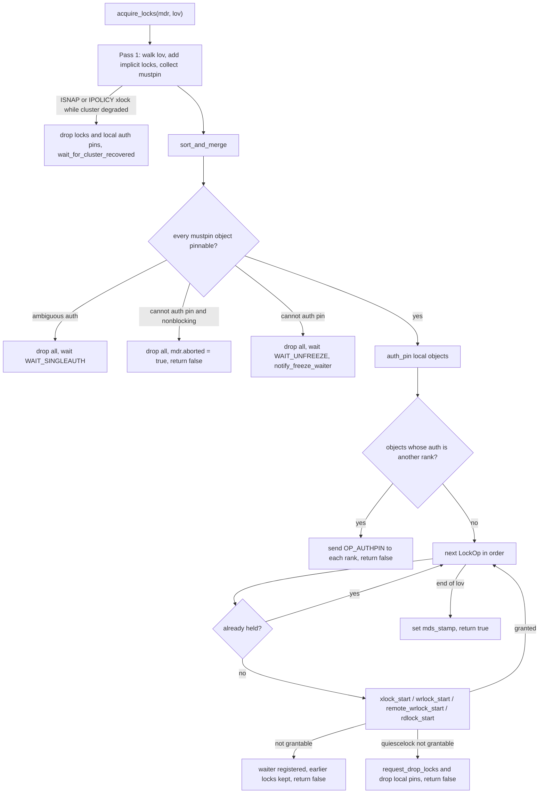
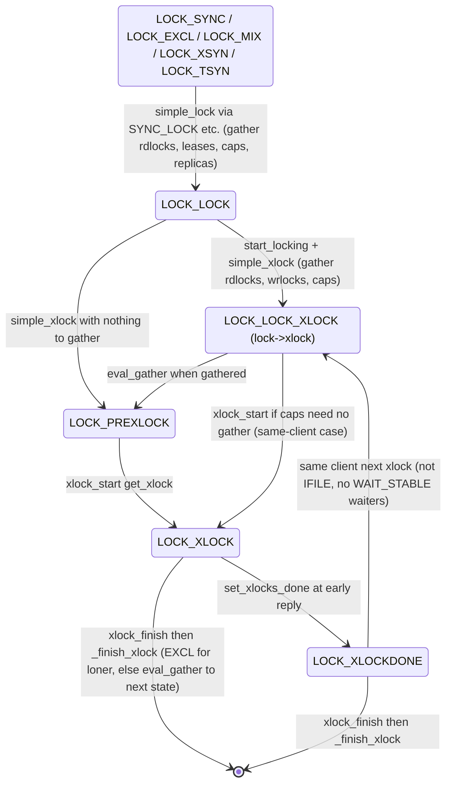
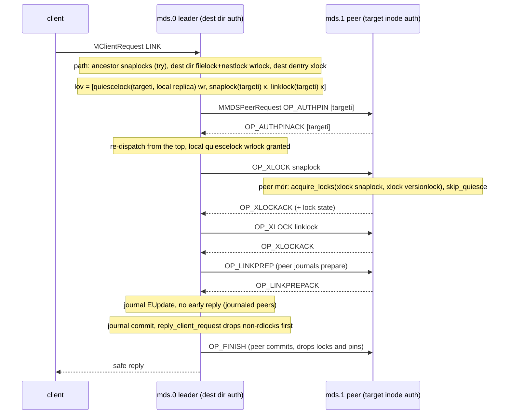

# Acquiring locks: `acquire_locks`, ordering, auth pins, remote locks and retries

> Part of the C++ MDS project map ([README](../README.md)). Sources (commit `5f7e383ae6d`): `src/mds/Locker.cc` (in scope: 93-998 and 1731-2350 of 6,269 lines; also read: `eval_gather` 1271-1501, `try_eval` 1605-1666, `process_request_cap_release` 3714-3800, `get_lock`/`handle_lock`/`handle_reqrdlock`/`simple_*` 4631-5202, local locks 5606-5689, `handle_file_lock` 6040-6269), `src/mds/Locker.h` (303), `src/mds/Mutation.h` (599), `src/mds/Mutation.cc` (688), `src/mds/SimpleLock.{h,cc}` (854), `src/mds/LocalLockC.h` (65), `src/mds/locks.{c,h}` (286), `src/mds/MDSCacheObject.{h,cc}` (458), `src/messages/MMDSPeerRequest.h` (236), `src/messages/MLock.h`, `src/mds/RetryRequest.h`, `src/mds/Server.cc` (peer framework 2971-3486, path helpers 3869-4266, handler lock sets for getattr/open/openc/readdir/setlock/setattr/setlayout/setvxattr/setxattr/mknod/mkdir/symlink/link/unlink/rename/mksnap), `src/mds/MDCache.cc` (`path_traverse` 8425-8907, request registry 9909-10212, `handle_mds_failure` 3006-3131, `predirty_journal_parents` 2224-2488, retry contexts 13271-13286, fragment/quiesce lock sets, stale-freeze detection 12156-12230), `src/mds/Migrator.cc` (268-317, 754-758, 1206-1268), `src/mds/CInode.cc`/`CDir.cc`/`CDentry.cc` (auth-pin and freeze predicates, `CDir::link_inode_work` quiesce propagation), `src/mds/MDLog.cc` and `src/osdc/Journaler.cc` (journal-commit completion thread), `doc/dev/mds_internals/quiesce.rst`. Kernel client: `linux/fs/ceph/mds_client.c`, `dir.c`, `file.c`, `xattr.c`, `inode.c`, `caps.c`, `linux/include/linux/ceph/libceph.h`.
>
> Related: [process and threading](../00-architecture/process-and-threading.md), [mds_lock analysis](../00-architecture/mds_lock-analysis.md), [lock types and state machines](lock-types-and-state-machines.md), [request lifecycle](../03-request-path/request-lifecycle.md), [namespace mutations](../03-request-path/namespace-mutations.md), [rename](../03-request-path/rename.md), [attributes and xattrs](../03-request-path/attributes-and-xattrs.md), [lookup/readdir/open/file locks](../03-request-path/lookup-readdir-open-and-file-locks.md), [capabilities](../02-client-protocol/capabilities.md), [leases, lock caches, async dirops](../02-client-protocol/leases-lock-caches-and-async-dirops.md), [kclient expectations](../02-client-protocol/kclient-expectations.md), [libcephfs/ceph-fuse/Ganesha expectations](../02-client-protocol/libcephfs-fuse-ganesha-expectations.md), [CDir/CDentry/cache objects (pins, auth pins, freezing)](../04-cache/cdir-cdentry-and-cache-objects.md), [CInode](../04-cache/cinode-and-inode-types.md), [subtrees, traversal, replication](../04-cache/mdcache-subtrees-traversal-replication.md), [dirfrags and fragmentation](../04-cache/dirfrags-and-fragmentation.md), [subtree migration](../08-multi-mds/subtree-migration.md), [resolve and rejoin](../09-recovery/resolve-and-rejoin.md), [snapshots](../10-snapshots-quotas-subvolumes/snapshots.md), [rstats, quotas, subvolumes](../10-snapshots-quotas-subvolumes/rstats-quotas-and-subvolumes.md), [strays and purge](../11-background-services/strays-and-purge.md), [quiesce](../12-qos-metrics-quiesce-quarantine/quiesce.md), [MDLog and Journaler](../06-journal/mdlog-and-journaler.md), [admin commands](../13-admin-and-config/admin-commands.md).

## 1. Purpose and responsibilities

The C++ MDS has no per-object mutexes. A metadata "lock" is a `SimpleLock` (or `ScatterLock`/`LocalLockC`) embedded in a `CInode` or `CDentry`: a state from a static state table plus counters (`num_rdlock`, `num_wrlock`, `num_xlock`), a gather set and waiter bits on the parent object. Everything is read and mutated only while the thread holds the global `mds_lock` (`src/mds/MDSContext.cc:27 (MDSContext::complete)` asserts it for every completion). "Acquiring" a lock therefore never blocks a thread: the code checks whether the lock's current state permits the mode, possibly kicks a state transition (which may need client cap revocations and replica acknowledgements), and otherwise registers a retry context and returns `false`.

`Locker::acquire_locks` (`src/mds/Locker.cc:245`) is the main entry point used by client requests, peer (inter-MDS) requests and internal requests (the other acquisition paths are the try-only helpers `try_rdlock_snap_layout`, `rdlock_try_set`, `wrlock_try`, the unconditional `wrlock_force`/`local_wrlock_grab`, and lock caches; see 3.4, 3.7, 3.12, 3.13). Its responsibilities:

- Take a caller-ordered vector of lock operations (`MutationImpl::LockOpVec`), add implicit locks (`versionlock`, `quiescelock`), sort operations on the same object by lock type and merge duplicates.
- Auth-pin every object on which a non-local lock is taken through it (on a replica only when the lock may have to be requested from the auth), locally or remotely (`MMDSPeerRequest::OP_AUTHPIN`), so that the object cannot be frozen, exported or fragmented while the request depends on it. Local-lock wrlocks and the ancestor rdlocks taken by `try_rdlock_snap_layout` take no auth pin.
- Acquire the locks in vector order; on the first one that is not grantable, register a waiter and return `false` while keeping the locks already held.
- For objects whose authority is another rank: obtain remote xlocks and remote wrlocks through peer requests, and ask the auth rank to change lock state (`LOCK_AC_REQRDLOCK`, `LOCK_AC_REQSCATTER`).
- Drop everything (locks and local auth pins) before most waits that are not lock-state waits: an unpinnable (freezing/frozen) object, ambiguous authority of an object to be auth-pinned, an unavailable `quiescelock`, or cluster recovery for an `ISNAP`/`IPOLICY` xlock. Two cases drop only the locks and keep local auth pins: an rdlock on a `NEED_RECOVER` lock while degraded (`Locker.cc:641`) and a remote auth pin reported blocked by the peer (`Server.cc:3428-3433`). A few non-lock waits keep everything: outstanding peer replies, waiting for a peer rank to become active (`Locker.cc:527-533`, `2091-2097`, `2212-2218`) and ambiguous auth in the replica branch of `xlock_start` (`Locker.cc:2204-2208`); see the tables in 3.6.

Related responsibilities documented here: the path-locking helpers (`try_rdlock_snap_layout`, `MDCache::path_traverse` locking flags, `Server::rdlock_path_pin_ref`, `rdlock_path_xlock_dentry`, `rdlock_two_paths_xlock_destdn`, `xlock_policylock`), the per-mode start/finish functions (`rdlock_*`, `wrlock_*`, `remote_wrlock_*`, `xlock_*`, `local_*`), lock release at early reply, safe reply, forward, kill and cleanup, the peer-side handling of `OP_XLOCK`/`OP_WRLOCK`/`OP_AUTHPIN`/`OP_UNXLOCK`/`OP_UNWRLOCK`/`OP_DROPLOCKS`/`OP_FINISH`, and the worked lock sets of the main client operations.

Terminology used on this page:

| Term | Meaning in the code |
|---|---|
| rdlock | shared read lock; `SimpleLock::get_rdlock` increments `num_rdlock` (`src/mds/SimpleLock.h:393`) |
| wrlock | shared write lock (concurrent writers) on scatter/file locks, or on local locks; `get_wrlock` increments `num_wrlock` (`SimpleLock.h:410`) |
| xlock | exclusive lock; at most one "active" xlocker (`xlock_by`), counter `num_xlock` (`src/mds/SimpleLock.cc:33 (SimpleLock::get_xlock)`) |
| remote wrlock | a wrlock held on another rank's copy of a scatter lock, on behalf of this request (`LockOp::REMOTE_WRLOCK`) |
| state pin | `LockOp::STATE_PIN`: a wrlock whose purpose is to pin the current lock state (no reads/writes) (`Mutation.h:80`) |
| auth pin | per-object counter that prevents freezing (and therefore export/fragmentation) of an authoritative object (`CInode::auth_pin`, `CDir::auth_pin`, `CDentry::auth_pin`) |
| remote auth pin | an auth pin held by a peer rank's request object on our behalf (`ObjectState::remote_auth_pinned`) |
| pin | cache reference (`PIN_REQUEST`) preventing trimming (`Mutation.cc:30 (MutationImpl::pin)`) |
| leader / peer | the rank executing a client request / a rank executing an `MDRequestImpl` created from an `MMDSPeerRequest` (`Mutation.h:188-189`) |
| kick | a state transition started to make a requested mode grantable (`simple_sync`, `simple_lock`, `simple_xlock`, `scatter_mix`, `file_xsyn`) |
| XCL | state-table permission (`locks.h:32`): for rd/x/lease/read only the client recorded as xlocker (`xlock_by_client`, client >= 0); for wr/force-wr the xlocker or the `excl_client` (loner) (`SimpleLock.h:353-389`). The code does not check `is_auth()` for XCL; XCL states simply never occur on replicas (replica states are only `SYNC`/`LOCK`/`MIX`-family) |

## 2. Source map

| File | Class / function | Lines | Role |
|---|---|---|---|
| `src/mds/Mutation.h` | `MutationImpl::ObjectState`, `LockOp`, `LockOpVec`, `lock_set` | 67-141 | per-request pin/auth-pin bookkeeping; lock operation flags and vector API |
| `src/mds/Mutation.h` | `MutationImpl` fields `locks`, `lock_cache`, `last_locked`, `locking`, `locking_state`, `committing/aborted/killed/dead` | 255-299 | held locks (a `std::set<LockOp>` ordered by `SimpleLock*` address), in-flight lock, retry flags |
| `src/mds/Mutation.h` | `MDRequestImpl::More` (`peers`, `waiting_on_peer`, `rename_inode`, `is_freeze_authpin`, `is_remote_frozen_authpin`, `rdonly_checks`) | 317-372 | multi-rank and rename state |
| `src/mds/Mutation.h` | `MDRequestImpl::dir_root[2]`, `dir_depth[2]`, `dir_layout`, `dn[2]`, `in[2]`, `straydn` | 455-461 | path results and path-ordering keys |
| `src/mds/Mutation.cc` | `start_locking`, `finish_locking`, `is_rdlocked`, `is_wrlocked`, `LockOpVec::sort_and_merge` | 79-177 | in-flight lock tracking; lock-cache aware membership; per-object sort/merge |
| `src/mds/Mutation.cc` | `auth_pin`, `drop_local_auth_pins`, `set_remote_auth_pinned`, `MDRequestImpl::freeze_auth_pin`, `unfreeze_auth_pin`, `can_auth_pin`, `compare_paths` | 180-235, 341-405, 470-481 | auth pin primitives, rename freeze pin, two-path ordering key |
| `src/mds/Locker.cc` | `Locker::dispatch`, `tick`, `send_lock_message` | 93-155 | `MSG_MDS_LOCK`, `MSG_MDS_INODEFILECAPS`, client caps/lease dispatch; lock messages to replicas |
| `src/mds/Locker.cc` | `Locker::try_rdlock_snap_layout` | 157-227 | bottom-up, try-only rdlock of ancestor `snaplock`s (and `policylock`s for layout) |
| `src/mds/Locker.cc` | `MarkEventOnDestruct`, `Locker::acquire_locks` | 229-669 | the acquisition algorithm |
| `src/mds/Locker.cc` | `handle_quiesce_failure`, `request_drop_remote_locks`, `request_drop_non_rdlocks`, `request_drop_locks` | 679-756 | drop-everything paths, `OP_FINISH` to peers |
| `src/mds/Locker.cc` | `notify_freeze_waiter` | 758-779 | count requests holding remote auth pins that wait on a freezing dir |
| `src/mds/Locker.cc` | `set_xlocks_done`, `_drop_locks`, `cancel_locking`, `drop_locks`, `drop_non_rdlocks`, `handle_locks_for_early_reply`, `drop_lock`, `drop_locks_for_fragment_unfreeze` | 781-984 | release paths |
| `src/mds/Locker.cc` | `put_lock_cache`, `invalidate_lock_cache(s)`, `create_lock_cache`, `find_and_attach_lock_cache` | 998-1267 | lock caches (async dirops) interplay |
| `src/mds/Locker.cc` | `_rdlock_kick`, `rdlock_try`, `rdlock_start`, `nudge_log`, `rdlock_finish`, `rdlock_try_set` (x2) | 1731-1924 | rdlock |
| `src/mds/Locker.cc` | `wrlock_force`, `wrlock_try`, `wrlock_start`, `wrlock_finish`, `remote_wrlock_start`, `remote_wrlock_finish` | 1929-2131 | wrlock and remote wrlock |
| `src/mds/Locker.cc` | `xlock_start`, `_finish_xlock`, `xlock_finish`, `xlock_export`, `xlock_import` | 2137-2346 | xlock, remote xlock, xlock migration during rename |
| `src/mds/Locker.cc` | `local_wrlock_grab`, `local_wrlock_start`, `local_wrlock_finish`, `local_xlock_start`, `local_xlock_finish` | 5606-5689 | `LocalLockC` (`versionlock`, `quiescelock`) |
| `src/mds/Locker.cc` | `get_lock`, `handle_lock`, `handle_reqrdlock`, `handle_simple_lock`, `handle_file_lock` (`LOCK_AC_REQSCATTER`) | 4631-4824, 6040-6269 | resolving locks named in peer messages; replica rd/scatter requests |
| `src/mds/SimpleLock.h` / `.cc` | `LockType`, `SimpleLock::WAIT_*`, `add_waiter`, `can_*`, `get/put_*lock`, `set_xlock_done` | `.h` 46-475, `.cc` 33-65, 107-135 | state machine accessors, wait bits, cap shift |
| `src/mds/LocalLockC.h` | `LocalLockC::can_xlock_local`, `can_wrlock`, `get_wrlock`, `put_wrlock` | 22-64 | rank-local lock with no rdlock, no replicas |
| `src/mds/locks.c` / `locks.h` | `simplelock[]`, `scatterlock[]`, `filelock[]`, `locallock[]`, `ANY/AUTH/XCL/REQ`, `LOCK_*` states, `LOCK_AC_*` actions | `.c` 15-160, `.h` 5-126 | grant permissions per state |
| `src/include/ceph_fs.h` | `CEPH_LOCK_*` lock type bits, `is_inode_lock` | 330-355 | type values also define the per-object lock order |
| `src/mds/MDSCacheObject.h` / `.cc` | `WAIT_ORDERED`, `WAIT_SINGLEAUTH`, `WAIT_UNFREEZE`, `ERR_*`, `add_waiter`, `take_waiting` | `.h` 79-81, 196-205, 264-288; `.cc` 97-114 | waiter queue (seq-ordered), auth-pin error codes |
| `src/mds/CInode.cc` / `CDir.cc` / `CDentry.cc` | `can_auth_pin`, `auth_pin`, `freeze_inode`, `freeze_auth_pin`, `will_block_for_quiesce` | `CInode.cc` 2986-3060, 3094-3150, 5945; `CDir.cc` 3210, 3528; `CDentry.cc` 459-480 | pinnability predicates |
| `src/mds/RetryRequest.h`, `src/mds/MDCache.cc` | `C_MDS_RetryRequest::finish`, `CF_MDS_RetryRequestFactory::build` | `RetryRequest.h` 21-39; `MDCache.cc` 13271-13286 | re-dispatch from the top; factory that drops locks first |
| `src/mds/MDCache.cc` | ordering comment, `MDCache::path_traverse` (locking flags), `maybe_request_forward_to_auth` | 8425-8907 | per-component path locks |
| `src/mds/MDCache.cc` | `MDCache::handle_mds_failure` (request cleanup part) | 3034-3131 | what happens to in-flight remote locks and peer requests when a rank fails |
| `src/mds/MDCache.cc` | `request_finish`, `request_forward`, `dispatch_request`, `request_cleanup`, `request_kill` | 9917-10212 | where locks are dropped at request end |
| `src/mds/MDCache.cc` | `predirty_journal_parents` | 2224-2488 | opportunistic (non-blocking) ancestor `nestlock`/`versionlock` |
| `src/mds/MDCache.cc` / `Migrator.cc` | `fragment_freeze_inc_num_waiters`, `find_stale_fragment_freeze`, `Migrator::export_freeze_inc_num_waiters`, `find_stale_export_freeze` | `MDCache.cc` 12156-12215; `Migrator.cc` 268-317, 754-758 | deadlock breaker: cancel freezes blocked by remote auth pins |
| `src/mds/Server.cc` | `handle_peer_request`, `handle_peer_request_reply`, `dispatch_peer_request`, `handle_peer_auth_pin`, `handle_peer_auth_pin_ack` | 2971-3486 | peer side of remote auth pins and remote locks |
| `src/mds/Server.cc` | `rdlock_path_pin_ref`, `rdlock_path_xlock_dentry`, `rdlock_two_paths_xlock_destdn`, `try_open_auth_dirfrag`, `xlock_policylock`, `try_get_auth_inode` | 3869-4266, 5930-5969 | path locking helpers |
| `src/mds/Server.cc` | `journal_and_reply`, `early_reply`, `reply_client_request` | 2124-2156, 2300-2484 | lock handling at unsafe and safe reply |
| `src/messages/MMDSPeerRequest.h` | `OP_*`, `FLAG_*` | 27-109 | inter-MDS lock and auth-pin protocol |

## 3. How it works

### 3.1 The lock vector and the held-lock set

A caller builds a `LockOpVec` (`src/mds/Mutation.h:107`), a `std::vector<LockOp>` with:

| Method | Flags | Notes |
|---|---|---|
| `add_rdlock(lock, idx=-1)` | `RDLOCK` (1) | |
| `add_wrlock(lock, idx=-1)` | `WRLOCK` (2) | |
| `add_xlock(lock, idx=-1)` | `XLOCK` (4) | |
| `add_remote_wrlock(lock, rank)` | `REMOTE_WRLOCK` (8), `wrlock_target=rank` | asserts `rank != MDS_RANK_NONE` |
| `lock_scatter_gather(lock)` | `WRLOCK\|STATE_PIN` (2\|16) | used by `Migrator::dispatch_export_dir` (`src/mds/Migrator.cc:1229-1230`) and `MDCache::dispatch_fragment_dir` (`src/mds/MDCache.cc:12326-12327`) |
| `erase_rdlock(lock)` | | removes the last rdlock entry for `lock` (`Mutation.cc:122`) |
| `sort_and_merge()` | | see 3.3 step B |

`idx >= 0` inserts at a position (used by `acquire_locks` to put an implicit lock right after the lock that triggered it). The order of entries in the vector is the acquisition order across objects; only entries of the same parent object are re-ordered (by `sort_and_merge`). This was an explicit design change: "This patch makes Locker::acquire_locks() lock objects in the order specified by its caller. Locker::acquire_locks() only rearranges locks in the same object" (commit `60f03a489e5`, 2019, `git show 60f03a489e5`).

Held locks are recorded in `MutationImpl::locks`, a `std::set<LockOp>` whose comparator is the `SimpleLock*` address (`Mutation.h:96-98`, `141`). `emplace_lock` also records `last_locked` (`Mutation.h:169-172`). `is_rdlocked`/`is_wrlocked` also consult the attached lock cache (`Mutation.cc:94-110`), so locks owned by an `MDLockCache` count as held by the request. The held set is therefore unordered with respect to acquisition; release iterates in address order (gotcha in section 8).

Lock types and their per-object order (the numeric value of `CEPH_LOCK_*` is the sort key, `src/include/ceph_fs.h:330-348`, comment "they also define the lock ordering by the MDS"):

| Type (value) | Object | Class (`LockType`, `SimpleLock.h:46-73`) | Cap shift (`SimpleLock.cc:127`) | Remote xlock allowed (`locks.c`) |
|---|---|---|---|---|
| `CEPH_LOCK_DN` (1) | dentry `lock` | simple | 0 | yes |
| `CEPH_LOCK_DVERSION` (2) | dentry `versionlock` | local | 0 | no |
| `CEPH_LOCK_IQUIESCE` (16) | inode `quiescelock` | local | 0 | no |
| `CEPH_LOCK_ISNAP` (32) | inode `snaplock` | simple | 0 | yes |
| `CEPH_LOCK_IPOLICY` (64) | inode `policylock` | simple | 0 | yes |
| `CEPH_LOCK_IFILE` (128) | inode `filelock` | file (scatter + loner states) | `CEPH_CAP_SFILE` (8) | no |
| `CEPH_LOCK_INEST` (256) | inode `nestlock` | scatter | 0 | no |
| `CEPH_LOCK_IDFT` (512) | inode `dirfragtreelock` | scatter | 0 | no |
| `CEPH_LOCK_IAUTH` (1024) | inode `authlock` | simple | `CEPH_CAP_SAUTH` (2) | yes |
| `CEPH_LOCK_ILINK` (2048) | inode `linklock` | simple | `CEPH_CAP_SLINK` (4) | yes |
| `CEPH_LOCK_IXATTR` (4096) | inode `xattrlock` | simple | `CEPH_CAP_SXATTR` (6) | yes |
| `CEPH_LOCK_IFLOCK` (8192) | inode `flocklock` | simple | 0 | yes |
| `CEPH_LOCK_IVERSION` (16384) | inode `versionlock` | local | 0 | no |

`is_inode_lock(t)` is `CEPH_LOCK_IQUIESCE <= t <= CEPH_LOCK_IVERSION` (`ceph_fs.h:353-355`). "Cap-related" locks are those with a non-zero cap shift (`authlock`, `linklock`, `filelock`, `xattrlock`); this is what triggers the implicit `quiescelock`.

### 3.2 The re-entrant execution model: no thread ever blocks

Every wait in this code is expressed as an `MDSContext` stored on some waiter list; the waiting function returns and the whole call stack unwinds back to the dispatcher:

- Lock waits: `SimpleLock::add_waiter(mask, new C_MDS_RetryRequest(mdcache, mdr))` (`SimpleLock.h:248-250`). Lock waiter bits (`WAIT_RD`=1, `WAIT_WR`=2, `WAIT_XLOCK`=`WAIT_STABLE`=4, `WAIT_REMOTEXLOCK`=8, `SimpleLock.h:83-89`) are shifted into the upper 64 bits of the parent object's 128-bit wait mask by `get_wait_shift()` (4 bits per lock type, `SimpleLock.cc:107-125`), and are always added with `WAIT_ORDERED`, which gives them a global, monotonically increasing sequence number (`MDSCacheObject.h:267-280`). `take_waiting` collects matching waiters in sequence order (`MDSCacheObject.cc:97-114`), so lock waiters are woken FIFO. Non-ordered waiters (`WAIT_UNFREEZE`, `WAIT_SINGLEAUTH`, ...) get sequence 0 and sort before ordered ones.
- Object waits: `object->add_waiter(MDSCacheObject::WAIT_UNFREEZE, ...)` or `WAIT_SINGLEAUTH` (`MDSCacheObject.h:80-81`), plus inode-specific bits such as `CInode::WAIT_TRUNC`, `WAIT_FLOCK`, `WAIT_FROZEN`.
- Rank-level waits: `MDSRank::wait_for_active_peer`, `wait_for_cluster_recovered` (`src/mds/MDSRank.h:335-338`).
- Peer waits: `mdr->more()->waiting_on_peer` holds the ranks whose reply is outstanding; the reply handler re-dispatches when the set becomes empty (`src/mds/Server.cc:3121-3124`, `3141-3144`, `3482-3483`).

`C_MDS_RetryRequest::finish` increments `mdr->retry` and calls `MDCache::dispatch_request` (`src/mds/MDCache.cc:13271-13277`), which calls `Server::dispatch_client_request` (or `dispatch_peer_request`, or the internal op dispatcher) (`MDCache.cc:9995-10062`). The handler runs again from its first line. Progress is remembered in the request, not in a stack:

| Mechanism | Where | Effect on re-dispatch |
|---|---|---|
| `mdr->locks` membership | `acquire_locks` checks `is_xlocked` (`Locker.cc:570`), `mdr->locks.find()` plus the `REMOTE_WRLOCK`/`WRLOCK` flag (`586-602`; not lock-cache aware) and `is_rdlocked` (`630`; lock-cache aware) | already-held locks are skipped |
| `locking_state` bits `SNAP_LOCKED`, `SNAP2_LOCKED`, `PATH_LOCKED`, `ALL_LOCKED` (`Mutation.h:281-287`) | set by `path_traverse` (`MDCache.cc:8882-8888`), `rdlock_two_paths_xlock_destdn` (`Server.cc:4218`), handlers (e.g. `Server.cc:8655`, `9501`) | helpers return the cached `mdr->dn[]`/`mdr->in[]` immediately; handlers skip their lock block |
| `mdr->straydn`, `more()->desti_srnode`, `more()->rdonly_checks`, `more()->witnessed` | handlers | idempotent preparation on retry |
| `Locker::drop_locks` resets `locking_state = 0` (`Locker.cc:891`) | any drop-everything | the next dispatch redoes path traversal from scratch |

Wake-ups are synchronous: `SimpleLock::finish_waiters` -> `MDSCacheObject::finish_waiting` -> `finish_contexts` calls `complete()` on each context in order (`src/include/Context.h:204-219`), so the woken request re-executes inside the call stack of whoever released or stabilized the lock (for example inside `Locker::eval_gather`, `Locker.cc:1480-1484`, or inside `_drop_locks` of another request). Some paths defer instead through `MDSRank::queue_waiter(s)` (unfreeze, `src/mds/CInode.cc:3053 (CInode::unfreeze_inode)`; lock-cache drop, `Locker.cc:1021`). A woken request that fails again re-registers with a new (larger) sequence number, i.e. it goes to the back of the queue.

`dispatch_client_request` asserts that nothing is pending on peers (`Server.cc:2768`), returns immediately for killed requests, converts `aborted` into `request_kill`, and replies with `more()->peer_error` if a peer reported one (`Server.cc:2770-2803`). Every dispatch increments the debug counter `mds_server.dispatch_client_request` (`Server.cc:2782`).

### 3.3 `acquire_locks` step by step

Signature: `bool acquire_locks(const MDRequestRef& mdr, LockOpVec& lov, CInode* auth_pin_freeze = NULL, bool auth_pin_nonblocking = false, bool skip_quiesce = false)` (`src/mds/Locker.h:71-75`). Returns `true` when every lock in `lov` is held; `false` when the request has been parked (or, with `auth_pin_nonblocking`, aborted). A `MarkEventOnDestruct` object records the final outcome as an OpTracker event (`Locker.cc:229-241`, `258`).

**Step A: implicit locks and the must-pin set** (`Locker.cc:262-402`). `mustpin` starts with `auth_pin_freeze` if given. For each `LockOp` `p` at index `i`:

| Op | Must-pin rule | Implicit additions |
|---|---|---|
| xlock | object, except an `IQUIESCE` xlock on a non-auth object (`Locker.cc:312-315`) | dentry lock on an auth dentry: leader adds `dn->versionlock` **wrlock**, peer adds `dn->versionlock` **xlock** at `i+1` (`318-330`). Inode lock other than `IVERSION`/`IQUIESCE`: if `need_quiescelock` and the lock has a cap shift, add `in->quiescelock` wrlock at `i+1` and clear `need_quiescelock`; then if the inode is auth, leader adds `in->versionlock` wrlock, peer adds xlock (`331-357`) |
| wrlock (non-local lock) | object if auth; if not auth, object only if `!lock->can_wrlock(c)` and the request is not a peer ("we might have to request a scatter"; a peer's leader already pinned it) (`358-370`); `c` is `lock->get_excl_client()` for state-pin ops | `quiescelock` wrlock as above if the lock has a cap shift (`371-376`) |
| wrlock (local lock) | none | none |
| remote wrlock | object, always (`381`) | `quiescelock` wrlock as above (`382-387`) |
| rdlock | object if auth; if not auth, object only if `!lock->can_rdlock(client)` ("we might have to request an rdlock") (`391-398`); asserts the lock is not local (`390`) | none |

`need_quiescelock` starts as `!skip_quiesce` and is cleared after the first insertion, so at most one `quiescelock` is added per call (`Locker.cc:267`). Callers that pass `skip_quiesce=true`: peer `OP_XLOCK`/`OP_WRLOCK` handling (`Server.cc:3226-3234`), export (`Migrator.cc:1237`), `quiesce_inode` (`MDCache.cc:14241`), `lock path` (`MDCache.cc:14585`), quarantine (`MDCache.cc:15233`).

Also in this pass, an xlock on `ISNAP` or `IPOLICY` while the cluster is degraded (and the request is a leader not queued for replay) waits for cluster recovery after dropping everything if the object is auth and has a replica on a rank below `up:active` (and the lock is not already xlocked), or if the object is not auth and the lock is not yet xlocked or is the last one locked ("to guarantee replayed requests and mksnap/setlayout get processed in proper order", `Locker.cc:275-308`).

**Step B: `sort_and_merge`** (`src/mds/Mutation.cc:132-177`). Consecutive runs of entries with the same parent object are sorted by lock type value (the comparator asserts both entries share the parent). Then adjacent entries for the same lock are merged by OR-ing flags (a remote wrlock target is carried over); if the result contains `XLOCK`, the flags become exactly `XLOCK` ("xlock overwrites other types"; asserts no remote wrlock). Entries for the same object that are not adjacent in the caller's vector are neither sorted together nor merged.

**Step C: pinnability check** (`Locker.cc:411-498`). For each object in `mustpin`:

1. Already auth-pinned (locally or remotely) by this request: skip, unless it is `auth_pin_freeze` and the remote frozen pin is not on this inode; if `more()->is_remote_frozen_authpin` is set for a different inode, an entry for that inode's auth rank is forced into `mustpin_remote` so a new `OP_AUTHPIN` is sent and the peer unfreezes the wrong inode (`416-425`, peer side `Server.cc:3358-3361`).
2. Not auth: if `is_ambiguous_auth()` (being migrated), disable the lock cache, `drop_locks`, `drop_local_auth_pins`, wait `WAIT_SINGLEAUTH`, return false (`434-443`). Otherwise add to `mustpin_remote[authority().first]` (`444`). With an attached lock cache this is only legal for an unlink of a remote (hard-link) dentry (debug asserts `428-432`).
3. Auth but `!can_auth_pin(&err)`: if the request has a lock cache whose directory inode is the parent directory of the object, skip ("forcibly auth pin if there is lock cache on parent dir", `449-469`). Otherwise disable the lock cache, drop all locks and local auth pins; if `auth_pin_nonblocking`, set `mdr->aborted = true` and return false without a waiter (`475-479`); else wait `WAIT_UNFREEZE` on the object and, if the request holds any remote auth pin, call `notify_freeze_waiter(object)` (`491-496`). The OpTracker event names the cause from `err`: `ERR_EXPORTING_TREE` "subtree is being exported", `ERR_FRAGMENTING_DIR` "dir is being fragmented", `ERR_EXPORTING_INODE` "inode is being exported" (`480-486`).

`can_auth_pin` semantics: an inode is pinnable if auth, not freezing/frozen inode, not frozen-auth-pin, and its parent dentry's dirfrag is pinnable (`src/mds/CInode.cc:3094-3111`); a dentry if its dirfrag is pinnable (`CDentry.cc:459-463`); a dirfrag if auth, not freezing/frozen dir (fragmentation) and not inside a freezing/frozen tree (export) (`CDir.cc:3528-3555`).

**Step D: take local auth pins** for every auth object not yet pinned (`Locker.cc:501-509`). Local pins are taken before remote pins are requested and are kept while waiting for them.

**Step E: remote auth pins** (`Locker.cc:512-558`). For every rank in `mustpin_remote`, all objects already remote-pinned at that rank (from `object_states`) are added to the set (so the peer's reply describes the complete set, `514-521`). If the cluster is degraded and the rank is not `clientreplay|active|stopping`, wait (`wait_for_active_peer`, only if nothing else is outstanding) and return false. Otherwise send `MMDSPeerRequest(OP_AUTHPIN)` with `authpins` = object infos, `authpin_freeze` (encoded in the `object_info` field) = `auth_pin_freeze`'s info if included, flags `FLAG_NONBLOCKING` if `auth_pin_nonblocking`, else `FLAG_NOTIFYBLOCKING` if the request already holds locks; cache-pin each object locally (`mdr->pin`), and insert the rank into `waiting_on_peer` (asserting it was not there). Then return false; the request resumes when every `OP_AUTHPINACK` has arrived (`Server.cc:3423-3486`, see 3.9).

**Step F: acquire in order** (`Locker.cc:566-660`), over the sorted, merged `lov`. An entry that carries both `WRLOCK` and `REMOTE_WRLOCK` (after merging) first obtains the remote wrlock (row 2), and only on a later re-dispatch the local one (row 3):

| Op | Already held check | Start | On failure |
|---|---|---|---|
| xlock | `is_xlocked` | `cancel_locking` if another lock is in flight; `xlock_start` (3.4) | if the lock is `IQUIESCE`: `handle_quiesce_failure` (drop everything); else event "failed to xlock, waiting"; return false (locks kept) |
| remote wrlock | entry with `REMOTE_WRLOCK` | `cancel_locking` if needed; `remote_wrlock_start` (always waits for the ack; OpTracker event "failed to wrlock, dropping remote wrlock and waiting") | return false (locks kept) |
| wrlock (+ remote wrlock merged) | entry with `WRLOCK` | if a remote wrlock is held for the same lock: `wrlock_try` (no wait); if it fails, release the remote wrlock and request it again ("the scatter lock is gathering, need to release the remote wrlock, so that the gathering process can finish", `605-615`) | return false |
| wrlock | entry with `WRLOCK` | `wrlock_start(p, mdr)` | `IQUIESCE`: `handle_quiesce_failure`; else "failed to wrlock, waiting" |
| rdlock | `is_rdlocked` (includes lock cache) | asserts leader (`635`); if `needs_recover()`: while degraded and not queued for replay, `drop_locks` (local auth pins are kept) and wait for cluster recovery; if not degraded, `clear_need_recover()` (`636-651`); then `rdlock_start` | "failed to rdlock, waiting"; return false (locks kept) |

On success: `mdr->set_mds_stamp(now)` and event "acquired locks" (`662-664`). In all exits through `out:`, caps of inodes collected in `issue_set` (by `cancel_locking`) are re-issued (`666-668`).

`handle_quiesce_failure` (`Locker.cc:679-685`) calls `request_drop_locks` (which also sends `OP_FINISH` to all peers and clears `more()->peers`) and `drop_local_auth_pins`; the waiter registered by `local_wrlock_start`/`local_xlock_start` re-dispatches the request when the `quiescelock` is released. The comment above it explains why: dropping all locks releases ancestor `snaplock`/`policylock` rdlocks taken by `try_rdlock_snap_layout`, which would otherwise block a `mksnap` on a quiesced subvolume (`Locker.cc:671-677`).

### 3.4 Per-mode start and finish functions

**`rdlock_start(lock, mdr, as_anon=false)`** (`Locker.cc:1791-1853`). If `mdr->snapid != CEPH_NOSNAP`, `as_anon` is forced so the xlocker exception (XCL) does not apply to snapshot reads; `client = as_anon ? -1 : mdr client`. Loop:
1. `can_rdlock(client)`: `get_rdlock()`, `emplace_lock(RDLOCK)`, return true.
2. Snapshotted inode on auth in `LOCK_SNAP_SYNC`: recursively `rdlock_start` the head inode's `filelock` (or the same-type lock when the head filelock is already `SYNC`) with `as_anon=true`; failure returns false (the head lock's waiter retries).
3. `_rdlock_kick(lock, as_anon)` (`1731-1773`): if stable and auth: `simple_sync`, except a `filelock` in `LOCK_EXCL` with a target loner, on a non-directory, not `as_anon` -> `file_xsyn`; returns true (loop again). If stable and replica: send `MLock(LOCK_AC_REQRDLOCK)` to the auth (unless degraded and the auth is not `clientreplay|active|stopping`), return false. If unstable: prioritize file recovery for a recovering `filelock`, return false.
4. Wait on `WAIT_RD` if auth and stable, else `WAIT_STABLE` (code comment: "REQRDLOCK is ignored if lock is unstable, so we need to retry"; the comment is stale, `handle_reqrdlock` now delays a request on an unstable lock and drops it only when the receiver is not auth, the object is frozen, or the lock is already in `SYNC`, `Locker.cc:4741-4762`); `nudge_log(lock)`; return false.

`rdlock_try(lock, client)` (`1775-1789`) only checks (`can_rdlock`, one kick, check again); it does not take the lock. `rdlock_try_set(lov, mdr)` (`1888-1910`) takes each rdlock via `rdlock_try` + `get_rdlock`, and on the first failure registers `WAIT_STABLE|WAIT_RD`, drops all locks and local auth pins. The `MutationRef` overload (`1912-1924`) only uses `can_rdlock`, registers nothing and does not undo partial work.

`rdlock_finish` (`1868-1886`): `put_rdlock`, erase, and when the last rdlock goes: `eval_gather` if unstable, `try_eval` if stable and auth.

**`wrlock_start(op, mdr)`** (`Locker.cc:1981-2043`). Local locks go to `local_wrlock_start`. `client` is the lock's `excl_client` for state-pin ops, otherwise the request's client. `want_scatter` = auth and (`in->has_subtree_or_exporting_dirfrag()` or the lock's `scatter_wanted`). Loop: if `can_wrlock(client)` and (not `want_scatter` or state is `LOCK_MIX`): `get_wrlock`, emplace with `flags |= WRLOCK` (a remote wrlock may already be recorded), return true. Prioritize recovering `filelock`. If unstable: wait. If auth: `scatter_mix` when `want_scatter`, else `simple_lock`, loop. If replica: send `MLock(LOCK_AC_REQSCATTER)` to the auth and wait. Wait = `WAIT_STABLE` + `nudge_log`.

`wrlock_try(lock, mut, client)` (`1947-1979`): non-blocking; takes the wrlock if grantable; otherwise, only if the lock is stable, auth, not dirty, without `scatter_wanted` and without subtree/exporting dirfrags, does `simple_lock` and re-checks ("caller may already has a log entry open. To avoid calling scatter_writebehind or start_scatter"). `wrlock_force(lock, mut)` (`1929-1945`) takes a wrlock regardless of state (`get_wrlock(true)`) and is used for locks that must stay held for the duration of a journal write (`Locker.cc:3180`, `4221-4231`, `MDCache.cc:616-617`, `2327`, `Migrator.cc:909-910`, `2779-2780`, `CInode.cc:2579`).

`wrlock_finish` (`2045-2081`): `put_wrlock`; for a merged entry clears only the `WRLOCK` flag; if other wrlocks remain, re-evaluates an unstable lock whose writeback has flushed; otherwise `eval_gather`/`try_eval`.

**`remote_wrlock_start(lock, target, mdr)`** (`2086-2109`): wait for an active target if degraded; else `start_locking(lock, target)`, add `target` to `peers`, send `OP_WRLOCK` (lock type + object info), add to `waiting_on_peer`. `remote_wrlock_finish` (`2111-2131`) clears the flag or erases the entry and sends `OP_UNWRLOCK` if the target is at least `up:rejoin`.

**`xlock_start(lock, mdr)`** (`Locker.cc:2137-2233`). Local locks go to `local_xlock_start`. On the auth (state names are the full `LOCK_*` constants; `LOCK_LOCK_XLOCK` is the "lock->xlock" gathering state, `LOCK_XLOCK` the granted xlock):

The loop grants when `mdr->locking` is set (this request started the xlock, so it does not pre-empt another request's in-flight xlock), `can_xlock(client)` (`LOCK_PREXLOCK` = ANY, `LOCK_LOCK_XLOCK` = XCL, i.e. only the client that already holds an earlier xlock on it), and not (`LOCK_LOCK_XLOCK` with issued caps still needing gather): `set_state(LOCK_XLOCK)`, `get_xlock(mdr, client)`, emplace `XLOCK`, `finish_locking`, return true (`2160-2170`). Otherwise: prioritize a recovering file; if unstable and not (`XLOCKDONE` held by the same client with no `WAIT_STABLE` waiter) -> wait; `XLOCKDONE` on `IFILE` -> wait (tracker 49132); if `LOCK` or `XLOCKDONE` -> `start_locking(lock)` + `simple_xlock`; else `simple_lock`; loop. Wait = `WAIT_WR|WAIT_STABLE` + `nudge_log` (`2195-2197`).

On a replica (`2198-2232`): asserts `can_remote_xlock` (simple locks only) and that no peer message is being processed (`!mut->peer_request`, so a peer never remote-xlocks); wait `WAIT_SINGLEAUTH` if ambiguous auth (locks kept); wait for an active auth if degraded; else add the auth to `peers`, `start_locking(lock, auth)`, send `OP_XLOCK`, add to `waiting_on_peer`, return false.

`xlock_finish` (`2262-2322`): records `xlocker = get_xlock_by_client()`, `put_xlock`, erases. Remote xlock: send `OP_UNXLOCK` to the auth (if it is at least `up:rejoin`) and wake local `WAIT_STABLE|WAIT_WR|WAIT_RD` waiters. Auth: if no xlocks remain and the state is not `LOCK_LOCK_XLOCK`, `_finish_xlock` (`2235-2260`): for locks other than `DN`/`ISNAP`/`IPOLICY`, with no rdlocks, wrlocks or leases, not `XLOCKSNAP`, and the inode has a target loner equal to the xlocker (or the xlocker is -1): jump directly to `LOCK_EXCL`, auth-unpin the lock's own pin, wake waiters, request cap issue; else `eval_gather` (first = not `XLOCKSNAP`) which moves to the state's `next` (`SYNC` for simple locks, `LOCK` for `filelock`).

`cancel_locking(mut, pneed_issue)` (`858-876`): for an in-flight xlock on the auth, `PREXLOCK` -> `_finish_xlock(lock, -1)`; `LOCK_LOCK_XLOCK` -> set `XLOCKDONE` and `eval_gather`; then `finish_locking`.

**Local locks** (`LocalLockC`, `src/mds/LocalLockC.h:22-64`; state table has only `LOCK_LOCK`, `locks.c:149-160`): `can_wrlock()` = not xlocked and no `WAIT_XLOCK` waiter (writers queue behind a waiting xlocker); `can_xlock_local()` = not wrlocked and no active xlocker. `local_wrlock_start` waits on `WAIT_WR`; `local_xlock_start` first invalidates lock caches attached to the lock, then waits on `WAIT_XLOCK` (`Locker.cc:5618-5666`). `local_xlock_finish` wakes `WAIT_XLOCK|WAIT_WR|WAIT_RD` and, for `quiescelock`, re-evaluates the inode's cap locks so caps can be re-issued (`5668-5689`). Local locks are never replicated and never requested remotely (`Server.cc:3194-3195` asserts); a wrlock on one takes no auth pin, while an xlock on one (peer `versionlock`, `quiesce_inode`'s `quiescelock`) auth-pins the object when it is auth (step A). A replica's `quiescelock` is an independent per-rank lock.

### 3.5 Compatibility of rdlock, wrlock and xlock

There is no static compatibility matrix. A mode is grantable when the current state's permission column allows it (`ANY` = auth or replica; `AUTH` = auth only; `XCL` = see the terminology table; `REQ` = not grantable here, a replica must ask the auth; `0` = never) (`src/mds/locks.h:30-34`, `SimpleLock.h:353-389`). The table below uses the full `LOCK_*` constants (`LOCK_LOCK_SYNC` is the "lock->sync" transition, `LOCK_LOCK_XLOCK` the "lock->xlock" gathering state). Holding a mode prevents transitions that would revoke it: `eval_gather` only completes a transition when the next state grants every mode still held with `ANY` (or `AUTH` on the auth copy); `XCL`/`REQ` do not count (`Locker.cc:1305-1318`, macro `IS_TRUE_AND_LT_AUTH`).

States in which each mode can be granted (from `src/mds/locks.c`):

| Class | rdlock | wrlock | xlock (via `xlock_start`) | Lease |
|---|---|---|---|---|
| simple (`DN`, `IAUTH`, `ILINK`, `IXATTR`, `ISNAP`, `IFLOCK`, `IPOLICY`) | `LOCK_SYNC` (ANY); `LOCK_LOCK_SYNC`, `LOCK_XLOCKDONE` (XCL) | `LOCK_EXCL` (XCL) | `LOCK_PREXLOCK` (ANY); `LOCK_LOCK_XLOCK` (XCL) | `LOCK_SYNC` (ANY); `LOCK_LOCK_SYNC`, `LOCK_XLOCKDONE` (XCL) |
| scatter (`INEST`, `IDFT`) | `LOCK_SYNC` (ANY); `LOCK_TSYN` (AUTH) | `LOCK_LOCK` (AUTH); `LOCK_MIX` (ANY) | table allows `LOCK_LOCK` (ANY); no request handler xlocks a scatter lock (only the `lock path ... nest:x/dft:x` test command can), and it cannot be remote-xlocked | `LOCK_SYNC` (ANY) |
| file (`IFILE`) | `LOCK_SYNC` (ANY); `LOCK_XSYN`, `LOCK_XSYN_SYNC` (AUTH); `LOCK_EXCL`, `LOCK_XSYN_EXCL`, `LOCK_EXCL_XSYN`, `LOCK_XLOCKDONE` (XCL) | `LOCK_LOCK` (AUTH); `LOCK_MIX` (ANY); `LOCK_EXCL`, `LOCK_MIX_EXCL`, `LOCK_EXCL_MIX`, `LOCK_XSYN`, `LOCK_XSYN_LOCK`, `LOCK_XSYN_MIX` (XCL) | `LOCK_PREXLOCK` (ANY); `LOCK_LOCK_XLOCK` (XCL) | `LOCK_SYNC` (ANY); `LOCK_XLOCKDONE` (XCL) |
| local (`DVERSION`, `IVERSION`, `IQUIESCE`) | not used (asserted) | `LocalLockC::can_wrlock` | `can_xlock_local` | n/a |

Consequences:

- rdlock vs wrlock: except for `filelock` `LOCK_XSYN`, no state grants rdlocks and wrlocks to different clients. Readers need `LOCK_SYNC` (or `LOCK_XSYN`/`LOCK_TSYN` on the auth); writers need `LOCK_LOCK`/`LOCK_MIX`/loner states. A readdir (`filelock` rdlock) and a create in the same directory (`filelock` wrlock) therefore force a state transition each time they alternate (directories never enter `LOCK_XSYN`: `file_xsyn` is only called from `_rdlock_kick` for non-directories). The loner client is the exception: in `LOCK_EXCL` its own requests can wrlock without a transition (XCL matches `excl_client`). The XCL rdlock entries of `LOCK_EXCL`/`LOCK_XSYN_EXCL`/`LOCK_EXCL_XSYN` match only `xlock_by_client`, which is reset to -1 when the last xlock is released (`SimpleLock.cc:61-63`) and no xlock can be held in those states, so in practice nobody rdlocks there: `_rdlock_kick` moves a non-directory file with a target loner to `LOCK_XSYN` (unless `as_anon`) and anything else to `LOCK_SYNC`. In `LOCK_XSYN` any request on the auth may rdlock (AUTH) while the loner's requests may still wrlock (XCL), and the loner keeps `Fc`/`Fb`.
- rdlock/wrlock vs xlock: exclusive, except that after an early reply (`XLOCKDONE`) the xlocking client may rdlock, lease and read the projected value, and may start the next xlock (pipelining of one client's mutations).
- xlock vs xlock: one active xlocker (`get_xlock` asserts `!has_xlock_by()`, `SimpleLock.cc:34`); `num_xlock` can exceed 1 only through the same-client `XLOCKDONE` path.
- wrlock vs wrlock: shared (counter). Local `versionlock` wrlocks are shared; a peer's `versionlock` xlock excludes all writers.
- Leases (client dentry caching) and caps are part of the gather: `simple_lock` revokes leases and issues cap revocations before reaching `LOCK` (`Locker.cc:5100-5117`).

Details of every state, its `next` and allowed caps are on [lock types and state machines](lock-types-and-state-machines.md).

### 3.6 Lock ordering and deadlock avoidance

The C++ MDS avoids deadlock with a mix of ordered acquisition and drop-and-retry. The rules, as implemented:

| # | Rule | Where enforced |
|---|---|---|
| O1 | Across objects, locks are taken in the order the caller lists them; `acquire_locks` never reorders objects | `Mutation.cc:132-148` (sort only within a run of one object) |
| O2 | Within one object, locks are taken in ascending `CEPH_LOCK_*` value: `DN` < `DVERSION`; `IQUIESCE` < `ISNAP` < `IPOLICY` < `IFILE` < `INEST` < `IDFT` < `IAUTH` < `ILINK` < `IXATTR` < `IFLOCK` < `IVERSION` | `sort_and_merge`; `ceph_fs.h:336-348`. Within one call the implicit `quiescelock` is therefore the first lock on its inode and `versionlock` the last (across calls see O8) |
| O3 | Path components are locked top-down: for each component the parent directory's locks, then the dentry lock, then the child inode's `snaplock` | `MDCache::path_traverse`, one `acquire_locks` per step (`MDCache.cc:8643-8667`, `8722-8729`, `8769-8791`) |
| O4 | Two-path operations (`rdlock_two_paths_xlock_destdn`) order directory inodes and dentries: (1) objects under the fs root before objects under `~mdsN` (root ino 1 < `MDS_INO_MDSDIR(r)` = 0x100+r); (2) by depth ascending; (3) by directory inode number ascending; (4) dentries in the same directory by name; (5) non-directory inodes by inode number ascending | comment `MDCache.cc:8425-8441` (introduced by commit `246f647566`) and `Server.cc:4059-4071`; implementation `Server.cc:4145-4197` (`compare_paths`, `Mutation.cc:470-481`) and `handle_client_rename` (`Server.cc:9478-9487`) |
| O5 | Target-inode locks come after the path; stray directory/dentry locks come last (strays live under `~mdsN`) | handler code, e.g. unlink `Server.cc:8638-8653`, rename `9462-9499` |
| O6 | Ancestor `snaplock`/`policylock` rdlocks are taken bottom-up (from the base inode to the root), but only with a try: if any is not readable, everything is dropped and the request waits | `Locker::try_rdlock_snap_layout` (`Locker.cc:157-227`) |
| O7 | No upgrades: a request never acquires an xlock on a lock it already rdlocks in an earlier call (it would wait for its own rdlock). Code that needs a read-only check first drops its locks before the xlock | `handle_client_setvxattr` `ceph.quiesce.block` / `ceph.dir.subvolume` (`Server.cc:6512-6529`, `6578-6595`); `setdirlayout`/vxattrs avoid `rdlock_path_pin_ref` ("can't use rdlock_path_pin_ref because we need to xlock snaplock/policylock", `Server.cc:7158`, `5975`) |
| O8 | A later `acquire_locks` call must not add a lock that sorts before one already held on the same object; if a condition would require it, the request drops everything and restarts. Convention only, not checked. The one tolerated exception is the implicit `quiescelock`, which a later call may add after higher-sorted locks on the same inode are held. This happens on every inode operation: `rdlock_path_pin_ref` on a `(ino, "")` path rdlocks the target's own `snaplock` via `try_rdlock_snap_layout`, then the handler's cap-lock xlock (setattr, setxattr, open `O_TRUNC`) adds that inode's `quiescelock`; similarly `ceph.dir.layout` xlocks `authlock` in a second call after `xlock_policylock` holds `snaplock`/`policylock` (`Server.cc:6370-6377`). This is safe only because a `quiescelock` failure drops everything (O12) | `handle_client_getattr` `filelock` case (`Server.cc:4376-4396`) |
| O9 | Waiting while holding locks is limited to lock-state waits, outstanding peer requests (remote locks, remote auth pins) and a few handler waits listed below. Waits on pinnability, quiesce, ancestor snap/policy locks, recovery for `ISNAP`/`IPOLICY` xlocks and anything inside path traversal drop all locks and local auth pins first (tables below) | `acquire_locks`, path helpers, handlers |
| O10 | Auth pins for all objects of one call are obtained before any lock of that call; a request that cannot pin waits without locks | step C/D above |
| O11 | Distributed residual deadlocks between freezes and remote auth pins are broken by a timeout that cancels the export/fragmentation | 3.8 |
| O12 | A `quiescelock` failure (it is the first lock on its inode within a call) drops everything, so no request waits on a quiesced inode's `quiescelock` while holding path locks | `handle_quiesce_failure`; `doc/dev/mds_internals/quiesce.rst` (consistent with code) |

Waits that keep the locks already held:

| Wait | Code |
|---|---|
| `rdlock_start`, `wrlock_start`, `xlock_start` (auth), local lock waits other than `quiescelock` | `Locker.cc:1850`, `2039`, `2195`, `5629`, `5658` |
| remote xlock / remote wrlock in flight (`waiting_on_peer`) | `Locker.cc:2105-2108`, `2223-2229` |
| remote auth pin in flight (local pins and locks kept; if the peer reports it is blocked, the leader then drops its locks) | `Locker.cc:551-557`; `Server.cc:3428-3433` |
| directory fetch in `readdir` (`dir->fetch(retry, true)` with locks held) | `Server.cc:5180-5183` |
| `wait_for_active_peer` from step E, `xlock_start` and `remote_wrlock_start` (no drop); `WAIT_SINGLEAUTH` in the replica branch of `xlock_start` | `Locker.cc:527-533`, `2091-2097`, `2212-2218`, `2204-2208` |
| handler-level waits after locking: `wait_for_mdsmap` for a newer pool in create (`Server.cc:4959-4961`), `open_remote_dirfrag` in rename (`Server.cc:9584`), rename with witnesses waiting for the journal to become safe (`mdlog->wait_for_safe`) while any dentry on the source or destination trace is still projected (`Server.cc:9664-9693`), `try_open_auth_dirfrag` on a frozen directory inode (`Server.cc:4253-4258`; unreachable for an auth inode the request has already pinned) | as listed |

Waits that drop everything (locks via `drop_locks`, plus `drop_local_auth_pins`):

| Wait | Code |
|---|---|
| object not auth-pinnable (freezing/frozen), ambiguous auth | `Locker.cc:434-443`, `471-496` |
| `quiescelock` not available | `Locker.cc:577-578`, `619-620`, `679-685` |
| cluster degraded for `ISNAP`/`IPOLICY` xlock (locks and local pins); for an rdlock needing recovery (locks only, local pins kept) | `Locker.cc:300-306`, `636-647` |
| ancestor `snaplock`/`policylock` not readable | `Locker.cc:218-226` |
| any wait inside `path_traverse` through `CF_MDS_RetryRequestFactory(..., drop_locks=true)` (discover, dir fetch, frozen dir, non-readable dentry, remote dentry open, ambiguous auth; a forward ends the request) | `MDCache.cc:13279-13285`; used by all three path helpers (`Server.cc:3890`, `3992`, `4095`). The lock-free batched getattr/lookup traversal uses `drop_locks=false` (`Server.cc:4290`) |
| `rdlock_path_pin_ref` with `want_auth` and the target frozen, frozen-auth-pin, or freezing and not yet pinned | `Server.cc:3927-3939` |
| peer reports its auth pin is blocked (`FLAG_REQBLOCKED`) | `Server.cc:3428-3433` (locks only; local pins kept) |
| pending truncate (`WAIT_TRUNC`: open `O_TRUNC` `Server.cc:4753-4755`, setattr `5656-5658`), flock conflict (`WAIT_FLOCK`, `5513-5517`), frozen stray dir (`prepare_stray_dentry`, `3613-3618`), frozen incomplete dir in readdir (`5174-5178`) and lookup-snap-ino (`4601-4605`), readdir remote-dentry open (`5286-5288`) | as listed |

Why snap/policy rdlocks are taken bottom-up yet stay deadlock-free: `try_rdlock_snap_layout` uses `can_rdlock` without kicking, takes rdlocks only when immediately grantable, and on the first failure registers a `WAIT_RD` waiter and drops all locks and local auth pins (`Locker.cc:177-226`). It never waits while holding. Operations that xlock `snaplock`/`policylock` (mksnap/rmsnap/renamesnap, `xlock_policylock` users) take the xlock first on their target inode and then call `try_rdlock_snap_layout` on the parent directory (`Server.cc:11633-11645`, `5930-5954`).

The legacy object comparator `MDSCacheObject::ptr_lt`/`is_lt` (`MDSCacheObject.h:51-55`, `305`) is no longer used by any locking code (grep shows only the definitions).

### 3.7 Path locking helpers

**`Locker::try_rdlock_snap_layout(in, mdr, n, want_layout)`** (`Locker.cc:157-227`). Starting at `in` and walking `get_projected_parent_dn()` to the root: rdlock each `snaplock` until reaching one this request already rdlocks (then all further ancestors are assumed locked); if `want_layout` (only allowed for `n == 0`), also rdlock each `policylock` until an inode whose projected inode has a layout is found and copy it into `mdr->dir_layout`. Records `mdr->dir_root[n]` (the topmost ino: `CEPH_INO_ROOT` or an `~mdsN` ino) and `mdr->dir_depth[n]` (number of ancestors), which are the ordering keys of rule O4. No auth pins are taken; works on replicas (`SYNC` is `ANY`). Note it inserts directly into `mdr->locks`, not via `emplace_lock`, so `last_locked` is not updated.

**`MDCache::path_traverse` locking flags** (`MDCache.h:136-148`, `MDCache.cc:8443-8891`):

| Flag | Effect |
|---|---|
| `MDS_TRAVERSE_RDLOCK_SNAP` / `RDLOCK_SNAP2` | before walking, unless a lock cache is attached: `try_rdlock_snap_layout(base, n=0/1)` once per request (`SNAP_LOCKED`/`SNAP2_LOCKED`); while walking, rdlock each child inode's `snaplock` via `acquire_locks` (except the tail when only the dentry is wanted) |
| `MDS_TRAVERSE_RDLOCK_PATH` | per dentry: `acquire_locks` with rdlock `dn->lock`; if the directory's `filelock` is cached by a lock cache not attached to this request, also wrlock the directory `filelock` ("force client to flush async dir operation if necessary") |
| `MDS_TRAVERSE_XLOCK_DENTRY` | tail dentry (null, or existing when `WANT_INODE` is not set): wrlock parent `filelock` + `nestlock` (+ rdlock parent `authlock` with `RDLOCK_AUTHLOCK`) unless depth 0 with an attached lock cache, then xlock the dentry |
| `MDS_TRAVERSE_CHECK_LOCKCACHE` | `find_and_attach_lock_cache(mdr, base)` |
| `MDS_TRAVERSE_WANT_DIRLAYOUT` | with a lock cache, take `dir_layout` from it; else pass `want_layout` to `try_rdlock_snap_layout` |
| `MDS_TRAVERSE_PATH_LOCKED` | do not wait on non-readable dentries (peer traversals whose leader holds the xlocks) |
| (no `RDLOCK_PATH`) | a dentry whose lock is not readable (and not xlocked by this request) makes the traversal wait `WAIT_RD` (dropping locks when the factory was built with `drop_locks=true`), flush the log if the lock is auth, unstable and locked, and count `mds.traverse_lock` (`MDCache.cc:8668-8678`) |

On success the traversal sets `SNAP_LOCKED`/`SNAP2_LOCKED`/`PATH_LOCKED` (`MDCache.cc:8882-8888`).

**`Server::rdlock_path_pin_ref(mdr, want_auth, no_want_auth)`** (`Server.cc:3879-3946`): returns `mdr->in[0]` if `PATH_LOCKED`; flags `RDLOCK_PATH|RDLOCK_SNAP` (not for a snapshot path, which takes no path locks and forces `want_auth` unless `no_want_auth`; without `RDLOCK_PATH` the traversal never sets `PATH_LOCKED`, so a snapshot path is re-traversed on every retry), `WANT_AUTH` if `want_auth` (or `mds_forward_all_requests_to_auth` unless `no_want_auth`). After the traversal: quarantine check; with `want_auth`, wait if frozen / frozen-auth-pin / freezing-and-not-pinned ("do NOT proceed if freezing, as cap release may defer in that case, and we could deadlock when we try to lock @ref"), else `auth_pin(ref)`; `pin(ref)`.

**`Server::rdlock_path_xlock_dentry(mdr, create, okexist, authexist, want_layout)`** (`Server.cc:3960-4057`): flags `RDLOCK_SNAP|RDLOCK_PATH|WANT_DENTRY|XLOCK_DENTRY|WANT_AUTH`, plus `CHECK_LOCKCACHE` for depth-1 paths unless the lock cache is disabled, `RDLOCK_AUTHLOCK` if `create`, `WANT_INODE` if `authexist`, `WANT_DIRLAYOUT` if `want_layout`. Validates path, system dirs, stray parents, existence (`EEXIST`/`ENOENT`), and sets `dn->first` for a new dentry.

**`Server::rdlock_two_paths_xlock_destdn(mdr, xlock_srcdn)`** (`Server.cc:4072-4221`, rename and link with a path source): both paths must be depth 1. Destination traversal: `RDLOCK_SNAP|WANT_DENTRY|WANT_AUTH`; source traversal: `RDLOCK_SNAP2|WANT_DENTRY|DISCOVER` (never forwards). Then one `acquire_locks` call:
- same directory inode: wrlock its `filelock`, `nestlock`; for rename (`xlock_srcdn`), if the two dentries are in different dirfrags and the source dirfrag's auth is another rank, also remote-wrlock both at that rank (these merge with the local wrlocks); xlock the dentry with the smaller name first, the other second (rdlock the source dentry when `!xlock_srcdn`);
- different directories: `cmp = compare_paths()`; `lock_destdir_first = cmp < 0 || (cmp == 0 && destdir ino < srcdir ino)`; each directory group is [wrlock `filelock`, wrlock `nestlock` (remote wrlocks at the source dirfrag auth if it is another rank), xlock dentry]; with `!xlock_srcdn` (link) the source group is only an rdlock of the source dentry;
- `auth_pin_freeze` = source inode when the source dentry is not auth and is a primary link.
Sets `PATH_LOCKED`.

**`Server::xlock_policylock(mdr, in, want_layout, xlock_snaplock, lov)`** (`Server.cc:5930-5954`): xlock `in->policylock` and xlock or rdlock `in->snaplock`, then `try_rdlock_snap_layout(parent dir inode, 0, want_layout)`, then `ALL_LOCKED`.

### 3.8 Frozen and freezing objects

Freezing is how export (subtree migration), fragmentation and rename's inode migration obtain a quiescent object: a freeze waits until all auth pins drain and refuses new ones (`can_auth_pin` false while freezing). Interactions with locking:

- Every non-local lock taken through `acquire_locks` on the auth requires an auth pin (step A), including plain rdlocks. The ancestor `snaplock`/`policylock` rdlocks of `try_rdlock_snap_layout` are the exception: they are taken without pins, so they do not block a freeze. Hence on a freezing or frozen dirfrag/subtree/inode, all new requests needing to lock there (including lookups and getattrs on the auth) wait on `WAIT_UNFREEZE` with no locks held. Requests already pinned continue (`mdr->is_auth_pinned(object)` skip).
- Locks in an unstable state hold their own auth pin (`simple_lock`/`simple_sync`/`simple_xlock` call `auth_pin(lock)` when gathering, `eval_gather` unpins on reaching a stable state, `Locker.cc:4989-4995`, `5147-5153`, `5174-5175`, `1464-1466`), so a freeze also waits for pending lock transitions.
- `simple_eval`/`try_eval` do not start transitions on frozen objects, and on freezing objects except for `DN`, `ISNAP`, `IPOLICY` locks (which may otherwise block path traversal) (`Locker.cc:4874-4882`, `1621-1663`).
- `handle_reqrdlock` drops requests on frozen objects (and requests for a lock already in `SYNC`), and delays a request on an unstable lock until it is stable (`C_MDS_RetryMessage`); `LOCK_AC_REQSCATTER` is honored even while freezing because the replica holds an auth pin, and on an unstable lock only sets `scatter_wanted` (`Locker.cc:4744-4761`, `6211-6227`).
- Deadlock breaker: a request that holds a remote auth pin and must wait on a freezing object calls `notify_freeze_waiter` (`Locker.cc:758-779`), which increments `num_remote_waiters` of the fragment operation (`MDCache::fragment_freeze_inc_num_waiters`, `MDCache.cc:12156-12167`) and/or of the export rooted at the freezing tree root (`Migrator::export_freeze_inc_num_waiters`, `Migrator.cc:754-758`). Every `MDSRankDispatcher::tick` on an active rank runs `find_stale_fragment_freeze` and `find_stale_export_freeze` (`src/mds/MDSRank.cc:750-751 (MDSRankDispatcher::tick)`): if the freeze's cumulative auth pins did not change for `mds_freeze_tree_timeout` (default 30 s, dev) and there are remote waiters (or the parent dir is also freezing), the fragmentation or export is cancelled (`MDCache.cc:12169-12215`, `Migrator.cc:268-317`, with the two scenarios spelled out in the comment). The peer side does the same when an `OP_AUTHPIN` must wait (`Server.cc:3351`).
- Rename's frozen auth pin: for a rename whose source dentry is not auth and is a primary link, the leader passes the source inode as `auth_pin_freeze` and its auth rank `freeze_auth_pin`s it: auth-pin it, `freeze_inode(1)` (wait until it is the only pin), then set `STATE_FROZENAUTHPIN` and clear the plain freeze (`Mutation.cc:341-353`, `CInode.cc:2986-3066`). `can_auth_pin` refuses others (`ERR_EXPORTING_INODE`) so nobody can auth-pin the source inode between lock acquisition and `handle_peer_rename_prep`, which would otherwise be an ABBA deadlock (`Server.cc:3363-3378`). `MDRequestImpl::can_auth_pin` lets the owner re-pin it (`Mutation.cc:392-398`). `drop_local_auth_pins` unfreezes it (`Mutation.cc:400-405`).
- Lock caches auth-pin all dirfrags of their directory and disable frozen inodes in them (`Locker.cc:1189-1194`); `CInode::freeze_inode`, `CDir::freeze_tree` and `CDir::freeze_dir` invalidate lock caches (`CInode.cc:3010-3034`, `CDir.cc:3359-3369`, `3622-3623`). A request using a lock cache may force auth pins inside that directory (step C).
- `quiescelock` vs freezing: export and fragmentation check `CInode::will_block_for_quiesce` (`CInode.cc:5945-5950`) before taking locks and abort rather than block on a quiesced directory inode while the tree is frozen (`Migrator.cc:1206-1217`, `MDCache.cc:12310-12320`).

### 3.9 Multi-MDS locking

Lock objects exist on every rank that has the object in cache; the auth rank's copy is authoritative, replicas follow via `MLock` messages. Leaders acquire remote state in three ways.

**Remote auth pins** (`OP_AUTHPIN` / `OP_AUTHPINACK`). Peer side `Server::handle_peer_auth_pin` (`Server.cc:3297-3421`): fail with `FLAG_EROFS` on a read-only fs; fail if an object is unknown or not auth; for each unpinned object that `!mdr->can_auth_pin`: nonblocking -> fail with `FLAG_WOULDBLOCK`; blocking -> wait `WAIT_UNFREEZE`, drop the peer request's local pins, `notify_freeze_waiter`. Then unfreeze a wrongly frozen inode, `freeze_auth_pin` the requested inode (wait `WAIT_FROZEN` + log flush if not yet frozen). Either wait sends, if the leader asked `FLAG_NOTIFYBLOCKING`, one `OP_AUTHPINACK` with `FLAG_REQBLOCKED` (`Server.cc:3413-3419`). Otherwise pin all objects and reply with the complete list of objects this peer request has pinned (plus `authpin_freeze`, which travels in the message's `object_info` field, `MMDSPeerRequest.h:142-143`). Leader side `handle_peer_auth_pin_ack` (`Server.cc:3423-3486`): on `REQBLOCKED`, disable the lock cache and `drop_locks` (keep waiting); else record remote pins, clear pins the peer no longer reports, update the frozen pin flag, add the rank to `peers`, remove it from `waiting_on_peer`, map `EROFS`/`WOULDBLOCK` to `peer_error` (`-EROFS`/`-EAGAIN`), and re-dispatch when no peer is outstanding. A peer that does not have an object or is not its auth replies with an empty pin list and no error flag (`Server.cc:3315-3336`, `3383-3389`); the leader then simply records no pin, re-dispatches and recomputes authority in step C. This handler is the only place that clears a leader's `remote_auth_pinned` records (`Server.cc:3464`).

**Remote xlocks** (`OP_XLOCK` / `OP_XLOCKACK` / `OP_UNXLOCK`) for simple locks only, and **remote wrlocks** (`OP_WRLOCK` / `OP_WRLOCKACK` / `OP_UNWRLOCK`). Peer side `dispatch_peer_request` (`Server.cc:3187-3248`): resolve the lock (`Locker::get_lock`, `Locker.cc:4631-4691`; a dentry is looked up by dirfrag ino + name with the frag recomputed); a non-auth `OP_XLOCK` is silently dropped; otherwise build a `LockOpVec` from all xlocks/wrlocks this peer request already holds plus the new one and call `acquire_locks(..., skip_quiesce=true)` ("use acquire_locks so that we get auth_pinning"; as a peer, xlocked auth objects get their `versionlock` **xlocked**, which blocks every other journaled update of that object until the peer request ends: "this makes rollback safe"). The ack carries the lock type, object info and, for xlocks, the encoded locked state. `OP_UNXLOCK`/`OP_UNWRLOCK` call `xlock_finish`/`wrlock_finish` with no ack (`3250-3273`). Leader side `handle_peer_request_reply` (`Server.cc:3109-3146`): for `XLOCKACK` decode the state into the replica, emplace `XLOCK`, `finish_locking`, `get_xlock(mdr, client)` on the replica lock; for `WRLOCKACK` emplace `REMOTE_WRLOCK` with the target; then re-dispatch.

**Replica-initiated state changes**: a replica that cannot rdlock sends `LOCK_AC_REQRDLOCK` (`_rdlock_kick`), one that cannot wrlock sends `LOCK_AC_REQSCATTER` (`wrlock_start`); the auth syncs or scatters (an unstable lock delays the `REQRDLOCK` until stable and only sets `scatter_wanted` for `REQSCATTER`; a frozen object drops `REQRDLOCK`) and the replica's waiters run when the auth's `LOCK_AC_SYNC`/`LOCK_AC_MIX` arrives (`Locker.cc:4741-4762`, `6062-6142`, `6211-6227`). Step A has already remote-auth-pinned the object, so the auth cannot freeze it meanwhile.

**Ending remote state**:

| Message | Sent by | Effect on the peer |
|---|---|---|
| `OP_UNXLOCK` / `OP_UNWRLOCK` | `xlock_finish` / `remote_wrlock_finish` for one lock | release that lock |
| `OP_DROPLOCKS` | `_drop_locks` for every rank where remote xlocks/wrlocks were held (if that rank is at least `up:rejoin`) (`Locker.cc:847-855`) | `drop_locks` on the peer request; auth pins and the peer request remain (`Server.cc:3027-3031`) |
| `OP_FINISH` (with `FLAG_ABORT` if the leader was killed before committing) | `request_drop_remote_locks`, called by `request_drop_locks`/`request_drop_non_rdlocks`/`handle_quiesce_failure` for every rank in `more()->peers` (`Locker.cc:687-740`) | finish (or abort) the peer request: release locks, auth pins, commit/rollback prepared state (`Server.cc:3032-3048`) |

`request_drop_remote_locks` also forgets foreign xlocks (`put_xlock` on the local replica) and remote wrlocks in the leader's set without contacting the peers again, and clears `peers` to avoid double notification (`Locker.cc:711-739`).

Example: link where the target inode's auth is another rank (`handle_client_link`, `Server.cc:7940-7949`, `_link_remote` `8106-8139`):

The `OP_FINISH` is sent before the safe reply because `reply_client_request` calls `request_drop_non_rdlocks` (which sends it) before building the reply (`Server.cc:2438-2439`). Remote locks are obtained one at a time: each remote lock costs a round trip plus a full re-dispatch of the leader's handler. A peer request processes one peer message at a time (`ceph_assert(mdr->peer_request == 0)`, `Server.cc:3060`). On the leader, at most one remote lock request is outstanding in total (the `XLOCKACK`/`WRLOCKACK` handlers assert `waiting_on_peer` is empty after removing the sender, `Server.cc:3123`, `3143`), while `OP_AUTHPIN` requests may be outstanding to several ranks at once, one per rank (`Locker.cc:554-555` asserts the rank was not already waited on).

### 3.10 Early reply and lock release timeline

For a mutation that goes through `Server::journal_and_reply` (`Server.cc:2124-2156`):

1. `early_reply` (`Server.cc:2300-2372`) sends an unsafe `MClientReply` unless `mds_early_reply` is false, `no_early_reply` is set, there are journaled peers, the request allocated an inode number from the InoTable (`alloc_ino`), the source is an MDS, or the request is a replay. Before sending it calls `set_xlocks_done(mdr, op == RENAME)` (`Locker.cc:781-794`): every held xlock moves to `LOCK_XLOCKDONE` and its `xlock_by` is cleared, except dentry (`DN`, `DVERSION`) xlocks for rename ("the xlocks prevent dentries that have projected linkages from getting new replica"). `set_xlocks_done` asserts every xlocked object is auth (`Locker.cc:787`); this holds because remote xlocks are taken only by link/unlink/rename flows whose peers journal a prepare, which suppresses the early reply (inferred from the callers, not asserted in code: `OP_LINKPREPACK`/unlink acks always set `has_journaled_peers`, `Server.cc:8554-8555`; rename and rmdir peers report "not journaled" only when they had nothing to journal, `Server.cc:9053-9054`, `10745-10770`).
2. The event is submitted; then, if an early reply was sent, `handle_locks_for_early_reply` (`Locker.cc:906-939`) nudges the log once if any held lock is auth, unstable, locked and has waiters, and drops all rdlocks except `ISNAP` and `IPOLICY` rdlocks ("make later mksnap/setlayout (at other mds) wait for this unsafe request"). Without an early reply the log is flushed immediately (`Server.cc:2154-2155`). A client request being replayed after an MDS failover (`is_queued_for_replay`) does neither: it only queues the next replay op (`Server.cc:2143-2151`).
3. Between the unsafe and the safe reply the request still holds its xlocks (in `XLOCKDONE`, except rename's dentry xlocks, which stay in `LOCK_XLOCK`), wrlocks, ancestor snap/policy rdlocks and auth pins (it holds no remote locks, since journaled peers suppress the early reply). Other clients' conflicting requests wait for the journal commit; the same client may rdlock/lease/read the xlocked state and pipeline a new xlock.
4. After the journal commit the finisher applies the projected state and calls `respond_to_request` -> `reply_client_request`, which calls `request_drop_non_rdlocks` **before** sending the safe reply ("drop non-rdlocks before replying, so that we can issue leases", `Server.cc:2438-2439`): `OP_FINISH` to peers, then all xlocks/wrlocks/remote wrlocks (each release may synchronously wake and run waiting requests). Then the reply is built and sent (the trace with leases and caps only when no unsafe reply was sent, `Server.cc:2444-2453`); `request_finish` -> `request_cleanup` -> `request_drop_locks` drops the remaining rdlocks and the lock-cache reference, then local auth pins, sticky dirs, `kick_cap_releases`, cache pins (`MDCache.cc:10124-10135`).

Other release points: `request_forward` and `request_kill` call `request_cleanup` (`MDCache.cc:9991`, `10210`); a killed request waiting on peers is only marked `aborted` (when `ALL_LOCKED` is not yet set) and finishes when the peer replies (`MDCache.cc:10168-10184`). `Locker::drop_lock(mut, lock)` releases one held lock in whatever mode it is held (`Locker.cc:941-966`; used by `quiesce_inode` to shed its cap-related locks once it holds the `quiescelock`, `MDCache.cc:14263-14270`), and `drop_locks_for_fragment_unfreeze` releases every held lock except `dirfragtreelock` through `wrlock_finish` (`Locker.cc:968-984`; fragmentation holds only wrlocks; called by `MDCache::_fragment_stored` when replica notify acks are still pending, `MDCache.cc:12522-12526`).

### 3.11 `quiescelock` interplay

`quiescelock` is an inode `LocalLockC` that every request wrlocks implicitly when it xlocks, wrlocks or remote-wrlocks a cap-related inode lock (first such lock in each `acquire_locks` call), and that `quiesce_inode` xlocks for the duration of a quiesce (`MDCache.cc:14205-14244`). Because a waiting xlocker blocks new wrlocks (`LocalLockC::can_wrlock`), a quiesce gets priority over new mutations. A request that finds it unavailable drops everything (rule O12). Rdlocks never add it, so read-only requests (lookup, getattr, readdir) are not blocked by quiesce at this level (the comment "readdir can add dentries to cache: acquire the quiescelock" in `Server.cc:5123` does not match the code, which only rdlocks `filelock` and `dirfragtreelock`). Inodes that such reads bring into cache under a quiesced directory are covered differently: `CDir::link_inode_work` calls `MDCache::add_quiesce` when the parent directory inode `is_quiesced()` (its `quiescelock` is xlocked by a `quiesce_inode` op), which starts a `quiesce_inode` for the new inode (`CDir.cc:654-657`, `MDCache.cc:14360-14380`, `CInode.cc:5901-5910`; `doc/dev/mds_internals/quiesce.rst` "Lookups and Exports"). Namespace mutations wrlock the parent directory's `quiescelock` through the directory `filelock` wrlock taken during path traversal, and inode mutations the target inode's. Because only one is added per call, a two-directory rename wrlocks only the first-ordered parent directory's `quiescelock` in its path call and only one of srci/oldin's in its handler call. A request that attached a lock cache adds no `quiescelock` of its own on the parent: the cache holds the parent's `quiescelock` wrlock transferred from the request that created it, and `local_xlock_start` invalidates such caches before `quiesce_inode` waits for the wrlock (`Locker.cc:1217-1239`, `5654-5656`). Fragmentation also takes it implicitly (its state-pin `filelock` wrlock has a cap shift and it does not pass `skip_quiesce`); export passes `skip_quiesce` and does not take it. Both first check `will_block_for_quiesce` (3.8). See [quiesce](../12-qos-metrics-quiesce-quarantine/quiesce.md).

### 3.12 Lock caches

Async create/unlink (`CEPH_CAP_DIR_CREATE`/`CEPH_CAP_DIR_UNLINK`) use an `MDLockCache` (`Mutation.h:540-594`) built from the first request (`Locker::create_lock_cache`, `Locker.cc:1092-1245`). It takes over (moves out of `mdr->locks`) the request's wrlocks on the directory inode (`filelock`, `nestlock` and the implicit `quiescelock`) and its rdlocks on the directory and its ancestors (ancestor `snaplock`s, `policylock`s, and for create the directory `authlock`); wrlocks on ancestors taken by `predirty_journal_parents` stay with the request. It takes its own auth pins on every dirfrag of the directory and on the directory inode (and on ancestors only if the request had auth-pinned them; otherwise plain cache pins). It is created only when the directory inode is auth, the client's cap on the directory has the matching `DIR_*` bit, no peers are involved, the objects and dirfrags can be auth-pinned, no dirfrag has a freezing/frozen inode, and all transferred locks are stable. Later depth-1 requests of the same client and opcode attach it during traversal (`find_and_attach_lock_cache`, `1247-1267`), skip the parent-directory locks and `try_rdlock_snap_layout`, and see the cached locks as held (`Mutation.cc:94-110`). Any state change that conflicts with a cached lock invalidates the cache (`simple_lock`, `simple_sync`, `simple_xlock`, `local_xlock_start`, freezing). Details: [leases, lock caches, async dirops](../02-client-protocol/leases-lock-caches-and-async-dirops.md).

### 3.13 Opportunistic ancestor locks (rstat propagation)

`MDCache::predirty_journal_parents` (`MDCache.cc:2224-2488`) asserts that the caller holds wrlocks on the parent directory's `filelock` and `nestlock` when it changes directory size or mtime (`2277-2279`), then walks up: when it projects rstat into a parent dirfrag whose `nestlock` is already wrlockable it takes the wrlock with `wrlock_force` (`2312-2328`); to continue to the next level it needs the `nestlock` wrlock via `wrlock_try` without waiting (and `versionlock.can_wrlock()`), grabs `versionlock` with `local_wrlock_grab`, and auth-pins the dirfrag and inode. If an ancestor is not auth, not pinnable, recently propagated (`mds_dirstat_min_interval`, default 1 s) or not wrlockable, it stops and marks the scatterlock dirty for later propagation by the scatter tick (`2347-2388`). These locks never cause a wait.

### 3.14 Worked examples

Assumptions: single active rank unless noted, client requests built as by the kernel client: a namespace operation sends `(parent dir ino, name)` when the parent is locked (`linux/fs/ceph/mds_client.c:3032-3048 (build_dentry_path)`), an inode operation sends `(ino, "")` (`linux/fs/ceph/mds_client.c:3061-3072 (build_inode_path)`). "anc(X)" = X and all its ancestors up to the root. "(auto)" = added by `acquire_locks`. Calls are listed in execution order; each line is one `acquire_locks` (or try) call.

**Create (`CEPH_MDS_OP_CREATE`, `O_CREAT|O_EXCL`, new file `f` in directory `D`)** - `handle_client_openc` (`Server.cc:4895-5047`) -> `rdlock_path_xlock_dentry(create=true, okexist=false, authexist=true, want_layout=true)`:

| Step | Locks | Auth pins |
|---|---|---|
| `try_rdlock_snap_layout(D, 0, want_layout)` | rd `snaplock` of anc(D); rd `policylock` of D and ancestors up to the first with a layout | none |
| traverse tail (null dentry created) | wr `D.quiescelock` (auto), wr `D.filelock`, wr `D.nestlock`, rd `D.authlock`, x `dn(f).lock`, wr `dn(f).versionlock` (auto) | D, dn(f) |
| handler | none (new inode is invisible behind the xlocked dentry; its `authlock`/`xattrlock` are set to `LOCK_EXCL` directly, `Server.cc:5015-5016`) | (predirty: dirfrag, ancestors opportunistically) |

With async dirops a lock cache is created after the path step (`Server.cc:4987-4988`); later creates by the same client attach it and only take x `dn.lock` + wr `dn.versionlock`. If `f` exists and `O_EXCL` is not set, the tail dentry is rdlocked instead (`WANT_INODE`), the target's `snaplock` is rdlocked and the request continues as an open.

**Unlink (`CEPH_MDS_OP_UNLINK` of file `f` in `D`, primary link)** - `handle_client_unlink` (`Server.cc:8572-8722`):

| Step | Locks | Auth pins |
|---|---|---|
| `try_rdlock_snap_layout(D, 0)` | rd `snaplock` of anc(D) | none |
| traverse tail | wr `D.quiescelock` (auto), wr `D.filelock`, wr `D.nestlock`, x `dn(f).lock`, wr `dn(f).versionlock` (auto) | D, dn(f) |
| handler (after `prepare_stray_dentry` creates the null dentry named after f's ino in `~mdsN/strayK`, K = the rank's current `stray_index`, rotated by `MDCache::advance_stray` at every new log segment, `MDCache.cc:776-818`, `912-923`, `MDLog.cc:386-388`) | wr `f.quiescelock` (auto), x `f.snaplock`, x `f.linklock`, wr `f.versionlock` (auto); wr `S.filelock`, wr `S.nestlock` (S = stray dir inode); x `dn(stray).lock`, wr `dn(stray).versionlock` (auto) | f, S, dn(stray) |

`rmdir` disables the lock cache, adds rd `f.filelock` ("to verify it's empty") and, if `f` has subtree-root dirfrags, sends `OP_RMDIRPREP` to the witnesses. Unlinking a remote dentry whose inode is on another rank xlocks `linklock`/`snaplock` remotely (3.9) and uses `OP_UNLINKPREP`.

**Rename (`D1/a` -> `D2/b`, `b` exists, both regular files, all local)** - `handle_client_rename` (`Server.cc:9321-9502`):

| Step | Locks | Auth pins |
|---|---|---|
| dest traversal (`try_rdlock_snap_layout(D2, 0)`) | rd `snaplock` of anc(D2); sets `dir_root[0]`, `dir_depth[0]` | none |
| src traversal (`try_rdlock_snap_layout(D1, 1)`) | rd `snaplock` of anc(D1) not yet held; sets `dir_root[1]`, `dir_depth[1]` | none |
| path lock set (order by rule O4) | if D2 first: wr `D2.quiescelock` (auto, first group only), wr `D2.filelock`, wr `D2.nestlock`, x `dn(b)`, wr `dn(b).versionlock` (auto), wr `D1.filelock`, wr `D1.nestlock`, x `dn(a)`, wr `dn(a).versionlock` (auto); otherwise the D1 group first | D1, D2, dn(a), dn(b) |
| handler | x `snaplock`/`linklock` of srci and oldin, lower ino first (rule O4 item 5; the handler builds `[srci, oldin]` and reverses it when `srci` has the larger ino, `Server.cc:9467-9487`), wr `quiescelock` (auto, only on the first inode in that order), wr `versionlock` (auto) of each; then (rule O5) wr `S.filelock`, wr `S.nestlock`, x `dn(stray)` + auto `versionlock` for oldin | srci, oldin, S, dn(stray) |

For directories the inode order uses `compare_paths` then ino; `oldin.filelock` is rdlocked to check emptiness. Cross-rank renames add remote wrlocks, remote xlocks, `freeze_auth_pin` and witness prepares; see [rename](../03-request-path/rename.md).

**Setattr with `CEPH_SETATTR_SIZE` on inode I** - `handle_client_setattr` (`Server.cc:5578-5777`), path `(I, "")`:

| Step | Locks | Auth pins |
|---|---|---|
| `rdlock_path_pin_ref(want_auth=true)` | rd `snaplock` of anc(I) (the base is I itself); forward to I's auth if needed | I |
| handler | wr `I.quiescelock` (auto), x `I.filelock`, wr `I.versionlock` (auto); plus x `I.authlock` for mode/uid/gid/btime/kill-suid/fscrypt-auth; wr `I.versionlock` only for ctime-only | I |

The `filelock` xlock revokes file caps to what `LOCK_LOCK`/`LOCK_LOCK_XLOCK`/`LOCK_PREXLOCK`/`LOCK_XLOCK` allow (`Fc`/`Fb` for any client, `src/mds/locks.c:94-106`). A shrinking truncate while another truncate is pending drops everything and waits `WAIT_TRUNC` (`Server.cc:5653-5660`). After commit the xlock finishes into `EXCL` for a loner xlocker or `LOCK` and is then re-evaluated.

**Setxattr `user.x` on inode I** - `handle_client_setxattr` (`Server.cc:7151-7246`): `rdlock_path_pin_ref(want_auth=true)` as above, then wr `I.quiescelock` (auto), x `I.xattrlock`, wr `I.versionlock` (auto). `ceph.*` virtual xattrs instead use `try_get_auth_inode` (no path locks) and then, depending on the name: `ceph.dir.layout*` -> `xlock_policylock` (x `policylock`, rd `snaplock`, parent snap/policy try-rdlocks) and then, in a second `acquire_locks` call, x `authlock` (+ auto `quiescelock`; the auto `versionlock` wrlock is already held from the first call); `ceph.file.layout*` -> x `filelock`; `ceph.quota*` -> `xlock_policylock` (x `snaplock` if a snaprealm must be created); `ceph.dir.subvolume`, `ceph.quiesce.block`, `ceph.dir.subvolume.snaps.visible` -> rd check (`snaplock`, or `policylock` for `ceph.quiesce.block`), `drop_locks`, then `xlock_policylock` with x `snaplock`; `ceph.dir.pin`, `ceph.dir.pin.random`, `ceph.dir.pin.distributed` -> `xlock_policylock` (x `policylock`, rd `snaplock`); `ceph.dir.charmap`, `ceph.dir.casesensitive`, `ceph.dir.normalization`, `ceph.dir.encoding` -> rd `filelock` (emptiness check) together with `xlock_policylock` in one call. Apart from `ceph.dir.layout*` (x `authlock`) and `ceph.file.layout*` (x `filelock`), these vxattr lock sets contain no cap-related wrlock/xlock and therefore take no `quiescelock` (`Server.cc:6342-6966`); during a quiesce their `policylock` xlock still waits, because `quiesce_inode` keeps its `policylock` rdlock for the whole quiesce (it drops only the cap-related locks and `versionlock`, `MDCache.cc:14208-14271`).

**Readdir of directory D** - `handle_client_readdir` (`Server.cc:5092-5329`): `rdlock_path_pin_ref(want_auth=false, no_want_auth=true)` -> rd `snaplock` of anc(D), no auth pin of D from the helper; then rd `D.filelock`, rd `D.dirfragtreelock` (D is auth-pinned by `acquire_locks` if D is auth, or remotely if a replica cannot rdlock). For a directory the `filelock` rdlock effectively needs `SYNC` (`_rdlock_kick` uses `file_xsyn` only for non-directories, `Locker.cc:1742-1749`); with concurrent creates holding wrlocks, `simple_sync` must first gather them, so the readdir waits for their journal commits (and `simple_sync` flushes the log when the lock is wrlocked, `Locker.cc:4945-4960`). The dirfrag must be auth (`try_open_auth_dirfrag` forwards otherwise). Per dentry no lock is taken; `issue_client_lease` grants a lease only if the dentry lock state allows it.

**Getattr / stat of inode I** - `handle_client_getattr` (`Server.cc:4272-4420`): if batchable (`mds_allow_batched_ops`; `MDRequestImpl::can_batch`: no locks, auth pins, remote auth pins or lock cache, depth 0 getattr or non-snap depth 1 lookup, `Mutation.cc:438-454`), traverse without locks; if a `BatchOp` for the same mask already exists on the inode (or tail dentry for lookup) the request joins it and takes no locks at all; otherwise it becomes the batch head and continues with the normal lock path below. Batching is skipped when the client itself xlocks one of the requested locks (`Server.cc:4297-4306`). Otherwise `rdlock_path_pin_ref(want_auth = mask has CEPH_STAT_RSTAT)` -> rd `snaplock` of anc(I); then rdlocks for the requested mask, skipping a lock when the client holds the corresponding EXCL cap: `Ls`->rd `linklock`, `As`->rd `authlock`, `Xs`->rd `xattrlock`, `Fs`->rd `filelock` except when the `filelock` is unstable, has no wrlocks and the client can read it (in which case the reply may lack `Fs`). After sorting the order is `filelock`, `authlock`, `linklock`, `xattrlock`. If on a retry the `filelock` rdlock becomes necessary while one of the others is already held, the request drops everything and restarts (rule O8). On the auth all rdlocked objects are auth-pinned, so getattr waits behind freezes; on a replica a readable lock needs no pin.

Other lock sets for reference:

| Operation | Lock set (handler part) | Code |
|---|---|---|
| open (no create) | rd `snaplock`; rd `authlock`/`xattrlock` per mask; `O_TRUNC`: x `filelock`; snapshot read: rd `filelock` | `Server.cc:4719-4770` |
| mknod / mkdir / symlink | as create (including the parent `authlock` rdlock), lock cache disabled; only mknod of a regular file asks for the layout (ancestor `policylock` rdlocks) | `Server.cc:7591-7593`, `7692-7693`, `7796-7797` |
| link | lock cache disabled. Depth-0 source (ino only): first `try_rdlock_snap_layout(target's parent dir, 1)`, then dest via `rdlock_path_xlock_dentry(create=false)` (like create but without the parent `authlock` rdlock and without layout). Path source: `rdlock_two_paths_xlock_destdn(xlock_srcdn=false)`, which rdlocks the source dentry. Then x target `snaplock`, x `linklock` (+ auto `quiescelock` wrlock, and auto `versionlock` wrlock when the target is auth) | `Server.cc:7873-7949` |
| setfilelock / getfilelock | x / rd `flocklock` (auth) | `Server.cc:5428`, `5538` |
| setlayout (file) | x `filelock` | `Server.cc:5901-5903` |
| mksnap / rmsnap / renamesnap | x `diri.snaplock`, then `try_rdlock_snap_layout(parent)` | `Server.cc:11633-11645`, `11826-11835`, `11974-11983` |
| lookup by ino / name / parent | rd parent dentry lock (name/parent); rd `authlock`/`xattrlock` per mask | `Server.cc:4476-4500` |
| export (internal) | state-pin wrlocks on dir `filelock`/`nestlock`, rd `dirfragtreelock`; `rdlock_try_set` on bound inodes' `dirfragtreelock`; `try_rdlock_snap_layout(dir inode)` | `Migrator.cc:1206-1268` |
| fragment dir (internal, nonblocking) | wr `dirfragtreelock`, state-pin wr `nestlock`/`filelock` (+ auto `quiescelock` wrlock: `skip_quiesce` is not passed, hence the `will_block_for_quiesce` pre-check) | `MDCache.cc:12310-12330` |
| quiesce_inode (internal, `skip_quiesce`) | x `quiescelock`, rd `policylock`; on the auth also x `filelock` (splitauth) or rd `filelock`, rd `authlock`/`linklock`/`xattrlock`; with splitauth these cap locks are dropped again once the `quiescelock` is held | `MDCache.cc:14205-14280` |

## 4. Data structures and invariants

`MutationImpl` lock state (`src/mds/Mutation.h:255-299`):

| Field | Type | Invariant / use |
|---|---|---|
| `object_states` | `unordered_map<MDSCacheObject*, ObjectState{pinned, auth_pinned, remote_auth_pinned}>` | `num_pins`, `num_auth_pins`, `num_remote_auth_pins` count the flags; destructor asserts `locking == nullptr`, `lock_cache == nullptr`, `num_pins == 0`, `num_auth_pins == 0` (`Mutation.h:151-156`) |
| `locks` | `std::set<LockOp>` (by `SimpleLock*`) | one entry per lock; flags may combine `WRLOCK\|REMOTE_WRLOCK` |
| `locking`, `locking_target_mds` | `SimpleLock*`, rank | at most one in-flight xlock/remote lock; `start_locking` asserts none and cache-pins the parent (`Mutation.cc:79-92`) |
| `last_locked` | `SimpleLock*` | last lock emplaced; used by the degraded `ISNAP`/`IPOLICY` check |
| `locking_state` | bits | reset by `drop_locks` |
| `lock_cache`, `lock_cache_disabled` | | attached cache counts as held locks |
| `committing`, `aborted`, `killed`, `dead` | bool | `aborted` is set by a nonblocking auth-pin failure, a kill while waiting on peers, on a peer request by an aborting `OP_FINISH` or the leader's failure (`Server.cc:3034`, `MDCache.cc:3056`), and by fragmentation/export when they give up (`MDCache.cc:12299-12319`, `Migrator.cc:1216`); a later dispatch turns it into `request_kill` (client/internal, `Server.cc:2774-2777`, `MDCache.cc:10010-10014`) or `request_finish` (peer, `Server.cc:3177-3181`) |

Per-lock invariants (`SimpleLock`, `src/mds/SimpleLock.h`, `.cc`):

- `get_xlock` requires state `LOCK_XLOCK`, a local lock, or `LOCK_LOCK` (the leader's replica copy of a remote xlock) and no active xlocker (`SimpleLock.cc:33-41`); `put_xlock` allows `LOCK_XLOCK`, `LOCK_XLOCKDONE`, `LOCK_XLOCKSNAP`, `LOCK_LOCK_XLOCK`, `LOCK_LOCK`, `LOCK_PREXLOCK`, `LOCK_SYNC` or local (`SimpleLock.cc:52-65`). `set_xlock_done` moves a non-local lock to `LOCK_XLOCKDONE` and clears `xlock_by` (`SimpleLock.cc:43-50`).
- The rdlock and wrlock counters take one `PIN_LOCK` cache pin on the parent when they go from 0 to 1 and release it at 0; every `get_xlock` takes its own `PIN_LOCK` reference and every `put_xlock` drops one (`SimpleLock.h:393-422`, `SimpleLock.cc:37`, `59`).
- `xlock_by_client` survives `set_xlock_done` (only `xlock_by` is cleared), which is what makes the XCL same-client exceptions work after an early reply.
- `excl_client` of `authlock`/`filelock`/`linklock`/`xattrlock` equals the inode's loner (`CInode::set_loner_cap`, `CInode.cc:3467-3474`).
- An unstable lock on the auth holds one auth pin on its parent.
- `NEED_RECOVER` is set on a replica lock at rejoin when the replica was not `SYNC` or the rank is not a survivor (`SimpleLock.h:272-285`); an rdlock on it waits for cluster recovery.

Request-level invariants:

- `lov` entries for the same object must be contiguous to be sorted/merged together.
- Rdlocks are only acquired by leaders (`Locker.cc:635`); peers only xlock/wrlock.
- `mdr->more()->waiting_on_peer` non-empty implies the request will be re-dispatched by a peer reply; `dispatch_client_request` asserts it is empty.
- Remote auth pins at a rank are always re-requested as a complete set.
- A request holds xlocks across the unsafe reply until the safe reply (or kill/forward).

## 5. Interfaces

### Messages

| Message / op | Direction | Sent by | Handled by |
|---|---|---|---|
| `MSG_MDS_PEER_REQUEST` `OP_AUTHPIN` (3) [+ `FLAG_NONBLOCKING`, `FLAG_NOTIFYBLOCKING`, `authpin_freeze`] | leader -> auth rank | `acquire_locks` step E | `Server::handle_peer_auth_pin` |
| `OP_AUTHPINACK` (-3) [+ `FLAG_EROFS`, `FLAG_WOULDBLOCK`, `FLAG_REQBLOCKED`] | peer -> leader | `handle_peer_auth_pin` | `Server::handle_peer_auth_pin_ack` |
| `OP_XLOCK` (1) / `OP_XLOCKACK` (-1, lock state in `inode_export` field) | leader -> auth / back | `xlock_start` replica path / `dispatch_peer_request` | `dispatch_peer_request` / `handle_peer_request_reply` |
| `OP_UNXLOCK` (2) | leader -> auth | `xlock_finish` | `dispatch_peer_request` (no ack) |
| `OP_WRLOCK` (8) / `OP_WRLOCKACK` (-8) | leader -> dirfrag auth / back | `remote_wrlock_start` / `dispatch_peer_request` | `dispatch_peer_request` / `handle_peer_request_reply` |
| `OP_UNWRLOCK` (9) | leader -> peer | `remote_wrlock_finish` | `dispatch_peer_request` (no ack) |
| `OP_DROPLOCKS` (11) | leader -> peer | `_drop_locks` | `handle_peer_request` -> `drop_locks` |
| `OP_FINISH` (17) [+ `FLAG_ABORT`] | leader -> peer | `request_drop_remote_locks` | `handle_peer_request` -> `request_finish` |
| `MSG_MDS_LOCK` `LOCK_AC_REQRDLOCK` (10) | replica -> auth | `_rdlock_kick` | `Locker::handle_reqrdlock` |
| `MSG_MDS_LOCK` `LOCK_AC_REQSCATTER` (7) | replica -> auth | `wrlock_start` | `Locker::handle_file_lock` |
| `MSG_MDS_LOCK` `LOCK_AC_SYNC/MIX/LOCK/...` | auth <-> replicas | `simple_*`, `scatter_*`, `eval_gather` | `handle_simple_lock`, `handle_file_lock` (see [lock types](lock-types-and-state-machines.md)) |
| `CEPH_MSG_CLIENT_CAPS` revoke | MDS -> client | `issue_caps` during gathers | client; acks drive `eval_gather` |
| `CEPH_MSG_CLIENT_REPLY` unsafe / safe | MDS -> client | `early_reply` / `reply_client_request` | client |
| embedded `ceph_mds_request_release` in `MClientRequest` | client -> MDS | kclient/libcephfs | `Locker::process_request_cap_release` before dispatch (`Server.cc:2716-2724`) |

`MMDSPeerRequest` and `MLock` are MDS-to-MDS only, both with `HEAD_VERSION` = `COMPAT_VERSION` = 1 (`MMDSPeerRequest.h:24-25`, `MLock.h:26-27`); the encodings are `src/messages/MMDSPeerRequest.h:178-220` (reqid, attempt, op, flags, lock_type, object_info, authpins, srcdnpath, destdnpath, witnesses, op_stamp, inode_export, inode_export_v, srcdn_auth, straybl, srci_snapbl, desti_snapbl, alternate_name) and `src/messages/MLock.h:83-101` (asker, action, reqid, lock_type, object_info, lockdata).

### Journal events and RADOS objects

None are written by the code in this scope. Locks are not persisted; after a rank failure lock state is rebuilt by rejoin ([resolve and rejoin](../09-recovery/resolve-and-rejoin.md)).

### Configuration options

| Option | Default | Effect here |
|---|---|---|
| `mds_early_reply` | true | unsafe reply, `set_xlocks_done`, early rdlock release (`Server.cc:2302`) |
| `mds_allow_async_dirops` | true | lock cache creation for create/unlink (`Server.cc:4987`, `8714`) |
| `mds_allow_batched_ops` | true | lock-free batching of getattr/lookup (`Server.cc:4289`) |
| `mds_forward_all_requests_to_auth` | false | `rdlock_path_pin_ref` forces `want_auth` (`Server.cc:3896`) |
| `mds_freeze_tree_timeout` | 30 (dev) | stale freeze cancellation; snapflush nudge at 1/3 (`Migrator.cc:272`, `MDCache.cc:12175`, `Locker.cc:4423`) |
| `mds_dirstat_min_interval` | 1 (dev) | stop opportunistic ancestor propagation (`MDCache.cc:2354-2365`) |
| `mds_scatter_nudge_interval` | 5 | later propagation of dirty scatterlocks marked by `predirty_journal_parents` |
| `mds_op_complaint_time` | 30 | slow request warnings (blocked ops show the lock event strings) |
| `mds_cap_acquisition_throttle_retry_request_timeout` | 0.5 | readdir throttle retry (timer, no locks held) (`Server.cc:5119`) |
| `mds_server_dispatch_client_request_delay`, `mds_server_dispatch_killpoint_random` | 0 | test hooks on every (re-)dispatch (`Server.cc:2786-2792`) |

### Perf counters

| Counter | Meaning |
|---|---|
| `mds.traverse_lock` | traversal blocked on a non-readable dentry (`MDCache.cc:8674`) |
| `mds_server.dispatch_client_request` (debug prio) | every dispatch including retries (`Server.cc:2782`) |
| `mds_server.dispatch_server_request` (debug prio) | every peer request dispatch (`Server.cc:3183`) |
| `mds_server.handle_peer_request` | inbound peer messages (`Server.cc:2976`) |
| `mds.process_request_cap_release` | embedded cap releases processed (defined in the `mds` set despite the `l_mdss_` prefix, `MDSRank.cc:3749`; incremented `Locker.cc:3774`) |

There is no counter for lock waits or retries per lock type.

### Admin commands

| Command | Output related to locking |
|---|---|
| `ops [flags=locks] [path]`, `op get [flags=locks] id`, `dump_ops_in_flight`, `dump_blocked_ops`, `dump_historic_ops` | events (e.g. `failed to xlock, waiting`, `failed to authpin, subtree is being exported`, `waiting for single auth, object is being migrated`, `requesting remote authpins`, `failed to acquire quiesce lock`, `failed to acquire snap lock`, `acquired locks`), `flag_point`; with `flags=locks`, a `locks` array of `{object, object_string, lock, flags, wrlock_target}` (`Mutation.cc:560-576`, `MDSDaemon.cc:309-341`) |
| `lock path path=
 locks=<type:r\|w\|x>... [ap_dont_block] [ap_freeze] [await] [lifetime]` | test/diagnostic internal op that traverses, drops the traversal locks and then holds arbitrary locks (`MDSDaemon.cc:410-418`, `MDSRank.cc:3586-3632`, `MDCache.cc:14497-14604`, lock names `quiesce/snap/policy/file/nest/dft/auth/link/xattr/flock`); it passes `skip_quiesce=true`, `ap_dont_block` returns `-EAGAIN` instead of waiting for pins, and without `ap_freeze` it drops its local auth pins once locked |

## 6. Concurrency and mds_lock

Threads: all code in this scope runs on threads that hold `mds_lock`: the messenger dispatch thread (`MDSDaemon::ms_dispatch2` takes it for every message, `MDSDaemon.cc:1088-1091`), the MDSRank progress thread that runs contexts queued with `queue_waiter(s)` (`finished_queue`, `MDSRank.cc:999-1017`, `1320-1335`), the `mds-rank-fin` finisher for journal-commit contexts (the `Journaler` is built with `mds->finisher`, `MDLog.cc:283-285`, and queues its flush waiters through `wrap_finisher`, `src/osdc/Journaler.cc:773`; MDLog's waiter `C_MDL_Flushed` is an `MDSLogContextBase`, whose `MDSIOContextBase::complete` takes `mds_lock`, `MDLog.cc:472-489`), `MDSIOContextBase::complete` for RADOS completions (takes the lock, `MDSContext.cc:95-103`), and `SafeTimer` events. No lock-manager state has its own mutex; `MDRequestImpl` uses its `TrackedOp` mutex only for fields read by the admin socket (`release_client_request`, `reset_peer_request`, `_dump`, `Mutation.cc:483-510`), and `dump_with_mds_lock` dumps `locks` only when the caller holds `mds_lock`.

Waiters and contexts: `C_MDS_RetryRequest` (re-dispatch), `CF_MDS_RetryRequestFactory` (drop locks then re-dispatch), `C_MDS_RetryMessage` (re-handle a message, e.g. deferred `REQRDLOCK`), `C_Locker_Eval` (deferred lock evaluation), `C_MDL_DropCache`. Lock waiters live in each cache object's `waiting` multimap (`MDSCacheObject.h:334`); completion is synchronous and FIFO by sequence; some wakeups go through `MDSRank::finished_queue` and run later on the progress thread.

Serialization points and their true conflict scope:

| Point | Shared state | Scope in C++ | True conflict |
|---|---|---|---|
| `mds_lock` around every acquire/release/wakeup | all lock state, waiter lists, auth pins | global | per lock object |
| per-lock state machine | one `SimpleLock` | inode or dentry, per lock type | yes, but readers vs writers alternate through transitions that also revoke client caps |
| directory `filelock`/`nestlock` wrlock (every create/unlink/rename/link in the dir) vs rdlock (readdir, stat with `Fs`, rmdir emptiness) | dirstat/rstat of the directory inode | directory inode (all dirfrags of it) | per dirfrag for dirstat updates; readers need a consistent sum |
| dentry `lock` xlock | one name | dentry | yes (same name) |
| inode `versionlock` (wrlock by leaders, xlock by peers) | projected version chain | inode / dentry | wrlocks commute; a peer xlock blocks all other updates of that object until the cross-rank operation commits |
| `quiescelock` | quiesce gate | inode | only against quiesce |
| ancestor `snaplock`/`policylock` rdlocks held until the safe reply | snapshot/layout/quota policy of every ancestor | whole ancestry up to root | only against mksnap/rmsnap/setlayout/quota/subvolume changes in that ancestry |
| one in-flight xlock per request (`mdr->locking`); remote locks one round trip at a time | request | request | no |
| stray directories (10 per rank, `NUM_STRAY`, `mdstypes.h:34`) `filelock`/`nestlock` wrlocks for every unlink/rename-over; all of them go to the single current stray dir until the next log segment rotates `stray_index` | stray dir stats | rank | wrlocks are shared; contention only on state transitions of the stray dir locks |
| auth pins vs freezing (export, fragmentation, rename inode migration, lock caches) | pin counters | dirfrag / subtree / inode | only against migration/fragmentation of that object |
| waits that drop everything and restart the handler | none (cost) | request | restart cost proportional to path work |

What could commute: creates of different names in one directory already share wrlocks, but each still runs path traversal, auth pins, and journal ordering under the global lock; lookups/getattrs on replicas need no pins; read-only requests do not touch `quiescelock`; ancestor snap/policy locks conflict only with rare policy changes.

## 7. Externally visible contract

Peers that observe effects of this code: the Linux kernel client, libcephfs/ceph-fuse (and NFS-Ganesha through libcephfs), and administrators through the admin socket. The inter-MDS messages (`MMDSPeerRequest`, `MLock`) are exchanged only between MDS ranks; no client, monitor, manager or OSD sees them.

| Observable | Detail | Code |
|---|---|---|
| Two replies per journaled mutation | unsafe (`safe=0`) when early reply is allowed, then safe; the kclient completes the syscall on the first reply and keeps the request on `s_unsafe` / `i_unsafe_dirops` / `i_unsafe_iops` until the safe reply | `Server.cc:2300-2372`, `2379-2484`; `linux/fs/ceph/mds_client.c:4103-4142 (handle_reply)` |
| Read-your-own-unsafe-writes | between the unsafe and safe reply, requests from the **same client** may rdlock, lease and xlock-pipeline the xlocked metadata (`XLOCKDONE`, XCL); other clients wait until the journal commit | `locks.c:28`, `104`; `Locker.cc:2177-2189` |
| No early reply cases | allocated ino from the InoTable, journaled peers (cross-rank), replay, requests from an MDS, `no_early_reply` (`SETDIRLAYOUT` op and the `ceph.dir.layout`, `ceph.quota`, `ceph.quiesce.block`, `ceph.dir.subvolume`, `ceph.dir.subvolume.snaps.visible` vxattrs), `mds_early_reply=false` | `Server.cc:2302-2328`, `6041`, `6421`, `6495`, `6544`, `6630`, `6721` |
| Lock waits are invisible except latency | kclient requests have no timeout (`r_timeout` 0 except the mount open, `ceph_timeout_jiffies(0)` = `MAX_SCHEDULE_TIMEOUT`); the wait is killable and aborting does not cancel the MDS-side request | `linux/fs/ceph/mds_client.c:3960-3996 (ceph_mdsc_wait_request)`; `linux/include/linux/ceph/libceph.h:102-105` |
| Cap revocations driven by lock transitions | rdlock/wrlock/xlock kicks revoke caps not allowed in the next state; the request stays blocked until the client acks (or is evicted); clients must answer revokes independently of their own pending requests | `simple_lock`/`simple_sync`/`simple_xlock` (`Locker.cc:4968-4976`, `5109-5117`, `5191-5196`) |
| Lease revocation | a dentry lock leaving `SYNC` revokes client dentry leases | `Locker.cc:5100-5103` |
| Embedded cap releases mirror the lock sets | the kclient drops caps the MDS would revoke: create/mknod `Fs\|Ax\|Xx` on the parent unless `Fx` (`linux/fs/ceph/file.c:901-903 (ceph_atomic_open)`, `linux/fs/ceph/dir.c:971-973 (ceph_mknod)`); unlink `Fs\|Xx` on the parent unless `Fx` and `Ls\|Lx` (more if `nlink==1`) on the target (`linux/fs/ceph/dir.c:1409-1411 (ceph_unlink)`, `linux/fs/ceph/caps.c:4892 (ceph_drop_caps_for_unlink)`); rename `Ls\|Lx` on the source inode "(mds will lock it)" (`linux/fs/ceph/dir.c:1530-1539 (ceph_rename)`); setxattr `Xs` (`linux/fs/ceph/xattr.c:1163 (ceph_sync_setxattr)`); setattr the caps being changed (`linux/fs/ceph/inode.c:2881 (__ceph_setattr)`). The MDS applies them before locking, suppressing immediate reissue, and reissues at cleanup if unchanged | `Server.cc:2716-2724`; `Locker.cc:3714-3800`, `3833-3844` |
| Getattr may not return `Fs` | when `filelock` is unstable but readable, getattr skips the rdlock | `Server.cc:4365-4396` |
| EXCL holders are not rdlocked | getattr/open/lookup_ino skip rdlocks for fields the client holds EXCL caps on, so a loner's stat does not revoke its caps | `Server.cc:4359-4365`, `4729-4732`, `4490-4493` |
| Error codes from the locking layer | `EROFS` when a peer is read-only (via `peer_error`); `EAGAIN` only for nonblocking internal ops (`lock path ap_dont_block`); traversal errors `ENOENT`, `ENOTDIR`, `ESTALE`, `EIO` (damaged) | `Server.cc:3475-3479`, `2799-2803`; `MDCache.cc:14585-14590` |
| Quiesce blocks mutations | requests needing a cap-related wrlock/xlock under a quiesced inode wait without holding locks; reads proceed | 3.11 |
| Admin-visible state | `ops flags=locks` lock dump format and event strings (3.3, section 5) are consumed by operators and QA tests | `Mutation.cc:508-580` |

## 8. Edge cases, failure handling and gotchas

- **Partial holds**: `acquire_locks` returns false with earlier locks of the same call held; callers must not assume "all or nothing". Combined with step C/E, a request may hold local auth pins while waiting for remote pins, and remote pins while waiting for local unfreeze.
- **Only one implicit `quiescelock` per call**: `need_quiescelock` is cleared after the first insertion (`Locker.cc:338-342`, `371-376`, `382-387`). In a two-directory rename the path call wrlocks only the first-ordered parent directory's `quiescelock` and the handler call only that of srci or oldin (whichever comes first); the other directory and inode are not gated by this request. Whether quiesce relies on all of them being quiesced together (QuiesceDB quiesces whole trees, and cross-subvolume rename/link fail with `EXDEV` after locking, `Server.cc:9560-9564`, `7971-7983`) is not documented in code (unverified).
- **Implicit insertions land at `i+1`**: the inserted entry is then visited by the same loop and sorted with its object; for a non-auth inode the `quiescelock` is still added (local replica lock) but no `versionlock`.
- **Non-contiguous same-object entries** are neither sorted together nor merged; acquiring them would violate rule O2 silently.
- **Merged `RDLOCK|WRLOCK` entries lose the rdlock**: step F tests `is_xlock()`, then `is_wrlock() || is_remote_wrlock()`, and only otherwise the rdlock branch (`Locker.cc:569-659`), so an rdlock and a wrlock of the same lock requested in one call end up as a wrlock only (an xlock in the merge replaces everything, `Mutation.cc:169-173`). No current caller was found that requests both modes of one lock in one call.
- **`rdlock_try_set(lov, mdr)` with a lock already rdlocked by the request** increments `num_rdlock` again while `emplace_lock` does not add a second entry (`Locker.cc:1894-1900`), which would leak one rdlock reference (a lock held only through an attached lock cache is not affected: it gets its own entry). The only caller (export, `Migrator.cc:1261`) passes the bound inodes' `dirfragtreelock`s, which are never the export dir inode's own lock rdlocked just before.
- **Release order is address order**: `_drop_locks` iterates `mdr->locks` (sorted by pointer), and each release can synchronously run other requests' handlers; a woken request may find the releasing request still holding later locks and re-queue at the back.
- **`xlock_export`/rename hacks depend on `CInode` member layout**: `mdr->locks.lower_bound(&in->versionlock)` iterates the inode's locks assuming they are contiguous in memory after `versionlock` (`src/mds/Server.cc:10439 (Server::_rename_apply)`, `src/mds/Server.cc:10857 (Server::_commit_peer_rename)`, member order `CInode.h:1153-1163`). `quiescelock` is declared before `versionlock` and is therefore skipped, which is harmless only because both loops ignore local locks.
- **Peer `OP_XLOCK` on a non-auth object is dropped without reply** (`Server.cc:3201-3203`); the leader keeps waiting. The remote auth pin taken first normally prevents authority changes; after the stale-record case below the pin may no longer exist, so this argument does not cover that path (unverified).
- **`set_xlocks_done` asserts auth** for every xlock, including the dentry xlocks it skips for rename (`Locker.cc:787`); safe only because early reply is suppressed whenever peers journaled (inferred, see 3.10).
- **`readdir` keeps its locks while fetching an incomplete dirfrag** from RADOS (`Server.cc:5180-5183`), so a slow OSD read extends the `filelock` rdlock and blocks creates in that directory.
- **Degraded cluster**: `ISNAP`/`IPOLICY` xlocks, rdlocks on `NEED_RECOVER` locks and peers that are not `clientreplay|active|stopping` all wait; lock messages to ranks below `up:rejoin` are skipped (`Locker.cc:137-139`, `848-849`, `2124-2125`, `2295-2296`).
- **Kill while waiting on peers**: `request_kill` of a request with witnesses or outstanding peer requests only marks `aborted` (if `ALL_LOCKED` is not set; otherwise the kill is a no-op and the request proceeds) and detaches it from the session; the next dispatch turns `aborted` into a real kill, whose `OP_FINISH` carries `FLAG_ABORT` (`MDCache.cc:10155-10184`, `Server.cc:2774-2777`, `Locker.cc:700-701`).
- **Stale remote auth-pin records after a quiesce failure**: `handle_quiesce_failure` calls `request_drop_locks`, whose `request_drop_remote_locks` sends `OP_FINISH` to every rank in `more()->peers`, including ranks that only hold remote auth pins (`handle_peer_auth_pin_ack` adds them to `peers`, `Server.cc:3469`); the peer request and its pins are finished there. The leader's `object_states[*].remote_auth_pinned` and `more()->is_remote_frozen_authpin` are not reset (only `handle_peer_auth_pin_ack` clears pin records, `Server.cc:3464`; `MDCache::handle_mds_failure` does not reset them for a failed peer rank either), so on the retry step C treats those objects as still pinned (`is_auth_pinned` counts remote pins, `Mutation.cc:180-186`) and sends no new `OP_AUTHPIN`; a later remote xlock/wrlock makes the peer auth-pin the object again through its own `acquire_locks`. Whether this matters for rename's frozen auth pin was not traced (unverified).
- **Nonblocking pins set `aborted` without a waiter**: callers passing `auth_pin_nonblocking=true` must check `mdr->aborted` after a false return (fragmentation `MDCache.cc:12328-12333`, `lock path` with `ap_dont_block` `MDCache.cc:14585-14590`); export also checks `aborted` after a false return (`Migrator.cc:1237-1241`) although it passes `false`.
- **Cap release deferral while frozen**: `process_request_cap_release` defers (`WAIT_UNFREEZE`) when `should_defer_client_cap_frozen` says so: the inode is frozen, or freezing with no auth pins while its dirfrag is not pinned by a lock cache (`Locker.cc:3363-3383`, `3768-3772`). This is why `rdlock_path_pin_ref` refuses to proceed on a freezing target it has not pinned yet.
- **Peer rank failure** (`MDCache::handle_mds_failure`, `MDCache.cc:3034-3131`): a leader request that is not committing erases the failed rank from `waiting_on_peer` and, if nothing else is outstanding, retries when that rank is active again; an in-flight remote lock aimed at it is forgotten (`finish_locking`). Peer requests from a failed leader without a prepare are aborted or finished; prepared ones wait for resolve ([resolve and rejoin](../09-recovery/resolve-and-rejoin.md)).
- **Synchronous wakeups and fairness**: a request woken by `finish_waiters` that fails again is appended behind newer waiters; a stream of same-client xlock pipelining or readers can delay others, mitigated only by the `WAIT_STABLE` check on `XLOCKDONE` and local-lock writer blocking when an xlocker waits.
- **Log flushing is lock-driven**: `nudge_log` and `simple_sync` (when wrlocked) flush the journal when someone waits on an unstable locked lock, because holders of early-replied mutations only release at journal commit (`Locker.cc:1855-1866`, `4945-4960`).
- **Self-deadlock by upgrade**: xlocking a lock already rdlocked by the same request in an earlier call waits forever for its own rdlock; the code avoids it by convention (rule O7).
- **Comment drift**: `Server.cc:5123` says readdir acquires the quiescelock; it does not. `doc/dev/mds_internals/locking.rst` ends with "TODO: Explain locking order and path traversal locking."
