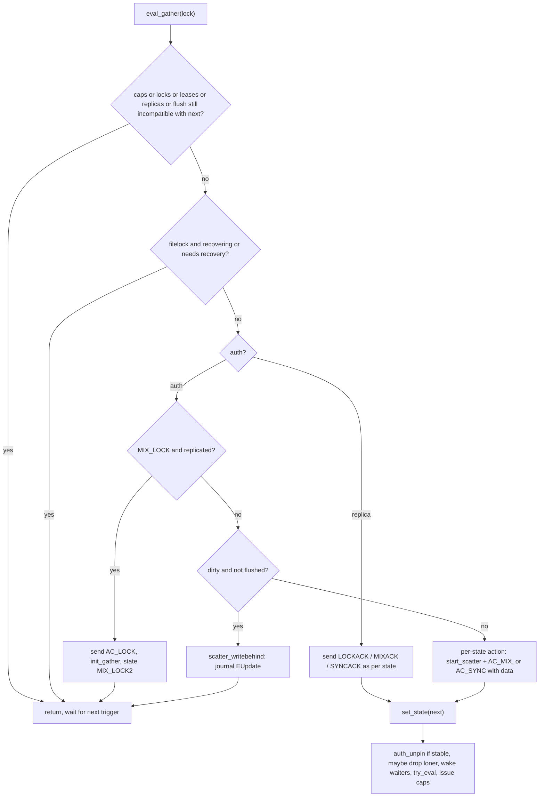
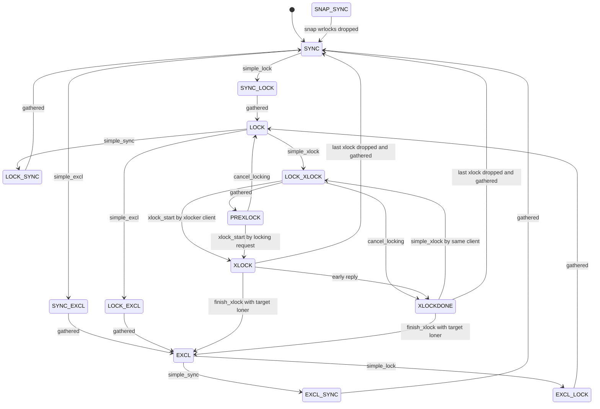
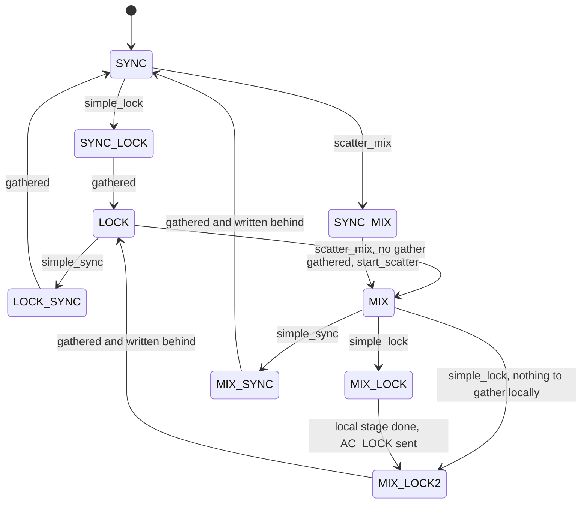
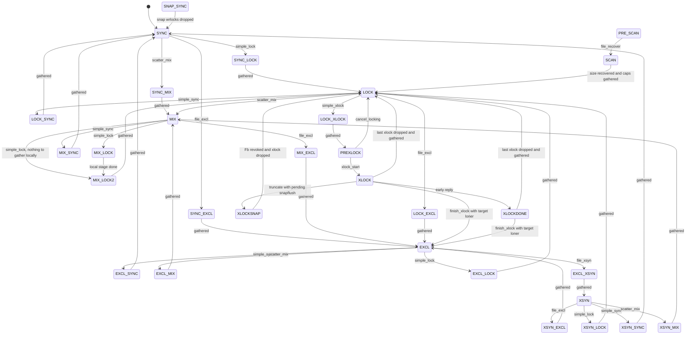
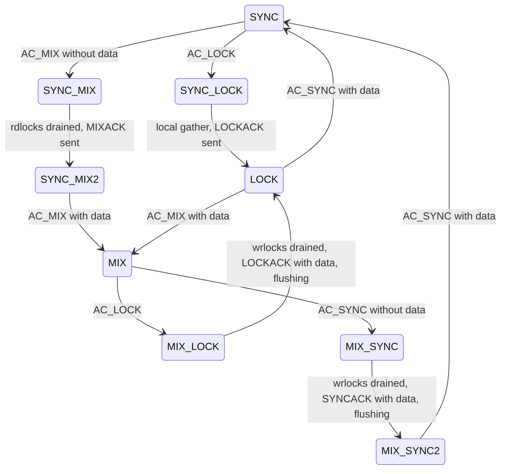
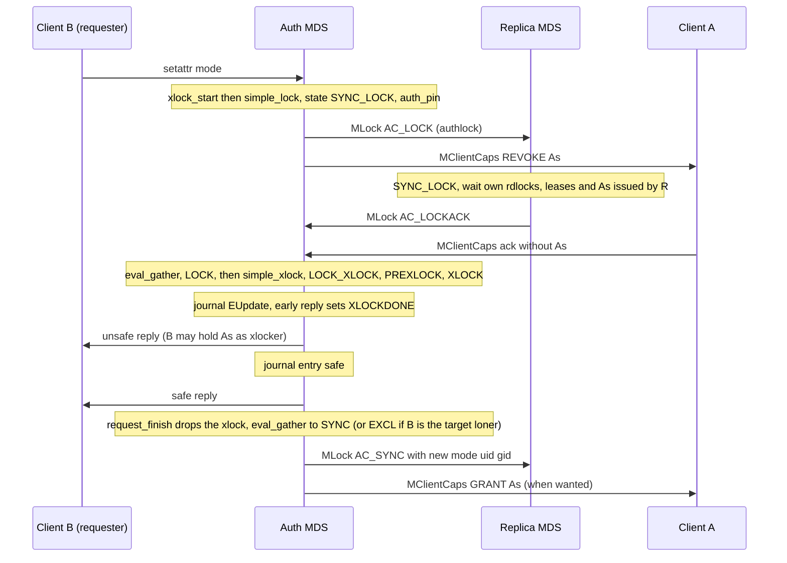
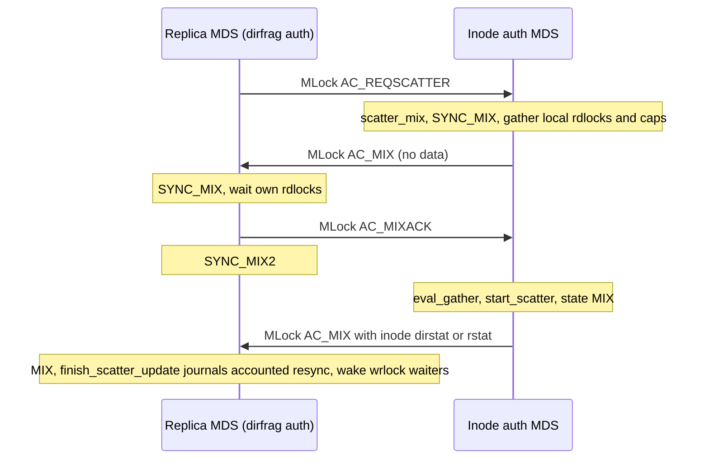
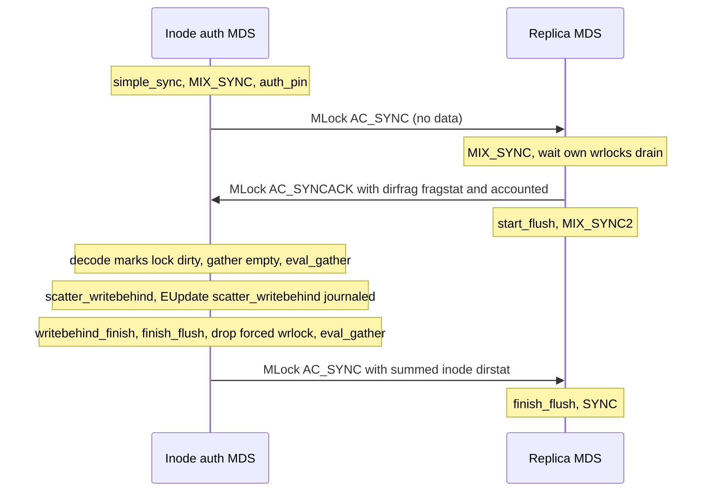
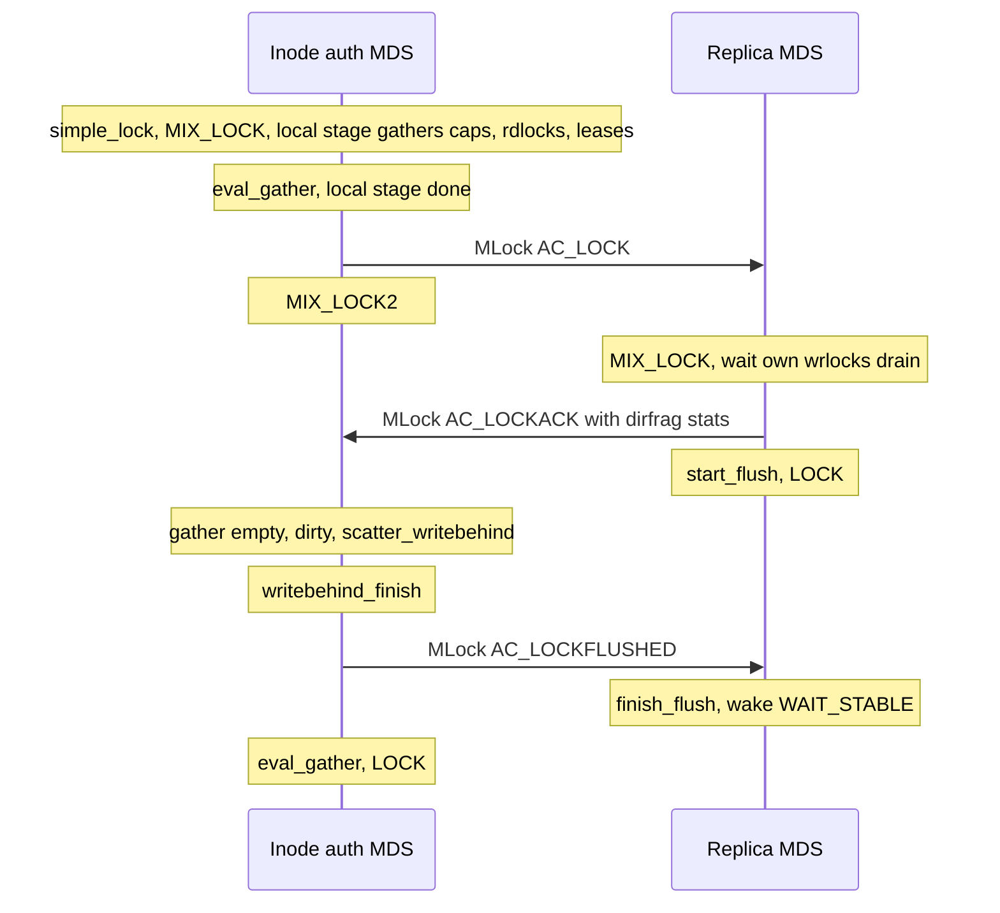

# Lock types and lock state machines (SimpleLock, ScatterLock, FileLock, LocalLock)

> Part of the C++ MDS project map ([README](../README.md)). Sources: `src/mds/locks.h` (126 LOC), `src/mds/locks.c` (160), `src/mds/SimpleLock.h` (645), `src/mds/SimpleLock.cc` (209), `src/mds/ScatterLock.h` (257), `src/mds/LocalLockC.h` (65), `src/messages/MLock.h` (109), `src/messages/MMDSCacheRejoin.h` (407; lock-state fields only), `src/mds/Locker.cc` lines 1271-1731 and 4631-6269 (~2,100 of 6,269 LOC) plus the lock primitives they call (rdlock/wrlock/xlock 1731-2346), lock-related parts of `src/mds/CInode.cc` (encode/decode lock state, scatter helpers, loner and cap helpers, ~1,200 LOC), `src/mds/CDentry.{h,cc}` (dentry lock state, leases), `src/mds/MDCache.cc` (`predirty_journal_parents`, rejoin, file recovery, snapflush), `src/mds/journal.cc` (`LogSegment::try_to_expire`), `src/mds/Server.cc` (lock users, `early_reply`, peer lock requests), `src/mds/RecoveryQueue.cc`, `src/mds/Migrator.cc` (lock twiddling on export/import), `doc/dev/mds_internals/locking.rst` (173, partly outdated). Kernel client: `linux/fs/ceph/caps.c`, `linux/fs/ceph/dir.c`, `linux/fs/ceph/file.c`, `linux/fs/ceph/mds_client.c`, `linux/fs/ceph/inode.c`; libcephfs: `src/client/Client.cc`, `src/client/MetaRequest.h`. Related: [acquiring-locks](acquiring-locks.md), [capabilities](../02-client-protocol/capabilities.md), [leases-lock-caches-and-async-dirops](../02-client-protocol/leases-lock-caches-and-async-dirops.md), [kclient-expectations](../02-client-protocol/kclient-expectations.md), [libcephfs-fuse-ganesha-expectations](../02-client-protocol/libcephfs-fuse-ganesha-expectations.md), [request-lifecycle](../03-request-path/request-lifecycle.md), [namespace-mutations](../03-request-path/namespace-mutations.md), [attributes-and-xattrs](../03-request-path/attributes-and-xattrs.md), [cinode-and-inode-types](../04-cache/cinode-and-inode-types.md), [cdir-cdentry-and-cache-objects](../04-cache/cdir-cdentry-and-cache-objects.md), [mdcache-subtrees-traversal-replication](../04-cache/mdcache-subtrees-traversal-replication.md), [dirfrags-and-fragmentation](../04-cache/dirfrags-and-fragmentation.md), [rstats-quotas-and-subvolumes](../10-snapshots-quotas-subvolumes/rstats-quotas-and-subvolumes.md), [snapshots](../10-snapshots-quotas-subvolumes/snapshots.md), [subtree-migration](../08-multi-mds/subtree-migration.md), [resolve-and-rejoin](../09-recovery/resolve-and-rejoin.md), [rank-lifecycle-and-recovery](../09-recovery/rank-lifecycle-and-recovery.md), [mdlog-and-journaler](../06-journal/mdlog-and-journaler.md), [quiesce](../12-qos-metrics-quiesce-quarantine/quiesce.md), [process-and-threading](../00-architecture/process-and-threading.md), [mds_lock-analysis](../00-architecture/mds_lock-analysis.md).

## 1. Purpose and responsibilities

Every inode and dentry in the MDS cache carries a fixed set of *metadata locks*. A lock is **not** a mutex: it is a small distributed state machine whose current *state* decides, for the MDS that holds the object as *auth* (the authoritative rank) and for every MDS that holds a *replica*:

- which local operations may take a read lock (`rdlock`), a shared write lock (`wrlock`), an exclusive lock (`xlock`), or may simply *peek* at the value (`can_read`, `can_read_projected`);
- whether dentry *leases* may be handed to clients;
- which *capability bits* clients may hold for the slice of inode metadata the lock protects (four lock types carry caps: `authlock`, `linklock`, `xattrlock`, `filelock`);
- what a replica's copy of the lock state is, and what it may do locally.

Changing a lock state that conflicts with outstanding holders requires a **gather**: the lock sits in a transitional state (`LOCK_<FROM>_<TO>`) until local rd/wr/xlock holders drain, client caps that the target state forbids are revoked and acknowledged, client dentry leases are released, replica MDS ranks acknowledge via `MLock`, file-size recovery has finished and dirty scattered data has been journaled. The *Locker* (`src/mds/Locker.cc`) drives these transitions; the per-class tables in `src/mds/locks.c` define the semantics.

Three lock classes (four state tables) exist:

| Class (C++ type) | State table | Purpose |
|---|---|---|
| `SimpleLock` | `sm_simplelock` | shared-read / exclusive-write metadata (dentry linkage, mode/uid/gid, nlink, xattrs, snaprealm, file locks, policy) |
| `ScatterLock` | `sm_scatterlock` | metadata that many ranks update concurrently and that is periodically summed back on the inode auth (`nestlock` = recursive stats, `dirfragtreelock` = fragment tree) |
| `ScatterLock` | `sm_filelock` | `filelock`: file data-related metadata and client file caps; on directories it also scatter-gathers the directory's `dirstat` |
| `LocalLockC` | `sm_locallock` | rank-local version/pipelining locks (`versionlock` of inode and dentry) and the `quiescelock` |

This page documents: the lock catalogue and what each lock protects, the complete state tables, the permission and allowed-cap predicates, the gather engine (`eval_gather`), the stable-state policies (`simple_eval`, `scatter_eval`, `file_eval`), every transition primitive and its trigger, the inter-MDS `MLock` protocol, and the scatter/gather of `dirstat`, `rstat` and `dirfragtree`. The lock *acquisition* algorithm (`acquire_locks`, ordering, auth pins, remote locks) is in [acquiring-locks](acquiring-locks.md); cap issuing/revocation mechanics are in [capabilities](../02-client-protocol/capabilities.md); dentry leases and lock caches in [leases-lock-caches-and-async-dirops](../02-client-protocol/leases-lock-caches-and-async-dirops.md).

## 2. Source map

| File | Class / function | Lines | Role |
|---|---|---|---|
| `src/include/ceph_fs.h` | `CEPH_LOCK_*` lock type bits, `is_inode_lock` | 330-356 | Lock type ids; numeric order is the per-object lock acquisition order |
| `src/include/ceph_fs.h` | `CEPH_CAP_G*`, `CEPH_CAP_S*` shifts, `CEPH_CAP_LOCKS` | 824-906 | Generic cap bits and per-lock cap shifts |
| `src/mds/locks.h` | `sm_state_t`, `sm_t`, `ANY/AUTH/XCL/REQ`, `LOCK_*` states, `LOCK_AC_*` actions | 1-126 | State-machine schema, state and action enums |
| `src/mds/locks.c` | `simplelock[]`, `scatterlock[]`, `filelock[]`, `locallock[]`, `sm_*` | 15-160 | The four state tables |
| `src/mds/SimpleLock.h` | `LockType`, `SimpleLock` (waiters, gather set, `can_*`, rd/wr/xlock counters, `gcaps_*`, encode) | 46-643 | Base lock object and table interpreters |
| `src/mds/SimpleLock.cc` | `get_xlock`, `set_xlock_done`, `put_xlock`, `dump`, `get_wait_shift`, `get_cap_shift`, `get_cap_mask`, lock-cache list | 21-209 | xlock bookkeeping, waiter/cap shifts |
| `src/mds/ScatterLock.h` | `ScatterLock` (dirty/flushing/flushed, scatter_wanted, updated list, rejoin helpers) | 26-255 | Scatter-specific flags and recovery encodings |
| `src/mds/LocalLockC.h` | `LocalLockC` | 22-64 | Always-`LOCK` local lock with its own wr/xlock rules |
| `src/messages/MLock.h` | `MLock` | 24-107 | Inter-MDS lock message (`MSG_MDS_LOCK` = 0x300) |
| `src/messages/MMDSCacheRejoin.h` | `inode_strong` (`filelock`/`nestlock`/`dftlock`), `dn_strong::lock`, `add_strong_inode`, `add_inode_locks`, `add_strong_dentry` | 43-161, 227-236, 285-288 | Raw lock state numbers carried by rejoin messages (4.1) |
| `src/mds/Locker.cc` | `dispatch`, `tick`, `send_lock_message` | 93-155 | Message entry, periodic tick, broadcast to replicas |
| `src/mds/Locker.cc` | `eval_gather` | 1271-1501 | Gather completion engine |
| `src/mds/Locker.cc` | `eval(CInode*)`, `try_eval` (x2), `eval_cap_gather`, `eval_scatter_gathers`, `eval(SimpleLock*)` | 1503-1725 | Evaluation entry points |
| `src/mds/Locker.cc` | `_rdlock_kick`, `rdlock_start/finish`, `wrlock_force/try/start/finish`, `remote_wrlock_*`, `xlock_start`, `_finish_xlock`, `xlock_finish`, `xlock_export/import` | 1731-2346 | Lock-request driven transitions |
| `src/mds/Locker.cc` | `get_lock`, `handle_lock`, `handle_reqrdlock`, `handle_simple_lock` | 4631-4824 | `MLock` dispatch for simple locks |
| `src/mds/Locker.cc` | `simple_eval`, `simple_sync`, `simple_excl`, `simple_lock`, `simple_xlock` | 4867-5202 | SimpleLock policy and transition primitives (also used by scatter/file locks) |
| `src/mds/Locker.cc` | `scatter_writebehind(_finish)`, `scatter_eval`, `mark_updated_scatterlock`, `scatter_nudge`, `scatter_tick`, `scatter_tempsync` | 5211-5599 | Scatter/gather machinery |
| `src/mds/Locker.cc` | `local_wrlock_grab/start/finish`, `local_xlock_start/finish` | 5606-5689 | LocalLock operations |
| `src/mds/Locker.cc` | `file_eval`, `scatter_mix`, `file_excl`, `file_xsyn`, `file_recover`, `handle_file_lock` | 5697-6269 | FileLock/ScatterLock policy, transitions and `MLock` handling |
| `src/mds/CInode.h` | lock members, `loner_cap`, `want_loner_cap`, `get_target_loner` | 894-903, 1137-1167 | Per-inode lock instances |
| `src/mds/CInode.cc` | `cinode_lock_info[]` | 165-171 | The four cap-bearing locks |
| `src/mds/CInode.cc` | `encode_lock_i*` / `decode_lock_i*`, `encode_lock_state`, `decode_lock_state` | 1803-2429 | Lock payloads carried in `MLock` |
| `src/mds/CInode.cc` | `is_dirty_scattered`, `clear_scatter_dirty`, `clear_dirty_scattered`, `start_scatter`, `finish_scatter_update`, `finish_scatter_gather_update(_accounted)` | 2432-2880 | Scatter bookkeeping on the inode |
| `src/mds/CInode.cc` | `calc_ideal_loner`, `choose_ideal_loner`, `try_set_loner`, `set_loner_cap`, `try_drop_loner`, `choose_lock_state(s)` | 3415-3544 | Loner selection; lock state choice after reconnect |
| `src/mds/CInode.cc` | `get_caps_allowed_by_type`, `get_xlocker_mask`, `get_caps_issued`, `get_caps_wanted`, `issued_caps_need_gather` | 3712-3922 | Lock state to caps translation |
| `src/mds/CInode.cc` | `_encode_locks_full`, `_encode_locks_state_for_replica/rejoin`, `_decode_locks_*` | 4540-4660 | Lock state in export/replication/rejoin |
| `src/mds/CDentry.h/.cc` | `lock`, `versionlock`, `use_projected`, `encode/decode_lock_state`, `add/remove_client_lease` | h:214-217, 381-385; cc:519-638 | Dentry lock and leases |
| `src/mds/MDCache.cc` | `cow_inode` (SNAP_SYNC), `predirty_journal_parents`, rejoin handlers, `identify_files_to_recover`, `start_files_to_recover`, `truncate_inode`, `trim_client_leases` | 1573-1676, 2224-2488, 4480-5340, 6444-6562, 6586-6606, 7933-7957 | Callers that set lock states directly or drive scatter |
| `src/mds/journal.cc` | `LogSegment::try_to_expire` (scatter nudges), `EMetaBlob::replay` (mark scatter dirty) | 200-214, 1326-1346 | Journal expiry depends on scatter flush |
| `src/mds/Mutation.h/.cc` | `MutationImpl::LockOp` (`RDLOCK`, `WRLOCK`, `XLOCK`, `REMOTE_WRLOCK`, `STATE_PIN`), `LockOpVec::lock_scatter_gather`, `sort_and_merge`, `MutationImpl::apply` (`updated_locks` -> `mark_dirty`) | h:74-139; cc:132-177, 254-278 | Lock op flags; per-object ordering; deferred scatter dirtying |
| `src/mds/MDSCacheObject.h/.cc` | `waitmask_t` (128-bit), `add_waiter` (`WAIT_ORDERED`), `take_waiting`, `finish_waiting`, `PIN_LOCK`, `PIN_DIRTYSCATTERED` | h:40-81, 250-288, 326-335; cc:26-114 | Lock waiter storage and wakeup |
| `src/mds/Server.cc` | `early_reply` (`set_xlocks_done`), `dispatch_peer_request` / `handle_peer_request_reply` (remote xlock/wrlock), `handle_client_request` (embedded cap releases), lock users (`handle_client_getattr`, `open`, `setattr`, `readdir`, ...) | 2300-2345, 2717-2724, 3100-3275, 4272-5640 | Who takes which lock in which mode |
| `src/mds/RecoveryQueue.cc` | `enqueue`, `_start`, `_recovered` | 100-240 | File size recovery driving `PRE_SCAN`/`SCAN` -> `LOCK` |
| `src/mds/Migrator.cc` | `dispatch_export_dir` (`lock_scatter_gather`), `finish_export_inode` (`export_twiddle`), `decode_import_inode` (re-mark dirty scatterlocks, re-eval `snaplock`/`policylock`) | 1215-1265, 1850-1875, 3440-3509 | Lock state across migration |

## 3. How it works

### 3.1 Vocabulary

| Term | Meaning in code |
|---|---|
| auth / replica | `MDSCacheObject::is_auth()`. Only the auth rank initiates lock state changes; replicas mirror a reduced state (`replica_state` column) and request changes with `LOCK_AC_REQ*` messages. |
| stable / unstable | `SimpleLock::is_stable()` is `states[state].next == 0` (`src/mds/SimpleLock.h:287`). Unstable states have a `next` state the lock moves to when the gather completes. |
| gather | Waiting for (a) local rdlocks/wrlocks/xlocks/leases incompatible with the next state, (b) replica acks (`gather_set`, MDS ranks >= 0), (c) client cap revocation acks, (d) file recovery, (e) scatter writebehind. |
| loner | The single client chosen to receive exclusive caps on an inode (`CInode::loner_cap`); states with `loner = true` hand the loner the `loner_caps` column. |
| xlocker | The client whose request holds (or last held, in `XLOCKDONE`) the xlock (`xlock_by_client`); gets `xlocker_caps` and the `XCL` permissions. |
| `excl_client` | Copy of the loner id stored in `authlock`, `filelock`, `linklock`, `xattrlock` (`CInode::set_loner_cap`, `src/mds/CInode.cc:3467`); used by `XCL` wrlock checks. |
| scatter / gather (data) | For `filelock` on directories and `nestlock`/`dirfragtreelock`: dirfrag auths accumulate deltas (`fnode.fragstat`/`rstat` vs `accounted_*`), the inode auth sums them in on gather and journals the result (writebehind). |

### 3.2 Lock types per object

Each `CInode` has eleven lock objects and each `CDentry` two (`src/mds/CInode.h:1153-1163`, `src/mds/CDentry.h:384-385`). `LockType` maps the type id to its table (`src/mds/SimpleLock.h:46` (LockType::LockType)).

| `CEPH_LOCK_*` (bit) | Member | Class / table | Cap shift (`get_cap_shift`) | Wait shift (`get_wait_shift`, +64 in the 128-bit waiter mask) | State carried to replicas (`encode_lock_*`) | Typical modes and users |
|---|---|---|---|---|---|---|
| `DN` (1) | `CDentry::lock` | SimpleLock / simplelock | none | 0 | `first`, linkage: null / primary ino / remote ino (`src/mds/CDentry.cc:526` (CDentry::encode_lock_state)); a replica only adopts `first` (section 8, item 29) | rdlock on every traversed dentry when a path is locked, xlock when creating/unlinking/renaming a name, together with wrlocks on the parent directory's `filelock` and `nestlock` (`src/mds/MDCache.cc:8643-8664` (MDCache::path_traverse)); without path locking, traversal only checks `can_read` and waits `WAIT_RD` (`:8668-8677`); dentry leases |
| `DVERSION` (2) | `CDentry::versionlock` | LocalLockC / locallock | none | 4 | none | auto-added: leader wrlocks it next to a DN xlock, peers xlock it (`src/mds/Locker.cc:318-330` (Locker::acquire_locks)) |
| `IQUIESCE` (16) | `quiescelock` | LocalLockC / locallock | none | 48 | none | auto-wrlocked at most once per `acquire_locks` call (unless `skip_quiesce`), on the inode of the first xlock / wrlock / remote-wrlock op whose lock has a cap shift (`src/mds/Locker.cc:267`, `:338-386` (Locker::acquire_locks)); xlocked by the internal `quiesce_inode` op (`src/mds/MDCache.cc:14208` (MDCache::dispatch_quiesce_inode)); `CInode::is_quiesced()` is "xlocked by a `CEPH_MDS_OP_QUIESCE_INODE` request" (`src/mds/CInode.cc:5901`) |
| `ISNAP` (32) | `snaplock` | SimpleLock / simplelock | none | 32 | `version`, `ctime`, snap blob (`src/mds/CInode.cc:2208`) | rdlocked on the target (open, `src/mds/Server.cc:4720` (Server::handle_client_open)) and on every ancestor by `try_rdlock_snap_layout`, which tests `can_rdlock` and waits `WAIT_RD` without kicking the lock (`src/mds/Locker.cc:157-227` (Locker::try_rdlock_snap_layout); called from path traversal, `src/mds/MDCache.cc:8502`); xlocked by mksnap/rmsnap/renamesnap on the directory (`src/mds/Server.cc:11636`, `:11828`, `:11976`), by link/unlink/rename of the target inode (`:7942`, `:8642`, `:9468`, `:9473`) and optionally with `policylock` (`:5937` (Server::xlock_policylock)) |
| `IPOLICY` (64) | `policylock` | SimpleLock / simplelock | none | 44 | dirs: `version`, `ctime`, `layout`, `quota`, `export_pin`, `flags`, `export_ephemeral_random_pin`, `optmetadata`; files: `flags`, `optmetadata` (`src/mds/CInode.cc:2250`) | rdlocked on ancestors for layout inheritance (`try_rdlock_snap_layout` with `want_layout`, stops at the first ancestor with a layout) and by `quiesce_inode` (`src/mds/MDCache.cc:14209`); xlocked by `setdirlayout` and the layout/quota/pin/subvolume vxattr setters through `Server::xlock_policylock` (`src/mds/Server.cc:5930-5954`, callers `:5985`-`:6925`) and by quarantine updates (`src/mds/MDCache.cc:15229`) |
| `IFILE` (128) | `filelock` | ScatterLock / filelock | 8 (`F` caps, 8 bits) | 20 | auth->replica: `version`, `ctime`, `mtime`, `atime`, `time_warp_seq`, for files only `layout`, `size`, `truncate_seq`, `truncate_size`, `client_ranges`, `inline_data`, and (files and dirs) `fscrypt_file`; replica->auth: a dirty flag (dirty or flushing) instead of the inode fields; both ways: `dirstat` and, per dirfrag (all dirfrags from the auth, only its auth dirfrags from a replica), `frag`, `first`, `fragstat`, `accounted_fragstat` (`src/mds/CInode.cc:1938` (CInode::encode_lock_ifile)) | xlock: setattr size/mtime/atime/fscrypt_file (`src/mds/Server.cc:5614` (Server::handle_client_setattr)), setlayout (`:5902`), O_TRUNC open (`:4741` (Server::handle_client_open)), layout vxattrs (`:6441`); rdlock: getattr `Fs` unless the client holds `Fx`, skipped when the lock is unstable, not wrlocked and still readable (`:4365-4396`), readdir of the directory (`:5124` (Server::handle_client_readdir)), emptiness check of a directory being removed or renamed over (`:8644` (Server::handle_client_unlink), `:9476` (Server::handle_client_rename)), open of a snapshotted file (`:4767`); wrlock: the parent directory's `filelock` for every namespace change in it (`src/mds/MDCache.cc:8650` (MDCache::path_traverse)), forced wrlocks for cap flushes and `max_size` changes (`src/mds/Locker.cc:4221` (Locker::_do_cap_update), `:3180` (Locker::check_inode_max_size)) |
| `INEST` (256) | `nestlock` | ScatterLock / scatterlock | none | 36 | `rstat` and per-dirfrag `rstat`/`accounted_rstat`/`dirty_old_rstat` (`src/mds/CInode.cc:2073`) | wrlock on the parent directory for every namespace change (`src/mds/MDCache.cc:8651` (MDCache::path_traverse)); `wrlock_force`/`wrlock_try` during rstat propagation (`src/mds/MDCache.cc:2224-2390` (MDCache::predirty_journal_parents)); state-pin wrlock (`lock_scatter_gather`) during export and fragmentation (`src/mds/Migrator.cc:1230`, `src/mds/MDCache.cc:12326`); wrlock then rdlock by stat repair and rdlock by `rdlock_dirfrags_stats` (scrub) (`src/mds/MDCache.cc:13634`, `:13736`, `:13777`, `:13835`) |
| `IDFT` (512) | `dirfragtreelock` | ScatterLock / scatterlock | none | 16 | `dirfragtree` plus the set of frags the sender is auth for (`src/mds/CInode.cc:1856`) | rdlock by readdir and readdir_snapdiff (`src/mds/Server.cc:5125`, `:12286`), snapshot ino lookup (`:4591`), export (`src/mds/Migrator.cc:893`, `:1235`, `:1259`) and stat repair (`src/mds/MDCache.cc:13633`, `:13735`); wrlock by dirfrag split/merge (`src/mds/MDCache.cc:12324` (MDCache::dispatch_fragment_dir)) |
| `IAUTH` (1024) | `authlock` | SimpleLock / simplelock | 2 (`A` caps) | 8 | `version`, `ctime`, `mode`, `uid`, `gid`, `fscrypt_auth` (`src/mds/CInode.cc:1803`) | xlock by setattr mode/uid/gid/btime/fscrypt_auth/kill-suid (`src/mds/Server.cc:5612`) and some vxattrs (`:6374`); rdlock by getattr/lookup `As` unless the client holds `Ax` (`:4361`), open with an `As` mask (`:4730`), and on the parent directory when a create path asks for it (`MDS_TRAVERSE_RDLOCK_AUTHLOCK`, `src/mds/MDCache.cc:8652`) |
| `ILINK` (2048) | `linklock` | SimpleLock / simplelock | 4 (`L` caps) | 12 | `version`, `ctime`, `nlink` (`src/mds/CInode.cc:1833`) | xlock by link/unlink/rename of the inode (`src/mds/Server.cc:7943`, `:8641`, `:9467`, `:9472`); rdlock by getattr `Ls` unless the client holds `Lx` (`:4359`) |
| `IXATTR` (4096) | `xattrlock` | SimpleLock / simplelock | 6 (`X` caps) | 28 | `version`, `ctime`, xattr map, `xattr_version` (`src/mds/CInode.cc:2180`) | xlock by setxattr/removexattr (`src/mds/Server.cc:7184`, `:7279`); rdlock by getattr `Xs` unless the client holds `Xx` (`:4363`) and by open with an `Xs` mask (`:4732`) |
| `IFLOCK` (8192) | `flocklock` | SimpleLock / simplelock | none | 40 | `version`, fcntl/flock lock tables (`src/mds/CInode.cc:2231`) | xlock by setfilelock (`src/mds/Server.cc:5428` (Server::handle_client_file_setlock)), rdlock by getfilelock (`:5538` (Server::handle_client_file_readlock)) |
| `IVERSION` (16384) | `versionlock` | LocalLockC / locallock | none | 24 | none | auto-wrlocked by the leader next to any xlock of another lock on an auth inode (pipelining), xlocked by peers instead (rollback safety) (`src/mds/Locker.cc:331-357` (Locker::acquire_locks)); wrlocked when setattr sets ctime (`src/mds/Server.cc:5616` (Server::handle_client_setattr)); `local_wrlock_grab` on each ancestor whose inode `predirty_journal_parents` projects (`src/mds/MDCache.cc:2390`) |

Notes:

- The numeric `CEPH_LOCK_*` value is the per-object acquisition order: `LockOpVec::sort_and_merge` sorts locks on the same object by `type->type` (`src/mds/Mutation.cc:132` (LockOpVec::sort_and_merge)), and the header comment says the bits "define the lock ordering by the MDS" (`src/include/ceph_fs.h:330`).
- `get_cap_mask()` is 8 bits for `IFILE` and 2 bits for the other cap-bearing locks (`src/mds/SimpleLock.cc:137`). `CEPH_CAP_LOCKS` = `IFILE|IAUTH|ILINK|IXATTR` (`src/include/ceph_fs.h:905`).
- Every encoded inode lock payload is wrapped in `ENCODE_START(1,1)` with the inode `first` and (non-base) the parent dentry `first`; a replica adopts the sender's `first` values (`src/mds/CInode.cc:2315` (CInode::encode_lock_state), `:2367` (CInode::decode_lock_state)). `ctime` is merged as max on replicas.
- `doc/dev/mds_internals/locking.rst` omits `IQUIESCE` from its class list and claims `LOCK_LOCK` lets the auth wrlock or xlock; for `simplelock` neither is true (see table below).

### 3.3 The state-table schema

`struct sm_state_t` (`src/mds/locks.h:5`) has, per state: `next` (0 = stable), `loner` (state is a loner state), `replica_state` (what a replica's copy is set to), seven permission columns (`can_read`, `can_read_projected`, `can_rdlock`, `can_wrlock`, `can_force_wrlock`, `can_lease`, `can_xlock`) and four cap columns (`caps` for any client, `loner_caps`, `xlocker_caps`, `replica_caps`). `struct sm_t` adds `allowed_ever_auth`, `allowed_ever_replica`, `careful` and `can_remote_xlock`.

Permission codes (`src/mds/locks.h:30-34`) and their evaluation (`src/mds/SimpleLock.h:353-389` (SimpleLock::can_*)):

| Code | Value | Meaning in `can_X(client)` |
|---|---|---|
| `0` | 0 | never |
| `ANY` | 1 | auth or replica |
| `AUTH` | 2 | only if `parent->is_auth()` |
| `XCL` | 3 | `client >= 0 && client == xlock_by_client`; for `can_wrlock`/`can_force_wrlock` also `client == excl_client` (the loner) |
| `REQ` | 5 | never grants (and counts as incompatible in the `eval_gather` completion test); documents that a replica wanting the rdlock must ask the auth. The predicate `req_rdlock_from_auth()` (`src/mds/SimpleLock.h:314`) has no caller: `_rdlock_kick` sends `LOCK_AC_REQRDLOCK` from any stable replica state that refuses the rdlock, whether the column says `REQ` or `0` |
| (`FW` 4) | - | commented out (forward to auth) |

Column meanings:

| Column | Used by |
|---|---|
| `can_read` | "peek" without taking a lock: dentry readability in `path_traverse` (`src/mds/MDCache.cc:8668-8669` (MDCache::path_traverse)), getattr's filelock shortcut (`src/mds/Server.cc:4370-4396` (Server::handle_client_getattr)), assertions in `Server::_dir_has_snaps` / `Server::_dir_is_nonempty` (`src/mds/Server.cc:9254`, `:9266`), dentry checks in `MDCache::trim_dentry` and `MDCache::open_ino_traverse_dir` (`src/mds/MDCache.cc:7195`, `:9345`) |
| `can_read_projected` | whether the requester may see projected (uncommitted) dentry linkage (`CDentry::use_projected`, `src/mds/CDentry.h:214`) |
| `can_rdlock` / `can_wrlock` / `can_xlock` | `rdlock_start`, `wrlock_start`, `xlock_start` |
| `can_force_wrlock` | only `_do_cap_update`, and only for a client's `max_size` change on a head inode's `filelock`: allowed while the state is `EXCL_SYNC`/`EXCL_LOCK` (`XCL`: the loner or xlocker) even though `can_wrlock` is not (`src/mds/Locker.cc:4129-4157` (Locker::_do_cap_update)). The cap flush itself uses `wrlock_force`, which ignores the state; the `AUTH` value in the `SNAP_SYNC` rows is never consulted (that check requires `in->last == CEPH_NOSNAP`, and `SNAP_SYNC` is only set on snapshotted inodes) |
| `can_lease` | dentry lease issue/renew (`src/mds/Locker.cc:4519`, `:4550`); for the parent dir's `filelock` it is used as "the client can cache the whole directory instead" (`src/mds/Locker.cc:4552` (Locker::issue_client_lease)) |
| `caps`, `loner_caps`, `xlocker_caps`, `replica_caps` | `gcaps_allowed()`; see 3.5 |
| `allowed_ever_*` | `CInode::get_caps_allowed_ever` (filters what a replica asks the auth for, `src/mds/Locker.cc:2903` (Locker::request_inode_file_caps)) |
| `careful` | `gcaps_careful()` / `CInode::get_caps_careful()`; no caller exists (dead) |
| `can_remote_xlock` | only `sm_simplelock` = 1: a replica may ask the auth for an xlock (`src/mds/Locker.cc:2200` (Locker::xlock_start)) |

### 3.4 Complete state tables

Generated from `src/mds/locks.c` (rows in source order). Cap letters are generic (`s`=SHARED, `x`=EXCL, `c`=CACHE, `r`=RD, `w`=WR, `b`=BUFFER, `a`=WREXTEND, `l`=LAZYIO); for `authlock`/`linklock`/`xattrlock` read them as `As/Ax`, `Ls/Lx`, `Xs/Xx`; for `filelock` as `Fs Fx Fc Fr Fw Fb Fa Fl`. "(none)" in the replica column means the state exists only on replicas (its `replica_state` is 0, i.e. `LOCK_UNDEF`). A state that is not listed for a table has an all-zero row (treated as *stable* with no permissions). Numeric state values, the `get_state_name()` strings and the three enumerators that no table uses are in 3.4.6.

#### 3.4.1 `sm_simplelock` (`src/mds/locks.c:15-45`): `DN`, `IAUTH`, `ILINK`, `IXATTR`, `ISNAP`, `IFLOCK`, `IPOLICY`

`allowed_ever_auth = s|x`, `allowed_ever_replica = s`, `careful = s|x`, `can_remote_xlock = 1`.

| state | next | loner | replica state | read | read-proj | rdlock | wrlock | force-wrlock | lease | xlock | caps (any) | loner caps | xlocker caps | replica caps |
|---|---|---|---|---|---|---|---|---|---|---|---|---|---|---|
| `SYNC` | stable | - | `SYNC` | ANY | - | ANY | - | - | ANY | - | s | - | - | s |
| `LOCK_SYNC` | `SYNC` | - | `LOCK` | AUTH | XCL | XCL | - | - | XCL | - | - | - | - | - |
| `EXCL_SYNC` | `SYNC` | Y | `LOCK` | - | - | - | - | XCL | - | - | - | s | - | - |
| `SNAP_SYNC` | `SYNC` | - | `LOCK` | - | - | - | - | AUTH | - | - | - | - | - | - |
| `LOCK` | stable | - | `LOCK` | AUTH | - | REQ | - | - | - | - | - | - | - | - |
| `SYNC_LOCK` | `LOCK` | - | `LOCK` | ANY | - | - | - | - | - | - | - | - | - | - |
| `EXCL_LOCK` | `LOCK` | - | `LOCK` | - | - | - | - | XCL | - | - | - | - | - | - |
| `PREXLOCK` | `LOCK` | - | `LOCK` | - | XCL | - | - | - | - | ANY | - | - | - | - |
| `XLOCK` | `SYNC` | - | `LOCK` | - | XCL | - | - | - | - | - | - | - | - | - |
| `XLOCKDONE` | `SYNC` | - | `LOCK` | XCL | XCL | XCL | - | - | XCL | - | - | - | s | - |
| `LOCK_XLOCK` | `PREXLOCK` | - | `LOCK` | - | XCL | - | - | - | - | XCL | - | - | - | - |
| `EXCL` | stable | Y | `LOCK` | - | - | REQ | XCL | - | - | - | - | sx | - | - |
| `SYNC_EXCL` | `EXCL` | Y | `LOCK` | ANY | - | - | - | - | - | - | - | s | - | - |
| `LOCK_EXCL` | `EXCL` | - | `LOCK` | AUTH | - | - | - | - | - | - | s | - | - | - |
| `REMOTEXLOCK` | `LOCK` | - | `LOCK` | - | - | - | - | - | - | - | - | - | - | - |

Stable states: `SYNC`, `LOCK`, `EXCL`. Replicas only ever hold `SYNC`, `SYNC_LOCK` (while acking) and `LOCK`. `REMOTEXLOCK` is never assigned by any code (a remote xlock leaves the replica in `LOCK`, see 3.10). `EXCL` is only meaningful for the cap-bearing simple locks; `simple_eval` only moves to `EXCL` when the target loner wants the `x` bit of that lock. One exception: `_finish_xlock` also puts `flocklock` (no caps) into `EXCL` when the inode has a target loner and the xlocker is that loner (`src/mds/Locker.cc:2237-2256`); the `try_eval` it calls then runs `simple_eval`, which syncs it straight back (`wanted` is 0 for a lock without caps) unless the inode is freezing/frozen, and any later rdlock kicks it to `SYNC` with no gather (no caps, no rd/wr holders in `EXCL`).

#### 3.4.2 `sm_scatterlock` (`src/mds/locks.c:53-82`): `INEST`, `IDFT`

`allowed_ever_auth = s|x`, `allowed_ever_replica = s`, `careful = s|x`, `can_remote_xlock = 0` (no caps are ever issued for these lock types because `get_cap_shift()` is 0).

| state | next | loner | replica state | read | read-proj | rdlock | wrlock | force-wrlock | lease | xlock | caps (any) | loner caps | xlocker caps | replica caps |
|---|---|---|---|---|---|---|---|---|---|---|---|---|---|---|
| `SYNC` | stable | - | `SYNC` | ANY | - | ANY | - | - | ANY | - | s | - | - | s |
| `LOCK_SYNC` | `SYNC` | - | `LOCK` | AUTH | - | - | - | - | - | - | - | - | - | - |
| `MIX_SYNC` | `SYNC` | - | `LOCK` | - | - | - | - | - | - | - | - | - | - | - |
| `SNAP_SYNC` | `SYNC` | - | `LOCK` | - | - | - | - | AUTH | - | - | - | - | - | - |
| `LOCK` | stable | - | `LOCK` | AUTH | - | REQ | AUTH | - | - | ANY | - | - | - | - |
| `SYNC_LOCK` | `LOCK` | - | `LOCK` | ANY | - | - | - | - | - | - | - | - | - | - |
| `MIX_LOCK` | `LOCK` | - | `MIX` | - | - | - | - | - | - | - | - | - | - | - |
| `MIX_LOCK2` | `LOCK` | - | `LOCK` | - | - | - | - | - | - | - | - | - | - | - |
| `TSYN_LOCK` | `LOCK` | - | `LOCK` | AUTH | - | - | - | - | - | - | - | - | - | - |
| `TSYN` | stable | - | `LOCK` | AUTH | - | AUTH | - | - | - | - | - | - | - | - |
| `LOCK_TSYN` | `TSYN` | - | `LOCK` | - | - | - | - | - | - | - | - | - | - | - |
| `MIX_TSYN` | `TSYN` | - | `LOCK` | - | - | - | - | - | - | - | - | - | - | - |
| `MIX` | stable | - | `MIX` | - | - | REQ | ANY | - | - | - | - | - | - | - |
| `TSYN_MIX` | `MIX` | - | `LOCK` | - | - | - | - | - | - | - | - | - | - | - |
| `SYNC_MIX` | `MIX` | - | `SYNC_MIX2` | ANY | - | - | - | - | - | - | - | - | - | - |
| `SYNC_MIX2` | `MIX` | - | (none) | - | - | - | - | - | - | - | - | - | - | - |

Stable states in use: `SYNC` (readable everywhere, unwritable), `LOCK` (auth-only writable, unreadable), `MIX` (writable on every rank, unreadable). `TSYN*` (temp-sync) is unreachable: `scatter_tempsync` starts with `ceph_abort_msg("not fully implemented...")` (`src/mds/Locker.cc:5551`) and `_rdlock_kick` has the call commented out (`src/mds/Locker.cc:1737-1741`). **There is no `MIX_SYNC2` row**, although replicas of `nestlock`/`dirfragtreelock` are put into `MIX_SYNC2` by `eval_gather` (`src/mds/Locker.cc:1358`); for this table that state is all-zero, i.e. "stable" with no permissions, until the auth's `LOCK_AC_SYNC` arrives (see section 8). `LOCK` allows `xlock` (`ANY`), but no production path xlocks `nestlock`/`dirfragtreelock` and the table has no `LOCK_XLOCK`/`PREXLOCK`/`XLOCK` rows; only the `lock path` admin command can request it, and by code reading that ends in `ceph_abort()` (section 8, item 1).

#### 3.4.3 `sm_filelock` (`src/mds/locks.c:84-146`): `IFILE`

`allowed_ever_auth = s|x|c|r|w|a|b|l` (all eight bits), `allowed_ever_replica = s|c|r|l`, `careful = s|x|c|b`, `can_remote_xlock = 0`.

| state | next | loner | replica state | read | read-proj | rdlock | wrlock | force-wrlock | lease | xlock | caps (any) | loner caps | xlocker caps | replica caps |
|---|---|---|---|---|---|---|---|---|---|---|---|---|---|---|
| `SYNC` | stable | - | `SYNC` | ANY | - | ANY | - | - | ANY | - | scrl | - | - | scr |
| `LOCK_SYNC` | `SYNC` | - | `LOCK` | AUTH | - | - | - | - | - | - | c | - | - | - |
| `EXCL_SYNC` | `SYNC` | Y | `LOCK` | - | - | - | - | XCL | - | - | - | scr | - | - |
| `MIX_SYNC` | `SYNC` | - | `MIX_SYNC2` | - | - | - | - | - | - | - | rl | - | - | r |
| `MIX_SYNC2` | `SYNC` | - | (none) | - | - | - | - | - | - | - | rl | - | - | r |
| `SNAP_SYNC` | `SYNC` | - | `LOCK` | - | - | - | - | AUTH | - | - | - | - | - | - |
| `XSYN_SYNC` | `SYNC` | Y | `LOCK` | AUTH | - | AUTH | - | - | - | - | - | c | - | - |
| `LOCK` | stable | - | `LOCK` | AUTH | - | REQ | AUTH | - | - | - | cb | - | - | - |
| `SYNC_LOCK` | `LOCK` | - | `LOCK` | ANY | - | REQ | - | - | - | - | c | - | - | - |
| `EXCL_LOCK` | `LOCK` | - | `LOCK` | - | - | - | - | XCL | - | - | cb | - | - | - |
| `MIX_LOCK` | `LOCK` | - | `MIX` | - | - | REQ | - | - | - | - | - | - | - | - |
| `MIX_LOCK2` | `LOCK` | - | `LOCK` | - | - | REQ | - | - | - | - | - | - | - | - |
| `XSYN_LOCK` | `LOCK` | Y | `LOCK` | AUTH | - | - | XCL | - | - | - | - | cb | - | - |
| `PREXLOCK` | `LOCK` | - | `LOCK` | - | XCL | - | - | - | - | ANY | cb | - | - | - |
| `XLOCK` | `LOCK` | - | `LOCK` | - | XCL | - | - | - | - | - | cb | - | - | - |
| `XLOCKDONE` | `LOCK` | - | `LOCK` | XCL | XCL | XCL | - | - | XCL | - | cb | - | s | - |
| `XLOCKSNAP` | `LOCK` | - | `LOCK` | - | XCL | - | - | - | - | - | c | - | - | - |
| `LOCK_XLOCK` | `PREXLOCK` | - | `LOCK` | - | XCL | - | - | - | - | XCL | cb | - | - | - |
| `MIX` | stable | - | `MIX` | - | - | REQ | ANY | - | - | - | rwl | - | - | r |
| `SYNC_MIX` | `MIX` | - | `SYNC_MIX2` | ANY | - | - | - | - | - | - | rl | - | - | r |
| `SYNC_MIX2` | `MIX` | - | (none) | - | - | - | - | - | - | - | rl | - | - | r |
| `EXCL_MIX` | `MIX` | Y | `LOCK` | - | - | - | XCL | - | - | - | - | rw | - | - |
| `XSYN_MIX` | `MIX` | Y | `LOCK` | - | - | - | XCL | - | - | - | - | - | - | - |
| `EXCL` | stable | Y | `LOCK` | - | - | XCL | XCL | - | - | - | - | sxcrwb | - | - |
| `SYNC_EXCL` | `EXCL` | Y | `LOCK` | ANY | - | - | - | - | - | - | - | scr | - | - |
| `MIX_EXCL` | `EXCL` | Y | `LOCK` | - | - | - | XCL | - | - | - | - | rw | - | - |
| `LOCK_EXCL` | `EXCL` | Y | `LOCK` | AUTH | - | - | - | - | - | - | - | cb | - | - |
| `XSYN_EXCL` | `EXCL` | Y | `LOCK` | AUTH | - | XCL | - | - | - | - | - | cb | - | - |
| `XSYN` | stable | Y | `LOCK` | AUTH | AUTH | AUTH | XCL | - | - | - | - | cb | - | - |
| `EXCL_XSYN` | `XSYN` | Y | `LOCK` | - | - | XCL | - | - | - | - | - | cb | - | - |
| `PRE_SCAN` | `SCAN` | - | `LOCK` | - | - | - | - | - | - | - | - | - | - | - |
| `SCAN` | `LOCK` | - | `LOCK` | - | - | - | - | - | - | - | - | - | - | - |

Stable states: `SYNC` (everyone may read and cache: `Fscrl`; replicas may issue `Fscr`), `LOCK` (auth-only writes, clients keep only `Fcb`), `MIX` (every rank may wrlock; clients get `Frwl` but not `Fs`/`Fc`/`Fb`, i.e. uncached shared read/write), `EXCL` (single loner client gets `Fsxcrwb`, nobody else gets file caps), `XSYN` (loner keeps `Fcb`; auth may rdlock). `Fa` (`WREXTEND`) appears in `allowed_ever_auth` but in no state's cap column, so it is never issued; `Fl` (`LAZYIO`) is only in `SYNC`, `MIX` and the `MIX`/`SYNC` transitional states. Note that a `filelock` `XLOCK` returns to `LOCK`, whereas a `simplelock` `XLOCK` returns to `SYNC`.

#### 3.4.4 `sm_locallock` (`src/mds/locks.c:149-160`): `IVERSION`, `DVERSION`, `IQUIESCE`

| state | next | loner | replica state | read | read-proj | rdlock | wrlock | force-wrlock | lease | xlock | caps (any) | loner caps | xlocker caps | replica caps |
|---|---|---|---|---|---|---|---|---|---|---|---|---|---|---|
| `LOCK` | stable | - | `LOCK` | ANY | - | ANY | - | - | ANY | AUTH | - | - | - | - |

`LocalLockC` forces `LOCK` in its constructor (`src/mds/LocalLockC.h:24`) and replaces the table semantics with its own methods (non-virtual, hiding `SimpleLock::can_wrlock(client_t)`): `can_wrlock()` = `!is_xlocked() && !is_waiter_for(WAIT_XLOCK)` (writer preference: a queued xlocker blocks new wrlockers), `can_xlock_local()` = `!is_wrlocked() && !has_xlock_by()` (`src/mds/LocalLockC.h:33-39`). rdlock is never used on local locks (`acquire_locks` asserts `!lock->is_locallock()` for rdlocks, `src/mds/Locker.cc:390`). Local locks are never evaluated (`eval(CInode*)` skips them, `src/mds/Locker.cc:1538`), never replicated, never in `MLock`, and `LocalLockC::last_wrlock_client` records the last wrlocking client (used by `CInode::encode_inodestat` to return projected values to that client, `src/mds/CInode.cc:4052`).

#### 3.4.5 Stable states at a glance

Derived from the tables above ("nobody" for `REQ`: neither the auth nor a replica can take the lock in that state; a replica that wants it sends a request to the auth, and an auth that wants it changes the state first).

| Class | Stable state | rdlock | wrlock | xlock | Client caps (non-loner / loner / replica-issued) | Typical reason to be here |
|---|---|---|---|---|---|---|
| simplelock | `SYNC` | auth + replicas | nobody | nobody (go via `LOCK`) | `s` / `s` / `s` | default; readers; dentry leases allowed |
| simplelock | `LOCK` | nobody (`REQ`) | nobody | nobody directly (`LOCK` -> `LOCK_XLOCK` -> `PREXLOCK` -> `XLOCK`) | none | waypoint to an xlock; a waiting xlocker keeps it here |
| simplelock | `EXCL` | nobody (`REQ`) | requests of the loner client (`XCL` for wrlock accepts `excl_client`) | nobody | none / `sx` / none | one client wants the `x` bit (cap locks only) |
| scatterlock | `SYNC` | auth + replicas | nobody | nobody | n/a (no caps) | readers (readdir, scrub); `IDFT` without delegated dirfrags |
| scatterlock | `LOCK` | nobody | auth only | `ANY` in the table, unusable (section 8) | n/a | unreplicated `INEST` kept writable on the auth |
| scatterlock | `MIX` | nobody | auth + replicas | nobody | n/a | replicated `INEST`; inodes whose dirfrags are delegated to other ranks |
| filelock | `SYNC` | auth + replicas | nobody | nobody | `Fscrl` / `Fscrl` / `Fscr` | readers only |
| filelock | `LOCK` | nobody | auth only | nobody directly | `Fcb` / `Fcb` / none | waypoint to an xlock; directory being mutated by several clients; after an xlock |
| filelock | `MIX` | nobody | auth + replicas | nobody | `Frwl` / `Frwl` / `Fr` | several writers, or writer + readers on other clients; delegated directory |
| filelock | `EXCL` | nobody in practice (`XCL` for rdlock means the current xlocker's client, and `EXCL` holds no xlock); an rdlock kicks `XSYN` or `SYNC` | loner's requests (`XCL` for wrlock also accepts `excl_client`) | nobody | none / `Fsxcrwb` / none | single writer (file) or single client (directory) |
| filelock | `XSYN` | auth only | loner's requests (`XCL`) | nobody | none / `Fcb` / none | auth rdlock while the loner keeps buffered data |
| locallock | `LOCK` | never used | shared unless xlocked or an xlocker waits | exclusive vs wrlocks | n/a | version pipelining, quiesce barrier |

#### 3.4.6 State numbering (`locks.h` enum)

The states form one anonymous `enum` numbered implicitly from `LOCK_UNDEF = 0` (`src/mds/locks.h:45-101`). Each table is an array `sm_state_t ...[LOCK_MAX]` indexed by that number (`src/mds/locks.c:15`, `:53`, `:84`, `:149`), `SimpleLock::state` stores it as `__s16` (`src/mds/SimpleLock.h:598`), and `SimpleLock::get_state_name()` (`src/mds/SimpleLock.h:91-144`) turns it into the string printed by `SimpleLock::_print` (`src/mds/SimpleLock.cc:178`), by the "next state is" debug line of `eval_gather` (`src/mds/Locker.cc:1290`) and in the `state` field of `dump inode`/`dump cache` (`src/mds/SimpleLock.cc:85` (SimpleLock::dump)). The enum has 41 enumerators: `LOCK_UNDEF`, 39 states (1-39), 38 of which have a row in at least one table, and `LOCK_MAX`. No code compares lock states by order (only for equality), so the numbers matter only as table indices and in the MDS-to-MDS encodings listed in 4.1. "Row in": S = `simplelock`, C = `scatterlock`, F = `filelock`, L = `locallock`.

| Value | Enumerator | `get_state_name()` | Row in |
|---|---|---|---|
| 0 | `LOCK_UNDEF` | `UNDEF` | none (index 0 is all-zero in every table) |
| 1 | `LOCK_SYNC` | `sync` | S C F |
| 2 | `LOCK_LOCK` | `lock` | S C F L |
| 3 | `LOCK_PREXLOCK` | `prexlock` | S F |
| 4 | `LOCK_XLOCK` | `xlock` | S F |
| 5 | `LOCK_XLOCKDONE` | `xlockdone` | S F |
| 6 | `LOCK_XLOCKSNAP` | `xlocksnap` | F |
| 7 | `LOCK_LOCK_XLOCK` | `lock->xlock` | S F |
| 8 | `LOCK_SYNC_LOCK` | `sync->lock` | S C F |
| 9 | `LOCK_LOCK_SYNC` | `lock->sync` | S C F |
| 10 | `LOCK_EXCL` | `excl` | S F |
| 11 | `LOCK_EXCL_SYNC` | `excl->sync` | S F |
| 12 | `LOCK_EXCL_LOCK` | `excl->lock` | S F |
| 13 | `LOCK_SYNC_EXCL` | `sync->excl` | S F |
| 14 | `LOCK_LOCK_EXCL` | `lock->excl` | S F |
| 15 | `LOCK_REMOTEXLOCK` | `remote_xlock` | S |
| 16 | `LOCK_MIX` | `mix` | C F |
| 17 | `LOCK_SYNC_MIX` | `sync->mix` | C F |
| 18 | `LOCK_SYNC_MIX2` | `sync->mix(2)` | C F |
| 19 | `LOCK_LOCK_MIX` | none (`ceph_abort()`) | none |
| 20 | `LOCK_EXCL_MIX` | `excl->mix` | F |
| 21 | `LOCK_MIX_SYNC` | `mix->sync` | C F |
| 22 | `LOCK_MIX_SYNC2` | `mix->sync(2)` | F (no `scatterlock` row, although scatterlock replicas enter it; section 8, item 1) |
| 23 | `LOCK_MIX_LOCK` | `mix->lock` | C F |
| 24 | `LOCK_MIX_LOCK2` | `mix->lock(2)` | C F |
| 25 | `LOCK_MIX_EXCL` | `mix->excl` | F |
| 26 | `LOCK_TSYN` | `tsyn` | C |
| 27 | `LOCK_TSYN_LOCK` | `tsyn->lock` | C |
| 28 | `LOCK_TSYN_MIX` | `tsyn->mix` | C |
| 29 | `LOCK_LOCK_TSYN` | `lock->tsyn` | C |
| 30 | `LOCK_MIX_TSYN` | `mix->tsyn` | C |
| 31 | `LOCK_PRE_SCAN` | `*->scan` | F |
| 32 | `LOCK_SCAN` | `scan` | F |
| 33 | `LOCK_SNAP_SYNC` | `snap->sync` | S C F |
| 34 | `LOCK_XSYN` | `xsyn` | F |
| 35 | `LOCK_XSYN_EXCL` | `xsyn->excl` | F |
| 36 | `LOCK_EXCL_XSYN` | `excl->xsyn` | F |
| 37 | `LOCK_XSYN_SYNC` | `xsyn->sync` | F |
| 38 | `LOCK_XSYN_LOCK` | `xsyn->lock` | F |
| 39 | `LOCK_XSYN_MIX` | `xsyn->mix` | F |
| 40 | `LOCK_MAX` | none (`ceph_abort()`) | array bound, not a state |

The three enumerators that no table uses:

- **`LOCK_UNDEF` (0)** is named only by `get_state_name` (`UNDEF`, `src/mds/SimpleLock.h:93`). The tables store the same integer as `next` ("stable", `src/mds/locks.h:6`) and as the `replica_state` of the replica-only rows `SYNC_MIX2`/`MIX_SYNC2` and of every all-zero row. Index 0 of every table is all-zero, so a lock in state 0 would count as stable with no permissions and no caps.
- **`LOCK_LOCK_MIX` (19)** is declared (`src/mds/locks.h:74`) and referenced nowhere else: no table row, no assignment, and no `get_state_name` case, so printing or dumping a lock in this state would reach `default: ceph_abort()` (`src/mds/SimpleLock.h:142`). `scatter_mix` moves `LOCK` to `MIX` without a transitional state (`src/mds/Locker.cc:5813-5825` (Locker::scatter_mix)). Because the numbering is implicit, this unused entry still shifts every later state (`LOCK_EXCL_MIX` to `LOCK_XSYN_MIX`, 20-39) and `LOCK_MAX` up by one.
- **`LOCK_MAX` (40)** is not a state: it is only the dimension of the four tables (40 rows, indices 0-39). No decoder or accessor checks a state against it (4.1), and `get_state_name(LOCK_MAX)` also reaches `ceph_abort()`.

### 3.5 Permission and allowed-cap predicates

`SimpleLock::gcaps_allowed(who, s = state)` (`src/mds/SimpleLock.h:523`), with `who` in `CAP_ANY`=0, `CAP_LONER`=1, `CAP_XLOCKER`=2 (`src/mds/SimpleLock.h:36-38`):

```
if parent is auth:
    if xlock_by_client >= 0 and who == CAP_XLOCKER: return xlocker_caps[s] | caps[s]
    elif is_loner_mode() and who == CAP_ANY:          return caps[s]
    else:                                               return loner_caps[s] | caps[s]
else:                                                   return replica_caps[s]
```

`is_loner_mode()` reads the `loner` flag of the **current** state, not of `s` (`src/mds/SimpleLock.h:517`); `eval_gather` calls `gcaps_allowed(..., next)` while in the transitional state, so the loner-mode decision for the next state uses the transitional state's flag. In every row of the tables where `loner_caps != 0` the `loner` flag is set, so non-loner states give the same set to everybody.

`gcaps_xlocker_mask(client)` (`src/mds/SimpleLock.h:541`) limits xlocker extras to `s|x|c|r` (0xf) for `IFILE` and `s|x` otherwise, and only for the client recorded in `xlock_by_client`.

Per-inode composition (all in `src/mds/CInode.cc`):

| Function | Lines | Result |
|---|---|---|
| `get_caps_allowed_by_type(qtine, type)` | 3761 | `quarantine_mask & quiesce_mask & (PIN \| file<<8 \| auth<<2 \| xattr<<6 \| link<<4)` of `gcaps_allowed(type)` |
| `get_xlocker_mask(client)` | 3782 | shifted `gcaps_xlocker_mask` of the four cap locks |
| `get_caps_allowed_for_client(session, cap, inode)` | 3798 | used for caps returned in replies (`encode_inodestat`, `src/mds/CInode.cc:4203`, `:4218`). loner: `allowed(LONER) \| (allowed(XLOCKER) & xlocker_mask)`; others: `allowed(ANY)`; dirs: minus `CEPH_CAP_ANY_DIR_OPS` plus lock-cache bits when `Fx` allowed; minus `Fr\|Fw` for inline-data/pool-namespace-incapable clients |
| `get_caps_quiesce_mask()` | 3726 | while the inode is quiesced: only `CEPH_CAP_ANY_RD \| Fc \| Fb \| p` |
| `get_caps_issued(&loner, &other, &xlocker, shift, mask)` | 3845 | issued bits partitioned by loner/other/xlocker; **side effect**: resets `loner_cap = -1` on a non-auth inode |
| `get_caps_wanted(&loner, &other, shift, mask)` | 3878 | wanted bits of non-stale caps plus (auth only) replicas' `mds_caps_wanted`, masked by the quiesce mask |
| `issued_caps_need_gather(lock)` | 3912 | true if any issued bit (loner/other/xlocker) exceeds what the **current** state allows; the transition primitives call `issue_caps` (revoke) and count a gather when true |

`Locker::get_allowed_caps` (`src/mds/Locker.cc:2528`, used by `issue_caps`, `src/mds/Locker.cc:2578`) computes the same per client with one difference: it ORs `allowed(XLOCKER) & get_xlocker_mask(client)` for every client, not only for the loner, so a non-loner xlocker also gets its `xlocker_caps` (e.g. `s` in `XLOCKDONE`). `issue_caps` sends `CEPH_CAP_OP_REVOKE` when `pending & ~allowed`; see [capabilities](../02-client-protocol/capabilities.md).

Loner selection (`src/mds/CInode.cc:3415-3499`): `calc_ideal_loner()` returns -1 when the FS is read-only or any replica MDS wants caps (`mds_caps_wanted` non-empty); otherwise the unique non-stale client cap that (directory) exists while the directory has no subtree-root or exporting dirfrag, or (file) wants any of `CEPH_CAP_ANY_WR | Fr`; two candidates means no loner. `choose_ideal_loner()` sets `want_loner_cap` and, if the current loner differs, first `try_drop_loner()` which succeeds only when the old loner's issued caps fit what non-loners are allowed. `get_target_loner()` is the loner only when `loner_cap == want_loner_cap` (`src/mds/CInode.h:898`). `Locker::eval(CInode*, mask)` runs this selection before and after evaluating the cap locks and retries with `mask = -1` when the loner changes (`src/mds/Locker.cc:1503-1561`).

### 3.6 The gather engine: `Locker::eval_gather`

`eval_gather(lock, first, pneed_issue, pfinishers)` (`src/mds/Locker.cc:1271`) is called whenever something that might complete a gather changes. It asserts the lock is unstable and computes `next = states[state].next`.

**Step 1: cap check.** For cap-bearing locks on head inodes it partitions issued caps into loner / other / xlocker (`CInode::get_caps_issued`) and compares them with `gcaps_allowed(CAP_*, next)`. If `first` is set and anything exceeds what `next` allows, `need_issue` is set so the caller issues (revokes) caps (`src/mds/Locker.cc:1285-1303`). `first` is passed as `true` when a state is newly entered from an `MLock` (`handle_simple_lock`, `handle_file_lock`) or by `cancel_locking`, by `_finish_xlock` unless the state is `XLOCKSNAP`, and by `eval(CInode*, mask, caps_imported=true)` (after cap import: `Migrator::import_finish`, `Migrator::logged_import_caps`, `Server::_rename_finish`, `MDCache::handle_cache_rejoin_weak`; and `local_xlock_finish` of `quiescelock`), which forwards `caps_imported` as the `first` argument of `eval_any` (`src/mds/Locker.cc:1524-1537`, `src/mds/Locker.h:104`). Everywhere else (`rdlock_finish`, `wrlock_finish`, cap acks, replica acks) it is `false`, i.e. revocations were already sent when the transition started.

**Step 2: completion test** (`src/mds/Locker.cc:1305-1318`). With `IS_TRUE_AND_LT_AUTH(x, auth) = x && (auth ? x <= AUTH : x < AUTH)` (so `ANY`/`AUTH` count on the auth, only `ANY` on a replica, never `XCL`/`REQ`), the gather is complete when all hold:

1. `gather_set` is empty (no replica ack outstanding);
2. for each of rdlock, wrlock, xlock, lease: the next state permits it here, or the lock currently has no such holder;
3. not (auth and `is_flushing()`) - a scatter writebehind is in flight;
4. for cap locks: no issued loner/other/xlocker bit outside what `next` allows;
5. the current state is not `SYNC_MIX2` or `MIX_SYNC2` (replica-only states that need an explicit `MLock` from the auth).

**Step 3: file recovery hooks** (`src/mds/Locker.cc:1322-1333`). For `filelock`: if the inode is `STATE_RECOVERING` the gather waits; if `STATE_NEEDSRECOVER` it queues recovery (`MDCache::queue_file_recover`, `do_file_recover`) and waits.

**Step 4a: replica side** (`src/mds/Locker.cc:1335-1392`). If the parent is rejoining and the auth is in `REJOIN`, return. If the cluster is not degraded or the auth is at least `REJOIN`, send the ack for the current state:

| Replica state | Message to auth | Payload | State set afterwards |
|---|---|---|---|
| `SYNC_LOCK` | `LOCK_AC_LOCKACK` | none | `LOCK` |
| `MIX_LOCK` | `LOCK_AC_LOCKACK` | `encode_locked_state` (replica's dirty flag and its auth dirfrags' stats); `start_flush()` | `LOCK` (flush completes on `LOCK_AC_LOCKFLUSHED`) |
| `SYNC_MIX` | `LOCK_AC_MIXACK` | none | `SYNC_MIX2` (waits for `LOCK_AC_MIX`) |
| `MIX_SYNC` | `LOCK_AC_SYNCACK` | `encode_locked_state`; `start_flush()` | `MIX_SYNC2` (waits for `LOCK_AC_SYNC`) |
| any other | `ceph_abort()` | | |

The switch also has `MIX_SYNC2` (finish/clear flush) and `SYNC_MIX2` (no-op) cases, but they are unreachable because the completion test excludes those two states. If the cluster is degraded and the auth rank is below `REJOIN`, the switch is skipped and the replica moves to the table's `next` (e.g. `SYNC_LOCK` -> `LOCK`, `MIX_SYNC` -> `SYNC`, `SYNC_MIX` -> `MIX`) without sending anything (`lock->set_state(next)` at `src/mds/Locker.cc:1462` runs unconditionally).

**Step 4b: auth side** (`src/mds/Locker.cc:1393-1460`):

1. `MIX_LOCK` on a replicated object: the local stage is done; send `LOCK_AC_LOCK` to replicas, `init_gather()`, set `MIX_LOCK2`, return (two-stage mix->lock).
2. If the lock is dirty and not yet flushed: `scatter_writebehind()` and return; the gather resumes when the writebehind's forced wrlock is dropped (`wrlock_finish` re-evaluates unstable flushed locks, `src/mds/Locker.cc:2069-2074`). Otherwise `clear_flushed()`.
3. Per-state action before switching:

| Current (auth) state | Action |
|---|---|
| `TSYN_MIX`, `SYNC_MIX`, `EXCL_MIX`, `XSYN_MIX` | `CInode::start_scatter(lock)`; if replicated send `LOCK_AC_MIX` with `encode_locked_state`; `clear_scatter_wanted()` |
| `XLOCK`, `XLOCKDONE` with `next == SYNC` (simplelock), `EXCL_SYNC`, `LOCK_SYNC`, `MIX_SYNC`, `XSYN_SYNC` | if replicated send `LOCK_AC_SYNC` with `encode_locked_state` |
| `XLOCKSNAP` (filelock) | wait while any issued cap still has `Fb` (see 3.14) |
| others | nothing |

**Step 5: finalize** (`src/mds/Locker.cc:1462-1499`): `set_state(next)`; if auth and now stable, `auth_unpin(lock)`; if the inode's wanted loner differs from its loner, `try_drop_loner()`; wake `WAIT_STABLE|WAIT_WR|WAIT_RD|WAIT_XLOCK` waiters (into `pfinishers` if given, else run them immediately); set `need_issue` for cap locks; if auth and stable, `try_eval(lock)` to pick the next policy-driven state; finally issue caps (or report `need_issue` to the caller).



Triggers that call `eval_gather` (directly or via `eval_any`, `eval_cap_gather`):

| Trigger | Code |
|---|---|
| last local rdlock / wrlock / xlock released | `rdlock_finish` `src/mds/Locker.cc:1868`, `wrlock_finish` `:2045`, `_finish_xlock` `:2235` |
| client cap ack / flush / release | `handle_client_caps` -> `eval(in, CEPH_CAP_LOCKS)` `src/mds/Locker.cc:3670-3681`; `_do_cap_release` -> `eval_cap_gather` `:4339` |
| snapflush completion | `file_update_finish` -> `eval_cap_gather` `src/mds/Locker.cc:2425` |
| stale session forced revoke | `revoke_stale_cap(s)` `src/mds/Locker.cc:2764-2770`, `:2828-2834` |
| last dentry lease released or expired | `CDentry::remove_client_lease` `src/mds/CDentry.cc:636-637` (from `handle_client_lease` and `MDCache::trim_client_leases`) |
| replica ack (`LOCKACK`/`MIXACK`/`SYNCACK`) completing `gather_set` | `handle_simple_lock` `src/mds/Locker.cc:4815`, `handle_file_lock` `:6173`, `:6190`, `:6205` |
| new transitional state entered from `MLock` (replica) | `src/mds/Locker.cc:4793`, `:6070`, `:6100`, `:6125` |
| replica removed from gather sets (cache expire, weak rejoin from a survivor), or all rejoins received on a recovering rank | `MDCache::handle_cache_expire` `src/mds/MDCache.cc:7876`, `handle_cache_rejoin_weak` `:4688`; `handle_cache_rejoin_ack` evaluates `rejoin_eval_locks` once all wrlocks are rejoined `:5312` |
| `cancel_locking` of an in-progress xlock | `src/mds/Locker.cc:870` |
| file recovery done | `RecoveryQueue::_recovered` -> `check_inode_max_size(force_wrlock=true)` then `Locker::eval(in, CEPH_LOCK_IFILE)` (`src/mds/RecoveryQueue.cc:232-233` (RecoveryQueue::_recovered)); no probe needed (no `client_ranges`/`max_size`): `src/mds/RecoveryQueue.cc:122-123` (RecoveryQueue::_start) |

`eval_scatter_gathers` (`src/mds/Locker.cc:1693`) has no caller.

### 3.7 Stable-state policy: `try_eval`, `eval`, `simple_eval`, `scatter_eval`, `file_eval`

When a lock is stable on the auth, the Locker decides which stable state best fits current demand. Entry points:

- `eval(CInode*, mask, caps_imported)` (`src/mds/Locker.cc:1503`): loner (re)selection, then `eval_any` for `IFILE`, `IAUTH`, `ILINK`, `IXATTR`, `INEST`, `IFLOCK`, `IPOLICY` as masked (not `ISNAP`, not `IDFT`, not local locks); collects waiters in a vector and runs them after the loop; issues caps once.
- `eval_any(lock)` (`src/mds/Locker.h:104`): unstable -> `eval_gather`; stable and auth -> `eval(lock)`.
- `try_eval(MDSCacheObject*, mask)` (`src/mds/Locker.cc:1579`): defers with `C_Locker_Eval` on `WAIT_SINGLEAUTH` if ambiguous auth, on `WAIT_UNFREEZE` if auth and frozen.
- `try_eval(lock)` (`src/mds/Locker.cc:1605`): same ambiguous-auth defer; returns if not auth; defers if frozen; honours `scatter_wanted` (-> `scatter_mix`) and `unscatter_wanted` (-> `simple_lock`) even while freezing (the comment explains a replica holding an auth pin may be waiting on it); then defers while freezing except for `DN`, `ISNAP`, `IPOLICY`; then `eval(lock)`.
- `eval(lock)` (`src/mds/Locker.cc:1714`): `IFILE` -> `file_eval`; `IDFT`/`INEST` -> `scatter_eval`; others -> `simple_eval`.

`simple_eval` (`src/mds/Locker.cc:4867`), auth and stable:

| Condition (in order) | Action |
|---|---|
| freezing or frozen, unless (type in `DN`/`ISNAP`/`IPOLICY` and state != `SYNC` and not frozen) | return (these three may still go to `SYNC` while freezing because unreadable dentry/snap/policy locks would block path traversal) |
| `mdcache->is_readonly()` | `simple_sync` if not `SYNC`; return |
| `wanted` = the **loner's** wanted bits for this lock (`get_caps_wanted(&wanted, NULL, shift)` fills the loner out-param) | |
| state != `EXCL`, cap lock, target loner >= 0, `wanted & GEXCL` | `simple_excl` |
| state != `SYNC`, not wrlocked, and either (loner does not want `x` and no `WAIT_WR` waiter) or (state == `EXCL` and no target loner) | `simple_sync` |

Consequence: non-cap simple locks (`DN`, `ISNAP`, `IFLOCK`, `IPOLICY`) always drift back to `SYNC` unless an xlocker is waiting (`xlock_start` waits with `WAIT_WR|WAIT_STABLE`).

`scatter_eval` (`src/mds/Locker.cc:5323`), auth and stable (`INEST`, `IDFT`):

| Condition | Action |
|---|---|
| freezing or frozen | return |
| read-only FS | `simple_sync` if not `SYNC` |
| not rdlocked, state != `MIX`, `scatter_wanted` | `scatter_mix` |
| `INEST`, not rdlocked | replicated: `scatter_mix` unless `MIX`; unreplicated: `simple_lock` unless `LOCK` ("keep INEST writable at all times") |
| `IDFT`, (no subtree-root/exporting dirfrag or base inode), not wrlocked, not `SYNC` | `simple_sync` |

`file_eval` (`src/mds/Locker.cc:5697`), auth and stable; `wanted`/`loner_wanted`/`other_wanted` are file-cap bits (`get_caps_wanted(..., CEPH_CAP_SFILE)`), including replicas' `mds_caps_wanted` in `other_wanted`:

| Condition (in order) | Action |
|---|---|
| freezing or frozen | return |
| read-only FS | `simple_sync` if not `SYNC` |
| state `EXCL` and ((loner neither wants nor holds any of `x\|w\|b`) or (`other_wanted & (x\|w\|r)`) or (directory with more than one non-stale cap)) | lose exclusivity: `scatter_mix` if anyone wants `w` or a `WAIT_WR` waiter exists; else `simple_sync` if not wrlocked; else wait for wrlocks to drain |
| state != `EXCL`, not rdlocked, target loner >= 0, and (directory: no subtree-root/exporting dirfrag; file: `wanted & (x\|w\|b)`) | `file_excl` |
| state != `MIX`, not rdlocked, and (`scatter_wanted` or (no target loner and `wanted & w`)) | `scatter_mix` |
| state != `SYNC`, not wrlocked, no `WAIT_WR` waiter, `!(wanted & w)`, and not (`MIX` on a directory with subtree-root/exporting dirfrags) | `simple_sync` |
| `STATE_NEEDSRECOVER` | queue file recovery |

So, for a regular file: one writer -> `EXCL`; several writers or writer plus readers on other clients -> `MIX`; readers only -> `SYNC`. For a directory: one client with caps and no delegated subtrees -> `EXCL` (the client may get `Fsx`, enabling async dirops through lock caches); several clients -> `SYNC`, or `LOCK`/`MIX` while namespace changes hold wrlocks; a subtree-root directory stays `MIX` while it has delegated dirfrags.

### 3.8 Transition primitives

All are called on the auth with a stable lock and leave the lock either in the target stable state (no gather needed) or in a transitional state with the parent auth-pinned by the lock (`get_parent()->auth_pin(lock)`). Gather sources counted per primitive:

| Primitive | From -> transitional | Gather counted for | Messages to replicas at start | No-gather result |
|---|---|---|---|---|
| `simple_sync` (`src/mds/Locker.cc:4922`) | `MIX`->`MIX_SYNC`, `LOCK`->`LOCK_SYNC`, `XSYN`->`XSYN_SYNC`, `EXCL`->`EXCL_SYNC` | wrlocks (also invalidates lock caches and flushes the journal), replicas if old state `MIX` (`LOCK_AC_SYNC` without data, `init_gather`), caps, `NEEDSRECOVER` (filelock); if nothing but dirty: auth-pin and `scatter_writebehind`, return | `LOCK_AC_SYNC` (no data) only from `MIX` | send `LOCK_AC_SYNC` with data to replicas, `SYNC`, wake `WAIT_RD\|WAIT_STABLE`, issue caps. `TSYN` skips the gather block entirely. |
| `simple_lock` (`src/mds/Locker.cc:5075`) | `SYNC`->`SYNC_LOCK`, `XSYN`->`XSYN_LOCK`, `EXCL`->`EXCL_LOCK`, `MIX`->`MIX_LOCK` (clears `unscatter_wanted`), `TSYN`->`TSYN_LOCK` | leases (revoked), rdlocks (lock caches invalidated), caps, `NEEDSRECOVER`; then, if `MIX_LOCK` with a local gather on a replicated object: local stage first; otherwise `MIX_LOCK` becomes `MIX_LOCK2` and, if the old state's `replica_state != LOCK`, `LOCK_AC_LOCK` + `init_gather`; nothing but dirty: writebehind | `LOCK_AC_LOCK` when replicas are not already `LOCK` | `LOCK`, wake `WAIT_XLOCK\|WAIT_WR\|WAIT_STABLE` |
| `simple_excl` (`src/mds/Locker.cc:5018`) | `LOCK`->`LOCK_EXCL`, `SYNC`->`SYNC_EXCL`, `XSYN`->`XSYN_EXCL` | rdlocks, wrlocks (lock caches invalidated), replicas unless from `LOCK`/`XSYN`, caps | `LOCK_AC_LOCK` from `SYNC` | `EXCL`, wake `WAIT_WR\|WAIT_STABLE`, issue caps |
| `simple_xlock` (`src/mds/Locker.cc:5163`) | `LOCK` or `XLOCKDONE` -> `LOCK_XLOCK` (auth-pins only if it was stable) | rdlocks, wrlocks, caps (issues immediately) | none (replicas are already `LOCK`) | `PREXLOCK` |
| `scatter_mix` (`src/mds/Locker.cc:5805`) | `LOCK`->`MIX` directly (`start_scatter`, `LOCK_AC_MIX` with data); `SYNC`->`SYNC_MIX`, `EXCL`->`EXCL_MIX`, `XSYN`->`XSYN_MIX`, `TSYN`->`TSYN_MIX` | rdlocks, replicas only from `SYNC` (`LOCK_AC_MIX` without data, `init_gather`), leases, caps, `NEEDSRECOVER` | as stated | `start_scatter`, `MIX`, `LOCK_AC_MIX` with data, issue caps |
| `file_excl` (`src/mds/Locker.cc:5900`) | `SYNC`->`SYNC_EXCL`, `MIX`->`MIX_EXCL`, `LOCK`->`LOCK_EXCL`, `XSYN`->`XSYN_EXCL`; asserts loner set and no replica wants caps (or `XSYN`) | rdlocks, wrlocks, replicas unless from `LOCK`/`XSYN` (`LOCK_AC_LOCK`), leases, caps, `NEEDSRECOVER` | `LOCK_AC_LOCK` | `EXCL`, issue caps |
| `file_xsyn` (`src/mds/Locker.cc:5966`) | `EXCL`->`EXCL_XSYN` only | wrlocks, caps | none | `XSYN`, wake `WAIT_RD\|WAIT_STABLE` |
| `file_recover` (`src/mds/Locker.cc:6006`) | asserts `PRE_SCAN` (set by `identify_files_to_recover`) -> `SCAN` | caps (issues revocation; all file caps are disallowed in `PRE_SCAN`) | none (code commented out) | if caps needed gathering: `STATE_NEEDSRECOVER` (recovery queued by `eval_gather`); else `queue_file_recover` |
| `scatter_tempsync` (`src/mds/Locker.cc:5544`) | aborts immediately | - | - | - |

Directly assigned states (outside these primitives):

| State | Set by |
|---|---|
| `XLOCK` | `xlock_start` once `can_xlock` holds (`src/mds/Locker.cc:2164`); rejoin of an xlocking request (`src/mds/MDCache.cc:5020` (handle_cache_rejoin_strong)) |
| `XLOCKDONE` | `SimpleLock::set_xlock_done` at early reply (`src/mds/Locker.cc:781` (Locker::set_xlocks_done) from `src/mds/Server.cc:2339` (Server::early_reply)); `cancel_locking` from `LOCK_XLOCK`; `start_recovered_truncates` (`src/mds/MDCache.cc:6863` (MDCache::start_recovered_truncates)) |
| `EXCL` | `_finish_xlock` (loner shortcut, `src/mds/Locker.cc:2247`); new inodes on create/mknod/mkdir (`src/mds/Server.cc:5015-5016` (Server::handle_client_openc), `7653-7655` (Server::handle_client_mknod), `7773-7775` (Server::handle_client_mkdir)); `choose_lock_state` after reconnect |
| `MIX` | rejoin wrlocks (`src/mds/MDCache.cc:5038` (MDCache::handle_cache_rejoin_strong)), weak rejoin of subtree-root dirs (`:4639` (MDCache::handle_cache_rejoin_weak)), `choose_lock_state`, `infer_state_from_strong_rejoin` |
| `LOCK` | `xlock_export` (`src/mds/Locker.cc:2339`); `choose_lock_state`; `infer_state_from_strong_rejoin` |
| `SYNC` | `choose_lock_state`; `cow_inode` when snapflush is no longer needed (`src/mds/MDCache.cc:1627` (MDCache::cow_inode)) |
| `SNAP_SYNC` | `MDCache::cow_inode` (`src/mds/MDCache.cc:1606`, `:1669`), `MDCache::rebuild_need_snapflush` (`:5686`) |
| `XLOCKSNAP` | `ScatterLock::set_xlock_snap_sync` from `MDCache::truncate_inode` / `start_recovered_truncates` (`src/mds/MDCache.cc:6601`, `:6865`) |
| `PRE_SCAN` | `MDCache::identify_files_to_recover` (`src/mds/MDCache.cc:6488`) |
| replica states | `handle_simple_lock` / `handle_file_lock`, `export_twiddle` (exporter becomes replica: `state = replica_state`, `src/mds/SimpleLock.h:551`), `decode_state` / `decode_state_rejoin` |

### 3.9 State diagrams

Auth-side `simplelock` (gather edges complete in `eval_gather`):



Auth-side `scatterlock` (`nestlock`, `dirfragtreelock`):



Auth-side `filelock` (adds `EXCL`/`XSYN`/xlock/recovery states to the scatterlock diagram):



Replica-side states of scatter/file locks (driven only by `MLock` from the auth and local gathers):



Simple-lock replicas only use `SYNC -> SYNC_LOCK -> LOCK` (on `AC_LOCK`) and `LOCK -> SYNC` (on `AC_SYNC` with data) (`src/mds/Locker.cc:4781-4799` (Locker::handle_simple_lock)).

### 3.10 Lock requests that drive transitions; xlock lifecycle; local locks

The acquisition primitives (full algorithm in [acquiring-locks](acquiring-locks.md)) kick state changes when the current state does not permit the request:

| Primitive | Grant condition | Kick when stable (auth) | Kick when stable (replica) | Waits on |
|---|---|---|---|---|
| `rdlock_start` (`src/mds/Locker.cc:1791`) | `can_rdlock(client)`; `client = -1` if `as_anon` or reading a snapshot | `_rdlock_kick`: scatterlock -> `simple_sync`; filelock in `EXCL` with target loner, non-dir, not anon -> `file_xsyn`, else `simple_sync`; simplelock -> `simple_sync` (`src/mds/Locker.cc:1731`) | `LOCK_AC_REQRDLOCK` to auth if auth is active | auth and stable: `WAIT_RD`; otherwise `WAIT_STABLE` (no `REQRDLOCK` is sent while the local copy is unstable, so the request must retry once it stabilizes); `nudge_log` |
| snapshot inode in `SNAP_SYNC` | - | first rdlocks the head inode's `filelock` (or the same lock type if the head filelock is already `SYNC`) as anon, to force writers to flush snap data (`src/mds/Locker.cc:1822-1837`) | | |
| `wrlock_start` (`src/mds/Locker.cc:1981`) | `can_wrlock(client)` and, if `want_scatter` (auth and inode has subtree-root/exporting dirfrag or `scatter_wanted`), state `MIX`; `client = excl_client` for `STATE_PIN` ops | `want_scatter` ? `scatter_mix` : `simple_lock` | `LOCK_AC_REQSCATTER` to auth (requester holds a remote auth pin) | `WAIT_STABLE`; `nudge_log` |
| `wrlock_try` (`src/mds/Locker.cc:1947`) | `can_wrlock(client)` only (no `want_scatter` / `MIX` requirement) | `simple_lock` only if stable, not dirty, not `scatter_wanted`, no subtree dirfrags (never starts scatter or writebehind: the caller may have a log entry open) | no | does not wait |
| `wrlock_force` (`src/mds/Locker.cc:1929`) | always (ignores state) | - | - | - |
| `xlock_start` (`src/mds/Locker.cc:2137`) | `mut->locking` set (this request started the xlock), `can_xlock(client)`, and not (`LOCK_XLOCK` with caps still to gather) | unstable: wait, except `XLOCKDONE` held by the same client with no `WAIT_STABLE` waiter and type != `IFILE`; `LOCK` or that `XLOCKDONE` -> `start_locking` + `simple_xlock`; any other stable state -> `simple_lock` first | simplelock only: `MMDSPeerRequest::OP_XLOCK` to auth (after waiting for single auth and an active auth) | `WAIT_WR\|WAIT_STABLE`; `nudge_log` |

xlock lifecycle on the auth (simplelock and filelock):

1. `xlock_start` moves `LOCK`/`XLOCKDONE` to `LOCK_XLOCK` via `simple_xlock` (or first to `LOCK` via `simple_lock`), marking `mut->locking = lock`. When rd/wr locks drain and conflicting caps are revoked, `eval_gather` sets `PREXLOCK` (`can_xlock = ANY`), and the retried request sets `XLOCK` and `get_xlock(mut, client)` (`src/mds/SimpleLock.cc:33`: one `xlock_by` mutation, `num_xlock++`, `xlock_by_client`).
2. At early reply (`Server::early_reply`, `src/mds/Server.cc:2339`) `set_xlocks_done` moves every xlock the request holds to `XLOCKDONE` (for rename, `DN`/`DVERSION` xlocks are skipped so dentries with projected linkage get no new replicas; local locks keep `LOCK`) and clears `xlock_by` but keeps `num_xlock` and `xlock_by_client` (`src/mds/SimpleLock.cc:43`). Early reply (and therefore `XLOCKDONE`) does not happen when `mds_early_reply` is false (default true), the request has `no_early_reply` set, has journaled peers, allocated a fresh inode number (`alloc_ino`), was sent by an MDS, or is a replay (`src/mds/Server.cc:2300-2328` (Server::early_reply)). In `XLOCKDONE` the xlocking client may read, rdlock, read projected, take a lease and hold `xlocker_caps = s`; a new request of the same client may re-xlock (`num_xlock` becomes 2). For `IFILE` the re-xlock shortcut is disabled (tracker 49132, `src/mds/Locker.cc:2181-2185`). Right after submitting the journal entry, `Server::journal_and_reply` calls `Locker::handle_locks_for_early_reply` for early-replied requests: it releases every rdlock the request holds except `snaplock`/`policylock` rdlocks (kept "to make later mksnap/setlayout (at other mds) wait for this unsafe request") and calls `nudge_log` for the first held lock that is unstable, locked and has waiters (`src/mds/Locker.cc:906-938`, `src/mds/Server.cc:2149-2155`); requests without an early reply flush the journal immediately instead. Wrlocks and xlocks stay until the request is safe.
3. When the request is safe (journaled) and drops its locks, `xlock_finish` -> `put_xlock`; when `num_xlock == 0` and the state is not `LOCK_XLOCK`, `_finish_xlock` (`src/mds/Locker.cc:2235`): for lock types other than `DN`/`ISNAP`/`IPOLICY`, with no rd/wr locks, no lease and not `XLOCKSNAP`, if the inode has a target loner and the xlocker is that loner (or anonymous) the lock goes straight to `EXCL`; otherwise `eval_gather` moves it to `next` (`SYNC` for simplelock, sending `LOCK_AC_SYNC` with the new value to replicas; `LOCK` for filelock).
4. Remote xlock (simplelock only): the replica sends `OP_XLOCK`; the auth runs a peer request whose `acquire_locks(..., skip_quiesce=true)` performs step 1 on the auth (as a peer, so the object's `versionlock` is xlocked rather than wrlocked, `src/mds/Locker.cc:325-329`, `:350-354`; the peer request never early-replies, so the auth stays in `XLOCK`) and replies `OP_XLOCKACK` carrying `encode_locked_state` (`src/mds/Server.cc:3187-3243` (Server::dispatch_peer_request)). The replica decodes it and calls `get_xlock` while its own state stays `LOCK` (`src/mds/Server.cc:3109-3125`; `LOCK_REMOTEXLOCK` is unused). `xlock_finish` on the replica sends `OP_UNXLOCK` (`src/mds/Locker.cc:2289-2305`).
5. `xlock_export` (exporting an xlocked inode) drops the xlock reference, unpins and sets `LOCK`; `xlock_import` re-pins on the importer (`src/mds/Locker.cc:2324-2346`).
6. `cancel_locking` (drop while still acquiring): `PREXLOCK` -> `_finish_xlock(lock, -1)`; `LOCK_XLOCK` -> `XLOCKDONE` then `eval_gather` (`src/mds/Locker.cc:858`).

Local locks (`src/mds/Locker.cc:5606-5689`): `local_wrlock_start` grants if `can_wrlock()` else waits `WAIT_WR`; `local_wrlock_grab` asserts and grants; `local_wrlock_finish` wakes `WAIT_XLOCK` when the last wrlock goes; `local_xlock_start` invalidates lock caches, waits `WAIT_XLOCK` unless `can_xlock_local()`; `local_xlock_finish` wakes `WAIT_XLOCK|WAIT_WR|WAIT_RD` and, for `IQUIESCE`, re-evaluates `IFILE|IAUTH|ILINK|IXATTR` with `caps_imported = true` so blocked requests run before caps are reissued.

### 3.11 Inter-MDS lock protocol (`MLock`)

`MLock` (`MSG_MDS_LOCK` = 0x300, `HEAD_VERSION` = `COMPAT_VERSION` = 1, `src/messages/MLock.h:24`) payload, in order: `asker` (`mds_rank_t`), `action` (`int32`), `reqid` (`metareqid_t`, never set by any sender), `lock_type` (`__u16`, `CEPH_LOCK_*`), `object_info` (`MDSCacheObjectInfo` v2: `ino`, `dirfrag`, `dname`, `snapid`), `lockdata` (bufferlist; the parent's `encode_lock_state`). Only MDS peers may send it (`ALLOW_MESSAGES_FROM(CEPH_ENTITY_TYPE_MDS)`, `src/mds/MDSRank.cc:1289-1292` (MDSRank::handle_message)). `Locker::handle_lock` (`src/mds/Locker.cc:4693`) asserts the rank is in `rejoin`, `clientreplay`, `active` or `stopping`, resolves the lock with `get_lock` (for `DN` it recomputes the dirfrag from the name because the sender's frag may be stale, `src/mds/Locker.cc:4636`) and silently drops messages for objects no longer in cache. Simple types go to `handle_simple_lock`, `IDFT`/`INEST`/`IFILE` to `handle_file_lock`. While the receiving rank is in `rejoin`, messages for objects still `rejoining` are dropped (`src/mds/Locker.cc:4771-4777`, `:6045-6051`).

| Action | Value | Direction | Sent by | Handler effect (receiver) | Payload |
|---|---|---|---|---|---|
| `LOCK_AC_SYNC` | -1 | auth -> replicas | `eval_gather` finishing to `SYNC`; `simple_sync` no-gather path; `simple_sync` from `MIX` (start of gather, no data) | simple: assert `LOCK`, decode, `SYNC`, wake `RD\|STABLE`. file/scatter: assert `LOCK`/`MIX`/`MIX_SYNC`/`MIX_SYNC2`; from `MIX`: `MIX_SYNC` + `eval_gather(first)` (+ invalidate lock caches and flush journal if still locked); otherwise `finish_flush`, `clear_flushed`, decode, `SYNC`, temporary rdlock around `issue_caps` and waking `RD\|STABLE` | new value, or empty when starting a `MIX` -> `SYNC` gather |
| `LOCK_AC_MIX` | -2 | auth -> replicas | `scatter_mix` (from `LOCK`, or from `EXCL`/`XSYN` when nothing needs gathering: with data; from `SYNC` on a replicated inode: without data, starting the gather); `eval_gather` finishing `*_MIX` (with data) | assert `SYNC`/`LOCK`/`SYNC_MIX2`; from `SYNC`: `SYNC_MIX` + `eval_gather(first)`; otherwise `MIX`, decode (may journal accounted-stat resync, 3.12), `issue_caps`, wake `WR\|STABLE` | new value or empty |
| `LOCK_AC_LOCK` | -3 | auth -> replicas | `simple_lock` (if replicas not already `LOCK`), `simple_excl` from `SYNC`, `file_excl` from `SYNC`/`MIX`, `eval_gather` after the local stage of `MIX_LOCK` | simple: assert state `SYNC`, set `SYNC_LOCK`, revoke dentry leases, `eval_gather(first)`. file/scatter: `SYNC`->`SYNC_LOCK` or `MIX`->`MIX_LOCK` (else abort), `eval_gather(first)`. Both: if still unstable and locked, invalidate lock caches (if cached) and flush the journal | none |
| `LOCK_AC_LOCKFLUSHED` | -4 | auth -> replicas | `scatter_writebehind_finish` when state is `MIX_LOCK`, `MIX_LOCK2`, `MIX_EXCL` or `MIX_TSYN` | `finish_flush`, `clear_flushed`; wake `WAIT_STABLE` if stable (scatter_nudge waiters) | none |
| `LOCK_AC_SYNCACK` | 1 | replica -> auth | `eval_gather` (replica `MIX_SYNC`) | assert `MIX_SYNC` and sender in gather set; remove; decode replica data; `eval_gather` when last | replica's dirty flag and auth dirfrag stats |
| `LOCK_AC_MIXACK` | 2 | replica -> auth | `eval_gather` (replica `SYNC_MIX`) | assert `SYNC_MIX` and in gather set; remove; `eval_gather` when last | none |
| `LOCK_AC_LOCKACK` | 3 | replica -> auth | `eval_gather` (replica `SYNC_LOCK`: no data; `MIX_LOCK`: data) | simple: assert `SYNC_LOCK`/`SYNC_EXCL`; file: assert one of `SYNC_LOCK`, `MIX_LOCK`, `MIX_LOCK2`, `MIX_EXCL`, `SYNC_EXCL`, `SYNC_MIX`, `MIX_TSYN`; remove from gather; for `MIX_*` decode data and `clear_flushed()`; `eval_gather` when last | none or replica data |
| `LOCK_AC_REQSCATTER` | 7 | replica -> auth | `wrlock_start` on a replica | stable: `scatter_mix` unless already `MIX` (allowed even while freezing: requester holds an auth pin); unstable: `set_scatter_wanted()` (honoured by `try_eval`/`scatter_eval`/`file_eval`) | none |
| `LOCK_AC_REQUNSCATTER` | 8 | replica -> auth | **no sender** | stable and `MIX`: `simple_lock`; unstable: `set_unscatter_wanted()` | none |
| `LOCK_AC_NUDGE` | 9 | replica -> auth | `scatter_nudge` on a replica | auth and replicated: `scatter_nudge(lock, 0, true)` + journal flush; otherwise ignored | none |
| `LOCK_AC_REQRDLOCK` | 10 | replica -> auth | `_rdlock_kick` on a replica | `handle_reqrdlock` (`src/mds/Locker.cc:4741`): if auth, not `SYNC`, not frozen: stable -> `simple_sync`; unstable -> re-run the message (`C_MDS_RetryMessage`) once the lock is stable (the waiter is registered with `WAIT_STABLE\|MDSCacheObject::WAIT_UNFREEZE`, but `SimpleLock::add_waiter` shifts the whole mask into the lock-waiter half, so the unfreeze bit is never signalled); else drop (the replica waits on its own `WAIT_STABLE`) | none |

`LOCK_AC_FOR_REPLICA`/`LOCK_AC_FOR_AUTH` (`src/mds/locks.h:122-123`) are unused. `handle_simple_lock` has no default case (unknown actions are ignored); `handle_file_lock` aborts on unknown actions.

`send_lock_message` (`src/mds/Locker.cc:134`) broadcasts to every replica except ranks below `REJOIN` while the cluster is degraded; `init_gather` (`src/mds/SimpleLock.h:326`) nevertheless adds **all** replicas to the gather set.

Related inter-MDS messages (not `MLock`):

| Message | Use |
|---|---|
| `MMDSPeerRequest` `OP_XLOCK`(1)/`OP_XLOCKACK`(-1)/`OP_UNXLOCK`(2) | remote xlock of a simplelock (replica leader asks auth); ack carries `encode_locked_state` |
| `MMDSPeerRequest` `OP_WRLOCK`(8)/`OP_WRLOCKACK`(-8)/`OP_UNWRLOCK`(9) | remote wrlock (`remote_wrlock_start`, `src/mds/Locker.cc:2086`), used for the source directory's `filelock`/`nestlock` in cross-rank rename (`src/mds/Server.cc:4149-4185` (Server::rdlock_two_paths_xlock_destdn)) |
| `MMDSPeerRequest` `OP_DROPLOCKS`(11) | release all remote locks of a request (`src/mds/Locker.cc:847-855`) |
| `MInodeFileCaps` (`MSG_MDS_INODEFILECAPS` 0x301: `ino`, `caps`) | replica tells auth which caps its clients want (`request_inode_file_caps`); auth stores `mds_caps_wanted[rank]` (prevents a loner, feeds `other_wanted`) and `try_eval(in, CEPH_CAP_LOCKS)` (`src/mds/Locker.cc:2899-2956`) |

Sequence: simplelock xlock on a replicated inode (e.g. `chmod` by client B while client A and replica rank R cache `As`):



Sequence: `SYNC` -> `MIX` (replica rank R needs to wrlock the directory's `nestlock`/`filelock` because it is auth for a dirfrag):



Sequence: `MIX` -> `SYNC` with writebehind (someone rdlocks, e.g. readdir rdlocking `dirfragtreelock` or scrub rdlocking `nestlock`):



Sequence: two-stage `MIX` -> `LOCK` (`simple_lock` from `MIX` on a replicated inode, e.g. `scatter_nudge` of a replicated directory already in `MIX`; `file_excl` from `MIX` is single-stage: it enters `MIX_EXCL` and sends `AC_LOCK` immediately, replicas still answer `LOCKACK` with data and get `LOCKFLUSHED`):



The second stage exists so that replicas are not asked to lock while the local stage is still in progress (commit c3a40829d71 "mds: add mix->lock(2) state", 2011, explains it as protecting a cross-MDS rename whose leader holds a wrlock); if the local stage has nothing to gather, `simple_lock` moves straight to `MIX_LOCK2` and messages replicas immediately (`src/mds/Locker.cc:5129-5144`). With the current tables the auth's own wrlocks do **not** delay the local stage (`LOCK` has `can_wrlock = AUTH`, which the completion test treats as compatible on the auth), and `MIX` admits no rdlocks, so the local stage only waits for client caps (`filelock`), dentry leases and file recovery; for `nestlock`/`dirfragtreelock` (no caps) replicas are messaged at once. What keeps a cross-rank rename safe today is the remote wrlock the leader takes on the source directory's `filelock`/`nestlock` at the source dirfrag's auth (`src/mds/Server.cc:4149-4185` (Server::rdlock_two_paths_xlock_destdn)): a replica cannot ack `MIX_LOCK` while it holds wrlocks (on a replica `IS_TRUE_AND_LT_AUTH(AUTH, false)` is false).

### 3.12 Scatter/gather of `dirstat`, `rstat` and `dirfragtree`

Data model:

| Where | Field | Meaning |
|---|---|---|
| inode (`inode_t`) | `dirstat` (`frag_info_t`: `version`, `mtime`, `change_attr`, `nfiles`, `nsubdirs`) | directory summary, protected by `filelock` |
| inode | `rstat` (`nest_info_t`: `version`, `rbytes`, `rfiles`, `rsubdirs`, `rsnaps`, `rctime`), `accounted_rstat` | recursive summary, protected by `nestlock`; `accounted_rstat` is what was last pushed into the parent dirfrag |
| dirfrag (`fnode_t`, `src/mds/mdstypes.h:167` (fnode_t)) | `fragstat`, `accounted_fragstat`, `rstat`, `accounted_rstat` | per-fragment values and the part already summed into the inode; pending delta = value - accounted |
| `CDir` | `dirty_old_rstat` (snapshotted rstat), `dirty_rstat_inodes` (children whose rstat change is not yet in the frag), `STATE_DIRTYDFT` | |
| inode `CInode` | `item_dirty_dirfrag_dir/nest/dirfragtree` | membership in a `LogSegment`'s `dirty_dirfrag_*` lists |
| `ScatterLock` | `DIRTY`, `FLUSHING`, `FLUSHED`, `item_updated`, `update_stamp` | pending scatter data, writebehind in flight, writebehind done; membership in `Locker::updated_scatterlocks` |

Version rule (comment block `src/mds/Locker.cc:5211-5247`): each gather increments the inode's `dirstat.version` / `rstat.version` and assimilates only fragments whose `accounted_*.version == new_version - 1`; fragments with an older version are "stale" and skipped. A fragment that is auth, loaded and not frozen is brought up to date (`accounted = value`, `version = inode version`) during the gather (`CInode::finish_scatter_gather_update`, `src/mds/CInode.cc:2624`) or when the lock is scattered (`CInode::start_scatter` -> `finish_scatter_update`, `src/mds/CInode.cc:2475`, `:2521`). Writers call `CDir::resync_accounted_fragstat/rstat` before modifying a stale fragment (`src/mds/CDir.cc:1231`, `:1246`), which sets `accounted = value` at the inode's current version. "Marking stale" is only a log message; `SimpleLock::is_stale()` always returns false.

Where deltas come from (`MDCache::predirty_journal_parents`, `src/mds/MDCache.cc:2224`; details in [rstats-quotas-and-subvolumes](../10-snapshots-quotas-subvolumes/rstats-quotas-and-subvolumes.md)):

1. A namespace mutation must hold wrlocks on the parent directory inode's `filelock` and `nestlock` (asserted when `PREDIRTY_DIR` or link/unlink is passed); it updates the parent fragment's `fragstat` (`mtime`, `change_attr`, `nfiles`/`nsubdirs`).
2. The child's rstat delta is pushed into the fragment if the parent `nestlock` and `versionlock` are writable (`wrlock_force` on `nestlock` if not yet held); otherwise the child is marked `dirty_rstat` and queued in `dirty_rstat_inodes`, and the parent's `nestlock` is marked updated.
3. The fragment delta is pushed into the parent inode immediately (same journal entry) while the parent inode is auth, auth-pinnable, its `nestlock` can be taken with `wrlock_try` (never starts a scatter) and `versionlock` is writable, and (above the first level) `mds_dirstat_min_interval` (1 s) has passed since the last propagation at that inode. Otherwise propagation stops: `mark_updated_scatterlock(&pin->nestlock)` (and `filelock` if the dirstat changed), the inode is added to `ls->dirty_dirfrag_nest` / `dirty_dirfrag_dir`, and `mut->add_updated_lock()` makes `MutationImpl::apply()` call `ScatterLock::mark_dirty()` (`src/mds/Mutation.cc:274` (MutationImpl::apply)).

Hence on a single rank an update normally reaches the parent directory inode in the same journal entry (the 1 s throttle does not apply at the first level, but the auth / auth-pinnable / lockability checks do), and continues upward until it meets an ancestor that is not auth or not auth-pinnable, whose `nestlock`/`versionlock` cannot be taken without a state change, or (above the first level) that was propagated less than `mds_dirstat_min_interval` (1 s) ago. Everything above that point is deferred to the scatter machinery: across rank boundaries (dirfrag auth != inode auth), across frozen or busy inodes, and under the 1 s throttle. Under a steady stream of updates in one directory, ancestors above the parent therefore see roughly one synchronous propagation per second plus nudged gathers.

Dirty marking sources: `predirty_journal_parents` (`src/mds/MDCache.cc:2377-2388`), `CInode::mark_dirty_rstat` (`src/mds/CInode.cc:446`), `CDir::assimilate_dirty_rstat_inodes_finish` (`src/mds/CDir.cc:1280`), dirfrag import (`src/mds/CDir.cc:3020-3036` (CDir::decode_import)), journal replay of dirty fragments (`src/mds/journal.cc:1326-1346` (EMetaBlob::replay)), fragmentation by a non-inode-auth rank (`STATE_DIRTYDFT`, `src/mds/MDCache.cc:12390` (MDCache::dispatch_fragment_dir)), and decoding replica data on the auth (`decode_lock_ifile`/`inest`/`idft` call `mark_dirty()` when a replica reports dirty, when a copied fragment's value differs from its accounted value (ifile/inest; inest also when `dirty_old_rstat` is non-empty), or when a reported auth frag is not yet a leaf (idft)).

Replica accumulation: a rank that is auth for some dirfrags but not for the directory inode keeps updating its fragments while the inode's lock is `MIX`. When the auth gathers (`AC_LOCK` from `MIX`, or `AC_SYNC` from `MIX`), the replica waits for its local wrlocks to drain and returns `encode_lock_ifile`/`inest`/`idft` of its auth fragments (plus a dirty flag treating `FLUSHING` as dirty), then `start_flush()`es. The auth copies those fragment values into its (replica) `CDir` objects (`fragstat`/`accounted_fragstat`, `rstat`/`accounted_rstat`/`dirty_old_rstat`, `first`) and marks the lock dirty when the replica reported dirty or any copied fragment has a pending delta (`src/mds/CInode.cc:1986-2071` (CInode::decode_lock_ifile), `:2109-2178` (CInode::decode_lock_inest)); the `LOCKACK` handler also clears `FLUSHED` (`src/mds/Locker.cc:6157-6165`), so the gather ends in a writebehind. Conversely, when a replica that is auth for some dirfrags decodes the auth's `AC_MIX`/`AC_SYNC` payload, it immediately journals an accounted-stat resync for each of its loaded, unfrozen auth fragments whose `accounted_*.version` lags the inode's new version (`EUpdate` "lock ifile accounted scatter stat update" / "lock inest accounted scatter stat update", `CInode::finish_scatter_update`, `src/mds/CInode.cc:2521-2595`).

Writebehind (`Locker::scatter_writebehind`, `src/mds/Locker.cc:5260`): a fresh `MutationImpl`, forced wrlock on the lock, `pre_cow_old_inode`, project the inode with a new version, `finish_scatter_gather_update(type)` (sum deltas, validate, clamp negatives, possibly `broadcast_quota_to_client` for `INEST`), `start_flush()` (DIRTY -> FLUSHING), journal `EUpdate("scatter_writebehind")` containing the inode (and further `predirty_journal_parents` up the tree) and the updated auth fragments (`finish_scatter_gather_update_accounted`), then flush the journal. On commit, `scatter_writebehind_finish` applies the mutation, `finish_flush()` (FLUSHING -> FLUSHED; if not re-dirtied, drop `PIN_DIRTYSCATTERED` and remove the inode from the `LogSegment` dirty list), sends `LOCK_AC_LOCKFLUSHED` if the state is `MIX_LOCK`/`MIX_LOCK2`/`MIX_EXCL`/`MIX_TSYN`, drops the forced wrlock (which re-runs `eval_gather`) and wakes `WAIT_STABLE` if stable.

Validation during gather (`src/mds/CInode.cc:2674-2744`, `:2785-2846`): negative `nfiles`/`nsubdirs` -> `clog` error "bad/negative dir size" and clamp to 0; if every leaf of the fragtree is loaded and the sum of fragment stats differs from the inode -> `clog` error "unmatched fragstat" / "inconsistent rstat" and the inode adopts the fragment sums (silently when the inode has `STATE_REPAIRSTATS`). Each check is `ceph_assert(!"..." == g_conf()->mds_verify_scatter)`, i.e. fatal only when `mds_verify_scatter` (dev, default false) is set.

`dirfragtreelock` specifics: replicas send their whole `dirfragtree` and the set of frags they are auth for; the auth forces those frags to leaves in its tree and marks the lock dirty (`src/mds/CInode.cc:1884-1928`); replicas receiving the auth's tree keep their own open dirfrags as leaves and clear `STATE_DIRTYDFT` on auth fragments; `start_scatter` clears `STATE_DIRTYDFT` on auth fragments.

Nudging (getting deferred data summed in):

| Mechanism | Code | Behaviour |
|---|---|---|
| `mark_updated_scatterlock` | `src/mds/Locker.cc:5381` | `mark_dirty()`; append to `updated_scatterlocks` with `update_stamp = now` unless already listed |
| `scatter_tick` | `src/mds/Locker.cc:5517`, called from `Locker::tick` every `mds_tick_interval` (5 s) on `clientreplay`/`active`/`stopping` ranks, and not at all while the beacon is laggy (`src/mds/MDSRank.cc:714-736` (MDSRankDispatcher::tick)) | pops locks whose stamp is older than `mds_scatter_nudge_interval` (5 s) and calls `scatter_nudge(lock, nullptr)`; drops clean ones; visits at most the initial list length (nudge may requeue); flushes the journal |
| `scatter_nudge` (auth) | `src/mds/Locker.cc:5404` | waits (or requeues) while frozen/freezing or ambiguous auth; read-only FS -> `simple_sync`; otherwise per stable state: replicated and not `MIX` -> `scatter_mix`, else not `LOCK` -> `simple_lock`, else `simple_sync`; loops while stable for at most two cycles; if unstable, waits `WAIT_STABLE` with the caller's context |
| `scatter_nudge` (replica) | same | sends `LOCK_AC_NUDGE` to the auth (if active), waits `WAIT_STABLE`, requeues if dirty |
| `LogSegment::try_to_expire` | `src/mds/journal.cc:200-214` (LogSegment::try_to_expire) | for every inode on the segment's `dirty_dirfrag_dir` / `dirty_dirfrag_dirfragtree` / `dirty_dirfrag_nest` list, `scatter_nudge` with a gather sub-context: a journal segment cannot be trimmed until its scattered data has been written behind |

### 3.13 How lock state drives cap issuance and visibility

- `issue_caps` computes per client `allowed` from the four cap locks' current states (3.5) and revokes `pending & ~allowed`; when revoking it grants nothing new in the same message (`src/mds/Locker.cc:2668-2671`). The transition primitives revoke down to the **transitional** state's columns (`issued_caps_need_gather` uses the current state), while `eval_gather` completes once issued caps fit the **next** state's columns; transitional columns therefore define what clients may keep during the transition (e.g. `filelock` `SYNC_LOCK` keeps `Fc` for everyone; `EXCL_SYNC` keeps `Fscr` for the loner while `Fx|Fw|Fb` are revoked).
- After the state change, `eval_gather` sets `need_issue`, and `issue_caps` grants the new state's caps to clients that want or "like" them (`CInode::get_caps_liked`).
- Replicas issue `replica_caps` only; clients' wants on replicas are forwarded with `MInodeFileCaps`, and any non-empty `mds_caps_wanted` on the auth disables the loner (so no `EXCL`/`x` caps while another rank's clients want caps).
- Examples:

| Event | Lock transition | Client-visible effect |
|---|---|---|
| second client opens a file for write while client 1 is the loner writer | `filelock` `EXCL` -> `EXCL_MIX` -> `MIX` | loner loses `Fs/Fx/Fc/Fb` (must write back buffered data and flush size/mtime before acking); both get `Frw` (uncached I/O) |
| another client `stat`s a file being written by the loner (auth rank) | `EXCL` -> `EXCL_XSYN` -> `XSYN` (rdlock), later `file_eval` | loner keeps `Fcb`, loses `Fs/Fx/Fr/Fw`; getattr proceeds on the auth |
| replica rank asks for rdlock of an `EXCL` file | `EXCL` -> `EXCL_SYNC` -> `SYNC` (`handle_reqrdlock` -> `simple_sync`) | loner reduced to `Fscr`, then everyone `Fscrl` |
| client 2 creates a file in a directory cached (`Fs`) by others | dir `filelock` `SYNC` -> `SYNC_LOCK` -> `LOCK` (`wrlock_start` -> `simple_lock`) | all clients lose `Fs` on the directory (kclient marks the dir not complete, `linux/fs/ceph/caps.c:598-610` (__check_cap_issue)) |
| chmod by another client | `authlock` `SYNC` -> `SYNC_LOCK` -> `LOCK` -> `LOCK_XLOCK` -> `PREXLOCK` -> `XLOCK` | everyone loses `As` until the change is safe; the xlocker regains `As` in `XLOCKDONE` |
| single client works in a directory without delegated subtrees | dir `filelock` -> `EXCL` | that client gets `Fsx`, which enables async create/unlink via lock caches ([leases-lock-caches-and-async-dirops](../02-client-protocol/leases-lock-caches-and-async-dirops.md)) |

- Projected (uncommitted) values in replies: `CInode::encode_inodestat` shows the projected inode for the file/auth/link/xattr portions only to the client that xlocks that lock or is the loner, the projected policy/layout to the policylock xlocker or loner, and uses the projected version for the client that last wrlocked `versionlock` (`src/mds/CInode.cc:4043-4053`). Dentry linkage is read projected when `can_read_projected(client)` holds (the xlocking client) or the request itself holds the xlock (`src/mds/CDentry.h:214`).

### 3.14 Special-purpose states

| State | Lock(s) | Purpose and flow |
|---|---|---|
| `SNAP_SYNC` | the four cap locks of a snapshotted (non-head) inode | When `MDCache::cow_inode` splits a head inode while clients still hold write caps that must flush snapshot data, the old inode's `cinode_lock_info` locks are set to `SNAP_SYNC`, auth-pinned and force-wrlocked (`src/mds/MDCache.cc:1594-1676`; recovery path `rebuild_need_snapflush`, `:5680-5690`). Each client's snapflush is processed by `file_update_finish(UPDATE_SNAPFLUSH)`; when `client_snap_caps` becomes empty, the wrlocks are dropped and `eval_cap_gather` moves the locks to `SYNC` (`src/mds/Locker.cc:2413-2426`). Readers of the snapshot wait in `rdlock_start`, which kicks the head inode's lock as anon to force writers to flush (`src/mds/Locker.cc:1822-1837`). |
| `XLOCKSNAP` | `filelock` | `MDCache::truncate_inode`: if the inode has pending snapflushes and some client holds `Fb`, the already-xlocked filelock is set to `XLOCKSNAP` (caps: only `Fc`) and `C_MDC_RetryTruncate` waits on `WAIT_STABLE` (`src/mds/MDCache.cc:6598-6603`, `src/mds/ScatterLock.h:59`). When the xlock is dropped, `_finish_xlock` calls `eval_gather` (without `first`), which waits until no `Fb` is issued before moving to `LOCK`. The check uses `int pending = gcaps_allowed(ANY) \|\| gcaps_allowed(LONER) \|\| gcaps_allowed(XLOCKER)` (logical OR, so `pending` is 0/1) and only tests the `Fb` bit (`src/mds/Locker.cc:1445-1457`). |
| `PRE_SCAN`, `SCAN` | `filelock` | File size/mtime recovery after an MDS failure for files with writable `client_ranges` whose clients did not reconnect: `identify_files_to_recover` sets `PRE_SCAN` (auth-pinned; `XLOCKSNAP` allowed as prior state) (`src/mds/MDCache.cc:6482-6489`); `start_files_to_recover` calls `file_recover` -> `SCAN` (revokes all file caps first if needed, `STATE_NEEDSRECOVER`), the `RecoveryQueue` probes RADOS objects, `_recovered` runs `check_inode_max_size(force_wrlock)` and `eval(in, CEPH_LOCK_IFILE)`, and `eval_gather` (blocked while `STATE_RECOVERING`) moves `SCAN` -> `LOCK`. No rd/wr/xlock is possible meanwhile; `rdlock_start`/`wrlock_start`/`xlock_start` prioritize the inode in the recovery queue. |
| `XSYN` (+ `EXCL_XSYN`, `XSYN_*`) | `filelock` | Lets the auth rdlock a regular file while its loner keeps buffered data (`Fcb`); entered only from `EXCL` by `_rdlock_kick` when not anonymous (`src/mds/Locker.cc:1742-1748`); left through `file_eval` (`file_excl` explicitly allows `XSYN` as a source). |
| `TSYN` family | scatterlock | Unimplemented (`scatter_tempsync` aborts). |
| `REMOTEXLOCK` | simplelock | Never assigned. |

### 3.15 Lock state across replication, migration and recovery

- **New replica** (discover/replicate): the auth sends each lock's `replica_state` (`CInode::_encode_locks_state_for_replica`, `src/mds/CInode.cc:4571`; dentries `src/mds/MDCache.cc:11126` (MDCache::encode_replica_dentry)) plus a `need_recover` flag; a replica created while its auth is recovering marks all locks `NEED_RECOVER` (`src/mds/CInode.cc:4617-4629` (CInode::_decode_locks_state_for_replica)). A replica added during an ongoing gather is not in the gather set and simply receives the final `AC_SYNC`/`AC_MIX`.
- **Export**: `_encode_locks_full` sends `SimpleLock::encode` (v2: `state` + `gather_set`) for nine locks plus `loner_cap` (`src/mds/CInode.cc:4540`); the exporter calls `export_twiddle()` on each lock (clear gather, `state = replica_state`, `src/mds/Migrator.cc:1863-1872` (Migrator::finish_export_inode)). During export the exporter takes `lock_scatter_gather` (`WRLOCK|STATE_PIN`, checked against the lock's `excl_client`) on the exported dirfrag's inode `filelock` and `nestlock` and, if it is that inode's auth, sets `scatter_wanted`; the code comment explains that otherwise a third-rank inode auth gathering during the export could receive the root dirfrag's fragstat/rstat from neither or both of exporter and importer (`src/mds/Migrator.cc:1221-1236` (Migrator::dispatch_export_dir)). On import, a dirty `filelock`/`dirfragtreelock` is re-marked updated (`mark_updated_scatterlock`; dirty fragment data imported with dirfrags is re-marked by `CDir::decode_import`) and non-`SYNC` stable `snaplock`/`policylock` are re-evaluated (`src/mds/Migrator.cc:3484-3508` (Migrator::decode_import_inode)).
- **Rejoin** (details in [resolve-and-rejoin](../09-recovery/resolve-and-rejoin.md)): survivors encode scatter states with `ScatterLock::encode_state_for_rejoin` (reports `MIX_SYNC`/`MIX_LOCK` if the recovering rank is still in the gather set; marks `NEED_RECOVER` when the state is a `MIX*` state, because the recovering rank may replay unsafe requests holding wrlocks) (`src/mds/ScatterLock.h:148-175`); the recovering auth infers `MIX` (or `LOCK` for file locks of non-directories) from strong rejoins (`src/mds/ScatterLock.h:139`, `src/mds/MDCache.cc:4980-4982`) and re-creates xlocks/wrlocks held by survivors' requests (`src/mds/MDCache.cc:5005-5043`); replicas apply `set_state_rejoin` (marks `NEED_RECOVER` unless a survivor in `SYNC`, `src/mds/SimpleLock.h:272`) and convert `FLUSHING` back to `DIRTY` (`src/mds/ScatterLock.h:177-183`). `acquire_locks` refuses to rdlock a `NEED_RECOVER` lock while the cluster is degraded unless the request is a queued replay (`src/mds/Locker.cc:636-650`). While rejoining, `inode_remove_replica(rejoin=true)` keeps a recovering rank in scatter gather sets for `MIX`, `MIX_SYNC`, `MIX_LOCK2`, `MIX_TSYN`, `MIX_EXCL` (`src/mds/ScatterLock.h:185-194`, `src/mds/MDCache.cc:7895-7916`).
- **Reconnect**: `MDCache::choose_lock_states_and_reconnect_caps` -> `CInode::choose_lock_states(dirty_caps)` picks, for unxlocked non-`MIX` locks on the auth, `EXCL` if `x` or `b` is issued, `EXCL` or `MIX` if `w` is issued (with or without `c|s`), `MIX`/`LOCK` if the scatterlock is dirty (replicated or not), else `SYNC` (`src/mds/CInode.cc:3503-3544`, `src/mds/MDCache.cc:5698`).

## 4. Data structures and invariants

### 4.1 Objects

| Structure | Fields | Notes |
|---|---|---|
| `LockType` (`src/mds/SimpleLock.h:46`) | `type` (`CEPH_LOCK_*`), `sm` (table) | static per lock kind (`CInode::*_type`, `CDentry::*_type`) |
| `SimpleLock` (`src/mds/SimpleLock.h:80`) | `type`, `parent` (`MDSCacheObject*`), `__s16 state` (default `LOCK_SYNC`), `__s16 state_flags` (`LEASED`=1, `NEED_RECOVER`=2, `CACHED`=4), `int num_rdlock`, `unique_ptr<unstable_bits_t> _unstable` | `unstable_bits_t` (allocated lazily, freed by `try_clear_more` when empty): `gather_set` (`set<int32>`; >= 0 MDS rank, < 0 client - only ranks are used), `num_wrlock`, `num_xlock`, `MutationRef xlock_by`, `client_t xlock_by_client`, `client_t excl_client`, `elist<MDLockCacheItem*> lock_caches` (`src/mds/SimpleLock.h:609-633`) |
| `ScatterLock` (`src/mds/ScatterLock.h:26`) | extra `state_flags`: `SCATTER_WANTED`=1<<8, `UNSCATTER_WANTED`=1<<9, `DIRTY`=1<<10, `FLUSHING`=1<<11, `FLUSHED`=1<<12; `unique_ptr<more_bits_t> _more` (`xlist` item in `Locker::updated_scatterlocks`, `update_stamp`) | destructor asserts `_more` is gone; `clear_dirty()` drops `_more` (list membership and stamp) |
| `LocalLockC` (`src/mds/LocalLockC.h:22`) | `last_wrlock_client` | state always `LOCK`; used by `CInode::encode_inodestat` to show projected values to the last wrlocking client (`src/mds/CInode.cc:4052`) |
| `MDSCacheObject` waiters (`src/mds/MDSCacheObject.h:40-49`, `:267-288`) | `compact_multimap<seq, {bitset<128> mask, MDSContext*}>` | lock waiter bits live in the upper 64 bits: the lock's 4-bit mask (`WAIT_RD`=1, `WAIT_WR`=2, `WAIT_XLOCK`=`WAIT_STABLE`=4, `WAIT_REMOTEXLOCK`=8) is shifted left by 64 + `get_wait_shift()`, i.e. bit index 64 + shift + {0, 1, 2, 3} (`src/mds/SimpleLock.h:83-89`, `:230-250`); 13 locks x 4 bits use bits 64-115. Lock waiters are always added with `WAIT_ORDERED`, which assigns a global increasing sequence (FIFO); unordered waiters get seq 0 and run first (`src/mds/MDSCacheObject.h:267-279`) |
| `Locker::updated_scatterlocks` (`src/mds/Locker.h:272`) | `xlist<ScatterLock*>` | rank-global FIFO of dirty scatterlocks for `scatter_tick` |
| `LogSegment` | `dirty_dirfrag_dir`, `dirty_dirfrag_nest`, `dirty_dirfrag_dirfragtree` (`elist<CInode*>`) | segment cannot expire until these inodes' scatterlocks are flushed |
| `CInode` | `loner_cap`, `want_loner_cap` (`src/mds/CInode.h:1167`), `mds_caps_wanted` (rank -> caps), `client_snap_caps`, `STATE_RECOVERING`, `STATE_NEEDSRECOVER`, `STATE_REPAIRSTATS` | |
| `CDentry` | `client_leases` (intrusive set of `ClientLease`), `PIN_CLIENTLEASE` | first lease sets `LEASED` on `dn->lock`, last removal clears it and re-runs `eval_gather` if unstable (`src/mds/CDentry.cc:598-638`) |

Serialized forms: `SimpleLock::encode` = `ENCODE_START(2,2)` + `state` + `gather_set` (used for export, `src/mds/SimpleLock.h:478-496`); replica state = bare `__s16` (`encode_state_for_replica`, `src/mds/SimpleLock.h:497`); lock payloads are described in 3.2. None of these are persisted to RADOS: lock state is never journaled or stored in dirfrag objects; the journal holds only the metadata the locks protect.

Raw state numbers (3.4.6) cross between ranks only in these encodings:

| Encoding (width) | Carried in | Receiver |
|---|---|---|
| `SimpleLock::encode`: `state` (`__s16`) + `gather_set` (`src/mds/SimpleLock.h:478-486`) | export: nine inode locks via `CInode::_encode_locks_full` (`src/mds/CInode.cc:4540-4553`, called by `CInode::encode_export`, `:4683`) and the dentry `lock` via `CDentry::encode_export` (`src/mds/CDentry.h:289`), in `MExportDir` (`Migrator::export_go_synced`, `src/mds/Migrator.cc:1739-1745`); the renamed inode in the `inode_export` of the `MMDSPeerRequest` `OP_RENAMEPREPACK` (`Server::_logged_peer_rename`, `src/mds/Server.cc:10768`, `:10791-10801`) | `SimpleLock::decode` stores it (`src/mds/SimpleLock.h:488-496`) |
| `SimpleLock::encode_state_for_replica`: `get_replica_state()` as a bare `__s16` (`src/mds/SimpleLock.h:497-501`) | new replicas: nine inode locks via `CInode::_encode_locks_state_for_replica` (`ENCODE_START(1,1)` plus `need_recover`, `src/mds/CInode.cc:4571-4585`) from `MDCache::encode_replica_inode` (`src/mds/MDCache.cc:11146`), and the dentry lock from `MDCache::encode_replica_dentry` (`:11126`); in `MDiscoverReply` (`MDCache::handle_discover`, `:10693`, `:10928`, `:10937`), `MExportDirPrep` (`Migrator::encode_export_prep_trace`, `src/mds/Migrator.cc:1459-1461`), `MDentryLink` (`MDCache::send_dentry_link`, `src/mds/MDCache.cc:11490`) and, through `MDCache::encode_replica_stray` (`:11304-11319`), `MDentryUnlink` (`:11573`) and the `straybl` of the rmdir/rename prep `MMDSPeerRequest` (`src/mds/Server.cc:8905`, `:9843`) | `SimpleLock::decode_state` stores it only when the replica is newly created (`src/mds/SimpleLock.h:502-508`; `MDCache::decode_replica_inode`, `src/mds/MDCache.cc:11267`, `:11281`; `MDCache::decode_replica_dentry`, `:11229`) |
| `CInode::_encode_locks_state_for_rejoin`: nine `__s16` with no version header (`// TODO versioning?`): the replica state for the six simple locks, and `ScatterLock::encode_state_for_rejoin` for `dirfragtreelock`, `filelock` and `nestlock`, which reports `MIX_SYNC`/`MIX_LOCK` while the recipient is still in the gather set (`src/mds/CInode.cc:4587-4599`, `src/mds/ScatterLock.h:148-175`) | `inode_locks` of `MMDSCacheRejoin` `OP_ACK`, sent by the recovering rank (`MDCache::rejoin_send_acks`, `src/mds/MDCache.cc:6277`, `:6300`, `:6310`) and by a survivor answering a weak rejoin (`MDCache::handle_cache_rejoin_weak`, `:4645`, `:4666`) | `CInode::_decode_locks_rejoin` -> `decode_state_rejoin` -> `set_state_rejoin` stores it (`src/mds/CInode.cc:4632-4651`, `src/mds/SimpleLock.h:272-285`; called from `MDCache::handle_cache_rejoin_ack`, `src/mds/MDCache.cc:5241`) |
| `MMDSCacheRejoin::inode_strong` fields `filelock`, `nestlock`, `dftlock` (`int32_t`, encoded field by field without a version header, `src/messages/MMDSCacheRejoin.h:43-58`) | `OP_STRONG`, sent only by a rank that is not itself rejoining to each rank in rejoin (`src/mds/MDCache.cc:4119-4122`), holding the replica's **current** state (`get_state()`, not `get_replica_state()`) (`MDCache::rejoin_send_rejoins`, `:4208-4228`; `MDCache::rejoin_walk`, `:4411-4416`) | only compared with `LOCK_MIX`, `LOCK_MIX_LOCK`, `LOCK_MIX_SYNC` and, for the `filelock` of a non-directory, `LOCK_LOCK` by `ScatterLock::infer_state_from_strong_rejoin` (`src/mds/ScatterLock.h:139-146`; `MDCache::handle_cache_rejoin_strong`, `src/mds/MDCache.cc:4980-4982`) |
| `MMDSCacheRejoin::dn_strong::lock` (`int32_t`, `src/messages/MMDSCacheRejoin.h:118`) | `OP_STRONG`: the replica's current `dn->lock` state (`MDCache::rejoin_walk`, `src/mds/MDCache.cc:4406`); `OP_ACK`: the auth's `dn->lock.get_replica_state()` (`MDCache::rejoin_send_acks`, `:6262`; `MDCache::handle_cache_rejoin_weak`, `:4626`) | strong: never read (`MDCache::handle_cache_rejoin_strong`, `:4858-4958`); ack: `dn->lock.set_state_rejoin()` (`MDCache::handle_cache_rejoin_ack`, `:5175`) |

`MLock` carries no state number: `action` is a `LOCK_AC_*` value (separate `#define`s, `src/mds/locks.h:107-120`; values in 3.11), `lock_type` is a `CEPH_LOCK_*` id, and `lockdata` is the parent's `encode_lock_state` payload (metadata fields and, when a replica sends a scatter lock, a dirty flag, `src/mds/CInode.cc:1861-1864`, `:1955-1958`, `:2078-2081`; 3.2). Each receiver derives its new state from the action and its own current state. The lock ops of `MMDSPeerRequest` carry no state number either: their lock fields are `lock_type` and `object_info` (`src/messages/MMDSPeerRequest.h:112-113`), and `OP_XLOCKACK` puts `encode_locked_state` into `inode_export` through the alias `get_lock_data()` (`:166-167`; `Server::dispatch_peer_request`, `src/mds/Server.cc:3241`), the same field that holds an inode export with raw states in `OP_RENAMEPREPACK` (table above). Decoders store a received number without a range check, and `is_stable()`, the `can_*` predicates and `gcaps_allowed()` index `states[state]` directly (`src/mds/SimpleLock.h:287-289`, `:353-389`, `:523-534`). All of these are MDS-to-MDS encodings that clients, monitors and OSDs never see (section 7, item 11), so the numbering matters only for wire compatibility between MDS daemons; the Rust MDS never runs next to C++ ranks.

Pins: `PIN_LOCK` (-1002) is held once while any rdlock exists, once while any wrlock exists and once per xlock (`src/mds/SimpleLock.h:393-422`, `src/mds/SimpleLock.cc:33-65`); `PIN_DIRTYSCATTERED` (-1005) while a scatterlock is dirty or flushing; an **auth pin** (keyed by the lock pointer) while a lock on the auth is in a transitional state; `PIN_PTRWAITER` by `C_Locker_Eval`.

### 4.2 Invariants

1. Only the auth initiates state changes; a replica's state changes only on `MLock` from the auth or when its own local gather completes (`eval_gather` replica branch).
2. Replica states are limited to `SYNC`, `LOCK`, `MIX` and the transitional `SYNC_LOCK`, `MIX_LOCK`, `SYNC_MIX`, `SYNC_MIX2`, `MIX_SYNC`, `MIX_SYNC2` (simple locks: `SYNC`, `SYNC_LOCK`, `LOCK`); the `replica_state` column maps every auth state to one of `SYNC`, `LOCK`, `MIX`, `SYNC_MIX2`, `MIX_SYNC2`.
3. On the auth, a lock in a transitional state holds exactly one auth pin on its parent; reaching a stable state in `eval_gather`, the `EXCL` shortcut of `_finish_xlock`, `xlock_export` and `cow_inode`'s direct `SNAP_SYNC` -> `SYNC` (`src/mds/MDCache.cc:1626-1630`) release it. Consequently a frozen subtree never contains an unstable auth lock, and `try_eval`/`simple_eval`/`scatter_eval`/`file_eval` refuse to start transitions on frozen (and mostly on freezing) objects.
4. `gather_set` is non-empty only in transitional states on the auth (the assertion is commented out at `src/mds/SimpleLock.h:269`; `export_twiddle` clears it).
5. At most one mutation is the active xlocker (`get_xlock` asserts `!has_xlock_by()`); `num_xlock` can exceed 1 only by same-client re-xlock from `XLOCKDONE`; `xlock_by_client` is stable while `num_xlock > 0`.
6. A dirty or flushing scatterlock pins its parent (`PIN_DIRTYSCATTERED`) and its inode sits on a `LogSegment` `dirty_dirfrag_*` list until the writebehind that cleans it commits (`ScatterLock::finish_flush` -> `CInode::clear_dirty_scattered`).
7. Scatter accounting: a fragment's pending delta is folded into the inode only when its `accounted_*.version` equals the previous inode version; writers resync stale fragments before writing.
8. Locks on one object are acquired in increasing `CEPH_LOCK_*` order (`sort_and_merge`); xlock subsumes rd/wr on the same lock (`src/mds/Mutation.cc:169-173` (LockOpVec::sort_and_merge)).
9. `LocalLockC`: wrlocks are shared, xlock is exclusive with wrlocks, and a waiting xlocker blocks new wrlockers (`can_wrlock()` checks `WAIT_XLOCK` waiters).
10. A state that is not defined in a table is all-zero, i.e. "stable" with no permissions and no caps; code must never move a lock into such a state (violated for scatterlock `MIX_SYNC2` on replicas, see section 8).

## 5. Interfaces

### 5.1 Messages

| Message | Direction | Handler | Notes |
|---|---|---|---|
| `MLock` (`MSG_MDS_LOCK` 0x300), actions in 3.11 | MDS <-> MDS | `Locker::handle_lock` (`src/mds/Locker.cc:4693`) | internal only |
| `MMDSPeerRequest` `OP_XLOCK`/`OP_UNXLOCK`/`OP_WRLOCK`/`OP_UNWRLOCK`/`OP_DROPLOCKS` and acks | MDS <-> MDS | `Server::dispatch_peer_request` (`src/mds/Server.cc:3187-3273`), `Server::handle_peer_request_reply` (`:3109-3146`) | remote xlock (simplelock only) and remote wrlock; peer side uses `acquire_locks(..., skip_quiesce=true)` |
| `MInodeFileCaps` (0x301) | replica -> auth | `Locker::handle_inode_file_caps` (`src/mds/Locker.cc:2931`) | replica clients' wanted caps; perf counter `handle_inode_file_caps` |
| `MClientCaps` `CEPH_CAP_OP_REVOKE`/`GRANT` | MDS -> client | sent by `issue_caps` as a consequence of lock states | acks drive `eval_gather` (via `handle_client_caps` -> `eval`) |
| `MClientLease` `CEPH_MDS_LEASE_REVOKE` (mask `1 \| CEPH_LOCK_DN` = 1, `seq`, dir `ino`, `diri->first`, `CEPH_NOSNAP`, dentry name) | MDS -> client | `Locker::revoke_client_leases` (`src/mds/Locker.cc:4592`) | sent when a `DN` lock leaves a lease-allowing state (`simple_lock`, `scatter_mix`, `file_excl`, replica `AC_LOCK`) |
| `MClientLease` `REVOKE_ACK` / `RELEASE` / `RENEW` | client -> MDS | `Locker::handle_client_lease` (`src/mds/Locker.cc:4472`) | ack/release removes the lease if `seq` matches; renew is answered only while `dn->lock.can_lease(client)` |

### 5.2 Journal events

| Event | Written by | Contents |
|---|---|---|
| `EUpdate("scatter_writebehind")` | `Locker::scatter_writebehind` (`src/mds/Locker.cc:5282`) | inode with summed `dirstat`/`rstat`/`dirfragtree` (and parents via `predirty_journal_parents`), updated auth dirfrags with new `accounted_*`, assimilated dirty-rstat children |
| `EUpdate("lock ifile accounted scatter stat update")` / `EUpdate("lock inest accounted scatter stat update")` | `CInode::finish_scatter_update` (`src/mds/CInode.cc:2541-2564`) | dirfrag fnode with `accounted_* = current` at the inode's version (plus assimilated dirty rstat children on a replica in `MIX`) |
| (none for lock states) | | lock states and gather sets are never journaled; after failure they are rebuilt by rejoin and `choose_lock_states` |

### 5.3 RADOS objects

None directly. Lock-driven I/O is indirect: writebehind goes through the MDLog; `SCAN` recovery probes file data objects through `RecoveryQueue`.

### 5.4 Configuration options

| Option | Default | Effect on locks |
|---|---|---|
| `mds_scatter_nudge_interval` (`src/common/options/mds.yaml.in:518`) | 5 s | minimum age of a dirty scatterlock before `scatter_tick` nudges it ("how quickly dirstat changes propagate up") |
| `mds_tick_interval` (`:498`) | 5 s | period of `MDSRankDispatcher::tick` -> `Locker::tick` -> `scatter_tick` |
| `mds_dirstat_min_interval` (`:508`, dev) | 1 s | throttle for synchronous rstat propagation above the first level in `predirty_journal_parents` |
| `mds_verify_scatter` (`:1071`, dev) | false | assert on unmatched/negative fragstat/rstat during gather |
| `mds_debug_scatterstat` (`:1080`, dev) | false | extra rstat/fragstat consistency asserts (`CDir::check_rstats`) |
| `mds_debug_frag` (`:1089`, dev) | false | verify dirfrags after `decode_lock_idft` |
| `mds_snap_rstat` (`:1392`) | false | include `dirty_old_rstat` (snapshotted rstat) in propagation |
| `mds_early_reply` (`:545`) | true | enables early (unsafe) replies, hence `XLOCKDONE` |
| `mds_cap_revoke_eviction_timeout` (`:1573`) | 0 (off) | evicts clients that do not ack revocations; otherwise a lock gather can wait indefinitely on a client |
| `mds_session_blocklist_on_timeout` (`:270`) | true | blocklist on eviction (used by `revoke_stale_cap` when write caps are being revoked from a stale session) |

Dentry lease duration is not a config option: `MDCache::client_lease_durations{5.0, 30.0, 300.0}` with pool 1 (30 s) always used (`src/mds/MDCache.h:1198`, `src/mds/Locker.cc:4522` (Locker::handle_client_lease), `:4570-4575` (Locker::issue_client_lease)).

### 5.5 Perf counters

There are no lock-state counters. Related: `traverse_lock` (`l_mds_traverse_lock`, path traversal blocked on an unreadable dentry lock, `src/mds/MDCache.cc:8674`), `ceph_cap_op_revoke` / `ceph_cap_op_grant` (`src/mds/Locker.cc:2680`, `:2688`), `handle_inode_file_caps` (`src/mds/Locker.cc:2951`).

### 5.6 Admin commands

| Command | Lock-related output / effect |
|---|---|
| `dump inode`, `dump cache` | per lock (`versionlock`, `authlock`, `linklock`, `dirfragtreelock`, `filelock`, `xattrlock`, `snaplock`, `nestlock`, `flocklock`, `policylock`, `quiescelock`): `gather_set`, `state` name, `type`, `is_leased`, `num_rdlocks`, `num_wrlocks`, `num_xlocks`, `xlock_by.reqid`; locks that are `SYNC` and unlocked are dumped empty (`src/mds/SimpleLock.cc:71` (SimpleLock::dump), `src/mds/CInode.cc:5376-5420` (CInode::dump)); dentries dump `lock` and `versionlock` (`src/mds/CDentry.cc:734-741` (CDentry::dump)) |
| `dump_ops_in_flight` | request events set by `acquire_locks`: "failed to rdlock, waiting", "failed to wrlock, waiting", "failed to xlock, waiting", "waiting for remote wrlocks", "rejoin recovering lock, waiting for cluster recovered", "acquired locks", ... (`src/mds/Locker.cc:410-664`) |
| `lock path <path> [locks...]` (`src/mds/MDSDaemon.cc:410`) | test/quiesce helper that acquires `<type>:<r\|w\|x>` locks (types `quiesce`, `snap`, `policy`, `file`, `nest`, `dft`, `auth`, `link`, `xattr`, `flock`) on a path (`MDCache::dispatch_lock_path`, `src/mds/MDCache.cc:14497-14604`, lock parsing `:14528-14583`; acquired with `skip_quiesce=true`, `ap_freeze`/`ap_dont_block` map to `auth_pin_freeze`/`auth_pin_nonblocking`) |

Debug log lines print a lock as `(<type> <state>[ g=<gather>][ l|c|r flags][ r=N][ w=N][ x=N by <req>][ dirty][ flushing][ flushed][ scatter_wanted])` (`src/mds/SimpleLock.cc:175` (SimpleLock::_print), `src/mds/ScatterLock.h:196` (ScatterLock::print)).

## 6. Concurrency and mds_lock

**Threads.** All lock state lives in cache objects and is read and written only under the rank-wide `mds_lock`:

- `MLock`, `MInodeFileCaps`, client caps/lease messages are dispatched by `MDSRank` (`src/mds/MDSRank.cc:1289-1299` (MDSRank::handle_message)) on the dispatch thread holding `mds_lock`.
- Retry and evaluation contexts (`C_MDS_RetryRequest`, `C_MDS_RetryMessage`, `C_Locker_Eval`, `C_MDL_CheckMaxSize`, `C_MDC_RetryTruncate`) are `MDSContext`s whose `complete()` asserts `mds_lock` is held (`src/mds/MDSContext.cc:24-31` (MDSContext::complete)); `C_Locker_Eval` asserts it at construction (`src/mds/Locker.cc:1567-1572`).
- Journal completions (`C_Locker_ScatterWB`, `C_Inode_FragUpdate`, request finishers) and RADOS completions (file recovery) re-acquire `mds_lock` in `MDSIOContextBase::complete` (`src/mds/MDSContext.cc:95-103` (MDSIOContextBase::complete)).
- `Locker::tick` (scatter and caps ticks) runs inside `MDSRankDispatcher::tick` under `mds_lock`; dentry lease expiry runs on the `MDCache` upkeep thread after taking `mds_lock` (`src/mds/MDCache.cc:14725-14736` (MDCache::upkeep_main)).
- `SimpleLock`/`ScatterLock`/`LocalLockC` have no internal synchronization.

**Waiters and re-entrancy.** `finish_waiters` completes contexts synchronously in the caller's stack; a lock state change can therefore re-dispatch blocked requests (which may change other locks) before `eval_gather` returns. `eval_gather` accepts a `pfinishers` vector so `eval(CInode*)`, `eval_cap_gather` and friends can defer them; `eval_gather` re-checks `is_stable()` before calling `try_eval`. Some paths queue waiters instead (`mds->queue_waiters`, `queue_waiter_front`).

**Journal coupling.** Wrlocks and xlocks held by early-replied requests are released only after the journal commit, and the journal is not flushed eagerly for early-replied requests (`src/mds/Server.cc:2149-2155` (Server::journal_and_reply)), so the Locker flushes the journal whenever someone waits on such a lock: `nudge_log` (`src/mds/Locker.cc:1855`), `simple_sync` with wrlocks (`:4959`), replica handling of `AC_LOCK`/`AC_SYNC`/`AC_MIX` when the lock is still locked, `scatter_tick`, `scatter_writebehind`, `handle_locks_for_early_reply`.

**Serialization points.**

| Point | Shared state | True conflict scope | Inherent? |
|---|---|---|---|
| `mds_lock` around every lock operation | all cache objects | global (rank) | no: the state machine of one lock only touches its parent object, its waiters and its clients' caps |
| one lock instance = one state machine | `state`, counters, gather | one lock type on one inode/dentry | partly: rd/wr/x conflicts are real, but each lock lumps many fields (`filelock` = size, mtime, atime, layout, client ranges, inline data, dirstat and all file caps) |
| transitional states block all new incompatible requests (FIFO waiters) | per-lock waiter queue | lock | partly: head-of-line blocking; one xlock waiter stalls later readers even while it waits for an unresponsive client |
| gather from all replicas | `gather_set` | inode / dentry across ranks | partly: needed for coherent replicas, but a down rank (< `REJOIN`) stays in the gather set until it rejoins |
| gather of client caps / dentry leases | per-client cap and lease | (inode, client) | yes for POSIX coherence; the scope could be per client instead of blocking the whole lock |
| directory `filelock`/`nestlock` wrlock by every namespace change | dir inode locks; dirfrag `fnode` | directory | partly: wrlocks are shared, but entering `LOCK`/`MIX` revokes `Fs` from all clients and every gather (`rdlock`, nudge) stops all creates/unlinks in that directory until wrlocks drain and the writebehind commits |
| scatter-gather of `dirstat`/`rstat` | inode `dirstat`/`rstat`, fragment `accounted_*` | directory inode (per cycle) | no: values are commutative sums with a version epoch |
| rstat propagation up the tree (`predirty_journal_parents`) | ancestors' `nestlock`/`versionlock`, projected inodes | ancestors on the same rank | no: deltas commute; the C++ code throttles and falls back to scatter |
| `snaplock`/`policylock` rdlocked on every ancestor, xlocked by mksnap/layout/quota changes | ancestors' snap and policy locks | subtree | partly: snapshot creation needs a consistent cut, but every request below the directory waits |
| `versionlock` (wrlock by leader, xlock by peers) | projected version ordering | inode / dentry | partly: needed for safe rollback of peer updates |
| `quiescelock` (auto-wrlock, xlock by quiesce) | quiesce barrier | inode (subvolume) | yes by design |
| `updated_scatterlocks` and `scatter_tick` | rank-global list | global (rank) | no |
| same-client re-xlock from `XLOCKDONE`; other clients wait for journal commit | xlock | lock | partly: other clients must not observe unjournaled changes |
| freeze vs. unstable locks (auth pins) | parent auth pins | subtree / dirfrag | partly |

**What could commute.** rdlocks with rdlocks; wrlocks with wrlocks (namespace changes in one directory already run concurrently, conflicting only on `DN` locks of the same name and on the projected fnode/version); scatter deltas from different ranks; revocations for different clients; transitions of different inodes. The only operations that need an exact, globally consistent `dirstat`/`rstat` are rdlocks of `filelock`/`nestlock` on directories (readdir completeness, rmdir emptiness via `_dir_is_nonempty`, scrub), snapshot COW, and quota realm updates pushed to clients after rstat changes (`broadcast_quota_to_client`).

## 7. Externally visible contract

Clients never see lock states or `MLock`; they see caps, leases, reply ordering and latency. What peers observe or depend on:

1. **Cap sets per state** (3.4). Clients rely on: at most one client holding any `x` bit of a lock (`EXCL` loner); every `s` bit of a lock revoked from all clients before an xlock on it is granted (for `filelock` the `LOCK`/`XLOCK` family only lets clients keep `Fc`/`Fb`, so nobody caches size/mtime as valid while another client changes them; truncation is pushed with `CEPH_CAP_OP_TRUNC` by `Locker::issue_truncate`, `src/mds/Locker.cc:2717`); `Fb` revocation forces write-back before the ack; `MIX` giving `Fr|Fw` without `Fc`/`Fb` (uncached shared I/O, e.g. several NFS-Ganesha or ceph-fuse writers on one file); `Fl` only in `SYNC`/`MIX`-family states; `Fa` never issued. The kernel client defers the revoke ack until write-back or page-cache invalidation finishes (`linux/fs/ceph/caps.c:3763-3830` (handle_cap_grant)), so lock gathers wait for client I/O.
2. **Directory caps.** `Fs` on a directory lets the kclient treat the directory as complete and trust cached dentries without per-dentry leases: `dir_lease_is_valid` accepts a dentry while the directory holds `Fs` and the dentry's `lease_shared_gen` equals the directory's `i_shared_gen` (`linux/fs/ceph/dir.c:1942` (dir_lease_is_valid)); the client bumps `i_shared_gen` whenever `Fs` is newly issued and clears the complete flag whenever `Fs` is issued or revoked (`linux/fs/ceph/caps.c:598-610` (__check_cap_issue)). Any namespace change by another client moves the directory `filelock` out of `SYNC`/`EXCL` and revokes `Fs`. `Fx` on a directory (loner, `EXCL`) is the precondition for async dirops ([leases-lock-caches-and-async-dirops](../02-client-protocol/leases-lock-caches-and-async-dirops.md)).
3. **Dentry leases.** Issued only for a head (non-snapshot) request when `dn->lock.can_lease(client)`, the directory is not a stray, the directory's `filelock` cannot be leased (`!diri->filelock.can_lease(client)`, i.e. not `SYNC` and not the client's own `XLOCKDONE`), and the client has no pending `Fs|Fx` on the directory; 30 s duration; `mask = CEPH_LEASE_VALID` (+ `CEPH_LEASE_PRIMARY_LINK`) (`src/mds/Locker.cc:4542-4589`). Revocation sends `CEPH_MDS_LEASE_REVOKE` with mask 1; the kclient answers `CEPH_MDS_LEASE_REVOKE_ACK` reusing the message, even when it no longer has the dentry (`linux/fs/ceph/mds_client.c:6033-6127` (handle_lease)); libcephfs answers `CEPH_MDS_LEASE_RELEASE` and only drops the lease if the mask intersects `CEPH_LEASE_VALID` (`src/client/Client.cc:3657-3705` (Client::handle_lease)). The MDS accepts both when `seq` matches. A non-answering client delays the `DN` lock transition until the lease expires.
4. **Read-your-writes before durability.** After an early (unsafe) reply, the issuing client may read, rdlock, lease and hold `xlocker_caps` (`s`) on what it xlocked (`XLOCKDONE`), and sees projected inode fields in replies (`CInode::encode_inodestat`). Other clients block on the lock until the change is journaled and the request finishes (the Locker flushes the journal when they wait), and `encode_inodestat` gives them the non-projected inode. So other clients do not observe another client's non-durable metadata through replies or caps; one exception found is `MClientQuota`, which `MDCache::broadcast_quota_to_client` fills from the projected inode's `rstat` while propagation is still unjournaled (`src/mds/MDCache.cc:2111`, `:2181-2183`).
5. **getattr routing.** Both kclient (`ceph_try_to_choose_auth_mds`, `linux/fs/ceph/inode.c:2961`) and libcephfs (`MetaRequest::auth_is_best`, `src/client/MetaRequest.h:205`) send a getattr to the auth MDS when the requested mask contains any `s` bit while the client holds any `x` cap on the inode (`(mask & CEPH_CAP_ANY_SHARED) && (issued & CEPH_CAP_ANY_EXCL)`), or when it asks for `CEPH_STAT_RSTAT` or `Xs`, because a replica would have to `REQRDLOCK` and force the auth out of `EXCL`. The MDS itself forwards `CEPH_STAT_RSTAT` getattrs to the auth (`src/mds/Server.cc:4286-4287` (Server::handle_client_getattr)).
6. **Freshness of directory statistics.** `ceph.dir.rbytes`/`rfiles`/`rsubdirs`/`rctime` (and `st_size` of directories when the client reports rbytes as directory size, e.g. libcephfs `client_dirsize_rbytes`, `src/client/Client.cc:10035`) come from the auth's inode `rstat`, which can lag behind children by the deferred-propagation paths in 3.12: about `mds_scatter_nudge_interval` + `mds_tick_interval` across ranks, and the 1 s `mds_dirstat_min_interval` throttle above the first level on one rank. `dirstat` (`nfiles`/`nsubdirs`, directory `mtime`/`change_attr`) on a directory split across ranks lags similarly until a gather.
7. **Blocking semantics.** A request blocked by lock state waits without timeout (no `EAGAIN`) unless the client session or caps are revoked/evicted; requests are retried internally. No error code is ever returned for lock contention; `lock path` with `ap_dont_block` returns `-EAGAIN` (admin only).
8. **Admin output.** Lock fields in `dump inode`/`dump cache` and the op events listed in 5.6 are human/tool-visible strings (state names from `SimpleLock::get_state_name`).
9. **Request-embedded releases.** For namespace operations the kclient encodes `ceph_mds_request_release` records that drop caps on the parent directory (`r_dentry_drop`, e.g. `Fs|Ax|Xx` for mknod/mkdir, unless it holds `Fx` = `r_dentry_unless`) together with its dentry lease (`linux/fs/ceph/caps.c:5025` (ceph_encode_dentry_release); `linux/fs/ceph/dir.c:971` (ceph_mknod), `:1171` (ceph_mkdir), `:1409` (ceph_unlink), `:1530` (ceph_rename)). The MDS applies these (except for replayed requests) before the request takes any lock (`src/mds/Server.cc:2716-2724` (Server::handle_client_request) -> `Locker::process_request_cap_release`, `src/mds/Locker.cc:3714`), so the requester's own `Fs`/lease normally does not have to be revoked by the `SYNC -> LOCK` gather it triggers; only other clients' caps are gathered. If the inode is freezing or frozen the cap part of a release is deferred until unfreeze (`should_defer_client_cap_frozen`, `src/mds/Locker.cc:3768-3772`).
10. **Lazy I/O.** In `MIX` the MDS can issue `Fl` (if wanted) next to `Fr|Fw`; the kclient reads through its page cache if it holds `Fc` or `Fl`, otherwise synchronously from the OSDs (`linux/fs/ceph/file.c:2196-2207` (ceph_read_iter)). Without `O_LAZY`/`CEPH_FILE_MODE_LAZY`, concurrent writers therefore get uncached, OSD-ordered I/O.
11. **Not part of the contract.** `MLock`, `MInodeFileCaps`, lock-related `MMDSPeerRequest` ops and every lock encoding are exchanged only between MDS daemons (`ALLOW_MESSAGES_FROM(CEPH_ENTITY_TYPE_MDS)`); clients, monitors and OSDs never see them, and lock states are never persisted. This includes the numeric state values (3.4.6) and the replication, export and rejoin encodings that carry them (4.1).

## 8. Edge cases, failure handling and gotchas

1. **Undefined table rows.** `eval_gather` puts `nestlock`/`dirfragtreelock` replicas into `MIX_SYNC2` (`src/mds/Locker.cc:1358`), which has no row in `scatterlock[]`: the lock looks stable with no rd/wr/lease permissions until the auth's `AC_SYNC` arrives (accepted by `handle_file_lock`). Local rdlock/wrlock attempts meanwhile send `REQRDLOCK`/`REQSCATTER` to the auth (a `filelock` replica in its defined `MIX_SYNC2` row is unstable and just waits). By code reading, a `REQSCATTER` that reaches the auth while it is still in `MIX_SYNC` sets `scatter_wanted`, so right after reaching `SYNC` the auth's `try_eval` starts `scatter_mix` again (`src/mds/Locker.cc:6222-6226`, `:1640-1646`). Likewise scatterlock `LOCK` permits `xlock` but there is no `XLOCK` row: by code reading (not executed), an xlock request on `nestlock`/`dirfragtreelock` (only possible through the `lock path` admin command with `nest:x` / `dft:x`) moves `LOCK` to `LOCK_XLOCK` or `PREXLOCK` via `simple_xlock`; both are all-zero ("stable", no `can_xlock`) rows in `scatterlock[]`, so the next loop iteration of `xlock_start` calls `simple_lock`, whose `switch` has no case for them and hits `ceph_abort()` (`src/mds/Locker.cc:2159-2192`, `:5088-5097`).
2. **Loner mode of the current state.** `gcaps_allowed(who, next)` uses `is_loner_mode()` of the current state (`src/mds/SimpleLock.h:517-531`).
3. **`XLOCKSNAP` check** uses logical `||` to compute `pending` (0 or 1); it only matters for the `Fb` bit test (`src/mds/Locker.cc:1447-1454`).
4. **`get_caps_issued` side effect** resets `loner_cap` to -1 on a non-auth inode (`src/mds/CInode.cc:3850-3852`).
5. **`simple_eval` uses the loner's wanted caps**, not the union of all clients (`src/mds/Locker.cc:4893-4897`).
6. **Gathers on degraded clusters.** `init_gather` includes replicas that `send_lock_message` skipped because they are below `REJOIN`; such a gather finishes only when the failed rank rejoins (survivors drop it from the gather set in `rejoin_scour_survivor_replicas` / `inode_remove_replica`) (`src/mds/MDCache.cc:4683-4689`, `:4706`). Conversely a replica whose auth is below `REJOIN` moves to the next state without acking.
7. **Rejoin drops.** `MLock`s for objects still `rejoining` are dropped while the receiver is in `rejoin`; senders never retransmit `MLock`, so recovery relies on the rejoin protocol (rejoin acks carry lock states) to resynchronize.
8. **`REQRDLOCK` is not retried by the sender**: the replica waits on its own `WAIT_STABLE`; the auth drops the request if already `SYNC` or frozen (the requester's remote auth pin normally prevents freezing).
9. **`scatter_wanted`/`unscatter_wanted`** set on an unstable auth lock are honoured in `try_eval` even while the object is freezing (but not frozen) to avoid a deadlock with a replica that holds an auth pin (`src/mds/Locker.cc:1627-1654`).
10. **Two-stage `MIX` -> `LOCK`.** Replicas are messaged only after the local stage; the local stage only waits for leases, rdlocks, caps and recovery (auth wrlocks are compatible with `LOCK`).
11. **`scatter_nudge` loop** performs at most two state changes while the lock stays stable and asserts no completion context was supplied in that case (`src/mds/Locker.cc:5481-5490`); on frozen/ambiguous inodes without a context it just requeues ("not ideal.. starvation prone..", `src/mds/Locker.cc:5412-5425`).
12. **`scatter_tick` ordering**: it stops at the first entry younger than the nudge interval; requeued entries keep their old stamp, so the list is not strictly ordered.
13. **Stale fragments** (`accounted_*.version` != new inode version - 1) are only logged and their delta is skipped. A non-stale fragment that is frozen, non-auth or unloaded still has its delta summed into the inode, but its `accounted_*` cannot be brought up to date; `start_scatter`/`finish_scatter_update` also skip frozen and unloaded fragments. Such fragments become stale and are resynced by their next writer (`CDir::resync_accounted_*`, `src/mds/CInode.cc:2650-2693`, `:2769-2814`).
14. **Stat mismatches** are logged to the cluster log and repaired by trusting the dirfrags; negative counts are clamped to 0; asserts only with `mds_verify_scatter`.
15. **Leases** exist only on `DN` locks; `revoke_client_leases` casts the parent to `CDentry` and is only reached for leased (dentry) locks. Gathers wait for lease release or expiry (30 s, checked when the upkeep thread trims the cache, roughly every `mds_cache_trim_interval` = 1 s, on active/clientreplay/stopping ranks; `src/mds/MDCache.cc:14724-14737`).
16. **Cap revocation has no lock-level timeout**: a live client that never acks blocks the transition (health warning via `caps_tick`, eviction only if `mds_cap_revoke_eviction_timeout` > 0). For stale sessions caps are revoked forcibly, with two outcomes: if write caps (`CEPH_CAP_ANY_WR`) are among those being revoked, the client is evicted instead (`revoke_stale_cap` evicts directly; `revoke_stale_caps` returns false and `Server::find_idle_sessions` evicts the session as laggy unless eviction is deferred because OSDs are laggy, `src/mds/Server.cc:1299-1305`, `:1329-1356`); otherwise the cap is revoked and, if the client has a writable range on the inode, the inode is marked `NEEDSRECOVER`, which makes the next filelock gather wait for size recovery (`src/mds/Locker.cc:2742-2843`).
17. **`IFILE` re-xlock from `XLOCKDONE` is disabled** (tracker 49132), so back-to-back size/mtime setattrs from one client serialize on the journal.
18. **`_finish_xlock` shortcut**: after an xlock, inode locks (not `DN`/`ISNAP`/`IPOLICY`) go straight to `EXCL` when the xlocker is the target loner (or anonymous) and nothing else holds the lock, skipping a `SYNC` round trip.
19. **Replica `AC_SYNC` handling** of file/scatter locks takes a temporary rdlock around `issue_caps` and waking waiters, then releases it with `put_rdlock` (no re-evaluation) (`src/mds/Locker.cc:6086-6090`).
20. **Read-only file system** (`mdcache->is_readonly()`): every policy function forces `SYNC`; no loner is chosen.
21. **Quiesce**: the quiesce mask limits caps while an inode is quiesced; `local_xlock_finish(IQUIESCE)` re-evaluates the cap locks after waking waiters; peer lock requests skip the quiesce lock (`src/mds/Server.cc:3226-3233` (Server::dispatch_peer_request)).
22. **New inodes** are created with `authlock`/`xattrlock` (and for mknod of regular files and mkdir also `filelock`) directly in `EXCL` for the creating client (`src/mds/Server.cc:5015` (Server::handle_client_openc), `:7653` (Server::handle_client_mknod), `:7773` (Server::handle_client_mkdir)).
23. **Dead code**: `careful`/`gcaps_careful`/`get_caps_careful`, `SimpleLock::req_rdlock_from_auth`, `ScatterLock::can_scatter_pin`, `SimpleLock::do_import`, `eval_scatter_gathers`, `try_simple_eval` (commented), sender of `LOCK_AC_REQUNSCATTER`, `LOCK_AC_FOR_*`, `MLock::reqid`, `LOCK_REMOTEXLOCK`, `LOCK_LOCK_MIX` (declared only, yet it still shifts the number of every later state, 3.4.6), the `TSYN` family, `file_recover`'s replica message.
24. **`doc/dev/mds_internals/locking.rst`** is incomplete: its LocalLock class list omits `IQUIESCE` (only `DVERSION`/`IVERSION`), it describes `LOCK_LOCK` as allowing auth wrlock or xlock for all classes (false for `simplelock`, which allows neither; `filelock` `LOCK` allows only the auth wrlock; only `scatterlock` `LOCK` has `xlock = ANY`), and it only mentions scatter-gather in passing and does not cover `MLock`.
25. **Lock ordering bugs show up as deadlocks, not errors**: e.g. `Server::handle_client_getattr` restarts the whole request if the decision to rdlock `filelock` changes between retries, to avoid lock-order inversion (`src/mds/Server.cc:4380-4393` (Server::handle_client_getattr)).
26. **`scatter_mix` from `LOCK` does not gather**: it calls `start_scatter`, sends `AC_MIX` and sets `MIX` immediately, then issues caps, so clients may still hold `Fc`/`Fb` (allowed in `LOCK`, not in `MIX`) while the revocation is in flight (`src/mds/Locker.cc:5813-5832`).
27. **Remote xlocks** leave the replica in `LOCK`; `set_xlocks_done` asserts all xlocked objects are auth. In the code paths that take remote xlocks (cross-rank link/unlink/rename, which xlock `linklock`/`snaplock`/dentry locks at another rank) the peers also journal (link/rename prep), and early replies are suppressed for requests with journaled peers (`src/mds/Server.cc:2310-2313` (Server::early_reply)); no explicit check ties the two together.
28. **`handle_reqrdlock` unfreeze wait is ineffective**: it registers `WAIT_STABLE | MDSCacheObject::WAIT_UNFREEZE` through `SimpleLock::add_waiter`, which shifts the whole mask by `64 + get_wait_shift()` (`src/mds/SimpleLock.h:230-250`), so bit 59 lands in an unused lock-waiter bit or falls off the 128-bit mask; only `WAIT_STABLE` wakes the retry. Frozen parents are not waited for at all: the request is dropped and the replica retries when its own copy stabilizes (`src/mds/Locker.cc:4741-4762`).
29. **The `DN` lock payload does not update replica linkage**: `CDentry::decode_lock_state` only adopts `first` and sanity-checks null vs. linked (`src/mds/CDentry.cc:548-588` (CDentry::decode_lock_state)); replicas learn link/unlink results from `MDentryLink`/`MDentryUnlink` (`src/mds/MDCache.cc:11469` (MDCache::send_dentry_link), `:11543` (MDCache::send_dentry_unlink)). While the auth holds the dentry in `LOCK`/`XLOCK*`, a replica's copy is `LOCK` (`can_read = AUTH`), so path traversal on the replica waits (`WAIT_RD`, perf counter `traverse_lock`) until `LOCK_AC_SYNC` arrives.
30. **`lock path` on scatterlocks**: `nest:x` or `dft:x` reaches `ceph_abort()` by code reading (item 1); `quiesce:r` would trip `ceph_assert(!lock->is_locallock())` in `acquire_locks` (`src/mds/Locker.cc:390`). These are admin/test-only paths.
