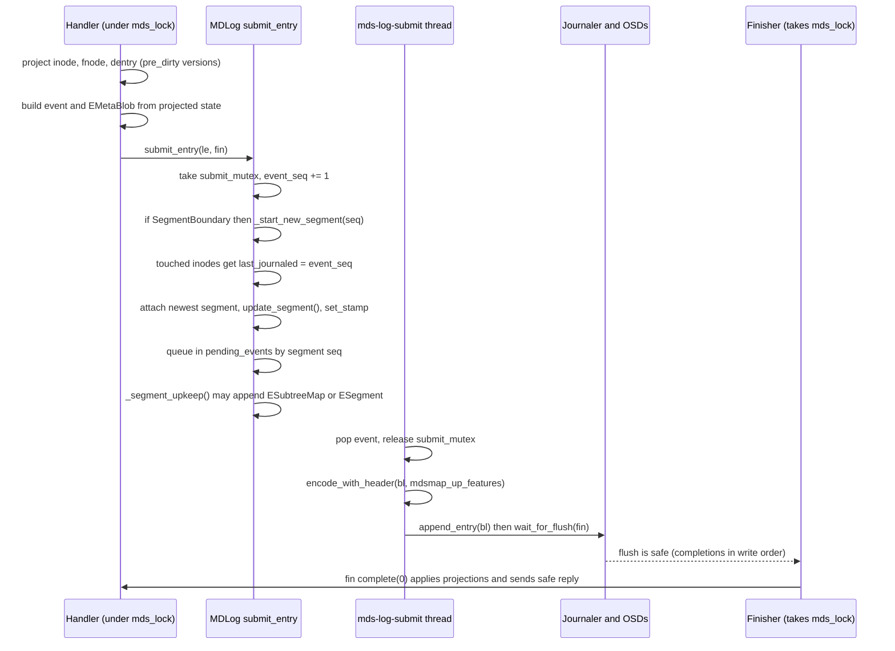
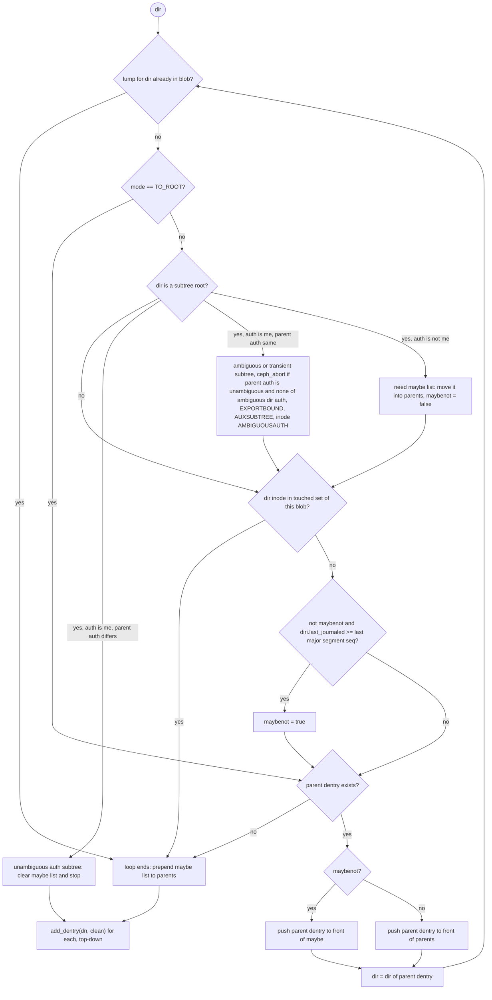
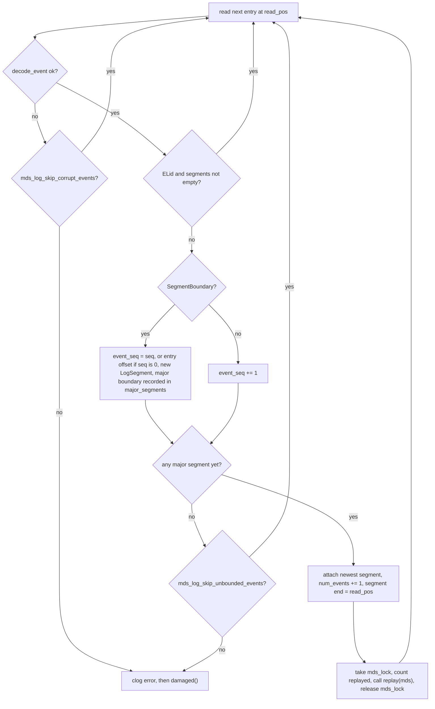
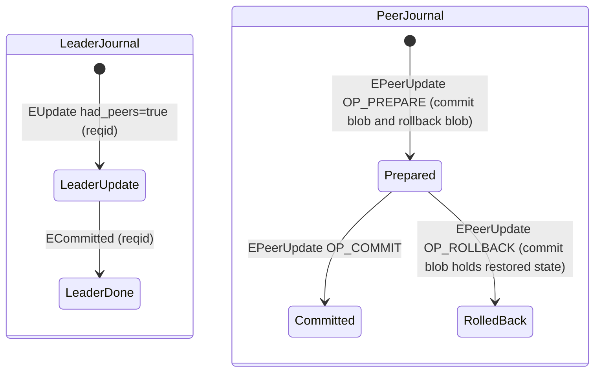
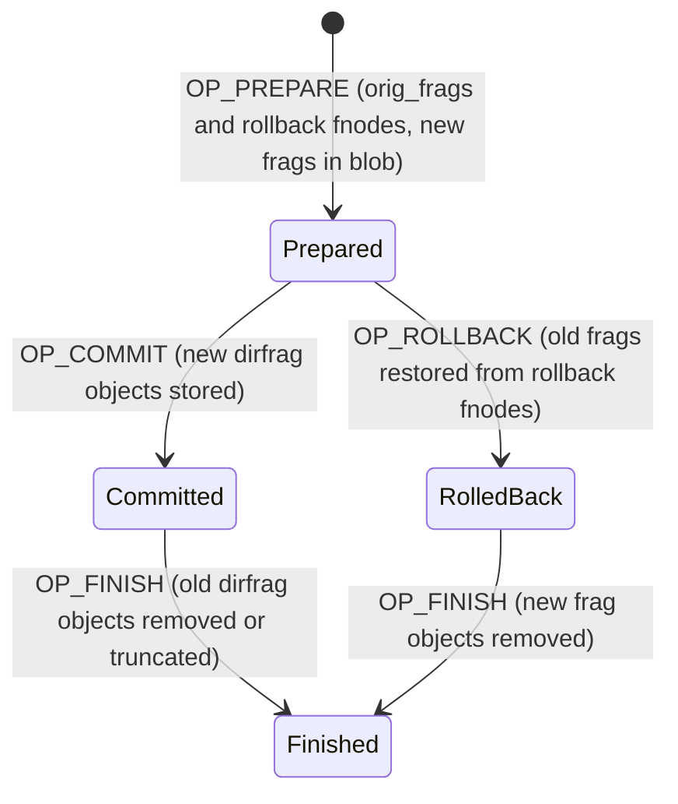
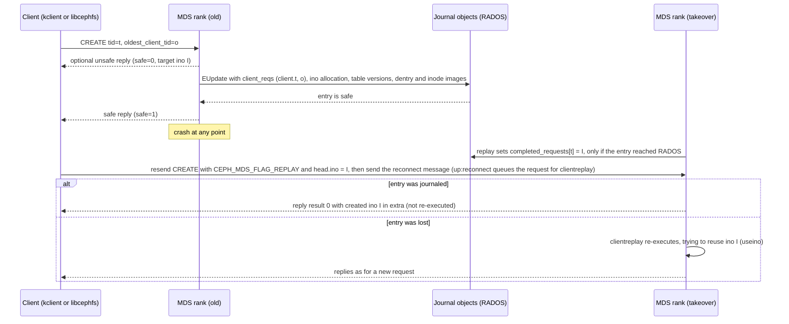

# Journal events and replay

> Part of the [C++ MDS project map](../README.md). Sources (commit `5f7e383ae6d`): `src/mds/LogEvent.h` (138 LOC), `src/mds/LogEvent.cc` (231), `src/mds/events/*.h` (19 headers, ~1,700), `src/mds/journal.cc` (3,517: `LogSegment::try_to_expire`, all `EMetaBlob` code, every event's `encode`/`decode`/`update_segment`/`replay`), `src/mds/SegmentBoundary.h`, `src/mds/LogSegment.h`; followed into `src/mds/MDLog.cc` (submit path 374-467, submit thread 491-582, replay thread 1417-1613), `src/mds/MDCache.cc` (`create_subtree_map`, `predirty_journal_parents`, `journal_cow_dentry`, `journal_dirty_inode`, uncommitted leader/peer/fragment helpers, ambiguous imports, truncate/purge restart), `src/mds/Server.cc` / `Locker.cc` / `Migrator.cc` / `StrayManager.cc` / `CInode.cc` (event emitters), `src/mds/MDSTableClient.cc`, `MDSTableServer.cc`, `SessionMap.cc`, `InoTable.cc` (replay helpers), `src/tools/cephfs/{Resetter,JournalTool}.cc`. Kernel client: `linux/fs/ceph/mds_client.c`, `linux/fs/ceph/caps.c`.
>
> Related: [MDLog and Journaler](mdlog-and-journaler.md), [process and threading](../00-architecture/process-and-threading.md), [mds_lock analysis](../00-architecture/mds_lock-analysis.md), [request lifecycle](../03-request-path/request-lifecycle.md), [namespace mutations](../03-request-path/namespace-mutations.md), [rename](../03-request-path/rename.md), [sessions](../02-client-protocol/sessions.md), [capabilities](../02-client-protocol/capabilities.md), [CInode and inode types](../04-cache/cinode-and-inode-types.md), [CDir/CDentry and cache objects](../04-cache/cdir-cdentry-and-cache-objects.md), [subtrees, traversal, replication](../04-cache/mdcache-subtrees-traversal-replication.md), [dirfrags and fragmentation](../04-cache/dirfrags-and-fragmentation.md), [lock state machines](../05-locking/lock-types-and-state-machines.md), [MDS tables](../07-storage-formats/mds-tables.md), [RADOS object catalog](../07-storage-formats/rados-object-catalog.md), [subtree migration](../08-multi-mds/subtree-migration.md), [rank lifecycle and recovery](../09-recovery/rank-lifecycle-and-recovery.md), [resolve and rejoin](../09-recovery/resolve-and-rejoin.md), [snapshots](../10-snapshots-quotas-subvolumes/snapshots.md), [rstats, quotas, subvolumes](../10-snapshots-quotas-subvolumes/rstats-quotas-and-subvolumes.md), [strays and purge](../11-background-services/strays-and-purge.md), [config, perf counters, health](../13-admin-and-config/config-perf-counters-and-health.md).

## 1. Purpose and responsibilities

The event layer defines *what* the MDS writes into its per-rank metadata journal and *how* each record is applied again after a crash. [MDLog and Journaler](mdlog-and-journaler.md) covers the transport (entry framing, objects, segment trimming); this page covers the payload.

Responsibilities in scope:

- **Event model.** `LogEvent` is the abstract base for 20 decodable event type ids, implemented by 18 classes. It holds the type id, the versioned envelope (`encode_with_header`), the type-to-class decode dispatch, two virtual hooks (`update_segment()` for live bookkeeping and `replay()` for recovery), and the link to the owning `LogSegment` (src/mds/LogEvent.h:66-136 (LogEvent)).
- **EMetaBlob.** This is the after-image container that almost every metadata mutation embeds. It holds per-dirfrag "lumps" with the new `fnode_t`, full images of every modified dentry+inode (`fullbit`), remote links (`remotebit`), null dentries (`nullbit`), base-inode images (`roots`), allocation and table versions, client request ids for idempotency, truncate start/finish markers, destroyed inodes, and rename subtree hints (src/mds/events/EMetaBlob.h:50-609 (EMetaBlob)).
- **Path context.** `EMetaBlob::add_dir_context` decides which ancestor dentries must also be journaled so that replay can attach a dirfrag to the hierarchy (src/mds/journal.cc:390 (EMetaBlob::add_dir_context)).
- **Segment bookkeeping.** Each event registers in its `LogSegment` whatever must happen before that segment can be expired. Examples are table versions to persist, uncommitted 2PC operations to wait for, and dirty objects to write back (`update_segment()` overrides plus `_mark_dirty(ls)` calls). Expiry is `LogSegment::try_to_expire` (src/mds/journal.cc:127 (LogSegment::try_to_expire)).
- **Replay.** Replay rebuilds the in-memory cache, subtree map, session map, InoTable, SnapServer table, open-file lists, recovery queues (truncates, purges) and the sets of uncommitted multi-step operations. The resolve/rejoin phases and the post-recovery tasks then finish those operations (src/mds/journal.cc:1239 (EMetaBlob::replay) and each `E*::replay`).

Key properties, verified in code:

1. **There is one totally ordered stream per rank.** Every event of a rank goes into the same journal in `submit_entry` order. Replay applies events strictly in journal order, one at a time, under `mds_lock` (src/mds/MDLog.cc:1577-1584 (MDLog::_replay_thread)).
2. **Namespace changes are logged as after-images; tables are logged as versioned operations.** `EMetaBlob` stores full new images of dirfrag fnodes, dentries and inodes. Replay installs them without version comparison, so the last image wins. InoTable, SessionMap and SnapServer changes are journaled as operations that carry the resulting table version. Replay applies an operation only if the loaded table is older than that version (`ESession` and `ETableServer` require exactly the next version; `EMetaBlob` allocations force-repair a shortfall; section 3.6.3).
3. **Replay never writes metadata to RADOS.** It only rebuilds memory state and marks objects dirty in the replayed segments. Write-back happens later through normal segment expiry. Data-object side effects are only re-queued during replay and restart once the rank leaves replay: fragment cleanup and rollback at resolve or reconnect start through `reopen_log` (src/mds/MDSRank.cc:1970-1974 (MDSRank::reopen_log)), truncates and delegated-ino purges in `recovery_done` (src/mds/MDSRank.cc:2166-2179 (MDSRank::recovery_done)).

## 2. Source map

| File | Class / function | Lines | Role |
|---|---|---|---|
| `src/mds/LogEvent.h` | `EVENT_*` constants, `LogEvent` | 19-136 | Type ids; base class; `encode_with_header`; `update_segment`/`replay` hooks; `get_metablob` |
| `src/mds/LogEvent.cc` | `LogEvent::decode_event` (2 overloads), `get_type_str`, `types`, `str_to_type` | 51-231 | Envelope decode, type to class factory, names for tools |
| `src/mds/SegmentBoundary.h` | `SegmentBoundary` | 21-41 | Mixin carrying `seq`; `is_major_segment_boundary()` |
| `src/mds/LogSegment.h` | `LogSegment` | 45-100 | Per-segment dirty lists and recovery sets that events populate |
| `src/mds/events/EMetaBlob.h` | `EMetaBlob`, `fullbit`, `remotebit`, `nullbit`, `dirlump`, `add_*` builders | 50-609 | Metadata after-image container |
| `src/mds/events/E*.h` | `ESubtreeMap`, `EExport`, `EImportStart`, `EImportFinish`, `EFragment` (+`dirfrag_rollback`), `EResetJournal`, `ESession`, `ESessions`, `EUpdate`, `EPeerUpdate` (+`link_rollback`, `rmdir_rollback`, `rename_rollback`), `EOpen`, `ECommitted`, `EPurged`, `ETableClient`, `ETableServer`, `ENoOp`, `ESegment`, `ELid` | per file | Event payload definitions |
| `src/mds/journal.cc` | `LogSegment::try_to_expire` | 127-378 | Segment expiry driven by event bookkeeping |
| `src/mds/journal.cc` | `EMetaBlob::add_dir_context`, `update_segment` | 390-502 | Path-context selection; table versions into segment |
| `src/mds/journal.cc` | `fullbit`/`remotebit`/`nullbit`/`dirlump`/`EMetaBlob` `encode`/`decode`; `fullbit::update_inode` | 506-990 | On-journal format and inode image install |
| `src/mds/journal.cc` | `EMetaBlob::get_inodes`, `get_dentries`, `get_paths`, `dump` | 997-1230 | Used by `cephfs-journal-tool` filters/output |
| `src/mds/journal.cc` | `EMetaBlob::replay` | 1239-1817 | Cache reconstruction from one blob |
| `src/mds/journal.cc` | `EPurged`, `ESession`, `ESessions`, `ETableServer`, `ETableClient`, `EUpdate`, `EOpen`, `ECommitted`, rollback structs, `EPeerUpdate`, `ESubtreeMap`, `EFragment`, `EExport`, `EImportStart`, `EImportFinish`, `EResetJournal`, `ESegment`, `ELid`, `ENoOp` | 1821-3480 | Per-event codec and replay |
| `src/mds/journal.cc` | `EMetaBlob::rewrite_truncate_finish` | 3495-3516 | Seq remap during journal reformat |
| `src/mds/MDLog.cc` | `_start_new_segment`, `_submit_entry`, `_segment_upkeep`, `_submit_thread`, `_replay_thread` | 374-582, 1417-1613 | Live registration and replay loop (detail in [MDLog page](mdlog-and-journaler.md)) |
| `src/mds/MDCache.cc` | `create_subtree_map` | 2624-2771 | Builds `ESubtreeMap` |
| `src/mds/MDCache.cc` | `journal_cow_dentry`, `journal_dirty_inode`, `predirty_journal_parents` | 1679-1834, 2224-2488 | Main producers of `EMetaBlob` content |
| `src/mds/MDCache.cc` | `log_leader_commit`, `_logged_leader_commit`, `committed_leader_peer`, `logged_leader_update`, `finish_committed_leaders`, `add_uncommitted_peer`, `finish_uncommitted_peer`, `handle_resolve`, `handle_resolve_ack` | 2512-2568, 3257-3640 | 2PC record lifecycle |
| `src/mds/MDCache.cc` | `add_ambiguous_import`, `cancel_ambiguous_import`, `finish_ambiguous_import`, `disambiguate_my_imports` | 3695-3801 | Import records |
| `src/mds/MDCache.cc` | `add_uncommitted_fragment`, `finish_uncommitted_fragment`, `rollback_uncommitted_fragment(s)` | 12710-12870 | Fragment records |
| `src/mds/MDCache.cc` | `add_recovered_truncate`, `remove_recovered_truncate`, `start_recovered_truncates`, `start_purge_inodes`, `purge_inodes`, `standby_trim_segment` | 6828-6930, 7644-7683 | Recovery queues rebuilt by replay |
| `src/mds/SessionMap.cc` | `replay_dirty_session`, `replay_advance_version`, `replay_open_sessions`, `wipe` | 728-886 | Session replay helpers |
| `src/mds/InoTable.cc` | `replay_alloc_id`, `replay_alloc_ids`, `replay_release_ids`, `replay_reset` | 103-148 | InoTable replay helpers |
| `src/mds/MDSTableClient.cc` | `got_journaled_agree`, `got_journaled_ack`, `resend_commits` | 215-238 | Table-client replay helpers |
| `src/tools/cephfs/Resetter.cc` | `Resetter::reset`, `reset_hard`, `_write_reset_event` | 77-226 | `journal reset`: new head past the old end, then `EResetJournal` |
| `src/tools/cephfs/JournalTool.cc` | `main_event`, `recover_dentries` (consumes `EMetaBlob`), `erase_region` (writes `ENoOp`) | 419-677, 797-1195, 1202-1275 | Offline tooling over events (the only offline tool that decodes events; `cephfs-data-scan` never reads the journal) |

## 3. How it works

### 3.1 Entry envelope and type dispatch

Every event is serialized by `LogEvent::encode_with_header` (src/mds/LogEvent.h:94-101 (LogEvent::encode_with_header)) and appended as one Journaler entry. The Journaler frames it (format `JOURNAL_FORMAT_RESILIENT`, src/osdc/Journaler.cc:1570 (JournalStream::write)):

| Bytes | Field | Producer |
|---|---|---|
| u64 | sentinel `0x3141592653589793` | Journaler (resilient format only) |
| u32 | entry length | Journaler |
| u32 | `EVENT_NEW_ENCODING` (= 0) | `encode_with_header` |
| u8, u8, u32 | `ENCODE_START(1,1)` header (struct_v, compat, length) | `encode_with_header` |
| u32 | event type id (`EVENT_*`) | `encode_with_header` |
| ... | event body, itself versioned with `ENCODE_START(v,compat)` (exceptions: `EVENT_SESSIONS_OLD` body is unversioned) | `E*::encode(bl, features)` |
| u64 | entry start offset | Journaler (resilient format only) |

Decode: `LogEvent::decode_event(p)` reads a u32. If it is 0, it opens the versioned envelope and reads the real type. Otherwise the u32 is the type of a legacy "classic" entry with no envelope (src/mds/LogEvent.cc:51-74 (LogEvent::decode_event)). The type switch builds the class (`EVENT_SUBTREEMAP_TEST` becomes an `ESubtreeMap` with its type overridden, and `EVENT_SESSIONS_OLD` becomes an `ESessions` with `mark_old_encoding()`), then calls `decode()`. An unknown type or a `buffer::error` returns `nullptr` (src/mds/LogEvent.cc:141-224 (LogEvent::decode_event)). After a successful decode, `ceph_assert(p.end())` requires that the event consumed the whole entry (src/mds/LogEvent.cc:228 (LogEvent::decode_event)).

Encoding uses `features = mdsmap_up_features`. `_submit_entry` refreshes that member from the MDSMap on every submission, and the submit thread reads it when it pops an event (src/mds/MDLog.cc:430, 514 (MDLog::_submit_entry, MDLog::_submit_thread)). Embedded `entity_inst_t`/`entity_addr_t` encodings therefore follow the feature set of the up MDS daemons.

### 3.2 Event catalogue

Identity, encoding and contents. Field order matches the encoder.

| Id | Constant / class | Enc (v, compat) | Body (in encode order) | Segment boundary |
|---|---|---|---|---|
| 0 | `EVENT_NEW_ENCODING` | n/a | envelope marker only | n/a |
| 1 | `EVENT_UNUSED` (was `EVENT_STRING`) | n/a | rejected by `decode_event` (unknown type) | n/a |
| 2 | `EVENT_SUBTREEMAP` / `ESubtreeMap` | (6,5) | `stamp`, `metablob`, `subtrees` (`map<dirfrag_t, vector<dirfrag_t>>` root to bounds), `ambiguous_subtrees` (`set<dirfrag_t>`, v>=4), `expire_pos` (u64, v>=3), `seq` (v>=6) | **major** |
| 3 | `EVENT_EXPORT` / `EExport` | (4,3), decoder declares 3 | `stamp`, `metablob`, `base` dirfrag, `bounds` (`set<dirfrag_t>`), `target` rank (v>=4) | no |
| 4 | `EVENT_IMPORTSTART` / `EImportStart` | (4,3), decoder declares 3 | `stamp`, `base`, `metablob`, `bounds` (`vector<dirfrag_t>`), `cmapv`, `client_map` (bufferlist = encoded `map<client_t,entity_inst_t>` + `map<client_t,client_metadata_t>`), `from` rank (v>=4) | no |
| 5 | `EVENT_IMPORTFINISH` / `EImportFinish` | (3,3) | `stamp`, `base`, `success` (bool) | no |
| 6 | `EVENT_FRAGMENT` / `EFragment` | (5,4) | `stamp`, `op` (u8: 1 PREPARE, 2 COMMIT, 3 ROLLBACK, 4 FINISH), `ino`, `basefrag`, `bits` (s32; >0 split, <0 merge), `metablob`, `orig_frags` (v>=5), `rollback` (bufferlist, v>=5: in PREPARE one `dirfrag_rollback{fnode}` (1,1) per orig frag; ROLLBACK lists `orig_frags` with an empty `rollback`; COMMIT/FINISH carry neither) | no |
| 9 | `EVENT_RESETJOURNAL` / `EResetJournal` | (2,2) | `stamp` (no `seq`) | **major** |
| 10 | `EVENT_SESSION` / `ESession` | (7,5) | `stamp`, `client_inst`, `open` (bool), `cmapv`, `inos_to_free` (interval_set), `inotablev`, `client_metadata` (v>=5; v4 = bare kv map), `inos_to_purge` (v>=6), `auth_name` (`EntityName`, v>=7) | no |
| 11 | `EVENT_SESSIONS_OLD` / `ESessions` | unversioned | `client_map`, `cmapv`, optional `stamp` (decode only) | no |
| 12 | `EVENT_SESSIONS` / `ESessions` | (2,1) | `client_map` (`map<client_t,entity_inst_t>`), `cmapv`, `stamp`, `client_metadata_map` (v>=2) | no |
| 20 | `EVENT_UPDATE` / `EUpdate` | (4,4) | `stamp`, `type` (string label), `metablob`, `client_map` (bufferlist), `cmapv` (v>=3), `reqid` (`metareqid_t`), `had_peers` (bool) | no |
| 21 | `EVENT_PEERUPDATE` / `EPeerUpdate` | (3,3) | `stamp`, `type` (string), `reqid`, `leader` rank, `op` (u8: 1 PREPARE, 2 COMMIT, 3 ROLLBACK), `origop` (u8: 1 LINK, 2 RENAME, 3 RMDIR), `commit` (EMetaBlob), `rollback` (bufferlist: `link_rollback`, `rmdir_rollback` or `rename_rollback`) | no |
| 22 | `EVENT_OPEN` / `EOpen` | (4,3), decoder declares 3 | `stamp`, `metablob`, `inos` (`vector<inodeno_t>`), `snap_inos` (`vector<vinodeno_t>`, v>=4) | no |
| 23 | `EVENT_COMMITTED` / `ECommitted` | (3,3) | `stamp`, `reqid` | no |
| 24 | `EVENT_PURGED` / `EPurged` | (1,1) | `inos` (interval_set), `inotablev`, `seq` (segment that queued the purge) | no |
| 42 | `EVENT_TABLECLIENT` / `ETableClient` | (3,3) | `stamp`, `table` (u16: 0 `TABLE_ANCHOR`, 1 `TABLE_SNAP`), `op` (s16; only `TABLESERVER_OP_ACK` = -6 is emitted), `tid` | no |
| 43 | `EVENT_TABLESERVER` / `ETableServer` | (3,3) | `stamp`, `table`, `op` (3 PREPARE, 5 COMMIT, 7 ROLLBACK, 8 SERVER_UPDATE), `reqid` (u64), `bymds`, `mutation` (bufferlist), `tid`, `version` | no |
| 50 | `EVENT_SUBTREEMAP_TEST` / `ESubtreeMap` | (6,5) | same as id 2 | **major** (class-based, see section 8) |
| 51 | `EVENT_NOOP` / `ENoOp` | (2,2) | `pad_size` (u32) followed by `pad_size` bytes of `0xff`; decode throws unless exactly `pad_size` bytes remain | no |
| 100 | `EVENT_SEGMENT` / `ESegment` | (1,1) | `seq` | minor |
| 101 | `EVENT_LID` / `ELid` | (1,1) | `seq` | **major** |

Emitters, replay effect and segment bookkeeping. "Live bookkeeping" covers what `update_segment()` sets at submit, plus side registrations made by the emitter.

| Event | Emitted by (src/mds unless noted) | Replay effect | Live bookkeeping |
|---|---|---|---|
| `ESubtreeMap` | `MDLog::_segment_upkeep` (new major segment, MDLog.cc:450-453 (MDLog::_segment_upkeep); as `SUBTREEMAP_TEST`, 458-465); `MDSRank::boot_start` up:starting (MDSRank.cc:1726 (MDSRank::boot_start)); `MDSRank::boot_create` (2241); `C_Flush_Journal::flush_mdlog` (asok `flush journal`, MDSRank.cc:118 (C_Flush_Journal::flush_mdlog)); `MDCache::shutdown_pass` (8127) | Advance journaler `expire_pos` if larger. If the cache has no subtrees: replay `metablob`, call `adjust_bounded_subtree_auth` for every subtree (ambiguous ones get `(me,me)` and an `add_ambiguous_import`), then `recalc_auth_bits(true)`. Otherwise only verify against the cache, without replaying the metablob (clog errors, then `ceph_assert` on any error, see section 8) (journal.cc:2847 (ESubtreeMap::replay)) | Starts a major segment (MDLog); no `update_segment` |
| `ESegment` | `MDLog::_segment_upkeep` when `ls->num_events >= mds_log_events_per_segment` or the segment crosses a journal layout period (MDLog.cc:454-457 (MDLog::_segment_upkeep)) | None (`dout` only, journal.cc:3402 (ESegment::replay)); MDLog opens a minor segment | Starts a minor segment |
| `ELid` | `MDSRank::boot_create` (fresh rank, before the first subtree map, MDSRank.cc:2205 (MDSRank::boot_create)); `MDCache::shutdown_pass` (caps the log, MDCache.cc:8183 (MDCache::shutdown_pass)) | None (journal.cc:3433 (ELid::replay)). It opens a major segment only if it is the first event; later `ELid` entries are skipped entirely (MDLog.cc:1522-1530 (MDLog::_replay_thread)) | Starts a major segment |
| `EResetJournal` | `cephfs-journal-tool journal reset` (tools/cephfs/Resetter.cc `_write_reset_event`) | `sessionmap.wipe()`; `inotable->replay_reset()` (skips 10,000,000 inos); the root rank claims root dirfrag `frag_t()`; claims own mdsdir dirfrag; `recalc_auth_bits(true)` (journal.cc:3368 (EResetJournal::replay)) | Starts a major segment; `seq` not encoded, so the segment seq becomes the journal offset |
| `ENoOp` | `cephfs-journal-tool` `erase_region` (tools/cephfs/JournalTool.cc:1202 (JournalTool::erase_region)) | None (journal.cc:3477 (ENoOp::replay)) | none |
| `EUpdate` | Request handlers and internal mutations, labelled by `type`: `openc`, `setattr`, `open_truncate`, `setlayout`, `set vxattr layout`, `setxattr`, `removexattr`, `mknod`, `mkdir`, `symlink`, `link_local`, `link_remote`, `unlink_remote`, `unlink_local`, `rename`, `mksnap`, `rmsnap`, `renamesnap`, `snap_metadata_op`, `quarantine flag <op>` (Server.cc); `check_inode_max_size`, `snap flush`, `cap update`, `scatter_writebehind` (Locker.cc); `lock ifile/inest accounted scatter stat update` (CInode.cc:2564 (CInode::finish_scatter_update)); `purge_stray`, `purge_stray truncate` (StrayManager.cc); `create system file`, `queue_file_recover cow`, `truncate finish`, `uninline`, `repair_dirfrag` (MDCache.cc) | `metablob.replay`; if `had_peers`: add to `segment->uncommitted_leaders` and `mdcache->add_uncommitted_leader(reqid, seg, {}, safe=true)`; if `client_map` is non-empty and the session map version is below `cmapv`: `replay_open_sessions` (journal.cc:2339 (EUpdate::replay)) | `metablob.update_segment` (inotablev, sessionmapv); `sessionmapv = cmapv` if `client_map`; `uncommitted_leaders.insert(reqid)` if `had_peers` (journal.cc:2327 (EUpdate::update_segment)) |
| `EPeerUpdate` | `handle_peer_link_prep`/`_commit_peer_link`/`do_link_rollback`, `handle_peer_rmdir_prep`/`_commit_peer_rmdir`/`do_rmdir_rollback`, `handle_peer_rename_prep`/`_commit_peer_rename`/`do_rename_rollback` (Server.cc); `MDCache::handle_resolve_ack` (`"unknown"` OP_COMMIT, MDCache.cc:3505 (MDCache::handle_resolve_ack)) | PREPARE: replay `commit` blob with a new `MDPeerUpdate(origop, rollback)` and `add_uncommitted_peer`. COMMIT: `finish_uncommitted_peer(reqid, false)`. ROLLBACK: replay `commit` blob (it holds the rolled-back state), then `finish_uncommitted_peer` (journal.cc:2747 (EPeerUpdate::replay)) | none in `update_segment`; `add_uncommitted_peer(reqid, mdr->ls, leader)` adds to `ls->uncommitted_peers` before PREPARE is submitted (Server.cc:8342, 9014, 10752 (Server::handle_peer_link_prep, Server::handle_peer_rmdir_prep, Server::handle_peer_rename_prep)) |
| `ECommitted` | `MDCache::log_leader_commit` (MDCache.cc:2512 (MDCache::log_leader_commit)) | If the leader op was seen: remove it from its segment's `uncommitted_leaders` and from `mdcache->uncommitted_leaders`; else ignore (journal.cc:2453 (ECommitted::replay)) | none; `_logged_leader_commit` clears it live |
| `EOpen` | `Server::handle_client_open` (Server.cc:4807 (Server::handle_client_open)); `Locker::adjust_cap_wanted` (3281); `Locker::check_inode_max_size`, which uses an EOpen instead of an EUpdate when caps are wanted (3162); `LogSegment::try_to_expire` re-journals snap inodes still needing snapflush (journal.cc:233 (LogSegment::try_to_expire)) | `metablob.replay`, then push every `inos`/`snap_inos` inode onto `segment->open_files` (asserts each one is in cache) (journal.cc:2424 (EOpen::replay)) | none (`update_segment` is empty) |
| `ESession` | `Server::handle_client_session` `REQUEST_OPEN` (Server.cc:822 (Server::handle_client_session)); `Server::journal_close_session` (close/kill/evict, Server.cc:1547 (Server::journal_close_session)) | `inos_to_purge` goes into `segment->purging_inodes` unconditionally. Session-map gating applies (section 3.6.3); open: `get_or_add_session`, state OPEN, metadata, `auth_name`; close: remove the session, or `clear()` it if a connection is attached. `inos_to_free` goes to `inotable->replay_release_ids`, gated by `inotablev` (journal.cc:1883 (ESession::replay)) | `sessionmapv = cmapv`; `inotablev` when `inos_to_free` is non-empty (journal.cc:1876 (ESession::update_segment)) |
| `ESessions` | `Migrator::handle_export_caps` (Migrator.cc:3898 (Migrator::handle_export_caps)); `MDCache::process_imported_caps` (rejoin force-open, MDCache.cc:5556 (MDCache::process_imported_caps)) | `replay_open_sessions(cmapv, ...)` if the session map version is below `cmapv` (journal.cc:2069 (ESessions::replay)) | `sessionmapv = cmapv` |
| `EImportStart` | `Migrator::handle_export_dir` (Migrator.cc:2856 (Migrator::handle_export_dir)) | `metablob.replay`; `add_ambiguous_import(base, bounds)`; clear AUTH on bounds that are not subtree roots; `adjust_bounded_subtree_auth(dir, bounds, (me,me))`; `replay_open_sessions` if the version is below `cmapv` (journal.cc:3185 (EImportStart::replay)) | `sessionmapv = cmapv` only; live `update_segment` does not call `metablob.update_segment` (import blobs carry no ino-allocation versions; at replay `EMetaBlob::replay` calls it anyway) |
| `EImportFinish` | `Migrator::import_finish` (true, Migrator.cc:3318 (Migrator::import_finish)); `Migrator::import_reverse` (false, 3099); `MDCache::disambiguate_my_imports` (both, MDCache.cc:3718/3730 (MDCache::disambiguate_my_imports)) | Requires a pending ambiguous import. success: `finish_ambiguous_import`; failure: auth `CDIR_AUTH_UNDEF`, `cancel_ambiguous_import`, `try_trim_non_auth_subtree`. No pending import: clog error and `damaged()` (journal.cc:3279 (EImportFinish::replay)) | none |
| `EExport` | `Migrator::handle_export_ack`, after the importer acks (Migrator.cc:2079 (Migrator::handle_export_ack)) | `metablob.replay`; `adjust_bounded_subtree_auth(dir, bounds, CDIR_AUTH_UNDEF)`; `try_trim_non_auth_subtree` (journal.cc:3106 (EExport::replay)) | none |
| `EFragment` | `MDCache::dispatch_fragment_dir` (PREPARE, 12353); `_fragment_stored` (COMMIT, 12501); `_fragment_old_purged` (FINISH, 12577); `rollback_uncommitted_fragments` (ROLLBACK, 12797) | See section 3.6.6 (journal.cc:2978 (EFragment::replay)) | `add_uncommitted_fragment(..., mdr->ls)` inserts into `ls->uncommitted_fragments` at PREPARE (MDCache.cc:12407 (MDCache::dispatch_fragment_dir)) |
| `ETableServer` | `MDSTableServer::handle_prepare`, `handle_commit`, `handle_rollback`, `do_server_update` (MDSTableServer.cc:111-303 (MDSTableServer::handle_prepare through do_server_update)); only on the table-server rank (`TABLE_SNAP`) | Skip if `server->get_version() >= version`; else assert `version-1 == server->get_version()` and apply `_note_prepare+_prepare` / `_commit+_note_commit` / `_rollback+_note_rollback` / `_server_update+_note_server_update` with `replay=true`; unknown op leads to `damaged()` (journal.cc:2138 (ETableServer::replay)) | `tablev[table] = version` (journal.cc:2133 (ETableServer::update_segment)) |
| `ETableClient` | `MDSTableClient::handle_request` on `TABLESERVER_OP_ACK` (MDSTableClient.cc:126 (MDSTableClient::handle_request)) | Assert op is ACK; `client->got_journaled_ack(tid)` drops the pending commit (journal.cc:2226 (ETableClient::replay)) | none; live ACK handling erased `pending_commit_tids` before submit |
| `EPurged` | `MDCache::purge_inodes` completion (MDCache.cc:6913 (MDCache::purge_inodes)) | Subtract `inos` from `get_segment(seq)->purging_inodes` if that segment still exists; `inotable->replay_release_ids(inos)` if the table version is below `inotablev` (journal.cc:1828 (EPurged::replay)) | `inotablev` (journal.cc:1821 (EPurged::update_segment)) |

### 3.3 Live path: building and registering an event

Facts behind the diagram:

- `_submit_entry` asserts `mds_lock` and `submit_mutex` are held, that the rank is not in any replay state, and that the log is not capped (`mds_is_shutting_down`). No event can be journaled during replay (src/mds/MDLog.cc:393-399 (MDLog::_submit_entry)).
- A `SegmentBoundary` event (`ESubtreeMap`, `ESegment`, `ELid`, `EResetJournal`) creates a new `LogSegment` keyed by the new `event_seq` before registration, so the boundary is the first event of its own segment (src/mds/MDLog.cc:403-412 (MDLog::_submit_entry)). `_segment_upkeep` runs *after* the event that triggered it, so the triggering event stays in the old segment (src/mds/MDLog.h:147-153 (MDLog::submit_entry); src/mds/MDLog.cc:443-466 (MDLog::_segment_upkeep)).
- `last_journaled` is set on every inode listed in `EMetaBlob::touched`, the set of inodes added via `add_primary_dentry`/`add_root` (src/mds/MDLog.cc:414-419 (MDLog::_submit_entry)). `add_dir_context` and `OpenFileTable::should_log_open` read it.
- The submit thread encodes the event without `mds_lock`. This is safe because an `EMetaBlob` holds only immutable snapshots (`CInode::inode_const_ptr`, `xattr_map_const_ptr`, `old_inode_map_const_ptr`, `CDir::fnode_const_ptr`) plus owned strings and bufferlists (src/mds/events/EMetaBlob.h:70-81, 212 (EMetaBlob::fullbit, EMetaBlob::dirlump)). The live object can keep changing after submission.
- Completion contexts (`MDSLogContextBase`) re-take `mds_lock` in `MDSIOContextBase::complete` (src/mds/MDSContext.cc:95-130 (MDSIOContextBase::complete, MDSLogContextBase::complete)). For a client request they apply the projected state and send the safe reply.

### 3.4 EMetaBlob in detail

#### 3.4.1 Top-level fields (encode order, `ENCODE_START(8, 5)`, src/mds/journal.cc:903-938 (EMetaBlob::encode))

| # | Field | Type | Meaning | Set by |
|---|---|---|---|---|
| 1 | `lump_order` | `vector<dirfrag_t>` | Insertion order of dirlumps. Replay iterates in this order | `add_dir` (first insertion only) |
| 2 | `lump_map` | `map<dirfrag_t, dirlump>` | Per-dirfrag lump (fnode + dentry bits) | `add_dir*`, `add_*_dentry` |
| 3 | `roots` | `list<fullbit>` | Images of base inodes (root, `~mdsN`); de-duplicated by ino | `add_root` (from `journal_dirty_inode` for base inodes, `MDCache::_create_system_file`) |
| 4 | `table_tids` | `vector<pair<u8 table, version_t tid>>` | Table-client transactions whose AGREE is journaled with this update | `add_table_transaction` (`mksnap`, `rmsnap`, `renamesnap`, `snap_metadata_op` with `TABLE_SNAP`) |
| 5 | `opened_ino` | `inodeno_t` | Inode that must go on the segment's open-file list | `add_opened_ino` (`openc`, `mkdir`, `open_truncate`) |
| 6 | `allocated_ino` | `inodeno_t` | Ino taken from InoTable | `set_ino_alloc` via `Server::journal_allocated_inos` (Server.cc:3767 (Server::journal_allocated_inos)), called only by `openc`, `mknod`, `mkdir` and `symlink` (Server.cc:5030, 7675, 7761, 7846) |
| 7 | `used_preallocated_ino` | `inodeno_t` | Ino taken from the session's preallocated set | same |
| 8 | `preallocated_inos` | `interval_set<inodeno_t>` | New batch preallocated to the session (refill below `mds_client_prealloc_inos/2`) | same |
| 9 | `client_name` | `entity_name_t` | Session the prealloc applies to | same |
| 10 | `inotablev`, `sessionmapv` | `version_t` x2 | InoTable / SessionMap *projected* versions after this update | same |
| 11 | `truncate_start` | `vector<inodeno_t>` | Inodes whose data truncation starts with this update | `add_truncate_start` (`setattr`, `open_truncate`) |
| 12 | `truncate_finish` | `map<inodeno_t, seq_t>` | Inode to seq of the segment where its truncate started | `add_truncate_finish` (`MDCache::truncate_inode_finish`) |
| 13 | `destroyed_inodes` | `vector<inodeno_t>` | Inodes deleted for good (stray purge) | `add_destroyed_inode` (`StrayManager::_purge_stray_purged`) |
| 14 | `client_reqs` | `vector<pair<metareqid_t, u64 oldest_client_tid>>` | Client request ids completed by this update (idempotency) | `add_client_req` (every client request journaled through an `EUpdate`; opens journaled as `EOpen` and internal mutations such as `quarantine flag` updates carry none) |
| 15 | `renamed_dirino` | `inodeno_t` (v>=3) | Directory whose position in the hierarchy changes (rename source dir, overwritten dir moved to stray, unlinked dir) | `_rename_prepare`, `_unlink_local`, peer rmdir/rename paths |
| 16 | `renamed_dir_frags` | `vector<frag_t>` (v>=3) | Dirfrags of the renamed dir that are non-auth (child subtrees) and must be opened as bounds on replay | rename import paths (Server.cc:10049, 11281 (Server::_rename_prepare, Server::do_rename_rollback)) |
| 17 | legacy placeholder | `int64 -1`, `bool false` (v>=6) | Former `old_pool` / `update_bt`, removed in 2013; still written | constant |
| 18 | `client_flushes` | `vector<pair<metareqid_t, u64 oldest_flush_tid>>` (v>=8) | Cap-flush ids completed by this update | `add_client_flush` (Locker `cap update`, `snap flush`) when the client sends a non-zero `oldest_flush_tid` |

Not encoded: `touched` (`set<CInode*>`, soft state for `last_journaled`). `last_subtree_map` and `event_seq` were soft-state members until commit `f249dc13de8` (2022). They were replaced by `touched` plus `MDLog::get_last_major_segment_seq()`. The decoder still accepts v1-v7 (`roots` as a single bufferlist before v4, `client_reqs` without tids before v2) (src/mds/journal.cc:939-990 (EMetaBlob::decode)).

#### 3.4.2 Lumps and bits

| Struct | Enc | Encoded fields | State flags | Notes |
|---|---|---|---|---|
| `dirlump` | (2,2) | `fnode` (`fnode_t` (4,3): `version`, `snap_purged_thru`, `fragstat`, `accounted_fragstat`, `rstat`, `accounted_rstat`, `damage_flags`, scrub versions/stamps), `state`, `nfull`, `nremote`, `nnull`, `dnbl` (bufferlist holding `list<fullbit>`, `vector<remotebit>`, `vector<nullbit>`) | `STATE_COMPLETE` 1<<1, `STATE_DIRTY` 1<<2 (dirtied by *this* event), `STATE_NEW` 1<<3 (dirfrag object not yet in RADOS), `STATE_IMPORTING` 1<<4, `STATE_DIRTYDFT` 1<<5 (dirfragtree scatter dirty) | Bits are decoded lazily (`dn_decoded=false` after decode, `_decode_bits()` on demand) so tools can skip them (src/mds/events/EMetaBlob.h:289-304 (EMetaBlob::dirlump::_encode_bits, _decode_bits), src/mds/journal.cc:822-852 (EMetaBlob::dirlump::encode, EMetaBlob::dirlump::decode)) |
| `fullbit` | (9,5) | `dn`, `dnfirst`, `dnlast`, `dnv`, `inode` (`inode_t` (20,6)), xattr map (count 0 if none), `symlink` (symlinks only), `dirfragtree` + `snapbl` (dirs only), `state`, `bool` + `old_inodes`, `snapbl` (non-dirs), `oldest_snap`, `alternate_name` (v>=9) | `STATE_DIRTY` 1, `STATE_DIRTYPARENT` 2 (backtrace must be rewritten), `STATE_DIRTYPOOL` 4 (also update old pools), `STATE_NEED_SNAPFLUSH` 8, `STATE_EPHEMERAL_RANDOM` 16 | `snapbl` is an encoded `sr_t` (8,4) when the inode has a snaprealm. `DIRTYPARENT` is forced when DIRTY and `is_backtrace_updated()` (EMetaBlob.h:471-472 (EMetaBlob::add_primary_dentry)) |
| `remotebit` | (3,2) | `dn`, `dnfirst`, `dnlast`, `dnv`, `ino`, `d_type`, `dirty`, `alternate_name` (v>=3) | `dirty` bool | Hard-link (remote) dentry |
| `nullbit` | (2,2) | `dn`, `dnfirst`, `dnlast`, `dnv`, `dirty` | `dirty` bool | Negative/removed dentry; no alternate name |

Dentries are identified on replay by `(dir, name, dnlast)` (`CDir::lookup_exact_snap`), and inodes by `(ino, dnlast)` (`MDCache::get_inode(ino, last)`). Snapshotted (COW) copies therefore coexist with the head (`dnlast = CEPH_NOSNAP`).

#### 3.4.3 Builders and lump order

- `add_dir(dirfrag, fnode, dirty, complete, new, importing, dirty_dft)` creates or updates the lump. The lump keeps its *first* position in `lump_order`; each later call replaces the fnode pointer with the latest projected fnode and ORs in the flags (EMetaBlob.h:561-575 (EMetaBlob::add_dir)). Variants: `add_new_dir` (dirty+complete+new), `add_import_dir` (preserves the dir's dirty/complete/dirty_dft, sets importing), `add_fragmented_dir`.
- `add_primary_dentry(dn, in, dirty, dirty_parent, dirty_pool, need_snapflush)` snapshots the *projected* inode (`get_projected_inode`, `get_projected_xattrs`, `get_projected_srnode`) and the current `dirfragtree`, `symlink`, `old_inodes`, `oldest_snap`. It asserts `pi->version > 0` and inserts the inode into `touched` (EMetaBlob.h:448-489 (EMetaBlob::add_primary_dentry)).
- `add_remote_dentry` / `add_null_dentry` record `dn->get_projected_version()` and the projected linkage (EMetaBlob.h:418-445 (EMetaBlob::add_null_dentry, EMetaBlob::add_remote_dentry)). `add_dentry` dispatches on the projected linkage. `add_import_dentry` keeps the dentry's dirty state.
- Within one lump, replay processes all fullbits, then all remotebits, then all nullbits, regardless of insertion interleaving. The same dentry may appear twice (for example `Locker::check_inode_max_size` adds the primary dentry and then calls `journal_dirty_inode`); replay applies both and the last image wins.

`add_dir_context(dir, mode)` walks from `dir` toward the root and collects the parent dentries that must precede `dir`'s lump (src/mds/journal.cc:390-482 (EMetaBlob::add_dir_context)):

Meaning: below an unambiguously owned subtree root, ancestors of an inode that was already journaled since the last major boundary are optional ("maybe"). Replay starts at a major boundary, so it already has them, either from that earlier event or from the `ESubtreeMap` spanning tree. They are dropped only if the walk reaches such a root. A base dirfrag that this rank owns counts as one, because its missing parent gives `parent_auth = CDIR_AUTH_UNDEF`, which differs from `me`. Reaching a non-auth or ambiguous root, a lump already in the blob, or an inode already in the blob keeps them. `TO_ROOT` mode (used by `ESubtreeMap` for every root and bound, and by `EExport` for its base dirfrag only; the export bounds use the default mode) skips the subtree-root, `touched` and `last_journaled` tests and records the full path up to the base inode, stopping early only at a lump already in the blob. Context dentries are added clean (`dirty=false`).

**Lump-order invariant.** An ancestor's lump, which holds the fullbit that creates the child directory inode, always precedes the child dirfrag's lump. Replay needs this because `get_force_dirfrag` requires the directory inode in cache; otherwise the rank goes `damaged()` (src/mds/journal.cc:1291-1306 (EMetaBlob::replay)). Callers therefore always call `add_dir_context(d)` before `add_dir(d, ...)`, for example `predirty_journal_parents` (src/mds/MDCache.cc:2481-2483 (MDCache::predirty_journal_parents)).

#### 3.4.4 Who fills a typical blob

- `MDCache::predirty_journal_parents(mut, blob, in, parent, flags, linkunlink, cfollows)` projects the parent dirfrag fnode (`fragstat` for PREDIRTY_DIR/link-unlink, `rstat` for PREDIRTY_PRIMARY). It then walks up while it can take `nestlock`/`versionlock` wrlocks, stopping at non-auth or unpinnable parents or when `mds_dirstat_min_interval` (default 1 s) has not elapsed since the last propagation. Each traversed parent inode is projected and added through `journal_dirty_inode`. Where propagation stops, the nestlock/filelock are marked as updated scatterlocks in `mut->ls->dirty_dirfrag_nest` / `dirty_dirfrag_dir` (src/mds/MDCache.cc:2224-2488 (MDCache::predirty_journal_parents)). **Every mutation therefore journals full images of its parent dirfrag and of every ancestor inode up to where rstat propagation stops.** `predirty_journal_parents` itself adds only the topmost projected dirfrag (where the walk ended) as a *dirty* lump (`add_dir(parent, true)`, MDCache.cc:2480-2486). The lower projected dirfrags appear as clean lumps created by the dirty dentries journaled into them, which still carry the projected fnodes. Replay rebuilds "dirty scatter" state only from dirty lumps (section 3.5.2), so only at the stop point; at the levels below it the walk has just set `accounted_rstat = rstat` (and `accounted_fragstat = fragstat` at the first level).
- `MDCache::journal_dirty_inode` uses `add_root` for base inodes. Otherwise it first calls `journal_cow_dentry`, which adds an old dentry/inode `[first, follows]` if a snapshot intervenes, then `add_primary_dentry(dn, in, dirty=true, dirty_parent = backtrace updated, dirty_pool = pool changed)` (src/mds/MDCache.cc:1812-1830, 1679-1810 (MDCache::journal_dirty_inode, MDCache::journal_cow_dentry)).

Example, `mkdir` (src/mds/Server.cc:7758-7779 (Server::handle_client_mkdir)): `add_client_req(reqid, oldest_client_tid)`, `journal_allocated_inos` (alloc/prealloc + `inotablev`/`sessionmapv`), `predirty_journal_parents(newi, parentdir, PRIMARY|DIR, +1)` (context lumps, the projected parent and ancestor fnodes with the topmost one dirty, ancestor inodes), `add_primary_dentry(dn, newi, dirty, dirty_parent)`, `add_new_dir(newdir)` (lump dirty+complete+new), `add_opened_ino(newi)`.

#### 3.4.5 Versions carried in a blob

| Version | Source | Used on replay |
|---|---|---|
| `fnode.version` | `CDir::pre_dirty()` increments the dirfrag's `projected_version` (src/mds/CDir.cc:1439 (CDir::pre_dirty)) | Installed by `reset_fnode` + `update_projected_version`; never compared |
| `dnv` | `CDentry::pre_dirty()` = `dir->pre_dirty()`; dentry versions share the dirfrag counter (src/mds/CDentry.cc:208 (CDentry::pre_dirty)) | `dn->set_version(dnv)`; never compared |
| `inode.version` | `CInode::pre_dirty()` = parent dentry's `pre_dirty(projected version)`, so an inode's version is a value of its parent dirfrag's counter (base inodes: +1) (src/mds/CInode.cc:1177 (CInode::pre_dirty)) | Installed with the image |
| `inotablev` / `sessionmapv` / `cmapv` / table `version` | Projected table versions (`InoTable::project_alloc_id(s)`, `SessionMap::mark_projected`, `MDSTableServer projected_version++`) | Gate replay of table operations (section 3.6.3) |
| `truncate_finish` seq, `EPurged::seq` | `LogSegment::seq` of the segment that started the truncate/purge | Locate that segment if it is still in the journal |

### 3.5 Replay pipeline

#### 3.5.1 Preconditions and loop

Before anything is read, `MDSRank::replay_start` waits until the local OSD map reaches `mdsmap.last_failure_osd_epoch`, the epoch that blocklists the failed instance, so the old daemon can no longer append to the journal (src/mds/MDSRank.cc:1792-1819 (MDSRank::replay_start)). `MDSRank::boot_start` then loads `mds<rank>_inotable`, `mds<rank>_sessionmap`, the journal pointer and header, and `mds_snaptable` if this rank is the table server. It loads this rank's `~mdsN` inode, creates the global snaprealm, and loads the root inode (root rank) or fabricates a placeholder root inode in memory (`create_root_inode`) (src/mds/MDSRank.cc:1649-1731 (MDSRank::boot_start)). For a daemon that is not standby-replaying, the purge queue and OpenFileTable load asynchronously, and replay completion also waits for purge-queue recovery (MDSRank.cc:1669-1674, 1716-1719). A non-standby daemon whose journal is in an older stream format than `mds_journal_format` rewrites it at open, before replay (src/mds/MDLog.cc:1213-1232 (MDLog::_recovery_thread)). Replay then runs on the `mds-log-replay` thread (src/mds/MDLog.cc:1027-1061 (MDLog::replay)):

Code: src/mds/MDLog.cc:1490-1589 (MDLog::_replay_thread). When `read_pos == write_pos`, the waiters (`MDS_BOOT_REPLAY_DONE`) run under `mds_lock`. Every pass, standby-replay passes included, then runs `validate_sessions`: each session's `prealloc_inos` must equal `free_prealloc_inos` (assert), and none of them may still be free in the InoTable (clog error, then `damaged()`) (src/mds/MDSRank.cc:1732-1768 (MDSRank::boot_start, MDSRank::validate_sessions)). A non-standby rank then makes the journal writeable and moves to reconnect if it is the only `in` rank and none has failed, otherwise to resolve (src/mds/MDSRank.cc:1897-1968 (MDSRank::replay_done)).

#### 3.5.2 `EMetaBlob::replay` step by step

`EMetaBlob::replay(mds, logseg, type, peerup)` (src/mds/journal.cc:1239-1817 (EMetaBlob::replay)). `logseg` is the segment the event belongs to. `peerup` is non-null only for `EPeerUpdate` OP_PREPARE.

1. **Roots** (1247-1258): for each base-inode image, find or create the `CInode` (non-auth, `first=2`), install the image with `fullbit::update_inode`, `add_inode` if new, and `_mark_dirty(logseg)` if dirty.
2. **Rename pre-scan** (1260-1278): if `renamed_dirino` is set, remember the inode if cached and assert the blob holds at most one null dentry.
3. **Each lump in `lump_order`** (1286-1528):
   - Dirfrag: `get_force_dirfrag(df, replay=true)` refragments existing in-cache frags to match (src/mds/MDCache.h:903 (MDCache::get_force_dirfrag); `force_dir_fragment` MDCache.cc:11681 (MDCache::force_dir_fragment)). If the dir inode is missing: another rank's `~mdsN` is created as a non-auth system inode; any other ino gives clog `failure replaying journal (EMetaBlob)` and `damaged()`. A newly opened base dirfrag gets `adjust_subtree_auth(dir, CDIR_AUTH_UNDEF)`.
   - `dir->reset_fnode(lump.fnode)`; `update_projected_version()`. Importing: set AUTH, clear COMPLETE.
   - Dirty lump: `dir->_mark_dirty(logseg)`. If `rstat != accounted_rstat`: `mark_updated_scatterlock(nestlock)` + `logseg->dirty_dirfrag_nest`. If `fragstat != accounted_fragstat`: same for `filelock` / `dirty_dirfrag_dir`. Dirty-dft: `STATE_DIRTYDFT`, dirfragtreelock updated, `dirty_dirfrag_dirfragtree`. New: `mark_new(logseg)` (`new_dirfrags`). Complete: `mark_complete()`.
   - **Fullbits** (1359-1453): find `(dn, dnlast)` or add a null dentry with `dnfirst..dnlast`; set version, dirty, alternate name (assert equal). Find the inode `(ino, dnlast)`. If it is new: create it with the dentry's auth, install the image, `add_inode`, unlink whatever the dentry pointed to (warn `FIXME had dentry linked to wrong inode` if it was primary), and `link_primary_inode`. If it exists: set `first`, install the image, unlink it from its old parent dentry if different (record `unlinked[in] = old dir`), relink into this dentry (record `linked`). Then dirty, `mark_dirty_parent(logseg, dirty_pool)`, `NEED_SNAPFLUSH` pushes the inode onto `logseg->open_files`, and inode AUTH follows the dentry's auth.
   - **Remotebits** (1456-1489): add the dentry, or unlink its current linkage (recording a primary inode as unlinked) and `link_remote_inode(ino, d_type)`; set version/dirty/first.
   - **Nullbits** (1492-1527): add a null dentry, or unlink its linkage (primary goes to `unlinked`; the renamed directory inode itself is not unlinked here because `force_dirfrags` needs it attached).
   - Every `mds_heartbeat_reset_grace` (default 1000) items: `heartbeat_reset()`.
4. **Renamed directory** (1532-1606): when `renamed_dirino` is set, call `adjust_subtree_after_rename(diri, olddir)`. If the dir moved from a location with known authority to one with `CDIR_AUTH_UNDEF` (only possible in a peer prepare, asserted), the renamed dir inode is recorded in `peerup->olddirs` when any of its dirfrags has no explicit dir_auth; dirfrags that are their own subtree roots get AUTH. If the old parent's subtree root is now non-auth, it is trimmed with `try_trim_non_auth_subtree`, or under `peerup` recorded in `olddirs` and trimmed only when the peer outcome is journaled. As importer of the renamed dir, open the `renamed_dir_frags` as non-auth bounds. Other directories that were both unlinked and relinked (an overwritten empty dir moved to stray) are also adjusted.
5. **Truly unlinked inodes** (1608-1624): `unlinked - linked` are removed with `remove_inode_recursive`, except under `peerup`, where they are kept in `peerup->unlinked` (and the snaprealm parent adjusted) until the peer commit/rollback.
6. **Table client** (1626-1636): `client->got_journaled_agree(tid, logseg)` for each `table_tids` entry recreates the pending commit and `logseg->pending_commit_tids`.
7. **Opened ino** (1638-1644): the inode is pushed onto `logseg->open_files`.
8. **InoTable** (1646-1677), **SessionMap prealloc** (1678-1730): version-gated, see section 3.6.3.
9. **Truncates** (1732-1751): `truncate_start` gives `add_recovered_truncate(in, logseg)` (`logseg->truncating_inodes` + `PIN_TRUNCATING`). `truncate_finish{ino, seq}`: if segment `seq` is still loaded, `remove_recovered_truncate(in, that segment)`.
10. **Destroyed inodes** (1753-1775): `remove_inode` if cached (asserts the parent dentry is null), then `open_file_table.note_destroyed_inos(logseg->seq, ...)`.
11. **Client requests** (1777-1795): for each `client_reqs` entry from a client: `session->add_completed_request(tid, created)`, where `created = allocated_ino ?: used_preallocated_ino` (asserts a single request when an inode was created); `trim_completed_requests(oldest_client_tid)` if non-zero.
12. **Client flushes** (1797-1811): `add_completed_flush(tid)`; `trim_completed_flushes(oldest_flush_tid)`.
13. `update_segment(logseg)`: `logseg->inotablev`/`sessionmapv` (1813-1814).

`fullbit::update_inode` (src/mds/journal.cc:636-698 (EMetaBlob::fullbit::update_inode)) installs the inode, xattrs, random ephemeral pin and export pin. For a directory whose fragtree changed it sets `dirfragtree`, calls `force_dirfrags()` and, if the inode's authority is `CDIR_AUTH_UNDEF`, closes its empty, trimmable dirfrags. It also installs the symlink, `old_inodes` (raising `first` above the newest old inode), `oldest_snap`, and the snaprealm from `snapbl` (`CInode::decode_snap_blob`: opens a realm, or merges it away if the blob is empty). A regular file without a valid layout or with `pool_id == -1` makes the rank `damaged()`.

#### 3.5.3 How replay reconstructs the cache

- **The starting point is always a major boundary.** Trimming only advances `expire_pos` to the start of a major segment (src/mds/MDLog.cc:955-984 (MDLog::_trim_expired_segments)), and replay refuses events before the first major segment (section 3.5.1). The first `ESubtreeMap` replays its `TO_ROOT` spanning tree: clean context lumps and dentries from the root (or a `~mdsN`) down to every auth subtree root and every bound, plus `mydir`. It then installs subtree authority (src/mds/MDCache.cc:2624-2771 (MDCache::create_subtree_map), src/mds/journal.cc:2945-2971 (ESubtreeMap::replay)). Later `ESubtreeMap`s of the same replay, and every `SUBTREEMAP_TEST`, find subtrees already present and only cross-check them; their metablobs are never replayed (journal.cc:2853-2943).
- **Later events add after-images** and mark exactly the items flagged dirty into the segment they were replayed in. `elist::push_back` moves an item already on another segment's list, so each dirty object ends up registered only in the newest segment that dirtied it. This is the same invariant as live (src/mds/CDentry.cc:216 (CDentry::_mark_dirty), src/mds/CDir.cc:1474 (CDir::_mark_dirty), src/mds/CInode.cc:1197 (CInode::_mark_dirty)).
- **Nothing is fetched from RADOS during replay.** Dirfrags not marked complete stay incomplete. When they are fetched later, cached (journal) dentries take precedence over on-disk ones (src/mds/CDir.cc:1904-1916 (CDir::_load_dentry)). The journal image is always at least as new as RADOS, because a segment expires only after its dirty objects are committed (section 3.8).
- **Auth bits.** Dirfrags take the inode's auth bit when opened, dentries the dir's, and inodes the dentry's. Subtree-authority events (`ESubtreeMap`, `EImportStart`/`Finish`, `EExport`, `EResetJournal`) re-run `recalc_auth_bits(true)` or adjust bounded auth. Items under other ranks' subtrees become non-auth replicas and are trimmed when their subtree is discarded (`try_trim_non_auth_subtree`).
- **Scatter state.** Dirty `fragstat`/`rstat`/dirfragtree differences reconstruct "updated scatterlock" state, so the inode auth later gathers them (`scatter_nudge` at expiry).

### 3.6 Per-event replay semantics

#### 3.6.1 `ESubtreeMap` and boundaries

`MDCache::create_subtree_map` (src/mds/MDCache.cc:2624-2771 (MDCache::create_subtree_map)) includes `mydir` and every subtree whose `dir_auth.first == me`, including `(me, other)` subtrees that may be mid-import. A subtree is listed in `ambiguous_subtrees` if `migrator->is_ambiguous_import` or `my_ambiguous_imports` has it. Every bound is listed. Projected (in-flight) subtree renames are applied to the map. Then nested non-ambiguous subtrees of ours are "swallowed" into their parent subtree's bounds so the journaled map is minimal. Every root and bound gets `add_dir_context(dir, TO_ROOT)` + `add_dir(dir, clean)`. `expire_pos` records the journaler expire position.

On replay: a fresh cache is rebuilt as described. A cache that already has subtrees (a later subtree map in the same replay, or `EVENT_SUBTREEMAP_TEST`) is only cross-checked, and the event's metablob is skipped: roots must be in cache, be subtrees, be ours, have exactly the journaled bounds (the check force-opens each bound dirfrag), and match ambiguity; every own subtree in cache must be listed. Each mismatch is reported with `clog->error()`. The trailing `ceph_assert(!mds->mdlog->get_debug_subtrees() || errors == 0)` was meant to fire only with `mds_debug_subtrees`, but `MDLog::get_debug_subtrees()` returns `events_per_segment` (`mds_log_events_per_segment`, minimum 1), so **any mismatch crashes the daemon** with an assertion instead of `damaged()` (src/mds/journal.cc:2853-2943 (ESubtreeMap::replay); src/mds/MDLog.h:117-119 (MDLog::get_debug_subtrees)). `expire_pos` is advanced in both paths.

#### 3.6.2 `EUpdate`, `EOpen`, `EPurged`, `ESession` purge path

- `EUpdate` is the generic container. `type` is a free-form label that replay never interprets; `cephfs-journal-tool` only prints it (src/tools/cephfs/EventOutput.cc:108), and its `--type` filter matches the event type id, not this label (src/tools/cephfs/JournalFilter.cc:65-69).
- `EOpen` keeps open inodes inside the un-trimmed journal, so that replay brings them into cache. `Locker::check_inode_max_size` calls this "an optimization to push open files forward into newer log segments" (src/mds/Locker.cc:3156-3158 (Locker::check_inode_max_size)). `add_clean_inode` journals the inode with path context (not dirty) and records it in `inos`/`snap_inos`. On replay those inodes are re-attached to the segment's `open_files`. At expiry, `try_to_expire` re-journals only snapshot inodes that still need a snapflush and drops the rest, which the OpenFileTable tracks (src/mds/journal.cc:219-247 (LogSegment::try_to_expire), src/mds/journal.cc:2424-2447 (EOpen::replay)).
- Purges: `ESession(close)` carries `inos_to_purge` (the session's delegated inos). Replay inserts them into the segment's `purging_inodes`. After recovery `MDCache::start_purge_inodes` purges object 0 of each ino with `default_file_layout` (src/mds/MDCache.cc:6893-6926 (MDCache::start_purge_inodes, MDCache::purge_inodes)). The completion journals `EPurged(inos, ls->seq, inotablev)`, which releases the inos to the InoTable and clears them from that segment.

#### 3.6.3 Sessions and tables: version-gated redo

| Table (RADOS object) | Journal fields | Replay rule | Code |
|---|---|---|---|
| InoTable (`mds<rank>_inotable`) | `EMetaBlob.inotablev` + `allocated_ino`/`preallocated_inos` | If `table.version >= inotablev` (or the `mds_inject_skip_replaying_inotable` test hook for EUpdate): no table change, but `insert_taken_inos(allocated_ino)`, so that `prepare_new_inode` discards that ino if the allocator hands it out again (Server.cc:3654-3672). Else `replay_alloc_id` / `replay_alloc_ids` (each bumps the version by 1, matching the one `project_alloc_id`/`project_alloc_ids` call each made live); if still below `inotablev`: clog `journal replay inotablev mismatch` and `force_replay_version(inotablev)`; assert equal | src/mds/journal.cc:1646-1677 (EMetaBlob::replay); InoTable.cc:103-139 (InoTable::replay_alloc_id, replay_alloc_ids, replay_release_ids) |
| InoTable | `ESession.inotablev` + `inos_to_free` | Skip if `>=`; else assert `!open`, `replay_release_ids`, assert equal | journal.cc:1933-1944 (ESession::replay) |
| InoTable | `EPurged.inotablev` + `inos` | Skip if `>=`; else `replay_release_ids`, assert equal | journal.cc:1828-1846 (EPurged::replay) |
| InoTable | `EResetJournal` | `replay_reset()`: `skip_inos(10000000)` | InoTable.cc:142-162 (InoTable::replay_reset, InoTable::skip_inos) |
| SessionMap (`mds<rank>_sessionmap`) | `EMetaBlob.sessionmapv` + `used_preallocated_ino`/`preallocated_inos`/`client_name` | Skip if `>=` (record `used_preallocated_ino` as taken). Else, with a session: remove the used ino from `prealloc_inos` (bump), add new prealloc to `free_prealloc_inos` and `prealloc_inos` (bump); without a session: just bump per item. If still behind: clog error, `wipe()` if `mds_wipe_sessions`, `set_version(sessionmapv)` | journal.cc:1678-1730 (EMetaBlob::replay) |
| SessionMap | `ESession.cmapv` | Skip if `>=`; apply if `version + 1 == cmapv`; otherwise clog `ESession.replay sessionmap v ... - 1 > table`, `ceph_assert(mds_wipe_sessions)`, `wipe()`, `set_version(cmapv)` | journal.cc:1888-1931 (ESession::replay) |
| SessionMap | `ESessions.cmapv`, `EUpdate.cmapv`+`client_map`, `EImportStart.cmapv`+`client_map` | If `version < cmapv`: `replay_open_sessions`. It tolerates sessions already saved by `finish_force_open_sessions` (`already_saved = n - (cmapv - version)`); a gap larger than the map size, or a closed already-saved session, is fatal unless `mds_wipe_sessions` | SessionMap.cc:848-886 (SessionMap::replay_open_sessions) |
| SnapServer (`mds_snaptable`) | `ETableServer.version` | Skip if `>=`; else strict `version - 1 == server version` | journal.cc:2138-2185 (ETableServer::replay) |
| Snap table client (memory only) | `EMetaBlob.table_tids`, `ETableClient` ACK | `got_journaled_agree` adds a pending commit; `got_journaled_ack` removes it; pending tids are resent on `SERVER_READY` (`resend_commits`) and reported in resolve (`get_journaled_tids`) | MDSTableClient.cc:215-238 (MDSTableClient::got_journaled_agree, got_journaled_ack, resend_commits); MDCache.cc:2799 (MDCache::resolve_start) |
| Session completed requests/flushes | `client_reqs`, `client_flushes` | Unconditional set insert plus trim by the oldest tid | journal.cc:1777-1811 (EMetaBlob::replay) |

Live projections bump these versions once per operation (`mark_projected` per session change, `project_alloc_id(s)` per allocation call, `projected_version++` per table op), and the replay helpers bump them the same way (`replay_alloc_id(s)`, `replay_dirty_session`/`replay_advance_version`). That is why replay can assert that it lands exactly on the journaled version.

Session events in more detail:

- `ESession(open)` is journaled by `Server::handle_client_session` after `mark_projected` and the state change to `opening`. The `CEPH_SESSION_OPEN` reply is sent from `Server::_session_logged` (via `C_MDS_session_finish`) only after the event is safe (src/mds/Server.cc:811-826 (Server::handle_client_session); src/mds/Server.cc:963-976 (Server::_session_logged)). Replay sets the session directly to `open` with the journaled `client_metadata`; it fills `auth_name` only if the session has none yet (src/mds/journal.cc:1895-1902 (ESession::replay)).
- `ESession(close)` is journaled by `Server::journal_close_session` with `inos_to_free = pending_prealloc_inos + free_prealloc_inos` (released to the InoTable at `piv`) and `inos_to_purge = delegated_inos` (src/mds/Server.cc:1524-1549 (Server::journal_close_session)). Replay removes the session unless a connection is already attached; then it only resets it (`Session::clear()`).
- `ESessions`, and the `client_map` carried by `EUpdate` (rename that imports caps) or `EImportStart`, journal sessions force-opened because another rank handed over caps for those clients (`Server::prepare_force_open_sessions`, which skips blocklisted clients; src/mds/Server.cc:1059-1099 (Server::prepare_force_open_sessions)). Replay opens every listed session through `replay_open_sessions`.
- Completed request/flush ids are not versioned. Replay restores them into whatever session exists at that point, and silently drops them if the session is gone (src/mds/journal.cc:1785-1806 (EMetaBlob::replay)).

#### 3.6.4 Leader/peer two-phase records and resolve

- **Live leader:** peers prepare first (each journals OP_PREPARE and acks). The leader then journals one `EUpdate` with `had_peers=true` and `add_uncommitted_leader(reqid, ls, witnessed)` (src/mds/Server.cc:8155-8160, 8753-8757, 9749-9754 (Server::_link_remote, Server::_unlink_local, Server::handle_client_rename)). After commit the leader sends OP_COMMIT to the peers; each peer journals OP_COMMIT and replies OP_COMMITTED. When the last peer has answered (`committed_leader_peer`), the leader journals `ECommitted` (src/mds/MDCache.cc:2512-2537 (MDCache::log_leader_commit, MDCache::committed_leader_peer)). Segment expiry waits for both kinds of records (`wait_for_uncommitted_leader` / `wait_for_uncommitted_peer`, src/mds/journal.cc:177-190 (LogSegment::try_to_expire)).
- **After replay** the rank knows:
  - `uncommitted_leaders` = leader updates without `ECommitted`, marked `safe=true` with an empty peer set (journal.cc:2345-2350 (EUpdate::replay)).
  - `uncommitted_peers` = prepares without commit/rollback, each with an `MDPeerUpdate{origop, rollback blob, olddirs, unlinked}` (src/mds/Mutation.h:519-533 (MDPeerUpdate)). Their metadata changes are already applied in cache, and the inodes or subtrees that would be lost on commit are preserved until the outcome is known.
- **Resolve** (detail in [resolve and rejoin](../09-recovery/resolve-and-rejoin.md)): `send_peer_resolves` sends every uncommitted peer reqid to its leader (src/mds/MDCache.cc:2832-2846 (MDCache::send_peer_resolves)). The leader answers COMMIT if the reqid is in `uncommitted_leaders` (and adds the peer to `peers`, so that `ECommitted` waits for its OP_COMMITTED), else ABORT (src/mds/MDCache.cc:3290-3337 (MDCache::handle_resolve)). A surviving (active) leader whose `EUpdate` is not yet safe delays the whole answer until it is (`pending_leaders`, MDCache.cc:3275-3287, released by `logged_leader_update`). A peer in resolve then journals `EPeerUpdate(OP_COMMIT, "unknown")` and sends OP_COMMITTED, or runs `do_link_rollback`/`do_rename_rollback`/`do_rmdir_rollback` from the saved rollback blob, which journals OP_ROLLBACK (src/mds/MDCache.cc:3476-3560 (MDCache::handle_resolve_ack)). At the end of resolve, `finish_committed_leaders` journals `ECommitted` for leader ops with no remaining peers (src/mds/MDCache.cc:2558-2568 (MDCache::finish_committed_leaders)), and `trim_unlinked_inodes` drops inodes left without a parent (src/mds/MDCache.cc:3875 (MDCache::trim_unlinked_inodes)).
- Rollback records: `link_rollback{reqid, ino, was_inc, old_ctime, old_dir_mtime, old_dir_rctime, snapbl}` (3,2); `rmdir_rollback{reqid, src_dir, src_dname, dest_dir, dest_dname, snapbl}` (3,2); `rename_rollback{reqid, orig_src, orig_dest, stray, ctime, srci_snapbl, desti_snapbl}` (3,2), where `orig_src`, `orig_dest` and `stray` are each a `drec{dirfrag, dirfrag_old_mtime, dirfrag_old_rctime, ino, remote_ino, dname, remote_d_type, old_ctime}` (2,2) (src/mds/journal.cc:2499-2695 (link_rollback, rmdir_rollback, rename_rollback encoders)). They are *logical* undo records, not images.
- A peer prepare is not always journaled. The rename prepare is skipped when its blob is `empty()`, and the rmdir prepare is skipped when this peer owns no subtree-root dirfrag of the removed directory. The prepare ack is then marked "not journaled" (src/mds/Server.cc:10745-10770 (Server::handle_peer_rename_prep, Server::_logged_peer_rename); 8995-8999, 9051-9055 (Server::handle_peer_rmdir_prep, Server::_logged_peer_rmdir)). Link prepares are always journaled.

#### 3.6.5 Subtree migration records

- Importer: `EImportStart` holds *all* imported dirfrags and dentries (`add_import_dir` / `add_import_dentry` for every item, dirty flags preserved, src/mds/Migrator.cc:3639, 3724 (Migrator::decode_import_dir)), plus bounds and force-opened sessions. It is journaled before the importer acks. `EImportFinish(true)` follows once the export is finished, or `false` on reverse.
- Exporter: `EExport` is journaled only after receiving `MExportDirAck` (the importer has already journaled `EImportStart`). It contains `TO_ROOT` context plus a clean lump for the base, and default-mode context plus a clean lump for each bound (src/mds/Migrator.cc:2052-2100 (Migrator::handle_export_ack)).
- After replay, an `EImportStart` without a finish leaves the subtree ambiguous (`(me,me)`) in `my_ambiguous_imports`. `disambiguate_my_imports` settles it in resolve and journals the `EImportFinish` (src/mds/MDCache.cc:3695-3740 (MDCache::disambiguate_my_imports)).

#### 3.6.6 `EFragment`

Replay (src/mds/journal.cc:2978-3027 (EFragment::replay)):
- PREPARE: `add_uncommitted_fragment(base, bits, orig_frags, seg, &rollback)`, and `adjust_dir_fragments` if the inode is cached.
- ROLLBACK: `force_dir_fragment` back to `orig_frags` (or `-bits` for the old format), then `rollback_uncommitted_fragment`.
- COMMIT: mark committed. FINISH: erase.
- Every op then replays its metablob.

At resolve or reconnect start, `MDSRank::reopen_log` calls `rollback_uncommitted_fragments`. Committed ones re-run old-object cleanup (`_fragment_committed`); prepared-only ones are rolled back (journal OP_ROLLBACK, restore `fnode`s) and their new objects cleaned. `rejoin_done` waits until none remain (src/mds/MDSRank.cc:1970-1974, 2048-2057 (MDSRank::reopen_log, MDSRank::rejoin_done); MDCache.cc:12778-12869 (MDCache::rollback_uncommitted_fragments)).

### 3.7 Logical versus physical

- **Physiological after-images for the namespace.** An `EMetaBlob` carries the complete new state of every touched metadata object: the entire `inode_t`, the whole xattr map, the snaprealm `sr_t`, old inodes, the whole `fnode_t` with statistics, and dentry linkage with `[first,last]`. It records neither the client operation nor field deltas. Replay is therefore "install image, mark dirty" and is idempotent without version checks. The cost is size: a one-byte `setattr` journals the full inode plus parent dirfrag and ancestor inode images (rstat propagation), and `EImportStart` journals an entire subtree.
- **Not physical at the RADOS level.** No event records omap keys, object names or byte ranges. The on-disk format of dirfrags/backtraces is produced later by `CDir::commit`/`CInode::store_backtrace` from the cache. The journal and the RADOS store are two representations of the same objects, related only by the "journal is newer" invariant.
- **Logical (operation) records** are used where state is not a cache object or where undo is needed:
  - InoTable allocations and releases.
  - Session open/close/prealloc with versions.
  - SnapServer prepare/commit/rollback/server_update.
  - Table-client agree/ack.
  - 2PC peer rollback blobs.
  - Fragment rollback fnodes.
  - Subtree authority changes (subtree maps, import start/finish, export).
  - Truncate start/finish, purge requests and completions, destroyed inodes.
  - Completed request and flush ids.
  - `EResetJournal`.

### 3.8 Segment bookkeeping and expiry

`LogSegment` fields populated by events and replay, and what `LogSegment::try_to_expire` does with each (src/mds/journal.cc:127-378 (LogSegment::try_to_expire)):

| Field | Filled by | Expiry action |
|---|---|---|
| `new_dirfrags`, `dirty_dirfrags`, `dirty_dentries`, `dirty_inodes` | `_mark_dirty(ls)`, `mark_new(ls)` (live apply and replay) | Commit each containing dirfrag (`CDir::commit`; wait for unfreeze if it cannot auth-pin); base inodes are stored with `CInode::store` |
| `uncommitted_leaders` / `uncommitted_peers` / `uncommitted_fragments` | `EUpdate.update_segment`, `add_uncommitted_peer`, `add_uncommitted_fragment` | Wait for `ECommitted` / peer commit-rollback / fragment finish |
| `dirty_dirfrag_dir` / `dirty_dirfrag_dirfragtree` / `dirty_dirfrag_nest` | `predirty_journal_parents`, replay of dirty lumps | `scatter_nudge` the filelock / dirfragtreelock / nestlock |
| `open_files` | Live: `journal_cow_dentry` (snap inodes needing snapflush, MDCache.cc:1794) and the expiry re-journal below. Replay: `opened_ino`, `EOpen` `inos`/`snap_inos`, `NEED_SNAPFLUSH` fullbits; `clean_open_file_lists` at `active_start` then drops head inodes and flushed snap inodes (MDCache.cc:5803-5827) | Snap inodes with client snap caps are re-journaled in an `EOpen` (wait safe); others are dropped from the list. Independently of `open_files`, expiry waits for the OpenFileTable to commit `seq` unless the log is capped (journal.cc:249-255) |
| `dirty_parent_inodes` | `mark_dirty_parent` | Batched `store_backtrace` per pool (and old pools if `DIRTYPOOL`) on the finisher |
| `inotablev` / `sessionmapv` / `tablev[table]` | `update_segment` | Save the table if its committed version is lower |
| `touched_sessions` | Live only: a completed request recorded in `reply_client_request`, and trims of completed requests/flushes (Server.cc:2403, 2572; Locker.cc:3455). Not filled by replay, nor by live `add_completed_flush` | `sessionmap.save_if_dirty` writes those sessions whose `completed_requests_dirty` is set and that are not already in `dirty_sessions` |
| `pending_commit_tids` | table client commit / `got_journaled_agree` | Wait for the ACK |
| `truncating_inodes` | `truncate_inode`, `add_recovered_truncate` | Wait for `WAIT_TRUNC` |
| `purging_inodes` | `ESession` replay, `_session_logged` | Wait for the purge callback |

Kill points `mds_kill_journal_expire_at` 1-5 are placed between these stages (dev, default 0).

### 3.9 Standby-replay

A standby-replay daemon runs exactly the same `replay()` functions in a loop. After each pass `replay_done` re-arms a timer (`mds_replay_interval`, default 1 s). The timer re-reads the journal head and replays new entries. If the active rank has trimmed past the standby's read position, the standby respawns (src/mds/MDSRank.cc:1835-1858, 1906-1912 (MDSRank::_standby_replay_restart_finish, MDSRank::replay_done)). On takeover the daemon makes one final pass: it waits for the OSD map epoch that blocklists the failed active, re-reads the head, starts the purge queue and OpenFileTable loads, and replays the remainder. Only then does it reformat an old-format journal (`mdlog->reopen`) and continue as a normal `replay_done` (src/mds/MDSRank.cc:1860-1895, 1912-1928 (MDSRank::standby_replay_restart, MDSRank::replay_done)). Segments the active has expired are dropped with `standby_trim_segments`, which marks their objects clean via `MDCache::standby_trim_segment` and then trims the cache (src/mds/MDLog.cc:1615-1653 (MDLog::standby_trim_segments), src/mds/MDCache.cc:7644-7683 (MDCache::standby_trim_segment)). Journal read errors `-ENOENT`/`-EINVAL` in standby-replay map to `-EAGAIN` (respawn) instead of `damaged()` (src/mds/MDLog.cc:1435-1483 (MDLog::_replay_thread)).

### 3.10 End to end: a client mutation across a crash

The unsafe reply is sent in `journal_and_reply` *before* the event is submitted (src/mds/Server.cc:2124-2156 (Server::journal_and_reply)). `early_reply` sends it only if `mds_early_reply` is set (default true) and the request has no journaled peers, did not allocate an ino from the InoTable (`alloc_ino`; a preallocated ino is fine), is not itself a replay and does not come from an MDS (src/mds/Server.cc:2300-2328 (Server::early_reply)). The safe reply comes from the log-completion context. Both clients resend their unsafe requests (and kick cap flushes) *before* sending the reconnect message (linux/fs/ceph/mds_client.c:5230 (send_mds_reconnect); src/client/Client.cc:3455 (Client::send_reconnect)). A client that saw only the unsafe reply therefore always replays. A client that saw the safe reply never needs to, because its effect is in the journal.

## 4. Data structures and invariants

- **I1. Major-boundary start.** The first event at `expire_pos` is an `ESubtreeMap`, `ELid` or `EResetJournal`. Replay enforces this (src/mds/MDLog.cc:1553-1567 (MDLog::_replay_thread)) and trimming preserves it (src/mds/MDLog.cc:955-984 (MDLog::_trim_expired_segments)).
- **I2. Journal order equals projection order.** The cache keeps a FIFO of projected versions per inode and fnode. `pop_and_dirty_projected_inode` pops the *front* (src/mds/CInode.cc:522-552 (CInode::pop_and_dirty_projected_inode)), and `MutationImpl::apply` pops inodes then fnodes (src/mds/Mutation.cc:254-279 (MutationImpl::apply)). The design assumes that events are submitted in projection order under `mds_lock` and that journal completions fire in write order. The code does not fully guarantee this: commit `fc0f61ca6ba` (2026, tracker 79136) replaced the `get_version() < pv` assertion in `CDir::mark_dirty` with an early return, because concurrent mutations of one directory were observed to apply out of order (src/mds/CDir.cc:1448-1472 (CDir::mark_dirty)). The exact trigger is (unverified).
- **I3. Lump order.** A dirfrag lump never precedes the lump that holds its directory inode's fullbit, unless that inode is already in cache from an earlier event or from the subtree map (section 3.4.3).
- **I4. One segment per dirty item.** A dirty object is on exactly one segment list, the newest segment that dirtied it (elist semantics), both live and after replay.
- **I5. Segment-expiry invariant.** A segment expires only after every object it lists is persisted. The only exception is items that a newer segment re-dirtied, which moved to that segment's list. Tables must be saved at least to the segment's versions and every multi-step operation started in it must be finished. Hence RADOS is never newer than the un-trimmed journal for any object the journal mentions.
- **I6. Table version chains.** Each InoTable/SessionMap/SnapServer operation increments the table version by exactly one, and every event carries the version after all of its operations. One event may hold several operations: a create that takes an InoTable ino and refills the session prealloc is +2 InoTable and +1 SessionMap, one that uses a preallocated ino and refills is +1 InoTable and +2 SessionMap (Server.cc:3652-3696 (Server::prepare_new_inode)), and `ESessions` is +1 per session. Replay applies an event's operations only if the table is older than the event's version. `ESession` and `ETableServer` require exactly `version+1` (`ESession` wipes sessions on a gap when `mds_wipe_sessions` is set and otherwise asserts). `EMetaBlob` applies its allocations and then force-repairs a remaining shortfall in the InoTable and session prealloc (section 3.6.3).
- **I7. Seq monotonicity.** `event_seq` increases per event and segment seqs are the boundary's `event_seq`. Old-format boundaries without a seq use the entry's journal offset, which also increases. `truncate_finish` and `EPurged` refer to segments by seq.
- **I8. Rename blob shape.** At most one null dentry per blob when `renamed_dirino` is set (src/mds/journal.cc:1277 (EMetaBlob::replay)). If the renamed dir was cached before the event, replay must see it both unlinked and relinked (asserts at 1534-1535).
- **I9. Subtree-map simplicity.** The journaled subtree map is simplified (nested own subtrees swallowed), so it can be compared directly with a freshly replayed cache.
- **I10. Peer-preserved state.** Inodes unlinked by a peer prepare and old non-auth subtree roots stay in cache, reference-counted in `uncommitted_peer_unlink` / `uncommitted_peer_rename_olddir`, until the peer outcome is journaled (src/mds/MDCache.cc:3563-3636 (MDCache::add_uncommitted_peer, MDCache::finish_uncommitted_peer)).

## 5. Interfaces

### 5.1 Journal events

See the two catalogue tables in section 3.2. Event type names (`get_type_str`, `str_to_type`) are the strings used by `cephfs-journal-tool --type`: `SUBTREEMAP`, `SUBTREEMAP_TEST`, `EXPORT`, `IMPORTSTART`, `IMPORTFINISH`, `FRAGMENT`, `RESETJOURNAL`, `SESSION`, `SESSIONS_OLD`, `SESSIONS`, `UPDATE`, `PEERUPDATE`, `OPEN`, `COMMITTED`, `PURGED`, `TABLECLIENT`, `TABLESERVER`, `NOOP`, `SEGMENT`, `LID` (src/mds/LogEvent.cc:77-129 (LogEvent::get_type_str, LogEvent::types)). `str_to_type` uses `map::at` and throws on an unknown name.

### 5.2 RADOS objects touched because of events

| Object | When | Notes |
|---|---|---|
| Journal objects of the rank (header + data objects; see [MDLog page](mdlog-and-journaler.md)) | Read during replay; appended live | Events are the payload |
| `mds<rank>_inotable`, `mds<rank>_sessionmap`, `mds_snaptable` | Loaded before replay; saved at segment expiry | Versions gate replay |
| Dirfrag objects `<ino>.<frag>`, inode backtraces (`parent` xattr on object 0 of data/metadata pool), base inode objects | Written after replay through expiry | Never written during replay |
| Data objects; stale dirfrag objects (metadata pool) | In `recovery_done`: `filer.truncate` restarts (`start_recovered_truncates`); object 0 of each ino in `inos_to_purge` purged (`start_purge_inodes`, default layout only). Earlier, from `reopen_log` at resolve/reconnect start: old or rolled-back dirfrag objects removed, or truncated and omap-cleared for frag `*` (`_fragment_committed`, MDCache.cc:12529-12567) | Side effects of journaled multi-step operations |

### 5.3 Configuration options

| Option | Default | Effect in scope |
|---|---|---|
| `mds_log_skip_corrupt_events` | false (dev) | Skip undecodable entries instead of `damaged()` |
| `mds_log_skip_unbounded_events` | false (dev) | Skip events before the first major boundary instead of `damaged()` |
| `mds_kill_journal_replay_at` | 0 (dev) | Asserts at EMetaBlob replay points 1-4 |
| `mds_kill_journal_expire_at` | 0 (dev) | Asserts at expiry points 1-5 |
| `mds_inject_skip_replaying_inotable` | false (dev) | `EUpdate` metablobs skip InoTable/SessionMap replay (records taken inos) |
| `mds_inject_journal_corrupt_dentry_first` | 0.0 (dev) | Probability of corrupting `CDentry::first` of replayed fullbits |
| `mds_wipe_sessions` | false (dev) | Allows replay to survive session-map version gaps by wiping all sessions; also wipes at `replay_done` |
| `mds_wipe_ino_prealloc`, `mds_skip_ino` | false, 0 (dev) | Applied at `replay_done` |
| `mds_debug_subtrees` | false (dev) | Emits an `EVENT_SUBTREEMAP_TEST` whenever the current segment holds more than one event. It was meant to make `ESubtreeMap` verification fatal, but verification asserts on any mismatch regardless (`get_debug_subtrees()` returns `mds_log_events_per_segment`, section 8) |
| `mds_debug_frag` | false (dev) | `verify_dirfrags` after `EFragment` replay |
| `mds_heartbeat_reset_grace` | 1000 | Items between `heartbeat_reset()` calls in long replays |
| `mds_log_events_per_segment` | 1024 | Minor segment size (emits `ESegment`) |
| `mds_log_minor_segments_per_major_segment` | 16 (min 4) | A new `ESubtreeMap` is written once *more than* this many `ESegment` boundaries followed the last major one (`>` test, MDLog.cc:450) |
| `mds_log_event_large_threshold` | 512 KiB | Counts large events (`evlrg`) |
| `mds_replay_interval` | 1 s | Standby-replay polling period |
| `mds_delay_journal_replay_for_testing` | 0 ms (dev) | Sleep per replayed entry |
| `mds_dirstat_min_interval` | 1 s (dev) | Limits how far up `predirty_journal_parents` propagates per event |
| `mds_client_prealloc_inos` | 1000 | Size of the prealloc batch journaled in `preallocated_inos` |
| `mds_journal_format` | 1 (dev) | Older stream formats are rewritten when the journal is opened (non standby-replay) or, for a daemon leaving standby-replay, at `replay_done`. Events are re-encoded only where `truncate_finish` seqs are remapped (`rewrite_truncate_finish`) or the `ESubtreeMap::expire_pos` is zeroed |
| `mds_early_reply` | true | Allows the unsafe (early) reply before the event is journaled (section 3.10) |

### 5.4 Perf counters (`mds_log` section) and health

| Counter | Meaning | Consumer |
|---|---|---|
| `mds_log.replayed` | Events replayed (counter) | `ceph fs status` shows `Evts: N/s` for standby-replay daemons (src/pybind/mgr/status/module.py:155 (Module.handle_fs_status)) |
| `mds_log.ev`, `evadd`, `seg`, `segadd`, `segmjr`, `evlrg`, `rdpos`, `expos`, `wrpos` | Events/segments/positions | Dashboard queries `mds_log.ev` (src/pybind/mgr/dashboard/controllers/cephfs.py:304 (CephFS._mds_counters)) |

Health: while in `up:replay` for more than 30 s, the beacon reports `MDS_ESTIMATED_REPLAY_TIME` with percent complete and estimated remaining time (src/mds/Beacon.cc:560-571 (Beacon::notify_health)). Replay failures call `MDSRank::damaged()`: the rank requests `down:damaged` from the monitor and respawns (src/mds/MDSRank.cc:945-960 (MDSRank::damaged)). The exceptions are assertion failures, notably the subtree-map cross-check (section 8), which crash the daemon instead.

### 5.5 Admin and tools

- `flush journal` (asok/tell) journals an `ESubtreeMap`, expires everything older and rewrites the head (`C_Flush_Journal`, src/mds/MDSRank.cc:82-230 (C_Flush_Journal)).
- `cephfs-journal-tool`:
  - `event get|splice|recover_dentries` (the only three event commands, src/tools/cephfs/JournalTool.cc:432) decodes events via `LogEvent::decode_event` (in `JournalScanner`) and uses `EMetaBlob::get_inodes`/`get_dentries`/`get_paths`/`dump`. `recover_dentries` writes fullbits back into dirfrag objects.
  - `splice` overwrites ranges with `ENoOp` (`erase_region`, encoded with `CEPH_FEATURES_SUPPORTED_DEFAULT`).
  - `journal reset` writes `EResetJournal` (`Resetter`).
  - `header recover` looks for the first `SUBTREEMAP`/`SUBTREEMAP_TEST`/`LID`/`RESETJOURNAL` (src/tools/cephfs/JournalTool.cc:1482-1490 (JournalTool::recover_header)).

## 6. Concurrency and mds_lock

| Thread | Work in this scope | Lock |
|---|---|---|
| Messenger/dispatch (any handler) | Builds events from projected state; `submit_entry` | `mds_lock`, then `submit_mutex` inside `submit_entry` |
| `mds-log-submit` | Encodes events (`encode_with_header`), appends to the Journaler, sets the segment `offset`/`end` | `submit_mutex` only while popping; encoding without `mds_lock` |
| Journaler/objecter callbacks to finisher | `MDSLogContextBase::complete` applies projections and replies | Re-takes `mds_lock` (MDSContext.cc:103 (MDSIOContextBase::complete)) |
| `mds-log-replay` | Reads and decodes entries; creates `LogSegment`s and updates `event_seq`/`segments` **without `mds_lock`**; calls `le->replay()` | `mds_lock` held for each `replay()` call only (MDLog.cc:1577-1584 (MDLog::_replay_thread)) |
| Finisher | `BatchCommitBacktrace` (expiry) builds and submits the backtrace object ops; purge/truncate completions | `BatchCommitBacktrace` is a plain `Context` and runs **without** `mds_lock` (journal.cc:103-125); its completion `BatchStoredBacktrace` and the purge/truncate completions are MDS IO contexts that take `mds_lock` |

Serialization points and their real conflict scope:

1. **Single journal stream per rank.** `event_seq` and segment assignment are serialized by `submit_mutex` under `mds_lock`. Journal completions fire in write order (but see I2 on mutations applying out of order). Real conflicts are only between events touching the same objects or table chains, yet the scope is the whole rank, because all subtrees and all clients of a rank share one sequence. Replay ordering, I2 and segment expiry all depend on it.
2. **Replay is fully sequential.** One event at a time, holding `mds_lock` for the whole `replay()`. An `EImportStart` or `ESubtreeMap` with thousands of items holds the lock for its whole duration (only heartbeats are reset). Events touching disjoint dirfrags would commute, except that (a) every `EMetaBlob` with an allocation advances the rank-wide InoTable/SessionMap version chains, and replay asserts that it lands exactly on each journaled version, and (b) context lumps shared between events (ancestors, subtree roots) overlap.
3. **Rank-global table versions.** InoTable (`inotablev`) and SessionMap (`sessionmapv`/`cmapv`) are single counters per rank. Every create that allocates or uses a preallocated ino, and every session open/close, increments them. That puts unrelated clients' and subtrees' operations into one chain. SnapServer versions form one chain per filesystem (table-server rank only).
4. **Ancestor coupling.** `predirty_journal_parents` makes each mutation journal its parent dirfrag and every ancestor inode it propagates rstat/fragstat into. It also needs `nestlock`/`versionlock` wrlocks on those ancestors, so two creates in sibling directories can both project and journal their common ancestors. Beyond the immediate parent, each ancestor is propagated into at most once per `mds_dirstat_min_interval`. The real conflict is only on the statistics fields.
5. **Per-dirfrag version counter.** `CDir::pre_dirty` makes every dentry or inode change in a dirfrag take the next value of one counter. This orders changes within a dirfrag, which is required only for merging with on-disk state (dentry versions) and the projection FIFO.
6. **Segment-wide expiry.** One slow dirfrag commit, unfinished 2PC, truncate or purge blocks the expiry of its whole segment. Since trimming advances only to major boundaries, it also blocks all later segments up to the next major boundary. The conflict is between unrelated subtrees that happened to share a segment.
7. **Subtree map snapshot.** `create_subtree_map` walks all subtrees under `mds_lock` once more than `mds_log_minor_segments_per_major_segment` minor segments have passed, and on boot, `flush journal` and shutdown. It captures rank-wide authority state in one event.

What commutes today: encoding (off-lock), journal I/O, decoding during replay (off-lock) and building backtrace write ops at expiry (`BatchCommitBacktrace`, off-lock). Everything that touches the cache or tables runs under `mds_lock`.

## 7. Externally visible contract

The on-journal format itself is internal: among unmodified components only `cephfs-journal-tool` (and the other MDS daemons of the same file system, for example a standby-replay follower) decodes it. `cephfs-data-scan` does not read the journal. What peers observe are the semantics the journal provides:

| Peer | Contract | Evidence |
|---|---|---|
| kclient, libcephfs/ceph-fuse | A mutation is durable once its event is safe. Clients keep requests that received an *unsafe* reply (`safe=0`) until the safe reply. After an MDS restart they resend them with `CEPH_MDS_FLAG_REPLAY` and `head.ino` set to the inode they observed (linux/fs/ceph/mds_client.c:3540-3555 (__prepare_send_request); linux/fs/ceph/mds_client.c:4730 (replay_unsafe_requests); src/client/Client.cc:3555 (Client::resend_unsafe_requests)). The MDS must then (a) answer requests found in `completed_requests`, which were rebuilt from `client_reqs`, with result 0 and the created ino in the extra blob (no re-execution), or (b) re-execute requests that never reached the journal, reusing `head.ino` (src/mds/Server.cc:2655-2690 (Server::handle_client_request); src/mds/Server.cc:340-380 (Server::dispatch)) | Kernel `handle_reply` keeps unsafe requests on `s_unsafe` (linux/fs/ceph/mds_client.c:4119-4143 (handle_reply)) |
| kclient, libcephfs | Old requests that never got a reply are also resent with a retry count. In `up:reconnect`, a completed one is queued for clientreplay so the reply precedes other ops touching its inode (src/mds/Server.cc:362-374 (Server::dispatch)) | linux/fs/ceph/mds_client.c:4746-4762 (replay_unsafe_requests) |
| kclient, libcephfs | Cap flushes carry `client_tid` and `oldest_flush_tid`. After failover the client re-sends dirty flushes (linux/fs/ceph/caps.c:2606 (__kick_flushing_caps)). The MDS acks already-applied ones without re-applying, using `completed_flushes` rebuilt from `client_flushes` (src/mds/Locker.cc:3423-3450 (Locker::handle_client_caps)) | linux/fs/ceph/caps.c:1348 (encode_cap_msg) encodes `oldest_flush_tid` |
| kclient, libcephfs | `oldest_client_tid` in every request and `oldest_flush_tid` in cap messages bound the completed sets (trimmed both live and at replay) | journal.cc:1788-1805 (EMetaBlob::replay) |
| kclient, libcephfs (fsync paths; Ganesha goes through libcephfs) | `CEPH_SESSION_REQUEST_FLUSH_MDLOG` makes an active MDS flush its journal so unsafe requests become safe sooner (src/mds/Server.cc:883-885 (Server::handle_client_session); linux/fs/ceph/mds_client.c:6445 (send_flush_mdlog); src/client/Client.cc:13421-13422 (Client::_fsync) calls `flush_mdlog_sync` when the inode has unsafe ops) | Safe-reply latency of every metadata mutation includes the journal write; fsync of metadata waits for it |
| kclient async create/unlink | Delegated inode ranges come from `session->info.prealloc_inos`, which is persisted through `preallocated_inos`/`sessionmapv` and the SessionMap. Replayed async creates carry the delegated ino, and the MDS must accept it. On session close, delegated inos are journaled as `inos_to_purge` and their first objects purged | src/mds/Server.cc:348-361, 1543-1548 (Server::dispatch, Server::journal_close_session) |
| Ganesha (libcephfs reclaim) | Session `client_metadata` (`uuid`, ...) and `auth_name` survive failover through `ESession` v7. `reclaim_session` checks `auth_name` equality (`-EPERM` otherwise) | src/mds/Server.cc:476-521 (Server::reclaim_session); ESession.h:38-39 (ESession::auth_name) |
| mon | Undecodable or inconsistent journal: the rank reports `down:damaged` (beacon) and respawns. A subtree-map verification mismatch instead crashes the daemon (`ceph_assert`), which the monitor handles like any daemon crash (missed beacons, failover), not as `down:damaged`. While replay exceeds 30 s: `MDS_ESTIMATED_REPLAY_TIME` health warning. Standby-replay daemons follow the active journal | MDSRank.cc:945 (MDSRank::damaged); journal.cc:2940 (ESubtreeMap::replay); Beacon.cc:560 (Beacon::notify_health) |
| mgr | `mds_log.replayed` (rate shown by `ceph fs status` for standby-replay) and `mds_log.ev` perf counter names | status/module.py:155 (Module.handle_fs_status); dashboard cephfs.py:304 (CephFS._mds_counters) |
| OSDs | Replay is read-only. Fragment cleanup is re-issued from resolve/reconnect start, truncates and purges after recovery, all as normal object ops | section 5.2 |
| tools | `cephfs-journal-tool` decodes and writes the C++ event encoding (`cephfs-data-scan` does not touch the journal). `journal reset` relies on `EResetJournal` replay semantics (wipe sessions, skip 10M inos) | section 5.5 |

## 8. Edge cases, failure handling and gotchas

- **Corrupt or unknown event:** `decode_event` returns null, the clog reports `corrupt journal event at <pos>~<len> / <write_pos>`, and the rank goes `damaged()` unless `mds_log_skip_corrupt_events` (src/mds/MDLog.cc:1505-1521 (MDLog::_replay_thread)). Skipping silently loses whatever that event changed. Trailing bytes after a decoded event inside the envelope trigger `ceph_assert(p.end())` (a crash, not an error) (src/mds/LogEvent.cc:228 (LogEvent::decode_event)).
- **Missing major boundary at the start:** `damaged()` unless `mds_log_skip_unbounded_events` (src/mds/MDLog.cc:1553-1566 (MDLog::_replay_thread)). An `ELid` that is not first (an up:stopping rank that restarted after writing it) is skipped (1522-1530).
- **EMetaBlob referencing an uncached dir inode** (other than another rank's `~mdsN`): `damaged()`. **Regular file with invalid layout**: `damaged()`. **Alternate-name mismatch** on an existing dentry: assertion failure (src/mds/journal.cc:1374, 1483 (EMetaBlob::replay)).
- **Dentry linked to the wrong inode:** warn (`FIXME had dentry linked to wrong inode`) and relink; the journal wins (src/mds/journal.cc:1383-1393, 1407-1417 (EMetaBlob::replay)).
- **Finish without start:** the bookkeeping parts of `ECommitted`, `EPeerUpdate` COMMIT/ROLLBACK, `EFragment` COMMIT/FINISH, `ETableClient` ACK, `truncate_finish` and `EPurged` are no-ops when the matching start lies in an already trimmed segment (any metablob they carry is still replayed, and `EPurged` still releases inos by version). `EImportFinish` without an ambiguous import is the exception: `damaged()` (src/mds/journal.cc:3294-3302 (EImportFinish::replay)).
- **Subtree-map verification is always fatal.** `ESubtreeMap::replay` on a cache that already has subtrees ends with `ceph_assert(!mds->mdlog->get_debug_subtrees() || errors == 0)`, but `MDLog::get_debug_subtrees()` returns `events_per_segment` (minimum 1) instead of `debug_subtrees`. Any mismatch between a later subtree map and the replayed cache therefore aborts the daemon, whatever `mds_debug_subtrees` says (src/mds/journal.cc:2936-2941 (ESubtreeMap::replay); src/mds/MDLog.h:117-119 (MDLog::get_debug_subtrees), introduced by commit `218bdb66d27`).
- **Session-map gaps** abort the MDS unless `mds_wipe_sessions` (dev), which drops *all* sessions. At reconnect a client whose session is not open is answered `CEPH_SESSION_CLOSE`, and a connection with no `Session` at all gets `CEPH_SESSION_REJECT` with `error_string` "sessionless" (src/mds/Server.cc:1597-1622 (Server::handle_client_reconnect)). **InoTable and session prealloc version shortfalls** are force-repaired with a clog error (src/mds/journal.cc:1667-1676, 1717-1728 (EMetaBlob::replay)).
- **Stray session close:** `replayed stray Session close event for <inst>` clog error, then ignore (src/mds/journal.cc:1914-1917 (ESession::replay)).
- **`EVENT_SUBTREEMAP_TEST` is a segment boundary.** It is decoded as an `ESubtreeMap`, and both submit and replay use `dynamic_cast<SegmentBoundary*>`. So with `mds_debug_subtrees` a test map is appended whenever the current segment holds more than one event, and each test map starts a new major segment. This contradicts the comment in `_segment_upkeep` that says the separate id avoids a boundary (src/mds/MDLog.cc:458-465, 1533 (MDLog::_segment_upkeep, MDLog::_replay_thread); LogEvent.cc:152-155 (LogEvent::decode_event)).
- **`ELid(seq)` constructor sets type `EVENT_SEGMENT`** (src/mds/events/ELid.h:27 (ELid::ELid)). Only the default constructor (type `EVENT_LID`) is used in the tree.
- **Stale comment on `fullbit`:** the header says it pre-encodes a bufferlist at construction, but `fullbit::encode` is a plain `ENCODE_START(9,5)` encoder (src/mds/events/EMetaBlob.h:53-63 (EMetaBlob::fullbit) vs journal.cc:506 (EMetaBlob::fullbit::encode)).
- **`dirlump::_encode_bits` appends** to the cached `dnbl` whenever `dn_decoded` is true. Encoding the same lump twice, or re-encoding a decoded lump after `_decode_bits()` has run (for example after `print`/`dump`), would append a second copy; decoders read only the first copy. The live path encodes each event once and then deletes it (src/mds/MDLog.cc:525-563 (MDLog::_submit_thread)), and `_reformat_journal` re-encodes decoded lumps whose bits were never decoded.
- **Decoder version declarations:** `EOpen`, `EExport` and `EImportStart` decoders declare v3 while encoders write v4. This works because compat is 3 and fields are gated on `struct_v`.
- **`EMetaBlob::empty()`** ignores `renamed_dirino`, `client_flushes`, `allocated_ino`, `preallocated_inos` and `used_preallocated_ino` (EMetaBlob.h:582-587 (EMetaBlob::empty)). It is used only by the peer rename path: to skip journaling an empty prepare, and in assertions in `do_rename_rollback` (src/mds/Server.cc:10746, 11301-11306).
- **Delegated-ino purge** uses `default_file_layout` ("FIXME: handle non-default data pool and namespace"). Objects in other pools or namespaces are not purged (src/mds/MDCache.cc:6906 (MDCache::purge_inodes)).
- **`TABLE_ANCHOR` events** (legacy anchor table) are ignored because `get_table_server`/`get_table_client` return null for it (src/mds/MDSRank.cc:896-912 (MDSRank::get_table_client, MDSRank::get_table_server)).
- **Journal reformat** (`mds_journal_format` upgrade, at journal open or when leaving standby-replay): old offset-based segment seqs referenced by `truncate_finish` are remapped (`rewrite_truncate_finish`) and `ESubtreeMap::expire_pos` is zeroed; undecodable events are copied through unchanged (src/mds/MDLog.cc:1275-1358 (MDLog::_reformat_journal)).
- **No events during replay:** `_submit_entry` asserts `!is_any_replay()`. Recovery work that must journal (2PC outcomes, fragment rollback, import disambiguation, `ECommitted`) therefore waits until resolve or later.
- **Persistence of replayed completed requests:** replay sets only `completed_requests_dirty` on the session (src/mds/SessionMap.h:303-306 (Session::add_completed_request)) and never fills `touched_sessions`. Such records reach `mds<rank>_sessionmap` only if the session is in `dirty_sessions` (for example via `replay_dirty_session`) or appears in a later live segment's `touched_sessions` (src/mds/SessionMap.cc:917-957 (SessionMap::save_if_dirty)). Whether this can lose completed-request records across two consecutive failovers is (unverified).
- **Large events:** `EImportStart` (whole imported subtree), `ESubtreeMap` (grows with the subtree count) and rename/rmdir events with long ancestor chains can exceed `mds_log_event_large_threshold`. Replay of each holds `mds_lock` for its entire duration.
