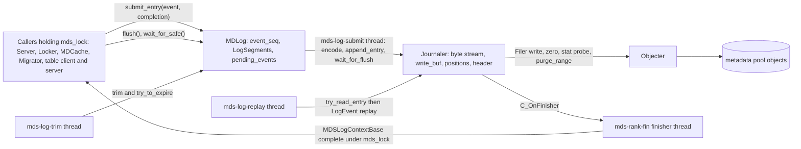
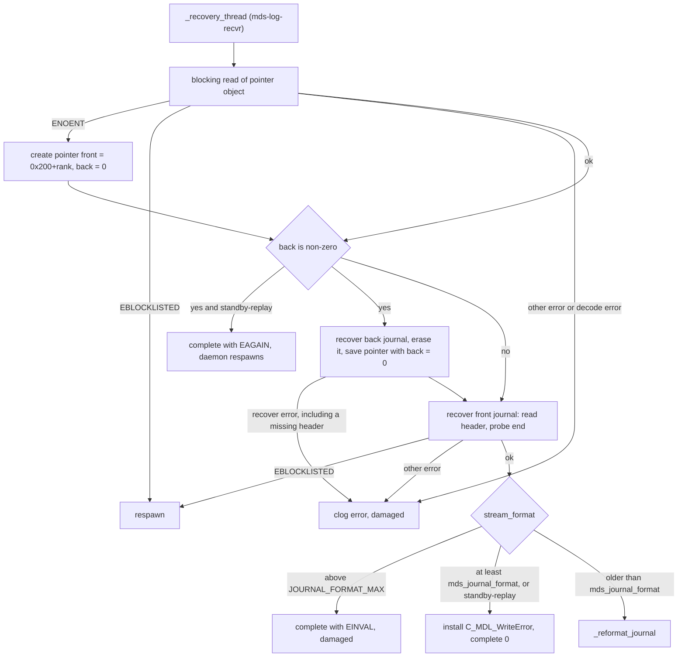
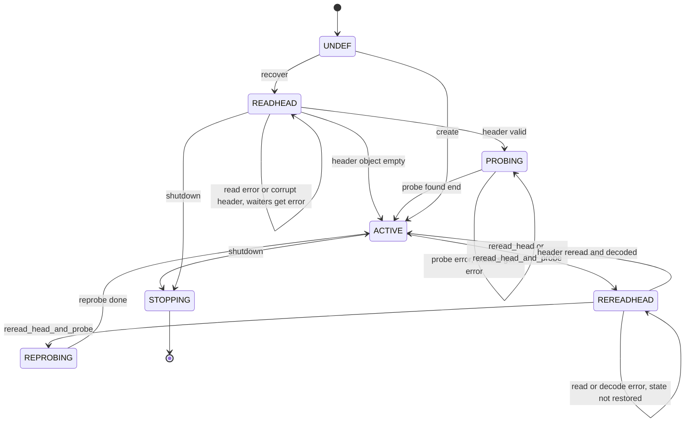
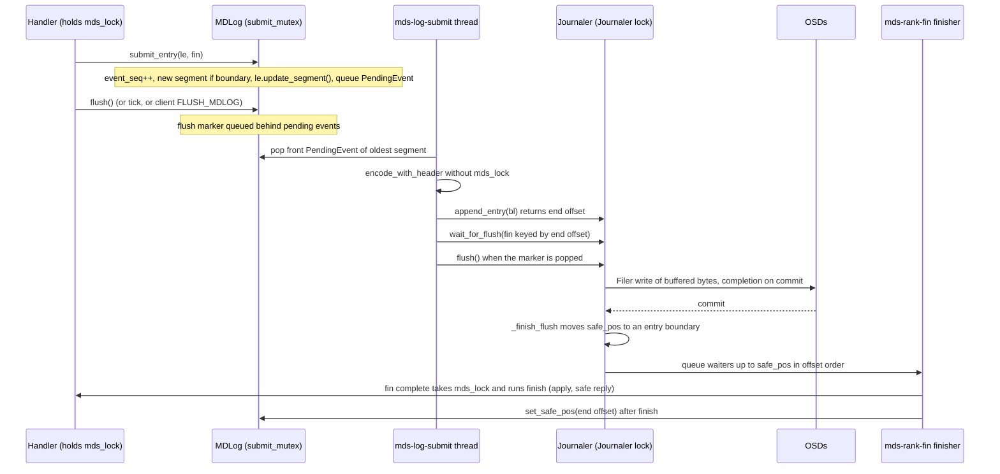
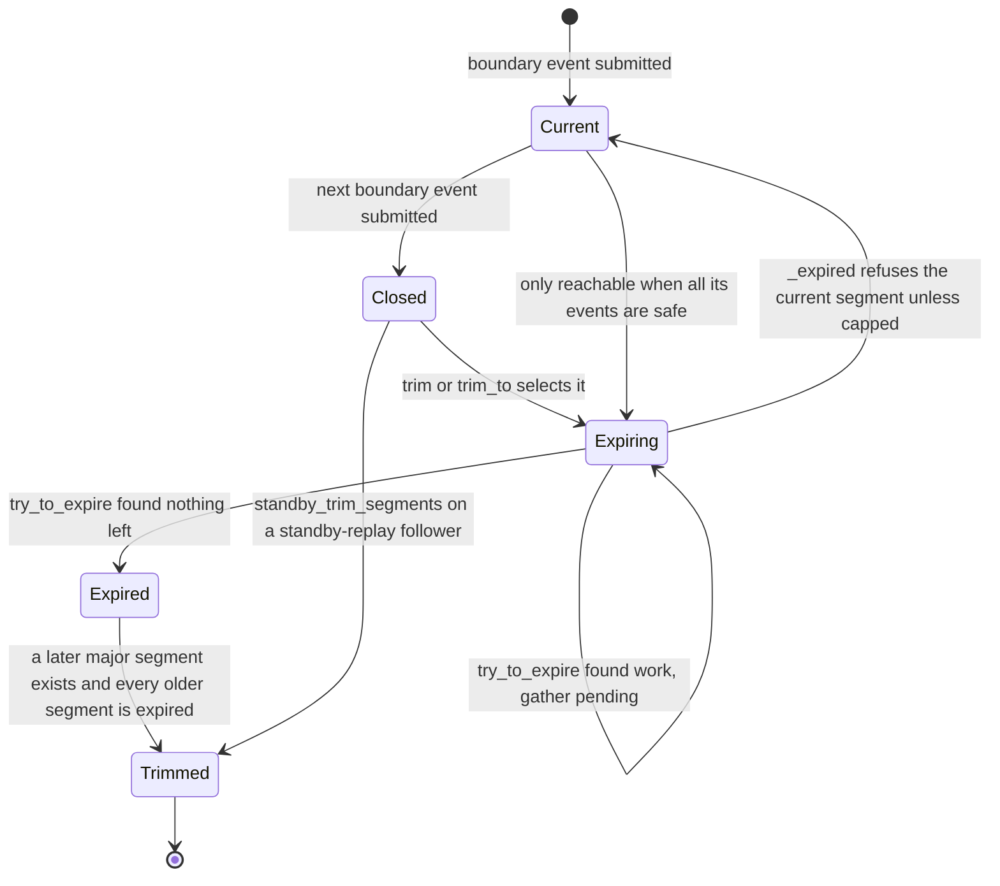
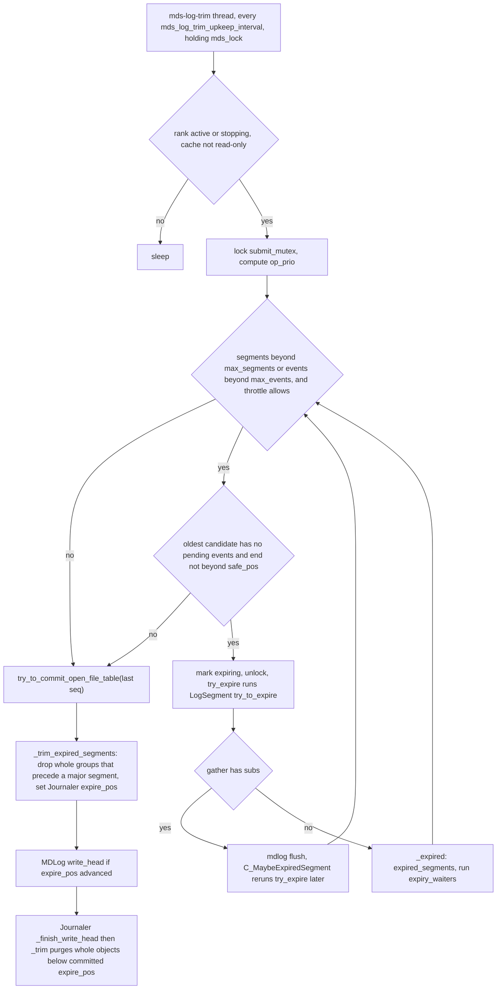
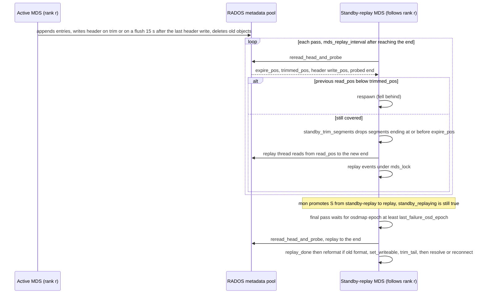

# MDLog and Journaler: the per-rank metadata journal

> Part of the C++ MDS project map ([README](../README.md)). Sources: `src/mds/MDLog.{h,cc}` (~2050 LOC), `src/osdc/Journaler.{h,cc}` (~2250), `src/mds/LogSegment.{h,cc}` (~150), `src/mds/LogSegmentRef.h`, `src/mds/JournalPointer.{h,cc}` (~220), `src/mds/SegmentBoundary.h`, `src/mds/events/{ELid,ESegment,ESubtreeMap,EResetJournal,ENoOp}.h`, `src/mds/journal.cc` (only `LogSegment::try_to_expire` and the boundary-event codecs, ~450 of 3517), `src/mds/LogEvent.{h,cc}` (framing), `src/mds/MDSContext.{h,cc}` (`MDSLogContextBase`), and the journal-related parts of `src/mds/MDSRank.cc`, `src/mds/MDCache.cc`, `src/mds/Beacon.cc`, `src/osdc/Filer.cc`, `src/tools/cephfs/{Resetter,JournalScanner,JournalTool}.cc`.
> Related: [process and threading](../00-architecture/process-and-threading.md), [mds_lock analysis](../00-architecture/mds_lock-analysis.md), [journal events and replay](events-and-replay.md), [request lifecycle](../03-request-path/request-lifecycle.md), [RADOS object catalog](../07-storage-formats/rados-object-catalog.md), [MDS tables / OpenFileTable](../07-storage-formats/mds-tables.md), [RADOS and OSD interactions](../07-storage-formats/rados-and-osd-interactions.md), [rank lifecycle and recovery](../09-recovery/rank-lifecycle-and-recovery.md), [resolve and rejoin](../09-recovery/resolve-and-rejoin.md), [cache lifecycle and trim](../04-cache/mdcache-lifecycle-trim-and-memory.md), [CDir/CDentry objects](../04-cache/cdir-cdentry-and-cache-objects.md), [subtree map](../04-cache/mdcache-subtrees-traversal-replication.md), [strays and purge](../11-background-services/strays-and-purge.md), [sessions](../02-client-protocol/sessions.md), [capabilities](../02-client-protocol/capabilities.md), [kclient expectations](../02-client-protocol/kclient-expectations.md), [libcephfs/ganesha expectations](../02-client-protocol/libcephfs-fuse-ganesha-expectations.md), [beacon and monitor](../01-cluster-integration/beacon-and-monitor.md), [admin commands](../13-admin-and-config/admin-commands.md), [config/perf/health](../13-admin-and-config/config-perf-counters-and-health.md).

## 1. Purpose and responsibilities

Every active MDS rank owns exactly one metadata journal (the "mdlog"). It is the write-ahead log for every metadata mutation the rank performs: a mutation is applied to the in-memory cache only as a *projection*, journaled as a `LogEvent`, and made real (and acknowledged to the client as *safe*) only after the event is durable in RADOS. Dirty cache objects are written back to their home RADOS objects (dirfrag omaps, backtraces, tables) lazily, segment by segment, and only then can the journal be trimmed.

Two layers implement this:

- **`Journaler`** (`src/osdc/Journaler.*`, generic, also used by the `PurgeQueue`): an append-only byte stream striped over RADOS objects `<ino>.<objno>`, with a header object, entry framing (`JournalStream`), buffered/batched writes, prezeroing ahead of the write position, end-of-log probing on recovery, prefetching reads, and trimming (deleting) whole objects behind the expire position.
- **`MDLog`** (`src/mds/MDLog.*`): the MDS-specific log manager. It assigns a monotonic event sequence number, groups events into `LogSegment`s delimited by `SegmentBoundary` events (`ESubtreeMap`, `ESegment`, `ELid`, `EResetJournal`), encodes and appends events on a dedicated submit thread, tracks the "safe" position and fires completion contexts in journal order, expires segments by flushing everything they made dirty (`LogSegment::try_to_expire`), trims expired segments in whole *major-segment* groups, opens/creates/reformats the journal (`JournalPointer`), replays it at recovery, and tails it in standby-replay.

Responsibilities in one list:

1. Durable, totally ordered (per rank) logging of metadata mutations; group commit.
2. Completion delivery in journal order (drives safe replies, cap flush acks, session open/close acks, peer-request acks, table commits).
3. Writeback scheduling: segment expiry drives `CDir::commit`, backtrace stores, table/sessionmap saves, scatterlock nudges.
4. Bounding journal length (`mds_log_max_segments`, `mds_log_max_events`) and reporting `MDS_TRIM` when behind.
5. Recovery: locate (pointer object), recover (header + probe), optionally reformat, replay, and reposition for append.
6. Standby-replay: follow another daemon's journal read-only, keeping a warm cache.
7. Fail-stop on journal I/O errors (rank marked `damaged`, or respawn when blocklisted).

## 2. Source map

| File | Class / function | Lines | Role |
|---|---|---|---|
| `src/mds/MDLog.h` | `enum l_mdl_*` | 21-43 | `mds_log` perf counter ids |
| `src/mds/MDLog.h` | `class MDLog` | 74-343 | API; inline `submit_entry` (147-153); `PendingEvent` (191-196); `ReplayThread`/`RecoveryThread`/`SubmitThread` (199-233); state (266-340) |
| `src/mds/MDLog.cc` | `MDLog::MDLog`, `create_logger`, `set_write_iohint` | 46-117 | config snapshot, starts `mds-log-trim` thread, perf counters |
| `src/mds/MDLog.cc` | `C_MDL_WriteError`, `C_MDL_WriteHead`, `finish_head_waiters`, `write_head` | 119-209 | journal write-error policy; header writes and their waiters |
| `src/mds/MDLog.cc` | `get_estimated_replay_finish_time` | 227-265 | replay ETA for health |
| `src/mds/MDLog.cc` | `create`, `open`, `C_ReopenComplete`, `reopen`, `append` | 267-368 | journal lifecycle entry points |
| `src/mds/MDLog.cc` | `_start_new_segment`, `_submit_entry`, `_segment_upkeep` | 374-467 | sequencing, segment rotation |
| `src/mds/MDLog.cc` | `C_MDL_Flushed`, `_submit_thread`, `wait_for_safe`, `flush`, `kick_submitter`, `cap`, `shutdown` | 472-682 | submit pipeline, shutdown |
| `src/mds/MDLog.cc` | `try_to_commit_open_file_table`, `is_trim_slow`, `log_trim_upkeep`, `trim` | 684-834 | periodic expiry |
| `src/mds/MDLog.cc` | `C_MaybeExpiredSegment`, `trim_to`, `try_expire`, `_maybe_expired`, `_trim_expired_segments`, `_expired` | 836-1023 | expiry bookkeeping, trimming |
| `src/mds/MDLog.cc` | `replay`, `_recovery_thread`, `_reformat_journal`, `_replay_thread`, `standby_trim_segments` | 1027-1653 | open, reformat, replay, standby trimming |
| `src/mds/MDLog.cc` | `dump_replay_status`, `handle_conf_change` | 1655-1705 | admin, runtime config |
| `src/mds/LogSegment.h`, `.cc` | `class LogSegment` | h:45-100, cc:26-44 | what a segment tracks |
| `src/mds/LogSegmentRef.h` | `LogSegmentRef` | 20 | `std::shared_ptr<LogSegment>` |
| `src/mds/SegmentBoundary.h` | `class SegmentBoundary` | 21-41 | `seq` + `is_major_segment_boundary()` mixin |
| `src/mds/events/ELid.h`, `ESegment.h` | `ELid`, `ESegment` | 24-42, 24-38 | major/minor boundary events |
| `src/mds/events/ESubtreeMap.h`, `EResetJournal.h` | `ESubtreeMap`, `EResetJournal` | 23-49, 24-42 | major boundary events |
| `src/mds/journal.cc` | `BatchStoredBacktrace`, `BatchCommitBacktrace`, `LogSegment::try_to_expire`, `purge_inodes_finish` | 85-385 | the expiry obligations |
| `src/mds/journal.cc` | `EMetaBlob::add_dir_context`, `EMetaBlob::update_segment` | 390-500 | dir-context elision vs last major segment; table versions into segment |
| `src/mds/journal.cc` | `ESubtreeMap::{encode,decode,replay}` | 2783-2971 | subtree map boundary |
| `src/mds/journal.cc` | `EResetJournal`, `ESegment`, `ELid`, `ENoOp`, `EMetaBlob::rewrite_truncate_finish` | 3342-3516 | small boundary/padding events |
| `src/mds/JournalPointer.h`, `.cc` | `JournalPointer` | h:33-91, cc:36-126 | front/back journal inode pointer object |
| `src/mds/LogEvent.h`, `.cc` | `EVENT_*`, `encode_with_header`, `decode_event` | h:19-47, 94-101; cc:51-230 | event envelope |
| `src/mds/MDSContext.h`, `.cc` | `MDSIOContextBase`, `MDSLogContextBase` | h:98-137; cc:95-130 | completion semantics, `safe_pos` update |
| `src/osdc/Journaler.h` | `StreamFormat`, `JournalStream`, `Journaler::Header`, `class Journaler` | 77-577 | formats, positions, API |
| `src/osdc/Journaler.cc` | `create`, `recover`, read/reread head, probe/reprobe | 83-455 | open/recovery state machine |
| `src/osdc/Journaler.cc` | `write_head`, `_finish_write_head`, `_finish_flush`, `append_entry`, `_do_flush`, `wait_for_flush`, `flush`, prezero | 458-927 | write path |
| `src/osdc/Journaler.cc` | `_finish_read`, `_assimilate_prefetch`, `_issue_read`, `_prefetch`, `_have_next_entry`, `try_read_entry`, `erase` | 930-1357 | read path |
| `src/osdc/Journaler.cc` | `trim`, `_trim`, `_finish_trim`, `handle_write_error` | 1361-1463 | object deletion, error fan-out |
| `src/osdc/Journaler.cc` | `JournalStream::{readable,read,write}`, `set_write_error_handler`, `wrap_finisher`, `shutdown`, `check_isreadable` | 1474-1670 | framing, misc |
| `src/osdc/Filer.cc` | `Filer::zero`, `probe_impl`/`_probe`/`_probed`, `purge_range`/`_do_purge_range` | 117-494 | striping helpers used by Journaler |
| `src/mds/MDSRank.cc` | `C_Flush_Journal` | 82-234 | `flush journal` admin state machine |
| `src/mds/MDSRank.cc` | `tick`, `boot_start`, `replay_start`, standby-replay restart, `replay_done`, `reopen_log`, `boot_create` | 710-2250 | callers that drive the log through rank states |
| `src/mds/MDCache.cc` | `gen_default_log_layout`, `advance_stray`, `create_subtree_map`, `standby_trim_segment`, `shutdown_pass` | 424, 776, 2624-2772, 7644-7683, 8043-8200 | layout, stray rotation, `ESubtreeMap` builder, standby cleanup, stop-time capping |
| `src/mds/Beacon.cc` | `notify_health` | 328-342, 459-478, 560-572 | `MDS_TRIM`, `MDS_SLOW_METADATA_IO`, `MDS_ESTIMATED_REPLAY_TIME` |
| `src/tools/cephfs/Resetter.cc`, `JournalScanner.cc`, `JournalTool.cc` | offline reset / scan / tool | full | `cephfs-journal-tool` |

## 3. How it works

### 3.1 Layering



### 3.2 RADOS objects and naming

All journal objects live in the filesystem's metadata pool, default namespace. Object names are `"%llx.%08llx"` of (inode number, object index) (`src/include/object.cc:46 (file_object_t::c_str)`, `src/osdc/Striper.h:66 (Striper::file_to_extents)`). `MAX_MDS = 0x100` (`src/include/cephfs/types.h:41`); offsets from `src/mds/mdstypes.h:42-45`:

| Purpose | Inode | Rank 0 objects | Written by |
|---|---|---|---|
| Journal pointer | `MDS_INO_LOG_POINTER_OFFSET + rank` = `0x400 + rank` | `400.00000000` | `JournalPointer::save` (`write_full`) |
| Journal (default "front") | `MDS_INO_LOG_OFFSET + rank` = `0x200 + rank` | `200.00000000` (header), `200.00000001`, ... (data) | `Journaler` |
| Journal (alternate, used only during reformat) | `MDS_INO_LOG_BACKUP_OFFSET + rank` = `0x300 + rank` | `300.00000000`, ... | `_reformat_journal` |
| Purge queue (separate `Journaler`, not MDLog) | `MDS_INO_PURGE_QUEUE + rank` = `0x500 + rank` | `500.*` | `PurgeQueue` (see [strays and purge](../11-background-services/strays-and-purge.md)) |

Layout: `MDCache::gen_default_log_layout` (`src/mds/MDCache.cc:424`) takes `file_layout_t::get_default()` = stripe_unit 4 MiB, stripe_count 1, object_size 4 MiB (`src/include/fs_types.h:125`), sets `pool_id` = metadata pool, and if `mds_log_segment_size > 0` uses it for both `object_size` and `stripe_unit`. The layout is applied only when a journal is created (`MDLog::create`, `Resetter::reset_hard`); afterwards the layout stored in the header wins. Throughout this page **P** denotes the *period* `stripe_count * object_size` (`src/include/fs_types.h:129 (get_period)`), 4 MiB by default; with stripe_count 1 the byte at stream offset `x` lives in object index `x / P`.

Object 0 holds only the header. A freshly created journal sets every position to P (`src/osdc/Journaler.cc:94-97 (Journaler::create)`), so the first entry is at offset P = object index 1.

### 3.3 `JournalPointer` (front/back)

`JournalPointer` (`src/mds/JournalPointer.h:33`) is `{inodeno_t front, inodeno_t back}` encoded as `ENCODE_START(1,1)` + two `u64` (`h:38-50`). `front` is the active journal inode, `back` is non-zero only while a journal rewrite is in progress. `load()` is a blocking `read_full`, decode failure returns `-EINVAL` (`cc:49 (JournalPointer::load)`); `save()` is a blocking `write_full` that asserts the pointer is not null (`cc:82`); an async `save(objecter, ctx)` exists for `MDLog::create` (`cc:114`).

Use by `_recovery_thread` (`src/mds/MDLog.cc:1076`):



Code: pointer load and creation `src/mds/MDLog.cc:1092-1115`; back-journal cleanup `:1120-1169`; front recovery `:1172-1198`; format decision `:1200-1232`. If `mds_journal_format > JOURNAL_FORMAT_MAX` the rank is declared damaged before anything else (`:1079-1087`).

**Reformat** (`src/mds/MDLog.cc:1243 (MDLog::_reformat_journal)`), only for journals older than `mds_journal_format` (default 1 = RESILIENT): set `back` to the other inode (`0x200+rank` and `0x300+rank` alternate), save pointer; create the new journal with the old layout and new format and write its header (blocking); then read every entry of the old journal and append it to the new one, decoding it to (a) record old position to new position for boundary events with `seq == 0` (old journals used the byte offset as segment id), (b) rewrite `EMetaBlob::truncate_finish` segment references (`src/mds/journal.cc:3495 (EMetaBlob::rewrite_truncate_finish)`), (c) zero `ESubtreeMap::expire_pos`; undecodable events are copied verbatim. Flush, swap `front`/`back`, save, erase the old journal, set `back = 0`, save again, install the new `Journaler` read-only (`:1250-1412`). The read error, the pointer saves and the erase are asserted; the results of the new header write and of the final flush are not checked (`:1268-1269`, `:1362-1363`). A crash leaves `back != 0`, which the next `_recovery_thread` cleans up by erasing whatever `back` names (but see section 8, items 14 and 29). `MDLog::reopen` (`:338`) runs the same recovery again (thread `mds-log-reopen`) after replay when a standby-replay daemon that tolerated an old format becomes active (`src/mds/MDSRank.cc:1924-1927 (MDSRank::replay_done)`); `C_ReopenComplete` then calls `append()` (`MDLog.cc:322-331`).

### 3.4 `Journaler` header

Object `<ino>.00000000`, always written with `write_full` (`src/osdc/Journaler.cc:500-506 (Journaler::_write_head)`). Encoding (`src/osdc/Journaler.h:149-174 (Journaler::Header)`):

| Field | Type | Meaning |
|---|---|---|
| struct header | `u8 v=2, u8 compat=2, u32 len` | `ENCODE_START(2,2)`; decode is `DECODE_START_LEGACY_COMPAT_LEN(2,2,2)` |
| `magic` | string | `"ceph fs volume v011"` (`CEPH_FS_ONDISK_MAGIC`, `src/include/cephfs/types.h:40`) |
| `trimmed_pos` | u64 | objects strictly below this offset have been deleted (period aligned, may lag) |
| `expire_pos` | u64 | replay starts here; everything below is expired |
| `unused_field` | u64 | written as `expire_pos` (historically `read_pos`), ignored on read |
| `write_pos` | u64 | Journaler `safe_pos` at the time of the header write: a durable entry boundary, a *lower bound* of the real end |
| `layout` | legacy `ceph_file_layout` (7 x le32: stripe_unit, stripe_count, object_size, cas_hash=0, object_stripe_unit=0, unused=0, pg_pool) | `encode(layout, bl, 0)` forces the legacy encoding (`src/common/fs_types.cc:89-97`); pool namespace is not representable |
| `stream_format` | u8 | 0 = LEGACY, 1 = RESILIENT; absent in struct_v 1 (treated as LEGACY) |

On recovery, the header is rejected with `-EINVAL` if the magic differs or `write_pos < expire_pos` or `expire_pos < trimmed_pos` (`Journaler.cc:308-325 (_finish_read_head)`). A zero-length header object is treated as an empty log in state ACTIVE (`:291-299`); a missing header object propagates `-ENOENT` to the waiters. `_set_layout` aborts the process if the header layout's pool differs from the pool the Journaler was opened on (`:113-117`). `_write_head` asserts `write_pos >= expire_pos >= trimmed_pos` before writing (`:491-492`) and `_finish_write_head` aborts if any committed position would move backwards (`:521-532`).

### 3.5 Entry framing (`JournalStream`) and the `LogEvent` envelope

`JournalStream` (`src/osdc/Journaler.h:103-126`, `Journaler.cc:1474-1590`) frames each entry in the byte stream:

```
RESILIENT (stream_format 1, default since mds_journal_format=1):
  offset P0: le64 sentinel = 0x3141592653589793
  P0+8     : le32 entry_size N
  P0+12    : N bytes payload (one encoded LogEvent)
  P0+12+N  : le64 start_ptr = P0      (absolute stream offset of this entry)
  envelope = 20 bytes (JOURNAL_ENVELOPE_RESILIENT)

LEGACY (stream_format 0):
  le32 entry_size N, then N bytes payload (envelope 4 bytes)
```

- `JournalStream::readable` throws `malformed_input("Invalid sentinel")` on a bad sentinel (`:1489-1493`); the reader turns that into `error = -EINVAL` (`:986-997`, `:1308-1315`).
- `Journaler::try_read_entry` **asserts** `start_ptr == read_pos` for RESILIENT journals (`:1294-1296`).
- There is no checksum; the sentinel and `start_ptr` exist so that offline tools can resynchronise inside damaged journals: `JournalScanner::scan_events` slides byte by byte until it finds the sentinel and checks `start_ptr` (`src/tools/cephfs/JournalScanner.cc:230-294`).

The payload is produced by `LogEvent::encode_with_header` (`src/mds/LogEvent.h:94-101`): `le32 EVENT_NEW_ENCODING (0)`, then `ENCODE_START(1,1)` containing `le32 event type` and the event's own versioned encoding. The feature bits passed to the encoder are `MDLog::mdsmap_up_features`, a single member overwritten by every `_submit_entry` (`src/mds/MDLog.cc:430`) and read by the submit thread when it dequeues the event (`:514`), so an event is encoded with the up-features recorded by the most recent submission, not necessarily its own. `LogEvent::decode_event` (`src/mds/LogEvent.cc:51`) also accepts the pre-versioned form (type word directly followed by the body) and returns `nullptr` on unknown type or decode failure (`:141-230`); however it **asserts** that the event consumed the whole payload (`ceph_assert(p.end())`, `:228`), so an entry with trailing bytes aborts the daemon instead of being reported as corrupt. Event type ids are in `src/mds/LogEvent.h:19-47`; the full catalogue lives in [events and replay](events-and-replay.md).

### 3.6 `Journaler` positions and invariants

```
 stream offset:  0       P                                                                       
 objects:        [hdr ]  [obj 1][obj 2] ... [obj k] ...                                          
                          |<- deleted ->|<- expired, kept ->|<--------- replayable ---------->|...
                          0..trimmed_pos  trimmed..expire_pos  expire_pos .. safe_pos            
   writer:  trimmed_pos <= trimming_pos <= expire_pos <= safe_pos <= flush_pos <= write_pos       
            flush_pos + write_buf.length() == write_pos                                          
            data is never flushed closer than one period to prezero_pos (zeroed/removed ahead)   
   reader:  expire_pos <= read_pos <= received_pos <= requested_pos <= safe_pos (or write_pos)   
```

Fields (`src/osdc/Journaler.h:306-372`): `prezeroing_pos` (zero ops issued up to), `prezero_pos` (zero ops completed contiguously up to), `write_pos` (logical end including buffered bytes), `flush_pos` (sent to OSDs), `safe_pos` (durable, always an entry boundary), `next_safe_pos` (entry boundary that becomes safe when everything issued so far commits), `pending_safe` (map flush-start -> `next_safe_pos` at issue time), `waitfor_safe` (map entry-end offset -> waiters), `read_pos`/`requested_pos`/`received_pos` and `read_buf`/`prefetch_buf`, `expire_pos`, `trimming_pos`, `trimmed_pos`, plus `last_written` and `last_committed` copies of the header.

`Journaler.h` header comment (`:16-56`) states the key durability invariant: the on-disk `head.expire_pos >= trimmed_pos`, i.e. objects are deleted only after a header recording a later `expire_pos` has committed (enforced by `_trim` using `last_committed.expire_pos`, `Journaler.cc:1387`).

### 3.7 `Journaler` state machine



States are `STATE_UNDEF..STATE_STOPPING` = 0..6 (`src/osdc/Journaler.h:262-268`). `recover()` (`Journaler.cc:183`) reads the header (`_read_head`, `read_full` of object 0), sets `write_pos = flush_pos = safe_pos = ... = head.write_pos`, `read_pos = requested_pos = received_pos = expire_pos = head.expire_pos`, `trimmed_pos = trimming_pos = head.trimmed_pos`, adopts layout and stream format, then probes (`:327-342`). `_probe` calls `Filer::probe(ino, layout, CEPH_NOSNAP, write_pos, &end, fwd=true)` (`:345-353`), which `stat`s every object of one period at a time (with `CEPH_OSD_FLAG_RWORDERED`, `src/osdc/Filer.cc:285`), treating `-ENOENT` as size 0 (`Filer.cc:163-166`), and continues while objects are full; the end is the first short object (`Filer.cc:296-399`). The first round covers the rest of the period containing the header's `write_pos` plus one more period (`Filer.cc:236-240`), later rounds one period each. `_finish_probe_end` sets all write positions to the probed end (`Journaler.cc:384-415`) and aborts on an impossible `end == -1` (`:394-399`). `shutdown()` sets `STATE_STOPPING`, `error = -EAGAIN`, fails `on_readable` and every `waitfor_safe` waiter with `-EAGAIN` and recovery waiters with `-ESHUTDOWN` (`:1629-1655`).

`reread_head` (used by replay error handling) reloads `write_pos`/`expire_pos`/`trimmed_pos` from the header without touching `read_pos` and without re-checking the magic or the offset ordering (`:243-273`); `reread_head_and_probe` additionally re-probes (`:429-455`) and **asserts** on any error other than `-EBLOCKLISTED` (`:448-453`). A fresh `Journaler` with an empty header object reaches ACTIVE with all positions 0, no layout and `stream_format` still at its `-1` initial value, which `_recovery_thread` then rejects as an unknown format (`MDLog.cc:1201`, so the rank goes `damaged`).

### 3.8 `Journaler` write path

1. **`append_entry(bl)`** (`Journaler.cc:610`): takes `write_buf_throttle` (limit `UINT_MAX - UINT_MAX>>3` bytes, blocks the caller when full, `:57,620-625`), frames the entry into `write_buf` at `write_pos` (`start_ptr = write_pos`), advances `write_pos` and returns it. If `write_pos` is now in a later object (period) than `flush_pos`, every buffered byte before the start of the object containing `write_pos` is flushed immediately ("flushing completed object(s)", `:633-650`); if the bytes left in the buffer all belong to this entry, `next_safe_pos` is set to the end of the previous entry so a partially flushed entry is never declared safe.
2. **`_do_flush(amount)`** (`:656`): never flushes past `prezero_pos - P`; if the region ahead is not zeroed yet, issues prezeroing and either shortens the flush or records `waiting_for_zero_pos` and returns (`:671-692`); otherwise records `pending_safe[flush_pos] = next_safe_pos`, computes the new `next_safe_pos` (end of buffer, or best-effort the last `waitfor_safe` key inside a partial flush, `:705-722`) and issues one `Filer::write` (split per object, completion on commit) with the write IO hint (`:724-727`).
3. **Prezeroing** (`_issue_prezero`, `:831-868`): zeroes from `prezeroing_pos` up to `write_pos + P * journaler_prezero_periods` rounded up to a period. Whole periods go through `Filer::zero`, which *removes* full objects (`src/osdc/Filer.cc:117-150`); partial periods are zeroed. `_finish_prezero` (`:873-915`) advances `prezero_pos` over contiguous completions (out-of-order ones go to `pending_zero`), resumes a blocked flush, and fires `waitfor_prezero`; `-ENOENT` is success. The purpose is that objects past the true end never exist, so the next recovery probe finds the right end.
4. **`_finish_flush`** (`:558-606`): updates the `jlat` latency counter, then: if no other flush is pending, `safe_pos = next_safe_pos`; otherwise `safe_pos = pending_safe.begin()->second` taken **before** erasing the completed flush. With flushes F1, F2 in flight, completion of F1 leaves `safe_pos` at the boundary recorded when F1 was issued (the `next_safe_pos` covering only data issued *before* F1); it reaches the end of F1 only when F2 completes or the pipeline drains (conservative choice from commit `d17790f299c`, "fix mds damaged due to unexpected journal length"). Then every `waitfor_safe` list with key `<= safe_pos` is completed in key order (the contexts are `C_OnFinisher`-wrapped, so they are queued to the finisher, not run inline).
5. **`wait_for_flush(ctx)`** (`:743-775`): if `write_pos == safe_pos` queues `ctx` immediately, else parks it at `waitfor_safe[write_pos]` (the end of the last appended entry). It does not start a flush.
6. **`flush(ctx)`** (`:777-810`): `_do_flush()` plus `_wait_for_flush(ctx)`, and writes the header if `journaler_write_head_interval` (15 s) elapsed since the last header write (`:806-816`). If nothing is buffered (`write_pos == flush_pos`) it completes `ctx` at once with 0 (`:792-800`), even when earlier flushes have not committed yet; only `_reformat_journal` and `Resetter` pass a `ctx` (MDLog uses `flush()` plus `wait_for_flush`).
7. Write errors call `handle_write_error` (`:1445-1463`): `_finish_flush` and `_finish_write_head` on any `r < 0`, `_finish_prezero` and `_finish_trim` on `r < 0` other than `-ENOENT`. It completes the single registered `on_write_error` context once; later errors are only logged; with no handler registered the process aborts (`ceph_abort_msg("unhandled write error")`).

### 3.9 Header writes and object trimming

- `Journaler::write_head` (`:472-507`) copies `trimmed_pos`, `expire_pos`, `safe_pos` into `last_written` and `write_full`s it. `_finish_write_head` (`:509-541`) promotes it to `last_committed`, completes the caller, then calls `_trim()`.
- `Journaler::_trim` (`:1380-1421`): `trim_to = last_committed.expire_pos` rounded down to P; if it advanced and no purge is running, `Filer::purge_range` removes objects `[trimming_pos/P, trim_to/P)` (at most `filer_max_purge_ops` = 10 removes in flight, `src/osdc/Filer.cc:478 (Filer::_do_purge_range)`) and sets `trimming_pos`; `_finish_trim` sets `trimmed_pos` (`:1423-1443`). `trimmed_pos` reaches disk only with the next header write.
- `MDLog::write_head` (`src/mds/MDLog.cc:188-209`, requires `mds_lock`) issues a header write only if `last_written.expire_pos < expire_pos`; an optional context is parked in `waiting_for_expire[expire_pos]` and completed by `finish_head_waiters` once `last_committed.expire_pos` reaches it (`:170-186`).
- Header writes therefore happen (a) after every trim pass that advanced `expire_pos`, (b) on a `Journaler::flush` once `journaler_write_head_interval` seconds have passed since the last header write, (c) at journal creation, reset, and reformat. `last_wrote_head` is set only by `_write_head` (`:494`), so a freshly recovered `Journaler` writes its header on its first `flush` (`_write_head_needed()` is true immediately).

### 3.10 `Journaler` read path

Used by replay, standby-replay and tools. `_prefetch` (`:1105-1153`) keeps reads issued up to `read_pos + fetch_len` (`fetch_len = P * journaler_prefetch_periods` = 40 MiB by default, `:121-124`), rounded up to a period and capped at `write_pos`; `_issue_read` issues one `Filer::read` per object chunk with `CEPH_OSD_OP_FLAG_FADVISE_DONTNEED` and never beyond `safe_pos` (`:1049-1103`). `_finish_read` stores data in `prefetch_buf`; a short read or OSD error sets `error` (`-EINVAL` for short reads) and fails `on_readable` (`:957-999`). `_assimilate_prefetch` appends contiguous chunks to `read_buf` and recomputes `readable` (`:1001-1047`). `_have_next_entry` (`:1159-1202`) handles a **torn tail**: if the next entry is incomplete and `received_pos == write_pos`, it rewinds `write_pos`/`flush_pos`/`safe_pos`/`prezero_pos` to `read_pos` and reports end of journal (the bytes remain on disk; the writer's prezeroing later overwrites them). Oversized entries set `temp_fetch_len`. `check_isreadable` (`:1657-1670`) blocks the calling thread on a `C_SaferCond` until an entry is readable, an error occurs or the end is reached. `try_read_entry` (`:1280-1327`) pops one framed entry, advances `read_pos`, re-arms prefetch and rebuilds a multi-buffer bufferlist into one contiguous buffer.

`erase()` (`:1238-1274`) purges `(write_pos - trimmed_pos)/P + 2` data objects starting at object `trimmed_pos/P`, and only after that succeeds the header object (so a failed data purge never loses the reference to the data).

### 3.11 `MDLog` submit path



**`submit_entry(le, c)`** (`src/mds/MDLog.h:147-153`) takes `submit_mutex` (caller must hold `mds_lock`), calls `_submit_entry`, then `_segment_upkeep`, then notifies the submit thread.

**`_submit_entry`** (`src/mds/MDLog.cc:393-441`) asserts `mds_lock` and `submit_mutex` are held, the rank is not in any replay state, and the log is not capped. It then:
1. increments `event_seq` (so every event, including boundaries, gets a unique monotonically increasing sequence number);
2. if the event is a `SegmentBoundary`, starts a new `LogSegment` with `seq = event_seq`, stores the seq into the event (`_start_new_segment`, `:374-391`, which also rotates the stray directory via `MDCache::advance_stray`, `src/mds/MDCache.cc:776`, unless the rank is `up:stopping`), and maintains `major_segments` / `minor_segments_since_last_major_segment` (`:403-412`). The new segment's `offset`/`end` start at `-1` (`LogSegment.cc:26-27`) until the submit thread appends the boundary;
3. sets `CInode::last_journaled = event_seq` for every inode the event's `EMetaBlob` touched (`:414-419`);
4. attaches the event to the newest segment (`segments.rbegin()`), increments its `num_events`, calls `le->update_segment()` (which records `inotablev`, `sessionmapv`, `tablev` and `uncommitted_leaders` into the segment, `src/mds/journal.cc:1821-1825 (EPurged), 1876-1881 (ESession), 2064-2066 (ESessions), 2133-2135 (ETableServer), 2327-2337 (EUpdate, which also calls EMetaBlob::update_segment at 484-502), 3180-3183 (EImportStart)`; `EOpen::update_segment` is empty and the `ESnap` code at `journal.cc:2243-2271` is commented out; other events, including `EPeerUpdate`, do not override it) and stamps the event;
5. captures `mdsmap->get_up_features()` for encoding, appends `PendingEvent(le, c)` to `pending_events[segment seq]`, bumps `num_events` and `unflushed`.

**Invariant:** the completion `c` must be an `MDSLogContextBase` (asserted by `dynamic_cast` in the submit thread, `:547-549`); callers capture `mdr->ls = mdlog->get_current_segment()` in the same `mds_lock` section in which they build and submit the event (e.g. `src/mds/Server.cc:5694` then `:5770`, `Server::handle_client_setattr`), and that is the segment the event lands in, because rotation only happens inside `submit_entry` after the event has been attached.

**`_segment_upkeep`** (`:443-467`) runs after every submission:
- if more than `mds_log_minor_segments_per_major_segment` (16) minor segments were started since the last major one, it builds a full subtree map (`MDCache::create_subtree_map`, `src/mds/MDCache.cc:2624`, under `mds_lock` **and** `submit_mutex`) and submits it: a new **major** segment;
- else if the current segment's journaled byte range spans an object (period) boundary (`ls->end/P != ls->offset/P`) or it has `>= mds_log_events_per_segment` (1024) events, it submits an `ESegment`: a new **minor** segment;
- else, with `mds_debug_subtrees`, it submits an `ESubtreeMap` retyped `EVENT_SUBTREEMAP_TEST` whenever the segment has more than one event.

Because `_segment_upkeep` runs after `_submit_entry` and checks the counter first, after the 17th `ESegment` the very next submission triggers an `ESubtreeMap`; a major group is therefore one major segment plus 17 minor segments, the last of which holds two events.

**`_submit_thread`** (`:491-582`, thread `mds-log-submit`): loops until `is_daemon_stopping()`; waits on `submit_cond` while `mds_log_pause` is set or nothing is pending; pops the front of the lowest-seq non-empty list (an emptied list is erased on the next iteration under the lock), drops `submit_mutex`, and without `mds_lock`:
- for an event: encodes it, records its start offset (and `ls->offset` if it is a boundary), counts it as large if `>= mds_log_event_large_threshold` (512 KiB), `append_entry`, sets `ls->end` to the returned offset, registers the completion (`fin->set_write_pos(end)`) or a `C_MDL_Flushed(end)` placeholder with `journaler->wait_for_flush`, deletes the event object;
- for a marker (`le == NULL`): wraps the waiter in `C_MDL_Flushed` with the current write position and/or calls `journaler->flush()`.
It re-takes `submit_mutex` and resets `unflushed` on a flush marker, or increments it again for an event (`unflushed` is also incremented in `_submit_entry`, so it is only a "something is unflushed" hint, `:576-580`).

**`flush()`** (`:601-617`): if events are pending, queue a flush marker behind them; otherwise, if anything was appended since the last flush, call `journaler->flush()` directly on the caller's thread (usually holding `mds_lock`).

**`wait_for_safe(c)`** (`:584-599`): if events are pending, queue a waiter marker behind them (fires when everything submitted so far is safe); otherwise `journaler->wait_for_flush(C_IO_Wrapper(c))`. It does **not** flush; callers pair it with `flush()` (`src/mds/MDSRank.cc:127-128`, `src/mds/Migrator.cc:1706-1707`).

**Completion and `safe_pos`.** `MDSLogContextBase::complete` (`src/mds/MDSContext.cc:122-130`) runs `pre_finish` (no lock; `ServerLogContext` marks the op-tracker event `journal_committed: `, `src/mds/Server.cc:175`), then `MDSIOContextBase::complete` which takes `mds_lock`, drops the context if the daemon is stopping, respawns on `-EBLOCKLISTED`/`-ETIMEDOUT`, else runs `finish` (`:95-120`); finally `mdlog->set_safe_pos(write_pos)` under `submit_mutex` (asserts monotonic, `src/mds/MDLog.h:249-254`). `MDLog::safe_pos` therefore means "durable **and** completion already executed": trimming uses it, because completions are what mark objects dirty in the segment (`mdr->apply()` / `mark_dirty(ls)`).

**When does data actually get flushed?** `MDLog` has no timer of its own. Bytes leave `write_buf` only when (a) an append completes a 4 MiB object, (b) someone calls `MDLog::flush()`, or (c) a reader of the same journal needs them. Callers that are about to wait call `flush()` (62 call sites, e.g. `Server::journal_and_reply` when no early reply was sent, `src/mds/Server.cc:2154-2155`; lock nudges in `Locker`); `MDSRankDispatcher::tick` flushes every `mds_tick_interval` (5 s, `src/mds/MDSRank.cc:725-726`), except that the whole tick returns early while the beacon is laggy (`:714-717`), so no periodic flush happens while the MDS cannot reach the monitors; a client can request it with `CEPH_SESSION_REQUEST_FLUSH_MDLOG`, honoured only in `up:active` (`src/mds/Server.cc:883-886`); segment expiry flushes when it has to wait (`src/mds/journal.cc:371-373`). Everything appended between two flushes becomes one RADOS write per object touched (group commit).

### 3.12 Segments and boundaries



`SegmentBoundary` (`src/mds/SegmentBoundary.h:21-41`) is a mixin carrying `seq` (default 0) and `is_major_segment_boundary()` (default false). The boundary events:

| Event | Type id | Major | Encoding (inside `encode_with_header`) | Created by | Replay |
|---|---|---|---|---|---|
| `ESubtreeMap` | `EVENT_SUBTREEMAP` = 2 | yes | `ENCODE_START(6,5)`: `stamp`, `EMetaBlob metablob`, `map<dirfrag_t, vector<dirfrag_t>> subtrees`, `set<dirfrag_t> ambiguous_subtrees`, `u64 expire_pos`, `u64 seq` (`src/mds/journal.cc:2783-2809`) | `MDCache::create_subtree_map` from `_segment_upkeep`, boot, `flush journal`, stop | rebuilds or verifies the auth subtree map (`journal.cc:2847-2971`) |
| `EResetJournal` | `EVENT_RESETJOURNAL` = 9 | yes | `ENCODE_START(2,2)`: `stamp` only, **no seq** (`journal.cc:3342-3354`) | `cephfs-journal-tool journal reset` | wipes sessionmap, resets inotable, claims root (rank owning root) and mydir subtrees (`journal.cc:3368-3386`) |
| `ESegment` | `EVENT_SEGMENT` = 100 | no | `ENCODE_START(1,1)`: `u64 seq` (`journal.cc:3388-3400`) | `_segment_upkeep` | no-op |
| `ELid` | `EVENT_LID` = 101 | yes | `ENCODE_START(1,1)`: `u64 seq` (`journal.cc:3419-3431`) | `MDSRank::boot_create` (first event of a new rank), `MDCache::shutdown_pass` (capping a stopping rank) | no-op |
| `ESubtreeMap` retyped | `EVENT_SUBTREEMAP_TEST` = 50 | yes in practice (it is still an `ESubtreeMap` object) | as `ESubtreeMap` | `mds_debug_subtrees` only | as `ESubtreeMap` |
| `ENoOp` (not a boundary) | `EVENT_NOOP` = 51 | n/a | `ENCODE_START(2,2)`: `u32 pad_size` + `pad_size` bytes `0xff` (`journal.cc:3450-3474`) | offline tools (event splice) | no-op |

Why major boundaries exist: replay must start with the subtree map (which subtrees this rank is authoritative for, plus the spanning tree of dentries/inodes from root to each subtree root), because every other event's `EMetaBlob` only carries path context up to the nearest auth subtree root. `EMetaBlob::add_dir_context` (in its default `TO_AUTH_SUBTREE_ROOT` mode) additionally treats the parent dentry of a directory whose inode was journaled since the last major segment (`CInode::last_journaled >= get_last_major_segment_seq()`, `src/mds/journal.cc:452-458`), and every ancestor above it, as "maybe" context: those dentries are dropped only if the walk then reaches an unambiguous auth subtree root of this rank (`:430-434`), otherwise they are added after all (`:475`). Dropping them is only safe because the journal is always trimmed to a major boundary, so an earlier event of the same major group carries that context. `ELid` is a major boundary *without* a subtree map, used when the rank has no subtrees to describe (new rank before its hierarchy exists; stopped rank). `ESubtreeMap::expire_pos` records the journaler expire position at creation (`MDCache.cc:2770`); replay raises the in-memory `expire_pos` to it (`journal.cc:2849-2850`), an optimisation that `_reformat_journal` zeroes.

**What a `LogSegment` tracks** (`src/mds/LogSegment.h:45-100`) and what expiry does with it:

| Field | Filled by | Expiry obligation (`LogSegment::try_to_expire`, `src/mds/journal.cc:127`) |
|---|---|---|
| `seq`, `offset`, `end`, `num_events` | `_submit_entry` / submit thread / replay | bookkeeping; `end` must be `<= MDLog::safe_pos` before expiry starts |
| `new_dirfrags`, `dirty_dirfrags` (elist of `CDir`) | `CDir::_mark_dirty`, `mark_new` (`src/mds/CDir.cc:1474-1500`) | `CDir::commit(op_prio)` of each (`journal.cc:136-174`) |
| `dirty_dentries` (elist of `CDentry`) | `CDentry::_mark_dirty` (`CDentry.cc:215-228`) | commit the containing dirfrag |
| `dirty_inodes` (elist of `CInode`) | `CInode::_mark_dirty` (`CInode.cc:1197-1208`) | base inodes (`root`, `mdsdir`): `CInode::store()`; others: commit the parent dirfrag (`journal.cc:151-158`) |
| (any dirfrag above that cannot be auth-pinned, i.e. frozen/freezing) | | wait `CDir::WAIT_UNFREEZE` and retry (`:166-172`) |
| `uncommitted_leaders` | `EUpdate::update_segment` when `had_peers` (`journal.cc:2327-2336`) | wait until the leader's `ECommitted` is journaled (`MDCache::wait_for_uncommitted_leader`, `:177-182`) |
| `uncommitted_peers` | `MDCache` peer prepare (`MDCache.cc:3569`) | wait for the leader's OP_FINISH / peer commit (`:185-190`) |
| `uncommitted_fragments` | `EFragment` prepare (`MDCache.cc:12719`) | wait for fragment commit (`:193-198`) |
| `dirty_dirfrag_dir`, `dirty_dirfrag_nest`, `dirty_dirfrag_dirfragtree` (inodes with dirty scattered state) | `CDir`/`MDCache` predirty paths | `Locker::scatter_nudge` on `filelock`, `nestlock`, `dirfragtreelock` so the gathered state is journaled again in a newer segment (`:201-215`) |
| `open_files` | `EOpen` and `EMetaBlob` replay (`journal.cc:1433,1643,2437,2445`), `MDCache::journal_cow_dentry` for COWed snapshot inodes (`MDCache.cc:1794`), expiry itself | snapshotted inodes (`last != CEPH_NOSNAP`) with pending `client_snap_caps` are re-journaled in an `EOpen` in the current segment and waited for; all others are just unlinked from the list because the OpenFileTable tracks them (`:219-247`) |
| (OpenFileTable) | | if not capped and `seq >= open_file_table.committed_log_seq`, wait for the next OFT commit covering `seq` (`:249-255`, `src/mds/OpenFileTable.h:71`) |
| `dirty_parent_inodes` | `CInode::mark_dirty_parent` (`CInode.cc:1589-1601`) | store backtraces, batched per pool on the finisher (`BatchCommitBacktrace`), plus old pools when `STATE_DIRTYPOOL` (`:259-305`) |
| `inotablev` | `EMetaBlob` (via `EUpdate`), `ESession`, `EPurged` `update_segment` | `InoTable::save(inotablev)` if newer than committed (`:309-316`) |
| `sessionmapv`, `touched_sessions` | `ESession(s)`, `EUpdate`, `EImportStart`; `Server`/`Locker` touch | `SessionMap::save(sessionmapv)`; `save_if_dirty(touched_sessions)` for `completed_requests` (`:318-329`) |
| `pending_commit_tids` | `MDSTableClient` (`MDSTableClient.cc:197,218`) | wait for the table server's ack per tid (`:331-343`) |
| `tablev` | `ETableServer::update_segment` (`ESnap` is commented out) | `MDSTableServer::save()` if newer than committed (`:345-356`) |
| `truncating_inodes` | `MDCache` (`MDCache.cc:6594,6832`) | wait `CInode::WAIT_TRUNC` (`:358-364`) |
| `purging_inodes`, `purged_cb` | `Server::_session_logged` on session close with `inos_to_purge` (`src/mds/Server.cc:939`); `ESession::replay` (`journal.cc:1886`) | wait until `purge_inodes_finish` empties the set (`:365-369,380-385`) |
| `expiry_waiters` | `wait_for_expiry` (`C_Flush_Journal`) | completed by `_expired` |
| `last_client_tids` | nobody | unused |

All elists are intrusive and an item can be on only one list: re-dirtying an object moves it to the newer segment (`src/include/elist.h:116-120`). Journal events carry full object state, so the newest segment that dirtied an object owns its writeback, and older segments can expire without it. The exception is `new_dirfrags`: `CDir::_mark_dirty` adds a never-committed dirfrag (`committed_version == 0`) only if it is not already on a `new_dirfrags` list (`CDir.cc:1486-1488`), so it stays in the *oldest* segment that mentions it and pins that segment until the first commit ("i need to be before _any_ mention of me is trimmed from the journal"); only `CDir::mark_new` moves it. `~LogSegment` requires every elist to be empty (`elist.h:98-100`). Dirty objects also hold `PIN_DIRTY` (`src/mds/CInode.cc:1201 (CInode::_mark_dirty)`, `src/mds/CDentry.cc:221 (CDentry::_mark_dirty)`, `src/mds/CDir.h:289-294 (CDir::_set_dirty_flag)`), so they cannot be evicted from the cache until expiry has written them back: journal trimming is also what lets the cache shrink (see [cache lifecycle and trim](../04-cache/mdcache-lifecycle-trim-and-memory.md)).

### 3.13 Expiry and trimming



**`MDLog::trim()`** (`src/mds/MDLog.cc:723-834`), called only by `log_trim_upkeep` (`:707-721`, thread `mds-log-trim`, holds `mds_lock` except while sleeping `mds_log_trim_upkeep_interval` = 1000 ms, and only in `up:active`/`up:stopping`):
- returns immediately if the cache is read-only (`:727-730`);
- clamps `max_ev` to `events_per_segment + 1` when `mds_log_max_events` is positive but not larger than `mds_log_events_per_segment` (`:733-735`);
- `op_prio = CEPH_MSG_PRIO_LOW (64) + (HIGH (196) - LOW) * expiring_segments / max_segments`, capped at 196 (`:751-755`): writeback priority rises as the expiring backlog grows;
- walks segments oldest first; stops when `log_trim_counter (decaying, half-life mds_log_trim_decay_rate s) + newly started >= mds_log_trim_threshold` (`:773-782`), when the not-yet-expiring segments are `<= mds_log_max_segments` **and** (`max_ev < 0` or non-expiring events `<= max_ev`) (`:789-794`), or when the candidate still has pending events or `end > safe_pos` (`:801-806`);
- for each new candidate: insert into `expiring_segments`, drop `submit_mutex`, `try_expire(ls, op_prio)`, hit the decay counter, re-take the lock and continue after it (`:808-826`);
- finally `try_to_commit_open_file_table(last segment seq)` (commits the OFT if it is dirty or behind and not already committing, dropping `submit_mutex` around the call, `:684-701`) and `_trim_expired_segments`.

**`try_expire`** (`:909-931`) builds an `MDSGatherBuilder`, runs `LogSegment::try_to_expire`; if there are sub-waits, a `C_MaybeExpiredSegment` (`:836-849`) is attached which (on error first calls `MDSRank::handle_write_error`) re-runs `try_expire` when they all complete (`_maybe_expired`, skipped if read-only); if there is nothing left to do the segment goes to `_expired`. `try_to_expire` ends with `mds->mdlog->flush()` when it had to wait (`src/mds/journal.cc:371-373`). Kill points `mds_kill_journal_expire_at` = 1..5 are asserted along the way.

**`_expired`** (`:1000-1023`, under `submit_mutex`) refuses to expire the current (newest) segment unless the log is capped; otherwise inserts it into `expired_segments`, runs its `expiry_waiters` (while still holding `submit_mutex`) and updates counters.

**`_trim_expired_segments`** (`:944-998`) walks from the oldest segment: whenever it reaches a major segment and at least one earlier segment was seen expired, it deletes *all* segments before that major segment (subtracting their events, updating perf counters) and sets the Journaler `expire_pos` to the `end` of the last deleted segment (= the start offset of the major boundary event) if that is larger; it stops at the first segment that is not expired. It then releases `submit_mutex` and calls `write_head(ctx)`. Consequences: the journal on disk always starts at a major boundary; segments are physically trimmed in whole groups; the newest segment is never trimmed, because deleting a segment requires a later major segment (when capped the newest segment can be marked expired, never deleted); and expired segments can sit in memory until the next major boundary is fully reached (the reason the docs say the MDS "will often sit a little above" `mds_log_max_segments`).

**`trim_to(seq)` / `trim_all()`** (`:855-906`, `MDLog.h:165-168`): the explicit variant used by `flush journal`, `MDCache::shutdown_pass` and scrub (`src/mds/ScrubStack.cc:1232,1371`). It first commits the OpenFileTable for the last segment seq, then expires every segment with `seq < last_seq` and `end < safe_pos` at `CEPH_MSG_PRIO_DEFAULT`, without the trim throttle; returns `-EAGAIN` if a candidate still has pending events. Note that `last_seq` is replaced by the newest segment's seq whenever any segment exists (`:865-869`), so the argument has no effect in practice: it always targets everything but the newest segment. With no segment at all, `trim_all()` (`seq == 0`) hits the `ceph_assert(!segments.empty())` in `get_last_segment_seq()` (`MDLog.h:134-137`). Unlike `trim()`, `trim_to` does not check for a read-only cache.

**`flush journal`** (`C_Flush_Journal`, `src/mds/MDSRank.cc:82-234`): `-EROFS` if read-only, no-op unless `up:active`; submit a fresh `ESubtreeMap` (seals the current segment and starts a major one), `flush()` + `wait_for_safe()`, `trim_to(seq)`, wait for every segment in `expiring_segments` via `wait_for_expiry` (bounced to the finisher because expiry waiters run under `submit_mutex`), `trim_expired_segments(ctx)`, and answer when the header recording the new `expire_pos` is committed. Output: `{"message": ..., "return_code": N}` (`MDSRank.cc:2676-2685`). `cache drop` runs the same machine after recalling caps (`MDSRank.cc:376-401`).

**Stopping** (`MDCache::shutdown_pass`, `src/mds/MDCache.cc:8119-8188`): after subtrees are exported, strays migrated and sessions closed, it submits an `ESubtreeMap` if the current segment has more than one event or dirty dirfrags, calls `trim_all()` every tick until at most one segment remains, then submits **`ELid`**, flushes and `cap()`s the log (`mds_is_shutting_down = true`): from then on `_submit_entry` asserts, OFT commits stop, and the current segment may be expired. Subsequent passes trim everything before the `ELid`, so a cleanly stopped rank leaves a journal whose `expire_pos` points at that `ELid`.

### 3.14 Creating and opening the log by rank state

| Rank state | Path | Journal actions |
|---|---|---|
| `up:creating` | `MDSRank::boot_create` (`src/mds/MDSRank.cc:2189-2250`) | `MDLog::create` (new `Journaler` on `0x200+rank`, all positions = P, header write and pointer `{front=0x200+rank, back=0}` written asynchronously, start `mds-log-submit`, `MDLog.cc:267-304`); submit `ELid` (segment 1, major); build root/mydir hierarchy dirty in that segment; save inotable/sessionmap/snaptable; create purge queue; submit `ESubtreeMap`, `flush`, `wait_for_safe` -> `creating_done` |
| `up:starting` (rank restarted after a clean stop) | `boot_start` `MDS_BOOT_INITIAL` -> `MDLog::open` (recovery thread, `MDLog.cc:306-316`) ... `MDS_BOOT_PREPARE_LOG` (`MDSRank.cc:1723-1730`) | **no replay**: `append()` sets `read_pos = expire_pos = write_pos` and makes the journaler writeable (`MDLog.cc:359-368`); submit `ESubtreeMap`, flush, `wait_for_safe` -> `starting_done` |
| `up:replay` | `replay_start` waits for an OSD map epoch `>= mdsmap.last_failure_osd_epoch` (the epoch that blocklisted the previous holder) before `boot_start` (`MDSRank.cc:1792-1819`); `MDLog::open`; `MDLog::replay` (`MDSRank.cc:1710-1722`) | read-only replay from `expire_pos` to the probed end; then `replay_done`: reformat if needed (`:1924-1927`), `set_writeable()`, `trim_tail()` (= `_issue_prezero`, zeroes stale bytes after a torn tail, `:1931-1933`) |
| `up:standby-replay` | same as replay with `standby_replaying = true` (`MDSRank.cc:1796-1801`) | read-only tailing loop (3.16) |
| `up:resolve` / `up:reconnect` | `MDSRank::reopen_log` (`MDSRank.cc:1970-1974`) | despite its name it does not touch `MDLog`: it rolls back uncommitted fragment operations found during replay |

### 3.15 Replay (`up:replay`)

`MDLog::replay(c)` (`src/mds/MDLog.cc:1027-1061`) asserts the journaler is active and read-only; an empty journal (`read_pos == write_pos`) completes immediately (after `MDCache::trim`); otherwise it starts thread `mds-log-replay` (joining a previous instance). `_replay_thread` (`:1417-1613`):

1. Optional `mds_delay_journal_replay_for_testing` sleep, then `check_isreadable()` (blocks without `mds_lock`).
2. Error handling (`:1432-1488`): `-ENOENT` (missing object) -> standby-replay: `-EAGAIN`; otherwise clog `missing journal object` + `damaged`. `-EINVAL` (short read or bad framing) -> if `read_pos < expire_pos`: `-EAGAIN` when the journaler is read-only (always true during replay; the `invalid journaler offsets` damaged branch needs a writeable journaler); otherwise re-read the header (synchronously, `mds_lock` not held), `-ENOENT` in standby-replay -> `-EAGAIN` ("journal rewritten?"), other errors -> damaged; then `standby_trim_segments()` (still on the replay thread **without `mds_lock`**, see section 8, item 27) and `-EAGAIN` if `read_pos < expire_pos` (else the `-EINVAL` stands). Any other error ends replay with that code. `boot_start` respawns only for `-EAGAIN` while still `up:standby-replay`; the same `-EAGAIN` in `up:replay` (including the final pass after promotion) falls into its `suicide()` branch.
3. `try_read_entry`, `LogEvent::decode_event`; undecodable -> clog `corrupt journal event at <pos>~<len> / <write_pos>`, hex dump, and either skip (`mds_log_skip_corrupt_events`) or `damaged` (`:1504-1521`).
4. An `ELid` read when a segment already exists is ignored (a stopping MDS that restarted after writing it; "merge with the previous segment", `:1522-1530`).
5. Boundary events create a `LogSegment(seq, pos)` with `seq = event.seq` or, for `seq == 0` (old journals and `EResetJournal`), the byte offset `pos`; maintain `major_segments`. Other events increment `event_seq` (`:1533-1551`).
6. Events before the first major boundary: skip if `mds_log_skip_unbounded_events`, else `damaged` (`:1553-1567`).
7. Attach the event to the current segment, update `num_events`, `end = read_pos`; take `mds_lock` per event (return if the daemon is stopping), increment `replayed`, `le->replay(mds)`; replay re-dirties objects into the replayed segment (`EMetaBlob::replay`, `src/mds/journal.cc:1239-1817`) so post-recovery expiry writes them back.
8. At the end: assert `read_pos == write_pos` on success, `safe_pos = journaler safe_pos`, `pre_segments_size = segments.size()`, and complete the waiters with `r` under `mds_lock` (`:1591-1610`).

`boot_start` maps errors (`src/mds/MDSRank.cc:1624-1644`): `-EAGAIN` in standby-replay -> respawn; `-EINVAL`/`-ENOENT` -> clog + `damaged`; `-EROFS` -> continue read-only; anything else -> `suicide`. `MDS_BOOT_REPLAY_DONE` additionally validates sessions against the inotable (`validate_sessions`, `:1744-1768`).

Replay progress: `get_estimated_replay_finish_time` (`MDLog.cc:227-265`) computes `percent = (read_pos - trimmed_pos) / (write_pos - trimmed_pos)` and `remaining = (1-p)/p * elapsed` since `replay_start_time` (set when the front journal is opened, `:1178-1182`). The beacon reports `MDS_ESTIMATED_REPLAY_TIME` once replay has run more than 30 s (`src/mds/Beacon.cc:560-572`). `status` (asok/tell) includes `replay_status {journal_read_pos, journal_write_pos, journal_expire_pos, num_events, num_segments}` in replay and standby-replay (`MDLog.cc:1655-1664`, `MDSRank.cc:3686-3691`).

### 3.16 Standby-replay tailing and takeover



- After each pass `replay_done` schedules `C_MDS_StandbyReplayRestart` after `mds_replay_interval` (1 s) (`src/mds/MDSRank.cc:1905-1911`); `standby_replay_restart` calls `reread_head_and_probe` with `C_MDS_StandbyReplayRestartFinish(old_read_pos)` (`:1860-1869`).
- `_standby_replay_restart_finish` respawns if `old_read_pos < trimmed_pos` ("standby MDS fell behind active MDS journal's expire_pos"), else `standby_trim_segments()` and `boot_start(MDS_BOOT_PREPARE_LOG)`, i.e. a new replay pass (`:1835-1849`).
- `MDLog::standby_trim_segments` (`src/mds/MDLog.cc:1615-1653`) trims destroyed-ino bookkeeping in the OFT and removes the oldest segments while `end <= expire_pos` and more than one remain, calling `MDCache::standby_trim_segment` which marks every object on the segment's lists clean (the active has written them back) and drops truncate pins (`src/mds/MDCache.cc:7644-7683`), then trims the cache.
- When the monitor promotes the follower (`up:standby-replay` -> `up:replay`), `handle_mds_map` does not restart anything (`MDSRank.cc:2429-2431`); the next `replay_done` sees `standby_replaying` and runs a final pass after the OSD-map barrier, opening the purge queue and OFT asynchronously (`:1870-1893`, `:1912-1917`).
- While following, the daemon's messenger name is `mds.<gid>`, not `mds.<rank>` (`MDSRank.cc:2343-2346`). The active's journal writes use `FADVISE_DONTNEED` unless the MDSMap shows a standby-replay follower for that rank; the hint is re-evaluated on every MDSMap received while `up:active` (`MDSRank.cc:2597-2608`) and is 0 (no hint) before that.
- `standby_trim_segments` drops segments but never prunes `major_segments` (only `_trim_expired_segments` does, `MDLog.cc:974`), so on a long-running follower that set and the `segmjr` gauge keep growing until the first trim after takeover.
- `_recovery_thread` refuses to follow a journal being rewritten (`back != 0`) with `-EAGAIN` -> respawn (`MDLog.cc:1121-1130`); an old journal format is tolerated until takeover (`:1213`).

### 3.17 Write and I/O error handling

| Where | Error | Action |
|---|---|---|
| Journal data write, header write, prezero, trim (`Journaler::handle_write_error` -> `C_MDL_WriteError`, `src/mds/MDLog.cc:119-149`) | `-EBLOCKLISTED` | respawn (also `-ETIMEDOUT` via `MDSIOContextBase::complete`) |
| same | anything else | clog `Unhandled journal write error on MDS rank N: <err>, shutting down.`, `damaged()` (ignores `mds_action_on_write_error`) |
| Log completion contexts (`MDSIOContextBase::complete`) | `-EBLOCKLISTED`/`-ETIMEDOUT` | respawn |
| Expiry sub-operations (`C_MaybeExpiredSegment`) | `r < 0` | `MDSRank::handle_write_error`: honours `mds_action_on_write_error` (default 1 = force read-only; 2 = respawn; 0 = ignore) (`src/mds/MDSRank.cc:973-991`); a read-only cache stops all trimming |
| Pointer read / journal recovery (`_recovery_thread`) | `-EBLOCKLISTED` | respawn |
| same | other | clog + `damaged_unlocked()` |
| Replay | see 3.15 | `damaged`, respawn (standby), or skip options |

`MDSRank::damaged()` sets beacon want-state `STATE_DAMAGED` (`down:damaged`), flushes the cluster log, sends the beacon and waits up to `mds_mon_shutdown_timeout` (5 s), then respawns (`src/mds/MDSRank.cc:945-960`); the monitor keeps the rank in the damaged set until `ceph mds repaired`.

### 3.18 Journal reset (offline)

`cephfs-journal-tool --rank=<fs>:<rank> journal reset [--force] --yes-i-really-really-mean-it` (`src/tools/cephfs/JournalTool.cc:46-74, 761-778`):
- **soft** (`Resetter::reset`, `src/tools/cephfs/Resetter.cc:77-147`): load the pointer, `recover()` the front journal, set `read_pos = write_pos = expire_pos = round_up(old_end + 1, P)`, write the header (whose commit `_trim`s the old objects), then append and flush an `EResetJournal` and wait for prezeroing.
- **hard** (`--force`, `Resetter::init` + `reset_hard`, `:35-75, 149-192`): rewrite the pointer to `{0x200+rank, 0}`, create a fresh journal with the default log layout and `mds_journal_format` (positions = P), write header, append `EResetJournal`.
On replay `EResetJournal` (a major boundary without a seq, so its segment seq is its byte offset) wipes the session map, resets the inotable, and claims the root (if this rank owns root) and mydir subtrees (`src/mds/journal.cc:3368-3386`). Other tool modes: `journal inspect/export/import`, `header get/set` (`trimmed_pos`, `expire_pos`, `write_pos`, `pool_id`) and `header recover`, `event get/splice/recover_dentries` (splice uses `ENoOp` padding). The tool's only liveness check refuses to run with `-EPERM` ("Cannot run cephfs-journal-tool on an active file system!") when the selected rank is `up:active` in the MDSMap (`src/tools/cephfs/JournalTool.cc:146-151`, `MDSMap::is_active(rank)`); a rank in `up:replay`, `up:clientreplay`, `up:stopping` or any other non-active state passes the check. A hard reset also leaves the objects of the previous journal inode (for example `0x300+rank` after a rewrite) in place.

### 3.19 Shutdown

`MDLog::shutdown` (`src/mds/MDLog.cc:631-682`, under `mds_lock`, called from `MDSRankDispatcher::shutdown` before the finisher stops, `src/mds/MDSRank.cc:818-820`): asserts the daemon is stopping, drops `mds_lock` only long enough to signal `submit_cond`, then joins the submit thread while holding `mds_lock` again (safe because that thread never takes `mds_lock`), signals and joins `mds-log-trim` with `mds_lock` dropped, calls `Journaler::shutdown()` (which unblocks a replay thread waiting in `check_isreadable`), then joins the replay and recovery threads with `mds_lock` dropped. Pending, unflushed events are discarded (the daemon is going away; clients will replay unsafe requests).

### 3.20 Why one journal per rank, and how it serializes

- **Identity.** The journal inode is a function of the rank (`0x200 + rank`, via the pointer `0x400 + rank`), so whichever daemon the monitor assigns to the rank finds it; standby-replay follows the same stream.
- **Authority.** The rank's subtree partition (`ESubtreeMap`) is the replay starting state; every `EMetaBlob` is relative to it.
- **Rank-global tables.** `InoTable`, `SessionMap`, `OpenFileTable` and (on the table server rank) `SnapServer` are versioned by this one journal (`inotablev`, `sessionmapv`, `tablev`, OFT `committed_log_seq`); expiry persists them by version. The `PurgeQueue` has its own `Journaler` (`0x500+rank`); the mdlog only tracks session-close inode purges per segment (`purging_inodes`, `EPurged`).
- **Total order.** `event_seq` is assigned under `mds_lock` + `submit_mutex`; there is one submit thread, one `Journaler` byte stream with one `write_pos`, one flush pipeline whose `safe_pos` advances monotonically over entry boundaries, completions delivered in offset order through the single `mds-rank-fin` thread under `mds_lock`, expiry and trimming in segment order, and single-threaded replay in journal order. `wait_for_safe` is a barrier over *all* previously submitted events.
- **Cross-rank work** does not share a log: multi-rank operations use per-rank events (`EPeerUpdate` prepare/commit/rollback on the peer, `EUpdate` with peers + `ECommitted` on the leader, `EExport`/`EImportStart`/`EImportFinish` for migration) ordered by messages and `wait_for_safe` (`src/mds/Migrator.cc:1699-1707 (Migrator::export_go)`); in-doubt operations pin their segments (`uncommitted_leaders/peers`) until resolved, so recovery (see [resolve and rejoin](../09-recovery/resolve-and-rejoin.md)) can find them.

## 4. Data structures and invariants

**`MDLog`** (`src/mds/MDLog.h:183-340`):

| Member | Protected by | Meaning |
|---|---|---|
| `segments: map<seq, LogSegmentRef>` | `submit_mutex` (+ `mds_lock` for most readers; `MDCache` iterates it directly as a friend) | live segments, oldest first |
| `major_segments: set<seq>` | `submit_mutex` | seqs of major segments; never empty after the first boundary; pruned only by `_trim_expired_segments` (not by `standby_trim_segments`) |
| `expiring_segments`, `expired_segments` (+ `expiring_events`, `expired_events`) | `submit_mutex` | expiry state |
| `pending_events: map<seq, list<PendingEvent>>` | `submit_mutex` | submit queue per segment; `PendingEvent{le, fin, flush}` |
| `event_seq` | `mds_lock` + `submit_mutex` (replay thread alone during replay) | last assigned event sequence number |
| `num_events`, `unflushed` | `submit_mutex` | in-memory event count; appended-but-not-flushed hint |
| `safe_pos` | `submit_mutex` | durable and completions run up to here |
| `minor_segments_since_last_major_segment` | `submit_mutex` | counter for `_segment_upkeep` |
| `mds_is_shutting_down` (`is_capped()`) | `mds_lock` | set by `cap()` |
| `waiting_for_expire: map<expire_pos, vector<Context*>>` | `mds_lock` | header-commit waiters |
| `log_trim_counter` (`DecayCounter`) | `mds_lock` (trim thread) | trim throttle |
| `pre_segments_size` | `submit_mutex` | segments present at end of replay (debug assertion in `trim`) |
| `journaler` | `mds_lock` for the pointer | the `Journaler` |
| `pending_exports` | none | unused |

Invariants:
1. Journal order = submission order: all events of segment N precede all events of N+1 in the byte stream (events only join `segments.rbegin()`; the submit thread always drains the lowest seq first).
2. A segment's `end` is final once its seq has no entry in `pending_events` (the emptied list is erased by the submit thread only after it re-takes the lock), which `trim` checks before using `end`.
3. A segment may start expiring only when it has no pending events and `end <= MDLog::safe_pos` (all its completions have run).
4. The persisted `expire_pos` is always the start offset of a major boundary event (or the write position after `append()`), so replay always begins at a major boundary (for the `reopen()` exception see section 8, item 21).
5. On disk: `write_pos >= expire_pos >= trimmed_pos`; objects below `trimmed_pos` may not exist; data is written into an object only after at least the next period has been removed or zeroed (`_do_flush` stays one period below `prezero_pos`), so the recovery probe stops at the end of what was written. Objects written by flushes that never fully committed can still exist past the last durable entry; replay discards that torn tail (3.10).
6. `Journaler::safe_pos` and `MDLog::safe_pos` are monotonic and at entry boundaries; completions fire in offset order.
7. Each list membership (`item_dirty`, `item_dirty_parent`, `item_open_file`, ...) places an object in exactly one segment, the newest that dirtied it, except `new_dirfrags`, which keeps a never-committed dirfrag in the oldest segment (3.12); a trimmed `LogSegment` must have empty lists.
8. Only one `Journaler::_trim` purge and one recovery are in flight at a time; at most one `on_readable` waiter.
9. Exactly one writer per journal: guaranteed externally by monitor rank assignment plus OSD blocklisting of the previous incarnation and the `last_failure_osd_epoch` wait before reading (3.14).

## 5. Interfaces

### 5.1 `MDLog` API used by the rest of the MDS

| Method | Caller context | Semantics |
|---|---|---|
| `submit_entry(LogEvent*, MDSLogContextBase* = nullptr)` -> seq | `mds_lock` | queue event, may rotate segments; ownership of the event passes to MDLog |
| `flush()` | usually `mds_lock` | start writing everything submitted so far |
| `wait_for_safe(Context*)` | usually `mds_lock` | fire when everything submitted so far is durable (no implicit flush) |
| `get_current_segment()` / `peek_current_segment()` / `get_segment(seq)` | `mds_lock` | segment access (asserts non-empty for `get_current_segment`) |
| `get_last_major_segment_seq()`, `get_last_segment_seq()` | `mds_lock` | used by `EMetaBlob` and OFT |
| `trim_to(seq)`, `trim_all()`, `trim_expired_segments(ctx)`, `get_expiring_segments()` | `mds_lock` | explicit trimming (`flush journal`, stop, scrub) |
| `cap()`, `is_capped()` | `mds_lock` | stop accepting events (stopping rank) |
| `create`, `open`, `reopen`, `append`, `replay`, `standby_trim_segments`, `shutdown` | rank state machine | lifecycle |
| `get_journaler()`, `get_read_pos/get_write_pos/get_safe_pos` | various | positions; `get_safe_pos()` returns the *Journaler's* `safe_pos` (`MDLog.cc:221-224`), not `MDLog::safe_pos` |
| `is_trim_slow()`, `get_num_segments()`, `get_max_segments()`, `get_estimated_replay_finish_time()`, `dump_replay_status()` | beacon, admin | health and status |

### 5.2 Messages

| Message | Direction | Handler | Effect |
|---|---|---|---|
| `MClientSession` op `CEPH_SESSION_REQUEST_FLUSH_MDLOG` (= 12, `src/include/ceph_fs.h:360-374`) | client -> MDS | `Server::handle_client_session` (`src/mds/Server.cc:883-886`) | `mdlog->flush()` if `up:active`; no reply |
| none | MDS -> anyone | | the journal emits no messages; its completions drive safe `MClientReply`, `MClientCaps` flush acks (`Locker::file_update_finish`, `src/mds/Locker.cc:2380-2387`), session open/close replies, peer acks |

### 5.3 RADOS operations

| Object | Ops | Notes |
|---|---|---|
| `<0x400+rank>.00000000` | `read_full`, `write_full` | pointer; blocking from the recovery thread |
| `<journal ino>.00000000` | `read_full`, `write_full` (header), `remove` (erase) | header write carries the write IO hint |
| `<journal ino>.<n>` | `write` (via `Filer`, commit completion, IO hint DONTNEED unless a standby-replay follower exists), `zero`/`remove` (prezero), `stat` with `RWORDERED` (probe), `read` with `FADVISE_DONTNEED` (replay), `remove` (trim, erase) | all MDS ops carry `CEPH_OSD_FLAG_FULL_FORCE` because the MDS objecter does not honour pool-full flags (`src/mds/MDSRank.cc:514`, `src/osdc/Objecter.cc:3601-3602`) |

### 5.4 Configuration options

| Option | Default | Used by |
|---|---|---|
| `mds_log_max_segments` | 128 (min 8) | trim ceiling; `MDS_TRIM` at `segments > max_segments * mds_log_warn_factor` |
| `mds_log_warn_factor` | 2.0 (min 1, flag runtime but not tracked, see 8) | `is_trim_slow` |
| `mds_log_max_events` | -1 (unlimited) | trim ceiling on events, clamped to `> mds_log_events_per_segment` |
| `mds_log_events_per_segment` | 1024 (min 1) | minor segment rotation |
| `mds_log_minor_segments_per_major_segment` | 16 (min 4, not tracked) | major segment cadence |
| `mds_log_segment_size` | 0 (= 4 MiB default object size) | object size/stripe unit for newly created journals |
| `mds_log_trim_threshold` | 128 (min 1, runtime) | max segments to start expiring per decay window |
| `mds_log_trim_decay_rate` | 1.0 s half-life (min 0.01, runtime) | `log_trim_counter` |
| `mds_log_trim_upkeep_interval` | 1000 ms | trim thread period (read every loop) |
| `mds_log_event_large_threshold` | 512 KiB (min 1 KiB) | `evlrg` counter |
| `mds_log_pause` | false (dev) | submit thread stops dequeuing |
| `mds_log_skip_corrupt_events` | false (dev, runtime) | replay skips undecodable events |
| `mds_log_skip_unbounded_events` | false (dev, runtime) | replay skips events before the first major boundary |
| `mds_journal_format` | 1 (RESILIENT, dev) | format for new/reformatted journals |
| `mds_replay_interval` | 1.0 s | standby-replay pass interval |
| `mds_tick_interval` | 5 s | periodic `mdlog->flush()` |
| `mds_early_reply` | true | unsafe replies before journaling (affects flush behaviour) |
| `mds_debug_subtrees` | false (dev) | extra subtree maps |
| `mds_kill_journal_expire_at` | 0 (dev) | expiry kill points 1-5 |
| `mds_delay_journal_replay_for_testing` | 0 ms (dev) | per-event replay delay |
| `mds_standby_replay_damaged` | false (dev) | standby-replay declares damage (tests) |
| `mds_action_on_write_error` | 1 | non-journal write errors (not journal writes) |
| `mds_mon_shutdown_timeout` | 5 s | wait for the damaged beacon |
| `journaler_write_head_interval` | 15 s | header refresh on flush |
| `journaler_prefetch_periods` | 10 (min 2) | read-ahead |
| `journaler_prezero_periods` | 5 (min 2) | zero-ahead window |
| `filer_max_purge_ops` | 10 | concurrent object removals in trim/erase |
| `objecter_inflight_ops`, `objecter_inflight_op_bytes` | 1024, 100 MiB | Objecter op budget; accounted but never blocking in the MDS, whose `Objecter` (`MDSRank.cc:483`) does not set `keep_balanced_budget`, so `_take_op_budget` uses non-blocking `Throttle::take` (`src/osdc/Objecter.h:2693-2704`) |

(`mds_kill_journal_at` exists in `mds.yaml.in` but nothing reads it.)

### 5.5 Perf counters (`mds_log` logger, `src/mds/MDLog.cc:77-112`)

| Name | Type | Priority | Meaning |
|---|---|---|---|
| `evadd` | counter | interesting | events submitted |
| `ev` | gauge | interesting | events in the in-memory log |
| `seg` | gauge | interesting | segments in the in-memory log |
| `replayed` | counter | interesting | events replayed |
| `evlrg` | gauge (incremented) | useful | large events |
| `evexg`, `evexd` | gauge | useful | expiring / expired-but-not-trimmed events |
| `segexg`, `segexd` | gauge | useful | expiring / expired-but-not-trimmed segments |
| `segmjr` | gauge | useful | major segments |
| `jlat` | time avg | useful | Journaler flush (RADOS write commit) latency |
| `evex`, `evtrm`, `segadd`, `segex`, `segtrm` | counters | useful | expired/trimmed events, added/expired/trimmed segments |
| `expos`, `wrpos`, `rdpos` | gauge | debug only (not sent to mgr) | expire/write/read positions |

Consumers: `mgr/status` (`ceph fs status`) shows `mds_log.replayed` rate as standby-replay "Evts/s" (`src/pybind/mgr/status/module.py:155`); the dashboard requests `mds_log.ev` and `mds_log.replay` (`src/pybind/mgr/dashboard/controllers/cephfs.py:304,381`); the Grafana mixin uses `ceph_mds_log_evadd`, `ceph_mds_log_ev`, `ceph_mds_log_seg` (`monitoring/ceph-mixin/dashboards/cephfsdashboard.libsonnet:859,888,917`). The mgr only receives counters with priority >= `mgr_stats_threshold` (5) (`src/mgr/MgrClient.cc:357`).

### 5.6 Admin commands and health

| Command / health | Source | Notes |
|---|---|---|
| `flush journal` (asok and `ceph tell mds.<id>`) | `MDSDaemon.cc:497`, `MDSRank.cc:3002` | 3.13 |
| `cache drop [timeout]` | `MDSDaemon.cc:405`, `MDSRank.cc:236-466` | includes a `flush_journal` section |
| `status` | `MDSRank.cc:3686` | `replay_status` in replay/standby-replay |
| `dump_ops_in_flight` / historic ops | `Server.cc:2158-2166`, `:175` | op events `submit entry: <fn>` and `journal_committed: ` |
| `MDS_TRIM` (`MDS_HEALTH_TRIM`) | `Beacon.cc:328-342` | "Behind on trimming (N/M)", metadata `num_segments`, `max_segments` |
| `MDS_ESTIMATED_REPLAY_TIME` | `Beacon.cc:560-572` | replay running > 30 s |
| `MDS_SLOW_METADATA_IO` | `Beacon.cc:459-478` | counts tracked `MDSIOContextBase`s older than `osd_op_complaint_time`; every journal completion context is tracked from creation (submit time) |

## 6. Concurrency and mds_lock

### 6.1 Threads

| Thread | Holds `mds_lock` | Work |
|---|---|---|
| dispatch / request handlers (messenger threads, `mds-rank-fin`, progress thread) | yes | `submit_entry`, `flush`, `wait_for_safe`, `get_current_segment`; `MDLog::flush()` may call into `Journaler::_do_flush` and the Objecter directly |
| `mds-log-submit` | no; `submit_mutex` only while dequeuing | encode events, `append_entry` (Journaler lock), register completions, flush |
| `mds-log-trim` | yes, for the whole `trim()` pass | expiry: dir commits, table/sessionmap saves, backtrace batches, lock nudges, OFT commit, header write |
| `mds-log-replay` | per event only | read and decode without the lock; `replay()` with the lock; the `-EINVAL` error path runs `reread_head` and `standby_trim_segments()` without it |
| `mds-log-recvr` / `mds-log-reopen` | briefly | blocking pointer/header/probe I/O, reformat |
| `mds-rank-fin` (single finisher) | per completion | all Journaler callbacks (`C_OnFinisher`), then log completions in journal order |
| Objecter / messenger | no | OSD replies, queued to the finisher |
| `MDSRank` timer (`tick`) | yes | `mdlog->flush()` every 5 s; standby-replay restarts |

### 6.2 Locks and order

`mds_lock` (`ceph::fair_mutex`) -> `MDLog::submit_mutex` (`ceph::fair_mutex`) -> `Journaler::lock` (`ceph::mutex`) -> Filer probe/purge locks and Objecter internals. The submit thread takes `submit_mutex` and `Journaler::lock` but never `mds_lock`. Journaler completions take only `Journaler::lock` and queue MDS contexts to the finisher, so no Journaler callback ever waits for `mds_lock` while holding `Journaler::lock`. `try_to_commit_open_file_table` and `trim`/`trim_to` drop `submit_mutex` before calling code that may submit events. Expiry waiters and `_expired` run while `submit_mutex` is held (callers must not re-enter `submit_mutex`; `C_Flush_Journal` bounces through the finisher). Blocking points inside locks: `write_buf_throttle.get()` in `append_entry` (submit thread, drops `Journaler::lock` first). `_do_flush` issues `Filer::write`/`Filer::zero` while holding `Journaler::lock` (and `mds_lock` when reached from `MDLog::flush()`), taking the Objecter's internal locks but not blocking on its op budget (see `objecter_inflight_*` in 5.4). The replay thread's error path calls `standby_trim_segments()` without `mds_lock` (section 8, item 27).

### 6.3 Serialization points

| Point | Shared state | Conflict scope | Inherent? |
|---|---|---|---|
| `submit_entry` under `mds_lock` + `submit_mutex` | `event_seq`, segment membership, `pending_events` | rank (global) | partly: only events touching the same objects or the same rank-global tables need relative order |
| single `mds-log-submit` thread | encode + append | rank | no: encoding is independent per event |
| one `Journaler` byte stream | `write_pos`, `write_buf`, `pending_safe`, `safe_pos` | rank | partly: one stream needs one append order; independent streams would not |
| conservative `safe_pos` with several flushes in flight | `pending_safe` | rank | no |
| completion delivery on one finisher thread under `mds_lock`, in offset order | all cache state touched by completions | rank (global) | no |
| `wait_for_safe` / `flush` are whole-log operations | everything submitted earlier | rank | no |
| segment rotation building `ESubtreeMap` inside `submit_mutex` | subtree map of the whole rank | rank | partly |
| trim pass under `mds_lock` (issuing commits for every dirty dirfrag of expiring segments) | cache, dirty lists | rank (global) | no |
| trimming only in whole major-segment groups | journal prefix | rank | partly (needs a replay starting point) |
| expiry coupled to rank-global tables (InoTable, SessionMap, MDSTables, OFT) | table versions | rank | partly |
| OFT commit gating expiry | `committed_log_seq` | rank | no |
| one prezero window, one trim purge, header writes | Journaler positions | rank | no |
| single replay thread, per-event `mds_lock` | whole cache | rank | partly: dependencies are per object/subtree |
| `up:clientreplay`: the next client-replayed request is dispatched only after the previous one has been submitted to the log (`src/mds/Server.cc:2143-2151 (Server::journal_and_reply)`, `src/mds/MDSRank.cc:2090 (MDSRank::queue_one_replay)`) | replay queue | rank | partly: only conflicting replayed requests need order |
| standby-replay: one follower pass at a time | follower cache | rank | partly |
| fencing before replay (`last_failure_osd_epoch`) | journal objects | rank | yes |
| stray directory rotation per segment | `stray_index` | rank | no |

### 6.4 What could commute

Events for unrelated inodes/dirfrags have no ordering requirement except through shared rank-global tables (inode allocation, session `completed_requests`, prealloc inos) and the subtree map. Their encoding, appending to different streams, completion callbacks, and writeback (segment expiry is a set of independent per-object commits plus table saves) are all independent. Flushes requested by one request today flush every other request's buffered events too (a side effect, not a requirement). Replay of events for disjoint subtrees could proceed in parallel; within one object, journal order is required because events are full-state snapshots and the latest wins.

## 7. Externally visible contract

What unmodified peers observe or depend on; the on-disk format itself is internal to the MDS except for offline tools.

- **Clients (kclient, libcephfs, ceph-fuse, Ganesha via libcephfs):**
  - For journaled (modifying) operations, the *safe* `MClientReply` (likewise a cap flush ack, a session open/close reply) is sent only from the journal completion, i.e. after the event is durable. Early (unsafe) replies are sent before journaling when `mds_early_reply` is on and the request qualifies (`src/mds/Server.cc:2300`); the kclient keeps such requests on `s_unsafe` until the safe reply (`linux/fs/ceph/mds_client.c:4142 (handle_reply)`) and re-sends them as replays when the MDS reconnects (`linux/fs/ceph/mds_client.c:4730 (replay_unsafe_requests)`), so the recovering MDS must recognise requests already in the journal (see [request lifecycle](../03-request-path/request-lifecycle.md)).
  - Clients send `CEPH_SESSION_REQUEST_FLUSH_MDLOG` (session op 12, no reply expected) only to peers advertising `SERVER_LUMINOUS` (`linux/fs/ceph/mds_client.c:6445 (send_flush_mdlog)`, `src/client/Client.cc:7231 (Client::flush_mdlog)`): kclient on `fsync` of an inode with unsafe requests (`linux/fs/ceph/caps.c:2405 (flush_mdlog_and_wait_inode_unsafe_requests)`), `syncfs` (`linux/fs/ceph/mds_client.c:6742 (ceph_mdsc_sync)`), pre-umount (`:6654 (ceph_mdsc_pre_umount)`), client reset; libcephfs on `_fsync` (`src/client/Client.cc:13395`), non-blocking fsync (`:13190`), `_sync_fs` (`:14190`), unmount (`:7271`); the per-inode libcephfs variant targets the ranks of the inode's unsafe requests plus its auth-cap MDS, the global one every session but only while requests are outstanding (`Client.cc:7202-7229`). They then wait for the safe replies. The kclient waits with `wait_for_completion_timeout(r_timeout)` and returns `-EIO` on expiry (`linux/fs/ceph/caps.c:2502-2512 (flush_mdlog_and_wait_inode_unsafe_requests)`), but `r_timeout` is 0 (no timeout, `ceph_timeout_jiffies`) for ordinary requests (only the mount-time root request sets it from `mount_timeout`, `linux/fs/ceph/super.c:1089`), so in practice fsync waits until the safe reply arrives.
  - The kclient explicitly assumes the MDS flushes its journal periodically: "in the worst case we must wait at most 5 seconds" (`linux/fs/ceph/caps.c:2429-2431 (flush_mdlog_and_wait_inode_unsafe_requests)`), matching `mds_tick_interval`.
  - NFS-Ganesha stable writes/COMMIT and synchronous metadata go through libcephfs fsync/sync paths above, so their latency is journal-commit latency plus the flush trigger (inferred from the libcephfs code paths; the Ganesha source was not checked).
- **Monitor:** rank states `up:creating`, `up:starting`, `up:replay`, `up:standby-replay`, `up:stopping` -> `down:stopped` (requires the log to be trimmed and capped), `down:damaged` on journal errors; health `MDS_TRIM`, `MDS_ESTIMATED_REPLAY_TIME`, `MDS_SLOW_METADATA_IO`; `ceph mds fail` and `ceph fs fail` are refused with `-EPERM` without `--yes-i-really-mean-it` while an affected MDS reports `MDS_TRIM` (or `MDS_CACHE_OVERSIZED`) (`src/mon/MDSMonitor.cc:1661-1664`, `src/mon/FSCommands.cc:124-128`). The monitor's `last_failure_osd_epoch` and OSD blocklisting are what make the new holder the only writer.
- **Manager:** `mds_log.*` perf counters (5.5) and the `flush journal`, `cache drop`, `status` commands.
- **OSDs:** object names and ops in 5.3; sequential appends in object-sized pieces, frequent small writes when flushes are frequent, `stat` probes, removes ahead (prezero) and behind (trim); `FULL_FORCE` lets the journal keep writing when pools are marked full.
- **Tools:** `cephfs-journal-tool` (inspect/import/export/reset/header/event), `Dumper`, `Resetter`, `JournalScanner`, and runbooks (e.g. `src/tools/cephfs/first-damage.py:16` instructs `ceph tell mds.<fs_name>:0 flush journal`) understand exactly this format: pointer object, header encoding, RESILIENT framing, `LogEvent` envelope and event encodings.

## 8. Edge cases, failure handling and gotchas

1. **Strict subtree-map verification on replay.** `MDLog::get_debug_subtrees()` returns `events_per_segment`, not `debug_subtrees` (`src/mds/MDLog.h:117-119`, since commit `218bdb66d27e`), so `ceph_assert(!get_debug_subtrees() || errors == 0)` in `ESubtreeMap::replay` (`src/mds/journal.cc:2940`) aborts on any mismatch between a replayed subtree map and the cache, regardless of `mds_debug_subtrees`.
2. `ELid(seq)` constructs an event of type `EVENT_SEGMENT` (`src/mds/events/ELid.h:27`); unused today (only `ELid()` is called).
3. `EVENT_SUBTREEMAP_TEST` events are still `SegmentBoundary` objects, so with `mds_debug_subtrees` every second event starts a new *major* segment, contrary to the comment in `_segment_upkeep` (`src/mds/MDLog.cc:458-466`).
4. `trim_to(seq)` ignores `seq` whenever segments exist (`MDLog.cc:865-869`); `trim_all()` with no segment asserts in `get_last_segment_seq()` (`MDLog.h:134-137`), and `MDCache::shutdown_pass` calls it unconditionally (`MDCache.cc:8133`).
5. `mds_log_warn_factor` and `mds_log_minor_segments_per_major_segment` are handled in `MDLog::handle_conf_change` but absent from `MDSRankDispatcher::get_tracked_keys` (`src/mds/MDSRank.cc:4188-4197`, which lists a non-existent `mds_log_major_segment_event_ratio`), so runtime changes do not reach `MDLog`.
6. The dashboard asks for `mds_log.replay`; the counter is `replayed`.
7. `_segment_upkeep` reads `ls->offset`/`ls->end`, which the submit thread writes without holding `submit_mutex`; the object-boundary rotation test lags the real append position.
8. No time-based flush in `MDLog`: with early replies, `Server::journal_and_reply` does not flush (`src/mds/Server.cc:2152-2155`); the safe reply can wait up to `mds_tick_interval` unless the client sends `FLUSH_MDLOG` or something else flushes, and longer while the beacon is laggy because the tick then skips its flush (`MDSRank.cc:714-717`). `FLUSH_MDLOG` is ignored outside `up:active` (e.g. during `up:clientreplay`).
9. `safe_pos` lags by one flush when flushes overlap (3.8 step 4), adding latency under continuous load.
10. A torn tail is silently discarded on recovery (`_have_next_entry`, "FIXME: truncate on disk?"); bytes are later overwritten by prezeroing. Out-of-order commits across objects can only lose the unsafe tail because `safe_pos` never passes an uncommitted flush.
11. Header `write_pos` lags: the header is rewritten only when `expire_pos` advances (trim) or by a flush once `journaler_write_head_interval` (15 s) has passed, so after a crash the recovery probe may have to `stat` many objects beyond the header's `write_pos` (one period per round trip).
12. The header's `trimmed_pos` lags actual deletions; a standby-replay daemon can read an already-deleted object, get `-ENOENT`, and respawn.
13. `Journaler::_finish_reread_head_and_probe` asserts on any error except `-EBLOCKLISTED` (missing or corrupt header during standby-replay crashes the daemon); `try_read_entry` asserts `start_ptr == read_pos`; `_finish_probe_end` aborts on `end == -1`; `_set_layout` aborts if the header pool differs from the metadata pool (e.g. after `header set pool_id`).
14. `_recovery_thread` comments that `Journaler::recover` succeeds when no objects exist, but `_finish_read_head` returns `-ENOENT` for a missing header object, which `_recovery_thread` turns into `damaged` (also for a back journal whose header was never written). `_reformat_journal` saves the pointer with the new `back` (`MDLog.cc:1255`) before writing the new journal's header (`:1268`), so a crash in that window leaves a `back` journal without a header and every later start of the rank goes `damaged` until an operator fixes the pointer (code reading; legacy-format path only). The clog message in that branch names `jp.front` although it recovers `jp.back` (`:1148`).
15. Journal write errors ignore `mds_action_on_write_error`: any non-blocklist error marks the rank damaged; the handler fires once per `Journaler`.
16. When the cache is read-only, trimming stops completely; the journal grows until `MDS_TRIM` is raised.
17. After `cap()`, any `submit_entry` asserts; `try_to_expire` asserts `!is_capped()` if open files remain in a segment.
18. Corrupt or unbounded events can be skipped with the dev options, silently losing their metadata updates.
19. An `ELid` in the middle of the journal is ignored by replay; `rejoin_done` treats "no subtrees on rank 0 with more than one event" as damage (`src/mds/MDSRank.cc:2060-2072`).
20. `EResetJournal` has no seq: its segment seq becomes its byte offset, so segment seqs jump after a reset.
21. After a reformat through `reopen()`, `C_ReopenComplete` calls `append()`, which sets `expire_pos = write_pos` although replayed segments still hold dirty state. The reopened `Journaler` is freshly recovered, so its first `flush` writes a header (`last_wrote_head` is unset, 3.9) carrying that `expire_pos`; a crash before those segments are written back would make the next replay start past them and lose their updates (code reading, not reproduced; legacy-format path only).
22. `MDSIOContextBase::complete` drops (neither runs nor deletes) completions once the daemon is stopping; pending unflushed events are discarded at shutdown.
23. Expiry and the OFT: a segment cannot expire until an OpenFileTable commit with `log_seq >= seq` completes; trim always triggers one, but a slow OFT commit stalls trimming.
24. `MDS_TRIM` counts all in-memory segments, including expiring and expired ones awaiting a major boundary, against `mds_log_max_segments * mds_log_warn_factor` (256 by default).
25. Dead code: `Journaler::C_DelayFlush`/`delay_flush_event`, `Journaler::reset()`, `set_trimmed_pos`, `MDLog::_replay()`, `C_MDL_Replay`, `C_OFT_Committed`, `pending_exports`, `LogSegment::last_client_tids`.
26. Every new segment rotates the stray directory (`advance_stray`), coupling stray placement to journal activity.
27. In the replay thread's `-EINVAL` path, `standby_trim_segments()` runs without `mds_lock` (`MDLog.cc:1480`; the lock is taken only around `le->replay()`, `:1577-1584`), yet it marks cache objects clean through `MDCache::standby_trim_segment` and calls `MDCache::trim()`, racing with every `mds_lock` holder (tick, admin commands, beacon health).
28. `standby_trim_segments` never prunes `major_segments` (3.16), so a long-running standby-replay follower accumulates entries and reports a growing `segmjr` until the first `_trim_expired_segments` after takeover.
29. `Journaler::flush(ctx)` completes `ctx` immediately when nothing is buffered, even if earlier flushes are still in flight (3.8 step 6). `_reformat_journal` waits on such a flush before swapping the pointer (`MDLog.cc:1361-1374`); if the last appended entry ended exactly on an object boundary and the prezero window did not defer that flush, `append_entry` already issued everything and the pointer can be swapped before the tail is durable. The new `Journaler` also has no write-error handler until `:1405`, so a write error during the rewrite aborts the daemon (`ceph_abort_msg("unhandled write error")`). Legacy-format path only.
30. An entry whose framing is intact but whose payload carries bytes after the encoded event (corruption, or an envelope extended by a newer encoder) trips `ceph_assert(p.end())` in `LogEvent::decode_event` (`LogEvent.cc:228`) and aborts the daemon instead of going through the corrupt-event handling (`mds_log_skip_corrupt_events`, `damaged`).
