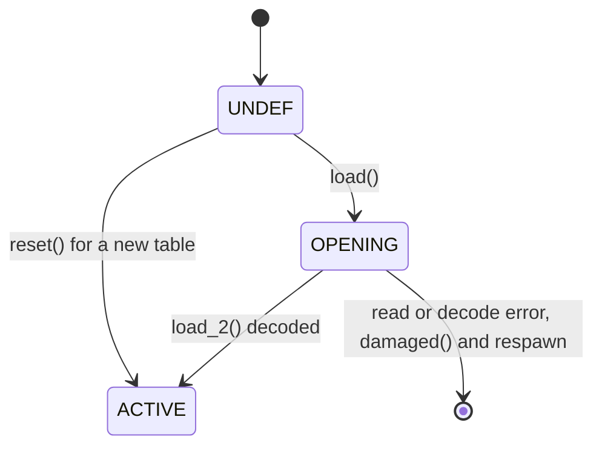
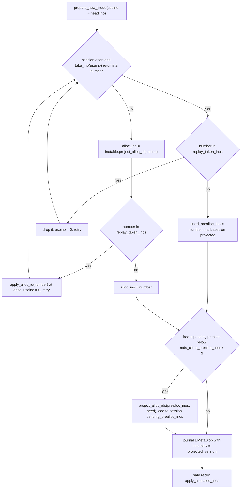
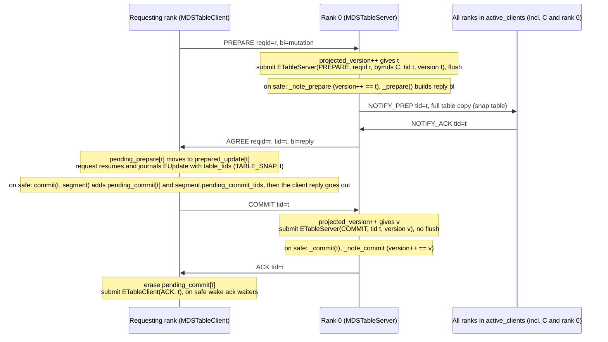
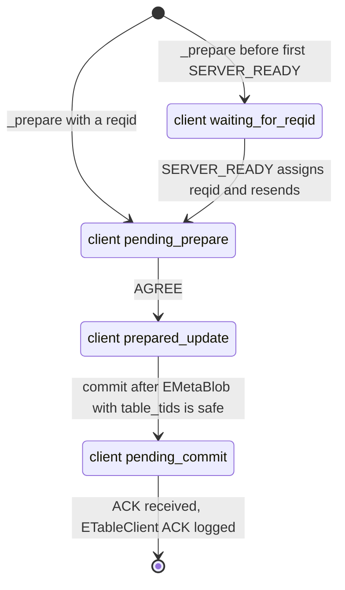
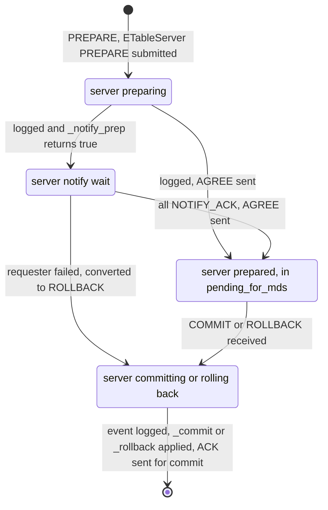
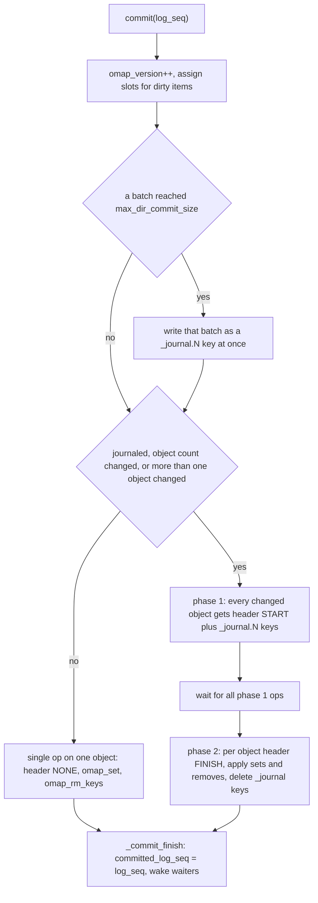
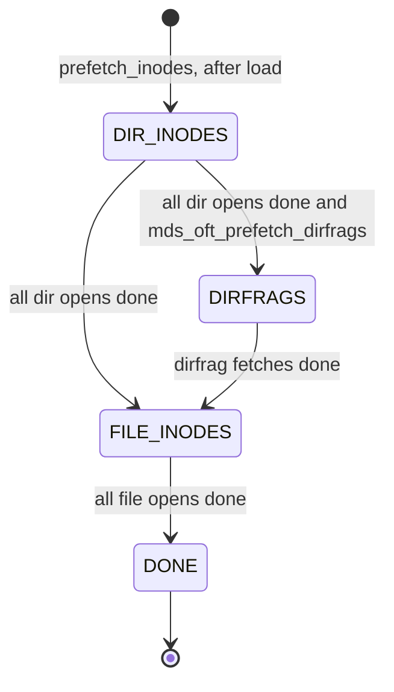

# MDS Tables: MDSTable, InoTable, table server/client 2PC, OpenFileTable, Anchor

> Part of the [C++ MDS project map](../README.md). Sources (commit `5f7e383ae6d`): `src/mds/MDSTable.{h,cc}` (98+200 LOC), `src/mds/InoTable.{h,cc}` (106+239), `src/mds/MDSTableServer.{h,cc}` (102+440), `src/mds/MDSTableClient.{h,cc}` (113+264), `src/mds/mds_table_types.h` (84), `src/mds/Anchor.{h,cc}` (78+71), `src/mds/OpenFileTable.{h,cc}` (171+1256), `src/mds/events/ETableServer.h` (60), `src/mds/events/ETableClient.h` (50), `src/messages/MMDSTableRequest.h` (73). Call sites read to describe behavior: `src/mds/SnapServer.{h,cc}` and `src/mds/SnapClient.{h,cc}` (the only table instance, ~1100 LOC; snapshot semantics live on the snapshots page), `src/mds/journal.cc` (segment expiry and replay of `EMetaBlob`, `ESession`, `EPurged`, `ETableServer`, `ETableClient`, `EOpen`, `EResetJournal`, ~500 LOC), `src/mds/MDLog.cc` (~150), `src/mds/Server.cc` (inode allocation, delegation, session close, snapshot ops, ~400), `src/mds/MDSRank.cc` (boot, mdsmap handling, dispatch, message delivery, ~350), `src/mds/MDCache.cc` (purge of delegated inos, resolve, rejoin prefetch, open_ino, ~400), `src/mds/{CInode,CDir,Capability,Locker,SessionMap}.{h,cc}` (OFT and session hooks, ~200), `src/client/Client.cc` (~40), offline tools `src/tools/cephfs/{TableTool,DataScan,JournalTool}.cc` and `first-damage.py` (~300). Kernel cross-check: `linux/fs/ceph/{super.h,mds_client.c,file.c,export.c,mdsmap.c,inode.c}`.
>
> Related: [rados-object-catalog](rados-object-catalog.md), [rados-and-osd-interactions](rados-and-osd-interactions.md), [snapshots](../10-snapshots-quotas-subvolumes/snapshots.md), [sessions](../02-client-protocol/sessions.md), [leases-lock-caches-and-async-dirops](../02-client-protocol/leases-lock-caches-and-async-dirops.md), [capabilities](../02-client-protocol/capabilities.md), [kclient-expectations](../02-client-protocol/kclient-expectations.md), [libcephfs-fuse-ganesha-expectations](../02-client-protocol/libcephfs-fuse-ganesha-expectations.md), [wire-protocol](../02-client-protocol/wire-protocol.md), [namespace-mutations](../03-request-path/namespace-mutations.md), [request-lifecycle](../03-request-path/request-lifecycle.md), [mdlog-and-journaler](../06-journal/mdlog-and-journaler.md), [events-and-replay](../06-journal/events-and-replay.md), [rank-lifecycle-and-recovery](../09-recovery/rank-lifecycle-and-recovery.md), [resolve-and-rejoin](../09-recovery/resolve-and-rejoin.md), [mdcache-subtrees-traversal-replication](../04-cache/mdcache-subtrees-traversal-replication.md), [cinode-and-inode-types](../04-cache/cinode-and-inode-types.md), [strays-and-purge](../11-background-services/strays-and-purge.md), [scrub-and-damage](../11-background-services/scrub-and-damage.md), [fsmap-and-mdsmap](../01-cluster-integration/fsmap-and-mdsmap.md), [mgr-tools-and-orchestration](../01-cluster-integration/mgr-tools-and-orchestration.md), [process-and-threading](../00-architecture/process-and-threading.md), [mds_lock-analysis](../00-architecture/mds_lock-analysis.md), [config-perf-counters-and-health](../13-admin-and-config/config-perf-counters-and-health.md), [admin-commands](../13-admin-and-config/admin-commands.md).

## 1. Purpose and responsibilities

"Tables" are the small pieces of MDS state that live outside directory objects and must survive restarts: the inode-number allocator of each rank, the cluster-wide snapshot table, and the per-rank set of open inodes. The code in scope provides five things:

| Component | Instances | Persistent form | Responsibility |
|---|---|---|---|
| `MDSTable` | abstract base of `InoTable` and `MDSTableServer` | one RADOS object in the metadata pool, always rewritten whole (`write_full`) | versioned in-memory table with projected/applied versions, asynchronous save and load, error policy |
| `InoTable` | one per rank (`MDSRank::inotable`, `src/mds/MDSRank.cc:524 (MDSRank::MDSRank)`) | `mds<rank>_inotable` | free inode numbers of the rank: single allocation, batch preallocation for client sessions, release, journal replay, repair hooks |
| `MDSTableServer` / `MDSTableClient` | server on the rank named by `MDSMap::tableserver` (always 0), client on every rank | server state inside the table object; `ETableServer` events in the server's journal; `EMetaBlob::table_tids` and `ETableClient` events in the client's journal | generic two-phase commit (prepare / agree / commit / ack / rollback) for cluster-global tables, with a notify fan-out barrier and a recovery protocol. The only instance is the snap table (`SnapServer` / `SnapClient`); `TABLE_ANCHOR` is a dead legacy id |
| `OpenFileTable` (OFT) | one per rank (`MDCache::open_file_table`, `src/mds/MDCache.cc:177 (MDCache::MDCache)`) | `mds<rank>_openfiles.<idx>` omap objects (at most 1024) | persistent set of "open" inodes and dirfrags plus all their ancestors (`Anchor` records); lets the journal expire segments without re-journaling open files, and lets a recovering rank prefetch those inodes during rejoin |
| `Anchor` | value type | OFT omap value | primary linkage of an inode: `ino`, parent `dirino`, dentry name, `d_type`, tracked dirfrags |

Out of scope (see related pages): what the snap table contents mean and how snapids are used ([snapshots](../10-snapshots-quotas-subvolumes/snapshots.md)); the session-side inode sets (`prealloc_inos`, `delegated_inos`) beyond their interaction with the InoTable and async create itself ([sessions](../02-client-protocol/sessions.md), [leases-lock-caches-and-async-dirops](../02-client-protocol/leases-lock-caches-and-async-dirops.md)); the journal mechanics ([mdlog-and-journaler](../06-journal/mdlog-and-journaler.md)); `open_ino` internals ([mdcache-subtrees-traversal-replication](../04-cache/mdcache-subtrees-traversal-replication.md)). `SessionMap` is table-like but does not derive from `MDSTable`; it is covered on the sessions page.

## 2. Source map

| File | Class / function | Lines | Role |
|---|---|---|---|
| `src/mds/MDSTable.h` | `class MDSTable` | 33-97 | states `STATE_UNDEF/OPENING/ACTIVE`, four version counters, `waitfor_save`, pure virtual `reset_state/encode_state/decode_state` |
| `src/mds/MDSTable.cc` | `MDSTable::save`, `save_2`, `C_IO_MT_Save` | 48-115 | `write_full` of `version + encode_state()`; waiters keyed by version |
| `src/mds/MDSTable.cc` | `get_object_name`, `load`, `load_2`, `reset` | 118-200 | naming; `read_full`; read/decode errors mark the rank damaged |
| `src/mds/InoTable.h` | `class InoTable`, `encode_state/decode_state`, `force_consume` | 26-103 | `free`, `projected_free` interval sets; `ENCODE_START(2,2)` |
| `src/mds/InoTable.cc` | `reset_state` | 29-44 | range `[(rank+1)<<40, (rank+2)<<40)` |
| `src/mds/InoTable.cc` | `project_alloc_id(s)`, `apply_alloc_id(s)`, `project/apply_release_ids` | 46-98 | projected/applied allocation protocol |
| `src/mds/InoTable.cc` | `replay_alloc_id(s)`, `replay_release_ids`, `replay_reset`, `skip_inos` | 103-162 | journal replay and skipping |
| `src/mds/InoTable.cc` | `is_marked_free`, `intersects_free`, `repair`, `force_consume_to` | 198-239 | validation, scrub repair, tools |
| `src/mds/mds_table_types.h` | `TABLE_ANCHOR`, `TABLE_SNAP`, `TABLESERVER_OP_*`, `TABLE_OP_*` | 25-82 | table ids, 2PC op codes (sign = direction), mutation op codes |
| `src/mds/MDSTableServer.h/.cc` | `class MDSTableServer` | h:31-101, cc:34-440 | server side of the 2PC: prepare/commit/rollback/server_update/notify/recovery |
| `src/mds/MDSTableClient.h/.cc` | `class MDSTableClient` | h:37-112, cc:41-264 | client side: reqids, pending prepares/commits, ACK logging, resend on `SERVER_READY` |
| `src/messages/MMDSTableRequest.h` | `class MMDSTableRequest` | 23-71 | the only table message (`MSG_MDS_TABLE_REQUEST` = 102) |
| `src/mds/events/ETableServer.h`, `src/mds/journal.cc` | `ETableServer::encode/decode/update_segment/replay` | h:25-57, cc:2086-2185 | server journal event (`EVENT_TABLESERVER` = 43) |
| `src/mds/events/ETableClient.h`, `src/mds/journal.cc` | `ETableClient::encode/decode/replay` | h:25-47, cc:2191-2238 | client ACK journal event (`EVENT_TABLECLIENT` = 42) |
| `src/mds/SnapServer.cc` | `reset_state`, `_prepare`, `_get_reply_buffer`, `_commit`, `_rollback`, `_server_update`, `_notify_prep`, `handle_query` | 45-363 | the table hooks implemented by the snap table |
| `src/mds/SnapClient.cc` | `resend_queries`, `handle_query_result`, `handle_notify_prep`, `notify_commit`, `prepare_*`, `refresh`, `sync` | 34-219 | client hooks and the local snap-table cache |
| `src/mds/Anchor.h/.cc` | `Anchor`, `RecoveredAnchor`, `OpenedAnchor` | h:34-75, cc:23-71 | linkage record and its encoding `ENCODE_START(2,1)` |
| `src/mds/OpenFileTable.h` | `class OpenFileTable` | 47-169 | limits, dirty states, journal states, prefetch states |
| `src/mds/OpenFileTable.cc` | `get_ref`, `put_ref`, `add/remove_inode`, `add/remove_dirfrag`, `notify_link/unlink` | 72-240 | ref-counted anchor map with ancestor closure |
| `src/mds/OpenFileTable.cc` | `commit`, `_journal_finish`, `_commit_finish` | 285-697 | omap write-out with a multi-object redo journal |
| `src/mds/OpenFileTable.cc` | `load`, `_read_omap_values`, `_load_finish`, `_recover_finish` | 737-997 | load and redo-journal recovery |
| `src/mds/OpenFileTable.cc` | `prefetch_inodes`, `_prefetch_inodes`, `_prefetch_dirfrags`, `_open_ino_finish`, `_get_ancestors` | 999-1226 | rejoin prefetch |
| `src/mds/OpenFileTable.cc` | `should_log_open`, `note_destroyed_inos`, `trim_destroyed_inos` | 1228-1256 | `EOpen` decision, destroyed-inode filter |
| `src/mds/Server.cc` | `prepare_new_inode`, `journal_allocated_inos`, `apply_allocated_inos`, `reply_client_request` | 3637-3802, 2408 | InoTable users in the request path |
| `src/mds/Server.cc` | `set_reply_extra_bl` | 2591-2615 | delegation of preallocated numbers to clients |
| `src/mds/Server.cc` | `journal_close_session`, `_session_logged`, `reconnect_tick` | 1524-1560, 925-954, 1919 | release / purge of session inodes |
| `src/mds/SessionMap.h` | `Session::take_ino`, `delegate_inos`, `get_num_(projected_)prealloc_inos` | 179-225 | session-side ino sets |
| `src/mds/MDCache.cc` | `purge_inodes`, `start_purge_inodes`, `C_MDS_purge_completed_finish` | 6875-6928 | purge then release of delegated inodes (`EPurged`) |
| `src/mds/MDCache.h` | `insert_taken_inos`, `test_and_clear_taken_inos`, `replay_taken_inos` | 223-234, 1481 | guard against numbers the table wrongly believes free |
| `src/mds/journal.cc` | `LogSegment::try_to_expire` | 127-378 | expiry waits: OFT commit, InoTable save, table ACKs, table saves |
| `src/mds/journal.cc` | `EMetaBlob::replay` (table parts), `EPurged`, `ESession`, `EResetJournal::replay` | 1626-1677, 1753-1775, 1821-1946, 3368 | table replay |
| `src/mds/MDLog.cc` | `_submit_entry`, `try_to_commit_open_file_table`, `log_trim_upkeep`, `trim`, `trim_to`, `standby_trim_segments` | 393-441, 684-834, 855-906, 1615-1653 | `last_journaled`, OFT commit trigger |
| `src/mds/MDSRank.cc` | `handle_message` (table dispatch), `get_table_client/server`, `send_message_mds`, `is_stale_message` | 1268-1280, 896-912, 1476-1497, 1377-1416 | routing by op sign; delivery rules |
| `src/mds/MDSRank.cc` | `boot_start`, `boot_create`, `replay_done`, `validate_sessions`, `standby_replay_restart` | 1622-1768, 2189-2250, 1897-1968, 1860-1895 | table load/create at boot |
| `src/mds/MDSRank.cc` | `MDSRankDispatcher::handle_mds_map` (table recovery hooks), `handle_mds_failure` | 2368-2484, 2574-2585, 2638-2654 | server/client recovery triggers |
| `src/mds/MDCache.cc` | `resolve_start`, `send_resolves`, `send_subtree_resolves`, `maybe_finish_peer_resolve`, `handle_resolve` | 2782-3004, 3419-3427 | table-commit exchange in resolve |
| `src/mds/MDCache.cc` | `process_imported_caps`, `rejoin_prefetch_ino_finish`, `clean_open_file_lists`, `dump_openfiles` | 5465-5560, 5803-5850 | OFT consumers in rejoin and at active |
| `src/mds/CInode.cc`, `CDir.cc`, `Capability.cc` | `adjust_num_caps_notable`, `mark/clear_clientwriteable`, `set_mds_caps_wanted`, `adjust_num_inodes_with_caps`, `link/unlink_inode_work`, `Capability::set_wanted` | CInode 3569-3650, 3924-3955; CDir 316-326, 622-637, 709-728; Capability 254-278 | OFT triggers |

## 3. How it works

### 3.1 `MDSTable`: versioned single-object tables

**Object and naming.** A table is constructed as `MDSTable(mds, name, per_mds)`. Its RADOS object is `mds<rank>_<name>` when `per_mds` is true and `mds_<name>` otherwise, always in the metadata pool with no namespace (`src/mds/MDSTable.cc:142 (MDSTable::get_object_name)`). `InoTable` is per-rank with name `inotable` (`src/mds/InoTable.h:28 (InoTable::InoTable)`); `MDSTableServer` is global with the name from `get_mdstable_name(table)` (`src/mds/MDSTableServer.cc:42 (MDSTableServer::MDSTableServer)`), so the snap table object is `mds_snaptable`. Each filesystem has its own metadata pool, so tables are per filesystem.

**States.** `STATE_UNDEF` (0), `STATE_OPENING` (1), `STATE_ACTIVE` (2) (`src/mds/MDSTable.h:83-85 (MDSTable::STATE_*)`).



**Versions** (`src/mds/MDSTable.h:94 (MDSTable version fields)`):

| Field | Meaning | Advanced by |
|---|---|---|
| `projected_version` | version after all changes already projected (handed out, journal event submitted or about to be) | subclass `project_*` / server `handle_*` |
| `version` | version of the applied in-memory state (`free`, server state) | subclass `apply_*` / `_note_*` once the journal event is safe; replay |
| `committing_version` | version of the last `save()` issued | `save()` |
| `committed_version` | version durably written to RADOS | `save_2()` |

There is no generic increment (the base `project_version()`/`inc_version()` are commented out, `src/mds/MDSTable.h:56-57 (MDSTable)`); each subclass bumps the counters itself. `force_replay_version(v)` sets `version = projected_version = v` (used by `EMetaBlob` replay repair and by `cephfs-data-scan`, `src/mds/MDSTable.h:52 (MDSTable::force_replay_version)`). A fresh `InoTable` starts at version 0 (`InoTable::reset_state` does not bump), a fresh server table at version 1 (`MDSTableServer::reset_state` does `++version`, `src/mds/MDSTableServer.cc:79 (MDSTableServer::reset_state)`).

**Save.** `save(onfinish, need)` (`src/mds/MDSTable.cc:60 (MDSTable::save)`):
1. If `need > 0 && need <= committing_version`, a sufficient save is already in flight: queue `onfinish` under `waitfor_save[need]` and return.
2. Otherwise assert `ACTIVE`, encode `version` (u64) followed by `encode_state()` (the applied state, never the projected one), set `committing_version = version`, queue `onfinish` under `waitfor_save[version]` (keyed by the current version, not by `need`), and issue `objecter->write_full` with an empty `SnapContext`; completion goes through `C_OnFinisher(C_IO_MT_Save)` on `mds->finisher`.
3. `save_2(r, v)` (`src/mds/MDSTable.cc:93 (MDSTable::save_2)`): on error, clog "failed to store table" and `mds->handle_write_error(r)` (`-EBLOCKLISTED` respawns; otherwise `mds_action_on_write_error`: 0 ignore, 1 (default) force read-only, 2 respawn, `src/mds/MDSRank.cc:973 (MDSRank::handle_write_error)`); waiters are not completed. On success `committed_version = v` and all waiters with key `<= v` complete with 0.

**Load.** `load(onfinish)` issues `objecter->read_full` at `CEPH_NOSNAP` (`src/mds/MDSTable.cc:152 (MDSTable::load)`). `load_2` (`src/mds/MDSTable.cc:166 (MDSTable::load_2)`): `-EBLOCKLISTED` respawns; any other error logs "error reading table object" and calls `mds->damaged()` (the rank goes `down:damaged` and the daemon respawns); decoding reads `version`, sets `projected_version = committed_version = version`, then `decode_state()`; a decode exception also calls `damaged()`. A missing `mds<rank>_inotable` or `mds_snaptable` therefore makes the rank damaged; the QA damage test expects `DAMAGED_ON_START` for every deleted metadata object except the journal pointer `400.00000000`, the purge queue `500.00000000`, a non-system directory's dirfrag `10000000000.00000000` and `mds0_openfiles.0` (`qa/tasks/cephfs/test_damage.py:140-152 (TestDamage.test_object_deletion)`).

`MDSTable::shutdown()` (save if active) exists but has no caller (`src/mds/MDSTable.h:68 (MDSTable::shutdown)`); tables reach RADOS only through journal-segment expiry (3.2.7, 3.3.5) and explicit saves at create, after `mds_skip_ino`, after a snap-table format upgrade, and after a scrub repair.

### 3.2 `InoTable`: per-rank inode-number allocator

#### 3.2.1 Ranges per rank and reserved numbers

`InoTable::reset_state()` sets `free = projected_free = [(rank+1) << 40, (rank+2) << 40)`, i.e. 2^40 numbers per rank (`src/mds/InoTable.cc:29 (InoTable::reset_state)`):

| Numbers | Use | Source |
|---|---|---|
| `1` | root (`CEPH_INO_ROOT`) | `src/include/ceph_fs.h:52 (CEPH_INO_ROOT)` |
| `2`, `3`, `4` | `CEPH_INO_CEPH`, `CEPH_INO_GLOBAL_SNAPREALM`, `CEPH_INO_LOST_AND_FOUND` | `src/include/ceph_fs.h:58-60` |
| `0x100 + r` | mdsdir of rank `r` (`MDS_INO_MDSDIR_OFFSET`, `MAX_MDS = 0x100`) | `src/mds/mdstypes.h:38 (MDS_INO_MDSDIR_OFFSET)`, `src/include/cephfs/types.h:41 (MAX_MDS)` |
| `0x200+r`, `0x300+r`, `0x400+r`, `0x500+r` | journal, journal backup, journal pointer, purge queue of rank `r` | `src/mds/mdstypes.h:42-45 (MDS_INO_LOG_OFFSET ...)` |
| `0x600 + r*10 + i` | stray dir `i` (0..9) of rank `r` | `src/mds/mdstypes.h:39, 52 (MDS_INO_STRAY_OFFSET, MDS_INO_IS_STRAY)` |
| `0x1000` .. `2^40 - 1` | never allocated (`MDS_INO_SYSTEM_BASE = 0x1000`) | `src/mds/mdstypes.h:47 (MDS_INO_SYSTEM_BASE)` |
| `(r+1)<<40` .. `(r+2)<<40 - 1` | allocated by rank `r` (rank 0: `0x10000000000`-`0x1ffffffffff`) | `src/mds/InoTable.cc:34-41 (InoTable::reset_state)` |

The rank only determines which allocator hands out a number; it does not determine authority. An inode keeps its number when its subtree migrates to another rank. Offline tools rely on `rank = (ino >> 40) - 1` to decide which table to repair (`src/tools/cephfs/DataScan.cc:1495-1514 (DataScan::scan_links)`).

A table is created (reset and saved) only when the rank is `up:creating` (`src/mds/MDSRank.cc:2219-2222 (MDSRank::boot_create)`). A rank that was stopped and is started again is `up:starting` and loads its old table, as do `up:replay` and `up:standby-replay` (`src/mds/MDSRank.cc:1655-1657 (MDSRank::boot_start)`). The monitor decides which: a previously stopped rank becomes `STARTING`, a never-seen rank `CREATING`, a failed rank `REPLAY` (`src/mds/FSMap.cc:1035-1045 (FSMap::promote)`); `fs reset` marks rank 0 in-and-failed and every other rank that was in or already stopped as stopped ("They should load old inotable instead of creating new one if they start again.") (`src/mds/FSMap.cc:545-567 (FSMap::reset_filesystem)`).

#### 3.2.2 Projected / applied protocol

Two interval sets are kept: `projected_free` (what may still be handed out) and `free` (applied state, what is saved). Each operation advances the counters:

| Method | Changes | Version effect | Callers |
|---|---|---|---|
| `project_alloc_id(id = 0)` | `projected_free.erase(id ? id : range_start())` | `++projected_version` | `Server::prepare_new_inode` |
| `apply_alloc_id(id)` | `free.erase(id)` | `++version` | `Server::apply_allocated_inos`; `prepare_new_inode` when skipping a taken number |
| `project_alloc_ids(ids, want)` | takes `want` numbers from the lowest free intervals | `++projected_version` (once per call) | `prepare_new_inode` (session refill) |
| `apply_alloc_ids(ids)` | `free.subtract(ids)` | `++version` | `apply_allocated_inos` |
| `project_release_ids(ids)` | `projected_free.insert(ids)` | `++projected_version` | `Server::journal_close_session`, `MDCache::purge_inodes` |
| `apply_release_ids(ids)` | `free.insert(ids)` | `++version` | `Server::_session_logged`, `C_MDS_purge_completed_finish` |
| `replay_alloc_id(id)`, `replay_alloc_ids(ids)` | remove from both sets what is actually free; anything not free is a clog error ("journal replay alloc X not in free ..." / "journal replay alloc S, only S' is in free ...") | `projected_version = ++version` | `EMetaBlob::replay` |
| `replay_release_ids(ids)` | insert into both | `projected_version = ++version` | `EPurged::replay`, `ESession::replay` |
| `skip_inos(n)` | remove `[first_free, first_free + n)` from `free`; `projected_free = free` | `projected_version = ++version` | `replay_done` (`mds_skip_ino`), `force_consume_to` |
| `replay_reset()` | `skip_inos(10000000)`, then again `projected_free = free` | two increments: `skip_inos` and its own `projected_version = ++version` | `EResetJournal::replay` |
| `repair(id)` | erase from both; refused (returns false) if `projected_version != version` | `projected_version = ++version` | scrub |
| `force_consume(id)`, `force_consume_to(ino)` | erase one id from `free` only / everything free up to and including `ino` (via `skip_inos`) | none / via `skip_inos` | offline tools |

(`src/mds/InoTable.cc:46-239 (InoTable::*)`, `src/mds/InoTable.h:81-98 (InoTable::force_consume)`.) `force_consume_to` compares only against the first free number; it does not check that `ino` lies in this rank's range (`src/mds/InoTable.cc:231 (InoTable::force_consume_to)`).

All set operations use the strict `interval_set` (`strict = true` by default, `src/include/interval_set.h:45 (interval_set)`): `erase`/`subtract` of a value that is not present, `insert` of an overlapping value and `range_start()` on an empty set all `ceph_assert` (`src/include/interval_set.h:503-506 (range_start)`, `:551-600 (insert)`, `:683-716 (erase)`, `:791 (subtract)`). See G1 and G2.

What makes the counters meaningful is ordering: projections happen in the request handler under `mds_lock`, the journal event is submitted in the same critical section carrying `inotablev = projected_version`, and the matching `apply_*` runs from the journal-completion context. Completions fire in submission order, so after each apply `version` equals the `inotablev` stored in the event just applied. Two callers assert exactly that (`src/mds/Server.cc:950 (Server::_session_logged)`, `src/mds/MDCache.cc:6887 (C_MDS_purge_completed_finish::finish)`).

#### 3.2.3 Allocation in the request path

`Server::prepare_new_inode(mdr, dir, useino, mode, layout)` (`src/mds/Server.cc:3637 (Server::prepare_new_inode)`) is called by openc, mknod, mkdir and symlink with `useino = req->head.ino` (`src/mds/Server.cc:4991, 7625, 7726, 7825 (Server::handle_client_openc, handle_client_mknod, handle_client_mkdir, handle_client_symlink)`). There is no other validation of `head.ino` before this call.



1. `allow_prealloc_inos = session->is_open()`; a session re-opened by `prepare_force_open_sessions` while closing may not use or refill its preallocation (`src/mds/Server.cc:3643-3647 (Server::prepare_new_inode)`).
2. Loop until a number is obtained (`src/mds/Server.cc:3651-3678`):
   - If allowed, `session->take_ino(useino)` (`src/mds/SessionMap.h:179 (Session::take_ino)`): with `useino != 0` it returns 0 unless `useino` is in the session's durable `info.prealloc_inos`; then it is removed from `delegated_inos` or `free_prealloc_inos`, and if it is in neither (already taken by another in-flight request) `ceph_assert(0)`. With `useino == 0` it takes the lowest `free_prealloc_inos` number.
   - Otherwise `mdr->alloc_ino = inotable->project_alloc_id(useino)`; with `useino != 0` this strictly erases exactly that number from `projected_free`.
   - In both branches a number found in `MDCache::replay_taken_inos` (3.2.9) is consumed and the loop retries with `useino = 0` (the table branch applies the allocation immediately, without a journal event).
3. If the final number differs from a non-zero `useino`, the MDS logs "`<client> specified ino X but mds.N allocated Y`" to the cluster log and continues (`src/mds/Server.cc:3679-3686`).
4. Refill (`src/mds/Server.cc:3688-3696`): if `free_prealloc_inos + pending_prealloc_inos < mds_client_prealloc_inos / 2` (default 1000/2), `inotable->project_alloc_ids(mdr->prealloc_inos, mds_client_prealloc_inos - (free + pending))` and add them to `session->pending_prealloc_inos`. Delegated numbers do not count toward the threshold (`src/mds/SessionMap.h:218-225 (Session::get_num_prealloc_inos, get_num_projected_prealloc_inos)`), so a session can hold up to about `mds_client_prealloc_inos` free plus the delegated share.

`Server::journal_allocated_inos` stores `allocated_ino`, `used_preallocated_ino`, `preallocated_inos`, `client_name`, the projected SessionMap version and `inotablev = inotable->get_projected_version()` in the `EMetaBlob` (`src/mds/Server.cc:3767 (Server::journal_allocated_inos)`, `src/mds/events/EMetaBlob.h:392 (EMetaBlob::set_ino_alloc)`). `Server::reply_client_request` (the safe reply, run from the request's journal-completion context) calls `apply_allocated_inos` (`src/mds/Server.cc:2408 (Server::reply_client_request)`), which applies: `apply_alloc_id(alloc_ino)`; for a refill, moves `prealloc_inos` from pending into `free_prealloc_inos` and `info.prealloc_inos` and calls `apply_alloc_ids`; for a used preallocated number, erases it from `info.prealloc_inos` (`src/mds/Server.cc:3780 (Server::apply_allocated_inos)`). The completed-request record of the session stores the created number (`alloc_ino`, else `used_prealloc_ino`) so a resent request can be answered (`src/mds/Server.cc:2398-2401`).

Inode numbers of unlinked files are never returned to the table: the only release paths are session close and purge of delegated numbers (3.2.5). Neither `StrayManager` nor `PurgeQueue` references the InoTable (no `inotable` references in `src/mds/StrayManager.cc`, `src/mds/PurgeQueue.cc`). A rank consumes its 2^40 range monotonically, except for preallocated numbers that were never used.

#### 3.2.4 Delegation to clients (async create)

When a create reply is built for a session with `CEPHFS_FEATURE_DELEG_INO` and `mds_allow_async_dirops` (default true), `Server::set_reply_extra_bl` encodes `openc_response_t{created_ino, delegated_inos}` instead of the legacy bare `u64` ino (`src/mds/Server.cc:2591-2615 (Server::set_reply_extra_bl)`, `src/messages/MClientReply.h:309-327 (openc_response_t)`). It is called during request processing, so the delegation appears in the early reply too (`src/mds/Server.cc:5039 (Server::handle_client_openc)`). If `mds_client_delegate_inos_pct` (default 50) is non-zero and the request is not queued for replay, with `frac = 100 / pct` (integer division), and the session holds fewer than `mds_client_prealloc_inos / frac / 2` delegated numbers (250 by default), `Session::delegate_inos(mds_client_prealloc_inos / frac)` moves numbers from `free_prealloc_inos` into `delegated_inos` and into the reply until the session holds 500 delegated numbers (`src/mds/SessionMap.h:197-216 (Session::delegate_inos)`).

Delegated numbers are already allocated from the InoTable (they are part of the session's preallocation), so delegation does not touch the table. `delegated_inos` is memory-only; only `info.prealloc_inos` is persisted in the SessionMap and `Session::decode` sets `free_prealloc_inos = info.prealloc_inos` (`src/mds/SessionMap.cc:1101-1104 (Session::decode)`). The kernel destroys its delegated set whenever it sends a session reconnect (`linux/fs/ceph/mds_client.c:5167-5169 (send_mds_reconnect)`), so delegations live for one MDS incarnation of the session. While the rank is in (or wants) `up:reconnect`, every replayed or async request is queued for client replay; if it carries a non-zero `head.ino` and is not a completed request, the number is passed to `MDCache::add_replay_ino_alloc` (which marks it in `cap_imports_missing` so rejoin does not try to open it). Only when `mds_replay_unsafe_with_closed_session` (default false) is set, and the number is in `free_prealloc_inos`, is it also moved into `delegated_inos` ("don't purge inodes that will be created by later replay") (`src/mds/Server.cc:349-361 (Server::dispatch)`, `src/mds/MDCache.h:735-737 (MDCache::add_replay_ino_alloc)`). A session that fails to reconnect has `delegated_inos` and `free_prealloc_inos` swapped, so its unused preallocation is purged before release, while numbers moved by the dispatch path above end up in `free_prealloc_inos` and are released without a purge (`src/mds/Server.cc:1918-1919 (Server::reconnect_tick)`).

#### 3.2.5 Release paths

| Trigger | Projection | Journal event | Apply |
|---|---|---|---|
| Session close/kill/evict (`journal_close_session`) | `project_release_ids(pending_prealloc_inos + free_prealloc_inos)`, `piv = projected_version` (`src/mds/Server.cc:1536-1545 (Server::journal_close_session)`) | `ESession(open=false, inos_to_free, inotablev=piv, inos_to_purge=delegated_inos)`, flushed | `_session_logged`: `apply_release_ids(inos_to_free)`, assert `version == piv`; `inos_to_purge` go to the segment's `purging_inodes` and, when the rank is clientreplay/active/stopping, to `MDCache::purge_inodes` (`src/mds/Server.cc:935-954 (Server::_session_logged)`) |
| Purge of delegated numbers finished (`MDCache::purge_inodes`) | after `filer.purge_range(ino, default_file_layout, 0, 1)` (object 0 of each number in the default data pool; result 0 or `-ENOENT` asserted), `project_release_ids(inos)` | `EPurged(inos, segment seq, inotablev)`, flushed | `C_MDS_purge_completed_finish`: `apply_release_ids`, assert version, `ls->purge_inodes_finish` (`src/mds/MDCache.cc:6875-6928 (C_MDS_purge_completed_finish, MDCache::purge_inodes)`) |

Delegated numbers are purged before release because a client may already have written file data for a create that it saw answered (early reply) but that the MDS never journaled. By code reading such data can only be in the first stripe unit (object 0): the kernel builds an async-created inode with `max_size` 0 and waits for the create reply before it writes (`linux/fs/ceph/file.c:681, 711 (ceph_finish_async_create)`, `linux/fs/ceph/caps.c:3181-3188 (__ceph_get_caps)`), the initial writable range of a new file is one stripe unit (`src/mds/Server.cc:5018-5020 (Server::handle_client_openc)`), and a larger `max_size` is sent only after its own journal entry, which follows the create's, is safe (`Locker::check_inode_max_size` -> `Locker::file_update_finish`). The code purges only object 0 in the default data pool ("FIXME: handle non-default data pool and namespace", `src/mds/MDCache.cc:6906`), see G23. Purges recorded while recovering are started from `MDSRank::recovery_done` via `MDCache::start_purge_inodes` (`src/mds/MDSRank.cc:2175 (MDSRank::recovery_done)`, `src/mds/MDCache.cc:6893 (MDCache::start_purge_inodes)`). `mds_wipe_ino_prealloc` (dev) clears every session's sets at `replay_done` without returning them to the table (`src/mds/SessionMap.cc:742 (SessionMap::wipe_ino_prealloc)`).

#### 3.2.6 Journal fields that carry InoTable versions

| Event | Field(s) | Segment bookkeeping (at submit and at replay) |
|---|---|---|
| `EMetaBlob` (inside `EUpdate`, `EOpen`, `EPeerUpdate`, ...) | `allocated_ino`, `used_preallocated_ino`, `preallocated_inos`, `client_name`, `inotablev`, `sessionmapv` (`src/mds/journal.cc:909-919 (EMetaBlob::encode)`) | `EMetaBlob::update_segment`: `ls->inotablev = inotablev` if non-zero (`src/mds/journal.cc:484-493 (EMetaBlob::update_segment)`) |
| `ESession` (close) | `inos_to_free`, `inotablev`, `inos_to_purge` | `ESession::update_segment`: `inotablev` if `inos_to_free` non-empty (`src/mds/journal.cc:1876-1881 (ESession::update_segment)`) |
| `EPurged` | `inos`, `inotablev`, `seq` (`ENCODE_START(1,1)`, `src/mds/journal.cc:1848-1855 (EPurged::encode)`) | `EPurged::update_segment` (`src/mds/journal.cc:1821-1826`) |
| `EResetJournal` | none (stamp only) | replay calls `inotable->replay_reset()` (`src/mds/journal.cc:3368-3373 (EResetJournal::replay)`) |

#### 3.2.7 Persistence

The InoTable is saved when a journal segment that recorded an InoTable change is expired: `LogSegment::try_to_expire` calls `inotable->save(gather, ls->inotablev)` when `ls->inotablev > committed_version` (`src/mds/journal.cc:309-316 (LogSegment::try_to_expire)`). Because `save` writes the current applied state and keys its waiter by the current version, an expiry whose `inotablev` is above the applied version completes with an older save; `MDLog::_maybe_expired` re-runs `try_to_expire`, which issues another save (`src/mds/MDLog.cc:933-942 (MDLog::_maybe_expired)`). Other saves: at create (`boot_create`), after `mds_skip_ino` at `replay_done` (`src/mds/MDSRank.cc:1951-1956 (MDSRank::replay_done)`), after a scrub repair (`src/mds/CInode.cc:5119 (CInode::validate_disk_state)`). Every save rewrites the whole free set (`write_full`).

#### 3.2.8 Replay and post-replay validation

`EMetaBlob::replay` (`src/mds/journal.cc:1646-1677 (EMetaBlob::replay)`):
- If `inotable->get_version() >= inotablev` (already reflected in the loaded table), or the testing knob `mds_inject_skip_replaying_inotable` applies to an `EUpdate`: the table is untouched and `allocated_ino` is recorded in `replay_taken_inos`.
- Otherwise `replay_alloc_id(allocated_ino)` and/or `replay_alloc_ids(preallocated_inos)`; each bumps `version` by one. If `inotablev` is still ahead of `version` (a gap left by un-journaled bumps, see G3), clog "journal replay inotablev mismatch" and `force_replay_version(inotablev)`; then `ceph_assert(inotablev == version)`.
- The session side (`sessionmapv`) is replayed right after with the same version technique; when skipped, `used_preallocated_ino` goes to `replay_taken_inos` (`src/mds/journal.cc:1678-1730 (EMetaBlob::replay)`).

`EPurged::replay` and `ESession::replay` apply `replay_release_ids` only if the table version is behind, and then `ceph_assert(version == inotablev)` without a gap-repair path (`src/mds/journal.cc:1828-1846 (EPurged::replay)`, `:1933-1944 (ESession::replay)`). See G3.

After replay, `MDSRank::validate_sessions` asserts for every session that `info.prealloc_inos == free_prealloc_inos` (`ceph_assert`) and that none of them intersects the table's `free` set; any intersection logs "loaded with preallocated inodes that are inconsistent with inotable" and marks the rank damaged (`src/mds/MDSRank.cc:1744-1768 (MDSRank::validate_sessions)`).

#### 3.2.9 `replay_taken_inos`: numbers the table may wrongly believe free

`MDCache::replay_taken_inos` (`std::set<inodeno_t>`, `src/mds/MDCache.h:1481`) collects numbers that are known to be in use although the table or a session might still list them as free: `allocated_ino` / `used_preallocated_ino` of replayed events whose table update was already reflected or skipped (`src/mds/journal.cc:1655, 1684 (EMetaBlob::replay)`), and every inode loaded from a dirfrag object (`src/mds/CDir.cc:2017 (CDir::_load_dentry)`). Entries are removed when the inode leaves the cache (`src/mds/MDCache.cc:398 (MDCache::remove_inode)`) or when `prepare_new_inode` hits them (3.2.3). The mechanism was added for tracker 52280 ("mds: do not take the ino which has been used", commit `a8c63c7919a`). The set is a plain `std::set` (not in an MDS mempool) holding one entry per inode fetched from disk that is still in cache, at runtime as well as during recovery.

#### 3.2.10 Repair and tools

- Scrub: when an inode's number is free in this rank's table (`is_marked_free` checks both sets), scrub logs "scrub: inode wrongly marked free"; with the repair flag it calls `repair()` and `save()`, increments `mds.scrub_inotable_repaired`, or logs "Cannot repair inotable while other operations are in progress" when projections are outstanding (`src/mds/CInode.cc:5101-5128 (CInode::validate_disk_state)`). Only the scrubbing rank's own table is consulted, so numbers from other ranks' ranges are never checked.
- `EResetJournal` (written by `cephfs-journal-tool journal reset`) replays as "wipe sessions, skip 10,000,000 numbers" (`src/mds/journal.cc:3368-3373 (EResetJournal::replay)`, `src/mds/InoTable.cc:142 (InoTable::replay_reset)`).
- `cephfs-table-tool <rank|all> show|reset inode` reads or rewrites `mds<rank>_inotable` (a reset writes version 1 and the fresh range); `take_inos <max>` resets and consumes everything up to `max`, also writing version 1 (`src/tools/cephfs/TableTool.cc:118-195, 296-319 (TableHandler, InoTableHandler::take_inos)`).
- `cephfs-data-scan scan_links` computes the highest used number per rank range and calls `force_consume_to`, saving with the loaded version plus one (`src/tools/cephfs/DataScan.cc:1495-1514, 1676-1694 (DataScan::scan_links)`, `:1975-2015 (MetadataDriver::load_table, save_table)`); `cephfs-journal-tool event recover_dentries` calls `force_consume` for every injected number on every `in` rank and writes version + 1 (`src/tools/cephfs/JournalTool.cc:1323-1389 (JournalTool::consume_inos)`).

### 3.3 Table server / client: the generic two-phase commit

#### 3.3.1 Roles, placement, routing and delivery

- Table ids: `TABLE_ANCHOR = 0` (name `anchortable`), `TABLE_SNAP = 1` (name `snaptable`) (`src/mds/mds_table_types.h:25-36 (get_mdstable_name)`). `MDSRank::get_table_server/get_table_client` return `snapserver`/`snapclient` for `TABLE_SNAP` and `NULL` for `TABLE_ANCHOR` (`src/mds/MDSRank.cc:896-912 (MDSRank::get_table_client, get_table_server)`), so anchor-table events in old journals are ignored on replay (`src/mds/journal.cc:2140-2142 (ETableServer::replay)`). Every rank constructs both a `SnapServer` and a `SnapClient` (`src/mds/MDSRank.cc:525-526 (MDSRank::MDSRank)`).
- Server placement: `MDSMap::tableserver` is initialised to 0, only ever decoded, and encoded in every MDSMap (`src/mds/MDSMap.h:600 (MDSMap::tableserver)`, `src/mds/MDSMap.cc:794, 823, 917 (MDSMap::encode, MDSMap::decode)`). Rank 0 therefore always runs the snap table server; every rank (including 0) runs a client. Server-side work in `MDSRank` is gated by `mdsmap->get_tableserver() == whoami` (`src/mds/MDSRank.cc:753, 1676, 1935, 2231, 2403, 2467, 2582, 2648, 3079, 3890`), but incoming server-op messages are not.
- One message type, `MMDSTableRequest` (`MSG_MDS_TABLE_REQUEST` = 102). The op sign gives the direction: `MDSRank::handle_message` sends `op < 0` to the client object and `op >= 0` to the server object, after `ALLOW_MESSAGES_FROM(CEPH_ENTITY_TYPE_MDS)` (`src/mds/MDSRank.cc:1268-1280 (MDSRank::handle_message)`). A message with `table = TABLE_ANCHOR` would dereference the `NULL` object.
- Client gating: `MDSTableClient::handle_request` drops a message when the local rank is below `up:resolve` (this includes `up:creating`, `up:starting` and `up:replay`, whose state codes are negative or 8), except that it is re-queued with `wait_for_resolve` when the rank's wanted state is `resolve` (`src/mds/MDSTableClient.cc:58-63 (MDSTableClient::handle_request)`). The server side has no state gate.
- Delivery rules that the protocol relies on (`src/mds/MDSRank.cc:1476-1497 (MDSRank::send_message_mds)`): a message to a rank that is not up in the sender's MDSMap is dropped (`ENOENT`); a message to a rank in `creating`, `starting` or `replay` is deferred until the sender's map shows it beyond `replay` (`src/mds/MDSRank.cc:2533-2547 (MDSRankDispatcher::handle_mds_map)`); before the first message to a peer whose known map epoch is older, the sender pushes its own `MMDSMap` on the same connection, so the receiver processes the newer map first. On receipt, `MDSRank::is_stale_message` drops messages from a rank that is down in the receiver's map or whose connection does not match that rank's current address (`src/mds/MDSRank.cc:1377-1416 (MDSRank::is_stale_message)`). Messages between two instances of the same rank are therefore never delivered across a failover; the protocol recovers lost messages by resending (3.3.7).

#### 3.3.2 Normal transaction flow

Example: `mksnap` on any rank (`src/mds/Server.cc:11679-11770 (Server::handle_client_mksnap, _mksnap_finish)`). The requesting MDS holds the `snaplock` xlock of the directory during the whole exchange.



Server functions: `handle_prepare` (`src/mds/MDSTableServer.cc:111 (MDSTableServer::handle_prepare)`), `_prepare_logged` (`:127`), `handle_notify_ack` (`:152`), `handle_commit` (`:189`), `_commit_logged` (`:224`), `handle_rollback` (`:253`), `_rollback_logged` (`:270`). Client functions: `_prepare` (`src/mds/MDSTableClient.cc:162 (MDSTableClient::_prepare)`), `handle_request` AGREE/ACK/SERVER_READY (`:78-143`), `commit` (`:188`), `_logged_ack` (`:151`).

Details that matter:
- The transaction id `tid` is the server table version produced by the prepare. It travels in the message header `tid` field (`set_tid`), not in the payload (`src/messages/MMDSTableRequest.h:32-36 (MMDSTableRequest::MMDSTableRequest)`). `reqid` is a per-client-rank counter used only to match an AGREE to its prepare.
- `_prepare_logged` asserts `version == tid` after `_note_prepare`, i.e. server events must be applied in exactly the order their versions were projected (`src/mds/MDSTableServer.cc:137`).
- Only the prepare is flushed explicitly (`mdlog->flush()` in `handle_prepare`); the `COMMIT`, `ROLLBACK`, `SERVER_UPDATE` and client `ACK` events become durable at the next flush of the respective journal: any later flush caused by other activity, the Journaler's own flush when the write position crosses an object boundary, the flush that `LogSegment::try_to_expire` issues whenever it has to wait (`src/mds/journal.cc:371-373`), or the periodic `mdlog->flush()` in `MDSRankDispatcher::tick` every `mds_tick_interval` (default 5 s; skipped while the beacon is laggy) (`src/mds/MDSRank.cc:726 (MDSRankDispatcher::tick)`).
- The requesting MDS replies to its client after its own `EUpdate` is safe and `commit()` has been called; it does not wait for the server's `ACK` (`src/mds/Server.cc:11750-11770 (Server::_mksnap_finish)`).
- The client journal entry that lists the tid (`EMetaBlob::table_tids`, `vector<pair<__u8, version_t>>`, `src/mds/events/EMetaBlob.h:318, 383 (EMetaBlob::table_tids, add_table_transaction)`) is the commit decision record. Nothing is journaled on the client at prepare or agree time.
- The request handler must call `snapclient->commit()` (or abandon the tid) itself; `MDRequest` teardown does not roll back an agreed tid (G10).
- Server reply buffers: the table's `_prepare` writes the reply into `out`; `_get_reply_buffer(tid)` regenerates it for re-sent AGREEs. For the snap table: CREATE returns the new snapid; DESTROY returns the new seq; UPDATE returns nothing (`src/mds/SnapServer.cc:127-213 (SnapServer::_prepare, _get_reply_buffer)`).

#### 3.3.3 Notify fan-out (`NOTIFY_PREP`)

`_prepare_logged` calls the table hook `_notify_prep(tid)`. If it returns true, the AGREE is parked in `pending_notifies[tid] = {notify_ack_gather = active_clients, mds = requester, reply = AGREE}` and sent only when every rank in the gather has answered `NOTIFY_ACK` or has failed (`src/mds/MDSTableServer.cc:142-174 (MDSTableServer::_prepare_logged, handle_notify_ack)`). The snap table always returns true and sends `NOTIFY_PREP(tid)` carrying a full copy of `snaps`, `pending_update`, `pending_destroy`, `last_created`, `last_destroyed` to every rank in `active_clients`, including the requester and rank 0 itself (`src/mds/SnapServer.cc:308-327 (SnapServer::_notify_prep)`); each `SnapClient` refreshes its cache from it and acks on the same connection (`src/mds/SnapClient.cc:119-125 (SnapClient::handle_notify_prep)`). Because NOTIFY_PREP reaches the requester before the AGREE on the same connection, its cache already covers `tid` when the request resumes; `handle_client_mksnap` asserts `snapclient->get_cached_version() >= stid` (`src/mds/Server.cc:11694`). The base default returns false (no fan-out, `src/mds/MDSTableServer.h:48 (MDSTableServer::_notify_prep)`). There is no timeout: an active rank that never acks and is not marked failed blocks the AGREE indefinitely.

`active_clients` is the set of ranks in state `>= up:resolve` (including rank 0 itself) taken at `finish_recovery`, plus ranks added by `handle_mds_recovery`, minus ranks removed by `handle_mds_failure_or_stop` (`src/mds/MDSTableServer.cc:363-440`).

#### 3.3.4 Server-local updates and queries

- `do_server_update(bl)`: `projected_version++`, journal `ETableServer(SERVER_UPDATE, mutation = bl, version)` without flush, on safe `_server_update(bl)` and `_note_server_update` (`src/mds/MDSTableServer.cc:297-313 (MDSTableServer::do_server_update, _server_update_logged)`). No client is involved. The snap table uses it to drop purged snapids from `need_to_purge` after the OSDMap or a monitor `MRemoveSnaps` reply shows them removed (`src/mds/SnapServer.cc:365-451 (SnapServer::check_osd_map, handle_remove_snaps)`). `TABLESERVER_OP_SERVER_UPDATE` (8) is never sent on the wire; receiving it as a message would hit `ceph_abort_msg` in `handle_request` (`src/mds/MDSTableServer.cc:84-95 (MDSTableServer::handle_request)`).
- `QUERY` / `QUERY_REPLY`: table specific (`handle_query` is pure virtual). The snap client sends `QUERY{'F', cached_version}` and receives `'U'` (up to date) or `'F'` plus the full state, with the server version in the header tid, on the request's connection (`src/mds/SnapClient.cc:189-207 (SnapClient::refresh)`, `src/mds/SnapServer.cc:329-363 (SnapServer::handle_query)`). Query reqids come from the same `last_reqid` counter as prepares; `SnapClient::sync` marks the cache synced when a `QUERY_REPLY` with `reqid >= sync_reqid` arrives (`src/mds/SnapClient.cc:101-102, 209-219 (SnapClient::handle_query_result, sync)`).

#### 3.3.5 Journal events and segment expiry

| Where | Record | Meaning | Expiry rule |
|---|---|---|---|
| server journal | `ETableServer{table, op, reqid, bymds, mutation, tid, version}` for PREPARE / COMMIT / ROLLBACK / SERVER_UPDATE | each server state transition; `version` = table version after it | `ETableServer::update_segment` sets `ls->tablev[table] = version`; `try_to_expire` calls `server->save(gather)` when `tablev > committed_version` (`src/mds/journal.cc:2133-2136, 345-356 (ETableServer::update_segment, LogSegment::try_to_expire)`) |
| client journal | `EMetaBlob::table_tids` | the client's decision to commit `tid` | `commit()` and replay add the tid to `ls->pending_commit_tids[table]`; `try_to_expire` asserts `!has_committed(tid)` and waits with `wait_for_ack(tid)` until the ACK has been logged (`src/mds/journal.cc:331-343 (LogSegment::try_to_expire)`) |
| client journal | `ETableClient{table, op = ACK, tid}` | the server acknowledged the commit | none; on safe `_logged_ack` queues `ack_waiters[tid]` (`src/mds/MDSTableClient.cc:151-160 (MDSTableClient::_logged_ack)`) |

The server-side `save()` from expiry passes no `need` argument, so every expiry pass that needs it issues a full `write_full` of `mds_snaptable` even if one is already in flight (`src/mds/journal.cc:354 (LogSegment::try_to_expire)`). Because `pending_for_mds` is part of the saved state (4.5), a prepared-but-unresolved transaction survives the trimming of its PREPARE event.

#### 3.3.6 Replay

Server (`src/mds/journal.cc:2138-2185 (ETableServer::replay)`): skip if `server->get_version() >= version`; otherwise `ceph_assert(version - 1 == server->get_version())` (strictly contiguous) and redo: PREPARE -> `_note_prepare(bymds, reqid, replay=true)` + `_prepare(mutation)`; COMMIT -> `_commit(tid, null)` + `_note_commit`; ROLLBACK -> `_rollback(tid)` + `_note_rollback`; SERVER_UPDATE -> `_server_update` + `_note_server_update`; any other op -> clog "invalid tableserver op in ETableServer" and `damaged()`. The `_note_*` helpers set `projected_version = version` in replay mode (`src/mds/MDSTableServer.cc:50-77`). Only rank 0 (or a standby-replay follower of rank 0) loads `mds_snaptable` (`src/mds/MDSRank.cc:1676-1680 (MDSRank::boot_start)`), and only rank 0 writes these events.

Client: `EMetaBlob::replay` calls `got_journaled_agree(tid, segment)` for each table tid (`src/mds/journal.cc:1626-1636 (EMetaBlob::replay)`), which re-creates `pending_commit[tid]` and the segment's `pending_commit_tids` and calls `notify_commit(tid)`; `ETableClient::replay` asserts op ACK and calls `got_journaled_ack(tid)`, which removes it if present (`src/mds/journal.cc:2226-2238 (ETableClient::replay)`, `src/mds/MDSTableClient.cc:215-231 (MDSTableClient::got_journaled_agree, got_journaled_ack)`).

#### 3.3.7 Recovery

Persistent knowledge after a crash:
- Server: the table object (`version`, table state and `pending_for_mds` = prepared transactions with their `reqid` and requesting rank) plus its own journal (`ETableServer`). `committing_tids`, `pending_notifies`, `active_clients` and `recovered` are memory only.
- Client: `pending_commit` (rebuilt from `table_tids` minus logged ACKs). `pending_prepare`, `waiting_for_reqid`, `prepared_update`, `last_reqid` and `server_ready` are memory only.

Server (rank 0) failure and recovery:
1. Every client rank in state `>= up:resolve` sees rank 0 fail or restart in the MDSMap and sets `server_ready = false` (`src/mds/MDSTableClient.cc:257-264 (MDSTableClient::handle_mds_failure)`, called from `src/mds/MDSRank.cc:2651 (MDSRank::handle_mds_failure)`). New prepares and commits are queued, not sent.
2. Rank 0 replays and enters `up:resolve` (or `up:reconnect` when it is the only rank). In `handle_mds_map`, the first time its own state is `>= resolve` (also on `creating -> active` for a new filesystem), it calls `snapserver->finish_recovery(ranks with state >= resolve)` (`src/mds/MDSRank.cc:2465-2471 (MDSRankDispatcher::handle_mds_map)`).
3. `finish_recovery` sets `active_clients`. If transactions are pending, it first repeats `NOTIFY_PREP` (keyed by the current version; survivors may have missed one) and continues when all have acked (`C_ServerRecovery`); otherwise immediately (`src/mds/MDSTableServer.cc:363-379 (MDSTableServer::finish_recovery)`).
4. `_do_server_recovery`: for every pending transaction whose requester is in `active_clients`, re-send `AGREE(reqid, tid, _get_reply_buffer(tid))`; then send every active client `SERVER_READY` with `reqid = 1 + highest pending reqid of that rank` (0 if none); set `recovered = true` (`src/mds/MDSTableServer.cc:327-351 (MDSTableServer::_do_server_recovery)`).
5. A client receiving `SERVER_READY` asserts it was not ready, sets `server_ready`, adopts the server's reqid only if it never had one (`last_reqid == ~0ULL`, i.e. it has itself just restarted), then calls `resend_queries()`, `resend_prepares()` (first assigning reqids to `waiting_for_reqid` entries) and `resend_commits()` (`src/mds/MDSTableClient.cc:133-143, 233-255 (MDSTableClient::handle_request, resend_commits, resend_prepares)`).

Because the re-sent AGREEs precede `SERVER_READY` on the same connection, a prepare that the old server instance had journaled is matched by reqid before the client re-sends it; a prepare that was never journaled is simply re-sent. The server itself never de-duplicates PREPAREs by reqid.

Client rank failure and recovery:
1. Rank 0 (if its own state is `>= resolve`) calls `snapserver->handle_mds_failure_or_stop(who)` (`src/mds/MDSRank.cc:2648-2649 (MDSRank::handle_mds_failure)`; also when a rank restarts as starting/active, `:2403-2404`, and when a rank newly stops, `:2582-2583`). For pending notifies whose requester is `who`, the AGREE was never sent, so the parked reply is turned into a ROLLBACK and `handle_rollback` runs; `who` is removed from all other notify gathers, completing them if empty (`src/mds/MDSTableServer.cc:410-440 (MDSTableServer::handle_mds_failure_or_stop)`).
2. The client replays its journal: `pending_commit` = journaled table tids without a logged ACK.
3. When the client reaches `>= resolve` (or restarts), rank 0 calls `handle_mds_recovery(who)`: add to `active_clients`; if the server itself has `recovered`, re-send AGREE for every pending transaction from `who` (asserting no notify is pending for them) and then `SERVER_READY` (`src/mds/MDSTableServer.cc:381-408 (MDSTableServer::handle_mds_recovery)`, `src/mds/MDSRank.cc:2472-2482 (MDSRankDispatcher::handle_mds_map)`).
4. The restarted client handles each AGREE (`src/mds/MDSTableClient.cc:78-112 (MDSTableClient::handle_request)`): reqid in `pending_prepare` -> normal agree; tid in `prepared_update` -> duplicate, asserted `!server_ready`; tid in `pending_commit` -> wait (COMMIT is re-sent at `SERVER_READY`); tid unknown everywhere -> it never journaled the decision, so it sends `ROLLBACK(tid)` (presumed abort). The server journals `ETableServer(ROLLBACK)` and calls `_rollback` (no reply).
5. COMMIT idempotence on the server: a COMMIT for a tid whose commit event is already in flight is dropped (the ACK follows when that event is logged, addressed by rank); a COMMIT for a tid that is no longer pending gets an immediate ACK on the request's connection when `tid <= version` (already committed); `tid > version` asserts (`src/mds/MDSTableServer.cc:195-221 (MDSTableServer::handle_commit)`).

Per-transaction state on both sides:





#### 3.3.8 Resolve integration and snap-cache sync gates

- A recovering rank captures `resolve_snapclient_commits = snapclient->get_journaled_tids()` at `resolve_start` and puts them into every `MMDSResolve` it sends (`table_clients`); survivors send their current journaled tids. Receivers call `client->notify_commit(tid)` for each, so every rank's snap cache treats those snapshots as committing (`src/mds/MDCache.cc:2799, 2982-2988, 3419-3427 (MDCache::resolve_start, send_subtree_resolves, handle_resolve)`).
- A surviving rank answering a recovering peer first `snapclient->sync()`s and sends its subtree resolves only once the cache is synced (`src/mds/MDCache.cc:2806-2816, 2997-3004 (MDCache::send_resolves, maybe_finish_peer_resolve)`).
- `snapclient->sync()` is also started on `starting_done`, `creating_done`, `resolve_done` and on the single-rank shortcut in `replay_done` (`src/mds/MDSRank.cc:1777, 2186, 1993, 1963 (MDSRank::starting_done, creating_done, resolve_done, replay_done)`), and `Server::reconnect_gather_finish` does not leave `up:reconnect` until `snapclient->is_synced()` (`src/mds/Server.cc:1828-1842 (Server::reconnect_gather_finish)`).
- Peer snap updates (`MMDSSnapUpdate` with a tid, sent to every rank `>= resolve` by `send_snap_update`) also call `notify_commit` on receivers (`src/mds/MDCache.cc:10281-10327 (MDCache::send_snap_update, handle_snap_update)`).

#### 3.3.9 Hook contract and the snap-table instance

| Hook | Contract (base class expectation) | `SnapServer` / `SnapClient` implementation |
|---|---|---|
| `_prepare(bl, reqid, bymds, out)` | apply the mutation as pending under key `version` (already bumped), write the reply into `out`; must be deterministic for replay | decode `__u32 TABLE_OP_*`: CREATE (`ino`, `name`, `stamp`) -> `snapid = ++last_snap`, `pending_update[version]`; CREATE with only `ino` -> `pending_noop`; DESTROY (`ino`, `snapid`) -> `++last_snap`, `pending_destroy[version] = {snapid, seq}`; UPDATE (`ino`, `snapid`, `name`, `stamp`) -> `pending_update[version]` (`src/mds/SnapServer.cc:127-189 (SnapServer::_prepare)`) |
| `_get_reply_buffer(tid, pbl)` | regenerate the AGREE payload of a pending tid | `src/mds/SnapServer.cc:191-213 (SnapServer::_get_reply_buffer)` |
| `_commit(tid, req)` | make the pending tid visible; `req` is null during replay | move to `snaps`, update `last_created`/`last_destroyed`, add the destroyed snapid and seq to `need_to_purge` of every data pool (`src/mds/SnapServer.cc:215-257 (SnapServer::_commit)`) |
| `_rollback(tid)` | drop the pending tid | `src/mds/SnapServer.cc:259-286 (SnapServer::_rollback)` |
| `_server_update(bl)` | apply a server-local mutation (base aborts) | remove purged snapids from `need_to_purge` (`src/mds/SnapServer.cc:288-306 (SnapServer::_server_update)`) |
| `_notify_prep(tid)` | optionally fan out before AGREE; return true to defer AGREE | always true (`src/mds/SnapServer.cc:308-327 (SnapServer::_notify_prep)`) |
| `handle_query(m)` | answer `QUERY` | `src/mds/SnapServer.cc:329-363 (SnapServer::handle_query)` |
| `encode/decode_server_state` | table-specific part of the object | `ENCODE_START(5,3)` (4.5) |
| `reset_state` | fresh table | `last_snap = max(1, max snap_seq of the data pools)`, then base `reset_state` (`src/mds/SnapServer.cc:45-78 (SnapServer::reset_state)`) |
| client `handle_query_result`, `handle_notify_prep`, `notify_commit`, `resend_queries` | maintain the local cache; `notify_commit` is called when a tid is known to be committing | `src/mds/SnapClient.cc:34-147 (SnapClient::resend_queries, handle_query_result, handle_notify_prep, notify_commit)` |

Users of the snap 2PC: `mksnap` (CREATE), `rmsnap` (DESTROY), `renamesnap` and snapshot metadata ops (UPDATE) (`src/mds/Server.cc:11681, 11843, 11991, 12129 (Server::handle_client_mksnap, handle_client_rmsnap, handle_client_renamesnap, handle_client_snap_md_op)`). `SnapClient::prepare_create_realm` (CREATE with only an ino, i.e. `pending_noop`) has no caller.

### 3.4 `OpenFileTable`

#### 3.4.1 Why it exists

Recovery needs, in cache, every inode that clients hold capabilities on (cap reconnect) and in particular every file with writeable client ranges (`MDCache::identify_files_to_recover` walks `inode_map`, `src/mds/MDCache.cc:6444 (MDCache::identify_files_to_recover)`). Inside the journal, an open is recorded by `EOpen` events and `EMetaBlob::opened_ino`; replaying them loads the inode. A segment holding such a record used to be re-journaled at expiry; today only snapshotted inodes that still need a snap flush are re-journaled, and head inodes are simply unlisted: "open files are tracked by open file table, no need to journal them again" (`src/mds/journal.cc:219-247 (LogSegment::try_to_expire)`). The journal can expire a segment once the OFT has durably captured the open set as of a later segment (3.4.5). On restart, the OFT is loaded and its inodes are prefetched during rejoin (3.4.7), using the stored parent linkage instead of reading backtraces from the data pool first.

The OFT is a recovery aid, not a source of truth: a missing or unreadable OFT is reset to empty and the rank continues (3.4.6, `qa/tasks/cephfs/test_damage.py:148 (TestDamage.test_object_deletion)`). By code reading there is one exception: inconsistent object counts within one header generation hit a `ceph_assert` during load (G12).

#### 3.4.2 What is tracked

| Trigger (caller) | OFT call | Condition |
|---|---|---|
| `CInode::adjust_num_caps_notable(+1/-1)` (`src/mds/CInode.cc:3924 (CInode::adjust_num_caps_notable)`) | `add_inode` / `remove_inode` | first/last "notable" reference while the inode is not client-writeable. Notable: a client cap whose `wanted` includes any of `CEPH_CAP_ANY_WR`, `CEPH_CAP_FILE_WR`, `CEPH_CAP_FILE_RD` (`src/mds/Capability.h:227-229 (Capability::is_wanted_notable)`, `src/mds/Capability.cc:265-278 (Capability::set_wanted)`, `src/mds/CInode.cc:3639-3640 (CInode::remove_client_cap)`), or a non-empty `mds_caps_wanted` (other ranks wanting caps on this auth inode, `src/mds/CInode.cc:3569-3593 (CInode::set_mds_caps_wanted)`) |
| `CInode::mark_clientwriteable` / `clear_clientwriteable` (`src/mds/CInode.cc:3937-3955`) | `add_inode` / `remove_inode` | the head inode gets/loses `client_ranges`, only if it has no notable caps. Callers: `Locker::calc_new_client_ranges`, `Locker::_do_cap_update`, `Server::handle_client_openc`, `do_open_truncate`, `handle_client_mknod`, rejoin `identify_files_to_recover`, `MDCache::remove_inode`, `StrayManager`, `Migrator` (`src/mds/Locker.cc:3058-3072, 4208-4216`, `src/mds/Server.cc:5022, 5818, 7661`, `src/mds/MDCache.cc:377, 6469`) |
| `CDir::adjust_num_inodes_with_caps(+/-)` (`src/mds/CDir.cc:316-326 (CDir::adjust_num_inodes_with_caps)`) | `add_dirfrag` / `remove_dirfrag` | first/last inode with any client cap linked in this dirfrag (from `CInode::add_client_cap`/`remove_client_cap`, link/unlink, fragment split/merge, `src/mds/CInode.cc:3610, 3650`, `src/mds/CDir.cc:637, 728, 923, 1002 (CDir::link_inode_work, unlink_inode_work, steal_dentry, finish_old_fragment)`) |
| `CDir::link_inode_work` / `unlink_inode_work` (`src/mds/CDir.cc:634-635, 725-726`) | `notify_link` / `notify_unlink` | a tracked inode gets/loses its primary dentry (rename, unlink to stray, ...) |

Every tracked inode drags its whole ancestor chain into the table (3.4.3), through whatever inodes are in cache, regardless of which rank is authoritative for them. The table therefore contains: non-directory inodes with notable caps or writeable ranges, directories with notable caps, directories having at least one dirfrag with a capped inode (with those frags recorded), and all ancestors of these up to the root or to an unlinked inode.

#### 3.4.3 Anchor reference counting and dirty states

`anchor_map: map<inodeno_t, OpenedAnchor>` where `OpenedAnchor = Anchor + nref` (`src/mds/OpenFileTable.h:134 (OpenFileTable::anchor_map)`, `src/mds/Anchor.h:67-75 (OpenedAnchor)`). `nref` = own reference (0 or 1) + number of tracked dirfrags of this directory + number of child anchors; a non-directory anchor always has `nref == 1` (asserted).

- `get_ref(in, fg)` (`src/mds/OpenFileTable.cc:72-116 (OpenFileTable::get_ref)`): walking upward from `in`: if the inode already has an anchor, `nref++` (and, with a frag, insert `fg` into `frags` and mark the item `DIRTY_UNDEF`) and stop; otherwise create an anchor with `nref = 1`, `dirino`/`d_name` from the primary parent dentry (0 and "" if unlinked) and `d_type = IFTODT(mode)`, set `CInode::STATE_TRACKEDBYOFT`, mark it `DIRTY_NEW` (or, if the number has a pending removal, adopt that omap slot), and continue with the parent (without frag).
- `put_ref(in, fg)` (`src/mds/OpenFileTable.cc:118-174 (OpenFileTable::put_ref)`): symmetric; when `nref` would drop to 0 the anchor is erased (asserting its stored linkage still matches the cache), `STATE_TRACKEDBYOFT` is cleared, the dirty state becomes the index of the omap object that holds the key (or the dirty entry is dropped if the anchor was `DIRTY_NEW`, never written), and the walk continues with the parent.
- `notify_unlink(in)` rewrites the anchor to `dirino = 0, d_name = ""`, marks it `DIRTY_UNDEF` and `put_ref(parent)`; `notify_link(in)` (which asserts the anchor was unlinked) stores the new parent and `get_ref(new parent)` (`src/mds/OpenFileTable.cc:204-240 (OpenFileTable::notify_link, notify_unlink)`).
- `add_dirfrag`/`remove_dirfrag` set/clear `CDir::STATE_TRACKEDBYOFT` and call `get_ref/put_ref(diri, frag)` (`src/mds/OpenFileTable.cc:188-202 (OpenFileTable::add_dirfrag, remove_dirfrag)`).

`dirty_items: map<inodeno_t, int>` (`src/mds/OpenFileTable.h:136 (OpenFileTable::dirty_items)`): `DIRTY_NEW` (-1) new anchor without an omap slot; `DIRTY_UNDEF` (-2) existing anchor changed (slot is the anchor's `omap_idx`); `>= 0` the key at that object index must be removed, unless the anchor exists again (commit checks `anchor_map` first). `emplace` never overwrites an existing state, except in `put_ref` which replaces a non-`DIRTY_NEW` state with the slot index.

`STATE_TRACKEDBYOFT` is kept across export/import (`src/mds/CInode.h:394-397 (CInode::MASK_STATE_EXPORT_KEPT)`, `src/mds/CDir.h:155-170 (CDir::MASK_STATE_IMPORT_KEPT, MASK_STATE_EXPORT_KEPT)`). It is not in `CDir::MASK_STATE_FRAGMENT_KEPT` (`src/mds/CDir.h:171-176`): on a split or merge the new fragments are added through `steal_dentry` -> `adjust_num_inodes_with_caps(1)` and the old fragment is removed by `finish_old_fragment` -> `adjust_num_inodes_with_caps(-n)` (`src/mds/CDir.cc:923, 1002`). Tracking changes are therefore driven only by the cap, linkage and fragment hooks above.

#### 3.4.4 Commit

`commit(c, log_seq, op_prio)` writes the dirty set (`src/mds/OpenFileTable.cc:359-697 (OpenFileTable::commit)`). Only one commit may be in flight (`ceph_assert(num_pending_commit == 0)`).

1. `committing_log_seq = log_seq` (asserted non-decreasing), `omap_version++`. If no object exists yet (`omap_num_objs == 0`), object 0 is created and marked for `omap_clear` (flag `CEPH_OSD_OP_FLAG_FAILOK`, so a missing object is fine).
2. For each dirty number: on the first commit after a load (`loaded_anchor_map` non-empty), a number present in `loaded_anchor_map` takes over its on-disk slot and is skipped if unchanged (`Anchor::operator==`). New anchors get the first object (searching from `first_free_idx`) with fewer than `MAX_ITEMS_PER_OBJ` keys, or a new object appended (asserting at most `MAX_OBJECTS = 1024`; the new object is also marked for `omap_clear`). Key = lowercase hex ino (`"%llx"`); value = `Anchor` encoding followed by a `__u32` 0 (legacy empty frag vector). Removals add the key to the object's remove set and decrement its count.
3. Per object, the pending batch is accounted (`key + value + 8` bytes per update, `key + 4` per removal). When a batch reaches `max_dir_commit_size` (`mds_dir_max_commit_size` MiB, default 10; 90% of `osd_max_write_size` if 0, computed once in `src/mds/MDCache.cc:188-190 (MDCache::MDCache)`), that batch is immediately written as a redo-journal entry (phase 1 of the journaled path, step 6) and the commit can no longer take the fast path.
4. On the first commit after a load, every loaded anchor not re-referenced is removed and `loaded_anchor_map` is cleared. Trailing empty objects are dropped from `omap_num_objs`; `ceph_assert(total_items == anchor_map.size())`.
5. **Fast path**: if nothing was journaled, the object count did not change and at most one object has changes, issue a single `ObjectOperation` on that object (object 0 if none): optional `omap_clear`, `omap_set_header(header{omap_version, omap_num_objs, JOURNAL_NONE})`, `omap_set`, `omap_rm_keys` (`src/mds/OpenFileTable.cc:608-619`). One RADOS op on one object is atomic. With no dirty items this is a header-only write to object 0.
6. **Journaled path** (several objects with changes, a batch over the size limit, or a change in object count with data): phase 1 writes, to every object with changes, `omap_set{"_journal.<n hex>": encode(u64 omap_version, map<string,bufferlist> to_update, set<string> to_remove)}`; the first entry per object also sets the header with `JOURNAL_START` (`journal_func`, `:388-437`). Then `journal_state = JOURNAL_FINISH` and the phase-2 operations are built: per object, the header with `JOURNAL_FINISH` on its first op, the real `omap_set` / `omap_rm_keys`, and finally removal of all its `_journal.*` keys, split by `max_dir_commit_size` (`:622-683`). Phase 2 is submitted from `C_IO_OFT_Journal` only after every phase-1 op completed (`_journal_finish`, `:332-357`), which also resets the in-memory `journal_state` to `NONE`. If only the object count changed (no journal entries), phase 2 is submitted directly with a `JOURNAL_NONE` header.
7. Completion `C_IO_OFT_Save` -> `_commit_finish`: on error `handle_write_error` and return (the commit stays "in flight" forever, G9); otherwise `committed_log_seq = log_seq`, `num_pending_commit--`, complete `waiting_for_commit` entries with key `<= log_seq`, then the caller's context (`:285-309`).
8. Perf counters `oft.omap_total_objs` and `omap_total_kv_pairs` are set and `omap_total_updates`, `omap_total_removes` incremented only on the slow path (`:693-696`).



#### 3.4.5 Interplay with the journal

- Trigger: `MDLog::trim()` runs on the `mds-log-trim` thread every `mds_log_trim_upkeep_interval` (default 1000 ms) while the rank is active or stopping (returning early on a read-only filesystem), and at its end calls `try_to_commit_open_file_table(get_last_segment_seq())`; `MDLog::trim_to()` (used by `flush journal`, scrub and shutdown) does the same before expiring (`src/mds/MDLog.cc:707-719, 831, 865-869 (MDLog::log_trim_upkeep, trim, trim_to)`). `try_to_commit_open_file_table` returns if the log is capped (rank stopping) or a commit is in flight, and otherwise commits at `CEPH_MSG_PRIO_HIGH` when there are dirty items or the newest segment is newer than `committed_log_seq`; it drops `submit_mutex` around the call (`src/mds/MDLog.cc:684-701 (MDLog::try_to_commit_open_file_table)`). The OFT is therefore written at most once per trim pass (every second by default), whenever anchors are dirty or a newer segment exists.
- Expiry gate: `LogSegment::try_to_expire` registers `wait_for_commit(seq)` when the log is not capped and `seq >= committed_log_seq` (`src/mds/journal.cc:249-255 (LogSegment::try_to_expire)`). The waiter fires on the next commit with `log_seq >= seq`, after which `MDLog::_maybe_expired` re-runs `try_to_expire`, which waits again while `seq >= committed_log_seq`. Net effect: segment `s` expires only once `committed_log_seq > s`, i.e. after an OFT commit that started when `s` was no longer the newest segment.
- Segment sequence numbers are event counters: `_submit_entry` increments `event_seq` for every event and a new segment's seq is the seq of its boundary event; legacy journals without a boundary seq use the byte offset (`src/mds/MDLog.cc:401-419 (MDLog::_submit_entry)`, `:1534-1548 (MDLog::_replay_thread)`). `CInode::last_journaled` is set to the event seq of every event whose `EMetaBlob` touched the inode.
- `should_log_open(in)` (`src/mds/OpenFileTable.cc:1228-1240 (OpenFileTable::should_log_open)`) decides whether an open must still be journaled as `EOpen`: not needed if the inode is tracked and either `last_journaled >= committing_log_seq` (its last event sits in a segment that cannot expire before a later commit, which will include the anchor) or it is not dirty in the OFT (already persisted, or part of the commit now in flight, whose completion every later segment's expiry waits for). Callers: `Server::handle_client_open` for auth head inodes (`src/mds/Server.cc:4804-4810 (Server::handle_client_open)`) and `Locker::adjust_cap_wanted` (`src/mds/Locker.cc:3279-3284 (Locker::adjust_cap_wanted)`). The `EOpen` is submitted without waiting for it.
- After recovery, `MDSRank::active_start` calls `MDCache::clean_open_file_lists`, which removes every head inode from all segments' `open_files` lists (snap inodes stay until flushed) (`src/mds/MDSRank.cc:2155 (MDSRank::active_start)`, `src/mds/MDCache.cc:5803-5826 (MDCache::clean_open_file_lists)`).

#### 3.4.6 Load and redo-journal recovery

Load is started asynchronously at boot for `up:replay` (not for standby-replay, `up:starting` or `up:creating`) (`src/mds/MDSRank.cc:1669-1674 (MDSRank::boot_start)`), and for a standby-replay daemon at takeover (`src/mds/MDSRank.cc:1883-1886 (MDSRank::standby_replay_restart)`). Nothing waits for it before rejoin.

`load()` -> `_read_omap_values("", 0, first=true)`: one RADOS read with `omap_get_header` (on the first read of each object) and `omap_get_vals(after key, no limit)` (`src/mds/OpenFileTable.cc:752-766, 989-997 (OpenFileTable::_read_omap_values, load)`). `_load_finish` (`:768-987`):
1. Read error (including `-ENOENT` for a table that was never written) -> `_reset_states()`, done with an empty table.
2. Header of each object: legacy 13-byte form (`u64 version, u32 num_objs, u8 jstate`) or `string magic == "ceph fs volume v011"` + `DECODE_START(1)`; `num_objs > 1024` or `jstate > JOURNAL_FINISH` is treated as corruption (reset). The highest `version` seen wins (`omap_version`, `omap_num_objs`, resize of `omap_num_items`, `journal_state`); equal versions must agree on `num_objs` (`ceph_assert`) and raise `journal_state` to the maximum; lower versions are ignored.
3. Values: `_journal.*` keys are kept with their payload if `journal_state == JOURNAL_FINISH` at that moment, else as empty placeholders; other keys are parsed as hex numbers and decoded into `loaded_anchor_map` (`RecoveredAnchor`, `omap_idx` = object index, `auth = MDS_RANK_NONE`), counting keys per object.
4. Continue with the same object (`more`) or the next object until `omap_num_objs` objects were read.
5. If journal keys were found: for each object, when `journal_state == JOURNAL_FINISH`, replay every entry whose version equals `omap_version` into `loaded_anchor_map` and into `omap_set` / `omap_rm_keys` ops (`CEPH_MSG_PRIO_HIGH`); in all cases write the header (`FINISH` or `NONE`) and delete the journal keys. `load_done` is set when these writes complete (`C_IO_OFT_Recover` -> `_recover_finish`, `:737-750`, which resets the table on error). A decode error in a journal entry resets the table to empty.

A crash in phase 1 therefore rolls back (journal ignored, live keys untouched) and a crash in phase 2 rolls forward. See G11 and G12 for corner cases.

#### 3.4.7 Prefetch during rejoin

`MDCache::process_imported_caps` (first call from `rejoin_start`, again from `rejoin_gather_finish`) calls `open_file_table.prefetch_inodes()` if not yet prefetched and waits for it before opening inodes named by client cap reconnects (`src/mds/MDCache.cc:5483-5498 (MDCache::process_imported_caps)`, `:4074 (MDCache::rejoin_start)`, `:5389 (MDCache::rejoin_gather_finish)`). `prefetch_inodes` itself waits for the load to finish (`src/mds/OpenFileTable.cc:1207-1226 (OpenFileTable::prefetch_inodes)`).



- `_prefetch_inodes` (`src/mds/OpenFileTable.cc:1140-1205 (OpenFileTable::_prefetch_inodes)`): pool = metadata pool in the directory stage, `mdsmap->get_first_data_pool()` in the file stage (used only for the backtrace fallback). Numbers destroyed according to the replayed journal (3.4.8) are skipped. `DIR_INODES`: only `DT_DIR` anchors; mdsdir and stray inodes are not opened, their `auth` is set to the owning rank. `FILE_INODES`: all non-directory anchors ("load all file inodes for `MDCache::identify_files_to_recover()`"). Inodes already in cache are skipped. Each open is `mdcache->open_ino(ino, pool, C_OFT_OpenInoFinish, want_replica=false, want_xlocked=false, &ancestors, auth_hint)` where `ancestors` is the chain of `(dirino, d_name)` reconstructed from `loaded_anchor_map` and `auth_hint` is the parent's auth found in the directory stage (`_get_ancestors`, `:999-1025`); an unlinked anchor (`dirino == 0`) is opened without hints. With an ancestors hint, `open_ino` sets `fetch_backtrace = false` and traverses the cache and dirfrags directly instead of reading a backtrace first (`src/mds/MDCache.cc:9591-9638 (MDCache::open_ino)`); dirfrag fetches are batched between `open_ino_batch_start/submit` (`src/mds/MDCache.cc:9562-9589`). A sentinel count of 1 plus a final `_open_ino_finish(0, 0)` ends the stage.
- `_open_ino_finish(ino, r)` (`:1038-1069`): `r` is the auth rank or a negative error. In the directory stage the auth is stored for children. For any `r` not equal to this rank, `MDCache::rejoin_prefetch_ino_finish` either marks cap imports missing (error) or exports the reconnected caps to the auth rank (`src/mds/MDCache.cc:5465-5481 (MDCache::rejoin_prefetch_ino_finish)`).
- `_prefetch_dirfrags` (only with `mds_oft_prefetch_dirfrags`, default false): fetches every auth, incomplete dirfrag recorded in `anchor.frags` (or the leaves under it after refragmentation) (`:1071-1138`).
- At `DONE` the destroyed-ino bookkeeping is cleared and `waiting_for_prefetch` completes. `loaded_anchor_map` stays until the first commit.
- Long loops call `mds->heartbeat_reset()` every `heartbeat_reset_grace()` items because they run under `mds_lock`.

#### 3.4.8 Destroyed inodes

During replay, every `EMetaBlob::destroyed_inodes` list is recorded per segment with `note_destroyed_inos(logseg->seq, inos)` (`src/mds/journal.cc:1774 (EMetaBlob::replay)`); the prefetch skips them, since they may still be in an OFT committed before the destroy (`src/mds/OpenFileTable.cc:1156-1165 (OpenFileTable::_prefetch_inodes)`). A standby-replay daemon trims the map in `MDLog::standby_trim_segments` with `trim_destroyed_inos(journaler->get_expire_pos())` (`src/mds/MDLog.cc:1621 (MDLog::standby_trim_segments)`), see G15.

### 3.5 `Anchor` and the legacy anchor table

`Anchor` "represents primary linkage of an inode. When adding inode to an anchor table, MDS ensures that the table also contains inode's ancestor inodes. MDS can get inode's path by looking up anchor table recursively" (`src/mds/Anchor.h:29-33 (class Anchor)`). Fields: `ino`, `dirino`, `d_name`, `d_type` (`__u8`, `IFTODT(mode)`), `frags` (`set<frag_t>`), and the in-memory `omap_idx` (-1 = no slot). `RecoveredAnchor` adds `auth` (hint learned during prefetch), `OpenedAnchor` adds `nref` (`src/mds/Anchor.h:60-75 (RecoveredAnchor, OpenedAnchor)`). Equality compares `ino`, `dirino`, `d_name`, `d_type` and `frags`, not `omap_idx` (`src/mds/Anchor.h:44-48 (Anchor::operator==)`). `Anchor::dump` omits `frags` (`src/mds/Anchor.cc:48-54 (Anchor::dump)`).

The old global anchor table (`TABLE_ANCHOR`) no longer exists: the id is kept in `mds_table_types.h`, but no server or client is instantiated and nothing in `src/` reads or writes an `mds_anchortable` object. Remote (hard) links and `LOOKUPINO` are resolved through backtraces and `open_ino` instead.

## 4. Data structures and invariants

### 4.1 `MDSTable` / `InoTable`

| Field | Type | Notes |
|---|---|---|
| `table_name`, `per_mds`, `rank` | string, bool, `mds_rank_t` | object name; `rank` set by `set_rank()` before load/reset |
| `state` | int | `UNDEF`, `OPENING`, `ACTIVE` |
| `version`, `projected_version`, `committing_version`, `committed_version` | `version_t` | 3.1 |
| `waitfor_save` | `map<version_t, vector<MDSContext*>>` | completed in `save_2` for keys `<= v` |
| `InoTable::free`, `projected_free` | `interval_set<inodeno_t>` (strict) | applied and projected free sets |

Invariants: `committed_version <= version <= projected_version`, and `committed_version <= committing_version <= version` once a save has been issued (`load_2` sets `version`, `projected_version` and `committed_version` but not `committing_version`, which stays 0 until the first `save()`, `src/mds/MDSTable.cc:186-187`); `projected_free` = `free` minus outstanding projected allocations plus outstanding projected releases, so a released number can be handed out again before its release is durable (consistent because the allocation is journaled after the release and both are applied in journal order); `projected_free == free` and `projected_version == version` exactly when no projection is outstanding (precondition of `repair`); after replay every session's `info.prealloc_inos` equals its `free_prealloc_inos` and is disjoint from `free`; both sets lie inside the rank's 2^40 range unless a tool or `force_consume*` edited them.

### 4.2 Table server and client

| Structure | Side | Persistence | Content |
|---|---|---|---|
| `pending_for_mds` | server | table object (after server state) | `map<tid, mds_table_pending_t{reqid, mds, tid}>` (`src/mds/MDSTableServer.h:97`, `src/mds/mdstypes.h:467-476 (mds_table_pending_t)`) |
| `committing_tids` | server | memory | tids with a COMMIT or ROLLBACK event in flight |
| `pending_notifies` | server | memory | `map<tid, notify_info_t{notify_ack_gather, mds, reply, onfinish}>` (`src/mds/MDSTableServer.cc:34-40`) |
| `active_clients`, `recovered` | server | memory | ranks that receive NOTIFY_PREP and SERVER_READY |
| `last_reqid` | client | memory | `~0ULL` until the first `SERVER_READY` |
| `server_ready` | client | memory | false at start and after the server rank fails |
| `pending_prepare`, `waiting_for_reqid` | client | memory | `map<reqid, {onfinish, ptid, pbl, mutation}>`, list without reqid |
| `prepared_update` | client | memory | `map<tid, reqid>` agreed but not yet committed |
| `pending_commit` | client | journal (`table_tids` minus `ETableClient` ACK) | `map<tid, LogSegmentRef>` |
| `ack_waiters` | client | memory | segment-expiry waiters |
| `LogSegment::pending_commit_tids`, `tablev`, `inotablev` | both | rebuilt on replay | `map<int, unordered_set<version_t>>`, `map<int, version_t>`, `version_t` (`src/mds/LogSegment.h:83, 95-97`) |
| SnapClient cache | client | memory | `cached_version`, `cached_snaps`, `cached_pending_update/destroy`, `committing_tids`, `synced`, `sync_reqid`, `waiting_for_version` (`src/mds/SnapClient.h:75-86`) |

Invariants: server `version == projected_version` when no event is in flight; tids are server versions, unique and increasing; `pending_for_mds` keys are exactly the prepared, unresolved tids; a client never has a tid both in `prepared_update` and `pending_commit`; a client sends COMMIT only after its own decision record is durable; a client segment with an un-acked tid cannot expire.

### 4.3 `OpenFileTable`

| Field | Meaning |
|---|---|
| `anchor_map` | live anchors (`OpenedAnchor`) with `nref` |
| `dirty_items` | ino -> `DIRTY_NEW`, `DIRTY_UNDEF` or omap index of a key to remove |
| `omap_version`, `omap_num_objs`, `omap_num_items[]` | on-disk generation, object count, keys per object |
| `committed_log_seq`, `committing_log_seq`, `num_pending_commit` | commit progress (0 or 1 in flight) |
| `journal_state` | `JOURNAL_NONE` 0, `JOURNAL_START` 1, `JOURNAL_FINISH` 2 |
| `loaded_anchor_map`, `loaded_journals`, `load_done`, `waiting_for_load` | load results |
| `prefetch_state`, `num_opening_inodes`, `waiting_for_prefetch` | 0, `DIR_INODES` 1, `DIRFRAGS` 2, `FILE_INODES` 3, `DONE` 4 |
| `logseg_destroyed_inos`, `destroyed_inos_set` | destroyed numbers per replayed segment |
| `waiting_for_commit` | `map<log_seq, vector<Context*>>` (segment expiry) |
| `MAX_ITEMS_PER_OBJ`, `MAX_OBJECTS` | `osd_deep_scrub_large_omap_object_key_threshold` read at construction (default 200000), 1024 |

Invariants: an inode or dirfrag has `STATE_TRACKEDBYOFT` iff it is in `anchor_map` (dirfrag: its frag is in the parent anchor's `frags`); for every anchor with a parent, the parent is also in `anchor_map`; `nref` equals own reference + tracked frags + child anchors; after each commit the sum of `omap_num_items` equals `anchor_map.size()` (`src/mds/OpenFileTable.cc:602 (OpenFileTable::commit)`); a non-directory anchor has `nref == 1`.

### 4.4 Message and event encodings

`MMDSTableRequest` payload; header `tid` = transaction id or version (`src/messages/MMDSTableRequest.h:50-65 (MMDSTableRequest::decode_payload, encode_payload)`):

```
__u16 table      // TABLE_ANCHOR=0, TABLE_SNAP=1
__s16 op         // TABLESERVER_OP_*
u64   reqid
bufferlist bl    // u32 length + bytes, table specific
```

`ETableServer` `ENCODE_START(3,3)`: `utime_t stamp, __u16 table, __s16 op, u64 reqid, s32 bymds, bufferlist mutation, u64 tid, u64 version`. `ETableClient` `ENCODE_START(3,3)`: `stamp, __u16 table, __s16 op, u64 tid` (`src/mds/journal.cc:2086-2113, 2191-2210 (ETableServer::encode/decode, ETableClient::encode/decode)`). `MMDSResolve::table_client` is `{__u8 type, set<version_t> pending_commits}` (`src/messages/MMDSResolve.h:75-95 (MMDSResolve::table_client, table_clients)`). Snap-table mutation payloads (inside PREPARE `bl`): `__u32 op` then CREATE `{inodeno_t dirino, string name, utime_t stamp}`, DESTROY `{inodeno_t ino, snapid_t snapid}`, UPDATE `{inodeno_t ino, snapid_t snapid, string name, utime_t stamp}` (`src/mds/SnapClient.cc:149-187 (SnapClient::prepare_create, prepare_destroy, prepare_update)`).

### 4.5 On-disk formats (metadata pool)

`mds<rank>_inotable` (whole object, `write_full`):

```
u64 version                          // MDSTable::save
ENCODE_START(2, 2)                   // InoTable::encode_state
  interval_set<inodeno_t> free       // u32 count, then count x (u64 start, u64 len)
ENCODE_FINISH
```

`mds_snaptable` (whole object, written only by rank 0):

```
u64 version
ENCODE_START(5, 3)                   // SnapServer::encode_server_state
  snapid_t last_snap
  map<snapid_t, SnapInfo> snaps
  map<int, set<snapid_t>> need_to_purge
  map<version_t, SnapInfo> pending_update
  map<version_t, pair<snapid_t, snapid_t>> pending_destroy
  set<version_t> pending_noop
  snapid_t last_created, last_destroyed, snaprealm_v2_since
ENCODE_FINISH
map<version_t, mds_table_pending_t> pending_for_mds   // MDSTableServer::encode_state
  // each value: ENCODE_START(2,2) { u64 reqid; s32 mds; u64 tid }
```

(`src/mds/SnapServer.cc:80-123 (SnapServer::encode_server_state, decode_server_state)`, `src/mds/MDSTableServer.cc:353-361 (MDSTableServer::encode_state, decode_state)`, `src/mds/mdstypes.cc:914-930 (mds_table_pending_t::encode, decode)`.)

`mds<rank>_openfiles.<idx>` with `idx` in lowercase hex, `0..omap_num_objs-1` (`src/mds/OpenFileTable.cc:242-247 (OpenFileTable::get_object_name)`), empty data payload, all state in omap:

```
omap header:
  string magic = "ceph fs volume v011"     // u32 len + bytes (CEPH_FS_ONDISK_MAGIC)
  ENCODE_START(1, 1)
    u64 omap_version
    u32 omap_num_objs
    u8  journal_state                      // 0 NONE, 1 START, 2 FINISH
  ENCODE_FINISH
  (legacy readable form: exactly 13 bytes, the same three fields without magic/envelope)
omap key "<ino in %llx>":
  Anchor: ENCODE_START(2, 1) { u64 ino; u64 dirino; string d_name; u8 d_type; set<frag_t> frags }
  u32 0                                    // empty legacy frag vector, decoded and ignored
omap key "_journal.<n in %x>" (only between commit phases or after a crash):
  u64 omap_version; map<string, bufferlist> to_update; set<string> to_remove
```

(`src/mds/OpenFileTable.cc:257-266, 410-420, 551-557 (OpenFileTable::_encode_header, commit)`, `src/mds/Anchor.cc:23-46 (Anchor::encode, Anchor::decode)`, `src/include/cephfs/types.h:40 (CEPH_FS_ONDISK_MAGIC)`.) After a journaled commit the header keeps `JOURNAL_FINISH` with no journal keys until the next commit rewrites it.

## 5. Interfaces

### 5.1 Messages (`MMDSTableRequest`, MDS to MDS only)

| Op | Value | Direction | Sent by | Handled by | `reqid` / header `tid` / `bl` |
|---|---|---|---|---|---|
| `QUERY` | 1 | client -> server | `SnapClient::refresh` | `SnapServer::handle_query` | `++last_reqid` / 0 / `'F'` + cached version |
| `QUERY_REPLY` | -2 | server -> client | `SnapServer::handle_query` (on the request's connection) | `SnapClient::handle_query_result` | echoed / server version / `'U'` or `'F'` + state |
| `PREPARE` | 3 | client -> server | `MDSTableClient::_prepare`, `resend_prepares` | `MDSTableServer::handle_prepare` | reqid / 0 / mutation |
| `AGREE` | -4 | server -> client | `_prepare_logged`, `handle_notify_ack`, `_do_server_recovery`, `handle_mds_recovery` | `MDSTableClient::handle_request` | reqid / tid / reply |
| `COMMIT` | 5 | client -> server | `MDSTableClient::commit`, `resend_commits` | `handle_commit` | 0 / tid / empty |
| `ACK` | -6 | server -> client | `_commit_logged`; `handle_commit` for an already committed tid | `handle_request` | echoed (0) / tid / empty |
| `ROLLBACK` | 7 | client -> server; also synthesized by the server from a parked AGREE | `handle_request` on a stray AGREE; `handle_mds_failure_or_stop` | `handle_rollback` (no reply) | 0 / tid / empty |
| `SERVER_UPDATE` | 8 | never sent | journal op only | (`handle_request` would abort) | - |
| `SERVER_READY` | -9 | server -> client | `_do_server_recovery`, `handle_mds_recovery` | `handle_request` | next reqid / 0 / empty |
| `NOTIFY_ACK` | 10 | client -> server | `SnapClient::handle_notify_prep` (on the request's connection) | `handle_notify_ack` | 0 / tid / empty |
| `NOTIFY_PREP` | -11 | server -> client | `SnapServer::_notify_prep` | `SnapClient::handle_notify_prep` | 0 / tid / `'F'` + state |

Related messages carrying table information: `MMDSResolve::table_clients` (4.4), `MMDSSnapUpdate` (tid, `MSG_MDS_SNAPUPDATE` 0x211), `MRemoveSnaps` to the monitor (`MSG_REMOVE_SNAPS` 90; the reply is dispatched to `snapserver->handle_remove_snaps` in `src/mds/MDSDaemon.cc:1143-1146 (MDSDaemon::handle_core_message)`; snapshots page).

### 5.2 Journal events

| Event | Code | Written by | Replay | Segment effect |
|---|---|---|---|---|
| `ETableServer` | `EVENT_TABLESERVER` 43 | `handle_prepare` (flushed), `handle_commit`, `handle_rollback`, `do_server_update` | `ETableServer::replay` | `tablev[table] = version` |
| `ETableClient` | `EVENT_TABLECLIENT` 42 | `MDSTableClient::handle_request` (ACK) | `got_journaled_ack` | - |
| `EMetaBlob.table_tids` | inside `EUpdate` | snapshot ops (`add_table_transaction`) | `got_journaled_agree` | `pending_commit_tids` |
| `EMetaBlob` ino fields | inside `EUpdate`, `EOpen`, ... | `Server::journal_allocated_inos` | InoTable + SessionMap replay, `replay_taken_inos` | `inotablev`, `sessionmapv` |
| `ESession` | `EVENT_SESSION` 10 | `Server::journal_close_session` (and session open) | releases `inos_to_free`, records `inos_to_purge` | `inotablev`, `sessionmapv` |
| `EPurged` | `EVENT_PURGED` 24 | `MDCache::purge_inodes` | releases `inos`, subtracts from the segment's `purging_inodes` | `inotablev` |
| `EResetJournal` | `EVENT_RESETJOURNAL` 9 | `cephfs-journal-tool journal reset` | `replay_reset` (skip 10M numbers), wipe sessions | - |
| `EOpen` | `EVENT_OPEN` 22 | `Server::handle_client_open`, `Locker::adjust_cap_wanted` (if `should_log_open`), segment expiry (snap inodes) | adds inodes to the segment's `open_files` | none (`EOpen::update_segment` is empty, `src/mds/journal.cc:2419`) |
| `EMetaBlob.destroyed_inodes` | inside events | unlink/purge paths | `note_destroyed_inos` for the OFT | - |

### 5.3 RADOS objects and operations

| Object | Pool | Ops (MDS) | Written | Read |
|---|---|---|---|---|
| `mds<rank>_inotable` | metadata | `write_full`, `read` (full) | segment expiry, create, `mds_skip_ino`, scrub repair | boot (`up:replay`, `up:starting`, standby-replay) |
| `mds_snaptable` | metadata | `write_full`, `read` (full) | rank 0: segment expiry, create, format upgrade | rank 0 boot |
| `mds<rank>_openfiles.<idx>` | metadata | `omap_clear` (FAILOK), `omap_set_header`, `omap_set`, `omap_rm_keys`; reads `omap_get_header`, `omap_get_vals` | OFT commit, load recovery | `up:replay` boot, standby-replay takeover |
| `<ino>.00000000` in the default data pool | data | `purge_range` (remove object 0) | purge of delegated numbers | - |

### 5.4 Configuration options

| Option | Default | Effect here |
|---|---|---|
| `mds_client_prealloc_inos` | 1000 | per-session preallocation target; refill below half (`src/common/options/mds.yaml.in:527`) |
| `mds_client_delegate_inos_pct` | 50 | share of the preallocation delegated to clients; 0 disables; no upper bound, and values above 100 divide by zero (G25) (`:536`, cached in `Server` at construction; `Server::handle_conf_change` handles it but the key is not tracked, so a runtime change is ignored) |
| `mds_replay_unsafe_with_closed_session` | false | process replayed requests even for closed sessions; also moves their `head.ino` from `free_prealloc_inos` to `delegated_inos` during reconnect (3.2.4) (`:556`, read once in the `Server` constructor) |
| `mds_allow_async_dirops` | true | enables `openc_response_t` with delegated numbers (`:1046`, cached in `Server`) |
| `mds_skip_ino` (dev) | 0 | at `replay_done`, skip that many numbers and save the table (`:1306`) |
| `mds_wipe_ino_prealloc` (dev) | false | wipe session preallocations at `replay_done` (`:1297`) |
| `mds_wipe_sessions` (dev) | false | wipe sessions at `replay_done`; required by `ESession` replay on a version gap (`:1288`) |
| `mds_inject_skip_replaying_inotable` (dev) | false | testing: do not replay InoTable/SessionMap for `EUpdate` (`:1271`) |
| `mds_kill_mdstable_at` (dev) | 0 | abort at point 1..9: server prepare, prepare logged, client agree, client commit, server commit, commit logged, client ack, server rollback, client notify-prep (`:1154`) |
| `mds_oft_prefetch_dirfrags` | false | add the `DIRFRAGS` prefetch stage (`:1002`) |
| `osd_deep_scrub_large_omap_object_key_threshold` | 200000 | OFT keys per omap object (read once at OFT construction) (`src/common/options/osd.yaml.in:561`) |
| `mds_dir_max_commit_size` | 10 (MiB) | OFT per-op write size before splitting/journaling (`:202`, read once at `MDCache` construction) |
| `mds_log_trim_upkeep_interval` | 1000 ms | trim cadence and therefore OFT commit cadence (`:1791`) |
| `mds_tick_interval` | 5 s | periodic journal flush that makes un-flushed table events durable (`:498`) |
| `mds_action_on_write_error` | 1 | failure policy for table and OFT writes (0 ignore, 1 read-only, 2 respawn) (`:1422`) |

### 5.5 Perf counters

| Counter | Type / priority | Meaning |
|---|---|---|
| `oft.omap_total_objs` | u64, priority 0 | OFT objects after the last slow-path commit |
| `oft.omap_total_kv_pairs` | u64, priority 0 | anchors after the last slow-path commit |
| `oft.omap_total_updates`, `oft.omap_total_removes` | u64, priority 0 | cumulative keys written/removed by slow-path commits |
| `mds.scrub_inotable_repaired` | u64, `PRIO_DEBUGONLY` | scrub repairs of the InoTable (`src/mds/MDSRank.cc:3821`) |

The OFT counters are registered with the default priority 0 (`src/mds/OpenFileTable.cc:51-64 (OpenFileTable::OpenFileTable)`), below `mgr_stats_threshold` (default 5), so they are not sent to the mgr; they are visible in `perf dump` and used by `qa/tasks/cephfs/test_openfiletable.py`.

### 5.6 Admin commands

| Command | Behavior |
|---|---|
| `dump snaps [--server]` | `--server` on rank 0 dumps the `SnapServer` state (`last_snap`, `last_created`, `last_destroyed`, `pending_noop`, `snaps`, `need_to_purge`, `pending_update`, `pending_destroy`; not the table version); on other ranks `-EXDEV` "Not snapserver"; without it, the local `SnapClient` cache (`-EINVAL` if not synced) (`src/mds/MDSRank.cc:3074-3087 (MDSRankDispatcher::handle_asok_command)`, `src/mds/SnapServer.cc:454-510 (SnapServer::dump)`, `src/mds/SnapClient.cc:324-329 (SnapClient::dump_cache)`). Used by `qa/tasks/cephfs/test_snapshots.py:25-28`. |
| `openfiles ls` | lists inodes on the journal segments' `open_files` lists, not the OFT (`src/mds/MDCache.cc:5829-5850 (MDCache::dump_openfiles)`) |
| `flush journal` | a no-op returning 0 unless `up:active` (`-EROFS` when read-only) (`src/mds/MDSRank.cc:91-106 (C_Flush_Journal::send)`); `trim_to` -> OFT commit and table saves through segment expiry |
| `perf dump` | `oft` section |

### 5.7 Offline tools and encoders

`cephfs-table-tool` (`show|reset` of `session`, `snap`, `inode`; `take_inos`), `cephfs-data-scan scan_links` (InoTable `force_consume_to`, `SnapServer::force_update`), `cephfs-journal-tool event recover_dentries` (InoTable `force_consume`) and `journal reset` (`EResetJournal`). `first-damage.py` reads `mds_snaptable` bytes directly: byte 8 must be the struct_v 5 and bytes 14-21 (`data[14:22]`, after the u64 version, struct_v, compat and u32 length) are `last_snap` (`src/tools/cephfs/first-damage.py:158-167`). `ceph-dencoder` knows `InoTable`, `SnapServer`, `Anchor`, `mds_table_pending_t`, `ETableServer`, `ETableClient`, `MMDSTableRequest`, `openc_response_t` (`src/tools/ceph-dencoder/mds_types.h:19-20, 35, 73-80, 126-130`, `src/tools/ceph-dencoder/common_types.h:213, 380-381`). Disaster-recovery docs tell operators to `rados stat mds0_inotable` / `mds_snaptable` and reset them with `cephfs-table-tool` (`doc/cephfs/disaster-recovery-experts.rst:115-185`).

## 6. Concurrency and mds_lock

### 6.1 Threads and locks

All code on this page runs under `mds_lock`; none of these classes has its own mutex.

| Thread | Entry | Lock |
|---|---|---|
| messenger dispatch | `MDSDaemon::ms_dispatch2` -> `MDSRank::handle_message` -> table `handle_request`; client requests -> `prepare_new_inode`; cap messages -> OFT hooks | `mds_lock` held (`src/mds/MDSDaemon.cc:1091 (MDSDaemon::ms_dispatch2)`) |
| `mds->finisher` (journal-safe callbacks; the MDLog `Journaler` is created with this finisher, `src/mds/MDLog.cc:283-285 (MDLog::create)`) | `C_Prepare`, `C_Commit`, `C_Rollback`, `C_ServerUpdate`, `C_LoggedAck`, request log contexts that call `apply_*` / `commit()` | `MDSLogContextBase::complete` -> `MDSIOContextBase::complete` takes `mds_lock` (`src/mds/MDSContext.cc:95-130 (MDSIOContextBase::complete, MDSLogContextBase::complete)`) |
| `mds->finisher` (RADOS completions) | `C_IO_MT_Save/Load`, `C_IO_OFT_Save/Journal/Load/Recover` (via `C_OnFinisher`) | same; `-EBLOCKLISTED` or `-ETIMEDOUT` respawn before the handler runs |
| `mds-log-trim` | `MDLog::log_trim_upkeep` -> `trim` -> `try_expire` and OFT `commit` | holds `mds_lock` for the whole pass; takes `submit_mutex`, released around `OpenFileTable::commit` (`src/mds/MDLog.cc:697-699`) |
| MDLog replay thread | `LogEvent::replay` (InoTable, table server/client, OFT destroyed numbers) | `mds_lock` per event (`src/mds/MDLog.cc:1576-1583 (MDLog::_replay_thread)`) |

### 6.2 Waiters and contexts

`MDSTable::waitfor_save`; `MDSTableClient::ack_waiters` (segment expiry, completed through `queue_waiters`); server `pending_notifies` gathers and `C_ServerRecovery`; `OpenFileTable::waiting_for_load`, `waiting_for_prefetch`, `waiting_for_commit`; `SnapClient::waiting_for_version`; `C_GatherBuilder` per OFT commit phase and per load recovery; `MDSGatherBuilder` for dirfrag prefetch; `C_MDS_RetryRequest` resuming a snapshot request after AGREE. Table messages for a rank that is still replaying but wants resolve are parked with `wait_for_resolve`; outbound messages to bootstrapping peers are parked in `waiting_for_bootstrapping_peer`.

### 6.3 Serialization points

| Point | Shared state | Why serialized | True conflict scope | Inherent? |
|---|---|---|---|---|
| InoTable projection (`project_alloc_id(s)`, `project_release_ids`) | `projected_free`, `projected_version` of the rank | one allocator per rank; each event carries the rank-wide projected version | rank | partly: uniqueness of numbers is inherent, a single version order per rank is a design artifact |
| InoTable apply in completion order | `free`, `version` | `version == inotablev` asserted after apply | rank | no |
| InoTable save | whole free set rewritten by `write_full` | single object per rank | rank | no |
| Table server version and rank-0 journal | `projected_version`, `version`, rank 0 `MDLog` | every snapshot prepare/commit/rollback from every rank gets the next version; replay requires contiguous versions; `_prepare_logged` asserts in-order application | global | partly: snapids must be globally unique and ordered, unrelated snapshots need not share one sequence |
| NOTIFY_PREP barrier | `pending_notifies[tid].notify_ack_gather` | AGREE waits for every active rank's ack; each NOTIFY_PREP carries the full table | global (all ranks `>= resolve`) | partly: the requester and ranks caching affected realms need the update, not every rank |
| `snaplock` xlock across the 2PC round trip | directory snaplock on the requesting rank | `mksnap`/`rmsnap` hold it while waiting for rank 0's journal flush and the notify barrier | inode (snaprealm root) | partly |
| Client reqid counter | `last_reqid` per rank | match AGREEs to prepares | rank | no |
| Expiry coupling through table ACKs | client `pending_commit_tids`, server `tablev` | a client segment holding an un-acked tid cannot expire; needs rank 0 up and its COMMIT event flushed | cross-rank | partly |
| SnapClient sync gates | `synced` | resolve answers and leaving reconnect wait for a full snap-table refresh from rank 0 | global | partly |
| OFT single in-flight commit | `num_pending_commit`, whole dirty set | commit captures all dirty anchors at once; next commit waits | rank | no |
| OFT expiry gate | `committed_log_seq` | segment `s` expires only after an OFT commit with `log_seq > s` | rank (all segments of the journal) | partly: some durable open-set record is needed before trimming |
| OFT ancestor refcounts | `nref` of shared ancestors (root, subvolume roots, hot dirs) | every first/last open below an ancestor walks the chain | rank, ancestor chain | no |
| OFT prefetch phases | `prefetch_state`, `num_opening_inodes` | rejoin waits for all opens of a phase | rank | partly |
| `mds_lock` around all of the above | everything | the C++ MDS has one big lock | global | no |

### 6.4 What could commute

- Allocations of different sessions commute except for the shared projected version: with preallocation, the table is touched only when a session drops below half of its preallocation (every ~500 creates by default) and at session close.
- Table transactions for different snapshots touch disjoint `pending_*` entries; only the version sequence, rank 0's journal order and the notify barrier serialize them.
- OFT updates of unrelated inodes touch disjoint anchors except common ancestors; commits batch everything, so per-inode updates never wait for I/O.
- InoTable and table saves, OFT commits and prefetch I/O run asynchronously; only their completion handlers take `mds_lock`.

## 7. Externally visible contract

### 7.1 Linux kernel client

- Inode numbers are 64-bit `st_ino` values handed out by the MDS. The client treats `[CEPH_MDS_INO_MDSDIR_OFFSET, CEPH_INO_SYSTEM_BASE)` = `[0x100, 0x1000)` as reserved: `ceph_get_inode` returns `-EREMOTEIO`, `ceph_find_inode` returns NULL, and NFS export lookups return `-ESTALE` for such numbers (`linux/fs/ceph/super.h:647-677 (ceph_vino_is_reserved)`, `linux/fs/ceph/inode.c:184-185 (ceph_get_inode)`, `linux/fs/ceph/export.c:141 (__lookup_inode)`). With the `ino32` mount option the number presented to user space is folded to `low32 ^ high32` (0 becomes 2), and on kernels with a 32-bit `ino_t` the internal `i_ino` is folded the same way (`linux/fs/ceph/super.h:579-628 (ceph_ino_to_ino32, ceph_vino_to_ino_t, ceph_present_ino)`); distinct 64-bit numbers can then collide in what user space sees.
- Kernel NFS re-export file handles carry only the 64-bit number (plus parent and snapid variants), no generation (`linux/fs/ceph/export.c:15-34 (struct ceph_nfs_fh, ceph_nfs_confh, ceph_nfs_snapfh)`), and are resolved with `CEPH_MDS_OP_LOOKUPINO` (`linux/fs/ceph/export.c:130-150 (__lookup_inode)`). The C++ MDS never returns the number of a deleted inode to the table (3.2.3), so a stale handle cannot resolve to a different file. Only never-used preallocated numbers are released and handed out again, including purged delegated numbers that a client may have used for a create the MDS lost (G23).
- Delegated ranges (async create) arrive in the create reply as `openc_response_t` `ENCODE_START(1,1){u64 created_ino; interval_set delegated_inos}` when the session has `CEPHFS_FEATURE_DELEG_INO`; otherwise the extra data is a bare `u64` created ino when `CEPH_FEATURE_REPLY_CREATE_INODE` is set (`src/mds/Server.cc:2591-2615 (Server::set_reply_extra_bl)`, `linux/fs/ceph/mds_client.c:759-790 (parse_reply_info_create)`). The client (64-bit kernels only; 32-bit kernels skip the set) ignores sets starting below `CEPH_INO_SYSTEM_BASE`, fails the whole reply with `-EIO` ("got corrupt reply") if one reply delegates more than `CEPH_MAX_DELEG_INOS = 8192` numbers or if the session would hold more than 8192, and warns on duplicates (`linux/fs/ceph/mds_client.c:622-705 (ceph_insert_deleg_ino, ceph_parse_deleg_inos)`, `:4191-4195 (handle_reply)`, `linux/fs/ceph/super.h:664 (CEPH_MAX_DELEG_INOS)`). The C++ defaults keep at most 500 delegated numbers per session; a large `mds_client_prealloc_inos` with a high delegation percentage would exceed the kernel limit.
- The client creates the inode locally with a delegated number taken from the auth MDS session of the parent directory (`linux/fs/ceph/file.c:525-569 (try_prep_async_create)`) and sends it in `head.ino` (`linux/fs/ceph/mds_client.c:3399 (create_request_message)`); a forwarded async create is resent to the new MDS with the same number (`linux/fs/ceph/mds_client.c:3780-3820 (__do_request)`); on replay it puts the target inode's number into `head.ino` of every replayed request (`linux/fs/ceph/mds_client.c:3557-3558 (__prepare_send_request)`). The MDS must create the inode with exactly that number; if the reply of an async create names another inode the client logs "inode number mismatch!" (`linux/fs/ceph/file.c:657-660 (ceph_async_create_cb)`).
- The kernel drops all delegated numbers of a session when it sends a reconnect (`linux/fs/ceph/mds_client.c:5167-5169 (send_mds_reconnect)`).
- The kernel decodes and discards `MDSMap::tableserver` (`linux/fs/ceph/mdsmap.c:310-313 (ceph_mdsmap_decode)`); the field is produced by the monitor.

### 7.2 libcephfs, ceph-fuse, NFS-Ganesha

- libcephfs decodes `openc_response_t` and discards `delegated_inos` (`src/client/Client.cc:2159-2170 (Client::verify_reply_trace)`); it does not do async creates. It does set `head.ino` to the target inode's number when replaying a request for which it got an unsafe (early) reply (`src/client/Client.cc:2852-2855 (Client::send_request)`), so the MDS must honor a client-chosen number that the MDS itself allocated before it lost the request's journal entry.
- `ceph_ll_lookup_vino` / `ceph_ll_lookup_inode` resolve a bare `(ino, snapid)` with `CEPH_MDS_OP_LOOKUPINO` (`src/include/cephfs/libcephfs.h:2154-2160`, `src/client/Client.cc:10911-10922 (Client::_lookup_vino)`). Like the kernel, libcephfs refuses numbers in `[0x100, 0x1000)` (`MDS_IS_PRIVATE_INO`) with `-ESTALE` (`src/client/Client.cc:192-198, 10919-10920 (Client::is_reserved_vino, _lookup_vino)`). NFS-Ganesha's FSAL_CEPH is expected to build its handles on these numbers (Ganesha sources not checked; unverified); with no reuse of numbers, a stale handle cannot resolve to a different file.

### 7.3 Monitor

- `MDSMap::tableserver` is part of the MDSMap encoding produced by the monitor (always 0) and printed by `ceph fs dump` (`src/mds/MDSMap.cc:203, 310 (MDSMap::dump, MDSMap::print)`).
- The monitor decides whether a rank is `up:creating` (MDS creates a fresh InoTable, and on rank 0 a fresh snap table) or `up:starting` / `up:replay` (MDS loads the old ones), and `fs reset` marks old ranks as stopped so their tables are reused (3.2.1).
- The snap table server sends `MRemoveSnaps` to the monitor and handles the octopus+ reply (snapshots page). Rank damage caused by unreadable tables is reported through the normal `damaged()` path (`down:damaged`, cleared with `ceph mds repaired`).

### 7.4 OSDs

- Table objects use only `write_full` and full reads; OFT objects only omap operations with an `omap_clear` flagged `FAILOK`; purge of delegated numbers removes `<ino>.00000000` in the default data pool. OFT objects are capped at `osd_deep_scrub_large_omap_object_key_threshold` keys so that deep scrub does not raise the `LARGE_OMAP_OBJECTS` health warning (`src/osd/ReplicatedBackend.cc:953`, `src/mon/PGMap.cc:2747-2771 (PGMap::get_health_checks)`).
- Write and read ops can return `-EBLOCKLISTED` after fencing; the MDS respawns.

### 7.5 Mgr

No mgr module reads these objects, counters or commands (no references under `src/pybind/mgr`); the `oft` counters are below the mgr reporting threshold.

### 7.6 Tools, tests and operators

The object names `mds<rank>_inotable`, `mds_snaptable`, `mds<rank>_openfiles.<hex>`, the version-prefixed encodings, the rank range rule and `EResetJournal` are relied on by `cephfs-table-tool`, `cephfs-data-scan`, `cephfs-journal-tool`, `first-damage.py`, `ceph-dencoder`, the disaster-recovery documentation and the QA suites (`qa/tasks/cephfs/test_damage.py`; `test_openfiletable.py` expects `mds0_openfiles.1` to appear when the per-object key limit is 5 and checks the `oft` perf counters; `test_snapshots.py` uses `dump snaps`).

### 7.7 Not externally visible

`MMDSTableRequest`, `ETableServer`, `ETableClient`, `MMDSResolve::table_clients`, the server placement and the whole 2PC protocol are MDS-to-MDS or MDS-to-own-journal only; so are the InoTable range scheme (apart from offline tools), the OFT format and its existence.

## 8. Edge cases, failure handling and gotchas

- **G1. Range exhaustion aborts.** When a rank's 2^40 range is exhausted, `project_alloc_id` / `project_alloc_ids` call `range_start()` on an empty `interval_set`, which `ceph_assert`s; there is no `-ENOSPC` path (`src/mds/InoTable.cc:51, 67 (InoTable::project_alloc_id, project_alloc_ids)`).
- **G2. Client-chosen inode numbers are trusted.** A non-zero `head.ino` that is not in the session's `prealloc_inos` goes to `project_alloc_id(id)`, whose strict erase asserts if the number is not free on this rank; `take_ino` asserts if the number is in `prealloc_inos` but neither free nor delegated (taken by another in-flight request) (`src/mds/Server.cc:3652-3677 (Server::prepare_new_inode)`, `src/mds/SessionMap.h:179-195 (Session::take_ino)`). By code reading, a kernel async create that is forwarded to a different rank (resent with the delegating rank's number, 7.1) would reach this assert on the new rank, because the number is neither in that session's preallocation nor in that rank's range (not verified at runtime). See also [leases-lock-caches-and-async-dirops](../02-client-protocol/leases-lock-caches-and-async-dirops.md).
- **G3. Un-journaled version bumps.** `repair()`, `skip_inos()` (via `mds_skip_ino`) and the taken-number `apply_alloc_id` in `prepare_new_inode` change `version` without a journal event; the first two are followed by an immediate `save()`. If the MDS crashes before that save lands, the next journaled event's `inotablev` is ahead of the replayed version. `EMetaBlob::replay` repairs the gap (clog error + `force_replay_version`), and the taken-number path is always followed by the request's own `EMetaBlob`; but `ESession::replay` and `EPurged::replay` assert `version == inotablev` after one `replay_release_ids`, so a session close or purge as the first InoTable event after a lost repair/skip save would abort replay (by code reading).
- **G4. Version step per event.** An `EMetaBlob` carrying both `allocated_ino` and `preallocated_inos` advances the table version by 2, matching the two projections at runtime (`src/mds/InoTable.cc:53, 77`). `replay_reset` advances it by 2 as well.
- **G5. Stale `alloc_ino` after a taken-number retry.** If the first loop iteration of `prepare_new_inode` used the table branch and hit a taken number, and the retry succeeds through `take_ino(0)`, `mdr->alloc_ino` still holds the skipped number; `journal_allocated_inos` journals it and `apply_allocated_inos` calls `apply_alloc_id` on a number already erased from `free`, which asserts (by code reading; requires a client-specified number that is free in the table but present in `replay_taken_inos`, `src/mds/Server.cc:3665-3672, 3786-3788`).
- **G6. `save(need)` waiter keying.** The waiter is filed under the version being written, which can be below `need`; correctness relies on `try_to_expire` being re-run by `_maybe_expired`.
- **G7. Persistence only through expiry.** `MDSTable::shutdown()` is never called; tables reach RADOS through segment expiry (normal trim, `flush journal`, rank stop) and a few explicit saves. After a crash, replay rebuilds the in-memory tables from the last saved object plus the journal.
- **G8. Server-side assertions.** `handle_rollback` asserts the tid is pending and not already committing (a duplicate ROLLBACK aborts rank 0); `handle_commit` asserts on a tid greater than the server version; a `SERVER_UPDATE` op received as a message aborts; a client receiving a second `SERVER_READY` asserts; a duplicate AGREE or a stray AGREE while `server_ready` asserts (`src/mds/MDSTableServer.cc:84-95, 217-221, 259-260`, `src/mds/MDSTableClient.cc:96-108, 134`). A message for `TABLE_ANCHOR` would dereference a NULL client/server. By code reading, a duplicate ROLLBACK can occur when a client rank fails and comes back to `up:resolve` again before the ROLLBACK event caused by its previous recovery is logged. That event is not flushed explicitly, so the window is up to one flush interval (3.3.2). The tid is still in `pending_for_mds`, so `handle_mds_recovery` re-sends the AGREE, the new instance answers with another ROLLBACK, and `handle_rollback` asserts because the tid is in `committing_tids` (`src/mds/MDSTableServer.cc:253-263, 393-404`).
- **G9. Write errors stall progress.** A failed table save or OFT write calls `handle_write_error` and never completes waiters. For the OFT, `num_pending_commit` stays at 1, so no further OFT commit is started and every segment with `seq >= committed_log_seq` can no longer expire (with the default policy the rank goes read-only anyway, and `MDLog::trim` then stops).
- **G10. Leaked prepares.** No `MDRequest` cleanup rolls back an agreed tid. If the requesting request is killed before the AGREE arrives (`dispatch_request` ignores dead requests, `src/mds/MDCache.cc:10001-10004 (MDCache::dispatch_request)`), or fails after it (for example `handle_client_snap_md_op` replies `-ENOENT` after obtaining its stid when the snapshot vanished meanwhile, `src/mds/Server.cc:12145-12149`), the tid stays in the client's `prepared_update` and in the server's `pending_for_mds` (and the snap table's pending maps) until the client rank restarts, when the stray-AGREE path rolls it back. The snapid consumed by a CREATE/DESTROY prepare is never reused.
- **G11. OFT recovery is best-effort.** Any read or decode error resets the loaded table to empty and the rank proceeds without prefetch. Because journal keys of an object read while `journal_state` is not yet `FINISH` are stored as empty placeholders, a crash in phase 2 where a lower-numbered object still has its `_journal.*` keys and a START header while a higher-numbered object already has the FINISH header makes the replay decode an empty buffer and reset the whole table (by code reading, `src/mds/OpenFileTable.cc:855-866, 903-945 (OpenFileTable::_load_finish)`).
- **G12. OFT object-count corner cases.** (a) Headers of one generation can disagree on the object count. A phase-1 header is written with the object's first journal entry, and that happens early when the object's batch reaches `max_dir_commit_size` inside the dirty-item loops. Such a header carries the count of that moment, before later appends or the final shrink of the same commit. Headers written after the loops (phase 1) or in phase 2 carry the final count (`src/mds/OpenFileTable.cc:400-409, 547-550, 577-580, 604-607, 622-628`). If the loader reads two headers with the same `omap_version` but different counts, which needs a crash during phase 1 or phase 2 of such a commit, `ceph_assert(omap_num_objs == num_objs)` aborts the MDS instead of resetting the table (`src/mds/OpenFileTable.cc:848-849`). The load runs at every boot in `up:replay`, so the rank would keep failing until the OFT objects are removed (by code reading; not verified at runtime). (b) When a journaled commit reduces the object count, the phase-1 headers written after the dirty-item loops already carry the reduced `omap_num_objs` (the shrink at 604-607 precedes the journal writes at 622-628). Suppose the MDS crashes during phase 1 of such a commit in which object 0 had no changes and the first object read with the new header lies at or beyond the reduced count (for example, only the emptied object changed). The loader then first adopts the old count from object 0, later adopts the smaller count from that object's newer header, and still loads that object's live keys into `loaded_anchor_map` with an index beyond `omap_num_items` (unchecked `operator[]`); the first commit after the load then calls `.at()` with that index on `omap_updates` or `omap_num_items`, which throws (by code reading, `src/mds/OpenFileTable.cc:604-607, 622-628, 843-847, 793-794, 546, 572`; not verified at runtime).
- **G13. OFT object limits.** More than `1024 x MAX_ITEMS_PER_OBJ` anchors (204.8 M by default) trips `ceph_assert(omap_num_objs <= MAX_OBJECTS)`; `MAX_ITEMS_PER_OBJ` and `max_dir_commit_size` are read once, so changing the options needs an MDS restart (`src/mds/OpenFileTable.h:94-95`, `src/mds/OpenFileTable.cc:527`).
- **G14. OFT perf counters under-report.** The fast path returns before counters are updated, so `oft.*` only reflect slow-path commits.
- **G15. Destroyed-number trimming units.** `standby_trim_segments` passes a journal byte offset to `trim_destroyed_inos`, whose keys are segment sequence numbers (event counters on current journals); this likely drops entries for segments that are still live, so a promoted standby-replay daemon may try to prefetch inodes that the journal already destroyed (wasted `open_ino`; failures are ignored) (by code reading).
- **G16. Ancestors and replicas in the OFT.** The OFT walks to the root through whatever inodes are in cache, including replicas owned by other ranks, and tracks directories that merely contain a capped inode; the `DIR_INODES` stage opens all of them before rejoin can finish.
- **G17. `openfiles ls` is not the OFT.** It shows `LogSegment::open_files`. At runtime only snapshotted inodes that need a snap flush are put on these lists (`src/mds/MDCache.cc:1792-1795 (MDCache::journal_cow_dentry)`, `src/mds/journal.cc:229-236`); `EOpen` events written at runtime do not add to them, and replayed head inodes are removed at `active_start`. On an active rank the command shows almost nothing about ordinary open files.
- **G18. Ranks that never load the OFT.** `up:creating` and `up:starting` ranks do not load the OFT; their first commit clears object 0 and writes generation 1. Stale higher-numbered objects from an earlier incarnation are ignored because the header's object count governs loading, and are cleared with `omap_clear` when reused (by code reading).
- **G19. Rank 0 dependency.** All snapshot creation, removal, renaming and metadata updates, the expiry of any rank's segments that hold un-acked snap commits, resolve answers of survivors and leaving `up:reconnect` depend on rank 0 being up; snapshot operations additionally need every active rank to ack `NOTIFY_PREP`, with no timeout.
- **G20. Table message delivery.** Client-side table messages arriving while the local rank is below `up:resolve` and does not want resolve are dropped (`src/mds/MDSTableClient.cc:58-63`). The sender-side rules of `send_message_mds` (defer to bootstrapping peers, push the newer MDSMap first) make this rare for messages from rank 0; a message to a rank that is down in the sender's map is dropped and only recovered by the resend logic of 3.3.7.
- **G21. Legacy anchors and unknown ops.** `ETableServer` events for `TABLE_ANCHOR` in old journals are skipped (server is NULL); a table event with an unknown op marks the rank damaged.
- **G22. Whole-table I/O.** Every InoTable or snap-table save rewrites the whole object, and every snapshot operation sends the full snap table (`snaps` with names and metadata) to every active rank in `NOTIFY_PREP`, so cost grows with the number of snapshots and ranks.
- **G23. Purge of delegated numbers is partial, and the numbers are reused.** Only object 0 of each delegated number, and only in the default data pool, is removed (`filer.purge_range(ino, &default_file_layout, ..., 0, 1, ...)`); an object written for a lost create into another pool or namespace, for example under a directory layout that names a non-default pool, is not removed (`src/mds/MDCache.cc:6906-6925 (MDCache::purge_inodes)`). Data beyond object 0 should not exist for such a create (3.2.5). After the purge, `EPurged` releases the numbers to the InoTable (`apply_release_ids`), so they are handed out again. A leftover object is therefore not only wasted space: a later file that reuses the number with the same pool and namespace would find the stale object under its own name, for example in a region that is extended by truncation instead of being written (by code reading).
- **G24. Dead API.** `SnapClient::prepare_create_realm` and `MDSTable::shutdown` have no callers; `TABLE_ANCHOR` has no implementation.
- **G25. A delegation percentage above 100 crashes the MDS.** `mds_client_delegate_inos_pct` has no `max` (`src/common/options/mds.yaml.in:536`). `set_reply_extra_bl` computes `frac = 100 / delegate_inos_pct`, which is 0 for any value above 100, and then evaluates `mds_client_prealloc_inos / frac`, an integer division by zero (undefined behaviour; on x86-64 it traps with SIGFPE and the daemon dies). This happens on the first create reply to a session with `CEPHFS_FEATURE_DELEG_INO` while `mds_allow_async_dirops` is on (by code reading, `src/mds/Server.cc:2601-2605 (Server::set_reply_extra_bl)`).
