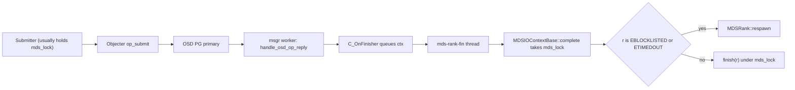
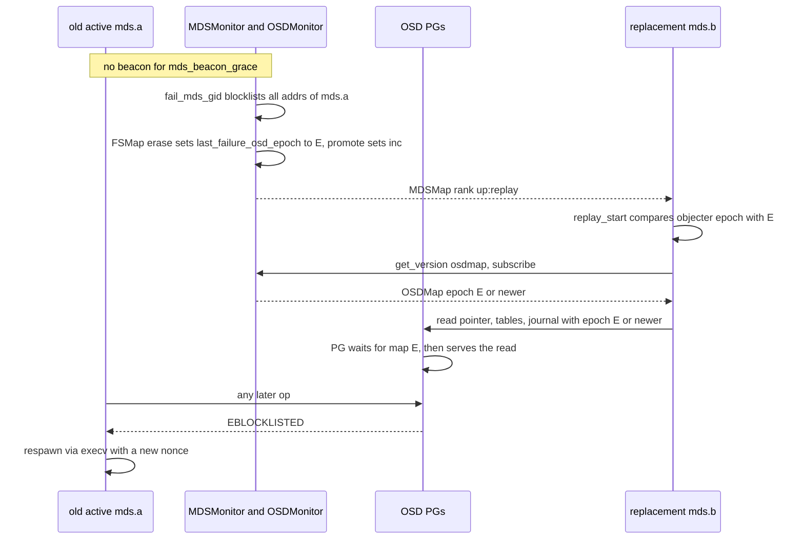
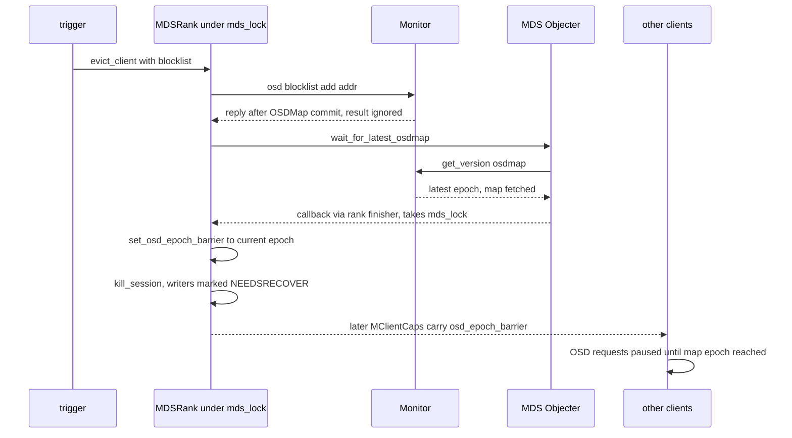
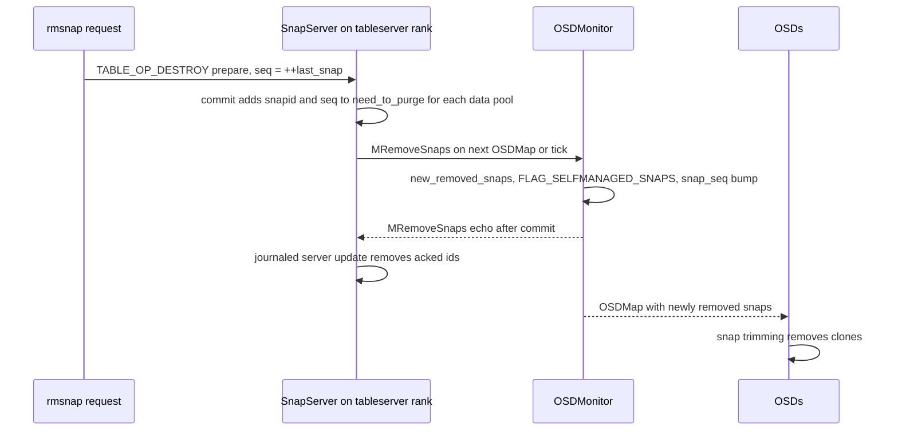

# RADOS and OSD interactions

> Part of the C++ MDS project map ([README](../README.md)). Sources: `src/mds/MDSRank.cc` (~4380 LOC; OSDMap, blocklist, barrier, eviction, boot parts), `src/mds/MDSContext.{h,cc}` (~360), `src/mds/MDSDaemon.cc` (dispatch, respawn), `src/mds/Server.cc` (full, blocklist, reclaim, layout, eviction parts), `src/mds/Locker.cc` (barrier intake, max_size, recovery triggers), `src/mds/CDir.cc` (fetch/commit, ~650 lines), `src/mds/CInode.cc` (store/fetch/backtrace/scrub, ~450 lines), `src/mds/MDCache.cc` (truncate, purge_inodes, open_ino, fragment purge, uninline, blockdiff, read-only), `src/mds/journal.cc` (`LogSegment::try_to_expire`), `src/mds/SessionMap.cc` (~1420), `src/mds/OpenFileTable.cc` (~1260), `src/mds/MDSTable.cc` (~200), `src/mds/JournalPointer.cc` (~125), `src/mds/MDLog.cc` (create/recovery/reformat/replay error paths), `src/mds/PurgeQueue.cc` (~890), `src/mds/StrayManager.cc` (purge/truncate), `src/mds/RecoveryQueue.cc` (~250), `src/mds/SnapServer.cc` (~570), `src/mds/MDBalancer.cc` (Mantle read), `src/mds/Beacon.cc` (health), `src/osdc/Objecter.{h,cc}`, `src/osdc/Filer.{h,cc}` (~850), `src/osdc/Journaler.cc` (RADOS-level parts), `src/mon/MDSMonitor.cc` (`fail_mds_gid`, DAMAGED, health), `src/mds/FSMap.cc` (`erase`, `promote`), `src/mon/OSDMonitor.cc` (blocklist, `MRemoveSnaps`, pool flags), `src/mon/FSCommands.cc` (`_check_pool`), `src/osd/PrimaryLogPG.cc` (blocklist, full, map gating, op semantics), `src/client/Client.cc` (barrier, full, blocklist, reclaim), Linux `fs/ceph/{caps,mds_client,file,addr,super,xattr}.c`, `net/ceph/osd_client.c`.
> Related: [RADOS object catalog](rados-object-catalog.md), [MDS tables](mds-tables.md), [MDLog and Journaler](../06-journal/mdlog-and-journaler.md), [events and replay](../06-journal/events-and-replay.md), [process and threading](../00-architecture/process-and-threading.md), [mds_lock analysis](../00-architecture/mds_lock-analysis.md), [beacon and monitor](../01-cluster-integration/beacon-and-monitor.md), [FSMap/MDSMap](../01-cluster-integration/fsmap-and-mdsmap.md), [auth and MDS caps](../01-cluster-integration/auth-and-mds-caps.md), [mgr and tools](../01-cluster-integration/mgr-tools-and-orchestration.md), [wire protocol](../02-client-protocol/wire-protocol.md), [sessions](../02-client-protocol/sessions.md), [capabilities](../02-client-protocol/capabilities.md), [kclient expectations](../02-client-protocol/kclient-expectations.md), [libcephfs/fuse/Ganesha expectations](../02-client-protocol/libcephfs-fuse-ganesha-expectations.md), [attributes and xattrs](../03-request-path/attributes-and-xattrs.md), [namespace mutations](../03-request-path/namespace-mutations.md), [CDir/CDentry](../04-cache/cdir-cdentry-and-cache-objects.md), [subtrees, traversal, open_ino](../04-cache/mdcache-subtrees-traversal-replication.md), [dirfrags](../04-cache/dirfrags-and-fragmentation.md), [rank lifecycle and recovery](../09-recovery/rank-lifecycle-and-recovery.md), [snapshots](../10-snapshots-quotas-subvolumes/snapshots.md), [strays and purge](../11-background-services/strays-and-purge.md), [scrub and damage](../11-background-services/scrub-and-damage.md), [balancer](../08-multi-mds/balancer-and-pinning.md), [admin commands](../13-admin-and-config/admin-commands.md), [config/perf/health](../13-admin-and-config/config-perf-counters-and-health.md).

## 1. Purpose and responsibilities

This page describes everything the C++ MDS does *as a RADOS client* and every way it depends on OSD and OSDMap behaviour:

- **The MDS's own Objecter**: identity seen by OSDs (`mds.<rank>` + MDSMap incarnation), the flags it puts on every op (`FULL_FORCE`), how replies re-enter the MDS (`C_OnFinisher` → rank finisher → `mds_lock`), how it follows the OSDMap, and what `wait_for_map` really waits for.
- **An exhaustive catalogue of RADOS operations** the MDS issues (journal, journal pointer, purge queue, tables, sessionmap, open-file table, dirfrags, base inodes, backtraces, file-data probes, truncation, purge, uninline, blockdiff, Mantle), with exact op vectors, atomicity and error handling, plus the OSD-side semantics each one relies on.
- **Ordering and atomicity assumptions**: single-object compound ops are atomic; ops from one client to one object apply in order; nothing is atomic across objects, so the MDS compensates with write-ahead journals.
- **The fencing model**: the monitor blocklists a failed MDS and records `last_failure_osd_epoch`; the replacement waits for that OSDMap before touching on-disk state; a fenced MDS respawns. Clients are fenced with `osd blocklist add` issued by the MDS, followed by an **OSD epoch barrier** carried to every other client in cap messages.
- **Full-cluster behaviour**: MDS I/O ignores pool and cluster full flags; client-visible `ENOSPC` policy is derived only from the *metadata pool's* `FLAG_FULL` (and, because of a double reply, clients without the `f` MDS cap actually observe `-EACCES`, §3.8).
- **Data-path dependencies**: clients do file data I/O directly against OSDs; the MDS hands out layout, ino, SnapContext, `truncate_seq`/`truncate_size`, `max_size` and the barrier, learns sizes from cap flushes, and touches data objects only for size probes, truncation, purge, backtraces, uninline and blockdiff.
- **Snapshot trimming interplay**: snap ids are self-managed snapshots of every data pool; deleted ids are reported to the monitor with `MRemoveSnaps` so OSDs trim clones.
- **Pool requirements** enforced by the monitor and silently relied upon by the MDS.

## 2. Source map

| File | Class / function | Lines | Role |
|---|---|---|---|
| `src/mds/MDSRank.cc` | `MDSRank::MDSRank` | 468-545 | Constructs `Objecter` (483), `PurgeQueue` with `on_error` → `handle_write_error` (488-494), caches metadata pool id (510), first `purge_queue.update_op_limit` (512), `objecter->unset_honor_pool_full()` (514) |
| `src/mds/MDSRank.cc` | `MDSRankDispatcher::init` | 590-609 | `objecter->init()`, `add_dispatcher_tail(objecter)`, `start()`, initial `handle_osd_map()` |
| `src/mds/MDSRank.cc` | `update_targets`, `C_MDS_MonCommand`, `set_mdsmap_multimds_snaps_allowed` | 611-708 | `MMDSLoadTargets`; `fs set ... allow_multimds_snaps` mon command |
| `src/mds/MDSRank.cc` | `MDSRankDispatcher::tick` | 710-802 | Skips upkeep when laggy (714); `snapserver->check_osd_map(false)` on the tableserver (754) |
| `src/mds/MDSRank.cc` | `damaged`, `handle_write_error`, `handle_write_error_with_lock` | 945-997 | Write-error policy (`mds_action_on_write_error`), `-EBLOCKLISTED` → respawn |
| `src/mds/MDSRank.cc` | `set_osd_epoch_barrier` | 1580-1584 | Unconditional assignment of the rank barrier |
| `src/mds/MDSRank.cc` | `boot_start` (`MDS_BOOT_INITIAL`) | 1622-1700 | Error policy for boot I/O; loads inotable, sessionmap, journal, purge queue, OFT, snaptable |
| `src/mds/MDSRank.cc` | `replay_start`, `standby_replay_restart` | 1792-1897 | Wait for `mdsmap->get_last_failure_osd_epoch()` before replay / final takeover pass |
| `src/mds/MDSRank.cc` | `apply_blocklist`, `reconnect_start` | 1996-2031 | OSDMap blocklist → kill sessions, barrier; enable blocklist events |
| `src/mds/MDSRank.cc` | `recovery_done` | 2166-2177 | Starts recovered truncates, delegated-ino purges, file size recovery |
| `src/mds/MDSRank.cc` | `stopping_start` | 2252-2283 | Last rank stopping evicts all clients |
| `src/mds/MDSRank.cc` | `MDSRankDispatcher::handle_mds_map` | 2294-2620 | Messenger name (2346/2349), client incarnation (2353-2355), barrier when active (2596-2602), journal FADVISE hint (2604-2608), purge op limit on `max_mds` change |
| `src/mds/MDSRank.cc` | `handle_asok_command` "osdmap barrier", "session kill" | 2819-2878 | Admin barrier + blocking `wait_for_map`; synchronous eviction |
| `src/mds/MDSRank.cc` | `MDSRankDispatcher::evict_clients` | 3154-3198 | Filter-based eviction (asok/tell) |
| `src/mds/MDSRank.cc` | `MDSRankDispatcher::handle_osd_map` | 3887-3913 | Per-OSDMap work |
| `src/mds/MDSRank.cc` | `MDSRank::evict_client` | 3951-4067 | `osd blocklist add`, `wait_for_latest_osdmap`, barrier, kill session |
| `src/mds/MDSContext.cc` / `.h` | `MDSIOContextBase::complete`, `check_ios_in_flight`, `MDSLogContextBase::complete`, `C_IO_Wrapper` | cc 47-145, h 182-205 | Takes `mds_lock` for I/O completions; `-EBLOCKLISTED`/`-ETIMEDOUT` → respawn; slow-IO tracking |
| `src/mds/MDSDaemon.cc` | `init`, `handle_core_message`, `respawn`, `handle_mds_map`, `dump_status` | 660-664, 1130-1165, 1021-1084, 882-888, 263-270 | Dispatcher priorities; `CEPH_MSG_OSD_MAP` and `MSG_REMOVE_SNAPS` routing; `execv` respawn |
| `src/mds/Server.cc` | `handle_osd_map`, `dispatch_client_request` (read-only, full) | 2752-2763, 2794-2840 | `is_full` from metadata pool `FLAG_FULL`; `EROFS`/`ENOSPC` policy |
| `src/mds/Server.cc` | `handle_client_setattr` | 5578, 5633-5640 | `ENOSPC` for size growth while full |
| `src/mds/Server.cc` | `handle_client_session`, `prepare_force_open_sessions`, `kill_session`, `apply_blocklist`, `update_required_client_features`, `reconnect_tick` | 599-893, 1059-1085, 1472-1494, 1497-1522, 1799-1825, 1844-1935 | Blocklist-driven session handling |
| `src/mds/Server.cc` | `reclaim_session`, `finish_reclaim_session` | 476-560 | Reclaim kills/blocklists old session; reply carries target addrs + OSD epoch |
| `src/mds/Server.cc` | `find_idle_sessions`, `evict_cap_revoke_non_responders` | 1211-1359, 1361-1396 | Timeout eviction; laggy-OSD deferral |
| `src/mds/Server.cc` | `_session_logged`, `journal_close_session`, `force_clients_readonly` | 925-1000, 1524-1557, 2105-2119 | Delegated-ino purge; `CEPH_SESSION_FORCE_RO` |
| `src/mds/Server.cc` | `prepare_new_inode`, `is_valid_layout`, `handle_client_openc`, `handle_client_setlayout`, `parse_layout_vxattr*`, `check_layout_vxattr`, `handle_client_setvxattr`, `handle_client_getvxattr` | 3714-3715, 4862-4873, 5000-5001, 5862-5866, 5913, 6046-6205, 6281-6340, 6431-6454, 7406-7433 | Initial truncate fields, data-pool validation, `old_pools`, OSDMap pool lookups, wait for the client's OSDMap epoch |
| `src/mds/Locker.cc` | `issue_caps`, `issue_truncate`, `revoke_stale_cap`, `revoke_stale_caps`, `calc_new_max_size`, `check_inode_max_size`, `share_inode_max_size`, `handle_client_caps`, `handle_client_cap_release`, `remove_client_cap`, `file_recover` | 2578-2740, 2717-2737, 2742-2776, 2778-2840, 2980-2989, 3077-3189, 3191-3230, 3386-3660, 4258-4280, 4345-4372, 6006-6036 | Barrier in/out; max_size policy; `STATE_NEEDSRECOVER` |
| `src/mds/CDir.cc` | `C_IO_Dir_OMAP_Fetched[More]`, `_omap_fetch`, `_omap_fetch_more`, `_omap_fetched`, `go_bad` | 1718-1846, 2056-2120, 2323-2347 | Dirfrag reads |
| `src/mds/CDir.cc` | `C_IO_Dir_Commit_Ops`, `_omap_commit_ops`, `_omap_commit`, `_commit`, `_committed` | 2395-2600, 2605-2700, 2757-2840 | Dirfrag writes |
| `src/mds/CInode.cc` | `CInodeCommitOperation::update`, `get_object_name`, `store`, `_stored`, `fetch`, `_fetched`, `build_backtrace`, `_commit_ops`, `_store_backtrace`, `store_backtrace`, `_stored_backtrace`, `verify_diri_backtrace`, `fetch_backtrace_and_tag`, `get_backtrace_pool` | 67-90, 1262-1416, 1418-1640, 4949-4975, 5585-5595 | Base inode objects, backtraces, scrub tag |
| `src/mds/journal.cc` | `BatchStoredBacktrace`, `BatchCommitBacktrace`, `LogSegment::try_to_expire` | 83-125, 127-372 | Write-behind of dirfrags, backtraces, tables, sessionmap at segment expiry |
| `src/mds/MDCache.cc` | `MDCache::MDCache`, `gen_default_file_layout`, `gen_default_log_layout` | 175-200, 417-438 | `Filer` on the rank finisher; `max_dir_commit_size`; default layouts |
| `src/mds/MDCache.cc` | `queue_file_recover`, `identify_files_to_recover`, `start_files_to_recover` | 6389-6564 | Which files need size recovery |
| `src/mds/MDCache.cc` | `truncate_inode`, `_truncate_inode`, `truncate_inode_write_finish`, `truncate_inode_finish`, `start_recovered_truncates` | 6586-6880 | Data truncation (`TRIMTRUNC`) |
| `src/mds/MDCache.cc` | `start_purge_inodes`, `purge_inodes` | 6893-6929 | Delete object 0 of orphaned delegated inos |
| `src/mds/MDCache.cc` | `open_root_inode`, `open_mydir_inode` | 685-716 | Base inode fetch at boot |
| `src/mds/MDCache.cc` | `_open_ino_backtrace_fetched`, `do_open_ino`, `open_ino`, `fetch_backtrace` | 9117-9200, 9372-9412, 9591-9637, 10457-10463 | Backtrace-based inode lookup |
| `src/mds/MDCache.cc` | `C_IO_MDC_FragmentPurgeOld`, `_fragment_committed` | 12246-12261, 12529-12565 | Removal of old dirfrag objects |
| `src/mds/MDCache.cc` | `force_readonly`, `can_fragment`, `maybe_eval_stray` | 12871-12894, 11874, 13984 | Read-only mode on write error |
| `src/mds/MDCache.cc` | `C_IO_DataUninlined`, `uninline_data_work` | 13419-13570 | Guarded data write (`CMPXATTR`) |
| `src/mds/MDCache.cc` | `file_blockdiff`, `aggregate_snap_sets` | 14801-14970 | `LIST_SNAPS` scans for snapshot block diff |
| `src/mds/SessionMap.cc` | `get_object_name`, `_load_finish`, `load`, `load_legacy`, `_load_legacy_finish`, `save`, `_mark_dirty`, `save_if_dirty`, `apply_blocklist` | 154-560, 805-830, 898-1005, 1262-1274 | Sessionmap omap I/O, metadata-threshold eviction |
| `src/mds/OpenFileTable.cc` | `get_object_name`, `_commit_finish`, `_journal_finish`, `commit`, `_recover_finish`, `_read_omap_values`, `_load_finish`, `load`, `_prefetch_inodes` | 242-995, 1140-1175 | Open-file table omap I/O with self-journal |
| `src/mds/MDSTable.cc` | `save`, `save_2`, `get_object_name`, `load`, `load_2` | 60-200 | InoTable/SnapTable whole-object I/O |
| `src/mds/JournalPointer.cc` | `get_object_id`, `load`, `save` (blocking and async) | 36-123 | Journal pointer object |
| `src/mds/MDLog.cc` | `C_MDL_WriteError`, `write_head`, `create`, `_trim_expired_segments`, `_recovery_thread`, `_reformat_journal`, `_replay_thread` | 119-145, 188-206, 267-304, 944-997, 1076-1415, 1417-1610 | Journal creation/recovery/rewrite/replay, write-error policy |
| `src/mds/PurgeQueue.cc` | `PurgeItem::encode`, `PurgeQueue::PurgeQueue`, `open`, `create`, `push`, `_calculate_ops`, `_can_consume`, `_go_readonly`, `_consume`, `_commit_ops`, `_execute_item`, `_execute_item_complete`, `update_op_limit`, `drain` | 45-893 | Data and dirfrag deletion engine |
| `src/mds/StrayManager.cc` | `C_IO_PurgeStrayPurged`, `purge`, `_purge_stray_purged`, `_eval_stray`, `truncate` | 80-95, 101-155, 182-260, 447-555, 747-778 | Builds `PurgeItem`s with the realm SnapContext |
| `src/mds/RecoveryQueue.cc` | `C_MDC_Recover`, `advance`, `_start`, `enqueue`, `_recovered` | 31-239 | File size/mtime recovery by backward `Filer::probe` |
| `src/mds/SnapServer.cc` | `reset_state`, `_prepare`, `_commit`, `_server_update`, `check_osd_map`, `handle_remove_snaps` | 45-460 | Snap id allocation, `need_to_purge`, `MRemoveSnaps` |
| `src/mds/MDBalancer.cc` | `localize_balancer`, `mantle_prep_rebalance` | 419-450, 935-950 | Synchronous Mantle script read |
| `src/mds/Beacon.cc` | `is_laggy`, `notify_health` (slow metadata IO, read-only, laggy OSD clients) | 261-276, 459-560 | Health reporting tied to RADOS |
| `src/osdc/Objecter.{cc,h}` | `ms_dispatch2`, `handle_osd_map`, `emit/consume_blocklist_events`, `_check_op_pool_dne/eio`, `_get_latest_version`, `_maybe_request_map`, `target_should_be_paused`, `_osdmap_full_flag`, `_prepare_osd_op`, `set_epoch_barrier`, `_take_op_budget`, `ms_can_fast_dispatch`, `Op::complete`, `CB_Objecter_GetVersion`, `wait_for_map`, `wait_for_latest_osdmap` | cc 1067-1121, 1253-1543, 1639-1712, 2100-2143, 3001-3075, 3589-3610, 5563-5574; h 1925-1929, 2078-2093, 2693-2717, 2760-2761, 2785-2796, 2895-2950 | RADOS client mechanics used by the MDS |
| `src/osdc/Filer.cc` | `read`, `write`, `zero`, `probe*`, `_probed`, `purge_range`, `_do_purge_range`, `truncate`, `_do_truncate_range` | 49-599 | Striped helpers |
| `src/osdc/Journaler.cc` | `_read_head`, `_probe`, `_write_head`, `_finish_write_head`, `_do_flush`, `_flush`, `_issue_prezero`, `_finish_prezero`, `_issue_read`, `erase`, `_finish_erase`, `_trim`, `_finish_trim`, `handle_write_error`, `set_write_error_handler` | 209-1460, 1606-1611 | Journal object I/O (format in the journal page) |
| `src/mon/MDSMonitor.cc` | `fail_mds_gid`, DAMAGED beacon path, `check_health`, `drop_mds`, `prepare_update`/`tick` (Paxos plug) | 1377-1401, 842-874, 2254-2417, 2207-2252, 596-631/2477-2582 | Monitor-side MDS fencing; FSMap and OSDMap batched in one Paxos transaction |
| `src/mds/FSMap.cc` | `FSMap::promote`, `erase`, `damaged` | 1006-1060, 1092-1139 | `inc = epoch`, `last_failure_osd_epoch` |
| `src/mon/OSDMonitor.cc` | `blocklist`, `osd blocklist` command, `osd pool mksnap`, `preprocess/prepare_remove_snaps`, pool quota full flags, `_check_remove_pool` | 4979-5003, 13731-13840, 13847-13895, 4386-4482, 7600-7630, 15412-15422 | OSDMap side of fencing, snap removal, full flags |
| `src/mon/MonCap.cc` | `profile mds` grants | 201-210 | `osd pool rmsnap`, `osd blocklist` |
| `src/mon/FSCommands.cc` | `fs new` (empty metadata pool), `_check_pool` | 208-218, 1921-2030 | Pool requirements |
| `src/osd/PrimaryLogPG.cc` | `do_request` (map gating), `do_op` (blocklist, full discard, failsafe, dup reqid), `do_osd_ops` (FAILOK, per-op semantics), `prepare_transaction` (full check), `_delete_oid` | 1829-1856, 2146-2185, 2302-2328, 6183-8395, 9190-9206, 8451-8490 | OSD behaviour the MDS relies on |

## 3. How it works

### 3.1 The MDS as a RADOS client

**One Objecter per rank.** `MDSRank`'s constructor creates `new Objecter(g_ceph_context, msgr, monc_, ioc)` on the daemon's single messenger (`src/mds/MDSRank.cc:483 (MDSRank::MDSRank)`). `MDSRankDispatcher::init` calls `objecter->init()`, registers it with `messenger->add_dispatcher_tail(objecter)` at the default priority and `start()`s it (with no initial map `start()` subscribes to the OSDMap, `src/osdc/Objecter.cc:459 (Objecter::start)`), then calls `handle_osd_map()` once (`src/mds/MDSRank.cc:590 (MDSRankDispatcher::init)`). The same Objecter is shared by every subsystem: `PurgeQueue` wraps it in its own `Filer` and `Journaler` bound to its private finisher `mds-pq-fin` (`src/mds/PurgeQueue.cc:139 (PurgeQueue::PurgeQueue)`); `MDCache` and `RecoveryQueue` each own a `Filer` bound to the rank finisher (`src/mds/MDCache.cc:178 (MDCache::MDCache)`, `src/mds/RecoveryQueue.cc:59 (RecoveryQueue::RecoveryQueue)`).

**Identity seen by OSDs.**

| Property | Value | Code |
|---|---|---|
| Entity name | `mds.<rank>`; `mds.<gid>` while in standby-replay; `mds.-1` before a rank is held | `src/mds/MDSRank.cc:2346 (MDSRankDispatcher::handle_mds_map)`, `:2349`, `src/ceph_mds.cc:172 (main)` |
| Client incarnation (`osd_reqid_t.inc`) | `mds_info_t::inc`, set by the monitor to the FSMap epoch at promotion | `src/mds/MDSRank.cc:2353 (MDSRankDispatcher::handle_mds_map)`, `src/mds/FSMap.cc:1048 (FSMap::promote)` |
| tid | Objecter's per-process `last_tid`, restarting at 0 in each process | `src/osdc/Objecter.h:1732`, `src/osdc/Objecter.cc:2692 (Objecter::_op_submit)` |
| Messenger nonce | random per process (`Messenger::get_random_nonce()`), so a respawned daemon has a new address | `src/ceph_mds.cc:172 (main)` |
| cephx OSD caps (cephadm) | `osd 'allow rw tag cephfs *=*'` (no `x`), re-applied with `auth caps` on (re)deploy | `src/pybind/mgr/cephadm/services/cephadmservice.py:1527 (MdsService.prepare_create)`, `:787 (get_keyring_with_caps)` |

The OSD identifies retried or duplicate writes by `reqid = (source entity, client_inc, tid)` (`src/messages/MOSDOp.h:112 (MOSDOp::get_reqid)`) and answers a duplicate from its PG log without re-executing it (`src/osd/PrimaryLogPG.cc:2302 (PrimaryLogPG::do_op)`). Because every instance of rank N is named `mds.N` and starts tids at 0, the monitor-assigned incarnation is what keeps reqids of a new instance distinct from the previous one.

**Flags on every op.** The constructor calls `objecter->unset_honor_pool_full()` (`src/mds/MDSRank.cc:514`). Therefore `_osdmap_full_flag()` and `_osdmap_pool_full()` return false for this Objecter (`src/osdc/Objecter.cc:3058 (Objecter::_osdmap_full_flag)`, `src/osdc/Objecter.h:2547`), MDS writes are never paused for full flags, and `_prepare_osd_op` adds `CEPH_OSD_FLAG_FULL_FORCE` to every op in addition to `KNOWN_REDIR`, `SUPPORTSPOOLEIO` and `ONDISK` (`src/osdc/Objecter.cc:3589 (Objecter::_prepare_osd_op)`). Ops *are* still paused by the OSDMap `PAUSERD`/`PAUSEWR` flags (`ceph osd pause`) and while the Objecter's own `epoch_barrier` exceeds its map epoch (`src/osdc/Objecter.cc:3001 (Objecter::target_should_be_paused)`).

**What the MDS never uses.** No object-class `exec` calls, no watch/notify, no `APPEND`, no `CMPEXT`, no `ROLLBACK`; the only `op_cancel` is the Mantle read timeout (`src/mds/MDBalancer.cc:444 (MDBalancer::localize_balancer)`). A grep of `src/mds`, `src/osdc/Journaler.cc` and `src/osdc/Filer.cc` finds no class call, watch, notify or append. This matches the cephadm key above, which has no `x` permission.

**OSDMap arrival.** Messenger dispatchers are ordered by ascending priority value (`src/msg/Messenger.h:107 (PriorityDispatcher::operator<)`, `src/msg/Dispatcher.h:36-38`): `Beacon` (`PRIORITY_HIGH`), then the Objecter (`PRIORITY_DEFAULT`), then `MDSDaemon` (`PRIORITY_LOW`, `src/mds/MDSDaemon.cc:663 (MDSDaemon::init)`). The Objecter applies `CEPH_MSG_OSD_MAP` (recording newly blocklisted addresses once events are enabled) and returns `ACKNOWLEDGED` so the message continues (`src/osdc/Objecter.cc:1113 (Objecter::ms_dispatch2)`); `MDSDaemon::handle_core_message` then calls `mds_rank->handle_osd_map()` under `mds_lock` (`src/mds/MDSDaemon.cc:1156 (MDSDaemon::handle_core_message)`). `MDSRankDispatcher::handle_osd_map` (`src/mds/MDSRank.cc:3887`):

1. if active and tableserver: `snapserver->check_osd_map(true)` (removed-snap reporting, §3.10);
2. `server->handle_osd_map()` → recompute `Server::is_full` from the metadata pool's `FLAG_FULL` (§3.8);
3. `purge_queue.update_op_limit(*mdsmap)` (PG-count based purge throttle, §3.13);
4. unless in (standby-)replay: `consume_blocklist_events` + `apply_blocklist` → `Server::apply_blocklist()` scans **all** client sessions against the full OSDMap blocklist (§3.6.6);
5. `objecter->maybe_request_map()`: the Objecter subscribes "onetime" unless `PAUSERD`/`PAUSEWR` is set (the honoured-`FULL` case never applies to the MDS because `_osdmap_full_flag()` is false) (`src/osdc/Objecter.cc:2123 (Objecter::_maybe_request_map)`), so re-subscribing after every map makes the subscription effectively continuous ("we would like to always receive the latest maps in order to apply policy based on the FULL flag").

**What `wait_for_map(E)` waits for.** If the Objecter already has epoch ≥ E the handler is posted immediately; otherwise it calls `monc->get_version("osdmap")` and, on the reply, waits until it has the monitor's **latest committed** epoch `newest` (`src/osdc/Objecter.h:2918 (Objecter::wait_for_map)`, `:2895 (CB_Objecter_GetVersion)`, `src/osdc/Objecter.cc:2100 (Objecter::_get_latest_version)`). It does not re-check E afterwards; the callers (`replay_start`, `standby_replay_restart`, `osdmap barrier`, `check_layout_vxattr`) therefore rely on the monitor's latest version being ≥ E at query time. For the fencing epoch this holds on the monitor that published the MDSMap: `MDSMonitor::tick` and `MDSMonitor::prepare_update` call `paxos.plug()`, request the OSDMonitor proposal (which encodes the blocklist into Paxos's shared pending transaction) and only then let the FSMap be proposed, so OSDMap E commits in the same or an earlier Paxos version than the FSMap carrying `last_failure_osd_epoch = E` (`src/mon/MDSMonitor.cc:605 (MDSMonitor::prepare_update)`, `:2517`, `:2571 (MDSMonitor::tick)`, `src/mon/PaxosService.cc:234 (PaxosService::propose_pending)`). A version answer from a different, lagging monitor (for example after a MonClient re-hunt) could still be below E (unverified). `wait_for_latest_osdmap` is the same without the pre-check. Completions are posted to the 2-thread asio pool (`src/ceph_mds.cc:202 (main)`) and normally hop to the rank finisher via `C_IO_Wrapper` (async on first `complete`, `src/mds/MDSContext.h:192`, `src/mds/MDSContext.cc:137 (C_IO_Wrapper::complete)`).

**Completion path.** OSD replies are fast-dispatched on messenger worker threads (`src/osdc/Objecter.h:2785 (Objecter::ms_can_fast_dispatch)`) and a `Context*` completion is invoked directly in that thread (`src/osdc/Objecter.h:2078 (Op::complete)`). The MDS therefore wraps almost every completion in `new C_OnFinisher(ctx, mds->finisher)`, which queues it on the single-threaded rank finisher `mds-rank-fin` (`src/common/Finisher.h:143 (C_OnFinisher)`), or in `C_IO_Wrapper`. `MDSIOContextBase::complete` then takes `mds_lock`, drops the callback if the daemon is stopping, and **respawns on `-EBLOCKLISTED` or `-ETIMEDOUT`** before calling `finish(r)` (`src/mds/MDSContext.cc:95 (MDSIOContextBase::complete)`). Journal completions (`MDSLogContextBase`) follow the same rule (`src/mds/MDSContext.cc:122 (MDSLogContextBase::complete)`).

Exceptions to this pattern:

- `C_IO_DataUninlined` is passed straight to `objecter->mutate`, so `MDSIOContextBase::complete` (and the `mds_lock` acquisition) runs on the messenger thread (`src/mds/MDCache.cc:13566 (MDCache::uninline_data_work)`).
- The Mantle read uses a `C_SafeCond` and blocks the caller, which holds `mds_lock` (`src/mds/MDBalancer.cc:431 (MDBalancer::localize_balancer)`).
- The scrub-tag `SETXATTR` and the uninline `CREATE` have no completion at all (`src/mds/CInode.cc:4972`, `src/mds/MDCache.cc:13540`).
- `JournalPointer::load/save` and journal recovery/reformat wait synchronously on `C_SaferCond` in MDLog's recovery thread without `mds_lock` (`src/mds/JournalPointer.cc:49 (JournalPointer::load)`, `src/mds/MDLog.cc:1076 (MDLog::_recovery_thread)`); the final pointer update of a reformat is done while holding `mds_lock` (`src/mds/MDLog.cc:1394 (MDLog::_reformat_journal)`).
- `PurgeQueue` completes on its own finisher under `PurgeQueue::lock`, not `mds_lock`, and submits its ops from that finisher with no lock (`src/mds/PurgeQueue.cc:554 (PurgeQueue::_commit_ops)`). MDS contexts handed to it still take `mds_lock`, but on the `mds-pq-fin` thread: `C_IO_PurgeStrayPurged` (an `MDSIOContextBase`, completed through the PQ Journaler's `wait_for_flush`) and the `on_error` lambda (`src/mds/MDSRank.cc:488-494`, `src/osdc/Journaler.cc:754 (Journaler::_wait_for_flush)`). `PurgeQueue::push` on a read-only queue instead completes `-EROFS` inline in the caller's thread, which already holds `mds_lock` (§8 item 25).
- Dirfrag commits and segment-expiry backtrace batches are *encoded and submitted* on the rank finisher without `mds_lock` (`src/mds/CDir.cc:2465 (CDir::_omap_commit_ops)`, `src/mds/journal.cc:111 (BatchCommitBacktrace::finish)`); their completions are normal `MDSIOContextBase`s.

**Boot-time I/O.** For a rank entering `up:replay`, `boot_start(MDS_BOOT_INITIAL)` runs only after the fencing wait of §3.6.2; `up:starting` calls `boot_start()` and `up:creating` calls `boot_create()` directly, without that wait (`src/mds/MDSRank.cc:2442-2455 (MDSRankDispatcher::handle_mds_map)`). `MDS_BOOT_INITIAL` issues, in parallel: InoTable load, SessionMap load, MDLog open (journal pointer, header, forward probe), the PurgeQueue open (part of the boot gather in `up:starting`; fire-and-forget together with the OpenFileTable load in `up:replay`; neither for standby-replay, which opens both in its final takeover pass; the OpenFileTable is never loaded in `up:starting`), and the SnapTable load on the tableserver (`src/mds/MDSRank.cc:1650-1690 (MDSRank::boot_start)`, `:1883-1886 (MDSRank::standby_replay_restart)`). Base inodes and system dirfrags follow (`src/mds/MDCache.cc:685 (MDCache::open_root_inode)`, `:713 (MDCache::open_mydir_inode)`). After replay/rejoin, `recovery_done` starts recovered truncations, delegated-ino purges and file size recovery (`src/mds/MDSRank.cc:2166 (MDSRank::recovery_done)`). Details in [rank lifecycle and recovery](../09-recovery/rank-lifecycle-and-recovery.md).

### 3.2 Catalogue of RADOS operations

Object names use `"%llx.%08llx"` of (ino, object number or raw `frag_t`) (`src/include/object.cc:46 (file_object_t::c_str)`, `src/mds/CInode.cc:1262 (InodeStoreBase::get_object_name)`); encodings are in the [RADOS object catalog](rados-object-catalog.md). "md" = metadata pool, "data" = a data pool. Unless stated otherwise each row is **one** compound `ObjectOperation` on one object, atomic at the OSD, listed in sub-op order.

| # | Subsystem / trigger | Object (pool) | RADOS ops | Completion / error handling | Code |
|---|---|---|---|---|---|
| 1 | MDLog journal header write: at create, after segment expiry advanced `expire_pos` (`MDLog::write_head`), and every `journaler_write_head_interval` (15 s) during flushes | `<front>.00000000` (md), front = `0x200+rank` or `0x300+rank` | `WRITEFULL` of `Journaler::Header` (`write_pos` = safe position); op flags = `write_iohint` (`FADVISE_DONTNEED` unless the rank has a standby-replay follower) | error → `Journaler::handle_write_error` → `C_MDL_WriteError`: `-EBLOCKLISTED` respawn, else clog + `damaged()`; on success the journal is trimmed | `src/osdc/Journaler.cc:479 (Journaler::_write_head)`, `:509 (_finish_write_head)`, `:812 (_write_head_needed)`, `src/mds/MDLog.cc:188 (MDLog::write_head)`, `:119 (C_MDL_WriteError)`, `src/mds/MDSRank.cc:2604` |
| 2 | MDLog entry flush | `<front>.<objno>` (md) | `WRITE` at the journal offset via `Filer::write`, one `WRITE` per object extent (never `APPEND`); several flushes may be in flight | as row 1 | `src/osdc/Journaler.cc:656 (Journaler::_do_flush)` |
| 3 | Journal pre-zeroing ahead of `write_pos` | from `prezeroing_pos` up to `write_pos + journaler_prezero_periods` periods, rounded up to a period boundary; a flush is held back unless it stays one period below `prezero_pos` | full period → `DELETE`; partial period → `ZERO` (`Filer::zero`, `keep_first` false) | `-ENOENT` accepted; other errors → write error | `src/osdc/Journaler.cc:831 (Journaler::_issue_prezero)`, `:873 (_finish_prezero)` |
| 4 | Journal header read (recovery, standby-replay re-reads) | `<ino>.00000000` (md) | `READ` whole object | errors → recovery error → `damaged()` (respawn on `-EBLOCKLISTED`) | `src/osdc/Journaler.cc:209 (Journaler::_read_head)`, `src/mds/MDLog.cc:1186 (MDLog::_recovery_thread)` |
| 5 | Journal end probe | journal objects from header `write_pos` on | `STAT` per object with `CEPH_OSD_FLAG_RWORDERED`, one period at a time (`Filer::probe` forward) | `-ENOENT` = size 0 | `src/osdc/Journaler.cc:345 (Journaler::_probe)` |
| 6 | Journal read: replay and standby-replay tailing | journal objects | `READ` per period with `FADVISE_DONTNEED`, read-ahead `journaler_prefetch_periods` (10) | see §3.14 | `src/osdc/Journaler.cc:1049 (Journaler::_issue_read)`, `src/mds/MDLog.cc:1430 (MDLog::_replay_thread)` |
| 7 | Journal trim | objects in `[trimming_pos, last_committed.expire_pos)` rounded down to a period | `DELETE` (`Filer::purge_range`, ≤ `filer_max_purge_ops` = 10 in flight) | only after a header recording that `expire_pos` is durable; `-ENOENT` ok; else write error | `src/osdc/Journaler.cc:1380 (Journaler::_trim)`, `:1423 (_finish_trim)` |
| 8 | Journal erase (old journal after reformat, half-written back journal) | data objects `[trimmed_pos/period, +((write_pos-trimmed_pos)/period + 2))`, then object 0 | `DELETE` range, then `DELETE` object 0 only if the data delete succeeded | synchronous in the recovery thread | `src/osdc/Journaler.cc:1238 (Journaler::erase)`, `:1256 (_finish_erase)` |
| 9 | Journal pointer | `<0x400+rank>.00000000` (md) | `READ` whole object; `WRITEFULL` of {front, back} | blocking; read `-ENOENT` → write default pointer (front = `0x200+rank`), write failure → `damaged()`; read `-EBLOCKLISTED` → respawn; other read error → `damaged()` | `src/mds/JournalPointer.cc:49 (JournalPointer::load)`, `:82 (save)`, `:114 (save async)`, `src/mds/MDLog.cc:1093 (MDLog::_recovery_thread)` |
| 10 | PurgeQueue journal | `<0x500+rank>.*` (md) | same ops as rows 1-8, `JOURNAL_FORMAT_RESILIENT`, default layout in the md pool; header written when the queue goes idle or the head interval elapsed after an item completes | open `-ENOENT` → create; other errors → `_go_readonly` → `on_error` → `MDSRank::handle_write_error` | `src/mds/PurgeQueue.cc:242 (PurgeQueue::open)`, `:334 (create)`, `:463 (_go_readonly)`, `:624 (_commit_ops finisher)` |
| 11 | InoTable / SnapTable save | `mds<rank>_inotable`, `mds_snaptable` (md) | `WRITEFULL` (version + encoded state) | error → clog + `handle_write_error` | `src/mds/MDSTable.cc:60 (MDSTable::save)`, `:93 (save_2)` |
| 12 | InoTable / SnapTable load | same | `READ` whole object | `-EBLOCKLISTED` respawn; other error or decode failure → `damaged()` | `src/mds/MDSTable.cc:152 (MDSTable::load)`, `:166 (load_2)` |
| 13 | SessionMap load | `mds<rank>_sessionmap` (md) | `OMAP_GETHEADER` + `OMAP_GETVALS("", "", mds_sessionmap_keys_per_op)`; continuation `OMAP_GETVALS(last_key, "", n)` while `more`; empty header → legacy `READ` whole object | op/header/values error or decode failure → `damaged()`; legacy read error → `ceph_abort` | `src/mds/SessionMap.cc:335 (SessionMap::load)`, `:235 (_load_finish)`, `:375 (load_legacy)`, `:387 (_load_legacy_finish)` |
| 14 | SessionMap save: segment expiry (`sessionmapv > committed`) and pre-emptively when the dirty set reaches `mds_sessionmap_keys_per_op` | same | `OMAP_SETHEADER(version)` + [`TRUNCATE 0` once after a legacy load] + `OMAP_SETVALS(dirty open/closing/stale/killing sessions)` + `OMAP_RMKEYS(null sessions)`; key = entity name (`client.<id>`) | error → `handle_write_error`; sessions whose encoding ≥ `mds_session_metadata_threshold` are evicted instead of written | `src/mds/SessionMap.cc:442 (SessionMap::save)`, `:805 (_mark_dirty)` |
| 15 | SessionMap `save_if_dirty` (completed_requests of touched sessions, segment expiry) | same | `OMAP_SETVALS`, batches of ≤ `mds_sessionmap_keys_per_op` keys, one op per batch | error → `handle_write_error` (the expiry gather never completes) | `src/mds/SessionMap.cc:917 (SessionMap::save_if_dirty)`, `:898 (C_IO_SM_Save_One)` |
| 16 | OpenFileTable commit (driven by MDLog) | `mds<rank>_openfiles.<idx hex>` (md) | single object, unchanged count: [`OMAP_CLEAR` + `FAILOK` for a new object] + `OMAP_SETHEADER` + [`OMAP_SETVALS`] + [`OMAP_RMKEYS`]. Otherwise: phase 1 writes `_journal.<n>` keys to each affected object, the first op per object also setting the header with state `JOURNAL_START`; only after all phase-1 ops are acked, phase 2 applies the updates, removes the `_journal.*` keys and sets the header to `JOURNAL_FINISH` (the highest state seen at load for the newest version decides whether leftover journals are replayed) | error → `handle_write_error`; only one commit at a time (`num_pending_commit == 0` asserted) | `src/mds/OpenFileTable.cc:359 (OpenFileTable::commit)`, `:332 (_journal_finish)`, `:285 (_commit_finish)` |
| 17 | OpenFileTable load | same | `OMAP_GETHEADER` (first page of each object) + `OMAP_GETVALS(key, "", unlimited)`, paged; a finished journal is replayed with `OMAP_SETVALS/RMKEYS`, then `OMAP_SETHEADER` + `OMAP_RMKEYS(_journal.*)` | any error (incl. `-ENOENT`) → table reset (non-fatal hint) | `src/mds/OpenFileTable.cc:752 (_read_omap_values)`, `:768 (_load_finish)`, `:737 (_recover_finish)` |
| 18 | Dirfrag fetch | `<dirino>.<frag>` (md) | `OMAP_GETHEADER` + (`OMAP_GETVALS("", "", mds_dir_keys_per_op)` or `OMAP_GETVALSBYKEYS(keys)`) + for frag 0 when `mds_verify_backtrace` > 0: `GETXATTR "parent"` with `FAILOK`; continuation `OMAP_GETVALS(last_key, ...)` while `more`, restarting from scratch if `committed_version` advanced | `r` must be 0, `-ENOENT` or `-ENODATA` (assert); missing/corrupt header → `go_bad` (damage entry, fatal for root and own stray dirs, `-EIO` to waiters); bad dir backtrace → rewrite (assert if `mds_verify_backtrace` > 1) | `src/mds/CDir.cc:1796 (CDir::_omap_fetch)`, `:1824 (_omap_fetch_more)`, `:2056 (_omap_fetched)`, `:2323 (go_bad)`, `src/mds/CInode.cc:1614 (CInode::verify_diri_backtrace)` |
| 19 | Dirfrag commit (segment expiry, flush, fragmenting) | same | per chunk: [`STAT` guard if the dirfrag is not new] + [`OMAP_SETHEADER(fnode)` on the **last** chunk only] + `OMAP_SETVALS` + `OMAP_RMKEYS`; chunks ≤ `max_dir_commit_size`; stale and removed keys are packed first, set keys next, header last; op priority = expiry priority | `-ENOENT` with `committed_version == 0` under a stray parent → success (+ `STATE_MISSINGOBJS` if the inode has a snaprealm); other errors → clog + `handle_write_error` | `src/mds/CDir.cc:2465 (CDir::_omap_commit_ops)`, `:2605 (_omap_commit)`, `:2757 (_commit)`, `:2808 (_committed)` |
| 20 | Old dirfrags after split/merge | old frag objects (md) | frag ≠ 0: `DELETE`; frag 0 (keeps the directory backtrace xattr): `TRUNCATE 0` + `OMAP_CLEAR` | asserts `r` is 0 or `-ENOENT` | `src/mds/MDCache.cc:12529 (MDCache::_fragment_committed)`, `:12246 (C_IO_MDC_FragmentPurgeOld)` |
| 21 | Base inode store (root, mdsdirs, global snaprealm) | `<ino>.00000000.inode` (md) | `WRITEFULL` (magic + `InodeStore`) | error → `handle_write_error` | `src/mds/CInode.cc:1271 (CInode::store)`, `:1302 (_stored)` |
| 22 | Base inode fetch | `<ino>.00000000` and `<ino>.00000000.inode` (md) | in parallel: `GETXATTR "inode"` (legacy) and `READ` whole `.inode` object | prefers `.inode`; neither → `-ENOENT`; bad magic/decode → `-EINVAL` | `src/mds/CInode.cc:1359 (CInode::fetch)`, `:1381 (_fetched)` |
| 23 | Backtrace store (segment expiry batch per pool, `flush`) | `<ino>.00000000` in the backtrace pool: md for directories, `layout.pool_id` for files; namespace **not** applied | `CREATE` (non-exclusive) + `SETXATTR "parent"` + `SETXATTR "layout"` + [`SETXATTR "symlink"` for symlink inodes when `mds_symlink_recovery`]; for each old pool when `STATE_DIRTYPOOL`: `CREATE` + `SETXATTR "parent"` only | `-ENOENT` because the pool no longer exists → success; other errors → clog + `handle_write_error` | `src/mds/CInode.cc:67 (CInodeCommitOperation::update)`, `:1453 (_commit_ops)`, `:1477 (_store_backtrace)`, `:1544 (_stored_backtrace)`, `src/mds/journal.cc:260 (LogSegment::try_to_expire)` |
| 24 | Backtrace fetch (`open_ino` after asking peer ranks: lookup by ino, NFS handles, OFT prefetch, rejoin) | `<ino>.00000000`: hinted pool (first data pool when unknown); on `-ENOENT` retried in the md pool; a decoded backtrace naming a different `pool` is re-read there | `GETXATTR "parent"` | decode error → `-EIO`; absent in md pool or empty ancestors → `-ESTALE`; same parent twice → `-EINVAL`; other errors returned | `src/mds/MDCache.cc:10457 (MDCache::fetch_backtrace)`, `:9117 (_open_ino_backtrace_fetched)`, `:9591 (open_ino)` |
| 25 | Scrub backtrace validation | backtrace object | `GETXATTR "parent"`; for non-internal tags a separate fire-and-forget `SETXATTR "scrub_tag"` (creates object 0 if missing) | results recorded in scrub output | `src/mds/CInode.cc:4949 (ValidationContinuation::fetch_backtrace_and_tag)` |
| 26 | File size/mtime recovery | data objects of the file | `STAT` with `RWORDERED` per object, walking **backwards** from `max_size` one period at a time down to offset 0 (`Filer::probe` backward, snapid `in->last`, mtime requested) | `-EBLOCKLISTED` respawn; any other error → clog + `damaged()` | `src/mds/RecoveryQueue.cc:93 (RecoveryQueue::_start)`, `:187 (_recovered)` |
| 27 | Truncation (shrinking setattr, `O_TRUNC`, replayed truncates) | data objects of `[truncate_size, truncate_from)` (layout pool + namespace) | `TRIMTRUNC(truncate_size = object-local offset, truncate_seq)` per object, with the realm SnapContext; the range is processed from its end with ≤ `filer_max_truncate_ops` periods of ops in flight; fscrypt: first a `WRITE` of the saved last block | single object: `r` must be 0/`-ENOENT` (assert); multi-object: per-op errors ignored | `src/mds/MDCache.cc:6640 (MDCache::_truncate_inode)`, `:6737 (truncate_inode_write_finish)`, `src/osdc/Filer.cc:518 (Filer::truncate)` |
| 28 | Purge file (stray with `nlink == 0`) | objects `0..N-1` for `N = objects(max(size, max_size, max_size_ever))`; backtrace object; object 0 in each old pool | `DELETE` with the realm SnapContext (`Filer::purge_range`, ≤ 10 per item in flight); extra `DELETE` of `<ino>.00000000` in the pool's default namespace when size is 0 or `pool_ns` is set; `DELETE` in each old pool | only `-EBLOCKLISTED` is acted on; all other results complete the item | `src/mds/PurgeQueue.cc:653 (_execute_item)`, `:554 (_commit_ops)`, `src/mds/StrayManager.cc:101 (StrayManager::purge)` |
| 29 | Purge directory | every leaf dirfrag object + frag 0 (md) | `DELETE` with a null SnapContext | as row 28 | `src/mds/PurgeQueue.cc:677 (_execute_item)`, `:584 (_commit_ops)` |
| 30 | Truncate a stray that still has snapshots | objects `1..N-1`, object 0 | `DELETE` objects 1.. (`purge_range`); `ZERO` over file range `[0, object_size)` with `keep_first` (object 0 holds the backtrace) | as row 28 | `src/mds/PurgeQueue.cc:688`, `:593`, `src/mds/StrayManager.cc:747 (StrayManager::truncate)` |
| 31 | Delegated/preallocated inos of a closed or timed-out session | `<ino>.00000000` in the **default** file layout (first data pool, default namespace) | `DELETE`, null SnapContext, one op per ino (`purge_range` of 1 object) | asserts `r` 0/`-ENOENT`, then journals `EPurged` and releases the inos to the InoTable | `src/mds/MDCache.cc:6903 (MDCache::purge_inodes)`, `src/mds/Server.cc:925 (Server::_session_logged)` |
| 32 | Uninline (scrub `uninline` option) | `<ino>.00000000` (layout pool + namespace) | op A: `CREATE` non-exclusive (no completion); op B: `CMPXATTR "inline_version" GT u64(inline version)` + [`WRITE(0, data, truncate_size, truncate_seq)`] + `SETXATTR "inline_version" = "<CEPH_INLINE_NONE>"` | `CMPXATTR` false → `-ECANCELED`; any error → recorded in scrub header, request fails | `src/mds/MDCache.cc:13487 (MDCache::uninline_data_work)`, `:13419 (C_IO_DataUninlined)` |
| 33 | Snapshot block diff (`CEPH_MDS_OP_FILE_BLOCKDIFF`) | data objects `scan_idx..` (locator of the newer snapshot's layout) | `LIST_SNAPS` at snapid `LIBRADOS_SNAP_DIR`, ≤ `min(mds_file_blockdiff_max_concurrent_object_scans, max_objects)` per round | `-ENOENT` = object absent in both snapshots (no diff); other error returned to client | `src/mds/MDCache.cc:14801 (MDCache::file_blockdiff)`, `:14878 (aggregate_snap_sets)` |
| 34 | Mantle balancer script (balancer name changed) | object named by `MDSMap::get_balancer()` (md) | `READ` whole object; caller blocks up to `mds_bal_interval/2` (5 s) | timeout → `op_cancel(-ECANCELED)`, returns `-ETIMEDOUT` to the balancer | `src/mds/MDBalancer.cc:419 (MDBalancer::localize_balancer)`, `:935 (mantle_prep_rebalance)` |

RADOS op vocabulary (who uses what):

| RADOS op | MDS users |
|---|---|
| `READ` | rows 4, 6, 9, 12, 13 (legacy), 22, 34 |
| `STAT` | rows 5, 19 (guard), 26 |
| `GETXATTR` | `parent` (rows 18, 24, 25), legacy `inode` (row 22) |
| `OMAP_GETHEADER`, `OMAP_GETVALS`, `OMAP_GETVALSBYKEYS` | rows 13, 17, 18 |
| `LIST_SNAPS` | row 33 |
| `WRITE` | rows 2, 27 (fscrypt last block), 32 |
| `WRITEFULL` | rows 1, 9, 11, 21 |
| `CREATE` (non-exclusive) | rows 23, 32 |
| `SETXATTR` | `parent`, `layout`, `symlink` (row 23), `scrub_tag` (row 25), `inline_version` (row 32) |
| `CMPXATTR` | row 32 |
| `OMAP_SETHEADER`, `OMAP_SETVALS`, `OMAP_RMKEYS`, `OMAP_CLEAR` | rows 14-17, 19, 20 |
| `TRUNCATE` | row 14 (legacy erase), row 20 |
| `TRIMTRUNC` | row 27 |
| `ZERO` | rows 3, 30 |
| `DELETE` | rows 3, 7, 8, 20, 28-31 |
| class `EXEC`, `WATCH`/`NOTIFY`, `APPEND`, `ROLLBACK`, `CMPEXT`, `OMAP_CMP`, `ASSERT_VER` | never |

### 3.3 OSD-side semantics the MDS relies on

| Semantics | Relied on by | OSD code |
|---|---|---|
| A compound op stops at the first failing sub-op and applies nothing, unless that sub-op carries `FAILOK` | rows 16, 18, 19 (STAT guard aborts the commit) | `src/osd/PrimaryLogPG.cc:8386 (PrimaryLogPG::do_osd_ops)` |
| `SETXATTR`, `OMAP_SETVALS`, `OMAP_SETHEADER`, `WRITE`, `CREATE` create a missing object | backtraces (row 23), sessionmap/OFT/dirfrag commits; reason for the dirfrag `STAT` guard ("don't create new dirfrag blindly") | `src/osd/PrimaryLogPG.cc:7746`, `:8135`, `:8175`, `:6981`, `:7101` (`maybe_create_new_object`) |
| `STAT`, reads, `OMAP_RMKEYS`, `OMAP_CLEAR`, `DELETE` on a missing object → `-ENOENT`; `TRUNCATE`/`TRIMTRUNC`/`ZERO` on a missing object → success, no-op | purge/trim/prezero/fragment cleanup tolerate `-ENOENT`; OFT uses `FAILOK` on `OMAP_CLEAR` | `src/osd/PrimaryLogPG.cc:8196`, `:8221`, `:8487 (_delete_oid)`, `:7143`, `:7088` |
| `TRIMTRUNC` with `truncate_seq` ≤ the object's stored seq is a no-op; otherwise stores seq/size and truncates | truncation idempotency across MDS restarts | `src/osd/PrimaryLogPG.cc:7128-7165` |
| Client `WRITE` with a newer `truncate_seq` truncates the object first; an older-seq write arriving after the trim is clipped to the object size; reads beyond `truncate_size` are clipped when the request seq is newer | correctness of truncation racing with in-flight client I/O | `src/osd/PrimaryLogPG.cc:6935-6975`, `:6088` |
| Writes and deletes carry a SnapContext: if `snapc.seq > snapset.seq` the head is cloned first; `DELETE` whiteouts the head when clones exist | file purge/truncate preserve snapshot data (rows 27, 28, 30) | `src/osd/PrimaryLogPG.cc:8820 (make_writeable)`, `src/osd/osd_types.h:6087 (should_whiteout)` |
| `CMPXATTR` u64 mode compares the op value against the stored decimal string (absent = 0) and fails the op with `-ECANCELED` when false | uninline guard (row 32), shared with the kernel's `ceph_uninline_data` | `src/osd/PrimaryLogPG.cc:5146 (do_xattr_cmp_u64)`, `:6620` |
| `OMAP_GETVALS`/`OMAP_GETKEYS` return at most `osd_max_omap_entries_per_request` (1024) entries / `osd_max_omap_bytes_per_request` (1 GiB) per call regardless of the requested count, with a `more` flag | sessionmap, OFT and dirfrag paging | `src/osd/PrimaryLogPG.cc:7962`, `:7983` |
| Pools without omap support reject omap ops with `-EOPNOTSUPP`. `supports_omap()` = `FLAG_OMAP` or replicated, and from umbrella on, EC pools with `allow_ec_optimizations` also get `FLAG_OMAP` | one reason the metadata pool must not be classic EC (the monitor refuses any EC metadata pool, §3.11) | `src/osd/PrimaryLogPG.cc:8127`, `src/osd/osd_types.h:1853 (pg_pool_t::supports_omap)`, `src/mon/OSDMonitor.cc:8587 (OSDMonitor::prepare_new_pool)` |
| A PG processes an op only once it has the sender's map epoch (`min_epoch` = `MOSDOp` epoch), preserving per-source order while waiting | fencing (§3.6.3) | `src/osd/PrimaryLogPG.cc:1829 (PrimaryLogPG::do_request)`, `src/messages/MOSDFastDispatchOp.h:17` |
| Ops from a blocklisted address → `-EBLOCKLISTED` (108) | fencing | `src/osd/PrimaryLogPG.cc:2146 (PrimaryLogPG::do_op)`, `src/include/rados.h:513` |
| Duplicate reqids are answered from the PG log | Objecter resends after map changes | `src/osd/PrimaryLogPG.cc:2302 (PrimaryLogPG::do_op)` |
| MDS senders and `FULL_FORCE` ops bypass full-flag discard and full rejection; the fail-safe ratio drops write-ordered ops without `FULL_TRY` silently | §3.8 | `src/osd/PrimaryLogPG.cc:2163`, `:2174`, `:9192` |
| Ops to a deleted pool complete with `-ENOENT` (Objecter `_check_op_pool_dne`); pools with `FLAG_EIO` complete ops with `-EIO` | backtrace store treats deleted pools as success; EIO becomes a write error | `src/osdc/Objecter.cc:1639`, `:1693` |

### 3.4 Filer helper semantics

`Filer` maps a file range to objects with `Striper::file_to_extents`; every extent's locator is `OSDMap::file_to_object_locator(layout)` = `(layout.pool_id, layout.pool_ns)` (`src/osdc/Striper.cc:122 (Striper::file_to_extents)`, `src/osd/OSDMap.h:1200`). Default file and journal layouts are 4 MiB objects, stripe_count 1 (`src/include/fs_types.h:125 (file_layout_t::get_default)`); the default file layout uses the **first** data pool and the journal layout the metadata pool with `mds_log_segment_size` as object size when set (`src/mds/MDCache.cc:417 (MDCache::gen_default_file_layout)`, `:424 (gen_default_log_layout)`).

| Helper | RADOS behaviour | Concurrency / errors | Code |
|---|---|---|---|
| `read` / `write` | one `READ`/`WRITE` per object extent (`sg_read`/`sg_write`), gathered | gather keeps the first error | `src/osdc/Filer.cc:49`, `:83` |
| `zero(keep_first)` | whole-object extents become `DELETE` (except object 0 when `keep_first`), partial extents `ZERO` | gathered | `src/osdc/Filer.cc:117 (Filer::zero)` |
| `probe(fwd/bwd)` | `STAT` every object of one period with `RWORDERED`; forward stops at the first object shorter than its expected extent; backward stops at the first non-empty object; **if mtime is requested it keeps probing earlier periods down to offset 0** and returns the max mtime | per-probe mutex; `-ENOENT` = size 0; any other error is reported after the period completes | `src/osdc/Filer.cc:230 (probe_impl)`, `:260 (_probe)`, `:296 (_probed)` |
| `purge_range(first, num)` | `DELETE` objects `first..first+num-1`; `num == 1` issues a single delete and passes the raw result (including `-ENOENT`) to the caller | ≤ `filer_max_purge_ops` (10) in flight; `-ENOENT` ignored for `num > 1`; the last non-`-ENOENT` error is reported | `src/osdc/Filer.cc:424 (purge_range)`, `:459 (_do_purge_range)` |
| `truncate(offset, len, seq)` | `TRIMTRUNC` with `truncate_size` = object-local offset and `truncate_seq` | single object: error propagates; multi-object: works backwards from the end keeping ≤ `filer_max_truncate_ops` periods' worth of ops in flight, per-op errors ignored, always completes 0 | `src/osdc/Filer.cc:518 (truncate)`, `:559 (_do_truncate_range)` |

### 3.5 Ordering and atomicity assumptions

1. **Single-object compound ops are atomic.** Everything that must change together on one object goes into one `ObjectOperation`: dirfrag chunk (guard + header + set + rm), backtrace (create + 2-3 setxattrs), sessionmap save (header + truncate + set + rm), OFT object update, uninline (cmpxattr + write + setxattr).
2. **Per-object submission order is preserved.** `CDir::_omap_commit_ops` puts the fnode header into the *last* chunk and relies on "messages to a given PG are strictly ordered", so a crash between chunks leaves the old header (old version) on disk and journal replay redoes the commit (`src/mds/CDir.cc:2505 (CDir::_omap_commit_ops)`). Only one commit per dirfrag is outstanding (`committing_version > committed_version` → wait, `src/mds/CDir.cc:2757 (CDir::_commit)`).
3. **Nothing is atomic across objects.** The MDS compensates per structure:
   - write-ahead journal: dirfrags, backtraces, base inodes, tables and sessionmap are written only by `LogSegment::try_to_expire` (or `flush`) after their journal events are safe, and the segment is not trimmed until those writes complete (`src/mds/journal.cc:127 (LogSegment::try_to_expire)`);
   - Journaler: trims only up to `last_committed.expire_pos`, i.e. after the header recording that position is durable (`src/osdc/Journaler.cc:1380 (Journaler::_trim)`); pre-zeroes (deletes) objects ahead of the write position so a forward probe finds the true end; `safe_pos` advances only over contiguous completed flushes;
   - JournalPointer: a rewrite writes the new journal at `back`, flips `front`/`back`, erases the old journal, then clears `back` (`src/mds/MDLog.cc:1243 (MDLog::_reformat_journal)`);
   - OpenFileTable: writes `_journal.<n>` keys with header state `JOURNAL_START`/`JOURNAL_FINISH` before touching more than one object, and replays a finished journal at load (`src/mds/OpenFileTable.cc:359`, `:768`);
   - PurgeQueue: an item is journaled before execution and `expire_pos` advances only over a contiguous prefix of completed items (`pending_expire`) (`src/mds/PurgeQueue.cc:716 (PurgeQueue::_execute_item_complete)`).
4. **Multi-request reads are not snapshots.** A dirfrag larger than one page is read in several ops; if `committed_version` advanced meanwhile the fetch restarts (`src/mds/CDir.cc:1729 (C_IO_Dir_OMAP_FetchedMore::finish)`, `:1771 (C_IO_Dir_OMAP_Fetched::finish)`).
5. **Idempotency.** Replayed commits overwrite the same keys; `-ENOENT` deletes are tolerated by purge, trim, prezero, fragment cleanup and truncation; `TRIMTRUNC` is idempotent per `truncate_seq`.
6. **Durability.** A write completion means the PG's acting set persisted it (OSDs reply to writes only after commit; the `ONDISK` flag the Objecter still sets is legacy, `src/osdc/Objecter.cc:3599 (Objecter::_prepare_osd_op)`); the MDS never reads its own metadata objects back to verify.

### 3.6 Fencing model

#### 3.6.1 Monitor fences a failed MDS

When the monitor removes a daemon that holds a rank (beacon timeout with a standby available, `mds fail`, replacement by a higher-affinity standby, ...) it calls `MDSMonitor::fail_mds_gid`. For `rank >= 0` and state ≠ `up:standby-replay` it blocklists **all** of the daemon's addresses until `now + mon_mds_blocklist_interval` (default 1 day) and forces an immediate proposal (`src/mon/MDSMonitor.cc:1377 (MDSMonitor::fail_mds_gid)`). `OSDMonitor::blocklist` converts each address to `TYPE_ANY` and returns the epoch of the pending OSDMap that will contain the entry (`src/mon/OSDMonitor.cc:4979 (OSDMonitor::blocklist)`); `FSMap::erase` stores it in `MDSMap::last_failure_osd_epoch` ("any mds entering replay needs at least this osdmap to ensure the blocklist propagates") (`src/mds/FSMap.cc:1121 (FSMap::erase)`, `src/mds/MDSMap.h:595`). `drop_mds` then promotes a replacement in the same pending FSMap (`src/mon/MDSMonitor.cc:2247 (MDSMonitor::drop_mds)`). The OSDMap carrying the blocklist is committed in the same or an earlier Paxos round than that FSMap (Paxos is plugged around both proposals, §3.1). `last_failure_osd_epoch` is a single per-file-system field that every `FSMap::erase` overwrites, including with 0 when a standby-replay daemon of any rank is removed (§8 item 24). The `DAMAGED` beacon path blocklists the same way and also fails the standby-replay follower (`src/mon/MDSMonitor.cc:842-874`). The monitor removes laggy daemons only when the OSDMap is writeable; without a replacement it only marks them laggy (`src/mon/MDSMonitor.cc:2330-2344 (MDSMonitor::check_health)`).

#### 3.6.2 Replacement waits for the fencing epoch

`MDSRank::replay_start` checks `osdmap.epoch >= mdsmap->get_last_failure_osd_epoch()`; otherwise it logs "waiting for osdmap N (which blocklists prior instance)" and continues `boot_start` only from an `objecter->wait_for_map` callback (`src/mds/MDSRank.cc:1792 (MDSRank::replay_start)`). Every on-disk read of the rank (tables, sessionmap, journal pointer, journal) happens after this point. A standby-replay daemon reads the active's journal *before* fencing (reads only) and applies the same wait before its final takeover pass (re-read journal head + probe, open PurgeQueue and OpenFileTable) (`src/mds/MDSRank.cc:1860 (MDSRank::standby_replay_restart)`). While active, every processed MDSMap also raises the rank's client barrier to its current OSDMap epoch "so that we don't risk handing out caps to clients with old OSD maps that might not include barriers from the previous incarnation" (`src/mds/MDSRank.cc:2596 (MDSRankDispatcher::handle_mds_map)`).

#### 3.6.3 What the OSD guarantees

- An op is not processed by a PG until the PG has the op's map epoch (`src/osd/PrimaryLogPG.cc:1829 (PrimaryLogPG::do_request)`).
- Ops from a blocklisted address are rejected with `-EBLOCKLISTED` (`src/osd/PrimaryLogPG.cc:2146 (PrimaryLogPG::do_op)`); matching is per exact address+nonce, per whole IP (port 0, nonce 0 entries) or per CIDR range (`src/osd/OSDMap.cc:1478 (OSDMap::is_blocklisted)`).

Together: once the replacement's first op (sent with epoch ≥ E) is processed by a PG, that PG has the blocklist and rejects every later op of the old instance; ops of the old instance processed earlier are ordered before the replacement's reads of that object.

#### 3.6.4 How the MDS reacts to being fenced

| Path | Reaction | Code |
|---|---|---|
| Any `MDSIOContextBase` completion with `-EBLOCKLISTED` or `-ETIMEDOUT` | `respawn()` | `src/mds/MDSContext.cc:114 (MDSIOContextBase::complete)` |
| `handle_write_error(-EBLOCKLISTED)` | "we have been blocklisted (fenced), respawning..." | `src/mds/MDSRank.cc:973 (MDSRank::handle_write_error)` |
| Journal write error handler | `-EBLOCKLISTED` respawn, else `damaged()` | `src/mds/MDLog.cc:124 (C_MDL_WriteError::finish)` |
| JournalPointer read / journal recovery (recovery thread, `C_SaferCond`) | explicit respawn on `-EBLOCKLISTED` | `src/mds/MDLog.cc:1106`, `:1141`, `:1188` |
| Journal read error during replay other than `-ENOENT`/`-EINVAL` (e.g. `-EBLOCKLISTED`) | error handed to `boot_start` via an `MDSInternalContext` → `suicide()` (exit, not respawn) | `src/mds/MDLog.cc:1430 (MDLog::_replay_thread)`, `src/mds/MDSRank.cc:1622 (MDSRank::boot_start)` |
| Table load, recovery probe, purge queue item | respawn (`MDSTable::load_2`, `RecoveryQueue::_recovered`) / `on_error` → `handle_write_error` → respawn | `src/mds/MDSTable.cc:170`, `src/mds/RecoveryQueue.cc:194`, `src/mds/PurgeQueue.cc:608` |
| Removed from MDSMap | respawn | `src/mds/MDSDaemon.cc:886 (MDSDaemon::handle_mds_map)` |
| Beacons not acked for `mds_beacon_grace` | `Beacon::is_laggy()`; incoming messages are queued on `waiting_for_nolaggy` and tick upkeep is skipped | `src/mds/Beacon.cc:261`, `src/mds/MDSRank.cc:1072`, `:714` |

`MDSRank::respawn` runs the respawn hook → `MDSDaemon::respawn` → `execv` of the same binary (`src/mds/MDSDaemon.cc:1021`); the new process has a new random nonce, so it is not covered by the old address blocklist. The heartbeat deliberately has no suicide grace: "the mon takes care of killing us (by blocklisting us) when we fail to send beacons" (`src/mds/MDSRank.cc:1369 (MDSRank::heartbeat_reset)`).

#### 3.6.5 Client eviction and blocklisting

`MDSRank::evict_client(session_id, wait, blocklist, err_ss, on_killed)` (`src/mds/MDSRank.cc:3951`):

1. refuses while in (standby-)replay; looks up the session; clog "Evicting (and blocklisting) client session ...";
2. if `blocklist`: sends `{"prefix":"osd blocklist", "blocklistop":"add","addr":"<session->info.inst.addr>"}` (address printed as `v1:`/`v2:`/plain `ip:port/nonce`) via `monc->start_mon_command`; the command result is **ignored**; on completion (asio thread) it calls `objecter->wait_for_latest_osdmap()`, then on the rank finisher under `mds_lock` sets `set_osd_epoch_barrier(current epoch)` and only then kills the session;
3. `kill_session` journals the close (`ESession`); once it is safe, `_session_logged` removes the caps, and caps whose client had a `client_range` mark the inode `STATE_NEEDSRECOVER`, so its size is probed (§3.9) only after the blocklist is in the MDS's OSDMap (`src/mds/Server.cc:925 (Server::_session_logged)`, `src/mds/Locker.cc:4345 (Locker::remove_client_cap)`);
4. `wait == true` (asok `session kill`) drops `mds_lock` and blocks the calling thread until done.

The monitor parses the address, forces `TYPE_ANY`, uses `mon_osd_blocklist_default_expire` (1 hour) and replies only after the OSDMap commit (`src/mon/OSDMonitor.cc:13731-13815`).

Eviction triggers (all go through `evict_client`):

| Trigger | Blocklist? | Code |
|---|---|---|
| asok/tell `session evict` / `client evict <filters>` | `mds_session_blocklist_on_evict` (true) | `src/mds/MDSRank.cc:3154 (MDSRankDispatcher::evict_clients)` |
| asok `session kill <id>` (wait=true) | `mds_session_blocklist_on_evict` | `src/mds/MDSRank.cc:2871 (MDSRankDispatcher::handle_asok_command)` |
| Session autoclose timeout | `mds_session_blocklist_on_timeout` (true); otherwise plain `kill_session` | `src/mds/Server.cc:1352 (Server::find_idle_sessions)` |
| Cap revoke not acknowledged within `mds_cap_revoke_eviction_timeout` (0 = off) | `mds_session_blocklist_on_evict` | `src/mds/Server.cc:1361 (Server::evict_cap_revoke_non_responders)` |
| Stale session holding write caps being revoked | `mds_session_blocklist_on_timeout` | `src/mds/Locker.cc:2742 (Locker::revoke_stale_cap)` |
| Reconnect not received in time (free preallocated inos are moved to `delegated_inos` so their objects get purged; sessions whose metadata sets `timeout` are kept for reclaim instead) | `mds_session_blocklist_on_timeout`; the reconnect phase waits for these evictions | `src/mds/Server.cc:1923 (Server::reconnect_tick)` |
| Encoded session ≥ `mds_session_metadata_threshold` (16 MiB) at sessionmap save | `mds_session_blocklist_on_evict` | `src/mds/SessionMap.cc:1262 (SessionMap::apply_blocklist)` |
| Missing `required_client_features` after an MDSMap change (already-blocklisted sessions skipped) | `mds_session_blocklist_on_evict` | `src/mds/Server.cc:1799 (Server::update_required_client_features)` |
| Unknown `MClientSession` op | always | `src/mds/Server.cc:888-893 (Server::handle_client_session)` |
| Session reclaim (RESET) of the old session | always, unless the target is already blocklisted or `mds_session_blocklist_on_evict` is false (then plain kill) | `src/mds/Server.cc:523 (Server::finish_reclaim_session)` |
| Last active rank entering `up:stopping` | `mds_session_blocklist_on_evict` | `src/mds/MDSRank.cc:2251 (MDSRank::stopping_start)` |

With `defer_client_eviction_on_laggy_osds` (default false) and any up OSD with non-zero `laggy_probability`/`laggy_interval` (`src/osd/OSDMap.cc:1921 (OSDMap::any_osd_laggy)`), timeout and cap-revoke evictions are deferred and reported as `MDS_CLIENTS_LAGGY`/`MDS_CLIENTS_LAGGY_MANY` (`src/mds/Server.cc:1233`, `:1369`, `src/mds/Beacon.cc:531 (Beacon::notify_health)`).

#### 3.6.6 OSDMap blocklist drives session state

- `Server::apply_blocklist()` kills every *client* session whose `inst.addr` is blocklisted in the current OSDMap ("Do not apply OSDMap blocklist to MDS daemons, we find out about their death via MDSMap"); the count includes sessions already closing, and if it is non-zero the barrier is set to the map epoch (`src/mds/Server.cc:1496 (Server::apply_blocklist)`, `src/mds/MDSRank.cc:1996 (MDSRank::apply_blocklist)`). The address set from `consume_blocklist_events` is only logged. It runs on every OSDMap outside replay and at `reconnect_start`, which also enables Objecter blocklist events so blocklisted clients are not waited for (`src/mds/MDSRank.cc:2007 (MDSRank::reconnect_start)`). Blocklisting done by anyone (admin, another rank, an orchestrator) therefore closes sessions on every rank.
- `prepare_force_open_sessions` (rejoin, import, cross-MDS rename) skips blocklisted clients (`src/mds/Server.cc:1059 (Server::prepare_force_open_sessions)`).
- A session open from a blocklisted address is rejected with `CEPH_SESSION_REJECT`, flag `MClientSession::SESSION_BLOCKLISTED`, and (MIMIC+ clients) metadata `error_string = "blocklisted (blacklisted)"`; the code comment notes the kernel depends on the "blacklisted" substring (`src/mds/Server.cc:728-744 (Server::handle_client_session)`).
- Reclaim: the `MClientReclaimReply` carries the target session's address and, after the target is killed, the MDS's current OSDMap epoch; if no session has the uuid the reply has result 0, no address and epoch 0 (`src/mds/Server.cc:476-560 (Server::reclaim_session, finish_reclaim_session)`).

### 3.7 The OSD epoch barrier

`MDSRank::osd_epoch_barrier` (`src/mds/MDSRank.h:648`) is one scalar per rank, included in **every** `MClientCaps` the MDS builds (13 construction sites, field encoded since message version 5, `src/messages/MClientCaps.h:280`, `:371`).

| Barrier source | Value | Code |
|---|---|---|
| Client eviction with blocklist | OSDMap epoch after `wait_for_latest_osdmap` | `src/mds/MDSRank.cc:4019-4031 (MDSRank::evict_client)` |
| OSDMap blocklist killed ≥ 1 session | that OSDMap epoch | `src/mds/MDSRank.cc:1996 (MDSRank::apply_blocklist)` |
| Every MDSMap while active | current OSDMap epoch | `src/mds/MDSRank.cc:2596-2602 (MDSRankDispatcher::handle_mds_map)` |
| Client `MClientCaps` / `MClientCapRelease` with a higher barrier (client cancelled writes) | client's value; if the MDS lacks that map its own Objecter also gets `set_epoch_barrier`, pausing **all** MDS RADOS ops until the map arrives | `src/mds/Locker.cc:3495-3503 (Locker::handle_client_caps)`, `:4270-4278 (Locker::handle_client_cap_release)`, `src/osdc/Objecter.cc:5563 (Objecter::set_epoch_barrier)` |
| asok `osdmap barrier <epoch>` | given value (unconditional assignment, may lower it), then the admin thread blocks in `wait_for_map` | `src/mds/MDSRank.cc:2819-2834` |

`set_osd_epoch_barrier` assigns unconditionally for every source (`src/mds/MDSRank.cc:1580`). Only the client-barrier path compares first. A later eviction, blocklist scan or active-MDSMap update therefore sets the MDS's *current* OSDMap epoch, which can be lower than an earlier client-supplied barrier that the MDS has not reached yet (code reading). The MDS's own Objecter barrier only ever increases (`src/osdc/Objecter.cc:5563 (Objecter::set_epoch_barrier)`).

Sinks: grants/revokes (`src/mds/Locker.cc:2578 (Locker::issue_caps)`), `CEPH_CAP_OP_TRUNC` (`:2717 (Locker::issue_truncate)`), max_size grants (`:3191 (Locker::share_inode_max_size)`), flush and flushsnap acks (`:3433`, `:3437`, `:3559`, `:3648`), cap export/import in rejoin and migration (`src/mds/MDCache.cc:5274 (MDCache::handle_cache_rejoin_ack)`, `:5886 (export_remaining_imported_caps)`, `:5965 (do_cap_import)`, `src/mds/Migrator.cc:1837 (Migrator::finish_export_inode_caps)`, `:3826 (handle_export_caps_ack)`); `status` asok prints `osdmap_epoch` and `osdmap_epoch_barrier` (`src/mds/MDSDaemon.cc:263-270`). In `handle_client_caps` the barrier is read only after the inode was found; caps for unknown inodes are dropped first.

Client behaviour: the Linux client decodes the field for every caps message and raises `osdc->epoch_barrier` (`linux/fs/ceph/caps.c:4493 (ceph_handle_caps)`); OSD requests are paused while `osdmap->epoch < epoch_barrier` (`linux/net/ceph/osd_client.c:2408 (__submit_request)`, `:1534 (target_should_be_paused)`); it echoes its barrier in cap messages and cap releases (`linux/fs/ceph/caps.c:1346 (encode_cap_msg)`, `linux/fs/ceph/mds_client.c:2516 (ceph_send_cap_releases)`). libcephfs does the same (`src/client/Client.cc:5743 (Client::handle_caps)`, `:19013 (Client::set_cap_epoch_barrier)`).

### 3.8 Full-cluster behaviour (ENOSPC paths)

**MDS I/O is never blocked by full flags.** Besides `FULL_FORCE` on every op (§3.1), the OSD special-cases MDS senders: write-ordered ops from an MDS are not discarded on the full transition ("FIXME: we exclude mds writes for now", `src/osd/PrimaryLogPG.cc:2163 (PrimaryLogPG::do_op)`), and a pool with `FLAG_FULL` accepts writes that add bytes/objects if `reqid.name.is_mds()` or `FULL_FORCE` (`src/osd/PrimaryLogPG.cc:9192 (PrimaryLogPG::prepare_transaction)`). Only the OSD fail-safe check (`osd_failsafe_full_ratio`, 0.97) drops write-ordered ops without `FULL_TRY` — including the MDS's — **without a reply** (`src/osd/PrimaryLogPG.cc:2174`). The monitor sets pool `FLAG_FULL` for pools on full OSDs (`mon_osd_full_ratio` 0.95) and `FLAG_FULL | FLAG_FULL_QUOTA` when a pool quota is hit (`src/mon/OSDMonitor.cc:7620`).

**Client-facing policy (`Server::is_full`).** On every OSDMap, `is_full` = metadata pool has `FLAG_FULL`; data pools and the cluster `CEPH_OSDMAP_FULL` flag are not consulted (`src/mds/Server.cc:2752 (Server::handle_osd_map)`). While set:

| Request | Result | Code |
|---|---|---|
| `SETLAYOUT`, `SETDIRLAYOUT`, `RMXATTR`, `SETXATTR`, `CREATE` (open with `O_CREAT`), `SYMLINK`, `MKSNAP`, and `LINK`/`RENAME` that have not yet contacted witnesses | permitted if the session's MDS cap on the request's base inode grants `f` (`*`/`all` imply it, `src/mds/MDSAuthCaps.h:70 (MDSCapSpec::MDSCapSpec)`); otherwise intended `-ENOSPC`, but `Server::check_access` has already replied `-EACCES` itself before `dispatch_client_request` sends a second, `-ENOSPC` reply, so clients see `-EACCES` and drop the duplicate as an unknown tid (`linux/fs/ceph/mds_client.c:4087 (handle_reply)`, `src/client/Client.cc:3037 (Client::handle_client_reply)`) | `src/mds/Server.cc:2805-2840 (Server::dispatch_client_request)`, `:3514 (Server::check_access)`, `src/mds/MDSAuthCaps.cc:129`, `:334` |
| `SETATTR` that grows the size beyond `max(size, args.old_size)` | `-ENOSPC` regardless of `f`; shrinking allowed | `src/mds/Server.cc:5636 (Server::handle_client_setattr)` |
| Everything else (unlink, rmdir, mkdir, mknod, open, truncate down, lookups) | proceeds; purge keeps deleting objects, freeing space | — |

**Clients.** The kernel returns `-ENOSPC` from `write(2)` when the cluster or the file's pool is full (`linux/fs/ceph/file.c:2459 (ceph_write_iter)`), sets `ABORT_ON_FULL` on every CephFS mount (`linux/fs/ceph/super.c:837 (create_fs_client)`), fails new writes with `-ENOSPC` instead of pausing them (`linux/net/ceph/osd_client.c:2429 (__submit_request)`), and on a full map aborts in-flight writes with `-ENOSPC` after raising its epoch barrier to the current map (`linux/net/ceph/osd_client.c:2648 (abort_on_full_fn)`). libcephfs cancels writes to full pools with `op_cancel_writes(-ENOSPC)`, purges dirty cached data, sets `-ENOSPC` async errors and sets `cap_epoch_barrier` to the cancellation epoch, which it then sends to the MDS (`src/client/Client.cc:3117 (Client::_handle_full_flag)`).

**MDS write errors** (any RADOS error not handled locally) go through `handle_write_error`: `mds_action_on_write_error` 0 = log and ignore, 1 (default) = `MDCache::force_readonly()` (sets read-only, sends `CEPH_SESSION_FORCE_RO` to all open/stale client sessions, re-evaluates caps to revoke write caps, health `MDS_READ_ONLY`), ≥ 2 = respawn (`src/mds/MDSRank.cc:973`, `src/mds/MDCache.cc:12871 (MDCache::force_readonly)`, `src/mds/Server.cc:2105 (Server::force_clients_readonly)`, `src/mds/Beacon.cc:482`). In read-only mode write requests get `-EROFS` (`src/mds/Server.cc:2794`), new sessions get `FORCE_RO` right after `OPEN` (`src/mds/Server.cc:977 (Server::_session_logged)`), fragmentation and stray evaluation stop (`src/mds/MDCache.cc:11874 (MDCache::can_fragment)`, `:13984 (maybe_eval_stray)`). Journal write errors are not subject to this option: they mark the rank damaged (`src/mds/MDLog.cc:119 (C_MDL_WriteError)`).

### 3.9 Data-path dependencies

Clients read and write file data directly on OSDs. The MDS's role is to hand out what clients need to address and order that I/O:

| Item | Provided via | Notes |
|---|---|---|
| Object names | inode number | `<ino hex>.<objno %08x>` in `layout.pool_id` / `layout.pool_ns` (`src/include/object.cc:46`) |
| Layout | inode trace / caps | must reference a pool in `MDSMap::data_pools` and pass `file_layout_t::is_valid()` (`src/mds/Server.cc:4862 (Server::is_valid_layout)`) |
| SnapContext | snap realm trace | clients write with the realm's seq/snaps so OSDs clone before overwrite (§3.10) |
| `truncate_seq`, `truncate_size` | inode / `CEPH_CAP_OP_TRUNC` | new inodes start with `truncate_seq = 1`, `truncate_size = -1` (`src/mds/Server.cc:3714 (Server::prepare_new_inode)`; the kernel assumes the same for async creates, `linux/fs/ceph/file.c:716 (ceph_finish_async_create)`); every shrinking truncate increments the seq (`src/include/cephfs/types.h:800 (inode_t::truncate)`) |
| `max_size` (`client_ranges`) | caps | `min((size+1)*2, size + mds_client_writeable_range_max_inc_objs*object_size)` rounded up to the period (`src/mds/Locker.cc:2980 (Locker::calc_new_max_size)`) |
| OSD epoch barrier | caps | §3.7 |

The MDS learns size and mtime from cap flushes ([capabilities](../02-client-protocol/capabilities.md)). It touches data-pool objects only for size/mtime probes, truncation (`TRIMTRUNC`), purge, uninline, blockdiff, delegated-ino purge, and backtrace/scrub-tag xattrs on object 0; it never reads file contents.

**Layout immutability.** A file's layout can change only while `size == 0` and `truncate_seq == 1` (never truncated); otherwise `-ENOTEMPTY` (`src/mds/Server.cc:5862 (Server::handle_client_setlayout)`, `:6431 (Server::handle_client_setvxattr)`). Each change adds the previous pool to `old_pools` (`src/mds/Server.cc:5913`, `:6453`), and `O_CREAT`/`mknod` of a file whose layout pool is not the default data pool adds the default pool to `old_pools` and marks the backtrace pool-dirty (`src/mds/Server.cc:5001 (Server::handle_client_openc)`, `:7636 (Server::handle_client_mknod)`, `:4845`), so a `parent` backtrace is also written there (`src/mds/CInode.cc:1499-1514`, `src/mds/journal.cc:271-293`).

**Truncation protocol.** A shrinking truncate is journaled (`truncate_start`); once that is safe, clients are sent `CEPH_CAP_OP_TRUNC` with the new `truncate_seq/size`, `MDCache::truncate_inode` starts the `TRIMTRUNC`s, and the request is answered without waiting for them; when they finish the MDS journals `EUpdate("truncate finish")` (`src/mds/Server.cc:5359 (C_MDS_inode_update_finish::finish)`, `src/mds/MDCache.cc:6586-6845`). If clients still hold buffered snap data (`client_need_snapflush` + `Fb`), the truncate waits for the snapflush first (`src/mds/MDCache.cc:6598 (MDCache::truncate_inode)`). Segment expiry waits for in-progress truncates (`src/mds/journal.cc:362 (LogSegment::try_to_expire)`), and replayed truncates restart in `recovery_done` (`src/mds/MDCache.cc:6847 (MDCache::start_recovered_truncates)`). Clients send `truncate_seq/truncate_size` with their data ops (`linux/fs/ceph/addr.c:678 (get_oldest_context)`, `linux/fs/ceph/file.c:2063 (ceph_sync_write)`); the OSD semantics in §3.3 make late client writes and the trim commute.

**Size recovery after a lost writer.** During rejoin, every auth head regular file whose `client_ranges` names a client without a reconnected cap is put in `LOCK_PRE_SCAN` and queued (`src/mds/MDCache.cc:6444 (MDCache::identify_files_to_recover)`), then moved to `LOCK_SCAN` (`src/mds/Locker.cc:6006 (Locker::file_recover)`). At runtime the same happens when a client with a range loses its cap through eviction or stale-cap revocation (`src/mds/Locker.cc:2758`, `:2816`, `:4368`); `STATE_NEEDSRECOVER` is turned into a queued recovery when the filelock is evaluated (`src/mds/Locker.cc:1327 (Locker::eval_gather)`, `:5797 (Locker::file_eval)`). `RecoveryQueue` (≤ `mds_max_file_recover` = 32 concurrent) runs a backward `Filer::probe` from `max_size` at snapid `in->last` that requests mtime, so it stats every object down to offset 0; the result is applied with `check_inode_max_size(in, true, 0, size, mtime)`, which only grows size (`max(old, probed)`) and mtime, journals it and recomputes client ranges (`src/mds/RecoveryQueue.cc:93`, `:187`, `src/mds/Locker.cc:3077 (Locker::check_inode_max_size)`). Its I/O context is created with `track=false`, so long probes do not raise slow-IO warnings (`src/mds/RecoveryQueue.cc:33 (C_MDC_Recover)`).

**Unlink and purge sequencing.** An unlinked file or directory moves to a stray dentry; when the stray has no caps/leases/refs and `nlink == 0`, `StrayManager::purge` builds a `PurgeItem` (size = `max(size, max_size, max_size_ever)`, layout, `old_pools`, realm SnapContext for files, fragtree for directories) and pushes it to the PurgeQueue journal; **only after that entry is flushed** does `_purge_stray_purged` journal the removal of the stray dentry (`EUpdate("purge_stray")` with `add_destroyed_inode`) (`src/mds/StrayManager.cc:101 (StrayManager::purge)`, `:182 (_purge_stray_purged)`). The RADOS deletes run asynchronously afterwards from the PurgeQueue. Files that still have snapshots get a `TRUNCATE_FILE` item instead (head data removed, object 0 zeroed) (`src/mds/StrayManager.cc:532-541 (StrayManager::_eval_stray)`, `:747 (StrayManager::truncate)`).

**Delegated inodes.** When a session closes or is killed, inos delegated to it for async creates are journaled in the `ESession` close and their object 0 in the default data pool is deleted before they are returned to the InoTable (`src/mds/Server.cc:1524 (Server::journal_close_session)`, `:936 (Server::_session_logged)`, `src/mds/MDCache.cc:6903 (MDCache::purge_inodes)`); in non-active states the purge is deferred to `recovery_done` (`src/mds/MDCache.cc:6893 (MDCache::start_purge_inodes)`).

**Pool lookups.** Layout vxattrs are parsed against the MDS's OSDMap. If `layout.pool` names an unknown pool (`-ENOENT`) and the request's `osdmap_epoch` (set by both the kernel and libcephfs on `SETXATTR`, `linux/fs/ceph/xattr.c:1154 (ceph_sync_setxattr)`, `src/client/Client.cc:2866`) is newer than the MDS's map, the MDS waits for that epoch and retries; for old clients that send epoch 0 it waits once for the latest map; then the request fails with `-EINVAL` (`src/mds/Server.cc:6281 (Server::check_layout_vxattr)`). Unknown `pool_name` and JSON pools fail with `-EINVAL` without waiting (`src/mds/Server.cc:6044 (Server::parse_layout_vxattr_json)`, `:6166`). `ceph.*.layout.pool_name` and `layout.json` getters translate ids to names via the OSDMap and print an empty name for a deleted pool (`src/mds/Server.cc:7406-7433 (Server::handle_client_getvxattr)`). `open_ino` for an inode not in cache starts with the first data pool and falls back to the metadata pool (`src/mds/MDCache.cc:9625 (MDCache::open_ino)`, `:9154`).

### 3.10 Snapshots and OSD snap trimming

- **Snap ids are self-managed pool snapshots of all data pools**, allocated locally by the SnapServer (no mon call). On a fresh table `SnapServer::reset_state` starts `last_snap` at the highest `snap_seq` of any data pool (minimum 1) (`src/mds/SnapServer.cc:45 (SnapServer::reset_state)`). Clients and the MDS write and delete data objects with the realm's SnapContext so the OSD clones before the first modification after a snapshot; purge and truncation of file data use `realm->get_snap_context()` ("normal file data snaps are handled by the object store", `src/mds/StrayManager.cc:481 (StrayManager::_eval_stray)`), directory object purges use a null SnapContext (`src/mds/PurgeQueue.cc:584`).
- **Deletion.** `TABLE_OP_DESTROY` prepare bumps `last_snap` (the new realm seq); commit removes the snap and adds both the destroyed `snapid` and that `seq` to `need_to_purge[pool]` for every data pool in the MDSMap at that time (`src/mds/SnapServer.cc:163 (SnapServer::_prepare)`, `:243 (SnapServer::_commit)`).
- **Reporting.** `check_osd_map` (every OSDMap while active with `force=true`; from tick only when the table version changed) moves ids whose pool no longer exists, or that the pool already marks removed (`pg_pool_t::is_removed_snap`, a pre-octopus path), into a journaled table update, and sends `MRemoveSnaps{pool → [snapids]}` to the monitor for the rest — i.e. it re-sends all pending ids on every OSDMap until they are acked (`src/mds/SnapServer.cc:365 (SnapServer::check_osd_map)`).
- **Monitor.** Requires the sender's cap to allow `osd pool rmsnap` (granted by `profile mds`, `src/mon/MonCap.cc:206`); ignores non-existent pools; adds the ids to `pending_inc.new_removed_snaps`, sets `FLAG_SELFMANAGED_SNAPS`, raises `snap_seq` to at least the id, and for octopus+ connections replies with an `MRemoveSnaps` echo after commit (`src/mon/OSDMonitor.cc:4436 (OSDMonitor::prepare_remove_snaps)`); already-removed ids are acked directly from `preprocess_remove_snaps` (`:4386`).
- **Ack.** `MDSDaemon` routes `MSG_REMOVE_SNAPS` from a monitor to `SnapServer::handle_remove_snaps`, which journals a server update dropping the acknowledged ids from `need_to_purge` (`src/mds/MDSDaemon.cc:1143`, `src/mds/SnapServer.cc:423 (SnapServer::handle_remove_snaps)`). OSDs trim the clones of removed snaps (outside the MDS).
- **Metadata pool.** Snapshotted metadata lives as separate omap keys in dirfrags; the MDS drops snap dentries older than the realm's `last_destroyed` when fetching/committing dirfrags (`snap_purged_thru`) (`src/mds/CDir.cc:2113 (CDir::_omap_fetched)`, `:2615 (CDir::_omap_commit)`); no `MRemoveSnaps` is sent for the metadata pool.
- **Pool snapshots are refused** on pools attached to a file system: `osd pool mksnap` → `-EOPNOTSUPP` (`src/mon/OSDMonitor.cc:13882`), or `-EINVAL` earlier once the first `MRemoveSnaps` has put the pool in self-managed mode (`:13859`). librados pool ops `CREATE_SNAP`/`CREATE_UNMANAGED_SNAP` from any other client are also refused with `-EOPNOTSUPP` (`:15269 (OSDMonitor::prepare_pool_op)`). Pools with existing pool snapshots cannot be attached (`src/mon/FSCommands.cc:1937 (FileSystemCommandHandler::_check_pool)`).
- **Blockdiff** reads clone metadata with `LIST_SNAPS` and diffs clone overlaps between two snapshots (`src/mds/MDCache.cc:14878`).

### 3.11 Pool requirements

Enforced by the monitor when pools are attached (`src/mon/FSCommands.cc:1921 (FileSystemCommandHandler::_check_pool)`) and relied upon by the MDS:

| Requirement | Enforced by | Why it matters to the MDS |
|---|---|---|
| Metadata pool is not erasure-coded (even an omap-capable EC pool is refused) | `_check_pool` (`-EINVAL`) | all MDS state is omap/xattr; classic EC pools reject omap (`src/osd/PrimaryLogPG.cc:8127`) |
| Metadata pool empty at `fs new` unless `--force` | `src/mon/FSCommands.cc:213` | the MDS creates its objects from scratch in `up:creating` |
| Default (first) data pool EC only with `--force` | `_check_pool` | every file inode gets object 0 with xattrs there (backtrace, default layout) |
| Other EC data pools need `allow_ec_overwrites` (or a writeback cache tier) | `_check_pool` | clients overwrite in place; the MDS truncates and zeroes |
| No pool snapshots on FS pools, before or after attaching | `_check_pool` (`has_snaps`), `osd pool mksnap` (`pool_in_use`) | the MDS uses self-managed snap ids |
| Not a cache tier; not already tagged `cephfs` `data`/`metadata` for another file system and no non-CephFS application, unless `--force`; the pool is then tagged with application `cephfs` (`data`/`metadata` = fs name) | `_check_pool`, `do_application_enable` | the MDS OSD cap is `allow rw tag cephfs *=*` |
| Pool cannot be deleted while in an FSMap | `src/mon/OSDMonitor.cc:15412 (_check_remove_pool)` (`-EBUSY`) | the metadata pool id is cached for the rank's lifetime (`src/mds/MDSRank.cc:510`) |
| Layout pools must be in `data_pools` | `Server::is_valid_layout` | clients and the MDS write there |
| MDS needs read/write on the metadata and all data pools | cephx caps | backtraces, purge, probes, truncation |

### 3.12 Monitor interactions issued by the MDS (RADOS-related)

| What | Form | When | Code |
|---|---|---|---|
| Blocklist a client | mon command `{"prefix":"osd blocklist","blocklistop":"add","addr":"<addr>"}` | `evict_client` | `src/mds/MDSRank.cc:3983 (MDSRank::evict_client)` |
| Allow multimds snaps (legacy upgrade) | mon command `{"prefix":"fs set","fs_name":..,"var":"allow_multimds_snaps","val":"true","confirm":"--yes-i-am-really-a-mds"}`, sent at most once per process; result only logged | tick on the tableserver when the MDSMap flag is unset and no pre-v2 snaps remain | `src/mds/MDSRank.cc:690 (MDSRank::set_mdsmap_multimds_snaps_allowed)` |
| Report removed snaps | `MRemoveSnaps` | §3.10 | `src/mds/SnapServer.cc:413 (SnapServer::check_osd_map)` |
| Export targets | `MMDSLoadTargets` | tick | `src/mds/MDSRank.cc:649 (MDSRank::update_targets)` |
| Latest OSDMap version | `MonClient::get_version("osdmap")` | `wait_for_map` / `wait_for_latest_osdmap` | `src/osdc/Objecter.h:2918-2950` |
| OSDMap subscription | `sub_want("osdmap", epoch+1, onetime)`, renewed after each map | §3.1 | `src/osdc/Objecter.cc:2123 (Objecter::_maybe_request_map)` |

Beacons (including `DAMAGED`) are covered in [beacon and monitor](../01-cluster-integration/beacon-and-monitor.md).

### 3.13 Throttles and concurrency limits on RADOS traffic

| Limit | Default | Scope | Code |
|---|---|---|---|
| `objecter_inflight_ops` / `objecter_inflight_op_bytes` | 1024 / 100 MiB | **counted but not enforced** for the MDS: blocking only happens with `keep_balanced_budget`, which only librados/neorados set; visible as `throttle-objecter_ops/bytes` | `src/osdc/Objecter.h:2693 (Objecter::_take_op_budget)`, `src/librados/RadosClient.cc:267` |
| `filer_max_purge_ops` | 10 | per `purge_range` call (journal trim, file purge) | `src/osdc/Filer.cc:478 (Filer::_do_purge_range)` |
| `filer_max_truncate_ops` | 128 | periods per truncate round | `src/osdc/Filer.cc:576 (Filer::_do_truncate_range)` |
| `mds_max_purge_files` | 64 | purge items in flight (0 pauses purging; otherwise one item is always allowed when idle) | `src/mds/PurgeQueue.cc:429 (PurgeQueue::_can_consume)` |
| `mds_max_purge_ops` / `mds_max_purge_ops_per_pg` | 8192 / 0.5 | `max_purge_ops = min(sum(pg_num of data pools)/max_mds × per_pg, mds_max_purge_ops)`, recomputed on every OSDMap and `max_mds` change; `drain()` in `up:stopping` lifts it to 0xffff once, but the next OSDMap recomputes it | `src/mds/PurgeQueue.cc:782 (update_op_limit)`, `:838 (drain)` |
| `mds_max_file_recover` | 32 | concurrent recovery probes | `src/mds/RecoveryQueue.cc:72 (RecoveryQueue::advance)` |
| `mds_dir_max_commit_size` | 10 MiB (0 → 0.9 × `osd_max_write_size`) | per dirfrag/OFT write op | `src/mds/MDCache.cc:188 (MDCache::MDCache)` |
| `mds_dir_keys_per_op` / `mds_sessionmap_keys_per_op` | 16384 / 1024 | keys per omap read (OSD caps at 1024) | `src/mds/CDir.cc:1809`, `src/mds/SessionMap.cc:348` |
| `mds_max_scrub_ops_in_progress` | 5 | scrub backtrace reads | [scrub and damage](../11-background-services/scrub-and-damage.md) |
| `mds_file_blockdiff_max_concurrent_object_scans` | 16 | `LIST_SNAPS` per round | `src/mds/MDCache.cc:14825 (MDCache::file_blockdiff)` |
| Journaler `write_buf_throttle` | `UINT_MAX - UINT_MAX/8` bytes (~3.75 GiB) | unflushed journal bytes | `src/osdc/Journaler.cc:57` |

### 3.14 Error-handling matrix

| Subsystem | `-EBLOCKLISTED` | `-ENOENT` | other errors |
|---|---|---|---|
| Any `MDSIOContextBase` | respawn (also `-ETIMEDOUT`) | per caller | per caller |
| Journal (MDLog) write, prezero, trim | respawn | prezero/trim: ok | `damaged()` |
| Journal replay read | error to `boot_start` → `suicide()` | active: `damaged()` ("missing journal object"); standby-replay: `-EAGAIN` → respawn | `-EINVAL` → `damaged()` or head re-read; anything else → `suicide()` |
| JournalPointer read | respawn | create default pointer (write failure → `damaged()`) | `damaged()` |
| MDSTable load | respawn | `damaged()` | `damaged()` |
| SessionMap load | respawn | `damaged()` | `damaged()`; legacy read error → `ceph_abort` |
| MDSTable / SessionMap / OFT / backtrace / dirfrag / base inode writes | respawn | backtrace: ok if the pool is gone; dirfrag: ok if never committed under a stray | `handle_write_error` (default: read-only) |
| Dirfrag fetch | respawn | damage entry, `-EIO` to waiters (rank damaged for root/own strays) | assert unless `-ENODATA` |
| OFT load | respawn | table reset | table reset |
| Recovery probe | respawn | treated as size 0 | `damaged()` |
| PurgeQueue item ops | `on_error` → `handle_write_error` → respawn | ignored | ignored (item completes) |
| PurgeQueue journal | `_go_readonly` → `handle_write_error` → respawn | create on open | `_go_readonly` → `handle_write_error` |
| Truncate / fragment cleanup / delegated-ino purge | respawn | ok | assert |
| Uninline | respawn | error to scrub status | error to scrub status (`-ECANCELED` when guard fails) |
| `-ETIMEDOUT` (only if `rados_osd_op_timeout` > 0, default 0) | — | — | respawn via `MDSIOContextBase` |

## 4. Data structures and invariants

| Structure | Fields | Invariants | Code |
|---|---|---|---|
| `MDSRank::osd_epoch_barrier` | `epoch_t` | sent in every cap message; not monotonic: every setter assigns unconditionally, so it can drop below an earlier client-supplied barrier (§3.7) or via asok `osdmap barrier` | `src/mds/MDSRank.h:648` |
| `Objecter::epoch_barrier` (MDS's own) | `epoch_t` | ops are paused while `osdmap.epoch < epoch_barrier`; only raised from client-supplied barriers | `src/osdc/Objecter.h:4114`, `src/osdc/Objecter.cc:3001` |
| `Objecter::honor_pool_full` | bool | false for the MDS → `FULL_FORCE` on every op | `src/osdc/Objecter.h:1740` |
| `Server::is_full` | bool | equals metadata pool `FLAG_FULL` in the last processed OSDMap | `src/mds/Server.h:602` |
| `MDSMap::last_failure_osd_epoch` | `epoch_t` | a rank in replay must have an OSDMap ≥ this before reading on-disk state | `src/mds/MDSMap.h:595` |
| `mds_info_t::inc` | int | = FSMap epoch at promotion → Objecter `client_inc` | `src/mds/FSMap.cc:1048` |
| `Objecter::blocklist_events` | `set<entity_addr_t>` | filled only after `enable_blocklist_events()`; incrementals contribute `new_blocklist` only, full maps the diff incl. ranges | `src/osdc/Objecter.cc:1487-1543` |
| `PurgeItem` | action (`PURGE_FILE`, `TRUNCATE_FILE`, `PURGE_DIR`), ino, size, layout, old_pools, snapc, fragtree, stamp | journaled before execution; size covers `max(size, max_size, max_size_ever)` | `src/mds/PurgeQueue.cc:45 (PurgeItem::encode)`, `src/mds/StrayManager.cc:101` |
| `PurgeQueue::in_flight`, `pending_expire` | map expire_pos → item; set of out-of-order completions | `expire_pos` advances only over a contiguous completed prefix | `src/mds/PurgeQueue.cc:716` |
| `Filer::Probe` | ino, layout, snapid, probing extents, known sizes, max_mtime | one period in flight at a time | `src/osdc/Filer.h:58` |
| `PurgeRange` / `TruncRange` | remaining range, uncommitted count | bounded parallelism | `src/osdc/Filer.cc:404`, `:497` |
| `SnapServer::need_to_purge` | `map<pool, set<snapid>>` | ids leave only after mon ack, pool deletion, or the OSDMap showing them removed (journaled) | `src/mds/SnapServer.cc:243 (SnapServer::_commit)`, `:302 (SnapServer::_server_update)` |
| `JournalPointer` | front, back | `back != 0` only during a journal rewrite | `src/mds/JournalPointer.cc` |
| `CInodeCommitOperation` | pool, priority, layout, features, symlink | first op = backtrace pool with layout/symlink; old pools get `parent` only | `src/mds/CInode.h:78` |
| `inode_t` truncate fields | `truncate_seq`, `truncate_size`, `truncate_from`, `truncate_pending`, `max_size_ever` | seq starts at 1, +1 per shrink; `truncate_pending > 0` while a trim is outstanding | `src/include/cephfs/types.h:795-810` |

Invariants worth stating explicitly:

1. Every rank's RADOS ops are issued by one Objecter with reqid prefix `(mds.<rank>, inc)`.
2. No on-disk metadata object is written before the journal events that describe the change are safe (write-behind at segment expiry). The OpenFileTable is a non-authoritative hint with its own two-phase protocol, and the purge queue is its own journal.
3. A replacement rank in `up:replay` never reads its journal, tables or sessionmap before its OSDMap reached `last_failure_osd_epoch` (subject to `wait_for_map` semantics, §3.1, and the per-file-system overwrite in §8 item 24; `up:starting`/`up:creating` do not wait, §8 item 30).
4. A blocklisted client's session is killed only after the MDS's OSDMap includes the blocklist (blocklist path, unless the ignored mon command failed, §8 item 12), and size recovery for its writable files starts after that.
5. Data objects of a file are deleted or trimmed with the SnapContext of the file's realm; directory objects with a null SnapContext.
6. A dirfrag's on-disk fnode version is only advanced by the last op of a commit.
7. A stray dentry is removed from the journal only after its PurgeQueue entry is durable; data deletion follows asynchronously.

## 5. Interfaces

### 5.1 Messages

| Message | Direction | Handler / sender | Purpose |
|---|---|---|---|
| `CEPH_MSG_OSD_OP` (`MOSDOp`) | MDS → OSD | Objecter | all RADOS ops (§3.2) |
| `CEPH_MSG_OSD_OPREPLY`, `CEPH_MSG_OSD_BACKOFF` | OSD → MDS | Objecter (`OPREPLY` fast-dispatched; `BACKOFF` through the normal dispatch queue) | replies, backoff |
| `CEPH_MSG_OSD_MAP` | mon/OSD → MDS | Objecter, then `MDSRankDispatcher::handle_osd_map` | blocklist, full flags, removed snaps, pool ids |
| `MMonCommand` | MDS → mon | `MonClient::start_mon_command` | `osd blocklist add`, `fs set allow_multimds_snaps` |
| `MMonGetVersion`, `MMonSubscribe` | MDS → mon | MonClient for Objecter | latest osdmap version, map subscription |
| `MSG_REMOVE_SNAPS` (`MRemoveSnaps`) | MDS → mon, mon → MDS (echo/ack) | `SnapServer::check_osd_map` / `handle_remove_snaps` | removed snap ids per data pool |
| `MMDSLoadTargets` | MDS → mon | `update_targets` | export targets |
| `CEPH_MSG_CLIENT_CAPS` (`MClientCaps`) | both | Locker | `osd_epoch_barrier` field both ways (v5+) |
| `CEPH_MSG_CLIENT_CAPRELEASE` (`MClientCapRelease`) | client → MDS | `Locker::handle_client_cap_release` | `osd_epoch_barrier` (v2+) |
| `CEPH_MSG_CLIENT_SESSION` `REJECT` | MDS → client | `handle_client_session` | blocklisted: flag `SESSION_BLOCKLISTED` + `error_string` |
| `CEPH_MSG_CLIENT_SESSION` `FORCE_RO` | MDS → client | `force_clients_readonly`, session open while read-only | MDS went read-only after a write error |
| `CEPH_MSG_CLIENT_RECLAIM_REPLY` | MDS → client | `finish_reclaim_session` | result, target addrs, OSD epoch |
| `CEPH_MSG_CLIENT_REQUEST` (`SETXATTR` args) | client → MDS | `check_layout_vxattr` | client's `osdmap_epoch` |

### 5.2 RADOS objects

Summarised in §3.2; full list with encodings in the [RADOS object catalog](rados-object-catalog.md). Pool placement: everything rank-private lives in the metadata pool; file data and file backtraces (`parent`, `layout`, `symlink`, `scrub_tag` xattrs on object 0 in the pool's default namespace; `inline_version` on object 0 in the layout's namespace) live in data pools; directory backtraces live on the dirfrag-0 object in the metadata pool.

### 5.3 Configuration options

| Option | Default | Effect |
|---|---|---|
| `mds_action_on_write_error` | 1 | 0 ignore, 1 read-only, ≥ 2 respawn |
| `mds_session_blocklist_on_evict` | true | blocklist on admin/feature/threshold/cap-revoke evictions |
| `mds_session_blocklist_on_timeout` | true | blocklist on timeout/stale/reconnect evictions |
| `defer_client_eviction_on_laggy_osds` | false | defer evictions while any OSD is laggy |
| `mds_cap_revoke_eviction_timeout` | 0 | evict clients not acking revokes (0 = off) |
| `mds_session_metadata_threshold` | 16 MiB | evict sessions whose encoding exceeds it |
| `mds_sessionmap_keys_per_op` | 1024 | sessionmap omap page/batch size; dirty-set size that triggers an early save |
| `mds_dir_keys_per_op` | 16384 | dirfrag omap page size |
| `mds_dir_max_commit_size` | 10 (MiB) | dirfrag/OFT write chunk |
| `osd_max_write_size` | 90 (MiB) | fallback for the above |
| `mds_verify_backtrace` | 1 | read dir backtrace on dirfrag fetch; > 1 asserts on mismatch |
| `mds_symlink_recovery` | true | store `symlink` xattr with the backtrace |
| `mds_max_file_recover` | 32 | concurrent size recoveries |
| `mds_client_writeable_range_max_inc_objs` | 1024 | max_size increment in objects |
| `mds_max_purge_files` / `mds_max_purge_ops` / `mds_max_purge_ops_per_pg` | 64 / 8192 / 0.5 | purge throttles |
| `mds_purge_queue_busy_flush_period` | 1 s | flush PQ journal when throttled |
| `filer_max_purge_ops` / `filer_max_truncate_ops` | 10 / 128 | Filer parallelism |
| `journaler_write_head_interval` / `journaler_prefetch_periods` / `journaler_prezero_periods` | 15 s / 10 / 5 | journal header cadence, read-ahead, pre-zero |
| `mds_log_segment_size` | 0 | journal object size override |
| `mds_file_blockdiff_max_concurrent_object_scans` | 16 | blockdiff concurrency |
| `mds_bal_interval` | 10 s | Mantle read timeout is half of it |
| `mds_damage_table_max_entries` | 10000 | beyond it a missing dirfrag makes the rank damaged |
| `mds_beacon_grace` | 15 s | MDS defers messages when beacons are not acked |
| `mds_mon_shutdown_timeout` | 5 s | wait for the DAMAGED beacon ack |
| `rados_osd_op_timeout` | 0 | if > 0, RADOS ops time out → MDS respawns |
| `objecter_inflight_ops` / `objecter_inflight_op_bytes` | 1024 / 100 MiB | not enforced for the MDS |
| `osd_op_complaint_time` | 30 s | `MDS_SLOW_METADATA_IO` threshold |
| `mon_mds_blocklist_interval` (mon) | 1 day (min 1 h) | failed-MDS blocklist expiry |
| `mon_osd_blocklist_default_expire` (mon) | 1 h | client blocklist expiry |
| `osd_failsafe_full_ratio` / `mon_osd_full_ratio` | 0.97 / 0.95 | OSD silent drop / pool full flag |
| `osd_max_omap_entries_per_request` / `osd_max_omap_bytes_per_request` | 1024 / 1 GiB | omap read page caps |
| `osd_deep_scrub_large_omap_object_key_threshold` | 200000 | `LARGE_OMAP_OBJECTS` warning; also OFT items per object |

### 5.4 Perf counters and health

| Set | Counters |
|---|---|
| `mds` | `dir_fetch_complete`, `dir_fetch_keys`, `dir_fetch_background`, `dir_commit`, `dir_split`, `dir_merge`, `openino_dir_fetch`, `openino_backtrace_fetch`, `scrub_backtrace_fetch`, `scrub_set_tag` (`src/mds/MDSRank.cc:3770-3818`) |
| `mds_cache` | `num_recovering_enqueued`, `num_recovering_processing`, `num_recovering_prioritized`, `recovery_started`, `recovery_completed`, `num_strays_enqueuing`, `strays_enqueued`, `uninline_started`, `uninline_succeeded`, `uninline_write_failed` (`src/mds/MDCache.cc:13888-13960`) |
| `purge_queue` | `pq_executed_ops`, `pq_executed`, `pq_executing_ops`, `pq_executing_ops_high_water`, `pq_executing`, `pq_executing_high_water`, `pq_item_in_journal` (`src/mds/PurgeQueue.cc:174`) |
| `oft` | `omap_total_objs`, `omap_total_kv_pairs`, `omap_total_updates`, `omap_total_removes` (`src/mds/OpenFileTable.cc:52`) |
| `mds_sessions` | `mdthresh_evicted` (`src/mds/SessionMap.cc:130`) |
| `mds_server` | `cap_revoke_eviction` (`src/mds/Server.cc:199`) |
| `mds_log` | `jlat` (journal flush latency, `src/mds/MDLog.cc:97`) |
| `objecter`, `throttle-objecter_ops`, `throttle-objecter_bytes` | standard Objecter/Throttle counters |

Health metrics tied to RADOS: `MDS_SLOW_METADATA_IO` (tracked `MDSIOContextBase` older than `osd_op_complaint_time`, `src/mds/Beacon.cc:462-478`), `MDS_READ_ONLY` (`:481-485`), `MDS_CLIENTS_LAGGY[_MANY]` (`:529-560`).

### 5.5 Admin commands

| Command | Effect | Consumers |
|---|---|---|
| `osdmap barrier <target_epoch>` | set barrier, block until the MDS has that map | admin, QA (`qa/tasks/cephfs/test_full.py:81`) |
| `session evict` / `client evict <filters>` | evict (+ blocklist per config) | mgr `volumes` (`src/pybind/mgr/volumes/fs/operations/rankevicter.py:89`), dashboard (`src/pybind/mgr/dashboard/controllers/cephfs.py:577`) |
| `session kill <client_id>` | synchronous evict | admin |
| `status` | includes `osdmap_epoch`, `osdmap_epoch_barrier` | admin, QA (`qa/tasks/cephfs/test_full.py:33`) |
| `objecter_requests` | in-flight RADOS ops of the MDS | admin |
| `scrub start ...`, `tag path` | backtrace reads, `scrub_tag` writes, optional uninline | admin, `cephfs-data-scan --filter-tag` |

## 6. Concurrency and mds_lock

**Threads that touch RADOS.**

| Thread | Holds | RADOS work |
|---|---|---|
| DispatchQueue thread (`MDSDaemon::ms_dispatch2`) | `mds_lock` | submits most ops; `handle_osd_map` (session scan, purge limit, snapserver) |
| messenger workers | Objecter locks only | fast-dispatched OSD replies; `C_OnFinisher` hand-off; `C_IO_DataUninlined` takes `mds_lock` here |
| asio pool (2 threads) | none | MonClient command completions (`on_blocklist_done`), `wait_for_map`/`wait_for_latest_osdmap` completions, then hop to the finisher (`src/mon/MonClient.cc:1547 (MonClient::_finish_command)`) |
| `mds-rank-fin` (single thread) | `mds_lock` per `MDSIOContextBase`; **no** `mds_lock` for `C_IO_Dir_Commit_Ops` and `BatchCommitBacktrace` | all MDS I/O completions; encodes and submits dirfrag commits and batched backtraces; Filer continuations of MDCache/RecoveryQueue (next probe period, next purge/truncate window); MDLog Journaler continuations under the Journaler lock (flush, prezero, trim, head write) |
| `mds-log-submit` | MDLog `submit_mutex`, Journaler lock | journal appends/flushes |
| `mds-log-recvr` / replay / reopen threads | none while blocking | JournalPointer, journal recovery, reformat, replay reads |
| `mds-pq-fin` + PurgeQueue timer | `PurgeQueue::lock` (not while submitting deletes); `mds_lock` when running `C_IO_PurgeStrayPurged` or `on_error` | purge queue journal and purge ops |
| admin-socket thread | drops `mds_lock` while waiting | `osdmap barrier` wait, `session kill` |

**Serialization points and their true conflict scope.**

| Point | Shared state | Scope today | Inherent? |
|---|---|---|---|
| `mds_lock` around every I/O completion | whole cache | global | no — completions for different objects/inodes commute |
| single `mds-rank-fin` thread | completion queue | global | no |
| one Journaler stream per rank | journal offsets | rank | partly — a WAL needs order only among dependent events |
| one in-flight commit per dirfrag, header in last chunk | dirfrag object | dirfrag | yes (per-object ordering and version monotonicity) |
| InoTable/SessionMap single objects per rank, SnapTable single object | table blobs | rank / global | partly |
| OFT `num_pending_commit == 0` | OFT objects | rank | no |
| `osd_epoch_barrier` single scalar | barrier | rank (all clients) | partly — only clients that may touch objects of the evicted client need it |
| MDS Objecter `epoch_barrier` from a client's cancelled writes | all MDS RADOS ops | rank | no — only data-pool ops of the affected pool conflict |
| `apply_blocklist` O(sessions) scan per OSDMap | session map | rank | no |
| blocklist mon command + `wait_for_latest_osdmap` per eviction | OSDMap | per client | partly (monitor commit is inherent; batching is possible) |
| recovery probe holds `filelock` in `LOCK_SCAN` | inode | inode | yes |
| PurgeQueue single journal + ordered expire | PQ journal | rank | no |
| `PurgeQueue::push` takes `PurgeQueue::lock` while the caller holds `mds_lock` (lock order `mds_lock` → PQ lock) | PQ journal append | rank | no |
| takeover wait for `last_failure_osd_epoch` | OSDMap | rank | yes |
| Mantle read blocks `mds_lock` up to `mds_bal_interval/2` | — | global | no |
| `Server::is_full` | metadata pool flag | filesystem | yes (pool-level condition) |
| segment expiry waits for all dirty objects of the segment | journal segment | rank | partly |

**What could commute.** Backtrace writes of different inodes, commits of different dirfrags, purges of different inodes, probes of different files, and table/sessionmap/OFT writes all target disjoint objects; the only orderings RADOS itself imposes are per object (and per PG, per source). The C++ MDS serializes their *completion handling* on one thread and one lock, and their *initiation* mostly under `mds_lock`. See [mds_lock analysis](../00-architecture/mds_lock-analysis.md).

## 7. Externally visible contract

**OSDs**
- The MDS is an `mds`-type RADOS entity; OSDs exempt MDS senders from full-flag discards/rejections, and `FULL_FORCE` is set on every op; the fail-safe ratio still drops MDS writes silently.
- `(entity name, client_inc, tid)` must be unique across MDS instances of the same rank: the monitor-assigned incarnation is used as `client_inc`.
- Object names/locators: `<ino>.<objno %08x>` (data, with layout namespace), `<dirino>.<frag %08x>` (dirfrags), `<ino>.00000000.inode` (base inodes), `mds<rank>_*`, `mds_snaptable`, `<0x200|0x300|0x400|0x500 + rank>.*` (journal, backup journal, pointer, purge queue). Xattr names `parent`, `layout`, `symlink`, `scrub_tag`, `inline_version`, legacy `inode`.
- OSD semantics relied upon: §3.3 (compound-op atomicity, `FAILOK`, per-object ordering, omap paging with `more`, object creation by setxattr/omap writes, `RWORDERED`, `TRIMTRUNC` + `truncate_seq`, SnapContext COW/whiteout on write/delete, `LIST_SNAPS`, `CMPXATTR`, `-ENOENT` on deleting an absent object, `-EBLOCKLISTED` for blocklisted senders, map-epoch gating).

**Monitor**
- Exact JSON of `osd blocklist add` and `fs set ... allow_multimds_snaps`; `MRemoveSnaps` and its octopus+ echo; `MMDSLoadTargets`; OSDMap version queries and subscription.
- The monitor fences failed ranks (blocklist + `last_failure_osd_epoch`, `inc` per promotion) and expects the replacement to wait; cap `profile mds` grants `osd blocklist` and `osd pool rmsnap`.

**Linux kernel client**
- `MClientCaps.osd_epoch_barrier` (v5+) raises `osdc->epoch_barrier`; the kernel pauses OSD requests until that map and echoes its barrier in caps and cap releases.
- Session reject carrying `SESSION_BLOCKLISTED` (message v5+) or an `error_string` containing "blacklisted" (older versions) sets `fsc->blocklisted` (`linux/fs/ceph/mds_client.c:4376 (__decode_session_metadata)`, `:4445 (handle_session)`, `:4667`); `-EBLOCKLISTED` from data I/O does too (`linux/fs/ceph/addr.c:234 (finish_netfs_read)`); with `recover_session=clean` the client then reconnects automatically (`linux/fs/ceph/mds_client.c:6185 (maybe_recover_session)`).
- `CEPH_SESSION_FORCE_RO` marks the session read-only (`linux/fs/ceph/mds_client.c:4647 (handle_session)`).
- Growth metadata ops fail while the metadata pool is full: the MDS intends `-ENOSPC`, but sessions without the `f` cap receive `-EACCES` first and the kernel drops the duplicate `-ENOSPC` reply (§3.8). Data writes fail with `-ENOSPC` client-side. Data ops carry `truncate_seq/size`, and new inodes start with `truncate_seq = 1`, `truncate_size = -1`.
- Uninline: the kernel performs the same op shape, `CREATE` then (`CMPXATTR inline_version GT`, `WRITE`, `SETXATTR inline_version`) (`linux/fs/ceph/addr.c:2230 (ceph_uninline_data)`), so the `inline_version` xattr protocol is shared. The kernel stores its own inline version as a decimal string and treats `-ECANCELED` as success. The MDS stores `CEPH_INLINE_NONE` (`2^64-1`), so any later kernel uninline of that object fails the guard harmlessly.
- Every `SETXATTR` request (including layout vxattrs) carries the client's OSDMap epoch (`linux/fs/ceph/xattr.c:1154 (ceph_sync_setxattr)`).

**libcephfs / ceph-fuse / NFS-Ganesha**
- Same barrier exchange (`cap_epoch_barrier`); full pools → cancelled writes with `-ENOSPC` and a raised barrier; a blocklisted client aborts MDS sessions with `-EBLOCKLISTED` and cancels writes (`src/client/Client.cc:3154 (Client::handle_osd_map)`).
- Reclaim (Ganesha uses `CEPH_RECLAIM_RESET`): the MDS kills (and by default blocklists) the old session and replies with the target address and its OSD epoch; libcephfs records `reclaim_osd_epoch`, returns `-ENOENT` for RESET when no MDS knew the uuid, and outside RESET waits for that epoch and treats a blocklisted target as `-ENOTRECOVERABLE` (`src/client/Client.cc:18861 (Client::start_reclaim)`, `:18980 (Client::handle_client_reclaim_reply)`).
- Lookup by inode number (NFS file handles) for uncached inodes depends on `open_ino`, i.e. on backtraces in the first data pool / metadata pool.

**mgr / tools / orchestration**
- mgr `volumes` and dashboard evict clients through `session evict`/`client evict` and therefore rely on the blocklist side effect.
- `cephfs-data-scan` reads `parent`, `layout`, `scrub_tag` and (via `cls_cephfs_client`) `symlink` xattrs written by the MDS (`src/tools/cephfs/DataScan.cc:735`, `:921`, `:1773`, `src/cls/cephfs/cls_cephfs_client.cc:127`); `cephfs-journal-tool` reads the journal/pointer objects (format owned by the journal page).
- cephadm re-applies MDS caps `mon 'profile mds' osd 'allow rw tag cephfs *=*' mds 'allow'` on deploy.

## 8. Edge cases, failure handling and gotchas

1. **Fail-safe full silently drops MDS writes** (no reply). With the default `rados_osd_op_timeout = 0` they stay in flight; the visible symptom is `MDS_SLOW_METADATA_IO` and stalled journal flushes.
2. **`rados_osd_op_timeout` > 0** turns any slow OSD op into `-ETIMEDOUT` → MDS respawn (`src/mds/MDSContext.cc:114`).
3. **`ceph osd pause` stalls all MDS I/O** (PAUSERD/PAUSEWR are honoured even though full flags are not).
4. **A failed recovery probe marks the whole rank damaged** (`src/mds/RecoveryQueue.cc:205 (RecoveryQueue::_recovered)`), and a probe stats every object between 0 and `max_size` because mtime is requested.
5. **Purge errors other than `-EBLOCKLISTED` are ignored**; the item is expired from the purge journal, leaving undeleted objects behind. The gather keeps only the first error, so an `-ENOENT` (single-object deletes pass it through) can mask a later `-EBLOCKLISTED`.
6. **Deleted data pool**: the Objecter completes ops to a non-existent pool with `-ENOENT` (`src/osdc/Objecter.cc:1667`); backtrace stores treat that as success; pools with `FLAG_EIO` complete ops with `-EIO` (`src/osdc/Objecter.cc:1693`), which becomes a write error (read-only by default).
7. **Missing dirfrag object** → damage-table entry and `-EIO` to the requester; fatal (rank damaged) for root and this rank's stray dirs or when the damage table is full (`src/mds/DamageTable.cc:209 (DamageTable::notify_dirfrag)`); unexpected fetch errors hit `ceph_assert(r == 0 || r == -ENOENT || r == -ENODATA)`.
8. **Dirfrag commit `STAT` guard**: a commit to a non-new dirfrag whose object vanished fails with `-ENOENT` and makes the MDS read-only, except for never-committed dirfrags under a stray (partly purged during failover).
9. **Dirfrag header encoded off-lock**: `_omap_commit_ops` runs on the finisher without `mds_lock` and encodes `*fnode` at that moment, while the commit is accounted with the version captured when it was queued (`src/mds/CDir.cc:2408 (C_IO_Dir_Commit_Ops)`, `:2516 (CDir::_omap_commit_ops)`). `CDir::fnode` is a `std::shared_ptr<const fnode_t>` that the dispatch thread replaces under `mds_lock` (`src/mds/CDir.h:707`, `:254 (CDir::reset_fnode)`), so the finisher's read is unsynchronized; whether the written header can be newer than the dentries in the same commit is (unverified).
10. **Namespaces**: MDS-written backtrace objects are always in the pool's default namespace even when `layout.pool_ns` is set; purge removes them explicitly. `purge_inodes` only deletes object 0 in the default data pool/namespace ("FIXME: handle non-default data pool and namespace", `src/mds/MDCache.cc:6906`).
11. **Old pools**: backtraces in old pools are updated only when `STATE_DIRTYPOOL` is set, and carry only `parent` (pointing at the new pool).
12. **Blocklist command result is ignored**: if the monitor rejects the command, the MDS still waits for the latest map, sets the barrier and kills the session, without an effective blocklist.
13. **`wait_for_map(E)` may complete below E** if the monitor's latest committed OSDMap is older than E at query time (§3.1); the callers do not re-check. For the fencing epoch the Paxos batching makes this unlikely on the monitor that delivered the MDSMap; another, lagging monitor answering the version query is the remaining (unverified) gap.
14. **The rank barrier can go down**: the `osdmap barrier` asok, blocklist scans, evictions and active-MDSMap updates all assign it unconditionally (§3.7).
15. **`session kill` drops `mds_lock`** and blocks the admin thread; the session may disappear meanwhile.
16. **A client-supplied barrier pauses all MDS RADOS I/O** (journal included) until the MDS's Objecter has that map.
17. **Barrier raised on every MDSMap while active**, so clients may have to fetch newer OSDMaps after unrelated MDSMap changes.
18. **Mantle read blocks `mds_lock`** for up to `mds_bal_interval/2` when the balancer object name changes.
19. **`C_IO_DataUninlined` completes on a messenger thread** and takes `mds_lock` there.
20. **Laggy MDS self-deferral**: when beacons are not acked for `mds_beacon_grace`, rank messages (client and peer-MDS) are queued on `waiting_for_nolaggy`, not processed. Daemon-level messages (MDSMap, OSDMap, `MRemoveSnaps`), I/O completions and already-queued contexts still run (`src/mds/MDSDaemon.cc:1103 (MDSDaemon::ms_dispatch2)`, `src/mds/MDSRank.cc:1072`).
21. **OSD omap page cap**: `mds_dir_keys_per_op = 16384` is effectively 1024 keys per round trip with default OSD settings; large dirfrags need many non-atomic reads and may restart.
22. **No Objecter backpressure for the MDS**: in-flight ops/bytes are unbounded except by per-subsystem limits (§3.13).
23. **Standby-replay** reads the active journal concurrently; if it falls behind the active's trim position it respawns (`src/mds/MDSRank.cc:1835 (MDSRank::_standby_replay_restart_finish)`); it cannot replay while a journal rewrite is in progress (`-EAGAIN` → respawn) (`src/mds/MDLog.cc:1121`).
24. **`FSMap::erase` overwrites `last_failure_osd_epoch`** with the epoch passed in, which is 0 when a standby-replay daemon is removed (`src/mds/FSMap.cc:1121`). The field is per file system. If one pending FSMap first fails an active (sets E, promotes a replacement into `up:replay`) and then removes a standby-replay daemon of any rank, the committed map carries 0 and the replacement skips the fencing wait. Both can happen in one `check_health` call: a later gid in the `to_remove` loop, or the affinity pass at `src/mon/MDSMonitor.cc:2402`. This path is verified by code reading; how often it happens is not.
25. **PurgeQueue read-only vs. stray purge**: `PurgeQueue::push` completes inline with `-EROFS` when the queue is read-only, although it documents completion via a finisher. The caller (`StrayManager::purge`) holds `mds_lock`, and `C_IO_PurgeStrayPurged` is an `MDSIOContextBase`, whose `complete` takes `mds_lock` again. `ceph::fair_mutex` is not recursive, so the dispatch thread would block forever (and would hit `ceph_assert(r == 0 || r == -ENOENT)` if it got past the lock) (`src/mds/PurgeQueue.cc:367 (PurgeQueue::push)`, `src/mds/StrayManager.cc:91 (C_IO_PurgeStrayPurged::finish)`, `src/mds/MDSContext.cc:103`, `src/common/fair_mutex.h:24`). The stalled heartbeat then stops beacons (`src/mds/Beacon.cc:203`) and the monitor replaces the rank. Code reading shows this path is reachable with `mds_action_on_write_error = 0`. It is also reachable with the default value, through strays queued for delayed evaluation before the MDS went read-only, because `StrayManager::advance_delayed` (called from `MDCache::trim`) and `eval_stray` have no read-only check (`src/mds/StrayManager.cc:389`, `:571`), and in the window between `_go_readonly` and the `on_error` → `force_readonly` hand-off. It has not been reproduced.
26. **Journal pre-zeroing deletes objects ahead of the write position**, so anything stored at those object names is destroyed; journal object names are rank-private.
27. **`MSG_REMOVE_SNAPS` routing has no null check** on `mds_rank` (`src/mds/MDSDaemon.cc:1145`); it relies on the monitor only answering daemons that sent `MRemoveSnaps`.
28. **`PurgeQueue::drain` lift is transient**: the 0xffff op limit set when `up:stopping` starts draining is overwritten by `update_op_limit` on the next OSDMap.
29. **JournalPointer creation failure** after an `-ENOENT` read marks the rank damaged regardless of the error (also for `-EBLOCKLISTED`) (`src/mds/MDLog.cc:1095-1104`).
30. **No fencing wait for `up:starting`/`up:creating`**: only `replay_start` checks `last_failure_osd_epoch`. `fail_mds_gid` still blocklists a daemon that dies in `up:starting` and `FSMap::erase` returns the rank to `stopped`, so its next holder boots without waiting for that blocklist; whether the dead holder can still have writes in flight at that point is (unverified).
31. **Legacy formats** still read: `inode` xattr base-inode format, blob sessionmap (converted with one `TRUNCATE 0` + full omap rewrite), 13-byte OFT header, old journal formats (rewritten via the back journal).
32. **PurgeQueue `on_error` has two owners**: the same context is registered as the PQ Journaler's write-error handler (`src/mds/PurgeQueue.cc:161`) and is also queued by `_go_readonly`/the `-EBLOCKLISTED` purge path, which null the member (`:468`, `:609`). A Context deletes itself after running, so whichever path fires second would use a freed object; the PQ destructor also deletes it (`:169`). This is harmless only when the first use respawned the daemon (code reading).
33. **Full metadata pool double reply**: see §3.8. Clients without `f` get `-EACCES` instead of `-ENOSPC` for the gated ops, and the MDS also runs `request_finish` twice for the request.
34. **Reformat/erase failures crash rather than mark damaged**: journal rewrite steps `ceph_assert` on pointer-save and erase failures, and clearing `back` after erasing a half-written back journal also asserts (`src/mds/MDLog.cc:1167 (MDLog::_recovery_thread)`, `:1256`, `:1367`, `:1374`, `:1381`, `:1395 (MDLog::_reformat_journal)`).
