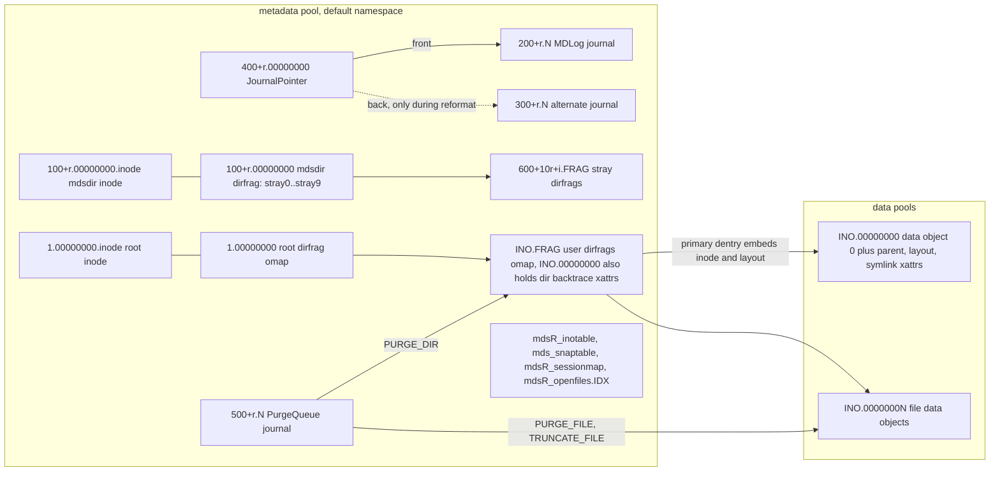
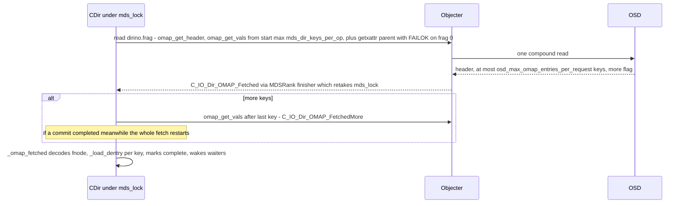
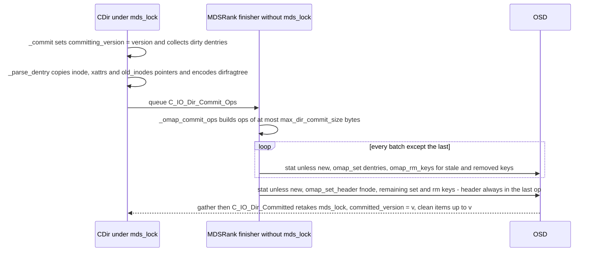
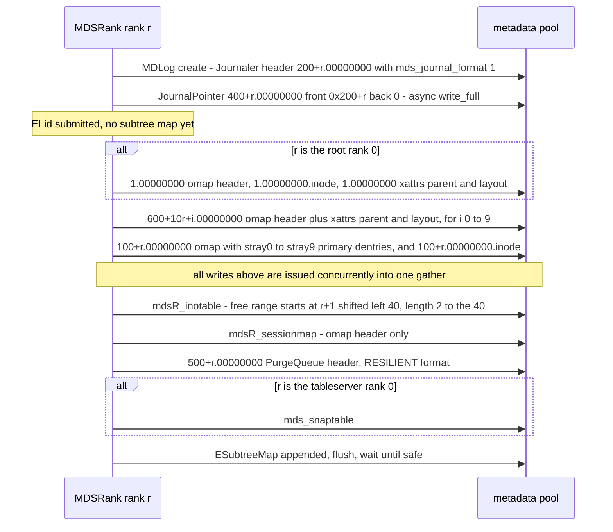

# RADOS Object Catalog: metadata pool and data pools

> Part of the [C++ MDS project map](../README.md). Sources (commit `5f7e383ae6d`): `src/mds/CDir.cc` (3923 LOC; fetch/commit ~1370), `src/mds/CDir.h` (803), `src/mds/CDentry.cc` (829; remote encoding, corruption check), `src/mds/CInode.{h,cc}` (1305 + 5952; InodeStore, store/fetch, backtraces ~500), `src/mds/inode_backtrace.{h,cc}` (279), `src/mds/MDSTable.{h,cc}` (298), `src/mds/InoTable.{h,cc}` (345), `src/mds/SnapServer.{h,cc}` (672), `src/mds/MDSTableServer.cc`, `src/mds/SessionMap.{h,cc}` (2261; persistence ~550), `src/mds/OpenFileTable.{h,cc}` (1427), `src/mds/Anchor.{h,cc}` (149), `src/mds/PurgeQueue.{h,cc}` (1143), `src/mds/StrayManager.cc`, `src/mds/MDLog.cc` (1705; create/recovery/reformat ~450), `src/mds/JournalPointer.{h,cc}` (220), `src/mds/LogEvent.h`, `src/mds/journal.cc` (3517; `LogSegment::try_to_expire`, replay version gates), `src/mds/MDCache.cc` (15324; system hierarchy, open_ino, fragment purge, truncate, uninline, blockdiff ~1000), `src/mds/mdstypes.{h,cc}` (2197), `src/mds/snap.{h,cc}`, `src/mds/old_inode.h`, `src/include/cephfs/types.h` (1340), `src/include/ceph_fs.h`, `src/include/ceph_frag.h`, `src/include/frag.h` + `src/common/frag.cc`, `src/include/object.{h,cc}`, `src/common/fs_types.cc`, `src/osdc/Journaler.{h,cc}` (2250), `src/osdc/Filer.cc`, `src/osdc/Striper.{h,cc}`; offline tools `src/tools/cephfs/{DataScan,JournalTool,JournalScanner,TableTool,Resetter,Dumper,MetaTool}.cc`, `src/tools/cephfs/first-damage.py`, `src/cls/cephfs/cls_cephfs{,_client}.cc`; peers `src/mon/FSCommands.cc`, `src/osd/PrimaryLogPG.cc`, `src/client/Client.cc`, `src/pybind/mgr/{snap_schedule,mirroring}`, `src/libcephsqlite.cc`, `src/SimpleRADOSStriper.cc`, `src/tools/cephfs_mirror/Types.h`, `src/tools/ceph-dencoder/mds_types.h`, `linux/fs/ceph/{addr.c,caps.c,super.h,inode.c,export.c,crypto.h}`, `linux/net/ceph/osd_client.c`; `doc/cephfs/disaster-recovery-experts.rst`.
>
> Related: [mds-tables](mds-tables.md), [rados-and-osd-interactions](rados-and-osd-interactions.md), [mdlog-and-journaler](../06-journal/mdlog-and-journaler.md), [events-and-replay](../06-journal/events-and-replay.md), [cinode-and-inode-types](../04-cache/cinode-and-inode-types.md), [cdir-cdentry-and-cache-objects](../04-cache/cdir-cdentry-and-cache-objects.md), [dirfrags-and-fragmentation](../04-cache/dirfrags-and-fragmentation.md), [mdcache-subtrees-traversal-replication](../04-cache/mdcache-subtrees-traversal-replication.md), [mdcache-lifecycle-trim-and-memory](../04-cache/mdcache-lifecycle-trim-and-memory.md), [strays-and-purge](../11-background-services/strays-and-purge.md), [scrub-and-damage](../11-background-services/scrub-and-damage.md), [snapshots](../10-snapshots-quotas-subvolumes/snapshots.md), [rstats-quotas-and-subvolumes](../10-snapshots-quotas-subvolumes/rstats-quotas-and-subvolumes.md), [sessions](../02-client-protocol/sessions.md), [kclient-expectations](../02-client-protocol/kclient-expectations.md), [libcephfs-fuse-ganesha-expectations](../02-client-protocol/libcephfs-fuse-ganesha-expectations.md), [fsmap-and-mdsmap](../01-cluster-integration/fsmap-and-mdsmap.md), [mgr-tools-and-orchestration](../01-cluster-integration/mgr-tools-and-orchestration.md), [rank-lifecycle-and-recovery](../09-recovery/rank-lifecycle-and-recovery.md), [attributes-and-xattrs](../03-request-path/attributes-and-xattrs.md), [namespace-mutations](../03-request-path/namespace-mutations.md), [lookup-readdir-open-and-file-locks](../03-request-path/lookup-readdir-open-and-file-locks.md), [process-and-threading](../00-architecture/process-and-threading.md), [admin-commands](../13-admin-and-config/admin-commands.md).

## 1. Purpose and responsibilities

This page catalogs every RADOS object the C++ MDS creates, reads, modifies or deletes in a file system's **metadata pool** and **data pools**: name pattern, writer and trigger, exact encoding (omap header/keys/values, xattrs, object data, struct versions), and which external tools or peers read it.

Framing facts:

- **Two pool kinds.** One metadata pool per file system (`MDSMap::metadata_pool`; replicated, omap-capable) holds all MDS-private state. One or more data pools (`MDSMap::data_pools`; the first is the "default data pool", `src/mds/MDSMap.h:350` (MDSMap::get_first_data_pool)) hold file contents written by clients directly, plus per-file *backtrace* xattrs written by the MDS.
- **Write-ahead model.** Every metadata mutation is first journaled in the rank's MDLog (objects `<0x200+rank>.*`). The "backing store" objects (dirfrags, base inodes, backtraces, InoTable, SessionMap, SnapTable) are written lazily when the log segment that dirtied them is expired (`src/mds/journal.cc:127` (LogSegment::try_to_expire)), or on explicit flush. Replay re-applies journal events and uses version numbers to skip updates already persisted.
- **Names are computed, not looked up.** Almost every object name is `"%llx.%08llx"` of (inode number, object number or raw `frag_t`) (`src/include/object.cc:46` (file_object_t::c_str), `src/mds/CInode.cc:1262` (InodeStoreBase::get_object_name)). Only the tables and session/open-file objects have fixed `mds<rank>_*` names. No index of dirfrags or data objects exists; existence is implied by inode metadata (fragtree, size, layout), and offline tools rediscover structure by listing pools and parsing names.
- **Inodes have no object of their own.** A non-base inode (everything except root and the per-rank `~mdsdir`) is stored inside the omap value of its primary dentry in the parent directory fragment object.
- **Clients write data objects with the same naming scheme** (`linux/net/ceph/osd_client.c:1110` (ceph_osdc_new_request)), so inode numbers, layouts and data-object names are a hard contract with unmodified clients. Everything in the metadata pool is MDS-private, except for mgr/mirror objects that share the pool (Section 3.14).

Out of scope (see related pages): journal event payloads ([events-and-replay](../06-journal/events-and-replay.md)), the Journaler state machine and segment expiry rules ([mdlog-and-journaler](../06-journal/mdlog-and-journaler.md)), table 2PC and OFT semantics ([mds-tables](mds-tables.md)), Objecter/OSD epoch barriers, fencing and full handling ([rados-and-osd-interactions](rados-and-osd-interactions.md)), semantics of every `inode_t` field ([cinode-and-inode-types](../04-cache/cinode-and-inode-types.md)).

## 2. Source map

| File | Class / function | Lines | Role |
|---|---|---|---|
| `src/include/object.cc` | `file_object_t::c_str` | 46-50 | `"%llx.%08llx"` (ino, block) name for data, journal and dirfrag objects |
| `src/mds/CInode.cc` | `InodeStoreBase::get_object_name` | 1262-1269 | `"%llx.%08llx" + suffix` for dirfrag, `.inode` and backtrace objects |
| `src/mds/mdstypes.h` | `NUM_STRAY`, `MDS_INO_*`, `MDS_IS_PRIVATE_INO` | 34-59 | Special inode offsets and predicates |
| `src/include/ceph_fs.h` | `CEPH_INO_ROOT/CEPH/GLOBAL_SNAPREALM/LOST_AND_FOUND` | 52-60 | Inode numbers 1-4 |
| `src/include/cephfs/types.h` | `CEPH_FS_ONDISK_MAGIC`, `MAX_MDS`, `charmap_md_t`, `quota_info_t`, `DAMAGE_*`, `unknown_md_t`, `quarantine_md_t`, `optmetadata_*`, `inode_t::encode/decode` | 40-41, 244-345, 459-770, 1053-1239 | Magic, rank limit, inode encoding v20 |
| `src/include/ceph_frag.h`, `src/include/frag.h`, `src/common/frag.cc` | `ceph_frag_make`, `frag_t`, `fragtree_t::operator[]`, `frag_t::decode` | 23-60; 81-190, 339-360; 38-60 | 32-bit frag encoding used in dirfrag names |
| `src/mds/mdstypes.cc` | `frag_info_t`, `nest_info_t`, `client_writeable_range_t`, `inline_data_t`, `fnode_t`, `client_metadata_t`, `session_info_t`, `dentry_key_t`, `mds_table_pending_t` encoders | 46, 119, 241, 293, 337, 627, 671, 765-807, 914 | Dirfrag header, session record, omap key format |
| `src/mds/CDir.h` | `dentry_commit_item`, `get_ondisk_object` | 64-84, 481-483 | Commit staging struct, dirfrag oid |
| `src/mds/CDir.cc` | `fetch`, `fetch_keys`, `_omap_fetch`, `_omap_fetch_more`, `_load_dentry`, `_omap_fetched`, `go_bad_dentry`, `go_bad` | 1563-2354 | Read and decode dirfrags |
| `src/mds/CDir.cc` | `commit`, `_encode_primary_inode_base`, `_omap_commit_ops`, `_omap_commit`, `_parse_dentry`, `_commit`, `_committed` | 2358-2928 | Write dirty dentries, header-last batching |
| `src/mds/CDentry.cc` | `encode_remote`, `decode_remote`, `check_corruption` | 658-688, 806-829 | `l`/`L` values, bad `first` detection |
| `src/mds/CInode.h` | `CInodeCommitOperation(s)`, `InodeStoreBase`, `InodeStore`, `InodeStoreBare` | 78-256 | Backtrace op builder, inode serialization classes |
| `src/mds/CInode.cc` | `CInodeCommitOperation::update` | 67-90 | `parent`/`layout`/`symlink` xattrs |
| `src/mds/CInode.cc` | `store`, `_stored`, `flush`, `fetch`, `_fetched` | 1271-1416 | `.inode` objects (and legacy `inode` xattr) |
| `src/mds/CInode.cc` | `build_backtrace`, `_commit_ops`, `_store_backtrace`, `store_backtrace`, `_stored_backtrace`, `mark_dirty_parent`, `verify_diri_backtrace` | 1418-1644 | Backtrace construction and placement |
| `src/mds/CInode.cc` | `InodeStoreBase::encode_bare/encode/decode_bare/decode`, `encode_snap_blob` | 1684-1775, 3364-3391 | InodeStore format (v6, compat 4) |
| `src/mds/CInode.cc` | `ValidationContinuation::fetch_backtrace_and_tag`; `get_backtrace_pool` | 4949-4978; 5585-5595 | Scrub reads/tags; backtrace pool choice |
| `src/mds/inode_backtrace.{h,cc}` | `inode_backpointer_t`, `inode_backtrace_t` | h:31-100; cc:11-90 | Backtrace content |
| `src/mds/MDCache.cc` | `gen_default_file_layout`, `gen_default_log_layout`, `create_unlinked_system_inode`, `create_root_inode`, `create_empty_hierarchy`, `create_mydir_hierarchy`, `_create_system_file`, `open_root_inode`, `open_mydir_inode/_frag`, `populate_mydir`, `open_foreign_mdsdir`, `get_stray_dir` | 417-925 | System inodes and directories |
| `src/mds/MDCache.cc` | `_truncate_inode`, `purge_inodes`, `open_remote_dentry`, `_open_ino_backtrace_fetched`, `do_open_ino`, `open_ino`, `fetch_backtrace`, `can_fragment`, `_fragment_logged`, `_fragment_committed`, `uninline_data_work`, `file_blockdiff` | 6640-6930, 9016-9640, 10457, 11874, 12413-12600, 13487-13573, 14801-14880 | MDS-issued IO in data and metadata pools |
| `src/mds/journal.cc` | `BatchCommitBacktrace`, `LogSegment::try_to_expire`; `EMetaBlob::replay` table gates | 103-378; 1649-1728 | Lazy writeback of every backing object |
| `src/mds/MDSTable.cc` | `save`, `save_2`, `get_object_name`, `load`, `load_2` | 60-200 | Whole-object table persistence |
| `src/mds/InoTable.{h,cc}` | `encode_state`, `reset_state` | h:51-61; cc:29-43 | Per-rank free inode ranges |
| `src/mds/SnapServer.cc`, `src/mds/MDSTableServer.cc` | `reset_state`, `encode_server_state`, `check_osd_map`; `MDSTableServer::encode_state` | 45-125, 365-414; 353-361 | Global snapshot table |
| `src/mds/SessionMap.cc` | `get_object_name`, header/values codec, `load`, `_load_finish`, `load_legacy`, `save`, `save_if_dirty`, `decode_legacy`, `Session::decode`, `apply_blocklist` | 154-545, 591-660, 917-1005, 1100-1107, 1262 | Per-rank session omap object |
| `src/mds/OpenFileTable.cc`, `src/mds/Anchor.cc` | `get_object_name`, `_encode_header`, `commit`, `_journal_finish`, `_read_omap_values`, `_load_finish`; `Anchor::encode` | 242-998; 23-45 | Per-rank open-file anchors with journaled commit |
| `src/mds/JournalPointer.{h,cc}` | `encode`, `get_object_id`, `load`, `save` (blocking and async) | h:38-50; cc:36-126 | Front/back journal pointer object |
| `src/mds/MDLog.cc` | `create`, `open`, `trim`, `try_to_commit_open_file_table`, `_trim_expired_segments`, `_recovery_thread`, `_reformat_journal` | 267-300, 306, 684-855, 944-998, 1076-1415 | Journal creation, recovery, reformat, expiry driver |
| `src/mds/LogEvent.h` | `EVENT_*`, `encode_with_header` | 18-46, 94-101 | Journal payload envelope |
| `src/osdc/Journaler.{h,cc}` | `JournalStream`, `Header`; `create`, `_set_layout`, `_read_head`, `_finish_read_head`, `_probe`, `_write_head`, `append_entry`, `_do_flush`, `_issue_prezero`, `_have_next_entry`, `erase`, `try_read_entry`, `_trim`, `JournalStream::{readable,read,write}` | h:70-200; cc:83-1606 | Striped append-only journal over RADOS |
| `src/mds/PurgeQueue.{h,cc}`, `src/mds/StrayManager.cc` | `PurgeItem::encode/decode`, `open`, `_recover`, `create`, `push`, `_consume`, `_commit_ops`, `_execute_item`, `_execute_item_complete`; `StrayManager::purge/truncate` | cc:45-105, 242-760; 101-155, 747-780 | Per-rank purge journal and data/metadata deletion |
| `src/mds/RecoveryQueue.cc` | `RecoveryQueue::_start` | 93-127 | File size recovery by probing data objects |
| `src/mds/MDBalancer.cc` | `localize_balancer` | 419-452 | Synchronous read of the Mantle Lua object |
| `src/osdc/Filer.cc`, `src/osdc/Striper.{h,cc}` | `Filer::zero`, `purge_range`, `truncate`, `probe`; `Striper::file_to_extents`, `get_num_objects` | Filer 117-600; Striper.h 59-69, Striper.cc 182-240, 350-364 | Byte range to object mapping |
| `src/tools/cephfs/*`, `src/cls/cephfs/*` | `DataScan`, `JournalTool`, `JournalScanner`, `TableTool`, `Resetter`, `Dumper`, `MetaTool`, `first-damage.py`, `cls_cephfs` | various | Offline readers/writers of these formats |

## 3. How it works

### 3.1 Encoding conventions

All MDS on-disk structures use Ceph `encode()`: little-endian fixed-width integers; `string` = u32 length + bytes; containers = u32 count + elements; `bufferlist` = u32 length + bytes; `bool` = u8; `ENCODE_START(v, compat)` = u8 struct_v + u8 compat_v + u32 byte length of the enclosed body; `DECODE_START_LEGACY_COMPAT_LEN` also accepts pre-envelope encodings. `utime_t` = u32 sec + u32 nsec (`src/include/utime.h:162` (utime_t::encode)); `snapid_t`, `inodeno_t`, `version_t` = u64; `frag_t` = u32; `interval_set<T>` = the underlying map (u32 count + (start, len) pairs) (`src/include/interval_set.h:430` (interval_set::encode)). The magic string `CEPH_FS_ONDISK_MAGIC = "ceph fs volume v011"` (`src/include/cephfs/types.h:40`) is encoded as a `string` at the front of base-inode objects and OFT headers, and as the first field inside the `Journaler::Header` envelope; nowhere else.

`file_layout_t` has two encodings (`src/common/fs_types.cc:89` (file_layout_t::encode)): without feature `CEPH_FEATURE_FS_FILE_LAYOUT_V2` it is the 28-byte packed `ceph_file_layout` (7 x le32: stripe_unit, stripe_count, object_size, cas_hash=0, object_stripe_unit=0, unused=0, pg_pool; pool_ns is lost, pool -1 written as 0); with the feature it is `ENCODE_START(2,2)` {u32 su, u32 sc, u32 os, i64 pool, string pool_ns}. Decode distinguishes them by the first byte (0 = legacy, because `stripe_unit` is a multiple of 256) (`src/common/fs_types.cc:111` (file_layout_t::decode)). Inode values and the backtrace `layout` xattr are encoded with `mdsmap->get_up_features()` (AND of `mds_features` over the daemons holding up ranks, 0 if none, `src/mds/MDSMap.cc:1220` (MDSMap::get_up_features)); offline tools (`cephfs-data-scan`, `cephfs-journal-tool`) encode with `CEPH_FEATURES_SUPPORTED_DEFAULT` instead; the Journaler header always uses the legacy form (`src/osdc/Journaler.h:156` (Journaler::Header::encode)); `PurgeItem` always uses v2 (`src/mds/PurgeQueue.cc:51` (PurgeItem::encode)).

### 3.2 Naming primitives

| Primitive | Format | Code |
|---|---|---|
| Data object, journal object | `"%llx.%08llx"` of `(ino, object_no)`: ino in lowercase hex without leading zeros, `.`, object number zero-padded to at least 8 hex digits | `src/include/object.cc:46` (file_object_t::c_str); `src/osdc/Striper.h:59` (Striper::file_to_extents formats `"%llx.%%08llx"`) |
| Dirfrag object | `"%llx.%08llx"` of `(dir ino, raw frag_t u32)` | `src/mds/CDir.h:481` (CDir::get_ondisk_object) |
| Base inode object | `"%llx.%08llx.inode"` of `(ino, 0)` | `src/mds/CInode.cc:1291` (CInode::store) |
| Backtrace object | `"%llx.%08llx"` of `(ino, 0)`: data object 0 (files) or dirfrag `frag_t()` (directories) | `src/mds/CInode.cc:1465` (CInode::_commit_ops) |
| Per-rank tables | `"mds%d_%s"` (rank, `inotable`) | `src/mds/MDSTable.cc:142` (MDSTable::get_object_name) |
| Global tables | `"mds_%s"` (`snaptable`) | same; `MDSTableServer` is constructed with `is_per_mds=false` (`src/mds/MDSTableServer.cc:42` (MDSTableServer::MDSTableServer)) |
| SessionMap | `"mds%d_sessionmap"` | `src/mds/SessionMap.cc:154` (SessionMap::get_object_name) |
| OpenFileTable | `"mds%d_openfiles.%x"` (rank, index in hex) | `src/mds/OpenFileTable.cc:242` (OpenFileTable::get_object_name) |
| JournalPointer | `"%llx.%08llx"` of `(0x400+rank, 0)` | `src/mds/JournalPointer.cc:36` (JournalPointer::get_object_id) |

All MDS metadata objects live in the metadata pool's **default namespace** (every `object_locator_t` is built from the pool id only, e.g. `src/mds/CDir.cc:1800` (CDir::_omap_fetch), `src/mds/MDSTable.cc:85` (MDSTable::save)).

**Striping (data objects and journals).** `Striper::file_to_extents` (`src/osdc/Striper.cc:182`): with `su` = stripe_unit (forced to object_size when stripe_count is 1), `blockno = off / su`, `stripeno = blockno / stripe_count`, `stripepos = blockno % stripe_count`, `objectsetno = stripeno / (object_size / su)`, `objectno = objectsetno * stripe_count + stripepos`, in-object offset `(stripeno % (object_size/su)) * su + off % su`. Object count for a size: `Striper::get_num_objects` (`src/osdc/Striper.cc:350`). Default layout: 4 MiB stripe unit and object size, stripe count 1 (`src/include/fs_types.h:125` (file_layout_t::get_default)).

**Frag encoding in dirfrag names.** A `frag_t` is 32 bits: upper 8 bits = number of bits `b`, lower 24 bits = value using the *most significant* `b` bits of the 24-bit space (`src/include/ceph_frag.h:23` (ceph_frag_make)). The unsplit frag `0/0` is `0x00000000`. `frag_t::decode` rejects invalid frags (bits > 24 or stray low bits) unless the byte-swapped value is valid, in which case it silently corrects it (tracker 73792) (`src/common/frag.cc:42` (frag_t::decode)). Examples for directory ino `0x10000000000`:

| Fragtree state | Dirfrag objects |
|---|---|
| unfragmented | `10000000000.00000000` |
| split by 1 bit | `10000000000.01000000` (`0/1`), `10000000000.01800000` (`1/1`), plus `10000000000.00000000` kept with backtrace xattrs only |
| split by 3 bits (`mds_bal_split_bits` = 3) | `.03000000`, `.03200000`, `.03400000`, `.03600000`, `.03800000`, `.03a00000`, `.03c00000`, `.03e00000`, plus `.00000000` |

**Dentry to frag mapping.** `frag = fragtree[ceph_str_hash(dl_dir_hash, name)]` (`src/mds/CInode.cc:720` (InodeStoreBase::hash_dentry_name), `729` (pick_dirfrag), `src/include/frag.h:339` (fragtree_t::operator[])). `dl_dir_hash` 0 means `CEPH_STR_HASH_LINUX` (1); new directories get `mds_default_dir_hash` = 2 (rjenkins) (`src/mds/Server.cc:3707` (Server::prepare_new_inode)). Only the low 24 bits of the hash participate (`ceph_frag_contains_value` masks with a 24-bit mask, `src/include/ceph_frag.h:45`).

### 3.3 Special inode numbers and ranges

`MAX_MDS` = `0x100` (`src/include/cephfs/types.h:41`), `NUM_STRAY` = 10 (`src/mds/mdstypes.h:34`).

| Inode number(s) | Symbol | Meaning | RADOS objects |
|---|---|---|---|
| `0x1` | `CEPH_INO_ROOT` | Root directory; only `mdsmap->get_root()` (always rank 0, `src/mds/MDSMap.h:601` (MDSMap::root)) stores/loads it | `1.00000000.inode`; dirfrag `1.00000000` which also carries the root's `parent`/`layout` xattrs. Root is never split or merged by current code (`src/mds/MDCache.cc:11897` (MDCache::can_fragment), added 2025 in f4bcf5bfd53). Fragtree-based lookups still follow an existing root fragtree, but `MDCache::open_root`/`open_root_inode` (creating/starting paths) open and fetch only `frag_t()` (`src/mds/MDCache.cc:685-760` (MDCache::open_root_inode, MDCache::open_root)), so behaviour with a previously fragmented root is unverified |
| `0x2` | `CEPH_INO_CEPH` | Legacy hidden `.ceph` dir: never created now; still not fragmented (`src/mds/MDCache.cc:11889` (MDCache::can_fragment)) and skipped in readdir (`src/mds/Server.cc:5259` (Server::handle_client_readdir)) | none created |
| `0x3` | `CEPH_INO_GLOBAL_SNAPREALM` | In-memory dummy inode holding the global snaprealm (`src/mds/MDCache.cc:10217` (MDCache::create_global_snaprealm)); its seq = max(last_created, last_destroyed) of the SnapTable (`src/mds/SnapRealm.cc:128` (SnapRealm::check_cache)) | none |
| `0x4` | `CEPH_INO_LOST_AND_FOUND` | Reserved; created only by `cephfs-data-scan` as `/lost+found` (`src/tools/cephfs/DataScan.cc:2017` (MetadataDriver::inject_lost_and_found)) | `4.00000000` when created |
| `0x100 + r` | `MDS_INO_MDSDIR(r)` | Per-rank `~mdsdir`, holds primary dentries `stray0..stray9`; never fragmented (`src/mds/MDCache.cc:11889` (MDCache::can_fragment)); no backtrace | `<100+r>.00000000.inode`, `<100+r>.00000000` |
| `0x200 + r` | `MDS_INO_LOG_OFFSET` | MDLog journal (default front) | `<200+r>.%08x` |
| `0x300 + r` | `MDS_INO_LOG_BACKUP_OFFSET` | Alternate journal for `mds_journal_format` rewrites; after a rewrite it can stay the active front | `<300+r>.%08x` |
| `0x400 + r` | `MDS_INO_LOG_POINTER_OFFSET` | JournalPointer | `<400+r>.00000000` |
| `0x500 + r` | `MDS_INO_PURGE_QUEUE` | PurgeQueue journal | `<500+r>.%08x` |
| `0x600 + 10*r + i` (i = 0..9) | `MDS_INO_STRAY(r,i)` | Stray directories of rank `r` (rank 0: `0x600`-`0x609`; rank 255 ends at `0xfff`) | `<stray>.<frag>` dirfrags; frag 0 carries backtrace xattrs |
| `0x1000` | `MDS_INO_SYSTEM_BASE` | First non-system inode number | |
| `[0x100, 0x1000)` | `MDS_IS_PRIVATE_INO` | `LOOKUPINO` on it returns `-ESTALE` (`src/mds/Server.cc:4450` (Server::handle_client_lookup_ino)) | |
| `[(r+1)<<40, (r+2)<<40)` | InoTable range of rank `r` | Inode numbers allocated by rank `r` (rank 0: `0x10000000000`-`0x1ffffffffff`) (`src/mds/InoTable.cc:29` (InoTable::reset_state)) | dirfrags and data objects of user inodes |

Predicates (`src/mds/mdstypes.h:49-59` (MDS_INO_IS_STRAY and related macros)): `MDS_INO_IS_STRAY`, `MDS_INO_IS_MDSDIR`, `MDS_INO_MDSDIR_OWNER(i) = i - 0x100`, `MDS_INO_STRAY_OWNER(i) = (i - 0x600)/10`, `MDS_INO_STRAY_INDEX(i) = (i - 0x600)%10`, `MDS_INO_IS_BASE(i)` = root, global snaprealm or any mdsdir. A foreign mdsdir's owner is `ino & (MAX_MDS-1)` (`src/mds/MDCache.cc:907` (MDCache::open_foreign_mdsdir)).

The kernel client hard-codes the same private range: `ceph_vino_is_reserved` is true for `[0x100, 0x1000)` (`linux/fs/ceph/super.h:666` (ceph_vino_is_reserved)); `ceph_get_inode` then returns `-EREMOTEIO` (`linux/fs/ceph/inode.c:184` (ceph_get_inode)); NFS handle decode and quota lookups skip them (`linux/fs/ceph/export.c:141` (__lookup_inode), `linux/fs/ceph/quota.c:34` (ceph_has_realms_with_quotas)). Inode 3 is pinned as the global realm by both clients (`linux/fs/ceph/snap.c:126` (ceph_create_snap_realm), `src/client/Client.cc:5439` (Client::get_snap_realm)).

### 3.4 Catalog overview

Master table (r = rank). "Lazy" = written by `LogSegment::try_to_expire` when the segment that dirtied it expires, or by `flush journal`.

| Object (pool) | Kind | Content | Writer and trigger | MDS reader and trigger | External readers |
|---|---|---|---|---|---|
| `<dirino>.<frag>` (meta) | omap | header `fnode_t`; one key per non-null dentry | `CDir::_omap_commit_ops`: lazy; full write of new frags during fragmentation; created by the first commit of a new dirfrag | `CDir::_omap_fetch` on cache miss, path traversal, readdir, `open_ino`, rejoin, OFT prefetch | data-scan, journal-tool, meta-injection, first-damage.py |
| `<dirino>.00000000` (meta) | xattrs | `parent` (backtrace), `layout`, optional `scrub_tag` | `CInode::_commit_ops` (lazy, dir backtrace); scrub tag | `CDir::_omap_fetch` reads `parent` when `mds_verify_backtrace` > 0; scrub; `open_ino` fallback | data-scan `scan_frags`, meta-injection |
| `1.00000000.inode`, `<100+r>.00000000.inode` (meta) | data (write_full) | magic + `InodeStore` | `CInode::store` at mkfs, lazily for dirty base inodes, `CInode::flush` | `CInode::fetch` at boot; scrub of base dirs | data-scan (`init`, `check_roots`), journal-tool (`recover_dentries` roots) |
| `<base ino>.00000000` xattr `inode` (meta) | xattr | legacy base inode | never written now | `CInode::fetch` fallback | none |
| `mds<r>_inotable` (meta) | data (write_full) | u64 version + InoTable state | `MDSTable::save` at mkfs, lazily (`inotablev`) | `MDSTable::load` at boot | table-tool, journal-tool (`consume_inos`), data-scan |
| `mds_snaptable` (meta) | data (write_full) | u64 version + SnapServer state + pending map | `MDSTable::save` on the tableserver rank (always 0) | `MDSTable::load` on the tableserver rank | table-tool, data-scan, first-damage.py |
| `mds<r>_sessionmap` (meta) | omap | header `ENCODE_START(1,1)` {u64 version}; key `client.<id>` -> `session_info_t` | `SessionMap::save` lazily (`sessionmapv`); `save_if_dirty` for completed-request changes; mkfs | `SessionMap::load` at boot | table-tool |
| `mds<r>_openfiles.<idx>` (meta) | omap | header (magic, version, num objs, journal state); key `%llx` ino -> `Anchor` | `OpenFileTable::commit` from MDLog trim upkeep | `OpenFileTable::load` (async at replay), prefetch at rejoin | none found |
| `<200+r>.<n>` (meta) | data | object 0 = `Journaler::Header`; objects >= 1 = framed `LogEvent` stream | Journaler appends, head writes, prezero removals, trimming | replay, standby-replay tailing | journal-tool, ceph-dencoder |
| `<300+r>.<n>` (meta) | data | same | `MDLog::_reformat_journal` | `_recovery_thread` erases it if pointer `back` is set | journal-tool (via pointer) |
| `<400+r>.00000000` (meta) | data (write_full) | `JournalPointer{front, back}` | mkfs (async), recovery when missing, reformat (blocking) | `_recovery_thread` blocking read | journal-tool `JournalScanner`, `Resetter`, `Dumper` |
| `<500+r>.<n>` (meta) | data | object 0 = header; framed `PurgeItem` stream (always RESILIENT format) | `PurgeQueue::push`, head writes, trimming | `PurgeQueue::open/_consume` | journal-tool `--journal=purge_queue` |
| Mantle object named by `MDSMap::balancer` (meta) | data | Lua source | admin (`rados put`; name set by `ceph fs set <fs> balancer <obj>`) | `MDBalancer::localize_balancer` when the name changes | none |
| `<ino>.<objno>` (data pool, layout pool + namespace) | data | file contents; object 0 also carries the `inline_version` xattr after an uninline | clients (kclient, libcephfs) | MDS: probe (stat), `TRIMTRUNC`, remove (purge), `zero`, `list_snaps`, write (fscrypt last block, uninline) | OSD scrub, data-scan (default namespace only), `pg_files` (computes names only) |
| `<ino>.00000000` (data pools, default namespace) | xattrs | `parent`, `layout`, `symlink`, optional `scrub_tag`, data-scan `scan_*` (main data pool) | `CInode::_commit_ops` lazily; scrub tag | `open_ino` (`fetch_backtrace`), scrub | data-scan `scan_inodes`, meta-injection |

### 3.5 Directory fragment objects (`<dirino>.<frag>`)

#### 3.5.1 Omap header: `fnode_t`

The omap header of every dirfrag object is `encode(fnode_t)`; the decode must consume the whole header, otherwise the frag is treated as damaged (`src/mds/CDir.cc:2080-2097` (CDir::_omap_fetched)). An empty header (object missing, or an object that only carries backtrace xattrs) is reported as `object missing on disk` (`src/mds/CDir.cc:2067` (CDir::_omap_fetched)).

`fnode_t::encode` = `ENCODE_START(4, 3)` (`src/mds/mdstypes.cc:337`):

| Field | Type | Notes |
|---|---|---|
| `version` | u64 | Dirfrag version; adopted on load only if the in-memory `CDir` has version 0 (`src/mds/CDir.cc:2104` (CDir::_omap_fetched)) |
| `snap_purged_thru` | snapid | Highest `last_destroyed` whose stale snapped dentries were purged |
| `fragstat` | `frag_info_t` | `ENCODE_START(3,2)` {u64 version, utime mtime, i64 nfiles, i64 nsubdirs, u64 change_attr} (`src/mds/mdstypes.cc:46` (frag_info_t::encode)) |
| `accounted_fragstat` | `frag_info_t` | Part already propagated to the parent inode's `dirstat` |
| `rstat` | `nest_info_t` | `ENCODE_START(3,2)` {u64 version, i64 rbytes, i64 rfiles, i64 rsubdirs, i64 ranchors = 0 (removed field), i64 rsnaps, utime rctime} (`src/mds/mdstypes.cc:119` (nest_info_t::encode)) |
| `accounted_rstat` | `nest_info_t` | |
| `damage_flags` | u32 | v3+; never interpreted by the MDS; preserved because the whole fnode is adopted on load; `cephfs-data-scan` sets it (Section 8) |
| `recursive_scrub_version`, `recursive_scrub_stamp`, `localized_scrub_version`, `localized_scrub_stamp` | u64, utime, u64, utime | v4+ |

#### 3.5.2 Omap keys: `dentry_key_t`

`dentry_key_t::encode(std::string&)` (`src/mds/mdstypes.cc:772`): `<name>_head` when the dentry's `last == CEPH_NOSNAP` (`0xfffffffffffffffe`, `src/include/rados.h:39`), otherwise `<name>_<last snapid in lowercase hex>`. Decoding splits at the **last** `_` (`src/mds/mdstypes.cc:793` (dentry_key_t::decode_helper)), so names may contain `_`; a key with no `_` hits `ceph_assert` (MDS abort). The name is whatever the client sent: for case-insensitive (`ceph.dir.charmap`) directories the client sends the folded name and the original in `alternate_name`; for fscrypt the key is the base64 ciphertext (long names truncated plus SHA-256) and the full ciphertext is in `alternate_name` (`linux/fs/ceph/crypto.h:91` (CEPH_NOHASH_NAME_MAX)).

- Head dentries: one key per live name. Null dentries are never stored; unlinking a name removes its key (`src/mds/CDir.cc:2655` (CDir::_omap_commit write_one)).
- Snapshotted dentries: additional keys `<name>_<last>` per COWed version still covering a live snapshot; the value's `first` gives the interval `[first, last]`. A plain file (not multiversion) gets a snapped *primary* dentry with its own inode copy; a multiversion inode (directory, `nlink > 1`, has snaprealm, or has `old_inodes`, `src/mds/CInode.h:487` (CInode::is_multiversion)) keeps prior versions in its head value's `old_inodes` and, when its dentry is renamed or unlinked, gets a snapped *remote* dentry (`src/mds/MDCache.cc:1701-1760` (MDCache::journal_cow_dentry)).
- Stray dentries (inside stray dirs) are named by the inode number in hex `"%llx"` (`src/mds/CInode.cc:1170` (CInode::name_stray_dentry)), e.g. `10000000005_head`; their `first` is the global realm's newest seq + 1 (`src/mds/Server.cc:8665` (Server::handle_client_unlink)).
- Keys in `~mdsdir`: `stray0_head` .. `stray9_head`; old file systems may have `stray_head` for index 0 (`src/mds/MDCache.cc:854` (MDCache::populate_mydir)).
- `lost+found` (data-scan): key `lost+found_head` in `1.00000000`, entries in `4.00000000` named by hex ino (`src/tools/cephfs/DataScan.h:92` (lost_found_dname)).

#### 3.5.3 Omap values

Every value starts with `snapid_t first` (u64 LE) and a one-byte type marker (`src/mds/CDir.cc:1856-1861` (CDir::_load_dentry)):

| Marker | Meaning | Body after the marker | Written by |
|---|---|---|---|
| `'i'` | Primary dentry with embedded inode (current) | `ENCODE_START(2,1)` { string `alternate_name`; `InodeStore` with its own `ENCODE_START(6,4)` envelope } | MDS (`src/mds/CDir.cc:2571-2577` (CDir::_omap_commit_ops)); journal-tool `recover_dentries` (`src/tools/cephfs/JournalTool.cc:987` (JournalTool::recover_dentries)) |
| `'I'` | Primary dentry, legacy unversioned | bare `InodeStore` (`encode_bare`, no envelope), optional trailing fields read only while bytes remain | still written by `cephfs-data-scan` (`src/tools/cephfs/DataScan.cc:2420` (MetadataDriver::inject_linkage)) and by `cephfs-meta-injection amend` (`first` + the marker from its JSON input + `encode_bare`, `src/tools/cephfs/MetaTool.cc:348` (MetaTool::inode_meta_t::encode)); the MDS only reads it |
| `'l'` | Remote dentry, hard link (current) | `ENCODE_START(2,1)` { u64 ino; u8 d_type; string `alternate_name` } | MDS (`src/mds/CDentry.cc:658` (CDentry::encode_remote)); journal-tool (`src/tools/cephfs/JournalTool.cc:1049` (JournalTool::recover_dentries)) |
| `'L'` | Remote dentry, legacy | u64 ino; u8 d_type | read only |

Any other marker throws `buffer::malformed_input("Invalid tag char ...")`; decode errors mark only that dentry damaged (`src/mds/CDir.cc:2050` (CDir::_load_dentry), `2206-2222` (CDir::_omap_fetched)).

#### 3.5.4 `InodeStore` and `inode_t` layout

`CDir::_encode_primary_inode_base` (`src/mds/CDir.cc:2429`) duplicates `InodeStoreBase::encode` (`src/mds/CInode.cc:1703`) = `ENCODE_START(6, 4)` + `encode_bare` (`src/mds/CInode.cc:1684` (InodeStoreBase::encode_bare)):

| Order | Field | Encoding |
|---|---|---|
| 1 | `inode` | `inode_t` `ENCODE_START(20,6)` with features = MDSMap up features |
| 2 | `symlink` | string, present only if `S_ISLNK(mode)` |
| 3 | `dirfragtree` | `fragtree_t` = `compact_map<frag_t, i32 split bits>` (u32 count + pairs) (`src/common/frag.cc:144` (fragtree_t::encode)) |
| 4 | `xattrs` | u32 count + (string key, u32 len + bytes) pairs; `0` when none (user and ACL xattrs live here, not as RADOS xattrs) |
| 5 | `snap_blob` | bufferlist: `sr_t` if the inode has a snaprealm, else empty (`src/mds/CInode.cc:3364` (CInode::encode_snap_blob)) |
| 6 | `old_inodes` | `map<snapid last, old_inode_t>`; `old_inode_t` = `ENCODE_START(2,2)` {snapid first; inode_t; xattrs} (`src/mds/old_inode.h:28` (old_inode_t::encode)) |
| 7 | `oldest_snap` | u64 |
| 8 | `damage_flags` | u32; never interpreted. `CDir::_load_dentry` does not copy it into the `CInode` (`src/mds/CDir.cc:1995-2012` (CDir::_load_dentry)), so the next commit of a loaded primary dentry writes 0; base inodes (`.inode` objects) keep it |

`CDir::_encode_primary_inode_base` writes `symlink` when the target string is non-empty (`src/mds/CDir.cc:2435` (CDir::_encode_primary_inode_base)), whereas `encode_bare`/`decode_bare` and the journal's `EMetaBlob::fullbit` key it on `S_ISLNK(mode)`; the two agree for every non-empty target (see Section 8 for the empty-target case).

Decoding tolerates older versions: struct_v 2 directories carry a default layout after `old_inodes`; `oldest_snap`/`damage_flags` are read only if bytes remain (`src/mds/CInode.cc:1719` (InodeStoreBase::decode_bare)).

`sr_t` (`src/mds/snap.cc:215` (sr_t::encode)) = `ENCODE_START(8,4)` {seq, created, last_created, last_destroyed, current_parent_since (snapids); `map<snapid, SnapInfo>` snaps; `map<snapid, snaplink_t>` past_parents; `set<snapid>` past_parent_snaps; u32 flags (`PARENT_GLOBAL`=1, `SUBVOLUME`=2, `SNAPDIR_VISIBILITY`=4); utime last_modified; u64 change_attr}. `SnapInfo` = `ENCODE_START(4,2)` {snapid, ino, utime stamp, string name, map<string,string> metadata, string alternate_name} (`src/mds/snap.cc:33` (SnapInfo::encode)); `snaplink_t` = `ENCODE_START(2,2)` {u64 ino, snapid first} (`src/mds/snap.cc:174` (snaplink_t::encode)). A fresh `sr_t` has `flags = SNAPDIR_VISIBILITY` (`src/mds/snap.h:126`). The subvolume marker (`ceph.dir.subvolume`) is persisted only as `sr_t::SUBVOLUME` in the subvolume root's `snap_blob` (`src/mds/Server.cc:6624` (Server::handle_client_setvxattr)).

`inode_t` v20 field order (`src/include/cephfs/types.h:1053` (inode_t::encode)): `ino` u64, `rdev` u32, `ctime`, `mode` u32, `uid` u32, `gid` u32, `nlink` i32, `anchored` bool (always 0), `dir_layout` (8 raw bytes: u8 `dl_dir_hash`, 7 unused), `layout` (`file_layout_t`), `size` u64, `truncate_seq` u32, `truncate_size` u64, `truncate_from` u64, `truncate_pending` u32, `mtime`, `atime`, `time_warp_seq` u32, `client_ranges` map<client_t (i64), `client_writeable_range_t` `ENCODE_START(2,2)` {u64 first, u64 last, snapid follows}> (`src/mds/mdstypes.cc:241` (client_writeable_range_t::encode)), `dirstat` frag_info_t, `rstat`, `accounted_rstat` nest_info_t, `version`, `file_data_version`, `xattr_version`, `backtrace_version` u64, `old_pools` set<i64>, `max_size_ever` u64, `inline_data` {u64 version, bufferlist data} (`src/mds/mdstypes.cc:293` (inline_data_t::encode)), `quota` `ENCODE_START(1,1)` {i64 max_bytes, i64 max_files}, `stray_prior_path` string, `last_scrub_version` u64, `last_scrub_stamp`, `btime`, `change_attr` u64, `export_pin` i32, `export_ephemeral_random_pin` double, `flags` u8 (`F_EPHEMERAL_DISTRIBUTED_PIN`, `F_QUIESCE_BLOCK`), fscrypt flag bool (ignored on decode), `fscrypt_auth`, `fscrypt_file`, `fscrypt_last_block` (u8 vectors), `optmetadata` `ENCODE_START(1,1)` {vector of (u64 kind; payload)} with kinds `CHARMAP`=1 (`ENCODE_START(1,1)` {bool casesensitive, string normalization, string encoding}) and `QUARANTINE`=2 (`ENCODE_START(1,1)` {bool enabled, u64 sec, u32 nsec}); unknown kinds >= 4 are preserved as opaque versioned blobs (`src/include/cephfs/types.h:244-277` (charmap_md_t), `465-770` (unknown_md_t, quarantine_md_t, optmetadata_singleton, optmetadata_multiton)); kind 3 hits an off-by-one (Section 8). Semantics: [cinode-and-inode-types](../04-cache/cinode-and-inode-types.md).

Consequences: an inode's attributes, xattrs, symlink target, inline data, quota, pins, charmap/quarantine options, snapshot history and snaprealm all live in the **parent dirfrag's omap value of its primary dentry**. A hard-linked inode lives in exactly one primary dentry (possibly in a stray dir); other names are `'l'` dentries carrying only ino + d_type.

#### 3.5.5 Fetch

- Full fetch: `omap_get_header` + paged `omap_get_vals` (`mds_dir_keys_per_op` = 16384 requested; the OSD caps each `OMAPGETVALS` reply at `osd_max_omap_entries_per_request` = 1024 entries or `osd_max_omap_bytes_per_request` = 1 GiB, `src/osd/PrimaryLogPG.cc:7962` (PrimaryLogPG::do_osd_ops)) (`src/mds/CDir.cc:1796` (CDir::_omap_fetch), `1824` (CDir::_omap_fetch_more)). The completion accepts only `0`, `-ENOENT` or `-ENODATA`; any other read error (for example `-EIO`) fails `ceph_assert` and aborts the MDS (`src/mds/CDir.cc:2063` (CDir::_omap_fetched)). If `committed_version` advanced past the committing version seen at fetch start, the fetch restarts (`src/mds/CDir.cc:1730` (C_IO_Dir_OMAP_FetchedMore::finish), `1779` (C_IO_Dir_OMAP_Fetched::finish)).
- Keyed fetch: `omap_get_vals_by_keys` for `name_head` keys when `mds_dir_prefetch` = false (default true); optional throttled background full fetch when `mds_dir_prefetch_backend` (false) is set and the dirfrag was hit `mds_dir_prefetch_backend_hit_threshold` (16) times, at most `mds_dir_prefetch_backend_max` (1) at once (`src/mds/CDir.cc:1600-1637` (CDir::fetch), `1653` (CDir::fetch_keys)). Requested keys that are absent become null dentries with `first` = global realm newest seq + 1 (`src/mds/CDir.cc:2253` (CDir::_omap_fetched)). `fetch_keys({})` on a not-yet-loaded dirfrag (version 0) reads only the header (plus `parent` on frag 0); on a loaded one it does no IO (used for stray dirfrags at boot, `src/mds/MDCache.cc:886` (MDCache::populate_mydir)).
- Unlinked directories: if the parent is a stray dir and the inode has no snaprealm, no RADOS read is done; the frag is marked complete and empty (`src/mds/CDir.cc:1584-1597` (CDir::fetch)).
- `mds_verify_backtrace` (default 1): on `frag_t()` the read also fetches `parent`; `CInode::verify_diri_backtrace` (skipped for base, dirty-parent or non-auth inodes) checks `ancestors[0]` (dirino and dname) against the in-memory parent; on mismatch or a missing xattr it logs `bad backtrace on directory inode`, re-dirties the backtrace and flushes the log; values > 1 assert (`src/mds/CInode.cc:1614` (CInode::verify_diri_backtrace)). The `parent` value is decoded without a `try` (`src/mds/CInode.cc:1624` (CInode::verify_diri_backtrace)), so an undecodable dir backtrace throws out of the completion (observation).
- Stale snapshot items: when `fnode.snap_purged_thru < realm last_destroyed`, snapped keys whose `[first,last]` contains no live snap are skipped and queued in `stale_items` for removal by the next commit (`src/mds/CDir.cc:1867-1873` (CDir::_load_dentry), `2113-2122` (CDir::_omap_fetched)).
- "Underwater" items: on a fetch with `committed_version == 0` (after recovery), a dirty cached dentry/inode whose on-disk copy has the same ino and version is marked clean (`src/mds/CDir.cc:1902-1984` (CDir::_load_dentry)).
- Duplicate primary inode (already cached under another dentry): `clog` error `loaded dup inode`, not linked unless `mds_hack_allow_loading_invalid_metadata` (false) (`src/mds/CDir.cc:2029-2044` (CDir::_load_dentry)).

#### 3.5.6 Commit

- Only dirty dentries are written (`dirty_dentries`); a dirfrag that is new and `STATE_FRAGMENTING` is written in full (`src/mds/CDir.cc:2624` (CDir::_omap_commit), `2677` (CDir::_omap_commit)).
- One commit in flight per CDir: if `committing_version > committed_version` the new request waits; `_committed` re-issues `_commit` for higher waiters (`src/mds/CDir.cc:2757` (CDir::_commit), `2808` (CDir::_committed)).
- Batching: ops are limited to `max_dir_commit_size` = `mds_dir_max_commit_size` (10) MiB, or 90% of `osd_max_write_size` (default 90 MiB, so 81 MiB) when the option is 0 (`src/mds/MDCache.cc:188` (MDCache::MDCache)). Accounting reserves `sizeof(fnode_t)` for the header (`src/mds/CDir.cc:2561` (CDir::_omap_commit_ops)); a dentry value larger than the limit is never split: it goes into an op of its own (or with the header if it is last), exceeding the limit (`skipping empty commit` log, `2585` (CDir::_omap_commit_ops)).
- **Header last.** The fnode is written in the final op; ops to one object are ordered, so a crash between ops leaves an older header version (comment at `src/mds/CDir.cc:2506-2516` (CDir::_omap_commit_ops)).
- **No blind creation.** Unless the CDir is `new` (created by mkdir/mkfs/fragmentation and never committed), every op starts with `stat` (`src/mds/CDir.cc:2503` (CDir::_omap_commit_ops)), so a vanished object fails the op with `-ENOENT` instead of being recreated partially. `_committed` tolerates `-ENOENT` only for a never-committed dirfrag under a stray dir (partly purged during failover) and then sets `STATE_MISSINGOBJS` if the inode has a snaprealm (`src/mds/CDir.cc:2811-2817` (CDir::_committed)); other errors go to `handle_write_error` (Section 8).
- Embedded inodes become clean when `committed_version >= inode version`; clean null dentries in stray dirs are dropped immediately (`src/mds/CDir.cc:2850-2885` (CDir::_committed)).
- Priority: segment expiry passes `op_prio` between `CEPH_MSG_PRIO_LOW` and `CEPH_MSG_PRIO_HIGH`, scaled by the number of expiring segments (`src/mds/MDLog.cc:751-755` (MDLog::trim)); default `CEPH_MSG_PRIO_DEFAULT`.

#### 3.5.7 Dirfrag object lifecycle

| Event | RADOS effect | Code |
|---|---|---|
| mkdir, mkfs, `_create_system_file` | CDir marked `new`; object created by its first commit (header + keys, no `stat` guard) | `src/mds/CDir.cc:1492` (CDir::mark_new), `src/mds/MDCache.cc:588` (MDCache::_create_system_file) |
| Split/merge | EFragment PREPARE journaled; result frags committed in full (new + fragmenting); EFragment COMMIT; old frag objects `remove`d, except `frag_t()` which gets `truncate(0)` + `omap_clear()` (keeps `parent`/`layout` xattrs, drops header and keys); `-ENOENT` tolerated, any other error fails `ceph_assert`; EFragment FINISH | `src/mds/MDCache.cc:12413` (MDCache::_fragment_logged), `12529` (_fragment_committed), `12254` (C_IO_MDC_FragmentPurgeOld), `12569` (_fragment_old_purged) |
| Directory purged (last link gone) | PurgeQueue `PURGE_DIR`: `remove` of every leaf frag object plus `frag_t()` (null snapc) | `src/mds/PurgeQueue.cc:677-686` (PurgeQueue::_execute_item) |
| `cephfs-data-scan` | missing dirfrags created with exclusive create (or `assert_version` when corrupt) and a blank fnode (`version` 1, `nfiles` 1, `damage_flags` 1); `'I'` dentries injected | `src/tools/cephfs/DataScan.cc:2347` (find_or_create_dirfrag), `2420` (inject_linkage) |

Not fragmentable (`src/mds/MDCache.cc:11874` (MDCache::can_fragment)): `~mdsdir`, ino 2, root, directories inside stray dirs, quiesced directories. Stray dirs are fragmentable and are pre-split/merged by `MDCache::advance_stray` when the stray index rotates (`src/mds/MDCache.cc:776` (MDCache::advance_stray)). Every dirfrag is capped at `mds_bal_fragment_size_max` (100000) head entries (`fragstat.nfiles + nsubdirs`; snapshotted keys are not counted); further creates return `ENOSPC` (`src/mds/Server.cc:3563` (Server::check_fragment_space)). The same check runs on the target stray dirfrag, so unlink/rename-over fail with `ENOSPC` when that stray dirfrag is full (`src/mds/Server.cc:3595` (Server::prepare_stray_dentry)). Fragmentable directories split long before (`mds_bal_split_size` = 10000), so the cap effectively bounds non-fragmentable directories such as the root.

### 3.6 Base inode objects (`<ino>.00000000.inode`)

Base inodes (root, mdsdir) have no parent dentry and are stored in their own object:

- **Write**: `CInode::store` (`src/mds/CInode.cc:1271`), only for `is_base()`: `write_full` of `encode(string CEPH_FS_ONDISK_MAGIC)` + `InodeStoreBase::encode` (`ENCODE_START(6,4)`) whose `snap_blob` is the encoded `sr_t` (`src/mds/CInode.cc:1711` (CInode::encode_store)). Triggered at mkfs (`create_empty_hierarchy`, `create_mydir_hierarchy`), lazily when a base inode is in a segment's `dirty_inodes` (`src/mds/journal.cc:155` (LogSegment::try_to_expire)), and by `CInode::flush` (`src/mds/CInode.cc:1320`).
- **Read**: `CInode::fetch` (`src/mds/CInode.cc:1359`) issues two reads in parallel: `getxattr("inode")` on `<ino>.00000000` (pre-`DIRINODE` format) and a full read of `<ino>.00000000.inode`; non-empty `.inode` data wins. Both empty -> `-ENOENT`; wrong magic or decode error -> `-EINVAL` (`src/mds/CInode.cc:1381` (CInode::_fetched)). During boot both errors mark the rank damaged (`src/mds/MDSRank.cc:1630` (MDSRank::boot_start)).
- Only the root rank (0) stores/loads `1.00000000.inode`; other ranks obtain the root by discover (`src/mds/MDCache.cc:685` (MDCache::open_root_inode)). Every rank loads its own `<0x100+r>.00000000.inode` (`src/mds/MDCache.cc:713` (MDCache::open_mydir_inode)).
- Both base inodes always have a snaprealm (`srnode.seq = 1` at creation, `src/mds/MDCache.cc:467-475` (MDCache::create_unlinked_system_inode)).

### 3.7 System hierarchy and boot-time object access

#### 3.7.1 Creation of a new rank (`up:creating`)

`MDSRank::boot_create` (`src/mds/MDSRank.cc:2189`) runs when a rank is created for the first time. The FSMap assigns `STATE_CREATING` to a rank that is not `in` and not `stopped`; a previously stopped rank gets `STATE_STARTING` and reuses its objects; a failed rank gets `STATE_REPLAY` (`src/mds/FSMap.cc:1036-1046` (FSMap::promote)).

Details (`src/mds/MDCache.cc:441-583` (MDCache::create_unlinked_system_inode .. MDCache::_create_system_file)):

| Inode | Mode | Other attributes and objects |
|---|---|---|
| root (1) | `S_IFDIR \| 0755` (mode = `0500 \| requested`) | uid/gid = `mds_root_ino_uid`/`mds_root_ino_gid` (0/0); `layout` = default file layout with the first data pool (an explicit layout on the root directory); `dl_dir_hash` = `mds_default_dir_hash`; `truncate_size` = -1; version 1; backtrace written with empty `ancestors` into `1.00000000` (`src/mds/MDCache.cc:520-522` (MDCache::create_empty_hierarchy)) |
| mdsdir (0x100+r) | `S_IFDIR \| 0500` | authority = owning rank; holds `stray0..9` as **primary** dentries; no backtrace is written for it |
| stray i (0x600+10r+i) | `S_IFDIR \| 0500` | embedded in the mdsdir dirfrag value; own dirfrag `<stray>.00000000` with backtrace `ancestors = [(0x100+r, "stray<i>", v)]`, pool = metadata pool (`src/mds/MDCache.cc:538-557` (MDCache::create_mydir_hierarchy)) |

`populate_mydir` (`src/mds/MDCache.cc:821` (MDCache::populate_mydir)) runs at every boot (via `open_root` and `MDSRank::recovery_done`, `src/mds/MDSRank.cc:2178`): it recreates an unreadable mdsdir frag (`fragment ... was unreadable, recreating it now`) and missing stray dentries via `_create_system_file` (journaled `EUpdate`, `first = realm newest seq + 1`; unlike mkfs, no backtrace is written for a recreated stray dir, `src/mds/MDCache.cc:639` (MDCache::_create_system_file_finish)), then header-fetches every stray dirfrag (`fetch_keys({})`) to count strays. Rank 0 has no `lost+found` unless a recovery tool created it.

#### 3.7.2 Objects read when an existing rank boots

`MDSRank::boot_start` (`src/mds/MDSRank.cc:1622`) for `up:replay`, `up:standby-replay` and `up:starting`:

| Boot step | Objects read | Notes |
|---|---|---|
| `MDS_BOOT_INITIAL` (`src/mds/MDSRank.cc:1649` (MDSRank::boot_start)) | `mds<r>_inotable`, `mds<r>_sessionmap`, `<400+r>.00000000`, then the front journal header `<front>.00000000` and a forward STAT probe of journal objects from the header `write_pos`; `<500+r>.00000000` (PurgeQueue: waited for in `up:starting`, async otherwise, skipped in standby-replay); `mds<r>_openfiles.*` (async, not in standby-replay); `mds_snaptable` (tableserver rank only) | read/decode errors damage the rank (`MDSTable::load_2`, `SessionMap::_load_finish`, `MDLog::_recovery_thread`, and `-EINVAL`/`-ENOENT` in `boot_start`); `-EBLOCKLISTED` respawns; a missing PurgeQueue is created (upgrade path), other PurgeQueue errors make the queue read-only and call `MDSRank::handle_write_error` (rank read-only by default); when boot is waiting on the queue (`up:starting` at open, replay at `MDS_BOOT_PREPARE_LOG` via `PurgeQueue::wait_for_recovery`) the code also reaches `boot_start`: `-EROFS` continues read-only, `-EINVAL`/`-ENOENT` damage the rank, anything else suicides (`src/mds/MDSRank.cc:1622-1644` (MDSRank::boot_start)); OFT errors only drop the prefetch hints |
| `MDS_BOOT_OPEN_ROOT` (`src/mds/MDSRank.cc:1685` (MDSRank::boot_start)) | `<100+r>.00000000.inode` (in `up:starting` also the `<100+r>.00000000` dirfrag), `1.00000000.inode` on rank 0 (in `up:starting` also `1.00000000`) | the global snaprealm inode is created in memory |
| `MDS_BOOT_PREPARE_LOG` (`src/mds/MDSRank.cc:1710` (MDSRank::boot_start)) | journal objects from `expire_pos` to the probed end (replay), prefetching `journaler_prefetch_periods` (10) periods; nothing in `up:starting` (an `ESubtreeMap` is appended) | replay builds cache state from the journal only; no dirfrag fetch exists in `src/mds/journal.cc` |
| `MDS_BOOT_REPLAY_DONE` | none | `validate_sessions` damages the rank if a session's `prealloc_inos` intersect the InoTable free set (`src/mds/MDSRank.cc:1744` (MDSRank::validate_sessions)) |
| later (rejoin, clientreplay, active) | dirfrags of inodes left undefined by replay/rejoin (`src/mds/MDCache.cc:6059` (MDCache::open_undef_inodes_dirfrags)), mdsdir and stray dirfrag headers (`populate_mydir`), OFT-driven prefetch, backtraces via `open_ino`, data-object probes (`RecoveryQueue`), re-issued truncates and delegated-ino purges (`src/mds/MDSRank.cc:2174-2178` (MDSRank::recovery_done)) | |

### 3.8 Backtraces and the per-inode "object 0"

#### 3.8.1 Content

`inode_backtrace_t` (`src/mds/inode_backtrace.cc:60` (inode_backtrace_t::encode)): `ENCODE_START(5,4)` { u64 `ino`; vector<`inode_backpointer_t`> `ancestors`; i64 `pool`; vector<i64> `old_pools` }. Each `inode_backpointer_t` is `ENCODE_START(2,2)` { u64 `dirino`; string `dname`; u64 `version` } (`src/mds/inode_backtrace.cc:11` (inode_backpointer_t::encode)). `CInode::build_backtrace` (`src/mds/CInode.cc:1418`) walks primary parents to the root: `ancestors[0]` = (parent dir ino, this inode's dentry name, **this inode's** `version`); `ancestors[k]` = (ancestor's parent ino, ancestor's name, ancestor's version). The root has an empty ancestor list. `pool` is the pool the backtrace is built for; `old_pools` = `inode.old_pools` minus `pool`. Decoding struct_v < 3 yields an empty backtrace (`src/mds/inode_backtrace.cc:73` (inode_backtrace_t::decode)). A hard-linked inode's backtrace describes only its primary dentry; an unlinked-but-open inode's backtrace points into a stray dir (`ancestors[0]` = (stray ino, hex ino name)).

#### 3.8.2 Placement rules

| Inode type | Object | Pool | Namespace |
|---|---|---|---|
| Directory (incl. root, strays) | `<ino>.00000000` (= dirfrag `frag_t()` object) | metadata pool | default |
| Regular file, symlink, special file | `<ino>.00000000` (= data object 0) | `inode.layout.pool_id` | **default**, even when `layout.pool_ns` is set (`object_locator_t(op.get_pool())`, `src/mds/CInode.cc:1469` (CInode::_commit_ops)) |
| Same inode, extra copies | `<ino>.00000000` | every pool in `inode.old_pools` except the current one | default |

`CInode::get_backtrace_pool` (`src/mds/CInode.cc:5585`) asserts `layout.pool_id != -1` for non-directories; symlinks and special files get the default file layout at creation (`src/mds/Server.cc:3706-3712` (Server::prepare_new_inode)). Directories have no layout unless `ceph.dir.layout` was set, so their `layout` xattr is normally the empty layout (pool -1).

**Default data pool copy.** `openc` and `mknod` with a layout pool different from the default data pool add the default data pool to `old_pools` (`src/mds/Server.cc:5001` (Server::handle_client_openc), `src/mds/Server.cc:7636` (Server::handle_client_mknod)); their completions call `mark_dirty_parent(ls, true)` (dirty pool) (`src/mds/Server.cc:4845` (C_MDS_openc_finish), `7551` (C_MDS_mknod_finish), which also completes mkdir and symlink). Hence every file normally has a backtrace object in the default data pool whose `pool` field points to the real pool. Layout changes add the previous pool (`src/mds/Server.cc:5913` (Server::handle_client_setlayout), `6453` (Server::handle_client_setvxattr)).

#### 3.8.3 Write path

`CInodeCommitOperation::update` (`src/mds/CInode.cc:67`) builds, per target pool, one mutate op on `<ino>.00000000`:

| Op | Applied to | Value |
|---|---|---|
| `create(false)` (non-exclusive) | all target pools | creates object 0 if missing |
| `setxattr("parent")` | all target pools | `encode(inode_backtrace_t)` |
| `setxattr("layout")` | current pool only | `encode(file_layout_t, mdsmap up features)` |
| `setxattr("symlink")` | current pool only, symlinks only, when `mds_symlink_recovery` (true) | `encode(string target)` |

Triggers: `mark_dirty_parent` puts the inode on the segment's `dirty_parent_inodes` list whenever an applied projection has `backtrace_version == version` (`src/mds/CInode.cc:546-548` (CInode::pop_and_dirty_projected_inode)); this covers create, mkdir, mknod, symlink, rename (including stray reintegration/migration, which are internal renames), unlink-to-stray and layout changes (`update_backtrace`/`add_old_pool` callers in `src/mds/Server.cc`; a plain `link` does not move the primary and does not rewrite the backtrace), plus scrub repair (`src/mds/CInode.cc:5092` (CInode::validate_disk_state)), subtree import (`4729` (CInode::decode_import)) and replay of fullbits flagged dirty-parent (`src/mds/journal.cc:1431` (EMetaBlob::replay)). A backtrace-updating projection that also changes `layout.pool_id` additionally sets `STATE_DIRTYPOOL` (`src/mds/CInode.cc:532-548` (CInode::pop_and_dirty_projected_inode)). At segment expiry the ops are grouped per pool and issued by `BatchCommitBacktrace` on the MDSRank finisher (`src/mds/journal.cc:103` (BatchCommitBacktrace), `260-305` (LogSegment::try_to_expire)); old-pool copies (only when `STATE_DIRTYPOOL`) reuse the main backtrace so their `pool` field names the current pool. `_stored_backtrace` treats `-ENOENT` as success if the inode's *current* backtrace pool no longer exists and clears the dirty flag only if no newer `backtrace_version` was produced meanwhile (`src/mds/CInode.cc:1544-1582` (CInode::_stored_backtrace)). Completion is per pool batch: `BatchStoredBacktrace` passes the gather's first error to every inode of that pool's batch (`src/mds/journal.cc:85-97` (BatchStoredBacktrace)).

#### 3.8.4 Read path (who uses backtraces)

| Reader | Purpose | Code |
|---|---|---|
| `MDCache::open_ino` / `do_open_ino` | Find an uncached inode by number: `LOOKUPINO` (`src/mds/Server.cc:4461` (Server::handle_client_lookup_ino)), snap/hash lookups (`4581` (Server::_lookup_snap_ino), `4613` (Server::_lookup_snap_ino)), requests addressed by ino (`3862` (Server::_try_open_ino)), remote dentries (`src/mds/MDCache.cc:9016` (MDCache::open_remote_dentry), metadata-pool hint for `DT_DIR`), caps of uncached inodes after reconnect/import (`5535` (MDCache::process_imported_caps)), OFT prefetch (`src/mds/OpenFileTable.cc:1193` (OpenFileTable::_prefetch_inodes)). After asking peer ranks, it reads `parent` from the default data pool (or the hinted pool); if `bt.pool` differs it re-reads there; on `-ENOENT` it retries in the metadata pool; then opens `ancestors[0].dirino` (metadata pool hint) recursively and looks the dentry up. Empty ancestors -> `-ESTALE` | `src/mds/MDCache.cc:9591` (MDCache::open_ino), `9372` (do_open_ino), `9117` (_open_ino_backtrace_fetched), `10457` (fetch_backtrace) |
| `CDir::_omap_fetch` | Verify a directory backtrace on frag 0 | `src/mds/CDir.cc:1812-1818` (CDir::_omap_fetch) |
| Scrub (`ValidationContinuation`) | Compare on-disk vs in-memory backtrace, repair, optionally tag | `src/mds/CInode.cc:4949` (fetch_backtrace_and_tag) |
| `cephfs-data-scan scan_inodes` | Rebuild dentries from `parent` + `layout` + `symlink` (+ `scan_*`) on object 0 of the default data pool | `src/tools/cephfs/DataScan.cc:846` (DataScan::scan_inodes), `src/cls/cephfs/cls_cephfs_client.cc:85` (ClsCephFSClient::fetch_inode_accumulate_result) |
| `cephfs-data-scan scan_frags` | Re-link orphan dirfrags (ino >= 2^40) using `parent`/`layout` on metadata objects | `src/tools/cephfs/DataScan.cc:1718` (DataScan::scan_frags) |
| `cephfs-meta-injection` (MetaTool) | Show object-0 xattrs and inode metadata | `src/tools/cephfs/MetaTool.cc:807` (MetaTool::_file_meta) |

Clients never read backtraces; they reach uncached inodes through MDS ops (`linux/fs/ceph/export.c:149` (__lookup_inode) LOOKUPINO, `332` (__get_parent) LOOKUPPARENT, `571` (ceph_get_name) LOOKUPNAME; `src/client/Client.cc:10887` (Client::lookup_hash) LOOKUPHASH, `10922` (Client::_lookup_vino) LOOKUPINO), which is how NFS (kernel nfsd and Ganesha) file handles survive MDS restarts and cache trimming.

#### 3.8.5 Other xattrs on object 0

| Xattr | Writer | Format | Reader |
|---|---|---|---|
| `scrub_tag` | MDS scrub when the scrub has a user (non-internal) tag: a fire-and-forget `setxattr` (no completion awaited) on the backtrace object, which creates the object if missing | `encode(string tag)` | `cephfs-data-scan` with a filter tag: OSD-side `cls_cephfs` PGLS filter `cephfs.inode_tag` (only names ending `.00000000` whose tag differs) or client-side `getxattr` on old OSDs (`src/cls/cephfs/cls_cephfs.cc:158` (PGLSCephFSFilter::filter), `src/tools/cephfs/DataScan.cc:679` (DataScan::forall_objects)) |
| `inline_version` (on object 0 in the layout pool and namespace, not the backtrace object when `pool_ns` is set) | MDS `uninline_data_work` (`src/mds/MDCache.cc:13564` (MDCache::uninline_data_work)), kclient `ceph_uninline_data` (`linux/fs/ceph/addr.c:2341` (ceph_uninline_data)), libcephfs (`src/client/Client.cc:11454` (Client::uninline_data)) | decimal ASCII; guarded by `cmpxattr GT, MODE_U64` whose operand is decoded as a LE u64 and whose stored value the OSD parses as decimal (`src/osd/PrimaryLogPG.cc:5146` (do_xattr_cmp_u64)) | the three writers |
| `scan_ceiling`, `scan_max_size`, `scan_max_mtime`, `scan_pool_id` | `cephfs-data-scan scan_extents` via the `cls_cephfs` method `accumulate_inode_metadata`, always on object 0 in the main data pool | cls types | `scan_inodes`; removed by `cleanup` (`src/cls/cephfs/cls_cephfs_client.cc:28-82` (XATTR_* names, ClsCephFSClient::delete_inode_accumulate_result)) |
| `inode` | legacy base-inode storage (metadata pool) | `InodeStore` | `CInode::fetch` fallback only |

### 3.9 Tables: `mds<r>_inotable` and `mds_snaptable`

Both are `MDSTable`s persisted with `write_full` of `encode(u64 version) + encode_state()` in the metadata pool (`src/mds/MDSTable.cc:60` (MDSTable::save)); load is `read_full` + decode (`src/mds/MDSTable.cc:152` (MDSTable::load)). Load errors: `-EBLOCKLISTED` respawns; any other error or decode failure calls `mds->damaged()` (`src/mds/MDSTable.cc:166` (MDSTable::load_2)). Semantics: [mds-tables](mds-tables.md).

| Object | Byte layout | When written |
|---|---|---|
| `mds<r>_inotable` | u64 `version`; `ENCODE_START(2,2)` { `interval_set<inodeno_t> free` } (`src/mds/InoTable.h:51` (InoTable::encode_state)) | mkfs (`reset_state`: free = `[(r+1)<<40, +2^40)`), lazily when a segment's `inotablev` exceeds the committed version (`src/mds/journal.cc:309-316` (LogSegment::try_to_expire)), `mds_skip_ino` at the end of replay (`src/mds/MDSRank.cc:1955` (MDSRank::replay_done)), scrub repair of an inode wrongly marked free (`src/mds/CInode.cc:5119` (CInode::validate_disk_state)); tools: `cephfs-table-tool reset inode`/`take_inos`, journal-tool `consume_inos`, data-scan `scan_links` |
| `mds_snaptable` (tableserver rank, always 0, `src/mds/MDSMap.h:600` (MDSMap::tableserver)) | u64 `version`; SnapServer `ENCODE_START(5,3)` { snapid `last_snap`; map<snapid, `SnapInfo`> `snaps`; map<i32 pool, set<snapid>> `need_to_purge`; map<version, SnapInfo> `pending_update`; map<version, pair<snapid,snapid>> `pending_destroy`; set<version> `pending_noop`; snapid `last_created`; snapid `last_destroyed`; snapid `snaprealm_v2_since` }; then, **outside** that envelope, map<version, `mds_table_pending_t` `ENCODE_START(2,2)` {u64 reqid, i32 mds, u64 tid}> `pending_for_mds` (`src/mds/SnapServer.cc:80` (SnapServer::encode_server_state), `src/mds/MDSTableServer.cc:353` (MDSTableServer::encode_state)) | mkfs on the tableserver rank; lazily when a segment's `tablev` exceeds the committed version (`src/mds/journal.cc:345-356` (LogSegment::try_to_expire)); after a format upgrade at the end of replay (`src/mds/MDSRank.cc:1938` (MDSRank::replay_done)); data-scan `scan_links` `force_update` |

`SnapServer::reset_state` starts `last_snap` at `max(1, max snap_seq of the data pools in the OSDMap)` so new snapids never collide with existing pool snapshots (`src/mds/SnapServer.cc:45-75` (SnapServer::reset_state)). `first-damage.py` reads `mds_snaptable` bytes 8 (struct_v, must be 5) and 14..22 (`last_snap`) directly (`src/tools/cephfs/first-damage.py:158-167` (__main__ block)). No `anchortable` object is used: `TABLE_ANCHOR` maps to no server or client (`src/mds/MDSRank.cc:899` (MDSRank::get_table_client), `908` (MDSRank::get_table_server)).

### 3.10 SessionMap: `mds<r>_sessionmap`

| Part | Format | Code |
|---|---|---|
| omap header | `ENCODE_START(1,1)` { u64 `version` } | `src/mds/SessionMap.cc:197` (SessionMapStore::encode_header) |
| omap key | printed `entity_name_t`, in practice `client.<global id>` | `src/mds/SessionMap.cc:499-503` (SessionMap::save) |
| omap value | `session_info_t` `ENCODE_START(7,7)` { `entity_inst_t` inst (feature-dependent address encoding); map<u64 tid, u64 created ino> `completed_requests`; `interval_set<inodeno_t>` `prealloc_inos`; u32 0 (legacy `used_inos`); set<u64> `completed_flushes`; `EntityName` `auth_name`; `client_metadata_t` `ENCODE_START(3,1)` {map kv, feature bitset, metric_spec} } | `src/mds/mdstypes.cc:671` (session_info_t::encode), `627` (client_metadata_t::encode) |
| legacy data blob | read only when the omap header is empty: `u64 -1` + `ENCODE_START(3,3)` {version, (name, session)*} or the older `version, n, session_info*`; the first save after a legacy load truncates the data | `src/mds/SessionMap.cc:375` (load_legacy), `591` (decode_legacy), `466-472` (SessionMap::save) |

Write triggers: `SessionMap::save` (header + every dirty session that is open/closing/stale/killing + `omap_rm_keys` of `null_sessions`, one op) at mkfs, at segment expiry when `sessionmapv > committed` (`src/mds/SessionMap.cc:442` (SessionMap::save)), and at the end of replay when `mds_wipe_sessions`/`mds_wipe_ino_prealloc` is set (`src/mds/MDSRank.cc:1944-1949` (MDSRank::replay_done)); `SessionMap::save_if_dirty` writes only sessions whose `completed_requests` changed, in batches of `mds_sessionmap_keys_per_op` (1024), without touching the header ("overly-fresh copy" accepted) (`src/mds/SessionMap.cc:917` (SessionMap::save_if_dirty)). A session whose encoding reaches `mds_session_metadata_threshold` (16 MiB) is not written but evicted, with OSD blocklisting if `mds_session_blocklist_on_evict` (true) (`src/mds/SessionMap.cc:437` (validate_and_encode_session), `1262` (apply_blocklist); counter `mds_sessions.mdthresh_evicted`). Delegated and free preallocated inode sets are not persisted separately: on load `free_prealloc_inos = prealloc_inos` (`src/mds/SessionMap.cc:1100` (Session::decode)).

Load: `omap_get_header` + paged `omap_get_vals` (`mds_sessionmap_keys_per_op`); all loaded sessions start `STATE_OPEN` (they go stale/evicted if they do not reconnect) (`src/mds/SessionMap.cc:209` (decode_values), `335` (load)); any read or decode error of the omap form damages the rank (`src/mds/SessionMap.cc:235` (SessionMap::_load_finish)); the legacy-blob path instead aborts on a read error (`ceph_abort_msg`) and has no decode `try` (`src/mds/SessionMap.cc:387` (SessionMap::_load_legacy_finish)). Persisted `completed_requests` let a recovered MDS answer retried client requests idempotently (see [sessions](../02-client-protocol/sessions.md)).

### 3.11 OpenFileTable: `mds<r>_openfiles.<idx>`

Purpose: persist "anchors" (ino -> parent ino + dentry name, d_type) of every inode with notable client caps or client-writeable ranges, of dirfrags containing such inodes, and of all their ancestors, so a recovering rank can prefetch them without walking the namespace (`src/mds/CInode.cc:3924` (adjust_num_caps_notable), `3937` (mark_clientwriteable), `src/mds/CDir.cc:316` (adjust_num_inodes_with_caps), `src/mds/OpenFileTable.cc:72` (get_ref)). Full semantics: [mds-tables](mds-tables.md).

| Part | Format | Code |
|---|---|---|
| Objects | `mds<r>_openfiles.0` .. `.N` (hex index); at most `MAX_OBJECTS` = 1024, at most `MAX_ITEMS_PER_OBJ` = `osd_deep_scrub_large_omap_object_key_threshold` (200000) keys each | `src/mds/OpenFileTable.h:94-95` (OpenFileTable::MAX_ITEMS_PER_OBJ, MAX_OBJECTS) |
| Header (each object) | string magic `ceph fs volume v011`; `ENCODE_START(1,1)` { u64 `omap_version`; u32 `omap_num_objs`; u8 `journal_state` (0 NONE, 1 START, 2 FINISH) }; a 13-byte header without magic is the obsolete format. On load the header with the highest `omap_version` wins (objects are read from index 0 up to its `omap_num_objs`); headers of equal version must agree on `omap_num_objs` (`ceph_assert`) and the highest `journal_state` is kept | `src/mds/OpenFileTable.cc:257` (_encode_header), `806-852` (_load_finish) |
| Anchor key | `"%llx"` ino | `src/mds/OpenFileTable.cc:511` (OpenFileTable::commit) |
| Anchor value | `Anchor` `ENCODE_START(2,1)` { u64 ino; u64 dirino; string d_name; u8 d_type; set<frag_t> frags } followed by u32 0 (legacy frag-set placeholder) | `src/mds/Anchor.cc:23` (Anchor::encode), `src/mds/OpenFileTable.cc:552-554` (OpenFileTable::commit) |
| Journal keys | `"_journal.%x"` -> { u64 omap_version; map<string,bufferlist> to_update; set<string> to_remove } | `src/mds/OpenFileTable.cc:411-420` (`journal_func`) |

Commit protocol (`src/mds/OpenFileTable.cc:359` (OpenFileTable::commit)), driven by the `mds-log-trim` upkeep under `mds_lock` with the last log segment seq (`src/mds/MDLog.cc:684` (MDLog::try_to_commit_open_file_table), `831` (MDLog::trim)); segment expiry waits until the OFT committed seq covers the segment (`src/mds/journal.cc:249-256` (LogSegment::try_to_expire)):

1. If no object overflowed `max_dir_commit_size`, the object count is unchanged and at most one object changes: one op (header + `omap_set` + `omap_rm_keys`).
2. Otherwise a journaled two-phase commit: phase 1 writes `_journal.N` keys (the first per object also writes a header with `journal_state = START`); when all are durable, phase 2 applies the real `omap_set`/`omap_rm_keys`, writes headers with `journal_state = FINISH` and removes the `_journal.*` keys (`src/mds/OpenFileTable.cc:332` (_journal_finish)). Newly used objects are first `omap_clear`ed with `FAILOK` (OMAPCLEAR on a missing object returns `-ENOENT`, `src/osd/PrimaryLogPG.cc:8195` (PrimaryLogPG::do_osd_ops)).
3. Shrinking only lowers `omap_num_objs` (if only the object count changes, the header ops are sent without a journal phase); tail objects are not deleted and are cleared before reuse (no `remove` call exists in `src/mds/OpenFileTable.cc`). A rank booting in `up:starting` never loads its OFT, so its first commit starts from one object and clears object 0.
4. Load (`src/mds/OpenFileTable.cc:768` (OpenFileTable::_load_finish)): reads every object's header and keys (`omap_get_vals` with max `uint64(-1)`, still paged by the OSD's per-reply cap); if a header of the current version says `FINISH`, `_journal.*` entries of that version are applied, if `START` they are discarded; journal keys are then removed and headers rewritten. Any read or decode error resets the in-memory table to empty and loading completes anyway: the rank recovers without OFT prefetch hints.

### 3.12 Journals and the journal pointer

#### 3.12.1 JournalPointer `<0x400+r>.00000000`

`ENCODE_START(1,1)` { u64 `front`; u64 `back` } (`src/mds/JournalPointer.h:38` (JournalPointer::encode)). `front` is the active journal inode (`0x200+r`, or `0x300+r` after a format rewrite); `back` is non-zero only while a rewrite is in progress. Written with an async `write_full` at mkfs (`src/mds/MDLog.cc:292-296` (MDLog::create), `src/mds/JournalPointer.cc:114` (JournalPointer::save async)) and with a blocking `write_full` elsewhere (`src/mds/JournalPointer.cc:82` (JournalPointer::save)). In `MDLog::_recovery_thread` (`src/mds/MDLog.cc:1076`): missing pointer -> created with `front = 0x200+r`; non-zero `back` -> the back journal is recovered and erased, then `back` = 0 (standby-replay instead fails with `-EAGAIN`); then the front journal is recovered. If its stream format is older than `mds_journal_format` (1), `_reformat_journal` (`src/mds/MDLog.cc:1243` (MDLog::_reformat_journal)) sets `back` to the other inode (`0x200+r` <-> `0x300+r`), transcribes every entry (rewriting segment offsets and zeroing `ESubtreeMap.expire_pos`), swaps `front`/`back`, erases the old journal and clears `back`.

#### 3.12.2 Journaler objects (MDLog `<0x200+r>`, PurgeQueue `<0x500+r>`)

| Aspect | Behavior | Code |
|---|---|---|
| Layout | MDLog: default layout in the metadata pool (4 MiB objects, stripe count 1) unless `mds_log_segment_size` (0) > 0 sets object size and stripe unit; PurgeQueue: always the default layout. The header's layout pool must equal the metadata pool or the MDS aborts | `src/mds/MDCache.cc:424` (gen_default_log_layout), `src/mds/PurgeQueue.cc:334` (PurgeQueue::create), `src/osdc/Journaler.cc:109` (_set_layout) |
| Header | object `<ino>.00000000`, `write_full` of `Journaler::Header` `ENCODE_START(2,2)` { string magic; u64 trimmed_pos; u64 expire_pos; u64 unused_field (= expire_pos); u64 write_pos; `file_layout_t` (legacy encoding); u8 stream_format } | `src/osdc/Journaler.h:149-176` (Journaler::Header::encode), `src/osdc/Journaler.cc:479` (_write_head) |
| Data | byte stream starting at offset `layout.get_period()` (object 1 for default layouts), mapped by the Striper; object 0 holds only the header | `src/osdc/Journaler.cc:83` (Journaler::create) |
| Entry framing, RESILIENT (format 1) | u64 sentinel `0x3141592653589793`; u32 payload length; payload; u64 stream offset of this entry's start | `src/osdc/Journaler.cc:1570` (JournalStream::write) |
| Entry framing, LEGACY (format 0) | u32 length; payload | same |
| MDLog payload | u32 `EVENT_NEW_ENCODING` (0); `ENCODE_START(1,1)` { u32 event type; event body } | `src/mds/LogEvent.h:94` (LogEvent::encode_with_header) |
| PurgeQueue payload | `PurgeItem` `ENCODE_START(2,1)` { u8 action (0 NONE, 1 PURGE_FILE, 2 TRUNCATE_FILE, 3 PURGE_DIR); u64 ino; u64 size; `file_layout_t` (v2); vector<i64> old_pools; `SnapContext` {u64 seq; vector<snapid> snaps}; `fragtree_t`; utime stamp; `pad_size` bytes of `0xff` } | `src/mds/PurgeQueue.cc:45` (PurgeItem::encode) |
| Head writes | on `flush` when more than `journaler_write_head_interval` (15 s) passed since the last head write; on MDLog segment trimming (`MDLog::write_head`); when the PurgeQueue goes idle or `write_head_needed`. The header `write_pos` is the safe (durable) position | `src/osdc/Journaler.cc:788` (_flush), `812` (_write_head_needed), `src/mds/MDLog.cc:188` (MDLog::write_head), `src/mds/PurgeQueue.cc:618-625` (PurgeQueue::_commit_ops) |
| Recovery | read head (empty object = empty journal; missing object = `-ENOENT`); then `write_pos` is found by a forward `Filer::probe` (STAT) from the header `write_pos`; a partial trailing entry found while reading truncates the logical `write_pos` (not the objects) | `src/osdc/Journaler.cc:275` (_finish_read_head), `345` (_probe), `1159` (_have_next_entry) |
| Prezero | keeps `journaler_prezero_periods` (5) periods ahead of `write_pos` cleared: whole objects `remove`d, partial ranges `zero`ed (zero on a missing object is a no-op), so the probe never sees stale tail objects; flushes stall until the area two periods ahead is cleared | `src/osdc/Journaler.cc:831` (_issue_prezero), `656` (_do_flush), `src/osdc/Filer.cc:117` (Filer::zero) |
| Trim | after a head write, objects entirely below `last_committed.expire_pos` (rounded down to a period) are `remove`d via `Filer::purge_range` (`filer_max_purge_ops` = 10 in flight) | `src/osdc/Journaler.cc:1380` (_trim) |
| Erase | data objects `[trimmed_pos/period, +((write_pos-trimmed_pos)/period + 2))` first, then the header object | `src/osdc/Journaler.cc:1238` (erase) |

MDLog-specific: created by `MDLog::create` at mkfs (`src/mds/MDLog.cc:267`); appends serialized by the single `mds-log-submit` thread (`src/mds/MDLog.cc:491` (MDLog::_submit_thread)); `expire_pos` advances only to the end of the last fully expired segment preceding a major segment (`src/mds/MDLog.cc:944` (MDLog::_trim_expired_segments)). Event types and replay: [events-and-replay](../06-journal/events-and-replay.md).

PurgeQueue-specific: `open` treats `-ENOENT` as an upgrade and creates the queue; if the header `write_pos` is behind the probed end it re-reads the tail to drop a partially written entry before appending (`src/mds/PurgeQueue.cc:242` (PurgeQueue::open), `294` (_recover)); `expire_pos` only advances over contiguous completed items (`src/mds/PurgeQueue.cc:716` (_execute_item_complete)).

### 3.13 Data-pool objects touched by the MDS

Clients write `<ino hex>.<objno %08llx>` in `(layout.pool_id, layout.pool_ns)` (`linux/net/ceph/osd_client.c:1107-1110` (ceph_osdc_new_request)). The MDS performs these operations on data-pool objects:

| Operation | RADOS ops | Objects | Trigger | Code |
|---|---|---|---|---|
| Purge deleted file (`PURGE_FILE`) | `remove` with the inode realm's `SnapContext` | objects `0 .. get_num_objects(layout, size)-1` in pool + namespace, where size = `max(size, max_size, max_size_ever)` for regular files, 0 otherwise; plus `<ino>.00000000` in the layout pool's default namespace if size is 0 or `pool_ns` is non-empty; plus `<ino>.00000000` in every `old_pools` pool | stray inode with no links, caps or snapshot references; journaled in the PurgeQueue. Op errors other than `-EBLOCKLISTED` (including `-ENOENT` for sparse objects) are ignored and the item still counts as done | `src/mds/StrayManager.cc:101` (StrayManager::purge), `src/mds/PurgeQueue.cc:653-676` (_execute_item), `554` (_commit_ops), `604-614` (_commit_ops gather finisher), `src/osdc/Filer.cc:424` (purge_range) |
| Truncate stray referenced by snapshots (`TRUNCATE_FILE`) | `remove` objects `1..n-1`; `zero` of `[0, object_size)` on object 0 (kept for the backtrace) | same naming | stray file whose snaprealm has past-parent snaps and that has `old_inodes`, size > 0 (head data dropped, metadata kept) (`src/mds/StrayManager.cc:533-541` (StrayManager::_eval_stray)) | `src/mds/StrayManager.cc:747` (StrayManager::truncate), `src/mds/PurgeQueue.cc:688-698` (PurgeQueue::_execute_item) |
| Truncate (size reduced) | `CEPH_OSD_OP_TRIMTRUNC` with `truncate_seq` and the in-object truncate offset, on every object overlapping `[truncate_size, truncate_from)`, issued from the end backwards with at most `filer_max_truncate_ops` (128) in flight; for fscrypt, first a `write` of the client-supplied last block | affected objects | after the truncate is journaled; segment expiry waits for it (`WAIT_TRUNC`); re-issued after recovery; a result other than `0`/`-ENOENT` fails `ceph_assert` | `src/mds/MDCache.cc:6640` (MDCache::_truncate_inode), `6617`, `6632` (C_IO_MDC_TruncateWriteFinish, C_IO_MDC_TruncateFinish), `6737` (truncate_inode_write_finish), `src/osdc/Filer.cc:518` (Filer::truncate) |
| File size/mtime recovery | backward `Filer::probe` (STAT) from `max_size` at snapid `in->last` | objects of a file that had writable client ranges | client lost while holding `client_ranges` | `src/mds/RecoveryQueue.cc:93` (RecoveryQueue::_start) |
| Delegated-ino cleanup | `remove` of `<ino>.00000000` using the default file layout (first data pool, no namespace; `FIXME: handle non-default data pool and namespace`), then `EPurged` and InoTable release | every ino still in `Session::delegated_inos` (handed to the client for async create) when the session closes; free/pending preallocated inos are released without IO | session close/kill (`ESession` carries the set); replayed segments re-driven at `recovery_done`. Any remove result other than `0`/`-ENOENT` fails `ceph_assert` | `src/mds/Server.cc:1524-1550` (Server::journal_close_session), `925-953` (Server::_session_logged), `src/mds/MDCache.cc:6903-6927` (MDCache::purge_inodes) |
| Uninline | `create(false)`; then `cmpxattr inline_version GT`, `write` of the inline data at 0 with truncate seq/size, `setxattr inline_version = "18446744073709551615"` (`CEPH_INLINE_NONE`) | `<ino>.00000000` in layout pool + namespace | scrub visits a non-directory inode (internal `CEPH_MDS_OP_UNINLINE_DATA`; no-op without inline data) | `src/mds/ScrubStack.cc:294` (ScrubStack::kick_off_scrubs), `1397` (ScrubStack::uninline_data), `src/mds/MDCache.cc:13487` (MDCache::uninline_data_work) |
| Block diff between snapshots | `list_snaps` at `LIBRADOS_SNAP_DIR`, at most `mds_file_blockdiff_max_concurrent_object_scans` (16) at a time | `file_object_t(ino, idx)` in layout pool + namespace | `CEPH_MDS_OP_FILE_BLOCKDIFF` | `src/mds/MDCache.cc:14801` (MDCache::file_blockdiff) |
| Backtraces, scrub tags | `create`, `setxattr` | `<ino>.00000000` default namespace | Section 3.8 | |

Objects created by clients without data: kclient and libcephfs probe pool permissions once per (pool, namespace) with a `STAT` and an exclusive `CREATE` of `<ino>.00000000` of the inode being opened, in its pool and namespace (`linux/fs/ceph/addr.c:2487-2506` (__ceph_pool_perm_get), `src/client/Client.cc:18458-18472` (Client::check_pool_perm)); this is one reason the purge path removes object 0 even for empty files.

Truncation contract: new inodes start with `truncate_seq = 1`, `truncate_size = -1` (`src/mds/Server.cc:3714-3715` (Server::prepare_new_inode)); clients send `truncate_seq`/`truncate_size` with every data op (`linux/net/ceph/osd_client.c:1094-1105` (ceph_osdc_new_request)); the OSD treats `(1, -1)` as "no truncation" (`src/osd/PrimaryLogPG.cc:6243-6249` (PrimaryLogPG::do_osd_ops)), applies a pending truncation when a write carries a newer seq than the object, clips stale writes (`6935-6975` (PrimaryLogPG::do_osd_ops)), hides data beyond `truncate_size` from reads with a newer seq (`5969` (PrimaryLogPG::do_read)), and ignores `TRIMTRUNC` on a missing object or with a seq that is not newer (`7142-7159` (PrimaryLogPG::do_osd_ops)).

Snapshots in data pools: data pools use self-managed snapshots; snapids come from the SnapServer and reach clients in snaprealm `SnapContext`s; deletion of snapshots is requested from the monitor with `MRemoveSnaps` (`src/mds/SnapServer.cc:365` (SnapServer::check_osd_map)). See [snapshots](../10-snapshots-quotas-subvolumes/snapshots.md).

### 3.14 Other objects in the metadata pool

| Object | Owner | Namespace | Notes |
|---|---|---|---|
| Mantle balancer Lua object (any name) | admin; name in `MDSMap::balancer` | default | MDS reads it with a timed synchronous `read` (timeout `mds_bal_interval/2` = 5 s) when the configured name changes (`src/mds/MDBalancer.cc:419` (MDBalancer::localize_balancer), `942` (MDBalancer::mantle_prep_rebalance)) |
| `snap_db_v0` (legacy dump) | mgr `snap_schedule` | `cephfs-snap-schedule` | read once, replayed into SQLite and removed (`src/pybind/mgr/snap_schedule/fs/schedule_client.py:22-26` (SNAP_SCHEDULE_NAMESPACE, SNAP_DB_OBJECT_NAME), `43-53` (open_ioctx sets the namespace), `236-241` (SnapSchedClient.get_schedule_db)) |
| `snap_db_v0.db` via libcephsqlite (plus SQLite's `PERSIST` rollback journal, probably `snap_db_v0.db-journal.<16 hex>`; unverified) | mgr `snap_schedule` | default (URI `*<poolid>:/snap_db_v0.db`) | striped by `SimpleRADOSStriper` into objects `<file>.<16 hex digits>` (`src/pybind/mgr/snap_schedule/fs/schedule_client.py:225` (SnapSchedClient.get_schedule_db), `src/SimpleRADOSStriper.cc:100-110` (SimpleRADOSStriper::get_next_extent), `src/libcephsqlite.cc:474` (parsepath accepts `-` in file names)) |
| `cephfs_mirror` (omap keys `dir_map_*`, `instance_*`, `sync_stat/<fs>/...`; watch/notify) | mgr `mirroring` and `cephfs-mirror` daemons | default | `src/pybind/mgr/mirroring/fs/utils.py:12-17` (MIRROR_OBJECT_NAME, SYNC_STAT_KEY_PREFIX), `src/tools/cephfs_mirror/Types.h:21-22` (CEPHFS_MIRROR_OBJECT, CEPHFS_MIRROR_SYNC_STAT_OMAP_PREFIX) |

`mgr/volumes` opens no ioctx (no RADOS objects of its own). The monitor refuses `fs new` if the metadata pool already contains objects (unless `--force`) (`src/mon/FSCommands.cc:211-218` (FsNewHandler::handle)), refuses erasure-coded metadata pools and pools with mon-managed snaps, and tags both pools with application `cephfs` (`data`/`metadata` = fs name) (`src/mon/FSCommands.cc:1921-2010` (FileSystemCommandHandler::_check_pool), `319-326` (FsNewHandler::handle)).

### 3.15 Offline tools and the objects they use

| Tool | Reads | Writes |
|---|---|---|
| `cephfs-journal-tool` (`JournalScanner`, `JournalTool`, `Dumper`, `Resetter`) | pointer `<400+r>.00000000` (`--journal=mdlog`) or `<500+r>.*` (`purge_queue`), journal header and objects, dirfrag headers/values, `.inode` objects, `mds<r>_inotable` | header (`header set`), objects (`journal import`: also purges/zeroes trailing objects, `src/tools/cephfs/Dumper.cc:404-441` (Dumper::undump)), `journal reset` (new head at the period boundary past the old end + `EResetJournal`, `src/tools/cephfs/Resetter.cc:77` (Resetter::reset); `--force` rewrites the pointer with `front = 0x200+r` and writes a fresh header with the default log layout, `44-60` (Resetter::init), `149` (Resetter::reset_hard)), `event splice` (`ENoOp`/padded `PurgeItem`); `recover_dentries` writes `'i'`/`'l'` dentries, fnode headers and base `.inode` objects, consumes inos in `mds<r>_inotable`, and with `--alternate-pool` removes recovered keys from `4.00000000` (`src/tools/cephfs/JournalTool.cc:590-616` (JournalTool::main_event), `797-1190` (JournalTool::recover_dentries), `1323` (JournalTool::consume_inos)) |
| `cephfs-table-tool` | `mds<r>_inotable`, `mds_snaptable` (data), `mds<r>_sessionmap` (omap) | `reset session` = `omap_clear` (FAILOK) + fresh header; `reset inode/snap` = `write_full` with version 1 (offline snap reset uses `last_snap = 1` because no OSDMap is consulted); `take_inos` = `force_consume_to` (`src/tools/cephfs/TableTool.cc:118-292` (TableHandler, TableHandlerOmap, InoTableHandler)) |
| `cephfs-data-scan` | all data pool objects in the default RADOS namespace only (`scan_extents`; no `set_namespace` call exists in `DataScan.cc`), object 0 xattrs of the main data pool (`scan_inodes`), metadata objects `<ino>.<frag>` with ino >= 2^40 (`scan_frags`), all dirfrags with a valid ino (`scan_links`, `src/tools/cephfs/DataScan.cc:1187` (valid_ino)), tables | root and mdsdir-0 `.inode` objects (`init`, damage flags set), mdsdir-0 frag, dirfrags (exclusive create), `'I'` dentries with `first = CEPH_NOSNAP` as a sentinel later fixed to `last_snap + 1` by `scan_links`, `/lost+found` (ino 4), duplicate-dentry removal, `mds<r>_inotable`, `mds_snaptable`, `scan_*` xattrs (`src/tools/cephfs/DataScan.cc:409-512` (MetadataDriver::inject_unlinked_inode, init_roots), `590-662` (DataScan::scan_extents), `1600-1716` (DataScan::scan_links), `2017-2064` (MetadataDriver::inject_lost_and_found), `2347-2445` (MetadataDriver::find_or_create_dirfrag, inject_linkage)) |
| `cephfs-data-scan pg_files` | walks the tree via libcephfs and computes `%llx.%08llx` names to map files to PGs | none (`src/tools/cephfs/PgFiles.cc:138` (PgFiles::hit_file)) |
| `first-damage.py` | every metadata object fully matching `[0-9a-fA-F]{8,}\.[0-9a-fA-F]+` or `6[0-9a-fA-F]{2,}\.[0-9a-fA-F]+`, plus `1.00000000`, `4.00000000` (the mdsdir `100.00000000` is not scanned); the first 8 bytes (`first`) of every omap value; `mds_snaptable` | reports dentries with `first > next snap`; removes them only with `--remove`; with `--repair-nosnap` rewrites `first == CEPH_NOSNAP` on `_head` keys to the next snap (`src/tools/cephfs/first-damage.py:72-121` (patterns, traverse)) |
| `cephfs-meta-injection` (MetaTool) | dirfrag headers/values, object-0 xattrs | `amend`: dentry value = `first` + the marker named in its JSON (`itype`) + `encode_bare` (valid only as `'I'`; `get_meta()` returns null for `'i'` parents, observation); `amendfn`: fnode headers (`src/tools/cephfs/MetaTool.cc:348-398` (inode_meta_t::encode, MetaTool::_amend_meta), `479-523` (MetaTool::_amend_fn)) |
| `ceph-dencoder` | decodes `fnode_t`, `inode_t`, `old_inode_t`, `InodeStore`, `InodeStoreBare`, `inode_backtrace_t`, `InoTable`, `SnapServer`, `session_info_t`, `Anchor`, `PurgeItem`, `JournalPointer`, `Journaler::Header` and most journal events (not `EPurged`, `ENoOp`, `ELid`, `ESegment`; not `SessionMapStore`) | none (`src/tools/ceph-dencoder/mds_types.h`) |

Operator procedures relying on these names (`rados -p <meta> stat mds0_sessionmap`, `mds0_inotable`, `mds_snaptable`, table/journal resets, data-scan phases) are documented in `doc/cephfs/disaster-recovery-experts.rst:26-184` (journal export, dentry recovery, truncation, table wipes) and `208-529` (recovery from missing metadata objects, alternate metadata pool).

### 3.16 Worked example

A single-rank file system (metadata pool `M`, default data pool `D`, default layouts) after mkfs, `mkdir /a`, writing 5 MiB to `/a/f` and `ln /a/f /a/g`, with the journal flushed. `A` and `F` are inode numbers from rank 0's InoTable range (>= `0x10000000000`).

| Pool | Object | Contents |
|---|---|---|
| M | `200.00000000`, `200.00000001`, ... | journal header; events from offset 4 MiB (object 1) on |
| M | `400.00000000` | `{front: 0x200, back: 0}` |
| M | `500.00000000` (+ `500.00000001` once purges were queued) | PurgeQueue header (+ items) |
| M | `1.00000000.inode` | magic + root `InodeStore` |
| M | `1.00000000` | omap header `fnode_t`; key `a_head` -> `first` + `'i'` + /a's inode; xattrs `parent` (ino 1, no ancestors), `layout` |
| M | `100.00000000.inode`, `100.00000000` | mdsdir inode; omap keys `stray0_head` .. `stray9_head` (primary stray dir inodes) |
| M | `600.00000000` .. `609.00000000` | empty stray dirfrags; xattrs `parent` = `[(0x100, "stray<i>")]`, `layout` |
| M | `<A>.00000000` | omap header; key `f_head` -> `'i'` + F's inode (nlink 2, layout, size) whose `snap_blob` is now an `sr_t` with `PARENT_GLOBAL` (linking outside a subvolume gives the target inode its own snaprealm, `src/mds/Server.cc:8035-8040` (Server::_link_local)); key `g_head` -> `'l'` {F, DT_REG}; xattrs `parent` = `[(1, "a")]`, pool = M; `layout` (empty, pool -1) |
| M | `mds0_inotable`, `mds0_sessionmap`, `mds_snaptable`, `mds0_openfiles.0` | tables; OFT holds anchors only while caps are held |
| D | `<F>.00000000` | 4 MiB of data + xattrs `parent` = `[(A, "f"), (1, "a")]`, pool = D; `layout` |
| D | `<F>.00000001` | 1 MiB of data |

After `rm /a/f /a/g` and purge: the `f_head`/`g_head` keys are removed; F ends up as a primary dentry `<F hex>_head` in one of the stray dirfrags `60x.*` (possibly after being reintegrated into `g` in between) with its backtrace rewritten to point there; the PurgeQueue then removes `<F>.00000000` and `<F>.00000001` and the stray key is deleted. F's inode number is never returned to the InoTable (Section 4, item 9).

## 4. Data structures and invariants

1. **One primary location per inode.** A non-base inode's persistent state is exactly one omap value (`'i'` or `'I'`) in the dirfrag that holds its primary dentry; remote dentries carry only ino + d_type (+ `alternate_name`). Base inodes live only in `<ino>.00000000.inode`.
2. **Dirfrag object set = leaves of the fragtree plus `frag_t()`.** The `frag_t()` object of a directory exists once the directory has a backtrace (it holds `parent`/`layout`), even when it is not a leaf; after a split its omap header and keys are cleared (`src/mds/MDCache.cc:12550-12558` (MDCache::_fragment_committed)).
3. **Header version is the commit watermark.** `fnode.version` on disk is advanced only by the last op of a commit; all ops to one object are applied in order (but the header is encoded from the live fnode, see the unlocked fnode read in Section 8). Replay re-applies journaled dentries regardless of the stored header (no dirfrag is read during replay).
4. **Versions gate replay of tables.** `EMetaBlob` carries `inotablev`/`sessionmapv`; replay skips them when the loaded object is already at or past that version, otherwise applies them and force-sets the version (with a clog error) if a gap remains (`src/mds/journal.cc:1649-1728` (EMetaBlob::replay)); `ETableServer::replay` skips at-or-past versions and otherwise asserts `version - 1 == table version` (no force-set). Table objects are therefore always at or behind the journal.
5. **Journal objects precede writeback.** Backing objects only receive cache state whose journal entry is safe. Segment expiry is the regular writer of dirfrags, base inodes, backtraces, InoTable, SessionMap and SnapTable (other writers: mkfs, fragmentation (`src/mds/MDCache.cc:12073` (fragment_mark_and_complete), `12439` (_fragment_logged)), `CInode::flush`, table saves at the end of replay, scrub repair; `_create_system_file` only journals and dirties, its objects are written at expiry), and the journal cannot be trimmed past a segment until all of them, the OFT commit, truncates and delegated-ino purges complete (`src/mds/journal.cc:127-378` (LogSegment::try_to_expire)).
6. **Dirfrag creation only when new.** A non-new CDir never recreates its object; the `stat` in every op enforces it.
7. **Backtrace version monotonicity.** `inode.backtrace_version == inode.version` marks a backtrace rewrite; `_stored_backtrace` clears the dirty flag only if no newer backtrace version appeared (`src/mds/CInode.cc:1576-1578` (CInode::_stored_backtrace)).
8. **InoTable ranges are rank-disjoint**: rank r owns `[(r+1)<<40, (r+2)<<40)`; sessions' `prealloc_inos` must not intersect the table's free set (checked after replay).
9. **Inode numbers are not reused.** Purging a deleted inode never returns its number to the InoTable: releases happen only for unused preallocated/delegated inos (`src/mds/Server.cc:1542` (journal_close_session), `src/mds/MDCache.cc:6910` (purge_inodes)); `src/mds/StrayManager.cc` has no InoTable call. Data-object names and NFS file handles therefore do not alias a newer file, with one exception: a delegated ino released at session close had only object 0 in the default data pool removed, so objects an async-create client wrote elsewhere (other objects, pools or namespaces) can alias a later file with that number.
10. **Private inode range** `[0x100, 0x1000)` is never handed to clients (`LOOKUPINO` -> `ESTALE`, kclient refuses with `-EREMOTEIO`).
11. **Stray dentry names are inode numbers** in hex.
12. **OFT object count changes only at the tail**; the header with the highest `omap_version` (object 0 is always rewritten when the count changes) holds the authoritative `omap_num_objs`.
13. **Journal stream invariants**: `trimmed_pos <= expire_pos <= write_pos` in every written header (asserted, `src/osdc/Journaler.cc:491-492` (Journaler::_write_head)); entries never start in the header object; RESILIENT entries carry their own start offset, which must equal the read position (`src/osdc/Journaler.cc:1294-1296` (Journaler::try_read_entry)); objects beyond the prezero horizon do not exist.

## 5. Interfaces

### 5.1 RADOS objects and ops

| Object | Pool | Format | Ops used by the MDS |
|---|---|---|---|
| `<dirino>.<frag>` | metadata | omap header `fnode_t`; omap `name_head`/`name_<snap>` -> `first` + `i`/`I`/`l`/`L` | `omap_get_header`, `omap_get_vals`, `omap_get_vals_by_keys`, `getxattr parent` (FAILOK); `stat`, `omap_set_header`, `omap_set`, `omap_rm_keys`; `remove`; `truncate` + `omap_clear` |
| `<ino>.00000000` (dirs) | metadata | xattrs `parent`, `layout`, `scrub_tag` | `create`, `setxattr`, `getxattr` |
| `<ino>.00000000.inode` | metadata | magic + `InodeStore` | `write_full`, `read` (plus `getxattr inode` on `<ino>.00000000`) |
| `mds<r>_inotable` | metadata | u64 + `InoTable` | `write_full`, `read` |
| `mds_snaptable` | metadata | u64 + SnapServer state + pending map | `write_full`, `read` |
| `mds<r>_sessionmap` | metadata | omap | `omap_set_header`, `omap_set`, `omap_rm_keys`, `truncate` (legacy cleanup), `omap_get_header`, `omap_get_vals`, `read` (legacy) |
| `mds<r>_openfiles.<idx>` | metadata | omap | `omap_set_header`, `omap_set`, `omap_rm_keys`, `omap_clear` (FAILOK), `omap_get_header`, `omap_get_vals` |
| `<200+r>.*`, `<300+r>.*`, `<500+r>.*` | metadata | Journaler | `write_full` (head), `write`, `zero`, `remove`, `stat` (probe), `read` |
| `<400+r>.00000000` | metadata | `JournalPointer` | `write_full`, `read` |
| Mantle object | metadata | Lua text | `read` |
| `<ino>.<objno>` | data (layout pool + ns) | client data | `remove`, `trimtrunc`, `zero`, `write` (fscrypt, uninline), `stat`, `list_snaps`, `create`, `cmpxattr`, `setxattr` |
| `<ino>.00000000` (files) | data (default ns) | xattrs `parent`, `layout`, `symlink`, `scrub_tag` | `create`, `setxattr`, `getxattr`, `remove` |

### 5.2 Config options

| Option | Default | Effect on objects |
|---|---|---|
| `mds_dir_keys_per_op` | 16384 | omap entries requested per dirfrag read |
| `mds_dir_max_commit_size` | 10 (MiB) | max bytes per dirfrag/OFT write op (0 = 90% of `osd_max_write_size`, i.e. 81 MiB by default) |
| `mds_dir_prefetch` | true | full dirfrag fetch on any miss; false = keyed fetch |
| `mds_dir_prefetch_backend` | false | background full fetch when keyed fetch is used |
| `mds_dir_prefetch_backend_hit_threshold` | 16 | keyed hits before a background fetch |
| `mds_dir_prefetch_backend_max` | 1 | concurrent background fetches |
| `mds_verify_backtrace` | 1 | 0 off, 1 verify dir backtrace on frag-0 fetch, > 1 assert on mismatch |
| `mds_symlink_recovery` | true | write `symlink` xattr on symlink object 0 |
| `mds_default_dir_hash` | 2 (rjenkins) | dentry hash for new dirs, decides dirfrag placement |
| `mds_bal_split_bits` | 3 | frags created per split |
| `mds_bal_split_size`, `mds_bal_merge_size` | 10000, 50 | split/merge thresholds (entries) |
| `mds_bal_fragment_size_max` | 100000 | creates fail with `ENOSPC` beyond this per frag |
| `mds_bal_fragment_dirs` | true | enable fragmentation |
| `mds_sessionmap_keys_per_op` | 1024 | session omap paging and `save_if_dirty` batch size |
| `mds_session_metadata_threshold` | 16 MiB | sessions at or above this are evicted instead of saved |
| `mds_session_blocklist_on_evict` | true | blocklist such sessions |
| `mds_journal_format` | 1 | MDLog stream format; older journals are rewritten |
| `mds_log_segment_size` | 0 | MDLog object size and stripe unit override |
| `journaler_write_head_interval` | 15 s | head refresh period |
| `journaler_prezero_periods` | 5 | periods kept cleared ahead of the write position |
| `journaler_prefetch_periods` | 10 | read-ahead during replay |
| `filer_max_purge_ops` | 10 | concurrent removes per `purge_range` |
| `filer_max_truncate_ops` | 128 | concurrent `TRIMTRUNC` ops per `Filer::truncate` |
| `mds_max_purge_ops`, `mds_max_purge_ops_per_pg`, `mds_max_purge_files` | 8192, 0.5, 64 | purge throttles ([strays-and-purge](../11-background-services/strays-and-purge.md)) |
| `mds_purge_queue_busy_flush_period` | 1 s | PurgeQueue flush when it cannot consume |
| `mds_file_blockdiff_max_concurrent_object_scans` | 16 | `list_snaps` concurrency |
| `mds_root_ino_uid`, `mds_root_ino_gid` | 0, 0 | root inode owner at mkfs (and data-scan `init`) |
| `mds_action_on_write_error` | 1 | 0 ignore, 1 read-only, >= 2 respawn on metadata write errors |
| `mds_go_bad_corrupt_dentry`, `mds_abort_on_newly_corrupt_dentry` | true, true | damage handling for bad `first`/`last` |
| `mds_hack_allow_loading_invalid_metadata` | false | load duplicate primary inodes |
| `mds_damage_table_max_entries` | 10000 | damage beyond this is fatal |
| `mds_bal_interval` | 10 s | Mantle object read timeout is half of it |
| `osd_deep_scrub_large_omap_object_key_threshold` | 200000 | OFT keys per object; OSD large-omap warning |
| `osd_deep_scrub_large_omap_object_value_sum_threshold` | 1 GiB | OSD large-omap warning by bytes |
| `osd_max_omap_entries_per_request` | 1024 | effective page size of every omap read |

### 5.3 Perf counters

| Set | Counters |
|---|---|
| `mds` | `dir_fetch_complete`, `dir_fetch_keys`, `dir_fetch_background`, `dir_commit`, `dir_split`, `dir_merge`, `openino_backtrace_fetch`, `openino_dir_fetch`, `scrub_backtrace_fetch`, `scrub_set_tag`, `scrub_backtrace_repaired`, `scrub_dir_base_inodes` (`src/mds/MDSRank.cc:3769-3826` (MDSRank::create_logger)) |
| `mds_cache` | `uninline_started`, `uninline_succeeded`, `uninline_write_failed` (`src/mds/MDCache.cc:13953-13957` (MDCache::register_perfcounters)) |
| `mds_log` | `evadd`, `ev`, `seg`, `segadd`, `segex`, `segtrm`, `evex`, `evtrm`, `expos`, `wrpos`, `rdpos`, `jlat`, `evlrg`, `segmjr`, `replayed` (`src/mds/MDLog.cc:81-107` (MDLog::create_logger)) |
| `purge_queue` | `pq_executing_ops`, `pq_executing_ops_high_water`, `pq_executing`, `pq_executing_high_water`, `pq_executed_ops`, `pq_executed`, `pq_item_in_journal` (`src/mds/PurgeQueue.cc:172` (PurgeQueue::create_logger)) |
| `oft` | `omap_total_objs`, `omap_total_kv_pairs`, `omap_total_updates`, `omap_total_removes` (`src/mds/OpenFileTable.cc:52-57` (OpenFileTable::OpenFileTable)) |
| `mds_sessions` | `mdthresh_evicted` (`src/mds/SessionMap.cc:130` (SessionMap::register_perfcounters)) |

### 5.4 Admin commands touching these objects

`flush journal` (journals everything and expires all segments: writes every dirty object and trims the journal), `scrub start <path> [recursive,repair,force] [tag]` (backtrace reads, `scrub_tag` writes, backtrace/rstat repairs, uninlining), `dirfrag split|merge` (fragment object lifecycle), `damage ls|rm`. Details: [admin-commands](../13-admin-and-config/admin-commands.md).

## 6. Concurrency and mds_lock

| Activity | Thread / lock | Notes |
|---|---|---|
| Starting any metadata read or write (CDir fetch/commit, CInode store/fetch, `build_backtrace`, MDSTable/SessionMap save/load, OFT commit/load, `open_ino`) | caller holds `mds_lock` | `build_backtrace` walks the cached parent chain, so the whole path must be stable |
| Encoding and submitting dirfrag commit ops | MDSRank finisher thread `mds-rank-fin` **without** `mds_lock` (`src/mds/CDir.cc:2464` (CDir::_omap_commit_ops) comment, `2700-2703` (CDir::_omap_commit)) | uses shared_ptr copies of immutable inode/xattr/old_inode versions; the fnode header is read from the live `CDir::fnode` pointer at that time (Section 8) |
| Encoding and submitting batched backtrace ops (`BatchCommitBacktrace`) | finisher without `mds_lock` (`src/mds/journal.cc:103-125`) | `symlink` xattr value is a `string_view` into `CInode::symlink` |
| All metadata IO completions (`MDSIOContextBase`) | finisher, re-takes `mds_lock` (`src/mds/MDSContext.cc:103` (MDSIOContextBase::complete)); `-EBLOCKLISTED`/`-ETIMEDOUT` respawn | every completion serializes on `mds_lock` |
| MDLog entry encoding and Journaler append | `mds-log-submit` thread with `MDLog::submit_mutex`; Journaler internal `lock` | one stream per rank |
| Segment expiry and OFT commit trigger | `mds-log-trim` upkeep thread holding `mds_lock` (`src/mds/MDLog.cc:707-721` (MDLog::log_trim_upkeep)) | issues all lazy writeback |
| JournalPointer, journal recovery/reformat | `mds-log-recvr` thread with blocking RADOS IO; takes `mds_lock` to publish results and on error paths, and `_reformat_journal` does its final blocking pointer `write_full` (`back = 0`) while holding `mds_lock` (`src/mds/MDLog.cc:1383-1395` (MDLog::_reformat_journal)) | |
| PurgeQueue | own `PurgeQueue` mutex, `mds-pq-fin` Finisher and timer; item execution never takes `mds_lock` (the `on_error` handler and the `push` completions back into `StrayManager` do) | `push` runs under `mds_lock` (from `StrayManager::purge`) and takes the PurgeQueue lock and the Journaler write-buffer throttle (~3.5 GiB, `src/osdc/Journaler.cc:57` (Journaler::Journaler)) |
| Mantle object read | caller holds `mds_lock` and waits synchronously up to `mds_bal_interval/2` | only when the balancer name changes |

Serialization points and their true conflict scope:

1. **Per-dirfrag commit**: one in-flight commit per CDir (`committing_version`), header-last per object. Scope: dirfrag. Inherent only in that writes to one RADOS object must be ordered; completions of unrelated dirfrags still serialize on `mds_lock`.
2. **Segment expiry gather**: a log segment cannot expire until every object it dirtied (dirfrags, base inodes, backtraces in all pools, InoTable, SessionMap, SnapTable, OFT commit, truncates, purges) is written. Scope: rank journal. Not inherent: unrelated subtrees are coupled only because they share one journal.
3. **Single MDLog stream per rank** (`0x200+r`): every metadata mutation of the rank appends to one byte stream through one submit thread. Scope: rank. Not inherent.
4. **InoTable whole-object rewrite** and one version counter per rank. Scope: rank. Not inherent (allocation could be range-partitioned).
5. **SessionMap single object and header version**: all sessions of a rank share one header version and one full-save op. Scope: rank; true conflicts are per session.
6. **SnapTable single object on the tableserver rank**: all snapshot creation/removal of the file system goes through one object on rank 0. Scope: file system. Partly inherent: snapids must be unique and ordered across all data pools.
7. **Single OFT commit** (`num_pending_commit == 0` asserted) tied to the log seq; segment expiry waits for it. Scope: rank. Not inherent.
8. **PurgeQueue single journal per rank** with in-order `expire_pos` over completed items. Scope: rank. Not inherent; items are independent.
9. **Fragmentation**: EFragment prepare/commit/finish around object rewrite and removal. Scope: directory inode. Inherent for that directory.
10. **Backtrace writes**: each file created in a non-default pool costs writes to two pools at expiry; no ordering between pools. Scope: inode.
11. **JournalPointer and journal recovery IO** is blocking on the recovery thread. Scope: rank boot. Not inherent.

What could commute: dirfrag commits of different directories, backtrace writes of different inodes, purges of different inodes, session record writes of different clients, OFT updates of unrelated inodes. Today they are serialized by `mds_lock`, the shared per-rank journal/segment, and the shared per-rank table objects.

## 7. Externally visible contract

**Clients (kclient, libcephfs/ceph-fuse, Ganesha via libcephfs).**

- Data objects are named `"%llx.%08llx"` of (ino, object number) in `(layout.pool_id, layout.pool_ns)` with the Striper mapping of `(stripe_unit, stripe_count, object_size)`; clients compute these names themselves (`linux/net/ceph/osd_client.c:1110` (ceph_osdc_new_request), `linux/fs/ceph/ioctl.c:215` (`CEPH_IOC_GET_DATALOC`), `linux/fs/ceph/file.c:3033` (copy_file_range object copies)). The inode numbers and layouts the MDS hands out define the data-pool namespace; inode numbers must be unique per file system and not reused while objects may exist.
- Inode 1 is the mount root; inode 3 is the global snaprealm; `[0x100, 0x1000)` is reserved and rejected by the kernel (`linux/fs/ceph/super.h:666` (ceph_vino_is_reserved), `linux/fs/ceph/inode.c:184` (ceph_get_inode)). Rank-0 user inodes start at `0x10000000000`.
- Clients may create an empty `<ino>.00000000` in the file's pool/namespace (pool permission probe). Delegated inode numbers never consumed are reclaimed at session close after removing their object 0 in the default data pool.
- `truncate_seq` starts at 1 with `truncate_size = -1`; clients attach both to every data op; the MDS truncates objects with `TRIMTRUNC` and the bumped seq after journaling.
- `inline_version` on object 0 is the shared guard between MDS and client uninline paths (decimal string; `cmpxattr GT` with a u64 operand).
- Deleted files free their data asynchronously (PurgeQueue); deleting a file whose inode is still open or snapshotted keeps objects until the stray is purged.
- Lookup by inode number (NFS handles, `LOOKUPINO`, `LOOKUPHASH`, `LOOKUPPARENT`, `LOOKUPNAME`) must work for uncached inodes; the C++ MDS satisfies this with backtraces in the default data pool and the metadata pool.
- Dentry hashing (`dl_dir_hash`) and the 24-bit frag space are visible to clients (`linux/fs/ceph/dir.c:2215` (ceph_dentry_hash), `linux/fs/ceph/mds_client.c:508` (parse_reply_info_readdir)); dirfrag object names are not.
- `alternate_name` (fscrypt long names, charmap originals) is stored per dentry and returned to clients.
- Clients never read metadata-pool objects.

**OSDs.** Metadata objects rely on omap (header + keys), xattrs, compound atomic ops (`stat` + omap ops, `create` + `setxattr`), per-object op ordering, `CEPH_OSD_OP_FLAG_FAILOK`, `cmpxattr`, `list_snaps`, `TRIMTRUNC` semantics, self-managed snapshot `SnapContext`s on data-pool deletes, and the `cls_cephfs` class (tools only). OMAPRMKEYS/OMAPCLEAR on missing objects return `-ENOENT`; ZERO on a missing object is a no-op (`src/osd/PrimaryLogPG.cc:7088-7098` (PrimaryLogPG::do_osd_ops)); SETXATTR and OMAPSET create the object. Deep scrub warns on omap objects above 200000 keys or 1 GiB (`LARGE_OMAP_OBJECTS`); OFT sharding stays below the key threshold, and `mds_bal_fragment_size_max` bounds only head dentries, so a dirfrag with many snapshotted `name_<snap>` keys can still exceed it.

**Monitors.** `fs new` requires an empty (unless `--force`), replicated metadata pool without mon-managed snaps and sets `cephfs` application metadata; EC data pools must allow overwrites; an EC default data pool needs `--force` because every file's backtrace lands there (`src/mon/FSCommands.cc:1921-2010` (FileSystemCommandHandler::_check_pool)). The MDSMap incompat features `4 "dir inode in separate object"`, `6 "dirfrag is stored in omap"`, `8 "no anchor table"`, `9 "file layout v2"`, `10 "snaprealm v2"`, `11 "minor log segments"`, `12 "quiesce subvolumes"` describe this on-disk format and gate which daemons may join (`src/mds/MDSMap.h:44-55` (MDS_FEATURE_INCOMPAT_*), `src/mds/MDSMap.cc:86` (get_compat_set_default)). `MRemoveSnaps` asks the monitor to remove data-pool snaps.

**Mgr modules.** `snap_schedule` and `mirroring` store objects in the metadata pool (Section 3.14); the MDS must tolerate foreign objects there.

**Offline tools.** `cephfs-journal-tool`, `cephfs-table-tool`, `cephfs-data-scan`, `first-damage.py`, `cephfs-meta-injection` and `ceph-dencoder` parse the exact formats above and are documented operator procedures (`doc/cephfs/disaster-recovery-experts.rst`).

## 8. Edge cases, failure handling and gotchas

- **Missing dirfrag object** (empty header on fetch): `clog` error `dir ... object missing on disk; some files may be lost`, DamageTable dirfrag entry, waiters get `-EIO`; fatal (rank `damaged`) for the root and this rank's stray dirs (`src/mds/CDir.cc:2067-2074` (CDir::_omap_fetched), `src/mds/DamageTable.cc:209` (DamageTable::notify_dirfrag)). Corrupt single dentries are isolated (`go_bad_dentry`); damage to this rank's mdsdir or stray dentries is fatal (`src/mds/DamageTable.cc:175` (DamageTable::notify_dentry)), as is exceeding `mds_damage_table_max_entries`.
- **Missing mdsdir frag** at boot is recreated (`populate_mydir`); missing root/mdsdir `.inode`, or undecodable tables, SessionMap, journal pointer or journal header mark the rank damaged.
- **Write errors** on any backing object: `-EBLOCKLISTED` respawns; otherwise `mds_action_on_write_error` (1) forces the MDS read-only (`src/mds/MDSRank.cc:973` (MDSRank::handle_write_error)); PurgeQueue journal IO errors make the queue read-only and route to the same handler, but errors of the purge ops themselves (other than `-EBLOCKLISTED`) are ignored (Section 3.13).
- **Assert-on-error paths**: a dirfrag read error other than `-ENOENT`/`-ENODATA` (`src/mds/CDir.cc:2063` (CDir::_omap_fetched)), and a truncate, old-frag purge or delegated-ino purge result other than `0`/`-ENOENT` (`src/mds/MDCache.cc:6617` (C_IO_MDC_TruncateWriteFinish), `6632` (C_IO_MDC_TruncateFinish), `12255` (C_IO_MDC_FragmentPurgeOld), `6909` (MDCache::purge_inodes)) abort the MDS instead of being recorded as damage. `-EBLOCKLISTED`/`-ETIMEDOUT` are intercepted first and respawn (`src/mds/MDSContext.cc:113-115` (MDSIOContextBase::complete)).
- **Full stray dirfrag**: unlink and rename-over return `ENOSPC` once the target stray dirfrag holds `mds_bal_fragment_size_max` head entries (`src/mds/Server.cc:3595` (Server::prepare_stray_dentry) calls `check_fragment_space`), until purges or stray reintegration drain it.
- **Blind-recreate prevention** (`stat` guard) means a dirfrag deleted underneath the MDS causes write errors, not silent recreation.
- **Malformed omap keys**: a dirfrag key without `_` triggers `ceph_assert` in `dentry_key_t::decode_helper` (MDS abort) instead of a damage entry.
- **Unlocked fnode read (observation)**: `_omap_commit_ops` encodes `*fnode` on the finisher thread without `mds_lock` (`src/mds/CDir.cc:2514-2516` (CDir::_omap_commit_ops)), while the dentry set and the committed version were captured earlier under the lock; if the dirfrag was re-projected in between, the header written can carry a newer version than the dentries in that commit.
- **PurgeQueue decode errors**: on an undecodable entry the queue goes read-only but the partially decoded item is still passed to `_execute_item` (`src/mds/PurgeQueue.cc:522-530` (PurgeQueue::_consume)).
- **`damage_flags` values**: the enum `DAMAGE_STATS=0, DAMAGE_RSTATS=1, DAMAGE_FRAGTREE=2` is OR-ed as if it were bit masks by data-scan (`src/tools/cephfs/DataScan.cc:453` (MetadataDriver::inject_unlinked_inode), `2373` (MetadataDriver::find_or_create_dirfrag)), giving 3 on injected inodes and 1 on blank fnodes; the MDS never interprets the field, keeps it in fnodes and base inodes, and drops it from embedded inodes on the next dentry commit (Section 3.5.4).
- **Empty symlink target (observation, unverified in practice)**: neither `Server::handle_client_symlink` nor libcephfs `Client::_symlink` rejects an empty target (the kernel VFS does). The journal encodes the target by `S_ISLNK`, but the dirfrag commit omits an empty string (`src/mds/CDir.cc:2435` (CDir::_encode_primary_inode_base)) while `decode_bare` expects one, so such a dentry would decode misaligned and be marked damaged after its next load.
- **`optmetadata` kind 3 (observation)**: `optmetadata_singleton::get_kind` maps `u64kind > 3` to `UNKNOWN` but returns kind 3 (`_MAX`) unchanged, and `defconstruct_type` then indexes a 3-element table with 3 (`src/include/cephfs/types.h:584` (optmetadata_singleton::get_kind), `563-567` (defconstruct_type)); an inode written by a future version with kind 3 would hit undefined behaviour on decode.
- **Legacy formats still read**: `'I'`/`'L'` dentries (data-scan still writes `'I'`), base inode in the `inode` xattr, legacy SessionMap blob, OFT 13-byte header, journal format 0, `PurgeItem` v1 including the 13.2.2 mis-ordered encoding (`src/mds/PurgeQueue.cc:63-105` (PurgeItem::decode)), `stray` instead of `stray0`, byte-swapped `frag_t`.
- **data-scan `first` sentinel**: injected dentries carry `first = CEPH_NOSNAP` until `scan_links` fixes them; an interrupted run leaves dentries that `CDentry::check_corruption` treats as corrupt (`first > next snap`), which `first-damage.py --repair-nosnap` repairs.
- **Backtrace namespace quirk**: for files whose layout has a `pool_ns`, backtraces go to the pool's default namespace while data lives in `pool_ns`; the purge path removes object 0 in the default namespace explicitly (`src/mds/PurgeQueue.cc:661-668` (PurgeQueue::_execute_item)). For a file purged with `max(size, max_size, max_size_ever) == 0` in a namespaced layout only the default-namespace object 0 is removed, so a client probe object in `pool_ns` may remain. The kclient probe runs on the first read or write cap acquisition per (pool, namespace) per mount (`linux/fs/ceph/caps.c:3071` (ceph_try_get_caps), `3099` (__ceph_get_caps), `linux/fs/ceph/addr.c:2581` (ceph_pool_perm_check)), so at most one such object leaks per mount and namespace (code-path analysis, not reproduced). `cephfs-data-scan` never sets a namespace, so `scan_extents` sees no data written under `pool_ns` (no size or mtime is recovered for such files), while `scan_inodes` still finds their default-namespace backtraces.
- **Default data pool holds a backtrace for nearly every file**, even when data lives elsewhere. A deleted data pool makes backtrace writes `-ENOENT`, which is treated as success only when that pool is the inode's current backtrace pool (`src/mds/CInode.cc:1544-1559` (CInode::_stored_backtrace)); an `-ENOENT` from an old-pool copy is checked against the existing current pool and goes to `handle_write_error` (read-only by default), and because results are shared per pool batch every inode in that batch sees the error (observation).
- **Stale default-pool backtraces**: after a rename only the current pool's backtrace is rewritten (unless the pool changed), so the default-pool copy can keep old ancestors; its `pool` field redirects `open_ino` to the current pool.
- **Delegated-ino purge ignores layouts**: `MDCache::purge_inodes` always uses the default file layout (FIXME in code), so object 0 written by an async-create client into another pool or namespace is not removed.
- **OMAPCLEAR clears the header too** and fails with `-ENOENT` on a missing object; fragmentation relies on the first behavior, OFT uses `FAILOK` for the second.
- **Huge dirfrags** need many sequential omap reads (1024 entries per OSD reply) and multi-op commits; non-fragmentable directories (root since 2025, mdsdir) are capped at `mds_bal_fragment_size_max` entries (`ENOSPC`).
- **Session metadata explosion** (clients not advancing `oldest_client_tid`) is capped by evicting the session at save time instead of failing the write.
- **Uninline operand quirk**: `uninline_data_work` builds the `cmpxattr` operand with `in->encode(bl, version)`, which resolves to `InodeStoreBase::encode` (a full InodeStore encoding with `features = version`), so the OSD compares the first 8 bytes of that encoding as a u64 (`src/mds/MDCache.cc:13548-13556` (MDCache::uninline_data_work)); kclient and libcephfs pass a real u64 (`linux/fs/ceph/addr.c:2327` (ceph_uninline_data), `src/client/Client.cc:11445` (Client::uninline_data)).
- **Journal reformat crash safety** relies on the pointer's `back` field; a non-zero `back` blocks standby-replay until an active MDS finishes the rewrite. After a rewrite the active journal may be `0x300+r` indefinitely.
- **Prezero dependency**: end-of-journal detection by probing object sizes is correct only because objects beyond `write_pos` are proactively removed; `journal import` purges trailing objects for the same reason (`src/tools/cephfs/Dumper.cc:404-441` (Dumper::undump)).
- **Journal header pool check**: a header whose layout pool differs from the current metadata pool id aborts the MDS (`src/osdc/Journaler.cc:113-117` (Journaler::_set_layout)); the repair path is `cephfs-journal-tool header set pool_id <id>` (`src/tools/cephfs/JournalTool.cc:373` (JournalTool::main_header)).
- **Base inode 3** (global snaprealm) has no persistent object; its sequence comes from the SnapTable.
- **Offline snaptable reset** (`cephfs-table-tool reset snap`) does not consult the OSDMap and restarts `last_snap` at 1, unlike the live `SnapServer::reset_state`.
- **Stopped ranks keep their objects**: deactivating a rank exports subtrees, migrates strays and caps the journal, but no code path deletes its mdsdir, stray dirfrags, journal, PurgeQueue, tables or OFT objects; re-adding the rank boots `up:starting` from them (`src/mds/FSMap.cc:1036-1039` (FSMap::promote)). The only MDS-side object deletions are journal prezero/trim/erase, PurgeQueue purges (data objects, backtrace objects, dirfrags), delegated-ino purges and fragment cleanup.
- **`first-damage.py`** hard-codes `mds_snaptable` struct_v 5 and its byte offsets.
