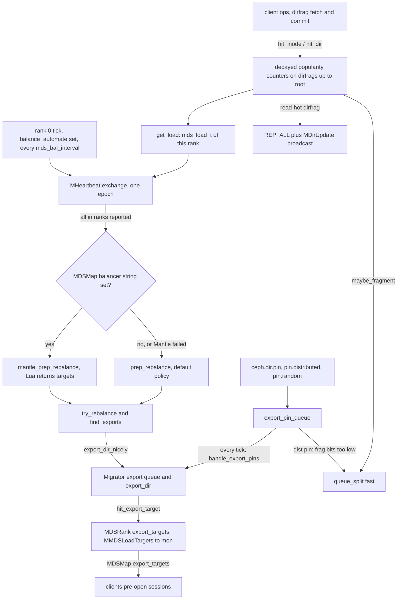
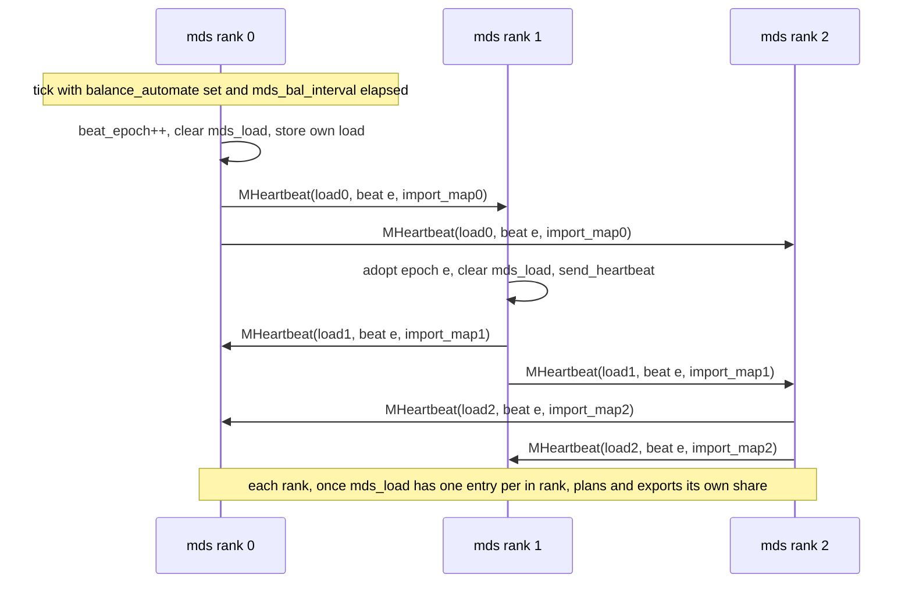
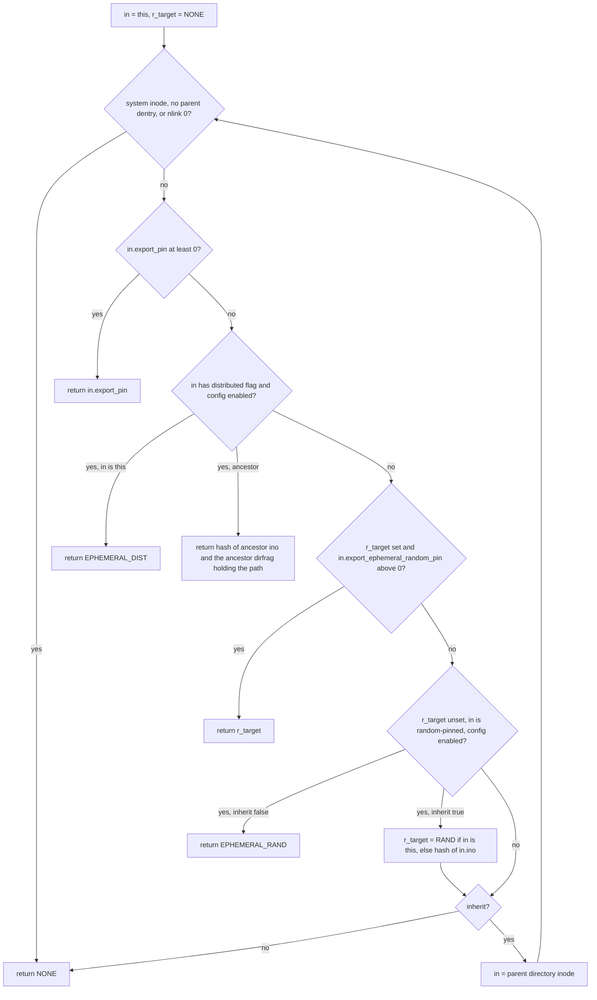
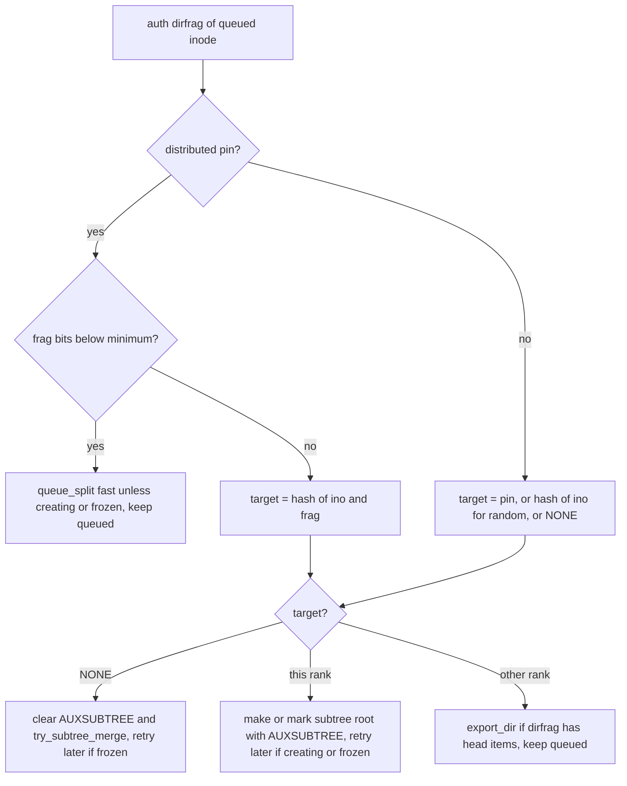
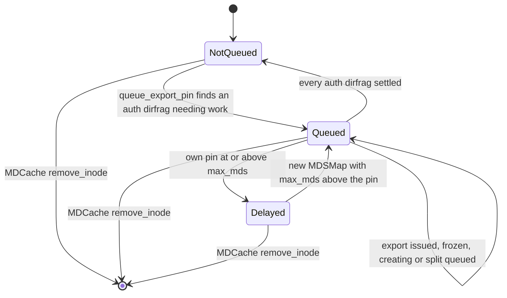

# Balancer, load metrics and subtree pinning (`MDBalancer`, Mantle, export and ephemeral pins)

> Part of the C++ MDS project map ([README](../README.md)). Sources: `src/mds/MDBalancer.{h,cc}` (195 + 1,588 LOC), `src/mds/Mantle.{h,cc}` (43 + 149), `src/mds/balancers/greedyspill.lua` (49), `src/messages/MHeartbeat.h` (72), `src/messages/MMDSLoadTargets.h` (68), `src/messages/MDirUpdate.h` (101), `src/mds/mdstypes.{h,cc}` (load vectors, ~150 LOC), `src/common/DecayCounter.{h,cc}` (~220), `src/mds/CInode.cc` (pin logic 5602-5890 plus hooks), `src/mds/CDir.cc` (popularity, split/merge predicates, `is_exportable`), `src/mds/MDCache.cc` (hash ring 948-967, pin queues, `handle_mdsmap` 14647-14687, `send_dir_updates`/`handle_dir_update` 11348-11439, `shutdown_pass`), `src/mds/Migrator.cc` (export queue and export-target wait), `src/mds/MDSRank.cc` (export targets, tick, thrash hooks, asok), `src/mds/Server.cc` (`ceph.dir.pin*` vxattrs, popularity hit sites), `src/mds/MDSMap.{h,cc}` (`bal_rank_mask`, `balancer`, `balance_automate`), `src/mon/FSCommands.cc`, `src/mon/MDSMonitor.cc`, `src/pybind/mgr/volumes/fs/operations/pin_util.py`; docs `doc/cephfs/multimds.rst`, `dynamic-metadata-management.rst`, `mantle.rst`, `fs-volumes.rst`; qa `qa/tasks/cephfs/test_exports.py`, `test_mantle.py`, `qa/suites/fs/workload/ranks/multi/`. Kernel client: `linux/fs/ceph/xattr.c`, `inode.c`, `mds_client.c`. Related: [subtree migration](subtree-migration.md), [subtrees, traversal, replication](../04-cache/mdcache-subtrees-traversal-replication.md), [dirfrags and fragmentation](../04-cache/dirfrags-and-fragmentation.md), [CDir/CDentry/cache objects](../04-cache/cdir-cdentry-and-cache-objects.md), [CInode](../04-cache/cinode-and-inode-types.md), [cache trim](../04-cache/mdcache-lifecycle-trim-and-memory.md), [attributes and xattrs](../03-request-path/attributes-and-xattrs.md), [FSMap/MDSMap](../01-cluster-integration/fsmap-and-mdsmap.md), [beacon and monitor](../01-cluster-integration/beacon-and-monitor.md), [mgr, tools, orchestration](../01-cluster-integration/mgr-tools-and-orchestration.md), [auth and MDS caps](../01-cluster-integration/auth-and-mds-caps.md), [wire protocol](../02-client-protocol/wire-protocol.md), [kclient expectations](../02-client-protocol/kclient-expectations.md), [libcephfs/ceph-fuse/Ganesha expectations](../02-client-protocol/libcephfs-fuse-ganesha-expectations.md), [lock types](../05-locking/lock-types-and-state-machines.md), [events and replay](../06-journal/events-and-replay.md), [rank lifecycle](../09-recovery/rank-lifecycle-and-recovery.md), [rstats, quotas, subvolumes](../10-snapshots-quotas-subvolumes/rstats-quotas-and-subvolumes.md), [quiesce](../12-qos-metrics-quiesce-quarantine/quiesce.md), [quarantine](../12-qos-metrics-quiesce-quarantine/quarantine.md), [admin commands](../13-admin-and-config/admin-commands.md), [config/perf/health](../13-admin-and-config/config-perf-counters-and-health.md), [process and threading](../00-architecture/process-and-threading.md), [mds_lock analysis](../00-architecture/mds_lock-analysis.md).

## 1. Purpose and responsibilities

`MDBalancer` (one instance per `MDSRank`, `mds->balancer`) together with pin logic in `CInode`/`MDCache` decides **which rank is authoritative for which part of the namespace** in a multi-active file system. It does not move metadata itself; it chooses dirfrags and hands them to the [Migrator](subtree-migration.md). Its responsibilities:

- **Load accounting.** Every metadata operation "hits" exponentially decayed popularity counters on the touched inode and on every ancestor dirfrag up to the root (`hit_inode`, `hit_dir`). A per-rank load (`mds_load_t`) is derived from the root dirfrag counters plus request rate, dispatch queue length and process CPU time (`get_load`).
- **The default ("dynamic subtree partitioning") balancer.** When the file system flag `balance_automate` is set, rank 0 starts a heartbeat epoch every `mds_bal_interval` seconds; all ranks exchange `MHeartbeat` (load + import map); every rank then computes a global transfer plan and executes only its own part by selecting subtrees/dirfrags and queueing them on the Migrator (`prep_rebalance`, `try_rebalance`, `find_exports`).
- **`bal_rank_mask`.** An MDSMap field that restricts which ranks the default balancer moves load to.
- **Mantle.** An optional Lua policy, stored as a RADOS object in the metadata pool and named by the MDSMap field `balancer`, replaces the "how much to send to whom" decision of the default balancer (experimental, documented as not for production, `doc/cephfs/mantle.rst`).
- **Export pins** (`ceph.dir.pin`) and **ephemeral pins** (`ceph.dir.pin.distributed`, `ceph.dir.pin.random`): static or hash-based placement policies on directories, enforced every tick by `handle_export_pins`, which creates/clears "aux" subtrees and starts exports. Pins also veto balancer exports (`CDir::is_exportable`).
- **Fragmentation triggers.** `hit_dir` and the request path call `maybe_fragment`, which queues delayed or immediate dirfrag splits and merges (`queue_split`, `queue_merge`); distributed pins force a minimum fragmentation. The split/merge protocol itself is in [dirfrags and fragmentation](../04-cache/dirfrags-and-fragmentation.md).
- **Hot-directory replication.** Read-hot dirfrags are marked `REP_ALL` and announced with `MDirUpdate` so every active rank becomes a replica; clients may then send reads to replicas.
- **Export-target publication** (in `MDSRank`): ranks this rank exports to are published to the monitor with `MMDSLoadTargets`; the Migrator waits for that before exporting, and clients use the published `export_targets` to pre-open sessions.

The mgr `volumes` module exposes pins for subvolumes and subvolume groups (`ceph fs subvolume[group] pin`), implemented as plain `setxattr` calls through libcephfs. Only the vxattrs, the MDSMap fields, `MMDSLoadTargets`, `export_targets`, some perf counters and asok output are visible outside the MDS cluster; everything else on this page is internal policy (section 7).

## 2. Source map

| File | Class / function | Lines | Role |
|---|---|---|---|
| `src/mds/MDBalancer.h` | `class MDBalancer`, `balance_state_t`, `AUTH_TREES_THRESHOLD`, `get_maxim`/`get_maxex` | 41-194 | balancer state and API |
| `src/mds/MDBalancer.cc` | `MIN_LOAD`/`MIN_REEXPORT`/`MIN_OFFLOAD` | 67-69 | hard-coded thresholds 50 (unused), 5, 10 |
| | `proc_message` | 72-86 | only `MSG_MDS_HEARTBEAT`; anything else aborts |
| | ctor, `handle_conf_change` | 88-145 | caches `mds_bal_*` options |
| | `test_rank_mask` | 147-150 | `bal_rank_mask` bit test |
| | `handle_export_pins` | 152-277 | pin enforcement (queue pass + auth-subtree pass) |
| | `tick` | 279-310 | pins, sample clock, rank-0 heartbeat start |
| | `mds_load_t::mds_load` | 324-343 | `mds_bal_mode` formulas |
| | `get_load` | 345-412 | builds this rank's `mds_load_t` |
| | `localize_balancer` | 419-452 | Mantle: blocking RADOS read with timeout |
| | `send_heartbeat`, `handle_heartbeat` | 454-582 | heartbeat epoch protocol |
| | `try_match` | 584-603 | exporter/importer pairing |
| | `queue_split`, `queue_merge`, `is_fragment_pending` | 605-760 | delayed/fast fragmentation |
| | `prep_rebalance` | 762-933 | default target computation |
| | `mantle_prep_rebalance` | 935-980 | Mantle target computation |
| | `try_rebalance` | 984-1152 | chooses subtrees to (re)export |
| | `find_exports` | 1154-1285 | recursive dirfrag selection |
| | `hit_inode`, `maybe_fragment`, `hit_dir` | 1287-1408 | popularity accounting, split/merge/replicate triggers |
| | `subtract_export`, `add_import`, `adjust_pop_for_rename` | 1419-1476 | popularity transfer |
| | `handle_mds_failure`, `dump_loads` | 1478-1588 | failure hook, `dump loads` asok |
| `src/mds/Mantle.{h,cc}` | `Mantle::balance`, `Mantle::Mantle`, `dout_wrapper` (`BAL_LOG`) | h 28-41, cc 41-149 | Lua VM wrapper |
| `src/mds/balancers/greedyspill.lua` | example policy | 1-49 | spill half the load to rank+1 |
| `src/messages/MHeartbeat.h` | `MHeartbeat` | 27-70 | inter-MDS load message |
| `src/messages/MMDSLoadTargets.h` | `MMDSLoadTargets` | 29-66 | MDS to mon export targets |
| `src/messages/MDirUpdate.h` | `MDirUpdate` | 22-99 | replication flag broadcast |
| `src/mds/mdstypes.h` / `.cc` | `META_POP_*`, `inode_load_vec_t`, `dirfrag_load_vec_t`, `mds_load_t` | h 606-748, cc 1028-1179 | load vectors and encodings |
| `src/common/DecayCounter.{h,cc}` | `DecayRate`, `DecayCounter` | h 36-119, cc 22-84 | exponential decay |
| `src/mds/CInode.cc` | `queue_export_pin`, `maybe_export_pin`, `set/clear_ephemeral_pin`, `maybe_ephemeral_rand`, `setxattr_ephemeral_rand/dist`, `set_export_pin`, `get_export_pin`, `check_pin_policy`, `get_ephemeral_rand`, `get_nested_dirfrags` | 5602-5890 | pin resolution and queueing |
| | `pop_and_dirty_projected_inode` | 522-552 | re-evaluates pins after a committed change |
| | `add_dirfrag` | 852-865 | re-evaluates pins when a dirfrag opens |
| | `encode/decode_lock_ipolicy` | 2250-2310 | pin replication to other ranks |
| | `encode_inodestat` | 4361 | `dir_pin` sent to clients |
| | `finish_export`, `decode_import` | 4692-4721 | ephemeral state travels with exports |
| `src/mds/CInode.h` | `STATE_QUEUEDEXPORTPIN`/`DELAYEDEXPORTPIN`/`DISTEPHEMERALPIN`/`RANDEPHEMERALPIN`, `MASK_STATE_EXPORTED`/`_EXPORT_KEPT`/`_REPLICATED`; pin API; `pop`, `item_pop_lru` | 381-409, 1039-1067, 1133-1134 | |
| `src/mds/CDir.cc` / `.h` | `get_export_pin`, `is_exportable`; `should_split`, `should_split_fast`, `should_merge`; `can_rep`; `dump_load`; pop members; `STATE_AUXSUBTREE`; `REP_*`; `get_dist_spec` | cc 2928-2946, 1036-1040, 3871-3920, 3128-3138, 3748-3768; h 145, 179-181, 436-442, 745-756 | |
| `src/mds/MDCache.cc` | `hash_into_rank_bucket` | 948-967 | jump consistent hash over `max_mds` |
| | `handle_conf_change` (ephemeral options) | 224-254 | |
| | `remove_inode` (queue cleanup) | 381-387 | |
| | `adjust_subtree_auth`, `try_subtree_merge_at` (AUX veto, pop moves) | 978-1113 | |
| | `adjust_subtree_after_rename` | 1495-1537 | `adjust_pop_for_rename` calls |
| | `trim` (empty pinned subtrees, empty imports) | 7042-7067 | |
| | `shutdown_pass` (stopping rank) | 8043-8095 | |
| | `send_dir_updates`, `handle_dir_update` | 11348-11439 | |
| | `handle_mdsmap` | 14647-14687 | delayed pins, `max_mds` changes, dist frag bits |
| `src/mds/Migrator.cc` | `export_dir_nicely`, `maybe_do_queued_export` | 819-856 | balancer export queue |
| | `export_dir` (pin veto, assert `dest != whoami`) | 920-1010 | |
| | `dispatch_export_dir` (export-target wait) | 1159-1198 | |
| `src/mds/MDSRank.cc` | `update_targets`, `hit_export_target` | 611-667 | `MMDSLoadTargets` |
| | `MDSRankDispatcher::tick` | 710-771 | calls `balancer->tick()` when active |
| | thrash exports/fragments | 1095-1154 | testing hooks |
| | `dump loads`, `get subtrees`, `export dir` | 3066-3073, 3274-3340 | admin commands |
| `src/mds/Server.cc` | `handle_client_setvxattr` (`ceph.dir.pin*`) | 6723-6828 | set/remove pins |
| | `handle_client_getvxattr` (`ceph.dir.pin*`) | 7480-7491 | read pins |
| | `check_fragment_space` | 3563-3576 | `ENOSPC` limit |
| `src/mds/MDSMap.{h,cc}` | `balance_automate` flag, `balancer`, `bal_rank_mask`, `update_num_mdss_in_rank_mask_bitset`, `hex2bin` | h 251-316, 631-635; cc 1355-1449 | |
| `src/mon/FSCommands.cc` | `SetHandler::handle`: `balancer`, `bal_rank_mask`, `balance_automate` | 494-526, 764-778 | mon-side validation |
| `src/mon/MDSMonitor.cc` | `preprocess_offload_targets`, `prepare_offload_targets` | 566-593, 936-953 | mon handling of `MMDSLoadTargets` |
| `src/pybind/mgr/volumes/...` | `pin_util.pin`, `Group.pin`, `SubvolumeBase.pin`, `subvolume_pin`, `pin_subvolume_group` | pin_util.py 8-33; group.py 79-80; subvolume_base.py 450-451; volume.py 418-434, 1323-1337 | `fs subvolume[group] pin` |

## 3. How it works

### 3.1 Big picture

Everything on this page runs on the rank's dispatch, timer, finisher or progress threads under `mds_lock` (section 6).

### 3.2 Popularity accounting

**Counters.** `DecayCounter` stores one `double val` and the time of the last decay. Every read or write first decays: `val = val * exp(el * k) + delta` with `k = ln(0.5)/half_life`; any result below `0.01` (including negative results of `adjust`/`sub`) snaps to `0` (`src/common/DecayCounter.cc:71 (DecayCounter::decay)`). `scale(f)` multiplies without decaying. The cache-wide rate is `MDCache::decayrate`, half-life `mds_decay_halflife` (default 5 s), set once in the `MDCache` constructor (`src/mds/MDCache.cc:210 (MDCache::MDCache)`) and used by all dirfrag vectors (`src/mds/CDir.cc:218-221 (CDir::CDir)`) and `CInode::pop` (`src/mds/CInode.cc:357`). With a 5 s half-life a steady rate of *r* hits/s converges to about `r * 5/ln 2 = 7.21 * r`. Encoding (`DecayCounter::encode`, v5/compat 4) decays first and writes only `val`; decode resets `last_decay` to now and keeps the receiver's rate.

**Vectors** (`src/mds/mdstypes.h:606-748`):

| Index | Name | Meaning |
|---|---|---|
| 0 | `META_POP_IRD` | inode read (getattr/lookup/open for read) |
| 1 | `META_POP_IWR` | inode or namespace write |
| 2 | `META_POP_READDIR` | readdir, weighted by entries returned |
| 3 | `META_POP_FETCH` | dirfrag fetched from RADOS |
| 4 | `META_POP_STORE` | dirfrag committed to RADOS |

`inode_load_vec_t` holds only IRD and IWR (`CInode::pop`); it is hit, exported (`CInode::encode_export`, `src/mds/CInode.cc:4663`) and zeroed (`CInode::finish_export`), but no balancing decision reads it. `dirfrag_load_vec_t` holds all five; its scalar is `meta_load() = 1*IRD + 2*IWR + 1*READDIR + 2*FETCH + 4*STORE` (`src/mds/mdstypes.h:686 (dirfrag_load_vec_t::meta_load)`); `add`/`sub` call `adjust(±other.get())` per element (`:695-702`).

**Per-dirfrag counters** (`src/mds/CDir.h:749-756`):

| Member | Content |
|---|---|
| `pop_me` | hits on this dirfrag only |
| `pop_nested` | this dirfrag plus everything below it that this rank touched (auth or replica) |
| `pop_auth_subtree` | hits inside the same auth subtree as this dirfrag, stopping at nested subtree roots |
| `pop_auth_subtree_nested` | hits on all auth metadata of this rank below, including nested auth subtrees |
| `last_popularity_sample` | rate limiter for the replication decision |
| `pop_lru_subdirs` | intrusive list of child directory inodes recently hit inside the same auth subtree (MRU at front), the search order of `find_exports` |

**`hit_dir(dir, type, amount)`** (`src/mds/MDBalancer.cc:1325 (MDBalancer::hit_dir)`):

1. Dirfrags of stray directories are ignored.
2. `v = dir->pop_me[type].hit(amount)`; `hot = (type == IRD && v > mds_bal_split_rd) || (type == IWR && v > mds_bal_split_wr)`; `maybe_fragment(dir, hot)` (3.11).
3. Replication decision, only for `IRD`/`READDIR`, at most once per sample period per dirfrag (`dir->last_popularity_sample < last_sample`; `tick` advances `last_sample` when more than `mds_bal_sample_interval` passed, so with the 5 s tick it advances every tick): `dir_pop = pop_auth_subtree[type] + 10*v`. Only if the dirfrag is auth, not ambiguous and `can_rep()`: when `dir_pop >= mds_bal_replicate_threshold` set `dir_rep = REP_ALL`, broadcast `MDirUpdate`, and compute `rd_adj = (rdp/num_in_mds - rdp)/2` with `rdp = pop_me[IRD]` (negative), applied to `pop_me[IRD]` and `pop_auth_subtree[IRD]`; when the dirfrag is not ino 1, is replicated and `dir_pop < mds_bal_unreplicate_threshold` set `REP_NONE` and send `MDirUpdate` to replicas only (3.10).
4. Walk to the root through `inode->get_parent_dir()`, starting with the hit dirfrag itself: every level gets `pop_nested.hit(amount)`. Only if the starting dirfrag is auth: while still inside the starting auth subtree (`hit_subtree`), the level gets `pop_auth_subtree.hit` and its inode is pushed to the front of the parent's `pop_lru_subdirs`; the flag drops at the first subtree root (that root is hit, its inode is not pushed); and every level up to the root (auth or not) also gets `pop_auth_subtree_nested.hit`. A non-zero `rd_adj` is added to the IRD element of every counter hit on every level, so the starting dirfrag's `pop_auth_subtree[IRD]` receives it twice (step 3 and here) (`src/mds/MDBalancer.cc:1378-1407`).

`hit_inode(in, type)` hits `in->pop[type]` and then `hit_dir` on the dirfrag of the primary parent dentry (`src/mds/MDBalancer.cc:1287 (MDBalancer::hit_inode)`). Every operation therefore updates O(depth) counters, including the root dirfrag's.

**Hit sites:**

| Operation | Call | Citation |
|---|---|---|
| getattr / lookup reply | `hit_inode(ref, IRD)` | `src/mds/Server.cc:4412 (Server::handle_client_getattr)` |
| open existing file | `IWR` if `cmode & CEPH_FILE_MODE_WR`, else `IRD` | `src/mds/Server.cc:4813-4816 (Server::handle_client_open)` |
| create (openc) commit | `hit_inode(newi, IWR)` | `src/mds/Server.cc:4854 (C_MDS_openc_finish::finish)` |
| setattr / setxattr / vxattr / layout commit | `hit_inode(in, IWR)` | `src/mds/Server.cc:5369 (C_MDS_inode_update_finish::finish)` |
| readdir | `hit_dir(dir, READDIR, numfiles)` | `src/mds/Server.cc:5085 (Server::_finalize_readdir)` |
| mknod / mkdir / symlink commit | `hit_inode(newi, IWR)` | `src/mds/Server.cc:7574 (C_MDS_mknod_finish::finish)` |
| link (local, remote) | `hit_inode(targeti, IWR)` and `hit_dir(dn dir, IWR)` | `src/mds/Server.cc:8081-8082 (Server::_link_local_finish)`, `:8214-8215 (Server::_link_remote_finish)` |
| link on the target inode's peer | `hit_inode(targeti, IWR)` | `src/mds/Server.cc:8364 (Server::_logged_peer_link)` |
| unlink / rmdir | `hit_dir(dn dir, IWR)` | `src/mds/Server.cc:8873 (Server::_unlink_local_finish)` |
| rename (leader) | `hit_dir(srcdn dir, IWR)`; `hit_inode(in, IWR)` if the destination is a remote link and the inode is auth | `src/mds/Server.cc:9793-9795 (Server::_rename_finish)` |
| rename (peer) | `hit_dir(srcdn dir, IWR)`; `hit_inode` on the linked auth inode | `src/mds/Server.cc:10821-10823 (Server::_logged_peer_rename)` |
| cap flush / client write-back | `hit_inode(in, IWR)` | `src/mds/Locker.cc:2430 (Locker::file_update_finish)` |
| dirfrag fetch (full, background prefetch, keys) | `hit_dir(this, FETCH)` | `src/mds/CDir.cc:1629, 1650 (CDir::fetch)`, `:1715 (CDir::fetch_keys)` |
| dirfrag commit | `hit_dir(this, STORE)` | `src/mds/CDir.cc:2797 (CDir::_commit)` |

Hits on replica metadata (e.g. a getattr served by a non-auth rank) only increase the hit dirfrag's `pop_me` and the `pop_nested` chain, so they count in the `all` load but not in the `auth` load (and never trigger replication or fragmentation, which require auth).

**Popularity transfer:**

- Export: after the exported dirfrag becomes an ambiguous subtree root, `subtract_export` subtracts its `pop_auth_subtree` from `pop_nested` and `pop_auth_subtree_nested` of all ancestors (`src/mds/MDBalancer.cc:1419`, called at `src/mds/Migrator.cc:1736 (Migrator::export_go_synced)`); `CDir::encode_export` ships `pop_me` and `pop_auth_subtree`; `CDir::finish_export` subtracts and zeroes them (`src/mds/CDir.cc:2948-2979`).
- Import: `CDir::decode_import` restores them and adds `pop_auth_subtree` into its own nested counters (`src/mds/CDir.cc:3008-3011`); `add_import` adds to all ancestors (`src/mds/MDBalancer.cc:1433`, called at `src/mds/Migrator.cc:2901 (Migrator::handle_export_dir)`). Imported child dir inodes are appended to `pop_lru_subdirs` (`src/mds/Migrator.cc:3476 (Migrator::decode_import_inode)`).
- New subtree root: `adjust_subtree_auth` subtracts the new root's `pop_auth_subtree` from ancestors up to the enclosing subtree root; a merge adds it back and re-links the LRU (`src/mds/MDCache.cc:1030-1038`, `:1096-1107`).
- Rename of a directory: `adjust_pop_for_rename(olddir, dir, false)` then `(newdir, dir, true)` from `MDCache::adjust_subtree_after_rename` (`src/mds/MDCache.cc:1495-1537`).
- Split: each child fragment gets a copy of all four vectors scaled by `1/2^bits` (marked "approximation", `src/mds/CDir.cc:1053-1084 (CDir::split)`).

### 3.3 Rank load: `mds_load_t` and `get_load`

`mds_load_t` = `{auth, all : dirfrag_load_vec_t; req_rate, cache_hit_rate, queue_len, cpu_load_avg : double}` (`src/mds/mdstypes.h:719`). `get_load()` (`src/mds/MDBalancer.cc:345`) builds it with a zero `DecayRate`, so the copy does not decay further:

| Field | Source |
|---|---|
| `auth` | sum over root dirfrags of `pop_auth_subtree_nested` (all auth metadata of this rank) |
| `all` | sum over root dirfrags of `pop_nested` |
| `req_rate` | delta of perf counter `l_mds_request` (incremented on every `MClientRequest` dispatch, retries included, `src/mds/Server.cc:2621 (Server::handle_client_request)`) / elapsed s |
| `cpu_load_avg` | delta of `utime+stime` ticks from `/proc/self/stat` / elapsed s (`src/common/util.cc:468 (ceph::read_process_cpu_ticks)`); 100 ≈ one busy core with the usual `USER_HZ = 100` |
| `cache_hit_rate` | delta(`l_mds_traverse_hit`)/delta(`l_mds_traverse`), only when both deltas are positive |
| `queue_len` | `messenger->get_dispatch_queue_len()` |

Rates are recomputed only if at least 1 s passed since the previous sample; otherwise this rank's previous values from `mds_load` are reused and the sample baseline is not advanced. `get_load` is only called by `send_heartbeat`.

`mds_load(bal_mode)` (`src/mds/MDBalancer.cc:324`), `mds_bal_mode` default 0:

| Mode | Formula |
|---|---|
| 0 | `0.8*auth.meta_load() + 0.2*all.meta_load() + req_rate + 10*queue_len` |
| 1 | `req_rate + 10*queue_len` |
| 2 | `cpu_load_avg` |
| other | `ceph_abort()` |

`send_heartbeat` sets perf counters `load_cent = 100*mds_load(bal_mode)` and `q = queue_len` (`src/mds/MDBalancer.cc:474-475`); they are therefore only refreshed while heartbeat epochs run.

### 3.4 Heartbeat exchange

- **Start** (`src/mds/MDBalancer.cc:279 (MDBalancer::tick)`): only on rank 0, only when `mdsmap->allows_balance_automate()`, `is_active()`, `mds_bal_interval > 0`, at least `mds_bal_interval` whole seconds since the last start, and `(num_bal_times != 0 || (mds_bal_max_until >= 0 && uptime > mds_bal_max_until))` (`num_bal_times` starts at `mds_bal_max`, default -1, and is decremented per start, so the default never reaches 0). `MDBalancer::tick` itself runs every `mds_tick_interval` (5 s) from `MDSRankDispatcher::tick`, only while active and only when the beacon is not laggy (`src/mds/MDSRank.cc:714-717, 748-749`).
- **`send_heartbeat`** (`src/mds/MDBalancer.cc:454`): returns if the cluster is degraded (any rank failed, damaged or in replay..clientreplay, `src/mds/MDSMap.cc:1287 (MDSMap::is_degraded)`); if the cache is not open, defers via `C_Bal_SendHeartbeat`. Rank 0 increments `beat_epoch` and clears `mds_load`. The rank stores its own `get_load()`, builds `import_map[from] += pop_auth_subtree.meta_load()` over its auth subtree roots whose inode authority is another rank (stray subtrees excluded), records it in `mds_import_map[me]`, and sends `MHeartbeat(load, beat_epoch, import_map)` to every other **up** rank.
- **`handle_heartbeat`** (`src/mds/MDBalancer.cc:510`): dropped unless active; requeued (`C_MDS_RetryMessage`) until the cache is open; dropped while degraded. A non-zero rank seeing a beat newer than its own adopts it and clears `mds_load`. A message from rank 0 makes the receiver adopt rank 0's beat (even if lower, e.g. after rank-0 failover) and send its own heartbeat. Rank 0 ignores heartbeats whose beat differs from its epoch; non-zero ranks do not check the beat of messages from other non-zero ranks. The sender's load and import map are stored; then `update_num_mdss_in_rank_mask_bitset()`; if at least one rank is in the mask and `mds_load.size() == num_in_mds`, the rank runs Mantle (if the MDSMap `balancer` string is non-empty) and on Mantle failure or absence `prep_rebalance(beat)`.
- Message count per epoch is about N² for N ranks. Given identical inputs, every rank computes the same exporter/importer pairing; each rank records `targets` only for pairs where it is the exporter (`try_match`, `src/mds/MDBalancer.cc:584`), with amounts expressed in its own rescaled units (3.6 step 2).
- `handle_mds_failure(0)` clears `mds_last_epoch_under_map` because a replacement rank 0 restarts epochs at 1 (`src/mds/MDBalancer.cc:1478`, called from `src/mds/MDCache.cc:3032 (MDCache::handle_mds_failure)`).

### 3.5 Gating flags and knobs

| Control | Where | Effect |
|---|---|---|
| `balance_automate` (FS flag `CEPH_MDSMAP_BALANCE_AUTOMATE` = bit 8, not in `CEPH_MDSMAP_DEFAULTS`, never set implicitly, so **off** for new and upgraded file systems) | `ceph fs set <fs> balance_automate <bool>` (`src/mon/FSCommands.cc:764-778`) | rank 0 starts heartbeat epochs. Nothing else checks it: pins, fragmentation and hot-dir replication are independent of it, but Mantle and the idle-import return (which run inside an epoch) need it. |
| `bal_rank_mask` (MDSMap string, default `"-1"`) | `ceph fs set <fs> bal_rank_mask <hex\|-1\|all\|0\|0x0>` (`src/mon/FSCommands.cc:506-526`) | `0`/`0x0`: empty mask, no planning at all (Mantle included). `-1`/`all`/empty/unparsable at the MDS: all 256 bits set and mask count = `max_mds`. Otherwise hex is parsed into a `bitset<256>` and the count is the number of set bits (`src/mds/MDSMap.cc:1376-1449`). |
| `balancer` (MDSMap string) | `ceph fs set <fs> balancer <rados-object>` (`src/mon/FSCommands.cc:494-505`, no validation, empty unsets) | non-empty selects Mantle (3.9) |
| `mds_bal_interval` | config, default 10 | heartbeat period; `0` disables epochs |
| `mds_bal_max`, `mds_bal_max_until` | dev configs, default -1 | testing: `mds_bal_max >= 0` caps the number of epochs rank 0 starts; once that count is used up, `mds_bal_max_until >= 0` re-enables epochs after that many seconds of uptime (the option text says it stops the balancer after that time; the code does the opposite), and the counter then goes negative so they never stop again |
| `mds_thrash_exports` | dev config | `prep_rebalance` and `try_rebalance` do nothing; `MDSRank::_dispatch` exports random dirs instead (`src/mds/MDSRank.cc:1103-1133`) |
| `mds_bal_export_pin` | config, default true | master switch for all pin semantics (3.12) |

The mon validates `bal_rank_mask` with the same `hex2bin` (non-empty, hex, at most 256 bits, at least one bit set; `0`/`0x0`/`-1`/`all` are accepted as special values) and returns its error string with `EINVAL` (`src/mon/FSCommands.cc:507-517`). `hex2bin` lower-cases, strips `0x`, converts 16-digit chunks with `stoull(...,16)` (which accepts a valid prefix and ignores trailing garbage within a chunk), widens each chunk to 64 bits, rejects more than 256 bits or no set bit, then left-pads to 256 (`src/mds/MDSMap.cc:1409 (MDSMap::hex2bin)`). Bit *i* of the parsed value is rank *i* (`0x3` = ranks 0 and 1).

### 3.6 Target computation (`prep_rebalance`)

`src/mds/MDBalancer.cc:762`. With `n = num_in_mds`, `M` = set bits of the rank mask, `|M|` = `num_mdss_in_rank_mask_bitset`:

1. `rebalance_time = now`; `migrator->clear_export_queue()` (drops balancer exports queued but not yet started and bumps `export_queue_gen`).
2. `load_fac = my auth.meta_load() / my mds_load(bal_mode)` (1.0 if my load is 0). For every rank `i` in `[0, n)`: `l_i = mds_load.at(i).mds_load(bal_mode) * load_fac` into `mds_meta_load[i]`; `total += l_i`. The scaling converts every rank's load into this rank's `meta_load` units, so later amounts are comparable to its own `pop_auth_subtree.meta_load()` values; classification is invariant under the scaling.
3. `target_load = total / |M|`.
4. Hysteresis: every masked rank with `l_i < target_load * (1 + mds_bal_min_rebalance)` (0.1) records `mds_last_epoch_under_map[i] = beat_epoch`. If this rank was just recorded, stop ("underloaded or barely overloaded"; `try_rebalance` is not called). If it was under at some earlier epoch and `beat_epoch - last_epoch_under < mds_bal_overload_epochs` (2), stop. A rank never recorded (value 0) is immediately "sufficiently overloaded".
5. Classification (ascending load): masked ranks with `l_i < target_load` are **importers**; all others are **exporters** unless inside their own hysteresis window. Unmasked ranks are never recorded as underloaded, so they are exporters (unless still inside a hysteresis window recorded while they were masked) and their own target is 0 (`ex_target_load = 0`), so they try to shed all their (unpinned) load.
6. Capacities: `maxex(ex) = l_ex - ex_target - exported[ex]`, `maxim(im) = target_load - l_im - imported[im]`; `try_match` moves `min(maxex, maxim)` when both are positive (`src/mds/MDBalancer.cc:584`).
7. Matching, first against import history: exporters from largest to smallest; for each rank `im` this exporter imported from (`mds_import_map[ex]`), match while both capacities exceed 0.001 (no mask check on `im`).
8. Then, by epoch parity: odd beats ("old way") pair largest exporters with least-loaded importers; even beats ("new way") pair smallest exporters with least-loaded importers. Both loops stop at the first pair where either capacity is below 0.001.
9. `try_rebalance(state)`.

Worked example (rank 0's view, mask all, `max_mds` 3): rescaled loads `l0 = 300`, `l1 = 100`, `l2 = 50`; `total = 450`, `target_load = 150`; ranks 1 and 2 are below `165` and are recorded under (they stop at step 4 on their own nodes). Rank 0 (never under) is the only exporter with `maxex = 150`; with no import history, both parities first match rank 2 (`maxim = 100`, moves 100) then rank 1 (`maxim = 50`, moves 50). Rank 0's `targets = {1: 50, 2: 100}`.

### 3.7 Export selection (`try_rebalance`, `find_exports`)

`try_rebalance` (`src/mds/MDBalancer.cc:984`):

1. Candidates = `get_fullauth_subtrees()` (auth, unambiguous subtree roots) minus mdsdir subtrees, minus subtrees whose inode has its **own** pin, distributed policy or random state (`get_export_pin(false) != MDS_RANK_NONE`), minus freezing/frozen ones. For each: `from = inode->authority().first` (owner of the parent dirfrag), `pop = pop_auth_subtree.meta_load()`. If `mds_bal_idle_threshold > 0` (default 0) and `pop` is below it, the subtree is not the root and `from != me`, it is sent back to `from` immediately. Others go into `import_pop_map` (by pop) and `import_from_map` (by `from`).
2. **Pass A**, per target in rank order: skip if `amount < MIN_OFFLOAD (10)` or `amount * 10 * |targets| < target_load`. Re-export subtrees imported from `target` whose `pop <= amount - have` (base inodes skipped), until less than 10 is missing.
3. **Pass B**, only targets that passed step 2 and still miss at least 10: any other candidate, smallest first, with `MIN_REEXPORT (5) < pop <= amount - have`.
4. **Pass C**: for the remaining need, walk candidates from most to least popular and call `find_exports(dir, amount, &exports, have, already_exporting)`; each chosen dirfrag goes to `migrator->export_dir_nicely(dir, target)`.

`find_exports` (`src/mds/MDBalancer.cc:1154`):

- Aborts the whole search (sets `have = amount`, logs `balancer runs too long` at `derr`) once 0.1 s have elapsed since `rebalance_time`.
- `need = amount - have`; returns if `need < amount * mds_bal_min_start` (0.2). Bands: `needmax = need*mds_bal_need_max (1.2)`, `needmin = need*mds_bal_need_min (0.8)`, `midchunk = need*mds_bal_midchunk (0.3)`, `minchunk = need*mds_bal_minchunk (0.001)`.
- Iterates `dir->pop_lru_subdirs` (MRU first); for each child dir inode, each **non-subtree-root** dirfrag (`CInode::get_nested_dirfrags`, `src/mds/CInode.cc:5883`) not already chosen and not frozen/freezing: `pop = pop_auth_subtree.meta_load()`; `< minchunk` is idle; `needmin < pop < needmax` is taken immediately ("lucky find") and the call returns; `pop > need` goes to `bigger_rep`/`bigger_unrep` by `is_rep()`; else into `smaller`. Inodes whose frags are all idle leave the LRU.
- Then: take `smaller` items from the largest down while `>= midchunk`, returning once `have > needmin`; recurse into `bigger_unrep`; take the remaining smaller items; recurse into `bigger_rep`.

Subtree roots (including pinned aux subtrees) are never candidates inside `find_exports`, and `pop_lru_subdirs` only links inodes within one auth subtree (3.2 step 4).

### 3.8 Hand-off to the Migrator and export targets

- `Migrator::export_dir_nicely` appends `(dirfrag, dest)` to `export_queue`; `maybe_do_queued_export` starts exports while the in-flight approximate size (`total_exporting_size`) stays below `2 * mds_max_export_size` (2 x 20 MiB by default) and the remaining room is at least `mds_max_export_size * (num_locking_exports + 1)` (`src/mds/Migrator.cc:819-856`). All balancer exports use this queue; pins call `Migrator::export_dir` directly. Details in [subtree migration](subtree-migration.md).
- `export_dir` refuses (log only) when: the dirfrag is not exportable to `dest` because of a pin and has head items (not checked while stopping); not active/stopping; read-only; `dest` not active; cluster degraded; system inode; freezing/frozen; already exporting; inside a stray dir not owned by `dest`; quiesced; under quarantine (`src/mds/Migrator.cc:924-960 (Migrator::export_dir)`). It asserts `dest != whoami` (`:923`). Otherwise it calls `mds->hit_export_target(dest, -1)` and starts internal request `CEPH_MDS_OP_EXPORTDIR` (0x01501).
- **Export targets** (`src/mds/MDSRank.cc:611-667`): `hit_export_target(rank, amount)` hits a per-rank `DecayCounter` with half-life `mds_bal_target_decay` (10 s); `amount = 100/half_life` (= 10) by default, `num_exported_inodes + 1` after an `MExportDir`; the Migrator also hits bystanders that ack export notifies (`src/mds/Migrator.cc:992, 1371, 1630, 1761, 2062, 2266`). Every tick while active or stopping (and not laggy), `update_targets` drops ranks whose counter is `<= 0.01` (about 100 s after the last default hit) and sends `MMDSLoadTargets(gid, set)` to the monitor if it dropped a target, a local target is missing from this daemon's `mds_info_t::export_targets`, or that map set is larger than the local set.
- `Migrator::dispatch_export_dir` proceeds only once `dest` is in this rank's MDSMap `export_targets`; otherwise it drops locks and waits for the next MDSMap, cancelling after 4 waits (`count > 3`, `src/mds/Migrator.cc:1184-1198`). A first export to a new target therefore costs a mon round trip (next tick, Paxos commit, map delivery).
- The monitor accepts the message only from sessions with `mds` `x` capability, ignores it when unchanged, and otherwise sets `export_targets` for that gid if it holds a rank, never replying (`src/mon/MDSMonitor.cc:566-593, 936-953`). See [beacon and monitor](../01-cluster-integration/beacon-and-monitor.md).

### 3.9 Mantle (Lua policy)

- **Selection**: `handle_heartbeat` calls `mantle_prep_rebalance` when `mdsmap->get_balancer() != ""`. On non-zero return it logs `WRN "using old balancer; mantle failed for balancer=<name> : <strerror>"` to the cluster log and runs `prep_rebalance` (`src/mds/MDBalancer.cc:571-579`). Mantle therefore runs only inside heartbeat epochs, i.e. only with `balance_automate` set and a non-empty mask.
- **Loading** (`src/mds/MDBalancer.cc:940-948, 419-452`): if the cached `bal_version` differs from the MDSMap string, it is cleared and `localize_balancer` issues `objecter->read` of the whole object named by the string in the metadata pool (default namespace), then waits on a local condition variable for at most `mds_bal_interval/2` seconds (integer division) **while the dispatch thread holds `mds_lock`**. Timeout cancels the op and returns `-ETIMEDOUT`; a read error is returned as is (e.g. `-ENOENT`). On success `bal_code` and `bal_version` are cached and rank 0 logs `INF "mantle balancer version changed: <name>"`. The code is not re-read while the name is unchanged; after a failure it is re-read (and waited for) in every epoch.
- **Execution** (`src/mds/Mantle.cc:50-114 (Mantle::balance)`): a fresh `lua_State` per call (system Lua >= 5.3, `src/CMakeLists.txt:743`) with libraries `_G`, `coroutine`, `string`, `math`, `table`, `utf8` (no `io`, `os`, `package`, `debug`, although the base library still provides `dofile`/`loadfile`, which read local files); `BAL_LOG(level, ...)` concatenates its remaining arguments and logs them at that level to subsystem `mds_balancer` (or `mds` when `mds_balancer` would not gather that level). Globals: `whoami` (integer) and `mds`, a table indexed `0..n-1` of tables with keys `auth.meta_load`, `all.meta_load`, `req_rate`, `queue_len`, `cpu_load_avg`. The chunk must return a table of integer keys (ranks) to numbers (load to send). Load/compile/run errors, non-table results or bad key/value types give `-EINVAL`; the number of returned entries must equal `n` or the result is `-EINVAL` (`src/mds/MDBalancer.cc:972-976`). No instruction or memory limit is installed.
- **Success path**: `try_rebalance(state)` exactly as in 3.7; Mantle controls only "how much to whom". It does not apply the mask, hysteresis or a fresh `target_load` (the size filter in `try_rebalance` uses whatever `target_load` the default path computed last, initially 0).
- `greedyspill.lua`: `load = all.meta_load`; if rank `whoami+1` exists, `my_load > 0.01` and the neighbour's load `< 0.01`, send half of my load to `whoami+1`; returns a table with one entry per rank.

### 3.10 Hot-directory replication

`hit_dir` may set `dir_rep = REP_ALL` and call `send_dir_updates(dir, bcast=true)`, which sends `MDirUpdate(from, dirfrag, dir_rep, dir_rep_by, path, discover=5)` to every active rank that does not yet replicate the dirfrag (`src/mds/MDCache.cc:11348-11394`). A receiver without the dirfrag discovers the path (`MDS_TRAVERSE_DISCOVER`, retried while `tried_discover < 5`) and so becomes a replica; a receiver that already has it updates `dir_rep`/`dir_rep_by` (`src/mds/MDCache.cc:11396-11439`). Clients see replicas through the `dist` list of the dirfrag in reply traces and readdir replies (`CDir::get_dist_spec`: replicas plus the auth rank when any replica exists, only from the auth rank, `src/mds/CDir.h:436`; used by `Server::set_trace_dist` and `Server::_finalize_readdir`, `src/mds/Server.cc:2539-2540, 5211-5212`). The list is sent only while `mds_forward_all_requests_to_auth` (default false, cached in `Server`) is off; when it is on, `dist` is always empty and `rdlock_path_pin_ref` forces requests to the auth rank (`src/mds/Server.cc:3896`). The kernel client stores up to 4 `dist` entries per frag and, for a request routed by the dentry's name hash (no cached inode for the dentry) in `USE_ANY_MDS` mode, sends it to a random listed rank that is active and not laggy (`linux/fs/ceph/inode.c:424 (ceph_fill_dirfrag)`, `linux/fs/ceph/mds_client.c:1466-1486 (__choose_mds)`). `dir_rep` is not persisted to RADOS (it travels in exports, replica encodings and rejoin); the root dirfrag is created with `REP_ALL` only when the file system is created (`src/mds/MDCache.cc:506 (MDCache::create_empty_hierarchy)`), so after a restart it starts as `REP_NONE` like every other dirfrag (`src/mds/CDir.cc:217`). Unreplication is only evaluated while `can_rep()` is true (not yet replicated on every other active rank, `src/mds/CDir.cc:3128`), and with the default `mds_bal_unreplicate_threshold = 0` it never happens.

### 3.11 Fragmentation triggers

`maybe_fragment(dir, hot)` (`src/mds/MDBalancer.cc:1296`) acts only if `mds_bal_fragment_dirs`, `mds_bal_fragment_interval > 0`, the dirfrag is auth, and its inode is neither base (root, mdsdir) nor stray:

- **Split** when `should_split()` (projected `fragstat.size()` plus snapshot dentries `> mds_bal_split_size`, 10000, `src/mds/CDir.cc:1036`) or `hot`. If not pending: `queue_split(dir, false)` arms a `SafeTimer` event after `mds_bal_fragment_interval` (5 s). If already pending and `should_split_fast()` (more than `split_size * mds_bal_fragment_fast_factor` = 15000 non-null dentries, `src/mds/CDir.cc:3871`): `queue_split(dir, true)` queues the callback on `finished_queue` (run by the progress thread after the current dispatch). Whichever callback runs first erases `split_pending` and calls `MDCache::split_dir(dir, mds_bal_split_bits)` (3 bits = 8 children; for distributed-pinned dirs enough bits to reach the minimum, 3.13) unless the rank is stopping, the dirfrag left the cache or lost auth.
- **Merge** when `should_merge()` (non-root frag, item count `< mds_bal_merge_size` 50, and for distributed-pinned dirs more than the minimum bits, `src/mds/CDir.cc:3906`) and not pending: after `mds_bal_fragment_interval` the callback climbs sibling levels while all sibling frags under the sibling are in cache, auth and `should_merge()`, never going below the distributed minimum, then calls `MDCache::merge_dir` (`src/mds/MDBalancer.cc:673-756`).
- Other callers: create/mknod/mkdir/symlink/link/rename call `maybe_fragment(dir, false)` right after submitting the journal entry (`src/mds/Server.cc:5046, 7682, 7786, 7851, 7993, 9766`); `fragment_maybe_finish` re-evaluates the result frags (`src/mds/MDCache.cc:12624`); aborted fragment operations are requeued (`:12342-12345`); scrub calls it per dirfrag (`src/mds/ScrubStack.cc:559`); `advance_stray` pre-splits/merges stray dirs with fast splits (`src/mds/MDCache.cc:776-815`); distributed pins force fast splits (3.13); `mds_thrash_fragments` (testing) splits/merges random dirs.
- `MDCache::can_fragment` still vetoes (read-only, degraded, a directory inside a stray dir, mdsdir/`.ceph`, root inode, quiesced, scrubbing, already fragmenting, non-auth, bad, frozen; the stray dirs themselves may fragment) and `split_dir` drops splits beyond 24 bits (`src/mds/MDCache.cc:11874-11947`). Creates (openc, mknod, mkdir, symlink), links and renames into a dirfrag fail with `ENOSPC` once its projected fragstat holds `mds_bal_fragment_size_max` (100000, cached in `Server`) entries, and so do unlink/rmdir/rename that need a new stray dentry while the chosen stray dirfrag is at the limit (not checked for replayed requests) (`src/mds/Server.cc:3563 (Server::check_fragment_space)`; callers `:3608, 4982, 7600, 7704, 7806, 7964, 9514`). The root directory can never be fragmented, so it is capped at one dirfrag's worth of entries.

### 3.12 Export pins (`ceph.dir.pin`)

**Setting.** `setfattr -n ceph.dir.pin -v <rank>` arrives as `CEPH_MDS_OP_SETXATTR` (0x01105) on the directory inode; `removexattr` arrives as `CEPH_MDS_OP_RMXATTR` (0x01106). `Server::handle_client_setxattr/removexattr` route the names accepted by `Server::is_ceph_vxattr` (including the three pin names, `src/mds/Server.h:500`) to `try_get_auth_inode` (forward to the inode's auth rank, `ESTALE` if not cached or purging) and `handle_client_setvxattr` (`src/mds/Server.cc:7151-7165, 7248-7262, 5956`):

| Check (in order) | Result |
|---|---|
| caller's MDS cap lacks `p` (`MAY_SET_VXATTR`) | `EACCES` (`src/mds/Server.cc:6359`, `src/mds/MDSAuthCaps.cc:322`) |
| not a directory, or the root | `EINVAL` |
| removal when already -1 | immediate success, nothing journaled |
| value not parseable as `int32` (`boost::lexical_cast`) | `EINVAL` |
| value `< 0` | stored as `MDS_RANK_NONE` (-1), no error |
| value `>= MAX_MDS` (256) | `EDOM` |

Then `xlock_policylock` (xlock `policylock`, rdlock `snaplock`, rdlock parent snap/layout), `project_inode`, `CInode::set_export_pin(rank)`, `change_attr++`, `ctime = op stamp` (and `rctime` raised to it if older), `EUpdate("set vxattr layout")` with `predirty_journal_parents(PREDIRTY_PRIMARY)`, reply via `C_MDS_inode_update_finish` (`src/mds/Server.cc:6723-6755, 6948-6964`, `:5930 (Server::xlock_policylock)`). `set_export_pin` also calls `maybe_export_pin(true)`, but that evaluates the still-unprojected inode; the effective trigger is `pop_and_dirty_projected_inode`, which calls `maybe_export_pin(true)` when `export_pin` or the distributed flag changed (`src/mds/CInode.cc:522-552`). Ranks holding replicas get the new value through the `policylock` state (`encode_lock_ipolicy` carries `export_pin`, `flags`, `export_ephemeral_random_pin`) and call `maybe_export_pin(pin_updated)` (`src/mds/CInode.cc:2250-2306`).

**Resolution** (`CInode::get_export_pin(inherit)`, `src/mds/CInode.cc:5781`). Returns `MDS_RANK_NONE` if `mds_bal_export_pin` is false. Otherwise walks from the inode towards the root, stopping at system inodes (ino < `MDS_INO_SYSTEM_BASE`, so the root is never consulted), inodes without a parent dentry and unlinked directories (`nlink == 0`):

Sentinels: `MDS_RANK_NONE = -1`, `MDS_RANK_EPHEMERAL_DIST = -2`, `MDS_RANK_EPHEMERAL_RAND = -3` (`src/include/cephfs/types.h:75-77`). `inherit=false` reports only the inode's own setting and is what queueing, `try_rebalance` exclusion and `get subtrees` use. `CDir::get_export_pin` resolves the sentinels to ranks with the hash (3.15) and `CDir::is_exportable(dest)` is true when the resolved pin is `dest` or negative (`src/mds/CDir.cc:2928-2946`). Resulting precedence:

| Situation (closest first) | Effective placement |
|---|---|
| own `export_pin = r >= 0` | `r` (beats the inode's own distributed flag and random state) |
| own distributed flag | each own dirfrag `f` goes to `hash(ino, f)` |
| own random state, and the first policy-bearing ancestor strictly above is a random policy | `hash(own ino)` |
| nearest ancestor `A` with an explicit pin | `A.export_pin` |
| nearest ancestor `D` with a distributed flag | `hash(D.ino, frag of D holding the path)` |
| nearest random-pinned ancestor `R`, then a random policy above it | `hash(R.ino)` |
| random-pinned `R` with no policy above it | `NONE` with inheritance, `EPHEMERAL_RAND` without |
| none | `NONE` (balancer-managed) |

The explicit pin and both policies live in the directory's own `inode_t`, so they move with the directory on rename (`test_rename`: `/9/8` pinned to 0 stays on rank 0 after `mv 9/8 1/2` under a tree pinned to 1); only inherited placement changes with the new ancestors.

**Queueing** (`src/mds/CInode.cc:5602-5671`). `maybe_export_pin(update)` requires `mds_bal_export_pin` and a normal directory; with `update == false` it ignores inodes without their own setting. It calls `check_pin_policy` (sets/clears `STATE_DISTEPHEMERALPIN`/`STATE_RANDEPHEMERALPIN`, maintaining `MDCache::export_ephemeral_pins`; when an ephemerally pinned inode now resolves to a rank or `NONE`, it clears the ephemeral state, and if that value differs from its own `export_pin` (an inherited result from pass 2 below, or `NONE` forced by `mds_bal_export_pin = false`) it also requeues with `NONE` so its aux subtrees get cleared, `:5835`) and `queue_export_pin`, which sets `STATE_QUEUEDEXPORTPIN` and inserts into `MDCache::export_pin_queue` if any **auth** dirfrag needs work: a distributed frag below the minimum bits; a target rank whose dirfrag is not already an aux subtree root owned by that rank; or no target but an `AUXSUBTREE` dirfrag to clear. Pins are therefore evaluated by the rank that is auth for the directory's dirfrags (where the inode may be a replica), and only for dirfrags in cache.

Re-evaluation triggers:

| Trigger | Call | Citation |
|---|---|---|
| committed change of `export_pin` or distributed flag | `maybe_export_pin(true)` | `src/mds/CInode.cc:550 (CInode::pop_and_dirty_projected_inode)` |
| policylock update on a replica | `maybe_export_pin(pin_updated)` | `src/mds/CInode.cc:2306 (CInode::decode_lock_ipolicy)` |
| dirfrag opened (fetch, split result, import) | `maybe_export_pin()` | `src/mds/CInode.cc:862 (CInode::add_dirfrag)` |
| import of a dirfrag | `maybe_export_pin()` | `src/mds/Migrator.cc:3732 (Migrator::decode_import_dir)` |
| journal replay of a dir inode | `maybe_export_pin()` (+ random state) | `src/mds/journal.cc:636-645 (EMetaBlob::fullbit::update_inode)` |
| `mds_export_ephemeral_distributed/random` changed | `maybe_export_pin(true)` for all ephemeral pins | `src/mds/MDCache.cc:232-251 (MDCache::handle_conf_change)` |
| `max_mds` changed | `maybe_export_pin()` for all ephemeral pins; delayed queue rescanned on every map | `src/mds/MDCache.cc:14650-14675 (MDCache::handle_mdsmap)` |

**Enforcement** (`handle_export_pins`, `src/mds/MDBalancer.cc:152-277`), run from `tick` every `mds_tick_interval` when `mds_bal_export_pin` is set, and unconditionally from `MDCache::shutdown_pass` on a stopping rank:

*Pass 1, the queue.* For each queued inode: `pin = get_export_pin(false)`; `check_pin_policy(pin)`; if `pin >= max_mds` the inode moves to `export_pin_delayed_queue` (`STATE_DELAYEDEXPORTPIN`) until an MDSMap with a larger `max_mds` (`MDCache::handle_mdsmap` requeues it). Otherwise, per auth dirfrag:

The inode leaves the queue only when no dirfrag needed a retry or export in this pass; an exported dirfrag stops being auth, so the inode drops out on a later tick, and a refused export is retried every tick.

*Pass 2, all auth subtrees.* For every auth subtree root: `pin = inode->get_export_pin()` (**inherited**), `check_pin_policy(pin)`, sentinels resolved by hash; if `0 <= pin < max_mds` and `pin != me`, `export_dir(subtree, pin)`. This moves a subtree back to the rank of the nearest pinned ancestor after its own pin is removed (`test_nested_unset`), and normalizes random states that a closer explicit or distributed policy overrides.

**Aux subtrees.** `CDir::STATE_AUXSUBTREE` (in-memory) marks a subtree root that exists only because of a pin; `try_subtree_merge_at` refuses to merge it into its parent subtree (`src/mds/MDCache.cc:1069-1072`) and journal context building tolerates it (`src/mds/journal.cc:423 (EMetaBlob::add_dir_context)`). A directory pinned to the rank that already owns its parent becomes a separate subtree root (`test_redundant`), so a later export of the parent subtree leaves it behind as a bound. The bit is cleared when the dirfrag is exported (`src/mds/Migrator.cc:2352 (Migrator::export_finish)`), when the pin resolves to `NONE` (pass 1), and by cache trim for empty clean pinned subtrees (`src/mds/MDCache.cc:7047-7058 (MDCache::trim)`). It is preserved by fragmentation (`MASK_STATE_FRAGMENT_KEPT`), and fragmenting a mix of subtree and non-subtree frags turns the latter into aux subtrees (`src/mds/MDCache.cc:11819-11826, 12018-12027`). After failover the bit is re-established when replay or dirfrag loads re-queue the pinned inode.

**Empty directories.** Pins do not move empty dirfrags (`get_num_head_items() == 0`), `export_dir` lets empty dirfrags go elsewhere despite a pin, and an imported empty subtree whose inode is not auth is sent back to the inode's auth rank by trim (`src/mds/MDCache.cc:7059-7067`, `src/mds/Migrator.cc:231 (Migrator::export_empty_import)`). A newly pinned empty directory therefore stays on the parent's rank until it has entries (`test_empty_pin`).

**Stopping ranks.** `shutdown_pass` (rank != 0) collects every non-mdsdir auth subtree except frozen/freezing/ambiguous/exporting ones and, while `max_mds > 0`, ephemerally pinned ones; it clears the export queue, calls `handle_export_pins()` itself (the stopping rank does not run `MDBalancer::tick`), then sends each collected subtree with `export_dir_nicely` to the authority of its parent inode, or to rank 0 if that rank is not `up:active`; since the stopping rank is itself never active, subtrees whose parent inode it owns also go to rank 0 (edge case 25). `export_dir` ignores pins while the rank is stopping (`src/mds/MDCache.cc:8063-8095`).

### 3.13 Distributed ephemeral pins (`ceph.dir.pin.distributed`)

- Stored as bit 0 (`F_EPHEMERAL_DISTRIBUTED_PIN`) of `inode_t::flags` (`src/include/cephfs/types.h:782, 883-888`). Set/remove like `ceph.dir.pin`: directory, not root; value parsed by `strict_strtob` (`true`/`false` case-insensitive or a base-10 integer, non-zero = true; anything else `EINVAL`, `src/common/strtol.cc:31`); removal when unset is a no-op (`src/mds/Server.cc:6795-6828`). Honoured only while `mds_export_ephemeral_distributed` (default true) is set.
- Minimum fragmentation: `export_ephemeral_dist_frag_bits = n` with `2^n >= (unsigned)(mds_export_ephemeral_distributed_factor * max_mds)` (factor default 2), 0 when `max_mds <= 1`, recomputed on every MDSMap (`src/mds/MDCache.cc:14677-14686`). Examples: `max_mds` 2 gives 2 bits (4 frags), 3 gives 3 bits (8), 5 gives 4 bits (16). These are minimums: the forced split of an unfragmented directory uses `max(mds_bal_split_bits, minimum)` bits, so with `max_mds` 2 it first gets 8 frags, which `maybe_fragment` may later merge back to the 2-bit minimum once they are small.
- The policy directory's own dirfrags are the placement unit: each auth dirfrag with fewer bits is fast-split (pass 1; the split callback raises the split bits so one split reaches the minimum, `src/mds/MDBalancer.cc:648-652`); each frag `f` goes to `hash_into_rank_bucket(ino, f)`; frags are not merged below `n` bits (`src/mds/CDir.cc:3911-3914`, `src/mds/MDBalancer.cc:712-717`). A child directory, its inode and its whole subtree follow the dirfrag holding its dentry; children are not separate subtrees unless they have their own pin. Children whose names hash into the same dirfrag share a rank.
- `STATE_DISTEPHEMERALPIN` is set on the policy inode itself by `check_pin_policy`; it travels with an exported inode (`MASK_STATE_EXPORTED`) and is otherwise recomputed by `check_pin_policy` from the persistent flag.

### 3.14 Random ephemeral pins (`ceph.dir.pin.random`)

- Policy: `inode_t::export_ephemeral_random_pin` (double). Set: directory, not root, `lexical_cast<double>` (`EINVAL` on parse error); `< 0` or `> 1` gives `EDOM`; `> mds_export_ephemeral_random_max` (0.01) gives `EINVAL`; removal sets 0 (no-op if 0) (`src/mds/Server.cc:6756-6794`). Setting or removing it re-evaluates nothing immediately (`pop_and_dirty_projected_inode` only watches `export_pin` and the distributed flag).
- Decision (`CInode::maybe_ephemeral_rand`, `src/mds/CInode.cc:5713`) when a directory inode is **created by mkdir** (`src/mds/Server.cc:7570 (C_MDS_mknod_finish::finish)`) or **instantiated from a dirfrag fetch** (`src/mds/CDir.cc:2025 (CDir::_load_dentry)`, threshold computed once per fetch from the fetched directory at `:2185 (CDir::_omap_fetched)`). Requires `mds_export_ephemeral_random` (default true; otherwise the state is cleared), a normal linked directory; already random-pinned inodes are just requeued. `threshold = get_ephemeral_rand()` = `min(policy, mds_export_ephemeral_random_max)` of the nearest ancestor (or self) with a random policy, 0 if an explicit pin or distributed policy is closer (`src/mds/CInode.cc:5851-5881`). If `uniform(0,1) <= threshold`, the inode gets `STATE_RANDEPHEMERALPIN` and is queued with target `hash_into_rank_bucket(ino)`; each of its auth dirfrags is then exported to, or marked as an aux subtree root on, that one rank. Applies to descendant directories at any depth below the policy directory.
- The random state is not part of `inode_t` or of the dirfrag object (it is the in-memory `CInode` state bit only). It survives failover through the journal (`EMetaBlob::fullbit` state bit `STATE_EPHEMERAL_RANDOM = 1<<4`, set by `add_primary_dentry` for random-pinned inodes, applied on replay, `src/mds/events/EMetaBlob.h:69, 464-466`, `src/mds/journal.cc:641-644`), is carried in exports (`MASK_STATE_EXPORTED`, `src/mds/CInode.cc:4716-4720`) and replica encodings (`MASK_STATE_REPLICATED`; a receiving replica only ever sets the bit, never clears it, `src/mds/MDCache.cc:11290-11298`), and is re-rolled when the inode is dropped from cache and reloaded after its journal entries were trimmed.

### 3.15 Consistent hash (`MDCache::hash_into_rank_bucket`)

`src/mds/MDCache.cc:948`: `h = rjhash64(ino)` (64-bit integer mix, `src/include/hash.h:28`); if `fg` is not the root frag, `h = rjhash64(h + rjhash64(fg.value()))` where `value()` is the 24-bit left-aligned frag value without the depth; then the Lamping-Veach jump consistent hash over `max_mds` buckets (`h = h*2862933555777941757 + 1; j = (b+1) * (2^31 / ((h >> 33) + 1))`). Returns `MDS_RANK_NONE` if `max_mds == 0`. The bucket count is `max_mds`, not the set of active ranks; changing `max_mds` moves roughly the minimum number of buckets (`test_ephemeral_pin_grow_mds`, `test_ephemeral_pin_shrink_mds`). Frags of different depth with equal `value()` (for example `0*`, `00*`, `000*`, or `1*` and `10*`) hash identically, so the leftmost child of a split keeps its parent's rank; the root frag is hashed without the second round.

### 3.16 Pins versus the default balancer

- `try_rebalance` never selects a subtree root whose inode has its own pin, distributed policy or random state, and `find_exports` never selects subtree roots.
- `Migrator::export_dir` refuses any non-empty dirfrag whose effective (inherited, hash-resolved) pin points to another rank, so balancer choices inside pinned trees are dropped (except while stopping).
- `bal_rank_mask` lets operators keep pinned subtrees on unmasked ranks while the balancer spreads the rest over masked ranks; unmasked ranks shed all non-pinned load (3.6).
- `import_map` in heartbeats includes pinned imports, so the import-history matching may plan transfers that `try_rebalance` then cannot satisfy from pinned subtrees.

### 3.17 mgr/volumes pinning

`ceph fs subvolumegroup pin <vol> <group> <export|distributed|random> <setting>` and `ceph fs subvolume pin <vol>  <export|distributed|random> <setting> [<group>]` (`src/pybind/mgr/volumes/module.py:376-384, 539-548`) convert the setting with `int()`, `int(strtobool())` (`y/yes/t/true/on/1` or `n/no/f/false/off/0`) or `float()` (`EINVAL` "pin value wrong type" on failure) and call `fs.setxattr(path, "ceph.dir.pin" | "ceph.dir.pin.distributed" | "ceph.dir.pin.random", str(value), 0)` through the mgr's libcephfs handle; MDS errors are passed back unchanged (`src/pybind/mgr/volumes/fs/operations/pin_util.py:8-33`). Paths: the group directory `/volumes/<group>` (`group.py:35-36, 79-80`) or the subvolume base directory `/volumes/<group|_nogroup>/<subvol>` (not the inner UUID data directory; `subvolume_base.py:69-70, 450-451`). The internal group `_nogroup` cannot be pinned through the group command (`EPERM`, `group.py:24-25`), and subvolume state/type checks happen in the mgr before the xattr call (`open_subvol(..., SubvolumeOpType.PIN)`). With a distributed group pin, subvolumes are spread by the group directory's dirfrags (3.13), i.e. by a hash of their names, not one rank per subvolume. The mgr never reads pins back. qa suites use `ceph fs subvolumegroup pin cephfs qa random 0.20` (with `mds_export_ephemeral_random_max: 0.20`) and a disabled `... distributed 1`, both with `balance_automate false` (`qa/suites/fs/workload/ranks/multi/balancer/`).

## 4. Data structures and invariants

**`MDBalancer` members** (`src/mds/MDBalancer.h:144-193`):

| Member | Meaning |
|---|---|
| `bal_*`, `num_bal_times` | cached copies of `mds_bal_*` options (refreshed by `handle_conf_change`) |
| `beat_epoch` | current heartbeat epoch (rank 0 drives it) |
| `last_heartbeat`, `last_sample`, `rebalance_time`, `last_get_load` | coarse monotonic timestamps |
| `last_num_requests`, `last_cpu_time`, `last_num_traverse(_hit)` | previous samples for rate computation |
| `split_pending`, `merge_pending` | `set<dirfrag_t>` with an armed split/merge callback |
| `mds_load` | `map<rank, mds_load_t>` for the current epoch |
| `mds_meta_load` | rescaled loads of the last `prep_rebalance` |
| `mds_import_map` | `map<rank, map<from_rank, float>>` import loads |
| `mds_last_epoch_under_map` | `map<rank, epoch>` hysteresis |
| `my_load`, `target_load` | results of the last `prep_rebalance` |
| `bal_code`, `bal_version` | cached Mantle script and its object name |
| `balance_state_t {targets, imported, exported}` | per-round plan (`targets` = amounts this rank should send) |

**Pin state:**

| Item | Where | Persisted |
|---|---|---|
| `inode_t::export_pin` (`int32`, -1 none) | inode, `policylock` | yes (inode encoding v15+, journal) |
| `inode_t::export_ephemeral_random_pin` (double) | inode, `policylock` | yes (v16+) |
| `inode_t::flags` bit 0 distributed | inode, `policylock` | yes (v16+) |
| `CInode::STATE_RANDEPHEMERALPIN` (1<<21) | in-memory | journal fullbit bit 4 only; exported; replicated |
| `CInode::STATE_DISTEPHEMERALPIN` (1<<20) | in-memory | recomputed; exported |
| `CInode::STATE_QUEUEDEXPORTPIN` (1<<17), `STATE_DELAYEDEXPORTPIN` (1<<19) | in-memory | no (kept on the exporter by `MASK_STATE_EXPORT_KEPT`) |
| `CDir::STATE_AUXSUBTREE` (1<<19) | in-memory | no (kept across fragmentation) |
| `MDCache::export_pin_queue`, `export_pin_delayed_queue`, `export_ephemeral_pins` | `std::set<CInode*>` | no |
| `MDCache::export_ephemeral_dist_frag_bits`, `export_ephemeral_*_config`, `export_ephemeral_random_max` | cached config/map | no |

**MDSMap fields** (`src/mds/MDSMap.h:251-316, 631-635`; encoded in MDSMap extended v11 `balancer`, v17 `bal_rank_mask`, `src/mds/MDSMap.cc:836, 844, 965, 997`): `flags` bit `CEPH_MDSMAP_BALANCE_AUTOMATE`; `balancer` (string); `bal_rank_mask` (string, default `"-1"`); derived, not encoded: `bal_rank_mask_bitset` (`bitset<256>`), `num_mdss_in_rank_mask_bitset` (recomputed in every `handle_heartbeat`); per daemon `mds_info_t::export_targets` (`set<int32>`).

**Invariants (as maintained by the code):**

1. `STATE_QUEUEDEXPORTPIN` ⇔ inode ∈ `export_pin_queue`; `STATE_DELAYEDEXPORTPIN` ⇔ ∈ `export_pin_delayed_queue`; `is_ephemerally_pinned()` ⇔ ∈ `export_ephemeral_pins` (asserted in `set/clear_ephemeral_pin`). `MDCache::remove_inode` removes the inode from all three (`src/mds/MDCache.cc:381-387`).
2. An `AUXSUBTREE` dirfrag that pass 1 handles for the local rank is a subtree root (asserted at `src/mds/MDBalancer.cc:218`), and aux subtree roots are never merged by `try_subtree_merge_at`.
3. `pop_auth_subtree` of an ancestor excludes nested subtree roots; `pop_auth_subtree_nested` includes them; the sum over root dirfrags of `pop_auth_subtree_nested` is the rank's `auth` load.
4. `mds_load` is cleared whenever this rank's `beat_epoch` changes, so it normally holds only entries for `beat_epoch` (exception: a non-zero rank also stores a lower-beat heartbeat from another non-zero rank, edge case 6); planning happens only when it has `num_in_mds` entries.
5. A local export target stays in `MDSRank::export_targets` while its counter is `> 0.01`; `update_targets` keeps resending until the MDSMap set covers the local key set and is not larger.
6. Pins are evaluated by whichever rank is auth for the dirfrags; `export_dir` is only ever called by the dirfrag's auth rank.
7. At most one split and one merge callback per dirfrag is armed through the timer (`split_pending`/`merge_pending`); extra fast-split contexts return immediately when they find the entry erased.

## 5. Interfaces

### 5.1 Messages

| Message | Type | Direction | Handler | Contract? |
|---|---|---|---|---|
| `MHeartbeat` | `MSG_MDS_HEARTBEAT` 0x500 | MDS → MDS | `MDBalancer::proc_message` → `handle_heartbeat` (`src/mds/MDSRank.cc:1263-1266`, MDS senders only) | internal |
| `MDirUpdate` | `MSG_MDS_DIRUPDATE` 0x206 | MDS → MDS | `MDCache::dispatch` → `handle_dir_update` (`src/mds/MDCache.cc:8379`, MDS senders only) | internal |
| `MMDSLoadTargets` | `MSG_MDS_OFFLOAD_TARGETS` 0x20a | MDS → mon | `MDSMonitor::preprocess/prepare_offload_targets` | **mon contract** |
| `MClientRequest` `SETXATTR`/`RMXATTR`/`GETVXATTR` with `ceph.dir.pin*` | 0x01105 / 0x01106 / 0x00106 | client → MDS | `Server::handle_client_setxattr/removexattr/getvxattr` | **client contract** |
| `MClientReply` InodeStat `dir_pin`, DirStat `{frag, auth, dist}` | | MDS → client | `CInode::encode_inodestat`, `CDir::encode_dirstat` | **client contract** |
| `MMDSMap` carrying `balancer`, `bal_rank_mask`, flags, `export_targets` | | mon → MDS, clients | `MDSRankDispatcher::handle_mds_map` | **mon/client contract** |
| export protocol messages | | MDS → MDS | [subtree migration](subtree-migration.md) | internal (client-visible effects) |

Encodings:

- `MHeartbeat` payload (message header version 1, compat version 0, the `Message` defaults; `src/messages/MHeartbeat.h:52-64`): `mds_load_t` (ENCODE_START v2/compat 2: `auth` and `all` as `dirfrag_load_vec_t` v2/2 each containing 5 `DecayCounter` v5/4 `{double val}`, then `double req_rate, cache_hit_rate, queue_len, cpu_load_avg`), `__s32 beat`, `map<int32 rank, float> import_map`.
- `MMDSLoadTargets` (`src/messages/MMDSLoadTargets.h:47-60`; message header version 1, compat 0): `PaxosServiceMessage` prefix (`u64 version` = 0, `s16 deprecated_session_mon` = -1, `u64 deprecated_session_mon_tid` = 0), `u64 global_id` (`mds_gid_t`), `set<int32> targets`.
- `MDirUpdate` v1/1 (`src/messages/MDirUpdate.h:39-57`): `int32 from_mds`, `dirfrag_t`, `int32 dir_rep`, `int32 discover` (5 when broadcasting, else 0), `set<int32> dir_rep_by`, `filepath path`.
- `getvxattr` reply: `reply_extra_bl` = ENCODE_START(1,1) + `string` value (`src/mds/Server.cc:7514-7518`).

### 5.2 Journal events and RADOS objects

| Item | Detail |
|---|---|
| `EUpdate("set vxattr layout")` | journals pin/policy changes (inode fullbit, parent predirty) (`src/mds/Server.cc:6958`) |
| `EMetaBlob::fullbit::STATE_EPHEMERAL_RANDOM` (1<<4) | random pin state of a journaled dir inode |
| `EFragment` | via splits/merges triggered here (see [dirfrags](../04-cache/dirfrags-and-fragmentation.md)) |
| `EExport` / `EImportStart` / `EImportFinish`, `ESubtreeMap` | via exports and aux subtrees created here (see [subtree migration](subtree-migration.md), [events and replay](../06-journal/events-and-replay.md)) |
| Mantle object | object named by MDSMap `balancer`, metadata pool, default namespace, read whole (`src/mds/MDBalancer.cc:429-432`) |

No balancer state (loads, epochs, queues, pending splits) is stored in RADOS or the journal.

### 5.3 Configuration options

The `mds_bal_*` options cached in `MDBalancer`, the three `mds_export_ephemeral_*` options cached in `MDCache` and `mds_max_export_size` (cached in `Migrator`) are listed in `MDSRankDispatcher::get_tracked_keys` (`src/mds/MDSRank.cc:4120`) and applied under `mds_lock` from the rank finisher (`:4293-4305`; `MDCache::handle_conf_change` forwards to the Migrator and `MDBalancer`); `mds_bal_fragment_size_max` is likewise tracked and cached in `Server` (`src/mds/Server.cc:1448`). The remaining options are read with `g_conf().get_val` on each use, except `mds_decay_halflife` (startup only).

| Option | Default | Used by |
|---|---|---|
| `mds_decay_halflife` | 5 s | popularity half-life, read at `MDCache` construction only |
| `mds_bal_interval` | 10 s | heartbeat period; Mantle read timeout = value/2 |
| `mds_bal_sample_interval` | 3 s | replication decision sampling |
| `mds_bal_mode` | 0 | load formula (dev) |
| `mds_bal_min_rebalance` | 0.1 | "barely overloaded" margin (dev) |
| `mds_bal_overload_epochs` | 2 | hysteresis (dev; no `runtime` flag in the schema, but read on each use) |
| `mds_bal_min_start` | 0.2 | `find_exports` minimum need fraction (dev) |
| `mds_bal_need_min` / `mds_bal_need_max` | 0.8 / 1.2 | "lucky find" band (dev) |
| `mds_bal_midchunk` / `mds_bal_minchunk` | 0.3 / 0.001 | chunk thresholds (dev) |
| `mds_bal_idle_threshold` | 0 | return idle imports to the parent rank |
| `mds_bal_max` / `mds_bal_max_until` | -1 / -1 | epoch count cap / uptime after which epochs resume (dev, 3.5) |
| `mds_bal_target_decay` | 10 | export-target half-life |
| `mds_bal_replicate_threshold` / `mds_bal_unreplicate_threshold` | 8000 / 0 | hot-dir replication |
| `mds_bal_split_size` | 10000 | split trigger |
| `mds_bal_split_rd` / `mds_bal_split_wr` | 25000 / 10000 | hot split triggers |
| `mds_bal_split_bits` | 3 (1-24) | split fan-out |
| `mds_bal_merge_size` | 50 | merge trigger |
| `mds_bal_fragment_interval` | 5 s | delay before split/merge; 0 disables `maybe_fragment` |
| `mds_bal_fragment_fast_factor` | 1.5 | immediate split threshold |
| `mds_bal_fragment_size_max` | 100000 | `ENOSPC` limit (Server) |
| `mds_bal_fragment_dirs` | true | fragmentation triggers on/off |
| `mds_bal_export_pin` | true | all pin semantics |
| `mds_export_ephemeral_distributed` | true | distributed pins |
| `mds_export_ephemeral_distributed_factor` | 2 (1-100) | minimum frag count factor |
| `mds_export_ephemeral_random` | true | random pins |
| `mds_export_ephemeral_random_max` | 0.01 (0-1) | cap for random policy (set-time check and probability clamp) |
| `mds_max_export_size` | 20 MiB (dev) | Migrator throttling |
| `mds_thrash_exports` / `mds_thrash_fragments` | 0 | testing |
| `mds_forward_all_requests_to_auth` | false | when true, no DirStat `dist` is sent and requests are served only by the auth rank (3.10; cached in `Server`) |
| `mds_tick_interval` | 5 s | tick (pins, heartbeat start, export targets) |

Definitions: `src/common/options/mds.yaml.in:220, 498, 657-1000, 1030-1045, 1163, 1496`.

### 5.4 Perf counters

| Counter | Logger | Type, priority | Meaning | Consumers |
|---|---|---|---|---|
| `load_cent` | `mds` | u64 gauge, USEFUL | `100 * mds_load(bal_mode)` at the last heartbeat | none found |
| `q` | `mds` | u64 gauge, DEBUGONLY | dispatch queue length at the last heartbeat | none found |
| `subtrees` | `mds` | u64 gauge, USEFUL | subtree count, set every tick | dashboard (`src/pybind/mgr/dashboard/controllers/cephfs.py:312`), telemetry (`src/pybind/mgr/telemetry/module.py:1253`) |
| `exported`, `imported` | `mds` | counters, DEBUGONLY | exports sent / imports received | dashboard list (`cephfs.py:306-308`), qa `check-counter` (`qa/suites/fs/workload/ranks/multi/export-check.yaml`) |
| `exported_inodes` (`exi`), `imported_inodes` (`imi`) | `mds` | counters, INTERESTING | inodes moved | dashboard (`cephfs.py:307, 309`) |
| `dir_split`, `dir_merge` | `mds` | counters, USEFUL | completed fragment operations | |
| `dir_update`, `dir_update_receipt`, `dir_try_discover` | `mds_cache` | counters, DEBUGONLY | `MDirUpdate` sent / received / discovers | qa `check-counter` (`replication/always.yaml`) |

Definitions: `src/mds/MDSRank.cc:3735-3808`, `src/mds/MDCache.cc:13890-13895`. With the default `mgr_stats_threshold = 5` the mgr only receives counters of priority `>= 5`, so `exported`/`imported`/`q` are not reported to the mgr by default (`src/mgr/MgrClient.cc:357`).

### 5.5 Admin commands and cluster log

| Command | Behavior |
|---|---|
| `ceph tell mds.<id> dump loads [depth]` (asok `dump loads`) | under `mds_lock`: BFS over cached dirfrags from the root, descending into child dirfrags with `pop_nested.meta_load >= 0.001`; per dirfrag `path`, `dirfrag`, the four pop vectors (each an array of `{value, halflife}`); then `mds_load.mds.<rank>` (`request_rate`, `cache_hit_rate`, `queue_length`, `cpu_load`, `mds_load`, `auth_dirfrags`, `all_dirfrags`), `mds_meta_load`, `mds_import_map` (`src/mds/MDBalancer.cc:1485-1588`) |
| `get subtrees` | per subtree: `is_auth`, `auth_first`, `auth_second`, `export_pin` (own explicit pin or -1), `distributed_ephemeral_pin`, `random_ephemeral_pin`, `export_pin_target` (own setting resolved to a rank, or -1), `dir` (full `CDir::dump`) (`src/mds/MDSRank.cc:3274-3302`) |
| `export dir <path> <rank>` | returns `{"return_code": r}`: `-ENOENT` if target is self/not up/not in or path not cached; `-EINVAL` if frag 0 missing or not auth; else `Migrator::export_dir` (pins still veto, silently) (`src/mds/MDSRank.cc:3305-3340`) |
| `dirfrag split/merge/ls` | manual fragmentation (see [dirfrags](../04-cache/dirfrags-and-fragmentation.md)) |
| `ceph fs set <fs> balance_automate\|bal_rank_mask\|balancer\|max_mds <v>` | mon commands (3.5) |
| `ceph fs subvolume[group] pin ...` | mgr volumes (3.17) |

Cluster log: `WRN using old balancer; mantle failed for balancer=<name> : <strerror>` (every epoch while failing) and `INF mantle balancer version changed: <name>` (rank 0 only); `qa/tasks/cephfs/test_mantle.py` matches these strings. `balancer runs too long` goes to the daemon log only.

## 6. Concurrency and mds_lock

**Threads involved** (names from [process and threading](../00-architecture/process-and-threading.md)):

| Thread | Work here | Lock |
|---|---|---|
| `ms_dispatch` (`MDSDaemon::ms_dispatch2`) | `handle_heartbeat`, Mantle RADOS wait and Lua run, `prep_rebalance`, `try_rebalance`, `find_exports`, `handle_dir_update`, request-path `hit_*`/`maybe_fragment`, setvxattr | `mds_lock` (`src/mds/MDSDaemon.cc:1091`) |
| `safe_timer` (daemon `SafeTimer` on `mds_lock`) | `tick` (pins, heartbeat start), `update_targets`, delayed split/merge callbacks | `mds_lock` |
| `mds-rank-progr` (`_advance_queues`) | fast-split callbacks, cache-open waiters (`C_Bal_SendHeartbeat`, `C_MDS_RetryMessage` for heartbeats, queued at `src/mds/MDCache.cc:899`) | `mds_lock` |
| `mds-rank-fin` | journal completions (`C_MDS_*_finish` hits, `pop_and_dirty_projected_inode` pin re-evaluation), config-change fan-out | `mds_lock` |
| Objecter / messenger threads | complete the Mantle read (`C_SafeCond`) | only a local mutex |
| admin socket | `dump loads`, `get subtrees`, `export dir` | take `mds_lock` explicitly |

**Serialization points:**

| # | Point | Shared state | True conflict scope | Inherent? |
|---|---|---|---|---|
| 1 | every popularity hit walks to the root (`hit_dir`) | `DecayCounter`s of every ancestor dirfrag, root included; parents' `pop_lru_subdirs` | global (root counters touched by every op) | no: additive, commutative, tolerant to staleness |
| 2 | all balancer computation runs under `mds_lock` | whole cache (subtree map, dirfrags) | rank | no |
| 3 | Mantle `localize_balancer` blocks the dispatch thread up to `mds_bal_interval/2` s, every epoch while failing | RADOS read result | rank (whole rank stalls) | no |
| 4 | Mantle Lua executes synchronously, unbounded | Lua VM | rank | no |
| 5 | `find_exports` capped at 0.1 s per round | cache walk | rank | no |
| 6 | heartbeat epoch barrier: plan only when every `in` rank reported the same epoch; rank 0 is the clock | per-rank loads | cluster | partly (needs a consistent load view, not a barrier) |
| 7 | `handle_export_pins` scans the pin queue and every auth subtree (walk to root each) per tick | `export_pin_queue`, subtree map | rank-wide scan, conflicts only per dirfrag/subtree | no |
| 8 | pin change xlocks `policylock` and journals | inode policy | inode | yes (true conflict with other policy changes on that inode) |
| 9 | export-target publication before the first export to a rank (`MMDSLoadTargets` → Paxos → MDSMap) | MDSMap `export_targets` | rank pair, cluster-wide Paxos | partly (clients consume it) |
| 10 | Migrator queue throttle and `clear_export_queue` per round | `export_queue`, `export_queue_gen` | rank | partly |
| 11 | split/merge delayed by `mds_bal_fragment_interval`, then dirfrag freeze | `split_pending`/`merge_pending`, dirfrag | dirfrag | partly (freeze is inherent to the C++ protocol) |
| 12 | export freezes whole subtrees (triggered here) | subtree | subtree | partly |
| 13 | `MDirUpdate` broadcast for hot dirs | replica sets | dirfrag | no |

**What could commute.** Counter updates (1) are pure additions with decay; load reports and plans (6, 2) are periodic and approximate; pin evaluation (7) is independent per directory/dirfrag; Mantle (3, 4) and export selection (5) are functions of a load snapshot and need no lock on the live cache; only the actual migration (12) and the policy write (8) truly conflict with concurrent mutations on the same subtree/inode.

## 7. Externally visible contract

### 7.1 Linux kernel client

- **Setting pins**: `ceph.*` xattrs are always sent synchronously to the auth MDS (`linux/fs/ceph/xattr.c:1208-1210 (__ceph_setxattr)`, `:1107-1174 (ceph_sync_setxattr)`) as `SETXATTR` with the raw value bytes (no NUL), or `RMXATTR` for `removexattr` (the VFS passes no value with `XATTR_REPLACE`, `linux/fs/xattr.c:544`). The MDS must accept the value grammar and return the errors listed in 3.12-3.14 (`EINVAL`, `EDOM`, `EACCES`, `ESTALE`; success no-op for removing an unset pin). A pin change also bumps the directory's `ctime`, `change_attr` and `rctime` (the latter then propagates to ancestors through the normal rstat path, see [rstats](../10-snapshots-quotas-subvolumes/rstats-quotas-and-subvolumes.md)).
- **Reading `ceph.dir.pin`**: the client first forces a `GETATTR` (mask 0), then serves the cached `i_dir_pin`, decoded from InodeStat (struct v2+) `dir_pin` = the inode's **own** `export_pin` (`-1` when unset; inherited and ephemeral pins are not reflected) (`src/mds/CInode.cc:4361 (CInode::encode_inodestat)`, `linux/fs/ceph/mds_client.c:185-190 (parse_reply_info_in)`, `linux/fs/ceph/inode.c:1216-1222 (ceph_fill_inode)` updates it only from auth replies or newer versions, `linux/fs/ceph/xattr.c:256-265, 433-439, 985-1000 (__ceph_getxattr)`). The xattr is hidden from `listxattr`.
- **Reading `ceph.dir.pin.random` / `ceph.dir.pin.distributed`**: not in the kclient table, so sent as `CEPH_MDS_OP_GETVXATTR` to the auth MDS, which requires session feature `CEPHFS_FEATURE_OP_GETVXATTR` (17); without it the client fails locally with `EOPNOTSUPP`, mapped to `ENODATA` (`linux/fs/ceph/xattr.c:1001-1006 (__ceph_getxattr)`, `linux/fs/ceph/inode.c:3043-3061 (ceph_do_getvxattr)`, `linux/fs/ceph/mds_client.c:3718-3722 (__do_request)`). MDS output: random as default `double` streaming (e.g. `0.01`, `0`), distributed as `0`/`1`, pin as integer (`src/mds/Server.cc:7480-7491`); non-directories get `ENODATA`.
- **Export targets**: the kclient decodes per-rank `export_targets` from the MDSMap, opens sessions to the export targets of a laggy rank and sends a reconnect to export targets that enter `up:reconnect` even without an existing session (`linux/fs/ceph/mds_client.c:5855-5860, 5967-6012 (check_new_map)`, `:1828-1847 (__open_export_target_sessions)`).
- **Migration effects** caused by this page's decisions: request forwards, cap export/import, changed dirfrag `auth`/`dist` in reply traces (`linux/fs/ceph/inode.c:424-490 (ceph_fill_dirfrag)`); with hot-dir replication, `USE_ANY_MDS` requests may go to replicas (3.10). Details in [subtree migration](subtree-migration.md) and [kclient expectations](../02-client-protocol/kclient-expectations.md).
- `ENOSPC` on create/link/rename into a dirfrag holding `mds_bal_fragment_size_max` entries, and on unlink/rmdir/rename when the stray dirfrag that would receive the inode is full (3.11).

### 7.2 libcephfs, ceph-fuse, NFS-Ganesha

- Same vxattr names, values and errors (`Client::_do_setxattr` sends `SETXATTR`, `src/client/Client.cc:15300`); `ceph.dir.pin` from cached `Inode::dir_pin` (updated only from auth or newer replies, `src/client/Client.cc:1210 (Client::add_update_inode)`, `:15743-15749, 15862-15865`), others via `_getvxattr` (`CEPH_MDS_OP_GETVXATTR`, `src/client/Client.cc:8443`, `:15188 (Client::_getxattr)`).
- `Client::connect_mds_targets` opens sessions to a rank's `export_targets` that are in clientreplay, active or stopping state: when a session to the rank opens, on each map in which that rank's state changes to `up:active` or later, and before a reconnect (`src/client/Client.cc:2095-2113, 2736, 3424, 3453`).
- The mgr `volumes` module is itself a libcephfs client of these vxattrs (3.17).
- Ganesha has no pin-specific behavior beyond libcephfs: FSAL_CEPH in nfs-ganesha V15.7 has no `ceph.dir.pin` or other export-pin code (searched `src/FSAL/FSAL_CEPH`).

### 7.3 Monitor

- Receives `MMDSLoadTargets` (5.1) from daemons with mon cap `mds x` (granted by `profile mds`); stores the set in `mds_info_t::export_targets` of the sender gid (if it holds a rank), bumps the FSMap epoch, never replies. Duplicate sets are dropped in `preprocess`.
- Owns and validates `balance_automate`, `bal_rank_mask`, `balancer` and `max_mds`; the MDS consumes them from the MDSMap. `max_mds` changes drive ephemeral redistribution and delayed pins. `fs dump`/`fs get` print `balancer`, `bal_rank_mask`, `flags_state.balance_automate`, and per daemon `export_targets` (`src/mds/MDSMap.cc:147-152, 257-278`).

### 7.4 mgr

- `volumes`: `fs subvolume pin`, `fs subvolumegroup pin` (3.17), relying on the MDS vxattr semantics and errors.
- dashboard/telemetry read `mds.exported_inodes`, `mds.imported_inodes`, `mds.subtrees` (and request `mds.exported`/`mds.imported`, see 5.4).

### 7.5 OSDs

- Only the Mantle object read (plain `read` of the whole object in the metadata pool); everything else is indirect (dirfrag fetch/commit, journal).

### 7.6 Tools, orchestration, tests

- `get subtrees` field names and `dump loads` layout are used by qa (`qa/tasks/cephfs/test_exports.py`, `cephfs_test_case` helpers) and operators; no in-tree mgr consumer was found.
- qa `check-counter` requires non-zero `mds.exported`/`mds.imported` in multi-rank workload suites and `mds_cache.dir_update(_receipt) >= 3` with `mds_bal_replicate_threshold: 1`.
- Rook's subvolume-group pinning maps to `ceph fs subvolumegroup pin` (unverified, not in this repository); `doc/cephfs/fs-volumes.rst:1289-1298` documents `ceph fs subvolumegroup pin cephfilesystem-a csi distributed 1`.

### 7.7 Not a contract

`MHeartbeat`, `MDirUpdate`, the load formulas, the hash function, the epoch protocol, the hysteresis, the selection heuristics, `AUXSUBTREE` and all queues are internal to a cluster of C++ MDS daemons; no client, mon, mgr or OSD decodes or depends on them.

## 8. Edge cases, failure handling and gotchas

1. **`balance_automate` is checked only by rank 0's tick.** When it is false nothing starts an epoch, so Mantle, `mds_bal_idle_threshold`, `load_cent`/`q` and the `mds_load` section of `dump loads` are all inactive or stale; pins, fragmentation and hot-dir replication keep working.
2. **One non-reporting rank blocks rebalancing.** Planning needs `num_in_mds` loads for the epoch; a rank in `up:stopping` is `in` but ignores heartbeats (`!is_active()`), so no rank rebalances while any rank is stopping. A degraded cluster (any rank in replay..clientreplay, failed or damaged) suppresses heartbeats; a laggy beacon defers all messages and skips the tick.
3. **No hysteresis on first overload.** `mds_last_epoch_under_map` defaults to 0, which the overload test treats as "never underloaded", so a busy rank exports in the first epoch it sees.
4. **Load rescaling uses the local ratio.** `load_fac = my auth.meta_load / my mds_load` is applied to all ranks' `mds_load`; the pairing is the same on every rank but the amounts are in each exporter's own units, and ranks with different request/queue mixes are compared in a distorted unit.
5. **`bal_rank_mask` arithmetic.** `target_load = total / |mask|` where `total` includes unmasked ranks' load and `|mask|` counts set bits even for ranks that do not exist (e.g. `0xff` with 2 ranks divides by 8); unmasked ranks are always exporters with target 0; the import-history matching does not check the mask, so a masked rank can send load back to an unmasked rank it imported from. Hex strings longer than 16 digits are parsed in 16-digit chunks each widened to 64 bits, so masks above rank 63 come out shifted unless the length is a multiple of 16 (`src/mds/MDSMap.cc:1422-1432`).
6. **`mds_load.at(i)` for `i < num_in_mds`.** Both `prep_rebalance` and Mantle assume the in-set is exactly `0..n-1`; a gap would throw `std::out_of_range` (by code reading; a gap normally coincides with a degraded map, which suppresses planning). Non-zero ranks also accept heartbeats from other non-zero ranks without checking the beat.
7. **Mantle hazards (by code reading).** The read waits under `mds_lock`; the wait has no predicate, so a successful completion that fires before the wait starts is missed and becomes `-ETIMEDOUT` after the full timeout (an early read error is still returned, but only after the full timeout), and a spurious wakeup would cache an empty or partial script under the current name and return while the read is still in flight, leaving `C_SafeCond` pointing at dead stack variables; `mds_bal_interval = 1` yields a 0 s timeout. Lua runs with no CPU or memory limit inside the dispatch thread. A script returning `>= 10` for its own rank can lead (whenever `try_rebalance` finds a candidate dirfrag) to `export_dir_nicely(dir, self)` and then `ceph_assert(dest != mds->get_nodeid())` in `Migrator::export_dir` (`src/mds/Migrator.cc:923`). Lua array literals are 1-based, so `return {3, 4}` targets ranks 1 and 2. Updating the RADOS object without changing the `balancer` name is not noticed. `mantle.rst` names the metric `queue_length` but the key is `queue_len`; the comment in `greedyspill.lua` about `whoami+2` is stale.
8. **`find_exports` time budget.** After 0.1 s since `rebalance_time` the search sets `have = amount` for every remaining target and logs `balancer runs too long`.
9. **Queued exports are discarded** by `clear_export_queue()` at the start of each round; split large exports requeue only if the generation still matches.
10. **Pins are asynchronous.** The client's `setxattr` returns on the MDS's first reply, normally the early (unsafe) reply that `journal_and_reply` sends before the `EUpdate` commits (`mds_early_reply`, default true, `src/mds/Server.cc:2138`); the pin is only re-evaluated once the commit pops the projected inode, and enforcement then starts at the next tick (up to `mds_tick_interval`). The first export to a rank not yet in `export_targets` also waits for an MDSMap round trip, cancelling after 4 maps and retrying on the next tick.
11. **Invalid targets are silent.** Negative values unpin; a rank `>= max_mds` (but `< 256`) is accepted and parked in the delayed queue (`test_phantom_rank`); a rank `< max_mds` that is not active makes `export_dir` refuse every tick; `export dir` asok returns 0 even when `export_dir` refuses.
12. **Empty directories ignore pins** until they contain entries (3.12); their inode stays in the pin queue and is rescanned each tick until the dirfrag is trimmed.
13. **Removing a pin does not move data back** unless an ancestor has an effective pin (pass 2). Otherwise the subtree stays where it is (only `AUXSUBTREE` is cleared and the subtree merged if the parent has the same auth); the disabled qa test `_test_ephemeral_pin_dist_conf_off_merge` carries the note "FIXME: who triggers the merge?". Removing the random policy above a random-pinned directory clears its random state in pass 2 but does not requeue it, so its aux subtree stays.
14. **`mds_bal_export_pin = false`** makes `get_export_pin` return `NONE` everywhere: the balancer may then move formerly pinned subtrees, while existing `AUXSUBTREE` markers are no longer cleared by the tick (only by trim, export, or `shutdown_pass`, which calls `handle_export_pins` regardless of the option).
15. **Random pins are probabilistic and ephemeral.** Only directories created by mkdir or instantiated from a dirfrag fetch are rolled; setting the policy does not affect cached children; a cache drop and reload re-rolls (unless journal replay restores the state); lowering `mds_export_ephemeral_random_max` lowers the effective probability of existing policies; NaN passes validation and behaves as "no policy". With the default cap 0.01 a small tree is usually not pinned at all (`doc/cephfs/multimds.rst`).
16. **Distributed pins distribute dirfrags, not children.** All children whose names hash into the same dirfrag of the policy directory share a rank; the directory is force-split even when tiny; a `max_mds` change changes both the frag count and the hash. On a `max_mds` change, `MDCache::handle_mdsmap` re-evaluates ephemeral pins before it recomputes `export_ephemeral_dist_frag_bits`, so that re-evaluation still uses the previous minimum (`src/mds/MDCache.cc:14666-14686`).
17. **The hash uses `max_mds`**, so during resizing or rank failure pins may point at ranks that cannot accept exports yet; exports are refused and retried each tick.
18. **`mds_decay_halflife` is read only at `MDCache` construction**; changing it at runtime has no effect until restart.
19. **Hot splits can split small directories** (`hot` overrides the size test), and splits triggered by `maybe_fragment` are only fast when a slow split is already pending (distributed pins and `advance_stray` queue fast splits directly).
20. **Replication never stops by default** (`mds_bal_unreplicate_threshold = 0`), is never re-evaluated once every active rank replicates the dirfrag (`can_rep()` false), and `dir_rep` is lost on restart.
21. **Quiesce and quarantine stall pins**: `export_dir` refuses quiesced or quarantined inodes and `can_fragment` refuses quiesced ones, so pinned subtrees under an active quiesce stay put until it is released (see [quiesce](../12-qos-metrics-quiesce-quarantine/quiesce.md), [quarantine](../12-qos-metrics-quiesce-quarantine/quarantine.md)).
22. **Rank-0 failover** restarts beat numbering at 1; other ranks follow rank 0 and clear their under-map on `handle_mds_failure(0)`. All balancer state (loads, epochs, pending splits/merges, pin queues, aux bits, export-target counters) is in memory only and is rebuilt after any restart.
23. **Cost of pass 2**: every auth subtree's inherited pin is recomputed by walking to the root on every tick under `mds_lock`; thousands of ephemeral subtrees make this linear in subtree count × depth.
24. **Only `RMXATTR` removes a pin policy.** A `SETXATTR` without a value (e.g. `setxattr(2)` with a NULL value, which the kernel client sends as `SETXATTR` with `CEPH_XATTR_REMOVE`, `linux/fs/ceph/xattr.c:1129-1134 (ceph_sync_setxattr)`; libcephfs likewise, `src/client/Client.cc:15305`) reaches `handle_client_setvxattr` with `is_rmxattr == false` and an empty value, which fails to parse: `EINVAL` for all three pin vxattrs.
25. **Stopping rank with nested same-rank subtrees.** `shutdown_pass` sends each collected auth subtree to the authority of its parent inode, but replaces any `dest > 0` that is not `up:active` with rank 0 (`src/mds/MDCache.cc:8088-8090`). The stopping rank is itself in `up:stopping`, so for a subtree whose parent inode it also owns (e.g. `/a` and `/a/b` both pinned to the stopping rank, as in `test_redundant`) the destination becomes rank 0, and the `dest != whoami` assert in `Migrator::export_dir` is not reached on this path. If rank 0 is not active either, the export is simply refused and retried on the next pass. The only path found to that assert is a Mantle script that targets its own rank (edge case 7).
26. **Documentation drift.** `doc/cephfs/multimds.rst` says ephemeral pin policies are off by default "in Octopus", but `mds_export_ephemeral_distributed` and `mds_export_ephemeral_random` default to true; `doc/cephfs/fs-volumes.rst` shows `fs subvolume pin <vol_name> <group_name> ...` while the command is `fs subvolume pin <vol>  <type> <setting> [<group>]`; `doc/cephfs/mantle.rst` never mentions `balance_automate`, so its walkthrough (set `max_mds` and `balancer`) does nothing on a file system where the flag is off; `test_mantle.py` does not set the flag either and is not referenced by any qa suite.
