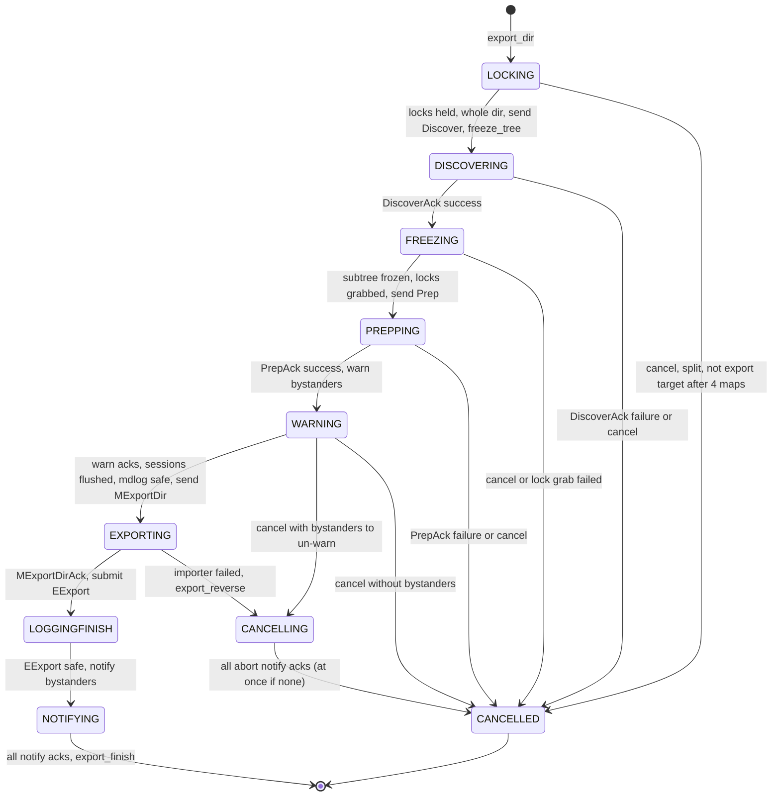
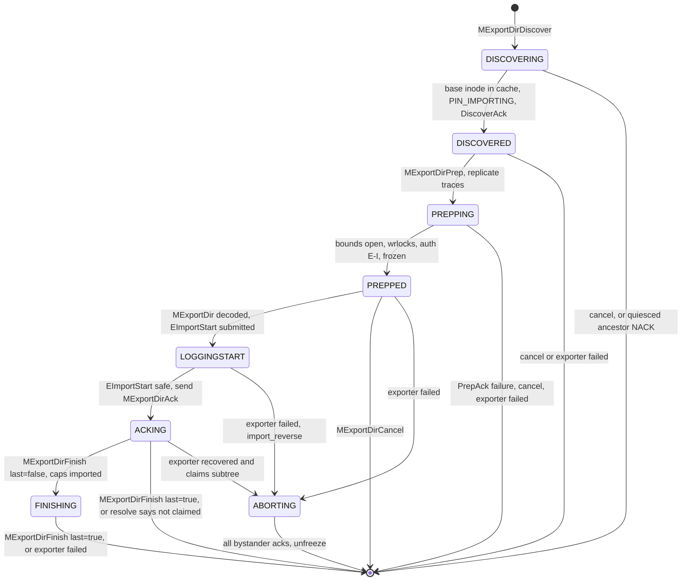
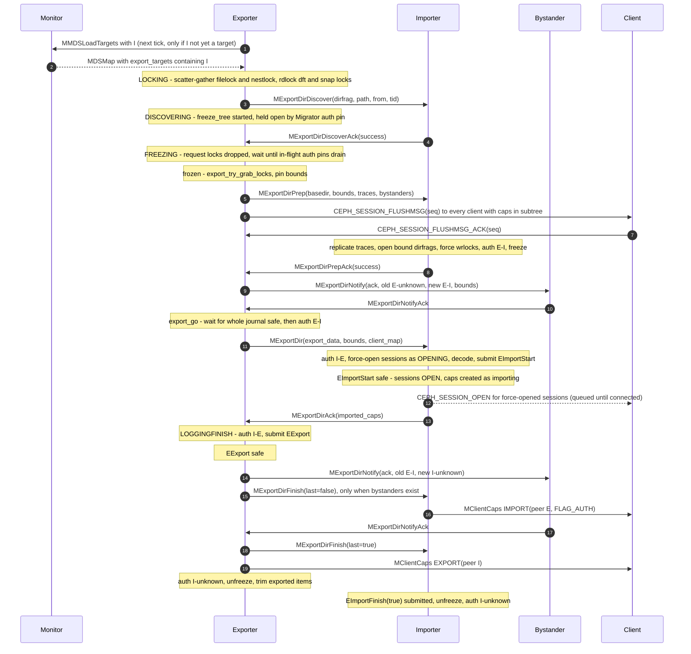

# Subtree Migration (Migrator)

> Part of the C++ MDS project map ([README](../README.md)). Sources: `src/mds/Migrator.{h,cc}` (~4,270 LOC), `src/messages/MExportDir*.h`, `MExportCaps(Ack).h`, `MGatherCaps.h` (~900 LOC), `src/mds/events/EExport.h`, `EImportStart.h`, `EImportFinish.h` and their code in `src/mds/journal.cc:3104-3336`, export/import helpers in `src/mds/CInode.cc` (4505-4790), `src/mds/CDir.cc` (2938-3056, 3143-3605), `src/mds/CDentry.h` (283-326), `src/mds/Capability.{h,cc}`, `src/mds/Locker.cc` (`xlock_export`/`xlock_import`, cap-message deferral), the resolve/expire glue in `src/mds/MDCache.cc`, `src/mds/Server.cc` (forced session open, session flush). Kernel client: `linux/fs/ceph/caps.c`, `linux/fs/ceph/mds_client.c`. Existing design note: `doc/dev/mds_internals/exports.rst` (partly outdated, see section 8). Related: [subtrees, traversal, replication](../04-cache/mdcache-subtrees-traversal-replication.md), [CDir/CDentry and cache objects](../04-cache/cdir-cdentry-and-cache-objects.md), [CInode](../04-cache/cinode-and-inode-types.md), [dirfrags and fragmentation](../04-cache/dirfrags-and-fragmentation.md), [balancer and pinning](balancer-and-pinning.md), [lock state machines](../05-locking/lock-types-and-state-machines.md), [acquiring locks](../05-locking/acquiring-locks.md), [MDLog](../06-journal/mdlog-and-journaler.md), [events and replay](../06-journal/events-and-replay.md), [resolve and rejoin](../09-recovery/resolve-and-rejoin.md), [rank lifecycle](../09-recovery/rank-lifecycle-and-recovery.md), [capabilities](../02-client-protocol/capabilities.md), [sessions](../02-client-protocol/sessions.md), [kclient expectations](../02-client-protocol/kclient-expectations.md), [libcephfs/ceph-fuse/Ganesha expectations](../02-client-protocol/libcephfs-fuse-ganesha-expectations.md), [leases, lock caches, async dirops](../02-client-protocol/leases-lock-caches-and-async-dirops.md), [rename](../03-request-path/rename.md), [request lifecycle](../03-request-path/request-lifecycle.md), [beacon and monitor](../01-cluster-integration/beacon-and-monitor.md), [FSMap/MDSMap](../01-cluster-integration/fsmap-and-mdsmap.md), [quiesce](../12-qos-metrics-quiesce-quarantine/quiesce.md), [quarantine](../12-qos-metrics-quiesce-quarantine/quarantine.md), [rstats, quotas, subvolumes](../10-snapshots-quotas-subvolumes/rstats-quotas-and-subvolumes.md), [admin commands](../13-admin-and-config/admin-commands.md), [config, perf counters, health](../13-admin-and-config/config-perf-counters-and-health.md), [process and threading](../00-architecture/process-and-threading.md), [mds_lock analysis](../00-architecture/mds_lock-analysis.md).

## 1. Purpose and responsibilities

The `Migrator` (one instance per rank, owned by `MDCache`) moves *authority* over a **subtree** (one dirfrag plus everything nested below it in the same subtree, down to the subtree's nested *bounds*) from one rank (the **exporter**) to another rank (the **importer**). Concretely it:

- Implements the two-party export/import protocol with `EXPORT_*` / `IMPORT_*` state machines, keyed by dirfrag and a per-export `tid`.
- Freezes the subtree on the exporter (no new auth pins, all in-flight requests drained) and the corresponding replica region on the importer, so that the cache content, lock states and client capabilities can be shipped as a consistent snapshot.
- Ships all cached metadata of the region (dirfrags, dentries, inodes incl. xattrs, snaprealms, old inodes, lock states, fcntl/flock state, popularity counters, replica maps, dirty bits) and all client capabilities on exported inodes, plus the client identities those capabilities need.
- Force-opens the corresponding client sessions on the importer, journals them, and arranges for clients to receive `CEPH_CAP_OP_EXPORT` from the exporter and `CEPH_CAP_OP_IMPORT` from the importer.
- Journals both sides (`EImportStart` with a full copy of the imported metadata, `EExport` marking the hand-off, `EImportFinish` marking the end) so that a crash at any point is resolved deterministically by the [resolve](../09-recovery/resolve-and-rejoin.md) stage ("ambiguous imports").
- Keeps **bystanders** (other ranks that replicate the exported base dirfrag) informed about the temporarily ambiguous authority (`MExportDirNotify`), so that cache-expire messages reach whichever rank ends up authoritative.
- Throttles and splits exports (`mds_max_export_size`, export queue), cancels exports that risk deadlock (freeze-tree timeout, quiesce, rank failures), and re-exports empty imports back to the inode's authority.
- Moves **non-auth client caps** of a single inode from a replica rank to the auth rank (`MExportCaps`/`MExportCapsAck`, triggered by `MGatherCaps` or stray unlink).
- Exposes helper routines (`encode_export_inode`, `finish_export_inode`, `decode_import_inode`, `finish_import_inode_caps`) used by cross-rank rename to migrate a single inode (see [rename](../03-request-path/rename.md)).

Who initiates exports (callers of `export_dir` / `export_dir_nicely`):

| Initiator | Entry | Queued/throttled? |
|---|---|---|
| Load balancer (`MDBalancer::try_rebalance` and the idle-import return) | `src/mds/MDBalancer.cc:1014, 1063, 1107, 1146` -> `export_dir_nicely` | yes |
| Export pins (`ceph.dir.pin`, ephemeral distributed/random pins) | `MDBalancer::handle_export_pins`, `src/mds/MDBalancer.cc:237, 274` -> `export_dir` | no |
| Admin `export dir <path> <rank>` (asok / `ceph tell mds.X`) | `src/mds/MDSRank.cc:3315 (MDSRank::_command_export_dir)` -> `export_dir` | no |
| Stopping rank other than 0 (`max_mds` decrease) | `src/mds/MDCache.cc:8043 (MDCache::shutdown_pass)` clears the queue, runs `handle_export_pins`, then exports every auth subtree except `~mdsN`, frozen/freezing, ambiguous, already-exporting and (while `max_mds > 0`) ephemerally pinned ones to the dir inode's authority (rank 0 if that rank is not active) via `export_dir_nicely` (`MDCache.cc:8063-8094`) | yes |
| Empty non-auth import | `src/mds/Migrator.cc:3352 (Migrator::import_finish)`, `src/mds/MDCache.cc:7059-7066 (MDCache::trim)` -> `export_empty_import` -> `export_dir` | no |
| Child exports of a split, requeue of the original | `src/mds/Migrator.cc:1300-1356` | every child is started directly (own `EXPORT_LOCKING` entry, bypasses queue and budget); the original is requeued at the queue front |
| Test thrashing `mds_thrash_exports` | `src/mds/MDSRank.cc:1096-1133 (MDSRank::_dispatch)` | yes |

## 2. Source map

| File | Class / function | Lines | Role |
|---|---|---|---|
| src/mds/Migrator.h | `Migrator`, `EXPORT_*`/`IMPORT_*` constants, `export_base_t` | 55-315 | Public API, states, members |
| src/mds/Migrator.cc | `export_state_t`, `import_state_t` | 87-144 | Per-export / per-import state |
| src/mds/Migrator.cc | `Migrator::dispatch` | 170-229 | Message switch (port `0x4xx`) |
| src/mds/Migrator.cc | `export_empty_import` | 231-266 | Send empty non-auth import back to inode auth |
| src/mds/Migrator.cc | `find_stale_export_freeze` | 268-318 | Freeze-deadlock breaker (tick) |
| src/mds/Migrator.cc | `quiesce_overdrive_export` | 320-332 | Cancel early exports for quiesce |
| src/mds/Migrator.cc | `export_try_cancel`, `export_cancel_finish` | 334-481 | Exporter cancellation per state |
| src/mds/Migrator.cc | `handle_mds_failure_or_stop` | 486-667 | Both sides: peer/bystander failure |
| src/mds/Migrator.cc | `is_exporting`, `is_importing`, `is_ambiguous_import`, `export_has_warned`, `export_has_notified`, `export_freeze_inc_num_waiters`, `audit` | 700-810 | Queries used by MDCache/Locker |
| src/mds/Migrator.cc | `export_dir_nicely`, `maybe_do_queued_export` | 819-856 | Export queue + size throttle |
| src/mds/Migrator.cc | `export_try_grab_locks` | 877-913 | Non-blocking lock grab after freeze |
| src/mds/Migrator.cc | `export_dir` | 920-1010 | Preconditions, start `EXPORT_LOCKING` |
| src/mds/Migrator.cc | `maybe_split_export` | 1016-1146 | Size model, split large subtrees |
| src/mds/Migrator.cc | `dispatch_export_dir` | 1159-1340 | `CEPH_MDS_OP_EXPORTDIR` internal request: locks, discover, freeze, split |
| src/mds/Migrator.cc | `child_export_finish` | 1342-1356 | Requeue original after children |
| src/mds/Migrator.cc | `handle_export_discover_ack` | 1362-1402 | `DISCOVERING -> FREEZING` |
| src/mds/Migrator.cc | `export_sessions_flushed` | 1418-1436 | Client session flush done |
| src/mds/Migrator.cc | `encode_export_prep_trace` | 1438-1487 | Spanning-tree trace to each bound |
| src/mds/Migrator.cc | `export_frozen` | 1489-1583 | `FREEZING -> PREPPING`, prep message, session flush |
| src/mds/Migrator.cc | `get_export_client_set` | 1585-1620 | Clients with caps in subtree / inode |
| src/mds/Migrator.cc | `handle_export_prep_ack` | 1622-1682 | `PREPPING -> WARNING`, warn bystanders |
| src/mds/Migrator.cc | `export_go`, `export_go_synced` | 1699-1768 | Journal sync, `EXPORTING`, send `MExportDir` |
| src/mds/Migrator.cc | `encode_export_inode`, `encode_export_inode_caps` | 1779-1822 | Inode + caps encoding (marks `STATE_EXPORTINGCAPS`) |
| src/mds/Migrator.cc | `finish_export_inode_caps`, `finish_export_inode` | 1824-1897 | Send `CEPH_CAP_OP_EXPORT`, auth->replica twiddle |
| src/mds/Migrator.cc | `encode_export_dir`, `finish_export_dir` | 1899-2037 | Recursive dirfrag encode / local cleanup |
| src/mds/Migrator.cc | `handle_export_ack` | 2052-2100 | `EXPORTING -> LOGGINGFINISH`, submit `EExport` |
| src/mds/Migrator.cc | `export_notify_abort`, `export_reverse` | 2102-2202 | Abort notifications, roll back after importer failure |
| src/mds/Migrator.cc | `export_logged_finish` | 2210-2249 | `LOGGINGFINISH -> NOTIFYING` |
| src/mds/Migrator.cc | `handle_export_notify_ack` | 2259-2310 | Warning/notify/abort acks (both sides) |
| src/mds/Migrator.cc | `export_finish` | 2312-2403 | Final cleanup, unfreeze |
| src/mds/Migrator.cc | `handle_export_discover`, `import_reverse_discovering/discovered/prepping`, `handle_export_cancel` | 2431-2573 | Importer early phases |
| src/mds/Migrator.cc | `decode_export_prep_trace`, `handle_export_prep` | 2596-2808 | Importer prep: replicate, open bounds, freeze |
| src/mds/Migrator.cc | `handle_export_dir` | 2830-2918 | Importer: decode, `EImportStart` |
| src/mds/Migrator.cc | `import_remove_pins`, `import_reverse`, `import_notify_finish`, `import_notify_abort`, `import_reverse_unfreeze`, `import_reverse_final` | 2925-3186 | Import rollback and notifications |
| src/mds/Migrator.cc | `import_logged_start` | 3191-3235 | `LOGGINGSTART -> ACKING`, ack with imported caps |
| src/mds/Migrator.cc | `handle_export_finish`, `import_finish` | 3237-3357 | Cap `IMPORT` to clients, `EImportFinish`, unfreeze |
| src/mds/Migrator.cc | `dump_export_states` | 3359-3430 | asok `dump_export_states` |
| src/mds/Migrator.cc | `decode_import_inode`, `decode_import_inode_caps`, `finish_import_inode_caps`, `decode_import_dir` | 3432-3736 | Importer decode |
| src/mds/Migrator.cc | `handle_export_notify` | 3744-3782 | Bystander |
| src/mds/Migrator.cc | `export_caps`, `handle_export_caps_ack`, `handle_gather_caps`, `handle_export_caps`, `logged_import_caps` | 3785-3937 | Single-inode non-auth cap migration |
| src/mds/Migrator.cc | ctor, `handle_conf_change` | 3939-3954 | Config |
| src/messages/MExportDir*.h, MExportCaps(Ack).h, MGatherCaps.h | message classes | all | Wire encodings (MDS<->MDS) |
| src/mds/events/EExport.h, EImportStart.h, EImportFinish.h; src/mds/journal.cc | `EExport`, `EImportStart`, `EImportFinish` | journal.cc:3104-3336 | Events, encodings, replay |
| src/mds/CDir.cc | `freeze_tree`, `_freeze_tree`, `unfreeze_tree`, `maybe_finish_freeze`, `can_auth_pin`, `set_dir_auth`, `encode_export`, `finish_export`, `decode_import`, `abort_import`, `is_exportable` | 3345-3605, 3528, 3143, 2948-3056, 2938 | Freezing, auth pins, dirfrag export state |
| src/mds/CInode.cc | `encode_export`, `finish_export`, `decode_import`, `_encode_base`, `_encode_locks_full`, `export_client_caps`, `clear_client_caps_after_export` | 4656-4790, 4505-4569, 3693-3710 | Inode export state |
| src/mds/CDentry.h | `encode_export`, `finish_export`, `abort_export`, `decode_import` | 283-326 | Dentry export state |
| src/mds/Capability.h/.cc | `Capability::Export`, `Capability::Import`, `make_export`, `merge` | h:78-110, 286-308; cc:35-102 | Cap transfer records |
| src/mds/SimpleLock.h | `export_twiddle`, `encode`/`decode` | 478-496, 551-554 | Lock state transfer |
| src/mds/Locker.cc | `xlock_export`, `xlock_import`, `notify_freeze_waiter`, `should_defer_client_cap_frozen` | 2324-2346, 758-778, 3363-3384 | Lock/caps glue |
| src/mds/MDCache.cc | `do_cap_import` | 5954-5973 | Builds `CEPH_CAP_OP_IMPORT` |
| src/mds/MDCache.cc | `adjust_subtree_auth`, `try_subtree_merge`, `adjust_bounded_subtree_auth`, `get_subtree_bounds`, `get_wouldbe_subtree_bounds` | 978-1410 | Subtree map maintenance |
| src/mds/MDCache.cc | `create_subtree_map` (ambiguous subtrees), `send_subtree_resolves`, `handle_mds_failure`, `handle_resolve`, `disambiguate_*_imports`, `add/cancel/finish_ambiguous_import` | 2624-2660, 2888-2995, 3006-3181, 3257-3433, 3662-3801 | Recovery interplay |
| src/mds/MDCache.cc | `handle_cache_expire`, `process_delayed_expire`, `discard_delayed_expire`, `trim_dentry` | 7685-7893, 7172-7254 | Expire routing during migration |
| src/mds/MDCache.cc | `dispatch_request` (`CEPH_MDS_OP_EXPORTDIR`) | 9995-10031 | Internal request dispatch |
| src/mds/Server.cc | `flush_session`, `flush_client_sessions`, `finish_flush_session`, `prepare_force_open_sessions`, `finish_force_open_sessions`, `close_forced_opened_sessions` | 897-923, 1059-1177 | Session handling for migration |
| src/mds/MDSRank.cc | `update_targets`, `hit_export_target`, `is_export_target` (h:387) | 611-667 | MDSMap `export_targets` maintenance |

## 3. How it works

### 3.1 Vocabulary and the `dir_auth` pair

- **Subtree root**: a `CDir` whose `dir_auth != CDIR_AUTH_DEFAULT` (`(-1,-2)`), registered in `MDCache::subtrees` with its set of **bounds** (nested subtree roots). Authority of every object under a subtree root (down to the bounds) is `dir_auth`. See [subtrees](../04-cache/mdcache-subtrees-traversal-replication.md).
- **`mds_authority_t` = (first, second)**. `second != CDIR_AUTH_UNKNOWN (-2)` means *ambiguous*; `MDSCacheObject::is_ambiguous_auth()` is true for every object whose authority pair has a second value (`src/mds/MDSCacheObject.h:110`). A frozen subtree root on its auth uses `(me, me)` (`src/mds/CDir.cc:3419-3422 (CDir::_freeze_tree)`), so objects in a frozen region are "ambiguous" even on the auth and wait for `WAIT_SINGLEAUTH` in `Locker::try_eval`.
- **Bounds**: the nested subtree roots below the exported dir (`MDCache::get_subtree_bounds`). They are *not* transferred; their parent inodes are (with the bound dirfrags' fragstat/rstat, see 3.7).
- **Bystanders**: ranks listed in the *base dirfrag's* replica map other than the importer (`src/mds/Migrator.cc:1528-1534 (Migrator::export_frozen)`).
- **tid**: `mdr->reqid.tid` of the internal `CEPH_MDS_OP_EXPORTDIR` (`0x01501`) request created by `export_dir`; every subtree-migration message carries it in the message header (`MExportCaps`/`MExportCapsAck`/`MGatherCaps` do not), and most handlers drop messages whose dirfrag/tid/peer do not match the current state (exceptions in section 4).

The authority transitions (comment at `src/mds/Migrator.cc:57-75`, verified against the code):

| Step | Exporter `dir_auth` | Importer `dir_auth` | Set by |
|---|---|---|---|
| before | authority `(E,-2)` (`dir_auth` may still be the inherit value `(-1,-2)`) | replica or absent | - |
| exporter frozen | `(E,E)` | | `CDir::_freeze_tree` |
| importer prepped | | `(E,I)` | `Migrator.cc:2784 (handle_export_prep)` |
| `EXPORTING` (MExportDir sent) | `(E,I)` | | `Migrator.cc:1733 (export_go_synced)` |
| importer decoded, `EImportStart` submitted | | `(I,E)` | `Migrator.cc:2861 (handle_export_dir)` |
| `EExport` submitted | `(I,E)` | | `Migrator.cc:2094 (handle_export_ack)` |
| exporter finished | `(I,-2)` | | `Migrator.cc:2339 (export_finish)` |
| importer caps imported | | `(I,I)` | `Migrator.cc:3260 (import_finish)` |
| importer unfrozen | | `(I,-2)` | `CDir::unfreeze_tree` (`CDir.cc:3471-3480`) |

Bystanders go `(E,-2) -> (E,I)` on the warning and `(E,I) -> (I,-2)` on the final notify (3.6).

### 3.2 Starting an export: preconditions, queue, throttle, split

`Migrator::export_dir(dir, dest)` (`src/mds/Migrator.cc:920`) asserts `dir->is_auth()` and `dest != self`, then refuses (log only, no error to the caller) when any of the following holds:

| Condition | Code |
|---|---|
| `!is_stopping() && !dir->is_exportable(dest) && dir->get_num_head_items() > 0` (dir pinned to another rank; `CDir::is_exportable` returns true iff the effective pin is `dest` or negative, ephemeral pins hashed via `MDCache::hash_into_rank_bucket`) | `Migrator.cc:926`, `CDir.cc:2938` |
| this rank is not `active` or `stopping` | `:929` |
| `mdcache->is_readonly()` | `:932` |
| `!mdsmap->is_active(dest)` | `:935` |
| `is_cluster_degraded()` (any rank failed/damaged or in replay..clientreplay) | `:938`, `src/mds/MDSMap.cc:1287` |
| `dir->inode->is_system()` (ino < `MDS_INO_SYSTEM_BASE` = 4096: root (1), `.ceph` (2), lost+found (4), `~mdsN` (256-511), stray dirs (1536-4095); `CInode.h:680`, `mdstypes.h:38-47`) | `:941` |
| `dir` frozen or freezing | `:944` |
| `dir` already `STATE_EXPORTING` | `:947` |
| parent is a stray dir not under `~mds<dest>` | `:950` |
| `dir->inode->is_quiesced()` | `:954` |
| `dir->inode->is_under_quarantine()` | `:957` |

Then it calls `mds->hit_export_target(dest)`, takes a Migrator auth pin on `dir`, `mark_exporting()` (`STATE_EXPORTING`, `inode->num_exporting_dirs++`), starts the internal request, records `export_state[dir] = {EXPORT_LOCKING, peer=dest, tid, mut=mdr}`, increments `num_locking_exports` and dispatches the request (`Migrator.cc:990-1009`).

**Queue and throttle** (`export_dir_nicely` / `maybe_do_queued_export`, `Migrator.cc:819-856`): requests are appended to `export_queue` (`list<pair<dirfrag_t, mds_rank_t>>`). The drain loop (guarded by a function-static `running` flag against re-entry) starts queued exports while `total_exporting_size < 2 * max_export_size` and the remaining budget is `>= max_export_size * (num_locking_exports + 1)` (each export still in `LOCKING` has unknown size and reserves one full `max_export_size`). `total_exporting_size` is the sum of `approx_size` of exports past `LOCKING`. The queue is drained again after every finish/cancel. `clear_export_queue()` empties it and bumps `export_queue_gen` (balancer before each rebalance, `MDBalancer.cc:780, 953`; `shutdown_pass`). Direct `export_dir` callers bypass the queue and the budget.

**Split** (`maybe_split_export`, `Migrator.cc:1016-1146`), run for every export once its locks are held: an iterative DFS estimates size in abstract units: dirfrag 800, plus per dentry `name.size()`, null dentry +1, remote dentry +10, primary inode +1000 + 80 per client cap. Nested dirfrags that are `STATE_EXPORTING` or freezing/frozen (fragmenting) are skipped and make every ancestor level "incomplete" (per the code comment at `:1084-1085`, the exporting dir's parent inode is auth-pinned, so its ancestors cannot freeze). An incomplete level contributes its complete children as separate results. The search stops when `found_size >= max_size` or when a single complete level is `>= max_size` while `found_size * 2 > max_size`. If nothing was split off, the whole dir is the single result (unless `null_okay`, i.e. this export is itself a child, and something was skipped). In `dispatch_export_dir` (`:1274-1339`): a single result equal to `dir` proceeds normally; otherwise each result becomes its own export (new `EXPORT_LOCKING` entry, own internal request) sharing an `export_base_t` parent (`dirfrag`, `dest`, `pending_children`, `export_queue_gen`, `restart`), and the original export is cancelled. `child_export_finish` (`:1342`) requeues the original dirfrag at the queue front once all children finished, if at least one succeeded (or all children were already exporting) and the queue generation is unchanged.

### 3.3 Exporter state machine

| State (value) | Entered in | Holding | Leaves on |
|---|---|---|---|
| `EXPORT_LOCKING` (2) | `export_dir` (`:1004`) | Migrator auth pin on dir, `STATE_EXPORTING`, internal `MDRequest` acquiring locks | `dispatch_export_dir` decides whole export (`:1279`) or split/cancel |
| `EXPORT_DISCOVERING` (3) | `dispatch_export_dir` (`:1279`) | request locks; freeze started (`freeze_tree`), held open by the Migrator auth pin | `MExportDirDiscoverAck` |
| `EXPORT_FREEZING` (4) | `handle_export_discover_ack` (`:1383`) | request finished (locks released), Migrator auth pin dropped; waiting `WAIT_FROZEN` | `C_MDC_ExportFreeze` -> `export_frozen` |
| `EXPORT_PREPPING` (5) | `export_frozen` (`:1566`) | frozen tree, new `MutationImpl` with rdlocks/wrlocks, `PIN_EXPORTBOUND` on bounds, auth pin on diri if auth | `MExportDirPrepAck` |
| `EXPORT_WARNING` (6) | `handle_export_prep_ack` (`:1676`) | `warning_ack_waiting` (ranks + `MDS_RANK_NONE` for pending session flush), `notify_ack_waiting` | all warning acks and flush, then `export_go` -> `export_go_synced` |
| `EXPORT_EXPORTING` (7) | `export_go_synced` (`:1727`) | auth `(E,I)`, inodes `STATE_EXPORTINGCAPS`, `PIN_TEMPEXPORTING` on all objects | `MExportDirAck` |
| `EXPORT_LOGGINGFINISH` (8) | `handle_export_ack` (`:2072`) | auth `(I,E)`, `EExport` in flight | `C_MDS_ExportFinishLogged` |
| `EXPORT_NOTIFYING` (9) | `export_logged_finish` (`:2234`) | waiting `notify_ack_waiting` | last ack -> `export_finish` |
| `EXPORT_CANCELLING` (1) | `export_try_cancel` for `WARNING`/`EXPORTING` | Migrator auth pin (from `export_notify_abort`) | last abort ack -> `export_cancel_finish` |
| `EXPORT_CANCELLED` (0) | cancel | - | entry erased immediately |

### 3.4 Importer state machine

| State (value) | Entered in | Holding |
|---|---|---|
| `IMPORT_DISCOVERING` (1) | `handle_export_discover` (`:2453`) | `import_state[df]` only; may be waiting on `path_traverse` discover |
| `IMPORT_DISCOVERED` (2) | `:2508` | `PIN_IMPORTING` on the base dir inode |
| `IMPORT_PREPPING` (3) | `handle_export_prep` first pass (`:2687`) | `PIN_IMPORTING` + `STATE_IMPORTING` on the base dirfrag, `get_stickydirs()` on every bound inode, `PIN_IMPORTBOUND` on opened bound dirfrags; waiting for bound dirfrags to be discovered |
| `IMPORT_PREPPED` (4) | `:2790` | `MutationImpl` with forced wrlocks on `filelock`/`nestlock` of the base dir inode; auth `(E,I)`; replica region frozen (`_freeze_tree`) |
| `IMPORT_LOGGINGSTART` (5) | `handle_export_dir` (`:2906`) | auth `(I,E)`; objects auth+dirty; forced sessions `OPENING` and `importing_count++`; `EImportStart` in flight |
| `IMPORT_ACKING` (6) | `import_logged_start` (`:3204`) | sessions open, caps created (`Capability::STATE_IMPORTING`), `PIN_IMPORTINGCAPS` |
| `IMPORT_FINISHING` (7) | `import_finish(last=false)` (`:3298`) | auth `(I,I)`, caps imported, still frozen |
| `IMPORT_ABORTING` (8) | `import_reverse` / exporter failure in `PREPPED` | waiting for bystander acks before unfreezing |

`is_ambiguous_import(df)` is true for states 5..7 (`Migrator.cc:712-720`); these subtrees are journaled as ambiguous in every `ESubtreeMap` (`MDCache.cc:2654-2657 (MDCache::create_subtree_map)`).

### 3.5 Message sequence (successful export)

Without bystanders, `export_logged_finish` calls `export_finish` directly, so the importer gets only `MExportDirFinish(last=true)` and sends the cap `IMPORT`s and unfreezes in the same handler (`Migrator.cc:2238-2239`, `3250-3357`). Cap `EXPORT` (exporter) and `IMPORT` (importer) travel on different connections; clients must accept either order (3.11).

### 3.6 Step-by-step walkthrough

**(1) LOCKING** - `Migrator::dispatch_export_dir(mdr, count)` (`Migrator.cc:1159`, invoked from `MDCache::dispatch_request` for `CEPH_MDS_OP_EXPORTDIR`, `MDCache.cc:10028-10030`):
1. Stale request (no `export_state` or tid mismatch): kill it if `aborted` (`:1165-1175`).
2. `peer_error`, or `dir` frozen/freezing: cancel (`:1178`).
3. `dest` not in this rank's MDSMap `export_targets` (`MDSRank::is_export_target`, `MDSRank.h:387`): drop locks and local auth pins, wait for the next MDSMap (`wait_for_mdsmap`), retry with `count+1`; cancel when `count > 3` (`:1185-1198`). `MDCache::dispatch_request` starts at `count = 0`, so up to four newer maps are awaited; any other re-dispatch (e.g. `C_MDS_RetryRequest` after a lock wait) restarts at 0, and the `WAIT_CREATED` path below restarts at 1. The rank adds `dest` to its desired targets via `hit_export_target` (decay counter, rate `mds_bal_target_decay`); `MDSRank::update_targets` (`src/mds/MDSRank.cc:611`, called from `MDSRankDispatcher::tick` while active/stopping, `MDSRank.cc:769-771`) sends `MMDSLoadTargets` to the monitor, which updates `mds_info.export_targets` (`src/mon/MDSMonitor.cc:936-951 (MDSMonitor::prepare_offload_targets)`).
4. Dir inode not yet linked (`!get_parent_dn()`): wait `CDir::WAIT_CREATED` (`:1200`).
5. Locks (once, `ALL_LOCKED`): if `diri->will_block_for_quiesce(mdr)` set `aborted` and cancel (deadlock avoidance with quiesce). Else `acquire_locks` (blocking, `skip_quiesce=true`) with `lock_scatter_gather` (wrlock + `STATE_PIN`) on `diri->filelock` and `diri->nestlock` (if `diri` is auth, `set_scatter_wanted()` so they go to `MIX`) and an rdlock on `diri->dirfragtreelock`; then `rdlock_try_set(lov, mdr)` on the `dirfragtreelock` of every would-be bound's inode (so the bounds cannot be refragmented while their scatterlock state is shipped); then `try_rdlock_snap_layout(diri)` (snaplocks of `diri` and every ancestor up to the root). Both helpers never block while holding locks: on failure they add a `C_MDS_RetryRequest` waiter, drop all locks and local auth pins of the request and return, and the request is re-dispatched later (`Locker.cc:157-227`, `1888-1910`); whole step `:1206-1268`. The comment at `:1222-1228` explains the scatter-gather: a third-rank inode auth gathering fragstat/rstat during the export could otherwise see the dirfrag's contribution from both or neither of exporter/importer.
6. `maybe_split_export` (3.2). Whole export: `num_locking_exports--`, state `DISCOVERING`, send `MExportDirDiscover(dirfrag, path=diri->make_path(), from, tid)`, record `approx_size`, `dir->freeze_tree()`, add `WAIT_FROZEN` waiter `C_MDC_ExportFreeze(tid)` (`:1277-1297`).

**(2) DISCOVERING** - importer `handle_export_discover` (`:2431`): NACK if not `active`; create `IMPORT_DISCOVERING`; wait for `mdcache->is_open()`; if the base dir inode is not cached, `path_traverse(MDS_TRAVERSE_DISCOVER | MDS_TRAVERSE_PATH_LOCKED | MDS_TRAVERSE_IMPORT)` discovers it from its auth (retrying the message through `C_MDS_ExportDiscoverFactory`); `-EAGAIN` (an ancestor is quiesced, `MDCache.cc:8574-8577, 8832-8835`) -> erase state, NACK; any other error asserts. With the inode cached: `IMPORT_DISCOVERED`, `in->get(PIN_IMPORTING)`, ack success.

**(3) FREEZING** - exporter `handle_export_discover_ack` (`:1362`): NACK -> `export_try_cancel(dir, notify_peer=false)`. Success: state `FREEZING`; the internal request is *finished* (`request_finish`) so every lock taken in step 1 is released (the comment calls it "release locks to avoid deadlock"); then the Migrator auth pin is dropped, allowing the freeze to complete once the remaining auth pins drain (3.8).

**(4) PREPPING** - `export_frozen` (`:1489`, from `WAIT_FROZEN`): cancel if the dir inode is auth and frozen, or `export_try_grab_locks` fails (`:877-913`: requires `filelock`/`nestlock` wrlockable for the loner, `rdlock_try_set` on bound inodes' and `diri`'s `dirfragtreelock` and on `snaplock` of `diri` and all ancestors via projected parents, then `wrlock_force` `filelock`/`nestlock`; all into a fresh `MutationImpl`). Auth-pin `diri` if auth. Assert `dir_auth == (me,me)`. Build `MExportDirPrep`: bystanders = base dirfrag replicas except the importer; `basedir` = `encode_replica_dir(dir, peer)` (adds the importer as replica); for each bound: `get(PIN_EXPORTBOUND)`, `STATE_EXPORTBOUND`, `add_bound`, and a **trace** (`encode_export_prep_trace`, `:1438-1487`): replicas of `(dentry, inode)` and intermediate dirfrags from the bound's inode up to the first dirfrag already sent or the base, without repeating inodes/dirfrags; format `df ('-' | ('f' dir | 'd') dentry inode (dir dentry inode)*)` inside `ENCODE_START(1,1)`. Send, state `PREPPING`. Then collect `export_client_set` (every client with a cap on any primary inode in the region, `:1585-1613`) and `Server::flush_client_sessions` it: each *open, connected* session whose connection has `CEPH_FEATURE_EXPORT_PEER` gets `CEPH_SESSION_FLUSHMSG(seq)` (`Server.cc:897-907`); if any were sent, `MDS_RANK_NONE` is inserted into `warning_ack_waiting` and the gather completes `export_sessions_flushed`.

**(5) Importer prep** - `handle_export_prep` (`:2637`), first pass: assert `IMPORT_DISCOVERED`; decode the base dirfrag replica; state `PREPPING`, record `bound_ls` and `bystanders`; move the pin from inode to dirfrag (`PIN_IMPORTING`, `STATE_IMPORTING`); decode every trace (`decode_export_prep_trace`, `:2596-2635`); `get_stickydirs()` on every bound inode. Every pass (the handler re-runs via `C_MDS_ExportPrepFactory` after a gather): if not `active` -> fail; for each bound fragset, map to leaves of the inode's fragtree; missing bound dirfrags are fetched with `open_remote_dirfrag` (MDiscover to their auth) and the handler waits; present ones get `PIN_IMPORTBOUND`/`STATE_IMPORTBOUND`. When all are open: fail if read-only or if `diri->filelock`/`nestlock` are not wrlockable for the loner; else `wrlock_force` both into a new `MutationImpl`, `adjust_bounded_subtree_auth(dir, bounds, (E,I))`, `verify_subtree_bounds`, `dir->_freeze_tree()` (non-auth variant: just propagates `freeze_tree_state` to nested dirfrags), state `PREPPED`. On failure `import_reverse_prepping`. Reply `MExportDirPrepAck(success)` on the incoming connection.

**(6) WARNING** - `handle_export_prep_ack` (`:1622`): failure -> cancel without notifying the peer. Success: for every replica of the base dirfrag except the importer (when degraded, only `clientreplay/active/stopping` ones) add to `warning_ack_waiting` and `notify_ack_waiting` and send `MExportDirNotify(ack=true, old=(E,-2), new=(E,I), bounds)`. State `WARNING`; with nothing to wait for, `export_go`. Bystander `handle_export_notify` (`:3744`, ignored unless `clientreplay/active/stopping`): if the dir is cached and its authority equals `old_auth`, `adjust_bounded_subtree_auth(dir, bounds, new_auth)` and `try_subtree_merge`; ack (with `new_auth`) if requested, even when the dir is not cached.

**(7) EXPORTING** - `export_go` (`:1699`) waits until **the exporter's entire journal is safe** (`mdlog->wait_for_safe` + `flush`; comment "flush out e.g. any cap imports"). `export_go_synced` (`:1710`): state `EXPORTING`; `adjust_subtree_auth(dir, E, I)`; `balancer->subtract_export(dir)` (remove the subtree's popularity from ancestors); `encode_export_dir` the whole region (3.7), which also sets `STATE_EXPORTINGCAPS` + `PIN_EXPORTINGCAPS` on every exported inode and `PIN_TEMPEXPORTING` on every object; encode `client_map` (`map<client_t, entity_inst_t>`, features-encoded) and `client_metadata_map`; list bounds; send `MExportDir`; `hit_export_target(dest, n+1)`; bump `exported`/`exported_inodes`.

**(8) Import** - `handle_export_dir` (`:2830`, all asserted: state `PREPPED`, tid, peer, frozen, not auth): force the frag to a leaf in the base inode's fragtree if needed; create `EImportStart(dirfrag, bounds, from)` with `add_dir_context(dir)`; `adjust_subtree_auth(dir, I, E)`; decode client maps and `le->cmapv = prepare_force_open_sessions(...)` (drops clients blocklisted in the current OSDMap; sessions that are `closed/closing/killing` are set to `OPENING` (SessionMap version projected) and merge the exported client metadata; every listed session gets `inc_importing()`, `Server.cc:1059-1104`); re-encode the filtered client maps into the event; `decode_import_dir` for every dirfrag record (adds each dirfrag with `add_import_dir` and each dentry with `add_import_dentry` to the event metablob - a full journal copy of the imported metadata); add bounds; `balancer->add_import(dir)`; state `LOGGINGSTART`; submit + flush. Bumps `imported`/`imported_inodes`.

**(9) Ack** - `import_logged_start` (`:3191`, log-safe context; asserts that `import_state[df]` still exists, then returns if the state is no longer `LOGGINGSTART`): state `ACKING`; `finish_force_open_sessions(map, dec_import=false)` sets sessions `OPEN`, registers them with `MetricsHandler` and the dmClock scheduler, sends `CEPH_SESSION_OPEN` (+ `FORCE_RO` if read-only) and marks them dirty in the SessionMap (`Server.cc:1106-1154`); `finish_import_inode_caps(in, peer=MDS_RANK_NONE, auth_cap=true, ...)` for every inode with exported caps creates the missing `Capability` objects (newly created ones are marked `STATE_IMPORTING`; a cap the client already held on this rank, e.g. a non-auth cap, is reused), sets `STATE_CLIENTWRITEABLE` on caps of clients present in `client_ranges`, sets `CInode::STATE_NEEDSRECOVER` if a client in `client_ranges` has no cap, and returns `Capability::Import{cap_id, issue_seq = last_seq+1, mseq = exported mseq}` per client (`cap_id 0` when the client's session was filtered out); send `MExportDirAck(imported_caps)`.

**(10) LOGGINGFINISH** - `handle_export_ack` (`:2052`): decode `peer_imported`; state `LOGGINGFINISH`; `EExport(dir, peer)` with `add_dir_context(dir, TO_ROOT)`, `add_dir(dir, false)` and every bound (context + clean dir) - the event only records base, bounds and target, not the metadata; `adjust_subtree_auth(dir, I, E)` ("list us second, them first ... keeps authority().first in sync with subtree auth state in the journal"); submit + flush.

**(11) NOTIFYING** - `export_logged_finish` (`:2210`): send `MExportDirNotify(ack=true, old=(E,I), new=(I,-2), bounds)` to `notify_ack_waiting`; state `NOTIFYING`; if nobody to wait for -> `export_finish`; else send `MExportDirFinish(last=false)` to the importer (if alive) so it can send cap `IMPORT`s while bystanders are acking.

**(12) Exporter finish** - `export_finish` (`:2312`): send `MExportDirFinish(last=true)` (if the importer is alive); `finish_export_dir` recursively (`:1987-2037`): per dirfrag clear replica map, clear `STATE_AUTH`, drop bloom, `replica_nonce = EXPORT_NONCE (1)`, mark clean, take all waiters, `CDir::finish_export` (state masked by `MASK_STATE_EXPORT_KEPT`, popularity zeroed); per dentry `CDentry::finish_export` (clear replicas, nonce 1, clear auth, clean) and LRU bottom; per primary inode `finish_export_inode` (`:1850-1897`): clean, clear replicas, `export_twiddle()` all nine locks (`clear_gather(); state = replica_state`), clear `STATE_AUTH`, nonce 1, clear dirty rstat / scatter-dirty (unless it still has a local subtree root dirfrag) / dirty parent / client-writeable, `clear_file_locks()`, take waiters, `CInode::finish_export` (`state &= MASK_STATE_EXPORT_KEPT`, popularity zeroed, `loner_cap = -1`) and `finish_export_inode_caps` which sends `CEPH_CAP_OP_EXPORT` to each cap holder and removes all caps (`clear_client_caps_after_export`, also clears `mds_caps_wanted`). Then `adjust_subtree_auth(dir, I)`, unpin bounds, clear `STATE_AUXSUBTREE`, discard delayed expires, `unfreeze_tree` + `try_subtree_merge`, clear the dir inode's scatter-dirty state if no longer relevant, queue all collected waiters (they will now forward to the new auth), erase `export_state`, `clear_exporting`, `trim(num_dentries)`, `maybe_send_pending_resolves`, drop the mutation's locks, `child_export_finish(parent, true)`, `maybe_do_queued_export`.

**(13) Importer finish** - `handle_export_finish` -> `import_finish(dir, notify=false, last)` (`:3250`): if `ACKING`: `adjust_subtree_auth(dir, I, I)`; for every exported cap with a known session: `cap->merge(export, auth=true)`, `clear_importing()`, `MDCache::do_cap_import(session, in, cap, export.cap_id, export.seq, export.mseq - 1, peer=E, CEPH_CAP_FLAG_AUTH)`; `replica_caps_wanted = 0`; `dec_importing()` on every session. If `!last`: state `FINISHING`, return. Otherwise: notify bystanders only if `notify` (failure paths), remove pins, erase state, submit `EImportFinish(dir, true)` (no completion wait), process delayed expires, `unfreeze_tree` + `try_subtree_merge`, drop locks, `Locker::eval(in, CEPH_CAP_LOCKS)` on every imported inode and drop `PIN_IMPORTINGCAPS`, `maybe_send_pending_resolves`, `populate_mydir` if the import was this rank's own `~mdsN`, and `export_empty_import` if the imported dirfrag is empty and its inode is not local.

### 3.7 What state is transferred

`MExportDir.export_data` is a concatenation of dirfrag records in pre-order (a record for `dir`, then recursively each nested non-bound dirfrag after the parent's record is closed) (`Migrator.cc:1899-1985`). The importer decodes records until the buffer ends (`:2876-2887`).

| Level | Fields (encode order) | Importer handling |
|---|---|---|
| dirfrag record `ENCODE_START(1,1)` | `dirfrag_t`; `CDir::encode_export`; `u32 nden`; `nden` dentries | `get_or_open_dirfrag`; nested dirfrags adopt the import root's `freeze_tree_state`; existing waiters are moved to `WAIT_UNFREEZE` (`:3641-3647`) |
| `CDir::encode_export` `ENCODE_START(1,1)` (`CDir.cc:2948`) | `first`, `fnode_t`, `dirty_old_rstat`, `committed_version`, `state`, `dir_rep`, `pop_me`, `pop_auth_subtree`, `dir_rep_by`, replica map | keeps only `COMPLETE`, `DIRTY`, `DIRTYDFT`, `BADFRAG` + `STATE_AUTH` (`MASK_STATE_EXPORTED`, `CDir.h:153`); dirty -> marked dirty in the *importer's* current log segment; non-matching `rstat/accounted_rstat` or `fragstat/accounted_fragstat` re-marks the inode's `nestlock`/`filelock` as updated scatterlocks; stale `DIRTYDFT` cleared unless `dirfragtreelock` is `MIX`/unstable (`CDir.cc:2981-3040`); adds exporter as replica with `EXPORT_NONCE`, removes itself |
| dentry | `name`, `last`, `CDentry::encode_export` `ENCODE_START(1,1)`: `first`, `state`, `version`, `projected_version`, `lock` (full: state + gather set), replica map; then marker | auth set, dirty kept (`STATE_DIRTY`), only `STATE_BOTTOMLRU` kept locally (`CDentry.h:306-326`); non-`SYNC` dentry lock -> `try_eval` |
| marker `'N'` | null dentry | - |
| marker `'l'` (`'L'` legacy) | `ENCODE_START(2,1)`: `ino`, `d_type`, `alternate_name` (`CDentry.cc:658`) | `link_remote_inode` |
| marker `'i'` (`'I'` legacy, no envelope) | `ENCODE_START(2,1)`: export-inode record + `alternate_name` | `decode_import_inode` (`:3432`) |
| export-inode record `ENCODE_START(1,1)` | `ino`, `last`, `CInode::encode_export`, caps record | new `CInode` if absent; `link_primary_inode` |
| `CInode::encode_export` `ENCODE_START(5,4)` (`CInode.cc:4656`) | `_encode_base` (`first`, `inode_t`, symlink, `dirfragtree`, xattrs, `old_inodes`, `damage_flags`, snap blob/snaprealm); `state`; `pop`; replica map; for every `STATE_EXPORTBOUND` dirfrag of the inode: `frag`, `fragstat`, `accounted_fragstat`, `rstat`, `accounted_rstat`; full lock states of `authlock, linklock, dirfragtreelock, filelock, xattrlock, snaplock, nestlock, flocklock, policylock` and `loner_cap`; fcntl and flock lock tables | state masked to `DIRTY`, `NEEDSRECOVER`, `DIRTYPARENT`, `DIRTYPOOL`, `DISTEPHEMERALPIN`, `RANDEPHEMERALPIN` + `STATE_AUTH` (`CInode.h:391-393`); dirty / dirty-parent (backtrace) re-dirtied in importer's segment; bound fragstat/rstat taken only if the bound dirfrag is not local auth and the lock is not `MIX` (`CInode.cc:4739-4783`); `want_loner_cap = loner_cap`; dirty rstat, client-writeable (non-empty `client_ranges`), dirty `filelock`/`dirfragtreelock` re-registered; `snaplock`/`policylock` re-evaluated if stable and not `SYNC` |
| caps record `ENCODE_START(1,1)` (`:1796`) | `map<client_t, Capability::Export>`; for auth caps also `mds_caps_wanted` (`map<rank, wanted>`) | own rank removed from `mds_caps_wanted`; inode pinned `PIN_IMPORTINGCAPS` if any cap or wanted bits; saved in `peer_exports` |
| `Capability::Export` `ENCODE_START(3,2)` (`Capability.cc:35`) | `cap_id`, `wanted`, `issued`, `pending`, `client_follows`, `seq` (= `last_sent`), `mseq` (= exporter mseq **+ 1**, `Capability.h:286`), `last_issue_stamp`, `state` | `merge`: pending/issued unioned and re-issued (bumps `last_sent`), wanted unioned, the exported `state` bits `CLIENTWRITEABLE`, `NOINLINE`, `NOPOOLNS`, `NOQUOTA` are OR-ed in, auth caps take the new `mseq` (`Capability.h:289-308`) |

Also in `MExportDir`: `bounds` (`vector<dirfrag_t>`), `client_map` (bufferlist: `map<client_t, entity_inst_t>` then `map<client_t, client_metadata_t>`).

Not transferred (stays behind or is rebuilt): the base dir's *inode* (it stays with its own auth; only the dirfrag moves), bound dirfrags, client dentry leases (they remain attached to the exporter's dentries, which become replicas; see [leases](../02-client-protocol/leases-lock-caches-and-async-dirops.md)), per-session completed-request lists, open-file-table entries (each rank's `OpenFileTable` follows cap add/remove automatically, `CInode.cc:3924-3946`), and `import_state_t::updated_scatterlocks` is filled but never consumed (`Migrator.cc:140, 3487, 3492`).

Popularity: `subtract_export`/`add_import` move `pop_auth_subtree` out of/into ancestors' nested counters (`src/mds/MDBalancer.cc:1419-1444`).

### 3.8 Freezing and auth pins

- `CDir::freeze_tree()` (`CDir.cc:3345`) auth-pins the root, creates a shared `freeze_tree_state_t{dir, auth_pins, frozen}`, walks **every nested dirfrag in cache that is not a subtree root** (`_walk_tree` over `get_nested_dirfrags`) setting `freeze_tree_state` and summing `auth_pins + dir_auth_pins`, and invalidates lock caches that hold auth pins there. From this moment `CDir::can_auth_pin` fails with `ERR_EXPORTING_TREE` anywhere in the region (`CDir.cc:3528-3555`); `CInode::can_auth_pin` delegates to the parent dentry/dir (`CInode.cc:3094-3111`). `auth_unpin` decrements the shared counter; `maybe_finish_freeze` completes the freeze when only the freeze's own pin remains, deferring if the root is not a subtree root and its inode is frozen (`CDir.cc:3565-3604`).
- `_freeze_tree` on the auth makes the root a subtree (temporarily auth-pinning its inode if it was not one), turns nested dirfrags that belong to a different freeze into separate subtrees with the same auth, sets `(me,me)`, `STATE_FROZENTREE`, `PIN_FROZEN` (`CDir.cc:3385-3444`). `unfreeze_tree` resets the state on all nested dirfrags, collects `WAIT_UNFREEZE` waiters everywhere, and on the auth sets `(me,-2)`; on a still-freezing tree it fires `WAIT_FROZEN` with `-1` (`CDir.cc:3446-3495`).
- The exporter's freeze is held open by the Migrator's own auth pin until `MExportDirDiscoverAck` (`Migrator.cc:1293-1296, 1394`), guaranteeing the importer has the base inode before the export proceeds.
- What blocks while freezing/frozen (exporter, and the importer's frozen replica region):
  - Every request that needs an auth pin in the region: `Locker::acquire_locks` auth-pins every local auth object it rd/wr/x-locks (`src/mds/Locker.cc:263-397 (Locker::acquire_locks)`, the `mustpin` set), so nearly all reads and writes on auth objects wait on `WAIT_UNFREEZE` ("failed to authpin, subtree is being exported", `Locker.cc:476-495`); a non-auth object with ambiguous authority makes the request wait on `WAIT_SINGLEAUTH` ("waiting for single auth, object is being migrated", `Locker.cc:434-442`). `Server::rdlock_path_pin_ref` with `want_auth` waits too (`src/mds/Server.cc:3927-3939`). Path traversal itself is allowed except opening dirfrags of frozen inodes or adding null dentries in frozen dirs (`src/mds/MDCache.cc:8564-8569, 8759-8762 (MDCache::path_traverse)`).
  - Client cap messages and cap releases on frozen inodes are deferred to `WAIT_UNFREEZE` (`Locker::should_defer_client_cap_frozen`, `Locker.cc:3363-3384`; `Locker::_do_cap_release`, `:4329-4334`); `Locker::check_inode_max_size` (`:3105`), `Locker::kick_issue_caps` (`:3822`) and `Locker::try_eval` (`:1579-1592`) wait for unfreeze or single auth.
  - Requests that would forward to the auth wait on `WAIT_SINGLEAUTH` while authority is ambiguous (`src/mds/MDCache.cc:8893-8899 (MDCache::maybe_request_forward_to_auth)`).
- `find_stale_export_freeze` (`Migrator.cc:268-318`, every tick while active): for exports in `DISCOVERING`/`FREEZING`, if `freeze_tree_state->auth_pins` has not changed for `mds_freeze_tree_timeout` (30 s) **and** either some remote rank is waiting on this freeze (`num_remote_waiters > 0`, incremented by `Locker::notify_freeze_waiter` (`Locker.cc:758-778`), which is called when a request that already holds remote auth pins blocks on the freezing tree (`Locker::acquire_locks`, `Locker.cc:493-494`; `Server::rdlock_path_pin_ref`, `Server.cc:3936-3937`; `MDCache::repair_dirfrag_stats_work`, `MDCache.cc:13624-13625`) and whenever a peer rank's auth-pin request waits on it (`Server::handle_peer_auth_pin`, `Server.cc:3351`)) or the parent dir is itself freezing, the export is cancelled. This breaks the cross-rank auth-pin cycle and the nested-freeze cycle described in the comment at `:275-297`.
- Quiesce: `export_dir` refuses quiesced inodes; `dispatch_export_dir` aborts if it would block on the `quiescelock`; `MDCache::dispatch_quiesce_inode` calls `quiesce_overdrive_export` for every dirfrag of a quiesced dir inode, cancelling exports in `LOCKING`, `DISCOVERING` or `FREEZING` (`Migrator.cc:320-332`, `MDCache.cc:14298`); the importer refuses discovers through quiesced ancestors. See [quiesce](../12-qos-metrics-quiesce-quarantine/quiesce.md).

### 3.9 Locks held during migration

| Who | Lock | Mode | When | Why |
|---|---|---|---|---|
| exporter | base dir inode `filelock`, `nestlock` | wrlock + `STATE_PIN` (`lock_scatter_gather`; `set_scatter_wanted` if the inode is local) | `LOCKING..DISCOVERING` | hold the lock state so the inode's auth (possibly a third rank) cannot gather the base dirfrag's fragstat/rstat while authority moves; otherwise it could count that dirfrag twice or not at all (comment `:1222-1228`) |
| exporter | base dir inode `dirfragtreelock`, bound inodes' `dirfragtreelock` | rdlock | `LOCKING..DISCOVERING`, again `PREPPING..finish` | no refragmentation of base or bounds while their state is shipped |
| exporter | `snaplock` of base inode and every ancestor | rdlock | `LOCKING..DISCOVERING` (`try_rdlock_snap_layout`), again `PREPPING..finish` | stable snaprealm/path |
| exporter | base dir inode `filelock`, `nestlock` | `wrlock_force` | `PREPPING..finish/cancel` | keep them in a wrlocked state so no gather changes stats mid-flight |
| exporter | base dir inode | auth pin (if local) | `PREPPING..finish/cancel` | keep the inode (outside the region) stable |
| importer | base dir inode `filelock`, `nestlock` | `wrlock_force` | `PREPPED..finish/reverse` | same as exporter |
| both | every object of the region | `PIN_TEMPEXPORTING` (exporter), `STATE_AUTH` flips | encode..finish | lifetime |

The locks of step 1 are released at the discover ack; `export_frozen` re-acquires them non-blockingly and cancels if it cannot. `Locker::xlock_export`/`xlock_import` (`Locker.cc:2324-2346`) are only used by rename's single-inode migration: the peer turns its xlocks on the migrated inode into `LOCK_LOCK` and releases them; the leader converts its remote xlocks into local ones by taking an auth pin per lock.

### 3.10 Journaling and ambiguous authority

| Event | Type | Writer | Content | Replay (`journal.cc`) |
|---|---|---|---|---|
| `EExport` | `EVENT_EXPORT` (3) | exporter, after `MExportDirAck` | `ENCODE_START(4,3)`: `stamp`, `metablob` (contexts + clean base and bounds), `base`, `bounds` (set), `target` | replay metablob, then `adjust_bounded_subtree_auth(dir, bounds, CDIR_AUTH_UNDEF)` and `try_trim_non_auth_subtree` (`:3106-3128`) |
| `EImportStart` | `EVENT_IMPORTSTART` (4) | importer, on `MExportDir` | `ENCODE_START(4,3)`: `stamp`, `base`, `metablob` (full imported content, lumps flagged `importing`), `bounds` (vector), `cmapv`, `client_map` (bufferlist with inst map + metadata map), `from` | replay metablob (importing lumps set `STATE_AUTH`, clear `COMPLETE`, mark dentries auth, `journal.cc:1320-1323, 1375, 1484, 1519`); `add_ambiguous_import(base, bounds)`; auth `(me,me)` bounded by `bounds`; `replay_open_sessions` if `sessionmap.version < cmapv`; `update_segment` sets `sessionmapv` (`:3180-3230`) |
| `EImportFinish` | `EVENT_IMPORTFINISH` (5) | importer at end (success) or on reversal (failure), also `disambiguate_my_imports` | `ENCODE_START(3,3)`: `stamp`, `base`, `success` | success: `finish_ambiguous_import`; failure: auth `UNDEF`, `cancel_ambiguous_import`, trim; if the base is not an ambiguous import: `clog` error, `mds->damaged()` (`:3279-3303`) |
| `ESessions` | `EVENT_SESSIONS` (12) | auth receiving `MExportCaps` | `cmapv`, client maps | see [sessions](../02-client-protocol/sessions.md) |
| `ESubtreeMap` | `EVENT_SUBTREEMAP` (2) | every new segment | subtrees with `dir_auth.first == me`; ambiguous imports in `ambiguous_subtrees` | ambiguous ones re-added via `add_ambiguous_import`, auth `(me,me)` (`journal.cc:2951-2966`) |

Durability ordering: the exporter keeps the region's metadata dirty until `export_finish`, and its log segments cannot expire meanwhile because `LogSegment::try_to_expire` does not commit frozen dirfrags but waits for `WAIT_UNFREEZE` (`src/mds/journal.cc:160-172`); it marks everything clean only after `EExport` is safe, and `EExport` is written only after the importer's `EImportStart` (full copy, marked dirty in the importer's segment) is safe (the ack is sent from the log-safe callback). If the export reverses, the region simply stays dirty on the exporter. The exporter also waits for its whole journal to be safe before sending `MExportDir` (`export_go`).

Which subtrees a rank claims while journaling or sending resolves: `ESubtreeMap` and `send_subtree_resolves` include only subtrees with `authority().first == me` (`MDCache.cc:2651, 2920`); exporter states up to `EXPORTING` claim (`(E,*)`), from `LOGGINGFINISH` on they do not (`(I,E)`); the importer claims from `LOGGINGSTART` on, as ambiguous until `import_finish(last=true)`.

### 3.11 Client-visible cap migration

Message fields (`MClientCaps`, `src/messages/MClientCaps.h`; op values `CEPH_CAP_OP_EXPORT = 3`, `CEPH_CAP_OP_IMPORT = 4`; `struct ceph_mds_cap_peer {le64 cap_id; le32 issue_seq; le32 mseq; le32 mds; u8 flags}` packed, `src/include/ceph_fs.h:936-942`):

| | `EXPORT` (exporter -> client) | `IMPORT` (importer -> client) |
|---|---|---|
| Built in | `Migrator::finish_export_inode_caps` (`:1824-1848`) and `handle_export_caps_ack` (`:3826-3830`) | `MDCache::do_cap_import` (`MDCache.cc:5954-5973`) |
| `head.cap_id` | exporter's cap id | importer's cap id |
| `head.migrate_seq` | exporter's current `mseq` (m) | importer's `mseq` (auth caps: m+1) |
| `head.seq` / `issue_seq` | 0 / 0 | `cap->get_last_seq()` (incremented first if 0) / `last_issue` |
| `head.caps`, `wanted`, realm, inode fields | 0, 0, realm 0, none | `pending`, `wanted`, snaprealm ino, full `encode_cap_message`, snap trace |
| peer block | in the body in place of `size/max_size/...` (`ceph_mds_caps_export_body`, zero-padded to the non-export body size, `MClientCaps.h:324-328`) | appended after the flock blob if the connection has `CEPH_FEATURE_EXPORT_PEER` (`MClientCaps.h:355-358`) |
| `peer.cap_id/issue_seq/mseq` | importer's `Capability::Import` (`cap_id`, `last_seq+1`, m+1) | exporter's `cap_id`, exporter's `seq`, m |
| `peer.mds` | importer rank, or `-1` if the importer reported `cap_id 0` (no session) in a subtree migration; the `MExportCapsAck` path always sends the auth rank | exporter rank |
| `peer.flags` | 0 | `CEPH_CAP_FLAG_AUTH` (1) for subtree migration and rename; `CEPH_CAP_FLAG_RELEASE` (2) for non-auth `MExportCaps` imports |
| `osd_epoch_barrier` | current barrier | current barrier |
| counted | `send_message_client_counted` (bumps session `push_seq`) | same; queued in `preopen_out_queue` if the session has no connection yet (`MDSRank.cc:1551-1561`) |

Client behaviour the MDS relies on:
- kclient `handle_cap_export` (`linux/fs/ceph/caps.c:4154 (handle_cap_export)`): ignores the message unless it has a cap from that MDS with the same `cap_id`; `peer.mds < 0` -> drop the cap; if it already holds a cap from the target, that cap absorbs the exported `issued` bits (and becomes the auth cap if the exported cap was the auth cap) only when its `cap_id == peer.cap_id` and its seq is older than `peer.issue_seq` (its seq is then set to `issue_seq - 1`); if it holds no cap from the target, it opens a session to the target (`ceph_mdsc_open_export_target_session`) and adds a placeholder cap with `seq = issue_seq - 1`, `mseq = peer.mseq`, `issued` = exported bits, wanted 0, auth flag if it was the auth cap, moving the in-flight cap-flush list to the target session; in every case it then removes the exporter's cap without sending a release.
- kclient `handle_cap_import` (`caps.c:4288 (handle_cap_import)`) + `handle_cap_grant`: `ceph_add_cap(..., CEPH_CAP_FLAG_AUTH)` with the IMPORT's `seq`/`mseq`; the auth cap is switched only if `ceph_seq_cmp(old_auth.mseq, mseq) < 0` (`caps.c:753-761 (ceph_add_cap)`); if the client holds a cap from `peer.mds` with `cap_id == peer.cap_id` it is removed (a release is queued to the old MDS when `CEPH_CAP_FLAG_RELEASE`); with `FLAG_AUTH` a seq/mseq mismatch is only logged. On IMPORT of the auth cap it re-sends in-flight cap flushes (`ceph_kick_flushing_inode_caps`) and resets `i_requested_max_size` so `max_size` is re-requested when needed (`linux/fs/ceph/caps.c:3843-3855 (handle_cap_grant)`), and re-checks `wanted` because earlier updates may have been dropped for stale mseq (`caps.c:3748-3760 (handle_cap_grant)`).
- libcephfs `Client::handle_cap_import`/`handle_cap_export` (`src/client/Client.cc:5829-5915`) implement the same rules, with two differences: EXPORT keys on `peer.cap_id` instead of `peer.mds` (with `peer.cap_id == 0` the cap is removed and `I_CAP_DROPPED` is set if it had wanted or issued bits), and IMPORT only looks for the peer cap when `peer.cap_id != 0`. The auth-cap switch uses the same `ceph_seq_cmp(auth_cap->mseq, mseq) < 0` test (`Client.cc:4862-4864 (Client::add_update_cap)`).
- Outgoing client cap updates and releases carry the cap's `mseq` (`linux/fs/ceph/caps.c:1303 (encode_cap_msg)`, `linux/fs/ceph/mds_client.c:2549 (ceph_send_cap_releases)`); the MDS drops updates and releases whose `mseq` is older than the current cap's (`Locker.cc:3521-3525 (Locker::handle_client_caps)`, `:3758`, `:4325-4328 (Locker::_do_cap_release)`), and drops caps messages for inodes or caps it no longer has after a migration (`Locker.cc:3475-3493, 3509-3512`).

Sessions:
- **Flush barrier** (`CEPH_SESSION_FLUSHMSG` / `_ACK`): kclient flushes pending cap releases and acks (`linux/fs/ceph/mds_client.c:4637-4644 (handle_session)`, `:2147 (send_flushmsg_ack)`); libcephfs likewise (`src/client/Client.cc:2779-2785 (Client::handle_client_session)`). The `FLUSHMSG` seq is the session's current `push_seq` (count of counted messages sent so far, `Session::wait_for_flush`, `src/mds/SessionMap.h:275-278`); the ack (`Server.cc:879-880`) completes every flush waiter registered at or below that seq. The exporter waits for all acks before `MExportDir` is sent. The code comment states the intent as "make sure any new instantiations of caps are flushed out" (`Migrator.cc:1570`); in effect every message the exporter sent to those clients before the `FLUSHMSG` has been received by them, and every client message (including flushed cap releases) sent before the ack has been received by the exporter (inference from per-connection ordering).
- **Forced open**: the importer opens sessions for every client named by exported caps without the client asking, journals them in `EImportStart`, then sends an unsolicited `CEPH_SESSION_OPEN`. A client's later `REQUEST_OPEN` on such a session sets `client_opened`; if the session is already `OPEN`, the rank is not stopping and the client has `CEPHFS_FEATURE_NOTIFY_SESSION_STATE`, it gets another `OPEN` carrying the current push seq, otherwise the request is dropped (`Server.cc:656-686`). While `importing_count > 0` the session ignores `REQUEST_CLOSE` (`Server::handle_client_session`, `Server.cc:853-856`), is skipped when `Server::find_idle_sessions` evicts unresponsive clients (`:1339-1342`) and is not killed by `Server::kill_session` (`:1474-1493`). On reversal from `ACKING`, forced sessions that this import moved to `OPENING`/`OPEN`, whose state has not changed since, and that the client never opened (`!client_opened`) are closed (`close_forced_opened_sessions`, `Server.cc:1156-1177`; it asserts the session is no longer importing).
- **Export targets**: clients connect ahead of time to the ranks listed in the MDSMap `export_targets` of a rank they talk to (libcephfs `Client::connect_mds_targets` on session open, on every map where the rank is active and on reconnect, `Client.cc:2095-2111, 2736, 3424, 3453`; kclient opens target sessions of laggy ranks and, when a rank listed as an export target is in `up:reconnect`, opens a session to it and reconnects even if it never had one, `mds_client.c:5951-6012 (check_new_map)`). The exporter will not proceed until `dest` is in its own `export_targets`.

### 3.12 Cancellation and failure handling

`export_try_cancel(dir, notify_peer)` (`Migrator.cc:334-458`), per state:

| State | Action | Peer told |
|---|---|---|
| `LOCKING` | `CANCELLED`, `num_locking_exports--`, drop Migrator auth pin, kill the internal request | no |
| `DISCOVERING` | `CANCELLED`, `unfreeze_tree`, drop Migrator auth pin, kill request | `MExportDirCancel` |
| `FREEZING` | `CANCELLED`, `unfreeze_tree`, `try_subtree_merge` | `MExportDirCancel` |
| `PREPPING` | `CANCELLED`, unpin bounds, unfreeze, merge, drop mutation locks | `MExportDirCancel` |
| `WARNING` | `CANCELLING`, unpin bounds, `export_notify_abort` to every bystander in `notify_ack_waiting` (`old=(E,I) new=(E,-2)`, auth pin held until acks; straight to `CANCELLED` if there are none), process delayed expires, unfreeze, merge, drop mutation locks | `MExportDirCancel` |
| `EXPORTING` | `CANCELLING`, `export_reverse` | no (only reached when the importer failed) |
| `LOGGINGFINISH`, `NOTIFYING` | nothing ("we were successful") | - |
| `CANCELLING` | nothing | - |

The cancel message is only sent when `notify_peer` and (cluster not degraded or the peer is `clientreplay/active/stopping`). `export_cancel_finish` subtracts `approx_size`, erases the entry, clears `STATE_EXPORTING`, drops the abort auth pin, `maybe_send_pending_resolves`, and reports a failed child to the split parent.

`export_reverse` (`:2132-2202`): `abort_export` on every dir/dentry/inode (drop `PIN_TEMPEXPORTING`, clear `STATE_EXPORTINGCAPS`), unpin bounds, abort-notify bystanders, auth back to `(E,E)`, process delayed expires, unfreeze and merge, then re-issue caps on inodes whose stale-cap resume was postponed (`STATE_EVALSTALECAPS`, set by `Locker::resume_stale_caps`, `Locker.cc:2860-2864`). Nothing was sent to clients yet, so the clients keep their exporter caps.

Importer `handle_export_cancel` (`:2540-2573`): `DISCOVERING` erase; `DISCOVERED` unpin inode and erase; `PREPPING` remove pins and erase; `PREPPED` remove pins, auth back to `(E,-2)`, unfreeze and erase; any later state aborts the MDS ("got export_cancel in weird state"); unknown dirfrag is ignored.

`handle_mds_failure_or_stop(who)` (`Migrator.cc:486-667`), called from `MDCache::handle_mds_failure` (`MDCache.cc:3029`) when a rank goes down or restarts into replay/resolve, and directly from `MDSRankDispatcher::handle_mds_map` for ranks that restarted straight into `starting/active` or became `stopped` (`src/mds/MDSRank.cc:2402, 2581`). It first auth-pins every `FREEZING` export so that cancelling a nested freeze cannot complete an outer one mid-loop.

| Our role | Failed rank | Our state | Action |
|---|---|---|---|
| exporter | importer | not `CANCELLING` | `export_try_cancel` (see table above) |
| exporter | **any** rank | `LOCKING`, `DISCOVERING`, `FREEZING`, `PREPPING` | `export_try_cancel` (avoid auth-pin deadlocks while that rank recovers) |
| exporter | bystander | `WARNING` | remove from warning and notify waits, `export_go` if nothing left |
| exporter | bystander | `NOTIFYING` / `CANCELLING` | remove from notify wait, finish / cancel-finish if empty |
| importer | exporter | `DISCOVERING` / `DISCOVERED` / `PREPPING` | drop state (and pins) |
| importer | exporter | `PREPPED` | remove pins, auth back to `(E,-2)`, `ABORTING`, `import_notify_abort` |
| importer | exporter | `LOGGINGSTART` | `import_reverse` (exporter cannot have logged `EExport`: no ack was sent) |
| importer | exporter | `ACKING` | `add_ambiguous_import(dir, bounds)`; wait for the exporter's resolve |
| importer | exporter | `FINISHING` | `import_finish(dir, notify=true)` (exporter had logged `EExport`) |
| importer | exporter | `ABORTING` | nothing |
| importer | bystander | any | remove it from `bystanders`; in `ABORTING`, `import_reverse_unfreeze` when none are left |

`import_reverse` (`:2978-3106`): remove pins; during `resolve` trim the non-auth subtree first; auth back to the exporter; clear auth/replicas/dirty bits, scatter-dirty, `NEEDSRECOVER`, client-writeable, lock gathers and file locks on every object; queue the dir inode's waiters behind `WAIT_UNFREEZE`; in `ACKING` remove caps that were created by the import (`is_importing()`) and clear client-writeable on pre-existing ones, dropping `PIN_IMPORTINGCAPS` (only in `ACKING`: the pins taken at decode time are not dropped when reversing from `LOGGINGSTART`, see section 8); in `LOGGINGSTART`/`ACKING` `dec_importing()` every session in `import_state.session_map` and close forced sessions the client never opened (`close_forced_opened_sessions` journals a close) - but `session_map` is only filled in `import_logged_start`, so from `LOGGINGSTART` this step does nothing; submit `EImportFinish(false)`; trim; `ABORTING` + `import_notify_abort` (bystanders get `old=(E,I) new=(E,-2)`, ack requested; non-active bystanders dropped when degraded); after the last ack (or none) `import_reverse_unfreeze` (discard delayed expires, unfreeze, merge) and `import_reverse_final` (erase state, `maybe_send_pending_resolves`, drop locks).

**Resolve interplay** (see [resolve and rejoin](../09-recovery/resolve-and-rejoin.md)):
- A rank does not send its subtree resolve while any export or import is in progress: `send_subtree_resolves` sets `resolves_pending` and returns (`MDCache.cc:2892-2898`); every export finish/cancel and import finish/reverse calls `maybe_send_pending_resolves`.
- Surviving importer in `ACKING`: when the recovered exporter's `MMDSResolve` arrives, `handle_resolve` checks whether any claimed subtree contains the import (and no claimed bound contains it): claimed -> `import_reverse`; not claimed -> `import_finish(dir, true)` which also notifies bystanders (`MDCache.cc:3352-3397`).
- Recovering importer: `EImportStart` without `EImportFinish` replays as an ambiguous import; ambiguous imports are announced in its resolve (`ambiguous_imports`); after all resolves, `disambiguate_my_imports` keeps the subtree (`finish_ambiguous_import`, `EImportFinish(true)`) unless another rank claimed it (`EImportFinish(false)`, trim) (`MDCache.cc:3695-3748`). Other ranks record `other_ambiguous_imports` and apply them in `disambiguate_other_imports` if their own view is still ambiguous or undefined (`:3662-3693`).
- Recovering exporter: if `EExport` reached disk, replay sets the region to `UNDEF` and the rank does not claim it; otherwise the region is still in its `ESubtreeMap` as its own and it claims it, which makes the importer reverse.

### 3.13 Single-inode cap migration (`MExportCaps`, `MGatherCaps`)

Non-auth caps exist when a replica rank served a read-only open (`Server::handle_client_open` with `need_auth == false`, `Server.cc:4651, 4660-4670, 4782-4786`). They are moved to the auth when:
- the replica learns that the inode was unlinked into a stray dir (`MDCache::handle_dentry_unlink`, `MDCache.cc:11624-11627`), or
- the auth broadcasts quota (`MDCache::broadcast_quota_to_client` sends `MGatherCaps{ino}` to every replica, `MDCache.cc:2184-2188`); `handle_gather_caps` (`Migrator.cc:3840`) exports if the inode has caps, is non-auth, not ambiguous and not already exporting caps.

Flow: replica `export_caps` (`:3785`) sends `MExportCaps{ino, cap_bl (caps record without mds_wanted), client_map, client_metadata_map}` to `in->authority().first`. Auth `handle_export_caps` (`:3869`): silently drops the message if the inode cannot be auth-pinned (comment `FIXME`); else auth-pins it, `prepare_force_open_sessions`, decodes caps, journals `ESessions` and on safe runs `logged_import_caps` (`:3905`): `finish_force_open_sessions`, `finish_import_inode_caps(in, from, auth_cap=false)` which merges each cap (without changing `mseq`) and immediately sends `IMPORT` with `CEPH_CAP_FLAG_RELEASE`, then `eval`; it returns an `Import` entry for clients whose session on the auth has no connection (and an empty one, `cap_id 0`, for clients whose session was filtered out as blocklisted), and, only if that map is non-empty, sends `MExportCapsAck{ino, imported_caps, peer cap ids}`. The replica (`handle_export_caps_ack`, `:3803`) sends `EXPORT` to exactly those clients (matching cap ids) and removes their caps, then `request_inode_file_caps` and `try_eval`. Clients that received the `IMPORT` drop the replica cap and queue a cap release to the replica.

Rename's single-inode migration uses `get_export_client_set(CInode*)`, `encode_export_inode` (with the inode's dirfrags temporarily marked `STATE_EXPORTBOUND` so their stats travel), `finish_export_inode`, `decode_import_inode`, `finish_import_inode_caps(peer >= 0, auth_cap=true)` and the xlock hand-over helpers; caps are re-sent through `MMDSResolve` peer requests during recovery (`MDCache.cc:2864-2873`). See [rename](../03-request-path/rename.md).

### 3.14 Cache expires during migration

Replicas send `MCacheExpire` for a dentry to both ranks of an ambiguous authority pair, except that the importer (auth.second) sends none while its container is importing (`MDCache.cc:7222-7236 (MDCache::trim_dentry)`). The receiving side delays expires (`delayed_expire[dir][from]`) whose container is not auth, or is exporting in `WARNING` (bystander already warned), `EXPORTING`, `LOGGINGFINISH`, or `NOTIFYING` (bystander not yet notified) (`MDCache.cc:7705-7733`). Delayed expires are processed when the rank ends up authoritative (`export_try_cancel` in `WARNING`, `export_reverse`, `import_finish`) and discarded when it does not (`export_finish`, `import_reverse_unfreeze`). Nonce bookkeeping makes this safe: the exporter becomes a replica with `EXPORT_NONCE` and the importer inherits the exporter's replica maps and nonces, so an expire is honored exactly by the side that holds the matching nonce.

## 4. Data structures and invariants

`Migrator` members (`Migrator.h:300-314`): `export_state` (`map<CDir*, export_state_t>`), `import_state` (`map<dirfrag_t, import_state_t>`), `export_queue` (`list<pair<dirfrag_t, mds_rank_t>>`), `export_queue_gen` (starts at 1), `total_exporting_size`, `num_locking_exports`, `max_export_size` (cached config), `inject_session_race`.

`export_state_t` (`Migrator.cc:87-131`):

| Field | Meaning |
|---|---|
| `state` | `EXPORT_*`; `set_state` records `state_history[state] = (start, time_spent)` |
| `peer`, `tid` | importer rank, export id |
| `warning_ack_waiting` | ranks still to ack the warning, plus `MDS_RANK_NONE` while the client session flush is outstanding |
| `notify_ack_waiting` | ranks to ack the final (or abort) notify |
| `peer_imported` | `map<inodeno_t, map<client_t, Capability::Import>>` from `MExportDirAck` |
| `mut` | `MDRequest` during `LOCKING`/`DISCOVERING`, then a `MutationImpl` holding the post-freeze locks |
| `approx_size` | `maybe_split_export` estimate (throttle accounting) |
| `export_client_set` | clients sent `FLUSHMSG` |
| `last_cum_auth_pins`, `last_cum_auth_pins_change`, `num_remote_waiters` | freeze-deadlock detection |
| `parent` | `shared_ptr<export_base_t>` of a split |

`import_state_t` (`:133-144`): `state`, `peer`, `tid`, `bystanders` (from the prep message), `bound_ls` (`list<dirfrag_t>`), `updated_scatterlocks` (unused), `session_map` (`map<client_t, pair<Session*, state_seq>>`, filled at `ACKING`), `peer_exports` (`map<CInode*, map<client_t, Capability::Export>>`), `mut` (forced wrlocks).

State bits and pins used:

| Object | Bit / pin | Set | Cleared |
|---|---|---|---|
| CDir | `STATE_EXPORTING` (+ `inode->num_exporting_dirs`) | `export_dir` | `export_finish`/`export_cancel_finish` |
| CDir | `STATE_EXPORTBOUND` + `PIN_EXPORTBOUND` (10) | `export_frozen` | finish / cancel / reverse |
| CDir | `STATE_IMPORTING` + `PIN_IMPORTING` (7) | importer prep | `import_remove_pins` |
| CDir | `STATE_IMPORTBOUND` + `PIN_IMPORTBOUND` (9) | importer prep | `import_remove_pins` |
| CDir | `STATE_STICKY` + `PIN_STICKY` via bound inode `get_stickydirs` (`CInode::PIN_STICKYDIRS`) | importer prep | `import_remove_pins` |
| CDir | `STATE_FROZENTREE`/`STATE_FREEZINGTREE`, `PIN_FROZEN`, `freeze_tree_state` | freeze | unfreeze |
| CDir | `PIN_PTRWAITER` | held by `C_MDC_ExportFreeze`, `C_M_ExportSessionsFlushed`, `C_M_ExportGo` and `C_MDS_ImportDirLoggedStart` (not by `C_MDS_ExportFinishLogged`, which keeps an unpinned `CDir*`) | context completion |
| CInode | `PIN_IMPORTING` (-4) | importer `DISCOVERED` | prep or reverse |
| CInode | `STATE_EXPORTINGCAPS` + `PIN_EXPORTINGCAPS` (22) | `encode_export_inode_caps(auth)` | `finish_export_inode_caps` / `abort_export` |
| CInode | `PIN_IMPORTINGCAPS` (-15) | `decode_import_inode_caps` | `import_finish` / `import_reverse` (ACKING only) / `finish_import_inode_caps(peer>=0)` |
| all three | `PIN_TEMPEXPORTING` | `encode_export` | `finish_export` / `abort_export` |
| Capability | `STATE_IMPORTING` | `finish_import_inode_caps(peer<0)` for new caps | `import_finish` / removed on reverse |
| Session | `importing_count` | `prepare_force_open_sessions` | `import_finish` (ACKING), `import_reverse` (only sessions already in `import_state.session_map`, i.e. from ACKING), or `finish_force_open_sessions(dec_import=true)` (`MExportCaps`, rename, rejoin) |

Invariants (as enforced by asserts or relied upon):
- At most one export per dirfrag (`ceph_assert(export_state.count(dir) == 0)`) and one import per dirfrag (`ceph_assert(it == import_state.end())`).
- Messages are matched on (dirfrag, tid, peer); a mismatch means "must have aborted" and the message is ignored, except for `MExportDir`, `MExportDirAck`, `MExportDirFinish` and the first pass of `MExportDirPrep`, which assert the expected state (they can only arrive on the success path because MDS-MDS connections are lossless and ordered and stale-incarnation messages are dropped by `MDSRank::is_stale_message`, `MDSRank.cc:1377`). `MExportDirNotifyAck` is matched only by state and membership of the sender in the waiting set (no tid check, `:2259-2310`), and `MExportDirCancel` is not tid-checked: it is ignored for an unknown dirfrag, and it aborts the MDS if the import is already past `PREPPED`.
- `audit()` (`:760-810`, only at debug >= 5): imports in `PREPPED/LOGGINGSTART/ACKING/FINISHING` and exports in `PREPPING..NOTIFYING` have ambiguous `dir_auth` naming this rank; aborting imports are unambiguous and not ours.
- The exporter remains a replica of everything it exported (nonce 1) and the importer lists it as replica, until normal expiry.
- Replicas of nested objects imply a replica of the base dirfrag (comment at `:3642-3643`), which is why only the base dirfrag's replicas are bystanders.

## 5. Interfaces

### 5.1 MDS-to-MDS messages (port `MDS_PORT_MIGRATOR = 0x400`, accepted only from MDS peers, `MDSRank.cc:1241-1244`)

| Type (hex) | Class | Dir | Payload (encode order) | Handler |
|---|---|---|---|---|
| `0x449` `MSG_MDS_EXPORTDIRDISCOVER` | `MExportDirDiscover` v1 | E->I | `from`, `dirfrag`, `filepath path`; tid in header | `handle_export_discover` |
| `0x450` `..DISCOVERACK` | `MExportDirDiscoverAck` v1 | I->E | `dirfrag`, `bool success` | `handle_export_discover_ack` |
| `0x451` `..CANCEL` | `MExportDirCancel` v1 | E->I | `dirfrag` | `handle_export_cancel` |
| `0x452` `..PREP` | `MExportDirPrep` v1 | E->I | `dirfrag`, `basedir` (bl), `list<dirfrag_t> bounds`, `list<bl> traces`, `set<rank> bystanders` | `handle_export_prep` |
| `0x453` `..PREPACK` | `MExportDirPrepAck` v1 | I->E | `dirfrag`, `bool success` | `handle_export_prep_ack` |
| `0x454`/`0x455` | `EXPORTDIRWARNING(ACK)` | - | defined, unused (warnings use NOTIFY) | - |
| `0x456` `MSG_MDS_EXPORTDIR` | `MExportDir` (v default) | E->I | `dirfrag`, `vector<dirfrag_t> bounds`, `export_data` (bl), `client_map` (bl) | `handle_export_dir` (or wait for any client connection if `mds_inject_migrator_session_race`) |
| `0x457` `..ACK` | `MExportDirAck` | I->E | `dirfrag`, `imported_caps` (bl: `map<inodeno_t, map<client_t, Capability::Import>>`) | `handle_export_ack` |
| `0x458` `..NOTIFY` | `MExportDirNotify` v1 | E->B, I->B | `base`, `bool ack`, `pair old_auth`, `pair new_auth`, `list<dirfrag_t> bounds` | `handle_export_notify` |
| `0x459` `..NOTIFYACK` | `MExportDirNotifyAck` v1 | B->E/I | `dirfrag`, `pair new_auth` | `handle_export_notify_ack` |
| `0x460` `..FINISH` | `MExportDirFinish` v1 | E->I | `dirfrag`, `bool last` | `handle_export_finish` |
| `0x470` `MSG_MDS_EXPORTCAPS` | `MExportCaps` v2 (compat 1) | replica->auth | `ino`, `cap_bl`, `client_map` (features), `client_metadata_map` (v2) | `handle_export_caps` |
| `0x471` `..ACK` | `MExportCapsAck` v1 | auth->replica | `ino`, `cap_bl` (`map<client_t, Import>`, `map<client_t, u64 peer cap id>`) | `handle_export_caps_ack` |
| `0x472` `MSG_MDS_GATHERCAPS` | `MGatherCaps` v1 | auth->replica | `ino` | `handle_gather_caps` |

Notify variants:

| Sender | Purpose | `ack` | `old_auth` | `new_auth` |
|---|---|---|---|---|
| exporter `handle_export_prep_ack` | warning | true | `(E,-2)` | `(E,I)` |
| exporter `export_logged_finish` | final notify | true | `(E,I)` | `(I,-2)` |
| exporter `export_notify_abort` | cancel after warning | true | `(E,I)` | `(E,-2)` |
| importer `import_notify_abort` | reverse | true | `(E,I)` | `(E,-2)` |
| importer `import_notify_finish` | finish after exporter failure | false | `(E,I)` | `(I,-2)` |

### 5.2 Client and monitor messages

| Message | Dir | Sender / handler | Notes |
|---|---|---|---|
| `MClientCaps` op `EXPORT` (3) | MDS->client | `finish_export_inode_caps`, `handle_export_caps_ack` | peer block in body (3.11) |
| `MClientCaps` op `IMPORT` (4) | MDS->client | `MDCache::do_cap_import` | peer block after flock blob |
| `MClientSession` `CEPH_SESSION_FLUSHMSG` / `FLUSHMSG_ACK` | MDS->client / client->MDS | `Server::flush_session` / `finish_flush_session` | only to open, connected sessions with `CEPH_FEATURE_EXPORT_PEER` |
| `MClientSession` `CEPH_SESSION_OPEN` (unsolicited) | importer->client | `finish_force_open_sessions` | queued until connection |
| `MClientRequestForward` | MDS->client | `MDSRank::forward_message_mds` | requests that waited on the freeze are bounced to the new auth after unfreeze ("client must resend", `MDSRank.cc:1504-1527`) |
| `MMDSLoadTargets` (`MSG_MDS_OFFLOAD_TARGETS` 0x20a) | MDS->mon | `MDSRank::update_targets` | `{global_id, set<rank> targets}`; mon requires `mds` `x` cap |

### 5.3 RADOS objects

The Migrator writes no RADOS objects directly. Indirectly: the MDS journal (`EImportStart`, `EExport`, `EImportFinish`, `ESessions`), the SessionMap object of the importer (forced sessions marked dirty), and later dirfrag/backtrace writes by the importer for dirty imported metadata. See [RADOS object catalog](../07-storage-formats/rados-object-catalog.md).

### 5.4 Configuration

| Option | Type / default | Use |
|---|---|---|
| `mds_max_export_size` | size, 20 MiB (`20_M`), dev, runtime via `handle_conf_change` | split threshold per export; total budget `2x` |
| `mds_freeze_tree_timeout` | float, 30 s, dev | stale freeze cancellation |
| `mds_bal_target_decay` | float, 10, advanced, runtime | decay rate of `export_targets` hit counters |
| `mds_tick_interval` | float, 5 s | cadence of `update_targets` and `find_stale_export_freeze` |
| `mds_kill_export_at` | int, 0, dev | assert points 1-13 in the exporter |
| `mds_kill_import_at` | int, 0, dev | assert points 1-10 in the importer |
| `mds_thrash_exports` | int, 0, dev | random exports per dispatch (tests) |
| `mds_inject_migrator_session_race` | bool, false, dev, runtime | delay `MExportDir` until any client connects (tests) |
| `mds_bal_export_pin`, export-pin xattrs | see [balancer and pinning](balancer-and-pinning.md) | initiators |

### 5.5 Perf counters (`mds` logger, `MDSRank::create_logger`, `MDSRank.cc:3735-3737, 3782, 3807-3808`)

| Counter | Type | Incremented |
|---|---|---|
| `exported` | u64 counter | per `MExportDir` sent |
| `exported_inodes` (`exi`, PRIO_INTERESTING) | u64 counter | by number of **dentries** encoded (null and remote included) |
| `imported` | u64 counter | per `MExportDir` received |
| `imported_inodes` (`imi`, PRIO_INTERESTING) | u64 counter | by number of dentries decoded |
| `subtrees` | u64 gauge | set to `MDCache::num_subtrees()` every tick (`MDSRank.cc:741`) |

The dashboard's CephFS perf view reads `mds.exported`, `mds.exported_inodes`, `mds.imported`, `mds.imported_inodes`, `mds.subtrees` (`src/pybind/mgr/dashboard/controllers/cephfs.py:303-313`).

### 5.6 Admin commands

| Command | Handler | Output |
|---|---|---|
| `export dir <path> <rank>` | `MDSRank::_command_export_dir` (`MDSRank.cc:3315-3339`) | `{"return_code": r}`; `-ENOENT` for a bad rank (self, not up/in) or path not in cache, `-EINVAL` if the `frag_t()` dirfrag is absent or not auth; `0` even when `export_dir` later refuses |
| `dump_export_states` | `Migrator::dump_export_states` (`:3359-3430`) | array of `{tid, path, dirfrag, state, state_history{<state>: {start_at, time_spent}}, peer, ...}`; `DISCOVERING/FREEZING`: `last_cum_auth_pins_change`, `last_cum_auth_pins`, `num_remote_waiters`; `PREPPING/WARNING`: `flushed_clients`, `warning_ack_waiting`; `WARNING..NOTIFYING`: `notify_ack_waiting`; from `DISCOVERING`: `approx_size`, `unfreeze_tree_waiters`, `freeze_tree_time` |
| `get subtrees`, `dump cache`, `ops` | other pages | show `dir_auth` pairs, frozen state, request events such as "failed to authpin, subtree is being exported" |

## 6. Concurrency and mds_lock

Threads: every Migrator handler runs on the messenger dispatch path holding `mds_lock` (`MDSDaemon::ms_dispatch2` takes the lock -> `MDSRankDispatcher::ms_dispatch` -> `MDSRank::_dispatch` -> `MDSRank::handle_message` -> `Migrator::dispatch`). `MigratorContext` (waiters: `C_MDC_ExportFreeze`, `C_M_ExportSessionsFlushed`, `C_M_ExportGo`, `C_MDS_ExportDiscover`, `C_MDS_ExportPrep`, `C_M_ExportDirWait`, `C_MDC_QueueContexts`) run from waiter queues under `mds_lock`; `MigratorLogContext` (`C_MDS_ExportFinishLogged`, `C_MDS_ImportDirLoggedStart`, `C_M_LoggedImportCaps`) are `MDSLogContextBase` and take `mds_lock` on completion. Journal writes go through the `MDLog` submit thread and Objecter; the session-flush gather completes from client message handlers (under `mds_lock`). There is no Migrator-private mutex; `maybe_do_queued_export` uses a function-static re-entrancy flag (process-wide, not per rank).

Serialization points:

| # | Point | Location | Shared state | Scope | Inherent? |
|---|---|---|---|---|---|
| 1 | All protocol steps under `mds_lock` | `Migrator::dispatch` and contexts | whole rank cache | rank | no |
| 2 | Encode of the whole region in one handler | `export_go_synced` -> `encode_export_dir` (`:1743`) | subtree objects | rank (blocks all other work for O(region)) | no |
| 3 | Decode + full `EImportStart` metablob build in one handler | `handle_export_dir` (`:2876-2887`) | subtree objects, journal | rank | no |
| 4 | `finish_export_dir`, `import_finish`, `import_reverse` loops | `:2335`, `:3266-3294`, `:3007-3063` | subtree objects, caps | rank | no |
| 5 | Exporter subtree freeze (no auth pins from `DISCOVERING` until `export_finish`) | `CDir::freeze_tree` | every object in the region | subtree | partly: some hand-off cut is needed, but not a full-subtree freeze for the whole multi-round-trip protocol |
| 6 | Importer replica-region freeze (`PREPPED` until `import_finish(last)`) | `handle_export_prep` | replica region | subtree | partly |
| 7 | Freeze drain waits for every in-flight request holding auth pins in the region (including ones waiting for journal commits or remote peers) | `CDir::maybe_finish_freeze` | auth pin counter | subtree | partly |
| 8 | Wait for the exporter's **entire** journal to be safe before shipping | `export_go` (`:1706-1707`) | MDLog | rank | no (only entries touching the region/caps matter) |
| 9 | Synchronous `EImportStart` flush (full copy) before ack, `EExport` flush before notify | `:2910-2911`, `:2098-2099` | MDLog | rank | partly (durable hand-off), copy size is not |
| 10 | Client session flush round trip for every client with caps in the region | `export_frozen` (`:1574-1582`) | client sessions | client | partly (needed for cross-connection ordering with this client protocol) |
| 11 | Bystander warning and notify round trips | `handle_export_prep_ack`, `export_logged_finish` | replica maps of other ranks | cluster (replicating ranks) | partly (only because replicas/expires exist) |
| 12 | Mon round trip to add `dest` to `export_targets` before the first export | `dispatch_export_dir` (`:1185-1198`) | FSMap via Paxos | cluster | no for correctness, yes for the client pre-connect contract |
| 13 | Rank-wide export budget and queue | `maybe_do_queued_export` | `total_exporting_size`, `num_locking_exports` | rank | no |
| 14 | Locks: rdlock bound/base `dirfragtreelock`, ancestor `snaplock`s; forced wrlock base `filelock`/`nestlock` on both sides | `dispatch_export_dir`, `export_try_grab_locks`, `handle_export_prep` | lock states | inode (ancestors for snaplock) | partly |
| 15 | Client cap messages, cap releases, max_size changes, lock eval deferred on frozen inodes | `Locker::should_defer_client_cap_frozen` etc. | caps | inode (all inodes in region) | partly |
| 16 | Subtree resolve withheld while any migration is in progress | `MDCache::send_subtree_resolves` (`MDCache.cc:2892`) | recovery | cluster | no |
| 17 | Any rank failure cancels every early-stage export on every rank | `handle_mds_failure_or_stop` (`:519-528`) | export_state | cluster | no |
| 18 | `MExportCaps` auth-pins the inode and journals `ESessions` before cap import | `handle_export_caps` | inode, SessionMap | inode | partly |

What could commute: exports of disjoint subtrees run concurrently already (independent `export_state` entries), but they share `mds_lock`, the rank journal (including the global `wait_for_safe` in `export_go`), the throttle budget and the resolve gate. Inside one export, client requests on objects outside the region proceed; requests on the region are blocked for the whole protocol duration (several MDS round trips, one client round trip per affected client, at least two journal flushes on the exporter and one large journal write on the importer). Fragmentation of the base or bound dirfrags, snapshot operations on ancestors (snaplock xlock) and gathers of the base inode's scatterlocks wait for the export.

## 7. Externally visible contract

What non-MDS peers observe or depend on. The MDS-to-MDS migrator messages (5.1) are exchanged only between MDS ranks; the journal event encodings matter to other components only through `cephfs-journal-tool` (last row).

| Peer | Contract item | Detail |
|---|---|---|
| kclient, libcephfs (ceph-fuse, Ganesha) | `CEPH_CAP_OP_EXPORT` | head `cap_id` must match the client's current cap from that rank; `migrate_seq` = old mseq; peer block (`cap_id`, `issue_seq`, `mseq`, `mds`, `flags`) placed in the body where `size` would be; `peer.mds = -1` tells the client to drop the cap |
| kclient, libcephfs | `CEPH_CAP_OP_IMPORT` | new auth cap with `mseq` strictly greater (seq-compare) than the previous auth cap's to switch auth; `seq` = `peer.issue_seq` announced in the EXPORT; `peer` identifies the exporter's cap to drop (`FLAG_RELEASE` -> client sends a cap release to the old rank); realm and snap trace included; full inode fields (size, max_size, times, layout, xattrs) as in a grant |
| kclient, libcephfs | ordering | EXPORT and IMPORT may arrive in either order; clients create a placeholder cap on EXPORT and reconcile on IMPORT |
| kclient, libcephfs | stale messages | client cap updates/releases carrying an old `mseq` are dropped by the MDS; cap messages to a rank that no longer has the inode/cap are silently dropped; clients re-send flushes and re-check `wanted`/`max_size` after IMPORT |
| kclient, libcephfs | `CEPH_SESSION_FLUSHMSG` / `FLUSHMSG_ACK` | MDS may ask; client flushes pending cap releases and acks with the same seq; only sent to connections with `CEPH_FEATURE_EXPORT_PEER` |
| kclient, libcephfs | forced sessions | a rank may consider a client session open before the client connected; it sends unsolicited `CEPH_SESSION_OPEN`; messages are queued until the client connects (flushed in `MDSDaemon::ms_handle_accept`, `MDSDaemon.cc:1313-1316`); the client's own `REQUEST_OPEN` on an already `OPEN` session is answered with another `OPEN` only if the client has `CEPHFS_FEATURE_NOTIFY_SESSION_STATE`, otherwise dropped |
| kclient, libcephfs | MDSMap `export_targets` | clients pre-open sessions to targets; kclient reconnects to targets in `up:reconnect` even without an existing session (covers importer crash after `EImportStart`) |
| kclient, libcephfs, Ganesha | request blocking | requests on a migrating subtree block (no error) for the freeze duration and are then bounced with `MClientRequestForward` (client resends to the new rank); synchronous NFS operations through Ganesha see this as latency |
| kclient, libcephfs | `osd_epoch_barrier` | carried in EXPORT and IMPORT |
| mon | `MMDSLoadTargets` | rank publishes its desired export targets; mon stores them in `mds_info.export_targets` (visible in `ceph fs dump`); the exporter waits for them |
| mgr/dashboard, `ceph daemon perf dump` | perf counters | `mds.exported`, `mds.exported_inodes`, `mds.imported`, `mds.imported_inodes`, `mds.subtrees` |
| admin, QA | asok/tell | `export dir <path> <rank>`, `dump_export_states` (field names used by `qa/tasks/cephfs/test_exports.py:663-700`) |
| tools | journal | `cephfs-journal-tool` decodes `EExport`/`EImportStart`/`EImportFinish` in the encodings of 3.10 |

## 8. Edge cases, failure handling and gotchas

- **Any rank failure aborts early exports everywhere**: exports in `LOCKING..PREPPING` are cancelled on every exporting rank when any rank fails or stops, not only when the importer fails (`Migrator.cc:519-528`).
- **Exporter waits for the importer's MDSMap target entry**: a new destination costs a mon round trip; after 4 MDSMap epochs without `dest` in `export_targets` the export is cancelled (`count > 3`).
- **Bystanders become export targets**: `handle_export_notify_ack` calls `hit_export_target` with the *sender* (a bystander) (`:2262-2266`), so warned/notified bystanders are also published as export targets for a while.
- **Possible assertion after an early reverse** (code reading, not reproduced): if the exporter fails while the importer is in `IMPORT_LOGGINGSTART` and there are no bystanders, `import_reverse` reaches `import_reverse_final`, which erases `import_state` synchronously; the pending `C_MDS_ImportDirLoggedStart` later runs `import_logged_start`, which asserts `it != import_state.end()` (`:3196-3197`). With bystanders the callback sees `IMPORT_ABORTING` and returns without `finish_force_open_sessions`, leaving every session prepared in `handle_export_dir` with `importing_count` incremented (and the ones that were closed in `OPENING`), because the session map is only copied into `import_state` in `import_logged_start`; such sessions then ignore `REQUEST_CLOSE` and are skipped by `kill_session` and idle eviction. In both cases the `PIN_IMPORTINGCAPS` references taken by `decode_import_inode_caps` are never dropped, since `import_reverse` releases them only in `ACKING` (`:3067-3088`). History: commit `00b0711188f3` (2023, PR #51766, same series as the tracker-61459 fix `057c5b1610c`) replaced the earlier "`it == import_state.end()` -> `finish_force_open_sessions` and return" branch with this assert.
- **`MExportCaps` dropped**: `handle_export_caps` returns silently if the inode cannot be auth-pinned (frozen/freezing) (`:3877-3880`, `FIXME`); the replica keeps the caps.
- **Throttle bypass**: export pins, admin `export dir` and empty-import returns call `export_dir` directly and are not limited by the queue budget (but are still split).
- **Thrash code path**: with `mds_thrash_exports`, `export_dir` marks the export root (not the randomly chosen child it logs) as `STATE_AUXSUBTREE` (`:976-986`); test-only.
- **`export_logged_finish` uses `export_state[dir]`** (operator `[]`), relying on the entry still existing (`:2214`).
- **Admin command success is not export success**: `export dir` returns 0 once `export_dir` was called, even if a precondition makes it refuse; use `dump_export_states`/`get subtrees` to observe.
- **No export of system directories**: the root dirfrag (ino 1), `.ceph`, lost+found, `~mdsN`, and stray dirs (every ino below `MDS_INO_SYSTEM_BASE`) cannot be exported, although subdirectories with ordinary inode numbers below them can (e.g. any child of the root); dirs inside a stray dir can only go to the rank that owns that stray dir.
- **Empty imports bounce back**: an imported dirfrag that is empty and whose inode is not local is immediately re-exported to the inode's auth; empty non-auth subtrees found by `trim` likewise.
- **Size accounting counts dentries**: `exported_inodes`/`imported_inodes` count every dentry including null and remote ones.
- **Dirty state is re-journaled, not flushed**: the importer re-dirties everything in its current segment from the `EImportStart` copy, so a migration of a large dirty subtree costs a large journal write and later dirfrag commits on the importer; the exporter marks it clean without writing.
- **Client dentry leases** are not moved (no lease handling in `Migrator.cc`; `CDentry::finish_export` neither touches `client_leases` nor twiddles the dentry lock); they stay on the exporter's now-replica dentries and are revoked through the replica lock protocol when the new auth changes the dentry lock (`LOCK_AC_LOCK` on a replica calls `revoke_client_leases`, `Locker.cc:4788-4792`).
- **Completed-request tracking** (per session, per rank) is not migrated; `forward_message_mds` always makes the client resend rather than forwarding non-idempotent requests (comment `MDSRank.cc:1510-1517`).
- **Session flush only covers capable connections**: sessions that are not open, not connected, or lack `CEPH_FEATURE_EXPORT_PEER` are not flushed.
- **Stale caps**: on inodes with `STATE_EXPORTINGCAPS`, `revoke_stale_cap(s)` still revoke the cap but skip the lock re-evaluation (`Locker.cc:2760, 2824`), and `resume_stale_caps` skips re-issuing and sets `STATE_EVALSTALECAPS` instead (`:2860-2864`); a reversed export then re-issues caps for those inodes (`export_reverse`).
- **`doc/dev/mds_internals/exports.rst` is outdated**: it says the exporter is committed once freezing starts (the code cancels in several states), does not describe the session flush, the `MExportDirFinish(last=false)` early cap-import message, the export-target wait, splitting, or the freeze-deadlock breaker, and its recovery sections are empty.
- **`EImportFinish` replay without a matching ambiguous import marks the rank damaged** (`journal.cc:3294-3301`).
- **Kill points**: `mds_kill_export_at` 1-13 and `mds_kill_import_at` 1-10 are `ceph_assert`s at each protocol step (`qa/tasks/cephfs/test_exports.py` drives some of them: import 1, 3, 5 and export 9, 10); they are the reference list of crash points the recovery logic must handle.
