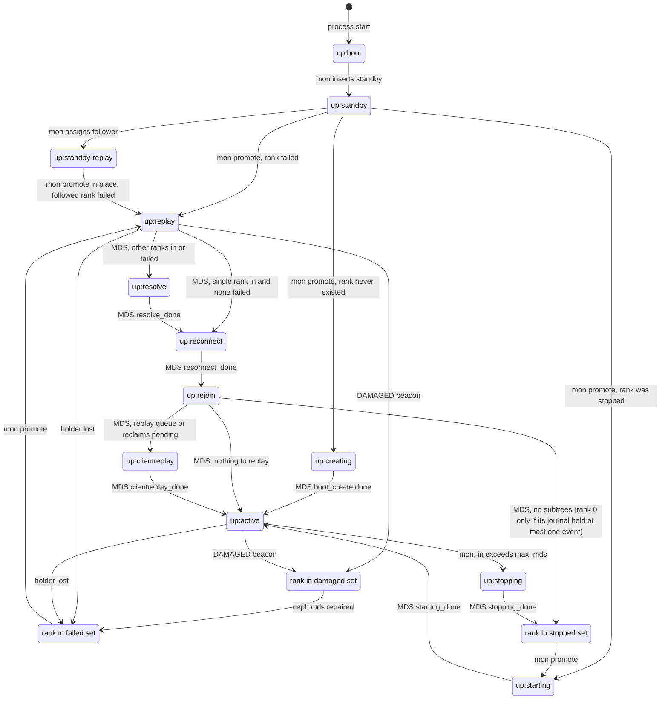
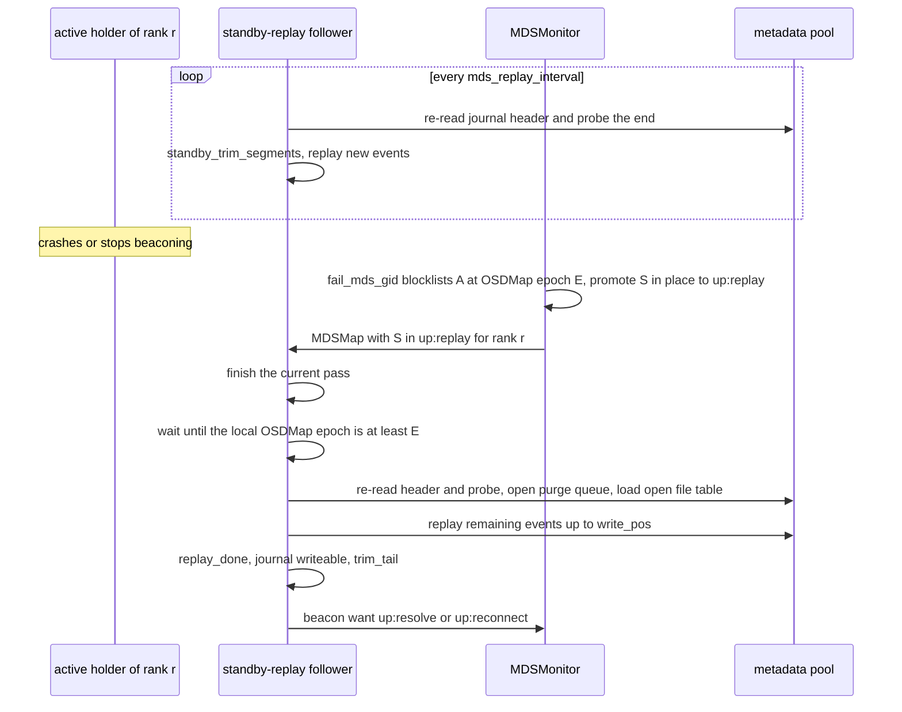
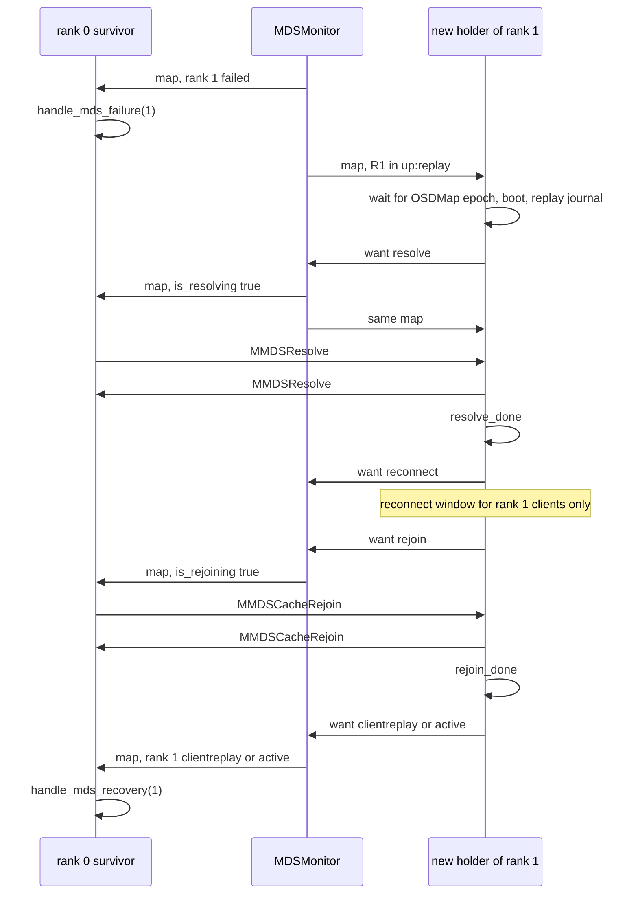
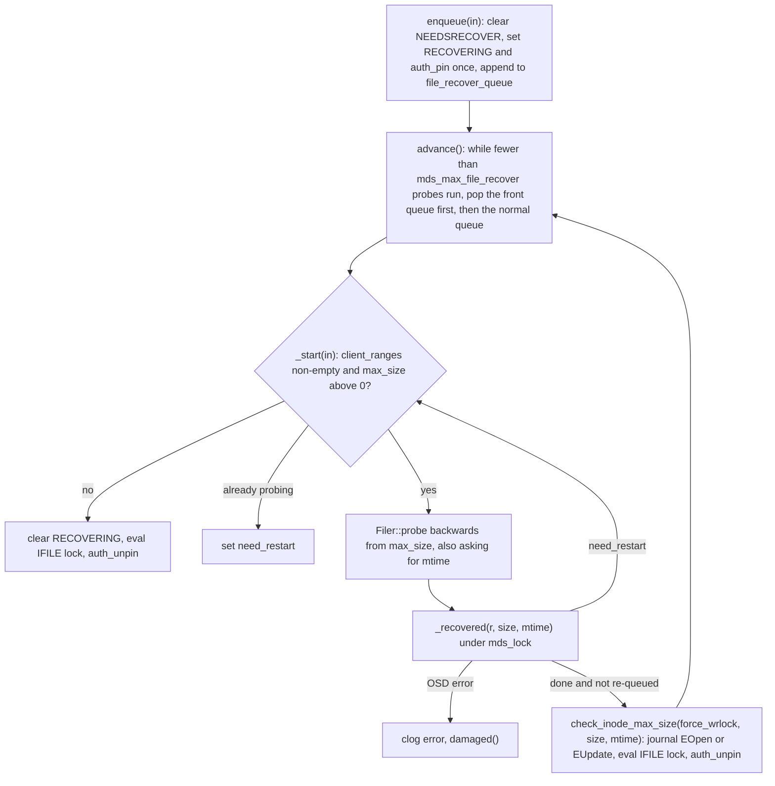
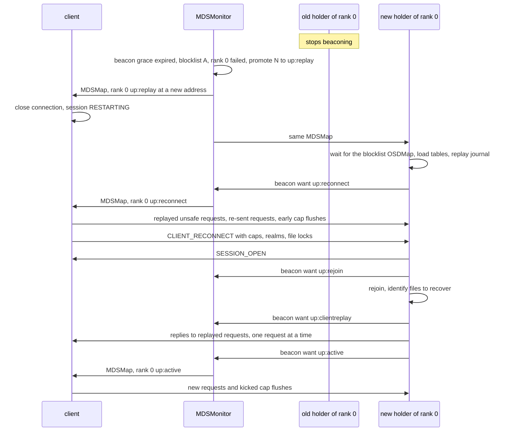

# Rank lifecycle and recovery

> Part of the [C++ MDS project map](../README.md). Sources (commit `5f7e383ae6d`): `src/mds/MDSRank.cc` (state machine 1603-2656 plus init/tick/damaged/dispatch/evict, ~1900 LOC read), `src/mds/MDSRank.h` (744), `src/mds/MDSDaemon.cc` (`handle_mds_map`, `suicide`, `respawn`, ~350 LOC), `src/mds/RecoveryQueue.{h,cc}` (59 + 239), `src/mds/MDCache.cc` (file recovery and truncates 6389-6933, system inodes 435-905, resolve/rejoin entry points, `trim`/`shutdown_pass` 7025-8340, ~1500 LOC), `src/mds/Server.cc` (state gating, reconnect, reclaim, replay queue, ~900 LOC), `src/mds/Locker.cc` (`file_recover`, `check_inode_max_size`, recovery gates, ~400 LOC), `src/mds/MDLog.cc` (create/open/replay/standby, ~600 LOC), `src/mds/MDSMap.{h,cc}`, `src/mds/FSMap.cc`, `src/mon/MDSMonitor.cc` (beacons, promotion, resize), `src/mds/Beacon.cc`, `src/mds/PurgeQueue.cc` (open/drain), `src/osdc/Filer.cc` (probe/truncate/purge), `src/osdc/Journaler.cc` (re-read), `doc/cephfs/mds-states.rst`, `doc/cephfs/standby.rst`. Client cross-check: `linux/fs/ceph/{mds_client.c,mdsmap.c,caps.c}` (Linux 7.3-rc6 snapshot; kernel line numbers drift between releases), `src/client/Client.cc`.
> Related: [fsmap-and-mdsmap](../01-cluster-integration/fsmap-and-mdsmap.md), [beacon-and-monitor](../01-cluster-integration/beacon-and-monitor.md), [sessions](../02-client-protocol/sessions.md), [capabilities](../02-client-protocol/capabilities.md), [kclient-expectations](../02-client-protocol/kclient-expectations.md), [libcephfs-fuse-ganesha-expectations](../02-client-protocol/libcephfs-fuse-ganesha-expectations.md), [request-lifecycle](../03-request-path/request-lifecycle.md), [attributes-and-xattrs](../03-request-path/attributes-and-xattrs.md), [resolve-and-rejoin](resolve-and-rejoin.md), [mdlog-and-journaler](../06-journal/mdlog-and-journaler.md), [events-and-replay](../06-journal/events-and-replay.md), [rados-object-catalog](../07-storage-formats/rados-object-catalog.md), [mds-tables](../07-storage-formats/mds-tables.md), [rados-and-osd-interactions](../07-storage-formats/rados-and-osd-interactions.md), [subtree-migration](../08-multi-mds/subtree-migration.md), [mdcache-lifecycle-trim-and-memory](../04-cache/mdcache-lifecycle-trim-and-memory.md), [strays-and-purge](../11-background-services/strays-and-purge.md), [process-and-threading](../00-architecture/process-and-threading.md), [config-perf-counters-and-health](../13-admin-and-config/config-perf-counters-and-health.md), [admin-commands](../13-admin-and-config/admin-commands.md).

## 1. Purpose and responsibilities

A CephFS *rank* is a metadata shard identified by an integer in `0..max_mds-1` (hard cap `MAX_MDS` = 0x100, `src/include/cephfs/types.h:41`). A `ceph-mds` daemon holds at most one rank at a time; it receives the rank from the monitors (`MDSMonitor`) and gives it up only by stopping or by leaving the map (`doc/cephfs/standby.rst`). This page covers everything between "the monitor assigns a rank to a daemon" and "the rank serves clients", the controlled exit (`up:stopping` to `down:stopped`) and the uncontrolled exits (`DAMAGED`, respawn, suicide):

- The rank state machine (`MDSMap::DaemonState`): states, numeric values, who may move a rank between them (monitor vs. MDS), the validity rules enforced on both sides, and how long each requested transition takes to become visible.
- Daemon-level map handling (`MDSDaemon::handle_mds_map`), which creates the `MDSRankDispatcher` when a rank is assigned, and rank-level map handling (`MDSRankDispatcher::handle_mds_map`), which drives every state transition and reacts to peer ranks failing, restarting, recovering or stopping.
- Boot stages (`MDSRank::boot_start`): which per-rank RADOS objects are loaded in which order for `up:starting`, `up:replay` and `up:standby-replay`; creating a brand-new rank (`MDSRank::boot_create`, the per-rank part of `fs new`/`max_mds` growth).
- Journal replay, the standby-replay hot-standby loop and its takeover pass.
- The recovery pipeline after replay: `up:resolve` (multi-rank only), `up:reconnect` (client reconnect window), `up:rejoin` (distributed cache rejoin), `up:clientreplay` (ordered re-execution of requests that had been answered but were not durable), `up:active`.
- Post-recovery background work started by `MDSRank::recovery_done`: re-issuing interrupted truncates, purging orphaned preallocated inodes, recovering size/mtime of files that were open for write by clients that did not come back (`RecoveryQueue` + `Filer::probe`), opening the stray directories.
- The `up:stopping` drain (export subtrees and strays, close sessions, trim and cap the journal, drain the purge queue) and the final `down:stopped`.
- Failure exits: reporting `DAMAGED`, `respawn()` (re-exec as a fresh standby) and `suicide()` (exit, `DNE` beacon).
- Cross-rank coordination: the *recovery set*, the cluster-wide barriers before resolve and rejoin, and what surviving ranks do when a peer fails and when it comes back.

Details of the resolve/rejoin message protocols are in [resolve-and-rejoin](resolve-and-rejoin.md); journal format and event semantics in [mdlog-and-journaler](../06-journal/mdlog-and-journaler.md) and [events-and-replay](../06-journal/events-and-replay.md); the reconnect message encoding and session state machine in [sessions](../02-client-protocol/sessions.md); monitor-side failure detection, fencing and standby selection in [beacon-and-monitor](../01-cluster-integration/beacon-and-monitor.md) and [fsmap-and-mdsmap](../01-cluster-integration/fsmap-and-mdsmap.md).

## 2. Source map

| File | Class / function | Lines | Role |
|---|---|---|---|
| `src/include/ceph_fs.h` | `CEPH_MDS_STATE_*` | 306-325 | Numeric state values (wire contract) |
| `src/common/ceph_strings.cc` | `ceph_mds_state_name` | 242-268 | `up:active`-style strings shown by tools |
| `src/mds/MDSMap.h` | `MDSMap::DaemonState`, `mds_info_t::is_degraded` | 75-113, 133 | State enum, implicit rank states (failed/stopped/dne) |
| `src/mds/MDSMap.h` | `get_down_mds_set`, `is_resizeable`, `is_bootstrapping`, `is_degraded`, `is_resolving`, `is_rejoining` | 415-544 | Cluster-wide predicates that gate phases |
| `src/mds/MDSMap.cc` | `create_null_mdsmap` | 58-63 | Epoch `UINT32_MAX` map that tells a removed daemon to respawn |
| `src/mds/MDSMap.cc` | `get_health_checks` | 540-624 | `MDS_DAMAGE`, `FS_DEGRADED`, `MDS_UP_LESS_THAN_MAX`, `MDS_ALL_DOWN` |
| `src/mds/MDSMap.cc` | `get_state`, `state_transition_valid` | 1085-1145 | Legal transitions (used by MDS and monitor) |
| `src/mds/MDSMap.cc` | `get_recovery_mds_set`, `get_mds_set_lower_bound`, `is_degraded`, `get_rank_gid`, `get_inc_gid` | 1236-1326 | Recovery set and degraded definition |
| `src/mds/FSMap.cc` | `FSMap::create_filesystem` | 470-494 | `fs new` (rank 0 absent, or `in`+`failed` with `--recover`) |
| `src/mds/FSMap.cc` | `find_replacement_for`, `promote`, `assign_standby_replay`, `erase`, `damaged`, `undamaged`, `insert`, `stop` | 907-1215 | Monitor-side state assignment |
| `src/mon/MDSMonitor.cc` | `preprocess_beacon`, `prepare_beacon`, `_updated` | 408-563, 633-934, 961-981 | Beacon validation, recorded states, `STOPPED`/`DAMAGED`/`DNE` special cases |
| `src/mon/MDSMonitor.cc` | `fail_mds_gid` | 1377-1401 | Blocklist rank holders, `FSMap::erase` |
| `src/mon/MDSMonitor.cc` | `maybe_resize_cluster`, `drop_mds`, `check_health`, `maybe_promote_standby`, `tick` | 2144-2582 | Monitor-initiated transitions |
| `src/mon/PaxosService.cc` | `PaxosService::should_propose` | 194-208 | Commit latency of every state change |
| `src/mds/Beacon.cc` | `Beacon::init` (sender thread), `_send`, `send_and_wait`, `set_want_state`, `is_laggy`, `notify_health` | 78-300, 303-575 | Carries the requested state to the monitor |
| `src/mds/MDSDaemon.cc` | `MDSDaemon::init`, `handle_mds_map` | 628-743, 833-957 | Boot beacon; creates the rank object |
| `src/mds/MDSDaemon.cc` | `handle_signal`, `suicide`, `respawn`, asok `exit`/`respawn` | 959-1084, 179-200 | Process exits |
| `src/mds/MDSRank.cc` | `MDSRankDispatcher::init`, `tick`, `shutdown` | 590-609, 710-872 | Rank threads, per-state periodic work |
| `src/mds/MDSRank.cc` | `MDSRank::suicide`, `respawn`, `damaged`, `damaged_unlocked`, `handle_write_error` | 923-991 | Failure exits |
| `src/mds/MDSRank.cc` | `_dispatch`, `is_stale_message`, `send_message_mds` | 1058-1170, 1377-1415, 1476-1497 | Laggy deferral, stale peers, deferral to bootstrapping peers |
| `src/mds/MDSRank.cc` | `request_state` | 1603-1608 | Ask the monitor for the next state |
| `src/mds/MDSRank.cc` | `C_MDS_BootStart`, `boot_start` | 1611-1742 | Boot steps `MDS_BOOT_INITIAL`..`MDS_BOOT_REPLAY_DONE` |
| `src/mds/MDSRank.cc` | `validate_sessions`, `starting_done`, `calc_recovery_set`, `replay_start` | 1744-1819 | |
| `src/mds/MDSRank.cc` | `_standby_replay_restart_finish`, `standby_replay_restart`, `replay_done` | 1822-1968 | Standby-replay loop and end of replay |
| `src/mds/MDSRank.cc` | `reopen_log`, `resolve_start/done`, `apply_blocklist`, `reconnect_start/done`, `rejoin_joint_start`, `rejoin_start/done` | 1970-2081 | Recovery phases |
| `src/mds/MDSRank.cc` | `clientreplay_start`, `queue_one_replay`, `maybe_clientreplay_done`, `clientreplay_done` | 2083-2127 | Ordered client request replay |
| `src/mds/MDSRank.cc` | `active_start`, `recovery_done`, `creating_done`, `boot_create` | 2129-2250 | Activation and rank creation |
| `src/mds/MDSRank.cc` | `stopping_start`, `stopping_done` | 2252-2292 | Rank stop |
| `src/mds/MDSRank.cc` | `MDSRankDispatcher::handle_mds_map` | 2294-2626 | Per-map driver, peer failure/recovery detection |
| `src/mds/MDSRank.cc` | `handle_mds_recovery`, `handle_mds_failure` | 2628-2654 | Survivor reactions |
| `src/mds/MDSRank.cc` | `dump_status`, `dump_clientreplay_status`, `handle_osd_map`, `evict_client` | 3686-3710, 3887-3912, 3951-4070 | Status, blocklist application, eviction |
| `src/mds/Server.cc` | `Server::dispatch` | 319-420 | Request gating per state, replay-queue admission |
| `src/mds/Server.cc` | `reclaim_session`, `finish_reclaim_session`, `handle_client_reclaim`, `handle_client_session` | 476-640 | Reclaim; session op gating by state |
| `src/mds/Server.cc` | `_session_logged`, `terminate_sessions`, `find_idle_sessions` | 925-1030, 1187-1359 | Gather removal on close, staleness and autoclose |
| `src/mds/Server.cc` | `kill_session`, `apply_blocklist`, `journal_close_session` | 1472-1561 | Session kill, inos to purge |
| `src/mds/Server.cc` | `reconnect_clients`, `handle_client_reconnect`, `update_required_client_features`, `reconnect_gather_finish`, `reconnect_tick` | 1563-1943 | Reconnect window |
| `src/mds/Server.cc` | `journal_and_reply`, `early_reply`, `reply_client_request`, `handle_client_request` | 2124-2156, 2300-2484, 2616-2728 | Replay-queue advancement, completed-request handling |
| `src/mds/MDCache.cc` | `init_layouts`, `create_unlinked_system_inode`, `create_root_inode`, `create_empty_hierarchy`, `create_mydir_hierarchy`, `_create_system_file` | 435-664 | Objects created by `boot_create` / `populate_mydir` |
| `src/mds/MDCache.cc` | `C_MDS_RetryOpenRoot`, `open_root_inode`, `open_mydir_inode`, `open_mydir_frag`, `open_root`, `populate_mydir` | 668-905 | Base inode loading |
| `src/mds/MDCache.cc` | `resolve_start`, `send_resolves`, `handle_mds_failure`, `handle_mds_recovery`, `set_recovery_set`, `maybe_resolve_finish` | 2782-3474 | Resolve entry points and survivor handling |
| `src/mds/MDCache.cc` | `rejoin_start`, `rejoin_send_rejoins`, `rejoin_gather_finish`, `process_imported_caps`, `open_snaprealms` | 4065-4115, 5380-5510, 5982-6057 | Rejoin entry/exit |
| `src/mds/MDCache.cc` | `clean_open_file_lists`, `export_remaining_imported_caps`, `try_reconnect_cap`, `reissue_all_caps` | 5803-5947, 6351-6373 | `active_start` helpers, replay cap reconnect |
| `src/mds/MDCache.cc` | `queue_file_recover`, `identify_files_to_recover`, `start_files_to_recover`, `do_file_recover` | 6389-6567 | File size recovery |
| `src/mds/MDCache.cc` | `truncate_inode`, `_truncate_inode`, `truncate_inode_write_finish`, `truncate_inode_finish`, `truncate_inode_logged`, `add/remove_recovered_truncate`, `start_recovered_truncates` | 6575-6873 | Truncate execution and recovery |
| `src/mds/MDCache.cc` | `C_MDS_purge_completed_finish`, `start_purge_inodes`, `purge_inodes` | 6875-6928 | Orphan preallocated-inode purge |
| `src/mds/MDCache.cc` | `trim`, `standby_trim_segment`, `shutdown_start`, `shutdown_pass`, `shutdown_export_strays`, `request_cleanup` | 7025-7150, 7644-7683, 8031-8350, 10064-10150 | Stopping drain, standby trimming |
| `src/mds/MDCache.cc` | `rollback_uncommitted_fragments` | 12778-12869 | `reopen_log` body |
| `src/mds/MDSTableServer.cc` | `_do_server_recovery`, `finish_recovery`, `handle_mds_recovery` | 347, 363-408 | `TABLESERVER_OP_SERVER_READY` that unblocks every rank's snap client sync |
| `src/mds/RecoveryQueue.h/.cc` | `RecoveryQueue::enqueue`, `advance`, `_start`, `prioritize`, `_recovered`, `C_MDC_Recover` | h:31-57, cc:31-238 | Bounded-parallel file size probe queue |
| `src/mds/Locker.cc` | `acquire_locks` recovery gates | 273-306, 636-646 | Waits for cluster recovery, skipped by replayed requests |
| `src/mds/Locker.cc` | `eval_gather` (recover hook), `_rdlock_kick`, `wrlock_start`, `xlock_start`, `adjust_cap_wanted` | 1321-1332, 1765, 2011, 2172, 3273 | Queue or prioritize file recovery |
| `src/mds/Locker.cc` | `issue_new_caps`, `issue_truncate`, `revoke_stale_cap(s)`, `check_inode_max_size`, `handle_client_caps`, `handle_client_cap_release`, `remove_client_cap`, `file_recover` | 2437-2447, 2717-2740, 2742-2840, 3077-3184, 3386-3418, 4258-4266, 4345-4372, 6006-6036 | Lock/cap side of recovery |
| `src/mds/locks.c` | `filelock[LOCK_PRE_SCAN]`, `filelock[LOCK_SCAN]` | 123-124 | Scan states grant nothing |
| `src/mds/MDLog.cc` | `C_MDL_WriteError`, `get_estimated_replay_finish_time`, `create`, `open`, `reopen`, `append`, `replay`, `_recovery_thread`, `_replay_thread`, `standby_trim_segments` | 119-149, 227-368, 1027-1653 | Journal side of boot |
| `src/mds/PurgeQueue.cc` | `open`, `wait_for_recovery`, `create`, `_go_readonly`, `drain` | 242-350, 463-472, 838-880 | Purge queue boot and stop drain |
| `src/osdc/Filer.cc` | `probe`, `probe_impl`, `_probe`, `_probed`, `purge_range`, `truncate`, `_do_truncate_range` | 185-447, 518-597 | Backward size probe, orphan purge, truncate |
| `src/osdc/Journaler.cc` | `reread_head_and_probe`, `_finish_reread_head_and_probe` | 429-455 | Standby-replay polling |
| `src/mds/MDSContext.cc` | `MDSIOContextBase::complete` | 95-120 | Respawn on `-EBLOCKLISTED`/`-ETIMEDOUT` for every IO completion |

## 3. How it works

### 3.1 States, values and who sets them

States are carried as `int32` in `MDSMap::mds_info_t::state` (`src/mds/MDSMap.h:75-113`, values `src/include/ceph_fs.h:306-325`). Values 8..14 are the states of a rank holder from replay to stopping; 15 (`DAMAGED`), -1 (`STOPPED`) and 0 (`DNE`) are only ever sent in beacons and never stored as a daemon's state. The negative values mix rankless daemon states (`BOOT`, `STANDBY`) with rank-attached ones: `CREATING` (-6) and `STARTING` (-7) are held by the rank holder and `STANDBY_REPLAY` (-8) by a follower of a rank. Rank-only conditions (`failed`, `damaged`, `stopped`) are not daemon states but membership of the `MDSMap::failed`, `damaged`, `stopped` sets; a rank "is in" if it is in `up` or `failed` (`MDSMap::is_in`), while the `in` set itself (counted by `get_num_in_mds()`) also keeps damaged ranks.

| State (`ceph_mds_state_name`) | Value | Held by | Entered via | Left via |
|---|---|---|---|---|
| `up:boot` | -4 | daemon without rank | process start: initial `Beacon::want_state` (`src/mds/Beacon.h:103`) | never stored in the FSMap: `prepare_beacon` inserts the daemon directly as `STANDBY` (`src/mon/MDSMonitor.cc:709-728`, `FSMap::insert`) |
| `up:standby` | -5 | daemon without rank | monitor | monitor: `FSMap::promote` or `assign_standby_replay` |
| `up:standby-replay` | -8 | daemon following rank r (not in `up`) | monitor `FSMap::assign_standby_replay` (`src/mds/FSMap.cc:1066`) | promoted in place to `up:replay` when r fails; fails itself; may report `DAMAGED` |
| `up:creating` | -6 | rank holder | monitor `FSMap::promote` when the rank is neither in `stopped` nor `MDSMap::is_in` (up or failed) (`src/mds/FSMap.cc:1041`) | MDS requests `ACTIVE` after `boot_create` |
| `up:starting` | -7 | rank holder | monitor `FSMap::promote` when the rank is in `stopped` (`src/mds/FSMap.cc:1038`) | MDS requests `ACTIVE` after boot |
| `up:replay` | 8 | rank holder | monitor `FSMap::promote` for a rank in `failed` (`src/mds/FSMap.cc:1044`) | MDS requests `RESOLVE` or `RECONNECT` |
| `up:resolve` | 9 | rank holder | MDS (`replay_done`) | MDS requests `RECONNECT` |
| `up:reconnect` | 10 | rank holder | MDS (`replay_done` if alone, else `resolve_done`) | MDS requests `REJOIN` |
| `up:rejoin` | 11 | rank holder | MDS (`reconnect_done`) | MDS requests `CLIENTREPLAY`, `ACTIVE` or `STOPPED` |
| `up:clientreplay` | 12 | rank holder | MDS (`rejoin_done`) | MDS requests `ACTIVE` |
| `up:active` | 13 | rank holder | MDS | monitor sets `STOPPING` (`maybe_resize_cluster`) |
| `up:stopping` | 14 | rank holder | monitor (`src/mon/MDSMonitor.cc:2184-2198`) | MDS requests `STOPPED` |
| `down:damaged` | 15 (beacon value) | rank in `damaged` | MDS beacon with `want_state=DAMAGED` | operator `ceph mds repaired <role>` moves it to `failed` (`FSMap::undamaged`, `src/mds/FSMap.cc:1146`) |
| `down:stopped` | -1 | rank in `stopped` | MDS beacon `STOPPED` → `FSMap::stop` (`src/mds/FSMap.cc:1181`) | `promote` → `up:starting` |
| (failed) | none | rank in `failed` | `FSMap::erase` of a holder past `starting` (`src/mds/FSMap.cc:1092-1127`) | `promote` → `up:replay` |
| `down:dne` | 0 | none | beacon sent by `MDSDaemon::suicide` (clean exit) | daemon removed from map |
| `up:oneshot-replay` | -9 | none | legacy, unused (`CEPH_MDS_STATE_REPLAYONCE`) | |
| `null` | -10 | none | return value for "not in map" (`MDSMap::get_state`/`get_state_gid`) | |

Notes from code:
- `mds_info_t::is_degraded()` is `REPLAY <= state <= CLIENTREPLAY` (`src/mds/MDSMap.h:133`); `MDSMap::is_degraded()` is true if `failed` or `damaged` is non-empty or any daemon is degraded (`src/mds/MDSMap.cc:1287` (MDSMap::is_degraded)).
- `FSMap::erase` forgets a rank whose holder dies in `up:creating` (removes it from `in`, so it is created again), returns a rank whose holder dies in `up:starting` to `stopped`, and puts any other holder's rank into `failed`. For every erased daemon that belongs to a file system (a holder or a standby-replay follower, not a plain standby) it overwrites `last_failure_osd_epoch` with the blocklist epoch passed by the caller, which is 0 when nothing was blocklisted (`src/mds/FSMap.cc:1092-1127`, gotcha 20).
- `FSMap::promote` sets `info.inc = epoch` (pending FSMap epoch). The *incarnation* of a rank is the FSMap epoch at which the current holder was assigned (`src/mds/FSMap.cc:1048`); `assign_standby_replay` does not set it, so a standby-replay daemon carries the default `inc = 0` (`src/mds/MDSMap.h:161`) until `promote` sets it.

### 3.2 The state machine

Every state from `up:replay` through `up:stopping` can go to the failed set (holder lost: laggy with a standby available, `ceph mds fail`, `fs fail`, respawn, `DNE` beacon) or to the damaged set (holder or its follower reports `DAMAGED`); the diagram shows two representatives of each. A holder lost in `up:creating` makes the rank disappear from `in`; one lost in `up:starting` returns the rank to `stopped` (3.1).

`MDSMap::state_transition_valid(prev, next)` (`src/mds/MDSMap.cc:1104-1145`), used both by the MDS when it receives a map (`src/mds/MDSRank.cc:2328` (MDSRankDispatcher::handle_mds_map)) and by the monitor when it receives a beacon (`src/mon/MDSMonitor.cc:789` (MDSMonitor::prepare_beacon)):

| prev | allowed next |
|---|---|
| any | same state; `DAMAGED` |
| `BOOT` | `STANDBY` |
| `STANDBY` | `STANDBY_REPLAY`, `REPLAY`, `CREATING`, `STARTING` |
| `CREATING`, `STARTING` | `ACTIVE` |
| `STANDBY_REPLAY` | `REPLAY` |
| `REPLAY` | `RESOLVE`, `RECONNECT` |
| `RESOLVE`..`CLIENTREPLAY` | `prev + 1`; from `REJOIN` also `ACTIVE` and `STOPPED` |
| `ACTIVE` | `STOPPING` |
| `STOPPING` | `STOPPED` |
| anything else | invalid (`derr`, returns false) |

On the MDS an invalid transition in a received map makes the daemon `respawn()` (`src/mds/MDSRank.cc:2328-2332`). On the monitor a standby reporting any state other than its own, a standby-replay reporting anything but its own state or `DAMAGED`, or a rank holder reporting an invalid transition is failed with `fail_mds_gid` (`src/mon/MDSMonitor.cc:780-797`, label `evict`). Rank holders therefore never skip or reorder states, and nothing moves backwards: the only exits from a recovery state are forward or out of the map.

### 3.3 Requesting a state and how long a transition takes

Most transitions are initiated by the MDS. `MDSRank::request_state(s)` (`src/mds/MDSRank.cc:1603`) calls `Beacon::set_want_state(*mdsmap, s)` (which also records the current MDSMap epoch as the beacon's `last_epoch_seen`) and sends a beacon immediately (`Beacon::send`). Path of the request:

1. **MDS sender.** Besides the immediate send, the `mds-beacon` thread resends the current `want_state` every `mds_beacon_interval` (4 s); while the internal heartbeat is unhealthy it sends nothing and rechecks every 0.5 s (`src/mds/Beacon.cc:84-113`, `198-211`).
2. **`MDSMonitor::preprocess_beacon`** (`src/mon/MDSMonitor.cc:408-563`): ignores beacons without `mds` `x` capability, with a foreign fsid or without a port; non-leaders forward. A gid that is not in the FSMap gets a null MDSMap unless it is booting. A `DNE` beacon goes straight to `prepare_beacon` (`:478-480`); beacons with a sequence number older than the recorded `state_seq` are dropped. Any other requested state is **ignored** (beacon acked, `want_state` not acted on) unless `last_epoch_seen` equals the daemon's current effective epoch (its file system's MDSMap epoch, or its standby epoch) ("ignoring requested state, because mds hasn't seen latest map", `:496-500`). The MDS repeats `want_state` in every later beacon, so after any concurrent map change the request takes effect only with the next periodic beacon sent after the MDS processed the newer map (derived from code).
3. **`prepare_beacon`** (`:633-934`): validates (3.2); special cases `STOPPED` (`FSMap::stop`, clog "... finished stopping rank N in filesystem ..."), `DAMAGED` (3.20) and `DNE` (beacon acked, then `fail_mds_gid`); otherwise records `info.state = state` (clog "... is now active in filesystem ... as rank N" on entering `ACTIVE`). After the commit, `_updated` replies with a beacon ack, or with a null MDSMap for `STOPPED` (`:961-981`).
4. **Paxos commit.** `PaxosService::should_propose` delays a proposal by `paxos_min_wait` (0.05 s) if the last commit is older than `paxos_propose_interval` (1 s), else until 1 s after the last commit (`src/mon/PaxosService.cc:194-208`). Only `fail_mds_gid` of a rank holder and the `DAMAGED` path call `force_immediate_propose()` (`src/mon/MDSMonitor.cc:871`, `1390`).
5. **Distribution.** The new FSMap epoch is pushed to subscribers: the file system's MDS daemons (their own fs MDSMap) and clients (`MDSMonitor::check_sub`, `src/mon/MDSMonitor.cc:1867-1990`). The MDS acts on its new state only when it processes that map in `MDSRankDispatcher::handle_mds_map`, never at request time.

Consequences:
- Each MDS-driven state change costs at least one beacon round trip plus one Paxos commit. A single-rank failover from `up:replay` to `up:active` needs 3 or 4 committed epochs (`reconnect`, `rejoin`, optionally `clientreplay`, `active`).
- Between requesting and receiving a state, the MDS compares against `get_want_state()` to close races: replayed requests and dirty cap flushes that arrive before the MDS has seen its own `up:reconnect` map are admitted as if it had (`src/mds/Server.cc:341`, `src/mds/Locker.cc:3410`), and reconnect messages are parked on `waiting_for_reconnect` until `reconnect_start` runs (`src/mds/Server.cc:1626-1630`).

Monitor-initiated transitions (each evaluated on the monitor tick, every `mon_tick_interval` = 5 s, inside `paxos.plug()` so FSMap and blocklist OSDMap changes commit together, `src/mon/MDSMonitor.cc:2477-2582`):

| Transition | Trigger | Code |
|---|---|---|
| standby → `creating`/`starting` | `maybe_resize_cluster`: `in < max_mds`, current and pending maps `is_resizeable()`, fs joinable; lowest rank not in `in`; one rank per tick | `src/mon/MDSMonitor.cc:2144-2183` |
| standby or standby-replay → `replay` | rank in `failed` and fs joinable (also while the map is degraded): `maybe_promote_standby` (every tick), or `drop_mds` replacing a laggy holder in the same tick | `:2207-2246`, `2419-2442` |
| standby → `standby-replay` | fs joinable, `allow_standby_replay`, map resizeable, rank `is_followable` (up, not degraded, no follower) | `:2445-2467` |
| `active` → `stopping` | `in > max_mds`, both maps resizeable, highest rank `in - 1` is `up:active` | `:2184-2198` |
| any → removed | `fail_mds_gid`: laggy (no beacon for `mds_beacon_grace`) and either rankless/standby-replay (removed without a replacement) or a rank holder with a replacement in a joinable fs; a lower-`mds_join_fs`-affinity active or follower replaced by a better standby (one per fs per tick); `mds fail`, `fs fail`, invalid beacon, `DNE` beacon, a new boot beacon with the same name (`mds_enforce_unique_name`), compat change | `:1377-1401`, `694-706`, `754-777`, `2254-2410` |

### 3.4 Daemon map handling (`MDSDaemon::handle_mds_map`)

`src/mds/MDSDaemon.cc:833-957`, runs under `mds_lock` from `MDSDaemon::ms_dispatch2`; MDSMaps are accepted from monitors and from peer MDSs (`src/mds/MDSDaemon.cc:1138-1141` (MDSDaemon::handle_core_message)):

1. Drop maps with `epoch <= current` (the monitor's null map has epoch `UINT32_MAX` so it is always newer, `src/mds/MDSMap.cc:58-63`).
2. Decode, `monc->sub_got("mdsmap", epoch)`.
3. CompatSet check: if `MDSMap::get_compat_set_all()` cannot write the map's `compat`, `suicide()` (`:856-866`).
4. Compute `whoami = get_rank_gid(my gid)` (for a standby-replay daemon, the followed rank), old/new state, incarnation.
5. Present in the old map and absent from the new one: "Map removed me ... respawning!" → `respawn()` (`:883-888`). This is how a holder learns it has been failed, and how a stopped daemon becomes a fresh standby.
6. First appearance in the FSMap: initialise the `MgrClient` and subscribe to `mgrmap` (`:890-896`).
7. `mark_down_addrs` for every gid that left the map.
8. Rankless (`whoami == MDS_RANK_NONE`): new state `STANDBY` (from `NULL`) → `want_state = STANDBY`; `NULL` → still booting (asserts `want_state == BOOT`); anything else aborts ("invalid transition to standby").
9. With a rank: a rank object for a different rank → `respawn()` ("Invalid rank transition", `:932-936`); no rank object → construct `MDSRankDispatcher(whoami, ...)` with respawn/suicide hooks and `init()` (starts the Objecter, thread `mds-rank-progr`, `PurgeQueue::init`, finisher `mds-rank-fin`, `src/mds/MDSRank.cc:590-609`); then `mds_rank->handle_mds_map(m, *oldmap)`.
10. `beacon.notify_mdsmap(*mdsmap)` (updates `last_epoch_seen` for later beacons).

### 3.5 Rank map handling (`MDSRankDispatcher::handle_mds_map`)

`src/mds/MDSRank.cc:2294-2626`, the single driver of all per-rank transitions:

1. `oldstate = oldmap.get_state_gid(gid)`, `NULL` treated as `STANDBY` ("monitor may skip sending me the STANDBY map"). Asserts `state == oldstate` ("I should not miss map update"), then `state = mdsmap->get_state_gid(gid)`; on change `last_state = oldstate` and `incarnation = mdsmap->get_inc_gid(gid)`.
2. Record `peer_mdsmap_epoch[from]` when the map came from an MDS.
3. Validate the transition (3.2); invalid → `respawn()`.
4. On a state change set the messenger name: `mds.<gid>` while in `up:standby-replay`, `mds.<rank>` otherwise (`:2334-2351`; `mds_sleep_rank_change` is a test delay). Push `incarnation` to the Objecter (`set_client_incarnation`): OSD request ids are `(entity name, incarnation, tid)` (`src/messages/MOSDOp.h:112-122`), so two holders of the same `mds.<rank>` name never collide in OSD duplicate detection.
5. If `required_client_features` changed: `Server::update_required_client_features()` evicts (with `mds_session_blocklist_on_evict`) sessions lacking them, only when `state >= RECONNECT` (`src/mds/Server.cc:1799-1826`).
6. `cluster_degraded = mdsmap->is_degraded()`.
7. **Peer failure detection** (only when `state >= RESOLVE`; a replaying MDS does not talk to peers), building the `restart` set (`:2366-2420`):
   - rank newly in the down set (`failed` ∪ `damaged`) that had an instance in the old map → `mark_down_addrs`, `handle_mds_failure(r)`;
   - rank up in both maps with a different `inc` → mark the old addresses down; new holder in `REPLAY`/`RESOLVE` → `restart`, `handle_mds_failure(r)`; else (asserted `STARTING`/`ACTIVE`, i.e. it stopped and restarted between the two maps) → `restart`, `migrator->handle_mds_failure_or_stop(r)`, table server `handle_mds_failure_or_stop(r)`;
   - rank up only in the new map in `REPLAY`/`RESOLVE` → `restart`, `handle_mds_failure(r)`; otherwise asserted `CREATING`/`STARTING`/`ACTIVE`.
8. **State change dispatch** (`:2423-2461`): `beacon.set_want_state(state)`. If the old state was `STANDBY_REPLAY` the new one must be `REPLAY` and nothing is called ("Monitor activated us! Deactivating replay loop", 3.9). Otherwise, if the new state is `ACTIVE` or `CLIENTREPLAY` and the old one was `CREATING`, `REJOIN` or `RECONNECT` (the last is defensive: `RECONNECT` can only go to `REJOIN`), call `recovery_done(oldstate)` first; then exactly one of `active_start`, `replay_start` (`REPLAY`, `STANDBY_REPLAY`), `resolve_start`, `reconnect_start`, `rejoin_start`, `clientreplay_start`, `boot_create` (`CREATING`), `boot_start` (`STARTING`), `stopping_start` (asserting the old state was `ACTIVE`).
9. **Snap table recovery** (table server only, `state >= RESOLVE`): first map at or after resolve → `snapserver->finish_recovery(ranks >= RESOLVE)`; later, ranks that newly reached `>= RESOLVE` or restarted → `snapserver->handle_mds_recovery(r)`.
10. **Resolve trigger**: `(!oldmap.is_resolving() || !restart.empty()) && mdsmap->is_resolving()` → `calc_recovery_set()` and `mdcache->send_resolves()` (`:2486-2492`). Survivors execute this too.
11. **Rejoin trigger** (`state >= REJOIN`): `!oldmap.is_rejoining() && mdsmap->is_rejoining()` → `rejoin_joint_start()` (send rejoins). For ranks that newly reached `>= REJOIN` (or restarted), when our old state was `>= REJOIN` or `STARTING`: `kick_discovers(r)`, `kick_open_ino_peers(r)`.
12. **Cluster recovered**: `oldmap.is_degraded() && !cluster_degraded && state >= ACTIVE` → queue `waiting_for_active_peer[MDS_RANK_NONE]` (contexts registered by `wait_for_cluster_recovered`).
13. **Bootstrapping peers**: queue `waiting_for_bootstrapping_peer[r]` for every rank whose current state is `> REPLAY` (3.10).
14. **Peers that became available**: only when both our old and new state are `>= CLIENTREPLAY`: for each rank newly in `CLIENTREPLAY..STOPPING` (or restarted) call `handle_mds_recovery(r)` (`:2561-2572`).
15. **Peers that stopped** (we are `clientreplay`/`active`/`stopping`): `migrator->handle_mds_failure_or_stop(r)` and table server cleanup for ranks newly in `stopped`.
16. Queue `waiting_for_mdsmap` contexts for epochs `<= current`.
17. While `ACTIVE`, on every map: `set_osd_epoch_barrier(current OSDMap epoch)` ("so that we don't risk handing out caps to clients with old OSD maps that might not include barriers from the previous incarnation"), and the journal write hint: none if this rank has a standby-replay follower, else `CEPH_OSD_OP_FLAG_FADVISE_DONTNEED` (`:2597-2609`).
18. `purge_queue.update_op_limit` when `max_mds` changed; inline-data deprecation warning; `mdcache->handle_mdsmap` (export pins); metric aggregator/handler notifications; `quiesce_cluster_update()`.

### 3.6 Boot stages (`MDSRank::boot_start`)

`boot_start(step, r)` (`src/mds/MDSRank.cc:1622-1742`) is a four-step continuation chain; each step builds an `MDSGatherBuilder` whose completion is `C_MDS_BootStart(next_step)`. It is entered from `replay_start` (for `up:replay` and `up:standby-replay`), directly from the state dispatch for `up:starting`, and re-entered at `MDS_BOOT_PREPARE_LOG` by every standby-replay pass. It asserts `is_starting() || is_any_replay()`.

Error handling at the top of every step (result of the previous gather):

| `r` | Action |
|---|---|
| `-EAGAIN` while `up:standby-replay` | `respawn()` ("respawning since we fell behind journal") |
| `-EINVAL`, `-ENOENT` | clog error "Error loading MDS rank N: ...", `damaged()` |
| `-EROFS` | log "boot error forcing transition to read-only; MDS will try to continue", continue |
| any other negative (including `-EAGAIN` outside standby-replay) | `suicide()` |

Per step and entry state (object names `<ino hex>.<object index %08x>`; rank `r`; inode numbers from `src/mds/mdstypes.h:38-50`: mdsdir `0x100+r`, journal `0x200+r`, journal pointer `0x400+r`, purge queue `0x500+r`, strays `0x600+10r+i`):

| Step | `up:starting` (stopped rank re-added) | `up:replay` (failover) | `up:standby-replay` |
|---|---|---|---|
| `MDS_BOOT_INITIAL` (`:1649`) | `init_layouts()` (default file layout in the first data pool, log layout in the metadata pool); in one gather: `InoTable::load` (`mds<r>_inotable`, full read), `SessionMap::load` (omap of `mds<r>_sessionmap`, `mds_sessionmap_keys_per_op` = 1024 keys per read, sequential; every loaded session becomes `open`, `src/mds/SessionMap.cc:222-225`), `MDLog::open` (thread `mds-log-recvr` runs `_recovery_thread`: read JournalPointer `<0x400+r>.00000000`, `Journaler::recover` of the header `<front>.00000000` of the journal the pointer names (`0x200+r`, or `0x300+r` after an odd number of reformats) and probe of the end; thread `mds-log-submit` started), `PurgeQueue::open` of `<0x500+r>.00000000`; table server (rank 0) only: `SnapServer::load` (`mds_snaptable`) | same, except `PurgeQueue::open(NULL)` and `OpenFileTable::load(nullptr)` (`mds<r>_openfiles.<i>`) are started fire-and-forget, outside the gather | same as replay but neither the purge queue nor the open file table is opened |
| `MDS_BOOT_OPEN_ROOT` (`:1685`) | `open_mydir_frag`: fetch mdsdir inode (`<0x100+r>.00000000.inode`, legacy fallback xattr `inode` on `<0x100+r>.00000000`, `src/mds/CInode.cc:1359-1379`), then make dirfrag `<0x100+r>.00000000` an auth subtree and fetch it; `create_global_snaprealm()` (in-memory inode 3); rank 0 (`mdsmap->get_root()`): `open_root_inode` = fetch `1.00000000.inode`, then root dirfrag `1.00000000` as auth subtree; other ranks: nothing (root discovered later by `open_root`) | `open_mydir_inode` (inode only); global snaprealm; rank 0 fetches the root inode only; other ranks `create_root_inode()` (placeholder root built from defaults) | same as replay |
| `MDS_BOOT_PREPARE_LOG` (`:1710`) | `MDLog::append()` (`read_pos = expire_pos = write_pos`, writeable), submit `ESubtreeMap`, `flush`, `wait_for_safe(starting_done)` | gather of `PurgeQueue::wait_for_recovery` and `MDLog::replay` | `MDLog::replay` only |
| `MDS_BOOT_REPLAY_DONE` (`:1732`) | not reached | `validate_sessions()`, `replay_done()` | `validate_sessions()`, `replay_done()` |

Loader errors:
- `MDSTable::load_2` and `SessionMap::_load_finish` call `damaged()` themselves on read or decode errors, including `-ENOENT` of the table object (`src/mds/MDSTable.cc:166-200`, `src/mds/SessionMap.cc:235-295`); a sessionmap object without an omap header falls back to the legacy encoding (`load_legacy`).
- `CInode::_fetched` returns `-ENOENT` if neither inode object has data and `-EINVAL` on bad magic or decode error (`src/mds/CInode.cc:1381-1414`); `boot_start` turns both into `damaged()`.
- `MDLog::_recovery_thread` (`src/mds/MDLog.cc:1076-1233`): `mds_journal_format > JOURNAL_FORMAT_MAX` → damaged; missing JournalPointer → recreated with `front = 0x200+r` (write failure → damaged); `-EBLOCKLISTED` on the pointer read or a header recover → respawn; other pointer read errors → damaged; non-null `back` (interrupted journal rewrite) → erase the back journal and clear the pointer, but in standby-replay complete with `-EAGAIN`; header recover errors → damaged; a stream format newer than `JOURNAL_FORMAT_MAX` → `-EINVAL` → damaged; an older format outside standby-replay → `_reformat_journal`.
- Purge queue (`src/mds/PurgeQueue.cc:242-292`, `463-472`): a missing purge-queue header is recreated ("assuming this is an upgrade"); any other open error makes the purge queue read-only (`_go_readonly`), queues the rank's write-error handler (`handle_write_error`, default `mds_action_on_write_error = 1`: whole MDS read-only) and completes registered waiters with that raw error code; a `wait_for_recovery` issued after the queue already went read-only completes with `-EROFS`, which `boot_start` tolerates.
- The boot loaders' completions (table, sessionmap, inode and dirfrag fetches) and most other MDS IO completions are `MDSIOContextBase`s, whose `complete` respawns on `-EBLOCKLISTED` or `-ETIMEDOUT` before the step sees the error (`src/mds/MDSContext.cc:95-120`); the journal recovery thread checks `-EBLOCKLISTED` itself, and the purge queue's own callbacks route errors through `_go_readonly` and `handle_write_error` (which respawns on `-EBLOCKLISTED`).

`validate_sessions` (`src/mds/MDSRank.cc:1744-1768`) asserts that every session's `prealloc_inos == free_prealloc_inos` and calls `damaged()` (clog "client ... loaded with preallocated inodes that are inconsistent with inotable") if any session's preallocated range intersects the InoTable free set (tracker 16842).

### 3.7 Creating a rank (`up:creating`, `MDSRank::boot_create`)

`fs new` creates an MDSMap with an empty `in` set and `max_mds = 1` (`src/mds/FSMap.cc:470-494` (FSMap::create_filesystem), `src/mds/MDSMap.h:627`), so the next monitor tick promotes a standby to rank 0 in `up:creating` (`maybe_resize_cluster` → `FSMap::promote`). Raising `max_mds` creates further ranks the same way. `fs new --recover` instead puts rank 0 into `in` and `failed` and sets `not_joinable`, so the first holder replays existing metadata instead of creating it.

`boot_create` (`src/mds/MDSRank.cc:2189-2250`) uses one `MDSGatherBuilder` whose finisher is `creating_done` (request `ACTIVE`, then `snapclient->sync`):

1. `init_layouts()`; set the rank on InoTable and SessionMap.
2. `MDLog::create`: new `Journaler` for ino `0x200+r` in the metadata pool with `default_log_layout` and stream format `mds_journal_format` (1), write its header, write JournalPointer `{front = 0x200+r, back = 0}`, start `mds-log-submit` (`src/mds/MDLog.cc:267-304`).
3. Submit an `ELid` (a major segment boundary that opens the first segment without a subtree map).
4. Rank 0 only: `create_empty_hierarchy` (`src/mds/MDCache.cc:498-523`): root inode 1 with mode `0755`, uid/gid `mds_root_ino_uid`/`mds_root_ino_gid` (0/0), layout = default with `pool_id` = first data pool; root dirfrag created complete, `dir_rep = REP_ALL`, auth subtree, committed (omap object `1.00000000`); root inode stored (`1.00000000.inode`); backtrace stored.
5. `create_mydir_hierarchy` (`src/mds/MDCache.cc:525-574`): mdsdir inode `0x100+r`; ten stray directories `0x600+10r+i` linked as `stray0`..`stray9`, each stray dirfrag committed and its backtrace stored; mdsdir dirfrag committed; mdsdir inode stored. System inodes get mode `0500 | mode` (strays and mdsdir: `0500`), `nlink 1`, an empty snaprealm for base inodes (`create_unlinked_system_inode`, `:441-476`).
6. `create_global_snaprealm()` (in memory only).
7. `InoTable::reset()` (free range `[(r+1) << 40, +2^40)`, `src/mds/InoTable.cc:29-44`) and `save`; empty `SessionMap::save`.
8. `PurgeQueue::create` (header `<0x500+r>.00000000`, `JOURNAL_FORMAT_RESILIENT`, metadata pool).
9. Table server: `SnapServer::reset` + `save`.
10. Test hook `mds_kill_create_at == 1` asserts here; submit `ESubtreeMap`, `flush`, `wait_for_safe`.
11. `objecter->enable_blocklist_events()` ("Usually we do this during reconnect, but creation skips that").

On `ACTIVE`, `active_start` calls `mdcache->open_root()` because `last_state == CREATING`; `recovery_done(CREATING)` returns immediately. If the creating holder dies, `FSMap::erase` removes the rank from `in` and the next holder creates it again from scratch, rewriting the same objects (the dirfrag commits set the header and the keys they hold; they do not clear unrelated omap keys) (derived from code).

### 3.8 Starting a stopped rank (`up:starting`)

The monitor promotes a standby for a rank in `stopped` when `in < max_mds` (`maybe_resize_cluster`, lowest absent rank first; also rank 0 after `fs set <fs> down false`, which restores `old_max_mds`, `src/mon/FSCommands.cc:610-642`). Boot follows the `up:starting` column of 3.6: the old journal, capped and trimmed by the previous stop, is not replayed; `MDLog::append` positions at its end, a new `ESubtreeMap` is journaled, and `starting_done` requests `ACTIVE` and syncs the snap client cache (`src/mds/MDSRank.cc:1770-1778`). `active_start` then calls `mdcache->open_root()` (`last_state == STARTING`): rank 0 already loaded the root inode and dirfrag at boot; other ranks `discover_base_ino` the root and `open_remote_dirfrag` its dirfrag from rank 0; the mdsdir inode is fetched only if it is not in cache (it was loaded at boot), then `populate_mydir` (`src/mds/MDCache.cc:737-774`). `recovery_done` is not called for `STARTING -> ACTIVE`.

### 3.9 Replay and standby-replay

**Entry** (`replay_start`, `src/mds/MDSRank.cc:1792-1819`): for `up:standby-replay` set `standby_replaying = true` (dev option `mds_standby_replay_damaged`: report damaged). Then wait until the Objecter has an OSDMap with `epoch >= mdsmap->get_last_failure_osd_epoch()` ("which blocklists prior instance") before `boot_start()`. `last_failure_osd_epoch` is the blocklist epoch recorded by `FSMap::erase` for the latest erase in this file system; the FSMap and the blocklisting OSDMap are committed in the same Paxos transaction (`paxos.plug()` in `MDSMonitor::prepare_update` and `MDSMonitor::tick`, `src/mon/MDSMonitor.cc:605-628`, `2517-2575`), so waiting for that epoch guarantees the previous holder is fenced at the OSDs before the new one reads its journal and tables.

**Journal replay** ([mdlog-and-journaler](../06-journal/mdlog-and-journaler.md), [events-and-replay](../06-journal/events-and-replay.md)): `MDLog::replay` starts thread `mds-log-replay` (`src/mds/MDLog.cc:1027-1061`; an empty journal completes immediately). `_replay_thread` (`:1417-1613`) reads entries outside `mds_lock`, decodes them, and takes `mds_lock` once per event to call `le->replay(mds)`. Segment boundaries (`ESubtreeMap`, `ESegment`, `EResetJournal`, `ELid`) create `LogSegment`s; an `ELid` after the first segment is skipped (an `up:stopping` MDS restarted after capping); events before the first major boundary or undecodable events call `damaged_unlocked()` unless `mds_log_skip_unbounded_events` / `mds_log_skip_corrupt_events` (dev). A missing journal object (`-ENOENT`) is `-EAGAIN` for standby-replay and damaged otherwise; `-EINVAL` with `read_pos < expire_pos` is `-EAGAIN` while the journaler is read-only (always the case during replay); any other `-EINVAL` re-reads the header synchronously (a re-read error is `-EAGAIN` for a standby-replay that lost the header to a rewrite, otherwise damaged), runs `standby_trim_segments`, and ends as `-EAGAIN` if `read_pos` is now behind `expire_pos`, else the `-EINVAL` stands and `boot_start` marks the rank damaged. When finished, `waitfor_replay` contexts complete with the result.

Replay rebuilds, besides the cache: sessions (`ESession`, `ESessions`), completed request ids and created inos per session (`EMetaBlob::client_reqs` → `Session::add_completed_request`, `src/mds/journal.cc:1777-1795`), completed cap flush tids, truncates in progress (`truncate_start` → `add_recovered_truncate`, `truncate_finish` → `remove_recovered_truncate`, `:1731-1750`), inode ranges to purge (`ESession::inos_to_purge` → `LogSegment::purging_inodes`; `EPurged` removes them, `:1828-1845`, `1883-1887`), and uncommitted leader/peer updates and fragment operations for resolve.

**`replay_done`** (`src/mds/MDSRank.cc:1897-1968`):
- still `up:standby-replay`: schedule `C_MDS_StandbyReplayRestart` after `mds_replay_interval` (1 s) on the `mds_lock` timer and return;
- `standby_replaying` but now `up:replay` (promoted during the pass): clear the flag, `standby_replay_restart()` (final takeover pass) and return;
- otherwise assert `read_pos == write_pos`; if the journal stream format is older than `mds_journal_format`, `MDLog::reopen` (re-runs `_recovery_thread`, which rewrites through the back pointer) and come back to `MDS_BOOT_REPLAY_DONE`;
- `set_writeable()`, `trim_tail()`; table server: `SnapServer::upgrade_format()` and save if needed; dev options `mds_wipe_sessions`, `mds_wipe_ino_prealloc`, `mds_skip_ino`;
- `get_num_in_mds() == 1 && get_num_failed_mds() == 0` ("i am alone") → request `RECONNECT` and `snapclient->sync`; else request `RESOLVE`.

**Standby-replay loop** (`src/mds/MDSRank.cc:1822-1895`): `standby_replay_restart()` (timer callback) calls `Journaler::reread_head_and_probe` (re-read the active's journal header, then probe past `write_pos` for data written but not yet recorded in the header) and continues in `_standby_replay_restart_finish(r, old_read_pos)`: if `old_read_pos < trimmed_pos`, the active trimmed journal the follower had not read ("standby MDS fell behind active MDS journal's expire_pos, restarting") → `respawn()`; otherwise `MDLog::standby_trim_segments()` (trim destroyed inos from the open file table, drop segments whose end is `<= expire_pos`, never the last one; `MDCache::standby_trim_segment` marks their dirty objects clean without writing and drops truncate pins, `src/mds/MDCache.cc:7644-7683`; then `mdcache->trim()`), and `boot_start(MDS_BOOT_PREPARE_LOG)` replays the new events. The follower never journals, never opens the purge queue or open file table, and does not talk to other ranks (messenger name `mds.<gid>`); `MDCache` upkeep trims its cache (`is_cache_trimmable()` includes standby-replay).

**Takeover**: when the followed rank fails, `FSMap::find_replacement_for` prefers its standby-replay follower unless that daemon is frozen (then nobody replaces the rank, `src/mds/FSMap.cc:911-922`); `promote` changes its state to `REPLAY` in place and sets `inc`. The MDS only notes the change (3.5 step 8). The current pass (or, if the timer was armed, one more standby pass) finishes; then `replay_done` sees `standby_replaying && !is_standby_replay()` and starts the final pass: wait for `OSDMap epoch >= last_failure_osd_epoch` (the failed active can no longer append), `reread_head_and_probe`, open the purge queue and load the open file table asynchronously, then `boot_start(MDS_BOOT_PREPARE_LOG)` as a normal replay that also waits for purge-queue recovery.

### 3.10 Multiple ranks: recovery set, barriers and survivors

`calc_recovery_set()` (`src/mds/MDSRank.cc:1781-1790`) stores `MDSMap::get_recovery_mds_set()` minus self into `MDCache::recovery_set`: `failed ∪ damaged ∪ {rank of every daemon with REPLAY <= state <= STOPPING}` (`src/mds/MDSMap.cc:1236-1243`), i.e. every rank that is "in" except ranks in creating/starting. It is recomputed in `resolve_start` and whenever a new resolve round starts (3.5 step 10); a single-rank file system skips resolve, so its recovery set is never computed and stays empty. `resolve_gather` (in `MDCache::resolve_start`) and `rejoin_gather` (in `MDCache::rejoin_start`, plus self) are initialised from it; survivors add a failed peer to both gathers in `MDCache::handle_mds_failure`.

Cluster-wide barriers, computed by every rank from the map:

| Barrier | Predicate (`src/mds/MDSMap.h:460-542`) | Effect |
|---|---|---|
| Resolve may run | `is_resolving()`: some rank in `RESOLVE`, none in `REPLAY`, no `failed`, no `damaged` | all ranks `>= RESOLVE` (recovering and survivors) call `send_resolves` |
| Rejoin may run | `is_rejoining()`: some rank in `REJOIN`, none in `REPLAY`/`RESOLVE`/`RECONNECT`, no `failed`/`damaged` | all ranks `>= REJOIN` (including active survivors) call `rejoin_send_rejoins` |
| Monitor may resize | `is_resizeable()`: not degraded, no rank creating/starting/stopping | `max_mds` changes and standby-replay assignment wait |

Reconnect, clientreplay and activation are per rank: a rank enters `up:reconnect` as soon as its own resolve finishes and leaves rejoin/clientreplay independently. But because of the rejoin barrier, every recovering rank's reconnect window (including its `mds_reconnect_timeout` wait) must end before any rank's rejoin exchange starts, and the slowest replay gates everyone's resolve.

**Survivors.** When a peer fails, every rank `>= RESOLVE` runs `handle_mds_failure(who)` (`src/mds/MDSRank.cc:2638-2654`): `MDCache::handle_mds_failure` (`src/mds/MDCache.cc:3006-3181`: add the peer to `resolve_gather`/`rejoin_gather`, reset rejoin bookkeeping, tell the Migrator and balancer, mark ambiguous or abort peer requests and 2PC states that involve it, retry leader requests waiting on it via `wait_for_active_peer`, cancel fragment operations, kick `find_ino`/`open_ino` peers, clear `shutdown_exporting_strays` if rank 0 failed), then the snap table server/client and the scrub stack. Survivors keep serving clients for objects they are authoritative for; operations that need the failed rank wait (`waiting_for_active_peer[who]`: remote auth pins, remote wrlocks/xlocks, link/rmdir/rename witnesses, file-caps requests, `src/mds/Locker.cc:531`, `2095`, `2216`, `2915`, `src/mds/Server.cc:8119`, `8896`, `9828`), and some lock paths wait for the whole cluster to recover (3.14). When the peer reaches `CLIENTREPLAY`/`ACTIVE`/`STOPPING`, `handle_mds_recovery(who)` (`src/mds/MDSRank.cc:2628-2636`) wakes waiters on its subtrees (`MDCache::handle_mds_recovery`, `src/mds/MDCache.cc:3187-3240`) and `waiting_for_active_peer[who]`.

**Bootstrapping peers.** `send_message_mds` drops messages to ranks that are not up and defers messages to ranks in `CREATING`/`STARTING`/`REPLAY` (`MDSMap::is_bootstrapping`) into `waiting_for_bootstrapping_peer` until that rank's state is `> REPLAY` (`src/mds/MDSRank.cc:1476-1497`, `2533-2547`), because the peer's messenger name changes from `mds.<gid>` to `mds.<rank>` on the state change. Before sending, it sends the current MDSMap to a peer whose known epoch is older. Incoming messages from an MDS whose connection does not match the current map are dropped (`MDSRank::is_stale_message`, `src/mds/MDSRank.cc:1377-1415`), except MDSMaps and an `MCacheExpire` from a down rank still at its old address.

### 3.11 Resolve (`up:resolve`)

`resolve_start` (`src/mds/MDSRank.cc:1976-1986`): `reopen_log()` (= `MDCache::rollback_uncommitted_fragments()`: fragment operations whose commit was journaled are finished, the others are rolled back with an `EFragment OP_ROLLBACK`, `src/mds/MDCache.cc:12778-12880`), `calc_recovery_set()`, `MDCache::resolve_start(resolve_done)` (non-root ranks set the root dirfrag authority to unknown so that rank 0 claims its part explicitly; `resolve_gather = recovery_set`; remember journaled snap-table client tids, `src/mds/MDCache.cc:2782-2800`), and queue `waiting_for_resolve`. The exchange starts when `is_resolving()` becomes true (3.5 step 10). Resolve settles subtree authority (imports/exports in flight at the failure), the outcome of cross-rank 2PC peer updates (commit or roll back) and snap table transactions. `MDCache::maybe_resolve_finish` (`src/mds/MDCache.cc:3450-3474`) then disambiguates imports, finishes committed leaders, and on the recovering rank runs `trim_unlinked_inodes`, `recalc_auth_bits(false)` and `resolve_done`, which requests `RECONNECT` and syncs the snap client cache (`src/mds/MDSRank.cc:1988-1994`). A survivor without its own `resolve_done` refreshes its snap cache and may send pending rejoins. Details: [resolve-and-rejoin](resolve-and-rejoin.md).

A single-rank file system skips this state (3.9); `reconnect_start` then calls `reopen_log()` itself (`last_state == REPLAY`).

### 3.12 Reconnect (`up:reconnect`): the client window

`reconnect_start` (`src/mds/MDSRank.cc:2007-2030`):
1. `reopen_log()` if coming directly from replay.
2. `objecter->enable_blocklist_events()`, read the full OSD blocklist and `apply_blocklist`: `Server::apply_blocklist` kills (journals a close for) every client session whose address is blocklisted, so the MDS does not wait for clients that can never come back; if any was killed, the OSD epoch barrier is raised to the current epoch (`src/mds/MDSRank.cc:1996-2005`, `src/mds/Server.cc:1497-1522`). Independently, `MDSRankDispatcher::handle_osd_map` re-applies the blocklist on every OSD map in every state except (standby-)replay, so already during `up:resolve` (`src/mds/MDSRank.cc:3887-3912`).
3. `Server::reconnect_clients(reconnect_done)` (`src/mds/Server.cc:1563-1589`): every client session in state `open` (all sessions loaded from the sessionmap or journal are `open`) is put in `client_reconnect_gather`, marked reconnecting, `last_cap_renew = now`; `reconnect_start = now`. With no such session the gather finishes immediately.
4. Queue `waiting_for_reconnect` (reconnect messages that arrived before the MDS saw its `up:reconnect` map).

Clients learn the state from the MDSMap and send, in this order: replayed unsafe requests, re-sent requests that never got a reply, early cap flushes, then `CEPH_MSG_CLIENT_RECONNECT` (23), possibly split into several messages with `more` set (3.21; encoding in [sessions](../02-client-protocol/sessions.md)).

`Server::handle_client_reconnect` (`src/mds/Server.cc:1591-1768`), per message:
- no session → `CEPH_SESSION_REJECT` with metadata `error_string = "sessionless"`; fs flag `refuse_client_session` → `CEPH_SESSION_CLOSE` with an `error_string` (and clog warn); session not open → `CEPH_SESSION_CLOSE`;
- not yet `up:reconnect` but `want_state == RECONNECT` → requeue on `waiting_for_reconnect`;
- denied with `CEPH_SESSION_CLOSE` if `mds_deny_all_reconnect`, if the rank is no longer in reconnect (or no longer wants it), if blocklist evictions from the timeout are in progress (`reconnect_evicting`), if the MDS is read-only, or if the session lacks `required_client_features` (for old clients the features are inferred from `ceph_version`/`kernel_version` metadata and connection features, `infer_supported_features`, `:1770-1797`); clog info "denied reconnect attempt (mds is <state>) from <inst> after <delay> (allowed interval <mds_reconnect_timeout>)" or "denied reconnect attempt from <inst> (<reason>)". A denied client that was still open is recorded in `client_reconnect_denied` but **stays in `client_reconnect_gather`**, so it is evicted when the window times out (derived from code);
- accepted: on the last part (`!has_more()`) add the session to the metrics handler and the dmClock scheduler and reply `CEPH_SESSION_OPEN` (with `supported_features` and `metric_spec` if the client has `CEPHFS_FEATURE_MIMIC`, and `cap_auths`); for **every** part: `last_cap_renew = now`; record snaprealms (`add_reconnected_snaprealm`); for each cap raise `last_cap_id` to at least its `cap_id`, skip inodes being purged, and then: inode in cache and auth → `CInode::reconnect_cap` + `add_reconnected_cap` + `recover_filelocks` (fcntl/flock state from the client); in cache but not auth → `rejoin_export_caps` to its authority; not in cache → `rejoin_recovered_caps` (resolved during rejoin);
- `reconnect_last_seen = now`; on the last part `rejoin_recovered_client`, remove the client from the gather, clear its reconnecting flag, and finish if it was the last.

A session closed or killed by any path while still gathered (blocklist application, `session evict`, timeout eviction) leaves the gather in `_session_logged`, which finishes the gather if it became empty (`src/mds/Server.cc:997-1003`). `reconnect_gather_finish` (`:1828-1842`) waits for the snap client cache to be synced (rejoin uses snaprealms heavily) before completing `reconnect_done`, which requests `REJOIN`. The sync (started by `resolve_done` or by the "alone" path of `replay_done`) only completes once the snap table server, rank 0, has sent this rank `TABLESERVER_OP_SERVER_READY`, which it does after its own table recovery when both ranks are `>= RESOLVE` (3.5 step 9; `SnapClient::refresh` sends nothing before that, `src/mds/SnapClient.cc:189-205`, `src/mds/MDSTableServer.cc:347`, `363-408`). If rank 0 fails before that sync completed (`MDSTableClient::handle_mds_failure` clears `server_ready`), the other rank stays in `up:reconnect` until a new rank 0 has replayed and recovered the table (derived from code).

**Timeout** (`Server::reconnect_tick`, called from `MDSRankDispatcher::tick` every `mds_tick_interval` = 5 s while `up:reconnect`; the whole tick is skipped while the beacon is laggy; `src/mds/Server.cc:1844-1943`):
- nothing while evictions started by an earlier tick are pending, or when the gather is empty;
- if `mds_deny_all_reconnect` is set and every gathered client was denied, act immediately;
- otherwise nothing until `now - reconnect_start >= mds_reconnect_timeout` (45 s), and still nothing while `now - reconnect_last_seen < mds_reconnect_timeout / 2`, where `reconnect_last_seen` is the latest of the last reconnect message from any client and the `last_seen` of every client still missing (`last_seen` is refreshed by any message from that client, `src/mds/MDSRank.cc:1046-1050`). The window therefore has no upper bound while reconnect activity continues (derived from code);
- then for each missing client: if its session metadata has a `timeout` key (set by `Client::set_session_timeout`, used by NFS-Ganesha, `src/client/Client.cc:18850-18858`), keep it in `client_reclaim_gather` ("need to be reclaimed"); else clog warn "evicting unresponsive client ..., after waiting N seconds during MDS startup", swap `delegated_inos` and `free_prealloc_inos` so the close purges the objects of lost async creates (3.18), and evict: with `mds_session_blocklist_on_timeout` (default true) `evict_client(..., blocklist = true)` (mon command `osd blocklist add`, wait for the new OSDMap, raise the epoch barrier, kill the session), else `kill_session`;
- if blocklist evictions were started, finish the gather when they complete (`reconnect_evicting = true`, never reset), else finish now.

The option file comments `mds_reconnect_timeout` with "make it (mdsmap.session_timeout - mds_beacon_grace)" (60 - 15 = 45, `src/common/options/mds.yaml.in:434-435`). Operators can shorten the window by evicting clients listed by `session ls reconnecting=true` (`SessionFilter` uses `Server::waiting_for_reconnect`, `src/mds/MDSRank.cc:3173`, `3208`).

**Other client messages before `up:clientreplay`** (`src/mds/Server.cc:319-420`, `599-640`, `src/mds/Locker.cc:3386-3418`, `4258-4266`):

| Message | Treatment |
|---|---|
| `CEPH_MSG_CLIENT_REQUEST` with `CEPH_MDS_FLAG_REPLAY` (1) or `CEPH_MDS_FLAG_ASYNC` (4), while `up:reconnect` (or wanting it), session open (or closed with `mds_replay_unsafe_with_closed_session`) | marked `queued_for_replay`, appended to `replay_queue`; if `head.ino` is set and the request is not already completed, `add_replay_ino_alloc(ino)` (do not open this ino during rejoin; with the option, move the ino from `free_prealloc_inos` to `delegated_inos`) |
| request with `num_retry > 0` (re-sent, never answered), same condition | embedded cap releases dropped; queued for replay only if the session already has it in `completed_requests` (the reply must precede other changes to a created file); else waits for `up:active` |
| any request from a session that is missing or not open (option off) during reconnect | dropped silently |
| other requests | `wait_for_active` |
| `CEPH_MSG_CLIENT_SESSION` `REQUEST_RENEWCAPS` | handled in any state |
| session `REQUEST_CLOSE` | waits for `up:active` |
| other session ops (`REQUEST_OPEN`, ...), `CEPH_MSG_CLIENT_RECLAIM` | wait for `up:clientreplay` (`waiting_for_replay`) |
| `CEPH_MSG_CLIENT_CAPS` | dropped without a usable session; while reconnecting, a flush carrying dirty bits and a `client_tid` not yet completed is recorded via `set_reconnected_dirty_caps`; then waits for `up:clientreplay` |
| `CEPH_MSG_CLIENT_CAPRELEASE` | waits for `up:clientreplay` |
| `CEPH_MSG_CLIENT_LEASE` | no gating; leases are not journaled, so pre-failure leases are unknown and ignored |

### 3.13 Rejoin (`up:rejoin`)

`rejoin_start` (`src/mds/MDSRank.cc:2042-2047`) → `MDCache::rejoin_start` (`rejoin_gather = recovery_set + self`, `process_imported_caps()`, which first prefetches the inodes listed in the open file table and opens the inodes of reconnected caps, `src/mds/MDCache.cc:4065-4075`, `5483-5510`) and queues `waiting_for_rejoin`. When `is_rejoining()` becomes true, `rejoin_joint_start` → `rejoin_send_rejoins` runs on every rank `>= REJOIN` (delayed while the own imported caps are still being opened or resolves are outstanding). At the end of the gather, `rejoin_gather_finish` (`src/mds/MDCache.cc:5380-5405`) opens undefined inodes/dirfrags, finishes cap imports, `choose_lock_states_and_reconnect_caps`, **`identify_files_to_recover`** (3.16), sends acks; after all acks `open_snaprealms` completes `rejoin_done` (`:5982-6057`). Protocol details: [resolve-and-rejoin](resolve-and-rejoin.md).

`rejoin_done` (`src/mds/MDSRank.cc:2048-2081`):
1. If an uncommitted fragment operation remains, wait for it and retry.
2. No subtrees in cache (`!mdcache->is_subtrees()`): rank 0 with more than one replayed journal event → clog error "No subtrees found for root MDS rank!" and `damaged()`; otherwise request `STOPPED` ("empty cache, no subtrees, leaving cluster"). The code comments point at the case: an `up:stopping` rank that wrote its capping `ELid` and kept trimming (`shutdown_pass` calls `trim_all()` on every pass) can leave a journal holding only that `ELid`; if its holder dies before the monitor records `STOPPED`, the rank goes to `failed` (`FSMap::erase` treats `STOPPING` like any other state), the replacement replays nothing but the `ELid`, finds no subtrees and finishes the stop through the `REJOIN → STOPPED` transition (derived from code, `src/mds/MDSRank.cc:2060-2072`, `src/mds/MDLog.cc:1522-1530`; not observed at runtime).
3. `replay_queue` empty and no pending reclaim → request `ACTIVE`; else `replaying_requests_done = replay_queue.empty()`, request `CLIENTREPLAY`.

### 3.14 Clientreplay (`up:clientreplay`)

Purpose: re-execute, in arrival order, the requests for which clients had received an *unsafe* reply (applied in memory, journal entry not durable when the old MDS died), plus asynchronous creates/unlinks, before any new request is served, so that results clients already observed are reproduced.

`recovery_done(REJOIN)` runs first (3.15), then `clientreplay_start` (`src/mds/MDSRank.cc:2083-2088`) queues `waiting_for_replay` (sessions, caps, cap releases, reclaims and peer requests that waited) and calls `queue_one_replay()`.

`queue_one_replay` (`src/mds/MDSRank.cc:2090-2105`) moves the head of `replay_queue` onto `finished_queue` (run under `mds_lock` by the progress thread or by the dispatcher after the current message); the context re-dispatches the original message (`C_MDS_RetryMessage`). The next one is queued only when the current request:
- reaches `Server::journal_and_reply`: replayed requests never get an early reply (`src/mds/Server.cc:2325-2328`), so this happens when its journal entry is submitted, not when it is safe (`src/mds/Server.cc:2143-2151`, sets `queued_next_replay_op`), or
- is cleaned up for any other reason (`MDCache::request_cleanup`, `src/mds/MDCache.cc:10143-10147`), or
- is dropped in `handle_client_request`: no usable session, already completed (a reply is sent, with the created ino in `extra_bl` when applicable), or duplicate (`src/mds/Server.cc:2636-2706`).

So replayed requests execute strictly one at a time up to their journal submission; their journal writes overlap. Special treatment of replayed requests:
- they skip the "wait for cluster recovered" path for locks that need recovery and the snaplock/policylock xlock wait for recovering replicas (`src/mds/Locker.cc:273-306`, `636-646`);
- new inodes created by a replay reconnect the client's cap from the reconnect data instead of issuing a new cap (`Locker::issue_new_caps`, `src/mds/Locker.cc:2445-2447`; `MDCache::try_reconnect_cap`, `src/mds/MDCache.cc:5912-5947`), and the final reply carries no trace but again tries `try_reconnect_cap` (`src/mds/Server.cc:2444-2453`);
- the dmClock QoS scheduler is bypassed because it only queues while `is_active()` (`src/mds/MDSDmclockScheduler.cc:81-95`);
- a failed replay is logged with clog warn "failed to replay <reqid> error <r>" (`src/mds/Server.cc:2467-2473`).

All requests first wait for `mdcache->is_open()` (`populate_mydir` finished, `src/mds/Server.cc:2625-2629`).

When the queue is empty, `replaying_requests_done = true` and the journal is flushed; `maybe_clientreplay_done` (`src/mds/MDSRank.cc:2107-2121`) requires `up:clientreplay`, `want_state == CLIENTREPLAY`, all replays done and **no session left in `client_reclaim_gather`**, then `mdlog->wait_for_safe(clientreplay_done)`, which requests `ACTIVE`. It is also called when the reclaim gather becomes empty (`src/mds/Server.cc:1004-1010`).

**Reclaim gating.** A session kept for reclaim (3.12) leaves the gather when a new client instance (a restarted NFS-Ganesha) opens a session (allowed from `up:clientreplay` on) and sends `CEPH_MSG_CLIENT_RECLAIM` with flag `CEPH_RECLAIM_RESET` and the same `uuid` (client metadata key `uuid`, same `auth_name` or `-EPERM`), after which the old session is killed (if already blocklisted or `mds_session_blocklist_on_evict` is false) or evicted with blocklisting (`src/mds/Server.cc:454-559`), or when the session is closed or evicted by any other path. With defaults a never-reclaimed session is evicted by `find_idle_sessions` once `session_autoclose` (300 s) has passed since its `last_cap_renew` (set by `reconnect_clients` when the reconnect window opened); before that it is not marked stale because no cap is being revoked from it and it has no flush waiter (`mds_defer_session_stale`; the log line says "holds no caps"), and the autoclose and defer checks precede the `timeout`-key check, so the `timeout` value is never consulted for such a session (`src/mds/Server.cc:1239-1290`). The rank can therefore stay in `up:clientreplay`, serving no new requests, until about 300 s after the reconnect window opened (longer with `defer_client_eviction_on_laggy_osds` while OSDs are laggy) (derived from code).

### 3.15 Active (`up:active`) and `recovery_done`

`recovery_done(oldstate)` (`src/mds/MDSRank.cc:2166-2179`) runs on the transition into `CLIENTREPLAY` or `ACTIVE` from `REJOIN` (or `CREATING`, where it returns immediately), in this order:
1. `start_recovered_truncates()` (3.17);
2. `start_purge_inodes()` (3.18);
3. `start_files_to_recover()` (3.16);
4. `populate_mydir()`: fetch the mdsdir dirfrag completely and only the header (fnode) of each stray dirfrag (`fetch_keys({})`, enough to count strays); recreate missing `stray<i>` dentries via a journaled `EUpdate("create system file")`; pin the strays, set `MDCache::open = true`, queue `waiting_for_open`, activate the `StrayManager` (which activates the purge queue) and scan strays (`src/mds/MDCache.cc:821-905`). A missing or corrupt mdsdir dirfrag object goes through `CDir::go_bad` (not fatal in the `DamageTable` for the mdsdir), which marks it `BADFRAG` and complete with a non-zero version (1 if it was 0), and completes the fetch with `-EIO`; `C_MDS_RetryOpenRoot` then calls `damaged()`. The "fragment ... was unreadable, recreating it now" branch of `populate_mydir` requires version 0 together with `BADFRAG`, a combination `go_bad` (the only setter of `BADFRAG`) never leaves, so it appears unreachable (derived from code, `src/mds/CDir.cc:2323-2347`, `src/mds/MDCache.cc:834-844`). Damage to this rank's stray dirfrags or the root dirfrag is fatal in `DamageTable::notify_dirfrag` (`src/mds/DamageTable.cc:209-219`).

`active_start` (`src/mds/MDSRank.cc:2129-2164`):
1. `m_is_active = true` (lock-free flag), dmClock `set_mds_is_active(true)` and `try_enable_qos_feature()`;
2. `mdcache->open_root()` if coming from `CREATING`/`STARTING`;
3. `metrics_handler.init()` and register it as a high-priority dispatcher; rank 0 only: create and register the `MetricAggregator`;
4. `clean_open_file_lists()` (remove head inodes from the per-segment open-file lists; snapped inodes stay while client snap caps exist, `src/mds/MDCache.cc:5803-5827`);
5. `export_remaining_imported_caps()`: for reconnected caps whose inode was never found, send the client `MClientCaps(CEPH_CAP_OP_EXPORT, ino, realm 0, cap_id 0, mseq 0, osd_epoch_barrier)` with peer `{cap_id 0, seq 0, mseq 0, mds -1}`, clog warn "failed to reconnect caps for missing inodes:", wake cap-reconnect waiters (`src/mds/MDCache.cc:5873-5910`);
6. queue `waiting_for_replay`; `reissue_all_caps()` (`Locker::eval` or `issue_caps` on every head inode with caps, deferring frozen inodes, `:6351-6373`); queue `waiting_for_active` (every request and session close that waited, including non-replay requests that arrived during recovery);
7. `quiesce_agent_setup()`.

From then on the map handler raises the OSD epoch barrier on every map (3.5 step 17) and `tick` runs session staleness, the balancer, stale freeze detection and the snap server OSD check (3.22).

### 3.16 File size and mtime recovery (`RecoveryQueue`)

Problem: a client holding `Fw`/`Fb` may have written data beyond the size the MDS knows, up to the *writeable range* (`max_size`) the MDS granted it. Granted ranges are journaled in `inode_t::client_ranges` (client → byte range), so after a crash the MDS knows which files may be longer than recorded. If the writer reconnects, its cap is restored and it reports size/mtime itself. If not, the MDS probes the data objects.

**Identification** (`MDCache::identify_files_to_recover`, `src/mds/MDCache.cc:6444-6497`, called from `rejoin_gather_finish`): clears `rejoin_recover_q`/`rejoin_check_q` (rejoin can be entered twice). For every auth, head (`last == CEPH_NOSNAP`), regular file in `inode_map`: if its projected `client_ranges` is non-empty, mark the inode `CLIENTWRITEABLE` and walk the ranges marking each client's cap `clientwriteable` until the first client **without** a cap, then stop. If such a client exists: set the filelock to `LOCK_PRE_SCAN` (auth-pinning the inode if the lock was stable, otherwise it must be `LOCK_XLOCKSNAP`) and put the inode on `rejoin_recover_q`; every other auth head regular file, including files with no client ranges at all, goes on `rejoin_check_q`. The heartbeat is reset every `mds_heartbeat_reset_grace` (1000) inodes.

**Start** (`start_files_to_recover`, `:6542-6562`, from `recovery_done`): for `rejoin_check_q` (so for every cached auth head regular file), issue caps if the filelock is `XLOCKSNAP`, then `Locker::check_inode_max_size(in)` (re-validate ranges against current caps; a no-op unless the ranges change); for `rejoin_recover_q`, `Locker::file_recover(&filelock)`, then one `do_file_recover()` = `recovery_queue.advance()`.

`Locker::file_recover` (`src/mds/Locker.cc:6006-6036`): asserts `LOCK_PRE_SCAN`; if issued caps conflict with the scan state, revoke them (`issue_caps`) and mark `STATE_NEEDSRECOVER` (recovery starts when that gather completes: `eval_gather` sees `NEEDSRECOVER` and queues it, `:1321-1332`); set the lock to `LOCK_SCAN`; with nothing to gather, `queue_file_recover(in)` immediately. `LOCK_PRE_SCAN` and `LOCK_SCAN` allow no rdlock, wrlock, xlock, lease or file caps (`src/mds/locks.c:123-124`), so readers and writers of that file block until recovery finishes.

The same queue is used outside of MDS recovery: whenever a client loses a cap while holding a writeable range (stale-session revoke `Locker::revoke_stale_cap(s)`, which only revokes caps that already had a revocation in flight and evicts the client instead when that revocation includes a write cap, `src/mds/Locker.cc:2742-2840`; cap removal on session kill `Locker::remove_client_cap(kill = true)`, `:4345-4372`; cap import without the range holder, `src/mds/Migrator.cc:3590-3595`), `STATE_NEEDSRECOVER` is set and the next filelock transition (`eval_gather`, `simple_sync`, `simple_lock`, `file_eval`, `scatter_mix`, `file_excl`, `src/mds/Locker.cc:1327`, `4981`, `5122`, `5797`, `5870`, `5947`) calls `queue_file_recover` + `do_file_recover`. A normal (non-kill) cap removal only recomputes the ranges (`check_inode_max_size`).

**The queue** (`src/mds/RecoveryQueue.cc`):

- `enqueue` (`:163-181`) requires an auth inode; the first enqueue increments `recovery_started` and auth-pins (prevents migration and freezing).
- `advance` (`:66-91`) keeps at most `mds_max_file_recover` (32) probes in flight; the *front* (prioritized) queue is drained before the normal queue.
- `prioritize` (`:129-151`) moves a queued inode to the front queue (no-op if it is being probed). It is called when someone wants the file while `STATE_RECOVERING` is set: `Locker::_rdlock_kick`, `wrlock_start`, `xlock_start` on the filelock, and `adjust_cap_wanted` when a client wants `Fr`/`Fw` (`src/mds/Locker.cc:1765-1769`, `2011-2014`, `2172-2175`, `3272-3277`).
- `_start` (`:93-127`): clog warn "bad client_range" if ranges exist with `max_size == 0`; probe with `Filer::probe(ino, layout, in->last, max_size, &size, &mtime, fwd = false, flags = 0, C_MDC_Recover)`; an inode already being probed gets `need_restart = true`.
- `_recovered` (`:187-238`): error → clog error " OSD read error while recovering size for inode <ino>", `damaged()`; restart if flagged; otherwise, if the inode was not re-queued meanwhile, `check_inode_max_size(in, force_wrlock = true, new_max_size = 0, size, mtime)`, `eval(IFILE)` (the lock leaves `LOCK_SCAN` for `LOCK_LOCK`), `auth_unpin`; then `advance()`. `C_MDC_Recover` is an `MDSIOContextBase`, so `-EBLOCKLISTED` and `-ETIMEDOUT` already trigger `respawn()` in `MDSIOContextBase::complete` before `_recovered` runs; the `-EBLOCKLISTED` branch inside `_recovered` is unreachable through this path (derived from code).

**The probe** (`src/osdc/Filer.cc:185-399`): a backward probe stats whole *periods* (`object_size * stripe_count`; one object with the default layout), starting with the (possibly partial) period that ends at `max_size`; all objects of a period are stat'ed in parallel (`objecter->stat` with `CEPH_OSD_FLAG_RWORDERED`; `-ENOENT` counts as size 0), periods sequentially. Callbacks run on the rank finisher (`C_OnFinisher`) under the probe's own mutex; only the final completion takes `mds_lock`. The end of file is computed from the first object, in reverse extent order, that is non-empty (or from period 0), as `object offset + object size` mapped back to a file offset. Because the MDS also asks for the mtime (the `utime_t*` overload sets `pumtime`), the probe keeps walking down to offset 0 and returns the maximum object mtime over every object it stat'ed. The cost is therefore one sequential `stat` round per period from `max_size` down to 0 (derived from code).

**Applying the result** (`Locker::check_inode_max_size`, `src/mds/Locker.cc:3077-3184`): `size = max(recorded size, probed size)` and `mtime = max(recorded mtime, probed mtime)`; no size/mtime update if both are unchanged or if the probed size is 0; `rstat.rbytes = size`; `ctime` and `rctime` raised to the new mtime if larger; client ranges recomputed (`calc_new_client_ranges`), so ranges of clients without caps disappear; journaled as `EOpen` if any client still wants caps on a head inode, else `EUpdate("check_inode_max_size")`, with parent rstat propagation (`predirty_journal_parents`) and a forced filelock wrlock for the journal duration. Recovery never shrinks a file.

Perf counters (logger `mds_cache`, `src/mds/MDCache.cc:13904-13918`): `num_recovering_enqueued` ("recy"), `recovery_completed` ("recd"), `num_recovering_processing`, `num_recovering_prioritized`, `recovery_started`.

### 3.17 Truncate execution and recovery

A size-reducing truncate (setattr, open with `O_TRUNC`) is journaled with `EMetaBlob::truncate_start(ino)` together with the inode update (`src/mds/Server.cc:5733`, `5809`); after the journal commit `C_MDS_inode_update_finish` sends `CEPH_CAP_OP_TRUNC` (2) to every client with caps (`Locker::issue_truncate`, `src/mds/Locker.cc:2717-2740`) and calls `MDCache::truncate_inode(in, ls)` (`src/mds/Server.cc:5355-5362`).

`truncate_inode` (`src/mds/MDCache.cc:6586-6607`): add the inode to `ls->truncating_inodes`, pin `PIN_TRUNCATING`, auth-pin; if a client still owes snapshot data (`client_need_snapflush`) and holds `Fb`, set the xlocked filelock to `XLOCKSNAP` and retry after the flush. `_truncate_inode` (`:6640-6725`) uses the snap context of the inode's realm and either (fscrypt with a last-block payload) writes that block first (`filer.write`, then `truncate_inode_write_finish`) or calls `filer.truncate(ino, layout, snapc, truncate_size, truncate_from - truncate_size, truncate_seq)`: one `CEPH_OSD_OP_TRIMTRUNC` with `truncate_seq` for a single object (its result is passed through), or per-object TRIMTRUNCs issued from the end backwards in rounds of up to `filer_max_truncate_ops` (128) periods minus the object ops still in flight (128 objects in flight with the default one-object period), ignoring per-object errors (`src/osdc/Filer.cc:518-597`). Completion contexts assert `r == 0 || r == -ENOENT` (`src/mds/MDCache.cc:6617`, `6632`). `truncate_inode_finish` (`:6781-6810`) projects `truncate_from = 0`, `truncate_pending--`, clears the fscrypt block, journals `EUpdate("truncate finish")` with `truncate_finish(ino, segment seq)`, and flushes the journal immediately if anyone waits on `WAIT_TRUNC` or wants `Fr`/`Fw`; `truncate_inode_logged` unpins and wakes `WAIT_TRUNC` waiters.

A log segment cannot expire while it has truncating inodes (`LogSegment::try_to_expire` waits on `WAIT_TRUNC`, `src/mds/journal.cc:357-363`).

Recovery: replay rebuilds `truncating_inodes` per segment (3.9); `start_recovered_truncates` (`src/mds/MDCache.cc:6847-6872`, from `recovery_done`) auth-pins each one and re-runs `_truncate_inode`, except for inodes needing a snap flush with `Fb` issued: their stable filelock is moved to `LOCK_XLOCKSNAP` (set to `XLOCKDONE` and auth-pinned, then `set_xlock_snap_sync` with a `WAIT_STABLE` retry of `_truncate_inode`), and `start_files_to_recover` issues caps on `XLOCKSNAP` inodes, which revokes `Fb`. Recovered truncates do not re-send `CEPH_CAP_OP_TRUNC`. Re-execution is idempotent at the OSD because TRIMTRUNC carries `truncate_seq`.

### 3.18 Purging orphaned preallocated inodes

When a session is closed or killed, `Server::journal_close_session` journals an `ESession` that releases `pending_prealloc_inos + free_prealloc_inos` to the InoTable and lists `delegated_inos` (inode numbers handed to the client for async creates) as `inos_to_purge` (`src/mds/Server.cc:1524-1561`). `_session_logged` adds them to the segment's `purging_inodes` and calls `MDCache::purge_inodes` immediately only if the rank is `clientreplay`/`active`/`stopping` (`src/mds/Server.cc:935-942`); at reconnect timeout the MDS swaps the two sets so that the free preallocated inodes, which lost async creates may have used, are the ones purged (3.12).

`start_purge_inodes` (`src/mds/MDCache.cc:6893-6901`, from `recovery_done`) calls `purge_inodes(ls->purging_inodes, ls)` for every segment. `purge_inodes` (`:6903-6928`) removes **object 0 only** of each inode number, with `default_file_layout` and a null snap context (`Filer::purge_range(ino, ..., first 0, num 1)` → one `remove`, code comment "FIXME: handle non-default data pool and namespace"); the gather completion asserts `r == 0 || r == -ENOENT`, projects the release of the inos in the InoTable and journals `EPurged(inos, segment seq, inotable version)`; `C_MDS_purge_completed_finish` applies the release and `LogSegment::purge_inodes_finish` (a segment with pending purges cannot expire, `src/mds/journal.cc:364-368`).

### 3.19 Stopping (`up:stopping` → `down:stopped`)

Trigger: `ceph fs set <fs> max_mds N` (or `fs set <fs> down true`, which saves `old_max_mds` and sets `max_mds 0`, `src/mon/FSCommands.cc:610-642`). On each monitor tick, if `in > max_mds` and the map is resizeable, the highest rank (`in - 1`) is set to `STOPPING` if it is `up:active` (one rank at a time, `src/mon/MDSMonitor.cc:2184-2198`). cephadm's upgrade procedure relies on this to scale to one rank (`src/pybind/mgr/cephadm/upgrade.py:1431-1530`).

`stopping_start` (`src/mds/MDSRank.cc:2252-2284`): disable QoS, `set_mds_is_active(false)`; if this is the last rank in (`get_num_in_mds() == 1`) and there are sessions, evict every client session (`evict_client(..., blocklist = mds_session_blocklist_on_evict)`, default true, so clients are blocklisted); `mdcache->shutdown_start()` (optional periodic cache dump with `mds_shutdown_check`).

While stopping, client requests are still processed (`Server::dispatch` does not wait, `src/mds/Server.cc:386-388`) and forwarded as subtrees leave; new session opens are silently dropped (`src/mds/Server.cc:689-693`).

Each `tick` (5 s) calls `MDCache::shutdown_pass()` (`src/mds/MDCache.cc:8043-8234`), which returns true only when every condition holds, in this order:
1. Non-zero ranks start migrating stray dentries to rank 0 (`shutdown_export_strays`: at most 100 in flight, refills below 67, pauses while rank 0 is not active; rank 0 returns true at once).
2. `trim(UINT64_MAX)` (while stopping, `trim` also drops root dirfrags/inode and other ranks' mdsdir inodes, and every rank expires the mdsdir of other stopping ranks, `src/mds/MDCache.cc:7084-7147`).
3. Non-zero ranks: clear the export queue, re-evaluate export pins, and export every auth, non-mdsdir subtree root that is not frozen/freezing/ambiguous/exporting/ephemerally pinned (pins ignored when `max_mds == 0`) with `export_dir_nicely` to the authority of its parent inode (rank 0 if that rank is not active).
4. Wait until all strays are exported and no auth non-mdsdir subtree remains.
5. Sessions: if any are unclosed, `Server::terminate_sessions()` once (journals a `CLOSING` close for each; clients receive `CEPH_SESSION_CLOSE`); wait.
6. Journal: if the current segment has more than the subtree map or dirty dirfrags, journal a new `ESubtreeMap`; `trim_all()`; wait until one segment remains.
7. Drop the stray pins; wait until only the mdsdir subtree remains, nothing is importing/exporting, the mdsdir inode is not replicated, and neither the mdsdir inode nor its dirfrag carries auth pins (`get_auth_pins`/`get_dir_auth_pins`).
8. Cap the journal once: submit `ELid`, flush, `cap()`; return false.
9. Wait until the Objecter has no ops in flight and the LRUs are empty.
10. Remove the mdsdir subtree, the mdsdir inode and the global snaprealm inode; return true.

Then `tick` calls `purge_queue.drain()` (which lifts the purge throttle to 0xffff ops; a read-only purge queue counts as drained); while not drained it clogs info "MDS rank N waiting for purge queue (done/total in_flight files purging)" every tick; when drained, `stopping_done` requests `STOPPED` (`src/mds/MDSRank.cc:774-798`, `2286-2292`). The monitor's `FSMap::stop` removes the rank from `up` and `in`, adds it to `stopped`, erases any standby-replay follower, removes the daemon (`src/mds/FSMap.cc:1181-1215`) and replies with a null MDSMap; the daemon sees itself removed and respawns as a new standby. The capped journal, tables and mdsdir stay in RADOS for a later `up:starting`.

### 3.20 Failure exits: damaged, respawn, suicide

`MDSRank::damaged()` (`src/mds/MDSRank.cc:945-960`, requires `mds_lock`): set `want_state = DAMAGED`, flush the cluster log, refresh health, `beacon.send_and_wait(mds_mon_shutdown_timeout)` (waits up to 0.95 × 5 s; the ack is processed by the beacon dispatcher without `mds_lock`), then `respawn()` even without an ack ("another daemon (or ourselves after respawn) will eventually take the rank and report DAMAGED again"). The monitor (`src/mon/MDSMonitor.cc:842-873`) accepts `DAMAGED` from the holder or its standby-replay follower, blocklists the **holder's** addresses for `mon_mds_blocklist_interval` (1 day), fails the follower, moves the rank to `damaged` (no daemon will be assigned) and proposes immediately. `ceph mds repaired <role>` moves it back to `failed`. Health: `MDS_DAMAGE` (HEALTH_ERR).

`respawn()` (`src/mds/MDSDaemon.cc:1021-1084`): dump recent log, then `execv` of `/proc/self/exe` with the original argv (or `_exit(0)` with `mds_valgrind_exit`); the new process gets a new gid and boots as a standby. `MDSRank::respawn()`/`suicide()` call the daemon hooks only once (`src/mds/MDSRank.cc:923-937`). `suicide()` (`src/mds/MDSDaemon.cc:972-1019`): cancel the tick, remove asok commands, set `want_state = DNE`, release `mds_lock`, send a `DNE` beacon and wait up to 1 s for the ack (if still in the map), shut down beacon and MgrClient, then the rank (`MDSRankDispatcher::shutdown`) or monc/messenger; the process exits. The monitor answers a `DNE` beacon with an ack and then `fail_mds_gid` (blocklist if it held a rank), so a cleanly stopped holder's rank fails immediately instead of after `mds_beacon_grace`; the replacement is promoted at the next monitor tick.

| Condition | Exit | Code |
|---|---|---|
| Removed from the MDSMap (failed by the monitor, `STOPPED` done) | respawn | `src/mds/MDSDaemon.cc:883-888` |
| Map assigns a different rank than held | respawn | `src/mds/MDSDaemon.cc:932-936` |
| Invalid state transition in a map | respawn | `src/mds/MDSRank.cc:2328-2332` |
| Standby-replay `-EAGAIN` (journal trimmed, rewritten or object missing under it) | respawn | `src/mds/MDSRank.cc:1626-1629` |
| Standby-replay fell behind `trimmed_pos` | respawn | `src/mds/MDSRank.cc:1841-1844` |
| Any `MDSIOContextBase` completing with `-EBLOCKLISTED` or `-ETIMEDOUT` | respawn | `src/mds/MDSContext.cc:95-120` |
| Journal write error `-EBLOCKLISTED` | respawn; other journal write errors → clog "Unhandled journal write error ..." + damaged | `src/mds/MDLog.cc:119-149` (`C_MDL_WriteError`) |
| Other RADOS write errors (`handle_write_error`, e.g. inode store, purge queue) | `-EBLOCKLISTED` respawn; else `mds_action_on_write_error`: 0 ignore, 1 read-only (default), 2 respawn | `src/mds/MDSRank.cc:973-991` |
| Table/sessionmap/journal pointer/journal header read or decode error | damaged | 3.6 |
| `boot_start` with `-EINVAL`/`-ENOENT` | damaged | `src/mds/MDSRank.cc:1630-1635` |
| `validate_sessions` inconsistency | damaged | `src/mds/MDSRank.cc:1764-1767` |
| Corrupt or unbounded journal event, missing journal object | damaged | `src/mds/MDLog.cc:1435-1566` |
| Rank 0 with journal events but no subtrees after rejoin | damaged | `src/mds/MDSRank.cc:2061-2067` |
| Root inode/dirfrag, mdsdir inode/dirfrag or a stray dirfrag fetch fails in `open_root` or `populate_mydir` | damaged | `src/mds/MDCache.cc:668-683` (`C_MDS_RetryOpenRoot`) |
| File size probe OSD error | damaged | `src/mds/RecoveryQueue.cc:192-207` |
| Truncate or orphan purge completion other than 0/`-ENOENT` | `ceph_assert` (crash) | `src/mds/MDCache.cc:6617`, `6632`, `6909` |
| Standby-replay journal header re-read error other than `-EBLOCKLISTED` | `ceph_assert` in `Journaler::_finish_reread_head_and_probe` (crash) | `src/osdc/Journaler.cc:437-455` |
| CompatSet of map not writeable | suicide | `src/mds/MDSDaemon.cc:860-866` |
| `boot_start` unexpected error (including `-EAGAIN` outside standby-replay) | suicide | `src/mds/MDSRank.cc:1638-1642` |
| `SIGINT`/`SIGTERM`, asok `exit` (1 s delay), monc init/auth/rotating-key failure | suicide | `src/mds/MDSDaemon.cc:959-970`, `179-190`, `671-711` |
| asok `respawn` (1 s delay) | respawn | `src/mds/MDSDaemon.cc:191-200` |

Monitor-side liveness ([beacon-and-monitor](../01-cluster-integration/beacon-and-monitor.md)): a daemon whose last beacon is older than `mds_beacon_grace` (15 s) is marked laggy (`laggy_since`); removal is deferred up to `mds_beacon_mon_down_grace` (60 s) while a monitor is down or the quorum is new, requires a writeable OSDMap and recent beacons from some other daemon, and for a rank holder requires a replacement (`find_replacement_for`) and a joinable fs: with no standby available a laggy holder is **not** failed and keeps its rank, and a frozen daemon is never dropped (`src/mon/MDSMonitor.cc:2207-2246`, `2254-2410`). If the monitor's own tick was delayed by more than `mds_beacon_grace - mds_beacon_interval` (slow election), all beacon timestamps are reset first, which postpones failure detection (`:2262-2279`). Otherwise `drop_mds` → `fail_mds_gid` (blocklist, `FSMap::erase`) + `promote` of the replacement in the same tick. The MDS itself stops sending beacons when its internal heartbeat (`mds_heartbeat_grace`, 15 s, reset whenever `mds_lock` work makes progress) is unhealthy (`src/mds/Beacon.cc:203-211`), and while its own beacon is laggy (no ack for `mds_beacon_grace`) it defers every rank message into `waiting_for_nolaggy` and skips tick upkeep (`src/mds/MDSRank.cc:1072-1078`, `714-717`).

### 3.21 What clients see in each state and what they do

Clients subscribe to their file system's MDSMap and see the state of the daemon in `up[rank]`, its address, `inc`, `laggy_since` and export targets. The kernel decoder skips `mds_info` entries with `state <= 0` (`linux/fs/ceph/mdsmap.c:253` (ceph_mdsmap_decode)), so for the kclient `up:creating`, `up:starting` and `up:standby-replay` entries are invisible and such a rank reads as state 0 (the follower's entry never shadows the active's). libcephfs reads `MDSMap::get_state(rank)` and sees the real value. Both send *new* requests only to a rank in `up:active` or `up:stopping` (`linux/fs/ceph/mds_client.c:3688-3699` (__do_request); `src/client/Client.cc:2303-2317` (Client::make_request)); kclient async dirops get `-EJUKEBOX` instead of waiting and fall back to synchronous operations.

| Rank state (map) | Linux kernel client | libcephfs / ceph-fuse / NFS-Ganesha |
|---|---|---|
| failed, damaged (not up), creating, starting | requests wait on `waiting_for_map`; during mount, `-EHOSTUNREACH` unless `mount_wait` when `ceph_mdsmap_is_cluster_available` is false (fs disabled, a damaged rank, as many laggy `in` ranks as `mds_info` entries, or no rank active, `linux/fs/ceph/mds_client.c:3676-3681`, `linux/fs/ceph/mdsmap.c:457-471`) | requests wait on `waiting_for_mdsmap`; connection to a down rank is marked down; a mount that requires an MDS fails with `CEPH_FUSE_NO_MDS_UP` when `MDSMap::is_cluster_available` is stuck (damaged rank, empty `in`, any laggy up rank, no active rank; `src/client/Client.cc:7068-7086`, `src/mds/MDSMap.cc:1032-1076`) |
| `up:replay`, `up:resolve` (new address) | `check_new_map`: address changed → close connection, session `RESTARTING` (`linux/fs/ceph/mds_client.c:5895-5906`); caps are not renewed (`send_renew_caps` skips ranks `< RECONNECT`, `:2128-2135`) | address changed → mark connection down, record new addresses, trim unused dentries for that rank (`trim_cache_for_reconnect`); an incarnation change makes the old state count as `NULL` (`src/client/Client.cc:3386-3402`) |
| `up:reconnect` | session `RESTARTING` and state `>= RECONNECT` → `send_mds_reconnect`: drop delegated inos, `s_cap_gen++`, shrink the dcache, reopen the connection, resend unsafe requests (flag `REPLAY`, `head.ino` = target ino, releases stripped, `:3540-3576`) and sent-but-unanswered requests, early cap flushes, then `CLIENT_RECONNECT` (`:5145-5320`, `4730-4763`); also on a peer reset while the rank is in reconnect (`:7124-7131`) and for export targets in reconnect without a session (`:5952-5990`) | new connection and `send_reconnect`: resend unsafe and already-sent requests, early cap flushes, `MClientReconnect` (split with `more` when large and `CEPHFS_FEATURE_MULTI_RECONNECT`) (`src/client/Client.cc:3404-3410`, `3438-3528`, `3555-3576`) |
| `up:rejoin` | nothing new; a client that sees the new address only now still sends a reconnect and gets `CEPH_SESSION_CLOSE` ("mds%d reconnect denied"), dropping its caps (`:4614-4623`); a connection reset in this or any later state tears the session down locally (`:7146-7175`) | if the old state was `< RECONNECT` ("we may miss the MDSMap::RECONNECT") close the session and drop its caps (`src/client/Client.cc:3410-3415`) |
| `up:clientreplay` | still no new requests; replies to replayed requests arrive; cap messages and releases are now processed by the MDS | same; a restarted Ganesha can open a session and reclaim (3.14) |
| `up:active` | from `< ACTIVE`: "mds%d recovery completed" (the code skips it when the old state was creating/starting, but the kclient never decodes those states, so a new or restarted rank also logs it), `kick_requests` (requests with `r_attempts == 0`), `ceph_kick_flushing_caps`, wake cap waiters (`:5933-5948`) | `kick_requests`, `kick_flushing_caps`, wake openers and cap waiters, connect to export targets (`src/client/Client.cc:3416-3424`) |
| `up:stopping` | requests sent normally (state `>= ACTIVE`) | requests sent normally |
| rank removed (stopped) | rank `>= possible_max_rank` → force-close the session, remove caps, kick requests to other ranks (`:5876-5891`) | `NULL` and `rank >= max_mds` → close the session; requests to that rank go to a random up rank or the dirfrag hint is dropped (`src/client/Client.cc:2304-2313`) |

Client-side details: [kclient-expectations](../02-client-protocol/kclient-expectations.md) 3.15-3.16 and [libcephfs-fuse-ganesha-expectations](../02-client-protocol/libcephfs-fuse-ganesha-expectations.md) 3.13.

### 3.22 Periodic work by state (`MDSRankDispatcher::tick`)

`src/mds/MDSRank.cc:710-802`, every `mds_tick_interval` (5 s) on the `mds_lock` timer; skipped entirely (after `heartbeat_reset`) while the beacon is laggy.

| State | Work |
|---|---|
| all | op tracker complaints, wake the progress thread, `mdlog->flush()`, average session age, subtree count stats, `beacon.notify_health` |
| `up:reconnect` | `Server::reconnect_tick` |
| `clientreplay`, `active`, `stopping` | `clear_laggy_clients`, `find_idle_sessions` (staleness, autoclose and `timeout` evictions), `evict_cap_revoke_non_responders`, `Locker::tick` |
| `active` | balancer tick, stale fragment/export freeze detection, snap server OSD-map check and multi-MDS snapshot flag (table server), scrub status (rank 0) |
| `active`, `stopping` | `update_targets` (export targets to the monitor, `MMDSLoadTargets`) |
| `stopping` | `shutdown_pass`, then purge-queue drain (3.19) |

### 3.23 Recovery timeline and timing knobs

| Phase | What bounds it | Knobs (defaults) |
|---|---|---|
| Failure detection | no beacon for `mds_beacon_grace`, evaluated each monitor tick; immediate for `DNE`, `DAMAGED`, `mds fail`, restart under the same name | `mds_beacon_interval` 4 s, `mds_beacon_grace` 15 s, `mon_tick_interval` 5 s, `mds_beacon_mon_down_grace` 60 s, `mds_heartbeat_grace` 15 s |
| Promotion | standby availability and affinity; same tick as the drop or next tick; Paxos commit | `paxos_propose_interval` 1 s, `paxos_min_wait` 0.05 s, `mds_join_fs` |
| Fencing wait | OSDMap epoch `>= last_failure_osd_epoch` | `mon_mds_blocklist_interval` 1 day (blocklist lifetime only) |
| Boot loads | InoTable, SessionMap (1024 keys per omap read, sequential), journal pointer + header + end probe, root/mdsdir inodes, snap table on rank 0 | `mds_sessionmap_keys_per_op` 1024 |
| Replay | journal bytes between `expire_pos` and `write_pos`, one thread, one event at a time under `mds_lock`; with standby-replay only the tail since the last poll plus one header re-read | `mds_replay_interval` 1 s, `mds_log_max_segments`, `mds_log_events_per_segment` 1024 |
| Each requested state | beacon + Paxos commit; one beacon interval more if the map moved meanwhile (3.3) | as above |
| Resolve (multi-rank) | every failed rank must have a holder past replay; one resolve round | none specific |
| Reconnect | all sessions reconnected, or at least `mds_reconnect_timeout` with 22.5 s of reconnect silence, checked each tick, plus blocklist evictions | `mds_reconnect_timeout` 45 s, `mds_tick_interval` 5 s, `mds_deny_all_reconnect` false, `mds_session_blocklist_on_timeout` true |
| Rejoin (cluster barrier) | slowest recovering rank's reconnect; open-file-table prefetch; opening inodes for reconnected caps | none specific |
| Clientreplay | number of replayed requests, one at a time up to journal submit; reclaim wait up to `session_autoclose` | `session_autoclose` 300 s (per fs), `mds_replay_unsafe_with_closed_session` false |
| Background after activation | file size probes (32 parallel, each one stat round per period down to offset 0), truncates, orphan purges, stray scan | `mds_max_file_recover` 32, `filer_max_truncate_ops` 128, `mds_client_writeable_range_max_inc_objs` 1024 |

## 4. Data structures and invariants

`MDSRank` (`src/mds/MDSRank.h`):

| Member | Meaning / invariant |
|---|---|
| `state`, `last_state` | State from the latest map for our gid (initially `STANDBY`); previous different state (initially `BOOT`). `state` only changes in `handle_mds_map`, after the monitor recorded it |
| `incarnation` | `mds_info_t::inc` of our gid = FSMap epoch at promotion; pushed to the Objecter as OSD client incarnation |
| `standby_replaying` | True while the current replay pass runs in standby mode; stays true after promotion until the pass ends |
| `cluster_degraded` | `mdsmap->is_degraded()` of the current map; `wait_for_cluster_recovered` asserts it |
| `replay_queue` (`deque<MDSContext*>`) | Requests admitted during reconnect for clientreplay, FIFO; only the head is in flight |
| `replaying_requests_done` | All queued replays were dispatched and the journal was flushed |
| `waiting_for_active`, `_replay`, `_rejoin`, `_reconnect`, `_resolve` | Contexts run at `active_start`, `clientreplay_start`/`active_start`, `rejoin_start`, `reconnect_start`, `resolve_start` |
| `waiting_for_active_peer[rank]` | Contexts waiting for a peer to reach clientreplay/active/stopping; key `MDS_RANK_NONE` = "cluster recovered" |
| `waiting_for_bootstrapping_peer[rank]` | Messages deferred until the peer's state is `> REPLAY` |
| `waiting_for_mdsmap[epoch]`, `peer_mdsmap_epoch[rank]` | Contexts waiting for a map epoch; highest map epoch a peer is known to have |
| `waiting_for_nolaggy`, `finished_queue` | Messages deferred while the beacon is laggy; contexts to run under `mds_lock` |
| `osd_epoch_barrier` | OSDMap epoch clients must have before using caps; raised by evictions/blocklists and on every map while active |
| `m_is_active` (atomic) | Lock-free "is active" for other threads |
| `respawn_hook`, `suicide_hook` | One-shot contexts into `MDSDaemon`; cleared after first use |
| `stopping` | Daemon shutdown in progress; every thread that takes `mds_lock` must drop out |

`Beacon` (`src/mds/Beacon.h`): `want_state` (initially `BOOT`), `epoch` (last MDSMap epoch seen, sent as `last_epoch_seen`), `last_seq`, `seq_stamp` (seq → send time), `last_acked_stamp`, `laggy`, `last_laggy`, `health`.

`Server` (`src/mds/Server.h:389-391`, `604-620`): `client_reconnect_gather`, `client_reconnect_denied`, `client_reclaim_gather` (sets of `client_t`), `reconnect_start`, `reconnect_last_seen`, `reconnect_evicting`, `failed_reconnects`, `reconnect_done`, `terminating_sessions`, `replay_unsafe_with_closed_session` (read once at construction).

`MDCache` (`src/mds/MDCache.h:1211-1212`, `1409-1463`, `1615-1622`): `recovery_set`, `resolve_gather`, `rejoin_gather`, `resolve_done`, `rejoin_done`, `cap_imports`, `cap_imports_missing` (inos not to open during rejoin, also replayed creates), `reconnected_caps`, `reconnected_snaprealms`, `rejoin_recover_q`, `rejoin_check_q`, `recovery_queue`, `open` (set by `populate_mydir`), `waiting_for_open`.

`RecoveryQueue` (`src/mds/RecoveryQueue.h:31-57`): `file_recover_queue`, `file_recover_queue_front` (intrusive `elist`s) and their sizes, `file_recovering` (`map<CInode*, bool need_restart>`, at most `mds_max_file_recover` entries), a private `Filer` bound to the rank finisher.

Per-segment recovery state (`LogSegment`): `truncating_inodes`, `purging_inodes`, `open_files`, `touched_sessions`.

Invariants:
- Ranks never move backwards through the recovery states; a peer that fails again forces the gathers to be redone without changing our own state.
- After `replay_done` (non-standby) the journal is writeable and `read_pos == write_pos`; nothing is journaled before that (`MDLog::_submit_entry` asserts `!is_any_replay()`, `src/mds/MDLog.cc:398`).
- A holder entering `up:replay` from standby reads no rank object before its OSDMap reaches `last_failure_osd_epoch`; a promoted standby-replay daemon may finish its in-flight read-only pass (and one more if its timer was armed) but starts its final pass only after that epoch; `up:creating` and `up:starting` do not wait for any OSDMap epoch (derived from code).
- An inode is on at most one of the two recover lists; `STATE_RECOVERING` is set from `enqueue` until `_recovered` (or the skip path of `_start`) and implies one auth pin held by the queue. The flag is already cleared while the pin is still held during a restarted probe and when `_recovered` finds the inode re-queued; an `enqueue` in either window sees the flag clear and takes a second auth pin, while only one `_recovered` releases it, a possible auth-pin leak (derived from code, `src/mds/RecoveryQueue.cc:163-181`, `209-235`; not observed at runtime).
- `CInode::item_recover_queue` and `item_recover_queue_front` are references to `item_dirty_dirfrag_dir` and `item_dirty_dirfrag_nest` (`src/mds/CInode.h:1129-1131`); the sharing is safe only because the recover lists hold regular files and the `LogSegment::dirty_dirfrag_*` lists hold directory inodes.
- A `LogSegment` with entries in `truncating_inodes` or `purging_inodes` cannot expire.
- A client in `client_reconnect_gather` is either reconnected, closed/killed, evicted at timeout, or moved to `client_reclaim_gather`; the rank cannot leave `up:clientreplay` while `client_reclaim_gather` is non-empty.

## 5. Interfaces

### Messages

| Message | Direction | Handler / sender | Role in this page |
|---|---|---|---|
| `MMDSBeacon` (`MSG_MDS_BEACON` 100) | MDS → mon → MDS (ack) | `Beacon::_send`; `MDSMonitor::preprocess_beacon`/`prepare_beacon`; `Beacon::handle_mds_beacon` | Carries `want_state` (`BOOT`, `STANDBY`, requested rank states, `DAMAGED`, `STOPPED`, `DNE`), `last_epoch_seen`, compat, health, `mds_join_fs`, sys info on `BOOT` |
| `MMDSMap` (`CEPH_MSG_MDS_MAP` 21) | mon → MDS/clients; MDS → MDS | `MDSDaemon::handle_mds_map`; `MDSRank::send_message_mds` forwards maps to peers that lag | Drives every state change; null map (epoch `UINT32_MAX`) makes a removed daemon respawn |
| `MMDSLoadTargets` (`MSG_MDS_OFFLOAD_TARGETS` 0x20a) | MDS → mon | `MDSRank::update_targets` | Export targets (active/stopping) |
| `MMDSResolve`/`MMDSResolveAck` (0x200/0x201) | MDS ↔ MDS | `MDCache` | Resolve ([resolve-and-rejoin](resolve-and-rejoin.md)) |
| `MMDSCacheRejoin` (0x202) | MDS ↔ MDS | `MDCache` | Rejoin |
| `MCacheExpire` (0x207) | MDS → MDS | `MDCache::trim` | Accepted from a down rank at its old address |
| `MMDSTableRequest` (`MSG_MDS_TABLE_REQUEST` 102) | MDS ↔ rank 0 | `SnapClient::sync`, table server recovery | Snap cache sync after start, replay-alone, resolve, creating; reconnect end waits for it |
| `MClientReconnect` (`CEPH_MSG_CLIENT_RECONNECT` 23) | client → MDS | `Server::handle_client_reconnect` | Caps, realms, file locks; `more` flag for multi-part |
| `MClientSession` (22): `OPEN` (1), `CLOSE` (3), `REJECT` (11) | MDS → client | reconnect accepted / denied / sessionless; `terminate_sessions` while stopping | |
| `MClientSession` `REQUEST_RENEWCAPS` (4), `REQUEST_OPEN` (0), `REQUEST_CLOSE` (2) | client → MDS | `Server::handle_client_session` | Renew in any state; open from clientreplay; close from active |
| `MClientRequest` (24) with `CEPH_MDS_FLAG_REPLAY`/`CEPH_MDS_FLAG_ASYNC` | client → MDS | `Server::dispatch` → `replay_queue` | Clientreplay |
| `MClientReply` (26) | MDS → client | completed-request shortcut; normal (safe-only) replies to replays | |
| `MClientReclaim` (27) / `MClientReclaimReply` (28) | client ↔ MDS | `Server::handle_client_reclaim` | Releases sessions kept for reclaim |
| `MClientCaps` (0x310) `CEPH_CAP_OP_EXPORT` (3), `cap_id 0`, peer mds -1 | MDS → client | `export_remaining_imported_caps` | Caps on inodes not found after rejoin |
| `MClientCaps` `CEPH_CAP_OP_TRUNC` (2) | MDS → client | `Locker::issue_truncate` | Before the OSD truncate (not re-sent by recovery) |
| OSD `stat` (`CEPH_OSD_FLAG_RWORDERED`) | MDS → OSD | `Filer::probe` | File size/mtime recovery |
| OSD `trimtrunc` (`CEPH_OSD_OP_TRIMTRUNC`) / write | MDS → OSD | `Filer::truncate`/`write` | Truncate (re)execution |
| OSD `remove` | MDS → OSD | `Filer::purge_range` | Orphan ino purge (object 0) |
| mon command `osd blocklist add` | MDS → mon | `MDSRank::evict_client` | Reconnect-timeout evictions, last-rank stop, reclaim |

### Journal events touched here

| Event | Written | Replayed / used |
|---|---|---|
| `ELid` | first event of `boot_create`; capping the log at the end of stopping | major segment boundary; skipped if not at journal start |
| `ESubtreeMap` | `boot_create`, `up:starting` prepare-log, stopping | segment boundary, authority |
| `EUpdate` with `truncate_start` / `truncate_finish` | truncating setattr/open; `truncate_inode_finish` | `add_recovered_truncate` / `remove_recovered_truncate` |
| `EOpen` / `EUpdate("check_inode_max_size")` | file recovery result | inode size/mtime/client_ranges |
| `EUpdate("create system file")` | `populate_mydir` recreating a stray dir | stray inode and dentry |
| `ESession` (close, `inos_to_purge`) | session close/kill (reconnect timeout, eviction, stop) | `purging_inodes`, InoTable release |
| `EPurged` | after orphan object removal | clears `purging_inodes`, InoTable release |
| `EFragment OP_ROLLBACK` | `rollback_uncommitted_fragments` (resolve or reconnect start) | |

### RADOS objects (metadata pool unless noted)

| Object | Read at | Written at |
|---|---|---|
| `<0x400+r>.00000000` (JournalPointer) | `MDLog::_recovery_thread` | `MDLog::create`; recreated if missing; updated by reformat |
| `<front>.*` (journal named by the JournalPointer's `front`: `0x200+r` initially; a reformat writes the other of `0x200+r`/`0x300+r`, swaps `front` and erases the old one) | replay, standby-replay passes | `create`, normal operation, `_reformat_journal` |
| `<0x500+r>.*` (purge queue) | `PurgeQueue::open` (starting, replay, takeover) | `PurgeQueue::create`, operation |
| `mds<r>_inotable`, `mds<r>_sessionmap` (omap) | `MDS_BOOT_INITIAL` | `boot_create`, operation |
| `mds_snaptable` | rank 0 `MDS_BOOT_INITIAL` | `boot_create` (rank 0) |
| `mds<r>_openfiles.<i>` | async load at replay/takeover; prefetch in rejoin | operation |
| `<0x100+r>.00000000.inode` (legacy xattr `inode` on `<0x100+r>.00000000`), dirfrag `<0x100+r>.00000000` | `MDS_BOOT_OPEN_ROOT`, `populate_mydir` | `boot_create` |
| `1.00000000.inode`, `1.00000000` | rank 0 `MDS_BOOT_OPEN_ROOT`, `open_root` | `boot_create` (rank 0) |
| stray dirfrags `<0x600+10r+i>.00000000` | `populate_mydir` (header only) | `boot_create`; a stray whose dentry is missing from the mdsdir is recreated by `populate_mydir` (a damaged stray dirfrag object is fatal instead) |
| file data objects `<ino>.<objno>` (data pools) | `Filer::probe` (stat) | truncate; orphan purge (object 0, first data pool) |

### Configuration options (defaults)

| Option | Default | Effect |
|---|---|---|
| `mds_reconnect_timeout` | 45 s | Minimum reconnect window, extended while reconnects keep arriving |
| `mds_deny_all_reconnect` | false (runtime) | Deny every reconnect; finish as soon as all gathered clients were denied |
| `mds_replay_unsafe_with_closed_session` | false (startup) | Execute replays from sessions that did not reconnect |
| `mds_session_blocklist_on_timeout` | true | Blocklist clients evicted at reconnect timeout / staleness / autoclose |
| `mds_session_blocklist_on_evict` | true | Blocklist on `session evict`, last-rank stop, missing features, reclaim |
| `session_timeout` / `session_autoclose` (per-fs MDSMap) | 60 / 300 s | Staleness and autoclose; autoclose bounds clientreplay waiting for reclaims |
| `mds_defer_session_stale` | true (dev) | A session past `session_timeout` with no cap revocation in flight and no flush waiter is not marked stale (only autoclosed) |
| `mds_replay_interval` | 1 s | Standby-replay poll interval |
| `mds_max_file_recover` | 32 | Parallel file size probes |
| `mds_client_writeable_range_max_inc_objs` | 1024 objects | Growth step of granted `max_size`, so how far beyond `size` a probe starts |
| `mds_journal_format` | 1 (dev) | Format for new journals; reformat target at end of replay |
| `mds_mon_shutdown_timeout` | 5 s | Wait for the `DAMAGED` beacon ack |
| `mds_beacon_interval` / `mds_beacon_grace` | 4 / 15 s | Beacon cadence; laggy threshold (MDS and mon) |
| `mds_beacon_mon_down_grace` (mon) | 60 s | Deferral of laggy removal while monitors are unstable |
| `mds_heartbeat_grace` | 15 s | Internal heartbeat; unhealthy → no beacons |
| `mds_heartbeat_reset_grace` | 1000 | Items between heartbeat resets in long loops (option text says seconds, code uses it as a count) |
| `mds_tick_interval` | 5 s | Granularity of reconnect timeout, staleness and stopping passes |
| `mds_sessionmap_keys_per_op` | 1024 | Omap keys per sessionmap read at boot |
| `mds_action_on_write_error` | 1 | 0 ignore, 1 read-only, 2 respawn |
| `mds_enforce_unique_name` | true | A booting daemon with an existing name fails the old gid |
| `mds_dmclock_enable` | false | QoS scheduler (active only in `up:active`) |
| `filer_max_truncate_ops` | 128 | Periods truncated in parallel |
| `rados_osd_op_timeout` | 0 | Non-zero makes stuck OSD ops complete with `-ETIMEDOUT`, which respawns the MDS |
| `mds_shutdown_check` | 0 (dev) | Periodic cache dump while stopping |
| `mds_standby_replay_damaged` | false (dev) | Report damaged when entering standby-replay |
| `mds_wipe_sessions`, `mds_wipe_ino_prealloc`, `mds_skip_ino` | false/false/0 (dev) | Applied in `replay_done` |
| `mds_log_skip_corrupt_events`, `mds_log_skip_unbounded_events` | false (dev) | Skip bad events instead of damaging the rank |
| `mds_delay_journal_replay_for_testing` | 0 ms (dev) | Slows replay to test the replay-time estimate |
| `mds_kill_create_at`, `mds_kill_shutdown_at`, `mds_kill_journal_replay_at` | 0 (dev) | Crash test hooks |
| `mds_sleep_rank_change`, `mds_connect_bootstrapping` | 0 / false (dev) | Messenger rename race tests |
| `mds_dump_cache_on_map`, `mds_dump_cache_after_rejoin` | false (dev) | Debug dumps |
| `mds_valgrind_exit` | false (dev) | `respawn` exits instead of exec |
| `mon_mds_blocklist_interval` (mon) | 1 day (min 1 h) | Blocklist duration for failed/damaged MDS daemons |
| `mon_tick_interval`, `paxos_propose_interval`, `paxos_min_wait` (mon) | 5 s, 1 s, 0.05 s | Monitor policy cadence and commit latency |

### Perf counters

`mds_cache`: `num_recovering_enqueued`, `recovery_completed`, `num_recovering_processing`, `num_recovering_prioritized`, `recovery_started` (3.16). `mds_log`: `replayed`, `rdpos`, `expos`, `wrpos`, `ev`, `seg`, `segmjr` (updated during replay; see [mdlog-and-journaler](../06-journal/mdlog-and-journaler.md)).

### Admin commands and status

- `status` (asok/tell): `cluster_fsid`, `whoami`, `id`, `want_state`, `state`, `fs_name`, `rank_uptime`, `mdsmap_epoch`, `osdmap_epoch`, `osdmap_epoch_barrier`, `uptime`, `sysinfo`, `endian`, plus per state `replay_status` (`journal_read_pos`, `journal_write_pos`, `journal_expire_pos`, `num_events`, `num_segments`; also in standby-replay), `resolve_status` (`resolve_gather`, `resolve_ack_gather`), `reconnect_status` (`client_reconnect_gather`), `rejoin_status` (`rejoin_gather`, `rejoin_ack_gather`, `num_opening_inodes`), `clientreplay_status` (`clientreplay_queue`, `active_replay`) (`src/mds/MDSDaemon.cc:244-293`, `src/mds/MDSRank.cc:3686-3710`).
- `session ls reconnecting=true`, `session evict ...` (refused with "MDS is replaying log" during replay), `respawn`, `exit` (asok, 1 s delay), `damage ls`.
- Monitor: `ceph fs set <fs> max_mds`, `fs set <fs> down`, `fs set <fs> joinable`, `fs fail` (not joinable + fail all daemons), `mds fail`, `mds repaired`, `mds freeze`, `fs set <fs> allow_standby_replay`, `fs set <fs> refuse_client_session`, `fs new [--recover]`.

### Health and cluster log

- Beacon metric `MDS_ESTIMATED_REPLAY_TIME` (HEALTH_WARN) while `up:replay` (not standby-replay) has lasted more than 30 s: "replay: X% complete - elapsed time: ..., estimated time remaining: ..." from `(read_pos - trimmed_pos) / (write_pos - trimmed_pos)` (`src/mds/Beacon.cc:559-571`, `src/mds/MDLog.cc:227-265`).
- Monitor checks from the maps: `MDS_DAMAGE` (HEALTH_ERR, damaged ranks), `FS_DEGRADED` (HEALTH_WARN, detail only "fs <name> is degraded": the per-rank lines "is replaying journal", "is resolving", "is reconnecting to clients", "is rejoining" are built into a local list that is never attached, `src/mds/MDSMap.cc:554-584`), `MDS_UP_LESS_THAN_MAX`, `MDS_ALL_DOWN` (HEALTH_ERR), `FS_WITH_FAILED_MDS` (failed ranks without a replacement), `MDS_INSUFFICIENT_STANDBY` (`src/mds/FSMap.cc:601-647`).
- Cluster log lines produced here: "Error loading MDS rank N", "denied reconnect attempt ...", "evicting unresponsive client ... during MDS startup", "Evicting (and blocklisting) client session ...", "failed to replay <reqid> error <r>", "failed to reconnect caps for missing inodes", "OSD read error while recovering size for inode", "No subtrees found for root MDS rank!", "MDS rank N waiting for purge queue (...)", "Unhandled journal write error on MDS rank N", monitor "... is now active in filesystem ... as rank N", "... finished stopping rank N in filesystem ...", "stopping <daemon>", "Standby <daemon> assigned to filesystem ... as rank N", "Replacing <daemon> as rank N with standby <daemon>".

## 6. Concurrency and mds_lock

Threads involved: messenger dispatch threads (every MDS message; `MDSDaemon::ms_dispatch2` takes `mds_lock`); the beacon sender thread `mds-beacon` (own mutex, never `mds_lock`; the beacon ack dispatcher is registered ahead of the MDS dispatcher, `src/mds/MDSDaemon.cc:661-664`); the `SafeTimer` bound to `mds_lock` (tick, standby-replay restart timer); the `ProgressThread` `mds-rank-progr` (runs `finished_queue` and `waiting_for_nolaggy` under `mds_lock`); the rank `Finisher` `mds-rank-fin` (IO completions, which take `mds_lock` in `MDSIOContextBase::complete`); the journal threads `mds-log-recvr`, `mds-log-reopen` (journal reformat at the end of replay), `mds-log-replay`, `mds-log-submit` (blocking RADOS IO outside `mds_lock`, `mds_lock` taken per replayed event and for completions); the cache upkeep thread `mds-cache-trim` (takes `mds_lock`; trims the cache in standby-replay, clientreplay, active and stopping, `src/mds/MDCache.cc:14698-14745`); the Objecter and its threads (Filer probe callbacks are routed to the rank finisher and only the final probe completion takes `mds_lock`); the purge queue's own finisher and timer.

What runs under `mds_lock`: all of `handle_mds_map` (both levels), every `*_start`/`*_done` function, each boot-step continuation, `validate_sessions`, each replayed journal event, reconnect message handling and `reconnect_tick`, the replay queue (one request at a time), `recovery_done` and its four tasks (iterating `inode_map` and every log segment), `identify_files_to_recover` and `reissue_all_caps` (whole `inode_map` scans with periodic heartbeat resets), `RecoveryQueue` bookkeeping and probe completion, every `shutdown_pass`, and `damaged()` including its wait of up to 4.75 s for the beacon ack. Blocking waits that drop `mds_lock`: `suicide()` around the `DNE` beacon, `evict_client(wait = true)` (admin path), `MDSRankDispatcher::shutdown`.

Serialization points and their real conflict scope:

| Point | Shared state | Conflict scope | Inherent? |
|---|---|---|---|
| Every rank state transition goes through `mds_lock` and a monitor commit | rank state, MDSMap | rank (mon epoch is cluster-wide) | partly: clients only see rank states, so a whole rank changes state at once |
| Wait for `OSDMap >= last_failure_osd_epoch` before boot | OSD fencing of the previous holder | rank (epoch is fs-wide) | yes (fencing) |
| Boot-step gathers (tables, journal head, root/mdsdir before replay) | per-rank tables, base inodes | rank | partly: independent objects already load in parallel within a step |
| Single replay thread, one event at a time under `mds_lock` | whole cache | rank | no: events for disjoint subtrees could apply in parallel if per-object order is kept |
| Standby-replay: one follower per rank, polling every second | journal head | rank | no |
| Resolve barrier (`is_resolving`) and rejoin barrier (`is_rejoining`) | subtree authority, replicas, 2PC outcomes | global (all ranks of the fs) | partly: needed only between ranks that share subtrees, replicas or 2PC transactions |
| Reconnect window before any client request runs | caps and client-held state for every inode of the rank | rank, though each client's data is independent | partly: an inode is safe to use once every client that may hold caps on it reconnected or was evicted |
| Clientreplay queue: one replayed request at a time up to journal submission | objects touched by replays, created inos | rank | no: only requests touching the same objects (or the same client's order) conflict |
| `client_reclaim_gather` blocks `up:active` for the whole rank | one session per Ganesha instance | session | no |
| New requests wait for `up:active` (`waiting_for_active`) | all | rank | partly: client protocol (kclient and libcephfs do not send before `up:active`) |
| `RecoveryQueue` cap of 32 and `LOCK_SCAN` per file | one inode's size | inode | inode: yes (the file must not be used before its size is known); cap: no |
| Filer probe walks periods sequentially down to offset 0 | one file's objects | inode | no (periods could be stat'ed in parallel) |
| Truncates and orphan purges block segment expiry | log segment | rank journal | partly |
| `wait_for_cluster_recovered` for snaplock/policylock xlocks and needs-recover locks on survivors | lock states rebuilt by rejoin | global | partly |
| Stopping: one rank at a time per fs, tick-driven passes | subtree exports, journal trim | fs (monitor) / rank | partly |
| `damaged()` holds `mds_lock` while waiting for the beacon ack | everything | rank | no (process is about to exit) |
| Laggy beacon defers every rank message | all | rank | no |

What could commute: replay of events for different subtrees; clientreplay of requests from different clients on unrelated inodes; size probes of different files and stats of different periods of one file; reconnect processing of different clients (already independent except for the shared gather); stopping exports of independent subtrees; resolve/rejoin between ranks that share no subtrees.

## 7. Externally visible contract

Monitor (`MDSMonitor`):
- The MDS reports desired states only through beacons; the numeric values of 3.1 and the transition table of 3.2 are enforced by the monitor, which fails a daemon that reports an invalid transition. Standbys must not report another state; a standby-replay may report `DAMAGED`, which damages the followed rank and blocklists its active.
- A requested state is honoured only if the beacon's `last_epoch_seen` equals the daemon's current map epoch; `want_state` must therefore be repeated in periodic beacons until the map shows it.
- `STOPPED` must be reported only after the rank holds no subtrees, sessions or journal segments other than the capped one; the monitor then removes the rank from `in` (cephadm and `fs set max_mds` users observe `in` shrinking) and answers with a null map.
- `DAMAGED` must be reported (and acked if possible) before exiting so the rank is not reassigned; `DNE` on clean exit makes the monitor fail the rank immediately.
- The rank incarnation (`inc`) and `last_failure_osd_epoch` come from the monitor; a holder entering replay must not touch rank objects before its OSDMap reaches `last_failure_osd_epoch` (the C++ MDS does not wait in `up:creating`/`up:starting`), and must use `inc` as OSD client incarnation.
- `MMDSLoadTargets` while active/stopping; beacon health metrics such as `MDS_ESTIMATED_REPLAY_TIME`.

Kernel client, libcephfs, ceph-fuse, NFS-Ganesha:
- They infer a failover from an address/incarnation change for a rank and act when the rank shows `up:reconnect` (10): the MDS must accept `CEPH_MSG_CLIENT_RECONNECT` (possibly multi-part) and requests carrying `CEPH_MDS_FLAG_REPLAY`/`CEPH_MDS_FLAG_ASYNC` while in that state (and while it wants that state), answer each reconnect with `CEPH_SESSION_OPEN` (accept) or `CEPH_SESSION_CLOSE` (deny; clients drop caps and dirty state), and send `CEPH_SESSION_REJECT` for unknown sessions.
- A client that has not reconnected is waited for at least `mds_reconnect_timeout` (45 s) from the moment the MDS processed its `up:reconnect` map (the window ends earlier only when every gathered client reconnected or was closed, or with `mds_deny_all_reconnect`); clients that miss it are evicted and (by default) blocklisted; clients that see the map only after the rank left reconnect are denied (kclient) or close the session themselves (libcephfs).
- Replayed requests must be re-executed with the same result: the same inode number (`head.ino`) and "already completed" detection through `completed_requests` journaled per session; a retried request that already completed gets a reply (with the created ino in `extra_bl`) or is converted to a lookup/getattr; replays get no unsafe reply.
- No new client request is executed before `up:active`; clients do not even send them before `up:active` (`up:clientreplay` is not enough), but they do send cap updates, cap releases, session renewals, session opens and reclaims, which must be processed from `up:clientreplay` on (renewals from `up:reconnect` on).
- On `up:active` clients re-send requests that waited and cap flushes marked for kick; the MDS must re-issue caps (`reissue_all_caps`) with the current OSD epoch barrier and accept those flushes, deduplicating by `client_tid` (`completed_flushes`).
- Data written by a client that never comes back is preserved up to its granted `max_size`: size and mtime are recovered from the OSD objects (never shrinking); until then stat/read/write of that file blocks (no file caps, `LOCK_SCAN`).
- Interrupted truncates are completed after recovery (idempotent at the OSD through `truncate_seq`).
- NFS-Ganesha (libcephfs `timeout` metadata + `CEPH_MSG_CLIENT_RECLAIM` with `CEPH_RECLAIM_RESET` and the old `uuid`): sessions with a `timeout` key that do not reconnect are kept for reclaim and hold the rank in `up:clientreplay` until reclaimed, closed or autoclosed.
- `up:stopping`: requests are processed (clients do send them), new session opens are ignored, sessions are closed with `CEPH_SESSION_CLOSE` at the end, and the last rank evicts (blocklists) all clients; afterwards the rank disappears from the map and clients drop the session.
- Kernel MDSMap decoding skips `mds_info` entries with `state <= 0`, so a standby-replay daemon's entry never shadows the active's entry for the same rank, and `up:creating`/`up:starting` read as state 0 for the kclient.
- A stale `CEPH_CAP_OP_EXPORT` with `cap_id 0` is ignored by both clients because they match `cap_id` (`linux/fs/ceph/caps.c:4184` (handle_cap_export), `src/client/Client.cc:5882` (Client::handle_cap_export)); it is effectively a no-op (derived from code).

OSDs: fencing by blocklist (MDS and clients); OSD request ids `(mds.<rank>, incarnation, tid)`; `stat` with `RWORDERED`; `trimtrunc` with `truncate_seq`; `remove` of object 0 for orphan inodes.

mgr modules and tools: `ceph fs status`/`fs dump` show the `up:*` strings of the numeric states; mgr/volumes `RankEvicter` waits for `up:active` or `up:clientreplay` before sending `session evict` (`src/pybind/mgr/volumes/fs/operations/rankevicter.py:45-54`), so `session evict` must work in `up:clientreplay`; cephadm upgrade disables standby-replay, scales `max_mds` to 1, waits for `up:active` and for ranks to stop (`src/pybind/mgr/cephadm/upgrade.py:1398-1530`); the qa suite reads the per-state `status` sections (`qa/tasks/cephfs/test_client_recovery.py`).

## 8. Edge cases, failure handling and gotchas

1. **The recovering rank cannot regress.** If a peer fails during resolve or rejoin, the rank stays in its state; `handle_mds_failure` resets the gathers and the exchange restarts when the map is resolving/rejoining again (3.5 steps 10-11). A failure of the recovering daemon itself starts over with a new holder in `up:replay`.
2. **Single-rank shortcut** depends on `get_num_in_mds() == 1 && get_num_failed_mds() == 0`; a damaged second rank keeps the fs out of the shortcut and also blocks resolve (`is_resolving` needs `damaged` empty) until `mds repaired`.
3. **Standby-replay fragility**: falling behind the active's `trimmed_pos`, a journal rewrite (`jp.back` set) or a missing journal object makes the follower respawn and lose its warm cache; an error re-reading the active's journal header other than `-EBLOCKLISTED` hits `ceph_assert(!r)` in `Journaler::_finish_reread_head_and_probe` (derived from code); a corrupt event makes it report `DAMAGED`, which marks the rank damaged and blocklists the healthy active (`src/mon/MDSMonitor.cc:842-873`).
4. **Takeover latency**: a promoted standby-replay finishes its current pass (possibly one more standby pass if its timer was armed), then waits for the blocklist OSDMap, re-reads the head and replays the tail; it opens the purge queue and the open file table only then.
5. **Reconnect window extension**: `reconnect_last_seen` is refreshed by any client's reconnect message and by any message from a still-missing client, so the window can be much longer than 45 s while activity continues (derived from code). `reconnect_tick` does not run while the beacon is laggy.
6. **Denied reconnects are evicted later**: a client denied during the window (read-only MDS, missing features, `mds_deny_all_reconnect`) stays in `client_reconnect_gather` and is evicted, by default with blocklisting, when the window times out (derived from code). Once the rank has left `up:reconnect`, reconnects are denied, not queued.
7. **`mds_deny_all_reconnect`** makes every client lose its session and (with defaults) be blocklisted; it shortens failover and reduces rejoin memory, at the cost of all client state.
8. **Ganesha reclaim** can keep the whole rank in `up:clientreplay` (no new requests from any client) for about `session_autoclose` (300 s) when an instance with a `timeout` session does not come back; the autoclose check runs before the `timeout` key is consulted (derived from code, 3.14).
9. **Replay order is per rank, not per client**: one replayed request at a time; a slow replay (dirfrag fetch, remote lock) delays all others and the transition to active.
10. **Possible clientreplay stall**: in `Server::handle_client_request`, a replayed request that is already in `completed_requests` but whose session is not open (allowed in clientreplay only with `mds_replay_unsafe_with_closed_session`, or a session that went stale) returns before calling `queue_one_replay` (`src/mds/Server.cc:2662-2665`), so the queue would not advance (derived from code, unverified at runtime).
11. **Replayed requests from sessions that did not reconnect are dropped** unless `mds_replay_unsafe_with_closed_session`; their inode numbers are then purged (object 0) through the delegated/free preallocated swap.
12. **Orphan purge only removes object 0** with the default layout (no other objects, no non-default pool or namespace), per the code FIXME; larger orphaned async-created files leak data objects.
13. **File size recovery cost** is one sequential stat round per period from `max_size` down to 0 because the mtime is wanted, up to 32 files in parallel; the `client_ranges` growth policy (`mds_client_writeable_range_max_inc_objs`) bounds how far beyond the real size a probe starts.
14. **Recovery never shrinks size or mtime**: `check_inode_max_size` takes the maximum of recorded and probed values; a probed size of 0 leaves size and mtime unchanged.
15. **`clientwriteable` marking stops at the first missing client**: `identify_files_to_recover` breaks out of the range loop at the first client without a cap, so caps of later clients in `client_ranges` are not marked `clientwriteable` (derived from code).
16. **OSD errors during recovery are fatal for the rank**: probe errors other than `-EBLOCKLISTED`/`-ETIMEDOUT` call `damaged()`; truncate and orphan-purge completions `ceph_assert` on anything but success/`-ENOENT`; any `MDSIOContextBase` completion with `-ETIMEDOUT` (only possible with `rados_osd_op_timeout`) respawns the daemon.
17. **Stale cap exports have `cap_id 0`** and are ignored by current clients (section 7).
18. **Rejoin with an empty cache** sends a non-zero rank to `STOPPED`; rank 0 with more than one replayed event is marked damaged instead. This completes the stop of a rank whose holder died after capping its journal in `up:stopping` (3.13, derived from code).
19. **Creating/starting failures are not recoveries**: a dead `up:creating` holder makes the monitor forget the rank (re-created from scratch), a dead `up:starting` holder returns the rank to `stopped`; the next `up:creating`/`up:starting` holder does not wait for the previous holder's blocklist epoch before writing (derived from code).
20. **`last_failure_osd_epoch` can be overwritten with 0**: `FSMap::erase` sets it unconditionally for any daemon of the fs, and erasing a standby-replay daemon (not blocklisted, epoch 0) or `FSMap::stop` erasing a follower passes 0 (`src/mds/FSMap.cc:1121`, `1202`, `src/mon/MDSMonitor.cc:1383-1389`). If that happens in the same pending map after a blocklisting failure, the replacement does not wait for the blocklist epoch (open question; FSMap and OSDMap changes are committed in one Paxos transaction from both `prepare_update` and `tick`). Concrete cases from code: `check_health` dropping a laggy holder and then a laggy follower of another rank in the same tick, and `fs fail`, which fails every daemon of the fs in gid order, so a follower with a higher gid than the last holder leaves the epoch at 0 for the holders started after `fs set <fs> joinable true` (`src/mon/FSCommands.cc:117-138`). The `DAMAGED` path fails the follower before the holder, so it keeps the holder's epoch.
21. **Messages to bootstrapping peers** stay queued in `waiting_for_bootstrapping_peer` until that rank's state exceeds `REPLAY`; if the peer fails again they go to the next holder once it passes replay (derived from code).
22. **Duplicate map deliveries** are tolerated: `identify_files_to_recover` clears its queues, `maybe_clientreplay_done` may register several `wait_for_safe` callbacks, and `request_state` of an already-wanted state is idempotent.
23. **Laggy MDS**: while the beacon is laggy (no ack within `mds_beacon_grace`), rank messages are deferred and tick upkeep (reconnect timeout, staleness, stopping passes) is skipped, which stretches every timer on this page.
24. **No standby, no failover**: a laggy rank holder is not failed while no replacement is available; clients keep waiting on it (it is shown with `laggy_since`). New libcephfs mounts that require an MDS fail while any up rank is laggy (`MDSMap::is_cluster_available`), new kclient mounts fail without `mount_wait` when every map entry is laggy, a rank is damaged or no rank is active (3.21).
25. **Last rank stop evicts with blocklist**: `fs set <fs> down true` blocklists every mounted client (default `mds_session_blocklist_on_evict`), so clients must remount after `down false`.
26. **`up:starting` assumes a clean journal tail**: the old journal is appended to without replay; this relies on stopping having trimmed and capped it.
27. **`MDS_BOOT_INITIAL` for replay does not wait for the purge queue or the open file table**; the purge queue is waited for in `MDS_BOOT_PREPARE_LOG` (together with the journal replay), the open file table only by the rejoin prefetch (`OpenFileTable::prefetch_inodes` waits for the load).
28. **Purge queue boot errors**: an open failure before `wait_for_recovery` is registered yields `-EROFS` (tolerated, MDS goes read-only by default); a failure after registration delivers the raw error, which is fatal (`-EINVAL` → damaged, others → suicide).
29. **Blocklist application after replay**: once out of replay, every OSD map re-checks all client sessions against the OSD blocklist and kills blocklisted ones (journaling the close), including during `up:resolve` (`src/mds/MDSRank.cc:3887-3912`).
30. **Documentation drift**: `doc/cephfs/mds-states.rst` spells the state `up:standby_replay` (code string `up:standby-replay`, `src/common/ceph_strings.cc:252`), describes the client eviction of `up:stopping` as applying to "the last rank (0)" (code: whichever rank is the only one in, `src/mds/MDSRank.cc:2259`), and does not mention that pending NFS-Ganesha reclaims also route `up:rejoin` through `up:clientreplay`; the code is authoritative.
31. **An unreadable mdsdir dirfrag is fatal, despite the recreation code**: `populate_mydir` contains a "was unreadable, recreating it now" branch, but a failed mdsdir fetch completes with `-EIO` into `C_MDS_RetryOpenRoot`, which calls `damaged()`, and `CDir::go_bad` always leaves the dirfrag with a non-zero version, so the branch's `version == 0` test never holds (3.15, derived from code, not observed at runtime).
32. **Snap table dependency**: every rank's reconnect completion waits for its snap client sync, which needs rank 0's table server to have sent `TABLESERVER_OP_SERVER_READY`; a rank 0 failure during another rank's `up:reconnect` holds that rank in reconnect until the new rank 0 has recovered the table (3.12, derived from code).
