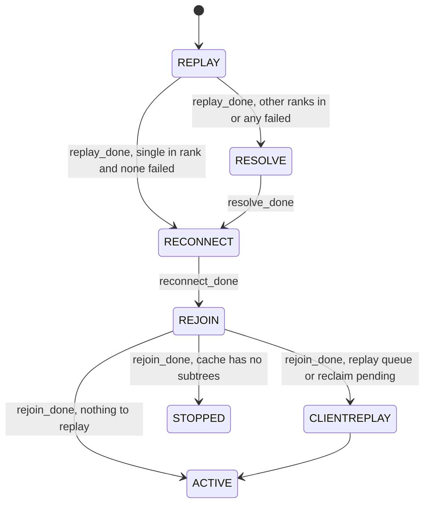
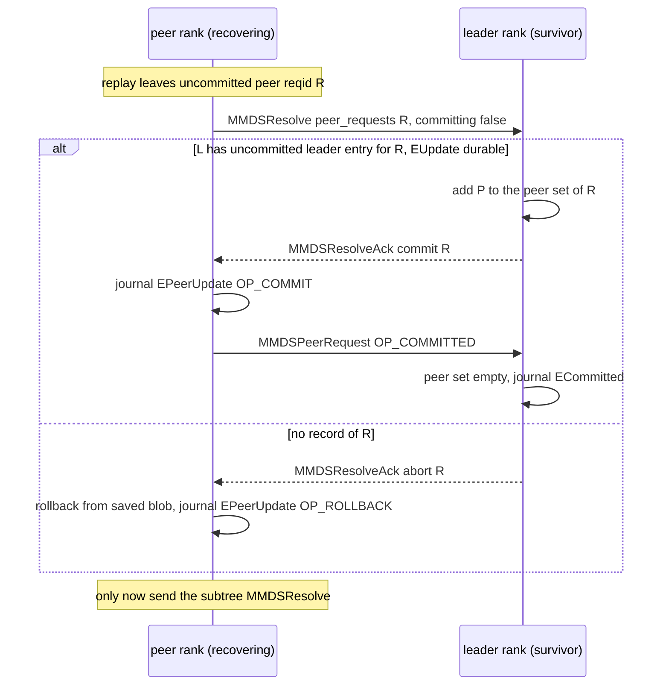
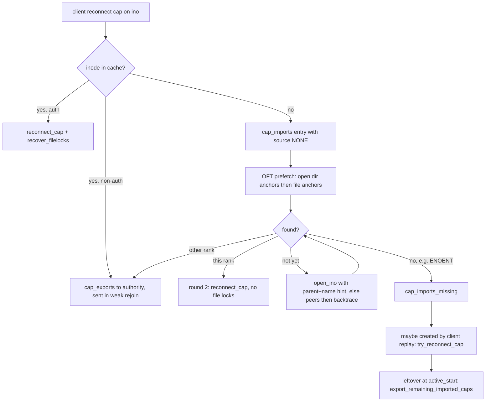
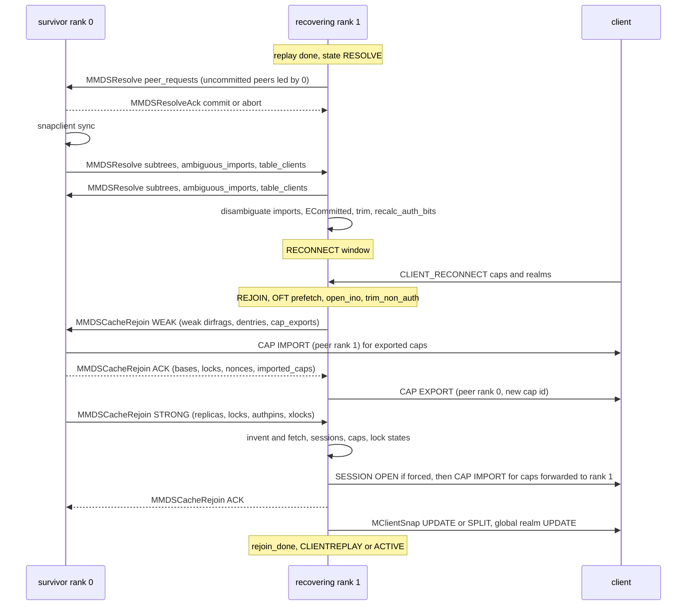

# Resolve and rejoin

> Part of the [C++ MDS project map](../README.md). Sources (commit `5f7e383ae6d`): `src/mds/MDCache.cc` lines 2490-2605 (leader/peer commit tracking) and 2774-6389 (resolve, rejoin, cap reconnect, ~3,700 LOC), recovery members of `src/mds/MDCache.h` (~200 LOC), `src/messages/MMDSResolve.h` (163), `src/messages/MMDSResolveAck.h` (68), `src/messages/MMDSCacheRejoin.h` (407). Supporting code read: `src/mds/MDSRank.cc` (`handle_mds_map`, phase entry points), `src/mds/Server.cc` (`handle_client_reconnect`, forced session opens, peer commit/rollback), `src/mds/OpenFileTable.cc` (prefetch), `src/mds/Migrator.cc` (failure handling), `src/mds/journal.cc` (`EUpdate`, `ECommitted`, `EPeerUpdate`, `ESubtreeMap`, `EImportStart`, `EImportFinish`, `EExport` replay), `src/mds/CInode.cc`, `src/mds/SimpleLock.h`, `src/mds/ScatterLock.h`, `src/mds/Locker.cc`, `src/mds/SnapClient.cc`, `src/mds/MDSTableServer.cc`, `src/mds/MDSTableClient.cc`, `src/mds/Capability.{h,cc}`, `src/mds/CDir.{h,cc}`, `src/mds/MDSMap.{h,cc}`, `src/mon/MDSMonitor.cc`. Client cross-check: `linux/fs/ceph/caps.c`, `linux/fs/ceph/mds_client.c`, `linux/fs/ceph/snap.c`, `src/client/Client.cc`.
> Related: [rank-lifecycle-and-recovery](rank-lifecycle-and-recovery.md), [subtree-migration](../08-multi-mds/subtree-migration.md), [rename](../03-request-path/rename.md), [namespace-mutations](../03-request-path/namespace-mutations.md), [request-lifecycle](../03-request-path/request-lifecycle.md), [events-and-replay](../06-journal/events-and-replay.md), [mdlog-and-journaler](../06-journal/mdlog-and-journaler.md), [mds-tables](../07-storage-formats/mds-tables.md), [rados-object-catalog](../07-storage-formats/rados-object-catalog.md), [mdcache-subtrees-traversal-replication](../04-cache/mdcache-subtrees-traversal-replication.md), [cdir-cdentry-and-cache-objects](../04-cache/cdir-cdentry-and-cache-objects.md), [cinode-and-inode-types](../04-cache/cinode-and-inode-types.md), [dirfrags-and-fragmentation](../04-cache/dirfrags-and-fragmentation.md), [lock-types-and-state-machines](../05-locking/lock-types-and-state-machines.md), [acquiring-locks](../05-locking/acquiring-locks.md), [capabilities](../02-client-protocol/capabilities.md), [sessions](../02-client-protocol/sessions.md), [kclient-expectations](../02-client-protocol/kclient-expectations.md), [libcephfs-fuse-ganesha-expectations](../02-client-protocol/libcephfs-fuse-ganesha-expectations.md), [snapshots](../10-snapshots-quotas-subvolumes/snapshots.md), [process-and-threading](../00-architecture/process-and-threading.md), [mds_lock-analysis](../00-architecture/mds_lock-analysis.md), [fsmap-and-mdsmap](../01-cluster-integration/fsmap-and-mdsmap.md), [beacon-and-monitor](../01-cluster-integration/beacon-and-monitor.md), [config-perf-counters-and-health](../13-admin-and-config/config-perf-counters-and-health.md).

## 1. Purpose and responsibilities

After journal replay a rank's cache is authoritative only for what its own journal says. It has no lock state, no replica lists, no client caps, possibly stale copies of objects owned by other ranks, and a set of operations whose outcome depends on other ranks. Other ranks ("survivors") hold replicas of its objects and in-flight distributed operations that involve it. Resolve and rejoin are the two phases that reconcile this.

**Resolve** (`up:resolve`, multi-rank only) settles everything that is in doubt purely from journals:

- **Subtree authority.** Each rank claims the subtrees it owns (with their bounds). Imports that were journaled (`EImportStart`) but not finished (`EImportFinish`) on a failed importer, and imports on a surviving importer that were waiting for a failed exporter, are *ambiguous*; resolve decides them deterministically and journals the `EImportFinish`.
- **Cross-rank two-phase updates.** Leader/peer operations (link/unlink of an inode owned by another rank, rmdir of a directory whose dirfrags are subtree roots on other ranks (the directory inode's replicas are the witnesses, `src/mds/Server.cc:8692-8706`), cross-rank rename) whose peer journaled a prepare (`EPeerUpdate OP_PREPARE`) but not a commit/rollback are decided by asking the leader: commit if the leader journaled its update (`EUpdate` with `had_peers`), otherwise abort and roll back. Leaders journal `ECommitted` once no peer is outstanding.
- **Snap table client/server state.** Pending snap-table commits are exchanged so every rank's snap cache accounts for them; survivors re-sync their snap cache; the snap table server (rank 0) re-sends `AGREE` for prepared transactions and `SERVER_READY`, after which clients re-send queries, prepares and commits (3.5.3).
- **Cache cleanup.** Inodes left without a parent are dropped; auth/replica bits of every cached object are recomputed for the agreed subtree map.

**Rejoin** (`up:rejoin`, all configurations including a single rank) rebuilds distributed and client state:

- **Replica and lock state.** Every rank reports to each authority the replicas it holds: *weak* rejoins from recovering ranks (connectivity only), *strong* rejoins from survivors (nonces, lock states, `caps_wanted`, and the auth pins / xlocks / wrlocks held by their in-flight requests). Authorities answer with *acks* carrying authoritative contents, lock states and new replica nonces.
- **Client caps from reconnect.** Caps reported by clients during `up:reconnect` are matched to inodes: inodes already in cache, inodes found through the OpenFileTable prefetch, inodes opened by number (parent+name hint, peers, backtrace). Caps whose inode belongs to another rank are moved there (`cap_exports` in the weak rejoin, `CEPH_CAP_OP_IMPORT` from the new auth, `CEPH_CAP_OP_EXPORT` from the old one). Sessions referenced by those caps are force-opened.
- **Lock states, file recovery and snaprealms.** Lock states are chosen from issued (and dirty) caps, files that may need size recovery are identified, snapflush expectations are rebuilt, and clients whose snaprealm view is stale get `MClientSnap` updates/splits.

Out of scope here: the rank state machine and reconnect window ([rank-lifecycle-and-recovery](rank-lifecycle-and-recovery.md)), event encodings ([events-and-replay](../06-journal/events-and-replay.md)), the export/import protocol itself ([subtree-migration](../08-multi-mds/subtree-migration.md)), lock state tables ([lock-types-and-state-machines](../05-locking/lock-types-and-state-machines.md)), cap semantics ([capabilities](../02-client-protocol/capabilities.md)), the client reconnect message ([kclient-expectations](../02-client-protocol/kclient-expectations.md), [sessions](../02-client-protocol/sessions.md)).

## 2. Source map

| File | Class / function | Lines | Role |
|---|---|---|---|
| `src/mds/MDCache.cc` | `log_leader_commit`, `_logged_leader_commit`, `committed_leader_peer`, `logged_leader_update`, `finish_committed_leaders`, `_logged_peer_commit` | 2512-2597 | Leader-side commit tracking (`uncommitted_leaders`, `ECommitted`), peer `OP_COMMITTED` |
| `src/mds/MDCache.cc` | `create_subtree_map` | 2624-2772 | Builds `ESubtreeMap` incl. `ambiguous_subtrees` (input to replay/resolve) |
| `src/mds/MDCache.cc` | `dump_resolve_status`, `resolve_start`, `send_resolves`, `send_peer_resolves`, `send_subtree_resolves`, `maybe_finish_peer_resolve` | 2774-3004 | Resolve entry and message construction |
| `src/mds/MDCache.cc` | `handle_mds_failure`, `handle_mds_recovery`, `set_recovery_set` | 3006-3246 | Reaction to a peer failing / recovering; resets gather sets |
| `src/mds/MDCache.cc` | `handle_resolve`, `process_delayed_resolve`, `discard_delayed_resolve`, `maybe_resolve_finish`, `handle_resolve_ack` | 3257-3561 | Resolve message handling and completion |
| `src/mds/MDCache.cc` | `add_uncommitted_peer`, `finish_uncommitted_peer`, `get_uncommitted_peer`, `finish_rollback` | 3563-3660 | Peer-side 2PC bookkeeping |
| `src/mds/MDCache.cc` | `disambiguate_other_imports`, `disambiguate_my_imports`, `add/cancel/finish_ambiguous_import` | 3662-3801 | Ambiguous import resolution |
| `src/mds/MDCache.cc` | `remove_inode_recursive`, `expire_recursive`, `trim_unlinked_inodes`, `recalc_auth_bits` | 3803-4018 | Cache cleanup after resolve (`expire_recursive` is used by `trim` for stopping ranks' mdsdir, not by resolve) |
| `src/mds/MDCache.cc` | scatterlock recovery notes, `dump_rejoin_status`, `rejoin_start`, `rejoin_send_rejoins`, `rejoin_walk` | 4024-4434 | Rejoin start and message construction |
| `src/mds/MDCache.cc` | `handle_cache_rejoin`, `handle_cache_rejoin_weak`, `rejoin_scour_survivor_replicas` | 4444-4758 | Weak rejoin handling |
| `src/mds/MDCache.cc` | `rejoin_invent_inode`, `rejoin_invent_dirfrag`, `handle_cache_rejoin_strong` | 4760-5055 | Strong rejoin handling |
| `src/mds/MDCache.cc` | `handle_cache_rejoin_ack`, `rejoin_trim_undef_inodes` (no caller) | 5057-5378 | Ack handling |
| `src/mds/MDCache.cc` | `rejoin_gather_finish`, `rejoin_open_ino_finish`, `rejoin_open_sessions_finish`, `rejoin_prefetch_ino_finish`, `process_imported_caps` | 5380-5649 | Gather completion and cap matching |
| `src/mds/MDCache.cc` | `rebuild_need_snapflush`, `choose_lock_states_and_reconnect_caps`, `prepare_realm_split`, `prepare_realm_merge`, `send_snaps` | 5651-5800 | Lock states and snap split messages |
| `src/mds/MDCache.cc` | `clean_open_file_lists`, `dump_openfiles`, `rejoin_import_cap`, `export_remaining_imported_caps`, `try_reconnect_cap`, `do_cap_import`, `do_delayed_cap_imports` | 5803-5980 | Cap import/export helpers (some run at `active_start`) |
| `src/mds/MDCache.cc` | `open_snaprealms`, `open_undef_inodes_dirfrags`, `opened_undef_inode`, `finish_snaprealm_reconnect`, `rejoin_send_acks`, `reissue_all_caps` | 5982-6372 | End of rejoin |
| `src/mds/MDCache.cc` | `identify_files_to_recover`, `trim_non_auth`, `inode_remove_replica`, `dentry_remove_replica` | 6444, 7401, 7895-7930 | Helpers called from rejoin |
| `src/mds/MDCache.h` | `reconnected_cap_info_t`, inline cap-reconnect helpers, `uleader`, `upeer`, recovery members | 189-195, 471-545, 712-797, 1211-1217, 1252-1268, 1409-1463 | State |
| `src/messages/MMDSResolve.h` | `MMDSResolve` (`MSG_MDS_RESOLVE` 0x200) | 1-163 | Resolve message |
| `src/messages/MMDSResolveAck.h` | `MMDSResolveAck` (`MSG_MDS_RESOLVEACK` 0x201) | 1-68 | Resolve ack |
| `src/messages/MMDSCacheRejoin.h` | `MMDSCacheRejoin` (`MSG_MDS_CACHEREJOIN` 0x202) | 1-407 | Weak/strong/ack |
| `src/mds/MDSRank.cc` | `calc_recovery_set`, `replay_done`, `reopen_log`, `resolve_start`, `resolve_done`, `reconnect_done`, `rejoin_joint_start`, `rejoin_start`, `rejoin_done` | 1781, 1897-1967, 1970-2081 | Phase entry/exit |
| `src/mds/MDSRank.cc` | `MDSRankDispatcher::handle_mds_map` (failure detection, resolve/rejoin triggers) | 2294-2626 | Cluster-wide barriers |
| `src/mds/MDSMap.h/.cc` | `is_resolving`, `is_rejoining`, `get_recovery_mds_set`, `is_degraded`, `state_transition_valid` | h:530-543, cc:1236, 1287, 1104 | Map predicates |
| `src/mds/Server.cc` | `handle_client_reconnect` (cap and realm recording), `reconnect_gather_finish`, `recover_filelocks` | 1591-1768, 1828, 1945 | Reconnect side of cap matching |
| `src/mds/Server.cc` | `prepare_force_open_sessions`, `finish_force_open_sessions` | 1059-1147 | Forced session opens |
| `src/mds/Server.cc` | `do_link_rollback`, `do_rmdir_rollback`, `do_rename_rollback`, `_commit_peer_link`, `_committed_peer`, `_commit_peer_rename` | 8393-8540, 9124-9214, 10838-11390 | Peer commit / rollback used by resolve |
| `src/mds/OpenFileTable.cc` | `prefetch_inodes`, `_prefetch_inodes`, `_prefetch_dirfrags`, `_open_ino_finish`, `_get_ancestors` | 999-1226 | OFT prefetch at rejoin start |
| `src/mds/Migrator.cc` | `handle_mds_failure_or_stop`, `export_try_cancel`, `is_ambiguous_import`, `import_finish`, `import_reverse` | 334-720, 2978, 3250 | Migration state on failure; ambiguous imports |
| `src/mds/journal.cc` | `EUpdate::replay`, `ECommitted::replay`, `EPeerUpdate::replay`, `ESubtreeMap::replay`, `EImportStart::replay`, `EImportFinish::replay`, `EExport::replay`, `ETableClient::replay`, `EMetaBlob::replay` (table tids) | 2339, 2453, 2747, 2847, 3185, 3279, 3106, 2226, 1626-1632 | Produce resolve inputs |
| `src/mds/MDSTableServer.cc`, `src/mds/MDSTableClient.cc`, `src/mds/SnapClient.cc` | `finish_recovery`, `handle_mds_recovery`, `_do_server_recovery`; `handle_request` (`AGREE`/`SERVER_READY`), `resend_commits`, `resend_prepares`, `handle_mds_failure`, `got_journaled_agree/ack`; `notify_commit` | Srv 327-407; Cli 53-149, 215-262; Snap 127-147 | Snap table 2PC recovery during resolve |
| `src/mds/CInode.cc` | `choose_lock_state(s)`, `reconnect_cap`, `set_mds_caps_wanted`, `_encode_locks_state_for_rejoin`, `_decode_locks_rejoin`, `encode/decode_lock_state` | 3503-3590, 3676, 4587-4650, 2315-2430 | Per-inode recovery helpers |
| `src/mds/SimpleLock.h`, `ScatterLock.h` | `set_state_rejoin`, `decode_state_rejoin`, `infer_state_from_strong_rejoin`, `encode_state_for_rejoin`, `remove_replica(from, rejoin)` | SL:272-284, 509-514; ScL:139-194 | Lock-state rejoin rules |

## 3. How it works

### 3.1 Position in the recovery pipeline

- `replay_done` asks for `RECONNECT` directly only when `get_num_in_mds() == 1 && get_num_failed_mds() == 0`, else `RESOLVE` (`src/mds/MDSRank.cc:1958-1967 (MDSRank::replay_done)`).
- The monitor enforces this order: from `RESOLVE` .. `CLIENTREPLAY` only `next == prev + 1` is valid, plus `REJOIN -> ACTIVE` and `REJOIN -> STOPPED`; `REPLAY -> RESOLVE|RECONNECT`; any state may go to `DAMAGED` (`src/mds/MDSMap.cc:1104 (MDSMap::state_transition_valid)`). A beacon reporting any other transition makes the monitor evict the daemon (`src/mon/MDSMonitor.cc:788-796 (MDSMonitor::prepare_beacon)`); the MDS itself respawns if a map shows an invalid transition (`src/mds/MDSRank.cc:2327-2331`). **`up:rejoin` cannot be skipped.**
- Each phase has an entry function run when the MDSMap shows the new state (`src/mds/MDSRank.cc:2423-2461 (MDSRankDispatcher::handle_mds_map)`) and a cluster-wide trigger evaluated on every map:

| Phase | Local entry (`MDSRank`) | Message exchange starts when | Local completion |
|---|---|---|---|
| resolve | `resolve_start`: `reopen_log` (roll back uncommitted fragment ops), `calc_recovery_set`, `MDCache::resolve_start`, run `waiting_for_resolve` (`src/mds/MDSRank.cc:1976-1986`) | `MDSMap::is_resolving()` turns true or a rank restarted: >= 1 rank in `RESOLVE`, none in `REPLAY`, no `failed`, no `damaged` (`src/mds/MDSMap.h:530`); every rank with state >= `RESOLVE` then runs `calc_recovery_set` + `MDCache::send_resolves` (`src/mds/MDSRank.cc:2486-2491`) | `maybe_resolve_finish` completes `resolve_done` -> request `RECONNECT`, `snapclient->sync` (`src/mds/MDSRank.cc:1988-1994`) |
| rejoin | `rejoin_start`: `MDCache::rejoin_start`, run `waiting_for_rejoin` (`src/mds/MDSRank.cc:2042-2047`) | `MDSMap::is_rejoining()` turns true: >= 1 rank in `REJOIN`, none in `REPLAY`/`RESOLVE`/`RECONNECT`, no `failed`/`damaged` (`src/mds/MDSMap.h:536`); every rank with state >= `REJOIN` runs `rejoin_joint_start` -> `MDCache::rejoin_send_rejoins` (`src/mds/MDSRank.cc:2497-2500`) | `open_snaprealms` completes `rejoin_done` (`src/mds/MDSRank.cc:2048-2081`) |

Because the triggers require *no* rank in an earlier recovery state, all recovering ranks move through resolve and rejoin in lockstep: one slow rank (for example a long replay or a 45 s reconnect window) delays every other recovering rank.

### 3.2 Recovery set, survivors and gather sets

- **Recovery set**: `MDSMap::get_recovery_mds_set` = `failed` ∪ `damaged` ∪ ranks of daemons with `REPLAY <= state <= STOPPING` (`src/mds/MDSMap.cc:1236`), minus self (`src/mds/MDSRank.cc:1781 (MDSRank::calc_recovery_set)`). This includes active and stopping survivors (ranks in `CREATING`/`STARTING` have negative state values and are excluded), so in practice it is every "in" rank except self. It is recomputed in `resolve_start` and each time a resolve round starts (the only two callers, `src/mds/MDSRank.cc:1982`, `2490`). It is **never computed for a single-rank file system** (resolve is skipped), so it stays empty there.
- **Survivor**: in resolve/rejoin code, a rank is a survivor if it is `clientreplay`, `active` or `stopping` (e.g. `src/mds/MDCache.cc:3352 (MDCache::handle_resolve)`, `src/mds/MDCache.cc:4490 (MDCache::handle_cache_rejoin_weak)`), and for resolve completion if `resolve_done` is null (`src/mds/MDCache.cc:3465 (MDCache::maybe_resolve_finish)`). A rank still in `reconnect` or `rejoin` that sees another rank fail participates in the new resolve round like a survivor for sending (it has no `resolve_done` any more) but uses replay-mode dirfrag forcing.
- **Failure detection** happens only on ranks with state >= `RESOLVE`: a rank newly down, or whose incarnation changed while in `REPLAY`/`RESOLVE` (restart; also a rank first seen already in `REPLAY`/`RESOLVE` after skipped maps), triggers `MDSRank::handle_mds_failure(r)` (an incarnation change seen in `STARTING`/`ACTIVE` only resets Migrator and snap-server state) -> `MDCache::handle_mds_failure` + snap server/client + scrub (`src/mds/MDSRank.cc:2370-2416`, `2638-2654`). Restarted ranks are put in `restart`, which re-triggers `send_resolves` even if `is_resolving()` was already true.
- `MDCache::handle_mds_failure(who)` (`src/mds/MDCache.cc:3006-3181`) resets gather state: `resolve_gather += who`, drop its delayed resolve and ambiguous peer updates, `rejoin_gather += who`, `rejoin_sent -= who`, `rejoin_ack_sent -= who`, `rejoin_ack_gather -= who`; tells the `Migrator` (`handle_mds_failure_or_stop`) and balancer; fixes in-flight requests (3.4.5); marks uncommitted leaders that had `who` as peer `recovering` and removes `who` from their peer set ("the failed MDS may have already committed"); kicks `find_ino`/`open_ino` peers; cancels fragment operations that have not started refragmenting yet (still freezing or locking, `!fragment_info_t::is_fragmenting()`, i.e. `resultfrags` empty, `src/mds/MDCache.h:1496`) and drops `who` from the notify-ack waits of those already refragmenting (finishing them if no ack is left); clears `shutdown_exporting_strays` if `who == 0`.
- `MDCache::handle_mds_recovery(who)` runs when `who` reaches `CLIENTREPLAY`/`ACTIVE`/`STOPPING`, evaluated only on ranks that are themselves `CLIENTREPLAY` or later in both the old and the new map (`src/mds/MDSRank.cc:2560-2571`): it wakes all waiters (except discover waiters, `WAIT_DIR` on inodes and `WAIT_DENTRY` on dirs, which `kick_discovers` handles) on every object in subtrees whose authority is `who`, and kicks `open_ino`/`find_ino` peers (`src/mds/MDCache.cc:3187-3240`). Separately, every rank that was already `>= REJOIN` (or `STARTING`) in the old map calls `kick_discovers(r)` and `kick_open_ino_peers(r)` for each rank `r` that newly reaches `REJOIN` or later (`src/mds/MDSRank.cc:2507-2521`).

### 3.3 Inputs left by journal replay

| State after replay | Produced by | Meaning |
|---|---|---|
| `uncommitted_leaders[reqid] = {ls, peers = {}, safe = true}` | `EUpdate::replay` when `had_peers` (`src/mds/journal.cc:2339-2350`); removed by `ECommitted::replay` (`journal.cc:2453-2462`) | This rank was leader of a 2PC op whose update is durable; no `ECommitted` seen |
| `uncommitted_peers[reqid] = {leader, ls, su = MDPeerUpdate{origop, rollback, olddirs, unlinked}}` | `EPeerUpdate::replay` `OP_PREPARE`; erased by `OP_COMMIT`/`OP_ROLLBACK` (`src/mds/journal.cc:2747-2776`) | Prepared peer update, outcome unknown. Its metadata change is applied in cache; renamed-away non-auth dirs (`uncommitted_peer_rename_olddir`) and unlinked inodes (`uncommitted_peer_unlink`) are kept until the outcome is known (`src/mds/MDCache.cc:3563-3581`) |
| `my_ambiguous_imports[base] = bounds`, subtree auth `(me, me)` | `EImportStart::replay` (`src/mds/journal.cc:3185-3212`) or `ESubtreeMap::replay` with `ambiguous_subtrees` (`journal.cc:2955-2962`); finished/cancelled by `EImportFinish::replay` (`journal.cc:3279-3300`) | Import journaled but not finished |
| Exported region auth `UNDEF` and trimmed | `EExport::replay` (`src/mds/journal.cc:3106-3127`) | Export completed from this rank's point of view; the rank will not claim it |
| `snapclient` `pending_commit` tids | added by `EMetaBlob::replay` for each journaled table tid (`got_journaled_agree`, `src/mds/journal.cc:1626-1632`), removed by `ETableClient::replay` of the journaled `ACK` (`got_journaled_ack`, `journal.cc:2226-2238`) ([mds-tables](../07-storage-formats/mds-tables.md)) | Snap table transactions this rank agreed to and journaled but whose server ack is not journaled |
| Auth bits for replay | `recalc_auth_bits(true)` after `ESubtreeMap` replay (`src/mds/journal.cc:2968 (ESubtreeMap::replay)`) | No `REJOINING` flags yet |

### 3.4 Resolve, step 1: peer resolves (two-phase commit outcomes)

#### 3.4.1 Sending (`send_resolves`, `send_peer_resolves`)

`resolve_start` (recovering rank only) sets its cached root dirfrag to `CDIR_AUTH_UNKNOWN` unless this rank is the root's rank (`mdsmap->get_root()`, always 0), so that rank 0 must explicitly claim its part, sets `resolve_gather = recovery_set` and snapshots `resolve_snapclient_commits = snapclient->get_journaled_tids()` (`src/mds/MDCache.cc:2782-2800 (MDCache::resolve_start)`).

`send_resolves` (`src/mds/MDCache.cc:2802-2830`) always first calls `send_peer_resolves`, which builds one `MMDSResolve` per leader rank containing only `peer_requests` and adds each destination to `resolve_ack_gather` (`src/mds/MDCache.cc:2832-2886`):

- **Recovering rank** (`is_resolve()`): one entry per `uncommitted_peers` reqid, `committing = false`, to `upeer.leader`.
- **Survivor**: one entry per active peer `MDRequest` that has prepared (`peer_did_prepare()`, i.e. a `peer_commit` context exists) or is committing, whose leader is in `RESOLVE` or which is an *ambiguous peer update* (3.4.6). If the request is a rename peer that was exporting the renamed inode (`more()->is_inode_exporter`) and is not committing, the entry carries `inode_caps = peer_inode_cap{ino, cap_exports}` (current client caps exported with `CInode::export_client_caps`) instead of the `committing` flag; otherwise `committing = mdr->committing`.

Then, only when all peer resolve acks have arrived and all rollbacks are journaled (and, on a survivor, after the snap client cache re-synced), the subtree resolve is sent (3.5). A survivor first calls `snapclient->sync(...)` whose completion runs `maybe_finish_peer_resolve` (`src/mds/MDCache.cc:2806-2816`, `2997-3004`).

#### 3.4.2 Leader side (`handle_resolve` with `peer_requests`)

`src/mds/MDCache.cc:3274-3341` (after the same not-yet-`RESOLVE` gating as in 3.5.2):

1. If this leader is a survivor, every listed reqid that is in `uncommitted_leaders` but not yet `safe` (the leader's `EUpdate` is still being journaled) is added to `pending_leaders`; then, if `pending_leaders` is non-empty for any reason (including rename entries added by `handle_mds_failure`, 3.4.5), the whole message is stored in `delayed_resolve[from]`. The gate is global: one unsafe leader update delays the peer resolves of every sender. `logged_leader_update` re-processes all delayed resolves once `pending_leaders` is empty (`src/mds/MDCache.cc:2539-2550`, `3274-3288`).
2. Otherwise an `MMDSResolveAck` is built. For each reqid:
   - **COMMIT** if `uncommitted_leaders` has it: added to `ack->commit` unless the peer says it is already `committing` (then no-op); `from` is (re)inserted into `uncommitted_leaders[reqid].peers`, so `ECommitted` waits for the peer's `OP_COMMITTED`.
   - If the entry carries `inode_caps` (rename inode export; requires this leader to be in `resolve`): for each client cap a new `Capability::Import{cap_id = ++last_cap_id, issue_seq = 1, mseq = export.mseq}` is recorded in `rejoin_imported_caps[from][ino][client]`; the client's session address goes to `rejoin_client_map`; the exports are kept in `rejoin_peer_exports[ino] = (from, cap_exports)` for rejoin (3.13.2); the encoded import map is placed in `ack->commit[reqid]`.
   - **ABORT** otherwise (presumed abort: the leader has no durable record) with `ceph_assert(!committing)`.
3. The ack is sent on the incoming connection and the function returns (peer requests and subtree claims are never in the same message).

#### 3.4.3 Peer side (`handle_resolve_ack`)

`src/mds/MDCache.cc:3476-3561`. Ignored unless `from` is in `resolve_ack_gather` and `from`'s state >= `RESOLVE`.

| Ack entry | Recovering peer (`is_resolve()`) | Survivor peer |
|---|---|---|
| commit | Journal `EPeerUpdate(type "unknown", OP_COMMIT, origop)`, flush; on safe `_logged_peer_commit` sends `MMDSPeerRequest OP_COMMITTED` (attempt 0) to the leader (`MDCache.cc:2588-2595`); `finish_uncommitted_peer` immediately | If `from` has ambiguous peer updates: just remove the entry. Else `request_finish(mdr)` after storing the leader's imported-cap info in `mdr->more()->inode_import`; `request_finish` runs the `peer_commit` context with r=0 (`src/mds/MDCache.cc:9917-9934 (MDCache::request_finish)`), i.e. the normal commit path (`_commit_peer_link`, `_commit_peer_rename` which exports the inode's caps using `inode_import`, `src/mds/Server.cc:10853-10878`) |
| abort | `do_link_rollback` / `do_rename_rollback` / `do_rmdir_rollback` with a null `mdr`, from `MDPeerUpdate::rollback`; each calls `add_rollback(reqid, leader)` and journals `EPeerUpdate OP_ROLLBACK`; its finisher calls `finish_rollback` (`src/mds/Server.cc:8440-8540`, `9124-9214`, `10992-11390`) | `mdr->aborted = true`; if a peer request message is still being processed (`mdr->peer_request` set), only `add_rollback` when it has prepared (nothing else happens now; the request sees `aborted` when it continues); if none is in progress, `request_finish(mdr)` which runs `peer_commit` with r=-1 -> rollback (`src/mds/MDCache.cc:3545-3553`) |

`finish_rollback` removes the reqid from `resolve_need_rollback`, finishes the uncommitted peer and calls `maybe_finish_peer_resolve` (`src/mds/MDCache.cc:3650-3660`). After processing, `resolve_ack_gather -= from` (unless `from` still has ambiguous peer updates) and `maybe_finish_peer_resolve` (`MDCache.cc:3557-3560`).

`finish_uncommitted_peer` (`src/mds/MDCache.cc:3583-3636`) wakes `upeer.waiters` (journal segment expiry waits on these), and for the `MDPeerUpdate`: for each preserved old dir whose refcount drops to 0, `try_trim_non_auth_subtree` if its subtree auth is `UNDEF`; for each preserved unlinked inode without a projected parent, `remove_inode_recursive`.

#### 3.4.4 Leader-side commit tracking

- Live path: when a leader with witnesses journals its `EUpdate`, `add_uncommitted_leader(reqid, ls, witnessed)` (`src/mds/Server.cc:8155-8160`, `8753-8757`, `9748-9754`); on safe, `logged_leader_update` sets `safe` and may release delayed resolves; `OP_COMMITTED` from each peer -> `committed_leader_peer` erases it; when empty and not `recovering`, `log_leader_commit` journals `ECommitted` and `_logged_leader_commit` erases the entry and wakes waiters (`src/mds/MDCache.cc:2512-2550`).
- `OP_COMMITTED` arriving while the leader is not yet `clientreplay`/`active`/`stopping` is retried after replay if the leader knows the reqid/peer pair, else dropped (`src/mds/Server.cc:3079-3093 (Server::handle_peer_request_reply)`).
- `finish_committed_leaders` (end of resolve, every rank): clears `recovering` and journals `ECommitted` for every leader entry that is not committing and has no peers left. This covers "leader crashed after all commit acks but before `ECommitted`" and "peer crashed after journaling its commit but before acking" (`src/mds/MDCache.cc:2552-2568`).
- Journal segments cannot expire while they hold uncommitted leaders/peers (`src/mds/journal.cc:176-190 (LogSegment::try_to_expire)`), so an unresolved 2PC pins the leader's and the peer's journal tail.

#### 3.4.5 In-flight requests when a rank fails (`handle_mds_failure`)

`src/mds/MDCache.cc:3036-3147`:

| Request on this (surviving) rank | Action |
|---|---|
| Peer of `who`, prepared | Kept for resolve; ambiguous-update entry removed; if it waits for rename notify acks (`waiting_on_peer`, only when this rank is srcdn auth) the peer request is reset ("will rollback") |
| Peer of `who`, not prepared, not committing | `aborted = true` if a peer request is being processed or it is rolling back; else finished now |
| Peer (prepared) waiting for a rename notify ack from `who` | Ack no longer needed; retried if nothing else is awaited |
| Peer (prepared) whose rename srcdn auth is `who`, leader still active | `add_ambiguous_peer_update` (3.4.6) |
| Peer with an unprocessed `OP_RENAMEPREP` from srcdn auth `who` | `mark_interrupted()` (code comment: "FIXME ... This can cause mds to crash (does not affect integrity of FS)") |
| Leader, not committing, rename srcdn auth is `who` | All witnesses will roll back: clear `witnessed`, drop from `pending_leaders`, clear ambiguous auth |
| Leader, not committing, `who` witnessed | If still waiting on the srcdn auth peer: `pending_leaders += reqid` (delay resolve acks); else drop `who` from `witnessed` |
| Leader, not committing, waiting on a reply from `who` | `who` is dropped from `waiting_on_peer`; if nothing else is awaited, retry when `who` is active (`wait_for_active_peer`) |
| Leader acquiring a remote lock on `who` | `finish_locking` |

#### 3.4.6 Ambiguous peer updates (rename)

When the srcdn auth of a cross-rank rename fails while the leader is still active, a surviving witness cannot tell whether the leader will commit. It records `ambiguous_peer_updates[leader]` and sends a peer resolve **to the active leader** (`src/mds/MDCache.cc:2860`, `3071-3077`). The active leader answers like any resolve (3.4.2). On commit the entry is removed without finishing the request (the normal rename commit continues); on abort the rename rollback path preserves the peer request (`src/mds/Server.cc:10913-10920`). `resolve_ack_gather` is only cleared for that leader once it has no ambiguous entries left. Details of the rename protocol: [rename](../03-request-path/rename.md).

### 3.5 Resolve, step 2: subtree resolves

#### 3.5.1 Sending (`send_subtree_resolves`)

`src/mds/MDCache.cc:2888-2995`:

1. If the `Migrator` has any export or import in progress, set `resolves_pending` and return; every export finish/cancel and import finish/reverse calls `maybe_send_pending_resolves` (`src/mds/Migrator.cc:477`, `2391`, `3177`, `3345`).
2. Recipients: every rank in `recovery_set` (except self) if this rank is in `resolve`; otherwise only recovery-set ranks currently in `RESOLVE`.
3. For each subtree whose `authority().first` is this rank:
   - recovering rank and listed in `my_ambiguous_imports`: sent later as ambiguous;
   - `migrator->is_ambiguous_import(df)` (import state `LOGGINGSTART` .. before `ABORTING`, `src/mds/Migrator.cc:712-719`): sent in `ambiguous_imports` with its current bounds;
   - else claimed in `subtrees` with its bounds.
4. All `my_ambiguous_imports` are added to `ambiguous_imports`.
5. The claim set is simplified: a bound that is itself a claimed subtree is replaced by that subtree's bounds and removed from the map (so nested own subtrees collapse into one claim).
6. `table_clients = [{TABLE_SNAP, tids}]` where tids = `resolve_snapclient_commits` (recovering) or `snapclient->get_journaled_tids()` (survivor).
7. Sent with `send_message_mds` (which drops messages to ranks that are not up, defers messages to ranks that are still bootstrapping, and first sends the current MDSMap if the peer's known epoch is older, `src/mds/MDSRank.cc:1476-1497`).

#### 3.5.2 Receiving (`handle_resolve` with subtrees)

`src/mds/MDCache.cc:3257-3433`:

1. If this rank is not yet in `RESOLVE`: retried at `resolve_start` if it wants `RESOLVE`, else dropped. Any older delayed resolve from the sender is discarded.
2. If this rank still has outstanding peer-resolve acks or rollbacks, the message is stored in `delayed_resolve[from]` (one slot per sender, the newer replaces the older) and processed by `process_delayed_resolve` when those complete (`MDCache.cc:3343-3347`, `3435-3443`).
3. **Surviving importer check** (only if this rank is clientreplay/active/stopping): for each `my_ambiguous_imports` entry that the `Migrator` is importing from `from` (must be `IMPORT_ACKING`), the sender *claims* it if some claimed subtree base contains the dir and none of that claim's bounds contains it (dirfrags forced with `get_force_dirfrag(..., false)`): claimed -> `migrator->import_reverse(dir)`; not claimed -> `migrator->import_finish(dir, true)` (`MDCache.cc:3351-3398`). These two journal `EImportFinish(false)` / `EImportFinish(true)` themselves (`src/mds/Migrator.cc:3099`, `3318`).
4. **Apply claims** on every receiver (recovering ranks and bystanders): `adjust_bounded_subtree_auth(dir, bounds, from)` + `try_subtree_merge` for each claimed subtree (dirfrag forced with `get_force_dirfrag(df, !survivor)`; bound dirfrags that do not exist locally are force-fragmented from the sender's frag set, `src/mds/MDCache.cc:1252-1293 (MDCache::get_force_dirfrag_bound_set)`).
5. Remember the sender's ambiguous imports in `other_ambiguous_imports[from]`.
6. For each table client entry, `client->notify_commit(tid)`: the local snap client records the tid as committing so its cached `last_created`/`last_destroyed` include pending updates (`src/mds/SnapClient.cc:127-142`).
7. `resolve_gather -= from`; `maybe_resolve_finish()`.

#### 3.5.3 Snap table server and client recovery

The snap table (the only `MDSTable` left, served by `mdsmap->get_tableserver()`, rank 0) runs its own 2PC recovery alongside resolve ([mds-tables](../07-storage-formats/mds-tables.md)):

- Table client messages are ignored by a rank below `RESOLVE` (retried at resolve start if it wants `RESOLVE`) (`src/mds/MDSTableClient.cc:53-63`).
- When the table server rank itself reaches `RESOLVE` or later it calls `finish_recovery(ranks >= RESOLVE)`: if prepared transactions exist it first sends a full-table `NOTIFY_PREP` to all active clients ("don't know if survivor mds have received all 'notify prep' messages") and waits for their acks, then `_do_server_recovery` re-sends `AGREE` for every prepared, uncommitted transaction (`pending_for_mds`) to its client and `SERVER_READY` to every active client. Afterwards, every rank that newly reaches `RESOLVE` (or restarted) gets the same `AGREE`s plus `SERVER_READY` from `handle_mds_recovery` (`src/mds/MDSRank.cc:2465-2484`, `src/mds/MDSTableServer.cc:327-407`, `src/mds/SnapServer.cc:308-327`).
- A client marks the server not ready when the server rank fails (`handle_mds_failure`); on `SERVER_READY` it re-sends queries, prepares and commits (`pending_commit`, the journaled-but-unacked tids of 3.3). An `AGREE` for an unknown, uncommitted tid is answered with `ROLLBACK` (`src/mds/MDSTableClient.cc:78-112`, `133-143`, `233-264`).
- The `table_clients` field of subtree resolves (3.5.1 step 6, 3.5.2 step 6) only updates the receivers' snap caches. A survivor syncs its snap cache before sending its subtree resolve (3.4.1); a recovering rank starts a sync in `MDSRank::resolve_done` and waits for it before requesting `REJOIN` (3.8).

### 3.6 Finishing resolve (`maybe_resolve_finish`)

`src/mds/MDCache.cc:3450-3474`, called after each subtree resolve; asserts no outstanding peer acks or rollbacks; waits until `resolve_gather` is empty (recovering rank: one subtree resolve from every recovery-set rank; survivor: from every rank that failed since the last resolve). Then:

1. `disambiguate_my_imports` (recovering ranks only; on a survivor it asserts `my_ambiguous_imports` is empty, `MDCache.cc:3695-3748`):
   - `disambiguate_other_imports`: for each rank's announced ambiguous import, if the local dirfrag is still ambiguous or `UNDEF`, give it to that rank (`adjust_bounded_subtree_auth(dir, bounds, who)`), else that rank did not import it.
   - For each own ambiguous import: if someone claimed it (authority is no longer `(me, me)`): cancel, journal `EImportFinish(false)`, `try_trim_non_auth_subtree` on the containing subtree. If unclaimed: `finish_ambiguous_import` (auth to me with the recorded bounds) and journal `EImportFinish(true)`. Flush the journal. Assert no subtree is left with ambiguous dir auth.
2. `finish_committed_leaders` (3.4.4).
3. Recovering rank: `trim_unlinked_inodes` (remove every non-base inode without a parent dentry, recursively, resetting the heartbeat every `mds_heartbeat_reset_grace` items, `MDCache.cc:3875-3900`), `recalc_auth_bits(false)`, complete `resolve_done` -> `MDSRank::resolve_done` requests `RECONNECT` and starts a snap-cache sync.
4. Survivor: `maybe_send_pending_rejoins` (rejoins are held while `resolve_gather` is non-empty).

`recalc_auth_bits(false)` (`src/mds/MDCache.cc:3902-4018`) walks every subtree and every nested dirfrag/dentry/inode:

| Object | In an auth subtree | In a non-auth subtree (after resolve, `replay == false`) |
|---|---|---|
| root inode | auth iff this rank is `mdsmap->get_root()` | clear `AUTH`, set `REJOINING` |
| mdsdir inodes | auth iff `MDS_INO_MDSDIR(me)` | clear `AUTH`, set `REJOINING` |
| CDir | set `AUTH` | clear `AUTH`; empty non-subtree-root dirfrag is closed; else set `REJOINING`, clear `COMPLETE`, `mark_clean` |
| CDentry | `mark_auth` | `clear_auth`, set `REJOINING`, `mark_clean` |
| primary CInode | set `AUTH` | clear `AUTH`, set `REJOINING`, `mark_clean`, `clear_dirty_parent`, `clear_scatter_dirty` (except inodes of own subtree roots) |

### 3.7 Outcome matrices

**Subtree migration interrupted by a failure** (exporter journals `EExport` only after the importer acked, importer journals `EImportStart` before acking; [subtree-migration](../08-multi-mds/subtree-migration.md)):

| Exporter | Importer | Situation at failure | Resolution |
|---|---|---|---|
| survivor | recovering | importer had not journaled `EImportStart` | exporter in `EXPORTING` or earlier cancels/reverses (`export_try_cancel` -> `export_reverse`, `src/mds/Migrator.cc:416-420`); importer has nothing to resolve |
| survivor | recovering | `EImportStart` journaled, exporter did not get the ack (still `EXPORTING`) | exporter reverses and claims the subtree in its resolve; importer's ambiguous import is claimed by someone -> `EImportFinish(false)`, trim |
| survivor | recovering | exporter got the ack (`LOGGINGFINISH`/`NOTIFYING`) | exporter "ignoring dest failure, we were successful" (`Migrator.cc:422-426`), does not claim; importer's ambiguous import is unclaimed -> `EImportFinish(true)` |
| recovering | survivor (before `IMPORT_ACKING`) | importer still discovering/prepping/prepped or `LOGGINGSTART` | importer reverses at once in `handle_mds_failure_or_stop` (`IMPORT_FINISHING` is finished at once instead) (`src/mds/Migrator.cc:578-640`) |
| recovering | survivor (`IMPORT_ACKING`) | exporter failed after the importer journaled `EImportStart` and acked, before `MExportDirFinish` arrived | importer converts to `my_ambiguous_imports` (`src/mds/Migrator.cc:622-630`) and sends it as ambiguous; on the exporter's resolve: claimed (no `EExport` on disk, region still in its `ESubtreeMap`) -> `import_reverse`; not claimed (`EExport` replayed, region `UNDEF`) -> `import_finish` |
| recovering | recovering | both | importer: ambiguous via replay; exporter claims iff `EExport` not replayed; importer decides in `disambiguate_my_imports` |
| any | any | bystanders | apply claims and `other_ambiguous_imports` |

**Two-phase update interrupted by a failure** (commit point = leader's `EUpdate` with `had_peers` being durable):

| Leader | Peer | Peer journal | Leader journal | Outcome |
|---|---|---|---|---|
| survivor | recovering | `OP_PREPARE` only | `EUpdate` durable | peer resolve -> commit -> peer journals `OP_COMMIT`, sends `OP_COMMITTED`; leader journals `ECommitted` |
| survivor | recovering | `OP_PREPARE` only | `EUpdate` in flight | leader delays the ack (`pending_leaders`) until the `EUpdate` is safe, then commit |
| survivor | recovering | `OP_PREPARE` only | no `EUpdate` | abort -> peer rolls back from its saved rollback blob |
| survivor | recovering | `OP_COMMIT` | `EUpdate`, no `ECommitted` | peer does not mention it; leader removed it from `peers` at failure, `finish_committed_leaders` journals `ECommitted` |
| recovering | survivor | prepared (live `MDRequest`) | `EUpdate` without `ECommitted` | survivor's peer resolve -> commit -> `request_finish` -> normal commit |
| recovering | survivor | prepared | nothing | abort -> survivor rolls back |
| recovering | recovering | `OP_PREPARE` | either | as row 1/3 |
| recovering | any | committed already | `EUpdate`, no `ECommitted` | `finish_committed_leaders` journals `ECommitted` |

### 3.8 What reconnect hands to rejoin

`Server::handle_client_reconnect` (`src/mds/Server.cc:1703-1767`) records for each reconnect message (see [sessions](../02-client-protocol/sessions.md) for gating):

| Client data | Recorded as | Notes |
|---|---|---|
| each snaprealm `{ino, seq, parent}` | `reconnected_snaprealms[ino][client] = seq` (`add_reconnected_snaprealm`) | Recorded whether or not the realm inode is in cache; skipped if the inode is being purged |
| each cap: `cap_id` | `last_cap_id = max(last_cap_id, cap_id)` | Ensures new cap ids never collide with ids clients hold; a cap on an inode being purged is then skipped entirely |
| cap on an inode in cache and auth | `CInode::reconnect_cap` (new cap: `cap_id`, `wanted`, `issue_norevoke(issued)`, `reset_seq()` so `last_sent = last_issue = 0`; existing cap: merge wanted/issued) + `add_reconnected_cap` (`realm_ino`, `snap_follows`) + `recover_filelocks` (fcntl/flock state from the blob) | Only path that restores file locks (`src/mds/Server.cc:1733-1741`, `src/mds/CInode.cc:3676-3690`) |
| cap on an inode in cache but not auth | `cap_exports[ino] = (authority, {client: cap_reconnect_t})` with the path cleared (`rejoin_export_caps(..., drop_path=true)`) | Sent to the auth in the weak rejoin |
| cap on an inode not in cache | `cap_imports[ino][client][MDS_RANK_NONE] = cap_reconnect_t` (`rejoin_recovered_caps`) | Resolved in rejoin |
| end of the client's reconnect | `rejoin_client_map[client] = inst` (`rejoin_recovered_client`) | Every reconnected session is later passed through the forced-open path |
| (from `Server::dispatch`) replayed/async request with `head.ino` | `cap_imports_missing += ino` (`add_replay_ino_alloc`, `src/mds/Server.cc:349-362`) | Do not try to open inodes that a replayed create will create |
| (from `Locker::handle_client_caps`) dirty cap flush with a new `client_tid` during reconnect | dirty bits OR-ed into `reconnected_caps[ino][client].dirty_caps`, `snapflush` flag set for `FLUSHSNAP` (`src/mds/Locker.cc:3410-3415 (Locker::handle_client_caps)`) | Used to choose lock states and need-snapflush |

`reconnect_gather_finish` waits for the snap client cache to be synced before requesting `REJOIN` because rejoin uses snaprealms extensively (`src/mds/Server.cc:1828-1842`).

### 3.9 Rejoin start and cap matching, round 1

`MDCache::rejoin_start` sets `rejoin_gather = recovery_set + {self}` (self = "still processing imported caps") and calls `process_imported_caps()` (`src/mds/MDCache.cc:4065-4075`). With self in `rejoin_gather`, `process_imported_caps` (`src/mds/MDCache.cc:5483-5649`) does:

1. **OpenFileTable prefetch** (once per daemon): if not prefetched, `open_file_table.prefetch_inodes()` and wait (`MDCache.cc:5487-5497`). The OFT (objects `mds<rank>_openfiles.<idx>`, loaded at boot) holds `RecoveredAnchor{ino, dirino, d_name, d_type, frags, auth hint}` for every inode that was open or is an ancestor of an open inode ([mds-tables](../07-storage-formats/mds-tables.md)). Prefetch phases (`src/mds/OpenFileTable.cc:1038-1226`):
   - `DIR_INODES`: `open_ino` for every directory anchor not in cache (mdsdir/stray anchors only get their owner rank as `auth`), pool = metadata pool, ancestor hint built from the anchor chain (`_get_ancestors`, only when the anchor has a `dirino`), `auth_hint` = the `auth` recorded on the parent directory's anchor (set when that directory was opened). Results set `anchor.auth`.
   - `DIRFRAGS` (only if `mds_oft_prefetch_dirfrags`, default false): fetch auth, incomplete dirfrags listed in anchors.
   - `FILE_INODES`: `open_ino` for every non-directory anchor not in cache, pool = first data pool ("load all file inodes for `identify_files_to_recover`").
   - Every completion whose result is not this rank calls `rejoin_prefetch_ino_finish`: if the ino has `cap_imports`, a negative result adds it to `cap_imports_missing`; another rank moves the caps to `cap_exports[ino] = (that rank, ...)` (`src/mds/MDCache.cc:5465-5481`). Inos destroyed by journaled events are skipped.
2. **Open remaining cap inodes** (`MDCache.cc:5500-5543`), batched (`open_ino_batch_start/submit` groups dentry fetches per dirfrag into one `fetch_keys`): for each `cap_imports` ino not in cache and not missing: if any reconnect record has `pathbase != 0` and a single-component `path`, call `open_ino(ino, -1, fin, ..., ancestors = [{pathbase, path}])` (parent+name hint: the parent is traversed first with `fetch_backtrace = false`; if that fails, `do_open_ino` falls back to asking peers and then the backtrace, `src/mds/MDCache.cc:9591-9636`, `9372-9412`); else plain `open_ino(ino, -1, fin)` which asks peers first (`check_peers` defaults to true), then reads the backtrace (`parent` xattr of object `<ino>.00000000`, first in the default file layout's pool, then in the pool named by the backtrace if it differs, and in the metadata pool on `-ENOENT`, `src/mds/MDCache.cc:9117-9162 (MDCache::_open_ino_backtrace_fetched)`) and traverses it ([mdcache-subtrees-traversal-replication](../04-cache/mdcache-subtrees-traversal-replication.md)). In `rejoin` state, peers in `REJOIN` or later are asked (`src/mds/MDCache.cc:9418-9423 (MDCache::do_open_ino_peer)`).
3. `rejoin_open_ino_finish` (`MDCache.cc:5416-5444`): `ret < 0` -> missing; `ret == me` -> must be in cache; another rank -> move the (client-reported, `MDS_RANK_NONE`) caps to `cap_exports`. When the last open finishes, re-enter `process_imported_caps` (round 1) or `rejoin_gather_finish` (round 2, 3.13.2).
4. When nothing is opening and self is in `rejoin_gather`: `trim_non_auth()` (pins every subtree root with `PIN_SUBTREETEMP`, then expires every unpinned non-auth dentry, with its primary inode, from both LRUs, so subtree roots and the dentries leading to them stay; auth dentries remotely linked to non-auth inodes are unlinked; if both LRUs end up empty, non-auth base inodes and their subtree dirfrags are dropped too, `src/mds/MDCache.cc:7401-7505`), remove self from `rejoin_gather`, and `maybe_send_pending_rejoins()`.

### 3.10 Who sends which rejoin message

`rejoin_send_rejoins` (`src/mds/MDCache.cc:4088-4316`) returns early (setting `rejoins_pending`) while self is in `rejoin_gather` or `resolve_gather` is non-empty; asserts no export/import is in progress; a survivor first runs `disambiguate_other_imports`. Then:

| Sender state | Sends to | Op | Reply |
|---|---|---|---|
| `rejoin` (recovering) | every rank in `recovery_set` not in `rejoin_sent` | `OP_WEAK` | survivor: `OP_ACK` immediately; recovering rank: `OP_ACK` after its gather finishes |
| clientreplay/active/stopping (survivor) | every rank in `recovery_set` currently in `REJOIN` and not in `rejoin_sent` | `OP_STRONG` | `OP_ACK` after the recovering rank's gather finishes |

Each destination is added to `rejoin_sent` and `rejoin_ack_gather`; self is added to `rejoin_ack_gather` ("we need to complete `rejoin_gather_finish` too"). A recovering rank with nothing to wait for calls `rejoin_gather_finish` directly. Per pair of ranks:

- recovering R and survivor S: R->S `WEAK`, S->R `ACK` (immediate), S->R `STRONG`, R->S `ACK` (at R's gather finish).
- recovering R1 and R2: R1->R2 `WEAK`, R2->R1 `WEAK`, each sends its `ACK` after its own gather finish; each finishes rejoin only after the other's ACK.
- survivors do not exchange rejoin messages with each other.

### 3.11 Weak rejoin

**Contents** (recovering sender, `src/mds/MDCache.cc:4126-4204`, `4334-4361`):

- `cap_exports[ino] = {client: cap_reconnect_t}` for every `cap_exports` entry targeting this destination, after dropping clients that have no local session; `client_map[client] = entity_inst_t` and `client_metadata_map[client]` for those clients.
- For each subtree whose `dir_auth.first` is the destination (ambiguous subtrees are skipped; asserted to be "exporter recovering, importer survivor"), `rejoin_walk` (weak): `weak_dirfrags += dirfrag`; every dentry must be a head (`last == CEPH_NOSNAP`) primary dentry of a directory (asserted; after `trim_non_auth` only the spanning tree towards nested own subtrees remains): `weak[dirino][(name, last)] = dn_weak{first, ino}`; recurse into the inode's non-subtree-root dirfrags; dirty-scattered inodes add `inode_scatterlocks[ino]` (encoded `IFILE`/`INEST`/`IDFT` lock state: a dirty flag plus, for every dirfrag the sender is auth for, `fragstat`/`accounted_fragstat` (`IFILE`) or `rstat`/`accounted_rstat`/`dirty_old_rstat` (`INEST`), `src/mds/CInode.cc:1938-1984 (CInode::encode_lock_ifile)`, `src/mds/CInode.cc:2073-2110 (CInode::encode_lock_inest)`).
- `weak_inodes`: root (only to rank 0, with scatterlock state if dirty) and the destination's mdsdir if cached.

**Handling on a survivor** (`src/mds/MDCache.cc:4488-4516`, `4539-4690`): build an `OP_ACK` at once.

1. For each `cap_exports` entry: `rejoin_import_cap` (only if the client has a session *on this survivor*): `reconnect_cap`; if new (`last_seq == 0`), `inc_mseq`; `do_cap_import(..., peer = from, flags 0)` sends `CEPH_CAP_OP_IMPORT` to the client; record `Capability::Import{cap_id, last_seq, mseq}` (all zero when no session); `Locker::eval(in, CEPH_CAP_LOCKS, caps_imported = true)`. The import map goes into `ack->imported_caps`. The code asserts the inode is absent or auth and dereferences it.
2. Assimilate `inode_scatterlocks` (`decode_lock_state` for `IFILE`, `INEST`, `IDFT`).
3. For each weak dirfrag, map it onto local leaf frags (the sender may have stale fragmentation; the directory inode must exist (asserted), a missing leaf dirfrag is only logged and skipped), `add_replica(from)` (bumps the nonce if already a replica) and add `strong_dirfrag{nonce, dir_rep}` + `dirfrag_base` (`CDir::_encode_base`: `first`, fnode, `dir_rep`, `dir_rep_by`) to the ack.
4. For each weak dentry: pick the dirfrag by name (must be one of the shared dirfrags), dentry must exist and be primary; if `from` was already a replica, `dentry_remove_replica` first; new nonce; ack gets `strong_dentry` with `dn->lock.get_replica_state()`. The inode: same remove/re-add (`inode_remove_replica(..., rejoin=true)` keeps `from` in scatterlock gather sets in MIX states because it may hold rejoined wrlocks); ack gets `inode_base` (`CInode::_encode_base`: `first`, inode, symlink, dirfragtree, xattrs, old inodes, damage flags, snap blob) and `inode_locks` (`_encode_locks_state_for_rejoin`).
5. Same for `weak_inodes` (base inodes).
6. Add `inode_base` for every inode whose scatterlock state was assimilated; `rejoin_scour_survivor_replicas(from, ack, ...)`: scans **every** inode in `inode_map` and `snap_inode_map` and removes `from` from the replica lists of auth inodes, auth dirfrags and their dentries that are not in the ack (`src/mds/MDCache.cc:4706-4758`); send the ack; `eval_gather` every lock whose gather set changed.

**Handling on a recovering rank** (`src/mds/MDCache.cc:4517-4537`, `4691-4697`): `rejoin_scour_survivor_replicas(from, NULL, ...)` (forget everything `from` replicated); merge `client_map`/`client_metadata_map` into `rejoin_client_map`; record `cap_imports[ino][client][from]`; assimilate scatterlock state and remember the inodes in `rejoin_potential_updated_scatterlocks`; register replicas exactly as above but without building an ack; for directory inodes that have a subtree-root dirfrag set `filelock` to `LOCK_MIX` ("scatter the dirlock, just in case"); `rejoin_gather -= from`; if the gather is complete and self is still in `rejoin_ack_gather`, `rejoin_gather_finish`.

### 3.12 Strong rejoin

**Contents** (survivor sender, `src/mds/MDCache.cc:4206-4298`, `4362-4428`):

- For each subtree whose auth is the destination, `rejoin_walk` (strong): `strong_dirfrags[df] = {replica nonce, dir_rep}`, set `REJOINING`; for every dentry: snapshot dentries (`last != CEPH_NOSNAP`) are trimmed if expireable (stale remote snap dentries unlinked first) because the auth may have pruned them; `strong_dentries[df][(name,last)] = dn_strong{first, ino (primary) or 0, remote_ino, remote_d_type, nonce, dn->lock state, alternate_name}` (encoding order); primary inodes add `strong_inodes[vino] = inode_strong{nonce, caps_wanted (local clients' wanted), filelock, nestlock, dftlock states}` + `REJOINING` + scatterlock state if dirty; recurse into nested non-subtree dirfrags.
- Root (to rank 0) and the destination's mdsdir as strong inodes.
- For every active request on the survivor that is not itself a peer request (client and internal leader requests): each remote auth pin on an object of the destination -> `authpinned_inodes` / `authpinned_dentries` (`{reqid, attempt}`), plus `frozen_authpin_inodes` for a rename's remotely frozen inode; each xlock on a non-auth, non-local lock owned by the destination -> `xlocked_inodes[vino][lock type]` / `xlocked_dentries`; each remote wrlock targeting the destination -> `wrlocked_inodes[vino][lock type]`.

**Handling** (only in `rejoin`; a rank that merely *wants* `REJOIN` retries later; any other state aborts with "got unexpected rejoin message during recovery", `src/mds/MDCache.cc:4788-5053`):

1. Assimilate scatterlock state into `rejoin_potential_updated_scatterlocks`; reset `rejoin_unlinked_inodes[from]`.
2. For each strong dirfrag: find the inode, or **invent** it (`rejoin_invent_inode`: new auth `CInode` with only `ino`, state `REJOINUNDEF`, added to `rejoin_undef_inodes`). Find the dirfrag; if absent and the inode is undefined invent frag `*` (`rejoin_invent_dirfrag`: mode `S_IFDIR`, `mds_default_dir_hash`, state `REJOINUNDEF`, added to `rejoin_undef_dirfrags`); if absent but a leaf, invent it; else map the frag onto local leaves (inventing missing ones) and mark `refragged`. `add_replica(from, nonce)`, `dir_rep`.
3. For each strong dentry: look it up (re-picking the frag if refragged); if missing create remote/null/primary dentries (inventing the inode). Recreate state for the survivor's in-flight requests: for each auth pin a peer `MDRequest` is created with `request_start_peer(reqid, attempt)` (or reused) and pins the dentry; an xlock takes the `versionlock` xlock locally (if not yet), auth-pins the dentry for the lock if the lock is stable, sets `LOCK_XLOCK`, `get_xlock`. `add_replica(from, nonce)`. Linkage checks: if the survivor has a primary dentry naming a different inode, or a primary where this rank has none, the survivor missed `MDentryUnlink`/`MDentryLink`; the inode is put in `rejoin_unlinked_inodes[from]` (`MDCache.cc:4930-4955`).
4. For each strong inode: `add_replica(from, nonce)`; `set_mds_caps_wanted(from, caps_wanted)`; infer scatterlock state from the replica's state: `filelock`, `nestlock`, `dirfragtreelock` go to `LOCK_MIX` if the replica is in `MIX`, `MIX_LOCK` or `MIX_SYNC` (it may hold wrlocks), `filelock` of a non-directory goes to `LOCK_LOCK` if the replica is in `LOCK` (`src/mds/ScatterLock.h:139-146`); auth pins (with `freeze_auth_pin` for a frozen auth pin) and xlocks as for dentries (`filelock` xlock clears the loner).
5. For each wrlock: lock state `LOCK_MIX`, `get_wrlock(true)` attached to the peer request (`filelock` clears the loner).
6. `rejoin_gather -= from`; finish if complete.

### 3.13 Gather finish on a recovering rank

`rejoin_gather_finish` (`src/mds/MDCache.cc:5380-5404`) is re-entered until each step completes:

#### 3.13.1 Open undefined inodes and dirfrags

`open_undef_inodes_dirfrags` (`src/mds/MDCache.cc:6059-6130`): queue every undefined dirfrag (asserted version 0) for a full fetch; for undefined inodes queue their parent dirfrag (whole dir with `mds_dir_prefetch`, default true; else only the needed dentry keys, whole dir for snapshot dentries); skip dirfrags whose inode is itself undefined (fetched on a later pass, top-down); fetch with one gather whose finisher re-enters `rejoin_gather_finish`. When a fetched dentry links an undefined inode, `CDir::_omap_fetched` (`src/mds/CDir.cc:2288-2293`) clears `REJOINUNDEF` and calls `opened_undef_inode`, which forces the inode's real fragtree onto invented frag `*` (and asserts the dir hash is the default, "FIXME: re-hash dentries if necessary", `MDCache.cc:6132-6149`); `CDir::set_fresh_fnode` clears an undefined dirfrag (`src/mds/CDir.cc:1509-1513`).

#### 3.13.2 Cap matching, round 2 (`process_imported_caps` with self no longer in `rejoin_gather`)

1. OFT prefetch is done; open any `cap_imports` ino (now including caps forwarded in other ranks' weak rejoins) that is not in cache and not missing (as in 3.9).
2. **Force-open sessions** once: if `rejoin_client_map` is non-empty and `rejoin_session_map` is empty, `prepare_force_open_sessions` (blocklisted addresses are skipped; a session is created with `get_or_add_session` if this rank has none, e.g. for a client known only from another rank's weak rejoin; sessions that are closed/closing/killing are moved to `OPENING` with merged metadata; open/opening/stale ones are kept as they are; every non-blocklisted client ends up in `rejoin_session_map`, `src/mds/Server.cc:1059-1104`), journal `ESessions` and flush; on safe `rejoin_open_sessions_finish` -> `finish_force_open_sessions` (sessions moved to `OPENING` become `OPEN` and get `CEPH_SESSION_OPEN` with cap auths, plus supported features and metric spec for Mimic+ clients, and `FORCE_RO` if the MDS is read-only, `src/mds/Server.cc:1106-1147`) and re-enter `rejoin_gather_finish`.
3. **Rename caps from resolve** (`rejoin_peer_exports`): for each exported cap whose client is in `rejoin_session_map`, add the cap (creating an empty `reconnected_caps[ino][client]` entry for a newly added cap) or reuse the existing one, `merge(export, auth_cap=true)`, assert `last_seq`/`mseq` match the `Import` promised in the resolve ack, set the promised `cap_id`, and send `CEPH_CAP_OP_IMPORT` with `peer = {old cap_id, seq, mseq - 1, exporter rank, CEPH_CAP_FLAG_AUTH}`. Then `rejoin_peer_exports` and `rejoin_imported_caps` are cleared, so the rename entries promised in resolve acks are not re-sent in rejoin acks (`MDCache.cc:5565-5597`).
4. **Cap imports** (`MDCache.cc:5599-5639`): for each `cap_imports` ino now in cache (must be auth): for each client and source rank: client not in `rejoin_session_map` (e.g. blocklisted) -> if the source is another rank, record an all-zero `Import` (that rank will tell the client to drop its cap); a client-reported cap is simply dropped; else `reconnect_cap` (a new cap keeps the client's reported `cap_id`; an existing cap is merged) + `add_reconnected_cap`; if the source is another rank: `inc_mseq` for a new cap, `do_cap_import(..., peer = source rank, flags 0)` (client gets `IMPORT`), record `Import{cap_id, last_seq, mseq}` in `rejoin_imported_caps[source]`. Inos still missing stay in `cap_imports` ("will try again after replayed client requests"). **No `recover_filelocks` call exists on this path** (only in `handle_client_reconnect`).

#### 3.13.3 Lock states, file recovery, acks

- `choose_lock_states_and_reconnect_caps` (`src/mds/MDCache.cc:5698-5728`): for every head inode in `inode_map`: re-mark dirty rstat for auth non-base inodes with `is_dirty_rstat`; `CInode::choose_lock_states(issued | reconnected dirty caps)`; every inode with a snaprealm is pinned (`PIN_OPENINGSNAPPARENTS`) into `rejoin_pending_snaprealms`. `choose_lock_states` picks a loner if any `EXCL`/`WR` cap is issued and, for each of `filelock`, `nestlock`, `dirfragtreelock`, `authlock`, `xattrlock`, `linklock` on the auth (unless xlocked or already `MIX`): `EXCL` if the lock's `GEXCL|GBUFFER` cap bits are issued, `EXCL` if `GWR` with `GCACHE|GSHARED`, `MIX` if `GWR` only, else `MIX` (replicated) / `LOCK` (not replicated) if the lock is dirty, else `SYNC` (`src/mds/CInode.cc:3503-3545`).
- `identify_files_to_recover` (`src/mds/MDCache.cc:6444-6496`): for every auth head regular file with `client_ranges`, mark the inode and matching caps client-writeable; a range without a cap queues the file for size recovery (`filelock` -> `LOCK_PRE_SCAN`, auth-pinned if the lock was stable); every other auth head regular file in cache, with or without `client_ranges`, goes to `rejoin_check_q` for a `check_inode_max_size`. Both queues are executed by `start_files_to_recover` from `MDSRank::recovery_done` (`src/mds/MDCache.cc:6542-6562`, `src/mds/MDSRank.cc:2176`; [rank-lifecycle-and-recovery](rank-lifecycle-and-recovery.md)).
- `rejoin_send_acks` (`src/mds/MDCache.cc:6168-6334`): first re-replicate the new location of each inode in `rejoin_unlinked_inodes[r]` (walk up adding `r` as replica of dentry, dir, parent inode until something is already replicated or a base inode is reached). Then one `OP_ACK` to every recovery-set rank not in `rejoin_ack_sent` (`rejoin_ack_sent = recovery_set`), built by walking **every auth subtree completely**: for each replica of a dirfrag `strong_dirfrag{++nonce, dir_rep}` + `dirfrag_base`; for each replica of a dentry `strong_dentry` with `++nonce` and `dn->lock.get_replica_state()` (an inode replica is added if the dentry replica lacked it); for each replica of a primary inode `inode_base` + `inode_locks{++nonce, _encode_locks_state_for_rejoin(rep)}`; root and mdsdir likewise; `inode_base` for every replica of `rejoin_potential_updated_scatterlocks`; `imported_caps` = `rejoin_imported_caps[r]`.
- Remove self from `rejoin_ack_gather`; if all acks are in, `open_snaprealms`.

### 3.14 Handling a rejoin ack

`handle_cache_rejoin_ack` (`src/mds/MDCache.cc:5057-5328`), `survivor = !is_rejoin()`:

1. **Dirfrags**: if the dirfrag is unknown, try `get_force_dirfrag(df, false)` (refragment to what the auth says) and remember the inode; if the inode is unknown create a barebones directory inode (auth `(from, UNKNOWN)` if it is the sender's mdsdir, else default auth and marked *isolated*) and a barebones dirfrag (subtree auth `from` if it is the sender's mdsdir or its computed authority is known and not `from`). Set nonce, clear `REJOINING`.
2. **Dentries**: create a null dentry if missing; adopt `first`; repair linkage: unlink a primary/remote linkage that differs from the auth's, link the auth's remote, or link the auth's primary inode (creating a barebones directory inode if unknown, unlinking it from a stale parent, and removing it from *isolated*); set nonce; `dn->lock.set_state_rejoin(state, rejoin_waiters, survivor)`; clear `REJOINING`.
3. For refragmented inodes, close nested non-auth dirfrags the ack did not mention (asserted empty).
4. **dirfrag_bases**: `_decode_base` (`first`, fnode, `dir_rep`, `dir_rep_by`).
5. **inode_base**: `_decode_base`; if the snaprealm `seq` changed queue a realm update (`SPLIT` if the inode had no realm before, else `UPDATE`).
6. **inode_locks**: set nonce, `_decode_locks_rejoin` (9 locks, `set_state_rejoin`; unstable, non-wrlocked scatterlocks go to `rejoin_eval_locks`), clear `REJOINING`.
7. `ceph_assert(isolated_inodes.empty())` (code comment: can fail if the whole subtree including the subtree root's inode was trimmed between sending the rejoin and receiving the ack).
8. **imported_caps**: for each `(ino, client)` listed in the ack (the ino must be in `cap_exports` with target `from`, asserted), send the client `CEPH_CAP_OP_EXPORT` (`head.cap_id` = the client's old cap id, peer = `{new cap_id, issue_seq, mseq, from}` or peer `mds = -1` if the auth has no cap for it, flags 0) unless this rank has no session for the client, and erase the entry; assert that every client this rank forwarded for that ino was answered (`MDCache.cc:5250-5284`). An ino that a *recovering* auth could not open is absent from its ack (no `rejoin_imported_caps` entry), so the forwarding rank never sends an `EXPORT` for it (section 8).
9. Realm updates: recovering rank pins them into `rejoin_pending_snaprealms` without notifying clients; a survivor calls `do_realm_invalidate_and_update_notify(in, op, notify_clients = true)` which sends `MClientSnap` with op `SPLIT` in both cases (`split` = realm ino, trace; `split_inos`/`split_realms` filled only when `op` is `SPLIT`) to every client with caps in the realm or its open children (`src/mds/MDCache.cc:10225-10273`).
10. `rejoin_ack_gather -= from`. Recovering rank: once `rejoin_gather` is empty, `eval_gather` the queued unstable scatterlocks; once both gathers are empty, `open_snaprealms`. Survivor: queue `rejoin_waiters`.

### 3.15 Snaprealm reconnect and snapflush rebuild (`open_snaprealms`)

`src/mds/MDCache.cc:5982-6057`, for each realm inode in `rejoin_pending_snaprealms`:

1. `finish_snaprealm_reconnect` for each client that reported this realm: if its `seq` is older than `realm->get_newest_seq()`, queue `MClientSnap(UPDATE)` with that client's snap trace (`MDCache.cc:6151-6166`).
2. For each inode with caps in the realm and each reconnected cap: if `snap_follows > 0` and `snap_follows < inode.first - 1`, `rebuild_need_snapflush` (a no-op unless the realm has snaps in `(snap_follows, first - 1]`): for every snapped inode version between `snap_follows` and the head that covers realm snaps, record `need_snapflush(snapin, snapid, client)` on the head; the first time a snapped inode needs a flush (no `client_snap_caps` yet), for each of its locks auth-pin the inode, set the lock to `LOCK_SNAP_SYNC` and take a wrlock; add the client to `client_snap_caps` and `mark_need_snapflush_inode` (`MDCache.cc:5651-5696`). Else if the client re-sent a `FLUSHSNAP` during reconnect, `mark_needsnapflush` on the cap.
3. If the cap's reconnected realm differs from this realm, `prepare_realm_split(realm, client, ino)`: a per-client `MClientSnap(SPLIT)` with `split = realm ino`, `split_realms` = open child realms, trace, `split_inos += ino` (`MDCache.cc:5730-5748`).
4. Unpin, `send_snaps` (to clients with a session).

Then `notify_global_snaprealm_update(CEPH_SNAP_OP_UPDATE)` sends `MClientSnap(UPDATE, split = 3 (CEPH_INO_GLOBAL_SNAPREALM), global realm trace)` to **every open or stale session** (`MDCache.cc:10348-10362`). Realms reported by clients but not found are only logged at debug level 5. `rejoin_waiters` and `rejoin_pending_snaprealms` must be empty; `do_delayed_cap_imports` (vestigial: asserts `delayed_imported_caps` is empty); complete `rejoin_done`; clear `reconnected_caps`.

### 3.16 Lock-state recovery rules

Code comment summary (`src/mds/MDCache.cc:4024-4054`) and implementation:

| Rule | Where |
|---|---|
| Recovering replica sends scatterlock data for subtree-root inodes (only ones that can be dirty); surviving auth incorporates it and finishes pending gathers | weak `inode_scatterlocks`, `MDCache.cc:4541-4549`, `4686-4689` |
| Surviving replica sends its scatterlock state and dirty data; recovering auth assimilates, goes to `MIX` if any replica is in a MIX state, else keeps/chooses from caps | `ScatterLock::infer_state_from_strong_rejoin`, `choose_lock_state` |
| Ack includes inode base for every inode whose scatter content may have changed | `rejoin_potential_updated_scatterlocks` |
| Auth encodes `MIX_SYNC`/`MIX_LOCK` for a replica still in the gather set (it may hold rejoined wrlocks) and marks its own lock `NEED_RECOVER` if the encoded state is a MIX state | `ScatterLock::encode_state_for_rejoin` (`src/mds/ScatterLock.h:148-175`) |
| A replica lock set from an ack is marked `NEED_RECOVER` always on a recovering rank, and on a survivor if its previous state was not `SYNC` (the auth may xlock it while replaying unsafe requests) | `SimpleLock::set_state_rejoin` (`src/mds/SimpleLock.h:272-284`) |
| While the cluster is degraded, a non-replayed request that needs an rdlock on a `NEED_RECOVER` lock drops its locks and waits for the cluster to recover; once not degraded the flag is cleared on first use | `src/mds/Locker.cc:636-650 (Locker::acquire_locks)` |
| On the recovering rank, `MLock` messages for objects still `REJOINING` are dropped; a replica whose object is still `REJOINING` does not send the gather-finished message to an auth that is in `REJOIN` | `src/mds/Locker.cc:4771-4777`, `6045-6051`, `1339-1344` |
| Replica side "flushing" scatter data is treated as dirty | `ScatterLock::decode_state_rejoin`, `CInode::encode_lock_ifile` |

### 3.17 After rejoin

`MDSRank::rejoin_done` (`src/mds/MDSRank.cc:2048-2081`) waits for uncommitted fragment operations, damages rank 0 if it has no subtrees and more than one journal event, requests `STOPPED` for any other rank with no subtrees (including rank 0 whose journal held at most one event), else `ACTIVE` or `CLIENTREPLAY`. Remaining reconnect state is consumed later:

- **clientreplay**: a replayed create of an inode listed in `cap_imports` reuses the creating client's own reconnect record (the `MDS_RANK_NONE` entry; `remove_replay_cap_reconnect` asserts it is the only client and source for that ino, `src/mds/MDCache.h:738-750`) (`MDCache::try_reconnect_cap`: `reconnect_cap`, choose lock states or `try_eval`, wake `cap_reconnect_waiters`) from `Locker::issue_new_caps` and `Server::reply_client_request` (`src/mds/MDCache.cc:5912-5952`, `src/mds/Locker.cc:2445-2447`, `src/mds/Server.cc:2446-2449`). Cap messages for unknown inos during clientreplay wait on `cap_reconnect_waiters` (`src/mds/Locker.cc:3474-3481`).
- **active_start** (`src/mds/MDSRank.cc:2155-2159`): `clean_open_file_lists` (remove head inodes from per-segment open-file lists, and snapped inodes without client snap caps), `export_remaining_imported_caps` (for each leftover `cap_imports` ino and client with a session, send `MClientCaps(EXPORT, ino, cap_id = 0, peer {0,0,0,-1,0})`; wake waiters; clog warn "failed to reconnect caps for missing inodes:" listing the inos, `src/mds/MDCache.cc:5873-5910`), `reissue_all_caps` (`Locker::eval` or `issue_caps` on every head inode with caps, deferring frozen inodes, `MDCache.cc:6351-6372`).

### 3.18 Single rank (`max_mds = 1`)

- Resolve is skipped (`replay_done` -> `RECONNECT`). `calc_recovery_set` never runs, so `recovery_set` is empty; `maybe_resolve_finish` never runs, hence no `disambiguate_my_imports`, `finish_committed_leaders`, `trim_unlinked_inodes` or `recalc_auth_bits(false)` (derived from code). `reconnect_start` runs `reopen_log` itself.
- Rejoin still runs in full except for messages: `rejoin_gather = {self}`; OFT prefetch, opening of reconnect inodes and `trim_non_auth`; the `is_rejoining()` edge in the same map triggers `rejoin_send_rejoins`, which is pending until imported caps are processed, then sends nothing and calls `rejoin_gather_finish` ("nothing to rejoin"); then forced session opens (an `ESessions` event whenever any client reconnected), cap reconnect, lock state choice, file recovery identification, `open_snaprealms` (client `MClientSnap` messages) and `rejoin_done`.
- So even a single rank pays the cost of OFT prefetch, open_ino of every reconnected cap inode not in cache, and full-cache scans before serving requests.

### 3.19 Message flows

### 3.20 Cost model: why large caches make recovery slow

All of the following run under `mds_lock` on one thread per daemon (section 6):

| Step | Work | Heartbeat reset inside? |
|---|---|---|
| OFT prefetch | one `open_ino` per open directory anchor, then per open file anchor (dirfrag reads batched per dirfrag; backtrace reads otherwise) | yes, per `mds_heartbeat_reset_grace` opens |
| `trim_unlinked_inodes`, `choose_lock_states_and_reconnect_caps`, `identify_files_to_recover` | full `inode_map` scans | yes |
| `recalc_auth_bits`, `trim_non_auth` | full subtree walk / full LRU walk | no |
| strong rejoin build (`rejoin_walk`) on each survivor | every replica of the recovering rank's subtrees, one message per recovering rank | no |
| weak rejoin handling on each survivor | `rejoin_scour_survivor_replicas` scans every inode in `inode_map` and `snap_inode_map` | no |
| strong rejoin handling on the recovering rank | per replicated object; unknown objects are invented and later fetched from RADOS | no (fetch loop: yes) |
| `rejoin_send_acks` | full walk of every auth subtree | no |
| `open_snaprealms` | every realm with caps, every cap in it | no |

`MMDSCacheRejoin` has no chunking (unlike the client reconnect message), so a survivor with millions of replicas sends one message of proportional size and the receiver decodes it in one handler. `MDSRank::_dispatch` resets the internal heartbeat after each message (`src/mds/MDSRank.cc:1079-1080 (MDSRank::_dispatch)`); a single handler that runs longer than `mds_heartbeat_grace` (15 s) makes `Beacon::_send` skip beacons (`src/mds/Beacon.cc:203-209`), and the monitor may then replace the daemon after `mds_beacon_grace` (15 s), restarting recovery from replay on another daemon.

## 4. Data structures and invariants

**`MDCache` recovery members** (`src/mds/MDCache.h:1409-1463`, `1211-1217`, `1252-1268`):

| Member | Type | Meaning / lifetime |
|---|---|---|
| `recovery_set` | `set<rank>` | `failed` + `damaged` + up ranks in `REPLAY`..`STOPPING`, minus self; recomputed at `resolve_start` and at each resolve round |
| `my_ambiguous_imports` | `map<dirfrag, vector<dirfrag>>` | Own unresolved imports (replay or surviving importer in `ACKING`); empty after resolve |
| `other_ambiguous_imports` | `map<rank, map<dirfrag, bounds>>` | Others' announced ambiguous imports; cleared by `disambiguate_other_imports` |
| `uncommitted_leaders` | `map<metareqid, uleader{peers, ls, waiters, safe, committing, recovering}>` | Leader 2PC ops awaiting `ECommitted` |
| `uncommitted_peers` | `map<metareqid, upeer{leader, ls, su, waiters}>` | Peer prepares awaiting commit/rollback |
| `uncommitted_peer_rename_olddir`, `uncommitted_peer_unlink` | `map<CInode*, int>` | Refcounts of objects preserved for possible rollback |
| `pending_leaders` | `set<metareqid>` | Survivor leader ops whose `EUpdate` must be safe before answering peer resolves |
| `ambiguous_peer_updates` | `map<rank, set<metareqid>>` | Rename witness entries resolved against an active leader |
| `resolves_pending` | bool | Subtree resolve deferred by migration |
| `resolve_gather` / `resolve_ack_gather` | `set<rank>` | Subtree resolves / peer-resolve acks still expected |
| `resolve_snapclient_commits` | `set<version_t>` | Snap tids journaled at `resolve_start` |
| `resolve_need_rollback` | `map<metareqid, rank>` | Rollbacks being journaled; gate the subtree resolve |
| `delayed_resolve` | `map<rank, MMDSResolve>` | One delayed message per sender |
| `rejoins_pending` | bool | Rejoin send deferred |
| `rejoin_gather` | `set<rank>` | Ranks whose rejoin is still expected (+ self while processing imported caps) |
| `rejoin_sent`, `rejoin_ack_sent` | `set<rank>` | De-duplication of sends; cleared per rank on failure |
| `rejoin_ack_gather` | `set<rank>` | Acks still expected (+ self until gather finish; a survivor also inserts self in `rejoin_send_rejoins` and never removes it) |
| `rejoin_imported_caps` | `map<rank, map<ino, map<client, Import>>>` | Rename caps promised in resolve acks (consumed and cleared in round-2 cap matching), then what to tell each exporter in the rejoin ack (cleared after the acks are sent) |
| `rejoin_peer_exports` | `map<ino, (rank, map<client, Export>)>` | Rename caps re-sent by a peer in resolve |
| `rejoin_client_map`, `rejoin_client_metadata_map`, `rejoin_session_map` | | Sessions to force-open and the result |
| `cap_exports` | `map<ino, (target rank, map<client, cap_reconnect_t>)>` | Reconnected caps to forward to their auth |
| `cap_imports` | `map<ino, map<client, map<from rank or NONE, cap_reconnect_t>>>` | Caps whose inode is not (yet) matched |
| `cap_imports_missing` | `set<ino>` | Inos that failed to open or will be created by replay |
| `cap_reconnect_waiters`, `cap_imports_num_opening` | | Waiters for replay-created inodes; outstanding opens |
| `reconnected_caps` | `map<ino, map<client, {realm_ino, snap_follows, dirty_caps, snapflush}>>` | Per-cap reconnect facts for lock choice and snapflush; cleared at the end of rejoin |
| `reconnected_snaprealms` | `map<realm ino, map<client, seq>>` | Client realm views |
| `rejoin_pending_snaprealms` | `set<CInode*>` (pinned `PIN_OPENINGSNAPPARENTS`) | Realms to reconcile in `open_snaprealms` |
| `rejoin_undef_inodes`, `rejoin_undef_dirfrags` | `set` | Invented objects to fetch |
| `rejoin_potential_updated_scatterlocks` | `set<CInode*>` | Inodes whose base must be re-sent in acks |
| `rejoin_unlinked_inodes` | `map<rank, set<CInode*>>` | Inodes a survivor has at a stale location |
| `rejoin_eval_locks`, `rejoin_waiters` | | Locks to re-evaluate, waiters woken by stable lock states |
| `rejoin_recover_q`, `rejoin_check_q` | `vector<CInode*>` | File size recovery / max-size check queues |
| `resolve_done`, `rejoin_done` | `unique_ptr<MDSContext>` | Non-null only on a recovering rank in that phase |

**Object flags**: `STATE_REJOINING` (1<<27, "replica has not joined w/ primary copy"), `STATE_REJOINUNDEF` (1<<26, "contents undefined") on `MDSCacheObject` (`src/mds/MDSCacheObject.h:75-76`); `CDir::PIN_SUBTREETEMP` (`trim_non_auth`); `CInode::PIN_OPENINGSNAPPARENTS`; lock flag `NEED_RECOVER`.

**Invariants**:

- A subtree resolve is never sent while the same rank has outstanding peer-resolve acks or rollbacks being journaled, or while it is migrating; a received subtree resolve is delayed (not processed) while that rank has outstanding peer-resolve acks or rollbacks.
- A rank leaves resolve only after a subtree resolve from every rank in `resolve_gather`; after resolve no subtree of a recovering rank has ambiguous dir auth (asserted in `disambiguate_my_imports`).
- `rejoin_send_rejoins` runs only with `resolve_gather` empty and no import/export in progress (asserted).
- A recovering rank's gather finishes only after a rejoin from every rank in `recovery_set` and after its own weak rejoins were sent; it finishes rejoin only after an ack from every rank it sent a rejoin to.
- Replica nonces in acks are incremented per replica (`++r.second`); the replica adopts the auth's nonce, so stale `MCacheExpire` messages are ignored by nonce mismatch.
- Every inode in `inodes_with_caps` of a realm reconciled by `open_snaprealms` (every head inode with a snaprealm is queued, so in effect every inode with client caps) has a `reconnected_caps` entry (asserted).
- For every ino an ack lists in `imported_caps`, every client the receiver forwarded for that ino in its weak rejoin is answered (asserted on receipt). A survivor answers every forwarded ino; a recovering auth omits inos it could not open.
- `last_cap_id` is at least the largest cap id reported by any client reconnecting to this rank. Caps imported from another rank's reconnect keep the client's id without raising `last_cap_id`.

## 5. Interfaces

### MDS to MDS messages

All three are `MMDSOp` messages on the `MDS_PORT_CACHE` (0x2xx) port, dispatched by `MDCache::dispatch` under `mds_lock` (`src/mds/MDCache.cc:8355-8370`), sent on lossless-peer MDS connections (`src/ceph_mds.cc:188-189`). Messages from a down rank or a stale address are dropped (`src/mds/MDSRank.cc:1377-1416 (MDSRank::is_stale_message)`).

**`MMDSResolve`** (`MSG_MDS_RESOLVE` = 0x200, v1/compat 1, `src/messages/MMDSResolve.h`), payload in this order:

| Field | Encoding | Use |
|---|---|---|
| `subtrees` | `map<dirfrag_t, vector<dirfrag_t>>` | Claimed subtrees and bounds (simplified) |
| `ambiguous_imports` | `map<dirfrag_t, vector<dirfrag_t>>` | Sender's unresolved imports |
| `peer_requests` | `map<metareqid_t, peer_request>`; `peer_request` = `ENCODE_START(1,1){bufferlist inode_caps, bool committing}` | 2PC outcome queries; `inode_caps` = `peer_inode_cap` `ENCODE_START(1,1){inodeno_t ino, map<client_t, Capability::Export>}`, `Capability::Export` = `ENCODE_START(3,2){i64 cap_id, i32 wanted, i32 issued, i32 pending, snapid client_follows, u32 seq, u32 mseq, utime last_issue_stamp, u32 state}` (`src/mds/Capability.cc:35-48`) |
| `table_clients` | `list<{u8 type, set<version_t> pending_commits}>` | Only `TABLE_SNAP` is sent |

A message carries either `peer_requests` (step 1) or the subtree/table fields (step 2).

**`MMDSResolveAck`** (`MSG_MDS_RESOLVEACK` = 0x201, v1/compat 1, `src/messages/MMDSResolveAck.h`): `commit: map<metareqid_t, bufferlist>` (bufferlist = encoded `map<client_t, Capability::Import>` for rename inode caps, else empty; `Capability::Import` = `ENCODE_START(1,1){i64 cap_id, u32 issue_seq, u32 mseq}`, `src/mds/Capability.cc:86-93`), `abort: vector<metareqid_t>`. A peer request the leader knows but the peer reports as already `committing` gets no `commit` entry unless it carries `inode_caps`.

**`MMDSCacheRejoin`** (`MSG_MDS_CACHEREJOIN` = 0x202, v2/compat 1, `src/messages/MMDSCacheRejoin.h`), payload order: `op`, `strong_inodes`, `inode_base`, `inode_locks`, `inode_scatterlocks`, `authpinned_inodes`, `frozen_authpin_inodes`, `xlocked_inodes`, `wrlocked_inodes`, `cap_exports`, `client_map` (features-dependent `entity_inst_t`), `imported_caps`, `strong_dirfrags`, `dirfrag_bases`, `weak`, `weak_dirfrags`, `weak_inodes`, `strong_dentries`, `authpinned_dentries`, `xlocked_dentries`, `client_metadata_map` (decoded only if header version >= 2).

| Field | Type | WEAK | STRONG | ACK |
|---|---|---|---|---|
| `op` | `int32` 1/2/3 | 1 | 2 | 3 |
| `weak_dirfrags` | `set<dirfrag_t>` | x | | |
| `weak` | `map<inodeno, map<string_snap_t, dn_weak{first, ino}>>` | x | | |
| `weak_inodes` | `set<vinodeno_t>` | x (root, mdsdir) | | |
| `inode_scatterlocks` | `map<inodeno, lock_bls{file, nest, dft}>` | x | x | |
| `cap_exports` | `map<inodeno, map<client_t, cap_reconnect_t>>` | x | | |
| `client_map`, `client_metadata_map` | `map<client_t, entity_inst_t / client_metadata_t>` | x | | |
| `strong_dirfrags` | `map<dirfrag_t, dirfrag_strong{u32 nonce, i8 dir_rep}>` | | x | x |
| `strong_dentries` | `map<dirfrag_t, map<string_snap_t, dn_strong{first, ino, remote_ino, remote_d_type, nonce, lock, alternate_name}>>` | | x | x |
| `strong_inodes` | `map<vinodeno_t, inode_strong{nonce, caps_wanted, filelock, nestlock, dftlock}>` | | x | |
| `authpinned_inodes`, `frozen_authpin_inodes`, `xlocked_inodes`, `wrlocked_inodes`, `authpinned_dentries`, `xlocked_dentries` | maps of `peer_reqid{metareqid, u32 attempt}` keyed by object (and lock type) | | x | |
| `dirfrag_bases` | `map<dirfrag_t, bufferlist>` (`CDir::_encode_base` = `ENCODE_START(1,1){first, fnode, dir_rep, dir_rep_by}`, `src/mds/CDir.h:446-453`) | | | x |
| `inode_base` | concatenated `{ino, last, bufferlist CInode::_encode_base}` (`ENCODE_START(1,1){first, inode, symlink, dirfragtree, xattrs, old_inodes, damage_flags, snap blob}`, `src/mds/CInode.cc:4505-4517`) | | | x |
| `inode_locks` | concatenated `{ino, last, u32 nonce, bufferlist _encode_locks_state_for_rejoin}` (unversioned: auth, link states; dft, file, nest rejoin states; xattr, snap, flock, policy states, each `s16`) | | | x |
| `imported_caps` | bufferlist = `map<inodeno, map<client_t, Capability::Import{cap_id, issue_seq, mseq}>>` (`Import` versioned `ENCODE_START(1,1)`) | | | x |

### Messages to clients produced by resolve/rejoin

| Message | Sent by | When | Fields |
|---|---|---|---|
| `CEPH_SESSION_OPEN` (+ `FORCE_RO`) | recovering rank | forced session open in rejoin for sessions that were missing (created) or closed/closing/killing | cap auths; supported features and metric spec only for Mimic+ clients |
| `CEPH_CAP_OP_IMPORT` | auth rank (survivor on weak rejoin, recovering rank in gather finish) | cap reported to another rank is installed here | `cap_id` (the client's reported id for a new cap), `seq = last_seq` (1 for a fresh reconnected cap), caps = pending, wanted, `mseq`, `issue_seq = last_issue`, realm, inode fields (`encode_cap_message`), snap trace, osd epoch barrier; peer `{old cap_id, 0, 0, old rank, flags 0}`; rename caps: peer `{cap_id, seq, mseq-1, exporter, CEPH_CAP_FLAG_AUTH}` (`src/mds/MDCache.cc:5954-5973`) |
| `CEPH_CAP_OP_EXPORT` | rank that received the reconnect | on the auth's ack | `head.cap_id` = client's cap id, realm 0, seq 0, `migrate_seq` 0, peer `{new cap_id, issue_seq, mseq, auth}` or `mds = -1`, osd epoch barrier |
| `CEPH_CAP_OP_EXPORT` "stale" | recovering rank at `active_start` | leftover `cap_imports` (inode never found), sent to every client of the entry that has a session | `head.cap_id = 0`, realm 0, `migrate_seq` 0, peer `{0, 0, 0, -1, 0}` |
| `MClientSnap UPDATE` | recovering rank | client reported an older realm seq | trace of the realm |
| `MClientSnap SPLIT` | recovering rank (`open_snaprealms`), survivor (on ack realm change) | cap's realm differs from the MDS's, or realm changed on a replica | `split`, `split_inos`, `split_realms`, trace |
| `MClientSnap UPDATE` (global) | recovering rank | end of rejoin, every open/stale session | `split = 3`, global realm trace |

### Journal events

| Event | Written by | When |
|---|---|---|
| `EFragment OP_ROLLBACK` | `reopen_log` -> `rollback_uncommitted_fragments` | resolve start (or reconnect start for a single rank) |
| `EPeerUpdate OP_COMMIT` (type "unknown") | recovering peer, `handle_resolve_ack` | leader said commit |
| `EPeerUpdate OP_ROLLBACK` | `do_*_rollback` | leader said abort |
| `ECommitted` | `log_leader_commit` | no peers outstanding |
| `EImportFinish(true/false)` | `disambiguate_my_imports` (recovering importer); `Migrator::import_finish` / `import_reverse` (surviving importer, from `handle_resolve`) | end of resolve; on receipt of the exporter's subtree resolve |
| `ESessions` | `process_imported_caps` | forced session opens in rejoin |

Read: `EUpdate`, `ECommitted`, `EPeerUpdate`, `ESubtreeMap`, `EImportStart`, `EImportFinish`, `EExport`, `ETableClient`, `EOpen` during replay (section 3.3).

### RADOS objects

| Object | Access | Phase |
|---|---|---|
| `mds<rank>_openfiles.<idx>` (metadata pool) | loaded at boot, used for prefetch | rejoin start |
| dirfrag objects `<ino>.<frag>` (metadata pool) | `fetch` / `fetch_keys` (omap reads) for open_ino traversal, OFT prefetch, undefined objects | rejoin |
| `<ino>.00000000` xattr `parent` (backtrace): default file layout pool, then the pool recorded in the backtrace, then the metadata pool on `-ENOENT` | `getxattr` (`src/mds/MDCache.cc:10457-10463 (MDCache::fetch_backtrace)`) | rejoin open_ino fallback |
| journal objects | writes of the events above | resolve, rejoin |

### Configuration options (defaults)

| Option | Default | Effect here |
|---|---|---|
| `mds_oft_prefetch_dirfrags` | false | Add the `DIRFRAGS` OFT prefetch phase |
| `mds_dir_prefetch` | true | Fetch whole parent dirs (vs. individual keys) for undefined inodes |
| `mds_default_dir_hash` | 2 | Hash for invented/barebones directory inodes |
| `mds_heartbeat_reset_grace` | 1000 | Iterations between heartbeat resets in long loops (the description says "seconds"; the code uses it as a count) |
| `mds_heartbeat_grace` | 15 | Internal heartbeat timeout; beacons are skipped when exceeded |
| `mds_beacon_grace` | 15 | Monitor laggy threshold |
| `mds_reconnect_timeout` | 45 | Length of the reconnect window that precedes rejoin |
| `mds_dump_cache_after_rejoin` (dev) | false | Dump cache when the cluster leaves rejoining |
| `mds_dump_cache_on_map` (dev) | false | Dump cache on every map |

### Perf counters

No counter is specific to resolve/rejoin. Indirect: `mds.openino_dir_fetch`, `mds.openino_backtrace_fetch`, `mds.openino_peer_discover` (open_ino during rejoin and OFT prefetch), `mds.caps`, `mds.inodes_with_caps` (`src/mds/MDSRank.cc:3733-3812`).

### Admin commands, status and cluster log

- `status` (asok / `ceph tell mds.X status`): in `RESOLVE` a `resolve_status` object `{resolve_gather, resolve_ack_gather}`; in `REJOIN` a `rejoin_status` object `{rejoin_gather, rejoin_ack_gather, num_opening_inodes}` (`src/mds/MDSRank.cc:3686-3700`, `src/mds/MDCache.cc:2774-2780`, `4056-4063`). No in-tree consumer parses these fields.
- `dump openfiles` uses `dump_openfiles` (per-segment open-file lists).
- Cluster log: warn "failed to reconnect caps for missing inodes:" (`active_start`); error "No subtrees found for root MDS rank!" (`rejoin_done`).

## 6. Concurrency and mds_lock

- **Threads**: every message is dispatched under `mds_lock` (`src/mds/MDSDaemon.cc:1088-1091 (MDSDaemon::ms_dispatch2)`). RADOS completions (dirfrag fetches, backtrace reads, journal safe callbacks, OFT loads) re-enter through finisher/IO contexts that take `mds_lock`; `queue_waiters` contexts run in the progress thread under `mds_lock` ([process-and-threading](../00-architecture/process-and-threading.md)). There is no other lock in this code; all state in section 4 is protected only by `mds_lock`.
- **No timeouts** exist in resolve or rejoin: progress is driven only by messages, map changes, and I/O completions. A rank waits indefinitely for a resolve/rejoin/ack from a live peer.

| Serialization point | Shared state | True conflict scope | Inherent? |
|---|---|---|---|
| `mds_lock` around every handler (incl. full-cache scans on survivors) | whole rank cache | per object / per subtree | no |
| Cluster barriers `is_resolving` / `is_rejoining` | MDSMap states of all ranks | the failed rank's subtrees and its 2PC partners | partly |
| `resolve_gather`: wait for every recovery-set rank's subtree resolve | authority map | subtrees bordering ambiguous ones | partly |
| Peer resolves before subtree resolve (`resolve_ack_gather`, `resolve_need_rollback`, `delayed_resolve`) | rename-affected subtree structure | individual 2PC transactions | partly |
| `pending_leaders`: a survivor leader delays all peer-resolve answers, from every sender, while any listed leader `EUpdate` is unsafe or a rename waits on its srcdn auth (one global set) | `uncommitted_leaders` | single request | partly (waiting for the commit record to be durable is inherent per request; the global gate is not) |
| `resolves_pending` while any migration is in flight | Migrator state | migrating subtrees | partly |
| Survivor snap-cache sync before subtree resolve; reconnect waits for snap sync | snap table (rank 0) | snapshot metadata only | no |
| OFT prefetch phases (dirs, then dirfrags, then files) before weak rejoins | cache population | per open inode | no |
| `rejoin_gather` / `rejoin_ack_gather` | replica and lock state | per subtree / per replicated object | partly |
| `ESessions` journal flush in gather finish | sessionmap | per session | partly |
| `NEED_RECOVER` rdlock wait until the whole cluster is non-degraded | lock state | locks touched by the failed rank's replayed requests | partly (could be scoped to those inodes) |
| Survivor requests on objects owned by the failed rank wait for its recovery (`wait_for_active_peer`, waiters woken by `handle_mds_recovery`) | subtrees of the failed rank | subtree | yes |
| Uncommitted leaders/peers pin journal segments (`LogSegment::try_to_expire`) | journal tail | transaction | yes |

What could commute: weak/strong rejoin processing for disjoint subtrees, cap matching for distinct inodes (open_ino and RADOS reads already run in parallel; only their completions serialize), `choose_lock_states`/`identify_files_to_recover` per inode, ack construction per subtree, resolve claims for disjoint subtrees, and 2PC outcome queries per reqid.

## 7. Externally visible contract

**Monitor (unmodified)**
- Rank state sequence `REPLAY -> [RESOLVE] -> RECONNECT -> REJOIN -> [CLIENTREPLAY] -> ACTIVE` (or `REJOIN -> STOPPED`) is enforced; invalid transitions get the daemon evicted (section 3.1). Ranks with state `REPLAY..CLIENTREPLAY` make the MDSMap degraded (`src/mds/MDSMap.h:133-135 (mds_info_t::is_degraded)`), which drives `FS_DEGRADED` health (`src/mds/MDSMap.cc:554-560 (MDSMap::get_health_checks)`) and blocks resizing (`src/mds/MDSMap.h:460-465 (MDSMap::is_resizeable)`, [beacon-and-monitor](../01-cluster-integration/beacon-and-monitor.md)).
- Beacons must keep flowing during long resolve/rejoin work, or the monitor replaces the daemon after `mds_beacon_grace`.

**kclient**
- Sends `CLIENT_RECONNECT` once the rank is `>= RECONNECT` with, per cap, `cap_id`, `wanted`, `issued` (dir-op bits stripped), `snaprealm`, `pathbase` = parent ino and `path` = the single dentry name (built with `for_wire`), `snap_follows`, and the fcntl/flock blob (`linux/fs/ceph/mds_client.c:4878-5072 (reconnect_caps_cb)`), plus all realms `{ino, seq, parent}`. The MDS relies on `(pathbase, single-component path)` as an open_ino hint (section 3.9).
- Reconnects to ranks listed in some rank's `export_targets` that are in `RECONNECT` even without a session (comment: importer crashed just after `EImportStart`) (`linux/fs/ceph/mds_client.c:5950-5998 (check_new_map)`).
- `IMPORT`: adds the cap from the importing rank and removes the cap from `peer.mds` if `cap_id` matches (`linux/fs/ceph/caps.c:4288-4363 (handle_cap_import)`). `EXPORT`: ignored unless `head.cap_id` equals the client's cap id for that rank; with `peer.mds < 0` the cap is removed; otherwise a placeholder cap on the target is created (`seq = issue_seq - 1`) or an existing one updated, and a session to the target is opened (`linux/fs/ceph/caps.c:4154-4281 (handle_cap_export)`). IMPORT and EXPORT come from different ranks and may arrive in either order. If needed caps were lost, the next cap request returns `-EUCLEAN` and `ceph_renew_caps` re-opens (`linux/fs/ceph/caps.c:2991-2997 (try_get_cap_refs)`, `linux/fs/ceph/caps.c:3190-3195 (__ceph_get_caps)`).
- `MClientSnap SPLIT`: inodes in `split_inos` move into realm `split` unless their current realm was created later; `split_realms` children are reparented (`linux/fs/ceph/snap.c:1016-1186 (ceph_handle_snap)`).
- New requests are sent only to ranks `>= ACTIVE`; on the transition to ACTIVE the kclient kicks requests and cap flushes ([kclient-expectations](../02-client-protocol/kclient-expectations.md)).

**libcephfs / ceph-fuse / NFS-Ganesha**
- Reconnect path per cap is `filepath(dn->name, parent ino)` from `Inode::make_short_path` (`src/client/Inode.cc:113-123`), so the same parent+name hint applies; file locks are encoded with `_encode_filelocks` (`src/client/Client.cc:3438-3528 (Client::send_reconnect)`).
- `EXPORT` is applied only if `cap.cap_id == head.cap_id`; with `peer.cap_id == 0` the cap is removed and `I_CAP_DROPPED` is set if it had wanted/issued bits, which makes later `get_caps` renew caps (`src/client/Client.cc:5872-5915 (Client::handle_cap_export)`, `src/client/Client.cc:4077-4090 (Client::get_caps)`).
- Ganesha sessions with a `timeout` metadata key are kept for reclaim after the reconnect window ([rank-lifecycle-and-recovery](rank-lifecycle-and-recovery.md)); a session that did not reconnect contributes no cap data to rejoin.

**Observable semantics**
- No metadata request is answered by a recovering rank before `CLIENTREPLAY` (replays) or `ACTIVE`; survivors continue serving objects they own, but block on objects owned by recovering ranks and on `NEED_RECOVER` locks until the cluster recovers.
- Caps reported in reconnect are preserved, possibly moved to another rank via IMPORT/EXPORT. A moved cap keeps the `cap_id` the client reported (unless the auth already had a cap for that client, which is merged), gets `seq` 1 and an incremented `mseq`; only rename caps re-exported through resolve get a new `cap_id` (`++last_cap_id`). Lock states are re-chosen from issued caps, and `reissue_all_caps` at activation may grant or revoke caps.
- fcntl/flock locks reported in reconnect are restored only for inodes that were in cache and auth during `up:reconnect` (section 8).
- Files open for write by clients that did not reconnect are size-recovered by probing data objects before their size is trusted ([rank-lifecycle-and-recovery](rank-lifecycle-and-recovery.md)).

**OSDs**: dirfrag omap reads, backtrace `getxattr` on data-pool objects, journal and OFT object I/O; no OSD-side contract specific to these phases.

**MDS-to-MDS messages** (`MMDSResolve`, `MMDSResolveAck`, `MMDSCacheRejoin`) are not observed by any non-MDS peer.

## 8. Edge cases, failure handling and gotchas

- **Failure during resolve or rejoin**: `handle_mds_failure` re-adds the rank to both gathers and clears its sent/ack bookkeeping; a new resolve round starts when the replacement reaches `RESOLVE` (the `restart` set forces `send_resolves` even if `is_resolving()` never went false); rejoins wait (`rejoins_pending`) until that resolve completes and `is_rejoining()` becomes true again. Ranks already in `reconnect`/`rejoin` take part as resolve senders without re-running their own resolve completion.
- **Messages from the old incarnation** are dropped by address/state checks (`is_stale_message`); resolve acks from ranks not in `resolve_ack_gather` or below `RESOLVE` are ignored; a resolve received before entering `RESOLVE` is retried only if this rank wants `RESOLVE`, else silently dropped; a strong rejoin outside `rejoin` aborts the daemon unless it wants `REJOIN`.
- **Assertions as error handling**: many inconsistencies crash the daemon (`ceph_assert`) rather than being repaired: missing dir inode/dentry for a weak rejoin entry on the auth, non-primary weak dentries, migration in progress at `rejoin_send_rejoins`, `isolated_inodes` non-empty after an ack (FIXME in code), dir hash mismatch for an opened undefined directory (FIXME), unexpected states in `rejoin_open_ino_finish` (a cap forwarded by another rank whose inode turns out to belong to a third rank trips `q->second.count(MDS_RANK_NONE)`), a `cap_exports` entry whose inode is absent on a survivor (null dereference in `rejoin_import_cap` or `Locker::eval`; the code assumes the auth still caches the inode, unverified whether this can be violated), a weak rejoin handled by a rank that is neither in `rejoin` nor a survivor (`ceph_assert(mds->is_rejoin())`; normally prevented because `send_message_mds` sends the newer MDSMap before the message), and the assertion in `remove_replay_cap_reconnect` that an inode recreated by a replayed request has exactly one reconnect entry (one client, one source; reachability of a violation unverified).
- **Rename peer FIXME**: an `OP_RENAMEPREP` arriving after the srcdn auth's failure is marked interrupted; the code comment says this "can cause mds to crash (does not affect integrity of FS)" (`src/mds/MDCache.cc:3080-3085`).
- **File locks lost (derived from code)**: `recover_filelocks` is called only in `handle_client_reconnect` for inodes already in cache and auth. Caps resolved later (OpenFileTable prefetch, open_ino, other ranks' `cap_exports`, rename peer exports, replayed creates) never restore the fcntl/flock blob. Since open files are tracked by the OpenFileTable and their `EOpen` events are not re-journaled after segment expiry (`src/mds/journal.cc:218-241`), whether a lock survives an MDS failover depends on whether the inode happened to be in the replayed journal.
- **"Stale" EXPORT is ignored (derived from code)**: `export_remaining_imported_caps` sends `EXPORT` with `head.cap_id = 0`; both kclient (`cap->cap_id != ex->cap_id` -> ignore) and libcephfs (`cap.cap_id == m->get_cap_id()` required) ignore it, so clients keep caps for inodes the MDS no longer tracks; only the clog warning remains. ([capabilities](../02-client-protocol/capabilities.md) describes this message as making clients drop the caps; the client code above does not.)
- **Forwarded caps for inodes a recovering auth cannot open are never answered (derived from code)**: they stay in the auth's `cap_imports` and are omitted from its ack, so the forwarding rank sends no `EXPORT`; at `active_start` the auth's stale `EXPORT` reaches a client that holds no cap from the auth and is ignored. The client keeps a cap with the forwarding rank that no rank tracks.
- **Survivor cap import requires an existing session**: a survivor imports a forwarded cap only if the client already has a session with it (`rejoin_import_cap`); otherwise the exporter tells the client to drop the cap (`peer.mds = -1`). The recovering auth instead force-opens sessions from `client_map`.
- **Snap split corner (derived from code)**: when `finish_snaprealm_reconnect` already queued an `UPDATE` for a client and `prepare_realm_split` then runs for the same client and realm, the message is turned into `SPLIT` without setting `head.split` or `split_realms` (they are only set when the message is created by `prepare_realm_split`, `src/mds/MDCache.cc:5730-5748`), i.e. a SPLIT with `split = 0`.
- **Unknown realms** reported by clients are only logged (`open_snaprealms has unconnected snaprealm`, level 5); no message is sent for them.
- **Dead or vestigial code**: `rejoin_trim_undef_inodes` has no caller; `do_delayed_cap_imports` only asserts `delayed_imported_caps` is empty (never filled); `send_subtree_resolves` calls `add_subtree` on each message and then overwrites `m->subtrees`.
- **Single rank**: no resolve work at all (no `ECommitted` sweep, no `trim_unlinked_inodes`, no `recalc_auth_bits(false)`), but full rejoin cost (section 3.18).
- **Stale fragmentation**: survivors may report dirfrags that do not match the auth's fragtree (missed fragment notify or a rolled-back fragment op); the auth maps them onto its leaves, and the replica refragments from the ack (`get_force_dirfrag`). Weak rejoins likewise map frags onto local leaves.
- **Missed link/unlink messages**: detected in strong rejoins (`rejoin_unlinked_inodes`) and fixed by re-replicating the inode's new location in the ack; replica-side bad linkage is repaired in `handle_cache_rejoin_ack`.
- **Snapshot dentries** are trimmed from strong rejoins because the auth may have pruned snapshots meanwhile.
- **Inode numbers created by replayed requests** are excluded from opening during rejoin (`add_replay_ino_alloc`), so their caps are attached when clientreplay recreates them; leftovers at activation produce the ignored stale EXPORT above.
- **Large caches** (section 3.20): message sizes, full scans without heartbeat resets, and RADOS fetches for everything replicated by survivors can push a single handler past `mds_heartbeat_grace`, causing missed beacons and a replacement daemon that restarts recovery.
- **Blocklisted clients** are skipped when force-opening sessions; their forwarded caps become all-zero imports and the exporter tells them to drop the caps.
- **Fragment operations left by replay** are settled at resolve start (or reconnect start for a single rank): ones whose commit was journaled are finished, the others rolled back with `EFragment OP_ROLLBACK` (`src/mds/MDCache.cc:12778-12840`); `rejoin_done` waits until none is left uncommitted.
