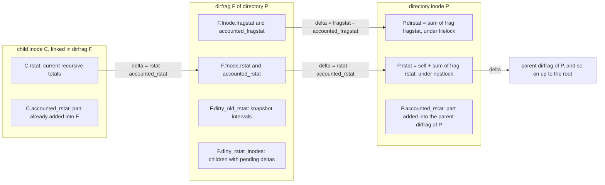
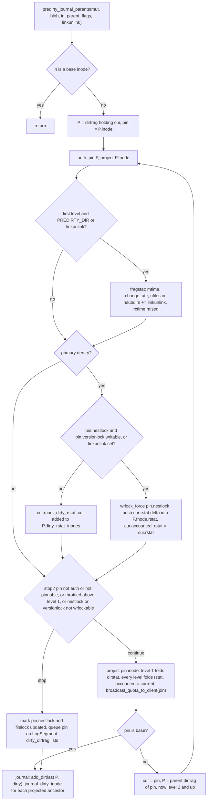
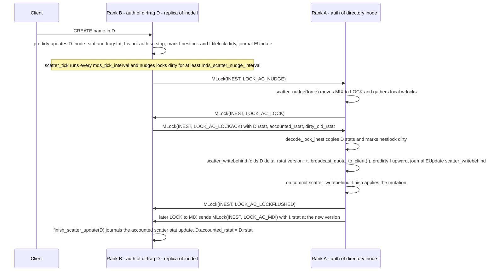

# Recursive statistics (rstat/dirstat), quotas and subvolumes

> Part of the C++ MDS project map ([README](../README.md)). Sources (commit `5f7e383ae6d`; Linux client snapshot 7.3-rc6+, HEAD `af32da41b03`): `src/mds/MDCache.cc` (rstat projection, quota broadcast and `predirty_journal_parents` at lines 1812-2488, ~680 LOC; stat repair 13597-13843), `src/mds/CInode.cc` (lock payloads 1938-2165, scatter/gather 2475-2880, `encode_inodestat` 3959-4430, subvolume/quarantine helpers), `src/mds/CDir.cc` (~250 LOC of stat helpers), `src/mds/Locker.cc` (scatter write-behind/nudge/tick 5211-5541, size/rctime updates from caps), `src/mds/Server.cc` (quota and subvolume vxattrs 6207-6721, EXDEV and entry limits), `src/mds/SnapRealm.{h,cc}` (691), `src/mds/snap.{h,cc}` (470), `src/include/cephfs/types.h` (stat and quota types), `src/mds/mdstypes.{h,cc}`, `src/messages/MClientQuota.h` (57), `src/messages/MGatherCaps.h` (41), `src/mds/MetricsHandler.cc`, `src/mds/Migrator.cc`, `src/mds/journal.cc`; kernel client `linux/fs/ceph/{quota.c (564), inode.c, xattr.c, dir.c, file.c, mds_client.c}`; libcephfs `src/client/Client.cc`; consumer `src/pybind/mgr/volumes/fs/operations/versions/subvolume_{base,v1,v2}.py`. Related: [cinode-and-inode-types](../04-cache/cinode-and-inode-types.md), [cdir-cdentry-and-cache-objects](../04-cache/cdir-cdentry-and-cache-objects.md), [dirfrags-and-fragmentation](../04-cache/dirfrags-and-fragmentation.md), [lock-types-and-state-machines](../05-locking/lock-types-and-state-machines.md), [acquiring-locks](../05-locking/acquiring-locks.md), [namespace-mutations](../03-request-path/namespace-mutations.md), [rename](../03-request-path/rename.md), [attributes-and-xattrs](../03-request-path/attributes-and-xattrs.md), [snapshots](snapshots.md), [capabilities](../02-client-protocol/capabilities.md), [kclient-expectations](../02-client-protocol/kclient-expectations.md), [libcephfs-fuse-ganesha-expectations](../02-client-protocol/libcephfs-fuse-ganesha-expectations.md), [events-and-replay](../06-journal/events-and-replay.md), [mdlog-and-journaler](../06-journal/mdlog-and-journaler.md), [subtree-migration](../08-multi-mds/subtree-migration.md), [balancer-and-pinning](../08-multi-mds/balancer-and-pinning.md), [scrub-and-damage](../11-background-services/scrub-and-damage.md), [strays-and-purge](../11-background-services/strays-and-purge.md), [metrics-and-subvolume-metrics](../12-qos-metrics-quiesce-quarantine/metrics-and-subvolume-metrics.md), [quarantine](../12-qos-metrics-quiesce-quarantine/quarantine.md), [quiesce](../12-qos-metrics-quiesce-quarantine/quiesce.md), [qos-dmclock-scheduler](../12-qos-metrics-quiesce-quarantine/qos-dmclock-scheduler.md), [mgr-tools-and-orchestration](../01-cluster-integration/mgr-tools-and-orchestration.md), [auth-and-mds-caps](../01-cluster-integration/auth-and-mds-caps.md), [process-and-threading](../00-architecture/process-and-threading.md), [mds_lock-analysis](../00-architecture/mds_lock-analysis.md).

## 1. Purpose and responsibilities

This page covers three tightly coupled MDS features:

1. **Directory statistics.**
   * `dirstat` (`frag_info_t`) holds the direct entry counts of one directory: files, subdirectories, the directory mtime and `change_attr`.
   * `rstat` (`nest_info_t`) holds recursive totals over a whole subtree: bytes, files, subdirectories, snapshots and the newest ctime (`rctime`).
   * Both are kept per dirfrag (in the `fnode_t`) and per inode. They are pushed up the tree eagerly where cheap (`MDCache::predirty_journal_parents`) and lazily otherwise, through scatter-gather on the `filelock`/`nestlock` scatterlocks.
   * Clients see them as `st_nlink`/`st_size` of directories and as the `ceph.dir.*` virtual xattrs. They also feed quota enforcement.
2. **Quotas.**
   * `ceph.quota.max_bytes` and `ceph.quota.max_files` are stored in `inode_t::quota` of a directory.
   * Setting a quota turns the directory into a snaprealm root, because clients find quotas by walking snaprealms.
   * The MDS pushes the quota and the usage to clients through `InodeStat` and `MClientQuota`.
   * **Only clients enforce quotas.** The C++ MDS never returns `EDQUOT`; no MDS code path tests `quota` against usage (grep of `src/mds` for `EDQUOT` finds nothing).
3. **Subvolumes.**
   * `ceph.dir.subvolume=1` sets the `SUBVOLUME` flag in the directory's snaprealm (`sr_t::flags`).
   * The flag makes the MDS reject link and rename across subvolume boundaries (`EXDEV`), forbid snapshots below the subvolume root (`EPERM`) and refuse nested subvolumes (`EINVAL`).
   * It also exempts hard links from "global" snaprealms, enables an optional copy-on-write (COW) sequence optimization, defines the scope of quarantine, and gives every inode a `subvolume_id` that clients use for per-subvolume I/O metrics.
   * A per-realm `SNAPDIR_VISIBILITY` flag (`ceph.dir.subvolume.snaps.visible`) is only advisory to libcephfs.
   * Directory entry limits (`mds_dir_max_entries`, `mds_bal_fragment_size_max`) are covered here as well, because they are computed from `dirstat`/`fragstat`.

The main consumer of all three is `mgr/volumes`, which builds its `/volumes/<group>/<subvol>/<uuid>` layout on these mechanisms (section 3.15).

## 2. Source map

| File | Class / function | Lines | Role |
|---|---|---|---|
| `src/include/cephfs/types.h` | `scatter_info_t`, `frag_info_t`, `nest_info_t` | 79-203 | Stat value types: `add_delta`, `add`, `sub`, `same_sums`, `version` |
| `src/include/cephfs/types.h` | `quota_max_t`, `quota_info_t` | 326-375 | `{max_bytes, max_files}`, `is_valid`, `is_enabled` |
| `src/include/cephfs/types.h` | `inode_t::dirstat`, `rstat`, `accounted_rstat`, `quota`; `truncate`, `is_dirty_rstat` | 987-992, 796-824 | Per-inode stat fields |
| `src/mds/mdstypes.h` / `.cc` | `fnode_t`, `old_rstat_t`; encoders for `frag_info_t`, `nest_info_t`, `fnode_t` | h:167-201; cc:46-235, 337-372 | Dirfrag header stats and their encodings |
| `src/mds/mdstypes.h` | `SubvolumeMetric` | 812-848 | Per-subvolume metric record, including `quota_bytes`/`used_bytes` |
| `src/mds/MDCache.h` | `PREDIRTY_PRIMARY`, `PREDIRTY_DIR`, `PREDIRTY_SHALLOW` | 152-154 | `predirty_journal_parents` flags |
| `src/mds/MDCache.cc` | `project_rstat_inode_to_frag`, `_project_rstat_inode_to_frag`, `project_rstat_frag_to_inode` | 1836-2101 | Move rstat deltas between child inode, dirfrag and directory inode (with snapshot intervals) |
| `src/mds/MDCache.cc` | `broadcast_quota_to_client` | 2103-2190 | `MClientQuota` thresholds, `MGatherCaps`, subvolume quota cache |
| `src/mds/MDCache.cc` | `predirty_journal_parents` (plus the design comment before it) | 2192-2488 | Synchronous upward propagation and the journal blob |
| `src/mds/MDCache.cc` | `log_stat` | 292-306 | `root_rfiles`/`root_rbytes`/`root_rsnaps` perf counters |
| `src/mds/MDCache.cc` | `do_realm_invalidate_and_update_notify`, `send_snap_update` | 10225-10306 | Realm cache invalidation, `MClientSnap` and `MMDSSnapUpdate` after a quota realm is created or the subvolume flag changes |
| `src/mds/MDCache.cc` | `repair_dirfrag_stats[_work]`, `repair_inode_stats[_work]`, `rdlock_dirfrags_stats[_work]` | 13597-13843 | Scrub-driven verification and repair |
| `src/mds/CDir.h` / `.cc` | `dirty_old_rstat`, `dirty_rstat_inodes`; `check_rstats`; `steal_dentry`; `split`/`merge` stat handling; `resync_accounted_*`; `assimilate_dirty_rstat_inodes[_finish]`; `decode_import` | h:639-642; cc:238-314, 883-940, 1042-1229, 1231-1302, 3018-3030 | Per-dirfrag stat state |
| `src/mds/CInode.cc` | `mark_dirty_rstat`, `clear_dirty_rstat` | 446-472 | Child whose rstat could not be pushed into its parent dirfrag |
| `src/mds/CInode.cc` | `encode/decode_lock_ifile`, `encode/decode_lock_inest` | 1938-2165 | Scatterlock payloads exchanged between ranks |
| `src/mds/CInode.cc` | `start_scatter`, `finish_scatter_update`, `finish_scatter_gather_update`, `finish_scatter_gather_update_accounted` | 2475-2880 | Gather (fold dirfrag deltas into the inode) and scatter (resync dirfrag accounted values) |
| `src/mds/CInode.cc` | `encode_inodestat` (dirstat, rstat, quota, `rsnaps`, `subvolume_id`) | 3959-4430 | Client-visible stat encoding |
| `src/mds/CInode.cc` | `get_subvolume_id`, `is_under_quarantine`, `validate_disk_state::_dirfrags` | 5597-5600, 5918-5945, 5201-5260 | Subvolume id, quarantine scope, scrub check |
| `src/mds/Locker.cc` | design comment, `scatter_writebehind[_finish]`, `scatter_eval`, `mark_updated_scatterlock`, `scatter_nudge`, `scatter_tick` | 5211-5541 | Deferred propagation engine |
| `src/mds/Locker.cc` | `wrlock_force`, `wrlock_try`, `maybe_set_subvolume_id`, `check_inode_max_size`, `_update_cap_fields`, `handle_file_lock` (NUDGE) | 1929-1980, 2501-2506, 3077-3180, 3978-4030, 6251-6262 | Lock helpers; file size and mtime into `rbytes`/`rctime` |
| `src/mds/journal.cc` | `LogSegment::try_to_expire`, `EMetaBlob::replay` | 200-216, 1325-1348 | Journal trimming forces propagation; replay re-marks dirty scatter state |
| `src/mds/Server.cc` | `check_quarantine_block`, `check_fragment_space`, `check_dir_max_entries`, `prepare_stray_dentry` | 3529-3609 | Quarantine gate and `ENOSPC` limits (including the stray dirfrag) |
| `src/mds/Server.cc` | `handle_client_getattr` (`CEPH_STAT_RSTAT` sets `want_auth`) | 4272-4290 | rstat reads go to the authoritative rank (auth) |
| `src/mds/Server.cc` | `xlock_policylock`, `parse_quota_vxattr`, `create_quota_realm` | 5930-5954, 6207-6273 | Quota parsing and locking |
| `src/mds/Server.cc` | `handle_client_setvxattr`: `ceph.quota*` 6456-6499, `ceph.dir.subvolume` 6546-6632, `ceph.dir.subvolume.snaps.visible` 6633-6721, common tail 6948-6966 | 6342-6966 | Setting quotas and subvolume flags |
| `src/mds/Server.cc` | `handle_client_getvxattr` (subvolume branches) | 7492-7508 | `ceph.dir.subvolume` and `.snaps.visible` reads |
| `src/mds/Server.cc` | `handle_client_link` EXDEV; `_link_local` / `handle_peer_link_prep` global-realm exemption | 7971-7983, 8035-8041, 8286-8295 | Hard-link rules |
| `src/mds/Server.cc` | `handle_client_rename` EXDEV; `_rename_prepare` predirty calls | 9548-9565, 10111-10140 | Rename rules |
| `src/mds/Server.cc` | `handle_client_mksnap` (subvolume `EPERM`, `rsnaps++`); `handle_client_rmsnap` (`rsnaps--`) | 11650-11655, 11717-11722, 11862 | Snapshot interplay |
| `src/mds/Server.h` | `is_ceph_vxattr`, `is_ceph_dir_vxattr`, `is_allowed_ceph_xattr` | 500-535, 549-557 | Which `ceph.*` names the MDS handles or stores |
| `src/mds/SnapRealm.h` / `.cc` | `get_subvolume_ino`, `check_cache`, `build_snap_trace`, `split_at` | h:104-107; cc:121-171, 338-415, 450-498 | Subvolume id computation; flags to clients |
| `src/mds/snap.h` / `.cc` | `sr_t::{PARENT_GLOBAL, SUBVOLUME, SNAPDIR_VISIBILITY}`, `sr_t::encode/decode` | h:88-128; cc:215-268 | Persistent realm flags |
| `src/messages/MClientQuota.h` | `MClientQuota` | 1-57 | MDS to client quota and usage push |
| `src/messages/MGatherCaps.h`, `src/mds/Migrator.cc` | `MGatherCaps`; `Migrator::handle_gather_caps`, `export_caps` | 3785-3855 | Replicas hand client caps on a quota inode to its auth |
| `src/mds/Capability.h` / `.cc` | `STATE_NOQUOTA`, `last_rbytes`, `last_rsize` | h:131, 264, 336-337; cc:180 | Per-client quota feedback state |
| `src/mds/MetricsHandler.cc`, `src/mds/MetricAggregator.cc` | `maybe_update_subvolume_quota`, `update_rank0`; `mds_subvolume_metrics` counters | 483-575, 647-676; 180-205, 275-310 | Subvolume quota and usage export |
| `src/mds/MDSDmclockScheduler.cc` | `convert_subvol_root` | 42-61 | QoS "volume" derived from the mount path, not from the subvolume flag |
| `linux/fs/ceph/quota.c` | `ceph_handle_quota`, `get_quota_realm`, `check_quota_exceeded`, `ceph_quota_*` | 13-563 | Kernel-side quota |
| `src/client/Client.cc` | `handle_quota`, `get_quota_root`, `check_quota_condition`, `is_quota_*`, `_statfs`, `add_update_inode` | 5693-5716, 18320-18410, 13637-13740, 1199-1211 | libcephfs-side quota |

## 3. How it works

### 3.1 The two statistic families and where they live



* **`frag_info_t` (dirstat/fragstat)** `{version, mtime, change_attr, nfiles, nsubdirs}` (`src/include/cephfs/types.h:83 (frag_info_t)`).
  * `add_delta(cur, acc)` adds `cur - acc` to the counts and takes the maximum of `mtime` and `change_attr`, reporting through `touched_mtime`/`touched_chattr` whether either increased.
  * `same_sums` compares counts exactly and `mtime` as `<=`.
  * Lives in `fnode_t::fragstat`/`accounted_fragstat` of every dirfrag and in `inode_t::dirstat` of the directory. The directory inode's `filelock` (IFILE scatterlock) protects it (comment `// protected by my filelock`, `src/include/cephfs/types.h:988 (inode_t::dirstat)`).
* **`nest_info_t` (rstat)** `{version, rctime, rbytes, rfiles, rsubdirs, rsnaps}` (`src/include/cephfs/types.h:144 (nest_info_t)`).
  * `add(other, fac)` sums the counts with factor `fac`. `rctime` is always combined as a maximum, so subtraction (`sub` = `add(-1)`) never lowers `rctime`.
  * `rsize() = rfiles + rsubdirs`.
  * Lives in `fnode_t::rstat`/`accounted_rstat`, in `CDir::dirty_old_rstat` (only with `mds_snap_rstat`), and in `inode_t::rstat`/`accounted_rstat` of every inode, files included.
  * The directory's `nestlock` (INEST scatterlock) protects `rstat`. A child's `accounted_rstat` is protected by the parent directory's nestlock (`src/include/cephfs/types.h:989-990 (inode_t::rstat, accounted_rstat)`).
* **`version`** (inherited from `scatter_info_t`, `src/include/cephfs/types.h:79 (scatter_info_t)`) is a scatter-gather epoch, not a count. A dirfrag's `accounted_*.version` records the inode `dirstat.version`/`rstat.version` at which its accounted values were last synchronized (section 3.6).
* **Wire encodings.**
  * `frag_info_t` v3: `version, mtime, nfiles, nsubdirs, change_attr`.
  * `nest_info_t` v3: `version, rbytes, rfiles, rsubdirs, ranchors(=0, removed field), rsnaps, rctime`.
  * `fnode_t` v4: `version, snap_purged_thru, fragstat, accounted_fragstat, rstat, accounted_rstat, damage_flags, recursive/localized scrub version+stamp`.
  * Sources: `src/mds/mdstypes.cc:46 (frag_info_t::encode)`, `:119 (nest_info_t::encode)`, `:337 (fnode_t::encode)`.

### 3.2 What each field counts

| Field | Regular file / symlink / special | Directory inode | Dirfrag `fnode` | Updated by |
|---|---|---|---|---|
| `dirstat.nfiles` | - | sum over frags | number of head non-directory primary dentries **plus every head remote (hard-link) dentry** (`src/mds/CDir.cc:238 (CDir::check_rstats)`). `CDir::steal_dentry` (fragment split/merge) counts a remote dentry whose `d_type` is `DT_DIR` in `nsubdirs` instead (`src/mds/CDir.cc:928-932`) | `linkunlink=±1` (with or without `PREDIRTY_DIR`) on create, unlink, link, rename |
| `dirstat.nsubdirs` | - | sum over frags | head primary directory dentries | as above |
| `dirstat.mtime`, `change_attr` | - | max over frags; directory `mtime = ctime = dirstat.mtime` and `change_attr++` when a fold raises them (`src/mds/MDCache.cc:2410-2415 (MDCache::predirty_journal_parents)`) | `mtime = op stamp`, `change_attr++` on every `PREDIRTY_DIR` (`src/mds/MDCache.cc:2286-2295`) | entry add or remove |
| `rstat.rbytes` | `= size`: logical file size, symlink target length (`src/mds/Server.cc:7835 (Server::handle_client_symlink)`) | sum of frags (a directory adds 0 itself) | sum of children's `accounted_rstat` | setattr size (`src/mds/Server.cc:5736 (Server::handle_client_setattr)`), truncate (`inode_t::truncate`, `src/include/cephfs/types.h:806`), cap flush **growth only** (`size > pi->size`, `src/mds/Locker.cc:4017-4022 (Locker::_update_cap_fields)`), max_size or size update (`src/mds/Locker.cc:3146 (Locker::check_inode_max_size)`) |
| `rstat.rfiles` | 1 (set at create: `src/mds/Server.cc:5003 (handle_client_openc)`, `:7633 (handle_client_mknod)`, `:7836 (handle_client_symlink)`) | sum | sum | create, unlink, rename |
| `rstat.rsubdirs` | 0 | **1 for itself** + sum (`src/mds/Server.cc:7734 (handle_client_mkdir)`; gather starts at `rsubdirs = 1`, `src/mds/CInode.cc:2757 (CInode::finish_scatter_gather_update)`) | sum | mkdir, rmdir, rename |
| `rstat.rsnaps` | 0 | own `srnode->snaps.size()` + sum (`src/mds/CInode.cc:2758-2759`); `++` on mksnap, `--` on rmsnap (`src/mds/Server.cc:11721`, `:11862`) | sum | mksnap, rmsnap |
| `rstat.rctime` | max(op stamp) over ctime-changing ops and data mtime flushes (`src/mds/Locker.cc:3991`, `:4014`) | max over subtree, including its own ctime and `fragstat.mtime` (`src/mds/MDCache.cc:2290-2292`) | max | any mutation whose stamp is newer; never decreases |
| `accounted_rstat` | part of `rstat` already in the parent dirfrag; new inodes start with `accounted_rstat = rstat` (for example `src/mds/Server.cc:7735`) | same | `accounted_rstat`: part already folded into the inode | `_project_rstat_inode_to_frag` sets `accounted_rstat = rstat` (`src/mds/MDCache.cc:2022-2025`) |

Consequences that clients can observe:

* A hard link counts in `dirstat` of every directory that holds a dentry for it. It counts **once** in `rstat`, at the primary dentry.
* `rentries = rfiles + rsubdirs` includes the directory itself.
* An empty directory has `rsubdirs = 1`.
* `max_files` quotas compare against `rsize()`, so the quota directory counts against its own `max_files` (`src/mds/MDCache.cc:2156 (broadcast_quota_to_client)`; `linux/fs/ceph/quota.c:385 (check_quota_exceeded)`).
* Unlinking a file (open or not) moves its rstat out of the user tree immediately. `_unlink_local` predirties `-1` on the old parent and `+1` on the stray directory (`src/mds/Server.cc:8793-8794 (Server::_unlink_local)`), and stray directories live under `~mdsN`, which is a separate base inode outside `/`.
* `rbytes` counts logical (not allocated) sizes of live (head) inodes. Data retained only by snapshots is not counted. The docs state the quota consequence explicitly (`doc/cephfs/quota.rst`, "Snapshot file data which has since been deleted or changed does not count towards the quota").

### 3.3 Eager propagation: `MDCache::predirty_journal_parents`

Every mutation that changes an inode's stats or a directory's entries calls `predirty_journal_parents(mut, blob, in, parent, flags, linkunlink, cfollows)` before journaling (`src/mds/MDCache.cc:2224`).

**Flags** (`src/mds/MDCache.h:152-154`):

* `PREDIRTY_PRIMARY`: `in` is linked by a primary dentry, so push its rstat into `parent`.
* `PREDIRTY_DIR`: update the parent directory's mtime, `change_attr` and size (`fragstat`).
* `PREDIRTY_SHALLOW` ("only go to immediate parent (for easier rollback)") is accepted but **ignored**: it is only printed (`src/mds/MDCache.cc:2231`, `:2244`). Its two users, the rename source (`src/mds/Server.cc:10137 (Server::_rename_prepare)`) and the peer side of a remote link (`:8340 (Server::handle_peer_link_prep)`), still propagate up to the root.

**Callers.**

| Operation | Calls (`in`, `parent`, flags, `linkunlink`) | Source |
|---|---|---|
| openc, mknod, mkdir, symlink | (new inode, dentry dir, `PRIMARY\|DIR`, +1) | `src/mds/Server.cc:5031`, `:7677`, `:7762`, `:7847` |
| link (local) | (target, new dentry dir, `DIR`, +1) and (target, primary parent, `PRIMARY`, 0) | `src/mds/Server.cc:8045-8046 (Server::_link_local)` |
| link (target auth on another rank) | leader: (target, new dentry dir, `DIR`, ±1); peer prep: (target, -, `SHALLOW\|PRIMARY`, 0) | `src/mds/Server.cc:8164`, `:8169 (Server::_link_remote)`, `:8340 (Server::handle_peer_link_prep)` |
| unlink of a primary dentry | (inode, dir, `PRIMARY\|DIR`, -1) and (inode, stray dir, `PRIMARY\|DIR`, +1) | `src/mds/Server.cc:8793-8794` |
| unlink of a remote dentry | (inode, dir, `DIR`, -1) and (inode, own primary, `PRIMARY`, 0) | `src/mds/Server.cc:8800-8801` |
| rename | source dir (`DIR` [+`PRIMARY` if the directories differ], -1), destination dir (same flags, +1), overwritten target to stray; `DIR` is omitted for "silent" stray reintegration/migration renames | `src/mds/Server.cc:10098-10140 (Server::_rename_prepare)` |
| setattr, open with `O_TRUNC`, setlayout, setdirlayout, setvxattr, setxattr, removexattr, quarantine flag | (inode, -, `PRIMARY`, 0) | `src/mds/Server.cc:5767`, `:5824`, `:5924`, `:6038`, `:6960`, `:7242`, `:7311`, `:5409` |
| max_size/size update, snap flush, cap flush, truncate finish, file-recovery COW, scrub uninline | (inode, -, `PRIMARY`, 0[, follows]) | `src/mds/Locker.cc:3172 (check_inode_max_size)`, `:3966 (_do_snap_update)`, `:4235 (_do_cap_update)`; `src/mds/MDCache.cc:6801 (truncate_inode_finish)`, `:6410 (queue_file_recover)`, `:13472 (C_IO_DataUninlined)` |
| mksnap, rmsnap, renamesnap, snap metadata op | (dir inode, -, `PRIMARY`, 0) | `src/mds/Server.cc:11741`, `:11877`, `:12023`, `:12163` |
| scatter write-behind | (dir inode, -, `PRIMARY`, 0) | `src/mds/Locker.cc:5284 (Locker::scatter_writebehind)` |
| fragment and fragment rollback | (dir inode, -, `PRIMARY`, 0) | `src/mds/MDCache.cc:12387 (dispatch_fragment_dir)`, `:12849 (rollback_uncommitted_fragments)` |
| system file creation | (new inode, dir, `PRIMARY\|DIR`, +1); `DIR` only for `~mdsN` | `src/mds/MDCache.cc:623`, `:626 (_create_system_file)` |

**Algorithm** (all line numbers in `src/mds/MDCache.cc`):

1. Stamp the mutation (`mds_stamp`). Return if `in` is a base inode (root, `~mdsN`) (`:2237`). With `flags == 0 && linkunlink == 0`, only add directory context to the blob (`:2253-2256`).
2. Loop over the dirfrag `P` that holds `cur`'s dentry, with `pin = P->inode` (`:2264`):
   1. `auth_pin(P)`; `pf = P->project_fnode(mut)`; `pf->version = P->pre_dirty()` (`:2272-2275`).
   2. **Directory part.** Applies only when `PREDIRTY_DIR || linkunlink`, which happens only on the first iteration.
      * The caller must hold wrlocks on `pin->filelock` and `pin->nestlock`, and `cfollows == CEPH_NOSNAP` (asserted, `:2278-2280`). For creates these wrlocks come from `MDCache::path_traverse` (`src/mds/MDCache.cc:8650-8651`).
      * Stale accounted values are resynced (`resync_accounted_fragstat/rstat`, `:2283-2284`).
      * With `PREDIRTY_DIR`: `fragstat.mtime = op stamp`, `fragstat.change_attr++`, and `rstat.rctime` is raised to that mtime (`:2286-2295`).
      * With `linkunlink`: `fragstat.nsubdirs` or `nfiles` `+= linkunlink`. `rstat` counts are **not** touched here; they change through the child's rstat below (`:2297-2305`).
   3. **rstat part (child to dirfrag).** Only for primary dentries (`:2310`).
      * If `linkunlink == 0` and `pin->nestlock` or `pin->versionlock` cannot be wrlocked, call `cur->mark_dirty_rstat()` (section 3.5) and do not touch `P` (`:2312-2316`).
      * Otherwise take a wrlock on `pin->nestlock` with `wrlock_force` if not already held ("we are about to write into the dirfrag fnode and that needs to commit before the lock can cycle", `:2318-2328`).
      * Pick `first = follows + 1` from the parent realm's newest seq, `resync_accounted_rstat()`, `project_rstat_inode_to_frag(...)`, then `cur->clear_dirty_rstat()` (`:2330-2345`).
   4. **Stop test** (`:2347-2376`). Stop when any of these holds:
      * `pin` is not auth, or it cannot be auth-pinned (freezing or frozen);
      * this is **not the first iteration** and `pin->last_dirstat_prop` is newer than `mds_dirstat_min_interval` (default 1 s);
      * this mutation does not already wrlock `pin->nestlock` and `pin->versionlock` cannot be wrlocked or `wrlock_try(pin->nestlock)` fails. `wrlock_try` gives up when the lock is unstable or `pin` is not auth. It moves the lock to LOCK (`simple_lock`) only if the lock is not dirty, scatter is not wanted and `pin` has no dirfrag that is a subtree root or being exported (`has_subtree_or_exporting_dirfrag`), so as not to trigger `scatter_writebehind`/`start_scatter` from inside another journal entry (`src/mds/Locker.cc:1947-1979 (Locker::wrlock_try)`).
   5. **On stop** (`:2377-2387`): call `mark_updated_scatterlock(&pin->nestlock)`, queue `pin` on `mut->ls->dirty_dirfrag_nest` and `mut->add_updated_lock(nestlock)`. For directory changes do the same for `filelock` and `dirty_dirfrag_dir`. Then break. `P`'s fnode already carries the delta; the directory inode `pin` catches up later (section 3.5).
   6. **Otherwise project the directory inode.**
      * `local_wrlock_grab(pin->versionlock)`; `pin->last_dirstat_prop = stamp`; `auth_pin(pin)`; `pin->pre_cow_old_inode()`; `pi = pin->project_inode(mut)` (`:2389-2403`).
      * **First level only** (`PREDIRTY_DIR || linkunlink`): fold `dirstat += fragstat - accounted_fragstat` and set `accounted_fragstat = fragstat`. If the fold raised `dirstat.mtime`, set the inode `mtime = ctime = dirstat.mtime`; if it raised `dirstat.change_attr`, do the inode `change_attr++` (`:2406-2415`). Higher levels fold only the rstat; a directory's dirstat changes only through its own entries.
      * Fold the rstat: `project_rstat_frag_to_inode` for every `dirty_old_rstat` interval (only with `mds_snap_rstat`) and for `[P->first, head]`, then set `accounted_rstat = rstat` (`:2438-2449`).
      * **Single-dirfrag sanity checks.** On a size or `rbytes` mismatch the code writes a `clog` error and "trusts the dirfrag" by **overwriting** the inode values. It asserts only when `mds_verify_scatter` is set (`:2419-2430`, `:2451-2461`). The rstat overwrite copies all fields of the frag rstat, including `rsubdirs`/`rsnaps`, which do not contain the directory's own `+1`/own snaps (derived from code reading).
      * `P->check_rstats()` (active only with `mds_debug_scatterstat`); `broadcast_quota_to_client(pin)` (section 3.10) (`:2464-2465`).
      * Stop at a base inode. Otherwise continue with `cur = pin`, `linkunlink = 0`, `PREDIRTY_DIR` off and `primary = true` (`:2466-2476`).
3. Journal: `add_dir_context(P)` and `add_dir(P, dirty=true)` for the **last** dirfrag reached, then `journal_dirty_inode` for every projected ancestor inode. Each non-base one adds a primary-dentry lump carrying its parent dirfrag's projected fnode; the root inode is journaled with `add_root` (`:2480-2486`; `src/mds/MDCache.cc:1812-1830 (MDCache::journal_dirty_inode)`; `src/mds/events/EMetaBlob.h:448 (EMetaBlob::add_primary_dentry)`). The first dirfrag D1 reaches the blob through the caller's own dentry or inode lump.

The rule that results, for an operation on inode X in directory D1 (inode I1), whose parent is D2 (inode I2):

* D1's fnode is always projected and journaled. Its fragstat always gets the entry change. With `PREDIRTY_PRIMARY`, its rstat gets X's delta unless `linkunlink == 0` and I1's nestlock or versionlock is not writable, in which case X is marked dirty-rstat on D1.
* I1 is updated in the same journal event whenever it is auth and pinnable. Callers using `PREDIRTY_DIR`/`linkunlink` already hold I1's nestlock wrlock; `PRIMARY`-only callers (setattr, cap flush) additionally need I1's versionlock and a successful `wrlock_try` on I1's nestlock. This is the "first" level and is never throttled.
* D2's fnode receives I1's delta only if level 1 continued (I1 projected) and I2's nestlock and versionlock can be written. If level 1 continued but those locks are not writable, I1 is marked dirty-rstat on D2. If level 1 stopped, D2 is not touched: the delta waits in D1's fnode and I1's nestlock is marked updated.
* I2 and each higher ancestor are projected only if their `last_dirstat_prop` is older than `mds_dirstat_min_interval` (and they are auth, pinnable and their locks are writable).
* The walk always ends on a dirfrag: either one whose inode it could not project (that inode's nestlock, and for directory changes its filelock, is then marked updated), or the dirfrag of a base inode (root or `~mdsN`) after that base inode was projected.



### 3.4 Moving deltas: inode to dirfrag, dirfrag to inode, and snapshots

**`project_rstat_inode_to_frag(mut, cur, parent, first, linkunlink, prealm)`** (`src/mds/MDCache.cc:1836`):

* The update interval is `[max(first, parentdn->first), cur->last]`. Snapshotted inodes (`cur->last != CEPH_NOSNAP`) contribute only if a snapshot lies inside their range.
* The code comments that rstats of "old parents" after a directory rename are propagated incompletely ("FIXME", `:1850-1854`).
* A peer-rename source inode that is ambiguous-auth and frozen is not updated (`:1871-1877`).
* The delta is computed by `_project_rstat_inode_to_frag` (`:1909`):
  * `linkunlink == 0`: `rstat - accounted_rstat`;
  * `linkunlink < 0`: `-accounted_rstat` (unlink subtracts what the parent had accounted);
  * `linkunlink > 0`: `+rstat`.
* The delta is applied to `P.fnode.rstat` for the head interval. With `mds_snap_rstat`, older intervals go to sparse `dirty_old_rstat` entries keyed by `last` and split as needed.
* Without `mds_snap_rstat` (the default) the loop breaks after the head: "drop snapshots' rstats" (`:1957-1959`).
* Finally `inode.accounted_rstat = inode.rstat` when the inode is a projected (updatable) one (`:2022-2025`).
* With `mds_snap_rstat`, each `cur->dirty_old_rstats` entry is also pushed for its snapshot range (`:1894-1903`).

**`project_rstat_frag_to_inode(rstat, accounted, ofirst, last, pin, cow_head)`** (`src/mds/MDCache.cc:2029`):

* Adds `rstat - accounted` to the projected head inode.
* If the frag range begins after `pin->first`, it COWs the head first (`cow_old_inode(first-1, ...)`) so that the pre-snapshot rstat stays in `old_inodes`.
* For older intervals it splits `old_inodes` entries and records them in `pin->dirty_old_rstats`.

`CInode::pre_cow_old_inode` (`src/mds/CInode.cc:3222`) chooses the COW sequence. The global snaprealm seq is used when `mds_use_global_snaprealm_seq_for_subvol` is true (the default); otherwise subvolume realms and realms without snapshots use their own seq (section 3.13).

### 3.5 Lazy propagation: dirty rstat, updated scatterlocks, tick, nudge, journal expiry

When eager propagation stops, the pending state is recorded in three places:

| Pending state | Recorded by | Consumed by |
|---|---|---|
| Child inode whose delta is not yet in its parent frag: `CInode::STATE_DIRTYRSTAT`, pinned with `PIN_DIRTYRSTAT`, linked on `parent CDir::dirty_rstat_inodes` | `CInode::mark_dirty_rstat` (`src/mds/CInode.cc:446`). When the parent dentry is auth it also calls `mark_updated_scatterlock` on the parent directory inode's nestlock (no LogSegment list). Under a cross-MDS rename (`STATE_AMBIGUOUSAUTH`, parent dentry not auth) it is not listed (`:452-461`) | `CDir::assimilate_dirty_rstat_inodes` (projects each non-frozen dirty child into the frag) plus `_finish` (journals them and clears the state; if some remain, the nestlock is marked updated again) (`src/mds/CDir.cc:1259-1302`), called during gather or replica scatter (section 3.6) |
| Dirfrag with `fnode.rstat != accounted_rstat` or `fragstat != accounted_fragstat`: the directory inode's `nestlock`/`filelock` is *dirty* (`ScatterLock::mark_dirty`) and queued | `Locker::mark_updated_scatterlock` sets the dirty flag and appends to `Locker::updated_scatterlocks` with an update stamp (`src/mds/Locker.cc:5381`) | `Locker::scatter_tick` (`:5517`) |
| Inode on `LogSegment::dirty_dirfrag_nest`, `dirty_dirfrag_dir`, `dirty_dirfrag_dirfragtree` | predirty stop path, replica scatter update (`src/mds/CInode.cc:2583`), `CDir::decode_import` (`src/mds/CDir.cc:3020-3028`), `EMetaBlob::replay` of dirty lumps (`src/mds/journal.cc:1325-1340`), repair (`src/mds/MDCache.cc:13685`, `:13694`, `:13767-13769`) | `LogSegment::try_to_expire` calls `scatter_nudge(lock, gather)` for each one, so **a journal segment cannot expire until its dirty scatter stats have been flushed**. An inode leaves these lists only when the lock's flush finishes (`ScatterLock::finish_flush` → `CInode::clear_dirty_scattered`, `src/mds/ScatterLock.h:120-128`, `src/mds/CInode.cc:2447-2461`), i.e. after the write-behind that folded the stats has committed (on a replica, after `LOCK_AC_LOCKFLUSHED`) (`src/mds/journal.cc:200-216`) |

**`Locker::scatter_tick`** runs from `Locker::tick`, which `MDSRankDispatcher::tick` calls every `mds_tick_interval` (default 5 s) in clientreplay, active and stopping. It is skipped while the beacon is laggy (`src/mds/MDSRank.cc:710-737`). It walks `updated_scatterlocks` once:

* locks that are no longer dirty are dropped;
* it stops at the first lock updated less than `mds_scatter_nudge_interval` (default 5 s) ago;
* it calls `scatter_nudge(lock, nullptr)` on older ones;
* it then flushes the MDLog (`src/mds/Locker.cc:5517-5540`).

**`Locker::scatter_nudge(lock, c, forcelockchange)`** (`src/mds/Locker.cc:5404`):

* A frozen, freezing or ambiguous-auth parent means wait or requeue. The code calls this "starvation prone".
* **On the auth:**
  * cycle the lock state: a replicated IFILE/INEST in a state other than MIX goes to `scatter_mix`; otherwise LOCK, and from LOCK to SYNC;
  * a read-only filesystem forces SYNC;
  * it repeats while each transition completes immediately (the lock stays stable), at most two cycles; as soon as a transition needs a gather (lock unstable) it returns, queuing the caller's context on `WAIT_STABLE`. A lock that is dirty and not flushed runs `scatter_writebehind` from `eval_gather` when its gather completes (`src/mds/Locker.cc:1407-1410`).
* **On a replica:** send `MLock(LOCK_AC_NUDGE)` to the auth and requeue while dirty. The auth handles NUDGE with `scatter_nudge(lock, 0, true)` and flushes its log, but only if it is auth and the inode is replicated (`src/mds/Locker.cc:6251-6262 (Locker::handle_file_lock)`).

**`Locker::scatter_eval`** for INEST "in general, we want to keep INEST writable at all times": when not rdlocked, the lock goes to MIX if replicated, otherwise to LOCK (`src/mds/Locker.cc:5352-5363`).

### 3.6 Scatter-gather of dirstat and rstat across dirfrags and ranks

The design comment `src/mds/Locker.cc:5211-5247` gives the rules:

* "The scatter/gather is driven by the inode lock." In MIX (scattered) state, dirfrags may be written only if their accounted stat version matches the inode's current version.
* On gather the inode assimilates the diffs only of frags whose accounted version is current, increments the version and journals it.
* On scatter, dirfrag auths update their accounted stats to the new version. A frag that cannot do so (frozen, not loaded) stays *stale* and is resynced later.

**Gather on the inode auth** (`CInode::finish_scatter_gather_update`, `src/mds/CInode.cc:2624`), called from `Locker::scatter_writebehind` (`src/mds/Locker.cc:5260`):

1. `scatter_writebehind` forces a wrlock, does `pre_cow_old_inode`, projects the inode, calls `finish_scatter_gather_update(type)` and then `lock->start_flush()`.
2. For IFILE:
   * `dirstat.version++`.
   * For each in-memory dirfrag: if `accounted_fragstat.version == version-1`, add `fragstat - accounted_fragstat`; otherwise skip it as "STALE".
   * Auth, non-frozen frags get `accounted_fragstat = fragstat` with both versions set to the new version.
   * Negative frag counts produce a `clog` error and are clamped to 0.
   * If all leaves are loaded and the sum differs, the code writes a `clog` error "unmatched fragstat" (silent under `STATE_REPAIRSTATS`) and overwrites the inode with the frag sums. Negative inode counts are clamped (`:2632-2746`).
3. For INEST:
   * the fresh sum starts at `{rsubdirs = 1, rsnaps = own snaps}`; `rstat.version++`;
   * for every non-stale frag (`accounted_rstat.version == version-1`): if it is updatable (loaded, auth, not frozen) it first assimilates its `dirty_rstat_inodes`; then `project_rstat_frag_to_inode` runs for the head and every `dirty_old_rstat`. Dirty-rstat children in frags owned by other ranks are not assimilated here (see 3.7);
   * updatable frags get `accounted_rstat = rstat` and `dirty_old_rstat.clear()`;
   * if all leaf frags are loaded and the sum differs, a `clog` error "inconsistent rstat on inode" (silent under `STATE_REPAIRSTATS`) and the inode is overwritten with the fresh sum, keeping its `version` and the larger `rctime`;
   * last, `broadcast_quota_to_client(this)` (`:2748-2849`).
4. `scatter_writebehind` journals `EUpdate("scatter_writebehind")` containing `predirty_journal_parents(in, PRIMARY)` (continuing upward propagation), the inode, and every updated auth frag (`finish_scatter_gather_update_accounted`, which also journals assimilated dirty-rstat children, `src/mds/CInode.cc:2860`). It then flushes the log (`src/mds/Locker.cc:5282-5290`).
5. `scatter_writebehind_finish` applies the mutation and calls `finish_flush`. If replicas may have flushed in a MIX-to-LOCK transition it sends `LOCK_AC_LOCKFLUSHED`, and it wakes `WAIT_STABLE` waiters (`src/mds/Locker.cc:5293-5320`).

**Lock payloads.**

* Leaving MIX, replicas send their auth frags' stats in the ack: `LOCK_AC_LOCKACK`/`SYNCACK` with `encode_locked_state` (`src/mds/Locker.cc:1352-1385 (Locker::eval_gather)`).
* `encode_lock_inest` (v1) carries the inode `version` or the replica dirty flag, the inode `rstat`, and for each frag that the sender is auth for (or all frags, on the auth) `{frag, dir->first, rstat, accounted_rstat, dirty_old_rstat}` (`src/mds/CInode.cc:2073`). `encode_lock_ifile` (v2) is the same for `dirstat` and fragstats; from the auth it also carries `ctime/mtime/atime/time_warp_seq`, for non-directories `layout/size/truncate_*/client_ranges/inline_data`, and `fscrypt_file` (`:1938-1984`).
* On the **auth**, `decode_lock_inest` overwrites its copy of each listed (non-owned) frag's fnode stats and marks the nestlock dirty if the replica reported dirty, or if `rstat != accounted_rstat` or `dirty_old_rstat` is non-empty (`:2109-2162`).
* On a **replica**, it takes the inode `rstat` and calls `finish_scatter_update` for every frag the replica is auth for.

**Scatter.**

* `CInode::start_scatter` runs on the auth when entering MIX (`src/mds/CInode.cc:2475`).
* `decode_lock_*` runs on replicas.
* Both call `finish_scatter_update(lock, dir, inode_version, dir_accounted_version)` (`:2521`):
  * a frozen or unloaded frag stays stale;
  * otherwise, if the versions differ, it journals `EUpdate("lock ifile accounted scatter stat update")` or `EUpdate("lock inest accounted scatter stat update")`, setting the frag's `accounted_* = current` at the new version;
  * in that same journaled update, a replica in MIX also assimilates the frag's dirty-rstat children and, if a delta remains, wrlocks the nestlock, marks it updated and queues the inode on `dirty_dirfrag_nest` (`:2553-2584`). Apart from a child's own later mutation (which pushes that child's pending delta through `predirty_journal_parents`), this is the only place where a rank that is not the inode's auth assimilates its dirty-rstat children, and it runs only when a scatter delivers a new version.

**Resync before write.**

* `CDir::resync_accounted_rstat` sets `accounted_rstat = rstat` (and clears `dirty_old_rstat`) when `accounted_rstat.version != inode rstat.version`; `resync_accounted_fragstat` does the same for `fragstat` (`src/mds/CDir.cc:1231-1257`).
* The frag's previous delta was already folded during the gather that bumped the version, which is why it may be dropped (the protocol forbids writes to stale frags in between).
* Note that the stat versions only advance by gather, never by individual writes.



(Simplified: exact intermediate states such as `LOCK_MIX_LOCK2` are in [lock-types-and-state-machines](../05-locking/lock-types-and-state-machines.md).)

### 3.7 Consistency guarantees (what is exact, and when)

| Value | Exact when | Otherwise |
|---|---|---|
| `fnode.fragstat` of a dirfrag | always: updated in the same journal event as the entry change (`linkunlink`, normally with `PREDIRTY_DIR`) | - |
| Directory inode `dirstat` (entries, nlink, dir mtime/ctime, `change_attr`) | after a gather (`filelock` rdlock or SYNC). A `GETATTR` with `Fs` rdlocks `filelock` unless the client holds `Fx`, or the filelock is mid-transition with no wrlocks and already readable by that client (an optimization that skips the rdlock, `src/mds/Server.cc:4365-4397 (handle_client_getattr)`). Also exact immediately for a single-rank, auth, non-frozen directory, because level 1 always propagates | lags while frags are on other ranks or the inode is frozen; folded by nudges (≥ `mds_scatter_nudge_interval`) |
| `fnode.rstat` | equals Σ children `accounted_rstat` at all times (`check_rstats` invariant) | children with `STATE_DIRTYRSTAT` have unpushed deltas |
| Inode `rstat` | guaranteed only after a nestlock rdlock gather, and even then only for frags the inode's auth can update. Only scrub/repair takes one (`MDCache::rdlock_dirfrags_stats_work`, `repair_inode_stats_work`: `src/mds/MDCache.cc:13777`, `:13835`); migration and fragmentation use `lock_scatter_gather` state pins. Dirty-rstat children in frags owned by other ranks reach the inode only after a further cycle: the replica assimilates them when the following scatter delivers the new version (`src/mds/CInode.cc:2553-2584`), or when the child itself is mutated again, and the next gather folds them | eventually consistent. Each level above the first may be deferred by `mds_dirstat_min_interval` (1 s) plus the nudge path (≥ 5 s per deferred level, more across ranks). No client request rdlocks `nestlock`: `GETATTR` with `CEPH_STAT_RSTAT` only forces routing to the auth (`src/mds/Server.cc:4286-4287`) |
| Quota usage seen by clients | never exact | from the `InodeStat` of auth replies and from `MClientQuota` pushed at thresholds (section 3.10). Upstream docs: "writers will be stopped within tens of seconds of crossing the configured limit" (`doc/cephfs/quota.rst`) |
| Snapshot rstats (`.snap` views) | with `mds_snap_rstat=true` | default: frozen as COWed into `old_inodes`; not maintained |

### 3.8 Verification and repair

* `CDir::check_rstats(scrub)` recomputes fragstat and rstat from head dentries (primary: `accounted_rstat` and type; remote: `nfiles++`).
  * It is active only under `mds_debug_scatterstat` or during scrub, and only on a complete, auth, non-frozen frag.
  * Outside scrub a mismatch **asserts** (`src/mds/CDir.cc:238-314`).
* Scrub (`CInode::validate_disk_state`, `_dirfrags`) sums `accounted_*` over all frags, `+1 rsubdirs` and own snaps, and compares the result with the inode (`src/mds/CInode.cc:5201-5250`).
  * With `repair` it calls `MDCache::repair_inode_stats`, which runs the internal op `CEPH_MDS_OP_REPAIR_INODESTATS` (0x1505). That op loads all frags, marks `filelock`/`nestlock` dirty with `STATE_REPAIRSTATS` set, and rdlocks both so that the gather overwrites mismatches silently (`src/mds/MDCache.cc:13704-13809`).
  * `CDir::scrub_local` calls `repair_dirfrag_stats` (`CEPH_MDS_OP_REPAIR_FRAGSTATS`, 0x1504). It rebuilds a frag's fragstat and rstat from its dentries under wrlocks and journals `EUpdate("repair_dirfrag")` (`src/mds/CDir.cc:3836-3846`, `src/mds/MDCache.cc:13609-13702`).
  * Perf counter `mds.scrub_dirfrag_rstats` (`src/mds/CInode.cc:5159`).

### 3.9 Quotas: data model and how a quota is set

`quota_info_t {int64 max_bytes = 0, int64 max_files = 0}` uses the versioned encoding v1/compat 1 (`src/include/cephfs/types.h:332`):

* `is_valid()` requires both values to be ≥ 0;
* `is_enabled(type)` means non-zero;
* 0 means "no limit".

The quota is stored in `inode_t::quota`. The directory's `policylock` (IPOLICY payload) carries it to replicas (see [cinode-and-inode-types](../04-cache/cinode-and-inode-types.md)).

**Setting** (`SETXATTR`/`RMXATTR` with a name beginning `ceph.quota`; `src/mds/Server.cc:7151 (handle_client_setxattr)` then `handle_client_setvxattr`):

1. `try_get_auth_inode(ino)`: forward to the auth, `ESTALE` if the inode is not in this rank's cache or is purging (no `open_ino` here) (`src/mds/Server.cc:5956-5969`). `check_access(MAY_SET_VXATTR)` requires the `p` flag of the MDS cap (`src/mds/MDSAuthCaps.cc:322`; see [auth-and-mds-caps](../01-cluster-integration/auth-and-mds-caps.md)).
2. Not a directory gives `EINVAL`. `RMXATTR` with no quota enabled succeeds as a no-op; otherwise the value becomes `"0"` (`src/mds/Server.cc:6457-6469`).
3. `parse_quota_vxattr(rest, value, &quota)` (`src/mds/Server.cc:6207`):
   * `quota.max_bytes` uses `strict_iec_cast<int64_t>`. It accepts a base-10 integer (no fraction) with an optional suffix `K, M, G, T, P, E` (optionally followed by `i`, and either form by a trailing `B`) or a bare `B`, all interpreted as powers of 1024 (`src/common/strtol.cc:157-245`). A negative value parses but fails `is_valid()`.
   * `quota.max_files` uses `boost::lexical_cast<int64_t>`, and a negative value gives `EINVAL`.
   * `quota` takes `key=value` pairs separated by single spaces (`keys_and_values` grammar: key `[a-zA-Z_][a-zA-Z_0-9]*`, value `[a-zA-Z0-9-_.]+`, `src/include/cephfs/keys_and_values.h`). An empty value means "unchanged" (used by `create_quota_realm`).
   * Any other name, a parse error or `!is_valid()` gives `EINVAL`.
4. If the new quota is enabled and the inode has no projected srnode, then `adjust_realm = true` (`:6478-6479`).
5. `xlock_policylock(mdr, cur, false, adjust_realm)` (`src/mds/Server.cc:5930`): xlock `policylock`, xlock (new realm) or rdlock `snaplock`, plus `try_rdlock_snap_layout` on the parent, which rdlocks the `snaplock` of every ancestor.
6. An unchanged quota returns 0 with nothing journaled (`:6484-6487`).
7. `project_inode(mdr, false, adjust_realm)` sets `quota`. A new realm gets `created = seq = containing realm newest seq` (`:6489-6493`). `no_early_reply`.
8. **Before journaling**: `broadcast_quota_to_client(cur, exclude_ct = requesting client, quota_change = true)` (`:6498-6499`).
9. Common tail: `change_attr++`, `ctime = op stamp` and `rctime` raised to it, `EUpdate("set vxattr layout")` (the same event name for every vxattr) with `predirty_journal_parents(cur, PRIMARY)`, then `journal_and_reply` with `C_MDS_inode_update_finish(adjust_realm)` (`src/mds/Server.cc:6948-6964`).
10. On commit (`src/mds/Server.cc:5340-5376 (C_MDS_inode_update_finish)`):
    * `snap_op` is `CEPH_SNAP_OP_SPLIT` if the inode had no realm before, else `UPDATE`;
    * `mdr->apply()` pops the projected srnode, which opens the realm and splits the parent realm's `inodes_with_caps` (`src/mds/CInode.cc:688 (pop_projected_snaprealm)`, `:3321 (open_snaprealm)`, `src/mds/SnapRealm.cc:338 (split_at)`);
    * then `send_snap_update` (`MMDSSnapUpdate` to replicas) and `do_realm_invalidate_and_update_notify`. That function invalidates realm caches recursively and sends an `MClientSnap` to every client with caps in the realm or its open children (`src/mds/MDCache.cc:10225-10279`).
      * The message op is **always** `CEPH_SNAP_OP_SPLIT` with `head.split = ino` and this realm's snap trace.
      * `split_inos` (the realm's `inodes_with_caps`) and `split_realms` (open child realms) are filled only when `snap_op == SPLIT`, that is, for a new realm. Otherwise the lists are empty and the message acts as an update;
    * then the reply.

**Removing a quota** (setting both limits to 0) never closes the snaprealm. **`create_quota_realm(in)`** (`src/mds/Server.cc:6262`) is the legacy path for directories that got a quota before Mimic without a realm. `broadcast_quota_to_client` calls it when a quota is enabled (or just changed) but no projected srnode exists. It sends an internal `MClientRequest(SETXATTR "ceph.quota", empty value)` to the inode's auth, which is this rank because only the auth broadcasts (`src/mds/MDCache.cc:2139-2141`). The request has no client session, so `check_access` passes (`src/mds/Server.cc:3500-3520`). It no longer creates the realm (section 8, item 2).

### 3.10 How clients learn quotas and usage

| Channel | When | Content | Notes |
|---|---|---|---|
| `InodeStat` in every `MClientReply` trace or readdir entry | any reply that includes the inode | `quota` from `policy_i` (projected if the client xlocks `policylock` or is loner); `dirstat.nfiles/nsubdirs`, `rbytes`, `rfiles`, `rsubdirs`, `rctime` (and `rsnaps`, decoded by clients from struct v4) from `file_i` (projected if the client xlocks `filelock` or is loner); `subvolume_id` (struct v9) from `get_subvolume_id()` (`src/mds/CInode.cc:4315-4369 (encode_inodestat)`). Legacy (no `REPLY_ENCODING`) sends quota only with `CEPH_FEATURE_MDS_QUOTA` | records `cap->last_rbytes/last_rsize` for this client (`src/mds/CInode.cc:4092-4096`). kclient and libcephfs apply directory rstat (and libcephfs the quota too) only from **auth** replies or newer versions (`linux/fs/ceph/inode.c:1215-1226 (ceph_fill_inode)`, `src/client/Client.cc:1203-1211 (Client::add_update_inode)`); the kclient applies quota from every reply (`linux/fs/ceph/inode.c:1116`) |
| `MClientQuota` (`CEPH_MSG_CLIENT_QUOTA` 0x314) | `broadcast_quota_to_client` | `ino, rctime, rbytes, rfiles, rsubdirs, quota_info_t` (no `rsnaps`, no `version`) (`src/messages/MClientQuota.h:30-49`) | sent counted (`send_message_client_counted`), so it increments the session push seq |
| `MClientSnap` (op `SPLIT`; split lists non-empty only for a new realm) | realm created or changed | snap trace; with `CEPHFS_FEATURE_NEW_SNAPREALM_INFO`, `SnapRealmInfoNew` carries `flags` (subvolume, snapdir visibility) (`src/mds/SnapRealm.cc:450-498`, `src/mds/Server.cc:12429 (get_snap_trace)`) | needed so clients know the quota directory is a realm root |

**`MDCache::broadcast_quota_to_client(in, exclude_ct = -1, quota_change = false)`** (`src/mds/MDCache.cc:2103`):

1. Return unless the rank is active or stopping, and unless `in` is auth and not frozen.
2. If `in` lies inside a subvolume and (quota enabled or `quota_change`): `metrics_handler.maybe_update_subvolume_quota(subvolume_id, max_bytes, rbytes, force_zero = quota_change && !enabled)` (section 3.13). The key is the subvolume root ino (for a v2 subvolume the base directory), although the quota itself sits on `<uuid>`.
3. Return if the quota is not enabled and this is not a quota change. Otherwise, if there is no projected srnode, call `create_quota_realm(in)`.
4. For each client cap on `in`:
   * skip caps with `STATE_NOQUOTA` (the client connection lacks `CEPH_FEATURE_MDS_QUOTA`, `src/mds/Capability.cc:180`);
   * if `exclude_ct >= 0` and the cap belongs to another client, **always send** (a quota change reaches every other client). The requester's own cap goes through the normal checks below; it also gets the new quota in its reply;
   * skip if `last_rbytes == rbytes && last_rsize == rsize`;
   * send if `max_files > 0 && rsize >= max_files`, or if `|last_rsize - max_files| / 16 < |last_rsize - rsize|`;
   * send if `max_bytes > 0 && rbytes > max_bytes - max_bytes/8` (above 7/8 of the limit), or if `|last_rbytes - max_bytes| / 16 < |last_rbytes - rbytes|` (usage moved by more than 1/16 of the headroom that existed when the client was last updated);
   * on send, update `last_rsize` and `last_rbytes` (`:2143-2184`).
5. Send `MGatherCaps(ino)` (`MSG_MDS_GATHERCAPS` 0x472) to **every replica** of `in` (`:2185-2189`). A replica that holds client caps on that inode, is not ambiguous-auth and is not already exporting caps calls `Migrator::export_caps`, which moves the caps to the auth via `MExportCaps` (`src/mds/Migrator.cc:3840-3854`). (Inference: the purpose is that later `MClientQuota` from the auth reaches those clients, since only the auth broadcasts.)

**Callers:**

* every ancestor projected by `predirty_journal_parents` (`src/mds/MDCache.cc:2465`);
* the end of an INEST gather (`src/mds/CInode.cc:2848`);
* a quota change (`src/mds/Server.cc:6499`).

So usage pushes happen only where the quota inode's rstat is actually updated on its auth rank.

### 3.11 Enforcement (clients only)

| Aspect | Linux kernel client | libcephfs / ceph-fuse / NFS-Ganesha |
|---|---|---|
| Finding the quota | walk `i_snap_realm` then parents; each realm's root inode must be cached; an uncached one is fetched with `LOOKUPINO`, with failures negatively cached for 60 s (`linux/fs/ceph/quota.c:130 (lookup_quotarealm_inode)`, `:214 (get_quota_realm)`). Skipped when no realm with a quota has been seen and the mount root is the real root (`:22 (ceph_has_realms_with_quotas)`) | `check_quota_condition` first tests the starting inode itself (so a quota on the parent directory applies even if that directory is not a realm root), then walks `in->snaprealm` then `pparent`; a realm inode must be in `inode_map`, otherwise the walk stops at `root_ancestor` (`src/client/Client.cc:18320 (get_quota_root)`, `:18350 (check_quota_condition)`). Mount fetches every ancestor of the mount root with `GETATTR`; `EACCES` there produces "quotas may not work" (`src/client/Client.cc:7097-7117 (Client::mount)`). Setting `client_quota=false` (default true) disables all checks |
| `max_files` | mknod, symlink, mkdir, `atomic_open(O_CREAT)`: `rfiles + rsubdirs + 1 > max_files` gives `-EDQUOT` (`linux/fs/ceph/dir.c:940 (ceph_mknod)`, `:1052 (ceph_symlink)`, `:1139 (ceph_mkdir)`, `linux/fs/ceph/file.c:858 (ceph_atomic_open)`). **No check on `link`** | mknod, create, mkdir, symlink, **link**: `rsize >= max_files` gives `-EDQUOT` (`src/client/Client.cc:16035`, `:16152`, `:16267`, `:16423`, `:16868`) |
| `max_bytes` | write, `setattr(size)`, copy_file_range: `rbytes + growth > max_bytes` gives `-EDQUOT` (`linux/fs/ceph/file.c:2450 (ceph_write_iter)`, `linux/fs/ceph/inode.c:2950 (ceph_setattr)`, `linux/fs/ceph/file.c:2949 (is_file_size_ok)`) | `_write`, `_do_setattr`, `_fallocate` (`src/client/Client.cc:12845`, `:8542`, `:17684`) |
| Early size report | after a write, if the growth since the last reported size exceeds `(max_bytes - rbytes) / 16` (or the limit is already reached), flush caps now (`linux/fs/ceph/quota.c:479`, `linux/fs/ceph/file.c:2592`) | `is_quota_bytes_approaching` leads to `check_caps(NODELAY)` (`src/client/Client.cc:12386 (_write_success)`) |
| Cross-quota rename | different quota realm (any of `max_bytes`/`max_files`) gives `-EXDEV` (`linux/fs/ceph/dir.c:1503-1505 (ceph_rename)`) | different quota root gives `-EXDEV` (`src/client/Client.cc:16749-16758 (Client::_rename)`) |
| Quota must be a realm root | after a successful `setxattr(ceph.quota*)`, if the inode is not its own realm root, return `-EOPNOTSUPP`; quota vxattrs "exist" only on realm roots (`linux/fs/ceph/xattr.c:268 (ceph_vxattrcb_quota_exists)`, `:1327-1335 (__ceph_setxattr)`) | same check (`src/client/Client.cc:15413-15417 (_setxattr)`, `:15632 (_vxattrcb_quota_exists)`) |
| statfs | the mount root's `max_bytes` realm supplies `f_blocks/f_bfree` (4 MiB blocks, 4 KiB below 4 MiB) unless mounted with `noquotadf` (`linux/fs/ceph/quota.c:504`) | `client_quota_df` (default true) gives total = `max_bytes`, used = `rbytes`; `f_files = rfiles + rsubdirs` of the files quota root. Before reporting it refreshes the byte quota root with a forced `GETATTR` (mask 0) unless a session is stale, so every `df` sends one request to the MDS (`src/client/Client.cc:13664-13730 (_statfs)`) |
| `MClientQuota` handling | if the inode is cached: set `i_rbytes/i_rfiles/i_rsubdirs` and quota; `rctime` ignored; fixed-offset packed struct (`linux/fs/ceph/quota.c:40`, `linux/include/linux/ceph/ceph_fs.h:905`) | if cached: `in->quota = m->quota; in->rstat = m->rstat` (`src/client/Client.cc:5693`) |

NFS-Ganesha (FSAL_CEPH) goes through libcephfs and inherits the libcephfs column (see [libcephfs-fuse-ganesha-expectations](../02-client-protocol/libcephfs-fuse-ganesha-expectations.md)).

### 3.12 Subvolumes: the `SUBVOLUME` realm flag

* **Storage.** `sr_t::flags` holds `PARENT_GLOBAL = 1`, `SUBVOLUME = 2` and `SNAPDIR_VISIBILITY = 4`. The default flags are `SNAPDIR_VISIBILITY` (`src/mds/snap.h:88-128 (sr_t)`).
  * `sr_t` encoding v8 (compat 4): `seq, created, last_created, last_destroyed, current_parent_since, snaps, past_parents, past_parent_snaps, flags` (v6+), `last_modified, change_attr` (v7+).
  * On decode, `struct_v < 6` initializes `flags = SNAPDIR_VISIBILITY`, and `6 <= struct_v < 8` ORs it in (`src/mds/snap.cc:215-268 (sr_t::encode, sr_t::decode)`).
  * The srnode is persisted inside the inode store's snap blob (`src/mds/CInode.cc:1684 (InodeStoreBase::encode_bare)`). Replicas see it via the `snaplock` payload and `MMDSSnapUpdate`.
* **Set or clear** (`SETXATTR ceph.dir.subvolume`, `src/mds/Server.cc:6546-6632`):
  1. Not a directory gives `EINVAL`. The value is parsed with `strict_strtob`; a parse error gives `EINVAL`. `RMXATTR` on a non-subvolume returns 0; otherwise the value becomes `"0"`.
  2. **Cheap pre-check under an rdlock of `snaplock`**: if the state already matches, return 0. Otherwise drop the locks and remember `rdonly_checks` (`:6578-6592`).
  3. `xlock_policylock(mdr, cur, false, xlock_snaplock=true)`: xlock `policylock` and `snaplock` of the directory, and rdlock every ancestor's `snaplock` (`:6595`).
  4. **Nested-subvolume check (set only)**: `realm = cur->find_snaprealm()`; if `realm->get_subvolume_ino()` is non-zero and differs from `cur->ino()`, return `EINVAL` "can't create subvolume inside another subvolume" (`:6599-6611`). Marking an **ancestor** of an existing subvolume is not checked (derived from code reading).
  5. Re-check equality; `project_inode(mdr, false, true)`. A new srnode gets `created = seq = realm newest seq`. Then `mark_subvolume()` or `clear_subvolume()`, `no_early_reply`, `adjust_realm = true`. Unlike the visibility flag, this does not bump the srnode's `last_modified`/`change_attr`, so cached subvolume ids are refreshed only by the explicit `invalidate_cached_snaps()` below. The journal and notify path is the same as for quotas: `MMDSSnapUpdate`, then `MClientSnap` with op `SPLIT`, whose split lists are filled only for a new realm. Replicas run the same invalidation and notify their own clients (`src/mds/MDCache.cc:10309-10346 (MDCache::handle_snap_update)`).
  6. Clearing keeps the realm. No check prevents clearing a subvolume that has snapshots, or marking `/` (derived from code reading).
* **Read**: `GETVXATTR ceph.dir.subvolume` returns `"1"` or `"0"` from the projected srnode (`src/mds/Server.cc:7492-7494`). The kclient sends unknown `ceph.*` reads as GETVXATTR, which needs the MDS to advertise `CEPHFS_FEATURE_OP_GETVXATTR` (`linux/fs/ceph/inode.c:3055-3061 (ceph_do_getvxattr)`).
* **Subvolume id.** `SnapRealm::check_cache` computes `cached_subvolume_ino = parent ? parent->get_subvolume_ino() : 0`; if that is 0 and this realm has `SUBVOLUME`, it is this realm's inode (`src/mds/SnapRealm.cc:150-153`). So the id is the **outermost** subvolume ancestor. `CInode::get_subvolume_id()` = `find_snaprealm()->get_subvolume_ino()` (`src/mds/CInode.cc:5597`).
  * The cache is rebuilt when `seq`, `last_destroyed`, `last_modified` or `change_attr` changes, or after `invalidate_cached_snaps()`.
  * After a subvolume flag change, `do_realm_invalidate_and_update_notify` invalidates the realm and all open child realms (`src/mds/MDCache.cc:10249-10270`).
* **Snapdir visibility** (`SETXATTR ceph.dir.subvolume.snaps.visible`, `src/mds/Server.cc:6633-6721`):
  * only for directories that already have an srnode; without one it returns 0 as a no-op;
  * same rdlock-precheck then xlock pattern;
  * sets or clears `SNAPDIR_VISIBILITY` and bumps `last_modified` and `change_attr`.
  * The MDS **does not enforce** it. libcephfs returns `EPERM` on `.snap` lookups and on its `mksnap`/`rmsnap` API calls only when `client_respect_subvolume_snapshot_visibility` is true (default false), checking the realm that contains the directory (`src/client/Client.cc:7884-7891 (Client::_lookup)`, `:14340-14343`, `:14362-14365`).
  * `GETVXATTR ceph.dir.subvolume.snaps.visible` returns `1`/`0`, or an empty value when the directory has no srnode (`src/mds/Server.cc:7495-7507`). Non-directories get `ENODATA` from the generic directory-vxattr check that runs first (`:7333-7337`).
  * The flag reaches clients only in `SnapRealmInfoNew`, which requires `CEPHFS_FEATURE_NEW_SNAPREALM_INFO`. The kclient does not advertise that feature (`linux/fs/ceph/mds_client.h:44-60`).

### 3.13 What the subvolume flag changes inside the MDS

| Behavior | Rule | Error | Source |
|---|---|---|---|
| Hard link across subvolumes | target's primary parent directory (if not the destination directory and not a stray directory) has a realm whose `get_subvolume_ino()` differs from the destination directory's | `EXDEV` | `src/mds/Server.cc:7971-7983 (Server::handle_client_link)` |
| Rename across subvolumes | the realms of the source and destination **directories** (not of the moved inode) differ and their `get_subvolume_ino()` differ (skipped for link-merge). So a whole subvolume root can be renamed between two non-subvolume directories (the `_deleting` trash move), but not into another subvolume. Checked after the `ENOSPC` limits | `EXDEV` | `src/mds/Server.cc:9548-9565 (Server::handle_client_rename)` |
| Snapshot below a subvolume root | `find_snaprealm()->get_subvolume_ino()` is non-zero and not the directory itself | `EPERM` | `src/mds/Server.cc:11650-11655 (Server::handle_client_mksnap)` |
| Nested subvolume | see 3.12 | `EINVAL` | `src/mds/Server.cc:6599-6611` |
| Hard links do not get "global" snaprealms | `_link_local` and `handle_peer_link_prep` give the target a realm with `PARENT_GLOBAL` (parented to the global snaprealm, recording past parent snaps) **only if the target's realm has no subvolume ino**. Inside a subvolume the link stays in the subvolume realm | - | `src/mds/Server.cc:8035-8041`, `:8286-8295` |
| COW sequence choice | if `mds_use_global_snaprealm_seq_for_subvol=false`, inodes in a subvolume realm (or a realm with seq ≤ 1) COW with their realm seq instead of the global one | - | `src/mds/CInode.cc:3222-3250 (CInode::pre_cow_old_inode)` |
| Quarantine scope | quarantine only applies to subvolume roots (`snaprealm->get_subvolume_ino() == ino`); `is_under_quarantine()` walks realms to the subvolume root; requests from clients without `CEPHFS_FEATURE_QUARANTINE` wait on `WAIT_QUARANTINE` of the subvolume root | wait or `EINVAL` | `src/mds/MDCache.cc:6509-6515 (start_quarantine_cap_revocation)`, `:15134-15145`; `src/mds/CInode.cc:5918`; `src/mds/Server.cc:3529 (check_quarantine_block)`. See [quarantine](../12-qos-metrics-quiesce-quarantine/quarantine.md) |
| `subvolume_id` on the wire | `InodeStat` v9 field (every reply); `MClientCaps` v13 `subvolume_id` set by `maybe_set_subvolume_id` only on `FLUSH_ACK`/`FLUSHSNAP_ACK` | - | `src/mds/CInode.cc:4369`, `src/mds/Locker.cc:2501-2506`, `:3434`, `:3438`, `:3563`, `:3652` |
| Subvolume quota cache for metrics | `MetricsHandler::subvolume_quota[subvol_id] = {quota_bytes, used_bytes, last_activity}`. Updated from `broadcast_quota_to_client`; `quota_bytes` is overwritten only if > 0 or `force_zero`. Rank 0 exports per-path labeled counters `mds_subvolume_metrics.quota_bytes/used_bytes`; `used_bytes` is re-read from the subvolume root's projected `rbytes` (0 if not cached) | - | `src/mds/MetricsHandler.cc:513-560`, `:647-676`; `src/mds/MDSRank.cc:4112 (get_inode_rbytes)`; `src/mds/MetricAggregator.cc:180-205` |
| `dump inode` | prints `is_subvolume` | - | `src/mds/CInode.cc:5498-5501` |

Not tied to the flag:

* The dmClock QoS scheduler derives its "volume" from the session's `client_metadata["root"]` truncated to path depth 3 (for example `/volumes/g/s`) (`src/mds/MDSDmclockScheduler.cc:42-61`).
* Quiesce works on path sets (see [quiesce](../12-qos-metrics-quiesce-quarantine/quiesce.md)).

### 3.14 Directory entry limits

| Check | Value tested | Limit | Error | Applied in |
|---|---|---|---|---|
| `Server::check_fragment_space` | the projected `fragstat.size()` of the target dirfrag (`CDir::get_frag_size`, `src/mds/CDir.h:377`) | `mds_bal_fragment_size_max` (default 100000; cached in `Server::bal_fragment_size_max`, updated on config change, `src/mds/Server.cc:306`, `:1448-1451`) | `ENOSPC` | openc, mknod, mkdir, symlink, link, rename (non-link-merge) (`:4982`, `:7600`, `:7704`, `:7806`, `:7964`, `:9514`); also the **stray** dirfrag in `prepare_stray_dentry`, so unlink, rmdir and rename-over-a-primary-dentry fail with `ENOSPC` when that stray frag is full (not during replay) (`src/mds/Server.cc:3605-3609`) |
| `Server::check_dir_max_entries` | the parent **inode's** projected `dirstat.nfiles + nsubdirs` (`src/mds/Server.cc:3582-3594`) | `mds_dir_max_entries` (default 0 = off; runtime; cached in `Server::dir_max_entries`, `src/mds/Server.cc:305`, `:1443-1447`) | `ENOSPC` | `handle_client_openc` (`:4984`), `mknod` (`:7602`), `mkdir` (`:7706`), `symlink` (`:7808`), `link` (`:7967`), `rename` (`:9517`) |

Both checks count remote dentries.

`check_dir_max_entries` relies on the inode `dirstat`, which is exact on a single rank (level-1 propagation). When the directory's dirfrags are on ranks other than the inode's auth, it is only as fresh as the last filelock gather (derived from section 3.7). Creates on those ranks can therefore exceed the limit.

An `ENOSPC` for a kclient async create arrives after the client has already reported success (see [leases-lock-caches-and-async-dirops](../02-client-protocol/leases-lock-caches-and-async-dirops.md)).

### 3.15 `mgr/volumes` as consumer

```text
/volumes/                              VolSpec.DEFAULT_SUBVOL_PREFIX
  _deleting/                           trash; subvolumes are renamed here and purged asynchronously
  _index/clone/                        symlinks tracking pending clones (operations/clone_index.py)
  _legacy/                             metadata files of pre-v1 (legacy) subvolumes
  _nogroup/ or <group>/                group dir; optional group quota (ceph.quota.max_bytes); group snapshots disabled (ENOSYS)
    <subvol>/                          v2 "base_path": setxattr ceph.dir.subvolume=1 -> realm with SUBVOLUME
      .meta                            subvolume metadata (INI file)
      .trash/                          retained incarnations (v2 retain-snapshots)
      .snap/<snap>/<uuid>/             v2 snapshots are taken at the base path
      <uuid>/                          data path = path clients mount; ceph.quota.max_bytes (size) -> own realm;
                                       ceph.dir.layout.pool / pool_namespace; snaps.visible set here too when sized
```

* **v2 create** (`src/pybind/mgr/volumes/fs/operations/versions/subvolume_v2.py:157-207`):
  * `mkdirs(<base>/<uuid>)`;
  * `mark_subvolume()` (`setxattr(base_path, "ceph.dir.subvolume", "1")`, `:95-104`);
  * `set_attrs(<uuid>, {quota, data_pool, pool_namespace, uid, gid, ...})`, where the quota is `ceph.quota.max_bytes` on the uuid directory (`subvolume_base.py:242-252`).
  * **v1** marks the uuid directory itself (`subvolume_v1.py:65-74`).
* **Clones** set the quota only after the copy, because "CephFS quotas are imprecise" (`subvolume_v2.py:225-230`). The cloner then copies both `ceph.quota.max_bytes` and `ceph.quota.max_files` from the snapshot's data path to the clone (`src/pybind/mgr/volumes/fs/async_cloner.py:137-180 (set_quota_on_clone)`).
* **Usage reporting.**
  * `subvolume info` reports `bytes_used = statx(uuid).size`. With libcephfs `client_dirsize_rbytes` (default true) a directory's `st_size` is `rstat.rbytes` (`src/client/Client.cc:9221-9231 (fill_stat)`; `subvolume_base.py:553-628`).
  * `resize --no_shrink` compares against the same `st_size` (`subvolume_base.py:400-447 (_resize)`).
  * Clone progress reads `ceph.dir.rbytes` and `ceph.dir.rentries` (`src/pybind/mgr/volumes/fs/stats_util.py:46-113`).
* **Snapshot visibility.** `snapshot_visibility_set` sets `ceph.dir.subvolume.snaps.visible` on the base directory, and also on the uuid directory if it has a quota. The comment says this is needed because "child snaprealm changes are not being compiled and sent to the client by MDS" (`subvolume_base.py:738-790`).
* The layout relies on MDS semantics:
  * EXDEV prevents hard links and renames out of a subvolume;
  * snapshots are allowed at the base and forbidden inside it;
  * the quota sits at the mount root so that path-restricted clients can see it;
  * the trash moves are renames between non-subvolume directories, or within one subvolume.

## 4. Data structures and invariants

| Structure | Key fields | Where |
|---|---|---|
| `inode_t` | `dirstat`, `rstat`, `accounted_rstat`, `quota` (struct encoding fields 20-22 and 30, see [cinode-and-inode-types](../04-cache/cinode-and-inode-types.md)) | `src/include/cephfs/types.h:987-992` |
| `fnode_t` | `fragstat`, `accounted_fragstat`, `rstat`, `accounted_rstat` (+ scrub stamps) | `src/mds/mdstypes.h:167` |
| `CDir` | `dirty_old_rstat` (`compact_map<snapid_t last, old_rstat_t{first, rstat, accounted_rstat}>`), `dirty_rstat_inodes` (`elist<CInode*>`) | `src/mds/CDir.h:639-642` |
| `CInode` | `STATE_DIRTYRSTAT` (1<<10), `STATE_REPAIRSTATS` (1<<14), `dirty_rstat_item`, `dirty_old_rstats`, `last_dirstat_prop`, `item_dirty_dirfrag_{dir,nest,dirfragtree}` | `src/mds/CInode.h:374`, `:378`, `:1107`; `src/mds/CInode.cc:446` |
| `LogSegment` | `dirty_dirfrag_dir`, `dirty_dirfrag_nest`, `dirty_dirfrag_dirfragtree` | `src/mds/LogSegment.h:75-77` |
| `Locker` | `updated_scatterlocks` (rank-wide queue with per-lock update stamps) | `src/mds/Locker.cc:5381` |
| `Capability` | `last_rbytes`, `last_rsize`, `STATE_NOQUOTA` (exported with the cap; `last_*` are not exported) | `src/mds/Capability.h:131`, `:336-337`, `:78-98` |
| `sr_t` / `SnapRealm` | `flags` (SUBVOLUME, SNAPDIR_VISIBILITY, PARENT_GLOBAL); `cached_subvolume_ino` | `src/mds/snap.h:88-128 (sr_t)`; `src/mds/SnapRealm.h:104-107`, `:157` |
| `MetricsHandler` | `subvolume_quota: unordered_map<inodeno_t, {quota_bytes, used_bytes, last_activity}>`, guarded by `MetricsHandler::lock`; entries evicted after `2 * subv_metrics_window_interval` of inactivity | `src/mds/MetricsHandler.h:116-123`, `src/mds/MetricsHandler.cc:546-558` |

Invariants (all derived from the cited code):

1. For a complete auth head dirfrag: `fnode.fragstat` counts head dentries (primary dirs into `nsubdirs`; primary non-dirs and remote dentries into `nfiles`), and `fnode.rstat` equals Σ `accounted_rstat` of head primary children (`CDir::check_rstats`). Children with `STATE_DIRTYRSTAT` have `rstat != accounted_rstat`; the difference is pending.
2. For a directory inode after a full gather with all frags loaded: `dirstat` = Σ `fragstat`, and `rstat` = `{rsubdirs: 1, rsnaps: own snaps}` + Σ frag `rstat` (`repair_inode_stats_work`, `validate_disk_state`).
3. `accounted_*.version == inode.*.version` means the frag is in sync. Equal to `inode version - 1` at gather time means its delta is folded at this gather. Any other value means stale, and the next write resyncs `accounted = current`.
4. `inode.is_dirty_rstat()` (`rstat != accounted_rstat`) is true while the parent dirfrag has not yet received the delta. `STATE_DIRTYRSTAT` implies membership of the parent dirfrag's `dirty_rstat_inodes`, unless the inode is ambiguous-auth (`src/mds/CInode.cc:452-461`).
5. When a journaled dirfrag fnode carries an unfolded delta (`rstat != accounted_rstat` or `fragstat != accounted_fragstat`), the directory inode is put on the journaling segment's `LogSegment::dirty_dirfrag_nest`/`_dir` list (predirty stop path, replica scatter update, replay, import, repair), and that segment cannot expire before the lock's flush has finished, which removes the inode from the list (`src/mds/journal.cc:200-216`, `src/mds/CInode.cc:2447-2461`). The lists are `elist`s, so a later re-dirtying moves the inode to the newer segment. Not every dirty lock is on such a list: `CInode::mark_dirty_rstat` and the auth's `decode_lock_*` only mark the lock dirty or queue it on `Locker::updated_scatterlocks`.
6. `rctime` never decreases.
7. `quota.max_bytes ≥ 0 && quota.max_files ≥ 0`. After a successful enabling `setxattr`, the directory is the root of a snaprealm (the legacy pre-Mimic case is the only exception).
8. The `SUBVOLUME` flag lives only on realm roots. `get_subvolume_ino()` is the outermost ancestor with the flag. Nested marking is refused but marking an ancestor of an existing subvolume is not, in which case the inner flag is shadowed (derived from code reading).
9. `cap->last_rbytes/last_rsize` equal the values last sent to that client in `InodeStat` or `MClientQuota`.

## 5. Interfaces

### 5.1 Messages

| Message | Type / op | Direction | Sender / handler | Notes |
|---|---|---|---|---|
| `MClientQuota` | `CEPH_MSG_CLIENT_QUOTA` 0x314 | MDS → client | `MDCache::broadcast_quota_to_client`; `ceph_handle_quota`, `Client::handle_quota` | payload `u64 ino, utime rctime (u32 sec, u32 nsec), i64 rbytes, i64 rfiles, i64 rsubdirs, quota_info_t (u8 v=1, u8 compat=1, u32 len=16, i64 max_bytes, i64 max_files)` |
| `MClientReply` `InodeStat` | `CEPH_MSG_CLIENT_REPLY` 26 | MDS → client | `CInode::encode_inodestat` | dirstat, rstat, quota, `rsnaps` (v4), `subvolume_id` (v9); kclient requires quota `struct_compat == 1` (`linux/fs/ceph/mds_client.c:94 (parse_reply_info_quota)`) |
| `MClientCaps` | `CEPH_MSG_CLIENT_CAPS` 0x310 (head version 14) | MDS → client | `CInode::encode_cap_message`; `Locker::handle_client_caps` (acks) | directory `nfiles/nsubdirs` (v11, `src/mds/CInode.cc:4464-4465`), `subvolume_id` (v13, flush acks only); kclient parses only up to v12 |
| `MClientSnap` | 0x312 | MDS → client | `do_realm_invalidate_and_update_notify` | op is always `CEPH_SNAP_OP_SPLIT` (`head.split = ino`); `split_inos`/`split_realms` filled only when a quota or subvolume realm is newly created |
| `MClientRequest SETXATTR` / `RMXATTR` | 0x1105 / 0x1106 | client → MDS (and MDS → MDS for `create_quota_realm`) | `Server::handle_client_setxattr/removexattr` then `handle_client_setvxattr` | names: `ceph.quota`, `ceph.quota.max_bytes`, `ceph.quota.max_files`, `ceph.dir.subvolume`, `ceph.dir.subvolume.snaps.visible` |
| `MClientRequest GETVXATTR` | 0x106 | client → MDS | `Server::handle_client_getvxattr` | `ceph.dir.subvolume`, `.snaps.visible`; `ceph.quota*` and `ceph.dir.r*` are **not** served (`ENODATA`) |
| `MClientRequest GETATTR` with `CEPH_STAT_RSTAT` (= `CEPH_CAP_FILE_WREXTEND`) | 0x101 | client → MDS | `Server::handle_client_getattr` | forces traversal to the auth; no nestlock rdlock |
| `MLock` (IFILE, INEST) | `MSG_MDS_LOCK` 0x300 | MDS ↔ MDS | `Locker::handle_file_lock`, `eval_gather` | `LOCK_AC_NUDGE` (9) replica → auth; `encode_lock_ifile/inest` payloads ride on LOCKACK and SYNCACK (replica → auth) and on MIX and SYNC (auth → replicas); LOCK and LOCKFLUSHED carry none (`src/mds/Locker.cc:1349-1387`, `:1415-1442`, `:5813-5822`) |
| `MGatherCaps` | `MSG_MDS_GATHERCAPS` 0x472 | auth → replicas | `broadcast_quota_to_client`; `Migrator::handle_gather_caps` | payload `ino` only |
| `MExportCaps` | `MSG_MDS_EXPORTCAPS` 0x470 | replica → auth | `Migrator::export_caps` | moves client caps to the auth |
| `MMDSSnapUpdate` | `MSG_MDS_SNAPUPDATE` 0x211 | auth → replicas | `MDCache::send_snap_update` | new or changed srnode (quota realm, subvolume flags) |
| `MMDSMetrics` | `MSG_MDS_METRICS` 0x501 | rank → rank 0 | `MetricsHandler::update_rank0`; `MetricAggregator` on rank 0 | `SubvolumeMetric` v2 (compat 1) adds `quota_bytes`, `used_bytes` (`src/mds/mdstypes.h:812-845`) |

### 5.2 Journal events

| Event | Written by | Content relevant here |
|---|---|---|
| any `EUpdate`/`EOpen`/`EPeerUpdate` with `EMetaBlob` | every caller of `predirty_journal_parents` | dir lumps carrying projected `fnode_t` (fragstat, rstat, accounted_*); full inode bits carrying `dirstat`, `rstat`, `accounted_rstat`, `quota`, srnode; the last dirfrag of the walk is marked dirty |
| `EUpdate("scatter_writebehind")` | `Locker::scatter_writebehind` | gathered inode, updated auth frags, assimilated dirty-rstat children, upward propagation |
| `EUpdate("lock ifile accounted scatter stat update")` / `("lock inest accounted scatter stat update")` | `CInode::finish_scatter_update` | frag accounted values resynced to the new version |
| `EUpdate("set vxattr layout")` | `Server::handle_client_setvxattr` | quota, subvolume flag and visibility changes (the same name is used for all vxattrs) |
| `EUpdate("repair_dirfrag")` | `MDCache::repair_dirfrag_stats_work` | rebuilt frag stats |
| `EUpdate("mksnap")` / `("rmsnap")` | Server | `rsnaps` change |

Replay (`EMetaBlob::replay`): a dirty dir lump whose `rstat != accounted_rstat` (or `fragstat != accounted_fragstat`) re-marks the inode's nestlock (filelock) updated and queues it on the segment's dirty list (`src/mds/journal.cc:1325-1340`). Details: [events-and-replay](../06-journal/events-and-replay.md).

### 5.3 Persistent state (RADOS)

* `inode_t` fields (dirstat, rstat, accounted_rstat, quota) are stored in the parent dirfrag's omap value. Base inodes use `<ino>.00000000.inode` objects.
* `fnode_t` is stored in the dirfrag omap header.
* `sr_t` (with flags) is stored in the inode's snap blob.

See [rados-object-catalog](../07-storage-formats/rados-object-catalog.md). Outside the client-visible encodings in 5.1, these structures are read only by MDS ranks (the `MLock` payloads, `MMDSSnapUpdate`, subtree export) and by offline recovery tools that decode the metadata pool directly (for example `cephfs-data-scan` rebuilds `dirstat`/`fragstat`: `src/tools/cephfs/DataScan.cc:436`, `:2649`).

### 5.4 Config options

| Option | Default | Effect |
|---|---|---|
| `mds_dirstat_min_interval` (dev) | 1 s | Minimum time between projections of the same ancestor inode above level 1 in `predirty_journal_parents` |
| `mds_scatter_nudge_interval` | 5 s | Age a dirty scatterlock must reach before `scatter_tick` nudges it |
| `mds_tick_interval` | 5 s | Period of `MDSRankDispatcher::tick` → `Locker::scatter_tick` |
| `mds_snap_rstat` | false | Maintain rstats of snapshotted inodes and dirfrags (`dirty_old_rstat[s]`) |
| `mds_verify_scatter` (dev) | false | Assert on stat mismatches (otherwise clog + repair-in-place) |
| `mds_debug_scatterstat` (dev) | false | Run `CDir::check_rstats` on every propagation step (asserts on mismatch) |
| `mds_dir_max_entries` (runtime) | 0 (off) | Max entries per directory before creates or links fail with `ENOSPC` |
| `mds_bal_fragment_size_max` | 100000 | Max entries per dirfrag before `ENOSPC` |
| `mds_use_global_snaprealm_seq_for_subvol` (runtime) | true | When false, subvolume realms COW with their own seq |
| `mds_max_snaps_per_dir` (runtime) | 100 | `EMLINK` on mksnap when reached (subvolume snapshots included) |
| `subv_metrics_window_interval` (dev) | 30 s | Sliding window for subvolume metrics; quota-cache eviction after 2× |
| client `client_quota` (runtime) | true | libcephfs quota enforcement on or off |
| client `client_quota_df` | true | statfs reports the quota of the mount's quota root |
| client `client_dirsize_rbytes` | true | Directory `st_size` = `rbytes` (else entry count) |
| client `client_respect_subvolume_snapshot_visibility` (runtime) | false | Honor `SNAPDIR_VISIBILITY` on `.snap` lookups and on the libcephfs `mksnap`/`rmsnap` calls |
| kclient mount options `rbytes`, `noquotadf` | off | Directory `st_size` from `rbytes`; disable quota-based statfs |

### 5.5 Perf counters

| Counter | Meaning | Source |
|---|---|---|
| `mds.root_rfiles`, `mds.root_rbytes`, `mds.root_rsnaps` | root inode's current (not projected) rstat, set every tick | `src/mds/MDCache.cc:292-306`, `src/mds/MDSRank.cc:3766-3768` |
| `mds.scrub_dirfrag_rstats` | scrub dirfrag stat checks | `src/mds/MDSRank.cc:3827`, `src/mds/CInode.cc:5159` |
| `mds_subvolume_metrics{subvolume_path, fs_name}.quota_bytes`, `.used_bytes` (+ IOPS, throughput, latency) | per-subvolume quota and usage on rank 0 | `src/mds/MetricAggregator.cc:180-205` |

### 5.6 Admin commands

| Command | Relation |
|---|---|
| `scrub start <path> [recursive,repair,force]` | validates fragstat and rstat; `repair` triggers `repair_inode_stats` / `repair_dirfrag_stats` (`src/mds/MDSDaemon.cc:356`, `src/mds/MDSRank.cc:2889`) |
| `dump inode <ino>` | shows stats, lock states and `is_subvolume` (`src/mds/MDSDaemon.cc:531`, `src/mds/MDSRank.cc:3099`) |
| `quarantine enable/disable` | requires a subvolume root (`src/mds/MDSDaemon.cc:568-573`) |

### 5.7 Virtual xattrs (who serves them)

| Name | Served by | Writable |
|---|---|---|
| `ceph.dir.entries/files/subdirs` | client (from `dirstat`, after `GETATTR Fs`) | no |
| `ceph.dir.rentries/rfiles/rsubdirs/rsnaps/rbytes/rctime` | client (from `rstat`, after `GETATTR` with `CEPH_STAT_RSTAT`, routed to the auth) | kclient treats `rctime` as writable and forwards it; the C++ MDS answers `EINVAL`: the name is neither a handled vxattr (`is_ceph_vxattr`) nor one of the stored `ceph.*` names (`is_allowed_ceph_xattr`: only `ceph.mirror.info` and `ceph.mirror.dirty_snap_id`) (`src/mds/Server.cc:7167-7169`, `src/mds/Server.h:500-514`, `:549-557`) |
| `ceph.quota`, `ceph.quota.max_bytes`, `ceph.quota.max_files` | client (cached quota; "exists" only on realm roots) | yes, through the MDS |
| `ceph.dir.subvolume`, `ceph.dir.subvolume.snaps.visible` | MDS (`GETVXATTR`) | yes |

## 6. Concurrency and mds_lock

**Threads.** Everything on this page runs with `mds_lock` held:

* client and peer message handlers (`Server`, `Locker`, `Migrator`);
* `MDSRankDispatcher::tick` (which runs `scatter_tick`);
* log-completion contexts (`C_Locker_ScatterWB`, `C_Inode_FragUpdate`, `C_MDS_inode_update_finish`, `C_MDC_RespondInternalRequest`).

Two contexts touch this page's state without `mds_lock`, both inside `MetricsHandler` (a separate messenger `Dispatcher`, `src/mds/MDSRank.cc:2144`):

* the `mds-metrics` updater thread (`src/mds/MetricsHandler.cc:93-103`). Under `MetricsHandler::lock` it collects subvolume ids. It then **releases** that lock and calls `MDSRank::get_inode_rbytes`, which takes `mds_lock` (`src/mds/MetricsHandler.cc:513-535`, `src/mds/MDSRank.cc:4112-4118`);
* the messenger dispatch thread handling `MClientMetrics`, which likewise drops `MetricsHandler::lock` before `MDSRank::get_path` takes `mds_lock` (`src/mds/MetricsHandler.cc:385-396`, `src/mds/MDSRank.cc:4103-4110`).

In the other direction, `maybe_update_subvolume_quota` is called with `mds_lock` held and takes `MetricsHandler::lock`. The lock order is therefore `mds_lock` before `MetricsHandler::lock`, and neither metrics context holds both.

**Serialization points.**

| # | Point | Shared state | Why serialized | True conflict scope | Inherent? |
|---|---|---|---|---|---|
| 1 | `mds_lock` around every propagation step, gather, quota broadcast and vxattr | the whole cache | single-threaded design | rank | no |
| 2 | Ancestor projection chain in `predirty_journal_parents` | every ancestor inode up to the subtree root gets a projected version per mutation (root and top-level dirs above level 1 at most once per second) | upward sums are applied synchronously and must be journaled in order | ancestors of the mutation (subtree path) | partly: summation commutes, ordering does not need to be synchronous |
| 3 | Immediate parent `filelock` + `nestlock` wrlocks (shared) and `versionlock` local wrlock | parent fnode and inode dirstat/rstat | any rdlock, xlock or state transition (gather, SYNC for `GETATTR Fs`, fragment, export) excludes writers | directory | partly: only an exact read needs exclusion |
| 4 | `versionlock` xlocked by peers in 2PC (`src/mds/Locker.cc:347-354`) | ancestor inode version | rollback safety | inode | yes for that inode; propagation could route around it |
| 5 | Scatterlock state cycles (MIX ↔ LOCK ↔ SYNC) | per-directory `filelock`/`nestlock` across ranks | gather needs a quiescent lock; new wrlocks wait during transitions | directory (multi-rank) | partly |
| 6 | `Locker::updated_scatterlocks` queue + `scatter_tick` | rank-wide FIFO, processed in one pass per tick | single list | rank | no |
| 7 | `LogSegment::try_to_expire` waiting on `scatter_nudge` | journal segments | segment cannot expire before its dirty stats are folded | rank journal (couples unrelated subtrees) | no |
| 8 | `broadcast_quota_to_client` | iterates all client caps on the quota inode, sends `MClientQuota` / `MGatherCaps` to all replicas | runs inline in every propagation step that touches a quota inode | quota inode | no |
| 9 | Quota or subvolume set: xlock `policylock` (+`snaplock`) on the directory, rdlock of every ancestor `snaplock` | path traversal of every request below the directory rdlocks `snaplock` (and `policylock` for layout lookups), so they block during the xlock | atomic realm and quota change | subtree under the directory | partly |
| 10 | Realm creation `SnapRealm::split_at` + `do_realm_invalidate_and_update_notify` | parent realm `inodes_with_caps` (O(N) ancestry test per cap'd inode), recursive invalidation of open child realms | realm membership is a cache-wide index | realm subtree | partly |
| 11 | `MetricsHandler::lock` | `subvolume_quota` map | separate mutex, rank-wide | rank (metrics only) | no |
| 12 | `check_dir_max_entries` reading the parent inode's projected dirstat | dirstat | read-only under the create's filelock wrlock | directory | no (approximate today) |

**What commutes.**

* Counts in `frag_info_t`/`nest_info_t` deltas are sums; `mtime`, `change_attr` and `rctime` are maxima. Deltas from independent children commute, which is exactly why the C++ MDS can defer them (dirty rstat inodes, scatter-gather).
* The only truly ordered parts are:
  * the version epochs, which prevent double counting across gathers;
  * the journal, which records each fnode or inode projection with a monotonically increasing version.
* No POSIX semantics depend on synchronous ancestor rstat. Quota enforcement is client-side. A directory's `st_nlink` and mtime/ctime come from its own `dirstat`, which is exact on read through its filelock rdlock. A directory's `st_size` (which POSIX leaves unspecified) is either its entry count (`dirstat`) or `rbytes` (`rstat`: kclient `rbytes` mount option, libcephfs `client_dirsize_rbytes`, default true).

## 7. Externally visible contract

**kclient** (Linux 7.3-rc6+ snapshot: `Makefile` 7.3.0-rc6, HEAD `af32da41b03`):

1. `MClientQuota` (0x314) is parsed at fixed offsets of the packed `ceph_mds_quota` struct: `ino, rctime, rbytes, rfiles, rsubdirs, u8 v, u8 compat, u32 len, max_bytes, max_files`. The message must be at least that long (`linux/fs/ceph/quota.c:54`). Extra fields are ignored and the embedded `v`/`compat` are not checked; fields cannot be reordered. It is applied only to cached inodes, and `rctime` is ignored. Receiving it increments the session sequence (`ceph_inc_mds_stopping_blocker` → `inc_session_sequence`, `linux/fs/ceph/quota.c:51`, `linux/fs/ceph/super.c:1524-1528`), matching the MDS's counted send.
2. `InodeStat` quota must use `struct_compat == 1`, otherwise `-EIO` (`linux/fs/ceph/mds_client.c:100-105`). Quota is applied from every reply. Directory `rbytes/rfiles/rsubdirs/rsnaps/rctime` are applied only from replies carrying `CEPH_CAP_FLAG_AUTH`, or with a newer version (`linux/fs/ceph/inode.c:1215-1226`).
3. **A quota directory must be its own snaprealm root.** Otherwise:
   * `setxattr` returns `-EOPNOTSUPP` after the MDS succeeded;
   * the quota xattrs read as absent;
   * the quota is never enforced.

   The kclient learns about the realm through `MClientSnap` (op `SPLIT` with `split_inos` listing the inodes that move into the new realm) and through the snap trace in replies. Realm root inodes not in its cache are fetched with `LOOKUPINO`, so MDS-cap path checks decide visibility (see [kclient-expectations](../02-client-protocol/kclient-expectations.md)).
4. Enforcement, `EDQUOT`/`EXDEV` generation and statfs-from-quota are entirely client-side. The MDS must keep `rbytes`, `rfiles` and `rsubdirs` current enough, and push `MClientQuota` near the limit. The kclient never asks specifically for quota usage: besides `MClientQuota` it only learns usage from auth (or newer-version) replies that include the quota inode, for example the `GETATTR` with `CEPH_STAT_RSTAT` behind `ceph.dir.r*` reads. Its early cap flush (3.11) pushes sizes to the MDS but does not fetch usage.
5. `CEPH_STAT_RSTAT` getattrs and `Xs` getattrs are sent to the auth MDS (`linux/fs/ceph/inode.c:2984-2987 (ceph_try_to_choose_auth_mds)`).
6. Directory presentation: `st_nlink = 2 + i_subdirs`, from `dirstat.nsubdirs`, when the MDS reports `nlink` 1. `st_size = i_files + i_subdirs`, or `i_rbytes` with the `rbytes` mount option (`linux/fs/ceph/inode.c:3189-3224 (ceph_getattr)`).
7. `subvolume_id` comes only from `InodeStat` v9 and is **sticky**: a value of 0 is always ignored, and once the cached id is non-zero a different non-zero value only triggers `WARN_ON_ONCE` and is ignored (`linux/fs/ceph/inode.c:891-912 (ceph_inode_set_subvolume)`; `CEPH_SUBVOLUME_ID_NONE` is 0, `linux/fs/ceph/super.h:423`). The MDS must therefore keep an inode's subvolume id stable. The C++ MDS guarantees this only through the EXDEV rules; re-marking or clearing flags breaks it.
8. The kclient does not advertise `NEW_SNAPREALM_INFO`, so it never sees the `SUBVOLUME` or `SNAPDIR_VISIBILITY` flags.
9. Feature-bit note: the kclient defines `CEPHFS_FEATURE_SUBVOLUME_METRICS` as bit 22 and sends subvolume metrics only if the session's MDS features include bit 22 (`linux/fs/ceph/mds_client.h:40`, `linux/fs/ceph/metric.c:126-128`). This tree defines bit 22 as `CEPHFS_FEATURE_CHARMAP` (`src/mds/cephfs_features.h:53`) and advertises it in every session (`CEPHFS_FEATURES_MDS_SUPPORTED = CEPHFS_FEATURES_ALL`, `:104`; `src/mds/Server.cc:309`). So against this MDS the kclient does send subvolume metrics, as metric type `CLIENT_METRIC_TYPE_SUBVOLUME_METRICS` (16 in both trees: `linux/fs/ceph/metric.h:28`, `src/include/cephfs/metrics/Types.h:37`), which this MDS lists in its metric spec. Whether the payload layouts match was not checked here (see [metrics-and-subvolume-metrics](../12-qos-metrics-quiesce-quarantine/metrics-and-subvolume-metrics.md)).
10. `setxattr ceph.dir.rctime` is forwarded to the MDS; the C++ MDS returns `-EINVAL`.

**libcephfs / ceph-fuse / NFS-Ganesha:**

1. `MClientQuota` replaces `in->quota` and the whole `in->rstat`, so `rsnaps` and `version` become 0, because the message does not carry them (derived). The decoder asserts there are no trailing bytes (`src/messages/MClientQuota.h:48`).
2. The quota root is found through the snaprealm chain; the realm-root requirement is the same as for the kclient. Mount pre-fetches the ancestors of the mount root.
3. `client_dirsize_rbytes` (default true) makes directory `st_size = rbytes`. **mgr/volumes depends on this** for `bytes_used` and `--no_shrink`.
4. `st_nlink` of a directory is `2 + dirstat.nsubdirs`. libcephfs aborts if a directory reports `nlink` other than 0 or 1 (`src/client/Client.cc:9193-9203 (fill_stat)`).
5. `subvolume_id` is read from `InodeStat` and from flush-ack `MClientCaps` (v13) for per-subvolume metrics (`src/client/Client.cc:1865`, `:5756`).
6. The snapdir visibility flag arrives via `SnapRealmInfoNew` and is honored only if configured.
7. NFS-Ganesha sees `EDQUOT`, statfs-from-quota and directory `change_attr`. For entry changes, the directory's `change_attr` is bumped when `dirstat` folding raises `dirstat.change_attr`: once per fold, not once per entry change (`src/mds/MDCache.cc:2414-2415`, `src/mds/CInode.cc:2700-2701`). On a single rank every entry change folds at once (one bump each); changes in frags on other ranks collapse into one bump per gather. The value is monotonic, not a count.
8. Each `statfs` with a byte quota root sends a forced `GETATTR` for that inode (unless a session is stale), see 3.11.

**mgr/volumes and tools:**

* Need `ceph.dir.subvolume` (set only; a repeated set must be a no-op), `ceph.quota.max_bytes` (IEC strings accepted, 0 = unlimited), `ceph.quota.max_files` (copied to clones), `ceph.dir.subvolume.snaps.visible` (set and get), `ceph.dir.rbytes` and `ceph.dir.rentries`.
* Need `EXDEV` across subvolumes, mksnap allowed at subvolume roots, and `EINVAL` for nested subvolumes.
* `cephfs-shell` provides quota and du commands over the same vxattrs (`src/tools/cephfs/shell/cephfs-shell:1417-1499`).
* Monitoring scrapes `mds_subvolume_metrics` and `mds.root_r*` counters.

**MDS peers** (rank-to-rank only; no client, monitor, manager or OSD reads them): the `MLock` INEST/IFILE payloads, `MGatherCaps`, `MExportCaps`, `MMDSSnapUpdate` and `MMDSMetrics`.

## 8. Edge cases, failure handling and gotchas

1. **`removexattr ceph.quota`** (the combined name) while a quota is set returns **`EINVAL`**. The value is rewritten to `"0"` and parsed by the `key=value` grammar, which rejects a bare `0` (`src/mds/Server.cc:6463-6476`; derived from code reading). Removing `ceph.quota.max_bytes` or `ceph.quota.max_files` individually works.
2. **Legacy `create_quota_realm` appears ineffective.**
   * It sends `SETXATTR ceph.quota` with an empty value, meaning "unchanged".
   * Since commit 8d531680cdf ("mds: add vxattr that marks/clears subvolume flag"), the handler returns 0 before projecting when the quota is unchanged (`src/mds/Server.cc:6484-6487`). The realm is therefore never created.
   * `broadcast_quota_to_client` then re-sends the internal request on every propagation step through such an inode (derived from code reading; only reachable for pre-Mimic quota inodes).
3. **Quota broadcast precedes durability.** Other clients receive the new quota in `handle_client_setvxattr` before the `EUpdate` commits. A crash before commit leaves clients with a quota that is not on disk until they re-read it.
4. **Removing a quota never closes the realm**, and neither does clearing a subvolume flag. No code path in the quota or subvolume handlers closes a realm, so realms created for them persist.
5. **`PREDIRTY_SHALLOW` is ignored.** Rename sources and the peer side of a remote link still propagate to the root.
6. **Mismatch handling repairs silently.** Outside `mds_verify_scatter`, a negative fragstat is clamped to 0, an "unmatched fragstat/rstat" overwrites the inode with frag sums, and a `clog` error is emitted. The single-dirfrag rstat overwrite copies `rsubdirs`/`rsnaps` from the frag (derived: drops the directory's own `+1` and own snaps until the next gather). `check_rstats` under `mds_debug_scatterstat` **asserts** instead.
7. **Frozen or ambiguous-auth inodes stall propagation.** `scatter_nudge` requeues ("starvation prone"). Export and fragmentation freeze dirfrags, so their frags stay stale across several gathers. Snapflush auth pins can keep inodes from freezing (see [cinode-and-inode-types](../04-cache/cinode-and-inode-types.md)).
8. **Rename and old-parent rstats.** `project_rstat_inode_to_frag` notes that rstats of old parents shortly after a directory rename are "incompletely propagated" (FIXME, `src/mds/MDCache.cc:1850-1854`). Peer-link rollback and rename rollback restore the dirfrag `mtime`/`rctime` only if they still equal the op's ctime (`src/mds/Server.cc:8471-8476 (Server::do_link_rollback)`, `:10961-10965 (_rollback_repair_dir)`).
9. **Cross-rank lag.** When a subtree is delegated to another rank, the rstat and dirstat of its root inode (auth elsewhere) are updated only via NUDGE and gather. That takes at least `mds_scatter_nudge_interval` plus one tick plus the journal, and longer if the lock is busy.
   * When an admin pins a subvolume, mgr/volumes sets the export pin on the subvolume base directory (`subvolume_base.py:450-451 (pin)` uses `base_path`). The `<uuid>` quota inode and its dirfrags then sit in the base directory's subtree on the pinned rank, so per-subvolume quota feedback stays rank-local. Only ancestors above the subvolume pay the cross-rank cost (derived).
10. **Quota precision.** Thresholds are 7/8 of `max_bytes` and the 1/16-of-headroom heuristic, with no timer.
    * A client writing with `Fb` reports size only on cap flush or at `max_size` requests. The client-side "approaching" check forces an early flush.
    * Multiple writers can overshoot. Snapshot-retained data is not counted.
    * mgr/volumes sets clone quotas after copying for this reason.
11. **`max_files` and hard links.** Remote dentries do not count toward `rfiles`. A directory full of hard links to files elsewhere stays under its `max_files` quota while counting toward `mds_dir_max_entries` and fragment size.
12. **Stray accounting.** Unlinked files, including ones still open, leave the user's quota immediately: their rstat moves to a stray directory under `~mdsN`. Their data still occupies RADOS until purge (see [strays-and-purge](../11-background-services/strays-and-purge.md)).
13. **Outermost subvolume wins.** Marking an ancestor of an existing subvolume is allowed and changes `get_subvolume_id()` for every inode below. The kclient keeps the old non-zero id (one `WARN_ON_ONCE`), and silently keeps it if the id drops to 0 after a clear. EXDEV boundaries move accordingly.
14. **`check_dir_max_entries` is approximate across ranks**, because it reads the possibly stale parent inode `dirstat`. `check_fragment_space` is exact per frag.
15. **Async creates** (kclient async dirops) are checked against quota on the client before the create. MDS `ENOSPC` limits surface asynchronously.
16. **NOQUOTA clients** (no `CEPH_FEATURE_MDS_QUOTA`) never receive `MClientQuota`.
17. **Subvolume metrics `used_bytes`** is 0 when the subvolume root inode is not in the cache of the rank that aggregates the client's metrics. `get_inode_rbytes` returns 0 in that case and its result is preferred over the cached value (`src/mds/MetricsHandler.cc:525-535`, `:627-635`; derived).
18. **QoS volume is not the subvolume.** dmClock keys by mount path depth 3, regardless of `ceph.dir.subvolume`.
19. **Snapdir visibility is advisory** and not enforced by the MDS (`LSSNAP`/`LOOKUPSNAP` ignore it). Child realms (for example a quota'd `<uuid>`) do not inherit it, so mgr/volumes sets it twice.
20. **GETVXATTR for `ceph.quota*`/`ceph.dir.r*`** returns `ENODATA`. Clients must serve these from cached `InodeStat` values. A client that bypassed its cache would see no data.
21. **The MDS has no cross-quota rename check.** `EXDEV` for renames between quota realms comes only from clients (3.11); the MDS refuses only cross-subvolume renames (`src/mds/Server.cc:9548-9565`). A libcephfs client with `client_quota=false`, or a hand-crafted request, can move a subtree between quota realms; usage then moves with the next propagation.
22. **Unlink can fail with `ENOSPC`.** Unlink, rmdir and rename over a primary dentry need a stray dentry; when the chosen stray dirfrag has reached `mds_bal_fragment_size_max`, the request fails with `ENOSPC` (`src/mds/Server.cc:3605-3609`).
