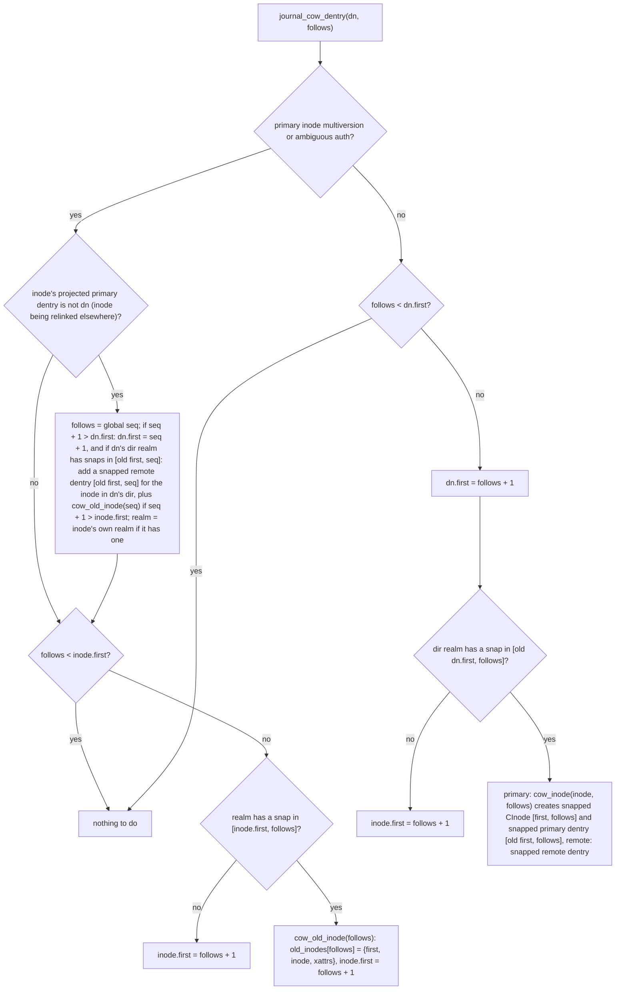
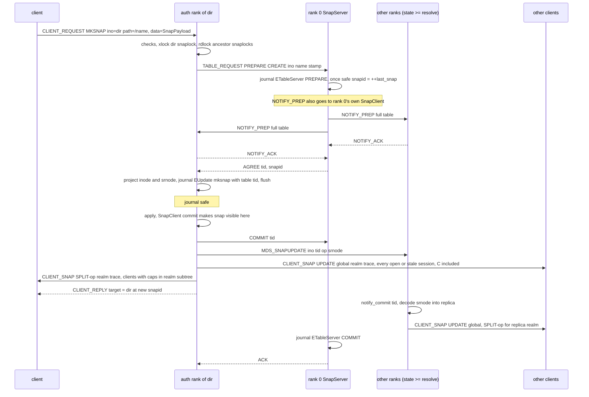
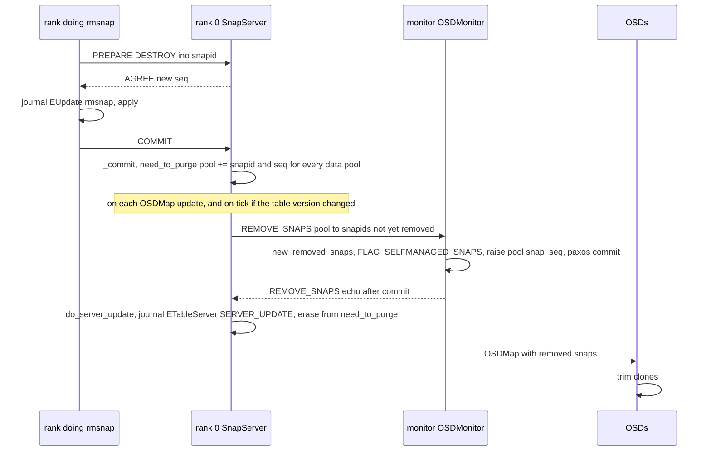

# Snapshots: snaprealms, SnapServer/SnapClient, metadata COW, snapshot ops, snapdiff and blockdiff

> Part of the [C++ MDS project map](../README.md). Sources (commit `5f7e383ae6d`): `src/mds/SnapRealm.{h,cc}` (163+528 LOC), `src/mds/snap.{h,cc}` (131+339), `src/mds/SnapServer.{h,cc}` (105+567), `src/mds/SnapClient.{h,cc}` (88+361), `src/common/snap_types.{h,cc}` (108+167), `src/mds/Server.cc` 11475-12935 (~1,460: lssnap, mksnap, rmsnap, renamesnap, snap metadata, blockdiff, readdir_snapdiff, snap trace) plus snapshot-related call sites (~300: reply trace, open, readdir, link, setvxattr, lookup_snap_ino), `src/mds/MDCache.cc` 1550-1836, 5651-6160, 10217-10362, 14770-14972 (~800), snapshot parts of `src/mds/CInode.{h,cc}` (~600), `src/mds/Locker.cc` snapflush and snaplock special cases (~300), `src/mds/CDir.cc` stale snap trimming (~120), `src/messages/MClientSnap.h` (74), `MMDSSnapUpdate.h` (66), `MRemoveSnaps.h` (59), `src/include/ceph_fs.h` snap definitions, `src/mon/OSDMonitor.cc` 4386-4480, `src/mon/FSCommands.cc` snapshot flags. Kernel cross-check: `linux/fs/ceph/{snap.c,dir.c,inode.c,mds_client.c,caps.c,export.c,quota.c}`. Userspace cross-check: `src/client/Client.cc`, `src/libcephfs.cc`, `src/tools/cephfs_mirror/`, `src/pybind/mgr/{volumes,snap_schedule}`. Docs `doc/dev/cephfs-snapshots.rst`, `doc/cephfs/snapshots.rst` (mostly consistent with code; differences are noted inline).
>
> Related: [mds-tables](../07-storage-formats/mds-tables.md) (generic table 2PC used by the snap table), [capabilities](../02-client-protocol/capabilities.md) (snapflush), [rstats-quotas-and-subvolumes](rstats-quotas-and-subvolumes.md), [namespace-mutations](../03-request-path/namespace-mutations.md), [rename](../03-request-path/rename.md), [lookup-readdir-open-and-file-locks](../03-request-path/lookup-readdir-open-and-file-locks.md), [attributes-and-xattrs](../03-request-path/attributes-and-xattrs.md), [lock-types-and-state-machines](../05-locking/lock-types-and-state-machines.md), [acquiring-locks](../05-locking/acquiring-locks.md), [cinode-and-inode-types](../04-cache/cinode-and-inode-types.md), [cdir-cdentry-and-cache-objects](../04-cache/cdir-cdentry-and-cache-objects.md), [events-and-replay](../06-journal/events-and-replay.md), [rados-object-catalog](../07-storage-formats/rados-object-catalog.md), [rados-and-osd-interactions](../07-storage-formats/rados-and-osd-interactions.md), [resolve-and-rejoin](../09-recovery/resolve-and-rejoin.md), [sessions](../02-client-protocol/sessions.md), [wire-protocol](../02-client-protocol/wire-protocol.md), [kclient-expectations](../02-client-protocol/kclient-expectations.md), [libcephfs-fuse-ganesha-expectations](../02-client-protocol/libcephfs-fuse-ganesha-expectations.md), [strays-and-purge](../11-background-services/strays-and-purge.md), [quiesce](../12-qos-metrics-quiesce-quarantine/quiesce.md), [mgr-tools-and-orchestration](../01-cluster-integration/mgr-tools-and-orchestration.md), [fsmap-and-mdsmap](../01-cluster-integration/fsmap-and-mdsmap.md), [mds_lock-analysis](../00-architecture/mds_lock-analysis.md).

## 1. Purpose and responsibilities

CephFS snapshots are per-subtree, read-only, point-in-time views. The MDS owns the *metadata* side; file *data* is snapshotted by RADOS self-managed snapshots, driven by the `SnapContext` that every writer (client or MDS) attaches to OSD writes. The MDS code in scope:

- Allocates globally unique, monotonically increasing snapshot ids (`snapid_t`) through one cluster-wide table (`SnapServer`, always on rank 0) using the generic table two-phase commit, and caches that table on every rank (`SnapClient`).
- Maintains *snap realms* (`SnapRealm`, persistent part `sr_t`): subtrees that share one set of snapshots. A realm's effective snapshot set is its own snapshots, plus its parent's snapshots taken since it became a child, plus "past parent" snapshots recorded when an inode moved between realms. A dummy *global* realm (ino 3) covers hard-linked inodes.
- Encodes realm hierarchies into *snap traces* for clients (in replies, `MClientSnap` notifications and cap imports). Clients build `SnapContext`s from those traces and use them for OSD writes; on a new snapshot they create "cap snaps" and later flush per-snapshot metadata back (`FLUSHSNAP`).
- Copy-on-write (COW) of metadata: every dentry and inode carries a `[first, last]` snapid range; modifying something covered by a snapshot first preserves the old version (snapped dentry, snapped `CInode`, or an `old_inodes` entry).
- Serves the virtual `.snap` directory: `LSSNAP`, `LOOKUPSNAP`, path traversal into snapshots, `MKSNAP`, `RMSNAP`, `RENAMESNAP`, `SNAP_METADATA`, and the cephfs-mirror helpers `READDIR_SNAPDIFF` and `FILE_BLOCKDIFF`.
- Propagates deleted snapshots to the OSDs: the snap table sends `MRemoveSnaps` to the monitor, which records the snaps as removed in the OSDMap so OSDs trim clones.
- Applies policies: `allow_snaps` / `allow_multimds_snaps` map flags, `mds_max_snaps_per_dir`, name rules, uid range, `MAY_SNAPSHOT` auth cap (MKSNAP/RMSNAP/RENAMESNAP only), subvolume restrictions. It stores and propagates the snapshot visibility flag but does not enforce it (libcephfs does, 3.11).

Out of scope here (see related pages): the generic table 2PC, its journal events and recovery ([mds-tables](../07-storage-formats/mds-tables.md)); cap-level snapflush mechanics ([capabilities](../02-client-protocol/capabilities.md) section 3.11); how link/unlink/rename compute new srnodes in detail ([namespace-mutations](../03-request-path/namespace-mutations.md), [rename](../03-request-path/rename.md)); quota semantics and subvolume rstat behaviour ([rstats-quotas-and-subvolumes](rstats-quotas-and-subvolumes.md)).

Vocabulary used below:

| Term | Meaning | Code |
|---|---|---|
| snapid | `snapid_t` (u64). `CEPH_NOSNAP = -2` is "head", `CEPH_SNAPDIR = -1` is the `.snap` pseudo-directory, `CEPH_MAXSNAP = -3` is the largest valid id. Id 1 is reserved ("initial root snaprealm"); real snapshots start at 2 or above the pools' `snap_seq` | `src/include/rados.h:38-40`, `src/mds/SnapServer.cc:47 (SnapServer::reset_state)` |
| seq | Version of a realm. Allocated from the *same* counter as snapids: every create and every destroy consumes one value. Clients compare seqs to decide whether a trace is newer | `src/mds/snap.h:107 (sr_t::seq)`, `src/mds/SnapServer.cc:163 (SnapServer::_prepare)` |
| global newest seq | `max(last_created, last_destroyed)` of the snap table as cached by this rank's `SnapClient` (the global realm's `get_newest_seq()`); used as "follows" for COW decisions (ancestor pre-COW can use the realm seq instead when `mds_use_global_snaprealm_seq_for_subvol = false`, 3.4) and, plus one, as `first` of new dentries created by client requests | `src/mds/SnapRealm.cc:128-130 (SnapRealm::check_cache)` |
| follows | "The newest snapshot already accounted for." COW of an item happens if a snapshot exists in `[item.first, follows]` | `src/mds/MDCache.cc:1679 (MDCache::journal_cow_dentry)` |
| realm | `SnapRealm` attached to an inode (`CInode::snaprealm`); every other inode belongs to the realm of its nearest ancestor that has one (`find_snaprealm`) | `src/mds/CInode.cc:3352 (CInode::find_snaprealm)` |
| snap trace | Encoded chain of realm descriptors from a realm up to the root (or to the global realm) | `src/mds/SnapRealm.cc:450 (SnapRealm::build_snap_trace)` |

## 2. Source map

| File | Class / function | Lines | Role |
|---|---|---|---|
| `src/mds/snap.h` | `SnapInfo`, `snaplink_t`, `sr_t` (flags `PARENT_GLOBAL`, `SUBVOLUME`, `SNAPDIR_VISIBILITY`) | 36-127 | Persistent snapshot descriptor and realm node |
| `src/mds/snap.cc` | `SnapInfo::encode/decode`, `will_md_op_succeed`, `do_md_op`, `get_long_name`, `sr_t::encode/decode` | 33-268 | Encodings, metadata op semantics, long names `_<name>_<ino>` |
| `src/mds/SnapRealm.h` | `struct SnapRealm` | 32-160 | In-memory realm: `srnode`, parent/children, `inodes_with_caps`, `client_caps`, mutable caches |
| `src/mds/SnapRealm.cc` | `build_snap_set`, `check_cache`, `get_snaps`, `get_snap_context` | 86-197 | Effective snapshot set and `SnapContext` |
| `src/mds/SnapRealm.cc` | `get_snap_info`, `get_snapname`, `resolve_snapname` | 199-306 | Snapshot names and infos across own, past-parent and parent snaps |
| `src/mds/SnapRealm.cc` | `adjust_parent`, `split_at`, `merge_to` | 317-436 | Realm hierarchy maintenance |
| `src/mds/SnapRealm.cc` | `build_snap_trace`, `get_snap_trace`, `get_snap_trace_new`, `prune_past_parent_snaps` | 438-527 | Client-visible encoding, pruning |
| `src/common/snap_types.{h,cc}` | `SnapRealmInfo`, `SnapRealmInfoNew`, `SnapContext` | h:18-104, cc:10-166 | Wire encodings shared with clients |
| `src/mds/SnapServer.{h,cc}` | `SnapServer` (`reset_state`, `_prepare`, `_get_reply_buffer`, `_commit`, `_rollback`, `_server_update`, `_notify_prep`, `handle_query`, `check_osd_map`, `handle_remove_snaps`, `can_allow_multimds_snaps`, `upgrade_format`, `force_update`) | cc:45-567 | Global snap table on rank 0 |
| `src/mds/SnapClient.{h,cc}` | `SnapClient` (`prepare_create`, `prepare_destroy`, `prepare_update`, `refresh`, `sync`, `get_snaps`, `filter`, `get_snap_info(s)`, `notify_commit`, `dump_cache`) | cc:34-361 | Per-rank cache of the table |
| `src/mds/Server.cc` | `handle_client_lssnap` | 11475-11573 | `LSSNAP` |
| `src/mds/Server.cc` | `handle_client_mksnap`, `_mksnap_finish` | 11588-11773 | `MKSNAP` |
| `src/mds/Server.cc` | `handle_client_rmsnap`, `_rmsnap_finish` | 11788-11909 | `RMSNAP` |
| `src/mds/Server.cc` | `handle_client_renamesnap`, `_snap_mutate_generic_finish` | 11921-12054 | `RENAMESNAP` |
| `src/mds/Server.cc` | `handle_client_snap_md_op` | 12056-12170 | `SNAP_METADATA` |
| `src/mds/Server.cc` | `handle_client_file_blockdiff`, `handle_file_blockdiff_finish` | 12194-12253 | `FILE_BLOCKDIFF` |
| `src/mds/Server.cc` | `handle_client_readdir_snapdiff`, `_readdir_diff`, `build_snap_diff` | 12255-12935 | `READDIR_SNAPDIFF` |
| `src/mds/Server.cc` | `get_snap_trace(Session*, realm)`, `get_snap_trace(client, realm)` | 12429-12442 | Old vs new trace format per session feature |
| `src/mds/Server.cc` | `set_trace_dist` (reply `snapbl`), `_lookup_snap_ino`, `handle_client_open` snapshot branch, `handle_client_readdir` snapshot filter | 2491-2523, 4539-4613, 4712-4797, 5241-5249 | Snapshot reads |
| `src/mds/Server.cc` | `handle_client_setvxattr` (`ceph.quota.*` realm creation, `ceph.dir.subvolume`, `ceph.dir.subvolume.snaps.visible`), `handle_client_getvxattr` | 6478-6493, 6546-6722, 7492-7507 | Realm-creating vxattrs |
| `src/mds/Server.cc` | `_link_local` / `_link_local_finish` global realm, `_dir_has_snaps`, `_dir_is_nonempty_unlocked` | 8034-8078, 9225-9259 | Hard-link realms, rmdir checks |
| `src/mds/MDCache.cc` | `pick_inode_snap`, `cow_inode`, `journal_cow_dentry`, `journal_dirty_inode` | 1550-1830 | Metadata COW |
| `src/mds/MDCache.cc` | `rebuild_need_snapflush`, `prepare_realm_split`, `prepare_realm_merge`, `send_snaps`, `do_cap_import`, `open_snaprealms`, `finish_snaprealm_reconnect` | 5651-6168 | Recovery and cap import |
| `src/mds/MDCache.cc` | `create_global_snaprealm`, `do_realm_invalidate_and_update_notify`, `send_snap_update`, `handle_snap_update`, `notify_global_snaprealm_update` | 10217-10362 | Realm notifications to clients and peers |
| `src/mds/MDCache.cc` | `C_ListSnapsAggregator`, `file_blockdiff`, `aggregate_snap_sets` | 14770-14972 | Block diff via RADOS `list_snaps` |
| `src/mds/CInode.cc` | `add_need_snapflush`, `remove_need_snapflush`, `split_need_snapflush` | 379-444 | Snapflush bookkeeping |
| `src/mds/CInode.cc` | `prepare_new_srnode`, `project_snaprealm`, `mark_snaprealm_global`, `clear_snaprealm_global`, `record_snaprealm_past_parent`, `record_snaprealm_parent_dentry`, `pop_projected_snaprealm` | 554-711 | Projected realm nodes |
| `src/mds/CInode.cc` | `get_oldest_snap`, `cow_old_inode`, `pre_cow_old_inode`, `has_snap_data`, `purge_stale_snap_data`, `pick_old_inode`, `open_snaprealm`, `close_snaprealm`, `find_snaprealm`, `encode/decode_snap_blob`, `encode/decode_snap` | 3176-3412 | Multiversion inodes and realm attachment |
| `src/mds/CInode.cc` | `add_client_cap`, `remove_client_cap`, `move_to_realm`, `encode_inodestat` (snapshot parts), `encode_lock_isnap` | 3595-3674, 3959-4370, 2208 | Realm membership of caps, snapshot stat encoding |
| `src/mds/CDir.cc` | `lookup(name, snap)`, `try_trim_snap_dentry`, `_omap_fetched` stale skip, `_omap_commit` purge | 328-342, 851-877, 2109-2121, 2611-2652 | Snapped dentries in dirfrags |
| `src/mds/Locker.cc` | `try_rdlock_snap_layout`, ISNAP degraded wait in `acquire_locks`, ISNAP rdlock retention in `handle_locks_for_early_reply`, snapflush functions | 157-227, 274-306, 926-930, 3288-3360, 3530-3588, 3879-3976 | Locks and snapflush |
| `src/mds/StrayManager.cc` | `_eval_stray` past-parent handling | 478-545 | Strays kept while snapshots reference them |
| `src/mds/MDSRank.cc` | `set_mdsmap_multimds_snaps_allowed`, `tick` (`check_osd_map`), `handle_osd_map`, `dump snaps` | 690-760, 3074-3088, 3887-3892 | Periodic work, admin |
| `src/messages/MClientSnap.h`, `MMDSSnapUpdate.h`, `MRemoveSnaps.h` | messages | all | Client notification, peer notification, monitor removal |
| `src/mon/OSDMonitor.cc` | `preprocess_remove_snaps`, `prepare_remove_snaps` | 4386-4480 | Monitor side of snap removal |

## 3. How it works

### 3.1 Snapshot ids and the global snap table

**Single allocator.** The MDSMap field `tableserver` is always rank 0, so rank 0 runs `SnapServer` and every rank (including 0) runs a `SnapClient` (`src/mds/MDSRank.cc:525-526`). The table object is `mds_snaptable` in the metadata pool (encoding in 4.1). Generic 2PC mechanics, journal events (`ETableServer`, `ETableClient`, `EMetaBlob::table_tids`) and recovery are documented in [mds-tables](../07-storage-formats/mds-tables.md); this section only describes the snap-table semantics.

**State** (`src/mds/SnapServer.h:91-101`):

| Field | Meaning |
|---|---|
| `last_snap` | Last value handed out (snapid or seq). Initialised by `reset_state` to `max(1, max over data pools of pg_pool_t::snap_seq)` so new ids never collide with ids already known to the pools (`src/mds/SnapServer.cc:45-78`) |
| `snaps` | Committed snapshots: `snapid -> SnapInfo{snapid, ino (dir that owns it), stamp, name}`. Metadata and `alternate_name` are not carried by table ops, so they are always empty here |
| `last_created`, `last_destroyed` | Newest committed create, newest committed destroy seq |
| `need_to_purge` | `pool -> set<snapid>` still to be reported removed to the monitor |
| `pending_update`, `pending_destroy`, `pending_noop` | Prepared but not committed transactions keyed by table version (tid) |
| `snaprealm_v2_since` | First snapid created with the "v2" realm format (see 3.2); `CEPH_NOSNAP` on tables written by pre-mimic MDSs |
| `last_checked_osdmap` | Table version at the last `check_osd_map` pass |

**Operations** (`src/mds/SnapServer.cc:127-286`, payload built by `src/mds/SnapClient.cc:149-187`):

| Table op (`__u32` first in payload) | Payload | Prepare effect | AGREE reply payload | Commit effect | Used by |
|---|---|---|---|---|---|
| `TABLE_OP_CREATE` | `ino, name, stamp` | `snapid = ++last_snap`, `pending_update[v] = info` | new snapid | `snaps[snapid] = info`, `last_created = max(...)` | mksnap |
| `TABLE_OP_CREATE` (only `ino`) | `ino` | `pending_noop[v]` | `last_snap` | none | `SnapClient::prepare_create_realm`, no caller in the tree |
| `TABLE_OP_DESTROY` | `ino` (unused), `snapid` | `++last_snap` as the new realm seq, `pending_destroy[v] = {snapid, seq}` | new seq | erase `snaps[snapid]`, `last_destroyed = max(...)`, add **both** `snapid` and `seq` to `need_to_purge` of every current data pool | rmsnap |
| `TABLE_OP_UPDATE` | `ino, snapid, name, stamp` | `pending_update[v] = info` | empty | `snaps[snapid] = info`, keeping the old stamp if the new one is zero | renamesnap, snap metadata op |

Prepared values are consumed even if the transaction rolls back (`_rollback` only drops the pending entry, `src/mds/SnapServer.cc:259-286`), so snapids and seqs can have gaps.

**Notify before agree.** `MDSTableServer::handle_prepare` first journals `ETableServer PREPARE` (carrying the raw request payload) and flushes; only when it is safe does `_prepare_logged` run `SnapServer::_prepare`, so the snapid/seq is computed after the journal write (replay re-runs `_prepare`) (`src/mds/MDSTableServer.cc:111-149`). `SnapServer::_notify_prep` always returns true: before the AGREE is sent, rank 0 sends `NOTIFY_PREP` carrying the *full* table (`'F'`, `snaps`, `pending_update`, `pending_destroy`, `last_created`, `last_destroyed`) to every table client in `active_clients` (every rank in state `>= resolve`, rank 0's own `SnapClient` included, `src/mds/MDSRank.cc:2467-2471`) and waits for all `NOTIFY_ACK`s (`src/mds/SnapServer.cc:308-327`, `src/mds/MDSTableServer.cc:142-175`). Every rank therefore knows about a pending snapshot before the requesting rank can use it. There is no incremental form: `_notify_prep` always encodes the whole table (the query path carries "FIXME: implement incremental change", `src/mds/SnapServer.cc:356`), so every prepare ships the whole table to every rank.

**SnapClient cache** (`src/mds/SnapClient.h:74-86`): `cached_snaps`, `cached_pending_update`, `cached_pending_destroy`, `cached_last_created/destroyed`, `cached_version`, and `committing_tids`. Visibility rule: a pending update/destroy becomes visible on a rank only after that rank learns the tid is committing (`notify_commit`), which happens (a) on the requesting rank inside `MDSTableClient::commit` (`src/mds/MDSTableClient.cc:188-209`), (b) on other ranks when they receive `MMDSSnapUpdate` with the tid (`src/mds/MDCache.cc:10323-10327`), (c) through resolve (`MMDSResolve::table_clients`). `get_snaps`, `filter`, `get_snap_info(s)` and `dump_cache` overlay committing tids on top of `cached_snaps` (`src/mds/SnapClient.cc:221-361`). `refresh/sync` send `QUERY{'F', cached_version}`; the reply is `'U'` (up to date) or `'F'` + full state. `sync()` runs at `starting_done`, `creating_done`, `resolve_done`, the single-rank shortcut of `replay_done`, and `Server::reconnect_gather_finish` waits for the cache to be synced before leaving reconnect (`src/mds/MDSRank.cc:1777, 1963, 1993, 2186`; `src/mds/Server.cc:1828-1841`). The set accessors (`get_snaps`, `filter`, `get_snap_info`, `get_snap_infos`) assert `cached_version > 0`, so realm computations require a synced cache.

**Format upgrade and multi-MDS gate.** On rank 0's `replay_done`, `upgrade_format()` resets a version-0 table and sets `snaprealm_v2_since = last_snap + 1` if it was `CEPH_NOSNAP`, then saves (`src/mds/SnapServer.h:42-58`, `src/mds/MDSRank.cc:1935-1939`). `can_allow_multimds_snaps()` is true when the table has no snapshot older than `snaprealm_v2_since` (`src/mds/SnapServer.cc:419-421`); rank 0's `tick` then sends the mon command `fs set <fs> allow_multimds_snaps true --yes-i-am-really-a-mds` once per process (`src/mds/MDSRank.cc:690-708, 755-760`).

### 3.2 Snap realms

**Where realms exist.** A `SnapRealm` is attached to an inode when its projected `sr_t` is applied (`CInode::pop_projected_snaprealm` opens it if needed, `src/mds/CInode.cc:688-711`) or when an inode is loaded/replicated with a non-empty snap blob (`decode_snap_blob`, `src/mds/CInode.cc:3372-3391`). Realms are created for:

| Inode | When | srnode initialisation |
|---|---|---|
| root (1) and every `~mdsN` dir (0x100+rank) | `create_unlinked_system_inode` for base inodes | empty realm, `seq = 1` (`src/mds/MDCache.cc:467-475`) |
| global dummy (ino 3, `CEPH_INO_GLOBAL_SNAPREALM`) | every boot, in memory only, never stored | empty; its snap set is the whole snap table (`src/mds/MDCache.cc:10217-10223`, `src/mds/MDSRank.cc:1699, 2217`) |
| a directory receiving its first snapshot | mksnap | `prepare_new_srnode`: `seq = created = global newest seq`, `current_parent_since = inode.get_oldest_snap()`, `change_attr` copied from the containing realm, then overwritten by mksnap (3.6) (`src/mds/CInode.cc:554-575`) |
| a directory getting a quota | `ceph.quota.*` setxattr when quota enabled and no srnode yet | `created = seq = containing realm newest seq` (`src/mds/Server.cc:6478-6493`). Clients find quota roots by walking realms (`linux/fs/ceph/quota.c:214 (get_quota_realm)`) |
| a subvolume root | `ceph.dir.subvolume=1` | `created = seq = containing realm newest seq`, flag `SUBVOLUME` (`src/mds/Server.cc:6618-6628`) |
| a hard-linked inode outside subvolumes | first `link` (local or peer) | `PARENT_GLOBAL` realm (3.10) (`src/mds/Server.cc:8034-8040, 8287-8294`) |
| an inode leaving its realm with history | primary rename across realms or unlink to a stray dir, when the old realm's newest seq is at least the inode's `oldest_snap` (an inode that already has a realm gets `past_parent_snaps` added too) | `seq = created = old realm newest seq`, `past_parent_snaps` recorded (3.10) |

(`doc/dev/cephfs-snapshots.rst` defines realms as created by snapshot creation and by moves of snapshotted inodes; it describes hard links separately (moved to the dummy global realm) and does not mention the quota or subvolume cases.) Apart from cache eviction of the inode (`~CInode` calls `close_snaprealm`, `src/mds/CInode.cc:119`), a realm is only removed by rollback paths (`project_snaprealm(NULL)` then `merge_to`, `src/mds/Server.cc:8503, 11141, 11220`) or when a replay decodes an empty snap blob (`src/mds/CInode.cc:3386-3390`). Deleting the last snapshot does not remove the srnode, so the realm persists.

**`sr_t` fields** (`src/mds/snap.h:88-127`):

| Field | Meaning |
|---|---|
| `seq` | Realm version: set to the new snapid on mksnap and to the destroy seq on rmsnap; to `max(seq, old parent newest seq)` when past parent snaps are recorded; to the global newest seq when `PARENT_GLOBAL` is cleared (`clear_snaprealm_global`). Renamesnap, metadata ops and the visibility flag do not change it |
| `created` | mksnap sets it to the new snapid each time (`src/mds/Server.cc:11726`); realm creation sets it to a seq (table above). Clients use it to resolve split races (7.1) |
| `last_created`, `last_destroyed` | Newest own create / destroy seq. For `PARENT_GLOBAL` realms `last_destroyed` is reused as the "parent since" of the *primary* dentry's directory realm: `mark_snaprealm_global` stores the old `current_parent_since` there, `record_snaprealm_parent_dentry(primary)` copies that realm's snaps from it into `past_parent_snaps` and resets it to global seq + 1, and `clear_snaprealm_global` moves it back into `current_parent_since` (`src/mds/CInode.cc:596-612, 656-676`) |
| `current_parent_since` | First snapid for which the current parent's snapshots apply |
| `snaps` | Own snapshots `snapid -> SnapInfo` (name, stamp, metadata, alternate_name) |
| `past_parents` | Legacy (pre-mimic, "v1") map `last -> snaplink_t{ino, first}` of former parent realms. Decoded and re-encoded but not consulted by any current MDS code; only `cephfs-data-scan` reads it (`src/tools/cephfs/DataScan.cc:1370-1372`) |
| `past_parent_snaps` | "v2": snapids inherited from former parents, filtered at use time against the snap table |
| `flags` | `PARENT_GLOBAL=1` (parent is the global realm), `SUBVOLUME=2`, `SNAPDIR_VISIBILITY=4` (default set) |
| `last_modified`, `change_attr` | Updated by mksnap, rmsnap, renamesnap, metadata op and the visibility flag (a new srnode inherits `change_attr` from the containing realm); shipped only in the new trace format, where libcephfs uses them as the snapdir's mtime/ctime and change_attr (3.5) |

**Hierarchy.** `SnapRealm::parent` is the realm found from the directory of the inode's current (non-projected) parent dentry, or the global realm if `PARENT_GLOBAL` (`adjust_parent`, `src/mds/SnapRealm.cc:317-336`; invoked when a realm's parent-global flag flips and when an inode with a realm is linked into a directory, `src/mds/CDir.cc:648-652`). `open_children` lists child realms currently in cache. `inodes_with_caps` (intrusive list through `CInode::item_caps`) and `client_caps` (`client -> list of Capability`) record which inodes and clients have caps in the realm; an inode joins its realm when it gets its first cap and leaves when the last cap goes (`src/mds/CInode.cc:3595-3657`). A new cap starts with `client_follows = inode.first - 1` (`src/mds/CInode.cc:3619`).

**Creating a realm splits its parent.** `CInode::open_snaprealm` calls `parent->split_at(new)` unless told not to (`src/mds/CInode.cc:3321-3336`). `split_at` (`src/mds/SnapRealm.cc:338-411`): for a non-directory child or an mdsdir parent, move only the child inode's own caps; for an unlinked directory (projected parent is a stray dir) likewise; otherwise move every parent `open_children` realm whose inode descends from the new realm's inode, and walk *all* of the parent's `inodes_with_caps`, moving those that descend from it (`is_ancestor_of` with a memo of visited directories). The cost is linear in the number of inodes with caps in the parent realm.

**Effective snapshot set** (`build_snap_set`, `src/mds/SnapRealm.cc:86-119`):

```
global realm:  all snapids in the SnapClient cache (committed + committing)
other realm:   own snaps
             + SnapClient.filter(past_parent_snaps)          (drops deleted ones)
             + parent.snaps with id >= current_parent_since   (only if parent.newest_seq >= current_parent_since)
cached_seq   = max(own seq, newest filtered past parent snap,
                   parent newest seq if parent.newest_seq >= current_parent_since)
               ("own seq" is the global newest seq for the global and PARENT_GLOBAL realms)
```

`check_cache` rebuilds the cached set, `SnapContext`, traces and `cached_subvolume_ino` when `seq` grew, the *global* `last_destroyed` changed, `last_modified` changed or `change_attr` grew (`src/mds/SnapRealm.cc:121-168`). For the global realm and `PARENT_GLOBAL` realms, the reference seq is the global newest seq. Any rmsnap anywhere therefore invalidates every realm's cache (rebuilt lazily on next access). `invalidate_cached_snaps()` forces a rebuild by zeroing `cached_seq`. The caches are `mutable` members of `const` methods.

**Worked example** (values follow the code paths above; the table starts at `last_snap = 1`):

| Step | Effect |
|---|---|
| `/a` (ino A, `first = 2`) gets snapshot `s1` | `prepare_new_srnode`: `seq = created = 1`, `current_parent_since = A.oldest_snap = 2`; mksnap: snapid 2, `created = seq = last_created = 2`, `snaps = {2}`. Set of A = `{2}` |
| `/` gets snapshot `r1` | snapid 3 in the root realm (`seq = created = 3`). A's parent seq 3 >= `current_parent_since` 2, so A's set becomes `{2, 3}`, `cached_seq = 3` |
| file `/a/f` (`first = 2`, no realm) renamed to `/x/f` (`/x` in the root realm) | `record_snaprealm_past_parent`: f gets a realm with `past_parent_snaps = {2, 3}` (A's snaps `>= 2`), `seq = 3`, `current_parent_since = global seq + 1 = 4`. Set of f = `{2, 3}` |
| trace for f's realm | `{ino f, created 3, parent 1, parent_since 4, seq 3, my_snaps [], prior_parent_snaps [3, 2]}` then root `{ino 1, created 3, parent 0, parent_since 1, seq 3, my_snaps [3], prior []}`; the client's context is `seq 3, snaps [3, 2]` |
| snapshot `s1` (2) removed | `SnapClient.filter` drops 2 from every realm's past-parent snaps on the next cache rebuild (triggered because the global `last_destroyed` changed); f's set becomes `{3}` |

`get_snap_context()` returns `{seq = cached_seq, snaps = cached set in descending order}` (`src/mds/SnapRealm.cc:182-197`). The MDS itself uses it for its own data-pool writes: stray file purge, truncation and data uninlining (`src/mds/StrayManager.cc:123-131, 758`; `src/mds/MDCache.cc:6657-6662, 6754-6759, 13530-13532`).

`get_subvolume_ino()` returns the outermost ancestor realm flagged `SUBVOLUME` (parent first, then self), 0 if none (`src/mds/SnapRealm.cc:150-154`); `CInode::get_subvolume_id()` exposes it (`src/mds/CInode.cc:5597-5600`), and it is sent to clients in `InodeStat` and cap acks.

**Names.** `get_snapname(snapid, atino)` returns the plain name when the snapshot belongs to the realm of `atino` itself, else the long name `_<name>_<owner ino in decimal>` (`SnapInfo::get_long_name`, `src/mds/snap.cc:158-168`; `src/mds/SnapRealm.cc:227-252`). `resolve_snapname(name, atino, first, last)` expects the same naming: the plain name for a snapshot owned by `atino`, the long name for any other. Names starting with `_` are parsed as `_<pname>_<ino>` with the *last* underscore as separator. Lookup order is own snaps, then past-parent snaps (infos from the `SnapClient`), then the parent realm restricted to `>= current_parent_since` (`src/mds/SnapRealm.cc:254-306`).

**Past parents vs the global realm ("v2" format).** Before mimic, a realm remembered former parents in `past_parents` and had to open those parent inodes to compute its snap set. Since mimic the realm stores only the snapids (`past_parent_snaps`) and filters them against the cluster-wide table on each use; hard links use the global dummy realm instead of chasing remote dentries. This is why multi-active MDS with snapshots is only allowed once no snapshot older than `snaprealm_v2_since` remains (3.1).

### 3.3 Snap traces seen by clients

`build_snap_trace` (`src/mds/SnapRealm.cc:450-509`) produces two cached encodings per realm; `Server::get_snap_trace(session, realm)` picks `get_snap_trace_new()` when the session has `CEPHFS_FEATURE_NEW_SNAPREALM_INFO` (bit 19), else `get_snap_trace()` (`src/mds/Server.cc:12429-12442`).

Each element is one realm; elements are concatenated child first, then the parent's whole trace, up to the root realm (no parent) or the global realm:

```
old format (per realm):
  struct ceph_mds_snap_realm (packed, raw, 48 bytes)
    le64 ino; le64 created; le64 parent; le64 parent_since; le64 seq;
    le32 num_snaps; le32 num_prior_parent_snaps;
  le64 my_snaps[num_snaps]                       descending
  le64 prior_parent_snaps[num_prior_parent_snaps] descending
new format (per realm): ENCODE_START(2, 1)
  { old-format element, utime_t last_modified, u64 change_attr, u32 flags }
```

Field values for an ordinary realm: `ino`, `created = srnode.created`, `parent = parent realm ino` (0 for root), `parent_since = current_parent_since`, `seq = srnode.seq`, `my_snaps = srnode.snaps` keys, `prior_parent_snaps = SnapClient.filter(past_parent_snaps)` restricted to `< current_parent_since` when `PARENT_GLOBAL`. The global realm is a single element `{ino 3, created 0, parent 0, parent_since 0, seq = global newest seq, my_snaps = every snapshot in the filesystem}` (`src/mds/SnapRealm.cc:455-468`). `flags` is `sr_t::flags`; clients only test the value 4 (bit 2, `SnapRealmInfoNew::SNAPDIR_VISIBILITY`). Past-parent snaps are emitted only for a realm that has a parent (`src/mds/SnapRealm.cc:471-490`).

A trace is attached to:

| Carrier | Content | Code |
|---|---|---|
| `MClientReply::snapbl` | trace of the target inode's realm (or the dentry's directory realm) for every reply whose `mdr->snapid == CEPH_NOSNAP`; *no trace* for replies about snapshots (lookupsnap, mksnap, rmsnap, renamesnap, readdir in a snapshot, ...). `LSSNAP` replies do carry the directory realm's trace, because nothing sets `mdr->snapid` (default `CEPH_NOSNAP`) | `src/mds/Server.cc:2512-2521 (Server::set_trace_dist)` |
| `MClientSnap` | see 3.6 and 5.2 | `src/mds/MDCache.cc:10225-10279, 10348-10362, 5730-5797, 6151-6165` |
| `MClientCaps` op `IMPORT` | trace of the inode's realm | `src/mds/MDCache.cc:5954-5973 (MDCache::do_cap_import)` |

Cap grants inside replies carry `realm = containing realm ino` (`src/mds/CInode.cc:4243`); readdir and lssnap do not give caps on inodes whose realm differs from the directory's realm because only the directory realm's trace is sent (`no_caps` when `dir_realm && realm != dir_realm`, `src/mds/CInode.cc:4027-4031`).

### 3.4 Copy-on-write of metadata

**Ranges.** Every `CDentry` has `[first, last]` and every `CInode` has `[first, last]`; head items have `last = CEPH_NOSNAP`. In a dirfrag object the omap key of a dentry is `<name>_head` for head dentries or `<name>_<last in lowercase hex>` for snapped ones; the value starts with `first` (`src/mds/mdstypes.cc:772-783 (dentry_key_t::encode)`). Snapped dentries live in the same dirfrag as head dentries; there are no per-snapshot directory objects. `CDir::lookup(name, snap)` returns the dentry with `first <= snap <= last` (`src/mds/CDir.cc:328-342`). New dentries get `first = global newest seq + 1` (`src/mds/Server.cc:4046-4047, 4214-4215`; `src/mds/CDir.cc:2254`), and new inodes inherit their dentry's `first` (`src/mds/Server.cc:5007-5011`).

**Multiversion vs single-version inodes.** `CInode::is_multiversion()` is true for directories, inodes with a snaprealm, inodes with `nlink > 1`, and inodes that already have `old_inodes` (`src/mds/CInode.h:487-492`). Single-version inodes (plain files) are COWed into separate `CInode` objects keyed by `(ino, last)` in `MDCache::snap_inode_map`; multiversion inodes keep history in `old_inodes: map<last, old_inode_t{first, inode, xattrs}>` inside the head inode (`src/mds/old_inode.h:15-45`). `oldest_snap` records the oldest `first` ever covered (`get_oldest_snap`, `src/mds/CInode.cc:3176-3182`).

**`journal_cow_dentry(mut, metablob, dn, follows)`** (`src/mds/MDCache.cc:1679-1810`) is called before journaling any change to a dentry or its primary inode (directly or via `journal_dirty_inode`, `src/mds/MDCache.cc:1812-1830`). `follows = CEPH_NOSNAP` means "use the global newest seq":



`cow_inode(in, last)` (`src/mds/MDCache.cc:1573-1677`) copies the *previous projected* inode and xattrs into a new `CInode(first, last)`, trims client ranges with `follows >= last`, sets `in.first = last + 1`, and transfers snapflush obligations: for a head inode, every cap with issued (or, with `NEEDSNAPFLUSH`, assumed) write caps and `client_follows < last` is added to `oldin->client_snap_caps`, gets `client_follows = last`, and `head->add_need_snapflush(oldin, s, client)` for each realm snap `s` in `[oldin.first, last]`; the snapped inode's four cap locks are forced into `LOCK_SNAP_SYNC` with a forced wrlock and auth pin until the clients flush. The snapped dentry is journaled with `STATE_NEED_SNAPFLUSH`, added to the segment's open files and to `Locker::need_snapflush_inodes` (`src/mds/MDCache.cc:1790-1799`). Details of FLUSHSNAP, null snapflush inference and nudging are in [capabilities](../02-client-protocol/capabilities.md) section 3.11.

**Ancestor directory COW.** `predirty_journal_parents` calls `pin->pre_cow_old_inode()` on every ancestor whose dirstat/rstat it updates (`src/mds/MDCache.cc:2399`, also `Locker.cc:5274` for scatter-gather writeback). `pre_cow_old_inode` (`src/mds/CInode.cc:3222-3258`) COWs the head into `old_inodes` if `first <= follows`, where `follows` is the global newest seq when `mds_use_global_snaprealm_seq_for_subvol = true` (default), else the realm's own newest seq when the realm is in a subvolume or its newest seq is `<= 1` (no snapshot ever affected it), else the global seq.

**`mds_snap_rstat`** (default false): when true, rstats of snapshotted versions are maintained (`dirty_old_rstats`, `dirty_old_rstat` in dirfrags); when false, snapshot rstats are dropped (`src/mds/MDCache.cc:1894-1905, 1938-1959`).

**Reading a snapshot.** `encode_inodestat(..., snapid)` picks the `old_inodes` entry covering `snapid` if any (on a non-auth rank the stat is marked not valid, which limits the issued caps to `CEPH_STAT_CAP_INODE`, because "old_inodes is only defined/valid on the auth"), includes `snap_btime` and `snap_metadata` of the `SnapInfo` for that snapid (`get_snap_info(snapid, snapid)`), and issues read-only caps with `seq = mseq = realm = 0` and no `Capability` object: every cap allowed for the inode type, masked by the current lock state only when the inode is the head (multiversion) or still has caps (`src/mds/CInode.cc:3976-4023, 4181-4206`). The `cap_id` and `wanted` fields of that reply cap are left uninitialized (default-initialized `ceph_le` members); the kernel only ORs the caps into `i_snap_caps` for snapped inodes and ignores the rest (`linux/fs/ceph/inode.c:1331-1362`). `open` of a snapshot file returns `EROFS` for write modes, rdlocks the snapped inode's `filelock` (which waits while a snapflush is pending because of `LOCK_SNAP_SYNC`), and issues "immutable snap caps" `ceph_caps_for_mode(mode)` without a cap object (`src/mds/Server.cc:4712-4797`). Path traversal never instantiates null dentries for snapshots (`src/mds/MDCache.cc:8758-8759 (MDCache::path_traverse)`). Namespace mutations and attribute changes reject snapshot paths with `EROFS` (`src/mds/Server.cc:3977 (rdlock_path_xlock_dentry)`, `:4089 (rdlock_two_paths_xlock_destdn)`, `:5585 (handle_client_setattr)`, `:5854 (handle_client_setlayout)`, `:7176 (handle_client_setxattr)`, `:7273 (handle_client_removexattr)`).

**Lazy trimming of stale snapshot metadata.** Nothing walks the tree when a snapshot is deleted:

- Each dirfrag fnode has `snap_purged_thru`. When a dirfrag is fetched with `snap_purged_thru < realm.last_destroyed`, snapped dentries whose `[first, last]` contains no live snapshot are skipped while loading (`CDir::_load_dentry`); their omap keys are recorded in `stale_items` and the dirfrag is marked dirty so the next commit deletes them (`src/mds/CDir.cc:1867-1874, 1896-1899, 1946-1950, 2299-2300`). If no snapped dentries of the dirfrag are in cache at fetch time (always the case for a fresh fetch), `snap_purged_thru` is advanced to `last_destroyed` (`src/mds/CDir.cc:2109-2121`). On commit, dirty stale snapped dentries (and their snapped inodes) with no extra references are removed from the object (`try_trim_snap_dentry`, `src/mds/CDir.cc:851-877, 2611-2652`).
- `CInode::purge_stale_snap_data(snaps)` drops `old_inodes` entries not covering any live snapshot; called after rmsnap on the directory itself, when stray inodes are evaluated, and when realm-less inodes are loaded from a dirfrag whose `snap_purged_thru` is behind (`src/mds/CInode.cc:3278-3303`; `src/mds/Server.cc:11908`; `src/mds/StrayManager.cc:483-486`; `src/mds/CDir.cc:2012-2013`).
- `SnapRealm::prune_past_parent_snaps` drops deleted snapids from `past_parent_snaps` of stray inodes; a stray *directory* is not purged while it still has past-parent snapshots, a stray *file* with past-parent snaps and old inodes is truncated but its metadata kept (`src/mds/StrayManager.cc:478-545`).
- Dentries with `first > global seq + 1` or `first > last` are treated as corrupt: by scrub (`CDentry::scrub`, which marks them bad) and on every dirfrag load and commit (`CDentry::check_corruption`, governed by `mds_go_bad_corrupt_dentry` and `mds_abort_on_newly_corrupt_dentry`) (`src/mds/CDentry.cc:771-803, 805-827`).

### 3.5 The `.snap` directory and snapshot paths

`.snap` is never a dentry on the MDS. Clients synthesise the snapdir inode locally with vino `(dir ino, CEPH_SNAPDIR)`. The kernel copies mode/uid/gid/mtime/ctime/atime/btime from the directory (`linux/fs/ceph/inode.c:211 (ceph_get_snapdir)`). libcephfs copies mode/uid/gid/atime/btime/size and the `system.*` xattrs from the directory but uses the realm's `last_modified` as mtime and ctime and the realm's `change_attr` as change_attr (`Client::refresh_snapdir_attrs`, `src/client/Client.cc:14456-14481`). That is what the new-format trace fields are for: the MDS bumps them on every mksnap/rmsnap/renamesnap/metadata op/visibility change. The name is client configuration (`snapdirname` mount option for the kernel, `client_snapdir` default `.snap` for libcephfs).

On the wire a snapshot path is `filepath{ino = real directory, path = "/<snapname>[/rest]"}`: the first path component is *empty*, meaning "enter the snapdir" (`linux/fs/ceph/mds_client.c:2899-2995 (ceph_mdsc_build_path)`; `src/client/Inode.cc:146-162 (Inode::make_nosnap_relative_path)`; `filepath::is_last_snap`, `src/include/filepath.h:164-167`). `MDCache::path_traverse` turns an empty first component into `snapid = CEPH_SNAPDIR` (empty components elsewhere are `EINVAL`), resolves the next component with `realm->resolve_snapname(name, cur->ino())` (`ENOENT` if 0), sets `mdr->snapid`, and continues with snapped dentry lookups (`src/mds/MDCache.cc:8528-8555 (MDCache::path_traverse)`). `rdlock_path_pin_ref` takes no path locks for snapshot paths and forces `want_auth` unless the caller passes `no_want_auth` (`src/mds/Server.cc:3891-3900 (Server::rdlock_path_pin_ref)`).

The kernel first sends an ordinary `LOOKUP` for the snapdir name and only splices its local snapdir inode when the MDS answers `ENOENT` (`linux/fs/ceph/dir.c:727 (ceph_handle_snapdir)`, `:880-889`); lookups *inside* a snapdir use `LOOKUPSNAP` (`linux/fs/ceph/dir.c:863-864`) and readdir of a snapdir uses `LSSNAP` (`:388-389`). mkdir, rmdir and rename inside a snapdir become `MKSNAP`, `RMSNAP`, `RENAMESNAP`; any other mutation in a snapshot is refused locally with `EROFS` (`EXDEV` for a rename between different snapids) (`linux/fs/ceph/dir.c:1124-1135, 1362-1367, 1496-1501`). libcephfs maps the operations the same way (`src/client/Client.cc:7795, 10125-10126, 16271-16273, 16614, 16733-16734`), but it never asks the MDS about the snapdir name: `Client::_lookup` returns the local snapdir inode as soon as the name equals `client_snapdir` (`src/client/Client.cc:7884-7892`).

**`LSSNAP`** (`src/mds/Server.cc:11475-11573`): `try_get_auth_inode(filepath.ino)` (missing or purging inode: `ESTALE`; non-auth: forward), quarantine parking for old clients, `ENOTDIR`, `try_rdlock_snap_layout(diri)` (rdlock of the snaplock of the dir and all ancestors), `check_access(MAY_READ)`. Entries are `realm->get_snap_info(infomap, diri->get_oldest_snap())`, i.e. every snapshot visible in the dir's realm with id `>= oldest_snap`, sorted by snapid. Pagination: `path2` is the last returned name, resolved to a snapid; entries with larger snapid follow. Limits: `max_entries` (0 = all) and `max_bytes` (0 = `512 KiB + max_xattr_size`). Each entry: name (plain for the dir's own snapshots, long name otherwise), `LeaseStat{mask CEPH_LEASE_VALID, duration_ms = 0xffffffff, seq 0, alternate_name}`, and the dir's `InodeStat` at that snapid. The dirstat header is an empty `DirStat`; flags are `FRAG_END` when exhausted plus `FRAG_COMPLETE` if no offset was given; no hash-order flags.

**`LOOKUPSNAP`** is dispatched to `handle_client_getattr` (`src/mds/Server.cc:2858-2862`); the reply's target is the directory inode at the snapshot's snapid, which the kernel splices onto the `.snap/<name>` dentry (`linux/fs/ceph/inode.c:1856-1879`).

**`LOOKUPINO` with `args.lookupino.snapid`** (NFS file handles of snapshot inodes, `linux/fs/ceph/export.c:211-292 (__snapfh_to_dentry)`) goes to `_lookup_snap_ino` (`src/mds/Server.cc:4539-4615`): `lookup_snap_inode(vino)` (snapped `CInode` with `first <= snapid`), else the cached head inode if it is not purging and `has_snap_data(snapid)`; a found inode is answered after `check_access(MAY_READ)` with `mdr->snapid = snapid`. A cached head without that snapshot data gets `ESTALE` if it is a directory or no `parent` was given. Otherwise, with `parent` + `hash` the MDS opens the parent (`open_ino` if not cached), rdlocks its `dirfragtreelock`, fetches the dirfrag for that hash and retries, finally `ESTALE`; without `parent` and with no cached inode it runs `open_ino(ino)` and retries (`ENOENT`/`ENODATA` become `ESTALE`). The kernel resolves snapshot names for NFS by paging `LSSNAP` and matching `InodeStat.snapid` (`linux/fs/ceph/export.c:455 (__get_snap_name)`).

### 3.6 mksnap

**Checks** (`src/mds/Server.cc:11588-11676`), in order:

| Condition | Result |
|---|---|
| request `mdsmap_epoch` newer than ours | wait for that MDSMap, retry |
| MDSMap lacks `CEPH_MDSMAP_ALLOW_SNAPS` (`fs set <fs> allow_new_snaps false`) | `EPERM` |
| directory inode not in cache or purging | `ESTALE`; not auth: forward to auth |
| directory under a quarantined subvolume and the session lacks `CEPHFS_FEATURE_QUARANTINE` | request parked until the quarantine is lifted (`check_quarantine_block`, `src/mds/Server.cc:3529-3557`; see [quarantine](../12-qos-metrics-quiesce-quarantine/quarantine.md)) |
| not a directory | `ENOTDIR` |
| system inode other than root (`~mdsN`, strays, lost+found) | `EPERM` |
| caller uid outside `[mds_snap_min_uid, mds_snap_max_uid]` | `EPERM` |
| locks: xlock `diri->snaplock`, then `try_rdlock_snap_layout(parent dir)` (snaplocks of all ancestors) | wait/retry |
| `check_access(MAY_WRITE + MAY_SNAPSHOT)` (both bits required): MDSAuthCaps needs `s` (`rws`) | `EACCES` (`Session::check_access`) |
| realm's subvolume ino is set and differs from `diri` (inside a subvolume, not its root) | `EPERM` |
| `diri` has a realm and `realm->get_snaps().size() >= mds_max_snaps_per_dir` | `EMLINK` |
| own snapshot with the same name exists | `EEXIST` |
| name empty, longer than `snapshot_name_max = NAME_MAX - 15 = 240`, or starting with `_` | `EINVAL` |

Before these checks, `dispatch_client_request` refuses `MKSNAP` with `EROFS` when the MDS is read-only, and, when the metadata pool has `FLAG_FULL` (`Server::is_full`, `src/mds/Server.cc:2752-2763`), runs `check_access(MAY_FULL)` (auth cap flag `f`): on failure `check_access` itself already replies `EACCES` and the code then calls `respond_to_request(-ENOSPC)` a second time on the same request (inferred from code: `src/mds/Server.cc:2793-2835`, `src/mds/Server.cc:3500-3520 (Server::check_access)`).

**Flow:**



Step details:

1. Table prepare through `SnapClient::prepare_create(ino, name, mds_stamp)`; the request is retried when AGREE arrives (`mdr->more()->stid`, `snapidbl`) (`src/mds/Server.cc:11679-11694`).
2. Metadata payload: `req->get_data()` is decoded as `SnapPayload{map<string,string> metadata}`; decode failure is ignored ("old client" sending an xattr buffer; the kernel sends ACL/security xattrs here) (`src/mds/Server.cc:11696-11706`).
3. `SnapInfo{ino = diri, snapid, name, alternate_name = req alternate_name (fscrypt), stamp = op stamp (client request stamp), metadata}`.
4. Project inode with a snaprealm: `ctime = stamp`, `rctime = max`, `rstat.rsnaps++`; projected srnode: `created = snapid`, insert/replace `snaps[snapid]`, `seq = snapid`, `last_created = snapid`, `last_modified = stamp`, `change_attr++` (`src/mds/Server.cc:11717-11733`).
5. `EUpdate("mksnap")` with `add_client_req`, `add_table_transaction(TABLE_SNAP, stid)`, `predirty_journal_parents(PREDIRTY_PRIMARY)`, `journal_dirty_inode` (which COWs the dir's own dentry/inode if needed); submit and flush. There is no early (unsafe) reply.
6. `_mksnap_finish` (`src/mds/Server.cc:11750-11773`): `op = diri had a realm ? CEPH_SNAP_OP_CREATE : CEPH_SNAP_OP_SPLIT` (decided before apply), `mdr->apply()` (pops the srnode; opens and splits the realm if new), `snapclient->commit(stid, ls)`, `send_snap_update(diri, stid, op)`, `do_realm_invalidate_and_update_notify(diri, op)`, reply with `tracei = diri`, `snapid = new snapid`.

**Notifications in detail.**

- `send_snap_update(in, stid, op)` (`src/mds/MDCache.cc:10281-10307`): with `stid > 0` (snap table ops) the `MMDSSnapUpdate{ino, snap_op, snap_blob = CInode::encode_snap}` goes to every rank in state `>= resolve` except self, and then `notify_global_snaprealm_update(op)` runs locally; with `stid == 0` (realm changes from link, setvxattr, ...) it goes only to the inode's replicas and no global update is sent.
- `notify_global_snaprealm_update(op)` (`src/mds/MDCache.cc:10348-10362`): for every open or stale client session, `MClientSnap{op = DESTROY if op is DESTROY else UPDATE, split = 3, trace = global realm}`.
- `do_realm_invalidate_and_update_notify(in, op, notify_clients=true)` (`src/mds/MDCache.cc:10225-10279`): BFS over `in->snaprealm` and all `open_children` realms, invalidating caches; for every client that has caps in any of them, one message `MClientSnap{op = CEPH_SNAP_OP_SPLIT, split = in ino, split_inos, split_realms, trace = in's realm}`. **The op on the wire is always `SPLIT`**; `split_inos` (all inodes with caps in the realm) and `split_realms` (open child realms) are filled only when the requested op is `SPLIT`, so CREATE/DESTROY/UPDATE notifications are SPLIT messages with empty lists.
- Receivers (`handle_snap_update`, `src/mds/MDCache.cc:10309-10346`) ignore the message below resolve (unless they are about to enter resolve) and call `notify_commit(tid)` for table ops. In resolve and reconnect that is all they do: the replica's srnode is not decoded. In rejoin they decode the srnode (unless the inode is still rejoining) and queue the realm in `rejoin_pending_snaprealms`, without client notification until `open_snaprealms` has run. Once `open_snaprealms` has run, and in later states, they send the global client update and the same per-realm SPLIT notification to their own clients.

All client messages use `send_message_client_counted` on the session connection, so the creating client receives its `MClientSnap` before the reply. Other clients are notified asynchronously: there is no barrier and no MDS-driven flush of client data. On receipt clients rebuild snap contexts; inodes with dirty data or write caps get a "cap snap" that freezes size/mtime as of the snapshot and is flushed later with `FLUSHSNAP`; buffered data dirtied before the notification is written with the old `SnapContext` and therefore ends up in the snapshot (`linux/fs/ceph/snap.c:530 (ceph_queue_cap_snap)`, `:662 (__ceph_finish_cap_snap)`). Consistent multi-client snapshots require quiescing first (see [quiesce](../12-qos-metrics-quiesce-quarantine/quiesce.md); `src/mds/Locker.cc:671-677` explains why quiesce drops all locks so a pending mksnap can get the ancestors' snaplocks).

### 3.7 rmsnap and removal of snapshot data

`handle_client_rmsnap` (`src/mds/Server.cc:11788-11883`): auth inode, quarantine, `ENOTDIR`, uid range (`EPERM`), name empty or starting with `_` (`EINVAL`: inherited snapshots cannot be removed from a descendant), no own snapshot with that name (`ENOENT`), xlock `snaplock` + ancestor snaplocks, `MAY_WRITE + MAY_SNAPSHOT` (both required), `SnapClient::prepare_destroy(ino, snapid)`; AGREE returns the new seq. Projection: `ctime`, `rctime`, `rstat.rsnaps--`; srnode: erase the snap, `seq = last_destroyed = new seq`, `last_modified`, `change_attr++`. `EUpdate("rmsnap")` with table tid. `_rmsnap_finish` applies, commits, `send_snap_update(DESTROY)`, realm notification (SPLIT-op messages), replies (`tracei = diri`, `snapid = removed id`), then `diri->purge_stale_snap_data(...)` (`src/mds/Server.cc:11885-11909`). No subvolume, `mds_max_snaps_per_dir`, `allow_new_snaps`, system-directory or MDSMap-epoch checks apply, so snapshots can still be removed after `allow_new_snaps` is turned off.

**Removal reaches the OSDs through the monitor:**



- `check_osd_map(force)` (`src/mds/SnapServer.cc:365-417`): for each pool in `need_to_purge`: pool gone means purged; `pg_pool_t::is_removed_snap` (pre-octopus bookkeeping) means purged; otherwise listed in a `MRemoveSnaps` to the monitor. Purged entries are removed via `do_server_update`. Called on the table server only while it is active: with `force = true` from `MDSRankDispatcher::handle_osd_map` and with `force = false` from `tick` (skipped if the table version did not change) (`src/mds/MDSRank.cc:3887-3892, 753-754`).
- Monitor (`src/mon/OSDMonitor.cc:4386-4480`): requires the session to be capable of `osd pool rmsnap` (granted by `profile mds`, `src/mon/MonCap.cc:206`; without it the message is silently dropped, no reply); `preprocess` answers immediately if every snap is already removed; `prepare` adds each snap to `pending_inc.new_removed_snaps[pool]`, sets `FLAG_SELFMANAGED_SNAPS`, raises the pool `snap_seq` to the snap if larger, and replies after commit to octopus+ peers. The reply is handled by `SnapServer::handle_remove_snaps` (`src/mds/SnapServer.cc:423-451`, dispatched from `src/mds/MDSDaemon.cc:1143-1146`).
- The MDS never tracks clone trimming; metadata of the deleted snapshot is cleaned lazily (3.4).

### 3.8 renamesnap

`handle_client_renamesnap` (`src/mds/Server.cc:11921-12030`): `filepath` (destination name) and `filepath2` (source name) must name the same directory ino (`EINVAL`); auth inode; quarantine parking; `ENOTDIR`; uid range; source name empty or starting with `_` (`EINVAL`); source not an own snapshot (`ENOENT`); destination empty or starting with `_` (`EINVAL`); destination exists (`EEXIST`); xlock snaplock + ancestors; `MAY_WRITE + MAY_SNAPSHOT` (both required); `prepare_update(ino, snapid, dstname, utime_t())`. The destination length is *not* checked against `snapshot_name_max`. Projection: `ctime`, `rctime`, `snaps[snapid].name = dst`, `last_modified`, `change_attr++`; `seq` is unchanged. `EUpdate("renamesnap")`; `_snap_mutate_generic_finish` applies, commits, sends `MMDSSnapUpdate` with op `UPDATE` (plus a global UPDATE, which carries no seq change), notifies clients, replies with `tracei = diri` at that snapid (`src/mds/Server.cc:12034-12054`). The kernel issues `RENAMESNAP` only when both dentries are in the same snapdir (`linux/fs/ceph/dir.c:1496-1501`).

### 3.9 Snapshot metadata

- At creation: `SnapPayload.metadata` (MKSNAP data) is stored in the realm's `SnapInfo.metadata` (3.6). libcephfs exposes it as `ceph_mksnap(..., snap_metadata*, nr)`.
- `CEPH_MDS_OP_SNAP_METADATA` (0x1406, `handle_client_snap_md_op`, `src/mds/Server.cc:12056-12170`): path is the snapshot path (`#dirino` + `/<snapname>`), resolved with `rdlock_path_pin_ref(want_auth)` (no locks for snapshot paths, only an auth pin); `ENOTDIR`; uid range; name empty or `_`-prefixed (`EINVAL`); not an own snapshot (`ENOENT`); data `{string key, string value, u32 op_flag}` (decode error `EBADMSG`). With no data at all, key and value stay empty and `op_flag` keeps its initial value 3, which the code comment calls invalid but which is `CREATE | EXCL`, so an empty request inserts an empty key `""` (or fails with `EINVAL` if one exists) (inferred from code, `src/mds/Server.cc:12093-12110`). There is no `check_access` call, so MDSAuthCaps (path restriction, `s` flag) is not consulted. The only gates are the uid range, auth pinning and reaching the path (inferred from code: the handler and `rdlock_path_pin_ref` contain no access check). `SnapInfo::will_md_op_succeed` (`src/mds/snap.cc:80-118`): `CREATE` (1) always succeeds (insert or update), `CREATE + EXCL` (3) fails if the key exists, `REMOVE` (4) fails if absent, any other value fails; failure is `EINVAL` before anything is projected. Then `prepare_update(ino, snapid, same name, 0)`, project inode (`ctime`, `rctime`) and srnode: **`snaps[snapid].stamp = op stamp`**, `do_md_op`, `last_modified`, `change_attr++`; `EUpdate("snap_metadata_op")`; generic finish as renamesnap. Consequence: every metadata op changes the snapshot's `ceph.snap.btime` as reported for that realm's own snapshot. Error paths after the table prepare leak state: an `ENOENT`/`EINVAL` on the retry that follows AGREE, or the `ENOENT` returned after `project_inode` (`src/mds/Server.cc:12146-12149`), never commit or roll back the prepared table tid. The latter also leaves the projected inode and srnode on the directory un-popped. No cleanup path exists in `request_cleanup` (inferred from code; not reproduced).
- Reads: `InodeStat.snap_metadata` of any inode viewed at that snapid (libcephfs `ceph_get_snap_info`, `src/client/Client.cc:14056-14075`).
- Users: cephfs-mirror stores `primary_snap_id` on the remote snapshots it creates and checkpoint keys via `ceph_do_snap_md_op` (`src/tools/cephfs_mirror/PeerReplayer.cc:3144-3145`, `src/tools/cephfs_mirror/Checkpoint.cc:123-166`).

### 3.10 Realm changes caused by namespace operations

These are implemented on the namespace pages; the snapshot-relevant rules are:

- **Hard links** outside subvolumes: on the first link (any link while the target is not yet parent-global) the target gets a `PARENT_GLOBAL` realm: `current_parent_since = global seq + 1`, the primary parent realm's snapshots since the old `current_parent_since` become `past_parent_snaps`, and `last_destroyed` (reused as the primary parent's "since") is set to global seq + 1 (`mark_snaprealm_global`, `record_snaprealm_parent_dentry`, `src/mds/CInode.cc:596-676`). Unlinking a remote dentry adds that dentry's directory-realm snapshots since the dentry's `first` to `past_parent_snaps` (`src/mds/CInode.cc:665-668`). Its parent is the global realm, so every snapshot taken anywhere in the filesystem after the link also covers the inode (over-inclusive but correct for multiple parents). After commit: `send_snap_update(target, 0, SPLIT)` to replicas and a client SPLIT notification (`src/mds/Server.cc:8074-8078, 8369-8373`). Unlinking links back to one primary clears the flag (`clear_snaprealm_global`, `src/mds/CInode.cc:605-612`; `src/mds/Server.cc:8667-8689`). Inside a subvolume no global realm is used (cross-subvolume links are `EXDEV`).
- **Unlink of a primary link to a stray dir, rename across realms**: if the inode has a realm or the old realm's newest seq is at least the inode's `oldest_snap` (`follows + 1 > oldest_snap`), a new srnode (created with `seq = created = old realm newest seq` when the inode had none) records the old parent's snapshots since `current_parent_since` in `past_parent_snaps` and sets `current_parent_since = global seq + 1` (`record_snaprealm_past_parent`, `src/mds/CInode.cc:631-654`; callers `src/mds/Server.cc:8679-8687, 9615-9636`). Cross-subvolume renames are `EXDEV`. Rename xlocks the `snaplock` of the source inode and of an overwritten target (files and directories alike); unlink/rmdir xlocks the unlinked inode's `snaplock` (`src/mds/Server.cc:9465-9471, 8642`).
- **rmdir** (and rename over a directory) fails with `ENOTEMPTY` if the directory has own snapshots, but only in the unlocked pre-check `_dir_is_nonempty_unlocked`, which returns "empty" early when the directory's `filelock` is cached by a lock cache; the locked re-check `_dir_is_nonempty` looks at fragstats only. So with a cached filelock a directory that has own snapshots could be removed (inferred from code, not reproduced) (`src/mds/Server.cc:8601, 9225-9248, 9262-9287`). `_dir_has_snaps` (any visible snapshot at or after `oldest_snap`) blocks setting some directory vxattrs with `ENOTEMPTY` (`src/mds/Server.cc:9250-9259, 6843`).
- **Every COW**: dentries/inodes created after the newest snapshot never COW; any snapshot anywhere raises the global seq used as `first` for new items.

### 3.11 Subvolumes and snapshot visibility

- `ceph.dir.subvolume` (bool, directories only) sets or clears `sr_t::SUBVOLUME`, creating a realm if needed; setting it inside another subvolume is `EINVAL`; read-only checks run under `snaplock` rdlock, then `policylock` and `snaplock` are xlocked and the checks repeated (`src/mds/Server.cc:6546-6631`). The requested notification op is `UPDATE` if a realm existed, else `SPLIT`; on the wire both become `SPLIT` messages (3.6) (`src/mds/Server.cc:5351-5367`).
- Effects: mksnap is allowed only on the subvolume root or outside subvolumes (`EPERM` inside); link and rename across subvolume boundaries are `EXDEV`; `pre_cow_old_inode` may use the realm seq instead of the global seq; `get_subvolume_ino` feeds `InodeStat.subvolume_id` and subvolume metrics.
- `ceph.dir.subvolume.snaps.visible` (bool): sets or clears `SNAPDIR_VISIBILITY` on an *existing* srnode (no-op returning 0 when the directory has no realm), bumps `last_modified` and `change_attr` but not `seq` (`src/mds/Server.cc:6633-6722`); readable through getvxattr (empty value when there is no realm, `src/mds/Server.cc:7495-7507`). The MDS does not enforce it. libcephfs refuses `.snap` lookups, `mksnap` and `rmsnap` with `EPERM` when `client_respect_subvolume_snapshot_visibility = true` (default false) and the flag is clear in the realm the directory belongs to (`Inode::snaprealm`, its nearest enclosing realm) (`src/client/Client.cc:7885-7891, 14340-14366`). The kernel does not advertise `NEW_SNAPREALM_INFO`, never receives the flag and ignores it. Because the flag is per realm, a child realm (for example the quota realm on a sized subvolume's `<uuid>` data directory) keeps its own default `true`; mgr/volumes therefore sets the flag on the subvolume root and, for sized subvolumes only, also on the `<uuid>` directory (`src/pybind/mgr/volumes/fs/operations/versions/subvolume_base.py:738-787`).
- mgr/volumes v2 subvolumes take snapshots at `/volumes/<group>/<subvol>/.snap/<name>` (`subvolume_v2.py:114-115`) with libcephfs `mkdir` (`snapshot_util.py:9-19`); snap_schedule creates `scheduled-<timestamp>` snapshots and prunes them with `rmdir`, keeping at most `mds_max_snaps_per_dir - 1` scheduled snapshots per path; it reads that MDS option through `get_foreign_ceph_option('mds', ...)` (`src/pybind/mgr/snap_schedule/fs/schedule_client.py:352-355, 389-408`).

### 3.12 Multi-MDS handling

- Snapshot ops are executed on the directory's auth rank (`try_get_auth_inode` forwards). Snapid allocation always goes to rank 0; the NOTIFY_PREP fan-out makes every rank in `resolve` or a later state aware of the pending snapshot before the requester proceeds.
- Realm state reaches replicas two ways: `MMDSSnapUpdate` (3.6) and the `snaplock` lock state, whose `encode_lock_isnap` payload carries `version`, `ctime` and `encode_snap()` (srnode blob + `oldest_snap`) (`src/mds/CInode.cc:2208-2229`). Replica inode/export encodings also carry the snap blob and `old_inodes` (`src/mds/CInode.cc:4505-4537`).
- Clients connected to other ranks are notified by those ranks (global UPDATE to all their sessions, and SPLIT-op messages for their replica realms).
- `acquire_locks` delays an xlock of `ISNAP` (and `IPOLICY`) by a leader request (not queued for replay) while the cluster is degraded: if the object is auth, the lock is not yet xlocked and a replica lives on a rank below `up:active`, or if the object is not auth and the lock is not yet xlocked or is the last one locked, all locks are dropped and the request waits for cluster recovery ("to guarantee replayed requests and mksnap/setlayout get processed in proper order", `src/mds/Locker.cc:274-306`).
- Requests keep their `ISNAP` and `IPOLICY` rdlocks past the early (unsafe) reply until they are safe, so a later mksnap (possibly on another rank) waits for them to be journaled (`src/mds/Locker.cc:926-930`).
- Pre-mimic snapshot tables block `max_mds > 1`: the monitor refuses raising `max_mds` while `was_snaps_ever_allowed() && !allows_multimds_snaps()` and raises health `MULTIMDS_WITH_OLDSNAPS` (HEALTH_ERR) (`src/mon/FSCommands.cc:445-450`, `src/mds/MDSMap.cc:532-536, 606-611`). New filesystems get `CEPH_MDSMAP_DEFAULTS = ALLOW_SNAPS + ALLOW_MULTIMDS_SNAPS` (`src/include/ceph_fs.h:298-299`). `fs set allow_multimds_snaps` requires `--yes-i-am-really-a-mds` (`src/mon/FSCommands.cc:578-603`).

### 3.13 Recovery

- Replay: `EMetaBlob` full bits carry the projected srnode (`snapbl`), `old_inodes`, `oldest_snap` and the `need_snapflush` state; replay decodes them (`src/mds/events/EMetaBlob.h:474-483`; `src/mds/journal.cc:678`). Table transactions are re-attached via `table_tids` (see [mds-tables](../07-storage-formats/mds-tables.md)).
- Reconnect: clients report realms `{ino, seq, parent}` (`ceph_mds_snaprealm_reconnect`) and per cap `snaprealm`, `snap_follows` (`src/mds/Server.cc:1705-1722`). The rank does not leave reconnect until its `SnapClient` is synced (`src/mds/Server.cc:1833-1841`).
- Rejoin: realms are queued in `rejoin_pending_snaprealms` (pinned `PIN_OPENINGSNAPPARENTS`) (`src/mds/MDCache.cc:5719-5723`). `open_snaprealms` (`src/mds/MDCache.cc:5982-6056`) then for each realm: sends `MClientSnap UPDATE` (split ino 0) with the realm trace to clients whose reconnected seq is older (`finish_snaprealm_reconnect`, `src/mds/MDCache.cc:6151-6165`); rebuilds snapflush expectations from `snap_follows` (`rebuild_need_snapflush`, `src/mds/MDCache.cc:5651-5694`); and for caps reconnected under a different realm, adds the inode to a SPLIT message for that client (`prepare_realm_split`, `src/mds/MDCache.cc:5730-5748`). Finally it broadcasts a global realm UPDATE to all sessions.

### 3.14 READDIR_SNAPDIFF (used by cephfs-mirror)

`handle_client_readdir_snapdiff` (`src/mds/Server.cc:12255-12410`) diffs one dirfrag of a directory between two snapshots:

- Request: path = the directory *as of snapshot A* (snapshot path), `args.snapdiff = {frag, max_entries, max_bytes, flags, offset_hash, snap_other = B, mask}`, `path2` = last name for continuation. libcephfs sets `frag`, `flags = CEPH_READDIR_REPLY_BITFLAGS`, `path2` or `offset_hash`, `snap_other` and `mask`, and leaves `max_entries`/`max_bytes` at 0 so the MDS defaults apply (all entries of the dirfrag, `512 KiB + max_xattr_size`) (`src/client/Client.cc:10612-10629`, `src/mds/Server.cc:12371-12377`). `rdlock_path_pin_ref(want_auth=false, no_want_auth=true)` then `try_open_auth_dirfrag` (forwards to the dirfrag auth).
- Cap-acquisition throttle as readdir: if the session holds more than `mds_max_caps_per_client * mds_session_max_caps_throttle_ratio` caps and its recent acquisitions reached `mds_session_cap_acquisition_throttle`, the request is retried after `mds_cap_acquisition_throttle_retry_request_timeout` (counter `mds_server.cap_acquisition_throttle`) (`src/mds/Server.cc:12271-12283`). rdlocks `filelock` and `dirfragtreelock`, `check_access(MAY_READ)`, frag adjustment as readdir, fetches incomplete dirfrags.
- `EINVAL` if `snapid == snap_other` or either is `CEPH_NOSNAP` (`src/mds/Server.cc:12363-12369`). The two ids are ordered so `prev < snapid`.
- `build_snap_diff` (`src/mds/Server.cc:12570-12935`) walks dentries in hash order (from the `path2`/`offset_hash` key), skipping purging, null, out-of-range and the `.ceph` internal dentries, opening remote inodes as needed, and reports:
  - directories: dentry `[first, last]` containing `prev` but ending before `snapid` -> deleted (reported at `prev`); dentries entirely between the two -> skipped; every other directory dentry (including directories unchanged across both snapshots) is reported as existing, without attribute comparison, so the caller can recurse;
  - files whose dentry spans both snapshots: skipped if the inode's own range spans both (auth only) or if the inode versions at both snapshots (`old_inodes` lookup) compare equal under `mask`; otherwise reported (conservatively when this rank is not the inode's auth). Pending snapflush (`client_need_snapflush` in range, or snapped inode with `client_snap_caps`) forces an rdlock of the file lock first so flushed metadata is compared;
  - files whose dentry covers only one of the snapshots: a dentry covering `prev` is held as "before"; if the next dentry with the same name covers `snapid` and links the same ino, nothing is emitted when the attributes are equal under `mask` (after waiting for a pending snapflush) and only the newer entry is emitted when they differ; a different ino emits the older as deleted and the newer as existing; a "before" dentry with no successor is emitted as deleted; a dentry covering only `snapid` is emitted as existing. Emission keeps hash/name order.
  - `mask` bits `CEPH_SNAPDIFF_{MODE,UID,GID,SIZE,NLINK,MTIME,ATIME,CTIME,BTIME}` (1..256); 0 means `MTIME` only (backward compatible).
- Each emitted entry is `name`, a lease, and `InodeStat` at the *newer* snapid for existing entries or at the *older* snapid for deleted ones (`effective_snapid`, `src/mds/Server.cc:12497`); libcephfs returns that snapid as `stx_dev`. Entries for one name are never split across replies (rollback of partial groups, tracker 72518). The reply's trace inode (the directory) is encoded at the *opponent* snapid, i.e. `snap_other` (`std::swap(mdr->snapid, mdr->snapid_diff_other)`, `src/mds/Server.cc:12564`); flags add `HASH_ORDER` and `OFFSET_HASH` when requested; `FRAG_END`/`FRAG_COMPLETE` as readdir.

### 3.15 FILE_BLOCKDIFF (used by cephfs-mirror)

- Request: `path` = file in snapshot A, `path2` = same file in snapshot B (both snapshot paths built with `make_nosnap_relative_path`), `args.blockdiff = {scan_idx, max_objects}`; libcephfs requires the MDS session feature `CEPHFS_FEATURE_BLOCKDIFF` (23) or fails with `EOPNOTSUPP` (`src/client/Client.cc:10526-10587, 2340-2343`); `max_objects = client_file_blockdiff_max_concurrent_object_scans` (default 16).
- MDS (`src/mds/Server.cc:12194-12253`, `src/mds/MDCache.cc:14801-14972`): both paths resolved with `rdlock_path_pin_ref(want_auth=false, no_want_auth=true)` (no locks, no auth pin); there is no `check_access` call, so MDSAuthCaps are not consulted (inferred from code); non-regular file -> `EINVAL`; same `CInode` for both -> immediate success with no blocks. Then `file_blockdiff(in1, in2)`: asserts `in1->last <= in2->last`; different layouts -> one extent `[0, in2.size)`; otherwise `scans = min(objects left in each version, mds_file_blockdiff_max_concurrent_object_scans (16), max_objects)`. With `scans == 0`: both exhausted -> done (`rval 0`); only A exhausted -> extent from the object offset to `in2.size` (`rval 0`); only B exhausted -> `rval 0`. Otherwise it issues `scans` concurrent `list_snaps` reads on objects `<ino>.<objno>` at snap `CEPH_SNAPDIR` in `in2`'s pool, gathered and completed on the MDS finisher thread (tracker 75676), and `aggregate_snap_sets` finds, per object, the clones covering `in1->last` and `in2->last` (falling back to head), and accumulates the non-overlapping extents of every clone hop between them (a zero-size clone counts as a full extent of the previous clone). Result `BlockDiff{rval = 1 (call again), scan_idx += scans, blocks}`; RADOS errors other than `ENOENT` are returned. The reply carries the encoded `BlockDiff` in `reply_extra_bl`. Extents are computed as `[file offset of (objno, 0), + size)`, which treats every object as one contiguous file range (true only for `stripe_count = 1` layouts), and `max_objects = 0` makes `scans = 0`, which reports completion with no extents (both inferred from code).
- The client loops while `rval == 1`, passing the returned `scan_idx`; cephfs-mirror always passes the previous snapshot as `path` and the current one as `path2`, and falls back to a full copy for new files and files at or below its blockdiff minimum size (`src/tools/cephfs_mirror/PeerReplayer.cc:2780-2846`).

## 4. Data structures and invariants

### 4.1 Encodings

| Structure | Encoding | Code |
|---|---|---|
| `SnapInfo` | `ENCODE_START(4, 2)`: `snapid, ino, stamp, name, metadata map<string,string> (v3), alternate_name (v4)` | `src/mds/snap.cc:33-59` |
| `snaplink_t` | `ENCODE_START(2, 2)`: `ino, first` | `src/mds/snap.cc:174-188` |
| `sr_t` | `ENCODE_START(8, 4)`: `seq, created, last_created, last_destroyed, current_parent_since, snaps map<snapid,SnapInfo>, past_parents map<snapid,snaplink_t>, past_parent_snaps set<snapid> (v5), flags u32 (v6), last_modified, change_attr (v7)`. Decoding sets `SNAPDIR_VISIBILITY` for `struct_v < 8` | `src/mds/snap.cc:215-268` |
| `CInode::encode_snap` (peer messages, lock state) | `ENCODE_START(1, 1)`: `bufferlist snapbl (sr_t or empty), oldest_snap` | `src/mds/CInode.cc:3393-3412` |
| `InodeStore` (dentry value in dirfrags) | `... xattrs, bufferlist snap_blob, old_inodes, oldest_snap, damage_flags` | `src/mds/CInode.cc:1684-1701` |
| `old_inode_t` | `ENCODE_START(2, 2)`: `first, inode_t, xattrs` (map key is `last`) | `src/mds/old_inode.h:27-45` |
| `SnapRealmInfo` / `SnapRealmInfoNew` | 3.3 | `src/common/snap_types.cc:10-85` |
| `SnapContext` | `seq, vector<snapid> snaps` (descending, `seq >= snaps[0]`) | `src/common/snap_types.cc:111-141` |
| `SnapServer` state | `ENCODE_START(5, 3)`: `last_snap, snaps, need_to_purge map<int,set<snapid>>, pending_update map<version,SnapInfo>, pending_destroy map<version,pair<snapid,snapid>> (v2), pending_noop set<version>, last_created, last_destroyed (v4), snaprealm_v2_since (v5)` | `src/mds/SnapServer.cc:80-123` |
| `SnapPayload` (MKSNAP data) | `ENCODE_START(1, 1)`: `metadata map<string,string>` | `src/messages/MClientRequest.h:57-70` |
| SNAP_METADATA data | `string key, string value, u32 op_flag` (no versioning) | `src/mds/Server.cc:12099-12110` |
| `BlockDiff` | `ENCODE_START(1, 1)`: `int rval, u64 scan_idx, interval_set<u64> blocks` | `src/mds/mdstypes.cc:1284-1300` |

### 4.2 Request argument unions used by snapshot ops

`args.readdir` (LSSNAP): `frag, max_entries, max_bytes, flags, offset_hash`. `args.snapdiff`: `frag u32, max_entries u32, max_bytes u32, flags u16, offset_hash u32, snap_other u64, mask u32`. `args.blockdiff`: `scan_idx u64, max_objects u64`. `args.lookupino`: `mask u32, snapid u64, parent u64, hash u32` (`src/include/ceph_fs.h:605-680 (union ceph_mds_request_args)`).

### 4.3 Invariants

1. Snapids and seqs come from one strictly increasing counter (`last_snap`) per filesystem; no id is reused, even after rollback.
2. `last_snap >= max(pool snap_seq)` of the data pools at table creation, and the monitor raises a pool's `snap_seq` to any removed snap, so self-managed snap ids never collide with ids the pools already used.
3. A realm's `seq` never decreases; it increases on every create and destroy that affects it. Clients ignore traces whose `seq` is not greater than what they have (kernel) unless `change_attr` grew (libcephfs, new format).
4. For every dentry `first <= last` and `first <= global newest seq + 1` (`CDentry::check_corruption`, `src/mds/CDentry.cc:806-827`).
5. For a name, dentries with different `last` partition the snapid line; a lookup at `snap` finds at most one dentry with `first <= snap <= last`.
6. Only head inodes have `Capability` objects (`add_client_cap` asserts `last == CEPH_NOSNAP`, `src/mds/CInode.cc:3598`); snapped inodes carry `client_snap_caps` only while a snapflush is pending.
7. An inode with caps is in exactly one realm's `inodes_with_caps` (its `containing_realm`), which must equal `find_snaprealm()` after every realm change (`split_at`, `merge_to`, `move_to_realm`).
8. `get_snaps()` of a realm is a superset of every snapshot that covered any version of the inodes in it (past parents included), restricted to snapshots still in the table.
9. The OSDs clone an object for a snapshot only when a write arrives with a `SnapContext` that includes that snapshot; data written with an older context lands in the snapshot. The MDS does not enforce this for clients: it only queues the creator's notification ahead of the mksnap reply, notifies other clients asynchronously, and uses `get_snap_context()` for its own writes. Cluster-consistent snapshots need quiesce (3.6).

## 5. Interfaces

### 5.1 Client request ops

| Op | Code | Handler | May-write bit | Main errors |
|---|---|---|---|---|
| `LOOKUPSNAP` | 0x00400 | `handle_client_getattr` | no | `ENOENT`, `ESTALE` |
| `MKSNAP` | 0x01400 | `handle_client_mksnap` | yes | `EPERM`, `EACCES`, `ENOTDIR`, `EMLINK`, `EEXIST`, `EINVAL`, `ENOSPC`, `EROFS`, `ESTALE` |
| `RMSNAP` | 0x01401 | `handle_client_rmsnap` | yes | `EINVAL`, `ENOENT`, `EPERM`, `EACCES`, `ENOTDIR`, `ESTALE`, `EROFS` |
| `LSSNAP` | 0x00402 | `handle_client_lssnap` | no | `ENOTDIR`, `ESTALE`, `EACCES` |
| `RENAMESNAP` | 0x01403 | `handle_client_renamesnap` | yes | `EINVAL`, `ENOENT`, `EEXIST`, `EPERM`, `EACCES`, `ENOTDIR`, `ESTALE`, `EROFS` |
| `READDIR_SNAPDIFF` | 0x01404 | `handle_client_readdir_snapdiff` | yes (op bit only) | `EINVAL`, `ENOTDIR`, `EACCES`, `EROFS` (read-only MDS) |
| `FILE_BLOCKDIFF` | 0x01405 | `handle_client_file_blockdiff` | yes (op bit only) | `EINVAL`, `EROFS` (read-only MDS), RADOS errors |
| `SNAP_METADATA` | 0x1406 | `handle_client_snap_md_op` | yes | `EINVAL`, `ENOENT`, `EBADMSG`, `EPERM`, `ENOTDIR` (no `EACCES`: no access check) |
| `LOOKUPINO` with snapid | 0x00104 | `_lookup_snap_ino` | no | `ESTALE`, `EINVAL` |

Ops with the `0x1000` bit are `may_write()`: refused with `EROFS` on a read-only MDS and recorded in the session's completed requests on success (`src/messages/MClientRequest.h:196-199`, `src/mds/Server.cc:2397-2404`), which also applies to the two diff ops.

### 5.2 Messages

| Message | Type id | Direction | Sender / handler |
|---|---|---|---|
| `MClientSnap` (`client_snap`) | `CEPH_MSG_CLIENT_SNAP = 0x312` | MDS -> client | `do_realm_invalidate_and_update_notify`, `notify_global_snaprealm_update`, `send_snaps`, `finish_snaprealm_reconnect` / kernel `ceph_handle_snap`, libcephfs `Client::handle_snap` |
| `MMDSSnapUpdate` (`snap_update`) | `MSG_MDS_SNAPUPDATE = 0x211` | MDS -> MDS | `send_snap_update` / `handle_snap_update` |
| `MMDSTableRequest` (table `TABLE_SNAP = 1`) | `MSG_MDS_TABLE_REQUEST = 102` | MDS <-> rank 0 | see [mds-tables](../07-storage-formats/mds-tables.md) |
| `MRemoveSnaps` (`remove_snaps`) | `MSG_REMOVE_SNAPS = 90` | rank 0 -> mon, mon -> rank 0 (echo) | `SnapServer::check_osd_map` / `OSDMonitor::preprocess/prepare_remove_snaps`; reply to `SnapServer::handle_remove_snaps` |
| `MClientReply.snapbl` | - | MDS -> client | `set_trace_dist` |
| `MClientCaps` IMPORT `snapbl`, `realm` field in all cap messages | `0x310` | MDS -> client | `do_cap_import`, cap paths |
| `MClientCaps` FLUSHSNAP / FLUSHSNAP_ACK | `0x310` | both | see [capabilities](../02-client-protocol/capabilities.md) |
| `MClientReconnect.realms` | - | client -> MDS | `handle_client_reconnect` |

`MClientSnap` wire layout: raw packed `ceph_mds_snap_head{le32 op, le64 split, le32 num_split_inos, le32 num_split_realms, le32 trace_len}` (24 bytes), then `num_split_inos` le64 inos, `num_split_realms` le64 inos, then `trace_len` bytes of trace, no length prefixes (`src/messages/MClientSnap.h:48-66`). Ops: `UPDATE = 0`, `CREATE = 1`, `DESTROY = 2`, `SPLIT = 3` (`src/include/ceph_fs.h:1042-1047`); `CREATE` is never put on the wire by the current MDS (the only constructors are `src/mds/MDCache.cc:5737-5739, 5769, 6157, 10261, 10357`). Messages actually sent:

| Situation | op | split | lists | trace |
|---|---|---|---|---|
| per-realm notification (mksnap, rmsnap, renamesnap, md op, link realm, subvolume, visibility, rename/unlink realm) | `SPLIT` always | realm ino | filled only when the requested op is `SPLIT`: a newly created realm, or any realm made parent-global by a link | that realm |
| global notification (snap table ops) | `UPDATE`, or `DESTROY` for rmsnap | 3 | empty | global realm only |
| reconnect, stale realm seq | `UPDATE` | 0 | empty | that realm |
| reconnect, cap in wrong realm | `SPLIT` | realm ino (0 if the same client also got the stale-seq UPDATE in this pass, see 8) | `split_inos` += ino; `split_realms` = open children | that realm |
| rollback realm merge | `SPLIT` | parent realm ino | inodes and children of the merged realm | parent realm |

`MMDSSnapUpdate`: `ino u64, snap_op s16, snap_blob bufferlist`; table tid in the message header (`src/messages/MMDSSnapUpdate.h:46-58`). `MRemoveSnaps`: Paxos service header (version 0), `map<int32 pool, vector<snapid>>` (`src/messages/MRemoveSnaps.h:40-50`).

### 5.3 Journal events

| Event | Written by | Snapshot content |
|---|---|---|
| `EUpdate("mksnap")`, `("rmsnap")`, `("renamesnap")`, `("snap_metadata_op")` | `Server` snapshot handlers | dir inode full bit with srnode `snapbl`, `table_tids` `(TABLE_SNAP, stid)`, client request id |
| `EUpdate("snap flush")` | `Locker::_do_snap_update` | snapped inode or `old_inodes` entry |
| any `EMetaBlob` | `journal_cow_dentry` | snapped dentries (`[first, last]`), snapped inodes, `old_inodes`, `NEED_SNAPFLUSH` state |
| `ETableServer` PREPARE / COMMIT / ROLLBACK / SERVER_UPDATE | rank 0 | snap table mutations, including purge acknowledgements |
| `ETableClient` | requesting rank | table ACK bookkeeping |

There is no dedicated snapshot event type (`src/mds/events/` has none).

### 5.4 RADOS objects

| Object | Pool | Content |
|---|---|---|
| `mds_snaptable` | metadata | `version` + `SnapServer` state (4.1) + `MDSTableServer::pending_for_mds` (prepared tids per requesting rank), rewritten whole by rank 0 (`src/mds/MDSTable.cc:60-75`, `src/mds/MDSTableServer.cc:353-356`) |
| dirfrag objects `<dir ino hex>.<frag>` | metadata | head and snapped dentries; snapped keys `<name>_<last hex>`; `InodeStore` values with `snap_blob`, `old_inodes`, `oldest_snap`; fnode `snap_purged_thru` |
| file data objects `<ino hex>.<objno 8 hex>` | data pools | head and clones created by OSDs from writers' SnapContexts; read by `FILE_BLOCKDIFF` via `list_snaps` |

### 5.5 Configuration options

| Option | Default | Effect |
|---|---|---|
| `mds_max_snaps_per_dir` | 100 (min 0, max 4096, runtime) | mksnap `EMLINK` if the dir's realm already has this many visible snapshots |
| `mds_snap_min_uid` | 0 | lowest caller uid allowed to mksnap/rmsnap/renamesnap/md op |
| `mds_snap_max_uid` | 4294967294 | highest caller uid allowed |
| `mds_snap_rstat` | false | maintain rstats of snapshotted versions |
| `mds_use_global_snaprealm_seq_for_subvol` | true (runtime) | `pre_cow_old_inode` uses the global seq (true) or the realm seq inside subvolumes / snapshot-free realms (false) |
| `mds_file_blockdiff_max_concurrent_object_scans` | 16 (min 1) | cap on `list_snaps` per blockdiff call |
| `mds_go_bad_corrupt_dentry`, `mds_abort_on_newly_corrupt_dentry` | true, true | reaction to `first > next seq` / `first > last` corruption: mark the dentry bad; abort before committing a newly corrupt dentry |
| client `client_snapdir` | `.snap` | snapdir name (libcephfs) |
| client `client_respect_subvolume_snapshot_visibility` | false | enforce `SNAPDIR_VISIBILITY` in libcephfs |
| client `client_file_blockdiff_max_concurrent_object_scans` | 16 | `max_objects` sent in blockdiff |

(`src/common/options/mds.yaml.in:1114-1129, 1376-1398, 1607-1641, 1832-1840`; `src/common/options/mds-client.yaml.in:95-103, 597-616`; `src/mds/Server.h:622-624`.)

### 5.6 Perf counters

`mds_server.req_lookupsnap_latency`, `req_lssnap_latency`, `req_mksnap_latency`, `req_rmsnap_latency`, `req_renamesnap_latency`, `req_snap_md_op_latency`, `req_snapdiff_latency`, `req_blockdiff_latency` (`src/mds/Server.cc:223-276`); `mds.ceph_cap_op_flushsnap_ack`, `mds.root_rsnaps` (`src/mds/MDSRank.cc:3757, 3768`); `mds_server.cap_acquisition_throttle` (also counts snapdiff throttling).

### 5.7 Admin and monitor interfaces

| Interface | Effect |
|---|---|
| asok/tell `dump snaps [--server]` | `SnapClient::dump_cache` (`EINVAL` if not synced); with `--server` the full `SnapServer::dump` on rank 0, else `EXDEV` "Not snapserver" (`src/mds/MDSRank.cc:3074-3088`, registered `src/mds/MDSDaemon.cc:442`) |
| `ceph fs set <fs> allow_new_snaps <bool>` | sets/clears `CEPH_MDSMAP_ALLOW_SNAPS` (`src/mon/FSCommands.cc:551-570`) |
| `ceph fs set <fs> allow_multimds_snaps <bool> --yes-i-am-really-a-mds` | sent by the MDS itself (3.1) |
| health `MULTIMDS_WITH_OLDSNAPS` | 3.12 |
| vxattrs `ceph.dir.subvolume`, `ceph.dir.subvolume.snaps.visible`, `ceph.quota.*` (realm creation), client-side `ceph.snap.btime` (from `InodeStat.snap_btime`) and `ceph.dir.rsnaps` (from `rstat.rsnaps`) | 3.11; `linux/fs/ceph/xattr.c:237-309` |
| offline `cephfs-table-tool <rank> reset/show snap`, `cephfs-data-scan scan_links` (rebuilds the table via `force_update`) | `src/tools/cephfs/TableTool.cc:387-410`, `src/mds/SnapServer.cc:536-567` |

## 6. Concurrency and mds_lock

**Threads.** Every handler in scope runs on the MDS dispatch thread or in a context completed with `mds_lock` held: client requests, table messages, `MMDSSnapUpdate`, journal completion contexts (`C_MDS_mksnap_finish` etc. are `ServerLogContext`s, run under `mds_lock` from the log finisher), `tick` and `handle_osd_map` (`check_osd_map`). `MRemoveSnaps` from the monitor is handled in `MDSDaemon::handle_core_message` under `mds_lock`. Blockdiff's `list_snaps` replies arrive on Objecter threads; the gather finisher is deferred to `mds->finisher` and `C_ListSnapsAggregator` (an `MDSIOContext`) takes `mds_lock` to aggregate (`src/mds/MDCache.cc:14854-14859`). `SnapRealm` caches are `mutable` and rebuilt from `const` accessors, so any reader mutates shared state: they rely on `mds_lock` exclusivity.

**Serialization points.**

| # | Point | Shared state | Conflict scope | Inherent? |
|---|---|---|---|---|
| 1 | `mds_lock` around all snapshot code | everything | rank | no |
| 2 | Snap table on rank 0: version-ordered 2PC, `ETableServer` journal write per prepare and commit, full-table NOTIFY_PREP to every rank and wait for all ACKs before AGREE | `last_snap`, `snaps`, pending maps | filesystem | partly: unique monotonic ids need one allocator or leased ranges; the fan-out and full-table shipping are not inherent |
| 3 | xlock of the target directory's `snaplock` (mksnap, rmsnap, renamesnap) | realm of the dir | subtree under the dir, across ranks (replica rdlocks gathered) | partly: a snapshot needs a consistent cut of realm membership, but every request below the directory is blocked, including those retaining rdlocks until safe (`Locker.cc:926-930`) |
| 4 | rdlock of the snaplock of every ancestor by every path-based request (`try_rdlock_snap_layout`, `MDS_TRAVERSE_RDLOCK_SNAP`) | ancestor realms | ancestor chain | partly |
| 5 | ISNAP xlock waits while any replica rank is not active (`Locker.cc:274-306`) | cluster recovery state | filesystem | no |
| 6 | Global newest seq used as `follows` and as `first` of new dentries everywhere | `SnapClient` cache | filesystem | no (subvolume-local seqs would suffice where renames/links are confined, cf. `mds_use_global_snaprealm_seq_for_subvol`) |
| 7 | `notify_global_snaprealm_update` on every rank for every table op | all sessions | filesystem | no for clients without `PARENT_GLOBAL` realms |
| 8 | `split_at` on realm creation, linear in the parent realm's `inodes_with_caps` | parent realm lists | realm | partly |
| 9 | Cache invalidation of every realm on any rmsnap (global `last_destroyed` in `check_cache`) | realm caches | filesystem | no |
| 10 | Snapflush: snapped inode locks in `LOCK_SNAP_SYNC` with forced wrlocks and auth pins on head and snapped inode until clients flush | inode | inode (and blocks freezing/migration of its subtree) | yes for reads of the snapshot version, no for subtree freezing |
| 11 | One `MDLog` per rank: snapshot `EUpdate`s ordered with all other updates | journal | rank | no |
| 12 | Session-ordered sends: realm notification queued before the mksnap reply on the same connection | session | session | yes (the creator must see the snapshot before the reply) |
| 13 | `snap_md_op` takes no snaplock: ordering of concurrent snapshot ops on one dir relies on projection order under `mds_lock` | dir srnode | directory | no |
| 14 | Snapdiff rdlocks `filelock` of files with pending snapflush while holding the dir's locks | inode | inode | partly |
| 15 | `MRemoveSnaps` re-sent on each OSDMap change until echoed; pending purge state lives only on rank 0 | `need_to_purge` | filesystem | no |

**What could commute.** Snapshot creation in two unrelated subtrees conflicts only in id allocation (2) and the global seq (6, 7, 9); with per-subvolume ids or leased id ranges and per-realm seqs, mksnap in different subvolumes would not interact. Metadata ops, renamesnap and rmsnap on different snapshots of the same directory touch disjoint `SnapInfo` entries but serialize through the directory srnode projection. Readers of different snapshots never conflict with each other; they conflict with writers only through snapflush (10) and lazy trimming of stale dentries during dirfrag commit.

## 7. Externally visible contract

### 7.1 Linux kernel client

- Advertised features do **not** include `CEPHFS_FEATURE_NEW_SNAPREALM_INFO` (`linux/fs/ceph/mds_client.h:45-59`): the kernel always gets old-format traces and never sees `last_modified`, `change_attr` or the visibility flag.
- Trace parsing (`linux/fs/ceph/snap.c:779 (ceph_update_snap_trace)`): elements until the end of the blob; each realm is created on demand; the parent pointer is always re-checked; realm fields are replaced only if `seq` is greater; contexts are rebuilt top-down from the highest changed realm; malformed traces make the client fence itself (`CEPH_MOUNT_FENCE_IO`, self-blocklist via the monitor). Trace length must exactly match `trace_len` / `snapblob_len`.
- Snap context built by the client (`linux/fs/ceph/snap.c:335 (build_snap_context)`): `seq = max(realm seq, parent context seq)`, snaps = parent snaps `>= parent_since` + `my_snaps` + `prior_parent_snaps`, sorted descending. The MDS must send traces whose union equals its own `build_snap_set`.
- `MClientSnap` handling (`linux/fs/ceph/snap.c:1016 (ceph_handle_snap)`): for `SPLIT`, inodes in `split_inos` move to realm `split` unless their current realm's `created` is greater than the new realm's `created` (race guard against splits from another MDS); child realms in `split_realms` are re-parented; then the trace is applied; dirty realms get cap snaps queued and flushed (`flush_snaps`). For other ops the lists are skipped. Messages count toward the session sequence (`ceph_inc_mds_stopping_blocker`).
- Replies: a trace is applied before the reply is filled (`linux/fs/ceph/mds_client.c:4198-4215`); for `MKSNAP` and `LOOKUPSNAP` the target inode (dir ino at snapid) is spliced onto the `.snap/<name>` dentry (`linux/fs/ceph/inode.c:1856-1879`); cap grants name a realm that must already be known from a trace, else the kernel WARNs (`linux/fs/ceph/caps.c:721-735`).
- Snapdir handling relies on the MDS returning `ENOENT` for a `LOOKUP` of the snapdir name (`linux/fs/ceph/dir.c:880-889`), on the empty-component path encoding (3.5), on `LSSNAP` returning plain names for own snapshots and `_<name>_<ino>` for inherited ones, `InodeStat.snapid` per entry, and `path2` continuation; on `RMSNAP`/`MKSNAP` rejecting `_`-prefixed names.
- `InodeStat.snap_btime` (`ceph.snap.btime`), `rstat.rsnaps` (`ceph.dir.rsnaps`) and the inode's `subvolume_id` are decoded from replies (`linux/fs/ceph/mds_client.c:117 (parse_reply_info_in)`, `linux/fs/ceph/inode.c:1141, 1223`).
- NFS export of snapshots uses `LOOKUPINO` with `snapid`, `parent`, `hash` and `LSSNAP` (3.5).
- Writes from the kernel carry the realm's `SnapContext`; capsnaps carry the context that was current when the snapshot arrived; FLUSHSNAP `follows` is the old context `seq` (`linux/fs/ceph/snap.c:530-660`).
- Quota roots are found by walking realms, so every quota directory must have a realm (`linux/fs/ceph/quota.c:214 (get_quota_realm)`).

### 7.2 libcephfs, ceph-fuse, NFS-Ganesha

- Advertise all features, so they receive `SnapRealmInfoNew` traces and update a realm when `seq` grows or `change_attr` grows (`src/client/Client.cc:5527-5583`); they keep `last_modified`, `change_attr`, `is_snapdir_visible` per realm and use the first two as the snapdir's mtime/ctime and change_attr (3.5). The decoder picks the format from the *MDS's* advertised features (`session->mds_features` has `CEPHFS_FEATURE_NEW_SNAPREALM_INFO`), while the MDS picks it from the client's: both sides must agree, so an MDS that sends new-format traces to these clients must advertise bit 19 in its session OPEN (`src/client/Client.cc:5512-5525`).
- `Client::handle_snap` asserts `head.split != 0` for `SPLIT` and that the first trace element's ino equals `head.split` (`src/client/Client.cc:5636-5640`); it moves `split_inos` (same `created` race guard) and re-parents `split_realms`, then applies the trace with `flush = (op != DESTROY)`.
- APIs: `ceph_mksnap(path, name, mode, metadata[])`, `ceph_rmsnap`, `ceph_get_snap_info` (snapid and metadata from `InodeStat`), `ceph_do_snap_md_op`, `ceph_open_snapdiff`/`ceph_readdir_snapdiff` (mask 0, i.e. mtime only) and `ceph_open_snapdiff2`/`ceph_readdir_snapdiff2` (explicit `CEPH_SNAPDIFF_*` mask) (per-entry snapid returned in `stx_dev`, `src/include/cephfs/libcephfs.h:750-801`), `ceph_file_blockdiff_init`/`ceph_file_blockdiff` (`EOPNOTSUPP` without `CEPHFS_FEATURE_BLOCKDIFF`), `.snap` lookups. Ganesha reaches snapshots through the same libcephfs paths (`.snap` lookups in `ll_lookup`); whether a given Ganesha export exposes `.snap` is configuration (unverified).

### 7.3 cephfs-mirror and mgr modules

- cephfs-mirror lists `.snap` with `LSSNAP` and ignores names starting with `_`; reads `snapid` (local) or metadata `primary_snap_id` (remote) via `ceph_get_snap_info`; creates remote snapshots with metadata; writes checkpoint metadata with `SNAP_METADATA` using `CREATE`, `CREATE + EXCL` and `REMOVE`; uses `READDIR_SNAPDIFF` + `FILE_BLOCKDIFF` whenever the previous snapshot exists locally (`src/tools/cephfs_mirror/PeerReplayer.cc:1339-1390, 3061-3070, 2786-2862`).
- mgr/volumes (subvolume snapshots, visibility), mgr/snap_schedule (periodic snapshots) use plain libcephfs mkdir/rmdir in `.snap` and xattrs (3.11); snap_schedule sizes its retention from the MDS option `mds_max_snaps_per_dir`.

### 7.4 Monitor and OSDs

- Monitor: `MRemoveSnaps{pool -> snapids}` from an entity with `osd pool rmsnap`; it marks them removed in the next OSDMap (`new_removed_snaps`), raises pool `snap_seq`, sets `FLAG_SELFMANAGED_SNAPS`, and echoes the message after commit (octopus+). MDSMap flags `allow_snaps`, `allow_multimds_snaps` and the `MULTIMDS_WITH_OLDSNAPS` health check.
- OSDs: never contacted by the snapshot code except through writers' `SnapContext`s (clients and MDS) and `list_snaps` reads for blockdiff. Snap ids must stay above every pool's `snap_seq`; filesystems sharing data pools collide on snap ids (documented in `doc/dev/cephfs-snapshots.rst`), and mon-managed pool snapshots are refused on filesystem pools.

### 7.5 Tools

`cephfs-table-tool` and `cephfs-data-scan` read/rewrite `mds_snaptable` and srnodes in the C++ encodings (5.7); `ceph tell mds.N dump snaps` output shape is `SnapServer::dump` / `SnapClient::dump_cache`.

## 8. Edge cases, failure handling and gotchas

- **Wire op is always SPLIT for realm notifications** even for create/destroy/rename (3.6); only the global notification uses `UPDATE`/`DESTROY`. Clients must accept SPLIT with empty lists.
- **Possible `SPLIT` with `split = 0`** (inferred from code, not observed): in `open_snaprealms`, if a client's reconnected realm seq is stale *and* one of its caps was reconnected under a different realm, `prepare_realm_split` reuses the `UPDATE` message built by `finish_snaprealm_reconnect` (split 0), changes its op to `SPLIT` and leaves `split = 0` and `split_realms` empty (`src/mds/MDCache.cc:5733-5747, 6155-6158`). libcephfs asserts `head.split != 0`; the kernel would create a realm with ino 0.
- **No trace in snapshot replies**: replies with `mdr->snapid != CEPH_NOSNAP` carry no `snapbl`, including the mksnap reply, so the creator learns the new realm only from the `MClientSnap` sent just before the reply.
- **`mds_max_snaps_per_dir` counts inherited snapshots** (`get_snaps()` includes parent and past-parent snaps) and is skipped entirely for a directory without a realm (`src/mds/Server.cc:11659-11663`): under an ancestor with 100 or more snapshots, a directory that already has a realm (quota, subvolume flag, earlier snapshot) gets `EMLINK` for its first own snapshot, while a directory without a realm is allowed.
- **Uniqueness** is checked only against the directory's own snapshot names; long names of inherited snapshots cannot clash because own names may not start with `_`.
- **renamesnap does not check the 240-byte limit** on the new name; it does not bump `seq`, so the kernel never notices the rename (it re-reads names with `LSSNAP`).
- **Snapshot metadata ops rewrite the snapshot's stamp** (`src/mds/Server.cc:12152`) and take no `snaplock`. `ENOENT` can be returned after `project_inode` when the snapshot disappeared in the projected srnode (`src/mds/Server.cc:12146-12149`). That path leaves the projection and the prepared table tid in place (3.9, inferred). The op has no MDSAuthCaps check at all, and a request without data acts as `CREATE | EXCL` of an empty key (3.9, inferred from code).
- **Prepared snap-table transactions are only ever committed**: there is no client-side rollback path, so a request that fails or is killed after AGREE leaves its tid pending on rank 0 (and shipped in every `NOTIFY_PREP`) until the requesting rank fails and resolve rolls it back. Among the handlers only `SNAP_METADATA` returns errors after AGREE, but any snapshot request killed between AGREE and journaling would leak the same way (inferred from code: no `snapclient` rollback call in `src/mds`).
- **rmdir of a directory with own snapshots** is refused only by the unlocked pre-check, which is skipped when the directory's `filelock` is cached by a lock cache (3.10, inferred from code). `StrayManager::_eval_stray` keeps a stray directory only while it has *past-parent* snapshots, not own ones, so such a directory could be purged and its snapshots orphaned (`src/mds/StrayManager.cc:487-497`, inferred).
- **Two different stamps**: the table copy uses the MDS stamp at lock time, the realm copy the client's request stamp; `ceph.snap.btime` shows the realm copy for own snapshots and the table copy for snapshots reached only through `past_parent_snaps`.
- **`FILE_BLOCKDIFF` asserts `in1->last <= in2->last`** (`src/mds/MDCache.cc:14803`) on client-controlled input; libcephfs does not order the two snapshot names, so swapped arguments where the newer side resolves to a head inode can crash the MDS (inferred from code). Hard-linked (multiversion) files resolve to the same head `CInode` for both snapshots and report "no diffs" (inferred from code). Clone matching uses `in->last`, which is a seq that is not necessarily a snapshot id (unverified whether this can mismatch clone `snaps`). There is no access check, and the extent arithmetic assumes `stripe_count = 1` (3.15, inferred).
- **Snapflush blocks**: reading a snapshot version of a file that was being written waits until every writer flushes its cap snap (or the MDS infers a null snapflush when write caps go away); clients that never flush keep the snapped inode auth-pinned and block subtree freezing/migration until `snapflush_nudge` revokes caps ([capabilities](../02-client-protocol/capabilities.md)).
- **mksnap is not a data barrier**: clients are notified asynchronously; consistent multi-client or multi-subvolume snapshots require quiesce.
- **Table unavailability**: while rank 0 is down, no snapshot can be created, removed or renamed (requests wait in `MDSTableClient`), and other ranks cannot leave reconnect if their `SnapClient` is not synced.
- **Degraded cluster**: mksnap/rmsnap/renamesnap (and other `snaplock`/`policylock` xlockers such as layout, quota and subvolume vxattrs) on a directory with a replica on a not-yet-active rank drop their locks and wait until the whole cluster has recovered (`wait_for_cluster_recovered`).
- **Pending purges are rank-0 state**: `need_to_purge` survives in `mds_snaptable`; removal requests are re-sent on every OSDMap change until the monitor echoes them. A data pool removed from the filesystem keeps its snapshots unless the pool itself is deleted (pool gone counts as purged).
- **Destroy seqs are also "removed"**: both the snapshot id and the destroy seq are reported to the monitor for every data pool.
- **Stray directories with past-parent snapshots are never purged** until those snapshots are deleted; stray files with snapshot history are truncated but their metadata kept.
- **Lazy metadata cleanup**: deleted snapshots' dentries and `old_inodes` remain on disk until the dirfrag is next fetched/committed; dirfrags never touched again keep stale snapped dentries.
- **Global realm fan-out**: every snapshot op on any directory produces one `MClientSnap` per session on every active rank, with a trace listing every snapshot of the filesystem.
- **Cost of realm creation**: the first snapshot (or quota, subvolume flag, hard link) on a directory under a large realm walks all inodes with caps of that realm under `mds_lock`.
- **Legacy format**: `past_parents` (v1) is ignored; filesystems created by pre-mimic MDSs keep `allow_multimds_snaps` off until all old snapshots are deleted; `sr_t` decoding forces `SNAPDIR_VISIBILITY` on for `struct_v < 8` (encoders before v8 had no visibility semantics).
- **Old clients**: `MKSNAP` data that is not a `SnapPayload` is silently ignored.
- **`.snap` name collisions**: the MDS does not reserve the snapdir name. A real dentry named like the snapdir would be returned by `LOOKUP` and hide the snapdir for the kernel (inferred from `ceph_handle_snapdir` only acting on `ENOENT`), while libcephfs never asks and hides the real dentry instead (3.5).
- **Snapshots of system directories** (`~mdsN`, strays, lost+found) are refused; the root is allowed.
- **Full cluster**: `MKSNAP` (like create/setxattr/link/rename) without the `f` auth cap gets a double response (`EACCES` from `check_access`, then `ENOSPC`) (3.6, inferred from code).
- **Snapshot of a directory not in cache**: `MKSNAP`/`RMSNAP`/`RENAMESNAP`/`LSSNAP` use `try_get_auth_inode`, which answers `ESTALE` instead of loading the inode (clients normally hold caps on the directory, which keeps it cached).
