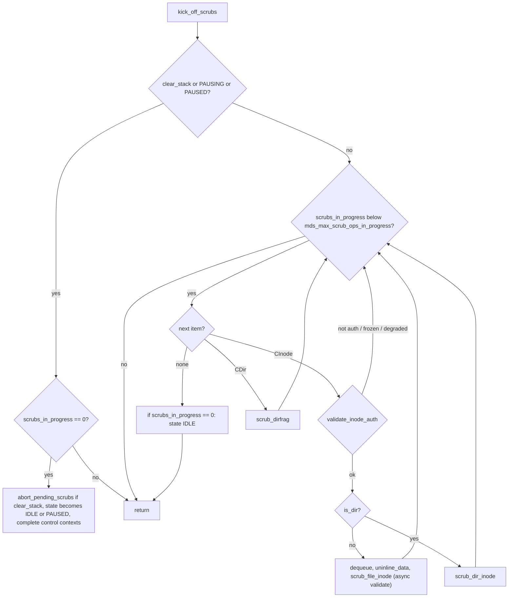
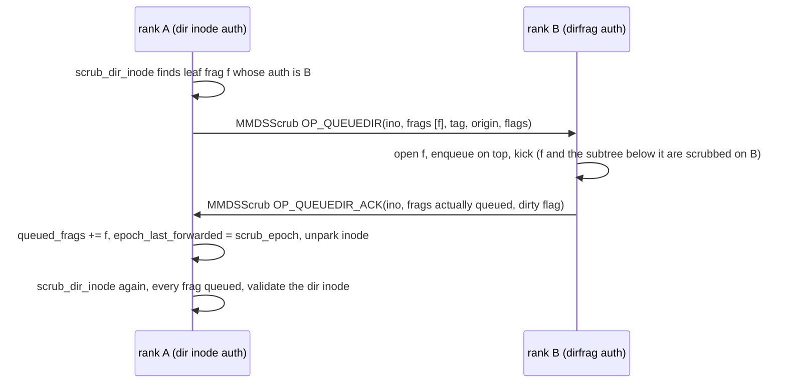
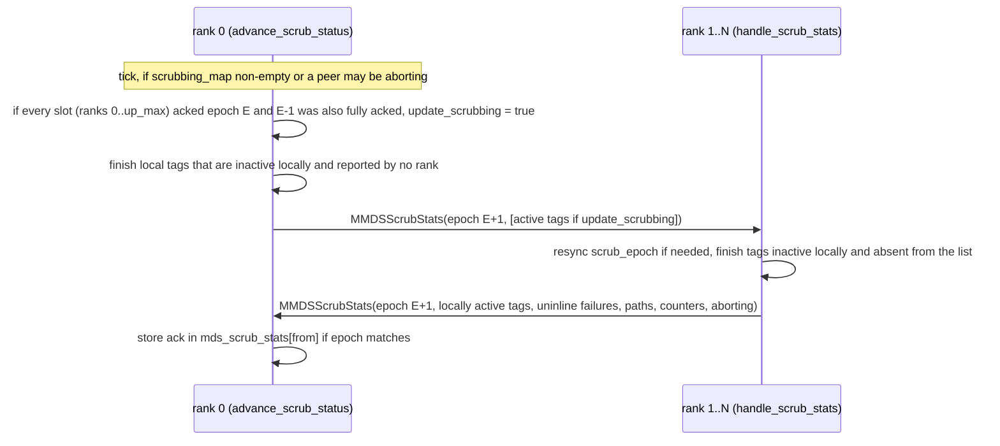
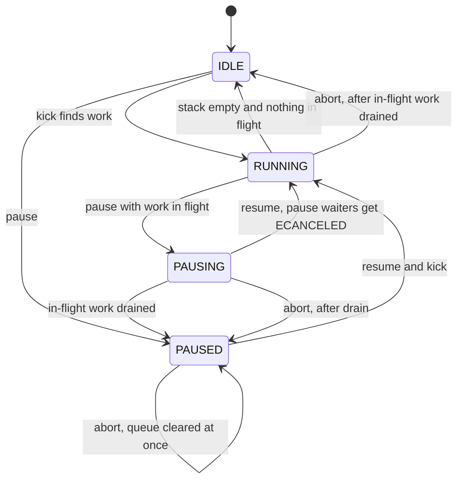

# Scrub and damage: forward scrub (ScrubStack), repair, data uninlining, DamageTable

> Part of the C++ MDS project map ([README](../README.md)). Sources (commit `5f7e383ae6d`): `src/mds/ScrubStack.h` (316 LOC), `src/mds/ScrubStack.cc` (1417), `src/mds/ScrubHeader.h` (141), `src/mds/DamageTable.h` (220), `src/mds/DamageTable.cc` (383), `src/messages/MMDSScrub.h` (148), `src/messages/MMDSScrubStats.h` (190), `src/mds/CInode.cc` (`validate_disk_state` and scrub info, ~450 lines in 4906-5583, plus backtrace helpers 1418-1640), `src/mds/CDir.cc` (`check_rstats`, fetch error paths, `go_bad*`, scrub info, ~250 lines), `src/mds/CDentry.cc` (`scrub`, `check_corruption`), `src/mds/MDCache.cc:13288-13879` (enqueue, uninline, repair, flush), `src/mds/MDSRank.cc` (asok commands, tick, `damaged()`), `src/mds/MDSDaemon.cc` (command registration), `src/mds/Beacon.cc` (health), `doc/cephfs/scrub.rst`, `doc/cephfs/disaster-recovery*.rst`, `doc/cephfs/damaged-rank.rst`, `doc/cephfs/health-messages.rst`; peer code: `src/osd/PrimaryLogPG.cc` (CMPXATTR), `src/cls/cephfs/cls_cephfs.cc`, `src/tools/cephfs/DataScan.cc`, `src/client/Client.cc`, kernel `linux/fs/ceph/{addr.c,file.c,caps.c,mds_client.c}`.
> Related: [strays-and-purge](strays-and-purge.md), [cinode-and-inode-types](../04-cache/cinode-and-inode-types.md), [cdir-cdentry-and-cache-objects](../04-cache/cdir-cdentry-and-cache-objects.md), [mdcache-subtrees-traversal-replication](../04-cache/mdcache-subtrees-traversal-replication.md), [dirfrags-and-fragmentation](../04-cache/dirfrags-and-fragmentation.md), [lock-types-and-state-machines](../05-locking/lock-types-and-state-machines.md), [acquiring-locks](../05-locking/acquiring-locks.md), [request-lifecycle](../03-request-path/request-lifecycle.md), [lookup-readdir-open-and-file-locks](../03-request-path/lookup-readdir-open-and-file-locks.md), [mdlog-and-journaler](../06-journal/mdlog-and-journaler.md), [events-and-replay](../06-journal/events-and-replay.md), [rados-object-catalog](../07-storage-formats/rados-object-catalog.md), [mds-tables](../07-storage-formats/mds-tables.md), [rados-and-osd-interactions](../07-storage-formats/rados-and-osd-interactions.md), [rstats-quotas-and-subvolumes](../10-snapshots-quotas-subvolumes/rstats-quotas-and-subvolumes.md), [beacon-and-monitor](../01-cluster-integration/beacon-and-monitor.md), [mgr-tools-and-orchestration](../01-cluster-integration/mgr-tools-and-orchestration.md), [rank-lifecycle-and-recovery](../09-recovery/rank-lifecycle-and-recovery.md), [admin-commands](../13-admin-and-config/admin-commands.md), [config-perf-counters-and-health](../13-admin-and-config/config-perf-counters-and-health.md), [quarantine](../12-qos-metrics-quiesce-quarantine/quarantine.md), [kclient-expectations](../02-client-protocol/kclient-expectations.md), [process-and-threading](../00-architecture/process-and-threading.md), [mds_lock-analysis](../00-architecture/mds_lock-analysis.md).

## 1. Purpose and responsibilities

Two cooperating subsystems, both per rank and both entirely in memory:

1. **Forward scrub** (`ScrubStack`, one instance per rank at `MDSRank::scrubstack`, created at `src/mds/MDSRank.cc:522` (MDSRank::MDSRank)). An online, admin-triggered walk of the namespace starting at a path. For each visited object it:
   - compares on-disk metadata with the in-memory (authoritative) copy: the inode backtrace (`parent` xattr) of every inode, the persisted base inodes (root, `~mdsN`), the directory `dirstat`/`rstat` against the sum of its dirfrags, each dirfrag's `fragstat`/`rstat` against its children, dentry `first`/`last` snapshot bounds, and resolvability of hard links;
   - optionally repairs what it can (backtraces, InoTable "ino wrongly free", dir and dirfrag statistics);
   - optionally writes a user-chosen `scrub_tag` xattr on every inode's first object (consumed by `cephfs-data-scan --filter-tag`);
   - converts any inline file data into a RADOS object ("uninline");
   - has side effects: it loads whole directories into cache (so scrubbing `~mdsN` loads the stray directories, whose entries the generic stray paths then evaluate, e.g. `MDCache::trim_inode` → `maybe_eval_stray`, `src/mds/MDCache.cc:7333-7336`; `ScrubStack` itself has no stray-specific code, see [strays-and-purge](strays-and-purge.md)), and may trigger dirfrag split/merge.
   Scrub is coordinated by rank 0: starting and controlling scrubs is only accepted there (status and damage commands work on any rank), work is forwarded to the authoritative rank of each inode/dirfrag, and completion is detected with an epoch protocol driven from rank 0's tick ([§3.12](#312-multi-rank-scrub)).
2. **DamageTable** (`MDSRank::damage_table`, created at `src/mds/MDSRank.cc:484`). An in-memory registry of metadata that could not be loaded or failed validation: damaged dirfrags, damaged dentries, inodes that cannot be found by number (backtrace damage), and failed uninline operations. It is consulted by `path_traverse` so that requests touching known-bad metadata fail fast with `-EIO` instead of re-reading RADOS; it drives the `MDS_DAMAGE` health error; and some damage (own stray/mdsdir structures, root dirfrag, table overflow) is "fatal" and makes the rank go `down:damaged` through `MDSRank::damaged()`.

Also covered here: the `flush_path` admin command (`MDCache::flush_dentry`) and the `tag path` command, which share the scrub/internal-request plumbing.

Out of scope (see links): backward scrub and offline repair (`cephfs-data-scan`, `cephfs-journal-tool`, `first-damage.py`) in [mgr-tools-and-orchestration](../01-cluster-integration/mgr-tools-and-orchestration.md); the `down:damaged` rank state, `ceph mds repaired`, and beacon health transport in [beacon-and-monitor](../01-cluster-integration/beacon-and-monitor.md); stray purge mechanics in [strays-and-purge](strays-and-purge.md); scatter-gather and lock state machines in [lock-types-and-state-machines](../05-locking/lock-types-and-state-machines.md).

## 2. Source map

| File | Class / function | Lines | Role |
|---|---|---|---|
| `src/mds/ScrubHeader.h` | `ScrubHeader` | 41-136 | Per-tag scrub parameters (tag, internal flag, force, recursive, repair, scrub_mdsdir), origin ino, `num_pending`, `epoch_last_forwarded`, `repaired`, uninline counters and failure lists |
| `src/mds/ScrubStack.h` | `ScrubStack` | 35-314 | Stack/queue (`scrub_stack`, `scrub_waiting` elists), `scrubs_in_progress`, `remote_scrubs`, epoch fields, `mds_scrub_stats`, `scrubbing_map`, control state |
| `src/mds/ScrubStack.cc` | `_enqueue`, `dequeue`, `enqueue` | 63-208 | Push inode/dirfrag (pin `PIN_SCRUBQUEUE`), register tag |
| `src/mds/ScrubStack.cc` | `kick_off_scrubs` | 242-326 | Scheduler loop, throttle `mds_max_scrub_ops_in_progress` |
| `src/mds/ScrubStack.cc` | `validate_inode_auth` | 328-371 | Auth check, waits, forward `OP_QUEUEINO` |
| `src/mds/ScrubStack.cc` | `scrub_dir_inode`, `scrub_dir_inode_final` | 373-489 | Queue dirfrags (local/remote), then validate the dir inode |
| `src/mds/ScrubStack.cc` | `identify_remote_link_damage`, `scrub_dirfrag`, `scrub_file_inode` | 491-573 | Dentry walk, child enqueue, local rstat check |
| `src/mds/ScrubStack.cc` | `_validate_inode_done` | 575-628 | Turn validation results into damage entries and clog |
| `src/mds/ScrubStack.cc` | `scrub_abort`, `scrub_pause`, `scrub_resume`, `abort_pending_scrubs`, `send_state_message` | 836-956 | Control operations |
| `src/mds/ScrubStack.cc` | `scrub_summary`, `scrub_status`, `clog_scrub_summary` | 661-834, 959-973 | Status reporting |
| `src/mds/ScrubStack.cc` | `handle_scrub`, `handle_scrub_stats` | 1004-1252 | Inter-MDS messages |
| `src/mds/ScrubStack.cc` | `advance_scrub_status`, `move_uninline_failures_to_damage_table`, `handle_mds_failure` | 1254-1395 | Rank 0 completion protocol, failure handling |
| `src/mds/ScrubStack.cc` | `uninline_data`, counters, `handle_conf_change` | 120-167, 1397-1417 | Uninline request start, scrub counters |
| `src/mds/CInode.cc` | `CInode::validate_disk_state` (`ValidationContinuation`) | 4906-5305 | Backtrace, InoTable, base-inode, rstat checks and repairs |
| `src/mds/CInode.cc` | `validated_data::dump`, `all_damage_repaired` | 5307-5358 | Result JSON |
| `src/mds/CInode.cc` | `scrub_info_create` .. `uninline_finished` | 5505-5583 | Per-inode scrub state and stamps |
| `src/mds/CInode.cc` | `project_inode` (scrub stamp copy) | 474-490 | Persist `last_scrub_*` lazily |
| `src/mds/CInode.cc` | `build_backtrace`, `_store_backtrace`, `verify_diri_backtrace` | 1418-1640 | Backtrace format and fetch-time check |
| `src/mds/CInode.h` | `validated_data`, `scrub_info_t`, `STATE_REPAIRSTATS`, scrub accessors | 274-327, 378, 435-485 | Declarations |
| `src/mds/CDir.cc` | `CDir::check_rstats` | 238-314 | Dirfrag stat vs children check |
| `src/mds/CDir.cc` | `C_IO_Dir_OMAP_Fetched`, `_omap_fetch`, `_omap_fetched`, `go_bad_dentry`, `go_bad` | 1755-1822, 2056-2347 | Damage detection while loading dirfrags |
| `src/mds/CDir.cc` | `scrub_info_create` .. `scrub_local` | 3772-3847 | Per-dirfrag scrub state and stamps |
| `src/mds/CDir.cc` | `project_fnode` (scrub stamp copy) | 1400-1423 | Persist dirfrag scrub stamps lazily |
| `src/mds/CDentry.cc` | `CDentry::scrub`, `CDentry::check_corruption` | 771-827 | `first`/`last` corruption checks |
| `src/mds/DamageTable.h/.cc` | `DamageTable`, `DirFragDamage`, `DentryDamage`, `BacktraceDamage`, `UninlineDamage` | h:34-219, cc:30-382 | Damage registry |
| `src/mds/MDCache.cc` | `C_MDS_EnqueueScrub`, `enqueue_scrub`, `enqueue_scrub_work` | 13288-13386 | Admin entry, internal op `ENQUEUE_SCRUB` |
| `src/mds/MDCache.cc` | `C_MDC_DataUninlinedSubmitted`, `C_IO_DataUninlined`, `uninline_data_work` | 13388-13573 | Uninline: RADOS write then journal |
| `src/mds/MDCache.cc` | `repair_dirfrag_stats(_work)`, `repair_inode_stats(_work)`, `rdlock_dirfrags_stats(_work)` | 13575-13843 | Repair and stat-stabilisation internal ops |
| `src/mds/MDCache.cc` | `flush_dentry`, `flush_dentry_work` | 13845-13879 | `flush_path` command |
| `src/mds/MDCache.cc` | `path_traverse` damage checks | 8589-8593, 8622-8628, 8705-8712, 8804-8810 | `-EIO` on known damage |
| `src/mds/MDCache.cc` | `_open_remote_dentry_finish` | 9026-9053 | Backtrace damage on hard-link resolution failure |
| `src/mds/MDSRank.cc` | `handle_asok_command` scrub/damage branches, `command_scrub_*`, `command_tag_path` | 2889-3001, 3103-3113, 3219-3272 | Admin commands |
| `src/mds/MDSRank.cc` | `tick` (rank 0 scrub status), `get_task_status`, `damaged`, `handle_write_error` | 763-766, 4308-4346, 945-991 | Periodic work, mgr task status, fatal damage, read-only |
| `src/mds/MDSDaemon.cc` | command registration | 349-391, 484-491 | asok/tell command signatures |
| `src/mds/Beacon.cc` | `Beacon::notify_health` | 321-326, 481-486 | `MDS_HEALTH_DAMAGE`, `MDS_HEALTH_READ_ONLY` |
| `src/messages/MMDSScrub.h` | `MMDSScrub` | 24-147 | Work forwarding and control broadcast |
| `src/messages/MMDSScrubStats.h` | `MMDSScrubStats` | 21-188 | Completion epoch protocol |

## 3. How it works

### 3.1 Starting a scrub

1. `ceph tell mds.<fs>:0 scrub start <path> [scrubops...] [tag]` (or the asok equivalent) reaches `MDSRankDispatcher::handle_asok_command` (`src/mds/MDSRank.cc:2889`). It fails with `-EINVAL` "MDS is not active" unless the rank is `up:active`, and with `-EXDEV` "Not rank 0" on any rank other than 0. Otherwise it queues a lambda on the MDS `finisher` thread which calls `command_scrub_start` (`src/mds/MDSRank.cc:3219`). Tell commands require an MDS cap that `allow_all()` (`src/mds/MDSDaemon.cc:810` (MDSDaemon::handle_command)).
2. `command_scrub_start` maps `scrubops` (`force`, `recursive`, `repair`, `scrub_mdsdir`; `scrub_mdsdir` is honoured only when `path == "/"`), takes `mds_lock`, and calls `MDCache::enqueue_scrub` (`src/mds/MDCache.cc:13313`).
3. `enqueue_scrub` resolves the path:
   - `~mdsdir` → this rank's mdsdir ino `MDS_INO_MDSDIR(whoami)`; `~mdsN` → rank N's mdsdir (`strict_strtoll`, bounded by `MAX_MDS`); anything else → `filepath::set_path(path)`, which only produces a rooted path (base ino 1) when the string starts with `/` (`src/include/filepath.cc:68`). A relative path gets base ino 0 and `path_traverse` returns `-ESTALE` (`src/mds/MDCache.cc:8486` (MDCache::path_traverse)).
   - An empty tag is replaced by a random UUID and the header is marked `is_internal = true`.
   - It creates an internal request `CEPH_MDS_OP_ENQUEUE_SCRUB` (`0x01503`) whose `internal_op_finish` is a `C_MDS_EnqueueScrub` carrying a new `ScrubHeader` (`src/mds/MDCache.cc:13288-13356`).
4. `enqueue_scrub_work` (`src/mds/MDCache.cc:13358`) runs `path_traverse(..., MDS_TRAVERSE_DISCOVER | MDS_TRAVERSE_RDLOCK_PATH)`: the target is discovered (replicated) locally rather than forwarded, so rank 0 can start a scrub at a path owned by another rank. Traversal errors (`-ENOENT`, `-EIO` for known damage, `-ESTALE`, ...) are returned. If the inode is already being scrubbed (`scrub_is_in_progress()`) the result is `-EBUSY`. Otherwise `ScrubStack::enqueue(in, header, top = !recursive)`.
5. `ScrubStack::enqueue` (`src/mds/ScrubStack.cc:169`): `-EAGAIN` if an abort is in progress (`clear_stack`); sets `header->origin = in->ino()`; inserts the tag in `scrubbing_map` (`-EEXIST` if the tag is already active); with `scrub_mdsdir` first pushes **this rank's** mdsdir on top (other ranks' `~mdsN` are not included) and then forces the target itself to the bottom; initialises per-tag counters; `_enqueue(in)`; logs "scrub queued for path" and "scrub summary" to the cluster log; `kick_off_scrubs()`. An `_enqueue` failure after the tag was inserted returns the error but leaves the tag in `scrubbing_map` until the completion protocol retires it.
6. The internal request completes and `C_MDS_EnqueueScrub::finish` writes `{"return_code": r, "scrub_tag": tag, "mode": "asynchronous"}` (tag and mode only if `r == 0`) and always completes the admin command with 0, so errors are visible only in `return_code` (`src/mds/MDCache.cc:13298-13310`). The scrub itself proceeds asynchronously.

`tag path <path> <tag>` (`src/mds/MDSRank.cc:3244` (MDSRank::command_tag_path)) is `enqueue_scrub(path, tag, force=true, recursive=true, repair=false, scrub_mdsdir=false)` executed synchronously on the admin-socket thread (it waits on a `C_SaferCond` with `mds_lock` released until the enqueue request completes, not until the scrub finishes). It requires rank 0 but, unlike `scrub start`, does not check `is_active()`.

### 3.2 Scrub header, tags and origin

`ScrubHeader` (`src/mds/ScrubHeader.h:41`) is shared (`shared_ptr`) by every inode/dirfrag queued under one tag on one rank. Each rank that receives forwarded work creates its own header instance for the same tag (`src/mds/ScrubStack.cc:1056-1066`, `1113-1122`).

| Field | Meaning |
|---|---|
| `tag`, `is_tag_internal` | User tag, or generated UUID (`internal`). Only non-internal tags are written to RADOS as `scrub_tag` xattrs (`src/mds/CInode.cc:4966-4977`). |
| `force` | Do not skip dentries unchanged since the dirfrag's last recursive scrub (`src/mds/ScrubStack.cc:535-541`). Has no other effect. |
| `recursive` | Descend into dirfrag children. Non-recursive scrubs still queue the target directory's dirfrags and run their local checks ([§3.4](#34-directory-inode-scrub_dir_inode)). |
| `repair` | Enable the repairs of [§3.10](#310-repair-mode). |
| `scrub_mdsdir` | Also scrub this rank's `~mdsN` (only valid with path `/`). |
| `origin` | Ino the scrub started at; used in status output and to skip uninlining when the origin is an mdsdir. |
| `num_pending` | Number of objects on this rank still holding this header (incremented by `scrub_initialize`, decremented when finished/aborted, and by `C_MDC_ScrubRepaired` around repair requests). |
| `epoch_last_forwarded` | Scrub epoch at which this rank last forwarded work for the tag to another rank; keeps the tag "active" in the completion protocol. |
| `repaired` | Set when any repair was issued; triggers `MDLog::trim_all()` when the tag finishes. |
| uninline counters, `uninline_failed_info` (errno → inos), `paths` | Uninline statistics and failures, reported to rank 0. |

### 3.3 The scrub "stack" and the scheduler loop

`scrub_stack` and `scrub_waiting` are intrusive lists threaded through `MDSCacheObject::item_scrub` (`src/mds/MDSCacheObject.h:83`); only `CInode` and `CDir` objects are ever queued (a `CDentry` asserts). `_enqueue` (`src/mds/ScrubStack.cc:72`):

- `CInode`: `-EBUSY` if `scrub_is_in_progress()`; returns 0 without queueing if `STATE_PURGING`; otherwise `scrub_initialize(header)` (sets `scrub_in_progress`, clears `queued_frags`, `header->inc_num_pending()`) and `uninline_initialize()` (sets `uninline_in_progress`).
- `CDir`: `-EBUSY` if already scrubbing; returns 0 if its inode is purging; otherwise `auth_pin(this)` (held until the dirfrag scrub finishes or is aborted) and `scrub_initialize(header)`.
- If not already on a list, takes `PIN_SCRUBQUEUE` (1011) and `stack_size++`; then `push_front` (top) or `push_back` (bottom).

Who pushes where: the admin-chosen root goes to the top for non-recursive scrubs and to the bottom for recursive ones (always to the bottom with `scrub_mdsdir`, which puts the mdsdir on top); dirfrags are always pushed to the top (`src/mds/ScrubStack.cc:420`, `1070`); child inodes found in a dirfrag are pushed to the **bottom** (`src/mds/ScrubStack.cc:543`); forwarded inodes/dirfrags received from other ranks go to the top (`1070`, `1124`). The structure therefore behaves as a deque: a directory's dirfrags are processed immediately (LIFO), and the inodes they contain are appended (FIFO), giving a breadth-first walk of the tree.

`kick_off_scrubs` (`src/mds/ScrubStack.cc:242`) runs under `mds_lock` after every enqueue, completion, retry and resume:

`scrubs_in_progress` counts asynchronous inode validations of files and directories (`C_InodeValidated`, `src/mds/ScrubStack.cc:463-480`) plus every object parked in `scrub_waiting` (`add_to_waiting`, `src/mds/ScrubStack.cc:210`). The synchronous parts (queueing a directory's dirfrags, scanning a complete dirfrag) and uninline requests do not count, so one pass can process many dirfrags. When an item adds children (dirfrags at the top, or child inodes at the bottom), iteration restarts at the head of the list. Because uninline requests are not counted, the state can become IDLE while uninline requests are still in flight.

`C_RetryScrub` (`src/mds/ScrubStack.cc:228-240`) is the generic "park and retry" context: its constructor moves the object to `scrub_waiting` (and counts it), its `finish` moves it back to the top of the stack and kicks. The result code passed to it is ignored.

`validate_inode_auth` (`src/mds/ScrubStack.cc:328`):

| Condition | Action |
|---|---|
| auth, cannot auth-pin (freezing/frozen) | wait `CInode::WAIT_UNFREEZE` via `C_RetryScrub` |
| not auth, ambiguous auth | wait `WAIT_SINGLEAUTH` |
| not auth, cluster degraded | `wait_for_cluster_recovered` |
| not auth, otherwise | record in `remote_scrubs[in]` (asserts no existing entry: "FIXME: parallel scrubs?"), send `MMDSScrub(OP_QUEUEINO, ino, queued_frags (moved), tag, origin, flags)` to the auth rank, park the inode until `OP_QUEUEINO_ACK` |

### 3.4 Directory inode: `scrub_dir_inode`

`src/mds/ScrubStack.cc:373`. For every leaf of `dirfragtree` not yet in `scrub_infop->queued_frags`:

| Dirfrag condition | Action |
|---|---|
| `damage_table.is_dirfrag_damaged(dir)` | skipped silently (log level 5: "not scrubbing damaged dirfrag") |
| not auth, ambiguous | wait `WAIT_SINGLEAUTH` (gather) |
| not auth, cluster degraded | `wait_for_cluster_recovered` (gather) |
| not auth | add frag to `scrub_remote[auth]` |
| cannot auth-pin | wait `CDir::WAIT_UNFREEZE` (gather) |
| `get_version() == 0` (never loaded) | `fetch_keys({}, gather)` (loads only the fnode header) |
| otherwise | `_enqueue(dir, top)`, add to `queued_frags`, `added_children = true` |

`get_or_open_dirfrag` instantiates `CDir` objects for every leaf, so a scrub brings every dirfrag of every visited directory into cache. If any gather sub-context was created, the inode is parked (`C_RetryScrub`) and re-examined later. Else, if remote frags exist, one `MMDSScrub(OP_QUEUEDIR, ino, frags, ...)` per auth rank is sent, `remote_scrubs[in].gather_set` records the ranks, and the inode is parked until all `OP_QUEUEDIR_ACK`s arrive (`src/mds/ScrubStack.cc:434-455`). Otherwise `scrub_dir_inode_final` starts the asynchronous `validate_disk_state` on the directory inode and the inode is dequeued (`done`), followed by `uninline_finished()` in `kick_off_scrubs`.

Consequence: the directory inode is validated as soon as all its dirfrags are queued (locally or remotely), concurrently with (not after) the scrub of its dirfrags and of the subtree below.

### 3.5 Dirfrag: `scrub_dirfrag`

`src/mds/ScrubStack.cc:504`:

1. If the dirfrag is not complete, `dir->fetch(C_RetryScrub, ignore_authpinnability=true)` and return (counts as in progress). `C_RetryScrub` ignores the result, so if this full fetch fails (`go_bad`: DIR_FRAG damage, `STATE_BADFRAG`, marked complete while keeping the fnode already loaded by the earlier header fetch), the dirfrag is scanned anyway with whatever dentries are cached; `check_rstats` then normally mismatches, and with `repair` `repair_dirfrag_stats`, which has no damage check, would journal stats recomputed from those cached dentries (by code reading). A dirfrag found damaged by the header-only `fetch_keys` in `scrub_dir_inode` is instead skipped on the retry.
2. If `recursive`: `next_seq = global_snaprealm.newest_seq + 1`; for every dentry (head and snapshotted):
   - `CDentry::scrub(next_seq)` (`src/mds/CDentry.cc:771`): for non-projected dentries, `first > next_seq` or `first > last` → `dir->go_bad_dentry(last, name)` (DENTRY damage, possibly fatal, [§3.16](#316-damagetable)) and a clog warning "Scrub error on dentry ... see `damage ls`". Staleness against the realm's snaps is computed but nothing is done ("TODO: maybe trim?").
   - Snapshotted dentries (`snapid != CEPH_NOSNAP`) are not descended into: snapshot inodes are never validated.
   - Skip if `dn->get_version() <= dir->scrub_info()->last_recursive.version`, `remote_d_type != DT_DIR` and not `force`. For primary dentries `remote_d_type` is always 0 (`src/mds/CDentry.h:81-105` (linkage_t)), so without `force` unchanged subdirectories are skipped as well: scrub is incremental per dirfrag.
   - Primary → `_enqueue(child, bottom)` (an `-EBUSY` from a child already scrubbed under another tag is ignored). Remote → `identify_remote_link_damage`: if the target ino is not in cache and not already known as damaged, `open_remote_dentry(dn, true, noop)`, fire-and-forget (the dirfrag scrub does not wait for it, so the result can arrive after the tag finished); a failure there records BACKTRACE damage and sets `CDentry::STATE_BADREMOTEINO` (`src/mds/MDCache.cc:9026-9047`).
3. `scrub_local()` (`src/mds/CDir.cc:3836`) → `check_rstats(true)` (`src/mds/CDir.cc:238`): requires complete, auth and not frozen (otherwise reports failure); sums head dentries (primary inode → `accounted_rstat` and `nsubdirs`/`nfiles`; remote → `nfiles`) and compares with `fnode->fragstat` and `fnode->rstat` using `same_sums` (`nfiles`, `nsubdirs`, and mtime `<=`; `rbytes`, `rfiles`, `rsubdirs`, `rsnaps`, and rctime `<=`, `src/include/cephfs/types.h:115-119`, `173-179`). Mismatch without repair → clog warning "Scrub error on dir ...". With repair → `MDCache::repair_dirfrag_stats(dir)`, `header->set_repaired()`, and **all DENTRY damage entries of this dirfrag are removed** from the table.
4. `mdcache->maybe_fragment(dir)` → `MDBalancer::maybe_fragment(dir, false)`: queues a split or merge if size thresholds say so (not for base or stray dirs) (`src/mds/MDBalancer.cc:1296`).
5. `scrub_finished()` (stamps `last_local = {now, version}`, and `last_recursive = last_local` if recursive), `auth_unpin`, dequeue.

The dentry loop runs synchronously under `mds_lock` without heartbeat resets.

### 3.6 Non-directory inode: `scrub_file_inode` and uninline

For every non-directory inode (regular files, symlinks, special files) reached at the head of the stack, `kick_off_scrubs` dequeues it and starts two concurrent activities (`src/mds/ScrubStack.cc:290-295`):

- `uninline_data(in, C_MDSInternalNoop)` (`src/mds/ScrubStack.cc:1397`): `auth_pin(in)` and dispatch an internal request `CEPH_MDS_OP_UNINLINE_DATA` (`0x0150b`, `no_early_reply`). See [§3.11](#311-data-uninlining).
- `scrub_file_inode` → `CInode::validate_disk_state` with `C_InodeValidated`.

The inode's scrub is complete when both `scrub_in_progress` and `uninline_in_progress` are clear; only then `common_finished()` stamps `last_scrub_version = version`, `last_scrub_stamp = now`, marks the stamps dirty and decrements `num_pending` (`src/mds/CInode.cc:5560-5583`).

### 3.7 Validation: `CInode::validate_disk_state`

`src/mds/CInode.cc:4906`. A `ValidationContinuation` (`MDSContinuation`) with stages START → BACKTRACE → (INODE) → DIRFRAGS; `SNAPREALM` is declared but has no callback. Results go to a `validated_data` struct (`src/mds/CInode.h:274-302`) with three `member_status` blocks (`backtrace`, `inode`, `raw_stats`), each with `checked`, `passed`, `repaired`, `ondisk_read_retval`, on-disk and in-memory values, and an error string.

| Stage | Code | What happens |
|---|---|---|
| `_start` | `src/mds/CInode.cc:4980` | Asserts `can_auth_pin()`, takes an auth pin for the duration. Notes (log only) that dirty inodes give inconclusive results. Issues one `Objecter::read` of `getxattr("parent")` on object `<ino hex>.00000000` in `get_backtrace_pool()` (the file layout pool for files, the metadata pool for directories, `src/mds/CInode.cc:5585`). If the tag is not internal, also issues a separate fire-and-forget `setxattr("scrub_tag", encode(tag))` (ceph string encoding: u32 length + bytes) with an empty SnapContext on the same object (which creates the object if absent). Increments `scrub_backtrace_fetch` and `openino_backtrace_fetch`, and `scrub_set_tag` for user tags. The completion runs via `C_OnFinisher` on the MDS finisher. |
| `_backtrace` | `src/mds/CInode.cc:5003` | `build_backtrace` from the in-memory parent chain (`src/mds/CInode.cc:1418`), decode the on-disk one, `inode_backtrace_t::compare` (`src/mds/inode_backtrace.cc:127`). Pass if equal or memory newer and not divergent. Read error: fails unless the inode is an mdsdir (no backtrace) or `is_dirty_parent()` (a backtrace write is pending). Decode error: fails unless dirty parent. Divergent or on-disk newer: passes anyway if (divergent and (dirty parent or `nlink == 0`)) or any ancestor is a replica (`is_any_ancestor_inode_a_replica`). On failure with repair: [§3.10](#310-repair-mode). Then the InoTable check: if `inotable->is_marked_free(ino)` (local rank's table, free or projected-free) → clog error "scrub: inode wrongly marked free"; with repair, `InoTable::repair` (only when `projected_version == version`, else clog "Cannot repair inotable while other operations are in progress") and `inotable->save()`. Files stop here ("TODO: validate on-disk inode for normal files") and are counted in `scrub_file_inodes`; directories continue (`scrub_dir_inodes`). |
| `validate_directory_data` | `src/mds/CInode.cc:5143` | Base directories (root, `~mdsN`): create a shadow system inode (`create_unlinked_system_inode`, `num_shadow_inodes++`) and `CInode::fetch()` it, i.e. read the persisted base-inode object `<ino>.00000000.inode` (and the legacy `inode` xattr, see [rados-object-catalog](../07-storage-formats/rados-object-catalog.md)) (stage INODE). Other directories: no on-disk inode comparison ("TODO"), `inode.passed = true` with `inode.checked = false`. |
| `_inode_disk` | `src/mds/CInode.cc:5165` | Base inodes only: fail if on-disk version is newer, else `inode_t::compare` (`src/include/cephfs/types.h:1254`): same version requires 32 listed fields (times, mode, ownership, layouts, sizes, truncation, inline data, stats, versions, fscrypt blobs, `optmetadata`) to be equal; different versions require `older_is_consistent`. The fetch result `rval` is recorded but not checked: if neither the `.inode` object nor the legacy xattr exists, the shadow keeps its `create_unlinked_system_inode` defaults (version 1) and the comparison normally passes (by code reading). |
| `check_dirfrag_rstats` | `src/mds/CInode.cc:5192` | If the directory has any subtree-root dirfrag (`num_subtree_roots > 0`), run internal request `RDLOCK_FRAGSSTATS` ([§3.10](#310-repair-mode)) to force a scatter-gather first; else proceed immediately. |
| `_dirfrags` | `src/mds/CInode.cc:5201` | Sum `accounted_fragstat` and `accounted_rstat` of all cached dirfrags (`rsubdirs + 1` for self, `rsnaps +=` number of snaps in the projected srnode) and compare with the inode `dirstat`/`rstat` (`same_sums`). Any damaged dirfrag → fail with "one or more dirfrags are damaged". Mismatch: with repair → `repair_inode_stats(in)` and `raw_stats.repaired = true`; then the mismatch is forgiven (`passed = true`) if the inode is dirty, or if any local auth dirfrag is dirty, or a remote rank reported a dirty dirfrag in `OP_QUEUEDIR_ACK` (`dirty_remote_dirfrag_scrubbed`, which is then cleared). |
| `_done` | `src/mds/CInode.cc:5280` | `passed_validation` = every checked block passed. Any `repaired` → `header->set_repaired()`. Completes the caller and drops the auth pin. |

### 3.8 Recording results: `_validate_inode_done`

`src/mds/ScrubStack.cc:575`:

- Backtrace checked, failed, not repaired → `damage_table.notify_remote_damaged(ino, path)` (BACKTRACE entry). The return value (fatal) is ignored.
- Else inode checked, failed, not repaired → `notify_dentry(parent dirfrag, parent->last, name, path)`. Since `inode.checked` is only set for base inodes, which have no projected parent dentry, this branch never creates an entry in practice.
- `raw_stats` failures never create damage entries; they only produce cluster-log warnings.
- If validation failed: clog info "Scrub repaired inode <ino> (<path>)" when `all_damage_repaired()`, else clog warning "Scrub error on inode <ino> (<path>) see <daemon> log and `damage ls` output for details", plus the full `validated_data` JSON at `derr` level.
- `in->scrub_finished()`.

### 3.9 What scrub checks: summary

| Object | Check | Failure → | Repairable |
|---|---|---|---|
| Every inode | `parent` backtrace on first object vs in-memory ancestry | BACKTRACE damage entry, clog warn | yes (rewrite) |
| Every inode | ino not free in this rank's InoTable | clog error | yes (`InoTable::repair`) |
| Every inode (user tag) | n/a: writes `scrub_tag` xattr | – | – |
| Root, `~mdsN` | persisted inode object vs memory | clog warn only | no |
| Directory inode | `dirstat`/`rstat` vs sum of dirfrag accounted stats | clog warn only | yes (scatter-gather with `STATE_REPAIRSTATS`) |
| Dirfrag | `fragstat`/`rstat` vs children | clog warn only | yes (`repair_dirfrag_stats`) |
| Dentry | `first`/`last` sane vs snap seq | DENTRY damage, clog warn (fatal in own mdsdir/stray) | no |
| Remote dentry (hard link) | target ino can be opened (backtrace lookup) | BACKTRACE damage on target ino, `STATE_BADREMOTEINO` | no ("can identify but not repair", `doc/cephfs/scrub.rst`) |
| Regular file with inline data | converted to object data | UNINLINE damage entry at scrub end (rank 0) | n/a |
| Dirfrag object (when scrub loads it) | object exists, fnode decodes fully, dentries decode | DIR_FRAG / DENTRY damage ([§3.17](#317-where-damage-is-detected)) | no |
| Regular file metadata (size, layout, data objects) | not checked | – | – |

### 3.10 Repair mode

| Repair | Trigger | Mechanism | Citation |
|---|---|---|---|
| Backtrace | backtrace failed and `repair` | clog warn "bad backtrace on inode ..., rewriting it"; `mark_dirty_parent(current segment)` so the backtrace is rewritten when the segment expires (`CInode::_store_backtrace`, `src/mds/CInode.cc:1477`); `remove_backtrace_damage_entry(ino)`; `scrub_backtrace_repaired`++ | `src/mds/CInode.cc:5087-5099` |
| InoTable | ino marked free | `InoTable::repair(ino)` erases from `free`/`projected_free`, bumps version; `save()` | `src/mds/InoTable.cc:215`, `src/mds/CInode.cc:5110-5127` |
| Dirfrag stats | `scrub_local` mismatch | internal request `REPAIR_FRAGSTATS` (`0x01504`): auth-pin dirfrag, rdlock `dirfragtreelock`, wrlock `nestlock` and `filelock` of the directory inode, fetch if incomplete, recompute from projected linkages (keeping newer `mtime`, `change_attr`, `rctime`), `project_fnode`, mark the scatterlocks updated, journal `EUpdate("repair_dirfrag")` with the dirfrag dirty. Non-auth → `-ESTALE`. | `src/mds/MDCache.cc:13597-13702` |
| Directory inode stats | `_dirfrags` mismatch | internal request `REPAIR_INODESTATS` (`0x01505`): rdlock `dirfragtreelock`, wrlock `nestlock`/`filelock`; open/fetch every leaf dirfrag (`-EIO` if one is damaged); set `CInode::STATE_REPAIRSTATS`; mark both scatterlocks updated and put the inode on the segment's dirty-dirfrag lists; drop locks; then rdlock all three to force the scatter-gather. `CInode::finish_scatter_gather_update` overwrites the inode's dirstat/rstat with the dirfrag sums whenever all leaf dirfrags are cached, with or without repair; `STATE_REPAIRSTATS` only replaces the clog errors "unmatched fragstat on ..." / "inconsistent rstat on inode ..." and the `mds_verify_scatter` assert with a debug message (`src/mds/CInode.cc:2715`, `2831`). The repair's real effect is forcing that gather. A remaining mismatch is only logged at debug level. Non-auth → `-ESTALE`, not a directory → `-ENOTDIR`. | `src/mds/MDCache.cc:13704-13809` |
| Stat stabilisation (not a repair) | directory with a subtree-root dirfrag | internal request `RDLOCK_FRAGSSTATS` (`0x01507`): rdlock `dirfragtreelock`, `nestlock`, `filelock`, then immediately respond (locks dropped), so `_dirfrags` reads freshly gathered values in the same `mds_lock` hold | `src/mds/MDCache.cc:13811-13843` |
| Flush at end | tag finished with `repaired` | `MDLog::trim_all()` (= `trim_to(0)`) on each rank whose header saw a repair, when it retires the tag: starts expiry of every segment except the newest one, up to the first segment whose events are not yet safe, writing dirty metadata (including the rewritten backtraces) to RADOS. Best effort: the journal is not flushed first, `trim_to` returns `-EAGAIN` (ignored) at a segment with pending events, and repairs logged in the still-current segment are not forced out | `src/mds/ScrubStack.cc:1231-1232`, `1370-1371`, `src/mds/MDLog.h:165` (MDLog::trim_all), `src/mds/MDLog.cc:855-906` (MDLog::trim_to) |

`C_MDC_ScrubRepaired` (`src/mds/MDCache.cc:13585`) holds `num_pending` on the header while a repair request runs, so the tag does not finish before the repair completes.

Nothing in scrub repairs damaged dirfrags, damaged dentries, or bad hard links; those need offline tools (`cephfs-data-scan`, `first-damage.py`, `cephfs-journal-tool`, see `doc/cephfs/disaster-recovery*.rst`).

### 3.11 Data uninlining

Inline data (deprecated since Octopus, `doc/cephfs/experimental-features.rst`) only exists on inodes created while the `inline_data` fs flag was enabled by a client with `CEPH_FEATURE_MDS_INLINE_DATA`; otherwise new inodes get `inline_data.version = CEPH_INLINE_NONE` (`src/mds/Server.cc:3758-3760` (Server::prepare_new_inode)). Scrub is the MDS-side migration path away from it. `MDCache::uninline_data_work` (`src/mds/MDCache.cc:13487`), dispatched for every scrubbed non-directory inode:

1. `acquire_locks` with **xlock** on `authlock`, `filelock` and `versionlock` (`src/mds/MDCache.cc:13493-13501`). This happens before the inline-data test, so every scrubbed file goes through exclusive lock states, which revokes conflicting client caps on it (see [lock-types-and-state-machines](../05-locking/lock-types-and-state-machines.md)); the request waits for the client to release them. In the xlock states the file lock table lets clients keep only `Fc`/`Fb` and the simple lock table (used by `authlock`) allows no `As`/`Ax`, since an internal request is not a client xlocker (`src/mds/locks.c:26-29`, `102-106`; the exact revocations on the way into those states were not traced).
2. `!has_inline_data()` (`is_normal() && is_file() && projected inline_data.version != CEPH_INLINE_NONE`, `src/mds/CInode.h:1089`) → `uninline_finished()`, `auth_unpin`, respond 0. This is the common case.
3. Origin of the scrub is an mdsdir → `record_uninline_skipped()`, respond 0 (see gotchas: no `uninline_finished`/`auth_unpin` on this path).
4. Otherwise: `uninline_started` counters, then two Objecter mutations on `<ino hex>.00000000` in the file's layout pool with the realm snap context:
   - `create(exclusive=false)` with no completion;
   - `cmpxattr("inline_version", CEPH_OSD_CMPXATTR_OP_GT, CEPH_OSD_CMPXATTR_MODE_U64, operand)` + `write(0, inline_data, truncate_size, truncate_seq)` (if any data) + `setxattr("inline_version", "18446744073709551615")` (decimal `CEPH_INLINE_NONE`).
   The operand is built with `in->encode(inline_version_bl, pi->inline_data.version)`, which resolves to the member `InodeStoreBase::encode(bl, features, snap_blob)` (`src/mds/CInode.cc:1703`), i.e. a full encoded inode store, not a u64; the OSD decodes only the first 8 bytes as the u64 operand (`src/osd/PrimaryLogPG.cc:6652-6664` (CEPH_OSD_OP_CMPXATTR)). The userspace client builds the same op with `encode(u64)` (`src/client/Client.cc:11445` (Client::uninline_data)) and the kernel with `cpu_to_le64` (`linux/fs/ceph/addr.c:2327` (ceph_uninline_data)).
5. `C_IO_DataUninlined::finish` (`src/mds/MDCache.cc:13429`): on error, `uninline_write_failed`++, `record_uninline_failed()`, `record_uninline_status(ino, r, path)`, `uninline_finished`, `auth_unpin`, respond `r`. On success, journal `EUpdate("uninline")`: projected inode with `version = pre_dirty()`, inline data freed, `inline_data.version = CEPH_INLINE_NONE`, `ctime = op stamp`, `rctime` bumped, `change_attr++`, `predirty_journal_parents(PREDIRTY_PRIMARY)` and `journal_dirty_inode`.
6. `C_MDC_DataUninlinedSubmitted::finish` (`src/mds/MDCache.cc:13395`): asserts journaling succeeded, `uninline_succeeded`++, `record_uninline_passed()`, `uninline_finished`, `mdr->apply()`, `auth_unpin`, respond.

Failures are aggregated per tag and errno; when the tag finishes they become UNINLINE damage entries **in rank 0's DamageTable**, tagged with the rank where they occurred ([§3.12.3](#3123-completion-protocol)).

### 3.12 Multi-rank scrub

#### 3.12.1 Work forwarding

| Message | Sender trigger | Receiver handling (`ScrubStack::handle_scrub`, `src/mds/ScrubStack.cc:1004`) | Ack |
|---|---|---|---|
| `OP_QUEUEDIR` (1): ino, frags, tag, origin, flags | `scrub_dir_inode` found non-auth dirfrags | `get_inode(ino)` (asserted present); for each leaf frag contained in a requested frag: skip if not auth, wait (`C_MDS_RetryMessage`) if not auth-pinnable, note if dirty; find or create the tag's header; `_enqueue(dir, top)`; kick | `OP_QUEUEDIR_ACK` (-1) with the frags actually queued and `FLAG_DIRTY_REMOTE_DIRFRAG` if any was dirty |
| `OP_QUEUEDIR_ACK` | – | if `remote_scrubs[diri]` matches the tag and the sender is in the gather set: add frags to `queued_frags`; when all acked set `epoch_last_forwarded = scrub_epoch`, mark `dirty_remote_dirfrag_scrubbed` if the **last** ack to arrive carries the dirty flag (a flag on an earlier ack from another rank is dropped), unpark the inode (it re-runs `scrub_dir_inode`, re-forwarding any frag that was not queued) | – |
| `OP_QUEUEINO` (2) | `validate_inode_auth` on a non-auth inode | `get_inode(ino)` (asserted); find/create header; `_enqueue(in, top)` (return value ignored); `queued_frags = m.frags`; kick | `OP_QUEUEINO_ACK` (-2) |
| `OP_QUEUEINO_ACK` | – | unpark and dequeue the inode, `epoch_last_forwarded = scrub_epoch`, `scrub_finished()` + `uninline_finished()` locally (the receiving rank now owns that inode's scrub) | – |
| `OP_ABORT` (3), `OP_PAUSE` (4), `OP_RESUME` (5) | rank 0 `scrub_abort`/`scrub_pause`/`scrub_resume` broadcast to every up rank except 0 (`send_state_message`, `src/mds/ScrubStack.cc:866`) | apply locally with no completion context | none |

#### 3.12.2 Per-rank state

Every rank holds its own `scrubbing_map` (tag → header) for tags it has work for. Only rank 0 holds `mds_scrub_stats` (one slot per rank up to the highest up rank: last acked epoch, tags reported active, aborting flag, uninline failure info, counters).

#### 3.12.3 Completion protocol

Driven by `MDSRankDispatcher::tick` on rank 0 when it is `up:active` and the beacon is not laggy (`src/mds/MDSRank.cc:763-766`; the tick runs every `mds_tick_interval`, default 5 s). A tag counts as locally active on a rank while `num_pending > 0` or `epoch_last_forwarded >= scrub_epoch`.

Details (`src/mds/ScrubStack.cc:1172-1372`):

- Single active rank (`up_max == 0`): every tick may finish tags.
- Otherwise rank 0 needs a stats slot for every rank up to the highest up rank (`mds_scrub_stats` is sized `up_max + 1`); `fully_acked` means every slot acked the current epoch; tags are finished only when the current epoch is fully acked and the previous epoch was fully acked too (`scrub_epoch_fully_acked + 1 == scrub_epoch`); a tag is then finished if it is inactive on rank 0 and no rank reported it in the current round. Rank 0's own slot is pre-marked as acked for the next epoch.
- `epoch_last_forwarded` covers the window between forwarding work and the receiver reporting the tag.
- Finishing a tag: rank 0 copies its uninline failures into `mds_scrub_stats[0]` and calls `move_uninline_failures_to_damage_table()`, which converts **all ranks'** reported failures into `notify_uninline_failed(ino, rank, errno, tag, path)` entries (`src/mds/ScrubStack.cc:1254`); counters are kept for status; the tag is erased; clog "scrub summary"; `trim_all()` if repaired. Peers report their uninline failures and counters in the ack when they finish a tag.
- `scrub_epoch` starts at 2; `scrub_any_peer_aborting` starts true and is cleared only when every slot has acked an epoch newer than the last abort with `aborting == false` (or at once when rank 0 is the only up rank); it keeps the protocol running after an abort even with an empty `scrubbing_map`.

#### 3.12.4 Rank failures

`MDSRank::handle_mds_failure(who)` (called from `up:resolve` onwards for ranks that went down or restarted) calls `ScrubStack::handle_mds_failure` (`src/mds/ScrubStack.cc:1374`): if rank 0 failed, the local scrub is aborted (`scrub_abort(nullptr)`); otherwise the failed rank is removed from every `remote_scrubs` gather set and inodes with an empty set are unparked (they re-evaluate authority, wait for recovery, and re-forward). A cleanly stopped rank does not trigger this path. All scrub state (stack, tags, counters) is in memory; a restarted or failed-over rank 0 does not resume scrubs.

### 3.13 Pause / abort / resume

- `scrub_abort` (`src/mds/ScrubStack.cc:878`): rank 0 records `scrub_epoch_last_abort`, sets `scrub_any_peer_aborting`, broadcasts `OP_ABORT`. Sets `clear_stack`. In RUNNING or PAUSING the completion is deferred until `scrubs_in_progress == 0` (`kick_off_scrubs`); otherwise `abort_pending_scrubs()` runs at once and the state becomes IDLE unless PAUSED. `abort_pending_scrubs` (`src/mds/ScrubStack.cc:836`) calls `scrub_aborted()` on every queued/parked inode and dirfrag (dirfrags also `auth_unpin`), clears both lists and `remote_scrubs`. Headers stay in `scrubbing_map` until the completion protocol retires them. While `clear_stack` is set, `enqueue` returns `-EAGAIN`.
- `scrub_pause` (`src/mds/ScrubStack.cc:906`): rank 0 broadcasts `OP_PAUSE` first; `-EINVAL` if an abort is in progress; RUNNING/PAUSING → PAUSING with deferred completion; else PAUSED immediately. While paused, new `scrub start` requests are queued but not processed.
- `scrub_resume` (`src/mds/ScrubStack.cc:936`): rank 0 broadcasts `OP_RESUME`; abort in progress → error; PAUSING → RUNNING and pending pause contexts complete with `-ECANCELED`; PAUSED → RUNNING and kick; otherwise no-op.
- Acknowledgement of pause/abort only reflects rank 0's local drain; peers receive one-shot messages without acks, and ranks that come up later are not paused.

### 3.14 Status, summaries and counters

- `scrub status` (`src/mds/ScrubStack.cc:715`), available on any rank, prints `status` ("no active scrubs running", "IDLE (waiting for more scrubs)", "scrub active (N inodes in the stack)", "ABORTING (...)", "PAUSING (...)", "PAUSED (...)", "PAUSING+ABORTING (...)", "PAUSED+ABORTING (...)"; N is `stack_size`, which includes parked objects and dirfrags), `scrubs` (per tag: `path` or `#<ino>` if not cached, `tag`, `options` = comma list of `recursive`, `repair`, `force`, `scrub_mdsdir`; `force` does not set the separator flag, so `force` + `scrub_mdsdir` without `recursive`/`repair` prints "forcescrub_mdsdir"), and, where `mds_scrub_stats` is populated (rank 0 only), `scrub_stats` (per tag: `start_time`, `path` ("/" for root, "~mdsdir" for any mdsdir), and `uninline_started/passed/failed/skipped` summed over ranks).
- `scrub_summary()` (`src/mds/ScrubStack.cc:661`): "idle", "idle+waiting", "active", "aborting", "paused", "pausing", "paused+aborting", "pausing+aborting", followed by " paths [p1,p2]" when any tag is registered. It is sent to the cluster log on every state change, enqueue and tag completion ("scrub summary: ..."), and to the mgr every `mds_task_status_update_interval` (2 s) as the ServiceMap task-status key `"scrub status"` whenever not idle (`src/mds/MDSRank.cc:4308-4346`), which `ceph status` shows under "task status".
- Counters are created per tag on rank 0 at enqueue, purged by `scrub purge_status <tag|all>` or automatically on rank 0's tick when older than `mds_scrub_stats_review_period` days (`src/mds/ScrubStack.cc:120-167`).

### 3.15 Scrub stamps persistence

- Inode: `scrub_info_t` (`src/mds/CInode.h:313`) holds `last_scrub_version`, `last_scrub_stamp`, `last_scrub_dirty`, `scrub_in_progress`, `uninline_in_progress`, `queued_frags`, `header`. Initialised from the projected `inode_t::last_scrub_*` (`src/include/cephfs/types.h:1020-1021`). Dirty stamps are copied into the next projected inode by `project_inode` (`src/mds/CInode.cc:485-490`); there is no dedicated write, so the stamp reaches disk only with the inode's next unrelated update.
- Dirfrag: `CDir::scrub_info_t` (`src/mds/CDir.h:94-111`) holds `last_recursive` and `last_local` `{version, time}`, initialised from `fnode_t::recursive_scrub_*`/`localized_scrub_*` (`src/mds/mdstypes.h:181-185`) and copied into the next projected fnode by `project_fnode` (`src/mds/CDir.cc:1409-1416`). The in-memory `last_recursive.version` drives the "skip unchanged dentries" rule even before it is persisted.

### 3.16 DamageTable

`src/mds/DamageTable.h:125`, one per rank, protected by `mds_lock`, never persisted (lost on restart or failover; damage is rediscovered on the next access or scrub).

| Type (`damage_type` in JSON) | Key | Fields dumped | Created by | Consulted by |
|---|---|---|---|---|
| `DAMAGE_ENTRY_DIRFRAG` (`dir_frag`) | `(ino, frag)` | `id`, `ino`, `frag`, `path` | `CDir::go_bad` (dirfrag object missing, fnode undecodable or with trailing bytes) | `path_traverse` (`-EIO`), `scrub_dir_inode` (skip), `_dirfrags` (fail), `repair_inode_stats_work` (`-EIO`) |
| `DAMAGE_ENTRY_DENTRY` (`dentry`) | `(ino, frag)` → `(dname, snapid)` | `id`, `ino`, `frag`, `dname`, `snap_id`, `path` | `CDir::go_bad_dentry` (dentry undecodable; `CDentry::scrub`/`check_corruption` bad `first`/`last`) | `path_traverse` (`-EIO`) |
| `DAMAGE_ENTRY_BACKTRACE` (`backtrace`) | `ino` | `id`, `ino`, `path` | scrub backtrace failure; `open_remote_dentry` failure | `path_traverse` through an uncached remote dentry (`-EIO`), `identify_remote_link_damage` (skip) |
| `DAMAGE_ENTRY_UNINLINE_FILE` (`uninline`) | `ino` | `id`, `ino`, `rank`, `errno` (string), `scrub_tag`, `path` | rank 0 when a tag finishes | nothing (informational) |

- **IDs** are random in `[0, 0xffffffff]` (`src/mds/DamageTable.cc:168` (DamageEntry::DamageEntry)), stored in `by_id`, the index used by `damage ls`/`damage rm`. `reported_at` is recorded but not dumped. A first report wins; later reports of the same key do not update path or time.
- **Fatal** (`notify_*` returns true; callers that honour it call `MDSRank::damaged()`, which never returns):
  - `notify_dentry`: dentries in this rank's own mdsdir or own stray directories (`src/mds/DamageTable.cc:181-189`);
  - `notify_dirfrag`: frags of this rank's own stray directories, or of the root directory on any rank (`src/mds/DamageTable.cc:214-219`); a damaged dirfrag of the rank's own mdsdir is **not** fatal;
  - any `notify_*` when `by_id.size() > mds_damage_table_max_entries` (default 10000) (`src/mds/DamageTable.cc:308`), checked before the duplicate test, so even a repeat report of a known entry is fatal once the table is over the limit.
  `CDir::go_bad`, `CDir::go_bad_dentry` (and therefore scrub's `CDentry::scrub` dentry check) and `MDCache::_open_remote_dentry_finish` honour the result; scrub's `_validate_inode_done` and `move_uninline_failures_to_damage_table` ignore it, so on overflow those reports are dropped silently.
- **Removal**: `damage rm <id>` (`erase`), `remove_backtrace_damage_entry` (scrub backtrace repair), `remove_dentry_damage_entry(dir)` (dirfrag stats repair). `remove_dirfrag_damage_entry` has no caller. `erase` of a DENTRY entry erases the **whole per-dirfrag dentry map** but only one `by_id` entry (`src/mds/DamageTable.cc:367-369`).
- **Health**: `Beacon::notify_health` (every tick and in `damaged()`) adds metric `MDS_HEALTH_DAMAGE` (HEALTH_ERR, "Metadata damage detected") whenever the table is non-empty (`src/mds/Beacon.cc:321-326`); the monitor turns it into health check `MDS_DAMAGE` "N MDSs report damaged metadata" with detail "mds.<name>(mds.<rank>): Metadata damage detected" (`src/mon/MDSMonitor.cc:299-322` (MDSMonitor::encode_pending)). The same code `MDS_DAMAGE` is used by the FSMap check for ranks in the `damaged` set ("fs <name> mds.<rank> is damaged", `src/mds/MDSMap.cc:540-552` (MDSMap::get_health_checks)); both are merged into one check.
- Inode/fnode `damage_flags` (`DAMAGE_STATS`, `DAMAGE_RSTATS`, `DAMAGE_FRAGTREE`, `src/include/cephfs/types.h:460-464`) are a separate, persisted field set by `cephfs-data-scan` (`src/tools/cephfs/DataScan.cc:453`, `2373`; the enumerators are 0, 1, 2 but are OR-ed as if they were bit masks, so `DAMAGE_STATS` contributes nothing); the MDS only encodes, decodes and dumps it and never acts on it.

### 3.17 Where damage is detected

| Detector | Condition | Result | Citation |
|---|---|---|---|
| `C_IO_Dir_OMAP_Fetched` → `CDir::_omap_fetched` | empty omap header (object missing) | clog error "dir ... object missing on disk; some files may be lost", `go_bad(complete)` | `src/mds/CDir.cc:2067-2075` |
| same | fnode decode error, or trailing bytes after fnode | clog warn, `go_bad(complete)` | `src/mds/CDir.cc:2078-2097` |
| same | a dentry value fails to decode (`buffer::error`, including unknown marker) | clog warn "Corrupt dentry ...", `go_bad_dentry(snapid, name)`, dirfrag otherwise loads | `src/mds/CDir.cc:2204-2224` |
| same | any other error code (`-EBLOCKLISTED`/`-ETIMEDOUT` respawn earlier in `MDSIOContextBase::complete`, `src/mds/MDSContext.cc:114-116`) | `ceph_assert(r == 0 \|\| -ENOENT \|\| -ENODATA)` aborts the daemon | `src/mds/CDir.cc:2063` |
| `CDentry::check_corruption`: `load=true` on every `CDir::add_{null,primary,remote}_dentry` (fetch, replay, creation, replicas), `load=false` in `CDir::_omap_commit` before writing a dentry not already flagged `corrupt_first_loaded` | `first > last`, or `first > snapclient.last_seq + 1` when synced | `go_bad_dentry` if `mds_go_bad_corrupt_dentry` (default true); before commit also clog error "MDS abort because newly corrupt dentry to be committed" and `MDSRank::abort` if `mds_abort_on_newly_corrupt_dentry` (default true) | `src/mds/CDentry.cc:806-827`, `src/mds/CDir.cc:391`, `437`, `487`, `2646-2648` |
| `CDentry::scrub` | `first > global newest seq + 1`, or `first > last` | `go_bad_dentry` | `src/mds/CDentry.cc:771-804` |
| `CInode::verify_diri_backtrace` (every fetch of frag `*` of a directory when `mds_verify_backtrace > 0`, default 1; skipped for base, dirty-parent and non-auth inodes) | `parent` xattr unreadable, or its first ancestor does not match the directory's parent dentry name/dirfrag ino | clog error "bad backtrace on directory inode", `mark_dirty_parent` (rewrite) and `mdlog->flush()`; asserts if `mds_verify_backtrace > 1`; no table entry | `src/mds/CInode.cc:1614-1640`, `src/mds/CDir.cc:1813-1818` |
| `CDir::_load_dentry` | a primary dentry whose ino is already in cache under another dentry | clog error "loaded dup inode ... already exists at ..."; the dentry is not linked (absent from listings); no table entry; `mds_hack_allow_loading_invalid_metadata` links it anyway | `src/mds/CDir.cc:2029-2044` |
| `MDCache::_open_remote_dentry_finish` | hard-link target cannot be opened | `STATE_BADREMOTEINO` on the dentry, BACKTRACE damage | `src/mds/MDCache.cc:9026-9053` |
| scrub `_validate_inode_done` | backtrace failed | BACKTRACE damage | `src/mds/ScrubStack.cc:587-592` |

`go_bad(complete)` (`src/mds/CDir.cc:2323`): registers DIR_FRAG damage (fatal → `damaged()`); for a full fetch it gives the dirfrag a synthetic fnode (version 1) if it had none, sets `CDir::STATE_BADFRAG` and marks it **complete**; it then completes `WAIT_COMPLETE` waiters with `-EIO`. `STATE_BADFRAG` prevents fragmentation (`src/mds/MDCache.cc:11916`).

Other `MDSRank::damaged()` triggers (unloadable table/sessionmap/journal objects, root open failure, boot `-EINVAL`/`-ENOENT`, inconsistent preallocated inos, no subtrees on rank 0, OSD read error during file size recovery) are listed in [rank-lifecycle-and-recovery](../09-recovery/rank-lifecycle-and-recovery.md); `damaged()` itself (`src/mds/MDSRank.cc:945`) sets want-state `down:damaged`, flushes the clog, sends health, waits up to `mds_mon_shutdown_timeout` (5 s) for the beacon ack under `mds_lock`, and respawns.

### 3.18 How damage affects request handling

| Situation | Client-visible result | Citation |
|---|---|---|
| Path walk reaches a dirfrag in the table (looking up the next component, or before fetching it) | `-EIO` | `src/mds/MDCache.cc:8589-8593`, `8804-8810` |
| Path walk names a dentry in the table (`(dirfrag, name, snapid)` exact match) | `-EIO` | `src/mds/MDCache.cc:8622-8628` |
| Path walk follows an uncached remote dentry whose target ino has BACKTRACE damage | `-EIO` | `src/mds/MDCache.cc:8705-8712` |
| Request waiting on a full dirfrag fetch that turns out damaged | `WAIT_COMPLETE` waiters are completed with `-EIO`; request contexts (`C_MDS_RetryRequest`) ignore the code and retry, hitting the checks above | `src/mds/CDir.cc:2346` |
| Request waiting on a keyed dentry fetch (only with the non-default `mds_dir_prefetch = false`) whose object is missing or fnode corrupt | `go_bad(false)` registers DIR_FRAG damage but only wakes `WAIT_COMPLETE`, not the `waiting_on_dentry` waiters (`WAIT_DENTRY` is a separate bit), so the waiting request is not resumed; later requests get `-EIO` (by code reading) | `src/mds/CDir.cc:1653-1716`, `2067-2075`, `1366-1381` (CDir::take_waiting) |
| `readdir` of a BADFRAG dirfrag | no damage check in `handle_client_readdir` or `try_open_auth_dirfrag`; the dirfrag is marked complete, so the reply lists only dentries that happened to be cached already (normally none) and succeeds (by code reading) | `src/mds/Server.cc:5165-5184`, `4231` (Server::try_open_auth_dirfrag) |
| `readdir` over a dentry that failed to decode | the entry is simply absent | `src/mds/CDir.cc:2213-2223` |
| `readdir` over a remote dentry with `STATE_BADREMOTEINO` | entry skipped | `src/mds/Server.cc:5264-5270` |
| Lookup by ino (NFS handles, `LOOKUPINO`) with missing backtrace | `-ESTALE` (`-ENOENT`/`-ENODATA` mapped), no table entry | `src/mds/Server.cc:4617-4635` (Server::_lookup_ino_2) |
| Fatal damage | the whole rank goes `down:damaged` and no daemon takes it until an operator fixes the metadata and runs `ceph mds repaired` (`doc/cephfs/damaged-rank.rst`); its metadata is unavailable meanwhile | `src/mds/MDSRank.cc:945` |
| RADOS write error (any metadata/backtrace/dirfrag commit, e.g. committing a dirfrag whose object vanished, which fails the `stat` guard of `CDir::_omap_commit_ops`) | `mds_action_on_write_error` (default 1): `MDCache::force_readonly` → every write request gets `-EROFS` (`src/mds/Server.cc:2794`), clients receive `CEPH_SESSION_FORCE_RO`, write caps are revoked, journal trimming stops, health `MDS_READ_ONLY`; 2: respawn; `-EBLOCKLISTED`: respawn | `src/mds/MDSRank.cc:973-991`, `src/mds/MDCache.cc:12871-12894`, `src/mds/CDir.cc:2808-2824`, `src/mds/CDir.cc:2501-2503` |

Damage-table entries never put the MDS into read-only mode by themselves.

### 3.19 `flush_path`

`flush_path <path>` (`src/mds/MDSRank.cc:2995`) → `MDCache::flush_dentry` (`src/mds/MDCache.cc:13845`): `-EROFS` if read-only; else internal request `CEPH_MDS_OP_FLUSH` (`0x01502`) → `rdlock_path_pin_ref(mdr, true)` (a non-auth target makes the internal op complete with `-EXDEV`, `src/mds/MDCache.cc:9984-9986`) → `CInode::flush` (`src/mds/CInode.cc:1320`): store the backtrace if dirty-parent, then commit the parent dirfrag (or store the base inode) if dirty. The reply uses `AsyncResponse` (`{"message", "return_code"}`).

## 4. Data structures and invariants

| Structure | Key fields | Invariants |
|---|---|---|
| `ScrubStack` (`src/mds/ScrubStack.h:35`) | `scrub_stack`, `scrub_waiting` (elists on `item_scrub`), `scrubs_in_progress`, `stack_size`, `remote_scrubs: map<CInode*, {tag, gather_set}>`, `scrub_epoch` (2), `scrub_epoch_fully_acked` (0), `scrub_epoch_last_abort` (2), `scrub_any_peer_aborting` (true), `mds_scrub_stats` (rank 0 only), `scrubbing_map: tag → header`, `state`, `clear_stack`, `control_ctxs` | Every listed object holds exactly one `PIN_SCRUBQUEUE` ref while on a list (released by `dequeue`/`remove_inode_if_stacked`, but not by abort, see [§8](#8-edge-cases-failure-handling-and-gotchas)); `stack_size` counts objects on either list; queued dirfrags are auth-pinned by the stack; an object is in at most one list; `remote_scrubs` has at most one entry per inode; `~ScrubStack` asserts the stack is empty and nothing is in progress. The unused `finisher` member is documented as preventing re-entry but is not used. |
| `ScrubHeader` | see [§3.2](#32-scrub-header-tags-and-origin) | `num_pending` equals the number of queued, parked or in-flight objects (plus pending repair requests) for the tag on this rank; asserts it never goes negative. |
| `CInode::scrub_info_t` | stamps, `scrub_in_progress`, `uninline_in_progress`, `queued_frags`, `header` | `scrub_is_in_progress()` = either flag; only one scrub per inode at a time (`-EBUSY`); the info object is freed when neither flag nor dirty stamps remain. `dirty_remote_dirfrag_scrubbed` lives on `CInode` itself. |
| `CDir::scrub_info_t` | `last_recursive`, `last_local`, `directory_scrubbing`, `last_scrub_dirty`, `header` | `scrub_local` asserts the dirfrag is complete (`src/mds/CDir.cc:3838`); `scrub_is_in_progress()` = `directory_scrubbing`; abort discards dirty stamps and the info object. |
| `CInode::validated_data` | `backtrace`, `inode`, `raw_stats` blocks | `passed_validation` only if every checked block passed; `inode.repaired` is never set. |
| `DamageTable` | `dirfrags`, `dentries` (per dirfrag), `remotes`, `uninline_failures`, `by_id` | `by_id` is the union of the four indices, except after `erase` of a DENTRY entry (see [§3.16](#316-damagetable)) or after a random-ID collision (the older entry stays in its type index but leaves `by_id`); size bounded by `mds_damage_table_max_entries + 1`. |

## 5. Interfaces

### 5.1 Inter-MDS messages

| Message | Type id | Version | Encoding | Direction / handler |
|---|---|---|---|---|
| `MMDSScrub` | `MSG_MDS_SCRUB` = 135 (`src/msg/Message.h:165`) | head 2, compat 2 | `int32 op, inodeno_t ino, fragset_t frags, string tag, inodeno_t origin, uint32 flags` (flags: `INTERNAL_TAG` 1, `FORCE` 2, `RECURSIVE` 4, `REPAIR` 8, `DIRTY_REMOTE_DIRFRAG` 16) (`src/messages/MMDSScrub.h:58-76`, `135-139`) | any rank ↔ auth rank, control rank 0 → others; `ScrubStack::handle_scrub` via `MDSRank::handle_message` (MDS peers only, `src/mds/MDSRank.cc:1302-1306`) |
| `MMDSScrubStats` | `MSG_MDS_SCRUB_STATS` = 0x503 (`src/msg/Message.h:210`) | head 2, compat 1 | `uint32 epoch, set<string> scrubbing_tags, bool update_scrubbing, bool aborting`; v2 adds `int count {string tag, int count {int errno, vector<inodeno_t>}}`, `int count {inodeno_t, string path}`, `int count {string tag, u64 started, passed, failed, skipped}` (`src/messages/MMDSScrubStats.h:52-151`) | rank 0 → others (request), others → rank 0 (ack); `ScrubStack::handle_scrub_stats` |

### 5.2 Admin commands (asok and `ceph tell mds.<id>`)

| Command | Registration (`src/mds/MDSDaemon.cc`) | Rank / state rule | Behaviour and output |
|---|---|---|---|
| `scrub start <path> [force\|recursive\|repair\|scrub_mdsdir ...] [tag]` | `:356-362` | rank 0 (`-EXDEV`), active (`-EINVAL`) | `{"return_code", "scrub_tag", "mode": "asynchronous"}`; once the rank/state checks pass the command rc is always 0 and enqueue errors appear only in `return_code` |
| `scrub abort` / `scrub pause` | `:363-370` | rank 0, active | `{"message", "return_code"}` after local drain; pause during abort `-EINVAL` |
| `scrub resume` | `:371-374` | rank 0, active | `{"return_code"}`; `scrub_resume()` is declared `bool`, so the error `-EINVAL` is reported as `1` (`src/mds/ScrubStack.h:83`, `src/mds/MDSRank.cc:3257`) |
| `scrub status` | `:375-378` | any rank | [§3.14](#314-status-summaries-and-counters) |
| `scrub purge_status <tag\|all>` | `:379-383` | rank 0 | drops counters |
| `tag path <path> <tag>` | `:384-388` | rank 0 | forced recursive scrub with tag, synchronous enqueue |
| `scrub_path ...` | `:349-355` | – | registered but not handled: `-ENOSYS` (`src/mds/MDSRank.cc:3141-3143`) |
| `flush_path <path>` | `:389-392` | any | [§3.19](#319-flush_path) |
| `damage ls` | `:484-487` | any (per rank) | JSON array of entries ([§3.16](#316-damagetable)) |
| `damage rm <damage_id>` | `:488-492` | any | erase by id; missing id is a silent no-op; missing argument `-EINVAL` |

### 5.3 Internal request op codes

| Op | Value | Name (`ceph_mds_op_name`) | Perf counter on finish |
|---|---|---|---|
| `CEPH_MDS_OP_FLUSH` | 0x01502 | `flush_path` | `mds_cache.ireq_flush` |
| `CEPH_MDS_OP_ENQUEUE_SCRUB` | 0x01503 | `enqueue_scrub` | `mds_cache.ireq_enqueue_scrub` |
| `CEPH_MDS_OP_REPAIR_FRAGSTATS` | 0x01504 | `repair_fragstats` | `mds_cache.ireq_fragstats` |
| `CEPH_MDS_OP_REPAIR_INODESTATS` | 0x01505 | `repair_inodestats` | `mds_cache.ireq_inodestats` |
| `CEPH_MDS_OP_RDLOCK_FRAGSSTATS` | 0x01507 | `???` (no case in the switch) | none |
| `CEPH_MDS_OP_UNINLINE_DATA` | 0x0150b | `uninline_data` | none |

Sources: `src/include/ceph_fs.h:439-447`, `src/common/ceph_strings.cc:327-334`, `src/mds/MDCache.cc:9939-9963`, `10031-10048`.

### 5.4 Journal events

| Event | Producer | Content |
|---|---|---|
| `EUpdate("uninline")` | `C_IO_DataUninlined::finish` | inode with inline data cleared, parents predirtied |
| `EUpdate("repair_dirfrag")` | `repair_dirfrag_stats_work` | dirfrag with corrected `fragstat`/`rstat` (`add_dir(dir, dirty=true)`) |
| scatter-gather updates (normal `EUpdate`s from Locker) | `repair_inode_stats_work`, `RDLOCK_FRAGSSTATS` | propagated dirstat/rstat |
| none (segment dirty-parent list) | backtrace repair, `verify_diri_backtrace` | backtrace written at segment expiry |

### 5.5 RADOS objects and attributes touched

| Object | Pool | Access | Purpose |
|---|---|---|---|
| `<ino hex>.00000000` | file layout pool (files), metadata pool (directories) | read xattr `parent` | backtrace check |
| same | same | setxattr `scrub_tag` = ceph-encoded `std::string` (u32 length + bytes), only for user tags | tag for `cephfs-data-scan --filter-tag` and the `cephfs` class PGLS filter `inode_tag` (`src/cls/cephfs/cls_cephfs.cc:129-190` (PGLSCephFSFilter), which reads OSD attr `_scrub_tag`) |
| same | same | setxattr `parent` (+ `layout`) via the normal backtrace store, on repair | backtrace rewrite |
| `<ino hex>.00000000` | file layout pool | `create`, `cmpxattr inline_version`, `write`, `setxattr inline_version` | uninline |
| `<ino hex>.<frag>` | metadata pool | omap header/values read (fetch); writes via normal commit after repair | dirfrag scrub |
| `<ino hex>.00000000.inode` | metadata pool | read | base-inode comparison (root, `~mdsN`) |
| `mds<rank>_inotable` | metadata pool | write_full on InoTable repair | InoTable repair |

### 5.6 Configuration options

| Option | Default | Effect |
|---|---|---|
| `mds_max_scrub_ops_in_progress` | 5 | cap on `scrubs_in_progress` (validations + parked objects), read on every loop (`src/common/options/mds.yaml.in:1488`) |
| `mds_scrub_stats_review_period` | 1 day (1-60) | age after which rank 0 drops per-tag counters; read at construction; it is not in `get_tracked_keys()` (`src/mds/MDSRank.cc:4120-4224`), so runtime changes do not reach `ScrubStack::handle_conf_change` |
| `mds_damage_table_max_entries` | 10000 | overflow makes further damage fatal |
| `mds_verify_backtrace` | 1 (dev) | 0: no directory backtrace check on fetch; >1: assert on bad directory backtrace |
| `mds_go_bad_corrupt_dentry` | true (runtime) | register dentries with bad `first`/`last` as damaged |
| `mds_abort_on_newly_corrupt_dentry` | true | abort before committing a newly corrupted dentry |
| `mds_action_on_write_error` | 1 | 0 ignore, 1 read-only, 2 respawn |
| `mds_mon_shutdown_timeout` | 5 s | wait for the `down:damaged` beacon ack |
| `mds_debug_scatterstat` | false (dev) | `check_rstats` outside scrub, asserting |
| `mds_verify_scatter` | false (dev) | assert on unmatched fragstat/rstat during scatter-gather |
| `mds_hack_allow_loading_invalid_metadata` | false | accept duplicate primary inodes when loading (test aid) |
| `mds_tick_interval` | 5 s | cadence of the completion protocol and counter purge |
| `mds_task_status_update_interval` | 2 s (dev) | cadence of the mgr "scrub status" task report |
| `mds_dir_keys_per_op` | 16384 | omap page size for dirfrag fetches |
| `mds_dir_prefetch` | true | a dentry miss fetches the whole dirfrag; `false` switches to keyed fetches, whose damage handling differs ([§3.18](#318-how-damage-affects-request-handling)) |

### 5.7 Perf counters

| Counter | Type (as registered) | Incremented by |
|---|---|---|
| `mds.scrub_backtrace_fetch` | u64 gauge (`add_u64`) incremented | every backtrace read |
| `mds.scrub_set_tag` | u64 gauge | every `scrub_tag` write |
| `mds.scrub_backtrace_repaired` | u64 gauge | backtrace repair |
| `mds.scrub_inotable_repaired` | u64 gauge | InoTable repair |
| `mds.scrub_dir_inodes`, `mds.scrub_file_inodes` | u64 gauge | inodes validated |
| `mds.scrub_dir_base_inodes` | u64 gauge | base inode comparisons |
| `mds.scrub_dirfrag_rstats` | u64 gauge | non-base directory rstat checks |
| `mds.openino_backtrace_fetch` | counter | also bumped by scrub backtrace reads |
| `mds_cache.uninline_started`, `uninline_succeeded`, `uninline_write_failed` | counter | uninline |
| `mds_cache.ireq_enqueue_scrub`, `ireq_flush`, `ireq_fragstats`, `ireq_inodestats` | counter | internal request completion |

Sources: `src/mds/MDSRank.cc:3814-3830`, `src/mds/MDCache.cc:13939-13958`.

### 5.8 Health and cluster-log messages

| Kind | Text | Source |
|---|---|---|
| health (ERR) | `MDS_DAMAGE` "N MDSs report damaged metadata" / detail "...: Metadata damage detected" | `src/mds/Beacon.cc:321-326` |
| health (WARN) | `MDS_READ_ONLY` "MDS in read-only mode" | `src/mds/Beacon.cc:481-486` |
| clog info | "scrub queued for path: P", "scrub summary: S", "Scrub repaired inode I (P)" | `src/mds/ScrubStack.cc:959-973`, `608` |
| clog warn | "Scrub error on inode/dir/dentry ... see <name> log and `damage ls` output for details", "bad backtrace on inode I(P), rewriting it" | `src/mds/ScrubStack.cc:525`, `554`, `611`; `src/mds/CInode.cc:5090` |
| clog warn (load) | "Corrupt dentry ...", "Corrupt fnode header in ...", "header buffer of dir ... has N extra bytes", "force file system read-only" | `src/mds/CDir.cc:2085`, `2091`, `2209`; `src/mds/MDCache.cc:12877` |
| clog error | "scrub: inode wrongly marked free: I", "inode table repaired for inode: I", "Cannot repair inotable while other operations are in progress", "bad backtrace on directory inode I", "dir D object missing on disk; some files may be lost", "loaded dup inode ...", "MDS abort because newly corrupt dentry to be committed: ..." | `src/mds/CInode.cc:5112-5124`, `1634`; `src/mds/CDir.cc:2070`, `2039`; `src/mds/CDentry.cc:821`; see [§3.17](#317-where-damage-is-detected) |

## 6. Concurrency and mds_lock

Threads involved:

- **Admin socket thread**: `handle_asok_command`. `scrub start`/`abort`/`pause` hop to the MDS finisher before taking `mds_lock`; `resume`, `status`, `purge_status`, `damage ls/rm`, `flush_path` take `mds_lock` directly; `tag path` takes it for the enqueue and then blocks the admin-socket thread on a `C_SaferCond`.
- **Dispatch thread** (under `mds_lock`): `MMDSScrub`/`MMDSScrubStats` handlers.
- **Timer (tick)** (under `mds_lock`): `advance_scrub_status`, `purge_old_scrub_counters`, health; `send_task_status` timer.
- **Objecter completions** → `MDSIOContextBase::complete` takes `mds_lock` (`src/mds/MDSContext.cc:95-120`). Backtrace reads, dirfrag fetches and the base inode fetch are first bounced through `C_OnFinisher` to the MDS finisher thread; the uninline write's `C_IO_DataUninlined` is handed to the Objecter directly and is completed inline on the thread that handles the OSD reply (`src/osdc/Objecter.h:2078-2093`). Journal completions likewise take `mds_lock`.

Everything in `ScrubStack`, `DamageTable`, `validate_disk_state` stages and the repair/uninline requests runs under the rank-global `mds_lock` (asserted in `_enqueue`, `kick_off_scrubs`, control functions, `damaged()`). There are no other mutexes in this subsystem.

| Serialization point | Shared state | True conflict scope | Conflict inherent with fine-grained locking? |
|---|---|---|---|
| One `ScrubStack` per rank, all under `mds_lock` | stack, waiting list, `scrubbing_map`, `remote_scrubs`, counters | per tag and per subtree | no: work items of different tags or disjoint subtrees share no data besides these containers |
| `mds_max_scrub_ops_in_progress` throttle | `scrubs_in_progress` | rank (shared by all tags) | no: a resource limit, not a data conflict |
| One scrub per inode (`-EBUSY`) and one remote scrub per inode (asserted) | `scrub_infop`, `remote_scrubs` | inode | partly: one `scrub_info_t`/header slot per inode is the data model; the validations themselves only read |
| Dirfrag auth pin while queued | dirfrag auth pins | dirfrag; blocks freezing, so export/migration and fragmentation (`can_fragment` also refuses scrubbing dirfrags) | partly: the scan needs a stable dirfrag only while it iterates |
| Uninline request xlocks on every file | `authlock`, `filelock`, `versionlock` | inode; revokes client caps even when no inline data exists | no for inodes without inline data (the xlocks precede the check); yes for the inode actually being converted |
| `RDLOCK_FRAGSSTATS` / `REPAIR_INODESTATS` rdlocks and scatter-gather | dir inode `nestlock`, `filelock`, `dirfragtreelock` | directory (across all ranks holding its dirfrags) | yes: comparing inode stats with dirfrag stats needs the scattered values gathered |
| `REPAIR_FRAGSTATS` wrlocks + journal | dir inode scatterlocks, dirfrag fnode | dirfrag | yes for the dirfrag |
| InoTable repair requires no projections in flight | rank InoTable | rank (InoTable is per rank) | partly: only the repaired ino conflicts |
| `trim_all()` after a repairing tag | whole rank journal | rank | no: only the segments holding repaired metadata need expiring |
| Rank 0 coordinator | all control, tag registry, completion | filesystem | no: each tag's completion depends only on the ranks holding its work |
| DamageTable | single map set | rank; entries are keyed per dirfrag/ino | no |
| `scrub_dirfrag` dentry loop and `kick_off_scrubs` processing all ready dirfrags in one pass, without heartbeat resets | `mds_lock` hold time | rank | no |

What could commute: validations of different inodes (only reads of RADOS and in-memory state), scrub of disjoint subtrees, damage lookups (read-only), status queries, and uninline of different files. The only intrinsically ordered pieces are (a) reading a directory's dirfrag stats only after its scatterlocks have gathered, (b) journaling a stat repair before applying it, and (c) the uninline RADOS write before the journal entry that clears `inline_data`.

## 7. Externally visible contract

| Peer | What it observes or depends on |
|---|---|
| Admin / tooling (`ceph tell`, QA) | Command names, argument schemas, rank-0 restriction (`-EXDEV`), JSON shapes: `scrub start` → `return_code`, `scrub_tag`, `mode`; `scrub status` → `status` string (QA polls for "no active scrubs running", `qa/tasks/cephfs/filesystem.py:1883-1907`), `scrubs[tag]` with `path`/`tag`/`options`, `scrub_stats`; `damage ls` → array of `{damage_type, id, ino, ...}`; `damage rm <id>`. Documented workflow: `scrub start / recursive,repair,force` after disaster recovery (`doc/cephfs/disaster-recovery-experts.rst:506-511`); `scrub start ~mdsdir recursive` to evaluate strays (`doc/cephfs/scrub.rst`). |
| Monitor | Health metric `MDS_HEALTH_DAMAGE` in beacons (code `MDS_DAMAGE`, HEALTH_ERR) whenever the table is non-empty; `down:damaged` want-state for fatal damage; cluster-log lines listed in [§5.8](#58-health-and-cluster-log-messages). |
| Mgr | ServiceMap task status key `"scrub status"` with the summary string, sent while not idle; shown by `ceph status` "task status". Perf counters in [§5.7](#57-perf-counters). |
| OSD | `getxattr parent`, `setxattr scrub_tag` (ceph-encoded string), `cmpxattr inline_version GT u64` + `write` + `setxattr inline_version` (decimal), omap reads of dirfrags; the `cephfs` cls PGLS filter compares `_scrub_tag` with a decoded string. |
| kclient | `-EIO` for lookups/creates/unlinks through damaged dirfrags, dentries or hard links; empty or partial `readdir` for damaged dirfrags/dentries; `-ESTALE` for lookup-by-ino without backtrace; cap revocations on every scrubbed file (uninline xlocks); after an MDS uninline, `inline_version` becomes `CEPH_INLINE_NONE` in cap grants (accepted because it is `>=` the cached value, `linux/fs/ceph/caps.c:3835-3841` (handle_cap_grant)) and the object xattr `inline_version` is `u64::MAX`, so a later kernel uninline by a client still caching an older inline version (`linux/fs/ceph/addr.c:2230` (ceph_uninline_data), started from `linux/fs/ceph/file.c:261` (ceph_init_file_info) on write-open) fails its `GT` compare with `-ECANCELED`, which the kernel treats as success (`linux/fs/ceph/addr.c:2371-2372`); clients write the decimal of their own inline version into `inline_version`, the MDS writes `u64::MAX`; `CEPH_SESSION_FORCE_RO` makes the kernel return `-EROFS` when it needs `Fw`/`Fx` (`linux/fs/ceph/mds_client.c:4647-4652` (handle_session), `linux/fs/ceph/caps.c:2966-2981` (try_get_cap_refs)). |
| libcephfs / ceph-fuse / Ganesha | Same error codes; Ganesha NFS handles depend on backtraces for lookup-by-ino, which scrub verifies and repairs; libcephfs uninline uses the same `inline_version` protocol (`src/client/Client.cc:11422`). |
| Offline tools | `cephfs-data-scan --filter-tag <tag>` makes the untagged-only scans (`scan_inodes`, `scan_frags`, `cleanup`) skip first objects whose `scrub_tag` equals the tag (`src/tools/cephfs/DataScan.cc:734-746` (DataScan::forall_objects)); `cephfs-data-scan` writes `damage_flags`; `first-damage.py` (`src/tools/cephfs/first-damage.py`) scans dirfrag omaps offline for the `first > next snap id` case that `CDentry::scrub` also flags (it does not check `first > last`). |

## 8. Edge cases, failure handling and gotchas

Behaviour of the current code, mostly established by code reading:

1. **Scrub state is volatile.** Stack, tags, counters and the damage table are lost on restart or failover; rank 0 failure aborts scrubs on every other rank; scrubs are not resumed.
2. **Uninline xlocks everything.** Every scrubbed non-directory inode gets a `UNINLINE_DATA` request that xlocks `authlock`/`filelock`/`versionlock` before checking for inline data ([§3.11](#311-data-uninlining)). A recursive scrub therefore revokes caps on every file in the tree, and a tag cannot finish while any client delays releasing caps on one of its files. These requests are not throttled by `mds_max_scrub_ops_in_progress`.
3. **Uninline operand is not a u64.** The `cmpxattr` operand is an encoded `InodeStoreBase`; the OSD reads its first 8 bytes (`06 04 <len32> 14 06`), a value around 4.4e17, so the guard passes against absent or small decimal `inline_version` xattrs and fails with `-ECANCELED` against the `u64::MAX` value written by an earlier MDS uninline (for example one that crashed before journaling), which is then recorded as an uninline failure.
4. **Uninline skipped path leaks.** When the scrub origin is an mdsdir and the file has inline data, `uninline_data_work` responds without `uninline_finished()` or `auth_unpin()` (`src/mds/MDCache.cc:13510-13514`): the inode stays "in progress" and auth-pinned and the tag's `num_pending` never reaches 0.
5. **Uninline damage records the wrong errno.** `notify_uninline_failed` constructs the entry with the global `errno` instead of its `failure_errno` argument (`src/mds/DamageTable.cc:299`), so `damage ls` shows an unrelated error string.
6. **Abort leaks `PIN_SCRUBQUEUE`.** `abort_pending_scrubs` clears the lists without `put(PIN_SCRUBQUEUE)` on the objects (`src/mds/ScrubStack.cc:850-857`), so aborted inodes/dirfrags stay pinned in cache.
7. **`remove_inode_if_stacked` does not decrement `num_pending`** (`src/mds/ScrubStack.cc:992-1002`), called from `StrayManager::enqueue`; in practice the scrub pin makes `_eval_stray` refuse to purge ("too many inode refs", `src/mds/StrayManager.cc:524-527`).
8. **Breadth-first memory growth.** Children go to the back of the list, so all inodes of every scrubbed dirfrag are loaded and pinned at once; a scrub of a very wide tree can pin a large part of the namespace in cache.
9. **Incremental by default.** Without `force`, dentries (including whole subdirectories) whose version is not newer than the dirfrag's last recursive scrub are skipped; that version lives in memory and is persisted only with the next fnode update.
10. **Directory validation is not post-order.** A directory inode is validated when its dirfrags are queued, not after its subtree is scrubbed; rstat mismatches are forgiven when the inode or any dirfrag is dirty.
11. **Non-recursive scrub of a directory** still fetches all its dirfrags completely and checks their stats.
12. **Fatal-flag handling is inconsistent.** Scrub's backtrace/inode results (`_validate_inode_done`) and the uninline failures ignore the fatal return, so on table overflow those reports are dropped. Damage that goes through `go_bad`/`go_bad_dentry`/`_open_remote_dentry_finish` (fetches, and scrub's own `CDentry::scrub` dentry check) takes the whole rank down on overflow.
13. **`damage rm` semantics.** Only the table entry is removed; `STATE_BADFRAG`/`STATE_BADREMOTEINO` stay on cached objects. A BADFRAG dirfrag is cached as complete and (normally) empty, so after `damage rm` lookups return `-ENOENT` instead of `-EIO` until it is trimmed and refetched; committing it would hit the dirfrag `stat` guard if the object is missing and turn the rank read-only. Erasing one DENTRY entry drops all dentry entries of that dirfrag from the lookup index while their ids remain listed.
14. **Dirfrag stat repair removes all dentry damage entries of the frag** although the corrupt omap values remain on disk (commits are incremental); they are re-detected on the next load.
15. **ID collisions** are possible (random 32-bit ids; about 1% chance at 10000 entries); a colliding insert overwrites the older `by_id` entry.
16. **`scrub resume` error shows as `return_code: 1`** because of the `bool` return type.
17. **`scrub_path`** is registered but returns `-ENOSYS`; the `scrub_start` alias handled in code is not registered.
18. **Relative paths** fail with `-ESTALE`; `~mdsdir` resolves to the executing rank's mdsdir, which is always rank 0's because `scrub start` only runs there; `scrub_mdsdir` likewise adds only rank 0's mdsdir, so other ranks' strays are not scanned unless `~mdsN` is scrubbed explicitly (rank 0 then opens the foreign mdsdir via `open_foreign_mdsdir` and forwards with `OP_QUEUEINO`, `src/mds/MDCache.cc:8474-8476`).
19. **Overlapping scrubs** silently skip inodes already being scrubbed by another tag (`-EBUSY` ignored), and an `OP_QUEUEINO` that hits `-EBUSY` overwrites the existing scrub's `queued_frags`.
20. **Completion liveness** depends on every up rank acknowledging two consecutive epochs; a hung but "up" rank keeps tags listed forever. Because `mds_scrub_stats` has a slot for every rank up to the highest up rank and stats requests go only to up ranks, a failed rank numbered below the highest up rank keeps a stale slot and no tag finishes until a daemon takes that rank again (by code reading). Rank 0 only advances the protocol while active and not laggy.
21. **Pause/abort are best effort across ranks:** one-shot messages, no acks, not applied to ranks that come up later. Locally, a deferred pause/abort completes only when `scrubs_in_progress` drops to 0, which includes parked objects, so it can wait for unfreezes, cluster recovery or remote acks.
22. **Dirfrag fetch errors other than `-ENOENT`/`-ENODATA` assert** in `_omap_fetched`; a corrupt directory `parent` xattr is decoded without a `try` in `verify_diri_backtrace` (`src/mds/CInode.cc:1622-1624`), so a decode exception would propagate uncaught out of the finisher callback (neither `MDSIOContextBase::complete` nor `Finisher::finisher_thread_entry` catches) and terminate the daemon (by code reading).
23. **`scrub_summary()` returns a `string_view` into a destroyed `CachedStackStringStream`** (`src/mds/ScrubStack.cc:665`, `712`); it works only because the stream buffer is cached per thread.
24. **Scrub stamps are lazy:** `last_scrub_*` reach disk only when the inode/fnode is next projected for another reason.
25. **Scrub `scrub_tag` writes create objects:** `setxattr` on a missing first object creates an empty object carrying only the tag.
26. **The read-only state comes from write errors, not from damage.** It stops journal trimming and expiry (`src/mds/MDLog.cc:727-730`, `935-938`) and is never cleared: `MDCache::readonly` is only ever set to true (`src/mds/MDCache.h:1304` (MDCache::set_readonly), initialised false at `:1389`), so only a daemon restart leaves read-only mode.
27. **Own-mdsdir dirfrag damage is not fatal and is not recreated.** `notify_dirfrag` escalates only the rank's stray dirfrags and the root. `MDCache::populate_mydir` has a "fragment ... was unreadable, recreating it now" branch, but it requires `get_version() == 0` together with `STATE_BADFRAG`, and `go_bad` always gives a BADFRAG dirfrag a version-1 fnode, so the branch cannot run (`src/mds/MDCache.cc:834-844`, `src/mds/CDir.cc:2333-2341`). The DIR_FRAG entry stays in the table (and `MDS_DAMAGE` stays raised); boot continues, and `populate_mydir` re-creates any missing `strayN` dentries inside the BADFRAG dirfrag through `_create_system_file` (by code reading).
28. **`repair` does not check the damage table before rewriting dirfrag stats.** `repair_dirfrag_stats_work` recomputes the fnode from the cached dentries of any complete dirfrag, BADFRAG included ([§3.5](#35-dirfrag-scrub_dirfrag)), and journals the result (by code reading).
