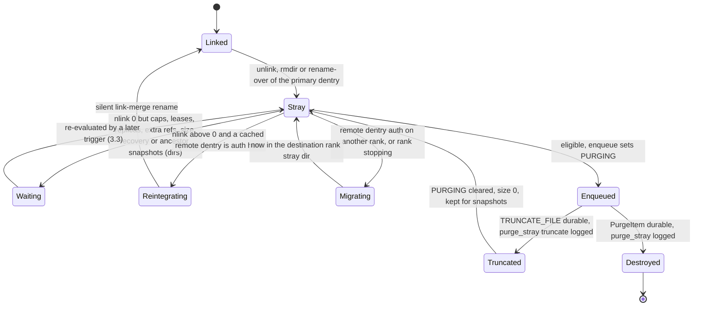
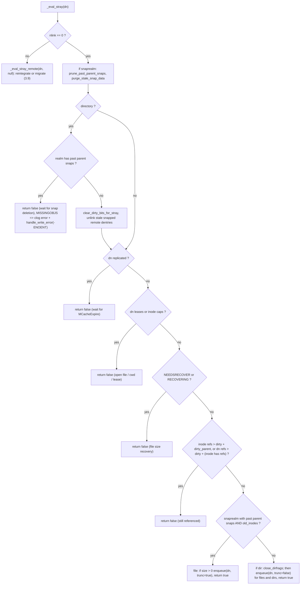
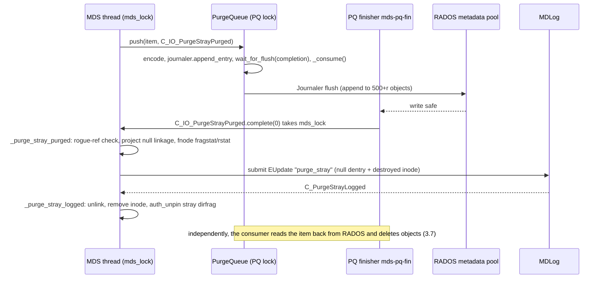
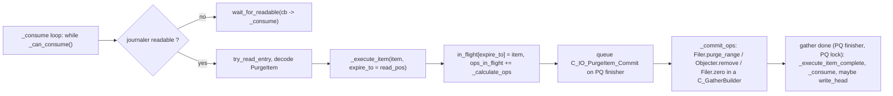
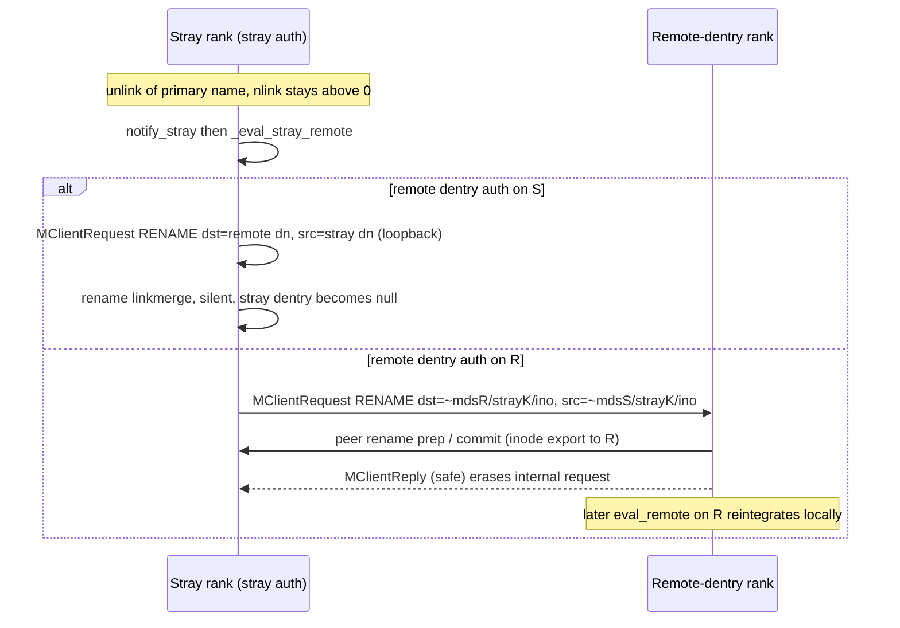

# Strays and purge

> Part of the [C++ MDS project map](../README.md). Sources (commit `5f7e383ae6d`): `src/mds/StrayManager.{h,cc}` (219 + 799 LOC), `src/mds/PurgeQueue.{h,cc}` (250 + 893), `src/mds/events/EPurged.h` (47) and `EPurged`/`ESession`/`EMetaBlob` code in `src/mds/journal.cc`; stray code in `src/mds/MDCache.{h,cc}` (`create_mydir_hierarchy`, `advance_stray`, `populate_mydir`, `get_stray_dir`, `trim`/`trim_inode`/`dentry_remove_replica`, `shutdown_pass`/`shutdown_export_strays`, `purge_inodes`, `scan_stray_dir`, `maybe_eval_stray`, `clear_dirty_bits_for_stray`, `send/handle_dentry_unlink`); `src/mds/Server.cc` (`prepare_stray_dentry`, unlink/rename finish hooks, MDS-originated rename handling, `handle_client_reply`, `_session_logged`); `src/mds/CDentry.cc`, `CInode.cc`, `CDir.cc` (ref-drop hooks, stray-specific fetch/commit); `src/mds/Locker.cc` (nlink-0 cap issue); `src/mds/MDSRank.cc` (boot, drain, conf); `src/osdc/Filer.cc` (`purge_range`, `zero`), `src/osdc/Striper.cc`, `src/osdc/Journaler.cc`; `doc/cephfs/purge-queue.rst`, `doc/cephfs/scrub.rst`. Kernel client: `linux/fs/ceph/{dir.c,caps.c,export.c,inode.c,super.c}`. libcephfs: `src/client/Client.cc`.
>
> Related: [namespace mutations](../03-request-path/namespace-mutations.md) (unlink/rmdir that create strays), [rename](../03-request-path/rename.md) (rename-over, reintegration/migration renames), [request lifecycle](../03-request-path/request-lifecycle.md), [capabilities](../02-client-protocol/capabilities.md), [sessions](../02-client-protocol/sessions.md), [kclient expectations](../02-client-protocol/kclient-expectations.md), [libcephfs/fuse/Ganesha expectations](../02-client-protocol/libcephfs-fuse-ganesha-expectations.md), [CInode](../04-cache/cinode-and-inode-types.md), [CDir/CDentry](../04-cache/cdir-cdentry-and-cache-objects.md), [cache lifecycle and trimming](../04-cache/mdcache-lifecycle-trim-and-memory.md), [dirfrags](../04-cache/dirfrags-and-fragmentation.md), [MDLog and Journaler](../06-journal/mdlog-and-journaler.md), [events and replay](../06-journal/events-and-replay.md), [RADOS object catalog](../07-storage-formats/rados-object-catalog.md), [RADOS/OSD interactions](../07-storage-formats/rados-and-osd-interactions.md), [MDS tables](../07-storage-formats/mds-tables.md), [rank lifecycle and recovery](../09-recovery/rank-lifecycle-and-recovery.md), [snapshots](../10-snapshots-quotas-subvolumes/snapshots.md), [rstats/quotas/subvolumes](../10-snapshots-quotas-subvolumes/rstats-quotas-and-subvolumes.md), [scrub and damage](../11-background-services/scrub-and-damage.md), [process and threading](../00-architecture/process-and-threading.md), [mds_lock analysis](../00-architecture/mds_lock-analysis.md), [admin commands](../13-admin-and-config/admin-commands.md), [config/perf counters/health](../13-admin-and-config/config-perf-counters-and-health.md).

## 1. Purpose and responsibilities

When the last *primary* name of an inode disappears (unlink, rmdir, rename over an existing target), the C++ MDS does not delete anything synchronously. It moves the inode's primary dentry into a per-rank **stray directory** and returns to the client. A background pipeline then decides what to do with the stray:

- **Keep it** while anything still uses it: client capabilities (open files, cwd), dentry leases, replicas on other ranks, pinned references, pending file-size recovery, or snapshots that still reference it.
- **Reintegrate it** if the inode still has hard links (`nlink > 0`): an MDS-internal rename moves the primary inode onto one of its remaining remote (hard-link) dentries.
- **Migrate it** to another rank's stray directory, either to allow reintegration on the rank that is authoritative for a remote dentry, or because this rank is stopping.
- **Purge it** when `nlink == 0` and nothing references it: hand a compact `PurgeItem` to the per-rank, RADOS-journaled **PurgeQueue**. When that item is durable, journal the removal of the stray dentry (`EUpdate "purge_stray"`) and drop the inode. RADOS objects (data objects, backtraces, dirfrag objects) are deleted later and asynchronously by the PurgeQueue executor, with throttling.
- **Truncate only** (`TRUNCATE_FILE`) for multiversion files that snapshots still reference: delete head data but keep the inode metadata.

A separate, smaller mechanism in scope is **delegated-ino purge**: when a session closes or is evicted, the inode numbers delegated to it for async create (and, after a reconnect timeout, its unused preallocated numbers) have their object 0 deleted, and the numbers go back to the InoTable via the `EPurged` journal event (`MDCache::purge_inodes`). Ordinary preallocated numbers of a closing session are only released, not purged (3.12).

Key properties verified in code:

1. **Unlink is metadata-only and fast.** Space is reclaimed asynchronously. The parent directory's recursive stats (and therefore quotas) drop immediately, because `predirty_journal_parents(..., -1)` subtracts the inode from the old parent and adds it to the stray dirfrag (`src/mds/Server.cc:8793-8797 (Server::_unlink_local)`). Pool usage lags until the PurgeQueue finishes.
2. **Deletion is at-least-once and idempotent.** A purge item is durably in the PurgeQueue journal before the stray dentry is removed. On restart the queue resumes from its persisted `expire_pos`, and strays still present on disk are re-evaluated. `-ENOENT` is tolerated everywhere.
3. **Everything except PurgeQueue execution runs under `mds_lock`.** The PurgeQueue has its own mutex, finisher thread, timer, `Filer` and `Journaler` (`src/mds/PurgeQueue.h:202-219 (PurgeQueue)`). Its header comment says it never needs `mds_lock` (`:120-127`), but two kinds of context it runs on its finisher do take it: the "item persisted" completions (`MDSIOContextBase::complete`, `src/mds/MDSContext.cc:95-103`) and the `on_error` handler (`src/mds/MDSRank.cc:488-494 (MDSRank::MDSRank)`).
4. **One stray namespace and one PurgeQueue per rank,** shared by every directory and subvolume the rank serves. Strays live on the rank that was authoritative for the removed primary dentry.

## 2. Source map

| File | Class / function | Lines | Role |
|---|---|---|---|
| `src/mds/mdstypes.h` | `NUM_STRAY`, `MDS_INO_STRAY`, `MDS_INO_IS_STRAY`, `MDS_INO_STRAY_OWNER/INDEX`, `MDS_INO_PURGE_QUEUE`, `MDS_INO_MDSDIR` | 34-59 | Stray/mdsdir/purge-queue inode numbering |
| `src/mds/MDCache.cc` | `create_mydir_hierarchy` | 525-571 | mkfs of `~mdsN` with `stray0..stray9` |
| `src/mds/MDCache.cc` | `advance_stray` | 776-819 | Rotate current stray dir per log segment; pre-fragment a future one |
| `src/mds/MDCache.cc` | `populate_mydir` | 821-905 | Open/recreate stray dirs at activation, count strays, `StrayManager::activate`, `scan_stray_dir` |
| `src/mds/MDCache.cc` | `get_stray_dir` | 912-923 | Pick dirfrag of current stray dir by hashed stray name |
| `src/mds/MDCache.h` | `notify_stray`, `notify_stray_created/removed`, `eval_remote`, `shutdown_export_stray_finish`, `get_stray`, `strays[]`, `stray_index` | 278-319, 852-855, 1391-1392, 1546-1548, 1604, 1618-1619 | Stray hooks and state |
| `src/mds/Server.cc` | `prepare_stray_dentry` | 3595-3631 | Create/lookup null stray dentry `<ino hex>`; `ENOSPC` check |
| `src/mds/Server.cc` | `handle_client_unlink` (stray dentry, locks, unlink-time snaprealm) | 8626-8650, 8664-8689 | Stray creation for UNLINK/RMDIR |
| `src/mds/Server.cc` | `_unlink_local`, `_unlink_local_finish` | 8738-8888 | Move primary into stray; `notify_stray` after reply |
| `src/mds/Server.cc` | `handle_client_rename` (MDS-originated checks, linkmerge), `_rename_prepare` (silent), `_rename_finish` | 9373-9381, 9445-9459, 9946-10095, 9770-9812 | Reintegration/migration renames; rename-over strays |
| `src/mds/Server.cc` | `reply_client_request` (MDS reply), `handle_client_reply` | 2463-2465, 2478-2483, 2730-2750 | Return path of MDS-internal renames; `eval_remote` on traces |
| `src/mds/Server.cc` | `_commit_peer_rename` (migrated stray), `_commit_peer_rmdir` | 10838-10941, 9084-9111 | Peer-side bookkeeping |
| `src/mds/StrayManager.h` | `StrayManager`, `StrayEvalRequest` | 34-218 | Interface, counters, delayed list |
| `src/mds/StrayManager.cc` | `eval_stray`, `_eval_stray` | 571-581, 447-562 | Purge/reintegration decision |
| `src/mds/StrayManager.cc` | `enqueue`, `_enqueue`, `purge`, `truncate` | 302-372, 101-157, 747-778 | Build and push `PurgeItem` |
| `src/mds/StrayManager.cc` | `_purge_stray_purged`, `_purge_stray_logged`, `_truncate_stray_logged` | 182-300, 780-798 | Post-persist metadata removal |
| `src/mds/StrayManager.cc` | `eval_remote`, `_eval_stray_remote`, `reintegrate_stray`, `migrate_stray` | 583-738 | Hard-link reintegration, migration |
| `src/mds/StrayManager.cc` | `queue_delayed`, `advance_delayed`, `set_num_strays`, `notify_stray_created/removed`, `activate` | 374-429, 564-569 | Delayed evaluation, counters |
| `src/mds/MDCache.cc` | `maybe_eval_stray`, `clear_dirty_bits_for_stray` | 13983-14017 | Entry point from ref drops/trim; dir cleanup |
| `src/mds/MDCache.cc` | `trim` (`advance_delayed`), `trim_dentry`, `trim_inode`, `dentry_remove_replica`, `trim_lru` | 7036-7037, 7215-7216, 7333-7339, 7918-7931, 6964-6975 | Evaluation triggers from cache maintenance |
| `src/mds/MDCache.cc` | `scan_stray_dir`, `stray_status` | 10388-10469 | Startup scan and `dump stray` |
| `src/mds/MDCache.cc` | `shutdown_pass`, `shutdown_export_strays`, `handle_mds_failure` (clear) | 8043-8148, 8236-8351, 3176-3178 | Rank stop: migrate strays to rank 0 |
| `src/mds/MDCache.cc` | `send_dentry_unlink`, `handle_dentry_unlink`, `encode/decode_replica_stray` | 11543-11646, 11304-11345 | Replicas learn the new stray linkage |
| `src/mds/MDCache.cc` | `start_purge_inodes`, `purge_inodes`, `C_MDS_purge_completed_finish` | 6875-6928 | Delegated/preallocated ino purge + `EPurged` |
| `src/mds/MDCache.cc` | `truncate_inode`, `_truncate_inode`, `start_recovered_truncates` | 6586-6735, 6847-6872 | Ordinary file truncation (not a PurgeQueue purge, 3.5) |
| `src/mds/CDentry.cc` | `link_remote`, `push_projected_linkage` (x2), `_put` | 356-410, 646-656 | `eval_remote`; stray counters; ref-drop eval |
| `src/mds/CInode.cc` | `_put`, `name_stray_dentry`, `get_object_name`, `_commit_ops` | 991-995, 1170-1175, 1262-1269, 1453-1475 | Ref-drop eval; naming |
| `src/mds/CDir.cc` | `try_remove_dentries_for_stray`, `fetch`/`fetch_keys` (unlinked dir), `_committed` | 805-849, 1583-1597, 1659-1663, 2808-2921 | Stray-specific dirfrag behaviour |
| `src/mds/PurgeQueue.h` | `PurgeItem`, `PurgeItemCommitOp`, `PurgeQueue`, `l_pq_*` | 43-249 | Queue types |
| `src/mds/PurgeQueue.cc` | `PurgeItem::encode/decode` | 45-105 | Item wire/disk format |
| `src/mds/PurgeQueue.cc` | `PurgeQueue::PurgeQueue`, `init`, `activate`, `shutdown`, `open`, `_recover`, `create`, `wait_for_recovery` | 139-355 | Lifecycle and recovery |
| `src/mds/PurgeQueue.cc` | `push`, `_consume`, `_can_consume`, `_calculate_ops` | 360-536 | Persist + read-back + throttle |
| `src/mds/PurgeQueue.cc` | `_execute_item`, `_commit_ops`, `_execute_item_complete` | 554-780 | RADOS op generation and completion |
| `src/mds/PurgeQueue.cc` | `update_op_limit`, `handle_conf_change`, `drain`, `_go_readonly` | 463-472, 782-881 | Limits, drain, error mode |
| `src/mds/events/EPurged.h`, `src/mds/journal.cc` | `EPurged` | h:24-45; cc:1820-1871 | Delegated-ino purge completion event |
| `src/mds/journal.cc` | `LogSegment::try_to_expire` (purging_inodes), `purge_inodes_finish`, `ESession::replay`, `EMetaBlob::replay` (destroyed inodes) | 365-385, 1883-1886, 1753-1775 | Recovery bookkeeping |
| `src/mds/MDSRank.cc` | ctor (PQ, `unset_honor_pool_full`), `tick` (drain), `boot_start`, `standby_replay_restart`, `recovery_done`, `active_start` (`open_root`), `boot_create`, `handle_mds_map`, `handle_osd_map`, `get_tracked_keys`, `handle_conf_change`, `dump stray` | 488-518, 774-798, 1666-1719, 1883-1884, 2166-2179, 2137-2139, 2227-2228, 2611-2613, 3896, 4200-4202, 4302, 3117-3123 | Wiring |
| `src/osdc/Filer.cc` | `zero`, `purge_range`, `_do_purge_range` | 117-151, 404-494 | Striped delete/zero helpers |
| `src/osdc/Striper.cc` | `get_num_objects` | 350-364 | Object count for a size |

## 3. How it works

### 3.0 Lifecycle overview

`Destroyed` means the metadata is gone. The RADOS objects are deleted afterwards, asynchronously, by the PurgeQueue executor (3.7).

### 3.1 Stray directories: numbering, naming, sharding, rotation

| Item | Value / rule | Source |
|---|---|---|
| Stray dirs per rank | `NUM_STRAY = 10` | `src/mds/mdstypes.h:34 (NUM_STRAY)` |
| mdsdir inode of rank `r` | `0x100 + r`, path name `~mds<r>` | `src/mds/mdstypes.h:38,50 (MDS_INO_MDSDIR)`; `src/mds/CInode.cc:1126-1131 (CInode::make_path_string)` |
| Stray dir inode `i` of rank `r` | `MDS_INO_STRAY(r,i) = 0x600 + 10*r + i` (rank 0: `0x600`-`0x609`) | `src/mds/mdstypes.h:39,49 (MDS_INO_STRAY)` |
| Owner/index of a stray ino | `(ino-0x600)/10`, `(ino-0x600)%10` | `src/mds/mdstypes.h:56-57 (MDS_INO_STRAY_OWNER, MDS_INO_STRAY_INDEX)` |
| Dentry names in `~mds<r>` | `stray0` .. `stray9` (a legacy name `stray` is accepted for index 0) | `src/mds/MDCache.cc:541-543 (MDCache::create_mydir_hierarchy)`, `849-855 (MDCache::populate_mydir)` |
| Name of a stray dentry | the inode number in lowercase hex without prefix (`"%llx"`), e.g. `10000000005` | `src/mds/CInode.cc:1170 (CInode::name_stray_dentry)` |
| PurgeQueue journal inode | `MDS_INO_PURGE_QUEUE + r = 0x500 + r` | `src/mds/mdstypes.h:45 (MDS_INO_PURGE_QUEUE)`, `src/mds/PurgeQueue.cc:153 (PurgeQueue::PurgeQueue)` |

The stray directories are created at mkfs. `create_mydir_hierarchy` creates the 10 stray inodes as primary dentries of the rank's mdsdir dirfrag. Each gets an empty, complete, dirty dirfrag that is committed, and a backtrace (`src/mds/MDCache.cc:538-557 (MDCache::create_mydir_hierarchy)`). At every activation, `populate_mydir` looks each one up. If a stray dentry or the mdsdir dirfrag is missing, it is recreated: a `BADFRAG` mdsdir is recreated with the clog warning `fragment ... was unreadable, recreating it now`, and a missing stray dir is created through `_create_system_file`. The rank pins each stray inode (`PIN_STRAY`, `STATE_STRAYPINNED`, `get_stickydirs`) and fetches the fnode of every leaf dirfrag not yet loaded (`version == 0`) with `fetch_keys({})`, restarting `open_root` after each fetch (`src/mds/MDCache.cc:846-893 (MDCache::populate_mydir)`). A damaged stray dirfrag is not tolerated: `ceph_assert(!dir->state_test(CDir::STATE_BADFRAG))` relies on `DamageTable` having already marked the rank damaged (`src/mds/MDCache.cc:881-883 (MDCache::populate_mydir)`).

**Which stray dir receives a new stray.** `MDCache::get_stray()` returns `strays[stray_index]` (`src/mds/MDCache.h:1546-1548 (MDCache::get_stray)`). `get_stray_dir(in)` picks the dirfrag of that inode whose fragment contains the hash of the stray name (`src/mds/MDCache.cc:912-923 (MDCache::get_stray_dir)`). `stray_index` changes only in `advance_stray()`, which `MDLog::_start_new_segment` calls when a new journal segment starts, unless the rank is stopping (`src/mds/MDLog.cc:386-389 (MDLog::_start_new_segment)`). So all strays created during one log segment go to the same stray directory, spread over its dirfrags by name hash.

**Stray dir fragmentation** (`src/mds/MDCache.cc:776-819 (MDCache::advance_stray)`):

- Stray directories are never fragmented by the normal balancer path: `MDBalancer::maybe_fragment` skips `inode->is_stray()` (`src/mds/MDBalancer.cc:1296-1302 (MDBalancer::maybe_fragment)`).
- Instead, when the index advances and no stray is currently "fragmenting", `advance_stray` picks `stray_fragmenting_index = (stray_index + 3) % 10` and queues a fast split (`queue_split(dir, true)`, split bits `mds_bal_split_bits` = 3) for each dirfrag with `should_split()` (more than `mds_bal_split_size` = 10000 items), or a merge for each dirfrag with `should_merge()`. The code comment says the *previous* stray dir is avoided because in-flight requests may still use it.
- The rotation skips the index being fragmented. `stray_fragmenting_index` is reset once none of that dir's dirfrags is `FRAGMENTING` or pending in the balancer.
- Directories *inside* stray directories (unlinked directories) are never split or merged: `can_fragment` returns false when `diri->get_parent_dir()->get_inode()->is_stray()` (`src/mds/MDCache.cc:11884-11888 (MDCache::can_fragment)`).

**Fragment size limit.** `prepare_stray_dentry` calls `check_fragment_space(mdr, straydir)` except for replayed requests. If the chosen stray dirfrag already has `mds_bal_fragment_size_max` entries (default 100000), the unlink/rmdir/rename replies **`ENOSPC`** (`src/mds/Server.cc:3605-3609 (Server::prepare_stray_dentry)`, `3563-3576 (Server::check_fragment_space)`).

### 3.2 How an inode becomes a stray

The detailed request flows are on the [namespace mutations](../03-request-path/namespace-mutations.md) and [rename](../03-request-path/rename.md) pages. The stray-relevant facts are:

- **Who creates strays:** the leader of an UNLINK/RMDIR whose dentry is primary (`src/mds/Server.cc:8626-8635 (Server::handle_client_unlink)`), and the leader of a RENAME whose destination dentry is primary and not a link merge (`src/mds/Server.cc:9449-9459 (Server::handle_client_rename)`). The stray dentry is always in the **leader's own** current stray dir.
- `prepare_stray_dentry` (`src/mds/Server.cc:3595-3631 (Server::prepare_stray_dentry)`) reuses `mdr->straydn` on retry. Otherwise it gets the stray dirfrag, applies the `ENOSPC` check, looks up the name and, if absent, adds a null dentry marked `new`. If the stray dirfrag is frozen, it drops the request's locks and auth pins and waits on `WAIT_UNFREEZE`. An existing stray dentry must have a null projected linkage. The dentry gets `CDentry::STATE_STRAY` and is pinned by the request.
- Locks taken for the stray: `wrlock` on the stray dir inode's `filelock` and `nestlock`, `xlock` on `straydn->lock` (`src/mds/Server.cc:8646-8650 (Server::handle_client_unlink)`, `9491-9495 (Server::handle_client_rename)`).
- `_unlink_local` (`src/mds/Server.cc:8738-8826 (Server::_unlink_local)`) projects the inode. It sets `stray_prior_path` to the old path, bumps ctime/`change_attr`, decrements `nlink` and sets `CInode::STATE_ORPHAN` when `nlink` reaches 0. It moves rstat from the old parent to the stray dirfrag (`predirty_journal_parents` `-1`/`+1`), calls `update_backtrace()`, and journals the stray dentry as primary with `dirty_parent`, so the backtrace on the first data object later points at `~mdsN/strayK/<ino>`. Directories also record `renamed_dirino` and `project_subtree_rename`.
- **Snapshots at unlink time.** Before `_unlink_local`, `handle_client_unlink` prepares a projected snaprealm for the inode (`desti_srnode`) when it already has one or when a snapshot of its current realm covers it (`follows + 1 > in->get_oldest_snap()`). `record_snaprealm_past_parent` copies the old parent realm's snapshots into the new realm's `past_parent_snaps`, because the new parent (`~mdsN/strayK`) has none. These are the "past-parent snaps" that `_eval_stray` checks later. Inodes in the global snaprealm (hard links) instead record their parent dentry and leave the global realm when the last link, or the last remote link, is dropped (`src/mds/Server.cc:8667-8689 (Server::handle_client_unlink)`, `src/mds/CInode.cc:631-654 (CInode::record_snaprealm_past_parent)`). `_unlink_local` also COWs the old dentry (`journal_cow_dentry`), so snapshots of the old directory keep their own view of the name and inode (`src/mds/Server.cc:8805 (Server::_unlink_local)`). `straydn->first` is set to the global snaprealm's newest seq + 1 (`:8664-8665`).
- After the journal commit, `_unlink_local_finish` applies the change, sends `MDentryUnlink` carrying a replica of the stray (`straybl`) to the dentry's replicas (`src/mds/MDCache.cc:11543-11578 (MDCache::send_dentry_unlink)`), replies, and finally calls `MDCache::notify_stray(straydn)` if the stray linkage is still non-null. The code notes that "respond_to_request() drops locks. So stray reintegration can race with us." (`src/mds/Server.cc:8881-8887 (Server::_unlink_local_finish)`). `_rename_finish` does the same for rename-over (`src/mds/Server.cc:9807-9811 (Server::_rename_finish)`).
- Replicas that receive `MDentryUnlink` relink the inode under the replicated stray dentry. If they hold client caps for it, they **export those caps to the auth** (`migrator->export_caps(in)`), so the auth sees every cap that blocks the purge (`src/mds/MDCache.cc:11600-11627 (MDCache::handle_dentry_unlink)`).
- Client operations on stray directories themselves are rejected: non-MDS requests whose parent is a system inode other than root get `EROFS`. Creating inside an unlinked directory (parent in a stray dir) gets `ENOENT` (`src/mds/Server.cc:4025-4037 (Server::rdlock_path_xlock_dentry)`, `4131-4143 (Server::rdlock_two_paths_xlock_destdn)`).
- The stray counter `num_strays` is maintained by `CDentry::push_projected_linkage`. Projecting an inode onto an auth dentry in a stray dir increments it (`notify_stray_created`, also `strays_created`), and projecting a null linkage decrements it (`notify_stray_removed`) (`src/mds/CDentry.cc:380-410 (CDentry::push_projected_linkage)`). It is seeded at activation from the sum of stray dirfrag `fragstat` sizes (`src/mds/MDCache.cc:890-901 (MDCache::populate_mydir)`).

### 3.3 Evaluation triggers: state bits, NOTIFYREF and the delayed list

Re-evaluating a stray is event-driven. It relies on two `MDSCacheObject::STATE_NOTIFYREF` aliases. When this bit is set, every `put()` calls the object's `_put()` hook (`src/mds/MDSCacheObject.h:138-155 (MDSCacheObject::put)`):

| Flag | Set by | Effect |
|---|---|---|
| `CDentry::STATE_STRAY` (= NOTIFYREF) | `prepare_stray_dentry` (`src/mds/Server.cc:3626 (Server::prepare_stray_dentry)`), `scan_stray_dir` (`src/mds/MDCache.cc:10422 (MDCache::scan_stray_dir)`) | `CDentry::_put`: if refs `<= dirty+1`, the linkage is primary and refs `== dirty + (inode has refs)`, call `maybe_eval_stray(in, delay=true)` (`src/mds/CDentry.cc:646-656 (CDentry::_put)`) |
| `CInode::STATE_ORPHAN` (= NOTIFYREF) | `nlink` reaches 0 in `_unlink_local` (`src/mds/Server.cc:8780-8781 (Server::_unlink_local)`) or `_rename_prepare` (`src/mds/Server.cc:10092-10093 (Server::_rename_prepare)`); `scan_stray_dir` for `nlink == 0` (`src/mds/MDCache.cc:10436-10437 (MDCache::scan_stray_dir)`) | `CInode::_put`: if refs `== dirty + dirty_parent`, call `maybe_eval_stray(this, delay=true)` (`src/mds/CInode.cc:991-995 (CInode::_put)`) |

`MDCache::maybe_eval_stray(in, delay)` (`src/mds/MDCache.cc:13983-14002 (MDCache::maybe_eval_stray)`) returns early if `nlink > 0`, the inode is a base inode, the cache is read-only, or the rank state is `<= up:rejoin`. It also returns early if the projected parent dentry is already `PURGING` or is not in a stray dir. Otherwise it calls `StrayManager::queue_delayed(dn)` when `delay`, or `eval_stray(dn)` directly. Consequently, **strays with `nlink > 0` are never evaluated through this path**. Their only triggers are `notify_stray` after unlink/rename and `eval_remote` (3.9).

All triggers:

| Trigger | Path | Mode |
|---|---|---|
| Unlink/rename finished | `Server::_unlink_local_finish` / `_rename_finish` → `MDCache::notify_stray` → `eval_stray` (skipped if `PURGING`) | immediate |
| Last cap/lease/pin dropped | `CInode::_put` / `CDentry::_put` → `maybe_eval_stray(delay=true)` → `queue_delayed` | next cache trim |
| Cache trim tick | `MDCache::trim` → `StrayManager::advance_delayed()` first thing (`src/mds/MDCache.cc:7036-7037 (MDCache::trim)`); upkeep thread runs `trim()` every `mds_cache_trim_interval` (1 s) (`src/mds/MDCache.cc:14721-14748 (MDCache::upkeep_main)`) | batch |
| Trimming an auth stray dentry from LRU | `trim_dentry` → `trim_inode` → `maybe_eval_stray(in)` (non-delayed). If the dentry became `PURGING` or still has refs, it stays in cache ("purging stray instead of trimming") (`src/mds/MDCache.cc:7211-7216 (MDCache::trim_dentry)`, `7333-7339 (MDCache::trim_inode)`). The main LRU is trimmed only while the cache is over its limit or for an explicit count (`src/mds/MDCache.cc:6986-6987 (MDCache::trim_lru)`), so this trigger depends on cache pressure | immediate |
| Truncate-only purge logged | `_truncate_stray_logged` → `eval_stray(dn)` (`src/mds/StrayManager.cc:794 (StrayManager::_truncate_stray_logged)`) | immediate |
| Remote dir unfrozen | `C_RetryEvalRemote` → `eval_remote` (`src/mds/StrayManager.cc:611-623 (C_RetryEvalRemote)`) | immediate (hard links) |
| Replica of the stray expired | `MCacheExpire` → `dentry_remove_replica` → `maybe_eval_stray` (`src/mds/MDCache.cc:7926-7930 (MDCache::dentry_remove_replica)`) | immediate |
| Dirfrag commit of a snapshotted dir that is in a stray dir | `CDir::_committed` → `maybe_eval_stray(inode, true)` (`src/mds/CDir.cc:2912-2915 (CDir::_committed)`) | delayed |
| Activation | `populate_mydir` → `scan_stray_dir` → `maybe_eval_stray(in)` for every primary stray (3.11) | immediate |
| Remote dentry linked in cache | `CDentry::link_remote` → `eval_remote` (`src/mds/CDentry.cc:356-367 (CDentry::link_remote)`); callers include dirfrag load, readdir, link, rename, `path_traverse`, `open_remote_dentry` | immediate (hard links) |
| Reply with a remote-dentry trace | `Server::reply_client_request` → `eval_remote(tracedn)` (`src/mds/Server.cc:2478-2483 (Server::reply_client_request)`) | immediate (hard links) |

Auth-side stray dentries are moved to the expiring end of the main LRU right after unlink (`touch_dentry_bottom(straydn)`, `src/mds/Server.cc:8856 (Server::_unlink_local_finish)`, `src/mds/MDCache.h:929-933 (MDCache::touch_dentry_bottom)`), so they are the first to go when the cache is over its limit. Replica stray dentries live in `bottom_lru` (`src/mds/CDir.cc:352-366 (CDir::adjust_dentry_lru)`, `440-445 (CDir::add_primary_dentry)`), which every trim pass empties as far as the trim throttle allows (`src/mds/MDCache.cc:6958-6972 (MDCache::trim_lru)`). Trimming re-triggers evaluation on the auth, and on replicas it sends the expiry that lets the auth purge.

`queue_delayed` ignores calls before `StrayManager::activate()` (`started == false`) and while the dentry is `EVALUATINGSTRAY` (re-entrancy guard), and otherwise appends to the intrusive list `delayed_eval_stray` (`src/mds/StrayManager.cc:374-387 (StrayManager::queue_delayed)`). `advance_delayed` drains the whole list. It skips dentries whose projected linkage became null, which happens when a stray is relinked into another rank's stray dir during shutdown migration (`src/mds/StrayManager.cc:389-409 (StrayManager::advance_delayed)`).

### 3.4 `eval_stray`: the decision

`eval_stray` sets `CDentry::STATE_EVALUATINGSTRAY`, calls `_eval_stray`, and clears the flag. Nested evaluation of the same dentry returns `false` (`src/mds/StrayManager.cc:571-581 (StrayManager::eval_stray)`). `_eval_stray` (`src/mds/StrayManager.cc:447-562 (StrayManager::_eval_stray)`) asserts that the projected linkage is primary, the inode is not `REJOINUNDEF`, the parent dir is a stray dir, and the dentry is not already `PURGING`. It then returns `false` if the dentry is not auth or the manager is not started, and removes the dentry from the delayed list.

Details:

- **Snapshots** (see [snapshots](../10-snapshots-quotas-subvolumes/snapshots.md)): `prune_past_parent_snaps` drops past-parent snapids that no longer exist. `purge_stale_snap_data` drops `old_inodes` that no live snap covers (`src/mds/SnapRealm.cc:511-527 (SnapRealm::prune_past_parent_snaps)`, `src/mds/CInode.cc:3278-3303 (CInode::purge_stale_snap_data)`). A directory whose realm still has past-parent snaps is kept indefinitely. `_eval_stray` looks only at *past-parent* snaps (ancestor snapshots). Snapshots taken on the directory itself are handled earlier: the unlocked fast path of rmdir returns `ENOTEMPTY` for them (`src/mds/Server.cc:9232-9233 (Server::_dir_is_nonempty_unlocked)`). That check sits after an early `return false` taken when the filelock is cached (`:9230-9231 (Server::_dir_is_nonempty_unlocked)`), and the locked re-check `_dir_is_nonempty` compares only fragstats (`src/mds/Server.cc:9262-9287 (Server::_dir_is_nonempty)`). If such a directory has `STATE_MISSINGOBJS` (a previous commit found its dirfrag object gone), `_eval_stray` logs `previous attempt at committing dirfrag of ino ... has failed, missing object` and calls `handle_write_error(-ENOENT)` (`src/mds/StrayManager.cc:487-497 (StrayManager::_eval_stray)`).
- **Files with past-parent snaps but no `old_inodes`** are purged normally (`PURGE_FILE`). The purge carries the inode realm's SnapContext, which includes the surviving past-parent snaps (`src/mds/SnapRealm.cc:86-119 (SnapRealm::build_snap_set)`), so the OSDs keep the clones that the snapshots need. The snapshot's metadata view lives in the COWed snapped dentry of the old directory (3.2).
- **Multiversion files** (`old_inodes` present plus past parent snaps) are only **truncated**: `TRUNCATE_FILE` removes head data and keeps the inode, which snapshots still reference through `old_inodes`. If `size == 0`, nothing is enqueued and the function still returns `true` (`src/mds/StrayManager.cc:532-542 (StrayManager::_eval_stray)`). Snapshot deletion does **not** trigger a re-evaluation (no code path calls it). These strays are reconsidered only on a later trigger from 3.3 (ref drop, trim of the loaded dentry, activation scan).
- **Directories** (`src/mds/StrayManager.cc:499-509 (StrayManager::_eval_stray)`, `src/mds/MDCache.cc:14004-14017 (MDCache::clear_dirty_bits_for_stray)`): `clear_dirty_bits_for_stray` calls `CDir::try_remove_dentries_for_stray()` on every auth, non-frozen, non-freezing dirfrag. That asserts every head dentry is null and unprojected (the dir is empty), removes their client leases, drops unreferenced head and snapshotted dentries (and the inodes of unreferenced snapshotted ones), and, only when the dir has no snaprealm, marks dentries/inodes/dirfrag clean (`src/mds/CDir.cc:805-849 (CDir::try_remove_dentries_for_stray)`). Also only without a snaprealm, it clears dirty rstat (auth only) and scatter-dirty state of the dir inode, so no write-back is attempted for a directory about to be deleted. Stale snapped remote dentries in `remote_parents` (`last != CEPH_NOSNAP`) are unlinked.
- **Caps** are any client capability on the inode, including caps of stale (not yet evicted) sessions. A crashed client therefore pins its unlinked open files until its session is evicted (see [sessions](../02-client-protocol/sessions.md)). When the last cap of an unlinked inode goes away, `Locker::remove_client_cap` skips the usual `NEEDSRECOVER` size recovery ("unless it's unlink + stray") (`src/mds/Locker.cc:4363-4371 (Locker::remove_client_cap)`).

### 3.5 Enqueue and `PurgeItem` construction

`StrayManager::enqueue(dn, trunc)` (`src/mds/StrayManager.cc:302-342 (StrayManager::enqueue)`):

1. Removes the inode from the scrub stack if it is queued (`ScrubStack::remove_inode_if_stacked`).
2. Sets `CDentry::STATE_PURGING` and `CInode::STATE_PURGING`. From now on the stray is invisible: path traversal returns `ENOENT` for the dentry and `ESTALE` for the inode (`src/mds/MDCache.cc:8633-8634 (MDCache::path_traverse)`, `8488-8489 (MDCache::path_traverse)`). `lookup_ino` and `try_get_auth_inode` return `ESTALE` (`src/mds/Server.cc:4456-4459 (Server::handle_client_lookup_ino)`, `5959-5962 (Server::try_get_auth_inode)`), `find_ino_peers` returns `ESTALE` (`src/mds/MDCache.cc:9656-9659 (MDCache::find_ino_peers)`), readdir/snapdiff skip the dentry (`src/mds/Server.cc:5234 (Server::handle_client_readdir)`, `12699 (Server::build_snap_diff)`), discover refuses to replicate it (`src/mds/MDCache.cc:10885-10889 (MDCache::handle_discover)`), and reconnect ignores caps/realms on it (`src/mds/Server.cc:1708 (Server::handle_client_reconnect)`, `1732 (Server::handle_client_reconnect)`).
3. For a full purge (`!trunc`), clears `dirty_parent` so that segment expiry does not rewrite the backtrace of an object that is about to be deleted.
4. Takes `PIN_PURGING` on the dentry once (`STATE_PURGINGPINNED`), increments `num_strays_enqueuing`, and calls `_enqueue`.

`_enqueue` (`src/mds/StrayManager.cc:355-372 (StrayManager::_enqueue)`) waits with `C_RetryEnqueue` on `WAIT_UNFREEZE` if the stray dirfrag cannot be auth-pinned (freezing/fragmenting). Otherwise it **auth-pins the stray dirfrag**, holding the pin until the metadata removal is logged, and calls `purge()` or `truncate()`.

`purge()` (`src/mds/StrayManager.cc:101-157 (StrayManager::purge)`) asserts the dentry is not replicated and builds:

| Field | Directory (`PURGE_DIR`) | Non-directory (`PURGE_FILE`) |
|---|---|---|
| `ino` | inode number | inode number |
| `stamp` | `ceph_clock_now()` | same |
| `fragtree` | `in->dirfragtree` | empty |
| `size` | 0 | regular file: `max(size, client_ranges max (get_max_size), max_size_ever)`. Other types (symlink, device, fifo, socket): 0 |
| `layout` | (default) | projected `layout` |
| `old_pools` | none | `old_pools` minus the current pool |
| `snapc` | none | the inode's realm snap context (`find_snaprealm()->get_snap_context()`); a null context is used if no realm exists (then `last == CEPH_NOSNAP` is asserted) |

The size bound covers objects a writer may have created up to its granted `max_size` without reporting them. It also covers stripe objects left at zero length by earlier truncates, which the Filer does not delete (code comment at `src/mds/StrayManager.cc:139-142 (StrayManager::purge)`). `inode_t::truncate` records the pre-truncate size in `max_size_ever` (`src/include/cephfs/types.h:800-810 (inode_t::truncate)`).

The comment "CHEAT. there's no real need to journal our intent to purge, since that is implicit in the dentry's presence and non-use in the stray dir" (`src/mds/StrayManager.cc:108-110 (StrayManager::purge)`) states the recovery model: the stray dentry on disk is the durable intent.

`truncate()` (`src/mds/StrayManager.cc:747-778 (StrayManager::truncate)`) builds `TRUNCATE_FILE` with the same size rule, the inode's layout and the realm snapc (realm required, `size > 0` asserted).

Both push with `C_IO_PurgeStrayPurged(dn, only_head)` as the "persisted" completion.

**Ordinary truncation is not a purge.** `truncate()`/`O_TRUNC` on a linked file never goes through the PurgeQueue. `MDCache::truncate_inode`/`_truncate_inode` issue `Filer::truncate` (or a `Filer::write` of the fscrypt last block) with the realm SnapContext through the MDCache's own `Filer`, completing on the MDS finisher. The inode is tracked in `LogSegment::truncating_inodes` with `PIN_TRUNCATING`, segment expiry waits on `WAIT_TRUNC`, and `recovery_done` → `start_recovered_truncates` restarts unfinished truncates (`src/mds/MDCache.cc:6586-6735 (MDCache::truncate_inode, MDCache::_truncate_inode)`, `6847-6872 (MDCache::start_recovered_truncates)`, `src/mds/journal.cc:358-364 (LogSegment::try_to_expire)`). The `PIN_TRUNCATING` reference also keeps an unlinked file that is still truncating from being purged ("too many inode refs"). See [attributes and xattrs](../03-request-path/attributes-and-xattrs.md).

### 3.6 Persisting the item, then removing the stray metadata

`PurgeQueue::push` (`src/mds/PurgeQueue.cc:360-399 (PurgeQueue::push)`) runs under `mds_lock` (caller) and the PQ lock. It completes with `-EROFS` if the queue is read-only. Otherwise it encodes the item, `journaler.append_entry(bl)`, registers `wait_for_flush(completion)`, and calls `_consume()`. If that `_consume()` took nothing (throttled, or the new entry is not readable yet), it arms a one-shot timer (`mds_purge_queue_busy_flush_period`, 1 s) that calls `journaler.flush()`, so the stray can be released even while the executor is busy. The timer runs under the PQ lock (the `SafeTimer` shares it). Any later `_consume()` that passes `_can_consume()` cancels the timer at the top of its loop, before it checks readability (`src/mds/PurgeQueue.cc:481-487 (PurgeQueue::_consume)`). When the consumer reads, the Journaler's read path flushes on demand, because a read cannot pass `safe_pos` (`src/osdc/Journaler.cc:1049-1072 (Journaler::_issue_read)`).

`_purge_stray_purged(dn, only_head=false)` (`src/mds/StrayManager.cc:182-257 (StrayManager::_purge_stray_purged)`), on the PQ finisher thread under `mds_lock`:

- Increments `strays_enqueued` and decrements `num_strays_enqueuing`.
- Asserts that nobody took new references after enqueue. The inode refs must equal `is_dirty()`, and the dentry refs must equal `dirty + FRAGMENTING + (inode has refs) + 1 (PIN_PURGING)`. Otherwise the daemon aborts with `rogue reference to purging inode`.
- Projects a null linkage on the stray dentry (`pre_dirty`) and the stray dirfrag fnode (`fragstat.nfiles--` or `nsubdirs--`, `rstat.sub(accounted_rstat)`). It does not call `predirty_journal_parents` and takes no Locker locks.
- Journals `EUpdate("purge_stray")` = `add_dir_context(stray dir)`, `add_dir(stray dirfrag, dirty)`, `add_null_dentry(dn, dirty)` and `add_destroyed_inode(ino)`.

With `only_head` (a `TRUNCATE_FILE` item) the same completion skips the rogue-reference check. It projects `size = max_size_ever = truncate_size = truncate_from = 0`, clears `client_ranges` and the client-writeable flag, pre-dirties the stray dirfrag fnode, and journals `EUpdate("purge_stray truncate")` carrying the stray primary dentry (`src/mds/StrayManager.cc:192-217 (StrayManager::_purge_stray_purged)`). `_truncate_stray_logged` applies the mutation, clears `PURGING` (inode and dentry) and `PURGINGPINNED`, drops `PIN_PURGING`, auth-unpins the stray dirfrag and immediately calls `eval_stray` again. While the snapshots still exist, that evaluation sees size 0 and enqueues nothing, so the stray stays (`src/mds/StrayManager.cc:780-798 (StrayManager::_truncate_stray_logged)`).

`_purge_stray_logged` (`src/mds/StrayManager.cc:259-300 (StrayManager::_purge_stray_logged)`) unlinks the inode from the dentry, pops the null linkage, marks the dentry dirty, applies the mutation, clears the inode's `ORPHAN` and the dentry's `PURGING`/`PURGINGPINNED`, and puts `PIN_PURGING`. If the dentry was `new` (never committed), it is marked clean and removed outright. The inode is marked clean and `MDCache::remove_inode`'d, and the stray dirfrag is auth-unpinned. During `up:stopping` it calls `shutdown_export_stray_finish(ino)`. The null dentry is written to the stray dirfrag omap at the next dirfrag commit (key removal). After that commit, `CDir::_committed` drops clean, unreferenced null dentries of stray dirs immediately (`src/mds/CDir.cc:2877-2882 (CDir::_committed)`).

**Inode numbers are not recycled.** No StrayManager or PurgeQueue path touches the InoTable for purged inodes.

### 3.7 PurgeQueue executor

**Throttle** `_can_consume()` (`src/mds/PurgeQueue.cc:429-461 (PurgeQueue::_can_consume)`):

1. Never consume when read-only.
2. If nothing is in flight and `mds_max_purge_files > 0`, always allow one item, so that a too-small op limit cannot stall progress. Setting `mds_max_purge_files = 0` therefore pauses purging.
3. Refuse if `ops_in_flight >= max_purge_ops`.
4. Refuse if `in_flight.size() >= mds_max_purge_files` (default 64).

**Op accounting** `_calculate_ops(item)` (`src/mds/PurgeQueue.cc:401-427 (PurgeQueue::_calculate_ops)`): `PURGE_DIR` costs `1 + number of fragtree leaves` (leaves only when the tree is not a single root leaf). Files cost `Striper::get_num_objects(layout, size)` (1 if `size == 0`), plus `old_pools.size()` except for `TRUNCATE_FILE`. This counts *objects*, not concurrent RADOS ops. Actual per-item concurrency is limited separately by `filer_max_purge_ops` (10) inside `Filer::purge_range`. A single huge file can therefore push `pq_executing_ops` far above `max_purge_ops`, as in the doc example `pq_executing_ops: 56655` with `pq_executing: 1`.

**RADOS operations per item** (`src/mds/PurgeQueue.cc:631-714 (PurgeQueue::_execute_item)`, `554-629 (PurgeQueue::_commit_ops)`):

| Action | Ops (all issued concurrently in one gather) | Pool / locator | SnapContext |
|---|---|---|---|
| `PURGE_FILE`, `size > 0` | `PURGE_OP_RANGE`: `Filer::purge_range(ino, layout, snapc, 0, N)` with `N = Striper::get_num_objects(layout, size)`. This deletes objects `<ino>.00000000`..`<ino>.<N-1>`. For `N > 1` at most `filer_max_purge_ops` are in flight per item and `-ENOENT` is ignored; for `N == 1` it is a single `Objecter::remove` whose `-ENOENT` reaches the gather (harmless, see Completion) (`src/osdc/Filer.cc:424-494 (Filer::purge_range, Filer::_do_purge_range)`) | layout pool + `pool_ns` (`OSDMap::file_to_object_locator`) | inode realm snapc |
| `PURGE_FILE`, backtrace | `PURGE_OP_REMOVE` of `<ino>.00000000` if `size == 0` **or** the layout has a pool namespace (the backtrace lives in the default namespace, `src/mds/CInode.cc:1464-1473 (CInode::_commit_ops)`) | `object_locator_t(layout.pool_id)` (no namespace) | inode realm snapc |
| `PURGE_FILE`, old pools | one `PURGE_OP_REMOVE` of `<ino>.00000000` per `old_pools` entry | `object_locator_t(old_pool)` | inode realm snapc |
| `PURGE_DIR` | `PURGE_OP_REMOVE` of `<ino>.<frag>` for each fragtree leaf (if fragmented) **plus** `<ino>.00000000` | metadata pool | null snapc |
| `TRUNCATE_FILE` | `PURGE_OP_RANGE` over objects `1..N-1` (only if `N > 1`), and `PURGE_OP_ZERO` = `Filer::zero(ino, layout, snapc, 0, object_size, keep_first=true)`, which zeroes object 0 rather than deleting it because it carries the backtrace (`src/osdc/Filer.cc:117-151 (Filer::zero)`) | layout pool + ns | inode realm snapc |
| `NONE` / unknown | logged `Invalid item (action=...) in purge queue, dropping it`, accounting undone, **expire position not advanced** for it | - | - |

Object names: `"%llx.%08llx"` of (ino, object number) for data (`src/include/object.cc:46-50 (file_object_t::c_str)`) and of (ino, frag) for dirfrags (`src/mds/CInode.cc:1262-1269 (InodeStoreBase::get_object_name)`).

**Completion** (`src/mds/PurgeQueue.cc:604-626 (PurgeQueue::_commit_ops)`): the gather finisher runs on the PQ finisher under the PQ lock.

- `-EBLOCKLISTED` queues `on_error` (→ `MDSRank::handle_write_error` → respawn) and returns. The item stays in flight.
- Every other result, including real errors, counts as done: `_execute_item_complete(expire_to)`, then `_consume()`. The gather reports only the first negative sub-result (`src/include/Context.h:339-340 (C_GatherBase::sub_finish)`), so an earlier `-ENOENT` also hides a later `-EBLOCKLISTED`.
- If the queue went idle (`in_flight.empty()`) or `journaler_write_head_interval` (15 s) has elapsed, the Journaler header is written. That persists `expire_pos`, and the header-write completion trims whole journal objects below it (`src/osdc/Journaler.cc:509-541 (Journaler::_finish_write_head)`, `1380-1421 (Journaler::_trim)`).
- `_commit_ops(r < 0)` just returns. In the current code it is always queued with `r = 0`.

**Expire position** (`src/mds/PurgeQueue.cc:716-780 (PurgeQueue::_execute_item_complete)`): the `in_flight` map is keyed by the journal offset just *after* each entry. When the oldest in-flight item completes, `expire_pos` jumps to the highest completed offset below the next still-running item (`pending_expire` keeps out-of-order completions). A completion that is not the oldest is only recorded ("non-sequential completion, not expiring anything"). Execution is therefore parallel, but the persisted progress is a contiguous prefix: a long-running item at the head holds back expiry and trimming of everything after it.

**Counters** updated on completion: `pq_executing`, `pq_executing_ops` (+ high-water marks), `pq_executed` (+1), `pq_executed_ops` (+ops of the item), and `pq_item_in_journal = (write_pos - (in_flight? expire_pos : read_pos)) / purge_item_journal_size`. Here `purge_item_journal_size` is the encoded size of an *empty* `PurgeItem` plus the journal envelope (`src/mds/PurgeQueue.cc:206-214 (PurgeQueue::activate)`). Real items are larger, so this number overestimates the item count.

### 3.8 Throttle sizing, configuration and drain

`update_op_limit(mdsmap)` (`src/mds/PurgeQueue.cc:782-816 (PurgeQueue::update_op_limit)`) computes `max_purge_ops = (sum of pg_num over the MDSMap data pools found in the current OSDMap / max_mds) * mds_max_purge_ops_per_pg`, then caps it at `mds_max_purge_ops` if that option is non-zero. It is called from the `MDSRank` constructor, on every OSDMap (`src/mds/MDSRank.cc:3896 (MDSRankDispatcher::handle_osd_map)`), when `max_mds` changes (`2611-2613 (MDSRankDispatcher::handle_mds_map)`), and on config changes of `mds_max_purge_ops`/`mds_max_purge_ops_per_pg`. A change of `mds_max_purge_files` while idle kicks `_consume` (`src/mds/PurgeQueue.cc:818-836 (PurgeQueue::handle_conf_change)`). All three options are runtime-tracked keys (`src/mds/MDSRank.cc:4200-4202 (MDSRankDispatcher::get_tracked_keys)`).

`drain()` (`src/mds/PurgeQueue.cc:838-881 (PurgeQueue::drain)`) is used only while the rank is `up:stopping`. `MDSRankDispatcher::tick` calls it after `MDCache::shutdown_pass()` returns true. It returns true when nothing is in flight and `read_pos == write_pos` (or the queue is read-only). The first call sets `max_purge_ops = 0xffff` and records `drain_initial` for progress. While not drained, the rank logs `MDS rank <r> waiting for purge queue (<progress>/<total> <n> files purging)` at info level to the cluster log every tick (progress and total are PQ journal bytes, `write_pos - read_pos`), and the rank goes to `down:stopped` only after drain completes (`src/mds/MDSRank.cc:774-798 (MDSRankDispatcher::tick)`).

### 3.9 Hard links: remote evaluation, reintegration and migration

CephFS stores an inode inside exactly one *primary* dentry. Other hard links are *remote* dentries holding only `(ino, d_type)`. When the primary name is removed while `nlink > 0`, the inode keeps living in the stray dentry and stays reachable through its remote dentries (resolved by ino via `open_ino`, which uses the backtrace that now points into the stray dir). The MDS tries to move the inode back under one of the remote names:

- `eval_remote(remote_dn)` (`src/mds/StrayManager.cc:583-609 (StrayManager::eval_remote)`) ignores remote dentries without a linked inode and snapped remote dentries (`last != CEPH_NOSNAP`). If the inode's projected primary dentry is in a stray dir, it calls `_eval_stray_remote(primary, remote_dn)`.
- `_eval_stray_remote` (`src/mds/StrayManager.cc:625-677 (StrayManager::_eval_stray_remote)`):
  - Without a hint, it picks from `remote_parents` a head, non-projected remote dentry, preferring an auth one whose dir can be auth-pinned. If no remote parent is in cache, nothing happens: there is no on-disk back-pointer from an inode to its remote dentries.
  - If the remote dentry is projected (another operation is changing it), nothing happens, "or we may break user-visible semantics".
  - If the remote dentry is auth here and its dir can be auth-pinned → `reintegrate_stray`. If the dir cannot be auth-pinned, it waits on `WAIT_UNFREEZE` (`C_RetryEvalRemote`, which pins the remote dentry with `PIN_PTRWAITER`).
  - If the remote dentry is not auth but the stray is → `migrate_stray(stray, auth of remote)`.
  - Otherwise nothing happens.
- `reintegrate_stray(straydn, rdn)` (`src/mds/StrayManager.cc:679-706 (StrayManager::reintegrate_stray)`) does nothing if `straydn->reintegration_reqid` is set. Otherwise it increments `strays_reintegrated` and sends an `MClientRequest(CEPH_MDS_OP_RENAME)` with `filepath = (rdn name, rdn dir ino)` (destination) and `filepath2 = (stray name, stray dir ino)` (source), `tid = mds->issue_tid()`, **via the messenger** to `rdn->authority().first` (possibly itself). It records a `StrayEvalRequest` in `mds->internal_client_requests[tid]`, which pins the stray dentry with `PIN_PURGING` and sets `reintegration_reqid` (`src/mds/StrayManager.h:38-50 (StrayManager::StrayEvalRequest)`).
- `migrate_stray(dn, to)` (`src/mds/StrayManager.cc:708-738 (StrayManager::migrate_stray)`) sends the same kind of rename with destination `(same name, MDS_INO_STRAY(to, same index))`, i.e. the same stray slot on rank `to`, and increments `strays_migrated`.

The receiving rank handles it as a normal rename request from an `mds.<r>` entity. There is no session, so `check_access` passes (`src/mds/Server.cc:3500-3520 (Server::check_access)`), and dmClock QoS is bypassed because only client-originated requests are queued (`src/mds/MDSDmclockScheduler.cc:85-94 (MDSDmclockScheduler::handle_client_request)`). Stray-specific rules in rename:

- Sanity check: an MDS-originated rename must have both path bases in stray dirs (migration), or a destination that is a remote dentry for the source inode (reintegration). Otherwise `EINVAL` (`src/mds/Server.cc:9373-9381 (Server::handle_client_rename)`).
- Traces are not extended to a common ancestor when the source is an MDS stray (`src/mds/Server.cc:9419-9422 (Server::handle_client_rename)`).
- `linkmerge = (srci == destdn's inode)` is legal only as "stray primary onto its remote link" (`src/mds/Server.cc:9445 (Server::handle_client_rename)`, `9504-9505 (Server::handle_client_rename)`). When the source dir is not a stray dir (any client request, since clients cannot name stray dirs), the same situation (two hard links of one inode) is a no-op returning 0 (`9405-9408 (Server::handle_client_rename)`). For migration the destination stray dirfrag goes through the normal `check_fragment_space` and `check_dir_max_entries` checks, so it can fail with `ENOSPC` (`src/mds/Server.cc:9514-9518 (Server::handle_client_rename)`).
- `silent = srcdn's dir is a stray dir`: the inode's `nlink`, ctime and `change_attr` are not changed, and the directories get no mtime/`change_attr` bump, because `PREDIRTY_DIR` is not passed. Their fragstat counts are still adjusted through `linkunlink` (`src/mds/Server.cc:9950 (Server::_rename_prepare)`, `10068-10098 (Server::_rename_prepare)`, `10134-10139 (Server::_rename_prepare)`; `src/mds/MDCache.cc:2229-2304 (MDCache::predirty_journal_parents)`). For a link merge, the remote dentry becomes primary and the stray dentry becomes null; `nlink` is unchanged because the remote link was already counted.
- No early reply for MDS-originated requests (`src/mds/Server.cc:2322-2323 (Server::early_reply)`). The final reply goes back over the request's connection (`src/mds/Server.cc:2463-2465 (Server::reply_client_request)`). `Server::handle_client_reply` asserts the reply is safe, ignores its result, and erases `internal_client_requests[tid]`. Destroying the `StrayEvalRequest` releases the dentry pin and resets `reintegration_reqid` (`src/mds/Server.cc:2730-2750 (Server::handle_client_reply)`).
- If the target has to forward the request, `MDCache::request_forward` **drops** MDS-originated requests ("request_forward drop ... was from mds") without replying (`src/mds/MDCache.cc:9984-9990 (MDCache::request_forward)`). If the destination rank is not up, `send_message_mds` drops the message (`src/mds/MDSRank.cc:1476-1480 (MDSRank::send_message_mds)`). A destination in `up:reconnect` drops it in `Server::dispatch` (no open session), and one that fails while the request is parked waiting for `up:active` loses it (`src/mds/Server.cc:339-395 (Server::dispatch)`). Nothing ever times out `internal_client_requests`, so in all these cases the stray dentry stays pinned with `reintegration_reqid != 0` until the originating daemon restarts (see section 8).

Evaluation can also start on the rank that is auth for the remote dentry and holds only a replica of the stray, for example through `eval_remote` on a reply trace there. That rank then calls `reintegrate_stray` itself and sends the RENAME to itself (loopback), so the reintegration is one cross-rank rename with the stray's rank as witness, and no migration happens (`src/mds/StrayManager.cc:658-661 (StrayManager::_eval_stray_remote)`).

For a cross-rank migration the source (stray-owning) rank acts as a rename witness. In `_commit_peer_rename` it detects `migrated_stray` (source dentry auth and in a stray dir) and, while stopping, calls `shutdown_export_stray_finish` (`src/mds/Server.cc:10845-10847 (Server::_commit_peer_rename)`, `10939-10940 (Server::_commit_peer_rename)`). The destination does not evaluate the migrated stray explicitly: `_rename_finish` calls `notify_stray` only for a stray created by the rename (`straydn`), which is null here. Ref drops do not trigger evaluation there either: the new dentry never gets `CDentry::STATE_STRAY` (only `prepare_stray_dentry` and `scan_stray_dir` set it), and `CInode::STATE_ORPHAN` is not among the exported inode state bits (`src/mds/CInode.h:391-393 (CInode::MASK_STATE_EXPORTED)`). The remaining triggers are expiry of the source's replica (`dentry_remove_replica`), main-LRU trim under cache pressure, `eval_remote` (hard links), and the next activation scan. A migrated stray whose caps were still held when the source expired its replica can therefore stay unpurged on the destination until cache pressure or a restart (code reading).

### 3.10 Rank stop: exporting strays and draining

`MDCache::shutdown_pass` starts by calling `shutdown_export_strays()`. While that returns false, it reports "waiting for strays to migrate" and the rank does not progress (`src/mds/MDCache.cc:8055-8056 (MDCache::shutdown_pass)`, `8099-8102 (MDCache::shutdown_pass)`). `shutdown_export_strays` (`src/mds/MDCache.cc:8236-8351 (MDCache::shutdown_export_strays)`) does the following:

- Rank 0 returns true immediately. Rank 0 never exports strays; it purges them and later drains its PurgeQueue.
- At most `MAX_EXPORTING = 100` strays are migrated at a time. No new ones start while `2/3` of that is in flight. The cursor (`shutdown_export_next` = (dirfrag, name)) walks all stray dirfrags in order, fetching incomplete dirfrags.
- Each non-null stray is inserted into `shutdown_exporting_strays`. If it is not `PURGING`, `migrate_stray(dn, 0)` sends it to **rank 0**. If rank 0 is not active, the walk stops at the first non-purging stray and waits.
- Entries leave the set via `shutdown_export_stray_finish(ino)`, called from `_purge_stray_logged`, `_truncate_stray_logged` and `_commit_peer_rename` (`src/mds/MDCache.h:852-855 (MDCache::shutdown_export_stray_finish)`). If rank 0 fails, the whole set is cleared (`src/mds/MDCache.cc:3176-3178 (MDCache::handle_mds_failure)`). Nothing else removes an entry whose migration RENAME failed or was lost (an error reply such as `ENOSPC` from rank 0's stray dirfrag, or a lost message): `handle_client_reply` ignores the result and the walk skips inos already in the set (`src/mds/MDCache.cc:8309-8313 (MDCache::shutdown_export_strays)`). Such a stray leaves the set only if it is later purged locally. Otherwise, for example a hard-linked stray, the rank stays in `up:stopping` ("waiting for strays to migrate") until rank 0 fails (code reading).
- When the set is empty and a full pass from `stray0` finds nothing, it returns true. Later the pins on the stray inodes are dropped (`src/mds/MDCache.cc:8140-8148 (MDCache::shutdown_pass)`).

Other ranks help by expiring their replicas of a stopping rank's mdsdir (`expire_recursive`, which refuses to expire strays that still have linkage, "because they may be the target of a rename() as the owning MDS shuts down", `src/mds/MDCache.cc:3829-3873 (MDCache::expire_recursive)`, `7098-7130 (MDCache::trim)`).

### 3.11 Startup, replay and recovery of purges

| Stage | PurgeQueue | Strays |
|---|---|---|
| `up:creating` | `PurgeQueue::create`: Journaler with `file_layout_t::get_default()` (4 MiB objects) in the metadata pool, `JOURNAL_FORMAT_RESILIENT`, header written (`src/mds/PurgeQueue.cc:334-355 (PurgeQueue::create)`, `src/mds/MDSRank.cc:2227-2228 (MDSRank::boot_create)`) | `create_mydir_hierarchy` |
| `up:starting` | `open` waited for in `MDS_BOOT_INITIAL` (`src/mds/MDSRank.cc:1666-1668 (MDSRank::boot_start)`) | - |
| `up:replay` (not standby-replay) | `open` async; `MDS_BOOT_PREPARE_LOG` waits `wait_for_recovery` in parallel with MDLog replay (`src/mds/MDSRank.cc:1669-1671 (MDSRank::boot_start)`, `1716-1719 (MDSRank::boot_start)`) | replay of `unlink_local`/`rename` recreates dirty stray dentries; `EUpdate "purge_stray"` replays null dentries and `destroyed_inodes`, which removes those inodes from cache and notes them in the OpenFileTable so it does not prefetch them (`src/mds/journal.cc:1753-1775 (EMetaBlob::replay)`, `src/mds/OpenFileTable.cc:1156-1165 (OpenFileTable::_prefetch_inodes)`) |
| standby-replay | not opened; opened async on the final takeover pass, and nothing waits for it (`src/mds/MDSRank.cc:1883-1884 (MDSRank::standby_replay_restart)`). `push()` asserts `!journaler.is_readonly()` (`src/mds/PurgeQueue.cc:372 (PurgeQueue::push)`) and the Journaler starts read-only, so a stray enqueued before this open finished would abort the daemon. In practice resolve/reconnect/rejoin take longer (code reading) | same replay |
| `open` details | `Journaler::recover` → `-ENOENT`: create ("assuming this is an upgrade"). Success: if the header's committed `write_pos` < probed `write_pos`, `_recover` reads forward from the committed `write_pos` to drop a partial tail entry, then `read_pos = expire_pos`. Error: `_go_readonly` (`src/mds/PurgeQueue.cc:242-332 (PurgeQueue::open)`) | - |
| `recovery_done` (entering clientreplay/active after replay) | - | `start_recovered_truncates`, `start_purge_inodes` (3.12), `populate_mydir` (`src/mds/MDSRank.cc:2166-2179 (MDSRank::recovery_done)`). After `up:creating`/`up:starting` (where `recovery_done` returns early or is not called) `populate_mydir` runs from `active_start` → `MDCache::open_root` (`src/mds/MDSRank.cc:2137-2139 (MDSRank::active_start)`, `src/mds/MDCache.cc:737-774 (MDCache::open_root)`). A rank that imports its own mdsdir also calls it (`src/mds/Migrator.cc:3348-3349 (Migrator::import_finish)`) |
| `populate_mydir` end | `StrayManager::activate` → `PurgeQueue::activate`: compute `purge_item_journal_size`; if entries remain, queue `_consume` (`src/mds/PurgeQueue.cc:202-231 (PurgeQueue::activate)`) | `set_num_strays(sum fragstat)`, `scan_stray_dir()` |

`scan_stray_dir(next, cmd_ctx)` (`src/mds/MDCache.cc:10388-10455 (MDCache::scan_stray_dir)`) walks every stray inode and dirfrag in order. A dirfrag that cannot be auth-pinned waits on `WAIT_UNFREEZE`; an incomplete one is fully fetched (`CDir::fetch`, which loads all dentries); in both cases the walk resumes later at that dirfrag. For each dentry it sets `STATE_STRAY`. For each primary stray it sets `ORPHAN` if `nlink == 0` and calls `maybe_eval_stray(in)`. With a `cmd_ctx` (the `dump stray` command) it only dumps and does not evaluate. The loop has no heartbeat reset. The whole stray population is loaded into cache at activation.

**Crash windows** (all recover without operator action):

| Crash after | On restart |
|---|---|
| `enqueue`, before the item is durable | stray still on disk → re-evaluated by `scan_stray_dir` → enqueued again |
| item durable, before `EUpdate "purge_stray"` is safe | PQ executes the item from `expire_pos`, and the stray is still on disk → enqueued and executed again (deletes are idempotent, `-ENOENT` tolerated). Until that re-evaluation the reloaded inode is not `PURGING`, so a lookup by inode number (`LOOKUPINO`, NFS handles) can still reach it while its objects are being deleted (code reading) |
| `EUpdate "purge_stray"` safe | replay removes the inode; the PQ executes the item if `expire_pos` had not passed it |
| PQ ops issued, `expire_pos` header not yet written | items between the persisted `expire_pos` and the real progress are re-executed (at-least-once) |
| `TRUNCATE_FILE` durable, `"purge_stray truncate"` not safe | stray re-evaluated with size > 0 → truncate enqueued again |
| reintegration/migration rename in flight | lost on the originator, which never retries; the rename's own 2PC/replay settles the namespace; the next evaluation retries |

A directory partly purged during failover can make a later dirfrag commit hit `-ENOENT`. `CDir::_committed` accepts that for never-committed dirfrags under a stray dir, and marks `STATE_MISSINGOBJS` if the inode has a snaprealm (`src/mds/CDir.cc:2810-2817 (CDir::_committed)`). Fetching a dirfrag of an unlinked directory without a snaprealm does no RADOS read; it is marked complete and empty (`src/mds/CDir.cc:1583-1597 (CDir::fetch)`, `1659-1663 (CDir::fetch_keys)`).

### 3.12 Delegated/preallocated inode purge and `EPurged`

This path is separate from strays and the PurgeQueue.

1. `Server::journal_close_session` journals `ESession(close)` with `inos_to_free = pending_prealloc + free_prealloc` (projected-released at once, applied to the InoTable when the event is logged) and `inos_to_purge = session->delegated_inos` (inos handed to the client for async create, which the client may already have written data to) (`src/mds/Server.cc:1524-1552 (Server::journal_close_session)`). At reconnect timeout, the free preallocated set is swapped into `delegated_inos` "to make `_session_logged()` purge orphan objects of lost async/unsafe requests" (`src/mds/Server.cc:1918-1919 (Server::reconnect_tick)`).
2. `_session_logged` removes them from `prealloc_inos`, inserts them into `ls->purging_inodes` of the segment, and if the rank is clientreplay/active/stopping calls `MDCache::purge_inodes` (`src/mds/Server.cc:935-942 (Server::_session_logged)`). `ESession::replay` re-inserts `inos_to_purge` into `purging_inodes` (`src/mds/journal.cc:1883-1886 (ESession::replay)`). `recovery_done` → `start_purge_inodes` restarts every segment's set (`src/mds/MDCache.cc:6893-6901 (MDCache::start_purge_inodes)`).
3. `purge_inodes` (`src/mds/MDCache.cc:6903-6928 (MDCache::purge_inodes)`) issues one `Filer::purge_range(ino, default_file_layout, nullsnapc, 0, 1)` per ino. That deletes **only object 0 in the first data pool with no namespace** (code comment "FIXME: handle non-default data pool and namespace"). The completion asserts `r == 0 || r == -ENOENT` (`-EBLOCKLISTED`/`-ETIMEDOUT` respawn first via `MDSIOContextBase`). It then `project_release_ids(inos)` and journals `EPurged(inos, ls->seq, inotablev)` with an immediate flush.
4. `C_MDS_purge_completed_finish` applies `apply_release_ids` and `ls->purge_inodes_finish(inos)`, which completes the segment's `purged_cb` when the set empties (`src/mds/MDCache.cc:6875-6891 (C_MDS_purge_completed_finish)`, `src/mds/journal.cc:380-385 (LogSegment::purge_inodes_finish)`). `LogSegment::try_to_expire` waits on `purged_cb` while `purging_inodes` is non-empty (`src/mds/journal.cc:365-369 (LogSegment::try_to_expire)`).
5. `EPurged` (type `EVENT_PURGED` = 24; encoding v1: `interval_set<inodeno_t> inos`, `version_t inotablev`, `seq`) sets `segment->inotablev` in `update_segment`. Replay subtracts `inos` from `get_segment(seq)->purging_inodes` (if that segment still exists) and replays the InoTable release when the table version is older (`src/mds/journal.cc:1820-1871 (EPurged)`). Its `print()` spells the name `"Eurged"`.

### 3.13 Admin visibility

- `dump stray` (asok, and `ceph tell mds.<id> dump stray`; registered in `src/mds/MDSDaemon.cc:592-596 (MDSDaemon::set_up_admin_socket)`, executed at `src/mds/MDSRank.cc:3117-3123 (MDSRankDispatcher::handle_asok_command)`). It runs `scan_stray_dir` with a formatter: an array `"strays"` of objects with keys **`"ino: "`** and **`"stray_prior_path: "`** (the trailing colon and space are part of the keys, `src/mds/MDCache.cc:10429-10432 (MDCache::scan_stray_dir)`), followed by `CInode::dump(DUMP_CAPS)` fields (`client_caps[{client_id, pending, issued, wanted, last_sent}]`, `loner`, `want_loner`, `mds_caps_wanted`, and the always-dumped `is_subvolume`, `src/mds/CInode.cc:5458-5484, 5498-5501 (CInode::dump)`). `ino` is dumped as an integer. The `"strays"` array is opened only when the first stray is found (`src/mds/MDCache.h:678-689 (C_MDS_DumpStrayDirCtx::begin_dump)`). The command forces a full load of all stray dirfrags, and like the activation scan it sets `STATE_STRAY`/`ORPHAN` on what it loads, but it does not evaluate.
- `scrub start ~mdsdir recursive` or `scrub start / recursive,scrub_mdsdir` loads the stray dirs (`doc/cephfs/scrub.rst` presents it as the way "to evaluate strays"). ScrubStack has no stray hook (it only skips `PURGING` inodes, `src/mds/ScrubStack.cc:80-95 (ScrubStack::_enqueue)`), and dirfrags loaded by scrub get no `STRAY`/`ORPHAN` flags. Evaluation happens only when the loaded stray dentries are trimmed from the main LRU (`trim_inode` → `maybe_eval_stray`), which needs cache pressure (3.3).
- `cephfs-journal-tool --journal=purge_queue` inspects/exports/resets the PurgeQueue journal (`src/tools/cephfs/Dumper.cc:58-59 (Dumper::init)`, `src/tools/cephfs/Resetter.cc:69-70 (Resetter::init)`, `src/tools/cephfs/JournalScanner.cc:73-74 (JournalScanner::set_journal_ino)`). Erasing a region writes a `PurgeItem` of action `NONE` whose `pad_size` bytes of `0xff` fill the gap (`src/tools/cephfs/JournalTool.cc:1202-1236 (JournalTool::erase_region)`, `src/mds/PurgeQueue.h:68-71 (PurgeItem::pad_size)`).
- Health: `MDS_CACHE_OVERSIZED` text appends `<n> inodes in use by clients, <num_strays> stray files` (not for standby-replay) (`src/mds/Beacon.cc:513-527 (Beacon::notify_health)`).

## 4. Data structures and invariants

**`StrayManager`** (`src/mds/StrayManager.h:194-217 (StrayManager)`): `delayed_eval_stray` (intrusive `elist` through `CDentry::item_stray`), `trimmed_strays` (declared, unused), `started`, `num_strays`, `num_strays_delayed`, `num_strays_enqueuing`, `PurgeQueue&`. `StrayEvalRequest : MDSMetaRequest {op, tid}` holds a `CDentry*` pinned with `PIN_PURGING` for the lifetime of the internal rename. `C_EvalStray`/`C_MDC_EvalStray` are defined but unused.

**`PurgeItem`** (`src/mds/PurgeQueue.h:43-81 (PurgeItem)`, encoding `src/mds/PurgeQueue.cc:45-105 (PurgeItem::encode)`):

| Field | Type | Notes |
|---|---|---|
| `action` | `u8`: `NONE=0`, `PURGE_FILE=1`, `TRUNCATE_FILE=2`, `PURGE_DIR=3` | names in `PurgeItem::actions` for tools |
| `ino` | `inodeno_t` | |
| `size` | `u64` | object range bound |
| `layout` | `file_layout_t` (encoded with `CEPH_FEATURE_FS_FILE_LAYOUT_V2`) | |
| `old_pools` | `vector<int64_t>` | |
| `snapc` | `SnapContext {seq u64, snaps vector<u64>}` | |
| `fragtree` | `fragtree_t` (`map<frag_t,int32>` splits) | |
| `stamp` | `utime_t` | v2+ |
| `pad_size` | `u32` (not encoded in v2; 0xff bytes appended) | journal splicing only |

Encoding: `ENCODE_START(2, 1)` with action, ino, size, layout, old_pools, snapc, fragtree, stamp, then the padding. The decoder also accepts the "bad encoding introduced by v13.2.2" for `struct_v == 1` (stamp, pad_size, padding first) by trial decode.

**`PurgeItemCommitOp`** `{item, type: PURGE_OP_RANGE=0 | PURGE_OP_REMOVE=1 | PURGE_OP_ZERO=2, flags, oid, oloc}` (`src/mds/PurgeQueue.h:98-118 (PurgeItemCommitOp)`).

**`PurgeQueue`** state (`src/mds/PurgeQueue.h:202-248 (PurgeQueue)`): `lock` ("PurgeQueue"), `readonly`, `metadata_pool`, `finisher` ("PurgeQueue", thread `mds-pq-fin`), `timer` (SafeTimer on `lock`), `filer` (on the PQ finisher), `objecter`, `logger`, `journaler("pq", 0x500+rank, metadata pool, CEPH_FS_ONDISK_MAGIC, ..., &finisher)`, `on_error`, `in_flight: map<u64 expire_to, PurgeItem>`, `pending_expire: set<u64>`, `ops_in_flight`, `max_purge_ops`, `drain_initial`, `draining`, `delayed_flush`, `recovered`, `waiting_for_recovery`, `purge_item_journal_size`, `ops_high_water`, `files_high_water`. `is_idle()` is declared but not defined.

**Cache flags and pins used**:

| Object | Bit / pin | Meaning |
|---|---|---|
| `CDentry` | `STATE_PURGING` (1<<2) | enqueued; invisible to lookups; never re-evaluated |
| `CDentry` | `STATE_EVALUATINGSTRAY` (1<<4) | re-entrancy guard |
| `CDentry` | `STATE_PURGINGPINNED` (1<<5) + `PIN_PURGING` (3) | pin held from enqueue to logged removal; also used by `StrayEvalRequest` |
| `CDentry` | `STATE_STRAY` (= NOTIFYREF) | ref drops trigger evaluation |
| `CDentry` | `reintegration_reqid` | internal rename in flight |
| `CInode` | `STATE_PURGING` (1<<8) | enqueued (cleared after a truncate-only purge) |
| `CInode` | `STATE_ORPHAN` (= NOTIFYREF) | `nlink == 0`; ref drops trigger evaluation |
| `CInode` | `STATE_STRAYPINNED` (1<<11) + `PIN_STRAY` (19) | the rank's own stray dir inodes, pinned while active |
| `CInode` | `STATE_MISSINGOBJS` (1<<15) | dirfrag object vanished under a stray dir with snaprealm |

Sources: `src/mds/CDentry.h:109-123,393 (CDentry::STATE_*, PIN_PURGING, reintegration_reqid)`, `src/mds/CInode.h:345,372-389 (CInode::PIN_STRAY, STATE_*)`.

**Invariants**:

1. A non-null stray dentry is always primary (no remote dentries are ever created in stray dirs) and lives in a dir with `MDS_INO_IS_STRAY(ino)`. Only the rank that owns the stray dir purges it (`dn->is_auth()`).
2. Purge requires `nlink == 0`, no caps, no leases, no replicas, no recovery, and no references other than dirty pins. After `enqueue`, no new references may be taken; `_purge_stray_purged` aborts the daemon otherwise.
3. The `PurgeItem` is durable in the PurgeQueue journal **before** `EUpdate "purge_stray"` is submitted. Metadata removal never precedes durable deletion intent.
4. The stray dirfrag stays auth-pinned from `_enqueue` until `_purge_stray_logged`/`_truncate_stray_logged`, so it cannot freeze or fragment underneath a pending purge.
5. PurgeQueue `expire_pos` only advances over a contiguous prefix of completed items.
6. Data deletion uses the snap context of the inode's realm, so OSDs preserve clones needed by snapshots. Dirfrag objects are deleted with a null snap context.
7. Each rank has 10 stray dirs. New strays of one journal segment go into one of them.

## 5. Interfaces

**Messages**

| Message | Direction | Handler | Role |
|---|---|---|---|
| `MClientRequest(CEPH_MDS_OP_RENAME)` from `mds.<r>` | MDS → MDS (or loopback) | `Server::dispatch` (a rank in `up:reconnect` drops it because it has no open session; other ranks that are neither active nor stopping park it until `up:active`, `src/mds/Server.cc:339-395 (Server::dispatch)`) → dmClock bypass → `Server::handle_client_request` → `handle_client_rename` | Reintegration/migration |
| `MClientReply` (safe) for that rename | MDS → originating MDS | `Server::handle_client_reply` (`src/mds/Server.cc:2730 (Server::handle_client_reply)`) | Release `StrayEvalRequest` |
| `MMDSPeerRequest` rename prep/commit | MDS ↔ MDS | rename 2PC ([rename](../03-request-path/rename.md)) | Cross-rank migration/reintegration |
| `MDentryUnlink` with `straybl`, `snapbl` | auth → replicas | `MDCache::handle_dentry_unlink` | Replicas relink inode to stray, export caps |
| `MCacheExpire` | replica → auth | `MDCache::handle_cache_expire` → `dentry_remove_replica` | Unblocks purge of replicated strays |
| `MClientCaps(GRANT)` with `nlink = 0` and `Ls` | MDS → client | `Locker::issue_caps` adds `CEPH_CAP_LINK_SHARED` to `wanted` "to make sure they release caps ASAP" (`src/mds/Locker.cc:2652-2654 (Locker::issue_caps)`) | Clients learn the file was deleted |

**Journal events**

| Event | Emitter | Content | Replay |
|---|---|---|---|
| `EUpdate "unlink_local"` / `"rename"` | Server | stray primary dentry (`dirty_parent`), source null dentry, rstat moves | recreate stray |
| `EUpdate "purge_stray"` | `_purge_stray_purged` | stray dir context + dirty stray dirfrag (fnode with fragstat/rstat decrement) + null stray dentry + `destroyed_inodes=[ino]` | null dentry; drop inode; OFT note |
| `EUpdate "purge_stray truncate"` | `_purge_stray_purged(only_head)` | stray primary dentry with `size=0, max_size_ever=0, truncate_size=0, truncate_from=0, client_ranges={}` | inode image |
| `ESession` (close) `inos_to_purge` | `journal_close_session` | delegated inos | add to segment `purging_inodes` |
| `EPurged` | `MDCache::purge_inodes` completion | inos, inotablev, segment seq | subtract from segment set; InoTable release |

**RADOS objects** (details in [RADOS object catalog](../07-storage-formats/rados-object-catalog.md))

| Object | Pool | Contents / op |
|---|---|---|
| `<0x100+r>.00000000` | metadata | `~mds<r>` dirfrag; omap keys `stray0_head`..`stray9_head` |
| `<0x600+10r+i>.<frag>` | metadata | stray dirfrags; omap keys `<ino hex>_head` (primary dentries with embedded inode), headers with fnode |
| `<0x500+r>.00000000` | metadata | PurgeQueue Journaler header |
| `<0x500+r>.<n>` (`n >= 1`) | metadata | RESILIENT-framed `PurgeItem` stream, 4 MiB objects, trimmed below `expire_pos` |
| `<ino>.<objno>` | data (layout pool + ns) | deleted by purge (`DELETE`, snapc) |
| `<ino>.00000000` | data (layout pool, default ns; each old pool) | backtrace (`parent` xattr) object, deleted, or zeroed for a truncate |
| `<dir ino>.<frag>` | metadata | dirfrag objects of a purged directory (`DELETE`, null snapc) |

**Configuration**

| Option | Default | Effect |
|---|---|---|
| `mds_max_purge_files` | 64 | max PurgeItems executing in parallel per rank; 0 pauses purge (`src/common/options/mds.yaml.in:1439 (mds_max_purge_files)`) |
| `mds_max_purge_ops` | 8192 | hard cap on `max_purge_ops` (0 = no cap) (`src/common/options/mds.yaml.in:1448 (mds_max_purge_ops)`) |
| `mds_max_purge_ops_per_pg` | 0.5 | `max_purge_ops = PGs(data pools)/max_mds * this` (`src/common/options/mds.yaml.in:1457 (mds_max_purge_ops_per_pg)`) |
| `mds_purge_queue_busy_flush_period` | 1 (s, dev) | flush delay when throttled (`src/common/options/mds.yaml.in:1465 (mds_purge_queue_busy_flush_period)`) |
| `filer_max_purge_ops` | 10 | concurrent deletes per `purge_range` (one item) (`src/common/options/global.yaml.in:2513 (filer_max_purge_ops)`) |
| `journaler_write_head_interval` | 15 (s) | max delay between PQ header writes while busy (`src/common/options/global.yaml.in:2526 (journaler_write_head_interval)`) |
| `mds_bal_fragment_size_max` | 100000 | stray dirfrag full → `ENOSPC` (`src/common/options/mds.yaml.in:824 (mds_bal_fragment_size_max)`) |
| `mds_bal_split_size` / `mds_bal_merge_size` / `mds_bal_split_bits` | 10000 / 50 / 3 | stray dir pre-fragmentation in `advance_stray` |
| `mds_cache_trim_interval` | 1 (s) | delayed stray evaluation cadence |
| `mds_action_on_write_error` | 1 | PQ read-only error → force cache read-only (0 ignore, 2 respawn) |

**Perf counters**

| Section | Counter | Type | Meaning |
|---|---|---|---|
| `mds_cache` | `num_strays` (`stry`, interesting) | gauge | stray dentries on this rank |
| `mds_cache` | `num_strays_delayed` | gauge | in `delayed_eval_stray` |
| `mds_cache` | `num_strays_enqueuing` | gauge | enqueued, not yet durable |
| `mds_cache` | `strays_created`, `strays_enqueued`, `strays_reintegrated`, `strays_migrated` | counters | lifecycle totals (`src/mds/MDCache.cc:13901-13932 (MDCache::register_perfcounters)`). `strays_enqueued` counts items once persisted (in `_purge_stray_purged`); `strays_reintegrated`/`strays_migrated` count internal RENAMEs sent, not completed |
| `purge_queue` | `pq_executing`, `pq_executing_high_water` | gauges | items in flight |
| `purge_queue` | `pq_executing_ops`, `pq_executing_ops_high_water` | gauges | object-ops in flight |
| `purge_queue` | `pq_executed` (`purg`), `pq_executed_ops` (`puro`) | counters | completed items / ops |
| `purge_queue` | `pq_item_in_journal` | gauge | estimated remaining items (`src/mds/PurgeQueue.cc:172-190 (PurgeQueue::create_logger)`) |

**Admin commands**: `dump stray`; `scrub start ~mdsdir ...`; offline `cephfs-journal-tool --rank=<fs>:<r> --journal=purge_queue {journal inspect|export|reset, event get|splice ...}`.

## 6. Concurrency and mds_lock

**Threads**

| Thread | Locks held | Stray/purge work |
|---|---|---|
| MDS dispatch / MDS finisher / MDLog finisher | `mds_lock` | all `StrayManager` logic, `PurgeQueue::push` (then PQ lock), `C_PurgeStrayLogged`, `C_TruncateStrayLogged`, `C_RetryEnqueue`, `C_RetryEvalRemote`, internal rename handling |
| `mds-cache-trim` (upkeep) | `mds_lock` | `MDCache::trim` → `advance_delayed`, LRU trim → `maybe_eval_stray` |
| `mds-pq-fin` (PQ finisher) | PQ `lock` for queue state; **`mds_lock`** for `C_IO_PurgeStrayPurged` (`MDSIOContextBase::complete` locks it, `src/mds/MDSContext.cc:95-120 (MDSIOContextBase::complete)`) and `on_error` | Journaler callbacks, `_commit_ops` (no lock), gather completions, `_consume` |
| PQ `SafeTimer` | PQ `lock` | delayed flush |
| Objecter/messenger threads | none | op replies, re-queued to the PQ finisher via `C_OnFinisher` |
| admin socket thread | `mds_lock` | `dump stray` |

**Lock order**: `mds_lock` → PQ `lock` → Journaler `lock` (push, `drain`, `handle_conf_change`, `wait_for_recovery`, `activate`; `update_op_limit` takes the Objecter's OSDMap lock instead of the Journaler's). The PQ finisher takes `mds_lock` without holding the PQ lock, so there is no inversion. Completions handed to the PQ are asynchronous (`wait_for_recovery` gets a `C_IO_Wrapper`, which re-queues itself on the MDS finisher, `src/mds/MDSContext.cc:137-147 (C_IO_Wrapper::complete)`). One exception: `push()` on a read-only queue completes `C_IO_PurgeStrayPurged` **synchronously** while the caller holds `mds_lock` (section 8).

**One PQ finisher thread for everything.** `mds-pq-fin` runs both the `mds_lock`-taking contexts (`C_IO_PurgeStrayPurged`, `on_error`) and all executor progress (`C_IO_PurgeItem_Commit`, Filer `C_PurgeRange` re-issues, gather completions, `_consume`, Journaler read/flush callbacks). While one of these contexts waits for a contended `mds_lock`, purge execution on that rank stalls as well.

**Serialization points**

| Point | Shared state | Scope in C++ | True conflict scope | Could commute? |
|---|---|---|---|---|
| `mds_lock` around every evaluation, enqueue and metadata removal | all cache state | global | inode + its stray dentry + the stray dirfrag fnode | Purges of different inodes commute except for the shared stray dirfrag fnode/version |
| Current stray dir per segment (`stray_index`, `advance_stray` under `mds_lock` + MDLog `submit_mutex`) | which stray dir receives strays | rank | none (any stray location works) | Yes; the single current stray dir is a placement policy, not a conflict |
| Stray dirfrag fnode/version (`project_fnode`, `pre_dirty`) by unlink, rename-over and purge | `fragstat`, `rstat`, dirfrag version | dirfrag shared by all unlinks of a segment that hash to it | dirfrag | Partly; unlinks and purges of different inodes conflict only on the shared fnode counters and version |
| Stray dir inode `filelock`/`nestlock` wrlocks in unlink/rename | scatter state of the stray dir | stray dir inode | same | Wrlocks are shared; they conflict only with scatter-gather/write-behind of the stray dir |
| Stray dirfrag auth pin held across PQ persistence | freeze/fragment of the stray dirfrag | dirfrag | none for other strays | Yes; fragmentation of stray dirs waits for all in-flight purges to persist |
| `PurgeQueue::lock` | queue cursors, in-flight map, throttles | rank | none between items | Yes; one queue per rank serializes push/consume bookkeeping for all subvolumes |
| PQ Journaler single stream + contiguous `expire_pos` | journal order | rank | none (items are independent) | Yes; head-of-line blocking delays trimming, not execution |
| PQ throttles (`max_purge_ops`, `mds_max_purge_files`) | budget | rank (all subvolumes share it) | none | No fairness or per-subvolume budget exists |
| `delayed_eval_stray` processed by `trim()` | list | rank | inode | Evaluation latency up to `mds_cache_trim_interval` after the last cap release |
| `scan_stray_dir` at activation | all stray dirfrags | rank, under `mds_lock`, no heartbeat reset | none | Yes; strays are independent, the full scan only rediscovers unpurged ones |
| Reintegration/migration rename | inode linklock/snaplock xlock, both dentries xlocked, dir wrlocks, 2PC if cross-rank | inode + remote dentry + stray dentry | inode + 2 dentries | Inherent: relinking must exclude concurrent ops on that inode and those names |
| Shutdown export | `shutdown_exporting_strays` (≤100), all to rank 0 | rank / rank 0 | none | Rank 0 becomes the sink of every stopping rank's strays |
| Delegated-ino purge | InoTable version, segment expiry (`purged_cb`) | rank | ino range | Partly (table versioning) |
| `C_IO_PurgeStrayPurged` needs `mds_lock` | journal submit | global | stray dirfrag | Yes; the PQ cannot complete metadata removal without the global lock |
| Single `mds-pq-fin` thread | PQ executor progress and `mds_lock`-taking completions | rank | none between purge I/O and metadata removal | Yes; a context waiting for `mds_lock` there also stalls purge I/O completions |

**Waiters/contexts**: `C_RetryEnqueue` (stray dirfrag `WAIT_UNFREEZE`), `C_RetryEvalRemote` (remote dir `WAIT_UNFREEZE`), `C_MDC_RetryScanStray` (fetch/unfreeze), `C_IO_PurgeStrayPurged` (PQ flush), `C_PurgeStrayLogged`/`C_TruncateStrayLogged` (MDLog), `C_IO_PurgeItem_Commit` (PQ finisher), `C_PurgeRange` (Filer, one per object delete), `LambdaContext`s for Journaler readability/recovery, `C_MDS_purge_completed_finish` (EPurged logged).

## 7. Externally visible contract

| Peer | Behaviour they observe or rely on | Source |
|---|---|---|
| kclient, libcephfs, ceph-fuse, Ganesha | `unlink`/`rmdir` never wait for data deletion: an early (unsafe) reply may precede the journal write, and the safe reply follows the journal commit. File data stays in RADOS until purged; pool usage lags, while `ceph.dir.rbytes`/quota usage of the old parent drops at unlink time | `src/mds/Server.cc:8793-8797 (Server::_unlink_local)` |
| all clients | An unlinked file that is still open stays fully usable (read, write, getattr, setattr, max_size growth). The MDS keeps it as a stray while any cap exists | `src/mds/StrayManager.cc:515-518 (StrayManager::_eval_stray)` |
| path-restricted clients (subvolume exports) | MDSAuthCaps path checks for inodes in stray dirs (and children of unlinked dirs) use `stray_prior_path`, so access to an open unlinked file continues to be authorized by its old path | `src/mds/SessionMap.cc:1121-1138 (Session::check_access)` |
| kclient | Embeds cap releases in the unlink request: drops `Ls/Lx`, and when `i_nlink == 1` all caps not wanted except `p` (`ceph_drop_caps_for_unlink`), so an unopened file can be purged right after the unlink commits | `linux/fs/ceph/caps.c:4892 (ceph_drop_caps_for_unlink)`, `linux/fs/ceph/dir.c:1411 (ceph_unlink)` |
| kclient | On a cap grant carrying `Ls` (without `Lx`) and `nlink == 0`, sets `i_nlink = 0` and prunes all dentry aliases (`invalidate_aliases`), so the VFS drops the inode and releases caps as soon as it is closed (`drop_inode = inode_just_drop` → `ceph_evict_inode` → `__ceph_remove_caps`) | `linux/fs/ceph/caps.c:3664-3669, 3877-3878 (handle_cap_grant)`, `3495 (invalidate_aliases)`; `linux/fs/ceph/super.c:1052 (ceph_super_ops)`; `linux/fs/ceph/inode.c:735 (ceph_evict_inode)` |
| libcephfs / ceph-fuse | Same grant rule (`deleted_inode` → `_try_to_trim_inode(in, true)`) | `src/client/Client.cc:6161-6167, 6301-6302 (Client::handle_cap_grant)` |
| kclient async unlink | An `ENOSPC` (stray dirfrag full) or other failure of an async unlink cannot be returned to the caller. The client logs `failure path=... result=...`, sets a mapping error on the parent and the inode, and drops the dentry | `linux/fs/ceph/dir.c:1256-1301 (ceph_async_unlink_cb)` |
| all clients | `unlink`, `rmdir` and rename-over can fail with **`ENOSPC`** when the current stray dirfrag holds `mds_bal_fragment_size_max` entries | `src/mds/Server.cc:3605-3609 (Server::prepare_stray_dentry)` |
| all clients | Creating in, or renaming into, a directory that has been unlinked returns `ENOENT`. Operations on `~mdsN` or stray dirs return `EROFS` | `src/mds/Server.cc:4025-4037, 4131-4143 (Server::rdlock_path_xlock_dentry, Server::rdlock_two_paths_xlock_destdn)` |
| kclient knfsd / NFS file handles | `LOOKUPINO` of a stray inode succeeds until it is `PURGING`, then returns `ESTALE`. Private inos (`~mdsN`, strays) return `ESTALE`. `LOOKUPPARENT`/want_parent of an inode whose parent is a stray dir returns `ESTALE`. The kernel's `fh_to_dentry` adds its own rule: `ESTALE` if `nlink == 0` and the file is not open locally | `src/mds/Server.cc:4450-4459, 4514-4516 (Server::handle_client_lookup_ino)`; `linux/fs/ceph/export.c:177-208 (ceph_lookup_inode, __fh_to_dentry)` |
| libcephfs / Ganesha | `ll_lookup_inode` returns a cached inode, or else whatever `LOOKUPINO` returns, with no nlink check, so Ganesha can get a handle to an unlinked, not-yet-purging inode | `src/client/Client.cc:14545-14590 (Client::ll_lookup_vino)` |
| all clients | After an inode starts purging, path traversal gives `ENOENT` (dentry) or `ESTALE` (inode); reconnect ignores caps on purging inodes | `src/mds/MDCache.cc:8488-8489, 8633-8634 (MDCache::path_traverse)`; `src/mds/Server.cc:1708, 1732 (Server::handle_client_reconnect)` |
| clients (hard links) | Removing the primary name keeps the inode reachable through remaining hard links. Internal reintegration is invisible: `nlink`, inode ctime/`change_attr` and directory mtimes are unchanged (silent rename) | `src/mds/Server.cc:9950, 10068-10098 (Server::_rename_prepare)` |
| OSDs | `DELETE` of `<ino hex>.<objno %08x>` for `0..N-1` with the inode realm's SnapContext; `DELETE` of `<ino>.00000000` in the default namespace and in each old pool; `ZERO` of object 0 for snapshotted strays; `DELETE` of dirfrag objects with a null SnapContext. All MDS ops carry `FULL_FORCE`, so purge proceeds on full pools. `-ENOENT` is expected. A `ZERO` of an object that does not exist is a no-op on the OSD | see 3.7; `src/mds/MDSRank.cc:514 (MDSRank::MDSRank)` (`unset_honor_pool_full`), `src/osdc/Objecter.cc:3601-3602 (Objecter::_prepare_osd_op)`, `src/osd/PrimaryLogPG.cc:7088-7098 (PrimaryLogPG::do_osd_ops)`; [RADOS/OSD interactions](../07-storage-formats/rados-and-osd-interactions.md) |
| OSDs/mon | Purge parallelism scales with total `pg_num` of the data pools divided by `max_mds` | `src/mds/PurgeQueue.cc:782-816 (PurgeQueue::update_op_limit)` |
| mon / orchestration (cephadm, rook) | Reducing `max_mds` (rank `up:stopping`) completes only after the rank migrated all strays to rank 0 and drained its PurgeQueue. Progress is visible as clog `MDS rank <r> waiting for purge queue (...)` | `src/mds/MDCache.cc:8236-8351 (MDCache::shutdown_export_strays)`, `src/mds/MDSRank.cc:774-798 (MDSRankDispatcher::tick)` |
| mgr dashboard | Reads perf counter `mds_cache.num_strays` | `src/pybind/mgr/dashboard/controllers/cephfs.py:305 (CephFS._mds_counters)` |
| mgr volumes | Its own "purge queue" is a libcephfs trash purger (`/volumes/_deleting`) issuing ordinary unlink/rmdir. It produces strays at a high rate but does not talk to the MDS PurgeQueue | `src/pybind/mgr/volumes/fs/purge_queue.py` (module) |
| admin / health | `dump stray` JSON (keys `"ino: "`, `"stray_prior_path: "` with a trailing `": "` in the key names); `MDS_CACHE_OVERSIZED` message includes the stray count; perf counters in section 5 | `src/mds/MDCache.cc:10429-10432 (MDCache::scan_stray_dir)`, `src/mds/Beacon.cc:513-527 (Beacon::notify_health)` |

## 8. Edge cases, failure handling and gotchas

- **Read-only PurgeQueue (`_go_readonly`)** after a Journaler load/read/decode error: it queues `on_error` → `MDSRank::handle_write_error` (default `mds_action_on_write_error=1` makes the cache read-only, which stops `maybe_eval_stray`), sets the Journaler read-only, and fails waiters with the error (`src/mds/PurgeQueue.cc:463-472 (PurgeQueue::_go_readonly)`). A boot that sees `-EROFS` from `wait_for_recovery` continues read-only (`src/mds/MDSRank.cc:1636-1637 (MDSRank::boot_start)`). Code reading also shows that a `push()` on a read-only queue calls `completion->complete(-EROFS)` synchronously, under the caller's `mds_lock`. `C_IO_PurgeStrayPurged::complete` (an `MDSIOContextBase`) locks `mds_lock` again. `mds_lock` is a `ceph::fair_mutex` with no recursion check, so the thread deadlocks on itself and the MDS is eventually replaced for missing heartbeats. Even without the deadlock, `finish` asserts `r == 0 || r == -ENOENT` (`src/mds/PurgeQueue.cc:365-369 (PurgeQueue::push)`, `src/mds/MDSContext.cc:103 (MDSIOContextBase::complete)`, `src/common/fair_mutex.h:24-30 (fair_mutex::lock)`, `src/mds/StrayManager.cc:90-93 (C_IO_PurgeStrayPurged::finish)`). The path is reachable between `_go_readonly` and the asynchronous `on_error`, with `mds_action_on_write_error=0`, and also with the default `1`: a read-only cache only gates `maybe_eval_stray`. Strays already on the delayed list (`advance_delayed` from the next `trim`), a pending `C_RetryEnqueue` and `_truncate_stray_logged` still reach `push()` (code reading, not reproduced).
- **Decode error while consuming**: `_consume` calls `_go_readonly(EIO)` but still calls `_execute_item` with the partially decoded item before the loop ends (`src/mds/PurgeQueue.cc:522-530 (PurgeQueue::_consume)`).
- **Purge op errors other than `-EBLOCKLISTED` are ignored.** The item completes and its journal space is expired; objects may remain (e.g. `-EIO`, `-EPERM` from OSD caps). A second `-EBLOCKLISTED` completion (or one after `_go_readonly`) queues a null `on_error` to the finisher, which dereferences it (`src/mds/PurgeQueue.cc:608-612 (PurgeQueue::_commit_ops)`, `src/common/Finisher.cc:118-120 (Finisher::finisher_thread_entry)`). After a first `-EBLOCKLISTED` the respawn queued ahead of it normally wins (code reading).
- **Shared `on_error` context.** The PurgeQueue keeps `on_error`, and its Journaler keeps the same pointer wrapped in a `C_OnFinisher` as its write-error handler. Whichever fires first completes and frees the context; the other still holds it. A Journaler write error followed by `_go_readonly` or `-EBLOCKLISTED`, a PQ error followed by a Journaler write error, or `~PurgeQueue` deleting `on_error` after the Journaler used it are use-after-free or double free (code reading; `src/mds/PurgeQueue.cc:161, 169, 468-469, 609-610`, `src/osdc/Journaler.cc:1445-1453 (Journaler::handle_write_error)`, `1606-1611 (Journaler::set_write_error_handler)`).
- **Consumption before activation.** `purge_item_journal_size` is computed only in `PurgeQueue::activate()` and is otherwise uninitialized (`src/mds/PurgeQueue.h:245`). A change of `mds_max_purge_files` while the rank is still in replay, resolve, reconnect or rejoin (queue already open, `handle_conf_change` queues `_consume`) would execute items and divide by that uninitialized value in `_execute_item_complete` (code reading; `src/mds/PurgeQueue.cc:770-771, 823-834`).
- **`max_mds == 0`** (`fs set <fs> down true` sets it, `src/mon/FSCommands.cc:630 (FileSystemCommandHandler::set_val)`) makes `update_op_limit` divide by zero in `double`. The result (inf/NaN) is cast to `uint64_t`, which is undefined behaviour in C++, and then `min`'d with `mds_max_purge_ops` (`src/mds/PurgeQueue.cc:809-815 (PurgeQueue::update_op_limit)`). Also, `drain()` lifts the limit to `0xffff` only on its first call; a later OSDMap or `max_mds` change recomputes the normal limit while the rank is still draining.
- **Leaked internal renames.** `internal_client_requests` entries have no timeout and are not cleared on peer failure. A dropped forward (`request_forward drop`), a destination that is not up or is in `up:reconnect`, or a destination that fails before replying leaves the stray dentry with `PIN_PURGING` and `reintegration_reqid` set, which suppresses further reintegration/migration and blocks a later purge (extra dentry ref) until the daemon restarts (`src/mds/StrayManager.cc:683-687, 712-716 (StrayManager::reintegrate_stray, StrayManager::migrate_stray)`, `src/mds/MDCache.cc:9984-9990 (MDCache::request_forward)`, `src/mds/MDSRank.cc:1478-1480 (MDSRank::send_message_mds)`).
- **Strays pinned by snapshots** are not re-evaluated when the snapshot is deleted. They wait for some later trigger (load+trim, ref drop, restart scan). A multiversion stray file with `size == 0` stays forever until then.
- **Hard-link strays are found only through cached remote dentries.** The activation scan calls `maybe_eval_stray`, which ignores `nlink > 0`. A stray with remote links therefore stays in the stray dir (and keeps its backtrace there) until a client or MDS touches one of its remote dentries.
- **`ENOSPC` on unlink** when many strays accumulate in the stray dirfrags of the current segment (e.g. mass deletion while a backlog of open or snapshotted files exists). Pre-splitting via `advance_stray` mitigates this, but only when splitting is possible: `can_fragment` refuses, among other cases, while the cache is read-only, the cluster is degraded or the stray dir inode is quiesced, during a scrub of the dirfrag, and while it is already fragmenting (`src/mds/MDCache.cc:11874-11919 (MDCache::can_fragment)`). Shutdown migrations to rank 0 are subject to the same cap on rank 0's stray dirfrag (3.10).
- **Stale client sessions pin strays** until eviction (`session_autoclose`). Clients that leak caps (e.g. FUSE inode cache, NFS servers holding handles) keep `num_strays` high. Cap recall pressure is the only lever.
- **Directory purge assumes the directory is empty.** `PURGE_DIR` deletes only dirfrag objects. Entries of an unlinked directory are never purged individually. Emptiness is established by rmdir under the directory's `filelock` rdlock (`_dir_is_nonempty`, fragstat comparison, `src/mds/Server.cc:9262-9287 (Server::_dir_is_nonempty)`). Of the snapshot cases, only ancestor snapshots (past-parent snaps) are re-checked at purge time.
- **`PURGE_DIR` deletes `<ino>.00000000`, which holds the directory's backtrace,** and all leaf frags. Frag objects that never existed return `-ENOENT`.
- **Truncate op ordering:** `PURGE_OP_RANGE` (objects 1..N-1) and `PURGE_OP_ZERO` (range `[0, object_size)`) are issued concurrently in one gather. With `stripe_count > 1`, the zero range also maps onto objects 1..`stripe_count-1`, each only partly, so `Filer::zero` sends `ZERO` rather than `DELETE` for them. The race is harmless: the OSD treats `ZERO` of a missing or whiteout object as a no-op and does not create it (`src/osd/PrimaryLogPG.cc:7088-7098 (PrimaryLogPG::do_osd_ops)`). If `ZERO` lands first, it clones the object for the snapshot if needed, and the `DELETE` (same SnapContext) then removes the head.
- **`pq_item_in_journal` is an estimate** (empty-item size divisor) and overestimates.
- **`NONE` items** (from `cephfs-journal-tool` splicing) are dropped without advancing `expire_pos`. They are expired only when a later item completes.
- **Delegated-ino purge** deletes only object 0 in the first data pool and default namespace. Async-created files in other pools/namespaces, or larger than one object, leak objects (code FIXME). Its completion asserts on errors other than `-ENOENT`.
- **Rogue references abort the daemon**: any code path that pins a `PURGING` inode/dentry between enqueue and persistence trips `ceph_abort_msg("rogue reference to purging inode")` (`src/mds/StrayManager.cc:219-229 (StrayManager::_purge_stray_purged)`).
- **Stray directories cannot be exported**, except a directory under a stray dir to the rank owning that stray dir (`src/mds/Migrator.cc:950-953 (Migrator::export_dir)`). Strays move between ranks only through migration renames. The balancer ignores stray subtrees in its import map (`src/mds/MDBalancer.cc:487 (MDBalancer::send_heartbeat)`).
- **Startup cost:** `scan_stray_dir` loads every stray dirfrag completely under `mds_lock` at each activation and evaluates every stray; `dump stray` repeats the full load without evaluating. Each fetched dirfrag (up to `mds_bal_fragment_size_max` entries) is processed in one pass without a heartbeat reset.
- **Large-file purges dominate:** ops are counted per object, a single item is always admitted when idle, and per-item concurrency is `filer_max_purge_ops` (10). A multi-TB file therefore occupies the queue for a long time and holds back `expire_pos`.
- **Journaler write throttle:** `append_entry` can block on `write_buf_throttle` (`UINT_MAX - UINT_MAX/8` bytes, about 3.5 GiB) while `push()` holds both `mds_lock` and the PQ lock (`src/osdc/Journaler.cc:610-626 (Journaler::append_entry)`). This is practically unreachable but is a blocking point inside `mds_lock`.
- **Doc vs code:** `doc/cephfs/purge-queue.rst` says the MDS "queues ... from pq journal"; in code, items are pushed by `StrayManager` and read back from the journal by the same PurgeQueue. The `dump stray` example in `doc/cephfs/scrub.rst` differs from the code: the doc has key `"ino"` with a hex string (`"0x100000001f7"`) and `"stray_prior_path"`, while the code emits `"ino: "` as an integer and `"stray_prior_path: "` (`src/mds/MDCache.cc:10430-10432 (MDCache::scan_stray_dir)`).
- **Migrated strays can linger on the destination.** See 3.9: after a migration (including shutdown migration to rank 0) the destination has no `STRAY`/`ORPHAN` flags on the stray, so a later cap release does not trigger evaluation.
