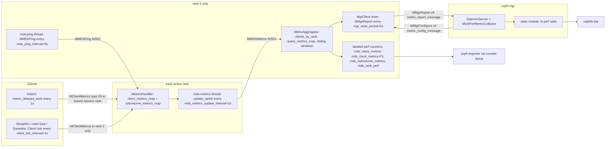
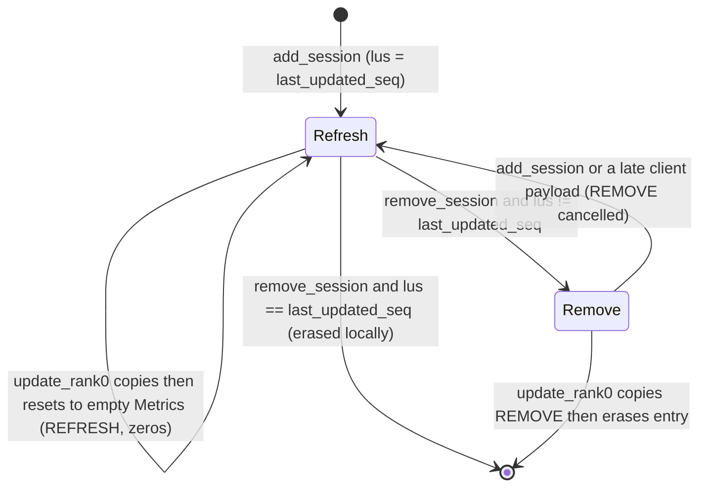
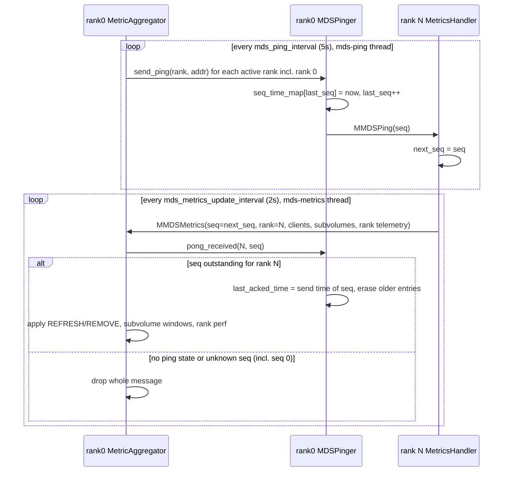

# Metrics: client metrics, rank-0 aggregation, mgr perf queries and subvolume metrics

> Part of the [C++ MDS project map](../README.md). Sources (commit `5f7e383ae6d`): `src/mds/MetricsHandler.{h,cc}` (183 + 751 LOC), `src/mds/MetricAggregator.{h,cc}` (101 + 914), `src/mds/MDSPinger.{h,cc}` (58 + 104), `src/mds/MDSPerfMetricTypes.h` (475), `src/mds/mdstypes.{h,cc}` (`SubvolumeMetric`, `metric_spec_t`, `feature_bitset_t`), `src/include/cephfs/metrics/Types.h` (944), `src/messages/MClientMetrics.h` (61), `MMDSMetrics.h` (56), `MMDSPing.h` (52), `MMgrReport.h` (228), `MMgrConfigure.h` (90), `src/mgr/MDSPerfMetricTypes.{h,cc}` (556 + 193), `src/mgr/MetricTypes.h` (345), `src/mgr/MetricCollector.{h,cc}` (85 + 191), `src/mgr/MDSPerfMetricCollector.{h,cc}` (28 + 64), `src/mgr/MgrClient.{h,cc}` (report/configure paths), `src/mgr/DaemonServer.cc`, `ActivePyModules.cc`, `BaseMgrModule.cc` (MDS perf query plumbing), `src/pybind/mgr/stats/` (721), `src/tools/cephfs/top/cephfs-top` (1269), `src/client/Client.cc` (metrics sending and `SubvolumeMetricTracker`), kernel `linux/fs/ceph/metric.{c,h}` (533 + 281), `linux/fs/ceph/subvolume_metrics.{c,h}` (416 + 97), `src/exporter/` (labeled counter export).
> Related: [wire-protocol](../02-client-protocol/wire-protocol.md), [sessions](../02-client-protocol/sessions.md), [kclient-expectations](../02-client-protocol/kclient-expectations.md), [libcephfs-fuse-ganesha-expectations](../02-client-protocol/libcephfs-fuse-ganesha-expectations.md), [rstats-quotas-and-subvolumes](../10-snapshots-quotas-subvolumes/rstats-quotas-and-subvolumes.md), [snapshots](../10-snapshots-quotas-subvolumes/snapshots.md), [qos-dmclock-scheduler](qos-dmclock-scheduler.md), [quiesce](quiesce.md), [quarantine](quarantine.md), [mgr-tools-and-orchestration](../01-cluster-integration/mgr-tools-and-orchestration.md), [fsmap-and-mdsmap](../01-cluster-integration/fsmap-and-mdsmap.md), [process-and-threading](../00-architecture/process-and-threading.md), [mds_lock-analysis](../00-architecture/mds_lock-analysis.md), [admin-commands](../13-admin-and-config/admin-commands.md), [config-perf-counters-and-health](../13-admin-and-config/config-perf-counters-and-health.md), [rank-lifecycle-and-recovery](../09-recovery/rank-lifecycle-and-recovery.md).

## 1. Purpose and responsibilities

The MDS does not measure client I/O. CephFS clients measure their own performance and send it to the MDS cluster. The MDS consolidates the data on rank 0 and publishes it in two places:

- **labeled perf counters** on the rank-0 daemon: per client, per subvolume, per rank. They are read through `counter dump` (admin socket or tell), by `ceph-exporter`, and by the mgr in `MMgrReport`;
- the **ceph-mgr "MDS perf query" interface**. The mgr `stats` module (`ceph fs perf stats`) and `cephfs-top` read it.

Responsibilities, in pipeline order:

1. **Negotiation.** The MDS advertises `CEPHFS_FEATURE_METRIC_COLLECT` (bit 14) and a `metric_spec` bitmap (metric types 0..16) in the `CEPH_SESSION_OPEN` reply. These values decide whether a client sends metrics at all, and which ones. The kernel client also enables subvolume metrics only when the session's feature bit 22 is set. The kernel calls that bit `CEPHFS_FEATURE_SUBVOLUME_METRICS`, while the C++ MDS calls it `CEPHFS_FEATURE_CHARMAP` (see §7.1).
2. **Ingestion on every active rank** (`MetricsHandler`). It decodes `CEPH_MSG_CLIENT_METRICS` (`MClientMetrics`) and keeps the latest per-client values. It also turns per-subvolume I/O samples, keyed by subvolume inode number, into samples keyed by subvolume path.
3. **Subvolume identity and utilization.** The MDS ships `subvolume_id` to clients in `InodeStat` (struct v9) and in `MClientCaps` flush acks (message v13), so that clients can tag I/O by subvolume. It caches `quota_bytes` from quota broadcasts and reads `used_bytes` from the subvolume root's `rstat.rbytes`.
4. **Forwarding to rank 0.** Every `mds_metrics_update_interval` (2 s) each active rank sends an `MMDSMetrics` (`MSG_MDS_METRICS`) message to rank 0. The message carries the latest per-client values or removals, per-subvolume aggregates and rank telemetry (process CPU %, in-flight requests). Liveness and staleness are tracked with a ping/sequence protocol (`MMDSPing`, `MDSPinger`).
5. **Aggregation on rank 0** (`MetricAggregator`). It keeps per-(client, rank) state, maintains the labeled perf counters, runs a sliding window per subvolume (`subv_metrics_window_interval`, 30 s), evaluates the regex-keyed perf queries pushed by the mgr, and flags lagging ranks.
6. **Reporting to ceph-mgr.** The query set arrives through `MMgrConfigure.metric_config_message` (`MDSConfigPayload`). Every report period (the `stats_period` the mgr pushes in `MMgrConfigure`: `mgr_stats_period`, 5 s by default, and the mgr can raise it at runtime, §3.10) the rank-0 `MgrClient` attaches `MMgrReport.metric_report_message` (`MDSMetricPayload`) to its report.

None of the metric state is persisted: there are no journal events and no RADOS objects. After a failover everything is rebuilt from fresh client reports. The one exception is the client's advertised `metric_spec`, which is part of `client_metadata_t` inside the persisted `session_info_t` (`src/mds/mdstypes.cc:680 (session_info_t::encode)`); see [sessions](../02-client-protocol/sessions.md).

Out of scope: the MDS's own internal perf counters (`mds`, `mds_server`, `mds_cache` and others; see [config-perf-counters-and-health](../13-admin-and-config/config-perf-counters-and-health.md)), dmClock QoS ([qos-dmclock-scheduler](qos-dmclock-scheduler.md); it does **not** consume these metrics), and quota enforcement ([rstats-quotas-and-subvolumes](../10-snapshots-quotas-subvolumes/rstats-quotas-and-subvolumes.md)).

## 2. Source map

| File | Class / function | Lines | Role |
|---|---|---|---|
| `src/include/cephfs/metrics/Types.h` | `enum ClientMetricType` | 20-38 | Metric type ids 0..16 (wire values) |
| same | `CapInfoPayload` … `WriteIoSizesPayload` | 115-535 | Per-type payloads with `ENCODE_START` versions |
| same | `UnknownPayload` (`decode` at 546-551) | 537-558 | Skips unknown types using `struct_len` |
| same | `SimpleIOMetric` | 568-637 | Client-side packed single-I/O record (1-bit op, 32-bit µs latency, 31-bit size) |
| same | `AggregatedIOMetrics` | 643-745 | Per-subvolume aggregate (wire element of type 16) |
| same | `SubvolumeMetricsPayload` | 747-788 | Type 16 payload: `u64` count + versioned elements |
| same | `ClientMetricMessage::decode` | 878-924 | `u32` type, then type-specific payload |
| `src/messages/MClientMetrics.h` | `MClientMetrics` | 12-59 | `CEPH_MSG_CLIENT_METRICS` (29), v1/compat 1, `vector<ClientMetricMessage>` |
| `src/messages/MMDSMetrics.h` | `MMDSMetrics` | 10-48 | `MSG_MDS_METRICS` (0x501), carries `metrics_message_t` |
| `src/messages/MMDSPing.h` | `MMDSPing` | 10-50 | `MSG_MDS_PING` (0x502), carries `version_t seq` |
| `src/mds/MDSPerfMetricTypes.h` | `CapHitMetric` … `WriteIoSizesMetric`, `Metrics` | 27-403 | MDS-internal per-client metric state (DENC) |
| same | `RankPerfMetrics`, `l_mds_rank_perf_*` | 22-25, 310-332 | Rank telemetry and its perf counter ids |
| same | `metrics_message_t` | 405-473 | Rank→rank-0 payload (v3) |
| `src/mds/mdstypes.h` | `SubvolumeMetric` | 812-848 | Per-subvolume aggregate sent to rank 0 (DENC v2) |
| `src/mds/MetricsHandler.h` | `class MetricsHandler` | 42-181 | Per-rank ingestion state, `lock`, updater thread |
| `src/mds/MetricsHandler.cc` | `ms_dispatch2` | 46-62 | Claims `MClientMetrics` (from clients) and `MMDSPing` (from MDS) |
| same | `init` / `shutdown` | 64-124 | Rank perf counters (ranks other than 0), `mds-metrics` updater thread |
| same | `add_session` / `remove_session` | 127-180 | Session lifecycle, `UPDATE_TYPE_REMOVE` |
| same | `handle_payload(...)` x12 | 198-416 | Per-type ingestion; subvolume path resolution |
| same | `handle_client_metrics` | 418-444 | Entry for `MClientMetrics` |
| same | `handle_mds_ping`, `notify_mdsmap` | 446-481 | Sequence handling, rank-0 address tracking |
| same | `update_rank0` | 483-576 | Builds and sends `MMDSMetrics` every interval |
| same | `aggregate_subvolume_metrics` | 578-645 | Per-interval subvolume roll-up |
| same | `maybe_update_subvolume_quota` | 647-671 | Quota cache fed by `MDCache::broadcast_quota_to_client` |
| same | `sample_cpu_usage` / `sample_open_requests` | 673-751 | Rank telemetry |
| `src/mds/MetricAggregator.h` | `class MetricAggregator` | 33-99 | Rank-0 aggregation state |
| `src/mds/MetricAggregator.cc` | perf counter enums | 26-63 | `l_mds_client_metrics_*`, `l_mds_per_client_metrics_*`, `l_subvolume_metrics_*` |
| same | `init` / `shutdown` | 82-156 | `mds-ping` thread, mgr callbacks |
| same | `refresh_subvolume_metrics_for_rank` | 173-388 | Sliding windows, subvolume counters and queries |
| same | `refresh_metrics_for_rank` | 390-661 | Per-client counters and perf query evaluation |
| same | `remove_metrics_for_rank`, `cull_metrics_for_rank` | 663-739, 804-815 | Client removal and rank culling |
| same | `handle_mds_metrics` | 741-777 | Entry for `MMDSMetrics` |
| same | `update_rank_perf_metrics` | 779-802 | `mds_rank_perf` counters for all ranks |
| same | `notify_mdsmap` | 826-863 | Active set tracking |
| same | `set_perf_queries` / `get_perf_reports` | 865-914 | mgr query in, report out |
| `src/mds/MDSPinger.{h,cc}` | `MDSPinger` | h:17-56, cc:19-104 | Ping sequence bookkeeping, lag detection |
| `src/mds/MDSRank.cc` | `active_start` | 2129-2161 | Starts handler (all ranks) and aggregator (rank 0) |
| same | `handle_mds_map` | 2620-2623 | Calls both `notify_mdsmap` |
| same | `get_path`, `get_inode_rbytes` | 4103-4118 | `mds_lock`-taking helpers used by metrics |
| `src/mds/Server.cc` | `_session_logged`, `finish_force_open_sessions`, reconnect finish | 968-973, 1030, 1040, 1127, 1690 | `add_session`/`remove_session`, `metric_spec` in OPEN reply |
| same | `handle_client_session` ("already opened" reply) | 668-677 | OPEN reply **without** `metric_spec` |
| same | `can_handle_charmap` | 4876-4893 | Reads client feature bit 22 as CHARMAP (§7.1) |
| `src/mds/MDCache.cc` | `broadcast_quota_to_client` | 2103-2135 | Feeds the subvolume quota cache |
| `src/mds/CInode.cc` | `get_subvolume_id`, `encode_inodestat` | 5597-5600, 4316/4369 | Subvolume id derivation and `InodeStat` v9 |
| `src/mds/SnapRealm.cc` | `SnapRealm::check_cache` | 150-154 | `cached_subvolume_ino` |
| `src/mds/Locker.cc` | `maybe_set_subvolume_id` | 2501-2506 | `MClientCaps.subvolume_id` on flush acks |
| `src/mgr/MDSPerfMetricTypes.h` | sub-key/counter descriptors, `MDSPerfMetricQuery`, `MDSPerfMetricReport` | 22-430 | mgr↔MDS query/report types |
| same | `AggregatedSubvolumeMetric`, `SlidingWindowTracker` | 433-551 | Rank-0 subvolume windowing |
| `src/mgr/MDSPerfMetricTypes.cc` | `pack_counter`, `unpack_counter`, `pack_counters` | 22-92, 177-188 | 16-byte counter packing |
| `src/mgr/MetricTypes.h` | `MetricReportMessage`, `MetricConfigMessage`, `MDSMetricPayload`, `MDSConfigPayload` | 14-343 | Typed variants inside mgr messages |
| `src/messages/MMgrReport.h`, `MMgrConfigure.h` | `MMgrReport` (v9), `MMgrConfigure` (v4) | 104-226, 27-87 | Transport to/from mgr |
| `src/mgr/MgrClient.cc` | `_send_report`, `handle_mgr_configure` | 341-453, 468-499 | Periodic report, query delivery |
| `src/mgr/DaemonServer.cc` | `handle_report`, `_send_configure`, `handle_mds_perf_metric_query_updated` | 774-895, 3847-3863, 549-561 | mgr side of the protocol |
| `src/mgr/MetricCollector.cc`, `MDSPerfMetricCollector.cc` | `process_reports_generic`, `get_counters_generic`, `process_reports` | 142-186, 124-139, 23-38 | mgr aggregation per query id |
| `src/mgr/BaseMgrModule.cc`, `ActivePyModules.cc` | `ceph_add_mds_perf_query`, `get_mds_perf_counters` | 1221-1462, 1715-1765 | Python API |
| `src/pybind/mgr/stats/fs/perf_stats.py` | `FSPerfStats` | 135-648 | `ceph fs perf stats` |
| `src/tools/cephfs/top/cephfs-top` | `FSTop` | 1-1269 | Curses UI over `fs perf stats` |
| `src/client/Client.cc` | `collect_and_send_global_metrics`, `SubvolumeMetricTracker` | 7640-7764, 19149-19250 | libcephfs/ceph-fuse sender |
| `linux/fs/ceph/metric.c` | `ceph_mdsc_send_metrics`, `metric_get_session`, `metric_delayed_work` | 91-331, 334-405 | Kernel sender |
| `linux/fs/ceph/subvolume_metrics.c` | `ceph_subvolume_metrics_record`, `..._snapshot`, `..._record_io` | 143-213, 215-310, 370-402 | Kernel per-subvolume accumulation |

## 3. How it works

### 3.1 Pipeline overview



### 3.2 Negotiation: which client sends what, to which rank

MDS side. In the `CEPH_SESSION_OPEN` replies sent when a session opens (`_session_logged`), is force-opened by an import (`finish_force_open_sessions`), or completes reconnect, the MDS sets, for a session that has `CEPHFS_FEATURE_MIMIC`:

- `supported_features = CEPHFS_FEATURES_MDS_SUPPORTED`, which in this tree is bits 0..24 (`src/mds/cephfs_features.h:58-82,104`);
- `metric_spec = CEPHFS_METRIC_FEATURES_ALL`, which is metric types 0..16 (`src/mds/cephfs_features.h:84-102`, `src/mds/Server.cc:310 (Server::Server)`, `src/mds/Server.cc:973 (Server::_session_logged)`, `:1133`, `:1696`).

There is one exception. When a client that advertises `CEPHFS_FEATURE_NOTIFY_SESSION_STATE` re-sends `REQUEST_OPEN` for a session that is already open, the MDS replies with an OPEN that carries `supported_features` but an **empty** `metric_spec` (`Server.cc:668-677`). libcephfs copies the spec of every OPEN it receives into the session, also when its session is already open (`reinit_mds_features`, `Client.cc:2688-2692, 2718, 2728`). If that session is the rank-0 session, libcephfs then sends only empty `MClientMetrics` until another OPEN with a full spec arrives (code inspection). The kernel ignores `metric_spec` (below). Without MIMIC, `MClientSession` is encoded as v1 and carries neither field (`MClientSession.h:101-105`).

`metric_spec_t` is `ENCODE_START(1,1)` around a `feature_bitset_t`, which is a `u32` byte length followed by little-endian 64-bit blocks (`src/mds/mdstypes.cc:592 (metric_spec_t::encode)`, `src/mds/mdstypes.cc:532 (feature_bitset_t::encode)`). It travels in `MClientSession` v4+ (`src/messages/MClientSession.h:86,110`). The MDS stores the client's own `metric_spec` in `client_metadata_t`. It is used only for display: `session ls` / `client ls` dumps it as `client_metadata.metric_spec.metric_flags.feature_bits`, a hex string (`src/mds/mdstypes.cc:557 (feature_bitset_t::dump)`).

| Aspect | libcephfs / ceph-fuse / Ganesha (`src/client/Client.cc`) | Linux kernel client (`linux/fs/ceph`) |
|---|---|---|
| Gate | Rank 0 is `up:active` in the client's mdsmap **and** an open session with rank 0 exists **and** rank 0 advertises feature bit 14 (`Client.cc:7640-7660 (Client::collect_and_send_global_metrics)`) | Session state OK (`check_session_state`: not NEW/CLOSING/CLOSED/REJECTED/RESTARTING) and the session advertises bit 14. When the worker (re)selects a session while subvolume metrics are enabled, it also requires bit 22 (`metric.c:334 (metric_get_session)`). Additionally the rank must be `CEPH_MDS_STATE_ACTIVE` in the client's mdsmap at send time (`metric.c:118-124 (ceph_mdsc_send_metrics)`) |
| Target rank | Always rank 0 | The last session that delivered `CEPH_SESSION_OPEN` with bit 14 (`mds_client.c:74 (ceph_metric_bind_session)`, `:4549-4553`). If that session becomes unusable, the lowest-numbered usable session (`metric.c:391-397 (metric_delayed_work)`). **Any rank can receive kernel metrics** |
| Period | Every `Client::tick()` (`client_tick_interval`, default 1 s), under `client_lock` (`Client.cc:7584 (Client::tick)`) | Every second (`round_jiffies_relative(HZ)`) on a delayed work item (`metric.h:227 (metric_schedule_delayed)`) |
| Which types | Each type is sent only if the MDS's `metric_spec` has its bit, unless `client_collect_and_send_global_metrics=true`, which forces all types (`Client.cc:7666-7761`). Order: latencies 1..3, then 0, 4..9, then 16. The message is sent even when empty | Always types 0..9, in id order. Type 16 is added when subvolume metrics are enabled, the target session has bit 22 and some subvolume had I/O in the period (`metric.c:126-150`). The MDS's `metric_spec` is skipped unread (`mds_client.c:4438-4441 (handle_session)`) |
| Subvolume metrics enable | Bit 16 in the MDS `metric_spec` (or the force option) | Session feature bit 22 (`CEPHFS_FEATURE_SUBVOLUME_METRICS` in `mds_client.h:40`) on `CEPH_SESSION_OPEN` (`mds_client.c:4581-4584`) |
| Switch-off | `client_collect_and_send_global_metrics` (default `false`) only **adds** types | Module parameter `disable_send_metrics` (`super.c:1707`) |

Advertised client metric spec: libcephfs sends `CEPHFS_METRIC_FEATURES_ALL` (`Client.cc:2659 (Client::_open_mds_session)`). The kernel sends `CEPHFS_METRIC_SPEC_CLIENT_SUPPORTED`, also types 0..16 (`metric.h:37-57`, `mds_client.c:1592 (encode_metric_spec)`).

### 3.3 `MClientMetrics` wire format (client → MDS)

`CEPH_MSG_CLIENT_METRICS` = 29 (`src/include/ceph_fs.h:163`). Header version 1, compat 1. The C++ client sets priority `CEPH_MSG_PRIO_HIGH-1` = 195 (`MClientMetrics.h:16`); the kernel builds the message by hand (`metric.c:157,309-313`). The front contains `encode(std::vector<ClientMetricMessage>)` (`MClientMetrics.h:43-52`):

| Field | Encoding |
|---|---|
| item count | `le32` (kernel: `struct ceph_metric_head.num`, `metric.h:179`) |
| per item: `type` | `le32` `ClientMetricType` (`Types.h:818`) |
| per item: `struct_v`, `struct_compat`, `struct_len` | `u8`, `u8`, `le32` (`ENCODE_START`; the kernel's `struct ceph_metric_header` at `metric.h:59-64` has the same layout) |
| per item: body | `struct_len` bytes |

| Type id | Name | v/compat sent (kernel, libcephfs) | Body (little endian) | Body bytes | MDS handling |
|---|---|---|---|---|---|
| 0 | `CAP_INFO` | 1/1, 1/1 | `u64 hits`, `u64 misses`, `u64 total` (kernel: total caps; libcephfs: 0) | 24 | Stores hits/misses. `total` is ignored |
| 1 | `READ_LATENCY` | 2/1, 2/1 | `utime lat` (`u32 sec, u32 nsec`; **cumulative sum** of latencies), `utime avg` (running mean), `u64 sq_sum` (Welford M2 in ns²), `u64 count` | 32 | Stores all four; `updated=true`. For a v1 encoding only `lat` is decoded, and `sq_sum`/`count` keep their uninitialized values (no default initializers, `Types.h:158-172`) |
| 2 | `WRITE_LATENCY` | 2/1, 2/1 | same | 32 | same |
| 3 | `METADATA_LATENCY` | 2/1, 2/1 | same | 32 | same |
| 4 | `DENTRY_LEASE` | 1/1, 1/1 | `u64 hits`, `u64 misses`, `u64 total dentries` | 24 | Stores hits/misses. `total` is ignored |
| 5 | `OPENED_FILES` | 1/1 | `u64 opened_files`, `u64 total_inodes` | 16 | Stores both |
| 6 | `PINNED_ICAPS` | 1/1 | `u64 pinned_icaps`, `u64 total_inodes` | 16 | Stores both |
| 7 | `OPENED_INODES` | 1/1 | `u64 opened_inodes`, `u64 total_inodes` | 16 | Stores both |
| 8 | `READ_IO_SIZES` | 1/1 | `u64 total_ops`, `u64 total_size` | 16 | Stores both |
| 9 | `WRITE_IO_SIZES` | 1/1 | same | 16 | Stores both |
| 10..15 | `AVG_*`, `STDEV_*` latency | never sent as payloads | n/a | n/a | These ids exist only as `metric_spec` bits. Rank 0 derives the matching query counters from the type 1..3 payloads (§3.6) |
| 16 | `SUBVOLUME_METRICS` | 1/1, 1/1 | `u64 n` (C++ encodes `size_t`; the kernel writes `le64`), then `n` × {`u8 1`, `u8 1`, `le32 56`, `AggregatedIOMetrics`} | 8 + 62·n | Path resolution and per-path accumulation (§3.7) |
| other | unknown | n/a | n/a | any | `UnknownPayload` skips `struct_len` bytes (`Types.h:546-551`) |

`AggregatedIOMetrics` body (56 bytes, `Types.h:718-730`, kernel `struct ceph_subvolume_metric_entry_wire` at `metric.h:157-166`):

| Field | Type | Meaning |
|---|---|---|
| `subvolume_id` | `u64` (`inodeno_t`) | Inode number of the subvolume root, as received from the MDS |
| `read_count`, `write_count` | `u32` each | Ops in the period (the kernel clamps its `u64` counts to `U32_MAX`) |
| `read_bytes`, `write_bytes` | `u64` | Bytes in the period |
| `read_latency_us`, `write_latency_us` | `u64` | **Sum** of per-op latencies in µs |
| `time_stamp` | `u64` | Always 0 from clients. The MDS overwrites it with its receive time (`steady_clock` ms) |

Decoding (`Types.h:878-924 (ClientMetricMessage::decode)`): a known type decodes with `DECODE_START(N)`. An encoding whose `struct_compat` exceeds `N` throws. Any decode exception in `MClientMetrics::decode_payload` makes `decode_message` return null (`src/msg/Message.cc:1014-1030`). The messenger then faults the connection, in both `ProtocolV2` (`src/msg/async/ProtocolV2.cc:1451-1453`) and `ProtocolV1` (`ProtocolV1.cc:959-961`). This is why the kernel never sends metrics to an MDS without bit 14 (comment at `metric.c:345-349`).

Latency field semantics. Both clients keep, per op class: a cumulative latency sum (`lat`), a running mean (`avg`) and Welford's `M2` (`sq_sum`, ns²). See kernel `__update_mean_and_stdev` (`metric.c:499-512`) and libcephfs `Client::update_io_stat_read` with `calc_sq_sum` (`Client.cc:850-867`). The kernel ignores failed ops (`rc < 0`) except `-ENOENT` and `-ETIMEDOUT`, which it counts (`metric.c:521-522`).

### 3.4 Ingestion on each rank (`MetricsHandler`)

**Startup.** `MetricsHandler` is a member of `MDSRank` (`MDSRank.h:622`). It is initialized and registered as a messenger dispatcher with `Dispatcher::PRIORITY_HIGH` only in `MDSRank::active_start()` (`MDSRank.cc:2143-2144`). Before the rank is active, `MClientMetrics` and `MMDSPing` fall through to `MDSDaemon` and are dropped: their types are not in `MDSRank::is_valid_message` (`MDSRank.cc:1191-1215`).

**Dispatch** (`MetricsHandler.cc:46 (ms_dispatch2)`): `CEPH_MSG_CLIENT_METRICS` is claimed only from client peers, `MSG_MDS_PING` only from MDS peers. Both run on the messenger's single `DispatchQueue` thread, **not** under `mds_lock`.

**`handle_client_metrics`** (`MetricsHandler.cc:418-444`):

1. If `!mds->is_active_lockless()` (atomic `m_is_active`, set once in `active_start`, `MDSRank.cc:2133`, never cleared), the message is dropped.
2. Take `MetricsHandler::lock`. Find the `Session` through the connection's priv (`MDSRank::get_session`, `MDSRank.cc:1417`). This runs without `mds_lock` and keeps no reference to the `Session`. With no session, drop.
3. For each item: a `SubvolumeMetricsPayload` goes to the special handler (it drops and re-takes the lock). That handler does not check `client_metrics_map`, so subvolume samples are accepted from any session. Everything else goes through `HandlePayloadVisitor` to `handle_payload(Session*, const XPayload&)`.

**Per-type handlers** (`MetricsHandler.cc:198-374`). Each looks up `client_metrics_map[session->info.inst]` (key: `entity_inst_t`, that is name plus address) and silently ignores clients it does not know. Then it overwrites the stored values, sets `update_type = UPDATE_TYPE_REFRESH`, and sets `updated = true` (except `CapHitMetric`, which has no `updated` flag). The values are the client's latest cumulative or gauge values; the MDS does not accumulate them. Because every handler sets `REFRESH`, a payload processed after `remove_session` marked the entry `REMOVE` (and before the next `update_rank0`) cancels the removal. Nothing removes that entry later. This needs a client message processed after its session close was journaled, which well-behaved clients avoid (code inspection).

**Session tracking** (`MetricsHandler.cc:127-180`):

- `add_session` is called under `mds_lock` from `Server::_session_logged` (open), `finish_force_open_sessions` (import), and reconnect completion (`Server.cc:968,1127,1690`). It `emplace`s `{last_updated_seq, Metrics{REFRESH}}`. If an entry for the same `entity_inst_t` already exists, that entry is kept and only `update_type` is reset to `REFRESH`, which also cancels a pending `REMOVE`.
- `remove_session` is called from `_session_logged` close/kill (`Server.cc:1030,1040`). If the entry's recorded sequence `lus == last_updated_seq`, no update with a non-zero `seq` has been sent since the session was added (or since the last `reset_seq`), so the entry is simply erased. Otherwise all metrics are zeroed and `update_type = UPDATE_TYPE_REMOVE`, so that rank 0 forgets the client.



**Quota cache** (`MetricsHandler.cc:647-671 (maybe_update_subvolume_quota)`). `MDCache::broadcast_quota_to_client` (`MDCache.cc:2103-2135`) calls it under `mds_lock`, only while the rank is active or stopping. It does so for inodes that are auth and not frozen, whose `get_subvolume_id() != 0`, and that have quota enabled or a quota change. The callers are:

- every ancestor walk in `MDCache::predirty_journal_parents` (`MDCache.cc:2465`);
- nest scatter-gather completion (`CInode.cc:2848`);
- `setxattr ceph.quota.*` (`Server.cc:6499`, `quota_change=true`).

The cache maps `subvolume_id -> {quota_bytes, used_bytes, last_activity}`. `quota_bytes` is overwritten only when it is `> 0` or `force_zero` (quota removed). This keeps a non-quota subvolume root from overwriting the value that came from a quota-enabled descendant. For mgr/volumes v2 subvolumes the quota sits on the `<uuid>` data dir, while the subvolume flag sits on `/volumes/<group>/<name>`. The key is the subvolume id, not the quota inode. So **any** quota-enabled directory inside the subvolume feeds the same entry, including a nested quota a user set deeper in the tree. The last such broadcast wins.

### 3.5 Forwarding to rank 0 (`update_rank0`, `MMDSMetrics`) and the ping protocol

**Updater thread** (`MetricsHandler.cc:93-103`). Thread name `mds-metrics`. In a loop: unlock, `sleep(mds_metrics_update_interval)` (re-read on every iteration; runtime option), lock, `update_rank0()`.

**`update_rank0`** (`MetricsHandler.cc:483-576`):

1. `sample_cpu_usage()`. Reads `utime+stime` from `/proc/self/stat` (`src/common/util.cc:468 (read_process_cpu_ticks)`) and computes `round(100 × Δticks / CLK_TCK / Δt)`, so 100 means one full core. The first sample, or a tick counter that went backwards, yields 0. `sample_open_requests()` uses `op_tracker.get_num_ops_in_flight()` (0 when op tracking is disabled). Both values update `rank_telemetry` and, on ranks other than 0, the local `mds_rank_perf{rank=N}` counters.
2. If the rank-0 address is unknown (`addr_rank0` unset), return. Note that `subvolume_metrics_map` is not cleared in that case.
3. Build `metrics_message_t{seq = next_seq, rank = whoami, rank_metrics}`. Copy every client entry into the message. `REFRESH` entries are then reset to `Metrics{}`: all zeros, `updated=false`, `REFRESH`. `REMOVE` entries are erased.
4. Collect one `subvolume_id` per path. **Drop `MetricsHandler::lock`** and call `mds->get_inode_rbytes(id)` for each one; this takes `mds_lock` once per subvolume (`MDSRank.cc:4112`). Re-take the lock. Samples that the dispatch thread adds while the lock is dropped are still aggregated in step 5. A path that first appeared in that window has no fetched `rbytes` (see `used_bytes` in §3.7).
5. `aggregate_subvolume_metrics` for every path (§3.7), then clear `subvolume_metrics_map`.
6. Evict `subvolume_quota` entries idle for more than `2 × subv_metrics_window_interval`.
7. If `next_seq != 0`, increment `last_updated_seq`.
8. **Drop the lock** and `send_message_mds(MMDSMetrics, addr_rank0)`. That is a plain `messenger->send_to_mds` (`MDSRank.cc:1499`); rank 0 sends to itself through loopback delivery.

`metrics_message_t` encoding (`MDSPerfMetricTypes.h:418-444`): `ENCODE_START(3,1)`; `u64 seq`; `i32 rank`; `map<entity_inst_t, Metrics>` (address encoded with connection features); v2 adds `vector<SubvolumeMetric>` (each `DENC(2,1)`); v3 adds `RankPerfMetrics` `DENC(1,1){u64 cpu_usage_percent, u64 open_requests}`. `Metrics` is `DENC(4,1)` holding `u32 update_type` followed by the per-type structs (`MDSPerfMetricTypes.h:351-371`).

**Ping protocol.** It acts as both a liveness check and a filter against stale or misdirected updates.



- The sequence starts at `MDS_PINGER_ISN = 1` per rank (`MDSPinger.h:43`). `pong_received` keeps the acked entry, so repeated updates carrying the same `seq` are all accepted (`MDSPinger.cc:38-68`).
- `is_rank_lagging(rank)` is true when `now − last_acked_time > mds_ping_grace` (15 s). `last_acked_time` is the time at which the acknowledged ping was **sent**. It starts as the time the rank's ping state was created (`MDSPinger.h:45-49`, `MDSPinger.cc:85-104`). Lagging active ranks go into `MDSPerfMetricReport::rank_metrics_delayed` (§3.8). Unacknowledged entries stay in `seq_time_map` until a later sequence is acknowledged.
- `MetricsHandler::notify_mdsmap` (`MetricsHandler.cc:451-481`) runs under `mds_lock` from `handle_mds_map`. If rank 0 is not `up:active`, it clears `addr_rank0` and calls `reset_seq()`. If rank 0's address changed, it records the new address and calls `reset_seq()`. `reset_seq` sets `next_seq = 0` and every client's `lus = last_updated_seq`. Until the new rank 0 pings, updates carry `seq=0` and are rejected. Session removals during that window are therefore cut short locally.

### 3.6 Aggregation on rank 0 (`MetricAggregator`)

**Lifecycle.** Created only when `is_rank0()` in `active_start` (`MDSRank.cc:2147-2153`) and added to the messenger with default priority. `init()` (`MetricAggregator.cc:82-116`) does four things:

- creates `mds_client_metrics{fs_name, id=<mds global_id>}` with `num_clients`;
- starts the `mds-ping` thread, which pings at once and then every `mds_ping_interval`;
- registers `set_perf_queries` / `get_perf_reports` as the `MgrClient` perf-metric callbacks (`set_perf_metric_query_cb` takes `MgrClient::lock` while the caller holds `mds_lock`);
- reads `subv_metrics_window_interval` once.

`handle_mds_map` then calls `notify_mdsmap` immediately after `active_start` (`MDSRank.cc:2441` precedes `2620`).

**`notify_mdsmap`** (`MetricAggregator.cc:826-863`). Compares `active_rank_addrs` with the mdsmap's `up:active` set; `up:stopping` and `up:clientreplay` ranks count as inactive.

- Ranks that left: `cull_metrics_for_rank` (decrement `num_clients` and erase the query keys for each client, drop `clients_by_rank[rank]`, delete `mds_rank_perf{rank}`) and `MDSPinger::reset_ping`.
- New ranks: record the address and an empty client set.
- A rank present in both sets keeps its recorded address. If a rank is replaced between two mdsmaps that rank 0 processes, rank 0 keeps pinging the old address, so the new daemon's updates are rejected. The code does not handle this; whether rank 0 can skip the intermediate epochs in practice is (unverified).

**`handle_mds_metrics`** (`MetricAggregator.cc:741-777`):

1. Under `MetricAggregator::lock`, return if `stopping`.
2. Drop the message unless `pong_received(rank, seq)`.
3. For each client: `REFRESH` goes to `refresh_metrics_for_rank`, `REMOVE` to `remove_metrics_for_rank(remove=true)`. Any other value is `ceph_abort()`.
4. `refresh_subvolume_metrics_for_rank(rank, subvolume_metrics)`.
5. `update_rank_perf_metrics(rank, rank_metrics)`. This creates or sets `mds_rank_perf{rank}` with `cpu_usage` and `open_requests`, both `PRIO_USEFUL` (`MetricAggregator.cc:779-802`).

**`refresh_metrics_for_rank`** (`MetricAggregator.cc:390-661`). On the first REFRESH for a `(client, rank)` pair it inserts the pair into `clients_by_rank[rank]` (`.at()`), increments `num_clients`, and creates `mds_client_metrics-<fs_name>{client="client.<id>", rank="<rank>"}`. `num_clients` therefore counts `(client, rank)` pairs, not distinct clients. Every rank sends a REFRESH for every session it holds, so a client with sessions on three ranks counts three times. It then sets the per-client perf counters:

| Counter | Type | Source | Condition / quirk |
|---|---|---|---|
| `cap_hits`, `cap_miss` | u64 | `cap_hit_metric.hits/misses` | Always set. If no `CAP_INFO` arrived in the interval, the value is the post-reset 0 |
| `avg_read_latency` | time | `tset(utime_t(mean.sec*100, mean.nsec/1000000))` | When `updated`. This is not a faithful conversion of the mean |
| `avg_write_latency`, `avg_metadata_latency` | time | `PerfCounters::set(idx, utime_t)` | **Never takes effect**: `set()` returns early for non-`PERFCOUNTER_U64` counters (`src/common/perf_counters.cc:236-257`). Always 0 |
| `dentry_lease_hits`, `dentry_lease_miss` | u64 | dentry lease hits/misses | When `updated` |
| `opened_files` + `total_inodes` | u64 | `opened_files_metric` | When `updated` |
| `opened_inodes` + `total_inodes` | u64 | **`opened_inodes_metric.total_inodes`** for both | When `updated` (the `opened_inodes` counter gets `total_inodes`) |
| `pinned_icaps` + `total_inodes` | u64 | `pinned_icaps_metric` | When `updated` |
| `total_read_ops`/`total_read_size`, `total_write_ops`/`total_write_size` | u64 | I/O sizes | When `updated` |

It then evaluates every mgr query (§3.8) and updates `query_metrics_map[query][key]`. The counter pairs are:

| `MDSPerformanceCounterType` (id) | Python name | `first` | `second` | Updated when |
|---|---|---|---|---|
| `CAP_HIT_METRIC` (0) | `cap_hit` | hits | misses | always |
| `READ_LATENCY_METRIC` (1) | `read_latency` | `lat.sec` | `lat.nsec` | `updated` |
| `WRITE_LATENCY_METRIC` (2) | `write_latency` | `lat.sec` | `lat.nsec` | `updated` |
| `METADATA_LATENCY_METRIC` (3) | `metadata_latency` | `lat.sec` | `lat.nsec` | `updated` |
| `DENTRY_LEASE_METRIC` (4) | `dentry_lease` | hits | misses | `updated` |
| `OPENED_FILES_METRIC` (5) | `opened_files` | opened_files | total_inodes | `updated` |
| `PINNED_ICAPS_METRIC` (6) | `pinned_icaps` | pinned_icaps | total_inodes | `updated` |
| `OPENED_INODES_METRIC` (7) | `opened_inodes` | opened_inodes | total_inodes | `updated` |
| `READ_IO_SIZES_METRIC` (8) | `read_io_sizes` | total_ops | total_size | `updated` |
| `WRITE_IO_SIZES_METRIC` (9) | `write_io_sizes` | total_ops | total_size | `updated` |
| `AVG_READ_LATENCY_METRIC` (10) | `avg_read_latency` | `mean.sec` | `mean.nsec` | read `updated` |
| `STDEV_READ_LATENCY_METRIC` (11) | `stdev_read_latency` | `sq_sum` | `count` | read `updated` |
| `AVG_WRITE_LATENCY_METRIC` (12) / `STDEV_WRITE_LATENCY_METRIC` (13) | `avg_write_latency` / `stdev_write_latency` | as above | as above | write `updated` |
| `AVG_METADATA_LATENCY_METRIC` (14) / `STDEV_METADATA_LATENCY_METRIC` (15) | `avg_metadata_latency` / `stdev_metadata_latency` | as above | as above | metadata `updated` |
| `SUBV_*` (16..23) | `subv_*` | see §3.7 | 0 | not touched by client refresh |

A counter that is "not updated" keeps its previous value: `query_metrics_map` entries persist until the key is removed.

**`remove_metrics_for_rank(remove)`** (`MetricAggregator.cc:663-739`).

- With `remove=true` (a REMOVE update): if the client is not tracked, this is an idempotent no-op. Otherwise it erases the client from `clients_by_rank`, deletes its labeled counters and decrements `num_clients`.
- With `remove=false` (rank cull): it only decrements `num_clients`. **The per-client perf counters are not deleted** (`client_perf_counters` keeps them).
- In both cases (but not in the untracked no-op), every query key computed for `(client, rank)` is erased from `query_metrics_map`.

### 3.7 Subvolume metrics end to end

**Identity.** A subvolume is a directory whose snaprealm has `srnode.is_subvolume()`, set by the `ceph.dir.subvolume` vxattr. `CInode::get_subvolume_id()` returns `find_snaprealm()->get_subvolume_ino()` (`CInode.cc:5597`). `SnapRealm::check_cache` takes the parent's subvolume ino first and its own ino only when no ancestor is a subvolume (`SnapRealm.cc:150-154`). The **outermost** subvolume root wins, and 0 means "not in a subvolume". mgr/volumes sets the flag on the following roots:

- `/volumes/<group>/<name>` for v2 subvolumes (`subvolume_v2.py:100`);
- `/volumes/<group>/<name>/<uuid>` for v1 subvolumes (`subvolume_v1.py:70`).

The id reaches clients in two ways:

- `InodeStat` struct v9 appends `u64 subvolume_id` (`CInode.cc:4316,4369`). The versioned `InodeStat` is used only for sessions with `CEPHFS_FEATURE_REPLY_ENCODING` (bit 9, `CInode.cc:4315`). The kernel parses it (`mds_client.c:273-275`) and calls `ceph_inode_set_subvolume`, which assigns it once and `WARN_ON_ONCE`s if a different non-zero id ever arrives (`inode.c:891-912`). libcephfs records it with `SubvolumeMetricTracker::add_inode` (`Client.cc:1865-1868`).
- `MClientCaps` v13 field `subvolume_id`, set only on `FLUSH_ACK` / `FLUSHSNAP_ACK` (`Locker.cc:2501`, `:3434,3438,3563,3652`). libcephfs consumes it (`Client.cc:5755-5759`); the kernel does not.

**Client-side accumulation:**

| | libcephfs (`Client.cc:19149-19250`) | kernel (`subvolume_metrics.c`) |
|---|---|---|
| Inode→subvolume map | `inode_subvolume` (filled from replies and cap acks, removed when cap releases are sent, `Client.cc:7511-7515`) | `ci->i_subvolume_id` |
| Recorded I/O | Each completed read/write, with latency = completion − start (`Client.cc:11538, 11669, 11879, 11910, 12080, 12364`) | OSD read/write completions with `bytes>0` (`addr.c:266, 841, 988`, `file.c:37`); latency in µs, at least 1 (`subvolume_metrics.c:370-402`) |
| Clamping | `SimpleIOMetric`: latency in [1, 2^32−1] µs, size ≤ 2^31−1 bytes (`Types.h:591-615`) | ops clamped to `U32_MAX` on the wire (`metric.c:40-57`) |
| Per-period reset | `aggregate(true)` swaps the map out on every send (`Client.cc:19219-19250`) | `snapshot(consume=true)` removes entries (`subvolume_metrics.c:215-310`) |
| Empty subvolumes | **Can be sent.** `add_inode` does `try_emplace(subvol)` for every newly seen inode (`Client.cc:19171-19185`). A reply whose target inode is new therefore creates a zero entry, which the next `aggregate(true)` sends with `read_count = write_count = 0` | Entries with no ops are skipped and removed |

**Per-rank roll-up.** `handle_payload(SubvolumeMetricsPayload)` (`MetricsHandler.cc:376-412`), for each element:

- **with the metrics lock dropped**: `path = mds->get_path(subvolume_id)`. This takes `mds_lock`, looks up the head inode in the local cache and runs `make_path_string` on the non-projected parent chain; the result is for example `/volumes/_nogroup/sv1` (`MDSRank.cc:4103`). An unknown inode gives an empty path and the sample is dropped;
- **under the lock again**: append the element to `subvolume_metrics_map[path]` with `time_stamp = steady_clock ms`.

Every update interval, `aggregate_subvolume_metrics` (`MetricsHandler.cc:578-645`) produces one `SubvolumeMetric` per path from the k samples it received:

| Field | Value |
|---|---|
| `subvolume_path` | path |
| `read_ops`, `write_ops` | Σ `read_count`, Σ `write_count` |
| `read_size`, `write_size` | Σ bytes |
| `avg_read_latency` (µs) | Σᵢ(`read_latency_usᵢ` × `read_countᵢ`) / Σᵢ `read_countᵢ`. Because `read_latency_usᵢ` is already a **sum** over `read_countᵢ` ops, this is the ops-weighted mean of the per-report latency sums, not a per-op mean |
| `avg_write_latency` (µs) | same, for writes |
| `time_stamp` | max sample receive time (`steady_clock` ms of this host). `dump()` labels it `time_window_sec` (`mdstypes.cc:1332`) |
| `quota_bytes` | `subvolume_quota[id].quota_bytes` (0 if not cached on this rank); refreshes `last_activity` |
| `used_bytes` | the freshly fetched `get_inode_rbytes(id)`: projected `rstat.rbytes` of the local cached inode, 0 if not cached. The cached `used_bytes` from the quota hook is used only for a path whose first sample arrived while `update_rank0` had dropped the lock for the fetch (§3.5 step 4). Such a path gets 0 when the quota cache has no entry either |

`SubvolumeMetric` wire format: `DENC(2,1)` with `string path` and seven `u64` fields (`read_ops`, `write_ops`, `read_size`, `write_size`, `avg_read_latency`, `avg_write_latency`, `time_stamp`); v2 adds `u64 quota_bytes, used_bytes` (`mdstypes.h:824-842`).

**Rank-0 sliding window.** `refresh_subvolume_metrics_for_rank` (`MetricAggregator.cc:173-388`) runs on every accepted `MMDSMetrics`:

1. For each incoming `SubvolumeMetric m`, create the per-path state on first sight:
   - perf counters `mds_subvolume_metrics{fs_name, subvolume_path}`;
   - `SlidingWindowTracker(W)` with `W = subv_metrics_window_interval`.

   Then `add_value(m)` with `timestamp = now` (the aggregator's `steady_clock`, not `m.time_stamp`).
2. Then, for **every** tracked path (not only the ones in this message), prune samples older than `now − W`.
   - If the window is empty: delete the perf counters, erase matching query keys, drop the tracker.
   - Otherwise compute, in integer arithmetic over the remaining samples:
     - `D = floor((t_last − t_first) s)`, forced to 1 if 0 (fewer than 2 samples gives 0, hence 1);
     - `read_iops = Σ read_ops / D`, `write_iops = Σ write_ops / D`;
     - `read_tpBs = Σ read_size / D`, `write_tBps = Σ write_size / D`;
     - `avg_read_latency = (Σ(avg_read_latency × read_ops) / Σ read_ops) / 1000`. This is in "ms", following the per-rank definition above;
     - `quota_bytes`, `used_bytes` are taken from the sample with the largest `time_stamp` (`>=`, so the later iteration wins ties). These time stamps come from different hosts' `steady_clock`s when several ranks report the same subvolume.

     The results are written to the 8 counters and to every query whose sub-keys all evaluate: each `SUBVOLUME_PATH` regex must match the path, while `MDS_RANK` always yields `"0"` and `CLIENT_ID` never matches. A query made only of `MDS_RANK` sub-keys therefore also matches, with key `[["0"]]` shared by all subvolumes.

The `D` definition counts `n` samples over `n−1` gaps. With samples every 2 s and `W=30`, rates are inflated by about n/(n−1); with a single sample they are inflated by 2.

**Lifecycle consequences.** A subvolume's counters exist only while some sample for it arrived during the last `W` seconds. The documented intent is that only data I/O creates samples and metadata-only activity does not (`doc/cephfs/metrics.rst:109-119`). That holds for the kernel. libcephfs, however, sends zero-I/O samples for subvolumes whose new inodes it has just learned about from a reply. Those samples create or refresh the counters with zero rates (code inspection; see the accumulation table above). `used_bytes` and `quota_bytes` are reported only for subvolumes with samples.

### 3.8 Rank 0 ↔ mgr: the MDS perf query protocol

**Transport** (generic MgrClient; see [mgr-tools-and-orchestration](../01-cluster-integration/mgr-tools-and-orchestration.md)):

- The daemon opens a mgr session with `MMgrOpen`. `DaemonServer::handle_open` replies with `MMgrConfigure` right away (`DaemonServer.cc:612`). The mgr accepts `MMgrReport`s only from daemons whose metadata it has (from `mds metadata`); otherwise it requests the metadata in the background and marks the connection down (`DaemonServer.cc:804-838`).
- `MMgrConfigure` v4, compat 1 (`MMgrConfigure.h:42-69`): `u32 stats_period` (= `mgr_stats_period`, 5), `u32 stats_threshold` (= `mgr_stats_threshold`, 5), `map osd_perf_metric_queries` (empty for MDS), and `optional<MetricConfigMessage>`. The last one is encoded only for peers with `SERVER_PACIFIC` (`MetricTypes.h:309-315`) and holds `u32 type=1` (MDS) plus `MDSConfigPayload` `DENC(1,1){ map<MDSPerfMetricQuery, set<MDSPerfMetricLimit>> }` (`MetricTypes.h:218-232`). A config type other than 0 or 1 decodes as `UnknownConfigPayload`, whose decode calls `ceph_abort()` in the receiving daemon (`MetricTypes.h:253-261, 321-340`).
- `MgrClient::handle_mgr_configure` (`MgrClient.cc:468-499`) calls the registered `set_perf_queries_cb`, if any, and starts the report timer when `stats_period` goes from 0 to non-zero. The query set is **not stored** by `MgrClient`. If the aggregator does not exist yet (the daemon becomes rank 0 later), the queries are lost until the mgr resends them; the stats module triggers that on a rank-0 change (§3.9).
- `MMgrReport` v9, compat 1 (`MMgrReport.h:142-190`). The fields are encoded in this order:
  - `string daemon_name`;
  - `vector<PerfCounterType> declare_types`;
  - `bufferlist packed` (counter values, filtered by `stats_threshold`);
  - `vector<string> undeclare_types`;
  - `string service_name`;
  - `optional<map<string,string>> daemon_status`;
  - `vector<DaemonHealthMetric> daemon_health_metrics`;
  - `bufferlist config_bl`;
  - `map osd_perf_metric_reports` (empty for an MDS);
  - `optional<map<string,string>> task_status`;
  - `optional<MetricReportMessage>`.

  `MgrClient::_send_report` (`MgrClient.cc:341-453`) fills the last field from `get_perf_report_cb()` every `stats_period`, on the `MgrClient` `SafeTimer` thread under `MgrClient::lock`. The payload is `u32 type=1` + `MDSMetricPayload` `DENC(1,1){ MDSPerfMetricReport }`, again only for `SERVER_PACIFIC` peers. The labeled metric counters are included in `declare_types`/`packed` like any other counter at or above the threshold.

**Query model** (`src/mgr/MDSPerfMetricTypes.h`):

| Type | Encoding | Notes |
|---|---|---|
| `MDSPerfMetricSubKeyDescriptor` | `DENC(1,1){u8 type; string regex_str}` | `type`: `MDS_RANK=0`, `CLIENT_ID=1`, `SUBVOLUME_PATH=2`. On decode the regex is compiled (`std::regex`, ECMAScript). The whole key descriptor is **cleared** if any sub-key is unsupported, has an invalid regex, or has no capture group (`:101-126`) |
| `MDSPerfMetricKeyDescriptor` | **varint** count + sub-keys | `denc_varint` = 7-bit little-endian groups, MSB means continuation (`src/include/denc.h:398-410`). When decode clears the descriptor it returns at once and leaves the remaining sub-keys unread. The counter descriptors that follow are then decoded from the wrong offset; only the query's `DENC_FINISH` realigns. The mgr validates regexes with the same `std::regex` before sending, so it never produces such a query |
| `MDSPerformanceCounterDescriptor` | `DENC(1,1){u8 type}` | ids 0..23 (table in §3.6). Unsupported types are silently dropped on decode (`:247-260`) |
| `MDSPerformanceCounterDescriptors` | varint count + descriptors | |
| `MDSPerfMetricLimit` | `DENC(1,1){descriptor order_by; u64 max_count}` | **Ignored by the MDS** (`set_perf_queries` uses only the map keys) |
| `MDSPerfMetricQuery` | `DENC(1,1){key_descriptor; counter descriptors}` | Ordered by key descriptor (type, regex_str), then by counters |
| `MDSPerfMetricKey` | `vector<vector<string>>` (u32 counts) | One inner vector per sub-key: the regex capture groups 1..n |
| `MDSPerfMetrics` | `DENC(1,1){counter descriptors; map<MDSPerfMetricKey, bufferlist>}` | Each bufferlist holds 16 bytes per descriptor: `u64 first`, `u64 second` (`MDSPerfMetricTypes.cc:22-27,177-188`). Missing counters are packed as `(0,0)` |
| `MDSPerfMetricReport` | `DENC(1,1){map<MDSPerfMetricQuery, MDSPerfMetrics> reports; set<i32> rank_metrics_delayed}` | |

`set_perf_queries` (`MetricAggregator.cc:865-878`) replaces the query set. Accumulated counters are kept for queries that are still present and dropped for removed ones.

**Key construction.** `MDSPerfMetricQuery::get_key` (`MDSPerfMetricTypes.h:321-330`) applies each sub-key descriptor in order. A query matches only if every sub-key produces a value:

| Evaluation context | `MDS_RANK` | `CLIENT_ID` | `SUBVOLUME_PATH` |
|---|---|---|---|
| Client refresh/remove (`MetricAggregator.cc:618-653, 696-729`) | `regex_search(stringify(rank))` where `rank` is the **reporting** rank, at least 1 capture group required | `regex_search(stringify(entity_inst_t))`, i.e. `"client.<id> <type>:<ip>:<port>/<nonce>"` (`msg_types.h:819-822`, `msg_types.cc:229-239`) | Refresh: no match, so the query is skipped. Remove: the regex is run on an empty string; any key this builds is erased, which in practice removes nothing |
| Subvolume refresh (`MetricAggregator.cc:322-337`) | **No regex check**: always the aggregator's own rank, `"0"` | No match | `regex_search(path)` with at least 1 capture group |

Counter values are written into `query_metrics_map[query][key]` in descriptor order (`update_counters`, `MDSPerfMetricTypes.h:337-348`). Key creation is implicit (`operator[]`), so a query with **zero** counter descriptors still produces keys. The stats module relies on this to learn the (rank, client) pairs.

**Report** (`MetricAggregator.cc:880-914 (get_perf_reports)`). For every query it emits the descriptors and one packed bufferlist per key. It also emits `rank_metrics_delayed` = active ranks with `is_rank_lagging`. Nothing is reset after reporting: the MDS re-reports current values every period.

**mgr side.**

- `DaemonServer::handle_report` hands `MDSMetricPayload` from any daemon to `MDSPerfMetricCollector::process_reports` (`DaemonServer.cc:890-893`, `MDSPerfMetricCollector.cc:23-38`).
- `process_reports_generic` (`MetricCollector.cc:142-186`) does two things:
  - for each reported query, it looks up `queries[query]`; the lookup is exact and **default-inserts** unknown queries;
  - for every mgr query id registered for that query, it unpacks counters whose descriptors match the query's descriptor order and stores them in `counters[query_id][key]`, which **overwrites** earlier values.
- `MDSPerfMetricCollector::process_reports` then replaces the single, collector-wide `delayed_ranks` with the report's set and stamps `last_updated_mono` (`CLOCK_MONOTONIC_COARSE`).
- `get_counters_generic` **moves** the per-id counters out and clears them (`MetricCollector.cc:124-139`). Each Python `get_mds_perf_counters(id)` therefore returns only keys reported since the previous call.
- `add_query` / `remove_query` (when the query set or its limits change) and `reregister_queries` (always) call `handle_mds_perf_metric_query_updated`. That queues an `MMgrConfigure` to **every MDS connection** (`MetricCollector.cc:23-121`, `DaemonServer.cc:549-561`). `get_queries()` returns every query in the map, including queries that `process_reports_generic` default-inserted with no ids (`MetricCollector.h:39-55`, §8 item 12).
- Python result shape (`ActivePyModules.cc:1715-1765`): `{"metrics": [[delayed_ranks_str], [{"k": [[group1, ...], ...], "c": [[first, second], ...]}, ...], [last_updated_mono]]}`.

### 3.9 Consumers

**`ceph fs perf stats [mds_rank=a,b] [client_id=N] [client_ip=IP]`** (mgr `stats` module; `module.py:23-69`, `fs/perf_stats.py`):

- On first use of a filter spec, it registers three groups of queries (`perf_stats.py:450-567`):
  - per rank in the spec (default `-1` = all ranks): key `[mds_rank '^(.*)$' or '^(<r>)$', client_id '^(client.<id>\s+<ip>):.*']`, with an **empty** counter list (`MDS_PERF_QUERY_COUNTERS = []`). The defaults are `<id>=\d*` and `<ip>=.*`;
  - a global query: key `[client_id ...]` with all 16 counters 0..15;
  - per rank, a subvolume query: key `[mds_rank, subvolume_path '^(.*)$']` with counters 16..21. `subv_quota_bytes` and `subv_used_bytes` are not requested.
- A background thread wakes every `mgr_stats_period` (`perf_stats.py:282-295`) and:
  - pulls each query's counters;
  - culls ranks and clients missing from the incoming data, but not subvolumes (`perf_stats.py:297-351`);
  - refreshes client metadata by sending `client ls` to each filesystem's rank-0 GID (`perf_stats.py:256-280`).
- `notify_cmd` (`perf_stats.py:165-209`) needs, for every session, `id`, `client_metadata.hostname`, `client_metadata.root`, and `client_metadata.metric_spec.metric_flags.feature_bits` (hex). A missing one raises `KeyError`. `mount_point` and `kernel_version` are optional. `valid_metrics` is the subset of counters 0..15 whose bit is set in the client's metric spec.
- When a new rank-0 GID becomes `up:active`, `notify_fsmap` schedules `reregister_mds_perf_queries()` once a report newer than the transition time has been received (`perf_stats.py:211-241`).
- Queries not requested for 1 minute are unregistered (`perf_stats.py:438-448`).
- Output, version 2 (`perf_stats.py:569-624`); placeholders are unquoted:

```text
{
  "version": 2,
  "global_counters": ["cap_hit", "read_latency", "write_latency", "metadata_latency", "dentry_lease",
                      "opened_files", "pinned_icaps", "opened_inodes", "read_io_sizes", "write_io_sizes",
                      "avg_read_latency", "stdev_read_latency", "avg_write_latency", "stdev_write_latency",
                      "avg_metadata_latency", "stdev_metadata_latency"],
  "counters": [],
  "client_metadata": {"<fs>": {"client.<id>": {"hostname": "...", "root": "...", "mount_point": "...",
                      "valid_metrics": ["..."], "kernel_version": "...", "IP": "v1:10.0.0.1"}}},
  "global_metrics": {"<fs>": {"client.<id>": [[first, second], "... 16 pairs"]}},
  "metrics": {"delayed_ranks": [1], "mds.0": {"client.<id>": []}},
  "subvolume_metrics": {"/volumes/_nogroup/sv1": [[read_iops, 0], [write_iops, 0], [read_Bps, 0],
                        [write_Bps, 0], [avg_read_lat, 0], [avg_write_lat, 0]],
                        "valid_metrics": ["subv_read_iops", "..."]}
}
```

`subvolume_metrics` appears only once at least one subvolume has been seen. Its entries are never culled for as long as the user query lives.

**cephfs-top** (`src/tools/cephfs/top/cephfs-top`):

- Requires the `stats` module and `version == 2` (`:43, :327-335, :638-648`). It polls `fs perf stats` every `--delay` seconds (1..25, default 1).
- It skips the cumulative `READ/WRITE/METADATA_LATENCY` columns and computes:
  - `calc_perc` = first/(first+second)·100;
  - `calc_lat` = sec·1000 + nsec/1e6 ms;
  - `calc_stdev` = sqrt(sq_sum/(count−1))/1e6 ms;
  - sizes in MB, plus speeds from deltas of `total_size` (`:111-145, :172-243`).
- It classifies clients as kclient when `kernel_version` is present and as FUSE when `mount_point` is present and not `"N/A"`; all others count as libcephfs (`:258-275`). It ignores `subvolume_metrics` and `delayed_ranks`.

**Labeled counters.**

- `counter dump` and `counter schema` (`src/common/ceph_context.cc:558-562`) list labeled counters only; `perf dump` lists unlabeled ones only.
- `ceph-exporter` scrapes `counter dump` and `counter schema` over the admin socket. It drops counters whose priority is below `exporter_prio_limit` (default 5), so all metric counters here are exported. It names the series `ceph_<promethized group>_<counter>`, with the counter's labels plus `ceph_daemon` (`src/exporter/DaemonMetricCollector.cc:101-160, 419-452`, `src/exporter/util.cc:47-62`). `promethize` turns `-`, `.`, `/` and spaces into `_`, so `mds_client_metrics-<fs>` becomes `ceph_mds_client_metrics_<fs>_...`. Example: `ceph_mds_subvolume_metrics_avg_read_iops{fs_name="a",subvolume_path="/volumes/_nogroup/sv",ceph_daemon="mds.x"}`.
- QA tests read `mds_subvolume_metrics` and `mds_client_metrics-<fs>` from `counter dump` (`qa/tasks/cephfs/test_subvolume.py:279-286`, `qa/tasks/cephfs/test_admin.py:28`).

### 3.10 Timing summary

| Stage | Period / timeout | Option (default) | Code |
|---|---|---|---|
| libcephfs → rank 0 | every tick | `client_tick_interval` (1 s) | `Client.cc:7600-7625` |
| kclient → bound rank | 1 s | none (module param `disable_send_metrics`) | `metric.h:227-234` |
| rank → rank 0 | sleep between updates | `mds_metrics_update_interval` (2 s, runtime) | `MetricsHandler.cc:97` |
| rank 0 pings | sleep between rounds | `mds_ping_interval` (5 s, runtime) | `MetricAggregator.cc:100` |
| rank lag threshold | since the acked ping was sent | `mds_ping_grace` (15 s, runtime) | `MDSPinger.cc:97` |
| subvolume window | prune horizon and eviction | `subv_metrics_window_interval` (30 s, min 30, read at init) | `MetricAggregator.cc:114`, `MetricsHandler.cc:91` |
| subvolume quota cache eviction | idle > 2 × window | (derived) | `MetricsHandler.cc:547-560` |
| rank 0 → mgr | `MMgrReport` | `stats_period` from `MMgrConfigure` = mgr's `mgr_stats_period` (5 s); `mgr_stats_threshold` (5). With `mgr_stats_period_autotune` (default true) the mgr raises the period while its dispatch queue is backed up and pushes it to all daemons | `MgrClient.cc:328-339`, `DaemonServer.cc:473-505, 3823-3845` |
| stats module processing | loop wait | `mgr_stats_period` | `perf_stats.py:291-292` |
| stats user query expiry | idle | 1 min (constant) | `perf_stats.py:52` |

## 4. Data structures and invariants

| Structure | Where | Fields / encoding | Notes |
|---|---|---|---|
| `Metrics` | `MDSPerfMetricTypes.h:335-403` | `DENC(4,1)`: `u32 update_type`; `CapHitMetric{hits,misses}` (1,1); `Read/Write/MetadataLatencyMetric{utime lat; v2 bool updated; v3 utime mean, u64 sq_sum, u64 count}` (3,1); v2 `DentryLeaseHitMetric{hits,misses,updated}`; v3 `OpenedFiles/PinnedIcaps/OpenedInodes{x,total_inodes,updated}`; v4 `Read/WriteIoSizes{total_ops,total_size,updated}` | Per client per rank; rank→rank 0 only |
| `metrics_message_t` | `MDSPerfMetricTypes.h:405-471` | v3: `seq`, `rank`, `map<entity_inst_t,Metrics>`, `vector<SubvolumeMetric>`, `RankPerfMetrics` | `MMDSMetrics` body |
| `SubvolumeMetric` | `mdstypes.h:812-848` | `DENC(2,1)` path + 7×u64 (+v2 quota/used) | `avg_*_latency` in µs (see §3.7 semantics) |
| `MetricsHandler` state | `MetricsHandler.h:96-180` | `client_metrics_map: map<entity_inst_t, pair<version_t lus, Metrics>>`; `subvolume_metrics_map: unordered_map<path, vector<AggregatedIOMetrics>>`; `subvolume_quota: unordered_map<inodeno_t, {quota, used, last_activity}>`; `next_seq`, `last_updated_seq`, `addr_rank0`, `rank_telemetry` | All guarded by `MetricsHandler::lock` |
| `MetricAggregator` state | `MetricAggregator.h:56-82` | `clients_by_rank: map<rank, unordered_set<entity_inst_t>>`; `query_metrics_map: map<MDSPerfMetricQuery, map<MDSPerfMetricKey, PerformanceCounters>>`; `active_rank_addrs`; `client_perf_counters: map<(inst,rank), PerfCounters*>`; `subvolume_aggregated_metrics: unordered_map<path, SlidingWindowTracker<SubvolumeMetric>>`; `subvolume_perf_counters`, `rank_perf_counters` | All guarded by `MetricAggregator::lock` |
| `MDSPinger::PingState` | `MDSPinger.h:45-49` | `last_seq` (starts at 1), `map<seq, send time> seq_time_map`, `last_acked_time` | Guarded by `MDSPinger::lock` |
| `SlidingWindowTracker<T>` | `src/mgr/MDSPerfMetricTypes.h:493-551` | `deque<DataPoint{steady time, T}>`, `shared_mutex data_lock`, window duration | Also used only under `MetricAggregator::lock` |
| `PerformanceCounter(s)` | `src/mgr/Types.h:11-12` | `pair<u64,u64>`, `vector<...>` | Shared by OSD and MDS queries |
| mgr `MDSPerfCollector` | `src/mgr/MDSPerfMetricTypes.h:368-376` | `counters`, `delayed_ranks`, `last_updated_mono` | Output of `get_counters` |

Invariants and properties:

- `clients_by_rank` and `active_rank_addrs` always contain the same rank set; both are updated together in `notify_mdsmap`. `MDSPinger` holds ping state only for ranks that were pinged; `reset_ping` runs on removal, so a removed rank's late `MMDSMetrics` is rejected (no ping state).
- An `MMDSMetrics` is applied only if its `seq` is still an outstanding or acked ping sequence for that rank. Liveness is judged only from rank 0's own ping bookkeeping.
- After an `update_rank0` that got past the `addr_rank0` check, every `client_metrics_map` entry is `REFRESH` with zeroed values. Values seen by rank 0 are therefore the client's last report in the interval, or zeros if none arrived. For fields guarded by `updated`, rank 0 keeps its previous value instead.
- Subvolume perf counters exist if and only if the path's window was non-empty when the last accepted `MMDSMetrics` was processed (pruning runs only then).
- All metric state is in memory. A rank-0 failover loses all aggregated state and per-client counters; non-zero ranks lose nothing durable either.

## 5. Interfaces

### 5.1 Messages

| Message | Type id | Version | Direction | Handler |
|---|---|---|---|---|
| `MClientMetrics` | `CEPH_MSG_CLIENT_METRICS` = 29 | 1 / compat 1 | client → MDS (rank 0 for libcephfs; any rank for kclient) | `MetricsHandler::handle_client_metrics` (`MetricsHandler.cc:418`) |
| `MClientSession` (OPEN reply) | 22 | 7 (1 when it carries no features) | MDS → client: `supported_features`, `metric_spec` (empty in the "already opened" reply) | client session handlers |
| `MClientReply` `InodeStat` | 26 | struct v9 | MDS → client: `subvolume_id` | `CInode::encode_inodestat` |
| `MClientCaps` FLUSH_ACK/FLUSHSNAP_ACK | 0x310 | 14 (subvolume_id from v13) | MDS → client: `subvolume_id` | `Locker::maybe_set_subvolume_id` |
| `MMDSPing` | `MSG_MDS_PING` = 0x502 | 1 | rank 0 → active ranks (incl. itself) | `MetricsHandler::handle_mds_ping` (`MetricsHandler.cc:446`) |
| `MMDSMetrics` | `MSG_MDS_METRICS` = 0x501 | 1 (payload v3) | each active rank → rank 0 | `MetricAggregator::handle_mds_metrics` (`MetricAggregator.cc:741`) |
| `MMgrConfigure` | `MSG_MGR_CONFIGURE` = 0x701 | 4 | mgr → every MDS daemon | `MgrClient::handle_mgr_configure` → `MetricAggregator::set_perf_queries` (rank 0) |
| `MMgrReport` | `MSG_MGR_REPORT` = 0x702 | 9 | every MDS → mgr (only rank 0 fills `metric_report_message`) | `DaemonServer::handle_report` |

### 5.2 Configuration

| Option | Default | Scope | Effect |
|---|---|---|---|
| `mds_metrics_update_interval` | 2 s (runtime) | MDS | rank → rank 0 period |
| `mds_ping_interval` | 5 s (runtime) | MDS | rank-0 ping period |
| `mds_ping_grace` | 15 s (runtime) | MDS | lag threshold → `rank_metrics_delayed` |
| `subv_metrics_window_interval` | 30 s, min 30, level dev, read at init | MDS | sliding window and eviction |
| `client_collect_and_send_global_metrics` | false (runtime) | libcephfs | force all metric types regardless of MDS `metric_spec` |
| `client_tick_interval` | 1 s | libcephfs | send period |
| `mgr_stats_period` | 5 s | mgr / all daemons | `MMgrReport` period, stats loop |
| `mgr_stats_threshold` | 5 (`PRIO_USEFUL`) | mgr | minimum perf counter priority shipped in `MMgrReport` |
| kernel `disable_send_metrics` | false | kclient module param | stop sending |

### 5.3 Perf counters

| Counter set (key) | Labels | Counters | Created by / on |
|---|---|---|---|
| `mds_client_metrics` | `fs_name`, `id` (MDS global id) | `num_clients` (u64, `PRIO_CRITICAL`, id 10001; counts `(client, rank)` pairs) | aggregator init (rank 0) |
| `mds_client_metrics-<fs_name>` | `client` ("client.N"), `rank` | `cap_hits`, `cap_miss`, `avg_read_latency`(time), `avg_write_latency`(time), `avg_metadata_latency`(time), `dentry_lease_hits`, `dentry_lease_miss`, `opened_files`, `opened_inodes`, `pinned_icaps`, `total_inodes`, `total_read_ops`, `total_read_size`, `total_write_ops`, `total_write_size` (all `PRIO_CRITICAL`; ids 20001-20015) | first REFRESH of (client, rank) on rank 0 |
| `mds_subvolume_metrics` | `fs_name`, `subvolume_path` | `avg_read_iops`, `avg_read_tp_Bps`, `avg_read_lat_msec`, `avg_write_iops`, `avg_write_tp_Bps`, `avg_write_lat_msec` (`PRIO_CRITICAL`), `quota_bytes`, `used_bytes` (`PRIO_USEFUL`, `UNIT_BYTES`); ids 30001-30008 | first sample of a path on rank 0; deleted when the window empties |
| `mds_rank_perf` | `rank` | `cpu_usage` (cpu%), `open_requests` (`PRIO_USEFUL`); ids 40001-40002 | rank 0: one per reporting rank (`MetricAggregator.cc:779`); every other rank: its own (`MetricsHandler.cc:70-89`) |

### 5.4 Commands and tools

| Command | Consumer | Relevance |
|---|---|---|
| `counter dump`, `counter schema` (asok/tell, any daemon) | ceph-exporter, QA | Exposes all labeled metric counters |
| `session ls` / `client ls` (MDS) | mgr `stats` module | Source of per-client metadata and the client's `metric_spec` |
| `ceph fs perf stats [mds_rank] [client_id] [client_ip]` (mgr) | cephfs-top, users | Query results, JSON version 2 |
| `cephfs-top [--dump \| --dumpfs FS \| --selftest] [-d N]` | users | UI |
| libcephfs asok `dump_subvolume_metrics_aggr` | users | Registered under that name but dispatched on `"dump_subvolume_metrics"` (`Client.cc:255,741`) |
| kclient debugfs `metrics/subvolumes` | users | Last sent snapshot plus the live tracker (`debugfs.c:480, 727-730` → `ceph_subvolume_metrics_dump`, `subvolume_metrics.c:323`) |

### 5.5 Journal events and RADOS objects

None. No metric state is journaled or stored in RADOS. The client's `metric_spec` travels with the session metadata (`session_info_t`), which is a sessions concern.

### 5.6 mgr Python API (any mgr module)

`add_mds_perf_query(dict) -> id` with keys `key_descriptor` (non-empty list of `{type: mds_rank|client_id|subvolume_path, regex}`; each regex must compile as `std::regex` and have ≥1 group), `performance_counter_descriptors` (names in §3.6; the subvolume names are `subv_read_iops`, `subv_write_iops`, `subv_read_throughput`, `subv_write_throughput`, `subv_avg_read_latency`, `subv_avg_write_latency`, `subv_quota_bytes`, `subv_used_bytes`), optional `limit {order_by, max_count}` with `order_by` among the counters (`BaseMgrModule.cc:1221-1463`). Invalid input returns `None`; `remove_mds_perf_query(id)`; `reregister_mds_perf_queries()`; `get_mds_perf_counters(id)` (`mgr_module.py:2753-2805`).

## 6. Concurrency and mds_lock

**Threads involved:**

| Thread | Runs | Takes `mds_lock`? |
|---|---|---|
| Messenger `DispatchQueue` thread (one per messenger; `src/msg/DispatchQueue.h:97-105`) | `MetricsHandler::ms_dispatch2` (client metrics, ping), `MetricAggregator::ms_dispatch2`, `MgrClient::ms_dispatch2` (configure), and `MDSDaemon` dispatch for everything else | Yes, indirectly: `get_path()` once per subvolume element in a client message |
| `mds-metrics` (every rank) | `update_rank0` | Yes: `get_inode_rbytes()` once per subvolume per interval |
| `mds-ping` (rank 0) | `ping_all_active_ranks` (holds `MetricAggregator::lock` while sending) | No |
| `MgrClient` `SafeTimer` thread | `_send_report` → `get_perf_reports` (under `MgrClient::lock`) | No |
| Threads holding `mds_lock` | `Server` session open/close → `add_session`/`remove_session`; `MDCache::broadcast_quota_to_client` → `maybe_update_subvolume_quota`; `handle_mds_map` → both `notify_mdsmap`; `active_start` / `shutdown` | Already held |

**Locks and the observed order:**

- `mds_lock` → `MetricsHandler::lock` (session hooks, quota hook, `notify_mdsmap`). `MetricsHandler` never takes `mds_lock` while holding its own lock: it uses `UnlockGuard` (`MetricsHandler.h:153-163`) around `get_path`, `get_inode_rbytes` and `send_message_mds`.
- `mds_lock` → `MetricAggregator::lock` (`notify_mdsmap`). `MgrClient::lock` → `MetricAggregator::lock` (`set_perf_queries`, `get_perf_reports`). `mds_lock` → `MgrClient::lock` (`MetricAggregator::init` → `MgrClient::set_perf_metric_query_cb`, `MgrClient.h:137-144`).
- `MetricAggregator::lock` → `MDSPinger::lock` (`pong_received`, `is_rank_lagging`, `send_ping`). `send_ping` calls `send_message_mds(addr)` under both locks; that call does not take `mds_lock`.
- `MetricAggregator::lock` → the perf counter collection lock (adding and removing counters). `MgrClient::lock` → the collection lock (`with_counters` in `_send_report`).
- `SlidingWindowTracker::data_lock` is always nested in `MetricAggregator::lock`, so it never protects anything by itself.
- `MetricAggregator` reads `mds->mdsmap->get_fs_name()` and `mds->get_nodeid()` from the dispatch thread without `mds_lock` (`MetricAggregator.cc:182, 248, 333, 405`).

**Serialization points:**

| # | Point | Shared state | Conflict scope | Inherent? |
|---|---|---|---|---|
| 1 | `MetricsHandler::lock` | all per-rank client and subvolume metric state, quota cache, seq | rank | No: per-client entries are independent; the subvolume buckets are per subvolume |
| 2 | `mds_lock` in `get_path` per subvolume element per client message, on the dispatch thread | inode cache lookup + path build | global | No: needs only an ino→path map of subvolume roots |
| 3 | `mds_lock` in `get_inode_rbytes` per subvolume per interval | one inode's projected rstat | global | No: a per-subvolume rbytes snapshot would do |
| 4 | `MetricsHandler::lock` taken from `predirty_journal_parents` (via `broadcast_quota_to_client`) on every journaled mutation under quota'd subvolume ancestors | quota cache | rank (couples the metadata write path with metrics) | No |
| 5 | Single messenger dispatch thread | ordering of all non-fast-dispatch messages | global (per daemon) | No: metrics messages could be fast-dispatched or queued separately |
| 6 | Rank 0 as the only aggregator and the only mgr reporter | cross-rank merge of client and subvolume data | filesystem | Partly: the mgr expects one consistent report per period; the computation itself could be sharded |
| 7 | `MetricAggregator::lock` | queries × keys, windows, counters; `get_perf_reports` packs everything under it | filesystem | Partly |
| 8 | Recomputing **all** subvolume windows on every `MMDSMetrics` | all trackers | filesystem | No: per-subvolume, incremental |
| 9 | `std::regex_search` of every query's sub-keys for every client REFRESH/REMOVE and every subvolume, under `MetricAggregator::lock` | query × key maps | filesystem | No: keys per (client, rank) or path could be computed once per query set |

What could commute: ingestion for different clients; different subvolume buckets; rank telemetry versus client metrics; ping handling versus metric ingestion; and report packing versus ingestion (with snapshotting). Only the merge of the same `(client, rank)` key or the same subvolume path needs ordering. The ping/seq check orders updates per rank only.

**Shutdown.** `MDSRankDispatcher::shutdown` calls `metrics_handler.shutdown()` **while holding `mds_lock`** (`MDSRank.cc:827-835`), which joins the `mds-metrics` thread. The thread may be in `sleep(mds_metrics_update_interval)`, and it runs one more `update_rank0` after waking. That `update_rank0` calls `get_inode_rbytes()` (takes `mds_lock`) when subvolume samples are pending. This can block the join, and therefore the shutdown. This comes from code inspection only; whether it happens in practice is (unverified). `metric_aggregator->shutdown()` then joins `mds-ping`, also under `mds_lock`. That thread never takes `mds_lock`, but it can sleep for up to `mds_ping_interval` before it sees `stopping`. The aggregator's shutdown deletes the per-client, rank and `num_clients` counters but not the `mds_subvolume_metrics` sets (`MetricAggregator.cc:118-156`).

## 7. Externally visible contract

### 7.1 Linux kernel client (`linux/fs/ceph`)

- To receive any metrics, the MDS must set `supported_features` bit 14 (`CEPHFS_FEATURE_METRIC_COLLECT`) in the `CEPH_SESSION_OPEN` reply. The kernel reads only the first 64 bits of the features (`mds_client.c:4428-4432`). Without bit 14 the kernel never sends `CEPH_MSG_CLIENT_METRICS` on that session.
- **Bit 22.** The kernel enum puts `CEPHFS_FEATURE_SUBVOLUME_METRICS` at 22 (`mds_client.h:26-42`), the same value as the C++ MDS's `CEPHFS_FEATURE_CHARMAP` (`src/mds/cephfs_features.h:53`). The C++ tree defines no subvolume-metrics feature bit. The C++ MDS advertises bit 22 (all bits up to 24), so kernels enable subvolume metrics.
  - The collision also works in the other direction. The kernel advertises bit 22 in its own `REQUEST_OPEN` feature set (`mds_client.h:45-60`, `mds_client.c:1559-1579`). The C++ MDS reads a client's bit 22 as "can handle charmap" in `Server::can_handle_charmap` (`Server.cc:4876-4893`). That check makes create, mkdir, symlink, link and rename into a directory with a charmap (case-insensitive or normalized names) fail with `EPERM` for clients without the bit (`Server.cc:4924, 7711, 7813, 7919, 9354`). The MDS therefore treats this kernel as charmap-capable, although the kernel skips the charmap metadata (`mds_client.c:255-271`).
  - With bit 22 **off** on a `CEPH_SESSION_OPEN`, the kernel disables and clears its subvolume tracker (`mds_client.c:4581-4584`).
  - While subvolume metrics are enabled, the kernel skips any session lacking bit 22 when picking a metrics target (`metric.c:357-362`).
- Message: v1/compat 1. 10 items always, plus type 16 when there is subvolume I/O and the target session has bit 22. Exact sizes are in §3.3. The rank must be `up:active` in the kernel's mdsmap at send time. Expect one message per second per mount, on whichever rank the kernel bound to (the last OPEN with bit 14), not necessarily rank 0.
- The MDS must decode all of it without throwing; a throw faults the connection. Unknown types must be skipped by `struct_len`. Nothing is ever replied.
- Subvolume ids: `InodeStat` v9 `u64 subvolume_id` (kernel parses ≥v9; an earlier v8 `optmetadata` block is skipped by its length). The kernel treats the id as immutable per inode and warns if it changes. 0 means none.

### 7.2 libcephfs / ceph-fuse / NFS-Ganesha (`src/client/Client.cc`)

- Sends only to rank 0, and only while rank 0 is `up:active` and has an open session with this client advertising bit 14 (`Client.cc:7644-7660`). A client that never opened a session with rank 0 sends nothing.
- Per-type gating uses the **MDS's** `metric_spec` bits (types 0..9 and 16), taken from the most recent OPEN on the rank-0 session. That includes the empty spec of the "already opened" reply (§3.2). An MDS that advertises an empty `metric_spec` still gets an empty `MClientMetrics` every second.
- Subvolume ids come from `InodeStat` v9 and from `MClientCaps` v13 `FLUSH_ACK`/`FLUSHSNAP_ACK`. Inodes are forgotten when their caps are released. NFS-Ganesha inherits this behavior through libcephfs.

### 7.3 ceph-mgr (what an MDS must do to feed the unmodified mgr)

1. Run a normal MgrClient session as daemon type `mds`; the mgr must be able to obtain `mds metadata`. Process `MMgrConfigure` at any time, and use its `stats_period` and `stats_threshold`; the mgr can change both at runtime. Remember the latest `MDSConfigPayload`, or expect it again: the stats module calls `reregister_mds_perf_queries()` when a new rank-0 GID becomes `up:active`, which causes a fresh `MMgrConfigure` to all MDSs.
2. On the daemon holding rank 0 of each filesystem, attach to every `MMgrReport` (period `stats_period`, only for `SERVER_PACIFIC` peers) a `MetricReportMessage{u32 1, MDSMetricPayload{MDSPerfMetricReport}}`. **Never** send a report type other than 0 or 1: the mgr aborts on `UnknownMetricPayload` (`MetricTypes.h:84-86`, `DaemonServer.h:292-294`).
3. Echo each configured query exactly: same sub-key types and `regex_str` strings, same counter descriptor list in the same order. The mgr matches reports by full query equality, and unpacks counters only when the reported descriptor sequence matches the query's.
4. Keys are vectors of regex capture groups (groups 1..n of `std::regex` ECMAScript `regex_search`) over:
   - `MDS_RANK`: the decimal rank of the rank that served the client;
   - `CLIENT_ID`: `"client.<global_id> <addrtype>:<ip>:<port>/<nonce>"` (the stats module's regex captures `"client.<id> <addrtype>:<ip>"`);
   - `SUBVOLUME_PATH`: the absolute path of the subvolume root.

   For subvolume keys the C++ MDS puts its own rank `"0"` in the `MDS_RANK` slot, without applying the regex.
5. Values are 16 bytes per counter, `(u64 first, u64 second)`, with the per-type meanings in §3.6/§3.7. Latencies are `(sec, nsec)` pairs; stdev is `(sq_sum ns², count)`. Subvolume counters are `(value, 0)`.
6. Report **all current keys every period**: the mgr's `get_counters` drains per call, and the stats module culls ranks and clients absent from a drain. Include `rank_metrics_delayed` (ranks considered lagging); it surfaces as `delayed_ranks`.
7. Emit queries with zero counter descriptors with their keys anyway; the stats module's per-rank client listing depends on it.
8. `client ls` must provide `id` and `client_metadata.{hostname, root, metric_spec.metric_flags.feature_bits}` for every session, plus optional `mount_point`, `kernel_version`. Otherwise `fs perf stats` metadata enrichment raises. The stats module sends `client ls` only to each filesystem's rank-0 GID, and `generate_report` includes only clients found there (`perf_stats.py:256-280, 588-604`). A client with no session on rank 0 is therefore missing from `client_metadata` and `global_metrics`, even if another rank receives its metrics.

### 7.4 ceph-exporter, Prometheus, dashboards, QA

- The labeled counter set names, label keys, counter names, priorities and units in §5.3 are visible in `counter dump` / `counter schema` and as `ceph_mds_*` Prometheus series through `ceph-exporter`. `doc/cephfs/metrics.rst` documents them, and QA asserts them:
  - the label `subvolume_path == "/volumes/_nogroup/<name>"`;
  - the presence of all 8 subvolume counters;
  - `quota_bytes` equal to the provisioned size;
  - `used_bytes` growing and shrinking;
  - eviction after the window (`qa/tasks/cephfs/test_subvolume.py:288-420`);
  - per-client counter disappearance on disconnect (`test_admin.py:22-45`).
- The mgr `prometheus` module exports only unlabeled counters (`get_unlabeled_perf_counters`), so these series come from ceph-exporter.

### 7.5 `fs perf stats` and cephfs-top

These are produced by the mgr, but their content is entirely MDS-provided: version 2, the 16 global counter names, per-fs and per-client grouping, and pair semantics. cephfs-top refuses other versions; its `--selftest` also rejects unknown counter names, and the UI maps the 16 pairs by position (`cephfs-top:187-230, 327-335`).

## 8. Edge cases, failure handling and gotchas

1. **Before active, during recovery.** Metrics are dropped until `active_start`: the dispatcher is not registered, and `is_active_lockless()` is checked. Pings that reach a rank before its `active_start` are dropped; if no ping is acknowledged within `mds_ping_grace`, the rank is reported as delayed.
2. **Rank-0 failover.** All aggregated state, per-client counters and subvolume windows are lost. Non-zero ranks reset to `seq=0` and send updates that the new rank 0 rejects until it pings them. Subvolume samples in those rejected updates are gone, because `update_rank0` clears the buckets on every send. The new rank 0 starts the `mds-ping` thread in `init()`, before `handle_mds_map` reaches `notify_mdsmap`. Its first round therefore usually finds no active ranks, and real pings start one `mds_ping_interval` later. The stats module then re-registers queries. Client metrics are not lost long-term, because clients re-send cumulative values every second.
3. **Rank 0 unavailable for a long time.** `update_rank0` returns before clearing `subvolume_metrics_map`, so per-path sample vectors on other ranks grow by one element per client per second until rank 0 returns.
4. **Lost REMOVE.** A REMOVE update that rank 0 rejects (bad seq) or that is lost is never retried. The client's counters linger on rank 0 until the rank leaves the active set, and even then its labeled counters remain (see 5).
5. **Cull leak.** When a rank leaves the active set, the per-client labeled counters of its clients are not deleted (`remove=false`). If the same (client, rank) refreshes later, a second counter set with the same key is created. `PerfCountersCollectionImpl::add` then renames it with a `-<pointer>` suffix (`src/common/perf_counters.cc:42-47`).
6. **Zero flapping.** Fields without an `updated` flag (`cap_hits`/`cap_miss`, and the CAP_HIT query pair) read 0 in any 2 s interval with no `CAP_INFO` from the client. This also happens across ranks. Every rank that holds a session for the client but does not receive its metrics sends a zeroed REFRESH every interval: rank ≠ 0 for libcephfs, every rank except the bound one for the kernel. A query keyed only by `CLIENT_ID`, such as the stats module's global query, merges all ranks into one key. Its CAP_HIT pair therefore alternates between the real value and `(0,0)`, depending on which rank's `MMDSMetrics` was applied last. The per-client labeled counters are per `(client, rank)`, so the non-receiving ranks show permanent zeros there.
7. **Counter quirks:**
   - the per-client `avg_write_latency` and `avg_metadata_latency` never change;
   - `avg_read_latency` is a non-physical transform of the mean;
   - `opened_inodes` reports `total_inodes`.

   The perf-query pairs (`AVG_*`, `STDEV_*`, `OPENED_INODES`) are correct.
8. **Subvolume latency semantics.** `avg_*_lat_msec` and `subv_avg_*_latency` are op-weighted means of per-report **latency sums**, not per-op means. Rates divide by the span between the first and last sample, which over-weights short windows (factor 2 with one sample).
9. **Multi-rank subvolumes.**
   - Each rank resolves paths and reads `rbytes` from its own cache, which can be a stale replica rstat, or 0 if the inode is not cached.
   - `quota_bytes` is known only on the rank that is auth for the quota inode.
   - Any quota-enabled directory inside the subvolume overwrites the cached `quota_bytes` (when `max_bytes > 0`), including nested quotas set by users. The reported quota is the one from the most recent broadcast, not necessarily the subvolume's own quota.
   - The aggregator picks quota/used from the sample with the highest `time_stamp`. Those stamps come from different hosts' `steady_clock`s, so the reported values can flap between ranks' views.
   - `SUBVOLUME_PATH` keys always use rank `"0"`, so per-rank attribution of subvolume I/O is lost.
10. **Unresolvable subvolume.** If `get_path` finds no cached inode, the sample is silently dropped (`dout(10)`). A kernel client sends to whichever rank it bound to last, so its samples can land on a rank that has never cached that subvolume root and are then lost.
11. **Multiple filesystems.** Each filesystem's rank 0 reports to the same mgr collector. Per-key values merge, but `delayed_ranks` is overwritten by whichever report arrived last. Subvolume keys `["0"], [path]` from different filesystems collide when the paths are equal.
12. **mgr default-insert.** `process_reports_generic` uses `queries[query]`. A report that still carries keys for a query the mgr just removed re-inserts it with no ids (`MetricCollector.cc:158,178`). This can happen when the stats module expires a query while a report is in flight. `remove_query` searches by id, so nothing removes such a ghost query. `get_queries()` puts it into every later `MMgrConfigure` (`MetricCollector.h:39-55`), so the MDSs keep evaluating and reporting it until the mgr restarts (code inspection).
13. **Decode failure faults the client connection.** A malformed or too-new (`struct_compat` > supported) known metric type causes a session socket reset rather than being skipped.
14. **No sender validation.** Any MDS can send `MMDSPing` (sets `next_seq`). `MMDSMetrics.rank` is trusted as sent. A `Metrics.update_type` other than 0 or 1 hits `ceph_abort()` on rank 0 (`MetricAggregator.cc:770-771`).
15. **Shutdown join under `mds_lock`.** See §6. The updater's uninterruptible `sleep()` also delays shutdown by up to `mds_metrics_update_interval`, and the ping thread's by up to `mds_ping_interval`.
16. **Unsynchronized reads.** The aggregator reads `mdsmap` (fs name) and `get_nodeid()` outside `mds_lock`. `handle_client_metrics` looks up the `Session` through the connection priv and reads `session->info.inst` without `mds_lock` or a reference.
17. **Kernel id immutability.** The MDS refuses operations that would move an inode between subvolumes:
    - renames and hard links across subvolume boundaries fail with `EXDEV` (`Server.cc:9560-9563 (Server::handle_client_rename)`, `Server.cc:7975-7982 (Server::handle_client_link)`);
    - nested subvolumes are refused with `EINVAL` (`Server.cc:6600-6609 (Server::handle_client_setvxattr)`).

    An inode's id therefore changes only when `ceph.dir.subvolume` is set or cleared on an ancestor. The kernel accepts 0→X, ignores X→0 (it keeps X), and warns and keeps the old id on X→Y.
18. **Kernel/C++ feature-bit collision.** Bit 22 means CHARMAP to libcephfs and to the C++ MDS, and SUBVOLUME_METRICS to the kernel. Setting it for one meaning implies the other on the respective client. The collision works in both directions: the kernel advertises bit 22, so the C++ MDS's `can_handle_charmap` lets it create files, directories and symlinks, and link or rename entries, in charmap directories (§7.1).
19. **libcephfs admin command bug.** The client asok command is registered as `dump_subvolume_metrics_aggr` but handled as `dump_subvolume_metrics`. Invoking it reaches `ceph_abort_msg("bad command registered")` (client-side, `Client.cc:255-258,741`).
20. **Metric spec lost on a repeated OPEN.** The "already opened" OPEN reply carries an empty `metric_spec`, and libcephfs adopts it (§3.2).
21. **Zero-I/O subvolume samples from libcephfs** keep `mds_subvolume_metrics` sets alive, with zero rates, during metadata-only activity that returns new inodes (§3.7).
