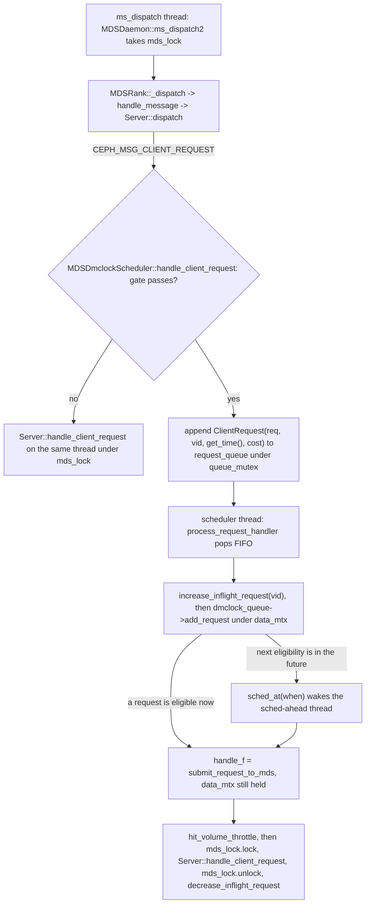
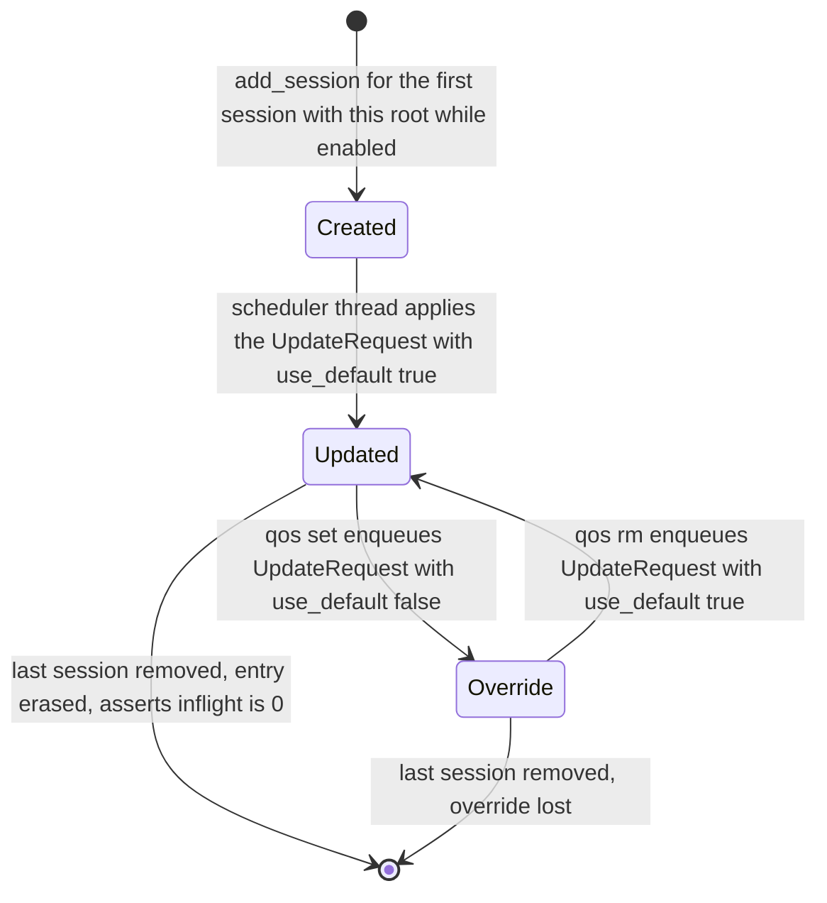
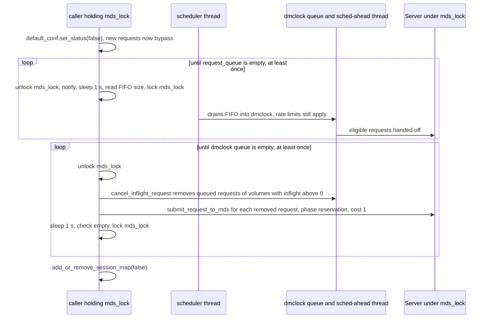

# dmClock QoS scheduler (`MDSDmclockScheduler`)

> Part of the C++ MDS project map ([README](../README.md)). Sources: `src/mds/MDSDmclockScheduler.h` (495 LOC), `src/mds/MDSDmclockScheduler.cc` (889 LOC), hooks in `src/mds/Server.cc`, `src/mds/MDSRank.cc`, `src/mds/MDSRank.h`, `src/mds/MDSDaemon.cc` (about 60 added lines), options in `src/common/options/mds.yaml.in:1850-1885`, the dmClock library `src/dmclock/src/dmclock_server.h` (1,806 LOC) plus `dmclock_util.h`, `dmclock_recs.h`, `support/src/run_every.{h,cc}`, user docs `doc/cephfs/mds-qos.rst`, intent commit `19b5342824f`.
> Related: [process and threading](../00-architecture/process-and-threading.md), [mds_lock analysis](../00-architecture/mds_lock-analysis.md), [request lifecycle](../03-request-path/request-lifecycle.md), [sessions](../02-client-protocol/sessions.md), [wire protocol](../02-client-protocol/wire-protocol.md), [auth and MDS caps](../01-cluster-integration/auth-and-mds-caps.md), [kclient expectations](../02-client-protocol/kclient-expectations.md), [libcephfs/FUSE/Ganesha expectations](../02-client-protocol/libcephfs-fuse-ganesha-expectations.md), [rank lifecycle](../09-recovery/rank-lifecycle-and-recovery.md), [rstats, quotas and subvolumes](../10-snapshots-quotas-subvolumes/rstats-quotas-and-subvolumes.md), [metrics and subvolume metrics](metrics-and-subvolume-metrics.md), [quiesce](quiesce.md), [quarantine](quarantine.md), [admin commands](../13-admin-and-config/admin-commands.md), [config, perf counters and health](../13-admin-and-config/config-perf-counters-and-health.md), [mgr, tools and orchestration](../01-cluster-integration/mgr-tools-and-orchestration.md).

Terminology on this page: the code calls a QoS bucket a **volume** (`VolumeId`, a `std::string`). It is really a path prefix derived from the client's mount root, normally a subvolume path such as `/volumes/_nogroup/build`. In dmClock terms the volume is the "client"; MDS clients (sessions) are only members of a volume.

## 1. Purpose and responsibilities

`MDSDmclockScheduler` is an optional admission stage for client metadata requests. It sits between message dispatch (`Server::dispatch`) and `Server::handle_client_request`. When it is enabled, it delays `CEPH_MSG_CLIENT_REQUEST` messages, grouped per volume, through a dmClock priority queue that has a per-volume reservation, weight and limit expressed in cost-weighted requests per second.

Responsibilities:
- Classify each client request into a volume from the session's mount root (`client_metadata["root"]`, truncated to 3 path components).
- Hold per-volume QoS state (`VolumeInfo`) in memory, created and destroyed as client sessions of that volume come and go.
- Run the dmClock push queue (`crimson::dmclock::PushPriorityQueue`) on dedicated threads, outside `mds_lock`, and hand eligible requests back to the normal request path under `mds_lock`.
- Expose admin commands (`dump qos`, `qos set|get|rm`) and four config options (`mds_dmclock_enable|reservation|weight|limit`).
- Enable on `up:active`, disable and drain on `up:stopping` or when the option is turned off.

Not in scope of this component, and not provided anywhere in the C++ MDS: QoS for capability, lease or session traffic, QoS for OSD data I/O (clients write file data straight to OSDs), persistence of QoS settings, cross-rank coordination, capacity-aware admission (busy/overload detection), rejection or back-pressure to clients, and QoS perf counters or health warnings.

History: all of the code arrived in one commit, `19b5342824f` "mds: add MDS dmClock scheduler for subvolume QoS support" (author date 2020-12-09, commit date 2026-07-09, 8 files, +1481/-3, subject line plus sign-offs only; `git show 19b5342824f --stat`). It was merged into main on 2026-07-20 by `0d256f80620` ("Merge PR #52147"), together with the QA facet (`59ea63c7e6e`), four `confval` lines in `doc/cephfs/mds-config-ref.rst` (`11555bcaadc`) and a `PendingReleaseNotes` entry (`12576043727`). The user guide `doc/cephfs/mds-qos.rst` came later (`7d7e01c624d`, `1a82225ba06`, 2026-08). Test coverage: the only reference in `qa/` and `src/test/` is the facet `qa/suites/fs/workload/tasks/5-dmclock/` (`yes.yaml` sets `mds dmclock enable: yes` with default values; `no.yaml` is empty). No unit test and no test of the `qos` commands exists (grep for `MDSDmclockScheduler`, `mds_dmclock`, `qos set`, `dump qos`).

At a glance:

| Question | Answer (C++ MDS at `5f7e383ae6d`) |
|---|---|
| What is throttled | Only `MClientRequest` (`CEPH_MSG_CLIENT_REQUEST`) messages whose original source is a client, while the rank is `up:active` and QoS is enabled. All op codes are throttled, including reads. |
| QoS entity | Volume = first 3 components of the session's `client_metadata["root"]` (a mount root of depth 3 or less is used as is). All sessions with the same value share one bucket. |
| Unit | Cost units per second. Cost is 1 for 11 read-type ops (the lookup variants, `GETATTR`, `READDIR`, `OPEN`, `LSSNAP`, `GETFILELOCK`) and 3 for everything else, including some reads such as `GETVXATTR` (`get_op_cost`). |
| Scope | Per MDS rank (daemon). Every rank has its own independent queue, settings and statistics. |
| Configuration | Defaults: `mds_dmclock_reservation`, `mds_dmclock_weight`, `mds_dmclock_limit` (float, 1000.0 each). Per-volume overrides: `ceph tell mds.<id> qos set <path> <res> <wgt> <lim>` (integers). |
| Storage | Memory only. Overrides are lost on restart or failover, and also when the volume's last session on that rank closes. |
| Threads | 3 extra threads per `MDSRank`, always started even when QoS is disabled: the scheduler thread, the dmClock sched-ahead thread and the dmClock cleaning thread. |
| `mds_lock` | Classification and enqueue run under `mds_lock` (dispatch thread). Tagging and scheduling run outside it. The hand-off re-acquires `mds_lock` on the QoS thread, while still holding the dmClock queue mutex. |
| Client-visible effect | Added latency only. No error codes, no new messages, no protocol fields. |
| Default | Disabled (`mds_dmclock_enable=false`). |

## 2. Source map

| File | Class / function | Lines | Role |
|---|---|---|---|
| `src/mds/MDSDmclockScheduler.h` | type aliases `MDSReqRef`, `Time=double`, `VolumeId=std::string`, `SessionId=std::string`, `Queue=PushPriorityQueue<VolumeId, ClientRequest>` | 39-57 | dmClock instantiation: volume string is the dmClock client id |
| same | `RequestType`, `Request`, `ClientRequest`, `UpdateRequest` | 59-125 | Work items carried by the internal FIFO `request_queue` |
| same | `QoSInfo` (derives `crimson::dmclock::ClientInfo`) | 127-169 | Setters store `x` and `1.0/x` (no zero guard) |
| same | `VolumeInfo` | 171-300 | Per-volume state: QoS triple, `use_default`, `updated`, `session_list`, `inflight_requests`, `throttle` (`DecayCounter`, 60 s half-life), latency average, `dump` |
| same | `mds_dmclock_conf` | 304-325 | Default QoS triple plus the `enabled` flag |
| same | `SchedulerState` | 327-332 | `INIT`, `RUNNING`, `FINISHING`, `SHUTDOWN` |
| same | `MDSDmclockScheduler` members and constructor | 336-462 | `SUBVOL_ROOT_DEPTH = 3` (348); default `can_handle_func` returns `true` (428-432); default `handle_request_func` = `submit_request_to_mds` (434-438); creates the queue and starts the scheduler thread (440-447); reads config (449-452) |
| same | `read_xattrs(const VolumeId)` | 392 | Declared only. No definition and no caller. There is no vxattr-based QoS configuration. |
| `src/mds/MDSDmclockScheduler.cc` | `convert_subvol_root`, `get_volume_id`, `get_session_id` | 42-67 | Classification |
| same | `enqueue_client_request`, `handle_client_request` | 69-95 | Admission gate (dispatch thread, under `mds_lock`) |
| same | `submit_request_to_mds` | 97-113 | Hand-off: `mds_lock`, then `Server::handle_client_request`, then unlock |
| same | `shutdown`, `~MDSDmclockScheduler` | 115-142 | Disable if enabled, stop and join the scheduler thread, delete the queue |
| same | `get_client_info` | 144-161 | dmClock `ClientInfoFunc`: returns `&default_conf` or `&VolumeInfo` |
| same | `dump` | 163-190 | `dump qos` output |
| same | volume-info helpers (`get_volume_info_ptr` ... `set_default_volume_info`) | 192-389 | Map access under `volume_info_lock` |
| same | `add_or_remove_session_map`, `add_session`, `remove_session` | 391-457 | Session to volume membership |
| same | `get_request_queue_size`, `enqueue_update_request` (x2) | 459-488 | FIFO access under `queue_mutex` |
| same | `process_request_handler`, `process_request`, `begin_schedule_thread` | 490-565 | Scheduler thread |
| same | `enable_qos_feature`, `cancel_inflight_request`, `disable_qos_feature`, `try_enable_qos_feature`, `try_disable_qos_feature` | 567-649 | Enable and drain |
| same | `handle_conf_change` | 651-688 | Option changes |
| same | `get_nodeid`, `set/get_mds_is_active`, `get_session_map`, `mds_lock`, `mds_unlock`, `get_state_str` | 690-743 | Helpers. `mds_lock()`/`mds_unlock()` lock or unlock `MDSRank::mds_lock` directly. |
| same | `get_op_cost` | 745-780 | Cost table |
| same | `_process_asok_qos_set`, `process_asok_qos_set`, `_process_asok_qos_rm`, `process_asok_qos_rm`, `process_asok_qos_get` | 782-889 | Admin command handlers |
| `src/mds/Server.cc` | `Server::dispatch` | 405 | Hook: every `CEPH_MSG_CLIENT_REQUEST` goes to `mds_dmclock_scheduler->handle_client_request` |
| same | `Server::_session_logged` | 964, 1025, 1039 | `add_session` on journaled open; `remove_session` on close and kill |
| same | `Server::finish_force_open_sessions` | 1128 | `add_session` for imported or force-opened sessions |
| same | `Server::handle_client_reconnect` | 1691 | `add_session` on an accepted reconnect (last message part) |
| same | `Server::handle_client_session` | 775-799 | Validates the claimed `root` metadata against MDS auth caps (decides which buckets a client can join) |
| `src/mds/MDSRank.cc` | `MDSRank::MDSRank` / `~MDSRank` | 535 / 564 | Construct and delete the scheduler |
| same | `MDSRank::active_start` | 2134-2135 | `set_mds_is_active(true)`, `try_enable_qos_feature()` |
| same | `MDSRank::stopping_start` | 2256-2257 | `try_disable_qos_feature()`, `set_mds_is_active(false)` |
| same | `MDSRankDispatcher::handle_asok_command` | 3124-3135 | `dump qos`, `qos set`, `qos rm`, `qos get`, each under `mds_lock` |
| same | `MDSRankDispatcher::get_tracked_keys` | 4168-4171 | Observes the four `mds_dmclock_*` keys |
| same | `MDSRankDispatcher::handle_conf_change` | 4293-4305 | Finisher lambda takes `mds_lock`, then calls `mds_dmclock_scheduler->handle_conf_change` |
| `src/mds/MDSRank.h` | `#include "MDSDmclockScheduler.h"`, member `mds_dmclock_scheduler` | 36, 445 | Public member pointer |
| `src/mds/MDSDaemon.cc` | `MDSDaemon::set_up_admin_socket` | 597-618 | Registers the four commands |
| `src/mds/CMakeLists.txt` | `mds_srcs`, `target_link_libraries(... dmclock::dmclock)` | 50, 58 | Build integration |
| `src/common/options/mds.yaml.in` | `mds_dmclock_enable`, `_reservation`, `_weight`, `_limit` | 1850-1885 | Options |
| `src/dmclock/src/dmclock_server.h` | `ClientInfo`, `RequestTag`, `PriorityQueueBase`, `PushPriorityQueue` | 96-133, 136-275, 286-1272, 1504-1803 | Algorithm and push-queue threads |
| `src/dmclock/src/dmclock_util.h` | `get_time()` | 39-53 | `CLOCK_REALTIME` seconds as `double` |
| `src/dmclock/src/dmclock_recs.h` | `Cost` (`uint32_t`), `PhaseType`, `ReqParams` | 26-73 | Library types |
| `src/dmclock/support/src/run_every.{h,cc}` | `RunEvery` | h:32-80, cc:61-94 | Cleaning-job thread |
| `doc/cephfs/mds-qos.rst`, `doc/cephfs/mds-config-ref.rst:74-81` | user docs | all | Stated semantics (see section 8 for differences from the code) |

## 3. How it works

### 3.1 End-to-end path



Key point: each `add_request` call runs `schedule_request()` once, so it dispatches at most one request, and that request is whichever one the dmClock heaps rank first. It is not necessarily the one just added (`src/dmclock/src/dmclock_server.h:1627-1648 (PushPriorityQueue::add_request)`). Any other due requests are dispatched by the sched-ahead thread (3.6).

### 3.2 Admission gate

`src/mds/Server.cc:404-406 (Server::dispatch)` sends every `CEPH_MSG_CLIENT_REQUEST` that survived the earlier reconnect, clientreplay and not-active handling (`Server.cc:339-397`) to `MDSDmclockScheduler::handle_client_request`. That function (`src/mds/MDSDmclockScheduler.cc:81-95`) enqueues the request only if all of the following hold. Otherwise it calls `mds->server->handle_client_request(mds_req)` directly, which is the unchanged path.

| # | Condition | Code | Request when the condition fails |
|---|---|---|---|
| 1 | `default_conf.is_enabled()` | `.cc:85` | bypass |
| 2 | `mds_req->get_orig_source().is_client()` | `.cc:86` | bypass. MDS-originated `MClientRequest`s skip QoS, for example the stray reintegration and stray migration renames sent MDS to MDS (`src/mds/StrayManager.cc:697-705 (reintegrate_stray), 729-737 (migrate_stray)`). |
| 3 | `mds->is_active()` (`state == STATE_ACTIVE`, `src/mds/MDSRank.h:233`) | `.cc:87` | bypass. Covers clientreplay and stopping: replayed and "queued for replay" requests are never throttled. |
| 4 | `check_volume_info_updated(vid)`: a `VolumeInfo` exists for the session's volume and its `updated` flag is set | `.cc:88`, `.cc:221-229` | bypass. Happens before the scheduler thread has processed the volume's first `UpdateRequest` (provided the uninitialized `updated` flag reads false, see section 4, invariant 3), and for sessions never added (see 3.10). |
| 5 | `check_volume_info_validity(vid)`: the effective triple (defaults if `use_default`, else the override) has reservation, weight and limit all `> 0.0` | `.cc:89`, `.cc:264-285` | bypass. Setting any default to `<= 0` (or `nan`) disables QoS for new requests of every volume that uses defaults. Requests already in the FIFO are tagged with the new value (section 8, item 11). |

The volume id is recomputed for each check (`get_volume_id(mds->get_session(mds_req))` is evaluated three times, `.cc:88-91`). `get_volume_id` asserts that the session is non-null (`.cc:55`). `Server::handle_client_request`, by contrast, tolerates a missing session and drops the request (`src/mds/Server.cc:2633-2647`). `MDSRank::get_session` returns the session attached to the connection's `priv` (`src/mds/MDSRank.cc:1417-1420`). Authenticated client connections normally carry a session object, possibly a closed bootstrap one. The priv is cleared only when a closed session's connection resets and is marked down (`src/mds/MDSDaemon.cc:1188-1194 (MDSDaemon::ms_handle_reset)`, `:1216-1222 (MDSDaemon::ms_handle_remote_reset)`). A request that still reaches the gate after that would trip the assertion. Whether such a delivery is possible after `mark_down` is (unverified).

Enqueue (`.cc:69-79 (enqueue_client_request)`): takes `queue_mutex`, appends `new ClientRequest(mds_req, volume_id, crimson::dmclock::get_time(), cost)` to the `std::deque request_queue`, releases the lock and calls `queue_cvar.notify_all()`. The arrival time is wall-clock (`CLOCK_REALTIME`, `src/dmclock/src/dmclock_util.h:39-53 (get_time)`). No `MDRequest` exists yet and nothing is registered with the op tracker.

What is never throttled, because it does not pass through this gate:

| Traffic | Where it is handled |
|---|---|
| `CEPH_MSG_CLIENT_CAPS`, `CEPH_MSG_CLIENT_CAPRELEASE`, `CEPH_MSG_CLIENT_LEASE` | `Locker::dispatch` (`src/mds/MDSRank.cc:1295-1299 (MDSRank::handle_message)`) |
| `CEPH_MSG_CLIENT_SESSION` (open, close, renewcaps, flushmsg_ack, flush_mdlog), `CEPH_MSG_CLIENT_RECONNECT`, `CEPH_MSG_CLIENT_RECLAIM` | `Server::dispatch` before the hook, or other switch arms (`src/mds/Server.cc:321-324, 401-403, 410-412`) |
| `CEPH_MSG_CLIENT_METRICS` | Separate messenger dispatcher (`src/mds/MetricsHandler.cc:46-62 (MetricsHandler::ms_dispatch2)`) |
| `MSG_MDS_PEER_REQUEST` and all MDS-to-MDS traffic | `Server::handle_peer_request`, `MDCache`, `Migrator`, ... |
| Internal ops (`CEPH_MDS_OP_ENQUEUE_SCRUB`, `FRAGMENTDIR`, `EXPORTDIR`, `QUIESCE_*`, `LOCK_PATH`, `QUARANTINE*`, ...) | Created with `MDCache::request_start_internal`, for example `src/mds/MDCache.cc:13338` (`ENQUEUE_SCRUB`), `:11949` (`FRAGMENTDIR`), `src/mds/Migrator.cc:997` (`EXPORTDIR`), `src/mds/MDSRankQuarantine.cc:52`. They are never sent as messages (see [request lifecycle](../03-request-path/request-lifecycle.md)). |
| Client requests that reach the gate while the rank is in `up:clientreplay` (replayed and "queued for replay" requests) or `up:stopping` (all requests) | Gate condition 3. Other requests received while the rank is not active, including new requests during `up:reconnect` or `up:clientreplay`, are parked with `wait_for_active` (`src/mds/Server.cc:385-397`) and pass through the gate, and can be throttled, once the rank is `up:active`. |
| File data I/O | Clients talk to OSDs directly |

### 3.3 Classification: session to volume id

```
get_volume_id(session)          (.cc:53-61)
  root = session->info.client_metadata["root"]
  if root missing or ""  -> return ""            (the "" bucket)
  return convert_subvol_root(root)

convert_subvol_root(v)          (.cc:42-51)
  p = filepath(v)               (a leading '/' is stripped, empty components are skipped when parsing)
  if p.depth() > 3 -> return "/" + p.prefixpath(3).get_path()
  else             -> return v  (unchanged string)
```

`filepath` parsing (`src/include/filepath.cc:44-58 (filepath::parse_bits)`, `:68-77 (set_path)`, `:79-84 (prefixpath)`) skips empty components. So `//a//b/c/d` maps to `/a/b/c`, but a path of depth 3 or less is returned byte for byte (`/a/b/c/` stays `/a/b/c/`).

| Session `root` value | Volume id |
|---|---|
| `/volumes/_nogroup/sv1/1c2b...` (v2 subvolume mount, layout per `src/pybind/mgr/volumes/fs/operations/versions/subvolume_v2.py:22`) | `/volumes/_nogroup/sv1` |
| `/volumes/grp/sv1/1c2b.../deep/dir` | `/volumes/grp/sv1` |
| `/volumes/_nogroup/sv1` (a mount of the subvolume directory itself, for example a legacy-mode subvolume; v1 and v2 subvolumes keep data in a `<uuid>` child, `src/pybind/mgr/volumes/fs/operations/versions/subvolume_v1.py:34-35`) | `/volumes/_nogroup/sv1` |
| `/volumes/grp` (group-level mount) | `/volumes/grp` |
| `/` (default kclient and ceph-fuse root, mgr libcephfs mounts, NFS-Ganesha with the nfs module's default `cmount_path`) | `/` |
| `/home/alice/projects/x` (no subvolume) | `/home/alice/projects` |
| key absent | `""` |

Facts about the source of `root`:
- kclient sends `{"root", fsopt->server_path ? : "/"}` in `CEPH_SESSION_REQUEST_OPEN` metadata (`linux/fs/ceph/mds_client.c:1651-1656 (create_session_full_msg)`). `server_path` is the device-string path including its leading `/`, canonicalized: duplicate slashes collapsed, trailing slash removed (`linux/fs/ceph/super.c:351-363 (ceph_parse_source)`, `:241-253 (canonicalize_path)`).
- libcephfs/ceph-fuse: `Client::populate_metadata(mount_root)` sets `metadata["root"] = mount_root` if non-empty (`src/client/Client.cc:2604-2607`). `mount()` passes `mount_root.empty() ? "/" : mount_root` (`Client.cc:7095`). The user's `client_metadata` option (`key=value,...`) is applied afterwards and can override `root` (`Client.cc:2612-2623`, option `src/common/options/mds-client.yaml.in:289`). `Client::start_reclaim` (to be called before mount, `src/test/libcephfs/reclaim.cc:205`) calls `populate_metadata("")` when metadata is empty, then opens a session to every in rank (`Client.cc:18884-18900`), so those sessions carry no `root`. Session-open metadata is sent only once (`Client::_open_mds_session`, `Client.cc:2656-2657`). `Client::mount` reuses already-open sessions, and the MDS never updates session metadata on reclaim (`src/mds/Server.cc:476-559`). As read, such a client therefore stays in the `""` bucket on every rank it opened during reclaim. Not reproduced. NFS-Ganesha avoids this at startup: FSAL_CEPH runs `ceph_start_reclaim`, `ceph_finish_reclaim` and then `ceph_set_uuid` before `ceph_mount` (`FSAL_CEPH/main.c:834-856`, `FSAL_CEPH/main.c:1357-1364`, nfs-ganesha V15.7), and `Client::set_uuid` closes all sessions (`src/client/Client.cc:18632-18642`), so the sessions it uses after mount are new and carry `root`. Its `node_takeover_reclaim` (`FSAL_CEPH/main.c:863-901`) runs a reclaim on already-mounted cmounts without `ceph_set_uuid`; the effect on buckets was not traced.
- The MDS validates a claimed `root` at session open: it must be non-empty, start with `/`, and satisfy `MDSAuthCaps::path_capable(root.substr(1))`. Otherwise the session is rejected with `CEPH_SESSION_REJECT` ("invalue root" or "non-allowable root") (`src/mds/Server.cc:775-799 (Server::handle_client_session)`, `src/mds/MDSAuthCaps.cc:248-257 (MDSAuthCaps::path_capable)`). So a path-restricted client (for example one authorized with `fs subvolume authorize`) can only join buckets inside its allowed path. An unrestricted client can claim any root, including another tenant's subvolume path. A missing `root` key is not checked.
- NFS-Ganesha: the mgr `nfs` module defaults `cmount_path` to `/` (`src/pybind/mgr/nfs/export.py:770`). FSAL_CEPH mounts at `cmount_path` when it is set and at the export path otherwise (`FSAL_CEPH/main.c:1201-1204`, `FSAL_CEPH/main.c:1364`, nfs-ganesha V15.7), so all exports sharing that mount are one QoS bucket, `/`, not one per subvolume.

The session id stored in `VolumeInfo::session_list` is `std::to_string(session->info.inst.name.num())`, the client global id (`.cc:63-67`). Classification happens per request, but always via the session: a client mounted at `/` that accesses `/volumes/x/y/...` is charged to `/`. The path the request operates on is never consulted. The MDS does have an authoritative inode-to-subvolume mapping, `CInode::get_subvolume_id()` (the inode of the enclosing subvolume snaprealm, `src/mds/CInode.cc:5597-5600`), which is used for subvolume metrics ([metrics and subvolume metrics](metrics-and-subvolume-metrics.md)). The QoS code does not use it.

### 3.4 Cost model

`get_op_cost(op)` (`src/mds/MDSDmclockScheduler.cc:745-780`), op values from `src/include/ceph_fs.h:398-450`:

| Cost | Ops |
|---|---|
| 1 | `CEPH_MDS_OP_LOOKUP` (0x100), `LOOKUPHASH`, `LOOKUPPARENT`, `LOOKUPINO`, `LOOKUPNAME`, `GETATTR`, `READDIR`, `OPEN`, `LOOKUPSNAP`, `LSSNAP`, `GETFILELOCK` |
| 3 (explicit) | `SETXATTR`, `SETATTR`, `RMXATTR`, `SETLAYOUT`, `SETDIRLAYOUT`, `MKNOD`, `LINK`, `UNLINK`, `RENAME`, `MKDIR`, `RMDIR`, `SYMLINK`, `CREATE`, `MKSNAP`, `RMSNAP`, `RENAMESNAP`, `SETFILELOCK` |
| 3 (`default:` arm) | every other op: the read-only `GETVXATTR` (0x106), `READDIR_SNAPDIFF` (0x1404) and `FILE_BLOCKDIFF` (0x1405), the mutating `SNAP_METADATA` (0x1406, snapshot metadata add/update/remove, `Server::handle_client_snap_md_op`), and the unused `DUMMY` (0x107) |

The cost does not depend on request size (for example a readdir's `max_entries`), on the outcome, or on how many dirfrags or ranks are involved. It is fixed when the request is enqueued. dmClock uses `Cost` (`uint32_t`, `src/dmclock/src/dmclock_recs.h:32`) as a multiplier of the per-request tag increment (3.6).

### 3.5 The scheduler thread

`begin_schedule_thread` starts a plain `std::thread` with no name of its own (`.cc:562-565`), running `process_request` (`.cc:547-560`): `while (state == SchedulerState::RUNNING) process_request_handler();`.

`process_request_handler` (`.cc:490-545`):
1. Lock `queue_mutex`. If the FIFO is empty, `queue_cvar.wait(lock)` once, with no predicate. A spurious wakeup just returns to the outer loop. An enqueue cannot be missed, because the push and the size check both happen under `queue_mutex`. The shutdown flag, however, is not checked under that mutex (3.13).
2. While the FIFO is non-empty: pop the front, unlock, process, relock.
   - `CLIENT_REQUEST`: `increase_inflight_request(vid)` (asserts the `VolumeInfo` exists, `.cc:296-303`), then `dmclock_queue->add_request(std::move(c_request), vid, {0, 0}, c_request->time, c_request->cost)` (`.cc:518-519`). `ReqParams{delta=0, rho=0}`: no distributed dmClock information is ever supplied.
   - `UPDATE_REQUEST`: `update_volume_info(vid, info, use_default)` writes into the `VolumeInfo` (no-op if it no longer exists), then `dmclock_queue->update_client_info(vid)` refreshes the queue's cached `ClientInfo*` for that volume, then `set_volume_info_updated(vid)`, then the optional `cb_func`. No current caller sets `cb_func`.
3. Return; the outer loop re-checks `state`.

Because `add_request` may synchronously dispatch a request, which blocks on `mds_lock`, the scheduler thread stalls whenever `mds_lock` is busy. While it is stalled it does not drain `request_queue`.

### 3.6 dmClock as instantiated by the MDS

Instantiation: `crimson::dmclock::PushPriorityQueue<VolumeId, ClientRequest>` with default template arguments `IsDelayed=false` (immediate tag calculation), `U1=false` (the `ClientInfo*` is cached per client record and refreshed only by `update_client_info`), and `B=2` (binary heaps) (`src/mds/MDSDmclockScheduler.h:57`, `src/dmclock/src/dmclock_server.h:1504-1505`). It is constructed through the convenience constructor (`MDSDmclockScheduler.h:440-442`, `dmclock_server.h:1565-1580`). That gives:

| Parameter | Value | Source |
|---|---|---|
| `AtLimit` | `Wait`: over-limit requests are delayed, never rejected and never allowed to exceed the limit | `dmclock_server.h:75-85, 1568` |
| `anticipation_timeout` | 0.0 | `:1569` |
| idle age / erase age / check period | 300 s / 600 s / 60 s (aggressive 5 s when 2000 clients are erased in one pass) | `:69-73` |
| `can_handle_f` | always `true` | `MDSDmclockScheduler.h:428-432` |
| `handle_f` | `submit_request_to_mds` | `MDSDmclockScheduler.h:434-438` |
| `client_info_f` | `get_client_info`: `&default_conf` if `use_default`, the `VolumeInfo` itself otherwise, `nullptr` if the volume is unknown | `MDSDmclockScheduler.cc:144-161` |

Tags (`dmclock_server.h:136-184 (RequestTag)`, `:247-260 (tag_calc)`), computed when the request is added (`:891-902 (initial_tag, ImmediateTagCalc)`), with `t` = the request's enqueue time and `c` = cost:
- reservation tag `R = max(t, R_prev + c / reservation)`
- proportion tag `P = max(t, P_prev + c / weight)` (compared with the per-client `prop_delta` added)
- limit tag `L = max(t, L_prev + c / limit)`
- In `ClientInfo::update` a zero value gives an inverse of 0 (`dmclock_server.h:112-119`), so `R`/`P` become `+inf` and `L` becomes `-inf` (unlimited). The MDS's `QoSInfo` setters compute `1.0/x` without that guard (`MDSDmclockScheduler.h:132-148`), so a zero gives an infinite inverse and therefore a `+inf` tag (for `L` too). The validity check (3.2, condition 5) keeps such triples out of the queue at gate time only. A default changed to 0 after a request passed the gate still reaches its tag (section 8, item 11).

Scheduling (`dmclock_server.h:1110-1181 (do_next_request)`) for each `schedule_request()` call (`:1741-1756`):
1. If the client with the smallest head `R` has `R <= now`: dispatch it, phase `reservation`.
2. Otherwise mark every head whose `L <= now` as ready (`:1131-1139`). If the ready client with the smallest `P + prop_delta` exists: dispatch it, phase `priority`, and subtract `cost/reservation` from that client's queued `R` tags and `prev_tag` (`:1083-1106 (reduce_reservation_tags)`).
3. Otherwise (no limit break with `AtLimit::Wait`) return "future" at `min(head R, head L)`, which calls `sched_at(when)` (`:1795-1802`).

Each volume's requests form one FIFO (`std::deque` in `ClientRec`, `:357-501`), so only the head of each volume competes. Requests from all sessions of a volume are dispatched in arrival order at the scheduler thread.

Idle handling (`:932-980`, `:1201-1251 (do_clean)`): a client record unused for 300 s is marked idle. When it becomes active again its `prop_delta` is set so its `P` tags compete with currently active clients. Records with no queued request and no activity for 600 s are erased, up to 2000 per pass. This runs on the `RunEvery` thread every 60 s (`src/dmclock/support/src/run_every.cc:83-94`).

Sched-ahead thread (`dmclock_server.h:1761-1792 (run_sched_ahead)`): when `sched_ahead_when` is non-zero it calls `sched_ahead_cv.wait_until(l, until, pred)` with `pred = finishing || sched_ahead_when > 0`. In that branch the predicate is already true, so `wait_until` returns immediately. The deadline itself is built by reinterpreting a `CLOCK_REALTIME` seconds value as a `steady_clock` time point (`:1774-1777`, `:302-303`). The thread then loops `schedule_request()` under `data_mtx` until it gets a "future" result, which calls `sched_at` again. As read, the thread re-polls continuously instead of sleeping until the next eligible time for as long as any request is waiting on a future tag. This is code reading; CPU cost was not measured.

`request_completed()` (`:1651-1660`) is never called by the MDS. There is no completion feedback.

### 3.7 Effective behaviour of this integration (analysis from code, not measured)

The following follows from 3.5 and 3.6.
- No capacity model: `can_handle_f` is always true, so any request whose `R` or `L` tag is due is dispatched immediately. dmClock's reservation and weight only order requests that are eligible at the same moment. They do not create a guaranteed share of MDS capacity.
- Synchronous one-at-a-time hand-off: dispatch runs inside dmClock with `data_mtx` held and blocks on `mds_lock`. At most one QoS hand-off is in progress at any time, and while it waits neither QoS thread can do anything else.
- Where the backlog forms: when `mds_lock` is the bottleneck, the scheduler thread is blocked inside `add_request` and the backlog builds up in the FIFO `request_queue`. That queue has no QoS ordering and no size bound. The dmClock heaps mostly hold requests that are over their limit.
- Limit semantics: for a backlogged volume the `L` tags are absolute (`L_n = t0 + (n-1)·c/limit`), so the volume's dispatch rate on one rank is capped near `limit` cost units/s. If `reservation > limit`, which is possible only through the global defaults because `qos set` rejects it, the reservation phase can dispatch above `limit`: the effective cap is about `max(reservation, limit)`.
- Changes are not retroactive: tags are computed at insertion (`IsDelayed=false`). After `qos set`, `qos rm` or a default change, already queued requests keep their old `L` tags, and new requests chain from `prev_tag`. A backlog created under a low limit therefore drains at the old pace even after the limit is raised.
- Scope of the gate: only the initial dispatch is gated. Once `Server::handle_client_request` returns (request registered, possibly parked on locks, journal or OSD I/O), the request is no longer counted. Lock waits, journaling and retries via `C_MDS_RetryRequest` are not charged again. Message-level retries via `C_MDS_RetryMessage` go through `MDSRank::retry_dispatch` and then `Server::dispatch` again (`src/mds/RetryMessage.h:22-28`, `src/mds/MDSRank.cc:1586-1591`), so they are queued and charged a second time. Examples: `mdcache->wait_for_open` at `Server.cc:2627`, and the forward race in `MDCache::request_start`, `src/mds/MDCache.cc:9823-9826`.
- Multi-rank: a client with sessions to N ranks is limited independently on each rank. A request redirected with `MClientRequestForward` (the MDS always makes the client resend, `src/mds/MDSRank.cc:1504-1527 (forward_message_mds)`) is charged on both ranks.

### 3.8 Hand-off to the request path

`submit_request_to_mds(vid, request, phase, cost)` (`src/mds/MDSDmclockScheduler.cc:97-113`):
1. `hit_volume_throttle(vid, request->time)` (under `volume_info_lock`, see 3.12).
2. `mds_lock()`, which is `mds->mds_lock.lock()` on the `ceph::fair_mutex` (FIFO ticket lock, `src/common/fair_mutex.h:24-51`).
3. `mds->server->handle_client_request(req)`, the normal path (`src/mds/Server.cc:2616`). It increments `l_mds_request` and `l_mdss_handle_client_request`, creates the `MDRequest` (`MDCache::request_start`), processes embedded cap releases and calls `dispatch_client_request`.
4. `mds_unlock()`, then `decrease_inflight_request(vid)`.

Compared with a normally dispatched message, the QoS path skips `MDSRank::_dispatch` bookkeeping for the second half: `inc/dec_dispatch_depth`, `heartbeat_reset()`, the laggy deferral into `waiting_for_nolaggy`, and the trailing `_advance_queues()` (`src/mds/MDSRank.cc:1037-1088`). Those checks ran once, when the message was first dispatched into the gate. Waiters queued by the request are still processed, because `queue_waiter` signals the progress thread (`src/mds/MDSRank.h:251-269`).

Op-tracking consequences:
- `MDCache::request_start` sets the op's `initiated` time to the message receive stamp (`src/mds/MDCache.cc:9837`). Time spent in the QoS queues therefore counts toward op age, slow-request complaints (`mds_op_complaint_time`, default 30 s) and historic durations once the op exists.
- While a request is still queued it appears in no `dump_ops_in_flight` / `ops` output and in no perf counter.
- The message's "dispatched" stamp is set by the messenger before the gate (`src/msg/Messenger.h:759 (ms_deliver_dispatch)`; the MDS has no fast-dispatch path) and copied into the op by `request_start` (`src/mds/MDCache.cc:9840`), so the QoS wait appears as a gap after the `dispatched` event.
- The messenger dispatch throttle (`ms_dispatch_throttle_bytes`, 100 MiB) is released when `ms_dispatch` returns (`src/msg/DispatchQueue.cc:203-204, 60-63`). Queued QoS requests are not bounded by it.

Replies: QoS does not touch the reply path. Early and safe replies, forwards and `MClientReply` encoding are unchanged ([request lifecycle](../03-request-path/request-lifecycle.md)).

### 3.9 QoS parameters: defaults, overrides, validity

Two sources:

| Source | Storage | Applies to | How it is set |
|---|---|---|---|
| Cluster defaults | `default_conf` (an `mds_dmclock_conf` member), loaded in the constructor (`MDSDmclockScheduler.h:449-452`) and refreshed in `handle_conf_change` (`.cc:667-681`) | volumes with `use_default == true` | `ceph config set mds mds_dmclock_{reservation,weight,limit} <float>`. Values come from the mon config DB or `ceph.conf`. |
| Per-volume override | the `VolumeInfo` triple, `use_default == false` | one volume on one rank | `ceph tell mds.<id> qos set <path> <res> <wgt> <lim>`, reverted with `qos rm <path>` |

Mechanics:
- `get_client_info` hands dmClock a pointer to `default_conf` itself or to the `VolumeInfo`. In-place changes to either object therefore affect future tag calculations without calling `update_client_info`. Defaults changed through config work this way: `handle_conf_change` mutates `default_conf` on the finisher thread while dmClock reads it under `data_mtx` only, which is a data race.
- `qos set` / `qos rm` only enqueue an `UpdateRequest` (`.cc:829`, `.cc:384-389`) and return success at once. The scheduler thread applies it later (3.5), so `qos get` immediately afterwards may still show old values.
- `qos set` validation (`.cc:782-832`): `path` must be present; `reservation`, `weight`, `limit` are `CephInt` and each must be at least 1; `reservation <= limit`; a `VolumeInfo` must already exist for exactly that string (`check_volume_info_existence`). A volume with no session on this rank, or a path spelled differently from the computed id, fails with "volume_info doesn't exist (<path>)". There is no check on weight relative to the others.
- `qos rm` (`.cc:842-860`): the volume must exist; enqueues `UpdateRequest(vid, {0,0,0}, use_default=true)`. The stored triple becomes 0 with infinite inverses, but it is ignored because `use_default` is true.
- Defaults are floats with no `min`/`max` in the option schema (`src/common/options/mds.yaml.in:1859-1885`). Values `<= 0` turn QoS off for default-using volumes (gate condition 5). Overrides are integers `>= 1`.

### 3.10 Volume-info lifecycle



Hooks that add or remove sessions:

| Event | Call | Code | Notes |
|---|---|---|---|
| Session open journaled (`ESession`) | `add_session` | `src/mds/Server.cc:964 (Server::_session_logged)` | Runs before the state becomes `OPEN` and before `CEPH_SESSION_OPEN` is sent |
| Sessions imported or force-opened (migration, rejoin, cross-MDS rename) | `add_session` | `Server.cc:1128 (Server::finish_force_open_sessions)` | |
| Reconnect accepted (last part of `MClientReconnect`) | `add_session` | `Server.cc:1691 (Server::handle_client_reconnect)` | Rank is in `up:reconnect`; effective only if `enabled` is already true (for example from config at construction) |
| QoS enabled while active | `add_or_remove_session_map(true)` adds every `STATE_OPEN` and `STATE_STALE` session | `.cc:391-416`, `.cc:567-579` | Idempotent (`std::set`) |
| Session close journaled | `remove_session` | `Server.cc:1025` | |
| Session kill journaled (evict, blocklist, reclaim) | `remove_session` | `Server.cc:1039` | |

`add_session` (`.cc:418-446`) returns early if QoS is disabled. It logs, but does not return, when `mds_is_active` is false. If no `VolumeInfo` exists it calls `create_volume_info(vid, {0,0,0}, true)`, which inserts a fresh `VolumeInfo` and enqueues an `UpdateRequest` (`.cc:322-338`). It then inserts the session id.

`remove_session` (`.cc:448-457`) returns early if QoS is disabled. Otherwise `delete_session_from_volume_info` (`.cc:350-368`) removes the id and, when the set becomes empty, asserts `inflight_requests == 0` and erases the entry. The dmClock client record is left to the 600 s cleaner ("the dmclock library supports only removal of idle clients in the background", `.cc:366`).

Consequences:
- An override exists only while at least one session with that root is open on that rank, and only since QoS was enabled. You cannot provision QoS for a subvolume before a client mounts it.
- The erase-time assertion aborts the MDS if the last session of a volume closes or is evicted while that volume still has requests inside the dmClock queue, which is typical for a client being throttled when it is evicted. Code reading; not reproduced.
- Sessions removed while QoS is disabled are not removed from `session_list` (early return). See 3.11 for how stale ids accumulate.

### 3.11 Enabling, disabling and rank-state changes

| Trigger | Thread and lock | Action |
|---|---|---|
| Construction (`MDSRank::MDSRank`, `src/mds/MDSRank.cc:535`) | ms_dispatch thread, `MDSDaemon::handle_mds_map` (`src/mds/MDSDaemon.cc:940`), under `mds_lock` | Creates the queue (2 dmClock threads) and the scheduler thread. `enabled = mds_dmclock_enable`. `mds_is_active` is left uninitialized (`MDSDmclockScheduler.h:342`, not in the init list). |
| `MDSRank::active_start` (`MDSRank.cc:2134-2135`) | ms_dispatch thread, inside `MDSRankDispatcher::handle_mds_map` (`MDSRank.cc:2440-2441`), under `mds_lock` | `set_mds_is_active(true)`. `try_enable_qos_feature()`: if the option is true, `enable_qos_feature()`. |
| `MDSRank::stopping_start` (`MDSRank.cc:2256-2257`) | ms_dispatch thread, inside `MDSRankDispatcher::handle_mds_map` (`MDSRank.cc:2456-2458`), under `mds_lock` | `try_disable_qos_feature()`: if the option is true, `disable_qos_feature()`. Then `set_mds_is_active(false)`. |
| Option change (`MDSRankDispatcher::handle_conf_change`, `MDSRank.cc:4293-4305`) | `mds-rank-fin` finisher, holding `mds_lock` | `MDSDmclockScheduler::handle_conf_change` (`.cc:651-688`): if `mds_dmclock_enable` changed and differs from `enabled`, enable or disable. Then reload each default if its key changed or QoS is enabled, and `ceph_assert` that the stored value equals the config value. |
| `~MDSRank` (from `~MDSDaemon`, which holds `mds_lock`, `src/mds/MDSDaemon.cc:121-125`; only on a clean shutdown) | holding `mds_lock` | Runs after `mdcache` and `server` have been deleted (`MDSRank.cc:555, 562, 564`). `shutdown()`: disable if enabled; set `FINISHING`; notify; join the scheduler thread; set `SHUTDOWN`. Then `delete dmclock_queue`, whose destructor stops the sched-ahead thread, and `RunEvery` joins the cleaner. |

`enable_qos_feature` (`.cc:567-579`) sets `enabled = true` first. Only if `mds_is_active` does it add all `OPEN`/`STALE` sessions. On a non-active rank the flag stays true and the sessions are added at `active_start`.

`disable_qos_feature` (`.cc:607-635`) requires the caller to hold `mds_lock`:



Facts about this sequence:
- It holds the calling thread for at least 2 s and releases `mds_lock` in between. The calling thread is the `mds-rank-fin` finisher for an option change, or the messenger dispatch thread for `stopping_start` (called from `MDSRankDispatcher::handle_mds_map`), in which case no message is dispatched to this daemon while it runs. Other threads can run MDS code meanwhile, in the middle of a `handle_mds_map` or finisher context whose caller assumes `mds_lock` is held throughout.
- `cancel_inflight_request` (`.cc:581-605`) holds `volume_info_lock` for its whole body. It then calls `handle_request_func`, which calls `submit_request_to_mds` and then `hit_volume_throttle`, and that locks `volume_info_lock` again. `volume_info_lock` is a non-recursive `std::mutex`. As written, this self-deadlocks (undefined behaviour) whenever a queued request was found, that is, whenever QoS is disabled while some volume is being held at its limit. The same function takes `volume_info_lock` and then `data_mtx` (`remove_by_client`), the reverse of the order the dmClock threads use. Code reading; not reproduced.
- `add_or_remove_session_map(false)` calls `remove_session`, which returns immediately because `enabled` is already false (`.cc:450-452`). Disabling therefore does not clear `volume_info_map`. Entries, overrides and session lists survive a disable/enable cycle, and the session lists go stale. Ids of sessions closed while disabled never leave, so those entries are never erased.
- `try_disable_qos_feature` tests the option value, not `enabled`.

### 3.12 Statistics

Per volume (`VolumeInfo`, `MDSDmclockScheduler.h:171-300`), updated in `hit_volume_throttle` (`.cc:231-262`) at hand-off time, under `volume_info_lock`:
- `latency` = `get_time() - arrival`. This is the time in the FIFO plus the dmClock queue. It excludes the `mds_lock` wait that follows and all MDS processing.
- `latency_avg`: running `sum/count`. When `count >= 1000` both are halved (`:200-209`). It reports 0 if empty.
- `throttle`: a `DecayCounter` with a 60 s half-life (`:185`, `src/common/DecayCounter.h:36-54`). It is incremented by 1 when `latency > 1/limit` and `inflight_requests > limit`, where `limit` is the effective limit. With the default limit of 1000, this needs more than 1000 requests of the volume inside the dmClock queue.
- `inflight_requests`: incremented when a request enters dmClock, decremented after its hand-off returns. It counts queued requests, not requests executing in the MDS.
- `session_cnt`, `session_list`.

Global: `total_inflight_requests` (sum of the above, written under `volume_info_lock` but read without it in `dump`), and `mds_dmclock_queue_size` = size of the FIFO `request_queue`, not of the dmClock queue.

### 3.13 Construction and shutdown details

- All three threads exist for every `MDSRank`, including standby-replay ranks and ranks where QoS is disabled (`MDSDmclockScheduler.h:440-447`, `dmclock_server.h:1560`, `run_every.h:54-59`).
- `state` (`SchedulerState`) is a plain enum read by the scheduler thread without synchronization (`.cc:556`). `shutdown` sets `FINISHING` under `queue_mutex` and notifies. If the notify lands between the thread's `state` check and its `wait`, the thread waits until another notify and `join` blocks (lost wake-up window, `.cc:492-496, 556-558`).
- `MDSRankDispatcher::shutdown` (`src/mds/MDSRank.cc:804`) does not stop the scheduler. Its threads keep running until `~MDSRank`, which deletes the scheduler after `mdcache` and `server` (`MDSRank.cc:555, 562, 564`). With `enabled` true, `shutdown()` drains first (which itself can hang, see 3.11), and any request it hands off calls `mds->server->handle_client_request` after `server` has been deleted and set to null. With `enabled` false, nothing should be queued, and requests left in the queues would be destroyed without being dispatched. Code reading; not reproduced.

## 4. Data structures and invariants

| Structure | Fields | Owner and lock |
|---|---|---|
| `ClientRequest` | `type=CLIENT_REQUEST`, `volume_id`, `mds_req_ref` (`cref_t<MClientRequest>`), `time` (wall-clock seconds), `cost` | FIFO under `queue_mutex`, then owned by dmClock (`data_mtx`) |
| `UpdateRequest` | `type=UPDATE_REQUEST`, `volume_id`, `client_info` (a copy), `use_default`, optional `cb_func` | FIFO |
| `VolumeInfo` | `reservation/weight/limit` and inverses, `use_default`, `updated`, `session_list` (`std::set<std::string>`), `inflight_requests`, `throttle`, `latency_sum`, `latency_cnt` | `volume_info_map` (`std::map<VolumeId, VolumeInfo>`) under `volume_info_lock`. Its address is also cached by dmClock as `ClientRec::info`. |
| `mds_dmclock_conf default_conf` | defaults triple, `enabled` | scheduler object. Written under `mds_lock` (constructor, `mds-rank-fin` finisher, or the ms_dispatch thread via `active_start`/`stopping_start`). Read from all threads without a common lock. |
| `request_queue` | `std::deque<std::unique_ptr<Request>>` | `queue_mutex`, `queue_cvar` |
| dmClock `client_map` | `std::map<VolumeId, shared_ptr<ClientRec>>`, each with `prev_tag`, a `deque<ClientReq>`, `prop_delta`, `idle`, `last_tick`, `info` | `data_mtx`. Three heaps: reservation, limit, ready. |
| `total_inflight_requests`, `mds_is_active`, `state` | counters and flags | mixed: see 3.12 and 3.13 |

Invariants intended by the code, and where they can break (all from code reading):
1. A request can be in dmClock only if its volume has a `VolumeInfo` (asserted in `increase/decrease_inflight_request`). Broken if the volume entry is erased between enqueue and processing; the result is an assertion failure in `increase_inflight_request`.
2. `VolumeInfo::inflight_requests` equals the number of that volume's requests inside dmClock plus the one being handed off. Erase requires 0 (`.cc:363`). See 3.10 for the eviction crash.
3. dmClock's cached `ClientRec::info` (`U1=false`) points at the volume's current effective `ClientInfo`. Only `update_client_info` refreshes it, and that runs when the scheduler thread applies an `UpdateRequest`. `VolumeInfo::updated` is not initialized by its constructor (`MDSDmclockScheduler.h:182-188`), so a fresh entry holds an indeterminate value until its first `UpdateRequest` is applied. If it reads true, the gate admits the volume's first requests early, but they still queue behind that `UpdateRequest` in the FIFO, because `create_volume_info` enqueues it while the gate is excluded by `mds_lock`. The invariant breaks when a request is still in the FIFO when its volume is erased (`inflight_requests` does not count FIFO entries) and the volume is re-created before the scheduler thread reaches the request. The request is then tagged through the stale dmClock record (less than 600 s old). If the erased volume had an override, that record's `info` points at the freed `VolumeInfo`. If an `UpdateRequest` for the volume was applied between the erase and the re-creation, `info` is null.
4. Per-volume FIFO: requests from one volume are handed off in FIFO order. It holds only among requests that went through the queue. Bypassed requests (gate conditions 1-5) and requests flushed by `cancel_inflight_request` are not ordered with respect to queued ones.
5. `default_conf.enabled == false` implies the FIFO and dmClock become empty. Guaranteed only after `disable_qos_feature` returns.

## 5. Interfaces

### 5.1 Messages

| Message | Direction | Handler | QoS effect |
|---|---|---|---|
| `MClientRequest` (`CEPH_MSG_CLIENT_REQUEST`) | client to MDS | `Server::dispatch` then `MDSDmclockScheduler::handle_client_request` | queued and delayed when gated (3.2) |
| `MClientRequestForward` | MDS to client | unchanged | a forwarded request is charged again at the new rank |
| `MClientReply` | MDS to client | unchanged | none |
| `MClientSession` `CEPH_SESSION_REQUEST_OPEN` metadata `root` | client to MDS | `Server::handle_client_session` | decides the bucket; validated against caps |
| any other | both | unchanged | not throttled |

No message type, field, feature bit or compat flag was added for QoS. `MClientRequest` carries no QoS fields, and the kclient and libcephfs carry no QoS logic (grep for `qos`, `dmclock`, `mclock` in `linux/fs/ceph`, `linux/net/ceph`, `linux/include/linux/ceph`, `src/client/Client.cc`, `src/messages/MClientRequest.h` finds nothing).

### 5.2 Journal events and RADOS objects

None. QoS state is never journaled, never written to RADOS, and not part of the MDSMap or FSMap.

### 5.3 Config options

| Option | Type | Level | Default | Flags | Observed by the MDS | Meaning in code |
|---|---|---|---|---|---|---|
| `mds_dmclock_enable` | bool | advanced | `false` | none (bools are runtime-updatable by default, `src/common/options.h:400-410`) | yes (`MDSRank.cc:4168`) | Global on/off. Effective only on `up:active` ranks. |
| `mds_dmclock_reservation` | float | advanced | `1000.0` | `runtime` | yes | Default reservation (cost units/s) for volumes without an override. The description "for each MDS client" is inaccurate: it is per volume. |
| `mds_dmclock_weight` | float | advanced | `1000.0` | `runtime` | yes | Default weight |
| `mds_dmclock_limit` | float | advanced | `1000.0` | `runtime` | yes | Default limit (cost units/s) |

The `log_dest:` key on `mds_dmclock_enable` (`mds.yaml.in:1854-1855`) is not a key consumed by `src/common/options/y2c.py` (it reads `desc`, `long_desc`, ...), so that text never reaches `ceph config help`. Note that enabling QoS with the defaults immediately caps every volume, including the shared `/` bucket, at about 1000 cost units/s per rank: about 333 creates/s or 1000 lookups/s.

The dmClock constants (300/600/60 s, erase max 2000, `AtLimit::Wait`) are compile-time and not configurable.

### 5.4 Admin commands

Registered in `src/mds/MDSDaemon.cc:597-618 (MDSDaemon::set_up_admin_socket)`. They are reachable as `ceph daemon mds.<id> ...` (asok) and `ceph tell mds.<id> ...`. `tell` requires a session whose MDS caps include an unrestricted `allow *` grant (`MDSAuthCaps::allow_all`, `src/mds/MDSAuthCaps.cc:585-594`, checked in `src/mds/MDSDaemon.cc:810-823 (MDSDaemon::handle_command)`). They run in `MDSRankDispatcher::handle_asok_command` under `mds_lock` (`src/mds/MDSRank.cc:3124-3135`). On a daemon without a rank they return `{"error": "mds_not_active"}` (`MDSDaemon.cc:228-230`).

| Command | Arguments | Behaviour | Output (shape) |
|---|---|---|---|
| `dump qos` | none | `MDSDmclockScheduler::dump` (`.cc:163-190`) | `qos_info{ qos_state{ qos_enabled, [if enabled: state, default_reservation, default_weight, default_limit, mds_dmclock_queue_size, inflight_requests] }, volume_infos[ { volume_id, use_default, [if !use_default: reservation, weight, limit], throttle, latency_avg, inflight_requests, session_cnt, session_list[...] } ] }`. Volumes are listed even when QoS is disabled. |
| `qos set` | `path` (CephString), `reservation`, `weight`, `limit` (CephInt) | validate (3.9), then enqueue an `UpdateRequest` with `use_default=false` | `results{ return_code: 1 }` on success, `0` on failure plus a status string ("malformed path", "malformed reservation", "malformed weight", "malformed limit", "reservation cannot be greater than limit", "volume_info doesn't exist (<path>)") |
| `qos rm` | `path` | existence check, then enqueue an `UpdateRequest` with `{0,0,0}` and `use_default=true` | `results{ return_code: 1 }` or `0` |
| `qos get` | `path` | copy and dump one `VolumeInfo` | `volume_qos_info{ ...same fields as one volume_infos entry... }`, or an empty result plus "volume_info doesn't exist (<path>)" |

Error reporting: the handler's integer return code `r` stays 0 in all four cases (`MDSRank.cc:2663`). Failure is visible only in `return_code` (1 means success, the reverse of errno convention) and in the status string. A wrong argument type throws `bad_cmd_get` and returns `-EINVAL` (`MDSDaemon.cc:235-237`).

No mgr module, cephadm, the volumes plugin (`fs subvolume ...`) or the dashboard calls these commands or sets the options (grep of `src/pybind`). `ceph fs status` does not show QoS (`doc/cephfs/mds-qos.rst:76-82`).

### 5.5 Perf counters, health, mgr metrics

None are defined by this component. Existing counters whose meaning shifts while QoS is enabled: `mds.request` (`l_mds_request`) and `mds_server.handle_client_request` (`l_mdss_handle_client_request`) count requests at hand-off, not on arrival (`src/mds/Server.cc:2620-2623`). Slow-request health (`MDS_SLOW_REQUEST`) includes queue time in op age once the op exists (3.8).

### 5.6 Related throttles that are not part of this scheduler

| Mechanism | Code | Relation |
|---|---|---|
| Readdir cap-acquisition throttle (`mds_session_cap_acquisition_throttle`, `mds_session_max_caps_throttle_ratio`, `mds_cap_acquisition_throttle_retry_request_timeout`) | `src/mds/Server.cc:5112-5119 (Server::handle_client_readdir)`, `:12274-12281 (Server::handle_client_readdir_snapdiff)` | Per-session, re-queues the readdir via a timer and `C_MDS_RetryRequest`. Independent of QoS. |
| Messenger dispatch throttle `ms_dispatch_throttle_bytes` | `src/msg/DispatchQueue.cc:60-63` | Global byte budget, released before QoS queueing |
| NFS-Ganesha QoS (`nfs cluster qos ...`, `nfs export qos ...`, `QOS_BLOCK`, bandwidth and IOPS per export or client) | `src/pybind/mgr/nfs/module.py:318-468`, `src/pybind/mgr/nfs/qos_conf.py:1-40` | Enforced in the Ganesha gateway, not in the MDS |
| SMB share QoS (`read/write_iops_limit`, `read/write_bw_limit`) | `src/pybind/mgr/smb/module.py:498-540, 696-730` | Enforced in the SMB gateway, not in the MDS |

## 6. Concurrency and mds_lock

### 6.1 Threads

| Thread | Created by | Takes `mds_lock`? | Work |
|---|---|---|---|
| `ms_dispatch` (messenger) | messenger | yes, held throughout except inside `disable_qos_feature` | Gate: classification, validity checks, FIFO append. Also `active_start` (enable) and `stopping_start` (disable with 1 s sleeps) from `handle_mds_map`. |
| scheduler thread (unnamed `std::thread`) | `MDSDmclockScheduler::begin_schedule_thread` (`.cc:562-565`) | yes, inside `submit_request_to_mds` | FIFO to dmClock; applies updates; synchronous hand-off |
| dmClock sched-ahead (`PushPriorityQueue::sched_ahead_thd`) | `dmclock_server.h:1560` | yes, inside `handle_f` | Dispatches requests whose tags became due (re-polls, 3.6) |
| dmClock cleaner (`RunEvery::thd`) | `run_every.h:54-59` | no | `do_clean` every 60 s under `data_mtx` |
| `mds-rank-fin` finisher | `MDSRank` | yes | `handle_conf_change`, including enable/disable with 1 s sleeps |
| `admin_socket` | admin socket | yes | `qos` commands |
| any thread calling `cancel_inflight_request` (via disable) | n/a | takes it inside `submit_request_to_mds` | flush |

### 6.2 Locks and observed order

| Lock | Type | Protects |
|---|---|---|
| `MDSRank::mds_lock` | `ceph::fair_mutex` (FIFO ticket lock) | everything in the MDS |
| `queue_mutex` + `queue_cvar` | `std::mutex`, `std::condition_variable` | `request_queue` |
| `volume_info_lock` | `std::mutex` | `volume_info_map`, `VolumeInfo` contents, `total_inflight_requests` |
| `data_mtx` | `std::mutex` in `PriorityQueueBase` (`dmclock_server.h:768-769`) | all dmClock client records and heaps, for all volumes |
| `sched_ahead_mtx` | `std::mutex` | `sched_ahead_when`, `finishing` |
| `RunEvery::mtx` | `std::mutex` | cleaner timing |

Acquisition orders that occur:
- `mds_lock` then `queue_mutex` (gate, admin commands)
- `mds_lock` then `volume_info_lock` (gate checks, session hooks, admin commands, `dump`)
- `volume_info_lock` then `queue_mutex` (`create_volume_info` enqueues while holding the map lock, `.cc:328-337`)
- `data_mtx` then `volume_info_lock` (`get_client_info` via `client_info_f` when a record is created or updated; `hit_volume_throttle` and `decrease_inflight_request` inside `handle_f`)
- `data_mtx` then `mds_lock` (`handle_f`, on the scheduler and sched-ahead threads)
- `data_mtx` then `sched_ahead_mtx` (`sched_at` inside `schedule_request`)
- `volume_info_lock` then `data_mtx`: only `cancel_inflight_request` (`.cc:584-596`). This inverts the `data_mtx` then `volume_info_lock` order and can deadlock with a dmClock thread that is inside `handle_f`.

No path holds `mds_lock` while waiting on `data_mtx`. `disable_qos_feature` drops `mds_lock` before touching the queue (`.cc:625-632`). So `data_mtx` then `mds_lock` does not deadlock with the dispatcher.

### 6.3 What runs under mds_lock

- Under `mds_lock`: the gate (classification, three `VolumeInfo` lookups, cost lookup, FIFO append), all session hooks, all admin commands, `handle_conf_change`, `enable_qos_feature`, the start and end of `disable_qos_feature`, and every hand-off (`Server::handle_client_request` and whatever it synchronously executes).
- Outside `mds_lock`: FIFO draining, tag computation, heap maintenance, update application, idle cleaning, the throttle and latency statistics, and the waits.

The QoS layer therefore adds parallelism only for its own bookkeeping. All request execution remains serialized by `mds_lock`, and the hand-off itself is one-at-a-time across all volumes.

### 6.4 Serialization points

| Point | Location | Shared state | True conflict scope | Inherent? |
|---|---|---|---|---|
| Hand-off takes `mds_lock` while holding `data_mtx` | `src/mds/MDSDmclockScheduler.cc:106 (submit_request_to_mds)` | whole MDS plus the whole QoS queue | the request's own inodes and dentries | no |
| One dmClock queue and `data_mtx` for all volumes | `src/dmclock/src/dmclock_server.h:768 (PriorityQueueBase::data_mtx)` | heaps over all volumes | per volume for limit and reservation tags; cross-volume only for proportional ordering | partly |
| Single scheduler thread and FIFO `request_queue` | `src/mds/MDSDmclockScheduler.cc:490 (process_request_handler)` | arrival order of all gated requests | per session (ordering) / per volume (QoS) | no |
| Global `volume_info_lock` | `src/mds/MDSDmclockScheduler.h:345` | all volume entries | per volume | no |
| Gate under `mds_lock` on the dispatch thread | `src/mds/Server.cc:405 (Server::dispatch)` | session metadata lookup | per session | no |
| Per-volume FIFO shared by all sessions of a volume | `dmclock_server.h:362 (ClientRec::requests)` | order among sessions of the same volume | per session (clients need only their own order) | no |
| Single sched-ahead dispatcher | `dmclock_server.h:1761 (run_sched_ahead)` | deferred releases of all volumes | per volume | no |
| `disable_qos_feature` sleep loops on the finisher or the ms_dispatch thread | `src/mds/MDSDmclockScheduler.cc:616-632` | finisher queue, or all message dispatch while `stopping_start` runs | global (feature toggle) | no |
| `qos` admin commands under `mds_lock` | `src/mds/MDSRank.cc:3124-3135` | volume map | per volume | no |

What could commute: gating, tagging and per-volume limit enforcement are independent per volume and per session. Only the proportional (weight) ordering across volumes needs shared state, and the per-session FIFO is the only ordering constraint clients can observe for requests.

### 6.5 Concurrency defects found by reading (not reproduced)

1. Self-deadlock in `cancel_inflight_request` when the dmClock queue is non-empty (3.11).
2. `volume_info_lock` / `data_mtx` order inversion between `cancel_inflight_request` and the dmClock threads (6.2).
3. In `cancel_inflight_request`, `handle_request_func(it->get_volume_id(), std::move(it), ...)` (`.cc:602`) reads through `it` in one argument and move-constructs a by-value `unique_ptr` parameter from it in another. The order of these is unspecified, so a null dereference is possible.
4. Unsynchronized shared fields: `default_conf` (values and `enabled`), `state`, `mds_is_active` (also uninitialized), and `total_inflight_requests` read in `dump`.
5. Sched-ahead re-polling instead of sleeping (3.6).
6. Lost wake-up window at shutdown (3.13).
7. `disable_qos_feature` drops and re-takes `mds_lock` inside callers that assume it is held throughout: `MDSRankDispatcher::handle_mds_map` (via `stopping_start`), the conf-change finisher context and `~MDSDaemon` (3.11).
8. Possible use-after-free or null `ClientRec::info` when a volume is erased and re-created while one of its requests is still in the FIFO (section 4, invariant 3).
9. Teardown order: the scheduler outlives `server` and `mdcache` in `~MDSRank` (3.13).

## 7. Externally visible contract

What peers observe or depend on. This is the complete list found in the tree.

| Peer | Item | Detail |
|---|---|---|
| kclient | Session metadata `root` | Sent on every session open: canonical mount path, `/` by default (`linux/fs/ceph/mds_client.c:1655`). The MDS uses it for classification. The kclient knows nothing about QoS. |
| kclient | Latency only | Throttled requests are delayed, never failed (`AtLimit::Wait`). Ordinary requests wait without timeout (`r_timeout == 0` gives `MAX_SCHEDULE_TIMEOUT`, `linux/include/linux/ceph/libceph.h:102-105`). The mount-time root `GETATTR` has `r_timeout = mount_timeout` (default 60 s, `linux/fs/ceph/super.c:1089`, `linux/include/linux/ceph/libceph.h:75`), so a long QoS backlog can make a mount fail with `-ETIMEDOUT` (`linux/fs/ceph/mds_client.c:3972-3980 (ceph_mdsc_wait_request)`). |
| kclient, libcephfs | Message ordering | Gated requests can be overtaken by later caps, cap-release, lease and session messages from the same connection, because those are handled immediately on the dispatch thread. Without QoS, the messages of a connection are handled in arrival order by the single dispatch thread (the MDS has no fast-dispatch path). Requests from one session keep their relative order only while all of them go through the queue. The C++ code does nothing to compensate. Whether any client behaviour depends on the lost ordering was not analysed (unverified). |
| libcephfs / ceph-fuse | Session metadata `root` | `metadata["root"] = mount_root` (`src/client/Client.cc:2604-2607`), overridable with `client_metadata=root=...` (`:2612-2623`). During mount, `Client::tick` aborts the first MDS request with `-ETIMEDOUT` after `client_mount_timeout` (default 5 min) (`Client.cc:7553-7566`). |
| NFS-Ganesha (via libcephfs) | Bucket granularity | The mgr nfs module's default `cmount_path` is `/` (`src/pybind/mgr/nfs/export.py:770`). Exports sharing one cephfs mount share one QoS bucket (see 3.3). FSAL_CEPH calls `ceph_set_uuid` after reclaim and before mount, which closes the root-less reclaim sessions, so its post-mount sessions carry `root` (code reading, see 3.3). |
| admin / operators | Commands | `dump qos`, `qos set <path> <reservation> <weight> <limit>`, `qos rm <path>`, `qos get <path>` via `ceph tell mds.<id>` or the asok. Formats and messages in 5.4. Documented in `doc/cephfs/mds-qos.rst`. |
| mon (config DB) | Options | `mds_dmclock_enable` (false), `mds_dmclock_reservation`, `mds_dmclock_weight`, `mds_dmclock_limit` (1000.0 each), set with `ceph config set mds ...` |
| mgr, cephadm, Rook, dashboard | none | No consumer in `src/pybind`. Rook not checked (unverified). |
| OSDs | none | QoS does not touch RADOS |
| QA | `qa/suites/fs/workload/tasks/5-dmclock/yes.yaml` | Enables QoS with defaults in the fs workload suite |

Nothing in the client protocol encodes QoS. The externally relevant semantics are therefore: (a) metadata request latency can be increased per bucket, with no error, and (b) the operator-facing names and outputs above.

## 8. Edge cases, failure handling and gotchas

Differences between the documentation and the code:
1. `doc/cephfs/mds-qos.rst` says "each CephFS subvolume receives its own QoS allocation". In the code the bucket is the first three components of the client-asserted mount root, per rank. Clients mounting `/` (including mgr libcephfs mounts and, by default, Ganesha) all share `/`. Clients with no `root` share `""`. A client mounted above its subvolume is charged to whatever prefix its mount has.
2. The docs list costs as read-like = 1 and mutating = 3. In the code everything outside the 11-op list costs 3, including `GETVXATTR` and the snapdiff and blockdiff reads.
3. The docs describe reservation as "the minimum request rate guaranteed". In this integration reservation and weight only reorder requests that are eligible together inside the dmClock queue. There is no capacity model (3.7).
4. The docs say overrides are not persisted across restart or failover. In addition: they are per rank, they cannot be set before a session with that root exists ("volume_info doesn't exist"), and they vanish when the volume's last session on that rank closes.

Failure and abort paths (code reading):

5. Evicting or closing the last session of a volume while its requests sit in dmClock hits `ceph_assert(vi->get_inflight_request()==0)` (`.cc:363`) and crashes the MDS.
6. If a volume entry is erased between a request's enqueue and the scheduler thread processing it, `increase_inflight_request` asserts (`.cc:300`). If the entry is re-created in that window, the request is instead tagged through a stale dmClock record (section 4, invariant 3).
7. Disabling QoS while any volume is throttled deadlocks the disabling thread in `cancel_inflight_request`. That thread is the `mds-rank-fin` finisher (option change) or the messenger dispatch thread (`stopping_start` inside `handle_mds_map`). The effect is a stuck finisher, or a daemon that no longer dispatches any incoming message (6.5).
8. A request whose connection has no session object trips `ceph_assert(session != nullptr)` in `get_volume_id` when QoS is enabled. Without QoS, `Server::handle_client_request` would drop it.
9. Setting a default to `nan` (accepted by `strict_strtod`, `src/common/strtol.cc:100-125`, via `Option::parse_value`, `src/common/options.cc:168-174`) makes the `ceph_assert(stored == config)` in `handle_conf_change` fail (`.cc:670, 675, 680`). The check runs when that key changes, even with QoS disabled, and for every tracked-option change while QoS is enabled.
10. A wall-clock step backwards makes `now` smaller than existing tags (all tags are `CLOCK_REALTIME`), so queued requests wait for the clock to catch up. A step forward releases them.
11. Setting a default to exactly `0` while requests sit in the FIFO: the gate checked the old value, but the scheduler thread tags them with the new one through the `default_conf` pointer. The `QoSInfo` setters store `1/0 = inf`, so the tag becomes `+inf`. A zero limit leaves the volume served only by its reservation. With reservation and weight both 0, the plain `assert(reservation < max_tag || proportion < max_tag)` in `RequestTag` (`dmclock_server.h:183`) aborts in builds without `NDEBUG`; otherwise the head can never become eligible and the volume's deque stalls behind it. Code reading.

Behavioural gotchas:

12. QoS is effective only in `up:active`. Requests replayed or queued for replay during `up:clientreplay`, and all requests during `up:stopping`, are never throttled. New requests that arrive while the rank is not yet active wait for `up:active` and are throttled then (3.2). `stopping_start` disables QoS before it starts exporting and evicting (`MDSRank.cc:2256`).
13. Bypass and queued requests interleave. For example, right after a volume entry is created its first requests bypass until the `UpdateRequest` is applied, and during the at-least-2-second disable window new requests bypass while old ones still drain. Per-volume FIFO order is not preserved across these boundaries.
14. Raising a limit does not speed up an existing backlog, because tags are fixed at insertion (3.7).
15. All sessions of a volume share one FIFO. One client of a subvolume can delay its neighbours in the same subvolume, with no per-client fairness inside a volume.
16. Queues are unbounded (`std::deque` FIFO and dmClock deques). Requests from a flooding client accumulate in MDS memory. Messenger dispatch throttling no longer applies once a request is queued.
17. Message-level retries (`C_MDS_RetryMessage`) re-enter the gate and pay the cost again. Request-level retries do not (3.7).
18. A disable/enable cycle keeps old `VolumeInfo` entries, overrides and stale session ids (3.11).
19. `qos set` path matching is exact string comparison against the computed id. `/volumes/_nogroup/sv1/` (libcephfs mount with a trailing slash and depth 3) is a different bucket from `/volumes/_nogroup/sv1`. The kclient canonicalizes. libcephfs does not, and ceph-fuse passes `client_mountpoint` (`-r`, default `/`) to `Client::mount` verbatim (`src/ceph_fuse.cc:313-318`).
20. With multiple active ranks every rank must be configured separately. A client with sessions on N ranks can consume up to N times the limit, and forwarded requests are charged on each rank that sees them.
21. Default values apply to every bucket, including `/`. Enabling QoS with defaults throttles the mgr volumes module (`self.fs.mount(filesystem_name=...)` without a root, `src/pybind/mgr/mgr_util.py:251`, which the binding turns into `/`, `src/pybind/cephfs/cephfs.pyx:835`), cephfs-mirror (`ceph_mount(cmi, NULL)`, `src/tools/cephfs_mirror/Utils.cc:138`), Ganesha (default `cmount_path=/`) and any root-mounted client collectively at about 1000 cost units/s per rank. An empty mount root becomes `/` in `Client::mount` (`src/libcephfs.cc:641-646`, `src/client/Client.cc:7095`).
22. Statistics measure scheduler queueing only (3.12). `inflight_requests` is not "in flight in the MDS", and `mds_dmclock_queue_size` is the FIFO size, not the dmClock queue size.
23. Admin command failures return exit status 0. Check `return_code` (1 = success).
24. Three threads are started per rank even when QoS is disabled, and the sched-ahead thread re-polls while requests wait on future tags (3.6).

Relation to per-subvolume SLA enforcement. This is a summary of the facts above.
- What it can do: cap the admission rate of one subvolume's metadata requests on one rank (approximately `limit` cost units/s, Wait semantics). Requires that clients mount the subvolume path, that the operator re-applies overrides after restarts and session churn, and that every rank is configured.
- What it cannot do: guarantee a reservation or latency, account for actual work (lock waits, journaling, multi-rank 2PC, cap recalls, OSD I/O), isolate execution (every admitted request of every subvolume still runs under the single `mds_lock`), throttle non-request traffic, persist or replicate settings, or push back on clients.
