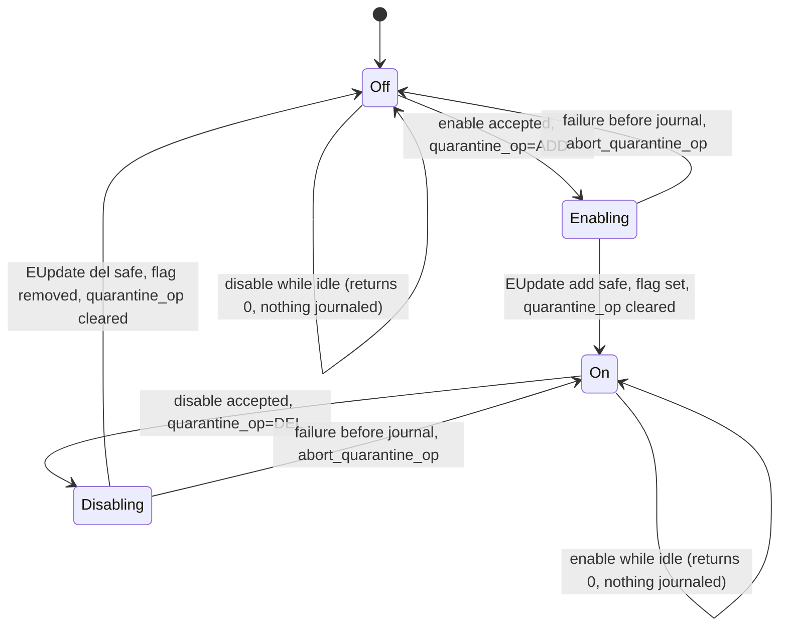
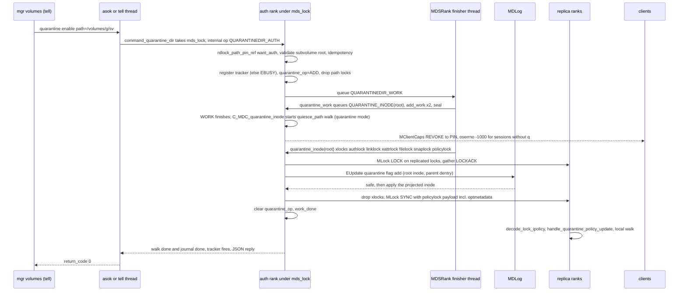
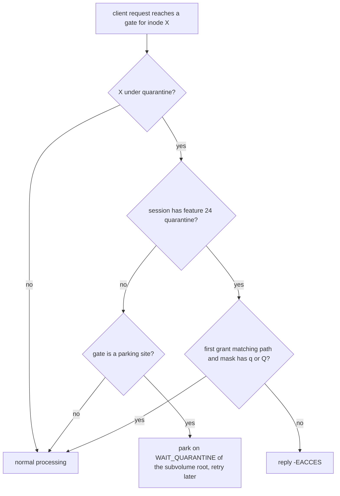

# Subvolume quarantine

> Part of the C++ MDS project map ([README](../README.md)). Sources (commit `5f7e383ae6d`): `src/mds/QuarantineManager.{h,cc}` (132 + 13 LOC), `src/mds/MDSRankQuarantine.cc` (128), quarantine code in `src/mds/MDCache.cc` (~480 of 15,324 LOC: 6499-6540, 14082-14161, 14391-14478, 14974-15324), `src/mds/Server.cc` (`check_access`, `check_quarantine_block`, `journal_quarantine_inode` and 8 call sites, ~120), `src/mds/CInode.{h,cc}` (~140), `src/mds/Locker.cc` (~60), `src/mds/MDSAuthCaps.{h,cc}` (~110), `src/mds/SessionMap.cc` (`Session::check_access`), `src/mds/Migrator.cc:957`, `src/include/cephfs/types.h` (`quarantine_md_t`, optmetadata, ~70), `src/messages/MQuarantineDisable.h` (59), `src/messages/MClientCaps.h` (`oserrno`), userspace client `src/client/{Client.cc,Inode.cc,Inode.h}` (~70), `src/pybind/mgr/volumes/{module.py,fs/volume.py}` (~80), `doc/cephfs/fs-volumes.rst:1415-1624`, `qa/tasks/cephfs/test_quarantine{,_kclient}.py`, `qa/tasks/quarantine_thrasher.py`; Linux client `linux/fs/ceph/{mds_client.c,mds_client.h,caps.c,file.c,super.c}` (Linux 7.3-rc6+ snapshot: `Makefile` 7.3.0-rc6, HEAD `af32da41b03`; `linux/...` line numbers drift in other versions). Intent: `git log --grep=quarantine` (44 commits including 5 merges, 39 non-merge, May-Oct 2026).
> Related: [quiesce](quiesce.md) (the cap-revocation walk reuses its machinery), [auth-and-mds-caps](../01-cluster-integration/auth-and-mds-caps.md) (`q`/`Q` grammar), [capabilities](../02-client-protocol/capabilities.md), [sessions](../02-client-protocol/sessions.md), [wire-protocol](../02-client-protocol/wire-protocol.md), [kclient-expectations](../02-client-protocol/kclient-expectations.md), [libcephfs-fuse-ganesha-expectations](../02-client-protocol/libcephfs-fuse-ganesha-expectations.md), [request-lifecycle](../03-request-path/request-lifecycle.md), [lookup-readdir-open-and-file-locks](../03-request-path/lookup-readdir-open-and-file-locks.md), [cinode-and-inode-types](../04-cache/cinode-and-inode-types.md), [lock-types-and-state-machines](../05-locking/lock-types-and-state-machines.md), [acquiring-locks](../05-locking/acquiring-locks.md), [events-and-replay](../06-journal/events-and-replay.md), [subtree-migration](../08-multi-mds/subtree-migration.md), [balancer-and-pinning](../08-multi-mds/balancer-and-pinning.md), [rank-lifecycle-and-recovery](../09-recovery/rank-lifecycle-and-recovery.md), [snapshots](../10-snapshots-quotas-subvolumes/snapshots.md), [rstats-quotas-and-subvolumes](../10-snapshots-quotas-subvolumes/rstats-quotas-and-subvolumes.md), [mgr-tools-and-orchestration](../01-cluster-integration/mgr-tools-and-orchestration.md), [admin-commands](../13-admin-and-config/admin-commands.md).

## 1. Purpose and responsibilities

Subvolume quarantine is an administrator-initiated, persistent block of client access to one CephFS **subvolume**, meant for incident response (for example ransomware): normal clients lose access to every file and directory of the subvolume (including its snapshots), while "recovery" clients whose MDS auth caps carry the `q` or `Q` flag keep full access (`doc/cephfs/fs-volumes.rst:1415-1433`, commits `ed71d1ee552`..`c7df3d1c62b`).

Scope, exactly as implemented:

| Aspect | C++ behavior |
|---|---|
| Unit | One **subvolume root**: a directory whose snaprealm is a subvolume realm, i.e. `realm->get_subvolume_ino() == in->ino()` (`ceph.dir.subvolume` set, `src/mds/MDCache.cc:15122-15141` (MDCache::quarantine_dir_auth)). Any other directory, a file, a subvolume group, or a v2 subvolume's data (`<uuid>`) directory is rejected with `-EINVAL`. (For legacy v1 subvolumes the `<uuid>` directory *is* the subvolume root; see 3.3 for what that means for the mgr wrapper.) Marking a subvolume inside another subvolume is refused (`src/mds/Server.cc:6599-6608` (Server::handle_client_setvxattr, ceph.dir.subvolume); the check looks only at ancestors), and `get_subvolume_ino()` returns the outermost subvolume, so the enclosing subvolume of any inode is unique. |
| What is covered | Every inode whose snaprealm chain reaches that subvolume root, including head and snapshotted inodes (`.snap` views), at any depth (`src/mds/CInode.cc:5918` (CInode::is_under_quarantine)). |
| Who is blocked | Every client session whose MDS auth caps lack `q`/`Q` for the inode's path. The mgr's own libcephfs client (caps `allow *`) is blocked too, since `*` never implies `q`/`Q` (`src/mds/MDSAuthCaps.h:68-73` (MDSCapSpec::MDSCapSpec)). |
| How blocking looks | Quarantine-aware sessions (feature bit 24 `CEPHFS_FEATURE_QUARANTINE`): requests fail with `-EACCES`. Unaware sessions (the Linux kernel client, older libcephfs/ceph-fuse/Ganesha): requests are parked inside the MDS until the quarantine is lifted (they hang). For both: all caps except `PIN` are revoked. |
| Persistence | A flag in the subvolume root's `inode_t::optmetadata` (kind `QUARANTINE = 2`), journaled with an ordinary `EUpdate`; survives restart and failover. No FSMap/MDSMap state, no RADOS object of its own, no config option, no perf counter. |

Responsibilities of the C++ code in this scope:

1. Admin interface: `quarantine enable|disable path=<abs path>` asok/tell commands; the mgr `volumes` module wraps them as `ceph fs subvolume quarantine enable|disable`.
2. Validate the target, serialize concurrent operations per subvolume (`-EBUSY`), make enable/disable idempotent.
3. Mark the subvolume root "being (un)quarantined" in memory so enforcement starts or stops immediately, then journal the flag change on the auth rank.
4. Revoke (or re-issue) client caps on the subvolume via a tree walk that reuses the quiesce machinery; send `MQuarantineDisable` to quarantine-aware clients on disable; wake parked requests.
5. Enforce on every request (`check_access` / `check_quarantine_block`) and on every cap issue (`get_caps_quarantine_mask`, `MClientCaps::oserrno`).
6. Propagate state to other ranks through ordinary `policylock` replication; refuse subtree exports rooted inside a quarantined subvolume.
7. Undo the in-memory mark when an operation fails.

## 2. Source map

| File | Class / function | Lines | Role |
|---|---|---|---|
| `src/mds/MDSDaemon.cc` | `MDSDaemon::set_up_admin_socket` | 568-577 | registers asok/tell commands `quarantine enable` / `quarantine disable` with `name=path,type=CephString,req=true` |
| `src/mds/MDSRank.cc` | `MDSRankDispatcher::handle_asok_command` | 3136-3141 | routes both commands to `command_quarantine_dir` with `QUARANTINE_ADD` / `QUARANTINE_DEL` |
| `src/mds/MDSRankQuarantine.cc` | `MDSRank::command_quarantine_dir` | 46-94 | creates the internal `CEPH_MDS_OP_QUARANTINEDIR_AUTH` request, the tracker and the JSON-reply callback |
| `src/mds/MDSRankQuarantine.cc` | `register_quarantine_mgr`, `unregister_quarantine_mgr`, `get_quarantine_mgr` | 96-127 | per-subvolume-root registry `qtine_ops` under `qtine_mutex` |
| `src/mds/QuarantineManager.h` | `QuarantineTracker` (`QtineMgrRef`) | 34-132 | completion accounting: `add_work`/`seal`/`work_done`/`complete`, `qtine_ino`, informational ref/stats |
| `src/mds/QuarantineManager.cc` | (empty TU) | 1-13 | only includes the header |
| `src/mds/MDCache.cc` | `MDCache::quarantine_dir_auth` | 15100-15187 | validates path/subvolume, idempotency, `-EBUSY`, sets `quarantine_op`, starts WORK |
| `src/mds/MDCache.cc` | `MDCache::start_quarantine_inode_work` | 15054-15067 | creates `CEPH_MDS_OP_QUARANTINEDIR_WORK`, dispatches it from the `MDSRank` finisher |
| `src/mds/MDCache.cc` | `MDCache::quarantine_work` | 15069-15098 | queues the root-inode op, adds the walk work item, seals the tracker |
| `src/mds/MDCache.cc` | `C_MDC_quarantine_inode::finish` | 14974-15020 | completion of WORK: starts the cap-revocation walk or fails the tracker |
| `src/mds/MDCache.cc` | `MDCache::start_revoke_caps_for_inode` | 15277-15324 | creates `CEPH_MDS_OP_QUARANTINE_INODE` for the root; on DEL its finisher sends `MQuarantineDisable` |
| `src/mds/MDCache.cc` | `MDCache::quarantine_inode` | 15189-15275 | xlocks the root's locks, projects `set_quarantine()`/`del_quarantine()`, journals |
| `src/mds/Server.cc` | `C_MDS_quarantine_inode_update_finish`, `Server::journal_quarantine_inode` | 5379-5416 | `EUpdate("quarantine flag add\|del")`, apply, clear `quarantine_op`, `work_done` |
| `src/mds/MDCache.cc` | `MDCache::start_quarantine_cap_revocation` | 6499-6524 | starts a `quiesce_path` walk in quarantine mode |
| `src/mds/MDCache.cc` | `MDCache::handle_quarantine_policy_update` | 6526-6540 | replica reaction to a replicated flag change |
| `src/mds/MDCache.cc` | `MDCache::dispatch_quiesce_inode` (quarantine branch) | 14082-14161 | per-inode eval/issue_caps, `MQuarantineDisable`, wake `WAIT_QUARANTINE`, recurse into auth dirfrags |
| `src/mds/MDCache.cc` | `MDCache::dispatch_quiesce_path` | 14391-14478 | requires `is_active()`; quarantine walks run on non-auth roots (14447) |
| `src/mds/MDCache.h` | `C_MDS_QuiescePath` (`quarantine`, `qtine_op`, `qtine_root_ino`) | 606-635 | walk finisher; `finish()` schedules cleanup for quarantine walks |
| `src/mds/MDCache.cc` | `QuiesceInodeState` | 164-172 | per-walk state shared by all walk ops, carries the quarantine fields |
| `src/mds/MDCache.cc` | `MDCache::schedule_quarantine_cleanup`, `MDCache::abort_quarantine_op` | 15022-15052 | kill finished walk op; undo in-memory state on failure |
| `src/mds/MDCache.cc` | `request_start_internal`, `dispatch_request`, `request_cleanup` | 9870-9890, 10049-10057, 10118 | quarantine ops are "continuous" and dispatched to the three handlers |
| `src/mds/CInode.h` | `WAIT_QUARANTINE`, `quarantine_op`, `is_being_quarantined`, `is_quarantine_being_removed`, `set/clear_being_quarantined` | 416, 687-705, 1297 | in-memory in-progress state and waiter bit |
| `src/mds/CInode.cc` | `CInode::is_under_quarantine`, `has_quarantined` | 5913-5944 | the enforcement predicate |
| `src/mds/CInode.cc` | `get_caps_quarantine_mask`, `get_caps_allowed_by_type`, `get_caps_careful`, `get_xlocker_mask`, `get_caps_allowed_for_client`, `try_drop_loner` | 3476-3816 | cap masks per session (`PIN` only without `q`/`Q`) |
| `src/mds/CInode.cc` | `encode_inodestat` | 4120-4141, 4195-4201 | QUARANTINE optmetadata in `InodeStat`; snapped-inode caps |
| `src/mds/CInode.cc` | `encode_lock_ipolicy`, `decode_lock_ipolicy` | 2250-2313 | policylock payload v4 includes `optmetadata`; replica hook |
| `src/mds/CInode.cc` | `pop_and_apply_projected_inode` | 513-520 | "for quarantine inode on replica"; no caller (dead code) |
| `src/mds/Locker.cc` | `issue_new_caps`, `get_allowed_caps`, `issue_caps` | 2470-2480, 2528-2575, 2578-2715 | per-session `q` check; `MClientCaps::set_errno(-EQUARANTINED)` at 2697-2704 |
| `src/mds/Server.cc` | `Server::check_access` | 3500-3520 | passes `check_quarantine_access` for aware sessions |
| `src/mds/Server.cc` | `Server::check_quarantine_block` | 3529-3556 | parks unaware sessions' requests on the subvolume root |
| `src/mds/Server.cc` | call sites in `rdlock_path_pin_ref`, `rdlock_path_xlock_dentry`, `rdlock_two_paths_xlock_destdn`, `handle_client_lookup_ino`, `lssnap`, `mksnap`, `rmsnap`, `renamesnap` | 3924, 4022, 4127-4128, 4465, 11485, 11608, 11797, 11934 | where parking happens |
| `src/mds/SessionMap.cc` | `Session::check_access` | 1109-1172 | path construction and `MDSAuthCaps::is_capable(..., check_quarantine_access)` |
| `src/mds/MDSAuthCaps.h` | `MDSCapSpec::Q`, `Q_PRIME`, `allow_qtine_access`, `allow_qtine_prime_access`, `MDSAuthCaps::quarantine_access_in_caps` | 53-56, 68-73, 104-111, 324-355 | cap flags and the "has quarantine access for path" predicate |
| `src/mds/MDSAuthCaps.cc` | grammar `capspec`; `MDSAuthCaps::is_capable`; `MDSCapSpec::to_string` | 121-137, 266-405, 548-562 | parsing `r[w][f][p][Q][q][s]`, enforcement, printing |
| `src/mds/Migrator.cc` | `Migrator::export_dir` | 957-959 | refuses to export a dirfrag whose inode is under quarantine |
| `src/mds/Mutation.h` | `MDRequestImpl::qtine_op`, `qtine_mgr`, `qtine_root_ino` | 499-508 | request fields |
| `src/mds/MDSRank.h` | `qtine_mutex`, `qtine_ops`, registry API, `command_quarantine_dir` | 406-409, 553, 694-695 | rank-level registry |
| `src/include/cephfs/types.h` | `quarantine_md_t`, `optmetadata_server_t`/`_client_t` (`QUARANTINE`), `inode_t::has_quarantined/set_quarantine/del_quarantine`, `QUARANTINE_NONE/ADD/DEL` | 489-558, 915-929, 1335-1339 | persisted/wire metadata and op codes |
| `src/include/cephfs/dump.h` | `quarantine_md_t::dump` | 117-121 | `enabled`, `quarantined_at` |
| `src/include/ceph_fs.h` | `CEPH_MSG_CLIENT_QUARANTINE_DISABLE`, `CEPH_MDS_OP_QUARANTINEDIR_AUTH/QUARANTINE_INODE/QUARANTINEDIR_WORK` | 169, 448-450 | message type 0x315, internal op codes |
| `src/include/rados.h` | `EQUARANTINED` | 515 | 1000 |
| `src/mds/cephfs_features.{h,cc}` | `CEPHFS_FEATURE_QUARANTINE`, name `"quarantine"` | h:55, h:81, cc:39 | feature bit 24 |
| `src/messages/MQuarantineDisable.h` | `MQuarantineDisable` | 22-57 | MDS to client notification |
| `src/messages/MClientCaps.h` | `oserrno`, `set_errno`, decode v14 | 82, 154, 311-313, 385 | errno trailer on cap messages |
| `src/client/Client.cc`, `Inode.cc` | `handle_quarantine_disable`, `handle_cap_grant` hunks, readdir hunks, `Inode::is_under_quarantine` | Client.cc:3289, 5718-5731, 6226-6241, 6294-6297, 10039, 10298; Inode.cc:913-924 | how the C++ client consumes the signals |
| `src/pybind/mgr/volumes/fs/volume.py` | `quarantine_subvolume`, `_send_quarantine_command`, `subvolume_info` | 810-858, 504-536 | mgr wrapper, rank selection, `"quarantine"` key in info |
| `src/pybind/mgr/volumes/module.py` | `fs subvolume quarantine enable\|disable` | 336-351, 994-1006 | CLI definitions (`perm: rw`) |

## 3. How it works

### 3.1 The three layers of state

| Layer | Where | Set by | Cleared by | Survives restart |
|---|---|---|---|---|
| Persisted flag | subvolume root `inode_t::optmetadata`, entry kind `QUARANTINE` with `quarantine_md_t{enabled=true, quarantined_at}`; `has_quarantined()` = entry present and `enabled` (`src/include/cephfs/types.h:915-920` (inode_t::has_quarantined)) | `MDCache::quarantine_inode` projection, applied when the `EUpdate` is safe | same, with `del_quarantine()` (entry removed, not `enabled=false`) | yes (journal, then dirfrag omap) |
| In-progress mark | `CInode::quarantine_op` on the **auth** rank's subvolume root, values `QUARANTINE_NONE=0`, `QUARANTINE_ADD=1`, `QUARANTINE_DEL=2` (`src/mds/CInode.h:1297`, `src/include/cephfs/types.h:1335-1339`) | `quarantine_dir_auth` after validation (`src/mds/MDCache.cc:15175`) | journal finisher (`src/mds/Server.cc:5392-5394`) or `abort_quarantine_op` | no |
| Operation registry | `MDSRank::qtine_ops: unordered_map<inodeno_t, shared_ptr<QuarantineTracker>>` guarded by `std::mutex qtine_mutex` (`src/mds/MDSRank.h:694-695`) | `register_quarantine_mgr` | tracker callback (`unregister_quarantine_mgr`) | no |

Replica ranks never set `quarantine_op`; they only see the persisted flag once it is replicated (section 3.9).

### 3.2 The enforcement predicate `CInode::is_under_quarantine()`

`src/mds/CInode.cc:5918-5943`: starting at `find_snaprealm()`, for each realm up the parent chain:

1. `subvol_ino = realm->get_subvolume_ino()` (the outermost enclosing subvolume; parents are consulted first, `src/mds/SnapRealm.cc:150-154` (SnapRealm::check_cache)).
2. If that inode is cached: `is_quarantine_being_removed()` (op DEL in flight) returns **false**; `is_being_quarantined()` (op ADD in flight) or `has_quarantined()` returns **true**.
3. If `subvol_ino != 0` but the inode is not cached: return **false** (fail-open; changed from fail-closed by commit `630bf842c11` because it hid unrelated subvolumes from `subvolume ls`; commit `9a2d856f7c5` only made the `return false` explicit).
4. Otherwise continue with `realm->parent`; at the root realm return false.

Truth table for the subvolume root S (cached):

| Persisted flag on S | `S.quarantine_op` | `is_under_quarantine()` for inodes in S |
|---|---|---|
| absent | NONE | false |
| absent | ADD (enable in flight) | **true** (enforcement starts before journaling) |
| present | NONE | true |
| present | DEL (disable in flight) | **false** (enforcement stops before journaling) |
| present | ADD | true (cannot normally happen: idempotency check) |
| absent | DEL | false |

The predicate is evaluated on hot paths (every `check_access`, every `Locker::issue_caps`, every `encode_inodestat`, loner changes); each evaluation walks the realm chain, and callers that also need the per-session `q` status first build the inode's full path string (`make_path_string(path, true)`, e.g. `src/mds/Locker.cc:2599` (Locker::issue_caps), `src/mds/CInode.cc:3805` (CInode::get_caps_allowed_for_client)), whether or not any subvolume is quarantined.

### 3.3 Admin entry points

**MDS asok/tell commands** (`src/mds/MDSDaemon.cc:568-577`):

```
quarantine enable  path=<absolute path of the subvolume root>
quarantine disable path=<absolute path of the subvolume root>
```

Reachable through the local admin socket (`ceph daemon mds.<id> quarantine enable /volumes/_nogroup/sv`) or `ceph tell mds.<id> ...`; tell commands require a session whose MDS caps include a match-all `allow *` grant (`src/mds/MDSDaemon.cc:810-816` (MDSDaemon::handle_command), `src/mds/MDSAuthCaps.cc:585` (MDSAuthCaps::allow_all)). If the daemon holds no rank the command returns `-ENOSYS` with `"error": "mds_not_active"` (`src/mds/MDSDaemon.cc:161`, `228-231` (MDSDaemon::asok_command)); no other daemon-state check exists before `command_quarantine_dir`. A daemon that holds a rank but is not active (replay, standby-replay, rejoin) therefore also starts the operation; if it reached `journal_quarantine_inode` there, `MDLog::_submit_entry` asserts `!is_any_replay()` (`src/mds/MDLog.cc:398`) (inferred; untested).

**Reply.** The command completes only when the whole operation is done (journal + local walk, section 3.5). `on_finish(r, "", bl)` with `bl` = pretty JSON (`src/mds/MDSRankQuarantine.cc:75-91`):

```json
{ "return_code": 0, "operation": "enable", "status": "successful" }
{ "return_code": -16, "operation": "disable", "status": "failed", "error": "(16) Device or resource busy" }
```

`operation` is `"enable"` for ADD, `"disable"` for DEL. The command's return value is `r`.

| `r` | Cause | Code |
|---|---|---|
| 0 | done; or already in the requested state and no op in flight (no journal entry written) | `src/mds/MDCache.cc:15147-15158` |
| `-EINVAL` | path resolves to an inode without snaprealm, or not a subvolume root | `src/mds/MDCache.cc:15127-15141` |
| `-EBUSY` | another enable/disable for the same subvolume root is registered and not complete | `src/mds/MDCache.cc:15162-15167`, `src/mds/MDSRankQuarantine.cc:96-111` |
| `-ENOENT` | path does not exist; root inode or tracker vanished during the op | `src/mds/Server.cc:3905-3918` (Server::rdlock_path_pin_ref), `src/mds/MDCache.cc:15074-15086`, `15193-15204` |
| `-EXDEV` | this rank is not auth for the root (or a path component is missing from a non-auth dirfrag this rank has cached; a dirfrag that is not cached at all is discovered instead, `src/mds/MDCache.cc:8572-8584`): `path_traverse` with `MDS_TRAVERSE_WANT_AUTH` and without `DISCOVER` calls `request_forward`, which for internal ops completes `internal_op_finish(-EXDEV)` | `src/mds/MDCache.cc:8844-8855`, `8869-8873` (MDCache::path_traverse), `8893-8905` (MDCache::maybe_request_forward_to_auth), `9984-9986` (MDCache::request_forward) |
| `-ECANCELED` | an op of the chain was killed before its finisher ran (e.g. `op kill`) and that finisher propagates `r` (the AUTH and WORK finishers do; the QUARANTINE_INODE and walk finishers do not) | `src/mds/MDCache.cc:10204-10208` (MDCache::request_kill) |

A relative or empty path is parsed by `filepath` with base ino 0 (`src/include/filepath.cc:68-77` (filepath::set_path)), which is never cached, so `path_traverse` returns `-ESTALE`; `rdlock_path_pin_ref` then tries recovery (`find_ino_peers(0)` on the other active ranks, then `open_ino(0)`, which reads a backtrace from the default data pool) and maps a final `-ENOENT`/`-ENODATA` to `-ESTALE` (`src/mds/Server.cc:3911-3914`, `3814-3831` (Server::_try_open_ino), `3841-3862` (C_MDS_TryFindInode)). The expected reply is therefore `-ESTALE` after a RADOS round trip (end result unverified at runtime).

**mgr volumes wrapper** (`src/pybind/mgr/volumes/fs/volume.py:810-858`): `ceph fs subvolume quarantine enable|disable <vol> <sub> [--group_name <g>]` (`perm: rw`, `module.py:336-351`). The mgr does **not** open the subvolume (its own client would be blocked); it builds `path = "{base_dir}/{group or _nogroup}/{sub}"` (`/volumes/<group>/<sub>`). That is the directory carrying `ceph.dir.subvolume` only for v2 subvolumes (`src/pybind/mgr/volumes/fs/operations/versions/subvolume_v2.py:95-100`); legacy v1 subvolumes mark the `<uuid>` child (`subvolume_v1.py:65-70`), so for them the MDS answers `-EINVAL` and the mgr command cannot quarantine them (inferred from code; the QA suites create v2 subvolumes). It then picks the **first** entry of `sorted(mds_map['up'].items())` (string sort of `mds_<rank>` keys) whose state is `up:active` or `up:clientreplay`, and returns `self.mgr.tell_command("mds", gid, {"prefix": cmd, "path": path})` verbatim. A nonexistent subvolume surfaces as the MDS `-ENOENT`. The comment claiming the MDS forwards to the auth rank is not what the code does: a non-auth rank answers `-EXDEV` (previous row).

`subvolume info` reports quarantine by inference: success adds `"quarantine": "disabled"`; any `-EACCES` from the mgr's libcephfs returns success with only `{"name", "group", "quarantine": "enabled"}` (`src/pybind/mgr/volumes/fs/volume.py:504-536`).

### 3.4 Enable / disable state machine (auth rank)



In `Enabling` the subvolume is already enforced; in `Disabling` it is already released (table in 3.2). Any enable/disable while `Enabling`/`Disabling` returns `-EBUSY`.

### 3.5 Step-by-step flow on the auth rank



Detailed steps (all under `mds_lock`):

1. **`command_quarantine_dir`** (`src/mds/MDSRankQuarantine.cc:46-94`): takes `mds_lock` first (commit `491c4f19ba5` fixed a race on `active_requests`), `request_start_internal(CEPH_MDS_OP_QUARANTINEDIR_AUTH)`, `no_early_reply=true`, `filepath(path)`, `qtine_op`, new `QuarantineTracker`. `internal_op_finish` = lambda that calls `tracker->complete(r)` only if `r < 0` (covers forwarding/cancel). The tracker callback: if `qtine_ino != 0` then `unregister_quarantine_mgr(ino)` and, if `r < 0`, `abort_quarantine_op(ino, op)`; then the JSON reply. `dispatch_request(mdr)`.
2. **`quarantine_dir_auth`** (`src/mds/MDCache.cc:15100-15187`): `rdlock_path_pin_ref(mdr, path, want_auth=true, no_want_auth=false)` (rdlocks the path dentries and the base inode's (`/`) snaplock, auth-pins the target); a null return means retry later or already replied. Asserts `in->is_auth()`. Validates snaprealm and `get_subvolume_ino()==in->ino()` (`-EINVAL`). Idempotency only when `quarantine_op == NONE`. `register_quarantine_mgr(ino, tracker)` (`-EBUSY` if a non-complete tracker exists; a complete one is replaced). `set_qtine_ino(ino)`, `set_being_quarantined(op)`, `drop_locks`, `start_quarantine_inode_work`, `respond_to_request(mdr, 0)` (the AUTH op ends; the asok reply waits for the tracker).
3. **`start_quarantine_inode_work`** (`:15054-15067`): `CEPH_MDS_OP_QUARANTINEDIR_WORK`, `internal_op_finish = C_MDC_quarantine_inode`, `tracker->get()`, then `mds->finisher->queue(lambda{ lock mds_lock; dispatch_request })` (deferred to the `mds-rank-fin` thread to avoid re-entrancy).
4. **`quarantine_work`** (`:15069-15098`): looks up tracker and root (each `-ENOENT` if gone), `start_revoke_caps_for_inode(root)` (creates `CEPH_MDS_OP_QUARANTINE_INODE` for the root, `add_work()` = work item 1, queued via the finisher; skipped for a `.meta` file directly under the root, which never applies to the root itself), then `add_work()` = work item 2 (the walk), `seal()`, `respond_to_request(mdr, 0)`.
5. **`C_MDC_quarantine_inode::finish(0)`** (`:14989-15019`): runs synchronously inside step 4's reply. If the root is cached it calls `start_quarantine_cap_revocation(root, op, lambda{work_done; put})`, i.e. the walk starts **before** the flag is journaled (and before `QUARANTINE_INODE`, which is still queued on the finisher); on `r != 0` it calls `tracker->complete(r)`. If the root were not cached, nothing would complete work item 2; this cannot happen in practice because step 4 found the root in the same `mds_lock` hold.
6. **`quarantine_inode(root)`** (`:15189-15275`), dispatched from the finisher: `mdr->pin(in)`; on the auth it xlocks `authlock`, `linklock`, `xattrlock`, `filelock` and, because the root is a subvolume realm, `snaplock` and `policylock`, with `skip_quiesce=true` (`Locker::acquire_locks(..., nullptr, false, true)`, no `quiescelock` wrlock). Projects the inode: ADD `set_quarantine()` with `enabled=true` and `set_timestamp(ceph_clock_now())`; DEL `del_quarantine()`; then `change_attr++`, `ctime=now`, `rstat.rctime=max(rctime, ctime)`, `version=pre_dirty()`, and `Server::journal_quarantine_inode`.
7. **`journal_quarantine_inode`** (`src/mds/Server.cc:5403-5416`): `EUpdate(mdlog, "quarantine flag add"|"quarantine flag del")`, `predirty_journal_parents(mdr, &metablob, root, 0, PREDIRTY_PRIMARY)`, `journal_dirty_inode`, `journal_and_reply` (internal op: no early reply, `committing=true`, `mdlog->flush()`, `src/mds/Server.cc:2124-2156`).
8. **`C_MDS_quarantine_inode_update_finish::finish`** (`src/mds/Server.cc:5386-5400`): base `C_MDS_inode_update_finish::finish` does `mdr->apply()`, `balancer->hit_inode(META_POP_IWR)`, `respond_to_request(mdr, 0)`; for an internal op that means `request_finish` first (drops the xlocks, which re-evaluates the root's locks, re-issues its caps under the new state and sends `LOCK_AC_SYNC` with the new policylock payload to replicas), then the QUARANTINE_INODE finisher (on DEL: `MQuarantineDisable` to every quarantine-aware client holding a cap on the root, `src/mds/MDCache.cc:15291-15303`). Afterwards `root->clear_being_quarantined()`, `work_done()` (work item 1), `put()`.
9. **Walk completion** (section 3.6) calls `work_done()` for item 2. When the tracker is sealed and `pending == 0`, its callback runs (`src/mds/QuarantineManager.h:50-62` (QuarantineTracker::work_done)): unregister, JSON reply.

`QuarantineTracker` semantics (`src/mds/QuarantineManager.h:34-130`): `add_work()` asserts not sealed and increments `pending`; `seal()` is idempotent and fires the callback if `pending == 0`; `work_done()` fires it when sealed and `pending` reaches 0 (always with `r = 0`); `complete(r)` fires the callback immediately with `r` regardless of pending work. The callback fires at most once (`on_complete` is nulled). `get()`/`put()`/`get_ref()` and `get_started/finished/pending()` are informational only: nothing reads them; lifetime is the `shared_ptr`.

### 3.6 The cap-revocation walk (quiesce machinery in quarantine mode)

`start_quarantine_cap_revocation(root, op, on_finish)` (`src/mds/MDCache.cc:6499-6524`) requires `root->snaprealm->get_subvolume_ino() == root->ino()` (else `on_finish(-EINVAL)`), builds `C_MDS_QuiescePath` with `quarantine=true`, `qtine_op`, `qtine_root_ino`, and calls `quiesce_path(filepath(root_ino), qc)`, which creates an internal `CEPH_MDS_OP_QUIESCE_PATH` request.

`dispatch_quiesce_path` (`:14391-14478`): returns `-EAGAIN` if the rank is not `active` (`:14393-14397`); `path_traverse` with `DISCOVER|RDLOCK_PATH|WANT_INODE`; copies the quarantine fields into a shared `QuiesceInodeState` (`:14410-14411`); unlike quiesce, a non-auth root is walked regardless of `mds_cache_quiesce_splitauth` (`:14447`). It starts a `CEPH_MDS_OP_QUIESCE_INODE` for the root (after `mds_cache_quiesce_delay`, default 0 ms) and completes when it returns.

`dispatch_quiesce_inode`, quarantine branch (`:14082-14161`), per inode, taking **no locks** and skipping the quiesce throttle (`mds_cache_quiesce_threshold`/`mds_cache_quiesce_sleep` are only checked after this branch):

1. `is_meta` = the inode's projected parent dentry is named `.meta` and its directory is the subvolume root (mgr volumes' metadata file).
2. If not `is_meta` and the inode has client caps: `Locker::eval(in, CEPH_CAP_LOCKS)`, and if that did not already issue caps, `Locker::issue_caps(in)`. Caps are recomputed with the quarantine mask (section 3.8): on ADD, sessions without `q`/`Q` get `CEPH_CAP_OP_REVOKE` down to `PIN` with `oserrno = -EQUARANTINED`; on DEL, caps are re-granted according to lock state.
3. On DEL, for each cap whose session has `CEPHFS_FEATURE_QUARANTINE`: `MQuarantineDisable{ino}` via `send_message_client_counted` (commit `8bb3085d218` restricted it to aware clients). Then `in->finish_waiting(CInode::WAIT_QUARANTINE)` (wakes parked requests; only the root normally has such waiters).
4. If a directory: for each **auth** dirfrag (`if (!dir->is_auth()) continue;`, `:14120`), for each dentry whose projected inode is head and not yet visited (`qops`), start a child `QUIESCE_INODE`, gathered with `MDSGatherBuilder`; resets the heartbeat every `heartbeat_reset_grace()` dispatches.
5. When children are done, the gather's `C_MDS_RetryRequest` re-dispatches the directory's op, which runs steps 1-4 again (a second `eval`/`issue_caps`, a second `MQuarantineDisable` per aware cap holder on DEL, and child ops only for dentries added meanwhile) and then calls `internal_op_finish->complete(0)` without responding (ops stay registered until the parent is killed). Aware clients therefore receive `MQuarantineDisable` twice for every directory with visited children.

Because no step blocks (no locks, no I/O), a walk over a fully cached tree typically runs to completion recursively inside the dispatching call while `mds_lock` is held (inferred from the synchronous `dispatch_request` calls and gather completions).

When the root op finishes, `C_MDS_QuiescePath::finish` (`src/mds/MDCache.h:619-627`) calls `schedule_quarantine_cleanup(mdr)` (finisher thread, then `request_kill` of the `QUIESCE_PATH` request, which kills all its `QUIESCE_INODE` ops in `request_cleanup`, `src/mds/MDCache.cc:10088-10101`) and then the caller's finisher. The auth's finisher is `lambda(int){ work_done(); put(); }`: it ignores the result, so a failed walk (for example `-EAGAIN` in `up:clientreplay`) still counts as done. If the `C_MDS_QuiescePath` is destroyed without `finish`, its destructor completes the finisher with `-ECANCELED` (`src/mds/MDCache.h:610-615`).

Coverage consequence (observed from code): each rank's walk descends only through dirfrags that rank is auth for. An inode is visited only if every dirfrag on its path from the subvolume root is auth on the walking rank. Inodes in a subtree delegated to rank B under a rank-A parent dirfrag are visited by neither walk (rank A stops at the subtree bound, rank B's walk starts at its replica of the root whose dirfrag is not auth). Their caps are only masked the next time that rank calls `issue_caps` for them. Before commit `8ba49d6f2ad` replicas re-evaluated `root->snaprealm->inodes_with_caps` instead.

### 3.7 Enforcement on client requests



**Quarantine-aware sessions: `check_access`.** `Server::check_access` (`src/mds/Server.cc:3500-3520`) sets `check_qtine = in->is_under_quarantine() && session->info.has_feature(CEPHFS_FEATURE_QUARANTINE)` and passes it to `Session::check_access` (`src/mds/SessionMap.cc:1109-1172`), which builds the inode's path (or `stray_prior_path`) and calls `MDSAuthCaps::is_capable(..., check_quarantine_access)`. Inside `is_capable` (`src/mds/MDSAuthCaps.cc:266-405`), the **first** grant that passes the network, fs/path/uid match and r/w check decides: if it lacks `q` and `Q`, the function returns false immediately (`:299-302`, again at `:342-345`, `:370-373`, `:382-385`, `:393-396`), so later grants are never consulted. `false` becomes `-EACCES` (`src/mds/SessionMap.cc:1164-1169`). `check_access` is called by essentially every client request handler on the target and/or parent inode (including mask 0 for lookups by ino), so every metadata operation of an aware client without `q`/`Q` fails with `-EACCES`.

**Quarantine-unaware sessions: `check_quarantine_block`.** `src/mds/Server.cc:3529-3556`: returns false for internal requests, for sessions with feature 24, and when the inode is not under quarantine. Otherwise it walks realms to the first subvolume root that `is_being_quarantined() || has_quarantined()`, adds `C_MDS_RetryRequest` as a `CInode::WAIT_QUARANTINE` waiter on it (pinning it with `PIN_WAITER`) and returns true; the caller returns without replying. `check_access` does not apply the quarantine check to these sessions (`check_qtine` is false), so only the parking sites block them:

| Parking site | Inode checked | Ops covered |
|---|---|---|
| `Server::rdlock_path_pin_ref` (`:3924`) | target inode | getattr/lookup (unbatched requests and batch heads), lookupsnap, open (no `O_CREAT`), readdir, setattr, setlayout, setxattr/removexattr of normal xattrs, getvxattr, set/get file lock, snapdiff, blockdiff, snap metadata op |
| `Server::rdlock_path_xlock_dentry` (`:4022`) | parent directory | create/`O_CREAT` open, mknod, mkdir, symlink, unlink, rmdir; link whose target is given by ino (`filepath2` depth 0, as libcephfs `ll_link` used by ceph-fuse and Ganesha sends it, `src/client/Client.cc:16895-16913`; the target inode itself is not gated, cross-subvolume links fail with `-EXDEV`, `src/mds/Server.cc:7878-7904`, `7970-7982`) |
| `Server::rdlock_two_paths_xlock_destdn` (`:4127-4128`) | source and destination parent directories | rename; link whose target is given as parent + name (as the kernel client and path-based libcephfs `ceph_link` send it) |
| `Server::handle_client_lookup_ino` (`:4465`) | target inode | lookupino, lookuphash, lookupname, lookupparent |
| `handle_client_lssnap`, `mksnap`, `rmsnap`, `renamesnap` (`:11485`, `:11608`, `:11797`, `:11934`) | directory | snapshot listing and management (commit `c05f3db248a`: kernel clients could otherwise destroy recovery snapshots) |

Not parked for unaware sessions (they look the inode up directly and only call `check_access`, which skips the quarantine test for these sessions): `ceph.*` virtual xattr set/remove (`try_get_auth_inode`, `src/mds/Server.cc:7157-7165`, `7254-7262`), `CEPH_MDS_OP_SETDIRLAYOUT` (`:5976`), and `LOOKUPINO` with a non-zero snapid, which returns to `_lookup_snap_ino` before the gate (`:4438-4439`). Batched followers (getattr by ino and single-component lookup, `MDRequestImpl::can_batch`, `src/mds/Mutation.cc:438-454`) join a batch head before `rdlock_path_pin_ref` and skip both gates (`src/mds/Server.cc:4289-4336`, see [lookup-readdir-open-and-file-locks](../03-request-path/lookup-readdir-open-and-file-locks.md)); they inherit the head's outcome (`Batch_Getattr_Lookup::_respond`, `src/mds/Server.cc:149-159`): success if the head is a `q` client, `-EACCES` (even for a `q` follower) if the head is an aware client without `q`, and an indefinite wait if the head is a parked unaware request.

Retry semantics: `path_traverse` with `MDS_TRAVERSE_RDLOCK_PATH` sets `MutationImpl::PATH_LOCKED` and holds the path locks before the gate runs (`src/mds/MDCache.cc:8643-8663`, `8887-8888`). A parked request keeps them: rdlocks on every path dentry; rdlocks on the `snaplock` of the base inode **and of every ancestor up to `/`** (`MDS_TRAVERSE_RDLOCK_SNAP` calls `Locker::try_rdlock_snap_layout`, `src/mds/MDCache.cc:8497-8504`, `src/mds/Locker.cc:157-216`), so any parked request whose base inode is the subvolume root or below it holds an rdlock on the root's `snaplock`; for create-type ops that want the directory layout also `policylock` rdlocks up to the nearest inode with a layout; and for `rdlock_path_xlock_dentry` an xlock on the new or target dentry plus wrlocks on the parent's `filelock` and `nestlock` (with auth pins). Paths that walk into a snapdir (`filepath::is_last_snap()`: first component empty) are traversed without `RDLOCK_PATH`/`RDLOCK_SNAP`, hold no path locks while parked and re-run the gate on retry. Section 8 item 4 describes how these held locks can wedge enable and disable. On wake-up, `rdlock_path_pin_ref` and `rdlock_path_xlock_dentry` return immediately because `PATH_LOCKED` is set (`src/mds/Server.cc:3886-3887`, `3967-3968`), so the quarantine gate is **not re-evaluated** for those requests. `rdlock_two_paths_xlock_destdn`, `lookup_ino` and the snapshot handlers re-run their gate on retry.

Wake-up sources: a DEL walk visiting the root (`src/mds/MDCache.cc:14112-14114`) on each rank where requests are parked, and `abort_quarantine_op` on failure (`:15039-15052`). Session kill/eviction kills parked requests like any other.

### 3.8 Enforcement on capabilities and replies

**Allowed-caps mask.** `CInode::get_caps_quarantine_mask(has_qtine_auth_caps)` (`src/mds/CInode.cc:3712-3723`) returns `CEPH_CAP_PIN` when `is_under_quarantine()` and the session lacks quarantine access, else `CEPH_CAP_ANY`. It is ANDed into `get_caps_allowed_by_type` (CAP_ANY / CAP_LONER / CAP_XLOCKER), `get_caps_careful`, `get_xlocker_mask` (`:3761-3796`), hence into `get_caps_allowed_for_client` (`:3798-3816`), `try_drop_loner` (`:3476-3500`), and the snapped-inode branch of `encode_inodestat` (`:4195-4201`). `has_qtine_auth_caps` = `session->auth_caps.quarantine_access_in_caps(fs_name, path)` with `path = make_path_string(path, true)`; `Locker::get_allowed_caps` caches the three masks per `has_qtine` value (`src/mds/Locker.cc:2528-2575`). Directories therefore lose `Fs`/`Fx`/`As`/`Xs`/`Ls` too, not only file I/O caps.

`MDSAuthCaps::quarantine_access_in_caps` (`src/mds/MDSAuthCaps.h:324-355`): true if **any** grant with matching fs name has `q` or `Q` and its `path` matches the inode path or an ancestor; it ignores uid/gids, network and `root_squash`, and has no "first match" rule (contrast with `is_capable`).

**Errno on cap messages.** In `Locker::issue_caps`, every `CEPH_CAP_OP_GRANT`/`REVOKE` built by the main issue/revoke branch for an inode under quarantine gets `m->set_errno(has_qtine_caps ? 0 : -EQUARANTINED)` (`src/mds/Locker.cc:2697-2704`); `EQUARANTINED = 1000` (`src/include/rados.h:515`). `MClientCaps` HEAD_VERSION 14 appends `int32 oserrno` after `subvolume_id` (`src/messages/MClientCaps.h:311-313`, `384-385`). The stale-cap re-issue branch (`:2630-2649`), cap import/export and flush acks never set it.

**InodeStat marker.** `encode_inodestat` adds an optmetadata entry of kind `QUARANTINE` when the inode **itself** `has_quarantined()` (only the subvolume root), with a default-constructed `quarantine_md_t` (`enabled=true`, timestamp 0: the real `quarantined_at` is not sent) (`src/mds/CInode.cc:4120-4141`). It is emitted inside InodeStat v9 (`CEPHFS_FEATURE_REPLY_ENCODING` sessions) between `fscrypt_file` and `subvolume_id` (`:4368-4369`). Descendants carry no marker.

**What is not gated.** Cap flushes and releases (`MClientCaps` UPDATE/FLUSH from clients) are processed normally, so dirty data and metadata are still written back during revocation (no quarantine reference in `Locker::handle_client_caps`). Dentry leases are not restricted by quarantine. OSD access is untouched (section 7.5).

### 3.9 Multi-rank behavior

1. **Command routing.** Only the rank that is auth for the subvolume root inode can run the operation; any other rank answers `-EXDEV` (section 3.3). The mgr sends to the lowest-sorted `up:active`/`up:clientreplay` rank, so it works only when that rank owns the subvolume root (the multi-MDS QA tests keep the root on rank 0 and pin directories inside the subvolume to rank 1, or alternately to ranks 1 and 0 in the edge-case class, `qa/tasks/cephfs/test_quarantine.py:1005-1060`, `1335-1410`).
2. **Locking.** `quarantine_inode` xlocks replicated locks; the auth sends `LOCK_AC_LOCK` to every replica and waits for the acks, and a replica acks only after its local rdlocks on that lock are released (`Locker::handle_simple_lock` sets `LOCK_SYNC_LOCK` and gathers, `src/mds/Locker.cc:4788-4799`). For `snaplock`/`policylock` xlocks, if the cluster is degraded and any replica rank is below `active`, `acquire_locks` drops everything and waits for `wait_for_cluster_recovered` (`src/mds/Locker.cc:275-306` (Locker::acquire_locks)), so enable/disable stalls during multi-MDS recovery. Requests parked on a replica hold rdlocks on the replica's root `snaplock`, which can wedge a disable (section 8 item 4).
3. **Replication.** The flag lives in `inode_t::optmetadata`, which `encode_lock_ipolicy` (payload v4) includes for directories and files (`src/mds/CInode.cc:2250-2265`). When the auth releases the policylock xlock it sends `LOCK_AC_SYNC` with that payload; the replica's `Locker::handle_simple_lock` calls `decode_locked_state` (`src/mds/Locker.cc:4780-4785`), and `CInode::decode_lock_ipolicy` (`src/mds/CInode.cc:2269-2313`) compares `has_quarantined()` before and after; on a change for a subvolume root it calls `MDCache::handle_quarantine_policy_update`, which starts a walk with `on_finish = nullptr` (`src/mds/MDCache.cc:6526-6540`). This replaced the custom `MMDSQuarantine`/`MMDSQuarantineReply` messages, `EQuarantineStart/Finish/Cancel` events and op `CEPH_MDS_OP_QUARANTINEDIR_REPLICA = 0x0150d` (commit `24d79f3a038`; the op-code gap remains).
4. **No acknowledgement.** Replicas do not report walk completion; the auth's reply does not wait for them (the "including replica replies" comment in `src/mds/MDSRankQuarantine.cc:67` predates `24d79f3a038`). Between the start of an enable and the replica's processing of `LOCK_AC_SYNC`, a replica serves the subvolume normally (it never sees `quarantine_op`).
5. **Replica-side enforcement** uses the replicated flag on its replica of the root: `check_access`, `check_quarantine_block` and cap masks work on any rank; the walk's coverage limit (section 3.6) applies.
6. **Migration partly blocked.** `Migrator::export_dir` silently refuses an export whose root dirfrag's inode `is_under_quarantine()` (`src/mds/Migrator.cc:957-959`), including during `up:stopping`: the subvolume root's own dirfrags and every dirfrag inside the subvolume. Balancer exports, export pins and rank shutdown of subtrees rooted inside a quarantined subvolume therefore wait until the quarantine is lifted. An export rooted at an ancestor dirfrag (for example `/volumes/<group>`, whose inode is not under quarantine) is not refused and carries the subvolume root inode and all nested non-bound dirfrags with it; the persisted flag travels with the inode, the in-memory `quarantine_op` does not (inferred from code; untested).

### 3.10 Restart, failover and replay

* The flag is restored by replaying the `EUpdate` metablob (or loaded from the parent dirfrag); `quarantine_op` and `qtine_ops` start empty. No quarantine-specific replay code exists.
* Caps reconnected by clients are re-evaluated by `MDCache::reissue_all_caps()` in `MDSRank::active_start` (`src/mds/MDCache.cc:6351-6373`, `src/mds/MDSRank.cc:2159`), which runs `eval`/`issue_caps` for every inode with caps and therefore applies the quarantine mask again.
* An operation interrupted by a crash: if the `EUpdate` was not safe, the flag is unchanged and the admin must retry (the tell connection fails; the QA thrasher retries every failure up to `max_retries`, logging `EBUSY`, `EAGAIN`, `ENOENT`, `EINTR`, `EIO` as transient, `qa/tasks/quarantine_thrasher.py:140-170`); if it was safe, the new state is in force after recovery.
* Standby-replay daemons replay the same `EUpdate`; nothing else.

### 3.11 Failure handling and undo

`abort_quarantine_op(ino, op)` (`src/mds/MDCache.cc:15039-15052`, commit `c7df3d1c62b`) runs from the tracker callback when `r < 0` and the tracker was registered: clears `quarantine_op` if it still equals `op`, and `finish_waiting(WAIT_QUARANTINE)` on the root so parked requests are retried.

| Failure point | Effect |
|---|---|
| Path missing, not a subvolume root, `-EBUSY`, `-EXDEV` | tracker completes before registration (`qtine_ino == 0`): nothing to undo, error returned |
| `quarantine_work`: root or tracker gone | `complete(-ENOENT)`: unregister + abort, error returned |
| `quarantine_inode`: inode gone | `complete(-ENOENT)` + abort |
| walk fails (`-EAGAIN` not active, `-ECANCELED`) | ignored: counted as done, success returned, caps not proactively revoked |
| `QUARANTINE_INODE` killed (`op kill`) | its finisher only sends `MQuarantineDisable` (on DEL); work item 1 never completes, so the command never returns, the registry entry stays "not complete" (`-EBUSY` for that subvolume until restart) and `quarantine_op` stays set |
| `QUARANTINE_INODE` cannot get its root xlocks because parked requests hold root locks (section 8 item 4) | no timeout and no undo: same stuck state as the previous row until the blocking clients' requests are killed (eviction) |
| Journal write | cannot fail in this path (`C_MDS_inode_update_finish` asserts `r == 0`, `src/mds/Server.cc:5349`) |

### 3.12 How the C++ userspace client consumes the signals (context)

* Advertises all feature bits including 24 (`src/client/Client.cc:448-452`, `CEPHFS_FEATURES_CLIENT_SUPPORTED = CEPHFS_FEATURES_ALL`, `src/mds/cephfs_features.h:105`) unless `client_debug_inject_features` overrides.
* Stores InodeStat optmetadata verbatim (`src/client/Client.cc:1146`); `Inode::is_under_quarantine()` walks client-side parents looking for `qtine_errno == -EQUARANTINED` or a QUARANTINE entry (`src/client/Inode.cc:913-924`).
* `handle_cap_grant`: grant with caps beyond `PIN` and `oserrno == 0` clears the marker; a revoke with `-EQUARANTINED` sets it; waiters are signaled and `qtine_errno = oserrno` when caps were granted or the inode is quarantined (`src/client/Client.cc:6226-6241`, `6294-6297`).
* `handle_quarantine_disable` clears `qtine_errno` and the marker and signals cap waiters (`src/client/Client.cc:5718-5731`); it does **not** call `got_mds_push()`, unlike `handle_caps`, `handle_lease`, `handle_snap`, `handle_quota` (`src/client/Client.cc:3670`, `5631`, `5703`, `5753`).
* Readdir tolerates `-EACCES` from `_getattr` on a quarantined child and uses cached attributes (`src/client/Client.cc:10039-10041`, `10298-10300`, commit `630bf842c11`).
* The client-side pre-check of `q`/`Q` from the local keyring was removed as broken (commit `b51bcd5882a`); `get_caps` has no quarantine error path, so I/O on an already-open file whose caps were revoked waits for caps (by code reading; the doc's "`-EACCES` immediately" holds for new opens and other MDS requests).

## 4. Data structures and invariants

**`quarantine_md_t`** (`src/include/cephfs/types.h:489-529`): `ENCODE_START(1, 1)`, `bool enabled` (default true), `u64 quarantined_at_sec`, `u32 quarantined_at_nsec`. Dump: `{"enabled": bool, "quarantined_at": utime}` (`src/include/cephfs/dump.h:117-121`).

**optmetadata container**: `optmetadata_multiton` = `ENCODE_START(1,1)` + `vector<optmetadata_singleton>`, kept sorted by kind (`get_or_create_opt` inserts at `lower_bound`); a singleton encodes `u64 kind` + the payload's own encoding (every payload type uses its own `ENCODE_START` frame); kinds above 3 decode as `unknown_md_t`, which keeps the whole framed blob and re-encodes it verbatim (`src/include/cephfs/types.h:467-487`, `530-742`). Kind 3 (equal to `_MAX`) is mishandled: `get_kind()` tests `u64kind > optsmax` instead of `>=`, so kind 3 indexes one past the 3-entry default-construct table (`:580-589`, `561-567`; off-by-one, undefined behavior). Kinds (server and client enums are identical): `UNKNOWN=0`, `CHARMAP=1`, `QUARANTINE=2`. The JSON dump is `{"length": <bool>, "opts": [{"kind": 2, "metadata": {"enabled", "quarantined_at"}}]}` (`length` is dumped with `dump_bool`, `src/include/cephfs/dump.h:123-139`). Carried in `inode_t` encoding v20 (`:1115`, decoded when `struct_v >= 20`, `:1235-1237`), in `InodeStat` v8+ and in policylock payload v4.

**`CInode`**: `unsigned quarantine_op` (`src/mds/CInode.h:1297`); waiter bit `WAIT_QUARANTINE = 1<<4`, `WAIT_BITS = 5` (`:416-419`).

**`MDRequestImpl`** (`src/mds/Mutation.h:499-508`): `unsigned qtine_op = QUARANTINE_NONE`, `QtineMgrRef qtine_mgr` (temporary holder until registration; set on QUARANTINE_INODE ops), `inodeno_t qtine_root_ino`.

**Walk state**: `QuiesceInodeState{qrmdr, qs, delay, splitauth, quarantine, qtine_op, qtine_root_ino}` (`src/mds/MDCache.cc:164-172`) shared by all ops of one walk; `qrmdr->more()->quiesce_ops` maps visited ino to op reqid (de-duplication).

**Internal ops** (`src/include/ceph_fs.h:448-450`): `CEPH_MDS_OP_QUARANTINEDIR_AUTH = 0x0150c`, `CEPH_MDS_OP_QUARANTINE_INODE = 0x0150e`, `CEPH_MDS_OP_QUARANTINEDIR_WORK = 0x0150f`; never on the wire; created with `params.continuous = true` (`src/mds/MDCache.cc:9882-9890`), which exempts them from slow-op warnings (`src/common/TrackedOp.cc:461-463`); `ceph_mds_op_name()` has no entry for them (prints `???`, `src/common/ceph_strings.cc:324-337`).

**MDS cap bits** (`src/mds/MDSAuthCaps.h:53-56`): `Q = 1<<6` ("q", documented as a specific quarantined path), `Q_PRIME = 1<<7` ("Q", documented as all quarantined paths). In code both are tested together everywhere (`allow_qtine_access() || allow_qtine_prime_access()`), so the scope of either is the grant's `path`/`fsname`; there is no behavioral difference. Grammar: after `r`, optional letters in the fixed order `w f p Q q s` (`src/mds/MDSAuthCaps.cc:127-133`), e.g. `rwq`, `rwQ`, `rq`, `rwfpQqs`; printed in the same order (`:548-562`). `*`/`all` set `RWFPS` only.

Invariants:

1. At most one registered, non-complete tracker per subvolume root ino per rank; a new enable/disable on the same root gets `-EBUSY`.
2. `quarantine_op != NONE` only on the subvolume root of the rank that accepted the operation, and normally only between acceptance and journal safety (or abort); the stuck cases in section 8 (items 4 and 14) leave it set, including on a rank that has meanwhile lost authority for the root.
3. The persisted flag is changed only on the auth rank, under xlocks of `policylock` and `snaplock` (plus `authlock`, `linklock`, `xattrlock`, `filelock`) of the root.
4. `has_quarantined()` on a replica equals the auth's value as of the last `LOCK_AC_SYNC` of the policylock, or as of the replica's creation (replication carries the whole `inode_t`, including `optmetadata`).
5. A session without `q`/`Q` for the path never receives more than `PIN` on an inode under quarantine from a fresh `issue_caps` evaluation; caps issued before the change persist until the next evaluation (walk, lock change, cap request, `reissue_all_caps`).
6. No export is rooted at a dirfrag inside a quarantined subvolume (or at its root's dirfrags). The quarantined tree can still change rank as nested content of an export rooted at an ancestor dirfrag (section 3.9 item 6).
7. Every successful enable/disable that changed state writes exactly one `EUpdate` on the auth rank and bumps the root's `ctime`, `change_attr` and `rstat.rctime`.

## 5. Interfaces

### 5.1 Admin and mgr commands

| Command | Where | Args | Result | Consumer |
|---|---|---|---|---|
| `quarantine enable` | MDS asok/tell (`src/mds/MDSDaemon.cc:568-572`) | `path` (CephString, required, absolute path of the subvolume root) | JSON `{return_code, operation:"enable", status, error?}`, `r` | mgr volumes, QA, admins |
| `quarantine disable` | MDS asok/tell (`:573-577`) | same | same with `"disable"` | same |
| `fs subvolume quarantine enable` | mgr volumes (`module.py:336-343`) | `vol_name`, `sub_name`, `group_name` (optional) | passthrough of the MDS tell reply | operators, QA thrasher |
| `fs subvolume quarantine disable` | mgr volumes (`module.py:344-351`) | same | same | same |
| `fs subvolume info` | mgr volumes (`volume.py:504-536`) | | adds `"quarantine": "enabled"/"disabled"` | operators |
| `dump inode <ino>` | MDS asok | | `optmetadata.opts[]` contains `{kind: 2, metadata: {enabled, quarantined_at}}` | debugging (only way to read the MDS state directly) |
| `op kill <reqid>` | MDS asok | | can kill quarantine ops (section 3.11) | debugging |

### 5.2 Messages

| Message | Type id | Direction | Sender / handler | Encoding / notes |
|---|---|---|---|---|
| `MQuarantineDisable` | `CEPH_MSG_CLIENT_QUARANTINE_DISABLE = 0x315` | MDS to client | senders `MDCache::dispatch_quiesce_inode` (DEL walk, every visited inode with caps) and the `QUARANTINE_INODE` finisher (root); handler `Client::handle_quarantine_disable` | `SafeMessage`, head/compat v1; payload `inodeno_t ino` (u64), `int32 oserrno` (always 0); sent only to sessions with feature 24, through `send_message_client_counted` (increments `Session::cap_push_seq`) |
| `MClientCaps` | `0x310` | MDS to client | `Locker::issue_caps` | v14 trailing `int32 oserrno`: `-1000` for sessions without `q`/`Q` on an inode under quarantine, 0 otherwise |
| `MClientReply` | `26` | MDS to client | `encode_inodestat` | InodeStat v8+ optmetadata entry kind 2 on the quarantined root; `-EACCES` results for aware sessions |
| `MClientRequest` | `24` | client to MDS | `Server::*` | unaware sessions' requests are parked without reply (no forward, no error) |
| `MLock` (`LOCK_AC_LOCK`, `LOCK_AC_LOCKACK`, `LOCK_AC_SYNC`) | inter-MDS | auth to replica and back | `Locker` | policylock payload v4 carries optmetadata; drives replica walks |
| `MCommand` / `MCommandReply` | | mgr to MDS and back | `MDSDaemon::handle_command`, admin socket | tell transport for 5.1 |

### 5.3 Journal events and RADOS objects

| Event | Written by | Contents | Replay |
|---|---|---|---|
| `EUpdate` with type string `"quarantine flag add"` or `"quarantine flag del"` | `Server::journal_quarantine_inode` | `EMetaBlob` with the subvolume root's dirty inode (optmetadata changed) and its primary dentry in the parent dirfrag via `predirty_journal_parents(PREDIRTY_PRIMARY)` | generic metablob replay (see [events-and-replay](../06-journal/events-and-replay.md)) |

No quarantine-specific journal event type exists any more (`EQuarantineStart/Finish/Cancel`, event types 200-202, were removed in `24d79f3a038`, together with the MDS-to-MDS message types `MSG_MDS_QUARANTINEDIR*` 0x900-0x902; those numbers are now unused). RADOS objects: none of its own; the flag is stored with the root inode in the parent dirfrag object's omap (`<parent ino hex>.<frag hex>`, key `<name>_head`) in the metadata pool and in the auth rank's journal objects (see [rados-object-catalog](../07-storage-formats/rados-object-catalog.md)).

### 5.4 Config options, perf counters, feature bits, error codes

| Kind | Item | Notes |
|---|---|---|
| Config | none quarantine-specific | the walk uses `mds_cache_quiesce_delay` (0 ms) for the root op; `mds_cache_quiesce_splitauth` (true) is bypassed; `mds_cache_quiesce_threshold` (512K) / `mds_cache_quiesce_sleep` (200 ms) / `mds_cache_quiesce_decay_rate` (1) do not apply; `mds_allow_batched_ops` (true) enables the follower bypass |
| Perf counters | none quarantine-specific | walk ops increment `mds_cache.ireq_quiesce_path` / `ireq_quiesce_inode` when killed at cleanup (`src/mds/MDCache.cc:10186-10196`); revocations increment `mds.ceph_cap_op_revoke`, re-issues `mds.ceph_cap_op_grant` |
| Health | none specific | parked client requests are ordinary tracked ops and can raise slow-request warnings (inferred from op tracker behavior; the kclient thrash facet ignores `slow request` and `evicting unresponsive client` log lines, `qa/suites/fs/thrash/workloads/tasks/1-thrash/with-quarantine.yaml`) |
| Feature bit | `CEPHFS_FEATURE_QUARANTINE = 24`, name `"quarantine"` | in `CEPHFS_FEATURES_ALL` (MDS and userspace client); usable in `fs required_client_features` like any named bit |
| Errno | `EQUARANTINED = 1000` | only inside `MClientCaps.oserrno` as `-1000`; never a request result |
| Errno | `-EACCES` | aware sessions' requests; mgr volumes ops (`getpath`, `rm`, `resize`, snapshot create/list) |
| Errno | `-EINVAL`, `-EBUSY`, `-ENOENT`, `-EXDEV`, `-ECANCELED` | admin command (3.3) |

## 6. Concurrency and mds_lock

**Threads.**

| Thread | Work | Lock |
|---|---|---|
| admin socket thread (local asok and queued tell commands) | `command_quarantine_dir` | takes `mds_lock` for the whole setup; the JSON reply is sent later from whichever thread completes the tracker, under `mds_lock` |
| `mds-rank-fin` (`MDSRank::finisher`, `src/mds/MDSRank.cc:516`) | dispatch of WORK and QUARANTINE_INODE, walk cleanup | each lambda takes `mds_lock` |
| messenger dispatch (`ms_dispatch`) | client requests (gates), `MLock` on replicas (replica walk starts inside `decode_lock_ipolicy`) | `mds_lock` |
| MDLog finisher | `C_MDS_quarantine_inode_update_finish` | `mds_lock` |

Everything in this scope runs under `mds_lock`. `qtine_mutex` (a `std::mutex`) and `QuarantineTracker::m` (a `ceph::mutex`) are always taken while `mds_lock` is held, so they add no concurrency; `abort_quarantine_op` asserts `mds_lock` ownership.

**Serialization points.**

| # | Point | Shared state | True conflict scope | Inherent? |
|---|---|---|---|---|
| 1 | `mds_lock` around every step, the walk, and every gate | whole MDS cache | none for most of it: different subvolumes are independent | no |
| 2 | per-root registry (`register_quarantine_mgr`) | in-flight op of one subvolume | subvolume | yes: one state change per subvolume at a time (C++ rejects with `-EBUSY` instead of queueing) |
| 3 | root xlocks `authlock`, `linklock`, `xattrlock`, `filelock`, `snaplock`, `policylock` | root inode | inode; the `filelock` xlock also blocks creates/unlinks directly in the subvolume root directory (they need a `filelock` wrlock), and the cap-lock xlocks revoke all clients' caps on the root, including `q` clients | partly: exclusive access to the policy field is needed; the four cap-lock xlocks are not needed to change the flag |
| 4 | replica gather for xlocks and `wait_for_cluster_recovered` while degraded | replicated locks of the root | subvolume root across ranks | partly |
| 5 | `EUpdate` commit on the auth rank's single journal | rank journal | rank (journal order) | partly: durability is inherent, sharing the rank journal is not |
| 6 | parked requests holding path locks | dentry locks on the path, `snaplock` rdlocks of the base inode and all its ancestors (including the subvolume root), parent `filelock`/`nestlock` wrlocks and dentry xlock for create-type ops, auth pins | path dentries, parent directory and the root's `snaplock`, for the whole quarantine duration; blocks e.g. readdir (needs `filelock` rdlock) by a recovery client in that directory, freezing of that dirfrag, and the root xlocks of a concurrent enable or (on replicas) disable (section 8 item 4) | no |
| 7 | the walk's per-inode `eval`/`issue_caps` | caps of each inode | inode | no: independent per inode |
| 8 | hot-path predicate (realm walk + path string + grant scan) in `check_access`, `issue_caps`, `encode_inodestat` | none written | none | no (cost, not conflict) |
| 9 | `Migrator::export_dir` refusal | subtree authority | subtree | partly: a migration must carry the state atomically |
| 10 | asok thread blocking on `mds_lock` | | global | no |

What could commute: enable/disable of different subvolumes; enforcement checks (read-only on the flag); cap evaluation of different inodes in the walk; replica walks on different ranks. The only true conflict is between a state change of subvolume S and operations inside S that must observe a consistent before/after state.

## 7. Externally visible contract

### 7.1 mgr (`volumes` module) and tools

* Sends `{"prefix": "quarantine enable"|"quarantine disable", "path": "/volumes/<group>/<sub>"}` as a tell command to one MDS (lowest sorted `up:active`/`up:clientreplay` entry) and returns `(r, outbuf, outs)` unchanged; `outbuf` is the JSON of section 3.3. The QA suite matches `"EBUSY"` in error strings and retries.
* Relies on the MDS returning `-EACCES` to the mgr's quarantine-aware libcephfs client (caps `allow *`) for any access inside a quarantined subvolume: `subvolume info` turns `-EACCES` into `"quarantine": "enabled"`; `getpath`, `rm`, `resize`, snapshot create/list fail (the tests assert `EACCES` for `getpath` and snapshot `ls`, `qa/tasks/cephfs/test_quarantine.py:522-540`, and only failure for `rm`, `resize` and snapshot create, `:783-810`). `subvolume ls` must stay complete (readdir of the group directory is not under quarantine).
* `snap_schedule` and other mgr modules acting through libcephfs get `-EACCES` on quarantined subvolumes (inferred from the same mechanism).

### 7.2 Monitor

* The mon validates MDS cap strings with `MDSAuthCaps` (`src/mon/AuthMonitor.cc:1491`), so `q`/`Q` grants (`allow rwq path=...`, `allow rwQ fsname=...`) are accepted and distributed to clients in their tickets; the MDS must parse them identically.
* No FSMap/MDSMap field or mon command is involved. Feature name `"quarantine"` (bit 24) is accepted wherever CephFS feature names are (for example `fs required_client_features`).

### 7.3 Linux kernel client (never quarantine-aware)

* The Linux 7.3-rc6+ client snapshot does not define or advertise bit 24 (`linux/fs/ceph/mds_client.h:25-61`); it is always treated as unaware. (It defines bit 22 as `SUBVOLUME_METRICS`, which the C++ MDS names `CHARMAP`; see [kclient-expectations](../02-client-protocol/kclient-expectations.md).)
* Caps: receives ordinary `REVOKE` messages down to `PIN`; flushes dirty data/metadata as usual. It decodes `MClientCaps` only up to v12 fields and ignores `subvolume_id` and `oserrno` (`linux/fs/ceph/caps.c:4535-4538` (ceph_handle_caps)). It skips InodeStat optmetadata as an opaque versioned blob (`linux/fs/ceph/mds_client.c:263-271` (parse_reply_info_in)).
* Requests: parked in the MDS, so system calls block (killable) with no timeout; when the needed caps are not "mds wanted" the client issues an `OPEN` via `ceph_renew_caps`, which is parked too (`linux/fs/ceph/caps.c:2991-2998` (try_get_cap_refs), `linux/fs/ceph/file.c:319` (ceph_renew_caps)). Snapshot listing (`LSSNAP`) and `mkdir`/`rmdir`/rename in `.snap` are parked.
* Mount at a path inside a quarantined subvolume: the root `GETATTR` uses `r_timeout = mount_timeout` (default 60 s) (`linux/fs/ceph/super.c:1089` (open_root_dentry), `linux/include/linux/ceph/libceph.h:75`), so the mount fails with `-ETIMEDOUT` after that time (`linux/fs/ceph/mds_client.c:3973-3979` (ceph_mdsc_wait_request); inferred, the QA test only asserts failure).
* After disable: caps are re-issued by the DEL walk and parked requests are retried; blocked calls complete without remount (`qa/tasks/cephfs/test_quarantine_kclient.py`).
* Must never receive `MQuarantineDisable` (an unknown type is only logged by `mds_dispatch`, `linux/fs/ceph/mds_client.c:7243-7245`, but the MDS does not send it).

### 7.4 libcephfs, ceph-fuse and NFS-Ganesha

* This release's libcephfs advertises bit 24 and is therefore quarantine-aware: requests on quarantined inodes fail with `-EACCES` (Ganesha maps it to an NFS access error; inferred, untested); a mount at a quarantined path fails; caps are reduced to `PIN` with `oserrno = -1000`; the root's InodeStat carries optmetadata kind 2; `MQuarantineDisable` arrives on disable for every inode with caps reached by the walk (twice for directories whose walk op had children) and once more for the root from the `QUARANTINE_INODE` finisher.
* Older libcephfs/ceph-fuse/Ganesha builds (without bit 24) behave like the kernel client (parked, hang).
* Recovery access needs both a quarantine-aware client and a `q`/`Q` grant that is the first grant matching the path in `is_capable` and matches in `quarantine_access_in_caps`.
* Session sequence: the MDS counts `MQuarantineDisable` in `Session::cap_push_seq` but the C++ client does not count it in `MetaSession::seq`. A later `CEPH_SESSION_REQUEST_CLOSE` then carries a lower seq and is dropped by the MDS (`"old push seq ... dropping"`, `src/mds/Server.cc:860-864` (Server::handle_client_session)); the client gives up after `client_shutdown_timeout` (30 s) and the MDS session lingers until it goes stale and is auto-closed (observed from code; not covered by tests).

### 7.5 OSDs

No interaction: no blocklisting, no OSD cap change, no change to file layouts or object names. Enforcement relies entirely on MDS caps and request gating; a client that already holds valid caps or that writes objects directly with its OSD caps is not stopped by quarantine (inferred from the absence of any OSD-side code).

### 7.6 Timing and visible side effects

* `enable` returns after the auth rank journaled the flag and finished its own walk; replicas may still be revoking. `disable` returns after journaling; parked requests on the auth rank are woken when the DEL walk reaches the root, which happens before journaling.
* Enable/disable changes the subvolume root's `ctime`, `change_attr` (NFSv4 change attribute) and `rstat.rctime` (propagated upward as `ceph.dir.rctime` permits).
* The real `quarantined_at` timestamp is visible only through `dump inode`.

## 8. Edge cases, failure handling and gotchas

1. **Doc vs code: fail-open.** `doc/cephfs/fs-volumes.rst:1620-1622` says a rank without the subvolume root cached "fails closed"; the code returns false (not quarantined) for an uncached root (`src/mds/CInode.cc:5930-5939`). In practice the root is cached whenever a descendant is, because the cache keeps ancestors.
2. **Wrong rank gives `-EXDEV`**, not a forward, for both the asok command and the mgr wrapper when the target rank is not auth for the subvolume root.
3. **Coverage gap of the walk** across subtree bounds (section 3.6): caps held on inodes in delegated subtrees are not proactively revoked; requests are still gated.
4. **Parked requests hold locks** (section 3.7): an unaware client's blocked `create`/`unlink` keeps wrlocks on the parent's `filelock`/`nestlock` and an xlock on the dentry for the whole quarantine, which can block recovery clients (e.g. their `readdir` of that directory) and dirfrag freezing. Blocked path-based requests also hold rdlocks on all path dentries and on the `snaplock` of their base inode and every ancestor, which includes the subvolume root for any request based at or below it. Consequences (inferred from code; untested):
    * **Enable can wedge on requests it parked itself.** Enforcement starts at acceptance (`quarantine_op=ADD`), but the root xlocks are taken later by `QUARANTINE_INODE`, two finisher hops away. An unaware request inside the subvolume that is dispatched in between parks holding an rdlock on the root's `snaplock` (and, for creates directly in the root, `filelock`/`nestlock` wrlocks). The `snaplock` xlock then waits for an rdlock that is released only when the request is woken by a disable or an abort. Work item 1 never completes, the command never answers, and every later enable/disable of that subvolume gets `-EBUSY`.
    * **Disable can wedge with replicas.** The auth's `snaplock`/`policylock` xlock needs a `LOCKACK` from every replica, and a replica acks only after its local rdlocks drop (`src/mds/Locker.cc:4788-4799`). Requests parked on a replica rank (for example kernel clients working in a subtree pinned there) hold rdlocks on the replica's root `snaplock` and are woken only by that replica's DEL walk, which starts on the `LOCK_AC_SYNC` sent after the journal commit, which in turn needs the xlock.
    * Evicting the client (which kills its requests) releases the locks and unblocks both cases. The kclient tests use a single MDS and issue their blocked metadata requests only after `enable` has returned (the in-flight `dd` test only waits for caps), so they do not exercise these windows. The kclient thrash facet (ranks 1, 3 or 5) ignores `evicting unresponsive client` log lines (`qa/suites/fs/thrash/workloads/tasks/1-thrash/with-quarantine.yaml`).
5. **No re-check after wake-up** for requests that parked in `rdlock_path_pin_ref`/`rdlock_path_xlock_dentry` (`PATH_LOCKED`); a wake-up by `abort_quarantine_op` of a failed disable lets them proceed although the flag is still set.
6. **Unparked paths for unaware clients**: `ceph.*` vxattr set/remove and `SETDIRLAYOUT` addressed by ino (the kernel client addresses cached inodes by ino) are only subject to `check_access`, which skips the quarantine check for these sessions; e.g. an `allow *` kernel client can remove `ceph.dir.subvolume` from a quarantined root (inferred). `LOOKUPINO` with a snapid (`_lookup_snap_ino`) is not parked either. Batched getattr/lookup followers skip both gates and inherit the batch head's result, so a non-`q` follower of a `q` head succeeds and a `q` follower of an aware non-`q` head gets `-EACCES` (section 3.7).
7. **Removing `ceph.dir.subvolume`** from a quarantined root makes `get_subvolume_ino()` 0: enforcement silently stops and `disable` returns `-EINVAL` until the flag is set again (the persisted QUARANTINE entry stays).
8. **Renaming the subvolume root** is gated on its parent directory, which is not under quarantine; unaware clients can rename it within its parent (aware clients hit `check_access(srci, MAY_WRITE)` and get `-EACCES`, `src/mds/Server.cc:9520-9521`). Inferred, untested.
9. **First-match cap semantics**: with `allow rw, allow rwq path=/volumes/_nogroup/sv`, requests on `sv` get `-EACCES` (the first grant matches and lacks `q`) while `issue_caps` grants full caps (`quarantine_access_in_caps` scans all grants). Put the `q` grant first.
10. **`q` and `Q` are identical** in code; only the grant's path/fsname restricts scope.
11. **Unlinked-but-open files** (in stray directories) are outside the subvolume's realm chain, so `is_under_quarantine()` is false for them (inferred).
12. **`.meta` skip**: the walk does not proactively revoke caps on `/volumes/<g>/<sv>/.meta`, but any later `issue_caps` restricts them like any other inode, and the mgr's access to it fails with `-EACCES`.
13. **Walk failures are silent**: a walk returning `-EAGAIN` (rank in `up:clientreplay`, which the mgr accepts as a target) or cancelled still yields `"successful"`.
14. **Stuck operations**: killing the `QUARANTINE_INODE` op leaves the command unanswered, the registry entry busy and `quarantine_op` set until restart.
    The same happens if the root inode stops being auth on this rank between `quarantine_dir_auth` and `quarantine_inode` (for example an export of the parent dirfrag, which `export_dir` does not refuse because the parent is not under quarantine, section 3.9 item 6): `quarantine_inode` then projects the inode without journaling, never calls `work_done` for item 1, and leaves a dangling projected inode on the replica (`src/mds/MDCache.cc:15238-15274`; inferred, untested race).
15. **Degraded multi-MDS**: enable/disable waits for full recovery when the root has replicas on non-active ranks.
16. **Rank stopping and balancing stall** while a subtree rooted inside a quarantined subvolume is owned by the stopping rank (export refused); the QA tear-down disables quarantine and removes the export pin before `max_mds` is reduced (`qa/tasks/cephfs/test_quarantine.py:1105-1155`). Conversely, an export rooted at an ancestor dirfrag moves the quarantined tree without any check (section 3.9 item 6).
17. **Push-seq mismatch** with C++ libcephfs after `MQuarantineDisable` (section 7.4).
18. **Already-open files on aware clients** wait for caps instead of returning `-EACCES` (section 3.12).
19. **Enable is visible before durability**: enforcement starts (ADD) and stops (DEL) at acceptance, before the `EUpdate` is safe; a crash in between reverts to the persisted state.
20. **No status query in the MDS** other than `dump inode`; the mgr infers state from `-EACCES`, so any other `-EACCES` cause is reported as `"quarantine": "enabled"`.
21. **Dead or stale code**: `QuarantineManager.cc` is empty; `CInode::pop_and_apply_projected_inode` has no caller; the non-root branch of `quarantine_inode` (`src/mds/MDCache.cc:15208-15214`, `15266-15270`) is unreachable because QUARANTINE_INODE is only created for the root; tracker refcount/stats are unused; comments mentioning replica replies and `MMDSQuarantine` predate commit `24d79f3a038`.
22. **Hot-path cost even when nothing is quarantined**: every `issue_caps` builds the inode path string and scans the session's grants; every `check_access` walks the realm chain.
23. **Internal ops print as `???`** in `dump_ops_in_flight` and are exempt from slow-op warnings, while parked client requests are not exempt.
24. **Legacy v1 subvolumes cannot be quarantined through the mgr**: the mgr always sends `/volumes/<group>/<sub>`, but v1 subvolumes carry `ceph.dir.subvolume` on the `<uuid>` child, so the MDS answers `-EINVAL`. The asok/tell command with the `<uuid>` path would work (section 3.3; inferred from code).
25. **Duplicate `MQuarantineDisable`**: on disable, every directory whose walk op had children is visited twice and sends the message twice to each aware cap holder, so each duplicate also increments `Session::cap_push_seq` (section 3.6 step 5).
