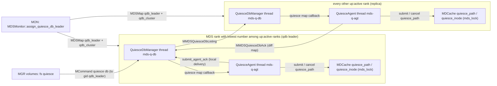
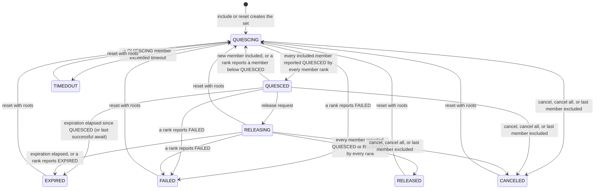
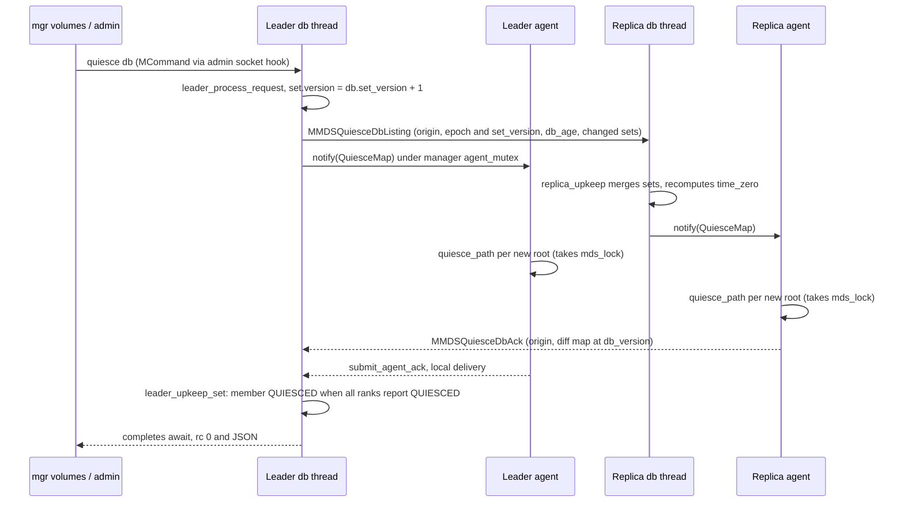
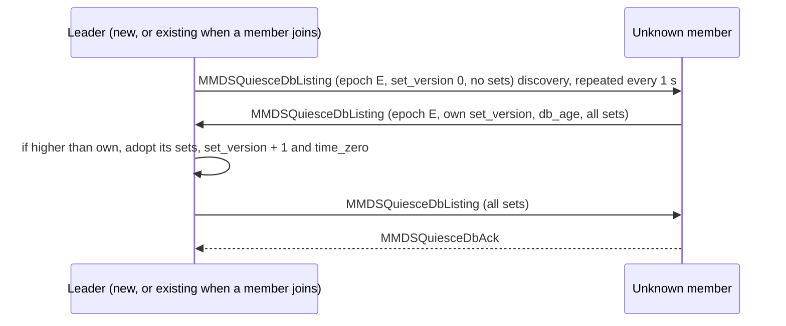
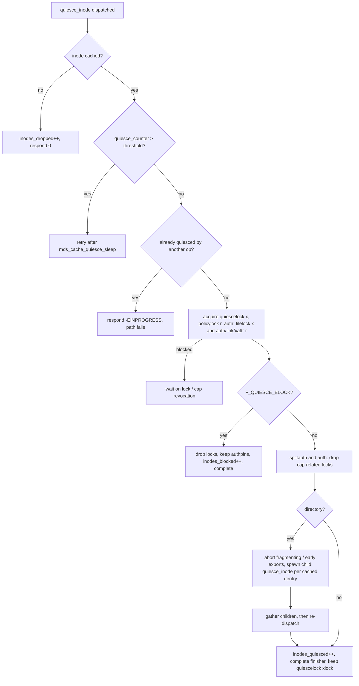
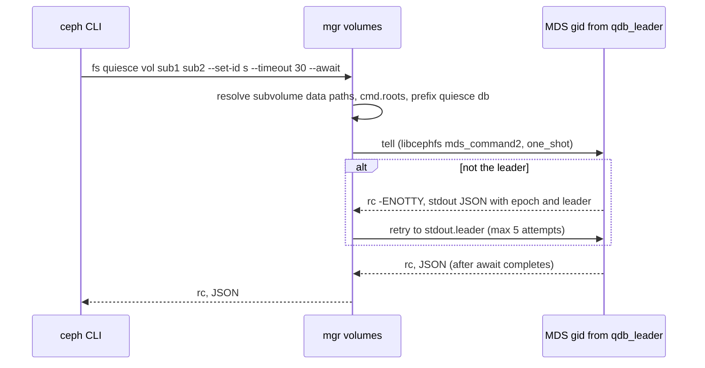

# Quiesce: QuiesceDb, per-rank agents and inode-tree quiescing

> Part of the C++ MDS project map ([README](../README.md)). Sources: `src/mds/QuiesceDb.h` (~755 LOC), `src/mds/QuiesceDbEncoding.h` (~220), `src/mds/QuiesceDbManager.{h,cc}` (~316 + 1,225), `src/mds/QuiesceAgent.{h,cc}` (~267 + 248), `src/mds/MDSRankQuiesce.cc` (~621), `src/mds/MDCache.cc` lines 14019-14628 plus request plumbing at 9939-10212 (~700), `src/mds/MDCache.h` 548-705, the quiesce parts of `src/mds/Locker.cc`, `src/mds/CInode.{h,cc}`, `src/mds/CDir.cc`, `src/mds/Migrator.cc`, `src/mds/Server.cc`, `src/mds/MDSRank.cc`, `src/mds/MDSDaemon.cc`, `src/mon/MDSMonitor.cc`, `src/mds/MDSMap.{h,cc}`, `src/messages/MMDSQuiesceDb{Ack,Listing}.h`, `src/pybind/mgr/volumes/{module.py,fs/volume.py}`, `src/pybind/mgr/mgr_module.py`; design notes in `doc/dev/mds_internals/quiesce.rst` and user docs in `doc/cephfs/fs-volumes.rst` (section "Subvolume Quiesce").
> Related: [process and threading](../00-architecture/process-and-threading.md), [mds_lock analysis](../00-architecture/mds_lock-analysis.md), [FSMap/MDSMap](../01-cluster-integration/fsmap-and-mdsmap.md), [beacon and monitor](../01-cluster-integration/beacon-and-monitor.md), [mgr, tools and orchestration](../01-cluster-integration/mgr-tools-and-orchestration.md), [capabilities](../02-client-protocol/capabilities.md), [leases, lock caches, async dirops](../02-client-protocol/leases-lock-caches-and-async-dirops.md), [request lifecycle](../03-request-path/request-lifecycle.md), [namespace mutations](../03-request-path/namespace-mutations.md), [attributes and xattrs](../03-request-path/attributes-and-xattrs.md), [cinode and inode types](../04-cache/cinode-and-inode-types.md), [subtrees, traversal, replication](../04-cache/mdcache-subtrees-traversal-replication.md), [dirfrags and fragmentation](../04-cache/dirfrags-and-fragmentation.md), [lock types and state machines](../05-locking/lock-types-and-state-machines.md), [acquiring locks](../05-locking/acquiring-locks.md), [subtree migration](../08-multi-mds/subtree-migration.md), [balancer and pinning](../08-multi-mds/balancer-and-pinning.md), [snapshots](../10-snapshots-quotas-subvolumes/snapshots.md), [rstats, quotas and subvolumes](../10-snapshots-quotas-subvolumes/rstats-quotas-and-subvolumes.md), [quarantine](quarantine.md), [admin commands](../13-admin-and-config/admin-commands.md), [config, perf counters, health](../13-admin-and-config/config-perf-counters-and-health.md).

## 1. Purpose and responsibilities

Quiesce pauses metadata mutations (those that need a write or exclusive lock on a cap-related inode lock; see 3.14 for what still proceeds) and client write I/O under a set of file-system paths (in practice: subvolume data directories) on every active rank, so that an operator or orchestrator (CSI, backup tooling) can take snapshots of several subvolumes that are mutually consistent for multi-client applications. The user-facing motivation is spelled out in `doc/cephfs/fs-volumes.rst:1631-1641`: without a pause, writes acknowledged before an application checkpoint are not guaranteed to be in a snapshot.

The C++ implementation has three layers plus an admin surface:

| Layer | Where | Responsibility |
|---|---|---|
| **QuiesceDb** (replicated "quiesce set" database) | `QuiesceDb.h`, `QuiesceDbManager.{h,cc}` | One leader per file system (chosen by the monitor) owns a small in-memory database of *quiesce sets* (set id -> members (roots), state, timeout, expiration, version). It processes client requests (`quiesce db` command), replicates the DB to all other active ranks, collects per-rank acknowledgements of each root's state, derives member/set states, enforces timeouts/expiration, and completes `--await` requests. Runs on its own thread (`mds-q-db`), not under `mds_lock`. |
| **QuiesceAgent** (one per rank) | `QuiesceAgent.{h,cc}`, `MDSRankQuiesce.cc` | Receives the root-centric *quiesce map* computed from the local DB replica, starts one `quiesce_path` internal request per root that must be quiesced, cancels (kills) it when the root must be released or disappears, and acks the actual per-root state back to the leader. Own thread (`mds-q-agt`). |
| **Tree quiesce in the cache** | `MDCache::quiesce_path` / `dispatch_quiesce_path` / `dispatch_quiesce_inode` / `add_quiesce`, `CInode::quiescelock`, `Locker` | Walks every in-cache inode under the root, spawning one `CEPH_MDS_OP_QUIESCE_INODE` internal request per inode. Each such request takes an exclusive lock on the inode's `quiescelock` (and, on the auth, transiently the cap-related locks to force client capability revocation), then *keeps* the `quiescelock` xlock for the whole quiesce. While the `quiescelock` is xlocked: new wr/x locks of cap-related locks are refused (requests park with all their locks dropped), and caps issued to clients are masked to read/cache/buffer-only. Runs under `mds_lock`. |
| **Admin/management** | `MDSRank::command_quiesce_db`, `command_quiesce_path`, `command_lock_path`; mgr `volumes` `fs quiesce` | `quiesce db` (the API used by `ceph fs quiesce`), `quiesce path` and `lock path` (low-level debug/test commands), `ceph.quiesce.block` vxattr to exempt inodes. |

Nothing in the quiesce subsystem is journaled or stored in RADOS by the MDS (no `MDLog` events, no objects); the DB lives only in memory of the active ranks. The only persistent bits are the per-inode `F_QUIESCE_BLOCK` flag (vxattr `ceph.quiesce.block`) and the monitor-computed `qdb_leader`/`qdb_cluster` fields, which the mon persists as part of the `FSMap`. There is no new client-facing wire message: clients observe quiesce only through normal capability revocation and through metadata requests that do not complete until release.

## 2. Source map

| File | Class / function | Lines | Role |
|---|---|---|---|
| `src/mds/QuiesceDb.h` | `enum QuiesceState`, `quiesce_state_name` | 35-108 | State enum (ordered; min/max aggregation relies on the order) and CLI names |
| `src/mds/QuiesceDb.h` | `QuiesceClock`, `QuiesceTimeInterval`, `QuiesceSetId`, `QuiesceRoot`, `QuiesceSetVersion` | 121-126 | Time base (`ceph::coarse_real_clock`, u64 ns) and id types (strings) |
| `src/mds/QuiesceDb.h` | `QuiesceDbVersion` | 132-140 | `{epoch, set_version}` with lexicographic ordering |
| `src/mds/QuiesceDb.h` | `RecordedQuiesceState` | 178-201 | `{state, at_age}`; `update()` changes `at_age` only on a state change |
| `src/mds/QuiesceDb.h` | `QuiesceSet`, `QuiesceSet::MemberInfo` | 213-312 | The only DB record type: version, state, timeout, expiration, members |
| `src/mds/QuiesceDb.h` | `QuiesceDbRequest` | 342-547 | Request model: `RootsOp` x roots-empty = 6 operations, set id, if_version, timeout, expiration, await |
| `src/mds/QuiesceDb.h` | `QuiesceDbListing`, `QuiesceDbPeerListing` | 574-623 | Replication payload (leader -> replica, and replica -> leader during bootstrap) |
| `src/mds/QuiesceDb.h` | `QuiesceMap`, `QuiesceDbPeerAck` | 629-708 | Root-centric map for agents; agent ack payload (a *diff* map) |
| `src/mds/QuiesceDb.h` | `interval_saturate_add*`, `namespace QuiesceInterface` | 710-755 | Saturating time math; callback signatures between manager, agent and MDS |
| `src/mds/QuiesceDbEncoding.h` | `encode`/`decode` for all of the above | 18-220 | Versioned (v1) encodings used only by MDS<->MDS messages |
| `src/mds/QuiesceDbManager.h` | `QuiesceClusterMembership` | 29-46 | epoch, fs id/name, me, leader, members, courier callbacks |
| `src/mds/QuiesceDbManager.h` | `QuiesceDbManager` public API | 48-201 | `submit_request`, `submit_peer_ack`, `submit_peer_listing`, `submit_agent_ack`, `update_membership`, agent callback management |
| `src/mds/QuiesceDbManager.h` | private state (`Db`, `PeerInfo`, `awaits`, queues) | 203-316 | DB owned by the db thread; queues protected by `submit_mutex` |
| `src/mds/QuiesceDbManager.cc` | `quiesce_db_thread_main` | 65-190 | Main loop of `mds-q-db` |
| `src/mds/QuiesceDbManager.cc` | `update_membership`, `membership_upkeep` | 192-296 | Membership/epoch handling, thread start, demotion |
| `src/mds/QuiesceDbManager.cc` | `replica_upkeep`, `leader_bootstrap` | 298-408 | Replica DB update; leader discovery of peer DBs |
| `src/mds/QuiesceDbManager.cc` | `leader_upkeep`, `complete_requests`, `leader_record_ack` | 410-487 | Leader pass, request completion, ack bookkeeping |
| `src/mds/QuiesceDbManager.cc` | `sanitize_roots` | 494-582 | Root URI normalization (`file:`/`inode:` schemes) |
| `src/mds/QuiesceDbManager.cc` | `leader_process_request`, `leader_update_set` | 584-843 | All request semantics and error codes |
| `src/mds/QuiesceDbManager.cc` | `leader_upkeep_db`, `QuiesceSet::next_state`, `check_peer_reports`, `leader_upkeep_set`, `leader_upkeep_awaits` | 845-1172 | Replication fan-out, state derivation from acks, timeouts, expiration, await completion |
| `src/mds/QuiesceDbManager.cc` | `get_root_ttl`, `calculate_quiesce_map` | 1174-1225 | DB -> agent quiesce map (requested state + TTL, merge of duplicate roots) |
| `src/mds/QuiesceAgent.h` | `QuiesceAgent`, `ControlInterface`, `TrackedRoot` | 23-267 | Agent API, per-root tracking, actual-state derivation |
| `src/mds/QuiesceAgent.cc` | `db_update`, `agent_thread_main`, `set_pending_roots`, `set_upkeep_needed`, `~TrackedRoot` | 33-248 | Agent logic |
| `src/mds/MDSRankQuiesce.cc` | `MDSRank::command_quiesce_db` | 49-242 | `quiesce db` asok/tell command: validation, request build, JSON reply |
| `src/mds/MDSRankQuiesce.cc` | `rebind_agent_callback`, `MDSRank::quiesce_cluster_update` | 244-370 | Builds membership from `MDSMap`, wires courier lambdas, degraded handling |
| `src/mds/MDSRankQuiesce.cc` | `MDSRank::quiesce_dispatch` | 372-426 | Decodes the two quiesce messages and hands them to the manager |
| `src/mds/MDSRankQuiesce.cc` | `MDSRank::quiesce_agent_setup` | 428-621 | Creates the agent and its `submit_request`/`cancel_request`/`agent_ack` bindings |
| `src/messages/MMDSQuiesceDbListing.h` | `MMDSQuiesceDbListing` | 22-58 | `MSG_MDS_QUIESCE_DB_LISTING` (0x505), payload `QuiesceDbPeerListing` |
| `src/messages/MMDSQuiesceDbAck.h` | `MMDSQuiesceDbAck` | 22-59 | `MSG_MDS_QUIESCE_DB_ACK` (0x506), payload `QuiesceDbPeerAck` |
| `src/mds/MDCache.h` | `QuiesceStatistics`, `C_MDS_QuiescePath`, `get_quiesce_inode_op`, `LockPathConfig` | 548-705 | Per-quiesce statistics, completion context, helpers |
| `src/mds/MDCache.cc` | `LockPathState`, `QuiesceInodeState` | 159-173 | Private state attached to internal requests |
| `src/mds/MDCache.cc` | `quiesce_overdrive_fragmenting_async` | 14019-14055 | Abort an in-progress fragmentation that would deadlock with quiesce |
| `src/mds/MDCache.cc` | `dispatch_quiesce_inode` | 14057-14358 | Per-inode quiesce (and quarantine cap revocation walk) |
| `src/mds/MDCache.cc` | `add_quiesce` | 14360-14389 | Quiesce an inode that appears in an already-quiesced directory |
| `src/mds/MDCache.cc` | `dispatch_quiesce_path`, `quiesce_path` | 14391-14495 | Root traversal and lifetime of the whole tree quiesce |
| `src/mds/MDCache.cc` | `dispatch_lock_path`, `lock_path` | 14497-14628 | Debug/test "hold arbitrary locks on a path" request |
| `src/mds/MDCache.cc` | `request_finish`, `request_cleanup`, `request_kill`, `dispatch_request` | 9917-10212 | Counters, cascade kill of child quiesce ops, `-ECANCELED` completion |
| `src/mds/CInode.h` / `CInode.cc` | `quiescelock`, `is_quiesced`, `will_block_for_quiesce`, `get_caps_quiesce_mask` and masked cap helpers | CInode.h 686-695, 1147-1153; CInode.cc 358, 3726-3796, 3878-3910, 5901-5950 | Lock object and cap masking |
| `src/mds/Locker.cc` | `acquire_locks` (implicit `quiescelock` wrlock), `handle_quiesce_failure`, `local_*lock_*` | 245-685, 5606-5689 | Lock semantics of `quiescelock` |
| `src/mds/CDir.cc` | `CDir::link_inode_work` | 622-658 | Calls `add_quiesce` for inodes linked into a quiesced dir |
| `src/mds/Migrator.cc` | `quiesce_overdrive_export`, `export_dir`, `dispatch_export_dir`, `handle_export_discover` | 320-332, 954-956, 1207-1219, 2484-2495 | Migration interplay |
| `src/mds/Server.cc` | `handle_client_setvxattr` (`ceph.quiesce.block`), `handle_client_getvxattr`, `dispatch_peer_request` | 6500-6545, 7443-7444, 3226-3234 | vxattr and peer-lock exemption |
| `src/mon/MDSMonitor.cc` | `MDSMonitor::assign_quiesce_db_leader` | 188-234 | Monitor-side leader/member selection, written into each `MDSMap` |
| `src/mds/MDSMap.h` / `MDSMap.cc` | `qdb_cluster_leader`, `qdb_cluster_members`, compat feature 12 | MDSMap.h 56, 321-347, 602-603; MDSMap.cc 81, 100, 261-266, 846-847, 1004-1007 | Map fields carrying the quiesce cluster |
| `src/pybind/mgr/volumes/fs/volume.py` | `VolumeClient.quiesce` | 538-580 | `ceph fs quiesce` implementation |
| `src/pybind/mgr/mgr_module.py` | `get_quiesce_leader_gid`, `tell_quiesce_leader` | 1970-2002 | Leader lookup and ENOTTY redirect loop |

## 3. How it works

### 3.1 Architecture overview



Every active rank runs the same code; one of them (chosen by the monitor) is the DB leader. Each rank quiesces every root independently in its own cache (each rank pauses what *it* could otherwise let change: its auth inodes, its replicas, the caps it issued). A member becomes `QUIESCED` only when every member rank reports it quiesced.

### 3.2 Cluster membership and leader selection

1. **Monitor side.** On every `encode_pending`, `src/mon/MDSMonitor.cc:241 (MDSMonitor::encode_pending)` calls `assign_quiesce_db_leader` (`:188`). For each file system whose `MDSMap` epoch equals the pending `FSMap` epoch (i.e. changed in this proposal, `:206`), it collects every `mds_info` with `rank != MDS_RANK_NONE && state == STATE_ACTIVE` (`:222`; a broader `state <= STATE_ACTIVE` variant is commented out at `:221`). `members` = their gids; `leader` = top of a priority queue whose comparator prefers the lowest rank (and, for equal ranks, the higher state) (`:191-201`); `MDS_GID_NONE` if none. `MDSMap::update_quiesce_db_cluster` stores them (`src/mds/MDSMap.h:335`). The fields are encoded in the `MDSMap` extended encoding version `ev >= 19` (`src/mds/MDSMap.cc:846-847`, decode `:1004-1007`) and dumped as `"qdb_leader"` and `"qdb_cluster": [gid, ...]` (`:261-266`). The comment "lowest rank with the highest state up to ACTIVE" (`MDSMonitor.cc:190`) is broader than what the code does: only `up:active` ranks are members.
2. **MDS side.** `src/mds/MDSRank.cc:2625 (MDSRankDispatcher::handle_mds_map)` calls `MDSRank::quiesce_cluster_update` (`src/mds/MDSRankQuiesce.cc:258`) for **every** new map, in every rank state. It builds a `QuiesceClusterMembership` with `epoch = mdsmap epoch`, `me = monc->get_global_id()`, `fs_name`, `leader`, `members` (`:260-267`). `fs_id` is never set and stays `FS_CLUSTER_ID_NONE` (-1) (`QuiesceDbManager.h:33`).
3. If a leader exists, two courier lambdas are installed (`:273-305`): `send_ack` (loopback `submit_peer_ack({me, ack})` on the leader; otherwise `MMDSQuiesceDbAck` to the leader's addrs) and `send_listing_to(gid, listing)` (`MMDSQuiesceDbListing`). Both take `mds_lock` (except loopback), look up the gid in the `MDSMap` (`-ENOENT` if `STATE_NULL`), and send with `messenger->send_to_mds(msg, addrs)` (`src/mds/MDSRank.cc:1499`).
4. If the map is degraded (`MDSMap::is_degraded`: failed or damaged ranks, or any daemon in `REPLAY..CLIENTREPLAY`, `src/mds/MDSMap.cc:1287`) **and** this MDS is the leader, a `CancelAll` request is injected at the front of the request queue (`MDSRankQuiesce.cc:310-331`). This repeats on every map epoch while degraded.
5. If this rank is not `up:active` locally, the agent callback is replaced by a "responder" lambda (`:333-358`): for each `QUIESCING` root it reports `FAILED` if the map is degraded, `QUIESCED` if this rank is standby-replay, otherwise drops it (plain ack); it returns `true` (synchronous ack). The agent is reset asynchronously (`:360-364`). With the current monitor rule non-active ranks are never members, and the rank's local state is taken from the same map at the start of `handle_mds_map` (`MDSRank.cc:2310`), so a non-active rank is never a member; its manager clears its DB and then never calls the callback (the `if_newer < db.version()` test fails on the empty DB). The responder therefore looks dormant, except in a short window: `reset_agent_callback` and `update_membership` take `submit_mutex` separately, so the db thread can run one pass with the old membership and the new responder in between (code reading; not observed in tests). If the rank is active, the real agent callback is (re)bound (`:366`).
6. `QuiesceDbManager::update_membership` (`src/mds/QuiesceDbManager.cc:192`): participates iff `me ∈ members`. Starts the `mds-q-db` thread on first participation (`:199-203`). A non-participant clears `cluster_membership` and requests a DB wipe (`db_thread_should_clear_db = true`, `:216-221`). The injected request is queued in front, or completed with `ENOTTY` if the thread is not running (`:208-214`). The agent callback's `if_newer` is reset to `{0,0}` so the agent is re-notified with the current map (`:223-226`).
7. In the db thread, `membership_upkeep` (`:229-296`) applies a new epoch: a (new) leader prunes `peers` to the member set, creates empty `PeerInfo` for new peers and sets `db.epoch = epoch` (`:258-272`); a non-leader clears `peers`, completes all pending awaits with `EINPROGRESS` ("not authoritative anymore", `:275-282`) and all pending requests with `ENOTTY` (`:284-287`). A requested wipe resets `membership.epoch`, `peers` and `db` (`:232-241`).

### 3.3 The DB data model

`QuiesceDbManager::Db` (`QuiesceDbManager.h:235-253`): `time_zero` (wall-clock point), `epoch`, `set_version`, `sets: unordered_map<set_id, QuiesceSet>`. `Db::version()` = `{epoch, set_version}`; `get_age()` = `now - time_zero`.

**Time.** All DB timestamps are *ages* relative to `time_zero` (`QuiesceDb.h:110-119`), so clocks need not be synchronized: every listing carries `db_age`, and a replica sets `time_zero = now - db_age` on each listing (`QuiesceDbManager.cc:322-326`); a bootstrapping leader adopts the peer's `time_zero` the same way (`:370`). The clock is `ceph::coarse_real_clock` with unsigned 64-bit nanosecond durations (`QuiesceDb.h:121-123`, `src/common/ceph_time.h:63-71`); additions use `interval_saturate_add` (`QuiesceDb.h:710-726`) where timeouts are compared.

**QuiesceSet** (`QuiesceDb.h:213-312`):

| Field | Meaning |
|---|---|
| `version` | DB `set_version` at which the set last changed; every change sets it to `db.set_version + 1` (`QuiesceDbManager.cc:817`, `:1024`, `:1049`, ...) and `leader_upkeep_db` then raises `db.set_version` to the max set version (`:889`). Several changes in one leader pass share one version. |
| `rstate` | `{state, at_age}` of the set |
| `timeout` | per-member quiesce timeout (default 0 => a new set times out on the first upkeep, `QuiesceDb.h:244-247`; see the user doc example at `doc/cephfs/fs-volumes.rst:1706-1735`) |
| `expiration` | max time the set may spend in `QUIESCED`/`RELEASING` (default 0) |
| `members` | `unordered_map<root, MemberInfo{rstate, excluded}>`; excluded members are kept forever (`QuiesceDb.h:214-217`) |

**States** (`QuiesceDb.h:35-55`; numeric values are what is encoded): `QS__INVALID=0`, `QS_QUIESCING=1`, `QS_QUIESCED=2`, `QS_RELEASING=3` (active states, `QS__ACTIVE`), `QS_RELEASED=4` (`QS__TERMINAL`), `QS_EXPIRED=5` (`QS__FAILURE`), `QS_FAILED=6`, `QS_CANCELED=7` (`QS__SET_ONLY`, set-only), `QS_TIMEDOUT=8` (set-only), `QS__MAX=9`. The order is load-bearing: member/set aggregation uses `min`/`max`.

Derived rules (`QuiesceDb.h:236-305`):
- `MemberInfo::is_quiescing()` = state < `QUIESCED`; `is_failed()` = state >= `EXPIRED`.
- `QuiesceSet::get_requested_member_state()` (what agents are told): terminal state as is; `QUIESCING` for a `QUIESCING` *or* `QUIESCED` set (deliberately, "to provoke clients to ack back"); `RELEASING` for a `RELEASING` set.
- `QuiesceSet::get_effective_member_state(reported)`: for a `RELEASING` set, any reported state in `[QUIESCED, RELEASED]` counts as `RELEASED`; for a `QUIESCED` set a report `< QUIESCED` maps to `QUIESCING` (rollback); otherwise `max(reported, set state)`.
- `QuiesceSet::next_state(min_member_state)` (`QuiesceDbManager.cc:926-937`): stays `RELEASING` if releasing and the min member state is `QUIESCED`; otherwise the set follows the min member state.

### 3.4 Set state machine



Notes: a member that a rank reports `EXPIRED`/`FAILED` takes that state and the set inherits it (`QuiesceDbManager.cc:1019-1025`, `:1053-1059`). `TIMEDOUT` is applied to the set only; the member keeps its state ("deliberately not changing the member state", `:1046`). A `release` changes state to `RELEASING` **without** updating `at_age` so the expiration clock keeps running from the last `QUIESCED` time (`:704-712`).

### 3.5 Requests (`QuiesceDbRequest`) and their semantics

**Model** (`QuiesceDb.h:342-547`). `control.roots_op` in {`INCLUDE_OR_QUERY=0`, `EXCLUDE_OR_CANCEL=1`, `RESET_OR_RELEASE=2`} combined with whether `roots` is empty gives six operations: include/query, exclude/cancel, reset/release (`op_string`, `:527-538`). `control.flags` (`VERBOSE=1`, `EXCLUSIVE=2`) exist but are never read by the manager. Optional `set_id`, `if_version`, `timeout`, `expiration`, `await` (an interval; `QuiesceTimeInterval::max()` = unbounded).

**Validity** (`is_valid`, `:422-432`): op must be valid, and either a set id is given, or roots are included (include/reset creates a new set), or it is a wildcard query or cancel-all without `await`/`timeout`/`expiration`/`if_version`.

**Root sanitization** (`QuiesceDbManager::sanitize_roots`, `QuiesceDbManager.cc:494-582`), applied to every request before processing:
- Parse as URI reference (`boost::urls`), `normalize()`; no scheme => `file`; scheme must be `file` or `inode` else `EINVAL`.
- An authority must equal the fs name or the numeric fs id (`stoll(authority) == membership.fs_id`); it is then removed. Since `fs_id` is never set in the MDS (3.2), only the fs name is accepted in practice (plus the literal `-1`, gotcha 4).
- Path: collapse repeated slashes, drop trailing slash; `file:` paths get a leading `/`; `inode:` paths must be a canonical non-zero decimal `uint64`.
- Examples from `src/test/mds/TestQuiesceDb.cc:620-727 (RootSanitization)`: `file:root1` -> `file:/root1`; `//<fsname>/root3` -> `file:/root3`; `inode://<fsid>/4` -> `inode:4`; `inode:0`, `inode:-4`, `inode:abcd`, `inode:1/2/3/4` -> `EINVAL`.

**Processing** (`leader_process_request`, `:584-683`; `leader_update_set`, `:685-843`). Return codes are positive errno inside the manager and negated when the request context completes (`complete_requests`, `:457`).

| Case | Effect | Result |
|---|---|---|
| invalid request / root sanitization failure | none | `EINVAL` |
| cancel-all (`cancel`, no set id) | every **active** set: exclude all members, state `CANCELED`, version bump (`:602-620`) | 0 |
| `if_version > 0` without set id | none | `EINVAL` (`:627-630`) |
| set id not found, op includes roots (include or reset), `if_version` absent or 0 | create set (id = given, or a random id not already used: one 32-bit `mt19937` draw formatted with `{:x}`, so up to 8 lowercase hex digits and not zero-padded, `:489-492`, `:635-645`) and continue as include | per update |
| set id not found, mutating or await | none | `ENOENT` (`:646-650`) |
| set id not found, plain query | none | 0, empty response |
| set found, `if_version` != `set.version` | none (`if_version=0` on an existing set therefore fails) | `ESTALE` (`:688-691`) |
| non-mutating (query, possibly with await) | none | 0 (then await) |
| `release` on `QUIESCED` | state -> `RELEASING` (age kept) | 0 |
| `release` on `RELEASING`/`RELEASED` | none | 0 |
| `release` in any other state | none | `EPERM` (`:716-718`) |
| non-reset modification of an inactive set (`version > 0`) | none | `EPERM` (`:726-728`) |
| include roots into a `RELEASING` set | none | `EPERM` (`:729-731`) |
| `reset` (roots given) | if state > `QUIESCED`: set -> `QUIESCING` and all kept members -> `QUIESCING` at now; members not listed are excluded | 0 |
| `timeout` / `expiration` given | overwrite (for active or new sets, and for a `reset` of a set in any state; silently ignored on `release` requests, which take the other branch, `:700-751`) | 0 |
| exclude / cancel by id | mark matching (all, for cancel) members `excluded` | 0 |
| include | new or previously-excluded roots become included `QUIESCING` at now | 0 |

After member edits: if no included member remains the set becomes `CANCELED` (`:803-806`); otherwise the set state is recomputed with `next_state(min effective member state)` where a member's effective state is derived from the current peer reports only when all peers are up to date and none reports a failure state, otherwise its recorded state is used (`:771-781`); a `reset` of a set beyond `QUIESCED` uses `QUIESCING` for every kept member (`:765-770`). Any change bumps `set.version`; a change in **membership of roots** interrupts all pending awaits on the set with `EINTR`, or `ECANCELED` if the set became `CANCELED` (`:815-840`). Timeout/expiration-only changes do not interrupt awaits.

**Await** (`:661-678`): after a successful update, if `await` is set: quiesce-await on a set whose state is beyond `QUIESCED` (`RELEASING`, `RELEASED` or any failure/terminal state) and the request is not a release => `EPERM` immediately; otherwise an `AwaitContext{expire_at_age = now + await}` is queued and the request stays pending (`EBUSY` internal marker). Completion of a **pending** await (`leader_upkeep_set`, `:1078-1096`, and `leader_upkeep_awaits`, `:1116-1172`):

| Set state at check | quiesce-await | release-await (`--release --await`) |
|---|---|---|
| `QUIESCING` | keep waiting | (cannot happen: release requires `QUIESCED`+) |
| `QUIESCED` | **0**; also resets `set.rstate.at_age = now` (restarts expiration) and bumps version | n/a |
| `RELEASING` | `EPERM` | keep waiting |
| `RELEASED` | `EPERM` | **0** |
| `CANCELED` | `ECANCELED` | `ECANCELED` |
| `EXPIRED`, `TIMEDOUT` | `ETIMEDOUT` | `ETIMEDOUT` |
| `FAILED` | `EBADF` | `EBADF` |
| set vanished | `ENOENT` | `ENOENT` |
| await interval elapsed while still waiting | `EINPROGRESS` | `EINPROGRESS` |
| members changed | `EINTR` (or `ECANCELED`) | same |
| leadership lost | `EINPROGRESS` | same |

Awaits on `QUIESCED`/`RELEASED` are completed in `leader_upkeep_set` **before** the expiration check of the same pass, so with `expiration = 0` a quiesce-await still succeeds and the set then immediately becomes `EXPIRED` ("this could be used for barriers", `:1078-1082`).

### 3.6 Leader upkeep: deriving member and set state from acks

Each leader pass (`leader_upkeep`, `:410-433`) records acks, processes requests in FIFO order, runs `leader_upkeep_db` and `leader_upkeep_awaits`, and returns the earliest next timer event (age) for the thread's sleep.

`leader_record_ack` (`:462-487`): ignore unknown peers; an ack whose version is newer than the leader's either means the leader's epoch is behind (ignored until membership catches up) or that the peer has a newer set version, in which case `PeerInfo` is cleared so that the next listing to that peer contains the full DB (`:474-481`). Otherwise the peer's `diff_map` (its last ack) is stored.

`check_peer_reports(set, root)` (`:939-989`), for every peer **including the leader itself**:
- the peer's reported state for the root is the entry in its last diff map, or, if absent, the requested state (`QUIESCING`/`RELEASING`) - i.e. "no news = still in the requested state";
- invalid entries (`CANCELED`/`TIMEDOUT`, `QuiesceMap::RootInfo::is_valid`, `QuiesceDb.h:634`) are ignored;
- a peer is *up to date* iff its acked `db_version >= {membership.epoch, set.version}`;
- min/max are taken only over peers whose stored ack has `set_version > 0` (even if it is for an older version); with no such peer both default to the requested state (`:968-979`).

`leader_upkeep_set` (`:991-1114`) for each active set, per included member:
1. If any peer reports a failure state (`EXPIRED`/`FAILED`), the member takes the max reported state.
2. Else if the effective state (from the min report) is lower than the member's state, roll back (e.g. `QUIESCED` -> `QUIESCING` when a rank lost the quiesce or a new rank joined and has not quiesced yet).
3. Else if **all** peers are up to date, the member takes the effective state.
4. A `QUIESCING` member whose `at_age + timeout <= now` makes the set `TIMEDOUT` (stop processing the set); a failed member propagates its state to the set.
Then the set state = `next_state(min member state)`; awaits are completed (3.5); for `QUIESCED`/`RELEASING` sets `at_age + expiration <= now` => `EXPIRED`. The returned next event is the earliest member timeout or set expiration.

### 3.7 Replication protocol (leader <-> replicas)



- **Leader -> peer listings** (`leader_upkeep_db`, `:845-924`): per peer (excluding self) a `QuiesceDbListing{db_version, db_age, sets with set.version > peer's last acked set_version}`. If the same DB version was already sent to that peer and the peer's `last_activity` (refreshed by each successful send and by each recorded ack, `:485`, `:918`) is less than 1 s old (`PEER_REPEATED_UPDATE_INTERVAL`, `:893-899`), the send is skipped; otherwise it is (re)sent, possibly with zero sets. Until the peer acks, every resend carries all sets newer than its last acked `set_version`. There is no independent retransmission timer: resends happen only when the leader thread runs a pass (request, ack, membership change or a set timer).
- **Replica handling** (`submit_peer_listing`, `QuiesceDbManager.h:120-134`; `replica_upkeep`, `QuiesceDbManager.cc:298-342`): a listing whose epoch differs from the replica's membership epoch is rejected (`ESTALE`); only the newest queued listing is applied; `set_version == 0` is a **discovery request** from a bootstrapping leader, answered by sending the replica's full DB (sets, set_version, db_age) back to the leader; otherwise `time_zero` and `epoch` are adopted and the sets are merged by `insert_or_assign` (deltas). A listing with a lower `set_version` than the replica's makes the replica discard its whole DB (`:329-332`).
- **Bootstrap** (`leader_bootstrap`, `:344-408`, run at the start of **every** leader pass): a leader considers a peer (other than itself) unknown while its stored report has `epoch < membership.epoch && set_version == 0` (`:352`). That is true for a freshly added `PeerInfo` (`{0,0}`), so it applies to a new leader **and** to an existing leader whenever a new member joins; peers whose last ack carried a non-zero `set_version` stay known across epochs. The leader sends a discovery listing (`QuiesceDbListing(epoch)`, set_version 0) to each unknown peer at most every 1 s (`PEER_DISCOVERY_INTERVAL`), consumes their DB uploads, and, if an upload's `set_version` is higher than its own, adopts that peer's sets, its `time_zero` and `set_version + 1` ("incrementing it to collect acks", `:365-373`); the answering peer is then recorded as `{epoch, 0}`, so it later receives the full DB. Until **all** peers answered, requests and acks are pushed back to the queues and the thread sleeps `delay + 100 ms` (`:111-135`). There is no bootstrap timeout: a silent member blocks the leader until membership changes.
- **Acks** (agent -> leader): `QuiesceDbPeerAck{origin, QuiesceMap diff_map}`. The diff map is tagged with the DB version the agent processed and contains only roots whose actual state differs from what the DB requested (3.9). `submit_peer_ack` (`QuiesceDbManager.h:99-113`) returns `EPERM` on a non-leader and `ESTALE` if `origin` is not a member.
- **Synchronous acks** (`quiesce_db_thread_main`, `:146-180`): after every pass, if an agent callback is registered and its `if_newer < db.version()`, the manager computes the quiesce map, calls `notify(map)` under its `agent_mutex` and sets `if_newer = db.version()`; if `notify` returns `true` (non-active responders) the (mutated) map is sent as an ack. The real `QuiesceAgent::db_update` always returns `false` ("to avoid ack races with the agent_thread", `QuiesceAgent.cc:85-87`), so active ranks ack asynchronously. Without any callback, an empty ack is sent whenever the DB version differs from the last acked one, which keeps all roots `QUIESCING` forever (`:149`, `:162-166`).
- Every `MDSMap` epoch change bumps the leader's DB epoch (replicas adopt it from the next listing), so all previous acks become "not up to date" until each agent acks the new epoch (one round trip per map change); a peer that is ahead in epoch has its listings rejected (`ESTALE`) and its acks ignored until the other side catches up (`TestQuiesceDb.cc:1713 (AckDuringEpochMismatch)`).



### 3.8 Wire encodings of the two internal messages

Both messages derive from `MMDSOp` with default header version 1; payload is encoded in `encode_payload` and decoded lazily only via `decode_payload_into` (`MMDSQuiesceDbListing.h:37-50`, `MMDSQuiesceDbAck.h:37-50`). All structs use `ENCODE_START(1, 1)` envelopes (u8 struct_v, u8 compat, u32 length) (`QuiesceDbEncoding.h`):

| Struct | Encoding (in order) |
|---|---|
| `QuiesceDbVersion` | `env{ epoch u32, set_version u64 }` |
| `QuiesceState` | `raw u8` |
| `QuiesceTimeInterval` | `raw u64 nanoseconds` |
| `RecordedQuiesceState` | `env{ state u8, at_age u64 ns }` |
| `QuiesceSet::MemberInfo` | `env{ rstate, excluded bool }` |
| `QuiesceSet` | `env{ version u64, rstate, timeout u64, expiration u64, members map<string,MemberInfo> }` |
| `QuiesceDbListing` | `env{ db_version, db_age u64, sets map<string,QuiesceSet> }` |
| `QuiesceDbPeerListing` (`MSG_MDS_QUIESCE_DB_LISTING` 0x505) | `env{ origin mds_gid_t, db }` |
| `QuiesceMap::RootInfo` | `env{ state u8, ttl u64 ns }` |
| `QuiesceMap` | `env{ db_version, roots map<string,RootInfo> }` |
| `QuiesceDbPeerAck` (`MSG_MDS_QUIESCE_DB_ACK` 0x506) | `env{ origin mds_gid_t, diff_map }` |
| `QuiesceDbRequest` | `env{ control.raw u64, set_id optional<string>, if_version optional<u64>, timeout optional<interval>, expiration optional<interval>, await optional<interval>, roots set<string> }` (defined but never sent on the wire) |

These are MDS<->MDS only (message type ids at `src/msg/Message.h:211-212`).

### 3.9 The quiesce map given to agents

`calculate_quiesce_map` (`QuiesceDbManager.cc:1196-1225`) walks **active** sets and their non-excluded members and emits `root -> {requested state, ttl}`. Requested state is `QUIESCING` for quiescing and quiesced sets, `RELEASING` for releasing sets. The same root in several sets is merged: state = min, ttl = max (`TestQuiesceDb.cc:1753 (QuiesceRootMerge)`). TTL (`get_root_ttl`, `:1174-1194`) = remaining time until the set's expiration for `QUIESCED`/`RELEASING` sets, or until the member's quiesce timeout for `QUIESCING` sets. Terminal sets' roots are absent, which agents interpret as "release".

### 3.10 The per-rank agent

`QuiesceAgent` (created by `MDSRank::quiesce_agent_setup`, called at the end of `MDSRank::active_start`, `src/mds/MDSRank.cc:2163`; the constructor starts thread `mds-q-agt`, `QuiesceAgent.h:32-37`).

**`TrackedRoot`** (`QuiesceAgent.h:89-173`), protected by a spin lock (`atomic_flag`): `committed_state` and `expires_at` (from the DB map), `quiesce_request` (handle = `metareqid_t` of the `quiesce_path` request), `cancel` functor, `quiesce_result`, `cancel_result`. Actual state (`get_actual_state`, `:140-161`):

| quiesce_result | cancel_result | committed | actual |
|---|---|---|---|
| 0 | unset | any | `QUIESCED` |
| 0 | 0 | any | `RELEASED` |
| 0 | error | any | `EXPIRED` |
| error | any | any | `FAILED` |
| unset | any | `RELEASING`/`RELEASED` | `EXPIRED` ("lost track") |
| unset | any | `QUIESCING`/`QUIESCED` | `QUIESCING` |

**`db_update(map)`** (db thread, `QuiesceAgent.cc:33-88`): drops roots in failure states; reuses existing `TrackedRoot`s, creates new ones; updates committed state/ttl; leaves in `map` only roots whose actual state differs (for logging; the return value is `false`); publishes the new root table as `pending` (`set_pending_roots`, `:201-219`).

**`agent_thread_main`** (`:90-199`): swaps `pending` into `current` (the old table is destroyed later, outside the mutex; destroying a `TrackedRoot` that still has an uncancelled request calls `cancel`, `:233-248`). For each current root, under its spin lock, decide: submit a quiesce if it should be quiesced (`QUIESCING`/`QUIESCED` committed) and nothing was submitted yet; cancel the request if it should be released and was not cancelled yet; and record `{actual, ttl}` in the ack if actual differs from committed. Then, outside the spin lock, call `submit_request` (the completion context sets `quiesce_result` and `set_upkeep_needed()`) or `cancel_request` (stores `cancel_result`). Finally an ack is sent if the version is new or the diff is non-empty. The actual state for the ack is computed *before* the cancel of this pass, so a releasing root is acked as `QUIESCED`; the leader maps that to `RELEASED` for a releasing set (3.3).

**MDS bindings** (`MDSRankQuiesce.cc:428-621`):
- `submit_request(root, ctx)` (`:444-579`): parse URI; take `mds_lock`; if the `MDSMap` is degraded complete `ctx` with **positive** `EPERM` (counts as failure) (`:513-518`); otherwise `mdcache->quiesce_path(filepath(uri.path), new C_MDS_QuiescePath(mdcache, ctx), nullptr, 0ms)` and return the request id (`:519-521`). The `inode:` scheme is not special-cased: its path ("N") becomes a relative `filepath` with base ino 0, which `path_traverse` rejects with `-ESTALE` (`src/mds/MDCache.cc:8472-8486`), so such roots end `FAILED` (code reading). A debug branch (`QUIESCE_ROOT_DEBUG_PARAMS`, URI params `q`, `f`, `r`, `delayms`) is compiled out (no build file defines the macro).
- `cancel_request(handle)` (`:581-608`): under `mds_lock`, `request_kill` the request if it still exists (`0`), else `ENOENT` (so a vanished request makes the root `EXPIRED` instead of `RELEASED`).
- `agent_ack(diff)` (`:610-617`): `QuiesceDbManager::submit_agent_ack`, which delivers locally on the leader or calls the `send_ack` courier outside `submit_mutex` (`QuiesceDbManager.h:139-157`).
- The agent never acts on TTL; it only reports it. Release is always driven by the DB (state change or root disappearance) or by the agent being reset.

### 3.11 Quiescing a tree: `quiesce_path`

`MDCache::quiesce_path(path, C_MDS_QuiescePath*, f, delay)` (`MDCache.cc:14480-14495`) starts an internal request `CEPH_MDS_OP_QUIESCE_PATH` (`0x01508`, op name `quiesce_path`, `src/common/ceph_strings.cc:331`) whose `internal_op_finish` is the `C_MDS_QuiescePath` (holding a shared `QuiesceStatistics`, `MDCache.h:548-635`), and dispatches it (optionally after `delay` on the timer).

`dispatch_quiesce_path` (`:14391-14478`):
1. Not `up:active` => respond `-EAGAIN` (request finished, agent sees failure).
2. Build a `QuiesceInodeState` shared by all descendant ops: parent mdr, statistics, `mds_cache_quiesce_delay`, `mds_cache_quiesce_splitauth`, quarantine fields (`:14406-14411`).
3. `path_traverse` with `MDS_TRAVERSE_DISCOVER | MDS_TRAVERSE_RDLOCK_PATH | MDS_TRAVERSE_WANT_INODE` (`:14415-14422`): discovers missing path components from their auth ranks, rdlocks each dentry along the path (and wrlocks a parent dir's `filelock` if it is cached by a lock cache, to flush async dirops, `MDCache.cc:8656-8662`; that `acquire_locks` call does not pass `skip_quiesce`, so it also wrlocks that directory's `quiescelock`, 3.13). No snaplock/policylock rdlocks are taken on the ancestors (`RDLOCK_SNAP` is not set). These locks remain held by the `quiesce_path` request until it is killed. If the traverse must wait (`r > 0`), `quiesce_overdrive_fragmenting_async(curdir)` is called because the request may now be on an unfreeze waiter list of a fragmenting dir (`:14423-14427`). Errors (e.g. `-ENOENT`, `-ENOTDIR` for an intermediate symlink, as `qa/tasks/cephfs/test_quiesce.py:487-499` expects) finish the request with that error.
4. If any descendant op recorded a failure in the statistics, respond with it (`:14435-14445`).
5. If the root is not auth and `splitauth` is false (and not quarantine): complete as "quiesce complete for non-auth tree" without walking (`:14447-14449`).
6. If the root inode has no quiesce op yet: create `CEPH_MDS_OP_QUIESCE_INODE` for it with `internal_op_finish = C_MDS_RetryRequest(quiesce_path mdr)`, record it in `mdr->more()->quiesce_ops[ino]` and dispatch (`:14450-14465`). When the root (and transitively all descendants) is quiesced, the path request is re-dispatched, re-traverses, finds the root in `quiesce_ops`, and completes the finisher with 0 ("fully quiesced", `:14466-14475`). The request itself is **not** finished: it lives on, holding the path rdlocks and owning all `quiesce_inode` children, until `request_kill` ("caller kills this op", `:14477`).

### 3.12 Quiescing one inode: `quiesce_inode`

`dispatch_quiesce_inode` (`MDCache.cc:14057-14358`), for request `CEPH_MDS_OP_QUIESCE_INODE` (`0x01509`, op name `quiesce_inode`):

1. Already completed (finisher null) => no-op (`:14059-14062`).
2. Inode no longer in cache => erase it from `quiesce_ops` (so it is retried if it comes back), count `inodes_dropped`, respond 0 (`:14071-14080`).
3. Quarantine mode (`qis->quarantine`) => cap revocation walk instead of quiesce (`:14082-14162`; see [quarantine](quarantine.md)).
4. **Throttle**: if `quiesce_counter` (a `DecayCounter` with half-life `mds_cache_quiesce_decay_rate`) exceeds `mds_cache_quiesce_threshold`, retry after `mds_cache_quiesce_sleep` on the timer; else `hit()` (`:14166-14174`).
5. If the inode is already quiesced by **another** `quiesce_inode` op => record `-EINPROGRESS` in the statistics and respond `-EINPROGRESS` (`:14195-14203`); this fails the whole `quiesce_path` (e.g. two quiesces of the same path from `quiesce path`, `test_quiesce.py:530-546`, or nested roots in different sets).
6. **Lock acquisition** (once, `ALL_LOCKED`, `:14205-14244`), with `acquire_locks(mdr, lov, nullptr, false, skip_quiesce=true)`:

| Lock | Auth, `splitauth` (default) | Auth, `!splitauth` | Replica |
|---|---|---|---|
| `quiescelock` | xlock (kept) | xlock (kept) | xlock (kept; no auth pin needed, `Locker.cc:312-315`) |
| `policylock` | rdlock (kept; protects the `F_QUIESCE_BLOCK` test) | rdlock (kept) | rdlock (kept) |
| `filelock` | **xlock**, then dropped | rdlock (kept) | - |
| `authlock`, `linklock`, `xattrlock` | rdlock, then dropped | rdlock (kept) | - |
| `versionlock` | wrlocked implicitly by the filelock xlock, then dropped | - | - |

   The xlock on `filelock` drives it through `LOCK_LOCK_XLOCK`/`LOCK_PREXLOCK`/`LOCK_XLOCK`, whose allowed client caps are only `Fc|Fb` (`src/mds/locks.c:101-106`), revoking `Fs/Fr/Fw/Fx/Fl` but letting clients keep cached reads and buffered (dirty) writes; the comment explains that forcing Fb holders to flush "can lead to the quiesce timeout" (`MDCache.cc:14213-14222`). The rdlocks on `authlock`/`linklock`/`xattrlock` force those locks readable, revoking `Ax/Lx/Xx`. Acquiring all of them therefore waits for clients to acknowledge cap revocation (and to flush dirty metadata held under `x` caps).
7. If the projected inode has `F_QUIESCE_BLOCK` (`ceph.quiesce.block`): drop all locks but **keep auth pins**, count `inodes_blocked`, complete the finisher with 0, and do **not** recurse into children (`:14246-14256`). A blocked directory therefore exempts its whole subtree.
8. With `splitauth` on the auth: drop `authlock`, `filelock`, `versionlock`, `linklock`, `xattrlock`, keeping only `quiescelock` (x) and `policylock` (r) (`:14258-14271`). Rationale (doc `quiesce.rst:38-47`): if the auth kept e.g. `xattrlock` in a state that another rank needs to rdlock for its own quiesce, ranks could deadlock. Then `request_drop_remote_locks` drops any remote auth pin acquired for the replica `policylock` rdlock (tracker 66152; `:14273-14279`).
9. **Directories**: with `!splitauth` any non-auth dirfrag => `-EPERM` (`:14282-14290`). For each in-cache dirfrag: call `quiesce_overdrive_fragmenting_async(dir)` and `migrator->quiesce_overdrive_export(dir)` (3.15, 3.16), then for every dentry whose projected inode is a head inode not yet in `quiesce_ops`, create a child `quiesce_inode` op whose finisher is a gather sub, record it, count `inodes`, and dispatch it (or schedule it after `mds_cache_quiesce_delay`) (`:14291-14334`). `heartbeat_reset()` is called every `mds_heartbeat_reset_grace` dispatches (`:14331-14333`). If there were children, wait for the gather, which re-dispatches this op (`C_MDS_RetryRequest`) when all children completed (`:14335-14340`).
10. Done: mark "quiesce complete" (or "quiesce complete for non-auth inode"), count `inodes_quiesced`, complete and null the finisher, and keep the request alive with its locks (`:14343-14357`).

Only inodes **in cache** are walked: an uncached inode has no caps and no in-flight state; if it is loaded later it is quiesced by `add_quiesce` (3.15). Completion is bottom-up: a directory's op completes only after all its in-cache children (recursively) completed.



### 3.13 The `quiescelock` and how it blocks mutations

`CInode::quiescelock` is a `LocalLockC` of type `CEPH_LOCK_IQUIESCE = 1<<4` (`src/include/ceph_fs.h:338`), the lowest inode lock type (`CEPH_LOCK_IFIRST`, `:350`), with the `sm_locallock` table (single state `LOCK_LOCK`, `src/mds/locks.c:149-152`; `src/mds/SimpleLock.h:67`; name `iquiesce`). Local locks are not replicated; each rank has its own `quiescelock` for its copy of the inode.

- **wrlock** (`LocalLockC::can_wrlock`, `src/mds/LocalLockC.h:37-39`): allowed if not xlocked **and no xlock waiter** (writer preference for the quiesce). Blocked wrlockers wait on `WAIT_WR` (`Locker.cc:5618-5632`).
- **xlock** (`can_xlock_local`, `LocalLockC.h:33-35`): only with no wrlocks and no xlock. `local_xlock_start` first invalidates lock caches that cache this lock (`Locker.cc:5654-5656`), then waits on `WAIT_XLOCK` (`:5657-5660`). The last wrlock release wakes xlock waiters (`:5642-5646`).
- **Implicit wrlock in `Locker::acquire_locks`** (`Locker.cc:267-387`): unless `skip_quiesce`, the **first** entry of the caller's lock vector (in insertion order) that is an xlock, wrlock or remote wrlock of a cap-related lock (`get_cap_shift() > 0`: `IAUTH`, `ILINK`, `IFILE`, `IXATTR`, `src/mds/SimpleLock.cc:127-135`) adds a wrlock on that inode's `quiescelock` right after it (`need_quiescelock` is then cleared, so at most one `quiescelock` per call). `LockOpVec::sort_and_merge` sorts each run of consecutive entries with the same parent object by lock type (`src/mds/Mutation.cc:132-148`), and `IQUIESCE` is the smallest inode lock type, so the `quiescelock` is acquired before the lock that triggered it and before the other locks of that inode in the same run. rdlocks never add it.
- **Failure handling** (`Locker::handle_quiesce_failure`, `Locker.cc:671-685`): if the `quiescelock` cannot be taken (xlock or wrlock), the request drops **all** its locks (local and remote, via `request_drop_locks`) and local auth pins, then waits on the lock's waiter list. The stated reason: a waiting request must not keep the parent `snaplock`/`policylock` rdlocks from `Locker::try_rdlock_snap_layout`, otherwise a `mksnap` on the quiesced subvolume (the whole purpose) could not proceed. The op shows the event "failed to acquire quiesce lock".
- **Release**: when the quiesce op is killed, `local_xlock_finish` (`Locker.cc:5668-5689`) wakes `WAIT_XLOCK|WAIT_WR|WAIT_RD` waiters first and **then** re-evaluates `IFILE|IAUTH|ILINK|IXATTR` caps, so parked requests get a chance at the locks before caps are re-issued.
- Exemptions: `Server::dispatch_peer_request` handling of `OP_XLOCK`/`OP_WRLOCK` from a leader rank uses `skip_quiesce=true`; the code comment says a peer cannot communicate a `quiescelock` failure back (so blocking there could deadlock) and that quiesce only needs the lock to prevent issuing client caps (`src/mds/Server.cc:3226-3234`). `quiesce_inode`, `lock path`, the export locking (`Migrator.cc:1237`) and the quarantine per-inode op `MDCache::quarantine_inode` (`MDCache.cc:15233`, xlocks `authlock`/`linklock`/`xattrlock`/`filelock` and, on a subvolume root, `snaplock`/`policylock`) also pass `skip_quiesce=true`, so quarantine's xlocks of cap-related locks are not gated by the `quiescelock` (on a subvolume root its `policylock` xlock still conflicts with the quiesce's `policylock` rdlock; code reading, not covered by tests). These are the only `skip_quiesce=true` callers.

`CInode::is_quiesced()` (`CInode.cc:5901-5911`) is true iff the `quiescelock` is xlocked **by a `CEPH_MDS_OP_QUIESCE_INODE` request** (an xlock taken by `lock path quiesce:x` does not count). `will_block_for_quiesce(mdr)` (`:5945-5950`) = the mdr does not already hold a wrlock and `!can_wrlock()`.

**Cap masking while quiesced** (`CInode::get_caps_quiesce_mask`, `CInode.cc:3726-3734`): `CEPH_CAP_ANY_RD | CEPH_CAP_FILE_CACHE | CEPH_CAP_FILE_BUFFER | CEPH_CAP_PIN` = `p As Ls Xs Fs Fr Fc Fb`. It is ANDed into `get_caps_liked` (`:3737-3744`), `get_caps_allowed_by_type` (`:3761-3770`, used by `Locker::get_allowed_caps`, `Locker.cc:2528-2541`, and `CInode::encode_inodestat`, `CInode.cc:3959`), `get_caps_careful` (`:3772-3780`), `get_xlocker_mask` (`:3782-3796`), and into the *wanted* masks in `get_caps_wanted` (`:3900-3905`) so that lock state machines do not move toward `EXCL`/`MIX` for unissuable caps. `Locker::_do_cap_update` only considers file-write caps within the mask when deciding `max_size` changes (`Locker.cc:4105`): an `Fb` holder can still get `max_size` raised.

### 3.14 What is blocked and what proceeds while quiesced

| Activity on a quiesced inode / directory | Behaviour | Why (code) |
|---|---|---|
| create/mknod/mkdir/symlink/link/unlink/rmdir in a quiesced dir | parked until release | parent `filelock` wrlock adds `quiescelock` wrlock (`Locker.cc:358-376`; see [namespace mutations](../03-request-path/namespace-mutations.md)) |
| rename within a quiesced tree | parked | each `acquire_locks` call injects one `quiescelock`: in `Server::rdlock_two_paths_xlock_destdn` (`Server.cc:4147-4205`) only for whichever of the dest/src dir `filelock` wrlocks comes first (path order), then in `handle_client_rename` for `srci` via its `linklock` xlock (`:9467-9498`); when the quiesced dir's `filelock` is not the first, a rename of an inode out of it still parks on `srci`'s own `quiescelock` in the second call (see gotcha 2 for the reverse direction) |
| setattr (mode/owner/times/size), `O_TRUNC` open, setxattr/removexattr of user xattrs | parked | xlock of `authlock`/`filelock`/`xattrlock` (`Server.cc:4741` for `O_TRUNC`) |
| vxattr changes needing `policylock` xlock (layouts, quotas, pins, `ceph.quiesce.block`) | blocked | quiesce holds `policylock` rdlock on every quiesced inode, on every rank |
| getattr, lookup, readdir, open without truncation | proceed (caps issued are masked) | rdlocks only; readdir's comment "acquire the quiescelock" is stale - the rdlock was removed when the lock became a local lock (`Server.cc:5123-5128`; commit `7fa8bc8b29f` "mds: quiescelock as local lock + cap masking") |
| client buffered writes | block in the client waiting for `Fw` | `Fw` never issued; kernel `ceph_write_iter` needs `CEPH_CAP_FILE_WR` (`linux/fs/ceph/file.c:2477 (ceph_write_iter)`), libcephfs `Client::_write` needs `Fw|As` (`src/client/Client.cc:12869`) and waits in `Client::get_caps` (`:4092-4094`) |
| write-back of already dirty buffers and cap flushes | proceed | `Fb` retained; `_do_cap_update` uses `wrlock_force` without `quiescelock` (`Locker.cc:4221-4231`) |
| snapshot creation (`mksnap`) on the subvolume | proceeds | xlocks only `snaplock` (not cap-related) plus parent rdlocks (`Server.cc:11636-11642`); `quiesce.rst:81-82` says "wrlock", code takes an xlock |
| cap-snap flushes after a snapshot | proceed | `Locker::_do_snap_update` takes no locks (`Locker.cc:3966-3967`) |
| advisory locks (fcntl/flock) | proceed | `flocklock` xlock is not cap-related (`Server.cc:5428`) |
| fragmentation of a quiesced dir | refused / aborted | 3.15 |
| export of a quiesced dir / import below a quiesced parent | refused / aborted | 3.16 |
| trimming of quiesced inodes | impossible | held locks pin the object (`PIN_LOCK`, `src/mds/SimpleLock.cc:37`) |

### 3.15 New inodes during a quiesce and interplay with fragmentation

- `CDir::link_inode_work` (`src/mds/CDir.cc:654-657`), executed whenever a primary inode is linked into a dirfrag via `add_primary_dentry`/`link_primary_inode` (e.g. dirfrag loads in `CDir::_load_dentry` `CDir.cc:2018-2031`, replica decoding in `MDCache::decode_replica_inode` `MDCache.cc:11276`, imports in `Migrator::decode_import_inode` `Migrator.cc:3472`, rejoin, and projected-linkage application in `CDentry.cc:432`), calls `MDCache::add_quiesce(dir inode, child)` if the directory inode `is_quiesced()`. `add_quiesce` (`MDCache.cc:14360-14389`) spawns a `quiesce_inode` for the (head) child under the same `quiesce_path` (finisher is a no-op lambda, so it is not part of any gather). Example: `find` on a quiesced subvolume after `cache drop` fetches dirfrags and quiesces each loaded inode (`test_quiesce.py:579-612`).
- `MDCache::can_fragment` refuses split/merge of a quiesced directory inode (`MDCache.cc:11893-11896`).
- `quiesce_overdrive_fragmenting_async(dir)` (`:14019-14055`): if `dir` is `STATE_FRAGMENTING`, find the `fragments` entry whose frag contains it and queue (via `queue_waiter`) an async check: if that fragment op is still live and not `all_frozen`, set `aborted` and re-dispatch it. `dispatch_fragment_dir` (`:12282-12350`) then requeues the split/merge in the balancer, unfreezes and finishes. Separately, `dispatch_fragment_dir` aborts itself if `diri->will_block_for_quiesce(mdr)` before taking its locks (`:12310-12320`), because blocking on the `quiescelock` with frozen dirfrags would deadlock with `quiesce_inode` ops waiting on the frozen dirfrag.
- Quiesced auth inodes keep their auth pins for the duration (taken by `acquire_locks`, never dropped by the op), so freezing any tree or dirfrag that contains them cannot complete until release (`test_quiesce.py:614-650` exercises this with merge/split churn).

### 3.16 Interplay with subtree migration

- `Migrator::export_dir` refuses to export a dirfrag whose directory inode is quiesced (`Migrator.cc:954-956`).
- `Migrator::quiesce_overdrive_export(dir)` (`:320-332`), called for every dirfrag a `quiesce_inode` walks, cancels an export of that dirfrag in state `<= EXPORT_FREEZING` (locking, discovering, freezing) with `export_try_cancel(dir, true)`; later states are left to finish.
- `Migrator::dispatch_export_dir` aborts and cancels the export if `diri->will_block_for_quiesce(mdr)` before locking (`:1207-1219`); its own `acquire_locks` uses `skip_quiesce=true` (`:1237`).
- Importer: `handle_export_discover` traverses with `MDS_TRAVERSE_IMPORT`; `path_traverse` returns `-EAGAIN` instead of discovering below a quiesced, non-auth directory (`MDCache.cc:8574-8577`, `:8832-8835`), and the importer NAKs (`MExportDirDiscoverAck` failure) so the exporter cancels (`Migrator.cc:2488-2495`, `:1397-1399`). If the importer already has the base inode cached, no such check is made; imported inodes are then quiesced through `link_inode_work` -> `add_quiesce` if their parent is quiesced on the importer.
- `request_forward` on an internal op completes its finisher with `-EXDEV` (`MDCache.cc:9984-9986`).

### 3.17 Release, cancel and teardown

- **Agent-driven release**: `cancel_request` -> `MDCache::request_kill(quiesce_path mdr)` (`MDCache.cc:10155-10212`): counts `ireq_quiesce_path`, completes a still-pending finisher with `-ECANCELED`, then `request_cleanup` (`:10064-10153`) kills every request in `mdr->more()->quiesce_ops` (resetting the heartbeat every `mds_heartbeat_reset_grace`; each killed `quiesce_inode`'s own cleanup deletes its `QuiesceInodeStateRef`, `:10106-10110`) and drops the path's locks. Each `quiesce_inode` kill drops its `quiescelock` xlock and `policylock` rdlock, waking parked requests and re-issuing caps (3.13).
- `C_MDS_QuiescePath::~C_MDS_QuiescePath` completes a never-completed finisher with `-ECANCELED` (`MDCache.h:610-615`).
- `quiesce path` / `lock path` asok ops are released only by `op kill <reqid>` (`MDSRank.cc:2770-2799`), by `lock path --lifetime` (timer kill with `-ECANCELED`, `MDCache.cc:14618-14625`), or by rank restart.
- **Rank shutdown**: `MDSRank` shutdown calls `quiesce_agent->shutdown()` with `mds_lock` released (`MDSRank.cc:856-861`); `~QuiesceDbManager` empties membership and joins the thread (`QuiesceDbManager.h:57-72`).
- **Leaving active state / leaving membership**: the agent is reset asynchronously (all roots dropped, so all quiesce requests are cancelled), and the local DB is wiped.
- **Degraded file system**: leader injects cancel-all on each map; agents refuse new quiesces with `EPERM` (=> `FAILED`).

### 3.18 Admin and management interface

**`quiesce db`** (asok and tell; registered at `src/mds/MDSDaemon.cc:549-566`, routed without `mds_lock` at `MDSRank.cc:3114-3116`; tell requires `allow *`, `MDSDaemon.cc:810-816`):

```
quiesce db [<roots>...] [--set-id <id>] [--timeout <secs>] [--expiration <secs>]
           [--await-for <secs> | --await] [--if-version <n>]
           [--include | --exclude | --reset | --release | --query | --cancel] [--all]
```

Validation in `MDSRank::command_quiesce_db` (`MDSRankQuiesce.cc:57-112`): more than one op => `-EINVAL` "Operations [include, exclude, reset, release, cancel, query] are mutually exclusive"; no op => include (so no roots and no op = query); `release`/`cancel` with roots, `cancel` without `--set-id`/`--all`, `reset` without `--set-id` or without roots, `query` with roots => `-EINVAL`; no manager => `-EFAULT`. `--await-for` wins over `--await` (`:206-212`). Durations are float seconds converted to ns.

Reply (always `json-pretty`, also on errors, `:131-181`):

```json
{
  "epoch": 3,
  "leader": 4123,
  "set_version": 2,
  "sets": {
    "8988b419": {
      "version": 2,
      "age_ref": 0.0,
      "state": { "name": "QUIESCING", "age": 0.0 },
      "timeout": 60.0,
      "expiration": 0.0,
      "members": {
        "file:/volumes/_nogroup/sub1/<uuid>": {
          "excluded": false,
          "state": { "name": "QUIESCING", "age": 0.0 }
        }
      }
    }
  }
}
```

- `epoch`, `set_version`: DB version at completion; `leader`: gid of the MDS that answered (`:186-189`). Durations are printed with `%0.1f` (unquoted numbers).
- `sets`: for a request with a set id, that set (even on error, e.g. `EPERM`); for a query without set id, all sets; nothing for cancel-all (`QuiesceDbManager.cc:443-452`). Without `--all`, inactive sets other than the requested id are filtered out (`MDSRankQuiesce.cc:147-149`).
- `age_ref` is 0 for active sets and "time since the set became terminal" for inactive sets; `state.age` and member ages are relative to `age_ref`'s reference point (`:152-170`).
- If the local manager refuses the request (not a member, or not the leader) the reply is `{"epoch": <mdsmap epoch>, "leader": <mdsmap qdb leader gid>}` with rc `-ENOTTY` and status "Error submitting the command to the local db manager" (`:229-241`). A request accepted by a leader that is demoted before processing completes with `ENOTTY` and an otherwise empty response whose `leader` is the answering MDS.
- The return code is the negated errno from 3.5; status string is empty, so the CLI prints e.g. `Error EPERM:` after the JSON (`doc/cephfs/fs-volumes.rst:1747-1748`).

**`ceph fs quiesce`** (mgr `volumes`, `src/pybind/mgr/volumes/module.py:353-375`): same options plus `vol_name`, `members` (instead of roots), `group_name`, `--leader` (just print `mds.<gid>`), `--with-leader <gid>`. `VolumeClient.quiesce` (`src/pybind/mgr/volumes/fs/volume.py:538-580`) resolves each member `[group/]subvol` (URL syntax allowed; scheme/authority/query preserved) to the subvolume's data path via `open_subvol(..., GETPATH)`, sets `roots` and `prefix = "quiesce db"`, and sends the whole command dict (extra keys are ignored by `validate_cmd`, `src/common/cmdparse.cc:652`) with `tell_quiesce_leader`: `mds_command2` to `mds.<gid>` (libcephfs, `one_shot=True`, `mgr_module.py:2050-2053`), where the gid comes from `fs_map.filesystems[].mdsmap.qdb_leader` (`mgr_module.py:1970-1982`). On `-ENOTTY` it parses `stdout["leader"]` and retries, up to 5 times (`:1984-2002`). The rc/stdout/stderr are returned verbatim to the CLI.



**`quiesce path <path> [--await]`** (`MDSDaemon.cc:424-428`; `MDSRank::command_quiesce_path`, `MDSRank.cc:3544-3584`): runs `quiesce_path` directly on this rank, bypassing the DB. Reply `{"op": <request dump>, "state": {"inodes", "inodes_quiesced", "inodes_blocked", "inodes_dropped", "failed": [{"request", "result"}]}}` (`MDCache.h:584-597`); without `--await` it replies immediately with the current state. The op stays until `op kill`.

**`lock path <path> [<type:kind>...] [--ap-dont-block] [--ap-freeze] [--await] [--lifetime <secs>]`** (`MDSDaemon.cc:410-418`; `command_lock_path`, `MDSRank.cc:3586-3632`; `dispatch_lock_path`, `MDCache.cc:14497-14604`): test tool. Traverses, drops traversal locks, then acquires the listed locks (`type` in `quiesce|snap|policy|file|nest|dft|auth|link|xattr|flock`, `kind` in `r|w|x`; anything else `-EINVAL`) with `skip_quiesce=true`, `ap_freeze` => auth-pin-freeze the inode, `ap_dont_block` => nonblocking auth pins (`-EAGAIN` when aborted). Without `ap_freeze` it drops its auth pins after locking ("go stealth"). The op is leaked until killed; `request_kill` ignores pending peer requests for this op type (`MDCache.cc:10163-10165`).

**`ceph.quiesce.block`** vxattr (`Server.cc:6500-6545`, get at `:7443-7444`; listed in `Server::is_ceph_vxattr`, `src/mds/Server.h:504`): set requires `MAY_SET_VXATTR` (`:6359`), parses a bool, checks the current value under a `policylock` rdlock, then `xlock_policylock(mdr, cur, false, true)` (xlock `policylock` and `snaplock`), projects `inode_t::flags |= F_QUIESCE_BLOCK` (bit `1<<1`, `src/include/cephfs/types.h:783`, `:889-894`), and journals it without early reply. The flag is persisted with the inode (`inode_t` encoding v16+ `flags`) and shown as `qblock` in inode prints and `quiesce_block` in dumps (`src/include/cephfs/dump.h:57`).

## 4. Data structures and invariants

| Structure | Owner / protection | Key invariants |
|---|---|---|
| `QuiesceDbManager::Db` | db thread only (no lock) | `set_version >= max(set.version)` after each leader pass; set ids unique; sets are never deleted except by a full DB wipe; members never deleted (only `excluded`) |
| `QuiesceSet` | db thread | active set has >= 1 included member (`ceph_assert`, `:1070`); `version` changes on every mutation; `rstate.at_age` changes only on state change, except: successful quiesce-await on a `QUIESCED` set resets it, `release` keeps it |
| `QuiesceClusterMembership` | `submit_mutex` (`cluster_membership`), db thread copy (`membership`) | `is_leader()` iff `leader == me != MDS_GID_NONE` |
| `PeerInfo` (`diff_map`, `last_activity`, `last_sent_version`) | db thread | leader includes itself in `peers`; replicas keep `peers` empty |
| `pending_requests`, `pending_acks`, `pending_db_updates` | `submit_mutex` | drained by the db thread in batches; on demotion requests -> `ENOTTY`, awaits -> `EINPROGRESS` |
| `awaits` (multimap set id -> `AwaitContext`) | db thread | each request appears at most once in `done_requests`; await completion fills the response with the set |
| `agent_callback` | `agent_mutex` of the manager | `if_newer` = last DB version delivered; reset on membership change |
| `QuiesceAgent::current` / `pending` (`TrackedRootsVersion`) | agent `agent_mutex` | one `TrackedRoot` per root; at most one quiesce request per tracked root lifetime; `TrackedRoot` destruction cancels an uncancelled request |
| `TrackedRoot` fields | per-root spin lock | actual state derived only from `quiesce_result`/`cancel_result`/`committed_state` |
| `MDRequestImpl::More::quiesce_ops` (`src/mds/Mutation.h:363`) | `mds_lock`; lives on the `quiesce_path` request | ino -> child request id; an ino appears once per `quiesce_path`; erased if the inode was trimmed before locking |
| `QuiesceInodeState` (`MDCache.cc:164-173`) | shared_ptr built on each `dispatch_quiesce_path` pass, one ref per child op (`internal_op_private`); holds a ref to the `quiesce_path` mdr | each child's ref is deleted in its `request_cleanup` (`:10106-10110`); the state goes away with the last child |
| `QuiesceStatistics` | shared by path and its `C_MDS_QuiescePath` | counters only grow; `failed` holds child mdr -> rc |
| `CInode::quiescelock` | `mds_lock` | xlocked by at most one request; `is_quiesced()` iff the xlocker is a `quiesce_inode`; while `is_quiesced()`, caps allowed/issuable to clients are a subset of `pAsLsXsFsFrFcFb` (an xlock by `lock path` does not mask caps) |
| `MDSMap::qdb_cluster_leader/members` | mon | leader ∈ members or `MDS_GID_NONE`; members ⊆ `mds_info` (`MDSMap.h:340-341`) |

## 5. Interfaces

### 5.1 Messages

| Message | Type id | Direction | Sender | Handler | Payload |
|---|---|---|---|---|---|
| `MMDSQuiesceDbListing` (`mds_quiesce_db_listing`) | `MSG_MDS_QUIESCE_DB_LISTING` 0x505 | leader -> replica (updates, discovery); replica -> leader (DB upload during bootstrap) | `send_listing_to` courier (`MDSRankQuiesce.cc:294-305`) | `MDSRank::quiesce_dispatch` -> `submit_peer_listing` (`MDSRankQuiesce.cc:375-391`) | `QuiesceDbPeerListing` |
| `MMDSQuiesceDbAck` (`mds_quiesce_db_ack`) | `MSG_MDS_QUIESCE_DB_ACK` 0x506 | replica -> leader | `send_ack` courier (`:273-292`) | `quiesce_dispatch` -> `submit_peer_ack` (`:392-408`) | `QuiesceDbPeerAck` |
| `MCommand` "quiesce db" | - | mgr/admin -> MDS | libcephfs `mds_command2` | admin socket hook -> `command_quiesce_db` | JSON cmdmap |
| `MMDSMap` (from mon) | - | mon -> MDS | MDSMonitor | `handle_mds_map` -> `quiesce_cluster_update` | `qdb_cluster_leader`, `qdb_cluster_members` |
| `MExportDirDiscoverAck` (failure) | - | importer -> exporter | `handle_export_discover` | `handle_export_discover_ack` | used to refuse imports under quiesced parents |

`MDSRank::_dispatch` calls `quiesce_dispatch` **first**, before `is_stale_message` and `is_valid_message` (`src/mds/MDSRank.cc:1058-1062`), so neither the stale-message check nor a peer-type filter applies to these two messages. The `ALLOW_MESSAGES_FROM(CEPH_ENTITY_TYPE_MDS)` case in `handle_message` (`:1282-1286`) is not reachable through `_dispatch`: the quiesce types (port `0x500`) are not accepted by `is_valid_message` (`:1191-1216`), so a message whose decode threw is simply reported as unhandled. Decode errors are logged and abort only if `ms_die_on_bad_msg` (`MDSRankQuiesce.cc:412-424`).

### 5.2 Internal request op codes

| Op | Code | Name | Created by |
|---|---|---|---|
| `CEPH_MDS_OP_QUIESCE_PATH` | `0x01508` | `quiesce_path` | `MDCache::quiesce_path` |
| `CEPH_MDS_OP_QUIESCE_INODE` | `0x01509` | `quiesce_inode` | `dispatch_quiesce_path`, `dispatch_quiesce_inode`, `add_quiesce` |
| `CEPH_MDS_OP_LOCK_PATH` | `0x0150a` | `lock_path` | `MDCache::lock_path` |

(`src/include/ceph_fs.h:444-446`, names `src/common/ceph_strings.cc:331-333`.) Event strings (flag points) visible in `dump_ops_in_flight`: "quiescing root", "quiescing children", "quiesce complete", "quiesce complete for non-auth inode", "quiesce complete for non-auth tree", "quiesce blocked", "failed to acquire quiesce lock", "acquired target inode", "object locked". QA asserts on the four `FP_*` ones ("quiesce complete", "quiesce blocked", "quiesce complete for non-auth inode", "quiesce complete for non-auth tree", `qa/tasks/cephfs/test_quiesce.py:124-127`) and checks that each completed `quiesce_inode` holds exactly `iquiesce` (xlock) and `ipolicy` (rdlock), plus `iauth`/`ifile`/`ilink`/`ixattr` rdlocks when `splitauth` is off, and that no client holds `Ax`/`Lx`/`Xx`/`Fx`/`Fw` (`test_quiesce.py:229-318`).

### 5.3 Admin commands

| Command | Scope | Consumer |
|---|---|---|
| `quiesce db ...` | DB leader (others reply `-ENOTTY` + leader) | mgr `volumes` (`fs quiesce`), `qa/tasks/quiescer.py:137-165` (same ENOTTY redirect), operators |
| `quiesce path <path> [--await]` | local rank, bypasses DB | QA (`test_quiesce.py`) |
| `lock path <path> [locks...] [--ap-dont-block] [--ap-freeze] [--await] [--lifetime]` | local rank | QA |
| `op kill <reqid>` | local rank | QA, operators (kills quiesce ops) |
| `dump_ops_in_flight` / `ops` | local rank | shows quiesce ops, flag points, held locks |

### 5.4 Configuration options

| Option | Type | Default | Effect |
|---|---|---|---|
| `mds_cache_quiesce_delay` | millisecs, dev | 0 | delay before dispatching each child `quiesce_inode` and the root op (`dispatch_quiesce_path`) (`src/common/options/mds.yaml.in:77-85`) |
| `mds_cache_quiesce_splitauth` | bool, advanced | true | allow recursive quiesce across auth boundaries; when true the auth drops cap-related locks after acquisition (`:86-94`) |
| `mds_cache_quiesce_decay_rate` | float, advanced | 1 | half-life (s) of the `quiesce_counter` throttle (`:167-175`) |
| `mds_cache_quiesce_threshold` | size, advanced | 512K | throttle threshold for `quiesce_inode` dispatches (`:176-184`) |
| `mds_cache_quiesce_sleep` | millisecs, advanced | 200 | retry delay when over threshold (`:185-193`) |
| `mds_heartbeat_reset_grace` | uint, advanced | 1000 | heartbeat reset every N dispatched/killed quiesce ops (`:246-253`) |

The three throttle options are applied at runtime through `MDCache::handle_conf_change` (`MDCache.cc:264-272`; tracked keys `MDSRank.cc:4155-4157`), `mds_heartbeat_reset_grace` through `MDSRankDispatcher::handle_conf_change` (`MDSRank.cc:4231-4232`); `splitauth` and `delay` are read on each `dispatch_quiesce_path` (`MDCache.cc:14406-14407`). Hard-coded protocol constants: peer discovery interval 1 s (+100 ms), repeated update interval 1 s, max db thread wait 10 s (`QuiesceDbManager.cc:81-83`, `:346`, `:406`, `:893`). Log subsystem: `mds_quiesce` (default levels 3/5, `src/common/subsys.h:32`).

### 5.5 Perf counters

| Set | Counter | Meaning |
|---|---|---|
| `mds_cache` | `ireq_quiesce_path` | finished or killed `quiesce_path` requests (`MDCache.cc:13935-13936`, incremented in `request_finish` `:9940-9942` and `request_kill` `:10188-10190`) |
| `mds_cache` | `ireq_quiesce_inode` | finished or killed `quiesce_inode` requests (`:13937-13938`) |

There are no gauges for active sets, quiesced inodes or parked requests; the DB and agent export nothing to perf counters or health.

### 5.6 Map fields, compat and vxattr

| Item | Detail |
|---|---|
| `MDSMap.qdb_cluster_leader` (`mds_gid_t`), `MDSMap.qdb_cluster_members` (`unordered_set<mds_gid_t>`) | encoding `ev >= 19`; JSON `qdb_leader`, `qdb_cluster` |
| MDS incompat feature 12 "quiesce subvolumes" | in `MDSMap::get_compat_set_all()` and `get_compat_set_default()` (`src/mds/MDSMap.cc:81`, `:100`); standbys whose compat is not writeable for the fs compat are not assigned (`src/mds/FSMap.cc:818 (FSMap::get_available_standby)`) |
| vxattr `ceph.quiesce.block` | bool; set via `SETXATTR` passthrough of unknown `ceph.*` names (`linux/fs/ceph/xattr.c:1208-1210 (__ceph_setxattr)`), read via `CEPH_MDS_OP_GETVXATTR` (`linux/fs/ceph/xattr.c:1001-1007 (__ceph_getxattr)`) |

No RADOS objects and no journal events belong to quiesce.

## 6. Concurrency and mds_lock

### 6.1 Threads and locks

| Thread | Runs | Locks it takes |
|---|---|---|
| messenger dispatch (`MDSDaemon::ms_dispatch2`, holds `mds_lock`) | `quiesce_dispatch`: decode, `submit_peer_listing` / `submit_peer_ack` | `mds_lock` -> `submit_mutex` |
| admin socket / tell (`handle_asok_command`) | `command_quiesce_db` (no `mds_lock`; the error path reads `mdsmap` unlocked, `MDSRankQuiesce.cc:234-235`), `command_quiesce_path`/`lock_path` (take `mds_lock`) | `submit_mutex` |
| `mds-q-db` (`QuiesceDbManager::quiesce_db_thread_main`) | all DB logic; `complete_requests` (runs asok finishers); agent notification | `submit_mutex` only while moving queues and membership; manager `agent_mutex` while calling `notify` (-> agent's `agent_mutex` inside `db_update`); couriers take `mds_lock` (always called with `submit_mutex` released, `:103`, `:141`) |
| `mds-q-agt` (`QuiesceAgent::agent_thread_main`) | root table swap, submit/cancel, async acks | agent `agent_mutex` (released before calling out), per-root spin lock, `mds_lock` inside `submit_request`/`cancel_request`/`send_ack`, `submit_mutex` inside `submit_agent_ack` |
| `mds_lock` holders (dispatcher, finisher, `SafeTimer`) | `quiesce_path`/`quiesce_inode` dispatch, completions, `quiesce_cluster_update` | completion lambda: `mds_lock` -> per-root spin lock (released), then `mds_lock` -> agent `agent_mutex` (`set_upkeep_needed`, `QuiesceAgent.cc:139-150`); `quiesce_cluster_update`: `mds_lock` -> `submit_mutex` -> manager `agent_mutex`, and `mds_lock` -> agent `agent_mutex` (`reset_async`) |

Observed lock order: `mds_lock` -> `submit_mutex` -> manager `agent_mutex` -> agent `agent_mutex` -> `TrackedRoot` spin lock. The agent's synchronous `reset()` would call `cancel` (needs `mds_lock`) while waiting for the agent thread and is documented as deadlock-prone under `mds_lock` (`QuiesceAgent.h:43-48`); the MDS uses `reset_async()`.

### 6.2 Serialization points

| Point | Location | Shared state | Conflict scope | Inherent? |
|---|---|---|---|---|
| One DB leader per file system, single `mds-q-db` thread processing every request, ack and timer | `QuiesceDbManager::quiesce_db_thread_main` (`:65`) | all quiesce sets of the fs | global (per fs) | partly: sets are independent; only the external "one addressable leader" contract (mgr routes to `qdb_leader`) is fixed |
| Leader bootstrap blocks all requests, acks and timers until every unknown member (all members for a new leader, the newcomer when a member joins) answers discovery | `leader_bootstrap` (`:344`) | DB version agreement | global | no |
| `submit_mutex` queues | `QuiesceDbManager.h:204` | request/ack/listing queues, membership | rank | no |
| Agent thread processes all roots of the rank sequentially | `agent_thread_main` (`:90`) | tracked roots | rank | no |
| `mds_lock` for every quiesce/cancel/send | `MDSRankQuiesce.cc:279`, `:295`, `:511`, `:582` | MDCache, MDSMap | global | no |
| `quiescelock` xlock vs wrlocks | `Locker::acquire_locks` (`:331-387`), `local_xlock_start` (`:5649`) | per-inode mutation admission | inode | yes (it is the mechanism); per-inode granularity is a C++ choice |
| `policylock` rdlock held during quiesce | `dispatch_quiesce_inode` (`:14209`) | layout/quota/pin/quiesce-block policy | inode (all ranks) | partly |
| Path dentry rdlocks held by `quiesce_path` | `dispatch_quiesce_path` (`:14415-14422`) | names along the root path | dentry | partly |
| Cap revocation waits for client acks | filelock xlock / cap-lock rdlocks (`:14205-14243`) | client caps | client / inode | yes (clients must stop writing) |
| Global quiesce throttle | `quiesce_counter` (`:14166-14174`) | rate of `quiesce_inode` dispatch | rank | no |
| Per-inode internal request for every cached inode | `dispatch_quiesce_inode` (`:14293-14327`) | O(N) MDRequests, all under `mds_lock` | subtree | no |
| Freeze/export/fragment vs quiesce (aborts, refusals, auth pins held) | 3.15-3.16 | auth pins, frozen dirfrags | dirfrag / subtree | partly |
| Cancel-all while degraded | `quiesce_cluster_update` (`:310-331`) | all sets | global | no (policy) |
| Requests parked on `quiescelock` drop all their locks | `Locker::handle_quiesce_failure` (`:679`) | path locks of waiters | request | no (deadlock avoidance) |

**What could commute.** Different quiesce sets with disjoint roots share nothing but the leader thread and version counter. Reads (getattr, lookup, readdir, file reads), snapshot creation, cap-snap and dirty-data flushes, and advisory locks all proceed under a quiesce in C++. Agents of different ranks act independently; the only cross-rank coupling is the leader's min-over-ranks aggregation.

## 7. Externally visible contract

| Peer | Contract |
|---|---|
| **mon** (unmodified) | Computes and publishes `qdb_cluster_leader` = gid of the lowest-numbered `up:active` rank and `qdb_cluster_members` = all `up:active` gids, for every changed `MDSMap` (`MDSMonitor.cc:188-234`). These fields are what `fs quiesce` uses to find the MDS to talk to. The MDS must advertise compat incompat feature 12 to be assignable to file systems whose compat contains it. |
| **mgr `volumes`** (`fs quiesce`) | Sends `quiesce db` via libcephfs `mds_command2` to `mds.<qdb_leader gid>` with `one_shot` (the command aborts with `EPIPE` if the MDS connection resets, `mgr_module.py:2046-2047`), args `roots` (subvolume data paths; normally without scheme, but a member given in URL form keeps its scheme/authority/query), `set_id`, `timeout`, `expiration`, `await_for`, `await`, `if_version`, op flags, `all`, plus ignored extras (`vol_name`, `members`, `group_name`, `leader`, `with_leader`). Expects: rc = negative errno as in 3.5; stdout = JSON as in 3.18; on `-ENOTTY`, stdout JSON with an integer `leader` to retry (max 5 tries). rc/stdout/stderr are passed through to the user, so the JSON layout, state names (`QUIESCING`, `QUIESCED`, `RELEASING`, `RELEASED`, `EXPIRED`, `FAILED`, `CANCELED`, `TIMEDOUT`), member key format (`file:/path`), set id format and error codes are user-visible API documented in `doc/cephfs/fs-volumes.rst:1625-2033`. |
| **kclient** (unmodified) | No new messages. Observes: revocation of `Fw/Fx/Fs/Fr/Fl/Ax/Lx/Xx` on quiesced inodes (only `p As Ls Xs Fs Fr Fc Fb` re-issued while quiesced); writes, fallocate and copy_file_range block in `ceph_get_caps` until release (`linux/fs/ceph/file.c:2477 (ceph_write_iter)`, `:2834 (ceph_fallocate)`, `:2878 (get_rd_wr_caps)`); revoking only `Fw` while keeping `Fb` avoids forced write-back (`linux/fs/ceph/caps.c:3770-3773 (handle_cap_grant)` delays the ack only when revoking used `Fb`); metadata mutations (create, unlink, rename, setattr, setxattr, `O_TRUNC` opens) get no reply until release; async dirops stop: the client needs `Fx|Fc` (`linux/fs/ceph/file.c:530 (try_prep_async_create)`) or `Fx|Fr` (`linux/fs/ceph/dir.c:1313 (get_caps_for_async_unlink)`) on the directory, `Fx` is masked while quiesced and the lock-cache cap bits are only added when `Fx` is allowed (`CInode.cc:3818-3821 (CInode::get_caps_allowed_for_client)`), and the `quiescelock` xlock invalidates existing lock caches, so creates/unlinks fall back to synchronous requests that park; reads, lookups, readdir, flock continue; dirty data and cap flushes continue; `ceph.quiesce.block` works through the generic `ceph.*` xattr passthrough. |
| **libcephfs / ceph-fuse / NFS-Ganesha** | Same cap-based behaviour: `Client::get_caps` blocks the calling thread waiting for `Fw` (`src/client/Client.cc:4092-4094`); for Ganesha that means NFS worker threads issuing writes or metadata mutations to quiesced subvolumes block until release (inferred from libcephfs code; not separately verified in Ganesha). |
| **OSDs** | No quiesce-specific interaction; data written by clients holding `Fb` may still reach OSDs during a quiesce (write-back). |
| **Snapshots** | `mksnap` on a quiesced subvolume must succeed while quiesced; this is the purpose of the feature (`test_quiesce.py:363-382`). |
| **Operators / QA** | `quiesce path`, `lock path`, `op kill`, op flag points (5.2), `ireq_quiesce_*` counters, `quiesce_block`/`qblock` in inode dumps. |

Timing semantics that users rely on (documented): per-member `timeout` measured from inclusion (or reset/rollback); per-set `expiration` measured from reaching `QUIESCED` and restarted by each successful quiesce-await; `--await-for` returns `EINPROGRESS` on its own limit; `--if-version` gives optimistic concurrency (`ESTALE`), `--if-version=0` = create-only.

## 8. Edge cases, failure handling and gotchas

1. **Defaults make sets fail immediately**: `timeout = 0` => a new set is `TIMEDOUT` on the first leader pass; `expiration = 0` => a `QUIESCED` set becomes `EXPIRED` right after its awaits complete (`QuiesceDb.h:244-251`; `QuiesceDbManager.cc:1078-1111`).
2. **One `quiescelock` per `acquire_locks` call**: only the inode of the first cap-related wr/xlock in insertion order gets the implicit wrlock (`Locker.cc:338-386`), while `doc/dev/mds_internals/quiesce.rst:57-60` says every such lock implies it. A multi-inode operation whose first cap-related lock is outside the quiesced tree could still wrlock a quiesced directory's `filelock` (the `filelock` state machine is not gated by the quiesce). For subvolume roots, cross-subvolume renames are refused with `EXDEV` (`Server.cc:9561-9562`), which narrows the exposure (code reading; not covered by tests).
3. **Nested or duplicate roots across sets**: identical root strings are merged in the quiesce map, but a root nested under another active root fails with `EINPROGRESS` when its walk reaches an inode already quiesced by the other walk, failing that set (`MDCache.cc:14195-14203`).
4. **`inode:` roots** are accepted by the DB but the agent turns them into a relative path with base ino 0, so `path_traverse` returns `-ESTALE` and the member becomes `FAILED` (`MDSRankQuiesce.cc:509-520`; `MDCache.cc:8472-8486`). Numeric fs-id authorities are rejected because `fs_id` is never filled in (only the literal authority `-1` matches, since it equals the unset `FS_CLUSTER_ID_NONE`, `src/include/cephfs/types.h:69`). The quarantine walk shows the working alternative: it starts `quiesce_path` with `filepath(root->ino())` (`MDCache.cc:6523`).
5. **Stopping ranks are not members** (only `up:active` are), and the map is not "degraded" while a rank is stopping, so subtrees still owned by an `up:stopping` rank are not quiesced (code reading).
6. **Adding a rank during a quiesce** rolls `QUIESCED` members back to `QUIESCING` once the new rank acks without reporting them quiesced; their timeout restarts from the rollback (`:1026-1031`).
7. **Rank failure** => degraded map => leader cancels all active sets on every map epoch; agents refuse new quiesces with `EPERM` (positive errno, reported `FAILED`) until the fs is healthy.
8. **Bootstrap stall**: a new leader, and also an existing leader after a new member joins (3.7), processes no request or ack until every unknown member answered discovery; there is no timeout (`:399-407`). Requests submitted meanwhile stay queued, and since `leader_upkeep` is skipped, no set timeout, expiration or pending await limit is evaluated meanwhile (`QuiesceDbManager.cc:105-136`).
9. **Listing loss**: no periodic retransmission at idle; resends happen only during leader passes, at most every 1 s per peer (`:893-901`). This also covers a listing that a replica rejected with `ESTALE` because it had not yet applied the same `MDSMap` epoch (`QuiesceDbManager.h:127-129`): nothing on the replica asks for it again, so it arrives only with a later leader pass (code reading).
10. **Replica DB wipe**: a replica that receives a listing with a lower `set_version` than its own discards its entire DB (`:329-332`).
11. **Wall-clock time base**: ages use `coarse_real_clock` with unsigned durations; a backwards clock step before `time_zero` underflows `get_age()` (`QuiesceDbManager.h:242-244`); `get_root_ttl` uses non-saturating `+` (`:1179`, `:1186`). TTL is informational only.
12. **Sets are never garbage collected**: terminal sets and excluded members accumulate until the DB is wiped (rank leaves membership) and are replicated in full to new peers.
13. **Release-await success vs. I/O resumption**: a `RELEASING` member counts as `RELEASED` when every up-to-date rank reports `QUIESCED` or `RELEASED` (`QuiesceDb.h:262-266`). An agent computes the root's state before cancelling (so it reports `QUIESCED`) but sends the ack for the release version only after its synchronous `cancel_request` (`request_kill` under `mds_lock`) returned (`QuiesceAgent.cc:122-181`). Release-await success therefore means every member rank has killed its quiesce ops and dropped the `quiescelock`s; parked requests are retried and caps re-issued asynchronously after that, so client I/O may resume slightly later.
14. **Await semantics traps**: `--cancel --await` returns `EPERM` after a successful cancel (`fs-volumes.rst:1866-1889`); quiesce-await on `RELEASING`/`RELEASED` => `EPERM`; awaits already pending on a set are interrupted with `EINTR` by any later request that changes the set's members (an include-and-await request does not interrupt itself, because its own await is queued after its update, `QuiesceDbManager.cc:656-678`).
15. **Non-leader answers**: before acceptance the reply carries the map's leader; after a demotion the reply's `leader` is the answering MDS itself, so the mgr's retry goes back to the same MDS, which then answers with the map's leader (bounded by 5 retries). If `qdb_leader` is 0 (no active rank), the mgr targets "mds.0", which libcephfs may resolve as rank 0 (`src/client/Client.cc:6697-6720 (Client::resolve_mds)`).
16. **Message authenticity**: `quiesce_dispatch` runs before the peer-type filter and the manager trusts the `origin` field in the payload (`submit_peer_ack` only checks membership) (`MDSRank.cc:1058-1062`; `QuiesceDbManager.h:106-108`).
17. **Unresponsive clients** stall quiesce until their caps are revoked by eviction or the set times out; every quiesced inode is pinned (and auth-pinned where this rank is auth; replica copies are not auth-pinned, `Locker.cc:312-315`, `MDCache.cc:14273-14279`), so huge subtrees cost one MDRequest plus held locks per cached inode and prevent trimming of that part of the cache.
18. **`ceph.quiesce.block` on a directory** exempts the whole subtree below it (no recursion) and the blocked op keeps its auth pins (`MDCache.cc:14246-14256`); setting the flag itself waits for any active quiesce of that inode (`policylock` xlock).
19. **Stale comments/docs**: readdir's "acquire the quiescelock" comment (`Server.cc:5123`) no longer matches the code (the rdlock it referred to was removed when `quiescelock` became a local lock, which has no read mode, `Locker.cc:654`); `quiesce.rst:81-82` says `mksnap` takes a `snaplock` wrlock (the code takes an xlock, `Server.cc:11636`); the `QuiesceInterface::RequestSubmit` contract about repeated requests returning `EINTR` (`QuiesceDb.h:743-751`) is not implemented by the MDS binding (the agent never submits twice for a tracked root).
20. **Debug paths**: `quiesce path` ops are never released by the DB; they hold locks until `op kill` or restart. A `lock path quiesce:x` xlock blocks mutations but does not mask caps (`is_quiesced()` is false).
21. **`--release` ignores `--timeout`/`--expiration`**: `leader_update_set` applies timeout/expiration only in the non-release branch (`QuiesceDbManager.cc:700-751`), although the user doc says any command to an active set may update them (`doc/cephfs/fs-volumes.rst:1740-1743`).
22. **Quiesce-await on a terminal set** returns `EPERM` at submission (any state beyond `QUIESCED`, `QuiesceDbManager.cc:667-670`), not the `ECANCELED`/`ETIMEDOUT`/`EBADF` codes that a *pending* await gets when the set reaches those states.
