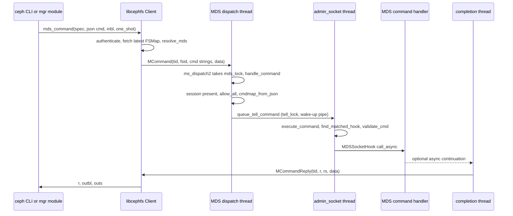
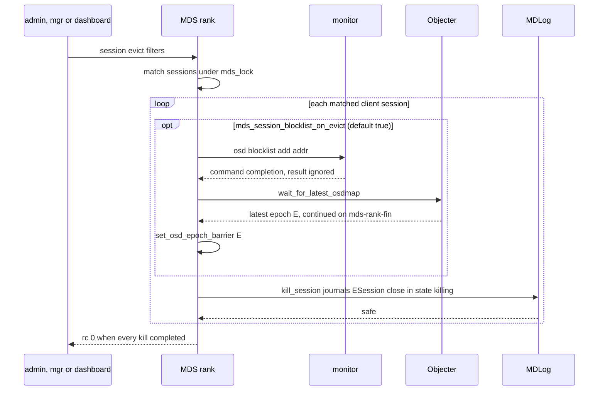
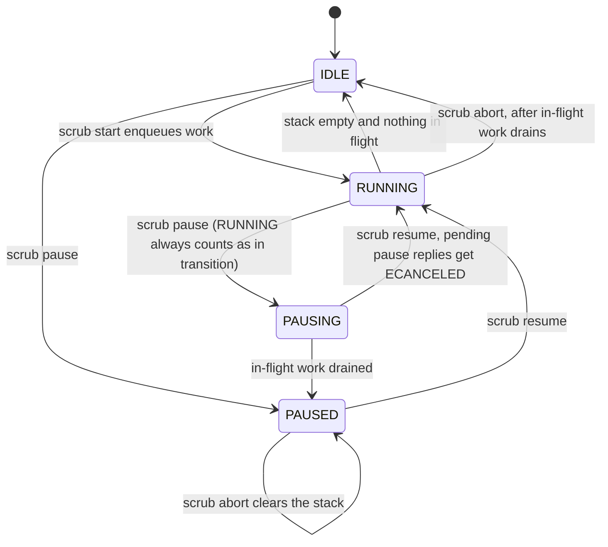
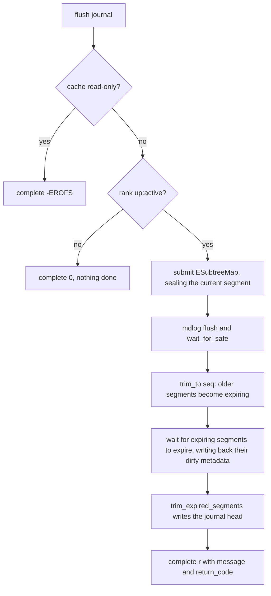

# MDS admin commands: admin socket and `tell`

> Part of the [C++ MDS project map](../README.md). Sources (commit `5f7e383ae6d`): `src/mds/MDSDaemon.cc` (lines 128-626, 770-831, 1130-1169; ~560 LOC in scope), `src/mds/MDSRank.cc` (lines 82-466, 2656-3720, 3870-4120, 4226-4379; ~1,700 LOC), `src/mds/MDSRankQuiesce.cc` (49-242), `src/mds/MDSRankQuarantine.cc` (46-94), helpers in `src/mds/MDCache.cc`, `src/mds/ScrubStack.cc`, `src/mds/SessionMap.cc`, `src/mds/Migrator.cc`, `src/mds/MDBalancer.cc`, `src/mds/DamageTable.cc`, `src/mds/MDSDmclockScheduler.cc`, `src/mds/Snap{Server,Client}.cc`, the generic plumbing in `src/common/admin_socket.cc` (1,191), `src/common/cmdparse.cc` (747), `src/common/ceph_context.cc`, `src/mon/MonClient.cc`, the client side in `src/client/Client.cc` (`mds_command`, ~350 LOC), `src/pybind/ceph_argparse.py`, `src/ceph.in`, `src/pybind/ceph_daemon.py`, and the consumers in `src/pybind/mgr/{mgr_module.py,volumes,stats,dashboard,telemetry,cephadm}`, `src/exporter/DaemonMetricCollector.cc`, `qa/tasks/cephfs/**`, `qa/workunits/cephtool/test.sh`. External read-only sources: the Linux CephFS client (7.3.0-rc6, `af32da41b03`), Rook (`f190ca3b45f`, 2026-10-06) and NFS-Ganesha (`581abb64230`).
> Related: [process-and-threading](../00-architecture/process-and-threading.md), [mds_lock-analysis](../00-architecture/mds_lock-analysis.md), [mgr-tools-and-orchestration](../01-cluster-integration/mgr-tools-and-orchestration.md), [auth-and-mds-caps](../01-cluster-integration/auth-and-mds-caps.md), [fsmap-and-mdsmap](../01-cluster-integration/fsmap-and-mdsmap.md), [sessions](../02-client-protocol/sessions.md), [capabilities](../02-client-protocol/capabilities.md), [request-lifecycle](../03-request-path/request-lifecycle.md), [mdcache-subtrees-traversal-replication](../04-cache/mdcache-subtrees-traversal-replication.md), [mdcache-lifecycle-trim-and-memory](../04-cache/mdcache-lifecycle-trim-and-memory.md), [dirfrags-and-fragmentation](../04-cache/dirfrags-and-fragmentation.md), [acquiring-locks](../05-locking/acquiring-locks.md), [mdlog-and-journaler](../06-journal/mdlog-and-journaler.md), [rados-and-osd-interactions](../07-storage-formats/rados-and-osd-interactions.md), [subtree-migration](../08-multi-mds/subtree-migration.md), [balancer-and-pinning](../08-multi-mds/balancer-and-pinning.md), [snapshots](../10-snapshots-quotas-subvolumes/snapshots.md), [strays-and-purge](../11-background-services/strays-and-purge.md), [scrub-and-damage](../11-background-services/scrub-and-damage.md), [qos-dmclock-scheduler](../12-qos-metrics-quiesce-quarantine/qos-dmclock-scheduler.md), [quiesce](../12-qos-metrics-quiesce-quarantine/quiesce.md), [quarantine](../12-qos-metrics-quiesce-quarantine/quarantine.md), [config-perf-counters-and-health](./config-perf-counters-and-health.md).

## 1. Purpose and responsibilities

The MDS exposes an administrative command plane that is separate from the client protocol. It consists of:

- **60 MDS-specific commands** registered by `MDSDaemon::set_up_admin_socket` (src/mds/MDSDaemon.cc:295-620). Six of them are daemon-level and run without a rank; the other 54 are executed by `MDSRankDispatcher::handle_asok_command` (src/mds/MDSRank.cc:2656-3147) and need an `MDSRank` object.
- **36 process-generic commands** registered by common code that every Ceph daemon carries (`AdminSocket`, `CephContext`, mempool observer, `MonClient`, `Objecter`, `AsyncMessenger`; section 5.2). The count is for the default build (`WITH_CPUTRACE` is OFF, CMakeLists.txt:460). It is 35 until the daemon holds an `MDSRank`, because `objecter_requests` is only registered when `MDSRankDispatcher::init` calls `Objecter::init` (src/mds/MDSRank.cc:590-595). Several of them are consumed by tooling (`counter dump`, `config show`, `dump_mempools`, `rotate-key`, `get_command_descriptions`).
- **Two transports with one command table**: the local Unix admin socket (`ceph daemon mds.X ...`, `ceph --admin-daemon <path> ...`, ceph-exporter) and the remote `tell` path (`MCommand`/`MCommandReply`, used by `ceph tell mds.X ...`, mgr modules through libcephfs `mds_command2`, and Python `cephfs.LibCephFS.mds_command`). Both end in the same asynchronous `AdminSocket::execute_command` (src/common/admin_socket.cc:520-629), which invokes the hook's `call_async`.
- **Periodic task status**: while scrub is not idle, the rank pushes a `scrub status` summary to the mgr service map every `mds_task_status_update_interval` (src/mds/MDSRank.cc:4308-4346).

Responsibilities in scope: framing and transport, authorization of remote commands, parsing and validation against command descriptors, self-description (`get_command_descriptions`), dispatch to daemon or rank handlers, the semantics and outputs of every command, and their locking.

Consumer classes used throughout this page (column "Consumers" in section 5.1):

| Flag | Meaning |
|---|---|
| **P** | Peer-critical: called by production code of an unmodified peer (mgr module, cephadm, ceph-exporter, `ceph` CLI machinery). Removing or changing it breaks a peer feature. |
| **O** | Operator procedure: documented in `doc/cephfs/*.rst` as an administrator step (eviction, scrub, damage, disaster recovery, troubleshooting, QoS). |
| **Q** | Relied on by the qa suite (`qa/tasks/cephfs`, `qa/tasks/*.py`, `qa/workunits`). Needed to run the stock tests against a replacement. |
| **D** | Debug or developer only; no consumer found in the tree. |

## 2. Source map

| File | Class / function | Lines | Role |
|---|---|---|---|
| `src/mds/MDSDaemon.cc` | `MDSSocketHook` | 128-149 | Hook object; only `call_async` is used (`call` aborts) |
| `src/mds/MDSDaemon.cc` | `MDSDaemon::asok_command` | 151-242 | Daemon-level commands (`status`, `lockup`, `exit`, `respawn`, `heap`, `cpu_profiler`), else delegates to the rank |
| `src/mds/MDSDaemon.cc` | `MDSDaemon::dump_status` | 244-293 | `status` output |
| `src/mds/MDSDaemon.cc` | `MDSDaemon::set_up_admin_socket`, `clean_up_admin_socket` | 295-627 | Registration of the 60 descriptors; unregistration in `suicide()` |
| `src/mds/MDSDaemon.cc` | `MDSDaemon::handle_command` | 770-831 | `MCommand` admission (session, `allow *`, JSON) then `queue_tell_command` |
| `src/mds/MDSDaemon.cc` | `MDSDaemon::handle_core_message` | 1130-1169 | Routes `MSG_COMMAND` (97); drops legacy `MSG_MON_COMMAND` with a clog warning |
| `src/mds/MDSDaemon.cc` | `MDSDaemon::ms_handle_accept`, `parse_caps` | 1232-1319 | Attaches a `Session` with parsed `MDSAuthCaps` to every accepted connection |
| `src/mds/MDSRank.cc` | `C_Flush_Journal` | 82-234 | `flush journal` state machine |
| `src/mds/MDSRank.cc` | `C_Drop_Cache` (+ `C_ContextTimeout`) | 236-466 | `cache drop` state machine |
| `src/mds/MDSRank.cc` | `MDSRankDispatcher::handle_asok_command` (+ `AsyncResponse`) | 2656-3147 | Rank-level dispatch and per-command locking |
| `src/mds/MDSRank.cc` | `evict_clients`, `dump_sessions` | 3154-3217 | `session evict`/`ls` |
| `src/mds/MDSRank.cc` | `command_scrub_*`, `command_tag_path` | 3219-3272 | Scrub control wrappers |
| `src/mds/MDSRank.cc` | `command_get_subtrees`, `command_export_dir`, `_command_export_dir` | 3274-3340 | Subtree map and manual export |
| `src/mds/MDSRank.cc` | `command_dump_tree`, `_command_dirfrag_get`, `command_dirfrag_split/merge/ls`, `command_openfiles_ls` | 3342-3531 | Cache walks and fragmentation |
| `src/mds/MDSRank.cc` | `C_MDS_QuiescePathCommand`, `command_quiesce_path`, `command_lock_path` | 3533-3632 | Test hooks for quiesce and the lock manager |
| `src/mds/MDSRank.cc` | `command_dump_inode`, `command_dump_dir` | 3634-3684 | Single object dumps |
| `src/mds/MDSRank.cc` | `MDSRank::dump_status`, `dump_clientreplay_status` | 3686-3710 | Rank part of `status` |
| `src/mds/MDSRank.cc` | `config_client`, `evict_client` | 3915-4068 | `session config`, eviction core (blocklist, barrier, kill) |
| `src/mds/MDSRank.cc` | `command_cache_drop`, `get_path`, `get_inode_rbytes` | 4089-4118 | `cache drop`; path/rbytes lookups for the metrics thread |
| `src/mds/MDSRank.cc` | `get_task_status`, `send_task_status`, `inmemory_logger` | 4308-4379 | Task status to mgr; extraordinary-event log dumps |
| `src/mds/MDSRankQuiesce.cc` | `MDSRank::command_quiesce_db` | 49-242 | `quiesce db` (QuiesceDbManager front end) |
| `src/mds/MDSRankQuarantine.cc` | `MDSRank::command_quarantine_dir` | 46-94 | `quarantine enable/disable` |
| `src/mds/SessionMap.cc` | `Session::dump`, `SessionFilter::parse/match` | 647-691, 1276-1412 | Session JSON, filter grammar |
| `src/mds/MDCache.cc` | `cache_traverse`, `request_forward`, `dump_openfiles`, `scan_stray_dir`/`stray_status`, `split_dir`/`merge_dir`, `force_readonly`, `cache_status`, `dump_tree`, `dump_cache`, `enqueue_scrub(_work)`, `flush_dentry(_work)`, `quiesce_path`, `dispatch_lock_path`, `lock_path`, `dump_inode`, `dump_dir` | 8909, 9970, 5829, 10388-10469, 11930-12002, 12871, 13086-13386, 13845-13879, 14480-14645 | Cache-side implementations |
| `src/mds/ScrubStack.cc` | `purge_scrub_counters`, `enqueue`, `scrub_summary`, `scrub_status`, `send_state_message`, `scrub_abort/pause/resume` | 120, 169, 661-834, 866-957 | Scrub control |
| `src/common/admin_socket.cc` | `AdminSocket::entry`, `do_accept`, `do_tell_queue`, `execute_command`, `find_matched_hook`, `register_command`, `VersionHook`, `HelpHook`, `GetdescsHook`, `init` | 277-1149 | Transport, framing, dispatch, built-in commands |
| `src/common/cmdparse.cc` | `dump_cmd_to_json`, `dump_cmd_and_help_to_json`, `validate_arg`, `validate_cmd` | 141-221, 611-692 | Descriptor JSON and validation |
| `src/client/Client.cc` | `Client::resolve_mds`, `fetch_fsmap`, `mds_command`, `handle_command_reply`, command cancellation | 6697-6997, 3339-3357, 18207-18318 | Remote command client used by CLI and mgr |
| `src/pybind/ceph_argparse.py`, `src/ceph.in`, `src/pybind/ceph_daemon.py` | `send_command` (mds branch), `validate_one`, `mdsids`, `help_for_target`, `admin_socket` | 1644-1660, 1025-1050; 199-211, 418-435, 1121-1130, 1256; 34-79 | CLI side of tell and asok |

## 3. How it works

### 3.1 Transport 1: the local admin socket

- Socket path: config `admin_socket`, daemon default `$run_dir/$cluster-$name.asok` (src/common/options/global.yaml.in:286-298), e.g. `/var/run/ceph/ceph-mds.a.asok`. Access control is file-system permission only (`admin_socket_mode`); there is no cephx on this path.
- One thread named `admin_socket` (`AdminSocket::init`, src/common/admin_socket.cc:1146) polls the listening socket and a wake-up pipe (`AdminSocket::entry`, :277-323).
- Request framing (`AdminSocket::do_accept`, :349-443): the client writes a JSON command string terminated by `\0` or `\n`, at most 1023 bytes. A longer request is only logged ("error reading request too long") and the connection is closed without a reply. A leading NUL selects the legacy binary protocol: a 4-byte big-endian code 0, 1, 2 maps to `0` (version), `perfcounters_dump`, `perfcounters_schema`.
- Response framing: 4-byte big-endian length, then the payload. The return code is not transmitted; if it is negative the payload is prefixed with `ERROR: <strerror>\n<error string>\n` (:416-433).
- Local requests use the **synchronous** `execute_command` (:489-518): the admin thread waits on a condition variable until the hook calls its finisher, so an asynchronous command (`flush journal`, `cache drop`, `session evict`, `scrub start`, `quiesce db` with await) blocks every other asok and tell command of the process until it completes.
- `ceph daemon mds.X <cmd>` (`src/pybind/ceph_daemon.py:34-79`) first sends `{"prefix": "get_command_descriptions"}`, validates the arguments locally against the returned signatures, then sends the command; default socket timeout 10 s.

### 3.2 Transport 2: remote `tell` (`MCommand`)

Server side (`MDSDaemon::handle_command`, src/mds/MDSDaemon.cc:770-831, called from `ms_dispatch2` under `mds_lock`, :1088-1114 and :1149-1151):

1. `MSG_COMMAND` is not peer-type filtered (no `ALLOW_MESSAGES_FROM`). The connection's `priv` must hold a `Session`; every accepted connection gets one, even on a rank-less daemon, because `ms_handle_accept` creates a closed `Session` and parses the peer's MDS caps into `session->auth_caps` (:1266-1319). If `priv` is gone (a reset was processed first) the command is dropped without a reply (:774-786); a `one_shot` caller gets `-EPIPE`, others wait.
2. If the session is not a live `SessionMap` session (`state_seq == 0`, no rank, or not in the map), the connection is marked disposable so it is torn down after the reply (:797-807).
3. Authorization: `session->auth_caps.allow_all()` must be true, i.e. some grant whose spec is `*` (or `all`) and whose match has no `path` and no `uid` (`MDSCapMatch::is_match_all`, src/mds/MDSAuthCaps.h:149-152). `uid=0` is stored as "any" (src/mds/MDSAuthCaps.h:139). `path=/` normalizes to the empty path, because leading slashes are stripped (`MDSCapMatch::normalize_path`, src/mds/MDSAuthCaps.cc:158-168). The grant's `fsname=`, `root_squash` and `network` restriction are **not** checked, so `mds 'allow * fsname=a'` may run tell commands on the MDS daemons of every file system (`MDSAuthCaps::allow_all`, src/mds/MDSAuthCaps.cc:585-594; `MDSCapGrant::network`, src/mds/MDSAuthCaps.h:233-255). Without cephx (`auth_service_required = none`, or Kerberos), the authorizer sets `AuthCapsInfo::allow_all` for every peer (src/auth/none/AuthNoneAuthorizeHandler.cc:47, src/auth/krb/KrbAuthorizeHandler.cpp:50). `parse_caps` then installs an `allow *` grant (src/mds/MDSDaemon.cc:1232-1237, src/mds/MDSAuthCaps.cc:407-412), so any client may run every command. Under cephx a service ticket never carries `allow_all` (src/auth/cephx/CephxProtocol.cc:524-526). Otherwise the reply is `-EACCES` "permission denied" (:810-816). cephadm gives the mgr `mds 'allow *'` (src/pybind/mgr/cephadm/services/cephadmservice.py:1409-1412), and its bootstrap keyring gives `client.admin` and the first mgr `caps mds = allow *` (src/cephadm/cephadm.py:2528-2542).
4. Empty `cmd` gives `-EINVAL` "no command given"; unparsable JSON gives `-EINVAL` (:817-821).
5. Otherwise `AdminSocket::queue_tell_command(m)` (src/common/admin_socket.cc:655-660) appends to `tell_queue` and wakes the admin thread, which runs `do_tell_queue` (:445-487) with the **asynchronous** `execute_command`: the admin thread returns as soon as the hook returns, and the reply `MCommandReply(r, err)` with the request `tid` and `data = outbl` is sent from whichever thread completes the command.
6. Legacy `MMonCommand` ("`mds tell`" through the monitor) is dropped with clog warning "dropping `mds tell` command from legacy monitor" (src/mds/MDSDaemon.cc:1160-1163), although `AdminSocket` still has a legacy queue.

Wire format: `MCommand` (type 97) payload = `uuid fsid`, `vector<string> cmd`; `data` = input buffer. `MCommandReply` (type 98) payload = `errorcode32_t r` (host errno converted to the Linux value on the wire), `string rs`; `data` = output buffer (src/messages/MCommand.h:24-58, src/messages/MCommandReply.h:24-66).

### 3.3 Client-side routing (CLI and libcephfs)

- `ceph tell mds.<spec> ...` goes through `ceph_argparse.send_command` (src/pybind/ceph_argparse.py:1644-1660): it creates `LibCephFS(rados_inst=cluster)`, calls `mds_command(spec, cmd, inbuf)` and shuts the instance down. For `mds.*` the CLI itself expands the target list from `fs dump`: all standbys plus every `mdsmap.info[].name` (src/ceph.in:199-211, 1240-1242) and loops, fetching `get_command_descriptions` from each target before sending (src/ceph.in:1256). `ceph tell mds.X help` validates the name against the same list, so only a daemon name or `*` is accepted there, not a role or gid (`validate_target`, src/ceph.in:237-267). It then prints help from the descriptors (src/ceph.in:1121-1130, 418-435); on `-EPERM`/`-EACCES` it prints "Check that your user has 'allow *' capabilities for the target daemon type".
- Argument parsing in the CLI follows the descriptor types: for an `n=N` argument that is not a positional `CephString`, comma separated words are split (`validate_one`, src/pybind/ceph_argparse.py:1025-1050), so `scrub start / recursive,repair` arrives as `"scrubops": ["recursive","repair"]`. Arguments after `--` in a descriptor are named-only (`positional=false`, src/common/cmdparse.cc:150-155, 186-188).
- `Client::mds_command` (src/client/Client.cc:6847-6944): authenticate, fetch the latest FSMap (one-time `fsmap` subscription, `fetch_fsmap` :6797-6838), resolve targets with `resolve_mds` (:6697-6770):
  - a role (`<fs name or fscid>:<rank>`, or a bare rank of the legacy client fs, `FSMap::parse_role`, src/mds/FSMap.cc:1247-1289) maps to the rank holder's gid; `-EAGAIN` if the rank is down;
  - otherwise an integer is a gid (`-ENOENT` if absent), `*` means every MDS in the FSMap (`-ENOENT` if none), anything else is a daemon name (`-ENOENT` if unknown).
  - Laggy targets are skipped; if all are laggy the result is `-ENOENT` "All targeted MDS daemons are laggy".
  - With `one_shot` the client sends a keepalive and aborts with `-EPIPE` if the connection resets, is reset by the peer or is refused (:18207-18245, 18300-18318). Independently of `one_shot`, a command whose target becomes DNE or laggy in a later MDSMap is cancelled with `-ETIMEDOUT` "MDS <gid> went away" (`cancel_commands`, :3337-3357, called from `handle_mds_map` :3374). Only a **mounted** handle receives MDSMaps (`subscribe_mdsmap`, :7002-7039, is called from `mount` :7060 and from session reclaim), so this applies to the volumes evictor's mounted handle but not to the unmounted handles used by `ceph tell` and `MgrModule.send_command`; a gid that is not in the mounted file system's MDSMap counts as DNE.
  - Multi-target replies (more than one non-laggy target, e.g. `*` with several daemons): successful outputs are concatenated as `[{"mds.<name>": <out>},...]` (:6962-6985).
- mgr modules call `MgrModule.send_command(..., 'mds', spec, json, tag, one_shot=...)`, which uses a shared **unmounted** `LibCephFS` (`mds_command2`; src/pybind/mgr/mgr_module.py:2049-2053, 2650-2661); `tell_command` wraps it synchronously (:1945-1968). The volumes evictor uses the module's **mounted** filesystem handle instead (`self._fs.mds_command`, src/pybind/mgr/volumes/fs/operations/rankevicter.py:86-90).

### 3.4 Parsing, validation, formatting and return codes

`AdminSocket::execute_command` (src/common/admin_socket.cc:520-629):

1. `cmdmap_from_json` builds a `cmdmap_t` (map of name to string, bool, int64, double or vectors of them); failure is `-EINVAL` "invalid json".
2. `prefix` selects the hook by **exact** match on the registered prefix (multimap `hooks`, `find_matched_hook` :631-653); unknown prefix is `-EINVAL` "unknown command prefix 
".
3. `validate_cmd` checks the cmdmap against the registered descriptor (src/common/cmdparse.cc:652-692): missing **non-vector** required arguments (`missing required parameter`; a scalar argument is required unless its descriptor says `req=false`), value types (a value of the wrong JSON type fails; JSON integers become `int64_t`, so an integer literal for a `CephFloat` argument such as `quiesce db --timeout` is rejected, src/common/cmdparse.cc:405-411 and src/common/cmdparse.h:71-85), integer and float ranges, `CephChoices` membership, `CephBool` (a `CephBool` without `req=false` is required, `validate_bool`, :583-603). A failure here returns `-EINVAL` "invalid command json". Vector (`n=N`) arguments are never required even with `req=true` (`validate_arg`, :619-623). Keys not in the descriptor are ignored.
4. Output format: `format` key; `Formatter::create(format, "json-pretty", "json-pretty")` accepts `json`, `json-pretty`, `xml`, `xml-pretty`, `table`, `table-kv`, `html`, `html-pretty`, anything else falls back to `json-pretty` (src/common/Formatter.cc:99-128). Commands that build their own buffer (`quiesce db`, `quarantine`, `exit`, `respawn`, `heap`) ignore it.
5. `output-file` (CLI `--daemon-output-file`): JSON is written to a file on the daemon host (`:tmp:` uses `tmp_file_template`, default `$tmp_dir/$cluster-$name.XXXXXX`); only `json`/`json-pretty` allowed (`-EINVAL` "unsupported format for --output-file", which includes an absent `format`, so the caller must pass `--format json|json-pretty` explicitly), `-EIO` if the file cannot be opened; the reply becomes `{path, result, output, len}` even when the command failed (:545-575, 603-617).
6. When the hook finishes: if the hook produced no output buffer and `r >= 0`, the formatter is flushed into the output. **If `r < 0` the formatter content is discarded** (:618-621). Handlers that want JSON on error flush it themselves: `AsyncResponse` (`flush journal`, `flush_path`, `scrub abort|pause`, src/mds/MDSRank.cc:2668-2686), `quiesce path`, `lock path` (:3564-3569, :3613-3619), `quiesce db` (src/mds/MDSRankQuiesce.cc:131-181, 230-240), `quarantine` (src/mds/MDSRankQuarantine.cc:71-89).

Dispatch (`MDSDaemon::asok_command`, src/mds/MDSDaemon.cc:151-242): `status`, `lockup`, `exit`, `respawn`, `heap`, `cpu_profiler` are handled by the daemon. Every other MDS command needs `mds_rank`; on a daemon without a rank (standby, booting) it writes `{"error":"mds_not_active"}` to the formatter and returns `-ENOSYS`, so callers see only `-ENOSYS` (the formatter is discarded, rule 6). A `bad_cmd_get` exception from `cmd_getval` becomes `-EINVAL` with the exception text. A prefix that is registered but not matched by `handle_asok_command` returns `-ENOSYS` (:3142-3144); this happens for `scrub_path`.

A standby-replay daemon owns an `MDSRank` (it follows a rank), so rank commands run there against the replayed state; `session evict` returns `-EAGAIN` there because `is_any_replay()` includes standby-replay (src/mds/MDSRank.h:235).

### 3.5 Daemon and process control

- `status` (`MDSDaemon::dump_status`, :244-293): `cluster_fsid`, `whoami` (rank or -1), `id` (global id), `want_state` (beacon), `state` (from the daemon's MDSMap), then, under `mds_lock`, the rank part (`MDSRank::dump_status`, src/mds/MDSRank.cc:3686-3702): `fs_name` and at most one of (by rank state; none in `up:active`, `up:stopping` and the other states) `replay_status{journal_read_pos, journal_write_pos, journal_expire_pos, num_events, num_segments}` (replay and standby-replay, `MDLog::dump_replay_status`, src/mds/MDLog.cc:1655-1664), `resolve_status{resolve_gather, resolve_ack_gather}`, `reconnect_status{client_reconnect_gather}`, `rejoin_status{rejoin_gather, rejoin_ack_gather, num_opening_inodes}`, `clientreplay_status{clientreplay_queue, active_replay}`, plus `rank_uptime`; then `mdsmap_epoch`, `osdmap_epoch` and `osdmap_epoch_barrier` (both 0 without a rank), `uptime`, `sysinfo{ceph_version, ceph_version_short, ceph_release, os, kernel_version, kernel_description, hostname, arch, mem_total_kb?, ..., container fields if set}` (`collect_sys_info`, src/common/util.cc:233-384), `endian`.
- `lockup <millisecs>` sleeps in the admin thread while holding `mds_lock` (dev aid to simulate a hung rank).
- `exit` / `respawn` reply "Exiting..." / "Respawning..." in plain text, then a detached thread sleeps 1 s, takes `mds_lock` and calls `suicide()` (beacon `DNE`, shutdown, process exit) or `respawn()` (`execv` of `/proc/self/exe` with the original argv, same PID; `_exit(0)` if `mds_valgrind_exit`) (src/mds/MDSDaemon.cc:179-201, 972-1084). The respawned process authenticates again and so appears in the FSMap under a new gid. The cephtool test sends `respawn` by rank (`mds.0`) and by name and waits for the rank-holder gid to change (qa/workunits/cephtool/test.sh:941-957).
- `heap <heapcmd> [value]` passes to tcmalloc (`ceph_heap_profiler_handle_command`), `-EOPNOTSUPP` "not using tcmalloc" otherwise. `cpu_profiler status|flush` drives gperftools; text goes to the status string.

### 3.6 Op tracking

All MDS requests (client, peer and internal) are `TrackedOp`s in `MDSRank::op_tracker` (`OpTracker(cct, mds_enable_op_tracker, osd_num_op_tracker_shard)`, src/mds/MDSRank.cc:485-486).

- `dump_ops_in_flight`, `dump_blocked_ops` (ops older than `mds_op_complaint_time`), `dump_blocked_ops_count`, `dump_historic_ops` (arrival order), `dump_historic_ops_by_duration` run **without** `mds_lock`, under the OpTracker shard locks (src/common/TrackedOp.cc:165-191, 240-249, 283-326). Shapes: `{ops:[op...], num_ops}`, `{ops:[...], complaint_time, num_blocked_ops}`, `{complaint_time, num_blocked_ops}`, `{size, duration, ops:[...]}`. Each op: `description`, `initiated_at`, `age`, `duration`, `continuous`, `type_data{result, flag_point, reqid, op_type, (leader_info, request_info | internal_op, op_name), events[], locks}` (`MDRequestImpl::_dump`, src/mds/Mutation.cc:508-580). If tracking is disabled the status string says "op_tracker disabled; set mds_enable_op_tracker=true to enable" and the rc is 0.
- `ops [--flags=locks] [--path=<file>]`: like `dump_ops_in_flight`; with `locks` it takes `mds_lock` and fills `locks[]` (`object`, `object_string`, `lock`, `flags`, `wrlock_target`) via `dump_with_mds_lock`; with `path` it writes compact JSON to that file on the MDS host and returns `{path}` (src/mds/MDSRank.cc:2692-2723).
- `op get [--flags=locks] <reqid>` and `op kill <reqid>` parse `<entity>.<num>:<tid>` (`metareqid_t(string_view)`, src/mds/metareqid_t.h:19-34; `-EINVAL` "malformed id"), take `mds_lock`, return `-ENOENT` "request does not exist" if absent. `op kill` dumps `{result:0, request}` and calls `MDCache::request_kill` (src/mds/MDCache.cc:10155-10184): a request that has peer witnesses or waits on peers (other than `LOCK_PATH`) is not killed; it is only marked aborted if it has not acquired all its locks yet, otherwise left running. This is the release mechanism for `lock path` and `quiesce path` ops.

### 3.7 Sessions and eviction

Filter grammar (`SessionFilter::parse`, src/mds/SessionMap.cc:1276-1374), each argument one of:

| Form | Meaning |
|---|---|
| `<n>` (no `=`) | session id (`strict_strtoll`, else `-EINVAL` "Invalid filter"); parsing **stops** here and later filters are ignored (pre-Octopus compatibility). A bare `0` is accepted and sets `id=0`, which means "any", so `session evict 0` evicts every client of the rank. qa relies on this bare form (`session evict <id>`, qa/tasks/cephfs/test_client_recovery.py:200) |
| `id=<n>` | client global id; `id=0` is `-EINVAL` "Invalid value"; the value goes through `std::stoi` first, so a non-number or a value outside the 32-bit `int` range is `-EINVAL` "Invalid input". `id=*` **stops parsing** without setting `id`: criteria parsed before it still apply, later ones are ignored, so on its own it matches everything |
| `auth_name=<id>` | cephx entity id without type (`EntityName::get_id`) |
| `state=<name>` | `closed\|opening\|open\|closing\|stale\|killing` |
| `reconnecting=true\|false\|1\|0` | whether the client is still awaited in reconnect (`Server::waiting_for_reconnect`) |
| `client_metadata.<key>=<value>` | exact match on a client metadata key (e.g. `root`, `hostname`, `entity_id`); `client_metadata.` with an empty key is an invalid key |

All present criteria must match (`SessionFilter::match`, :1376-1412). Only `client.*` sessions are listed or evicted.

- `session ls|client ls [--cap_dump] [filters...]` (under `mds_lock`): array of `Session::dump` (src/mds/SessionMap.cc:647-691): `id`, `auth_name{type,type_str,id}`, `entity{name{type,num},addr{type,addr,nonce}}`, `state`, `num_leases`, `num_caps`, `caps[]` (only with `cap_dump`), `request_load_avg` (open or stale only), `uptime`, `requests_in_flight`, `num_completed_requests`, `num_completed_flushes`, `reconnecting`, `importing_count`, `recall_caps`, `release_caps`, `recall_caps_throttle`, `recall_caps_throttle2o`, `session_cache_liveness`, `cap_acquisition` (each `{value, halflife}`), `last_trim_completed_requests_tid`, `last_trim_completed_flushes_tid`, `delegated_inos[{start,length}]`, then `session_info_t::dump`: `inst` (string), `completed_requests[{tid,created_ino}]`, `prealloc_inos[{start,length}]`, `client_metadata{client_features{feature_bits}, metric_spec{metric_flags{feature_bits}}, <every metadata key as a string>}` (src/mds/mdstypes.cc:648-654, 719-742). `feature_bits` is a string `0x` followed by 16 hex digits per 64-bit word, most significant word first, or `0x0` for an empty set (`feature_bitset_t::print`, :575-588).
- `session evict|client evict <filters...>` (`evict_clients`, src/mds/MDSRank.cc:3154-3197): `-EAGAIN` "MDS is replaying log" in replay or standby-replay; bad filter `-EINVAL`; no match: rc 0 with status "no hosts match". Otherwise each matched session goes through `evict_client(id, wait=false, blocklist=mds_session_blocklist_on_evict, ..., gather sub)` and the reply is sent when all kills have completed.
- `session kill <client_id>` (string, parsed with `strtol`): same eviction with `wait=true`; the admin thread blocks (releasing `mds_lock`) for the blocklist round trip and the journaled kill; `-ENOENT` if the session is unknown or the rank is replaying.
- `session config|client config <client_id> <option> [<value>]` (`config_client`, :3915-3949): only `option == "timeout"`; with a value (checked with `strtoul(value, &end, 0)` and `*end == 0`, so hex, octal, a leading `-` and the empty string are accepted; the string is stored as given, otherwise `-EINVAL`) it sets `client_metadata["timeout"]`, without a value it removes it (`-ENODATA` if absent); unknown session `-ENOENT`; other options `-EINVAL` "Invalid config option". The session is not marked dirty (`_mark_dirty` is commented out, :3942). The key changes idle handling in `Server::find_idle_sessions` only for open sessions already past `session_timeout`: 0 means never mark the session stale, otherwise the session is evicted directly (without passing through stale) once its cap-renew age reaches `timeout` plus the dispatch-queue age (src/mds/Server.cc:1272-1289). The `session_autoclose` check runs first (:1254-1260), so such a session is still evicted after `session_autoclose` (300 s by default) whatever `timeout` says. At reconnect, sessions carrying the key are kept for reclaim instead of being evicted. Per the code comment, the rank does not go active until they are killed or reclaimed (:1898-1910). The same metadata key is set by libcephfs clients themselves through `ceph_set_session_timeout` (`Client::set_session_timeout`, src/client/Client.cc:18850-18857). NFS-Ganesha's Ceph FSAL calls it with 300 s before `ceph_start_reclaim` (nfs-ganesha 581abb64230, src/FSAL/FSAL_CEPH/main.c:815, 834). The admin command is therefore a manual override of a value that clients normally send at session open.

Eviction core (`MDSRank::evict_client`, src/mds/MDSRank.cc:3951-4068); details of session teardown are in [sessions](../02-client-protocol/sessions.md):

The blocklist command is the JSON `{"prefix":"osd blocklist","blocklistop":"add","addr":"<session addr>"}` sent with `MonClient::start_mon_command` (no expiry, so the monitor default applies). Each eviction logs clog info "Evicting (and blocklisting) client session <id> (<addr>)" and sets `client_eviction_dump` for the in-memory logger (section 3.15).

### 3.8 Scrub, tagging and damage

All scrub control except `scrub status` requires rank 0 (`-EXDEV` "Not rank 0"). `scrub start|abort|pause|resume` also require `up:active` (`-EINVAL` "MDS is not active"), and that check runs first, so a non-active rank other than 0 gets `-EINVAL` (src/mds/MDSRank.cc:2889-2994). `tag path` and `scrub purge_status` check only the rank. Rank 0 propagates abort, pause and resume to the other up ranks with `MMDSScrub` (`OP_ABORT`, `OP_PAUSE`, `OP_RESUME`; `ScrubStack::send_state_message`, src/mds/ScrubStack.cc:866-876). Mechanics of multi-rank scrub are in [scrub-and-damage](../11-background-services/scrub-and-damage.md).

- `scrub start <path> [force,recursive,repair,scrub_mdsdir] [tag]`: queued to the `mds-rank-fin` finisher, which takes `mds_lock` and calls `MDCache::enqueue_scrub` (src/mds/MDCache.cc:13313-13356). Path `~mdsdir` (own rank) or `~mds<N>` selects that rank's MDS directory inode (src/mds/MDCache.cc:13321-13335); `scrub_mdsdir` is honoured only with path `/` (src/mds/MDSRank.cc:3227-3236). Without a tag a random UUID is used and the scrub is "internal" (no on-disk tag). It starts internal request `CEPH_MDS_OP_ENQUEUE_SCRUB` (0x1503), which does `path_traverse(DISCOVER|RDLOCK_PATH)`, rejects an inode already being scrubbed (`-EBUSY`), and `ScrubStack::enqueue` (`-EAGAIN` while an abort is in progress, `-EEXIST` for a duplicate tag; src/mds/ScrubStack.cc:169-205). Output `{return_code, scrub_tag, mode:"asynchronous"}` (`scrub_tag` and `mode` only if 0). **The command's rc is always 0**; the outcome is only in `return_code` (`C_MDS_EnqueueScrub::finish` sets `r = 0`, src/mds/MDCache.cc:13288-13311).
- `tag path <path> <tag>`: rank 0 only; `enqueue_scrub(path, tag, force=true, recursive=true, repair=false)` and the admin thread waits (without `mds_lock`) until the enqueue completes (src/mds/MDSRank.cc:3244-3253). Because the tag is user supplied, scrub writes xattr `scrub_tag` (encoded string) on each scrubbed inode's first object in its backtrace pool (src/mds/CInode.cc:4965-4976); `cephfs-data-scan --filter-tag` skips objects carrying that tag (src/tools/cephfs/DataScan.cc:734-745).
- `scrub abort` / `scrub pause` (finisher, then `mds_lock`): `{message, return_code}`; they complete immediately when the stack is not running, otherwise when in-flight scrubs drain. `pause` while an abort is in progress returns `-EINVAL`. `scrub resume` (under `mds_lock`) outputs `{return_code}` with command rc 0. `ScrubStack::scrub_resume` is declared `bool` but computes `int r = -EINVAL` while an abort is pending, so the reported `return_code` is **1** (not `-22`) in that case and 0 otherwise (src/mds/ScrubStack.h:83, src/mds/ScrubStack.cc:936-957, src/mds/MDSRank.cc:3255-3262). qa only asserts `return_code == 0`.
- `scrub status` (any rank, `mds_lock`): `{status, scrubs{<tag>:{path, tag, options}}, scrub_stats{<tag>:{start_time, path, uninline_started, uninline_passed, uninline_failed, uninline_skipped}}}`. `options` is a comma-joined subset of `recursive,repair,force,scrub_mdsdir`. `scrub_stats` is present only when the per-rank stats vector is non-empty (src/mds/ScrubStack.cc:797). That vector is sized only by rank 0's tick while a scrub is tracked (`advance_scrub_status`, :1277-1322, called for `whoami == 0` from src/mds/MDSRank.cc:763-766), so other ranks, and rank 0 before its first scrub, omit the key. `status` is one of "no active scrubs running", "IDLE (waiting for more scrubs)", "scrub active (N inodes in the stack)", "ABORTING (N inodes in the stack)", "PAUSING (...)", "PAUSED (...)", "PAUSING+ABORTING (...)", "PAUSED+ABORTING (...)" (src/mds/ScrubStack.cc:715-834). With JSON the top-level `result` section name is dropped, as for every top-level section (the JSON formatter ignores names when no section is open, src/common/JSONFormatter.cc:76-81).
- `scrub purge_status <tag|all>` (rank 0, `mds_lock`): drops the uninline statistics kept per tag (otherwise expired after `mds_scrub_stats_review_period` days, src/mds/ScrubStack.cc:120-158).
- `scrub_path` is registered (src/mds/MDSDaemon.cc:349-355) but has no handler branch, so it always returns `-ENOSYS`; conversely `scrub_start` has a branch but no registration, so it is unreachable (unknown prefix).

- `damage ls` (`mds_lock`): array of entries `{damage_type: dir_frag|dentry|backtrace|uninline, id, ino, path, ...}` with type-specific `frag`, `dname`, `snap_id`, `rank`, `errno`, `scrub_tag` (src/mds/DamageTable.cc:50-163, 343-351). Ids are random 32-bit values. The table is in memory only (no encode/decode in DamageTable.cc), so it is empty after a restart. A non-empty table raises `MDS_HEALTH_DAMAGE` (HEALTH_ERR) in the beacon (src/mds/Beacon.cc:322-323).
- `damage rm <damage_id>`: erases the entry; an unknown id is a silent no-op with rc 0 (:353+).

### 3.9 Journal and durability commands

- `flush journal` (`C_Flush_Journal`, src/mds/MDSRank.cc:82-234) starts under `mds_lock` in the admin thread and completes asynchronously; continuations run in the journal and finisher threads. Output `{message, return_code}`; rc equals `return_code`. Errors carry "Error <r> (<str>) while flushing journal|trimming log|writing header" (`MDLog::trim_to` can return `-EAGAIN` if a segment still has pending events, src/mds/MDLog.cc:855-883).
- `flush_path <path>`: internal op `CEPH_MDS_OP_FLUSH` (0x1502): `rdlock_path_pin_ref(want_auth=true)` then `CInode::flush` stores the backtrace if the parent pointer is dirty and commits the parent dirfrag (or stores a base inode) if the inode is dirty (src/mds/MDCache.cc:13845-13879, src/mds/CInode.cc:1320-1344). `-EROFS` if read-only. Internal requests are never forwarded: on a non-auth rank the op completes with `-EXDEV` (`MDCache::request_forward`, src/mds/MDCache.cc:9984-9987).
- `force_readonly` (`mds_lock`): `MDCache::force_readonly` sets the read-only flag, clog warns "force file system read-only", sends `MClientSession(CEPH_SESSION_FORCE_RO)` to every open or stale client session (`Server::force_clients_readonly`, src/mds/Server.cc:2105-2119), re-evaluates the cap locks of every head inode (revoking write caps; heartbeat reset every `heartbeat_reset_grace` inodes) and flushes the log (src/mds/MDCache.cc:12871-12894). There is no command to undo it (`MDCache` has `set_readonly` but no reset, src/mds/MDCache.h:1304); it lasts until the daemon restarts. The same path is taken automatically on unhandled metadata write errors when `mds_action_on_write_error == 1`, which is the default (src/mds/MDSRank.cc:973-991, src/common/options/mds.yaml.in:1426). `-EBLOCKLISTED` always respawns instead. `MDS_HEALTH_READ_ONLY` (HEALTH_WARN) is reported (src/mds/Beacon.cc:483).
- `osdmap barrier <target_epoch>`: under `mds_lock` sets `osd_epoch_barrier = target_epoch` (plain assignment, so it can lower the barrier), then blocks the admin thread without `mds_lock` until the Objecter has that OSDMap epoch (`objecter->wait_for_map(..., use_blocked)`, src/mds/MDSRank.cc:2819-2834). The barrier is sent to clients in cap messages ([rados-and-osd-interactions](../07-storage-formats/rados-and-osd-interactions.md)).

### 3.10 Cache inspection and control

- `cache drop [timeout]` (`C_Drop_Cache`, src/mds/MDSRank.cc:236-466; queued to the finisher which takes `mds_lock`): repeat `Server::recall_client_state(STEADY|TRIM)`, which sends `CEPH_SESSION_RECALL_STATE` with a new `max_caps` and a `CEPH_SESSION_FLUSHMSG` to each open client session holding more caps than its new limit (at least `mds_min_caps_per_client`; sessions over the recall throttles are skipped) and gathers the `FLUSHMSG_ACK`s (src/mds/Server.cc:1972-2102); while recall is throttled or still recalling caps and the timeout is not exceeded, it re-arms after 1 s, flushing the log and trimming the cache in the meantime. Then it records `client_recall{return_code, message, recalled}` (`-ETIMEDOUT` if the timeout expired with acks outstanding; the command still continues), runs `C_Flush_Journal` (on failure `cmd_err` resets the formatter, writes and **closes** a fresh `{"error": ...}` object and calls `complete(r)`; `C_Drop_Cache::finish` then appends `duration` and calls `close_section()` on the now empty JSON formatter stack, which trips `ceph_assert(!m_stack.empty())` in `JSONFormatter::close_section` (src/common/JSONFormatter.cc:146). A journal-flush failure inside `cache drop`, for example `-EROFS` on a rank made read-only by `force_readonly` or a write error, therefore aborts the daemon instead of returning an error (inferred from code, not observed; src/mds/MDSRank.cc:388-395, 433-441, 460-465)), trims the cache with `trim(UINT64_MAX)` repeating every 1 s while trimming is throttled and still making progress, and outputs `flush_journal{return_code, message}`, `trim_cache{trimmed}`, `cache{pool{items,bytes}}`, `duration`. `timeout = 0` (default) means no bound: the command waits until every client has acknowledged.
- `cache status` (`mds_lock`): `{pool:{items, bytes}}` of the `mds_co` mempool (src/mds/MDCache.cc:13086-13095).
- `dump cache [path] [timeout]` (`mds_lock` for the whole dump): with `path`, a plain-text dump (one line per inode, dirfrag and dentry, `CDir::check_rstats` run on each dirfrag) to a file opened `O_EXCL` mode 0600 on the MDS host (relative to the daemon's working directory; an empty `path` becomes `cachedump.<mdsmap epoch>.mds<rank>`); without `path`, a JSON array of inode dumps. Refused when the cache exceeds `mds_dump_cache_threshold_formatter` (1 GiB, JSON reports `{"error":"cache usage exceeds dump threshold"}` with rc 0) or `mds_dump_cache_threshold_file` (0 = unlimited; `-EINVAL`). The timeout argument is replaced by `mds_beacon_interval/2` when `<= 0` and capped at `mds_beacon_interval` (default 4 s, integer arithmetic), checked every 1000 inodes (src/mds/MDSRank.cc:3025-3039, src/mds/MDCache.cc:13132-13269).
- `dump tree <root> [depth] [path]` (`mds_lock`): post-order array of inode dumps (children before their parent) starting at a cached path (`cache_traverse`); `~mdsdir` and `~mds<own rank>` are accepted as the first component; with `path` writes a file and returns `{path}`. A root not in cache yields a status message and rc 0 (src/mds/MDSRank.cc:3342-3377, src/mds/MDCache.cc:13097-13116).
- `dump inode <number>`: inode dump including `path` (decimal inode number; not cached gives a status message, rc 0). `dump dir <path> [dentry_dump]`: one entry per leaf fragment, either a `CDir` dump (with dentries if requested) or `{frag, status:"dirfrag not in cache"}` (src/mds/MDSRank.cc:3634-3684).
- `openfiles ls`: inodes on the `open_files` lists of the log segments that have wanted caps (or snap caps), dumped with path, inode-store base and caps (src/mds/MDCache.cc:5829-5850).
- `dump stray`: scans every stray directory (`NUM_STRAY`), fetching incomplete stray dirfrags from RADOS and waiting for frozen ones, and emits an array of `{"ino: ", "stray_prior_path: ", <inode caps dump>}` objects. The array is opened (as top-level section `strays`, whose name the JSON formatter drops, so JSON output is a bare `[...]`) only when the first primary stray dentry is found, so an empty stray set yields **empty output**; the two key names literally contain ": " (src/mds/MDCache.cc:10388-10469, src/mds/MDCache.h:678-689). As a side effect stray dentries are flagged `STATE_STRAY` and unlinked inodes `STATE_ORPHAN`.
- `dump loads [depth]` (`MDBalancer::dump_loads`, src/mds/MDBalancer.cc:1485-1588): breadth-first `dirfrags[]` from the root (sub-dirfrags with `meta_load < 0.001` skipped), `mds_load{mds.N:{request_rate, cache_hit_rate, queue_length, cpu_load, mds_load, auth_dirfrags, all_dirfrags}}`, `mds_meta_load{mds.N: float}`, `mds_import_map{mds.N:[{mds.M: float}]}`; nothing else.
- `dump snaps [--server]`: SnapClient view `{last_created, last_destroyed, snaps[]}` (`-EINVAL` with no message if the client is not synced), or with `--server` the table server view `{last_snap, last_created, last_destroyed, pending_noop[], snaps[], need_to_purge{}, ...}` (`-EXDEV` "Not snapserver" on other ranks) (src/mds/SnapServer.cc:454+, src/mds/SnapClient.cc:324-360).

### 3.11 Subtrees, migration and fragmentation

- `get subtrees` (`mds_lock`): array of `{is_auth, auth_first, auth_second, export_pin, distributed_ephemeral_pin, random_ephemeral_pin, export_pin_target, dir{CDir default dump: path, dirfrag, snapid_first, versions, is_rep, dir_auth, states[], auth state, pins, ...}}` (src/mds/MDSRank.cc:3274-3302, src/mds/CDir.cc:3688-3735).
- `export dir <path> <rank>`: `-ENOENT` if the target is this rank, not up or not in, or the path is not in cache; `-EINVAL` if fragment `frag_t()` of the directory is absent or not auth; otherwise `Migrator::export_dir` (src/mds/MDSRank.cc:3315-3340). `export_dir` silently returns for export-pinned directories with entries, inactive source or target, read-only, degraded cluster, system directory, frozen or freezing, already exporting, stray directory, quiesced or quarantined inode (src/mds/Migrator.cc:920-960); otherwise it starts internal op `CEPH_MDS_OP_EXPORTDIR` (0x1501). Output `{return_code}`, command rc 0; completion of the migration is not reported.
- `dump_export_states` (`mds_lock`): one object per export in progress: `tid`, `path`, `dirfrag`, `state`, `state_history{<state>:{start_at, time_spent}}`, `peer`, and per-state fields (auth-pin progress, `flushed_clients`, `warning_ack_waiting`, `notify_ack_waiting`) (src/mds/Migrator.cc:3359-3430).
- `dirfrag split <path> <frag> <bits>`, `dirfrag merge <path> <frag>`, `dirfrag ls <path>` (`mds_lock`; `frag` is `<hex value>/<bits>`, `frag_t::parse`, src/common/frag.cc:28-36): split needs `bits > 0`, a cached and auth fragment, `can_fragment` (not read-only, not degraded, not root, not mdsdir or `.ceph`, not in stray, not quiesced; every fragment auth, not bad, not frozen or freezing, no scrub or fragmenting in progress; src/mds/MDCache.cc:11874-11928) and resulting depth at most 24 bits; merge needs every fragment under `frag` cached, `frag` not already a leaf, and `can_fragment`. Argument and cache-lookup failures are reported only in the status string with rc 0 (the `bool` results are ignored, src/mds/MDSRank.cc:3091-3096); refusals inside `MDCache::split_dir`/`merge_dir` (`can_fragment`, more than 24 bits, missing fragments) are silent: rc 0, empty status, only a debug log (src/mds/MDCache.cc:11930-12002). `dirfrag ls` lists the leaves of the fragtree under `frag_t()` as `[{value, bits, str}]`, including fragments not in cache.

### 3.12 Lock-manager, quiesce and quarantine commands

- `lock path <path> [locks...] [--ap-dont-block] [--ap-freeze] [--await] [--lifetime <s>]`: internal op `CEPH_MDS_OP_LOCK_PATH` (0x150a). It traverses with `DISCOVER|RDLOCK_PATH|WANT_INODE`, drops the traversal locks, then acquires each `<lock>:<kind>` on the target inode, lock in `quiesce|snap|policy|file|nest|dft|auth|link|xattr|flock`, kind `r|w|x` (anything else `-EINVAL`). `ap_dont_block` makes an auth-pin conflict fail with `-EAGAIN`; `ap_freeze` freezes the inode, otherwise local auth pins are dropped after locking. Once locked it sets `result = 0` and **holds its locks until killed** (`op kill`). `--lifetime` only bounds the acquisition. The timer kills the op with result `-ECANCELED` only if `!mdr->result`, i.e. the `std::optional` result is still unset. A locked op is therefore never released by its lifetime (src/mds/MDCache.cc:14598, 14618-14624; `result` is `std::optional<int>`, src/mds/Mutation.h:256). qa uses it this way: "after the lifetime elapses will return ECANCELED" for an `--ap-freeze --await` op that cannot freeze (qa/tasks/cephfs/test_quiesce.py:753-757). Without `--await` the reply is immediate with the current op dump. With `--await` it is sent once the locks are held, the op fails, or the lifetime expires first (src/mds/MDSRank.cc:3586-3632, src/mds/MDCache.cc:14497-14628). Without `--await`, `MDCache::lock_path` installs no `internal_op_finish`, so any failure path in `dispatch_lock_path` that calls `respond_to_request` (traversal error such as `-ENOENT`, an unknown lock name or kind, an `--ap-dont-block` conflict) reaches `ceph_abort_msg("trying to respond to internal op without finisher")` in `Server::respond_to_request` (src/mds/Server.cc:2182-2189) and aborts the daemon (inferred from code, not observed; qa only uses valid specs without `--await`). `LOCK_PATH`, `QUIESCE_PATH`, `QUIESCE_INODE` and the three quarantine internal ops are created as `continuous` tracked ops (`MDCache::request_start_internal`, src/mds/MDCache.cc:9882-9893), which excludes them from slow-request accounting and warnings (src/common/TrackedOp.cc:410, 461).
- `quiesce path <path> [--await]`: internal op `CEPH_MDS_OP_QUIESCE_PATH` (0x1508); output `{op, state}` (request dump and `QuiesceStatistics`); without `--await` it replies at once with the current state, with `--await` on completion (src/mds/MDSRank.cc:3533-3584); `-EAGAIN` on a rank that is not `up:active` (`MDCache::dispatch_quiesce_path`, src/mds/MDCache.cc:14391-14397). See [quiesce](../12-qos-metrics-quiesce-quarantine/quiesce.md).
- `quiesce db [roots...] -- [--set-id] [--timeout] [--expiration] [--await-for] [--await] [--if-version] [--include|--exclude|--reset|--release|--query|--cancel] [--all]` (src/mds/MDSRankQuiesce.cc:49-242): no `mds_lock`. The operation flags are mutually exclusive (`-EINVAL`), default `include`; `release` and `cancel` take no roots, `cancel` needs `set_id` or `all`, `reset` needs `set_id` and at least one root, `query` takes no roots. Without a manager instance the reply is `-EFAULT`. The request goes to `QuiesceDbManager::submit_request`, which returns `-ENOTTY` unless this MDS is the quiesce-db leader (src/mds/QuiesceDbManager.h:86-96). In that case the reply carries `{epoch, leader}`, where `epoch` is the current **MDSMap** epoch and `leader` the leader gid from the MDSMap (`get_quiesce_db_cluster_leader`), so callers can retry (src/mds/MDSRankQuiesce.cc:229-240). The front-end argument checks above (`-EINVAL`) carry only a status string. Once submitted, the reply comes from the manager thread (`mds-q-db`) with `{epoch, leader, set_version, sets{<id>:{version, age_ref, state{name, age}, timeout, expiration, members{<root>:{excluded, state{name, age}}}}}}`. Here `epoch` is the MDSMap epoch at which the current quiesce membership was set (src/mds/MDSRankQuiesce.cc:265) and `leader` is this daemon's gid. Inactive sets are omitted unless `--all` is given or the set is explicitly addressed. Durations are printed unquoted with one decimal. Manager results are negated positive errnos (`req->complete(-res)`, src/mds/QuiesceDbManager.cc:435-458):
  - `EINVAL`: invalid request or roots, or `--if-version` for a new set (:586-629).
  - `ENOENT`: the set does not exist.
  - `EPERM`: the set's state forbids the operation.
  - `ESTALE`: `--if-version` mismatch (:649-731).
  - `EINPROGRESS`: an await timed out, or leadership was lost during the await.
  - `ETIMEDOUT`: the set timed out or expired.
  - `ECANCELED`: the set was canceled.
  - `EINTR`: the set's roots changed during the await.
  - `EBADF`: the set failed (:815-835, 1115-1170).
  - `ENOTTY`: leadership was lost before the request was processed (:268-287). Then `complete_requests` leaves the response empty, so the body has `epoch` and `set_version` 0, empty `sets`, and `leader` set to this daemon's own gid, not the new leader.
  - `EBUSY` is internal only (an await still pending) and never reaches the caller (:410-427, 1163-1166).
- `quarantine enable|disable <path>` (src/mds/MDSRankQuarantine.cc:46-94): under `mds_lock` starts internal op `CEPH_MDS_OP_QUARANTINEDIR_AUTH` (0x150c) with a `QuarantineTracker`. `MDCache::quarantine_dir_auth` (src/mds/MDCache.cc:15100-15187) traverses with `rdlock_path_pin_ref(want_auth=true)`: a missing path gives the traversal error (e.g. `-ENOENT`); a rank that is not auth for the target **inode** gives `-EXDEV` (internal ops are not forwarded). The inode's authority is that of the dirfrag holding its dentry, so pinning the subvolume directory to another rank does not move it. The inode must be a subvolume root (its snaprealm's subvolume ino equals the inode), else `-EINVAL`; already in the requested state (and no operation in progress) gives 0; an operation in progress gives `-EBUSY`. The reply, built by the tracker callback, is `{return_code, operation:"enable"|"disable", status:"successful"|"failed", error?}` and rc = `return_code`. See [quarantine](../12-qos-metrics-quiesce-quarantine/quarantine.md).

### 3.13 QoS commands

`dump qos`, `qos set <path> <reservation> <weight> <limit>`, `qos rm <path>`, `qos get <path>` run under `mds_lock` and `volume_info_lock` (src/mds/MDSRank.cc:3124-3135, src/mds/MDSDmclockScheduler.cc:163-190, 782-889). The `path` is a QoS volume id, i.e. the subvolume root derived from a session's `client_metadata.root`; a `VolumeInfo` exists only after a session with that root was added on this rank, so `qos set` on another path fails with "volume_info doesn't exist (<path>)". Values must be integers `>= 1` and `reservation <= limit`. Results: `qos set`/`qos rm` output `{return_code}` where **1 means success and 0 failure**, the reason is in the status string, and the command rc is always 0. `dump qos` outputs `{qos_state{qos_enabled, state?, default_reservation?, default_weight?, default_limit?, mds_dmclock_queue_size?, inflight_requests?}, volume_infos[]}` (the optional fields only when enabled); `qos get` outputs the `VolumeInfo` dump as a top-level object (its `volume_qos_info` section name is dropped by the JSON formatter) or, for an unknown path, nothing but the status string, rc 0. Settings are in memory, per rank, applied asynchronously by the scheduler thread. Details in [qos-dmclock-scheduler](../12-qos-metrics-quiesce-quarantine/qos-dmclock-scheduler.md).

### 3.14 Task status to the mgr

Every `mds_task_status_update_interval` (2 s) a timer callback (`mds_lock` held, the timer uses it) calls `get_task_status`: if `ScrubStack::scrub_summary()` is not `idle`, the map `{"scrub status": 
}` is pushed with `MgrClient::service_daemon_update_task_status` and `send_status` is set; when the summary returns to `idle` one empty map is sent and then nothing until the next scrub (src/mds/MDSRank.cc:4308-4346). Summary strings: `idle`, `idle+waiting`, `active`, `aborting`, `pausing`, `paused`, with `+aborting` appended to `pausing`/`paused` while an abort is pending, followed by ` paths [<path>,...]` when scrubs are registered (src/mds/ScrubStack.cc:661-713). The mgr stores it in the service map entry of the daemon (`DaemonServer::update_task_status`, src/mgr/DaemonServer.cc:760-772; sent in `MMgrReport.task_status` only when dirty, src/mgr/MgrClient.cc:437-440); `ceph -s` prints a "task status:" section (src/mon/Monitor.cc:3405-3416, src/mgr/ServiceMap.cc:137-158) and `ceph service dump` shows it.

### 3.15 Extraordinary-event log dumps

If `mds_extraordinary_events_dump_interval` (default 0 = off, max 60 s) is set and `debug_mds` is below 10 with gather level at least 10, a timer dumps the in-memory log ring (`dump_recent`) whenever a client was evicted (`client_eviction_dump`, set by `evict_client`), a beacon ack was missed or an internal heartbeat was missed since the last check (src/mds/MDSRank.cc:4249-4277, 4348-4379).

### 3.16 Who calls what

| Consumer | Commands | Transport, target | Fields or behaviour relied on |
|---|---|---|---|
| `ceph` CLI | `get_command_descriptions` before every tell/daemon command; `help` | tell and asok | descriptor list (section 4.2) |
| mgr `volumes` `fs subvolume evict` (src/pybind/mgr/volumes/fs/volume.py:373-384) | `session evict` with `["auth_name=<id>", "client_metadata.root=<subvolume path>"]` | tell by gid to every up rank in parallel (`RankEvicter`), retried on `-ETIMEDOUT`; waits for `up:active` or `up:clientreplay` | rc only (src/pybind/mgr/volumes/fs/operations/rankevicter.py:70-104, src/pybind/mgr/volumes/fs/operations/versions/subvolume_v1.py:609-650) |
| mgr `volumes` `fs quiesce` | `quiesce db` with the volume command's whole kwargs dict plus `roots` (extra keys such as `vol_name`, `members`, `group_name`, `leader`, `with_leader` are sent) | tell `one_shot` to `mdsmap.qdb_leader` (by gid); on `-ENOTTY` reads `leader` from the JSON output and retries, at most 5 attempts in total | output passed through verbatim (src/pybind/mgr/volumes/fs/volume.py:540-580, src/pybind/mgr/mgr_module.py:1970-2002) |
| mgr `volumes` `fs subvolume quarantine enable\|disable` | `quarantine enable\|disable` with `path=/volumes/<group or _nogroup>/<subvol>` | tell to the gid of the first `up:active`/`up:clientreplay` entry of `mdsmap.up` sorted by key (`mds_0`, `mds_1`, `mds_10`, ...; normally rank 0) | rc and JSON (src/pybind/mgr/volumes/fs/volume.py:815-856); works only if that rank is auth for the subvolume root inode (section 8) |
| mgr `stats` (`fs perf stats`, cephfs-top) | `client ls` (no format: json-pretty) | tell to the rank-0 gid of each filesystem | `id`, `client_metadata.hostname`, `.root` (KeyError if missing), `.mount_point` (optional), `.kernel_version` (optional), `.metric_spec.metric_flags.feature_bits` parsed as hex (src/pybind/mgr/stats/fs/perf_stats.py:165-195, 256-280) |
| mgr `dashboard` | `session ls` (`format=json`), `client evict` (`filters=["id=<n>"]`) | tell to role `<fscid>:0` | `id`, `state`, `client_metadata.{ceph_version, kernel_version, hostname, root}` (src/pybind/mgr/dashboard/controllers/cephfs.py:524-579, 790-805) |
| mgr `telemetry` (`perf_memory_metrics` collection) | `heap` `heapcmd=stats`; `dump_mempools` `format=json` | tell by daemon name from `mds_metadata` | text "tcmalloc heap stats" with 12 integers; `mempool.by_pool.<pool>.{bytes,items}`; errors only logged (src/pybind/mgr/telemetry/module.py:529-650) |
| cephadm key rotation (dormant) | `rotate-key` with the new base64 key as input buffer (`-i -`) | `ceph tell mds.<name>` | rc; on failure it would restart the daemon (`CephadmOrchestrator._rotate_daemon_key`, src/pybind/mgr/cephadm/module.py:3178-3224). In this tree the helper has no caller and `ceph orch daemon rotate-key` raises "not supported in this release" (:3270-3271, 3352-3359) |
| ceph-exporter | `{"prefix":"0"}` ping (expects a 1-byte reply), `counter dump`, `counter schema`, `config show` (`pid_file`) | asok files with `.asok` suffix in `exporter_sock_dir` (cephadm and Rook both deploy it; Rook passes `--sock-dir /run/ceph`, the host-path directory that also holds the MDS pods' `ceph-mds.<id>.asok`; rook f190ca3b45f, pkg/operator/ceph/cluster/nodedaemon/exporter.go:46, 201-202, pkg/operator/ceph/controller/spec.go:57-58, 200-229) | src/exporter/DaemonMetricCollector.cc:236-300, 476-494; src/common/admin_socket_client.cc:128-134 |
| Rook (checked at rook f190ca3b45f of 2026-10-06) | **none** for the MDS. The MDS liveness probe runs `ceph fs dump --format json` with the MDS's own keyring and passes if the daemon name is in `standbys[].name` or in `filesystems[].mdsmap.info[].name` of its file system. It also passes when `fs dump` itself fails (pkg/operator/ceph/file/mds/livenessprobe.sh:11-27, wired at pkg/operator/ceph/file/mds/spec.go:158-159). The generic asok probe (`ceph --admin-daemon /run/ceph/ceph-<type>.<id>.asok status`, pkg/operator/ceph/controller/spec.go:93-99, 649-724) is used for mon, mgr and OSD only. Key rotation uses the mon command `auth rotate` and rewrites the keyring secret. It never sends `rotate-key` to the daemon (pkg/daemon/ceph/client/auth.go:139-151, pkg/operator/ceph/file/mds/config.go:55-62) | mon commands; asok only through ceph-exporter | fields of `fs dump`, a monitor-side contract ([fsmap-and-mdsmap](../01-cluster-integration/fsmap-and-mdsmap.md)) |
| qa | see the Q flags in 5.1; key helpers: `status.state == "up:active"` in `wait_for_daemons` (qa/tasks/cephfs/filesystem.py:1144-1154), `TestValidTell` requires valid JSON from `cache status`, `damage ls`, `dump_blocked_ops`, `dump_blocked_ops_count`, `dump_historic_ops`, `dump_historic_ops_by_duration`, `dump_mempools`, `dump_ops_in_flight`, `flush journal`, `get subtrees`, `ops locks`, `ops`, `status`, `version` (qa/tasks/cephfs/test_admin.py:306-340), `session evict <bare id>` (test_client_recovery.py), `flush_path` (test_scrub_checks.py:263-289), cephtool `injectargs`, `respawn`, `help`, `--daemon-output-file ... version` (qa/workunits/cephtool/test.sh:878-960, 2832-2850), `quiesce db` via `qa/tasks/quiescer.py:137-165` | tell and asok | - |

## 4. Data structures and invariants

### 4.1 AdminSocket state (src/common/admin_socket.h, src/common/admin_socket.cc)

- `hooks`: `std::multimap<std::string prefix, hook_info{hook, desc, help}>`, protected by `lock`. `register_command` returns `-EEXIST` when the first hook already registered under that prefix has an identical descriptor (:670-694); the same prefix may be registered with different descriptors and the first descriptor that validates wins (`find_matched_hook`).
- `in_hook` + `in_hook_cond`: one process-wide flag, set by `find_matched_hook` and cleared when the hook's `call_async` **returns** (not when an asynchronous command completes, :625-628). `unregister_commands(hook)` waits for it to clear before erasing a hook (:696-713); `MDSDaemon::suicide` unregisters while holding `mds_lock` (src/mds/MDSDaemon.cc:988).
- `tell_queue` / `tell_legacy_queue` under `tell_lock`, drained by the admin thread after a byte on the wake-up pipe.

### 4.2 Command descriptor grammar

`<prefix words> name=<arg>,type=<CephString|CephInt|CephFloat|CephBool|CephChoices>[,req=false][,n=N][,range=<min>[|<max>]][,strings=<a>|<b>...] ... [-- <named-only args>]`. `get_command_descriptions` returns `{"cmd000": {"sig": [<literal words>, {name, type, req?, positional?, n?, range?, strings?}], "help": "<text>"}, ...}` (`req` and `positional` appear only when the descriptor states them, as JSON booleans because the hook passes `CEPH_FEATURES_ALL`; everything else is a string) over all registered hooks including the generic ones, numbered in prefix order (`GetdescsHook`, src/common/admin_socket.cc:759-786; `dump_cmd_to_json`, src/common/cmdparse.cc:141-207). `help` lists only prefixes with non-empty help text (:740-757).

### 4.3 SessionFilter

`metadata` (map key to value), `auth_name`, `state`, `id` (0 = any), `reconnecting` (pair: filter on/off, value) (src/mds/SessionMap.h:501-523). Invariant: an empty filter matches every client session, so an `evict` with an empty `filters` list, with `id=*` as its first word, or with a bare `0`, evicts every client of the rank (`id=*` and a bare id end parsing, so only criteria placed before them apply).

### 4.4 Asynchronous command contexts

| Context | Owner thread of completion | Output convention |
|---|---|---|
| `AsyncResponse` (MDSRank.cc:2668-2686) | caller of `complete` (journal, finisher, `mds_lock` holder) | `{message, return_code}` flushed even on error; rc = `return_code` |
| `C_Flush_Journal` (:82-234) | `mds_lock` held at each step (asserts) | writes the error text into the caller's stream |
| `C_Drop_Cache` (:236-466) with self-completing `C_ContextTimeout` (:263-308) | timer (`mds_lock`) and gather completions | builds one object; on journal flush failure resets the formatter to `{"error": ...}` and then trips a formatter assert in `finish()` (3.10) |
| `C_MDS_EnqueueScrub` (MDCache.cc:13288-13311) | request completion under `mds_lock` | `{return_code, scrub_tag?, mode?}`, rc forced to 0 |
| `C_MDS_DumpStrayDirCtx` (MDCache.h:665-703) | finisher after dirfrag fetch | formatter flushed only if rc >= 0 |
| quiesce-db `Ctx` (MDSRankQuiesce.cc:114-182) | QuiesceDbManager thread | always flushes its JSON |
| quarantine tracker callback (MDSRankQuarantine.cc:62-89) | whoever completes the tracker | always flushes its JSON |

### 4.5 Invariants and preconditions

- Remote commands require an `allow *` MDS cap grant without `path` or `uid`; its `fsname`, `root_squash` and `network` are ignored, and without cephx every peer qualifies. Local asok commands require only socket access.
- Scrub start/abort/pause/resume, `scrub purge_status`, `tag path` are accepted only on rank 0; `dump snaps --server` only on the table server rank; `quiesce db` only on the quiesce-db leader.
- Every command that names a file-system path (except `scrub start`, `tag path`, `flush_path`, `lock path`, `quiesce path`, `quarantine`, which start internal requests that traverse and may load metadata) resolves it with `MDCache::cache_traverse`, which never loads from RADOS (src/mds/MDCache.cc:8909-8946). The `path` of `dump cache`, `dump tree` and `ops` is a local output file, and the `path` of the `qos` commands is a volume id string.
- Internal requests started by admin commands (`ENQUEUE_SCRUB`, `FLUSH`, `EXPORTDIR`, `FRAGMENTDIR`, `LOCK_PATH`, `QUIESCE_PATH`, `QUARANTINEDIR_AUTH`) are tracked ops with reqid `mds.<rank>:<tid>`; whenever their traversal would forward the request (always for `FLUSH` and `QUARANTINEDIR_AUTH` on a non-auth rank, since they want auth; `ENQUEUE_SCRUB`, `LOCK_PATH` and `QUIESCE_PATH` traverse with `DISCOVER` and do not need auth) they are cancelled with `-EXDEV` instead (`MDCache::request_forward`, src/mds/MDCache.cc:9984-9987).
- Internal ops started without an `internal_op_finish` (`LOCK_PATH` without `--await`) must never fail through `respond_to_request`, which aborts the daemon in that case (3.12).
- Output of `dump cache <path>`, `dump tree --path`, `ops --path`, `--daemon-output-file` lands on the MDS host's file system, not on the caller's.

## 5. Interfaces

### 5.1 MDS command table (all 60 registered commands)

Lock column: **L** = runs under `mds_lock` (in the admin thread unless noted), **F** = queued to the `mds-rank-fin` finisher which then takes `mds_lock`, **-** = no `mds_lock`, **B** = blocks the admin thread. "rc" is the command return code; "JSON rc" means the outcome is reported in an output field.

| Command and arguments | Output | Effect, errors | Subsystem | Lock | Consumers |
|---|---|---|---|---|---|
| `status` | daemon and rank status (3.5) | none | daemon | rank part L | Q, O |
| `lockup millisecs(int>=0)` | - | sleeps holding `mds_lock` | dev | L+B | D |
| `exit` | text "Exiting..." | `suicide()` after 1 s | daemon | helper thread L | D |
| `respawn` | text "Respawning..." | `execv` self after 1 s | daemon | helper thread L | Q |
| `heap heapcmd(dump\|start_profiler\|stop_profiler\|release\|get_release_rate\|set_release_rate\|stats) [value]` | tcmalloc text | `-EOPNOTSUPP` without tcmalloc | process | - | P (telemetry `perf` channel, opt-in) |
| `cpu_profiler arg(status\|flush)` | text in status string | gperftools control | process | - | D |
| `dump_ops_in_flight` | `{ops[], num_ops}` | none | OpTracker | - | O, Q |
| `ops [flags(locks)...] [path]` | ops, with locks; or `{path}` and a file | none | OpTracker | L only with flags | Q |
| `op get [flags(locks)] id` | one op | `-EINVAL`, `-ENOENT` | requests | L | Q |
| `op kill id` | `{result, request}` | `request_kill` | requests | L | Q |
| `dump_blocked_ops` | `{ops[], complaint_time, num_blocked_ops}` | none | OpTracker | - | Q |
| `dump_blocked_ops_count` | `{complaint_time, num_blocked_ops}` | none | OpTracker | - | Q |
| `dump_historic_ops` | `{size, duration, ops[]}` | none | OpTracker | - | Q |
| `dump_historic_ops_by_duration` | same, by duration | none | OpTracker | - | Q |
| `dump_export_states` | export state array | none | Migrator | L | Q |
| `scrub_path path [scrubops] [tag]` | - | always `-ENOSYS` | scrub | - | none |
| `scrub start path [scrubops(force\|recursive\|repair\|scrub_mdsdir)...] [tag]` | `{return_code, scrub_tag, mode}` | enqueue scrub; rc 0 always, JSON rc; `-EINVAL` not active, `-EXDEV` not rank 0 | ScrubStack | F | O, Q |
| `scrub abort` | `{message, return_code}` | abort all, broadcast to ranks | ScrubStack | F | O, Q |
| `scrub pause` | `{message, return_code}` | pause, broadcast | ScrubStack | F | O, Q |
| `scrub resume` | `{return_code}` (0, or 1 while an abort is pending) | resume, broadcast; rc 0, JSON rc | ScrubStack | L | O, Q |
| `scrub status` | `{status, scrubs, scrub_stats}` | none; any rank | ScrubStack | L | O, Q |
| `scrub purge_status tag` | - | drop per-tag stats (`all`) | ScrubStack | L | D |
| `tag path path tag` | `{return_code, scrub_tag, mode}` | recursive forced scrub writing `scrub_tag` xattrs | ScrubStack | L then B | Q |
| `flush_path path` | `{message, return_code}` | write back one inode and its parent dirfrag; `-EROFS`, `-EXDEV` | MDCache | L, async | Q |
| `export dir path rank(int)` | `{return_code}` | start migration; rc 0, JSON rc | Migrator | L | Q |
| `dump cache [path] [timeout(int>=0)]` | inode array or text file | bounded by thresholds and timeout | MDCache | L (whole dump) | O, Q |
| `cache drop [timeout(int>=0)]` | recall, flush, trim report | recall caps from all clients, flush journal, trim; a journal-flush failure (e.g. read-only rank) asserts | Server, MDLog, MDCache | F, async | Q |
| `lock path path [locks...] [ap_dont_block] [ap_freeze] [await] [lifetime(float)]` | op dump with locks | hold locks until `op kill`; `lifetime` only cancels an op still acquiring (`-ECANCELED`); a failure without `await` aborts the daemon | Locker | L | Q |
| `cache status` | `{pool{items, bytes}}` | none | MDCache | L | Q |
| `quiesce path path [await]` | `{op, state}` | quiesce subtree until killed | Quiesce | L | Q |
| `dump tree root [depth(int)] [path]` | inode array or `{path}` | none (cache only) | MDCache | L | Q |
| `dump loads [depth(int>=0)]` | balancer loads | none | MDBalancer | L | Q |
| `dump snaps [--server]` | snap client or server table | `-EINVAL` not synced, `-EXDEV` not server | snaps | L | Q |
| `session ls [cap_dump(bool)] [filters...]` | session array | none | SessionMap | L | P (dashboard), O, Q |
| `client ls [cap_dump(bool)] [filters...]` | same | alias | SessionMap | L | P (stats), O, Q |
| `session evict filters...` | - ("no hosts match") | blocklist and kill; `-EAGAIN` replaying, `-EINVAL` | Server, SessionMap | L, async | P (volumes), Q |
| `client evict filters...` | - | alias | Server, SessionMap | L, async | P (dashboard), O |
| `session kill client_id(string)` | - | evict one, waiting; `-ENOENT` | Server | L, B | D |
| `session config client_id(int) option [value]` | - | set or clear `timeout` metadata; `-ENOENT`, `-ENODATA`, `-EINVAL` | SessionMap | L | Q |
| `client config client_id(int) option [value]` | - | alias | SessionMap | L | D |
| `damage ls` | damage entry array | none | DamageTable | L | O, Q |
| `damage rm damage_id(int)` | - | erase entry (unknown id ignored) | DamageTable | L | O, Q |
| `osdmap barrier target_epoch(int)` | - | set barrier, wait for epoch | Objecter | L then B | Q |
| `flush journal` | `{message, return_code}` | seal, flush, expire, trim; `-EROFS`; no-op if not active | MDLog | L, async | O, Q |
| `force_readonly` | - | read-only rank, `FORCE_RO` to clients | MDCache, Server, Locker | L | O, Q |
| `get subtrees` | subtree array | none | MDCache | L | Q |
| `dirfrag split path frag bits(int)` | - | split; lookup errors only in status string, refusals silent | fragmentation | L | Q |
| `dirfrag merge path frag` | - | merge; lookup errors only in status string, refusals silent | fragmentation | L | Q |
| `dirfrag ls path` | `[{value, bits, str}]` | none | fragmentation | L | D |
| `openfiles ls` | open file array | none | MDCache, MDLog | L | D |
| `dump inode number(int)` | inode | none | MDCache | L | Q |
| `dump dir path [dentry_dump(bool)]` | per-fragment dumps | none | MDCache | L | Q |
| `quiesce db [roots...] -- [set_id] [timeout] [expiration] [await_for] [await] [if_version] [include\|exclude\|reset\|release\|query\|cancel] [all]` | quiesce db JSON, or `{epoch, leader}` on `-ENOTTY` | submit to QuiesceDbManager; `-ENOTTY` not leader, `-EINVAL`, `-EFAULT`, manager errors listed in 3.12 | Quiesce | - (own thread) | P (volumes), Q |
| `quarantine enable path` | `{return_code, operation, status, error?}` | quarantine a subvolume; `-ENOENT`, `-EINVAL`, `-EBUSY`, `-EXDEV` | Quarantine | L, async | P (volumes), Q |
| `quarantine disable path` | same | lift quarantine | Quarantine | L, async | P (volumes), Q |
| `dump stray` | bare array of stray inodes, or empty output | may read stray dirfrags from RADOS | MDCache, StrayManager | L, async | O, Q |
| `dump qos` | `{qos_state, volume_infos[]}` | none | dmClock | L | O |
| `qos set path reservation weight limit` | `{return_code}` (1 = ok) | per-volume QoS override; rc 0 | dmClock | L | O |
| `qos rm path` | `{return_code}` (1 = ok) | revert to defaults; rc 0 | dmClock | L | O |
| `qos get path` | `VolumeInfo` dump object | none (unknown path: status string only, rc 0) | dmClock | L | O |

### 5.2 Generic commands present in the MDS process

| Command | Registered by | Output / effect | Consumers |
|---|---|---|---|
| `0` | `AdminSocket::init` (src/common/admin_socket.cc:1129) | raw `2` (`CEPH_ADMIN_SOCK_VERSION`) | P (ceph-exporter ping) |
| `version`, `git_version` | same (:1130-1132) | `{version, release, release_type}`, `{git_version}` | Q |
| `help`, `get_command_descriptions` | same (:1133-1139) | help map; descriptor map | P (CLI), O |
| `raise [signal] [cancel] [after]` | same (:1141-1145) | deliver or schedule a signal | D |
| `perf dump [logger] [counter]`, `perf schema`, `perf histogram dump\|schema`, `perf reset var`, legacy `perfcounters_dump`, `perfcounters_schema`, `1`, `2` | `CephContext` (src/common/ceph_context.cc:777-790) | perf counters ([config-perf-counters-and-health](./config-perf-counters-and-health.md)) | Q (`perf dump` heavily), O |
| `counter dump`, `counter schema` | same (:787-788) | labeled and unlabeled counters | P (ceph-exporter), Q |
| `config show`, `config help [var]`, `config set var val...`, `config unset var`, `config get var`, `config diff`, `config diff get var`, `injectargs injected_args...` | same (:791-802) | runtime configuration; changes reach `MDSRankDispatcher::handle_conf_change` | P (exporter reads `pid_file` from `config show`), Q, O |
| `log flush`, `log dump`, `log reopen` | same (:803-805) | logging control (log rotation uses SIGHUP instead, src/logrotate.conf) | D for the MDS (not in doc/cephfs; the in-memory log dump procedure in troubleshooting.rst uses `ceph config set`) |
| `assert`, `abort`, `leak_some_memory`; `cputrace start\|stop\|reset\|dump` (only `WITH_CPUTRACE`) | same (:777-779, 808-811) | debugging | D |
| `dump_mempools` | `MempoolObs` (src/common/ceph_context.cc:163-176) | `{mempool{by_pool{<pool>{items, bytes}}, total}}` | P (telemetry), Q |
| `rotate-key` (input buffer = base64 key), `wipe-rotating-secrets` | `MonClient::init` (src/mon/MonClient.cc:576-583, handler 691-711) | replace the live key in the keyring (`-EINVAL` on decode failure or without cephx) | P (cephadm key rotation, currently dormant) |
| `objecter_requests` | `Objecter::init` (src/osdc/Objecter.cc:425-440), reached from `MDSRankDispatcher::init`, so absent on a rank-less standby | in-flight OSD ops | D for the MDS (documented only in doc/radosgw/troubleshooting.rst; rados qa uses it on other processes) |
| `messenger dump [msgr] [dumpcontents...] [tcp_info]` | `AsyncMessenger` (src/msg/async/AsyncMessenger.h:73-79) | messenger state | D |

### 5.3 Messages

| Message | Direction | Handler / sender | Notes |
|---|---|---|---|
| `MCommand` (97) | admin/mgr/CLI -> MDS | `MDSDaemon::handle_command` | fsid, cmd strings, data = input |
| `MCommandReply` (98) | MDS -> caller | `AdminSocket::do_tell_queue` lambda | tid echoed, `r` as Linux errno, `rs`, data |
| `MMonCommand` (50) | mon -> MDS | dropped | legacy `mds tell` |
| `MMonCommand` `osd blocklist add` | MDS -> mon | `MDSRank::evict_client` | eviction |
| `MClientSession` `CEPH_SESSION_FORCE_RO` | MDS -> clients | `Server::force_clients_readonly` | `force_readonly` |
| `MClientSession` `CEPH_SESSION_RECALL_STATE`, `CEPH_SESSION_FLUSHMSG` | MDS -> clients | `Server::recall_client_state` | `cache drop` (also used by normal cache pressure) |
| `MMDSScrub` `OP_ABORT/OP_PAUSE/OP_RESUME` | rank 0 -> other up ranks | `ScrubStack::send_state_message` | scrub control |
| `MMgrReport.task_status` | MDS -> mgr | `MgrClient` | `{"scrub status": summary}` |
| `MMonCommand` `fs set <fs> allow_multimds_snaps true --yes-i-am-really-a-mds` | MDS -> mon | `MDSRank::set_mdsmap_multimds_snaps_allowed` (tick) | not an admin command; listed because it is the other MDS-originated mon command (src/mds/MDSRank.cc:690-708) |

### 5.4 Configuration options

| Option | Default | Used by |
|---|---|---|
| `admin_socket` | `$run_dir/$cluster-$name.asok` | socket path |
| `admin_socket_mode` | unset | socket file mode |
| `tmp_file_template` | `$tmp_dir/$cluster-$name.XXXXXX` | `--daemon-output-file=:tmp:` |
| `mds_enable_op_tracker` | true | op tracking commands |
| `mds_op_complaint_time` | 30 s | `dump_blocked_ops*`, slow request warnings |
| `mds_op_log_threshold` | 5 | slow op clog lines |
| `mds_op_history_size` / `mds_op_history_duration` | 20 / 600 s | `dump_historic_ops*` |
| `mds_op_history_slow_op_size` / `mds_op_history_slow_op_threshold` | 20 / 10 s | slow op history |
| `osd_num_op_tracker_shard` | 32 | MDS OpTracker shards |
| `mds_session_blocklist_on_evict` | true | `session evict`, `client evict`, `session kill` |
| `mds_dump_cache_threshold_formatter` | 1 GiB | `dump cache` (JSON) |
| `mds_dump_cache_threshold_file` | 0 (unlimited) | `dump cache <file>` |
| `mds_beacon_interval` | 4 s | `dump cache` timeout clamp |
| `mds_task_status_update_interval` | 2 s | task status push |
| `mds_scrub_stats_review_period` | 1 (days, 1-60) | expiry of per-tag scrub stats |
| `mds_max_scrub_ops_in_progress` | 5 | scrub concurrency |
| `mds_valgrind_exit` | false | `respawn` exits instead of `execv` |
| `mds_extraordinary_events_dump_interval` | 0 (0-60 s) | in-memory log dumps |
| `mds_recall_max_caps`, `mds_min_caps_per_client`, `mds_max_caps_per_client` | 30000, 100, 1M | recall sizes during `cache drop` |
| `mds_dmclock_enable` | false | QoS commands are meaningful only when enabled |

### 5.5 Perf counters touched by admin commands

`mds_cache.ireq_enqueue_scrub`, `ireq_flush`, `ireq_exportdir`, `ireq_fragmentdir`, `ireq_quiesce_path`, `ireq_quiesce_inode` count **finished** internal requests of the kinds started by `scrub start`/`tag path`, `flush_path`, `export dir` (and the balancer), `dirfrag split|merge` (and automatic fragmentation), `quiesce path`/`quiesce db` (incremented in `MDCache::request_finish`, and in `request_kill` for the quiesce ops; src/mds/MDCache.cc:9939-9963, 10186-10196, 13935-13949); `mds.scrub_set_tag` counts `scrub_tag` xattr writes (src/mds/CInode.cc:4976); `mds_server.session_recall_throttle`, `session_recall_throttle2o` and `global_recall_throttle` count recall throttling during `cache drop` (src/mds/Server.cc:2030-2052). There is no counter for admin commands themselves.

### 5.6 RADOS and file-system side effects

- `tag path` and `scrub start ... <tag>` write xattr `scrub_tag` on `<ino hex>.00000000` in the inode's backtrace pool.
- `flush journal`, `flush_path`, `cache drop` write metadata back to its home objects (dirfrag omaps, backtraces, tables) and update the journal header ([mdlog-and-journaler](../06-journal/mdlog-and-journaler.md)).
- `dump stray` and `scrub` read dirfrag objects; evictions append `ESession` journal events; `force_readonly` only flushes the log.
- Local files on the MDS host: `dump cache <path>` (text), `dump tree --path`, `ops --path`, `output-file`.

### 5.7 Return-code conventions (summary)

| Convention | Commands |
|---|---|
| rc = outcome, JSON also carries `return_code` | `flush journal`, `flush_path`, `scrub abort`, `scrub pause`, `quarantine *` |
| rc always 0, outcome only in JSON `return_code` | `scrub start`, `tag path`, `export dir` |
| rc always 0, `return_code` 1 = failure (bool-converted `-EINVAL`) | `scrub resume` |
| rc always 0, `return_code` 1 = success | `qos set`, `qos rm` |
| rc 0, error only in the status string or in an `error` field | `dump tree`, `dump inode`, `dump dir`, `dirfrag split\|merge\|ls`, `qos get`, op-tracker dumps when disabled, `dump cache` over the JSON threshold (`{"error": ...}`) |
| rc 0, failure invisible | `dirfrag split\|merge` refused inside `MDCache` (`can_fragment`, depth) |
| rc > 0 (positive errno) | `dump cache <path>` when the file cannot be created (e.g. 17 for an existing file); `raise --cancel` with nothing pending (1) |
| rc < 0 with JSON body | `quiesce db` (`{epoch, leader}` on `-ENOTTY`; full body for errors from the manager), `quiesce path`, `lock path` |
| rc < 0, body discarded | every other failing command (e.g. `-ENOSYS` on a rank-less daemon) |
| daemon abort instead of an error | `cache drop` whose journal flush fails, `lock path` without `--await` that fails (3.10, 3.12; inferred from code) |

## 6. Concurrency and mds_lock

Threads:

| Thread | Role in the admin plane |
|---|---|
| messenger dispatch (`ms_dispatch`) | `MDSDaemon::handle_command` under `mds_lock`: admission and queueing only |
| `admin_socket` (one per process) | parses and runs every hook invocation for both transports, sequentially; for local asok it also waits for asynchronous completion |
| `mds-rank-fin` finisher | `scrub start`, `scrub abort`, `scrub pause`, `cache drop` start here; Objecter and journal completions continue here |
| `SafeTimer` (uses `mds_lock` as its mutex) | `cache drop` retries, `lock path` lifetime expiry, `quiesce path` delay, task status push, in-memory logger |
| MDLog submit/flush threads | `flush journal` and journal-related completions |
| QuiesceDbManager thread (`mds-q-db`, src/mds/QuiesceDbManager.cc:203) | executes `quiesce db` and sends its reply |
| MetricsHandler (its own `Dispatcher`, so on the messenger dispatch thread without `mds_lock`, and its `updater` thread) | `MDSRank::get_path` (from `handle_payload` for subvolume metrics, dispatch thread) and `get_inode_rbytes` (from `update_rank0`, updater thread) take `mds_lock` for one inode lookup each (src/mds/MDSRank.cc:4103-4118; callers src/mds/MetricsHandler.cc:390, 530; dispatcher registered at src/mds/MDSRank.cc:2144) |
| detached helper | `exit`/`respawn` |

Serialization points:

| Point | Location | What it protects | True conflict scope | Could commute? |
|---|---|---|---|---|
| Single admin thread | `AdminSocket::entry` (admin_socket.cc:277) | hook invocation order | none: commands are independent; it makes one slow or blocking command (`osdmap barrier`, `session kill`, `tag path`, `lockup`, any local asok async command) delay all others, including `perf dump` and `status` | yes |
| `mds_lock` in most handlers | `handle_asok_command` (MDSRank.cc:2656-3147) | cache, SessionMap, subtree map, ScrubStack, DamageTable, snap tables, Migrator state, dmClock state | per command: session (session ls/evict/config), inode or dirfrag (dump inode/dir, dirfrag, flush_path), subtree (export dir, get subtrees), rank journal (flush journal), scrub state, damage table | read-only dumps need only a consistent view of the objects they print |
| Whole-cache walks under `mds_lock` | `dump cache`, `dump tree /`, `openfiles ls`, `force_readonly`, `dump loads`, `dump stray` | iteration stability of `inode_map`, dirfrag maps | none for dumps (read-only); global by nature for `force_readonly` | dumps yes; `force_readonly` is a rank-wide mode change |
| `lockup` | MDSDaemon.cc:168-178 | none (deliberate stall) | global by design | n/a |
| `flush journal` | `C_Flush_Journal` | segment sequence and expiry, journal header | the rank's single journal | only journal writers of the same journal conflict; unrelated metadata does not |
| `cache drop` | `C_Drop_Cache` | client recall throttles, cache trim, journal | all sessions of the rank | per session recall commutes |
| Eviction | `evict_client` | session state, blocklist ordering, `osd_epoch_barrier` | one session plus the rank-wide barrier value (clients only use it as a minimum epoch, inferred) | evictions of different sessions commute |
| Scrub control on rank 0 | `handle_asok_command` scrub branches | file-system-wide scrub state and per-tag stats | file system | partly inherent (single coordinator) |
| `quiesce db` | QuiesceDbManager `submit_mutex` and thread | replicated quiesce DB | file-system quiesce cluster | inherent to the leader design |
| `lock path` / `quiesce path` | internal ops in Locker | real metadata locks | the inode or subtree named | inherent (they exist to create conflicts) |
| `quarantine` | `QUARANTINEDIR_AUTH` op, `qtine_mutex` for `qtine_ops` | subvolume quarantine state | one subvolume | yes across subvolumes |
| QoS commands | `mds_lock` plus `volume_info_lock` | per-volume QoS triple | one volume | yes |
| Task status push | timer under `mds_lock` | scrub summary | scrub state | yes |
| Metrics path lookups | `get_path`, `get_inode_rbytes` | one inode | inode | yes |

Ordering facts: `MDSDaemon::init` registers the asok hooks before taking `mds_lock` "so that ordering is consistent (later we take mds_lock within asok callbacks)" (src/mds/MDSDaemon.cc:725-727). On the command path the AdminSocket `lock` is released before the hook runs (`find_matched_hook`), so it never nests with `mds_lock` there. Nesting inside handlers is `mds_lock`, then OpTracker locks and the per-request `MutationImpl::lock` (`ops --flags=locks`, `op get --flags=locks`), or `mds_lock`, then `volume_info_lock` (QoS). The one nesting with AdminSocket state is `MDSDaemon::suicide`, which holds `mds_lock` while `unregister_commands` takes the AdminSocket `lock` and waits for `in_hook` to clear; if the admin thread is at that moment inside any hook waiting for `mds_lock`, both threads deadlock (inferred from code, not observed). See [process-and-threading](../00-architecture/process-and-threading.md) and [mds_lock-analysis](../00-architecture/mds_lock-analysis.md).

## 7. Externally visible contract

- **Transport.** `MCommand`/`MCommandReply` encodings and tid echo; replies may arrive out of order relative to request order for asynchronous commands; Linux errno values on the wire (`errorcode32_t`). A command arriving after its connection was reset is dropped (no reply). Remote access requires an MDS cap grant `allow *` without `path` or `uid` (`fsname=` and `network` restrictions are not enforced for tell; with `auth_service_required = none` every peer is allowed; otherwise `-EACCES` "permission denied"); command-only connections are disposable.
- **Self-description.** The `ceph` CLI cannot send any `tell` or `daemon` command to an MDS without a successful `get_command_descriptions`; argument splitting and named-only arguments follow the descriptor types (3.3, 4.2). `ceph tell mds.<name> help` depends on the same call.
- **Target addressing.** Peers address MDS daemons by name, gid, role `<fs>:<rank>` (dashboard uses `<fscid>:0`, qa uses `<fs id>:<rank>`), legacy bare rank, or `*`; resolution happens in the client against the FSMap, so the MDS must be in the FSMap with correct `addrs`, `gid`, `name`, `rank`, `state`, `laggy_since`.
- **Peer-critical commands and schemas.**
  - `client ls`/`session ls`: array of objects with `id` (client global id), `state`, `client_metadata` holding every client metadata key as a string plus `client_features.feature_bits` and `metric_spec.metric_flags.feature_bits` as hex strings (`0x` + 16 hex digits per 64-bit word, `0x0` when empty); `hostname` and `root` must be present for every client (mgr/stats indexes them directly). The MDS adds neither key: it passes through what clients send at session open (the kernel sends `hostname`, `kernel_version`, `entity_id`, `root`, linux/fs/ceph/mds_client.c:1652-1655 (create_session_full_msg)). The dashboard classifies a client as userspace when `ceph_version` is present and as kernel when `kernel_version` is present (src/pybind/mgr/dashboard/controllers/cephfs.py:550-563).
  - `session evict`/`client evict`: filter grammar `id=`, `auth_name=`, `client_metadata.<key>=`, plus `state=`, `reconnecting=`, and the bare-id form used by qa; rc 0 on success, including "no hosts match"; `-ETIMEDOUT` is produced by libcephfs when the MDS goes laggy and is retried by volumes. Eviction semantics (with `mds_session_blocklist_on_evict`, the default): the client address is blocklisted in the OSDMap before the session is closed, and the OSD epoch barrier is advanced so that other clients wait for that map before touching shared objects ([sessions](../02-client-protocol/sessions.md)).
  - `quiesce db`: tolerate extra keys; `-ENOTTY` from a non-leader with `{"leader": <gid>}` in the output (mgr/volumes and qa's quiescer retry against that gid); the manager's negated errnos of 3.12; output passed to users verbatim by `ceph fs quiesce`.
  - `quarantine enable|disable`: `path` argument, JSON `{return_code, operation, status, error?}`, accepted by the rank mgr/volumes picks (normally rank 0).
  - `heap stats`, `dump_mempools` (telemetry, failures tolerated), `rotate-key` (cephadm key rotation path, dormant in this tree; it falls back to a restart on failure), `0`/`counter dump`/`counter schema`/`config show` (ceph-exporter over the asok file).
- **Task status.** Key `scrub status` with the summary strings of 3.14 in the mgr service map; shown by `ceph -s` and `ceph service dump`. qa polls `ceph status` JSON `servicemap.services.mds.daemons.<daemon name>.task_status["scrub status"]`, matches its value with `startswith` and expects the daemon's `task_status` to become empty once idle (`get_service_task_status`, qa/tasks/ceph_manager.py:3471-3486; qa/tasks/cephfs/test_scrub_checks.py:31-53).
- **Client-visible side effects.** `force_readonly` sends `CEPH_SESSION_FORCE_RO`; the kernel client then sets `s_readonly` and fails cap acquisition needing `Fw`/`Fx` with `-EROFS` (linux/fs/ceph/mds_client.c:4647 (handle_session), linux/fs/ceph/caps.c:2968 (try_get_cap_refs)); libcephfs calls `force_session_readonly` (src/client/Client.cc:2787-2789). `cache drop` sends `CEPH_SESSION_RECALL_STATE` (kernel: `ceph_trim_caps`, linux/fs/ceph/mds_client.c:4633 (handle_session)) and `CEPH_SESSION_FLUSHMSG` (kernel flushes cap releases and replies `FLUSHMSG_ACK`, :4637). Evictions blocklist the client in the OSDMap.
- **Operator procedures** that docs prescribe against rank 0 or a named daemon: `ceph tell mds.<fs>:0 scrub start|status|abort|pause|resume`, `ceph tell mds.<fs>:0 flush journal`, `ceph tell mds.<id> damage ls|rm`, `ceph tell mds.0 client ls|evict`, `ceph daemon mds.<name> dump cache <file>`, `ceph daemon mds.<name> dump_ops_in_flight`, `ceph tell mds.<fs>:0 status | jq .replay_status`, `ceph tell mds.<fs>:0 dump stray`, `ceph tell mds.<id> qos ...`, `ceph tell mds.* help` (doc/cephfs/scrub.rst, damaged-rank.rst, disaster-recovery.rst, eviction.rst, troubleshooting.rst, mds-qos.rst, administration.rst).
- **Offline tool coupling.** `cephfs-data-scan --filter-tag` reads the `scrub_tag` xattr written by tagged scrubs.

## 8. Edge cases, failure handling and gotchas

- `scrub_path` is a registered prefix with no handler (`-ENOSYS`); `scrub_start` has a handler but no registration (commit 8a2f2625799 merged them into `scrub start` and left the old registration).
- On a daemon without a rank every rank command fails with bare `-ENOSYS`; the intended `{"error":"mds_not_active"}` body is discarded by the AdminSocket because `r < 0`.
- `scrub start`, `tag path`, `scrub resume` and `export dir` return rc 0 even when the operation failed; callers must read `return_code`. `scrub resume` reports `return_code` 1 (a `bool` conversion of `-EINVAL`) while an abort is pending. `qos set`/`qos rm` invert the meaning (`return_code` 1 = success) and also return rc 0.
- `dirfrag split|merge`, `dump tree`, `dump inode`, `dump dir`, `qos get` report errors only in the status string with rc 0; split/merge refusals inside `MDCache` are not reported at all.
- `session evict`/`client evict` with an empty `filters` list (possible through raw JSON or libcephfs, because vector arguments are never required by `validate_cmd`), with `id=*` first, or with a bare `0` evicts every client session on the rank. The stock CLI requires at least one filter word because the descriptor says `req=true` (`ceph_argparse.validate` raises "expected at least 1", src/pybind/ceph_argparse.py:1257-1265; read from code, not run).
- A bare numeric filter stops filter parsing: `session evict 4305 auth_name=foo` ignores `auth_name`, and `id=*` likewise ignores everything after it. `id=0` is rejected but a bare `0` is not. `id=` values beyond the 32-bit `int` range are rejected ("Invalid input") because of a `std::stoi` pre-check, although global ids are 64-bit. The documented example `client evict client_metadata.=4305` (doc/cephfs/eviction.rst:89) is rejected as an invalid filter key by the current parser.
- `allow_all()` ignores the grant's `fsname=`, `root_squash` and `network`: a client whose only MDS cap is `allow * fsname=a` (or `allow * network 10.0.0.0/8`) can run every admin command, including `session evict`, `force_readonly`, `exit`, on the MDS daemons of every other file system and from any address (src/mds/MDSAuthCaps.h:149-152, src/mds/MDSAuthCaps.cc:585-594). With `auth_service_required = none` any client can do so (3.2).
- `cache drop` aborts the daemon when its journal flush fails (for example on a read-only rank): `cmd_err` closes the formatter's only section and `C_Drop_Cache::finish` then closes it again, tripping the JSON formatter's `ceph_assert` (inferred from code, not observed; 3.10).
- `lock path` without `--await` aborts the daemon on any failure (missing path, unknown lock name or kind, `--ap-dont-block` conflict), because the op has no `internal_op_finish` and `Server::respond_to_request` calls `ceph_abort_msg` (inferred from code, not observed; 3.12).
- `quiesce path` without `--await` that completes synchronously (for example `-EAGAIN` on a rank that is not active, or a traversal error) has already freed its context through `respond_to_request`, which does not clear `mdr->internal_op_finish`; `command_quiesce_path` then calls `finish()` on the freed context (src/mds/MDSRank.cc:3576-3583). This is a use-after-free that is usually harmless because the moved-from callback is empty (inferred from code, not observed).
- `session evict` returns `-EAGAIN` on standby-replay daemons and ranks in replay; `session kill` returns `-ENOENT` "MDS is replaying log" there.
- The blocklist mon command result is ignored; the session is killed even if blocklisting failed (src/mds/MDSRank.cc:4019-4033).
- `session config ... timeout` is not persisted explicitly; it survives only if the session is saved for another reason (the `_mark_dirty` call is commented out). It is per rank: a client with sessions on several ranks needs the command on each.
- Internal requests started by admin commands are not forwarded: `quarantine` and `flush_path` sent to a rank that is not auth for the target inode complete with `-EXDEV`. mgr/volumes sends `quarantine` to the first active rank in sorted `mdsmap.up` order and its comment says the MDS forwards. Because an inode's authority follows the dirfrag that holds its dentry, this works as long as that rank (normally rank 0) is auth for the `/volumes/<group>` dirfrag containing the subvolume's dentry, even when the subvolume directory itself is pinned elsewhere; otherwise the code path returns `-EXDEV` (inferred from src/mds/MDCache.cc:9984-9987 and src/pybind/mgr/volumes/fs/volume.py:845-856, not observed). The qa multi-MDS quarantine tests pin directories *inside* the subvolume to rank 1 and go through mgr/volumes; their helper `_get_auth_mds_for_path` (qa/tasks/cephfs/test_quarantine.py:1058-1103) is defined but never called.
- Path-based inspection and control commands (`export dir`, `dirfrag *`, `dump dir`, `dump tree`) see only cached metadata; on a cold cache they report "not in cache" instead of loading.
- `dump cache <file>`: the file must not exist (`O_EXCL`); on open failure the handler returns a **positive** errno (src/mds/MDCache.cc:13178-13182); on timeout in file mode the error line is written and the function returns the result of the final write (0), so the command reports success. In JSON mode a timeout returns `-ETIMEDOUT` and the partial output is discarded.
- `dump cache` runs entirely under `mds_lock` for up to `mds_beacon_interval/2` seconds by default (timeouts above `mds_beacon_interval` are clamped), stalling all request processing on the rank.
- `cache drop` without a timeout can wait indefinitely for an unresponsive client's `FLUSHMSG_ACK`; through the local asok this also blocks the admin thread.
- `osdmap barrier` can lower `osd_epoch_barrier` and blocks the admin thread until the map arrives.
- `flush journal` on a non-active rank (replay, standby-replay, resolve, reconnect, rejoin, clientreplay, stopping) returns 0 without flushing.
- `force_readonly` is irreversible until restart; it also prevents fragmentation, exports and journal flushes (`-EROFS`).
- `lock path` and `quiesce path` ops hold locks until `op kill`. `lock path --lifetime` does not release an op that already holds its locks; it only cancels one that is still acquiring them (3.12). A forgotten op blocks conflicting client requests on the inode indefinitely, and because these ops are `continuous` they never show up as slow requests themselves (the blocked client requests do).
- `dump stray` mutates state flags (`STATE_STRAY`, `STATE_ORPHAN`) and can issue RADOS reads; its JSON keys are `"ino: "` and `"stray_prior_path: "`, and with no primary stray dentries it returns empty output rather than `[]`.
- Top-level section names never appear in JSON output (the JSON formatter ignores names when no section is open), so for example `cache status` is `{"pool":{...}}`, `get subtrees` and `session ls` are bare arrays and `qos get` is the bare `VolumeInfo` object; XML output does carry the names.
- `damage rm` of a non-existent id succeeds silently; the damage table is lost on restart, so `damage ls` after a failover shows only damage rediscovered since.
- `exit`'s registration result is not asserted (src/mds/MDSDaemon.cc:542-544); harmless today.
- `respawn` keeps the PID (`execv`), so a supervisor sees no exit; `exit` ends the process and relies on the supervisor (systemd, cephadm, Rook) to restart it.
- `status` reads `mdsmap` and the beacon state without `mds_lock` (only the rank section is locked); fields can be momentarily inconsistent with each other.
- Output-file paths, `dump cache` files and `ops --path` files are written by the MDS process in its own (possibly containerized) file system.
