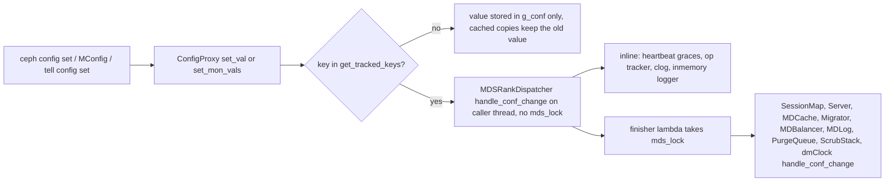
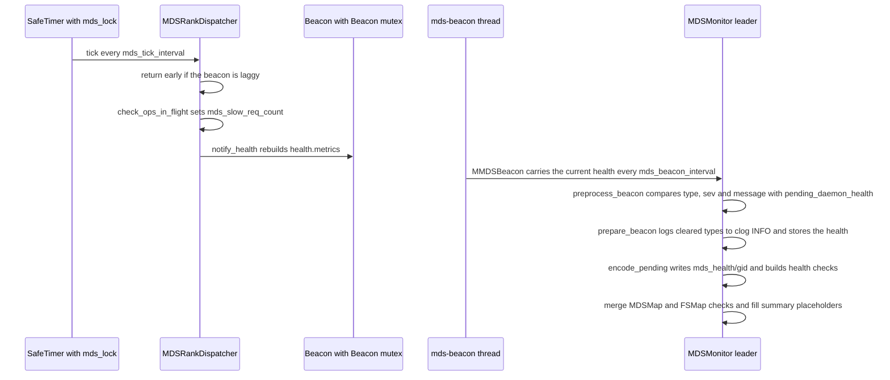

# Configuration options, perf counters, health and cluster log

> Part of the [C++ MDS project map](../README.md). Sources (commit `5f7e383ae6d`): `src/common/options/mds.yaml.in` (1885 lines, 201 options), `src/common/options/mds-client.yaml.in` (648 lines, 70 options; only those that shape MDS interaction), the MDS-relevant entries of `global.yaml.in`, `osd.yaml.in`, `mon.yaml.in`, `mgr.yaml.in`, `ceph-exporter.yaml.in`; perf counter builders in `src/mds/MDSRank.{h,cc}` (~200 lines), `src/mds/Server.{h,cc}` (~150), `src/mds/MDCache.{h,cc}` (~150), `src/mds/MDLog.{h,cc}` (~70), `src/mds/PurgeQueue.{h,cc}`, `src/mds/SessionMap.{h,cc}`, `src/mds/OpenFileTable.cc`, `src/mds/MetricAggregator.cc`, `src/mds/MetricsHandler.cc`, `src/mds/StrayManager.cc`, `src/mds/RecoveryQueue.cc`; health in `src/messages/MMDSBeacon.h` (~420), `src/mds/Beacon.cc` (`notify_health`, ~270), `src/mon/MDSMonitor.cc` (health parts, ~250), `src/mds/MDSMap.cc` / `src/mds/FSMap.cc` (`get_health_checks`, ~130), `src/mon/FSCommands.{h,cc}`; config plumbing in `src/common/{config.cc,config_proxy.h,config_obs_mgr.h,options.h,perf_counters.{h,cc}}`, `src/mon/{MonClient,ConfigMonitor,ConfigMap}.cc`, `src/mgr/{MgrClient,DaemonServer}.cc`; consumers in `src/pybind/mgr/{status,dashboard,telemetry,prometheus,stats,cephadm,snap_schedule,influx,telegraf}`, `src/exporter/`, `src/tools/cephfs/top/cephfs-top`, `monitoring/ceph-mixin/`; 99 `clog` call sites under `src/mds/`.
> Related: [process and threading](../00-architecture/process-and-threading.md), [mds_lock analysis](../00-architecture/mds_lock-analysis.md), [beacon and monitor](../01-cluster-integration/beacon-and-monitor.md), [FSMap and MDSMap](../01-cluster-integration/fsmap-and-mdsmap.md), [mgr, tools and orchestration](../01-cluster-integration/mgr-tools-and-orchestration.md), [sessions](../02-client-protocol/sessions.md), [capabilities](../02-client-protocol/capabilities.md), [leases, lock caches and async dirops](../02-client-protocol/leases-lock-caches-and-async-dirops.md), [request lifecycle](../03-request-path/request-lifecycle.md), [cache lifecycle, trim and memory](../04-cache/mdcache-lifecycle-trim-and-memory.md), [dirfrags and fragmentation](../04-cache/dirfrags-and-fragmentation.md), [MDLog and Journaler](../06-journal/mdlog-and-journaler.md), [balancer and pinning](../08-multi-mds/balancer-and-pinning.md), [subtree migration](../08-multi-mds/subtree-migration.md), [rank lifecycle and recovery](../09-recovery/rank-lifecycle-and-recovery.md), [snapshots](../10-snapshots-quotas-subvolumes/snapshots.md), [strays and purge](../11-background-services/strays-and-purge.md), [scrub and damage](../11-background-services/scrub-and-damage.md), [dmClock QoS](../12-qos-metrics-quiesce-quarantine/qos-dmclock-scheduler.md), [metrics and subvolume metrics](../12-qos-metrics-quiesce-quarantine/metrics-and-subvolume-metrics.md), [quiesce](../12-qos-metrics-quiesce-quarantine/quiesce.md), [admin commands](admin-commands.md).

## 1. Purpose and responsibilities

The MDS exposes five observability and control surfaces. Ceph tooling depends on each of them:

1. **Configuration options.** `mds.yaml.in` declares 201 options: 199 named `mds_*`, plus `defer_client_eviction_on_laggy_osds` and `subv_metrics_window_interval`. Levels: 2 `basic` (`mds_join_fs`, `mds_cache_memory_limit`), 131 `advanced`, 68 `dev`. Flags: 89 `runtime`, 3 `startup`, 1 `no_mon_update`. Values reach the daemon from `ceph.conf`, from the monitor config database (`MConfig`), or from `ceph tell|daemon mds.X config set`. A few MDS behaviours are tuned by options declared elsewhere (`osd_op_complaint_time`, `osd_max_write_size`, `osd_deep_scrub_large_omap_object_key_threshold`, `osd_num_op_tracker_shard`, `perf`). Some MDS options are evaluated by the monitor with its own copy (`mds_beacon_grace`, `mds_beacon_interval`, `mds_enforce_unique_name`).
2. **Perf counters.** Eight unlabeled loggers hold 181 counters: `mds` 57, `mds_mem` 14, `mds_server` 42, `mds_cache` 29, `mds_log` 19, `mds_sessions` 9, `purge_queue` 7, `oft` 4. Four labeled families exist: `mds_client_metrics`, `mds_client_metrics-<fs_name>`, `mds_subvolume_metrics`, `mds_rank_perf`. The process also carries generic loggers (`objecter`, `finisher-MDSRank`, `finisher-PurgeQueue`, `throttle-*`, `AsyncMessenger::Worker-*`, `cct`). Counters are read through the admin socket (`perf dump`, `counter dump`), by `ceph-exporter`, and by ceph-mgr through `MMgrReport`. Three counters are also **functional inputs** to the balancer (§3.3).
3. **Health metrics.** `Beacon::notify_health` recomputes a list of `MDSHealthMetric` on every non-laggy tick. The beacon carries the list to the monitor, which turns it into cluster health checks (`MDS_TRIM`, `MDS_SLOW_REQUEST`, ...). The monitor derives the file-system-level checks (`FS_DEGRADED`, `MDS_ALL_DOWN`, ...) from the FSMap alone.
4. **Cluster log** (`clog`, channel `cluster`). Operator-facing warnings and errors: slow requests, evictions, damage, late cap revokes, journal errors (catalogue in §5.6).
5. **Task status.** The `scrub status` entry is pushed to the mgr service map and shown under `task status:` in `ceph -s`.

This page describes how each surface is defined and updated, and which values external consumers depend on. It lists every option with its default, its effect and when a change takes effect. The semantics of client-reported metrics and per-subvolume counters are on the [metrics page](../12-qos-metrics-quiesce-quarantine/metrics-and-subvolume-metrics.md). The beacon wire format and monitor-side failover are on the [beacon page](../01-cluster-integration/beacon-and-monitor.md). The admin-socket transport and command table are on the [admin commands page](admin-commands.md).

## 2. Source map

| File | Class / function | Lines | Role |
|---|---|---|---|
| `src/common/options/mds.yaml.in` | 201 option records | 1-1885 | Name, type, level, default, flags (`runtime`, `startup`, `no_mon_update`), min/max, `services`, `with_legacy` |
| `src/common/options/mds-client.yaml.in` | 70 client options | 1-648 | Client-side knobs (libcephfs/ceph-fuse) |
| `src/common/options.h` | `Option::can_update_at_runtime` | 400-412 | Numeric and bool options without `startup` are runtime-updatable even without the `runtime` flag |
| `src/common/config.cc` | `md_config_t::_set_val`, `md_config_t::set_mon_vals` | 1398-1432, 280-345 | Refuses runtime change of a non-runtime, untracked option (`-EPERM`); records ignored mon values |
| `src/common/config_proxy.h`, `src/common/config_obs_mgr.h` | `ConfigProxy::_gather_changes`, `ObserverMgr::for_each_change`, `ConfigProxy::add_observer` | 44-66, 173-177; 97-115 | Only *tracked* keys reach an observer; registration does not replay values |
| `src/mon/MonClient.cc` | `MonClient::handle_config` | 503-527 | Applies `MConfig` on the MonClient finish strand, which runs the observers |
| `src/mon/ConfigMonitor.cc`, `src/mon/ConfigMap.cc` | `ConfigMonitor::prepare_command`, `ConfigMonitor::load_config`, `ConfigMap::generate_entity_map`, stray options | 535-580, 777-786; 140-200, 265-275 | Mon-side validation; legacy `blacklist` renames; per-daemon option map |
| `src/mds/MDSRank.cc` | `MDSRankDispatcher::get_tracked_keys` | 4120-4224 | Static, sorted list of 96 keys the MDS observes |
| `src/mds/MDSRank.cc` | `MDSRankDispatcher::handle_conf_change` | 4226-4306 | Applies some keys inline (no `mds_lock`), then queues a finisher context that takes `mds_lock` and fans out to subsystems |
| `src/mds/Server.cc`, `src/mds/Server.h` | `Server::Server`, `Server::handle_conf_change`, cached members | cc 288-311, 1399-1466; h 618-647 | Cached server-side options |
| `src/mds/MDCache.cc` | `MDCache::MDCache`, `MDCache::handle_conf_change` | 175-213, 224-290 | Cached cache and pinning options; forwards to `Migrator` and `MDBalancer` |
| `src/mds/MDLog.cc` | `MDLog::MDLog`, `MDLog::handle_conf_change` | 47-65, 1667-1705 | Cached journal options |
| `src/mds/MDBalancer.cc` | `MDBalancer::MDBalancer`, `MDBalancer::handle_conf_change` | 88-145 | Cached balancer options |
| `src/mds/SessionMap.cc` | `Session::Session`, `SessionMap::handle_conf_change` | 50-62, 1191-1251 | Per-session decay counters |
| `src/mds/PurgeQueue.cc` | `PurgeQueue::update_op_limit`, `PurgeQueue::handle_conf_change` | 782-834 | Purge throttles |
| `src/mds/MDSRank.h` | `l_mds_*`, `l_mdm_*` enums | 52-130 | `mds` and `mds_mem` counter ids |
| `src/mds/MDSRank.cc` | `MDSRank::create_logger` | 3718-3866 | Builds `mds` and `mds_mem`, then calls the other builders |
| `src/mds/MDSRank.cc` | `MDSRank::update_mlogger` | 1172-1188 | Copies object counts into `mds_mem` |
| `src/mds/Server.h` / `Server.cc` | `l_mdss_*`, `Server::create_logger`, `Server::perf_gather_op_latency` | h 89-136; cc 188-286, 2193-2298 | `mds_server` logger |
| `src/mds/MDCache.h` / `MDCache.cc` | `l_mdc_*`, `MDCache::register_perfcounters`, `MDCache::log_stat`, `MDCache::check_memory_usage` | h 80-133; cc 13886-13968, 292-306, 7959-7989 | `mds_cache` logger; periodic gauges |
| `src/mds/MDLog.h` / `MDLog.cc` | `l_mdl_*`, `MDLog::create_logger` | h 21-42; cc 77-111 | `mds_log` logger |
| `src/mds/PurgeQueue.h` / `.cc` | `l_pq_*`, `PurgeQueue::create_logger` | h 84-96; cc 172-191 | `purge_queue` logger |
| `src/mds/SessionMap.h` / `.cc` | `l_mdssm_*`, `SessionMap::register_perfcounters` | h 51-62; cc 109-135 | `mds_sessions` logger |
| `src/mds/OpenFileTable.cc` | `l_oft_*` enum, `OpenFileTable::OpenFileTable` | 31-38, 51-64 | `oft` logger |
| `src/mds/MetricAggregator.cc`, `src/mds/MetricsHandler.cc` | labeled counters | MA 25-60, 82-118, 173-210, 392-440, 779-801; MH 64-90 | Client, subvolume and rank perf (see the [metrics page](../12-qos-metrics-quiesce-quarantine/metrics-and-subvolume-metrics.md)) |
| `src/common/perf_counters.{h,cc}` | `PerfCountersBuilder`, `PRIO_*`, `PerfCounters::inc`, `dump_formatted_generic` | h 44-140, 299-303; cc 174-300, 471-600, 702-724 | Types, priorities, atomic updates, global `perf` switch, JSON dump format |
| `src/mgr/MgrClient.cc` | `MgrClient::_send_report`, `MgrClient::handle_mgr_configure`, `MgrClient::service_daemon_update_task_status` | 341-449, 468-500, 669-676 | Counters with `prio >= stats_threshold`, task status, `metric_report_message` |
| `src/messages/MMDSBeacon.h` | `mds_metric_t`, `mds_metric_name`, `mds_metric_summary`, `MDSHealthMetric`, `MDSHealth`, `MMDSBeacon::encode_payload` | 38-243, 314-334 | Health metric ids, check codes, wire encoding |
| `src/mds/Beacon.cc` | `Beacon::notify_health`, `Beacon::_send`, `Beacon::is_laggy` | 303-573, 198-238, 261-276 | Computes the MDS health metrics; ships them |
| `src/mds/MDSRank.cc` | `MDSRankDispatcher::tick`, `MDSRank::check_ops_in_flight`, `MDSRank::damaged` | 710-802, 3870-3885, 944-959 | Health refresh, slow-request detection, last health snapshot |
| `src/mds/MDSContext.cc` | `MDSIOContextBase::MDSIOContextBase`, `MDSIOContextBase::check_ios_in_flight` | 47-93 | Slow metadata IO detection |
| `src/common/TrackedOp.cc` | `OpTracker::with_slow_ops_in_flight`, `OpTracker::check_ops_in_flight` | 446-530 | Slow request accounting and backoff |
| `src/mon/MDSMonitor.cc` | `MDSMonitor::preprocess_beacon`, `MDSMonitor::prepare_beacon`, `MDSMonitor::encode_pending`, `MDSMonitor::has_health_warnings`, `MDSMonitor::has_any_health_warning` | 539-545, 640-687, 261-343, 1562-1601 | Monitor side of health |
| `src/mds/MDSMap.cc`, `src/mds/FSMap.cc` | `MDSMap::get_health_checks`, `MDSMap::check_health`, `FSMap::get_health_checks` | 540-624, 1146-1165; 601-646 | File-system-level health checks |
| `src/mon/health_check.h` | `health_check_map_t::add`, `get_or_add`, `merge` | 183-218 | Merge semantics of checks with the same code |
| `src/mon/FSCommands.{h,cc}` | `errmsg_for_unhealthy_mds`, `fs fail`, `fs set max_mds` | h 104-108; cc 108-130, 388-405 | Commands gated on MDS health |
| `src/mds/MDSRank.cc` | `MDSRank::get_task_status`, `MDSRank::send_task_status`, `MDSRank::schedule_inmemory_logger`, `MDSRank::inmemory_logger` | 4308-4379 | Task status to mgr; in-memory log dump |
| `src/exporter/DaemonMetricCollector.cc`, `src/exporter/util.cc` | `parse_asok_metrics`, `dump_asok_metric`, `dump_asok_metrics`, `get_extra_labels`, `update_sockets`, `promethize` | 100-300, 404-494; 47-62 | `ceph-exporter` naming, priority filter and socket discovery |
| `src/pybind/mgr/{status,dashboard,telemetry,prometheus,influx,telegraf}` | counter consumers | see §3.8 | mgr-side use of MDS counters |
| `monitoring/ceph-mixin/dashboards_out/*.json`, `prometheus_alerts.yml` | Grafana dashboards (shipped) and alerts | alerts 264-333 | Prometheus names in dashboards and alerts |

## 3. How it works

### 3.1 Option definition and delivery

- **Record format.** Each option in `mds.yaml.in` has a `type` (`bool`, `int`, `uint`, `float`, `size`, `secs`, `millisecs`, `str`), a `level` (`basic`, `advanced`, `dev`), a `default`, optional `min`/`max`, and `flags`. The flags are `runtime` (may change at runtime), `startup` (never changes at runtime) and `no_mon_update` (not taken from the mon config DB). `with_legacy: true` (75 options) also generates a plain field (`g_conf()->mds_xxx`) that is read without the config lock. Most options list `services: [mds]`, which controls where `ceph config` shows them. Five options omit it: `mds_standby_replay_damaged`, `mds_sleep_rank_change`, `mds_connect_bootstrapping`, `mds_scrub_stats_review_period`, `mds_delay_journal_replay_for_testing`.
- **What "runtime" really means.** `Option::can_update_at_runtime()` returns true when the option is flagged `runtime`, or when it is a bool, int, uint, float, size, secs or millisecs option. In both cases the option must not be flagged `startup`, `cluster_create` or `create` (`src/common/options.h:400-412` (Option::can_update_at_runtime)). For an option that is not runtime-updatable, `md_config_t::_set_val` refuses a change with `-EPERM` ("may not be modified at runtime") unless an observer tracks the key (`src/common/config.cc:1413-1422` (md_config_t::_set_val)). So 197 of the 201 options *can* be changed at runtime. The exceptions are `mds_data` and the three `startup` options. Whether the MDS *uses* a new value depends on how the code reads it (§3.2).
- **Delivery paths.**
  - (a) At startup, `ceph.conf` and the mon config DB are applied before any MDS object exists (`MonClient::get_monmap_and_config` called from `global_init`, `src/global/global_init.cc:415` (global_init)).
  - (b) Later `MConfig` messages are posted to the MonClient finish strand, which calls `ConfigProxy::set_mon_vals` (`src/mon/MonClient.cc:503-527` (MonClient::handle_config)).
  - (c) `ceph tell mds.X config set` and `ceph daemon mds.X config set` are applied on the admin-socket thread.
  - In every case `ConfigProxy::_gather_changes` delivers to each observer only the changed keys that the observer listed in `get_tracked_keys()` (`src/common/config_proxy.h:44-58` (ConfigProxy::_gather_changes), `src/common/config_obs_mgr.h:97-115` (ObserverMgr::for_each_change)). An unobserved key is reported as "(not observed, change may require restart)".
- **Monitor-side validation.** The monitor checks `ceph config set <who> <name> <value>` against its own compiled option table, or against mgr module options.
  - An unknown name fails with `unrecognized config option` (`-EINVAL`) unless `--force` is given. The value is parsed with the monitor's type and min/max. `no_mon_update` options are refused with "is special and cannot be stored by the mon" (`src/mon/ConfigMonitor.cc:549-572` (ConfigMonitor::prepare_command)).
  - With `--force`, an unknown name is stored as a string "stray" option and is still delivered in `MConfig` (`src/mon/ConfigMap.cc:265-275`).
  - Stored legacy names `mds_session_blacklist_on_timeout` and `mds_session_blacklist_on_evict` are renamed to the `blocklist` spelling when the monitor loads its config (`src/mon/ConfigMonitor.cc:777-786` (ConfigMonitor::load_config)).
  - The monitor sends every option of the matching sections (`global`, `mds`, `mds.<id>`, after mask matching) as a string map in `MConfig` (`src/mon/ConfigMap.cc:140-200` (ConfigMap::generate_entity_map)).
- **Values the daemon refuses.** In `md_config_t::set_mon_vals`, a value for an unknown option is skipped. A value for a `no_mon_update` option, or one that `_set_val` rejects (a non-runtime option after startup), is recorded in `ignored_mon_values` (`src/common/config.cc:280-325` (md_config_t::set_mon_vals)). The daemon reports its running configuration, the ignored mon values and the defaults to the mgr in `MMgrOpen.config_bl`/`config_defaults_bl`, and again in `MMgrReport.config_bl` whenever the encoded configuration changed since the last report (`src/mgr/MgrClient.cc:267-268` (MgrClient::_send_open), `:445-446` (MgrClient::_send_report), `src/common/config.cc:986-1036` (md_config_t::get_config_bl)). The mgr serves `ceph config show[-with-defaults] mds.<id>` from that copy (`src/mgr/DaemonServer.cc:665-675` (DaemonServer::handle_open), `:847-852` (DaemonServer::handle_report), `:2613-2708` (DaemonServer::_handle_command)).
- **The single MDS observer** is `MDSRankDispatcher`. It registers in its constructor (`src/mds/MDSRank.cc:4086` (MDSRankDispatcher::MDSRankDispatcher)) and unregisters in `shutdown` (`:814`). Registration does not replay current values: `add_observer` only records the keys (`src/common/config_proxy.h:173-177` (ConfigProxy::add_observer)). `call_all_observers` runs only inside `global_init` and `CephContext::start_service_thread`/common init, before any rank exists (`src/global/global_init.cc:448` (global_init), `src/common/ceph_context.cc:930`). A rankless standby has no observer at all. Every option is re-read when the rank object is built.
- **`handle_conf_change` path** (`src/mds/MDSRank.cc:4226-4306` (MDSRankDispatcher::handle_conf_change)). The handler runs on the delivering thread without `mds_lock` (comment "XXX with or without mds_lock!"). It first applies a few keys inline: heartbeat graces, op-tracker parameters, the in-memory log dump (which takes `mds_lock` itself), clog settings and `mds_inject_journal_corrupt_dentry_first`. It then queues a lambda on the rank `Finisher` (thread `mds-rank-fin`). That lambda takes `mds_lock` and calls, in order, `SessionMap::handle_conf_change`, `Server::handle_conf_change`, `MDCache::handle_conf_change` (which forwards to `Migrator` and `MDBalancer`), `MDLog::handle_conf_change`, `PurgeQueue::handle_conf_change`, `ScrubStack::handle_conf_change` and `MDSDmclockScheduler::handle_conf_change`.

### 3.2 How the MDS consumes options

Every option falls into one of the classes below. The class appears in the `Apply` column of the tables in §5.1.

| Class | Meaning | Runtime change effective? |
|---|---|---|
| `L` (live) | Read through `g_conf()` at each use | Yes, at the next use |
| `O` (observed) | Copied into a member at construction and refreshed by `handle_conf_change` (tracked key) | Yes, after the finisher hop |
| `S` (startup) | Read once (constructor, `init`, process start, journal or layout creation) and never refreshed. Options flagged `startup` are also refused at runtime (`-EPERM`) | No; needs rank re-creation (failover or respawn) or a daemon restart |
| `X` (broken observer) | A handler exists, but the key is not in `get_tracked_keys()` (or is misspelled there), so the handler never fires | No (silently ignored); the value read at rank construction stays |
| `I` (initial value ignored) | The member's initial value is hard-coded and only `handle_conf_change` assigns it | A value configured before the rank was created is ignored until it is changed again at runtime |
| `M` (monitor) | Evaluated by ceph-mon using the monitor's own configuration | Monitor-side only |
| `U` (unused) | Declared, never read | — |

Cross-checking `get_tracked_keys()` (96 keys: 85 real MDS options, 2 misspelled names, 7 `clog_*`, `fsid`, `host`; `src/mds/MDSRank.cc:4123-4219` (MDSRankDispatcher::get_tracked_keys)) against every `handle_conf_change` gives these mismatches:

- **Tracked keys that do not exist:** `mds_cap_acquisition_throttle_retry_request_time` (`src/mds/MDSRank.cc:4160`; the real option ends in `_timeout`) and `mds_log_major_segment_event_ratio` (`:4190`; the real option is `mds_log_minor_segments_per_major_segment`). Both real options are therefore class `X`.
- **Handled but not tracked:** `mds_fscrypt_last_block_max_size` (`src/mds/Server.cc:1440` (Server::handle_conf_change)), `mds_client_delegate_inos_pct` (`:1422`), `mds_log_warn_factor` (`src/mds/MDLog.cc:1699` (MDLog::handle_conf_change)), `mds_op_history_slow_op_size` and `mds_op_history_slow_op_threshold` (`src/mds/MDSRank.cc:4243` (MDSRankDispatcher::handle_conf_change)), `mds_scrub_stats_review_period` (`src/mds/ScrubStack.cc:1414` (ScrubStack::handle_conf_change)).
- **Tracked but read live (harmless):** `mds_dir_prefetch`, `mds_dir_prefetch_backend`, `mds_dir_prefetch_backend_max`, `mds_dir_prefetch_backend_hit_threshold`, `mds_dump_cache_threshold_file`, `mds_dump_cache_threshold_formatter`, `mds_log_trim_threshold`.
- **Initial value hard-coded:** `Server::mds_allow_async_dirops = true` (`src/mds/Server.h:618`; `Server::Server` never reads the option) and `MDSRank::extraordinary_events_dump_interval = 0` (`src/mds/MDSRank.h:666`).

### 3.3 Perf counter infrastructure

- **Types.** `PerfCountersBuilder` offers `add_u64` (gauge, type bits `U64`=2), `add_u64_counter` (`U64|COUNTER`=10), `add_u64_avg` (`U64|LONGRUNAVG`=6), `add_time` (`TIME`=1, a gauge in seconds), `add_time_avg` (`TIME|LONGRUNAVG`=5: sum plus count) and histograms (`src/common/perf_counters.h:44-52` (perfcounter_type_d)). Updates are lock-free atomics. They are no-ops when the global option `perf` (default true) is false (`src/common/perf_counters.cc:174-192` (PerfCounters::inc)). The type is metadata only: `inc()` works on a counter declared with `add_u64`, but consumers then treat it as a gauge (§8).
- **Index ranges.** `create_perf_counters` asserts that every index between `first` and `last` was declared (`src/common/perf_counters.cc:726-738` (PerfCountersBuilder::create_perf_counters)). The ranges are `l_mdss_first=1000`, `l_mds_first=2000`, `l_mdm_first=2500`, `l_mdc_first=3000`, `l_pq_first=3500`, `l_mdl_first=5000`, `l_mdssm_first=5500`, `l_oft_first=1000000`, and 10000/20000/30000/40000 for the labeled families. They are process-local and never cross the wire.
- **Priorities** (`src/common/perf_counters.h:86-95`): `PRIO_CRITICAL=10`, `PRIO_INTERESTING=8`, `PRIO_USEFUL=5`, `PRIO_UNINTERESTING=2`, `PRIO_DEBUGONLY=0`. An explicit `prio=0` means "use the builder's `prio_default`", and `prio_default` starts at 0 (`src/common/perf_counters.cc:720` (PerfCountersBuilder::add_impl), `src/common/perf_counters.h:138`). The thresholds that matter:
  - `ceph daemonperf mds.X` reads `perf schema` and shows the counters with `prio >= 8` by default (`PRIO_DEFAULT = PRIO_INTERESTING`, `src/ceph.in:49-55`; a priority argument overrides it), using each counter's nick as the column header. The filter is on priority only; every MDS counter at prio ≥ 8 happens to have a nick (`src/pybind/ceph_daemon.py:328-370` (DaemonWatcher._should_include, _load_schema)).
  - The mgr receives counters with `get_adjusted_priority(prio) >= stats_threshold` every `stats_period`. A counter that falls below the threshold is "undeclared" (`src/mgr/MgrClient.cc:351-391` (MgrClient::_send_report)). The mgr dictates both values in `MMgrConfigure` (`stats_period`, `stats_threshold`, from `mgr_stats_period`=5 s and `mgr_stats_threshold`=5). The same message carries the MDS perf-metric query configuration used by `ceph fs perf stats` (`src/mgr/MgrClient.cc:468-500` (MgrClient::handle_mgr_configure)). The daemon's own copies of the two mgr options are not used for this. The MDS never sets `prio_adjust`.
  - `ceph-exporter` exports counters with `priority >= exporter_prio_limit` (default 5) from the asok `counter dump` and `counter schema` (`src/exporter/DaemonMetricCollector.cc:131-133` (DaemonMetricCollector::parse_asok_metrics)).
- **Admin-socket JSON format** (`src/common/perf_counters.cc:471-600` (PerfCounters::dump_formatted_generic)). The commands are `perf dump`/`perf schema` (unlabeled only) and `counter dump`/`counter schema` (labeled and unlabeled), registered by `CephContext` (`src/common/ceph_context.cc:786-788`).
  - A schema entry has `type` (the bitmask above), `metric_type` (`counter` if the `COUNTER` bit is set, else `gauge`), `value_type` (`integer`, `real`, `integer-integer-pair`, `real-integer-pair`, or a histogram type), `description`, `nick`, `priority` and `units` (`none` or `bytes`).
  - A time `LONGRUNAVG` value (every MDS average is one) is an object `{avgcount, sum[, max_inc], avgtime}`, with `sum` and `avgtime` printed as `<sec>.<nanosec>`. A u64 average is `{sum, avgcount[, max_inc]}` without `avgtime`.
  - Labeled counters appear as an array under the family name, each element being `{labels: {...}, counters: {...}}`.
  - The transport is a Unix socket. The request is a JSON string plus a NUL byte, and the reply is a 4-byte big-endian length followed by the payload (`src/common/admin_socket_client.cc:109-170` (asok_request, AdminSocketClient::do_request)). See the [admin commands page](admin-commands.md).
- **Naming for Prometheus** (`src/exporter/util.cc:47-62` (promethize)):
  - The name is `ceph_<logger>_<counter>`. `.`, `/`, space and `-` become `_`. A trailing `-` becomes `_minus` and `+` becomes `_plus`, so `mds_mem.ino+` is exported as `ceph_mds_mem_ino_plus`.
  - A `LONGRUNAVG` counter becomes `<name>_count` (Prometheus counter) and `<name>_sum` (`src/exporter/DaemonMetricCollector.cc:209-226` (DaemonMetricCollector::dump_asok_metric)).
  - Labels are the counter's own labels plus `ceph_daemon` (`DaemonMetricCollector::get_extra_labels`). Daemon names containing `rgw` are handled as RGW instances instead (§8).
  - The per-client family name embeds the file system name (`mds_client_metrics-<fs_name>`), so its Prometheus names contain the file system name, for example `ceph_mds_client_metrics_cephfs_cap_hits`.
  - The mgr `prometheus` module no longer exports perf counters by default (`exclude_perf_counters=True`, `src/pybind/mgr/prometheus/module.py:786-793`, `:2347`), so `ceph-exporter` is the normal path.
- **Counters as functional input.** `MDBalancer::get_load` reads three counters back from the logger: `mds.request` (through `MDSRank::get_num_requests`, `src/mds/MDSRank.h:380`), `mds.traverse` and `mds.traverse_hit` (`src/mds/MDBalancer.cc:361-387` (MDBalancer::get_load)). It derives `mds_load_t::req_rate` and `cache_hit_rate` from them. `req_rate` is a term of the default load formula (`bal_mode` 0 and 1, `src/mds/MDBalancer.cc:324-341` (mds_load_t::mds_load)), and the balancer and Mantle use the load. With `perf=false` the counters stop changing, so `req_rate` and `cache_hit_rate` stay 0. After a `perf reset` the counters are below the remembered values, and the guarded subtractions leave both at 0 for one interval.
- **Labeled counters** use `ceph::perf_counters::key_create(name, labels)`. They appear in `counter dump` and `counter schema`, not in `perf dump`. They are created and destroyed dynamically, for example per client session.
- **Registration.** `MDSRankDispatcher::init` calls `MDSRank::create_logger` (`src/mds/MDSRank.cc:598` (MDSRankDispatcher::init), `:3718-3866`). It builds `mds` and `mds_mem`, then calls `MDLog::create_logger`, `Server::create_logger`, `PurgeQueue::create_logger`, `SessionMap::register_perfcounters` and `MDCache::register_perfcounters`. The last one also hands its logger to `RecoveryQueue` and `StrayManager`. `oft` is created in the `OpenFileTable` constructor (`src/mds/OpenFileTable.cc:51-64`), which runs inside the `MDCache` constructor. All of these exist only while the daemon holds a rank. A rankless standby exposes no MDS loggers.

### 3.4 Update cadence of the gauges

| Gauge set | Refreshed by | Cadence |
|---|---|---|
| `mds.inodes`, `inodes_pinned`, `inodes_top/bottom/pin_tail`, `inodes_with_caps`, `caps`, `root_rfiles/rbytes/rsnaps` | `MDCache::log_stat` (`src/mds/MDCache.cc:292-306`) | Every `MDSRankDispatcher::tick` (`mds_tick_interval`, 5 s) unless the beacon is laggy (`src/mds/MDSRank.cc:742`), and also at the end of every request in `MDCache::request_cleanup` (`src/mds/MDCache.cc:10149-10150`). The `root_*` gauges only on a rank that has the root inode in cache |
| `mds.subtrees` | `MDSRankDispatcher::tick` (`src/mds/MDSRank.cc:741`) | Tick |
| `mds.load_cent`, `mds.q` | `MDBalancer::send_heartbeat` (`src/mds/MDBalancer.cc:473-475`) | Each balancer heartbeat. Rank 0 sends one every `mds_bal_interval` when the fs flag `balance_automate` is set; other ranks send one in reply to rank 0's heartbeat (`MDBalancer::handle_heartbeat`). Never set otherwise |
| `mds_mem.ino/dir/dn/cap` and the `+`/`-` counters | `MDSRank::update_mlogger` (`src/mds/MDSRank.cc:1172-1188`) | After every message handled by `MDSRank::_dispatch` at nesting depth 1 while not laggy (`:1168`), on every upkeep pass (`src/mds/MDCache.cc:7986` (MDCache::check_memory_usage)), and when a standby-replay pass finds the journal drained (`src/mds/MDLog.cc:1037` (MDLog::replay)). The `+`/`-` values are set from static lifetime counters |
| `mds_mem.rss`, `mds_mem.heap` | `MDCache::check_memory_usage` (`src/mds/MDCache.cc:7986-7988`) | Every `mds_cache_trim_interval` (1 s) in the `mds-cache-trim` upkeep thread. `rss` is in KiB (`VmRSS` from `/proc/self/status`). `heap` is in bytes: anonymous rw mappings plus `[heap]` and `[stack]` from `/proc/self/maps` (`src/common/MemoryModel.cc:42-140` (MemoryModel::get_mapped_heap, MemoryModel::full_sample)) |
| `mds_sessions.avg_session_uptime` | `SessionMap::update_average_session_age` (`src/mds/SessionMap.cc:1253-1260`) | Tick |
| `mds_sessions.total_load/average_load` | `SessionMap::hit_session` (`src/mds/SessionMap.cc:1174-1189`) | Every first reply (early or final) to a non-replayed client request |
| `mds_sessions.session_count`, `sessions_open`, `sessions_stale` | `SessionMap::add_session`, `remove_session`, `set_state` | Event-driven |
| `mds_log.*` gauges | MDLog submit, trim, expiry and replay paths (`src/mds/MDLog.cc:300-1597`) | Event-driven |
| `purge_queue.*` gauges | `PurgeQueue::_execute_item`, `_execute_item_complete` (`src/mds/PurgeQueue.cc:638-779`) | Event-driven |
| `mds_cache.num_strays*`, `num_recovering_*` | `StrayManager`, `RecoveryQueue` | Event-driven |
| `oft.*` | `OpenFileTable::commit` (`src/mds/OpenFileTable.cc:693-696`) | Each open-file-table commit |

### 3.5 Health pipeline

- **Computation.** `notify_health` runs under `mds_lock` (asserted at `src/mds/Beacon.cc:312` (Beacon::notify_health)). It is called at the end of every non-laggy tick (`src/mds/MDSRank.cc:801` (MDSRankDispatcher::tick)) and once in `damaged()` before the final beacon (`:952` (MDSRank::damaged)). It clears `health.metrics` and recomputes every metric from current state, always in this order: dummy, damage, trim, late release, recall, oldest tid, slow requests, slow IO, read-only, root_squash, cache, laggy clients, replay estimate. The table is in §5.5. The `mds-beacon` thread copies the snapshot into each beacon under `Beacon::mutex` (`src/mds/Beacon.cc:226` (Beacon::_send)). A laggy tick returns before `notify_health`, so beacons keep carrying the last computed metrics. Standbys never call it and report no metrics.
- **Summarising.** The per-client metrics (`CLIENT_LATE_RELEASE`, `CLIENT_RECALL`, `CLIENT_OLDEST_TID`, `CLIENTS_LAGGY`, `CLIENTS_BROKEN_ROOTSQUASH`) are collapsed when their count exceeds `mds_health_summarize_threshold` (10). The first four collapse into one `_MANY` metric; root_squash collapses into a single summary metric of the same type.
- **Monitor processing.** The full decision tables are on the [beacon page](../01-cluster-integration/beacon-and-monitor.md#35-mon-side-processing-pipeline). The parts that matter for health:
  - **Decoding.** `MDSHealthMetric::decode` asserts `type != MDS_HEALTH_NULL` (`src/messages/MMDSBeacon.h:152-164` (MDSHealthMetric::decode)), so a metric with type 0 aborts the monitor that decodes the beacon.
  - **Change detection.** A beacon whose health differs from the stored copy cannot be answered by `preprocess_beacon` and goes to `prepare_beacon` (`src/mon/MDSMonitor.cc:539-545` (MDSMonitor::preprocess_beacon)). The comparison is an element-wise `vector ==` on `type`, `sev` and `message`; metadata is ignored (`src/messages/MMDSBeacon.h:187-190` (MDSHealthMetric::operator==)). So a change of order or of any number embedded in a message also counts as a change. `prepare_beacon` always calls `modify_daemon`, which bumps that file system's MDSMap epoch (`src/mds/FSMap.h:523-538` (FSMap::modify_daemon)). Every health change therefore produces a new FSMap epoch and a new MDSMap epoch that is pushed to all subscribers, including mounted clients.
  - **Cleared metrics.** Cleared metric types are logged at INFO: `MDS health message cleared (mds.X): <old message>` (`src/mon/MDSMonitor.cc:678-684` (MDSMonitor::prepare_beacon)). `pending_daemon_health[gid]` then stores the beacon's metrics verbatim, `MDS_HEALTH_DUMMY` included (`:687`).
  - **Check construction.** `encode_pending` persists each daemon's health under the mon store key `mds_health/<gid>` and turns the metrics into checks. The code comes from `mds_metric_name(type)` and the summary from `mds_metric_summary(type)`. Each detail line is `mds.<name>(mds.<rank>): <message> k: v, k: v`; standbys print rank `-1`. `MDS_HEALTH_DUMMY` is skipped. The file-system checks are merged next. Finally the `%num%`, `%plurals%`, `%isorare%` and `%hasorhave%` placeholders are replaced, using the number of detail lines (`src/mon/MDSMonitor.cc:261-343` (MDSMonitor::encode_pending)).
  - **Merge rules** (`src/mon/health_check.h:195-218` (health_check_map_t::get_or_add, merge)). `get_or_add` overwrites severity and summary on every call, so for a code reported by several daemons the last daemon iterated sets the severity. `merge` keeps the summary of a code that already exists and appends detail lines ("hope the summary matches!"). Daemon metrics are added before the FSMap checks, so a shared `MDS_DAMAGE` check keeps the MDS-side summary.
  - **Which daemons.** The daemons iterated are all gids of the pending FSMap, standbys included (`FSMap::get_mds_info`, `src/mds/FSMap.cc:780-794`). Health is read from `pending_daemon_health`, or from `mds_health/<gid>` if that is absent.
- **Health gates monitor commands.**
  - `mds fail` and `fs fail` return `-EPERM` with `errmsg_for_unhealthy_mds` if any target daemon reports `MDS_HEALTH_TRIM` or `MDS_HEALTH_CACHE_OVERSIZED`, unless `--yes-i-really-mean-it` is given (`src/mon/MDSMonitor.cc:1661-1665` (MDSMonitor::filesystem_command), `src/mon/FSCommands.cc:124-129` (FailHandler::handle)).
  - `fs set <fs> max_mds` requires confirmation if any daemon reports any metric (`src/mon/FSCommands.cc:396-403` (SetHandler::handle)).
  - `has_any_health_warning` scans `pending_daemon_health` of every gid of every file system, and counts `MDS_HEALTH_DUMMY` too. A warning in file system A therefore blocks `fs set B max_mds` (`src/mon/MDSMonitor.cc:1596-1601` (MDSMonitor::has_any_health_warning)).

### 3.6 Slow requests and slow metadata IO

- **Slow requests.** `MDRequestImpl` objects are `TrackedOp`s in `MDSRank::op_tracker`.
  - **Tracker setup.** The tracker is built with `mds_enable_op_tracker` and `osd_num_op_tracker_shard` (32) shards (`src/mds/MDSRank.cc:485-486` (MDSRank::MDSRank)). It is configured with `mds_op_complaint_time`, `mds_op_log_threshold` and the history options (`:537-542`).
  - **Age.** The age of a client request counts from message receipt: `MDCache::request_start` sets `initiated = req->get_recv_stamp()` (`src/mds/MDCache.cc:9837` (MDCache::request_start)), so dispatch-queue and throttle time are included. Peer and internal requests are tracked ops too.
  - **Detection.** On every non-laggy tick, `MDSRank::check_ops_in_flight` asks the tracker for ops older than the complaint time (`src/mds/MDSRank.cc:3870-3885`). Internal ops created with `continuous=true` are skipped: `QUIESCE_PATH`, `QUIESCE_INODE`, `LOCK_PATH`, `QUARANTINEDIR_AUTH`, `QUARANTINE_INODE` and `QUARANTINEDIR_WORK` (`src/mds/MDCache.cc:9882-9893` (MDCache::request_start_internal), `src/common/TrackedOp.cc:461-463` (OpTracker::with_slow_ops_in_flight)).
  - **Cluster log.** At most `mds_op_log_threshold` (5) ops per check are written to the cluster log, and only ops whose `initiated + complaint_time * warn_interval_multiplier` has passed. Each logged op doubles its multiplier, which gives an exponential backoff per op (`src/common/TrackedOp.cc:446-530` (OpTracker::with_slow_ops_in_flight, OpTracker::check_ops_in_flight)). The summary line `N slow requests, M included below; oldest blocked for > X secs` is logged at WRN **on every tick** while N > 0, even when M = 0. Each warned op gets a line `slow request X seconds old, received at T: <desc> currently <state>`.
  - **Health.** The count N goes into `mds_slow_req_count`, which drives `MDS_SLOW_REQUEST`.
  - **`mds.slow_reply` is separate.** It is incremented when the first reply (early or final) is sent at least `mds_op_complaint_time` after message receipt (`src/mds/Server.cc:2362` (Server::early_reply), `:2423` (Server::reply_client_request)).
- **Slow metadata IO.**
  - **Tracking.** Every `MDSIOContextBase` is linked at construction into one process-wide list protected by a spinlock. These are the RADOS completions for dirfrag fetch and commit, backtraces, tables, the sessionmap, the journal pointer, and so on. Two contexts are built with `track=false` and stay off the list: the journal write-error handler `C_MDL_WriteError` (`src/mds/MDLog.cc:145`) and the file-size recovery probe `C_MDC_Recover` (`src/mds/RecoveryQueue.cc:34`). Slow file recoveries therefore never raise `MDS_SLOW_METADATA_IO` (`src/mds/MDSContext.h:101`, `src/mds/MDSContext.cc:47-61` (MDSIOContextBase::MDSIOContextBase)).
  - **Detection.** `check_ios_in_flight(cutoff)` walks the list in creation order and counts entries older than `now - osd_op_complaint_time`. The threshold is the OSD option (30 s), not `mds_op_complaint_time`. The count stops at 100 and is then reported as `100+` (`src/mds/MDSContext.cc:64-93` (MDSIOContextBase::check_ios_in_flight), `src/mds/Beacon.cc:461-477` (Beacon::notify_health)).

### 3.7 Cluster log, in-memory log dump and task status

- **Cluster log.** `clog` is the default (`cluster`) channel of the daemon's `LogClient` (`src/mds/MDSDaemon.cc:101` (MDSDaemon::MDSDaemon)). Its routing is controlled by `clog_to_monitors`, `clog_to_syslog*` and `clog_to_graylog*`. These keys are tracked. They are parsed at rank init and on every change by `update_log_config` (`src/mds/MDSRank.cc:597` (MDSRankDispatcher::init), `:4278-4287` (MDSRankDispatcher::handle_conf_change), `:3712-3716` (MDSRankDispatcher::update_log_config)). `MDSRank::damaged` and `MDSRank::abort` call `monc->flush_log()`, so error lines reach the monitor before the process respawns or aborts (`src/mds/MDSRank.cc:941-951`). The messages are catalogued in §5.6.
- **In-memory log dump.**
  - **Enabling.** `mds_extraordinary_events_dump_interval` is enabled only by a runtime change to a non-zero value, and only while `debug_mds` is `<10/>=10`; otherwise the handler resets it to 0.
  - **Dump.** A timer then fires every N seconds. If a client was evicted, a beacon ack was missed, or the internal heartbeat was unhealthy since the last check, it dumps the recent in-memory log (`g_ceph_context->_log->dump_recent()`) and clears the flags (`src/mds/MDSRank.cc:4249-4276` (MDSRankDispatcher::handle_conf_change), `:4348-4379` (MDSRank::schedule_inmemory_logger, inmemory_logger, reset_event_flags)).
  - **Flags.** `missed_beacon_ack_dump` is set when a beacon wait times out right after a send. `missed_internal_heartbeat_dump` is set when `_send` skips a beacon (`src/mds/Beacon.cc:104-108`, `:203-210`).
- **Task status.**
  - **Sending.** Every `mds_task_status_update_interval` (2 s) the rank calls `ScrubStack::scrub_summary()`. While scrub is not idle, it sends `{"scrub status": 
}` through `MgrClient::service_daemon_update_task_status`, plus one final empty map when scrub returns to idle (`src/mds/MDSRank.cc:4308-4346` (MDSRank::get_task_status, schedule_update_timer_task, send_task_status)). The key is `MDSRank::SCRUB_STATUS_KEY = "scrub status"` (`src/mds/MDSRank.h:676`).
  - **Mgr side.** The status rides in the next `MMgrReport.task_status`. The MDS does not register as a service daemon, so the mgr keys it by peer type `mds` and the daemon name (`src/mgr/DaemonServer.cc:774-782` (DaemonServer::handle_report)).
  - **Display.** The mgr stores it in the service map, and the monitor prints it under `task status:` in `ceph -s` (`src/mgr/DaemonServer.cc:760-772` (DaemonServer::update_task_status), `src/mon/Monitor.cc:3406-3416` (Monitor::get_cluster_status), `src/mgr/ServiceMap.cc:130-158` (ServiceMap::Service::has_running_tasks, get_task_summary)).

### 3.8 Who consumes what

| Consumer | Data source | MDS items used | Notes |
|---|---|---|---|
| `ceph fs status` (mgr `status` module) | mgr DaemonState counters | `mds_mem.dn`, `mds_mem.ino`, `mds_mem.dir`, `mds_mem.cap`, `mds_sessions.session_count` (rank 0, else the first non-zero rank), rate of `mds_server.handle_client_request` (active ranks, "Reqs: N/s"), rate of `mds_log.replayed` (standby-replay, "Evts: N/s"). The versions table uses the `ceph_version` key of the MDS metadata | `src/pybind/mgr/status/module.py:75-155`. Metadata is the `sys_info` the MDS sent in its boot beacon, fetched by the mgr with the mon command `mds metadata` (`src/mgr/Mgr.cc:474` (Mgr::load_all_metadata), `:815`) |
| Dashboard (`/api/cephfs`) | mgr counters | Same as `status`. The `mds_counters` default list is `mds_server.handle_client_request`, `mds_log.ev`, `mds_cache.num_strays`, `mds.exported`, `mds.exported_inodes`, `mds.imported`, `mds.imported_inodes`, `mds.inodes`, `mds.caps`, `mds.subtrees`, `mds_mem.ino`. Standby-replay activity uses the rate of `mds_log.replay` | `src/pybind/mgr/dashboard/controllers/cephfs.py:294-381`. `mds.exported`/`mds.imported` have prio 0 and never reach the mgr; `mds_log.replay` does not exist (§8) |
| Telemetry (basic channel) | mgr counters | Sum over all daemons of each file system of `mds_sessions.session_count`, `mds_mem.ino`, `mds_mem.dn`, `mds_mem.cap`, `mds.subtrees`; rank 0 `mds.root_rfiles/root_rbytes/root_rsnaps` | `src/pybind/mgr/telemetry/module.py:1236-1261` |
| Telemetry (perf channel, opt-in) | mgr counters and tell commands | Every reported counter (`get_perf_counters`). With the `perf_memory_metrics` collection it sends `tell mds.<id> heap stats` to every MDS in `mds_metadata` and parses the text, which must contain "tcmalloc heap stats" and exactly 12 numbers. It also sends `dump_mempools` | `src/pybind/mgr/telemetry/module.py:529-640` (get_heap_stats, parse_heap_stats, get_mempool) |
| mgr `influx`, `telegraf` modules | `get_unlabeled_perf_counters()` (default `prio_limit=PRIO_USEFUL`) | Every unlabeled counter with prio ≥ 5 | `src/pybind/mgr/influx/module.py:259`, `src/pybind/mgr/telegraf/module.py:78`, `src/pybind/mgr/mgr_module.py:2389-2441` |
| Prometheus via `ceph-exporter` | admin sockets `*.asok` in `exporter_sock_dir` (default `/var/run/ceph/`); commands `{"prefix":"0"}` (ping, optional), `counter dump`, `counter schema`, `config show` | All counters with `priority >= exporter_prio_limit` (5), including the labeled families. `ceph_daemon` = socket file name without `.asok` and without the `ceph-` prefix (`mds.<id>`); sockets whose name contains `mgr` are skipped and names containing `rgw` are relabelled (§8). Schema fields used: `type`, `metric_type`, `description`, `priority`. `LONGRUNAVG` values must be objects with `avgcount` and `sum`. `config show` must contain `pid_file`; the pid is used for process metrics | `src/exporter/DaemonMetricCollector.cc:100-160` (parse_asok_metrics), `:179-232` (dump_asok_metric), `:236-300` (dump_asok_metrics), `:405-453` (asok_request, get_extra_labels), `:474-494` (update_sockets) |
| mgr `prometheus` module | FSMap, health, service list | `ceph_mds_metadata{ceph_daemon="mds.<name>", fs_id, hostname, public_addr, rank, ceph_version}` (standbys with `fs_id="-1"`), `ceph_fs_metadata{data_pools, fs_id, metadata_pool, name}`, `ceph_health_detail{name=<check code>, severity}` for every check observed; perf counters only when `exclude_perf_counters=false` | `src/pybind/mgr/prometheus/module.py:1201-1270` (Module.get_health), `:1340-1376` (Module.get_fs) |
| Grafana CephFS dashboard (shipped `monitoring/ceph-mixin/dashboards_out/cephfsdashboard.json`) | Prometheus | `ceph_mds_server_handle_client_request`, `ceph_mds_sessions_session_count`, `ceph_mds_inodes`, `ceph_mds_forward`, `ceph_mds_reply_latency_sum`/`_count`, `ceph_mds_caps`, `ceph_mds_server_handle_peer_request`, `ceph_mds_log_evadd`, `ceph_mds_log_ev`, `ceph_mds_log_seg`, `ceph_mds_mem_ino`, `ceph_mds_mem_dn`, `ceph_mds_exported_inodes`, `ceph_mds_imported_inodes`, `ceph_objecter_op_r`/`op_w`, `ceph_mds_mem_heap`, `ceph_mds_mem_rss`, `ceph_mds_rank_perf_cpu_usage`, `ceph_mds_rank_perf_open_requests`. Most queries are joined `on(ceph_daemon)` with `ceph_mds_metadata` and `on(fs_id)` with `ceph_fs_metadata` to select a file system. The "Memory" panel shows heap and rss with unit `kbytes` | The jsonnet source `dashboards/cephfsdashboard.libsonnet` is out of sync: it still queries `ceph_mds_server_handle_slave_request` (`:745`) and lacks the heap, rss and rank_perf panels. Packaging installs `dashboards_out/*` (`ceph.spec.in:1998`) |
| Grafana cluster, host and subvolume dashboards | Prometheus | `count by (ceph_version)(ceph_mds_metadata)` (`ceph-cluster-advanced.json`); host variable `label_values(ceph_mds_inodes{hostname, ...})` with regex `mds.(.*)` (`hosts-overview.json`; ceph-exporter adds no `hostname` label to counters and cephadm's ceph-exporter service discovery adds only `instance=<host>`, `src/pybind/mgr/cephadm/services/service_discovery.py:223-233`, so where `hostname` comes from is unverified); `ceph_mds_subvolume_metrics_{avg_read_iops,avg_read_tp_Bps,avg_read_lat_msec,avg_write_iops,avg_write_tp_Bps,avg_write_lat_msec,quota_bytes,used_bytes}` (`cephfs-subvolume.json`) | `monitoring/ceph-mixin/dashboards_out/` |
| Prometheus alerts | `ceph_health_detail` | `MDS_DAMAGE`, `MDS_ALL_DOWN`, `FS_DEGRADED`, `MDS_UP_LESS_THAN_MAX`, `MDS_INSUFFICIENT_STANDBY`, `FS_WITH_FAILED_MDS`, and `MDS_HEALTH_READ_ONLY` (wrong code, §8). No alert keys on the per-MDS warnings (`MDS_TRIM`, `MDS_SLOW_REQUEST`, `MDS_CACHE_OVERSIZED`, ...) | `monitoring/ceph-mixin/prometheus_alerts.yml:264-333` |
| `cephfs-top`, `ceph fs perf stats` | mgr `stats` module, MDS perf query | Client and subvolume metrics aggregated on rank 0 (`MDSPerfMetricQuery`, `MMgrReport.metric_report_message`), **not** perf counters | `src/tools/cephfs/top/cephfs-top:651`; see the [metrics page](../12-qos-metrics-quiesce-quarantine/metrics-and-subvolume-metrics.md) |
| `ceph daemonperf mds.X` | asok `perf schema` and `perf dump` | Unlabeled counters with `prio >= 8` (default threshold), shown by nick | `src/pybind/ceph_daemon.py:129-370` (DaemonWatcher) |
| cephadm | mon config DB | Sets `mds_join_fs=<service_id>` (`config set`) for the daemons of an MDS service and removes it (`config rm`) when the service is purged. When autotuning OSD memory it subtracts each MDS daemon's `mds_cache_memory_limit` from the host's memory | `src/pybind/mgr/cephadm/services/cephadmservice.py:1509-1515` (MdsService.config), `:1551-1556` (MdsService.purge); `src/pybind/mgr/cephadm/autotune.py:37-43` (MemoryAutotuner.tune) |
| `snap_schedule` module | `get_foreign_ceph_option('mds','mds_max_snaps_per_dir')` | Prunes to at most `mds_max_snaps_per_dir - 1` snapshots | `src/pybind/mgr/snap_schedule/fs/schedule_client.py:388-404` |
| ceph-fuse | comment-level assumption | When libcephfs does not fake inode numbers (`client_use_faked_inos` off), its per-inode 16-bit snapshot "stag" space assumes the 4 Ki cap of `mds_max_snaps_per_dir`; it aborts with "run out of stag" when more than ~65533 snapshots of one inode are referenced | `src/client/fuse_ll.cc:1889-1950` (CephFuse::Handle::make_fake_ino) |
| `ceph -s` | mgr service map | `scrub status` task status | §3.7 |
| `ceph config show[-with-defaults] mds.<id>` | mgr `DaemonState.config` | Running config, ignored mon values and defaults from `MMgrOpen`/`MMgrReport` | `src/mgr/DaemonServer.cc:2613-2708`; §3.1 |

## 4. Data structures and invariants

- **`MDSHealthMetric`** `{ mds_metric_t type (u16, != MDS_HEALTH_NULL); health_status_t sev (u8: HEALTH_ERR=0, HEALTH_WARN=1, HEALTH_OK=2); string message; map<string,string> metadata }`, `ENCODE_START(1,1)` (`src/messages/MMDSBeacon.h:135-196` (MDSHealthMetric), `src/include/health.h:12-16`). `ceph_assert(type != MDS_HEALTH_NULL)` runs on both encode and decode. **`MDSHealth`** is `{ vector<MDSHealthMetric> metrics }`, `ENCODE_START(1,1)` (`src/messages/MMDSBeacon.h:203-243` (MDSHealth)). In the `MMDSBeacon` payload, health follows `compat` (`src/messages/MMDSBeacon.h:314-334` (MMDSBeacon::encode_payload)). Equality compares `type`, `sev` and `message` only.
- **`mds_metric_t` values** (wire u16): `NULL=0, TRIM=1, CLIENT_RECALL=2, CLIENT_LATE_RELEASE=3, CLIENT_RECALL_MANY=4, CLIENT_LATE_RELEASE_MANY=5, CLIENT_OLDEST_TID=6, CLIENT_OLDEST_TID_MANY=7, DAMAGE=8, READ_ONLY=9, SLOW_REQUEST=10, CACHE_OVERSIZED=11, SLOW_METADATA_IO=12, CLIENTS_LAGGY=13, CLIENTS_LAGGY_MANY=14, CLIENTS_BROKEN_ROOTSQUASH=15, ESTIMATED_REPLAY_TIME=16, DUMMY=17` (`src/messages/MMDSBeacon.h:38-57`). The monitor maps unknown ids to the code `???` and the summary `???` (`mds_metric_name`, `mds_metric_summary`).
- **Tracked-key list.** It must be sorted (`static_assert(std::is_sorted(...))`, `src/mds/MDSRank.cc:4221-4222` (MDSRankDispatcher::get_tracked_keys)). Nothing checks that the names exist.
- **Counter metadata.** Only names, types, priorities, nicks, descriptions and units of counters are externally visible. Index numbers are not.
- **Session decay counters** used by recall and health are created from config at `Session` construction (`src/mds/SessionMap.cc:50-62` (Session::Session)):
  - `recall_caps` and `release_caps` (half-life `mds_recall_warning_decay_rate`);
  - `recall_caps_throttle` (half-life `mds_recall_max_decay_rate`);
  - `recall_caps_throttle2o` (fixed half-life 0.5 s);
  - `session_cache_liveness` (half-life `mds_session_cache_liveness_decay_rate`);
  - `cap_acquisition` (half-life `mds_session_cap_acquisition_decay_rate`).

  A change of a decay rate replaces these counters, which resets their history, but only on sessions in state `open` or `stale` (`src/mds/SessionMap.cc:1191-1244` (SessionMap::handle_conf_change)).
- **Laggy clients.** `Server::laggy_clients` is rebuilt on every tick of a rank in `clientreplay`, `active` or `stopping`: it is cleared, then filled by `find_idle_sessions` and `evict_cap_revoke_non_responders`. It survives until `notify_health` only when evictions are deferred because OSDs are laggy (`src/mds/MDSRank.cc:732-737` (MDSRankDispatcher::tick), `src/mds/Server.cc:1328-1335` (Server::find_idle_sessions), `:1369-1380` (Server::evict_cap_revoke_non_responders)).
- **`MDSIOContextBase`.** Each context records `created_at` (coarse monotonic clock) and an intrusive list item. The list is ordered by creation time; the slow-IO scan relies on that order to stop early.

## 5. Interfaces

### 5.1 Configuration options (`src/common/options/mds.yaml.in`)

Columns: **Default**; **Flags**: level (`B`=basic, `A`=advanced, `D`=dev), `rt`=runtime flag, `st`=startup flag, min/max, `y:N`=line in `mds.yaml.in`; **Apply**: class from §3.2; **Effect**: what the option does and where it is consumed.

#### Group 1 — process, identity, periodic work

| Option | Default | Flags | Apply | Effect |
|---|---|---|---|---|
| `mds_data` | `/var/lib/ceph/mds/$cluster-$id` | A, no_mon_update, y:47 | S | Only derives the default keyring path `$mds_data/keyring` (`src/common/common_init.cc:52` (common_preinit)) |
| `mds_numa_node` | -1 | A, st, y:38 | S | If ≥ 0, `main` pins every thread to that NUMA node's CPUs (`src/ceph_mds.cc:102-119` (main)) |
| `mds_join_fs` | "" | B, rt, y:57 | L, M | Sent as `MMDSBeacon.fs` in every beacon (`src/mds/Beacon.cc:228` (Beacon::_send)). The monitor resolves it to `join_fscid` (standby affinity) (`src/mon/MDSMonitor.cc:513-532` (MDSMonitor::preprocess_beacon)). cephadm sets it to the service id |
| `mds_enforce_unique_name` | true | A, y:261 | M | When a daemon boots with a name that already exists, the monitor fails the old gid ("restarted") (`src/mon/MDSMonitor.cc:692` (MDSMonitor::prepare_beacon)) |
| `mds_tick_interval` | 5 | A, y:498 | L | Period of `MDSDaemon::tick` → `MDSRankDispatcher::tick`: slow-op check, session staleness, cap-revoke eviction, `log_stat`, balancer tick, health refresh (`src/mds/MDSDaemon.cc:752` (MDSDaemon::reset_tick)) |
| `mds_task_status_update_interval` | 2 | D, y:1599 | L | Task-status push period (`src/mds/MDSRank.cc:4322` (MDSRank::schedule_update_timer_task)) |
| `mds_asio_thread_count` | 2 | A, min 1, y:1641 | U | Never read; `main` hard-codes `io_context_pool ctxpool(2)` (`src/ceph_mds.cc:202` (main)) |
| `mds_valgrind_exit` | false | D, rt, y:24 | L | `respawn()` calls `_exit(0)` instead of `execve` (`src/mds/MDSDaemon.cc:1038` (MDSDaemon::respawn)) |
| `mds_extraordinary_events_dump_interval` | 0 | A, rt, 0..60, y:1716 | I | Only a runtime change is honoured; see §3.7 (`src/mds/MDSRank.cc:4249-4276` (MDSRankDispatcher::handle_conf_change)) |
| `mds_sleep_rank_change` | 0.0 | D, rt, y:1694 | L | `usleep(value)` on a rank state change, so the value is in microseconds (`src/mds/MDSRank.cc:2336` (MDSRankDispatcher::handle_mds_map)) |
| `mds_connect_bootstrapping` | false | D, rt, y:1700 | L | Test hook: sends the MDSMap to bootstrapping ranks (`src/mds/MDSRank.cc:2549` (MDSRankDispatcher::handle_mds_map)) |

#### Group 2 — beacon, heartbeat, self-fencing

| Option | Default | Flags | Apply | Effect |
|---|---|---|---|---|
| `mds_beacon_interval` | 4 | A, y:228 | S, L, M | MDS: beacon period, read once per process in `Beacon::Beacon` (`src/mds/Beacon.cc:54`). Read live as the clamp of the `dump cache` timeout (`src/mds/MDSRank.cc:3029-3033` (MDSRankDispatcher::handle_asok_command)). Monitor: `may_replace` and slow-tick reset (`src/mon/MDSMonitor.cc:2260-2297` (MDSMonitor::check_health)) |
| `mds_beacon_grace` | 15 | A, y:236 | L, M | MDS: with no beacon ack for this long, `is_laggy()` holds, `tick` skips all upkeep, including the health refresh, and `_dispatch` parks incoming messages in `waiting_for_nolaggy` (`src/mds/Beacon.cc:261-276` (Beacon::is_laggy), `src/mds/MDSRank.cc:714-717` (MDSRankDispatcher::tick), `:1072-1077` (MDSRank::_dispatch)). An ack with rtt < grace clears it (`src/mds/Beacon.cc:148` (Beacon::handle_mds_beacon)). Monitor: beacon silence ≥ grace marks the daemon laggy and may replace it (`src/mon/MDSMonitor.cc:2316` (MDSMonitor::check_health)) |
| `mds_heartbeat_grace` | 15 | A, y:254 | O | Grace of the `MDSRank` heartbeat-map handle; no suicide grace. While it is expired, `Beacon::_send` withholds beacons and retries every 0.5 s, which leads the monitor to fail the daemon (`src/mds/MDSRank.cc:1359-1375` (MDSRank::heartbeat_reset), `src/mds/Beacon.cc:203-210` (Beacon::_send)) |
| `mds_heartbeat_reset_grace` | 1000 | A, y:246 | O | An iteration count, not seconds as the description says. Long loops call `heartbeat_reset()` every N (or 2N) items (`src/mds/MDSRank.h:289-291` (MDSRank::heartbeat_reset_grace), `src/mds/CDir.cc:2177` (CDir::_omap_fetched), `src/mds/MDCache.cc:6071`) |
| `mds_mon_shutdown_timeout` | 5 | A, y:1430 | L | `damaged()` waits up to this long, holding `mds_lock`, for the monitor to ack the `down:damaged` beacon before respawning (`src/mds/MDSRank.cc:953` (MDSRank::damaged)) |

#### Group 3 — cache memory, LRU, trimming

| Option | Default | Flags | Apply | Effect |
|---|---|---|---|---|
| `mds_cache_memory_limit` | 4 GiB | B, rt, y:104 | O | Target for the `mds_co` mempool bytes. Above `limit*(1-reservation)` the cache is "too full": LRU trimming is no longer count-limited and recall adds `TRIM`. Above `limit*mds_health_cache_threshold` it is "overfull" and `MDS_CACHE_OVERSIZED` is raised (`src/mds/MDCache.h:239-251` (MDCache::cache_toofull_ratio, cache_overfull)). cephadm autotune reads it |
| `mds_cache_reservation` | 0.05 | A, rt, y:119 | O | Reserve fraction in `cache_toofull_ratio` |
| `mds_health_cache_threshold` | 1.5 | A, y:133 | O | Multiplier for `cache_overfull()`. It has no `rt` flag but is numeric and tracked, so runtime changes apply |
| `mds_cache_mid` | 0.7 | A, y:140 | O | LRU insertion midpoint (`src/mds/MDCache.cc:206` (MDCache::MDCache), `:262` (MDCache::handle_conf_change)) |
| `mds_cache_trim_interval` | 1 | A, rt, y:68 | L | Period of the upkeep pass: `check_memory_usage`, lease trim, `trim()`, `recall_client_state(ENFORCE_MAX\|ENFORCE_LIVENESS[\|TRIM])`. The pass runs under `mds_lock` (`src/mds/MDCache.cc:14720-14750` (MDCache::upkeep_main)) |
| `mds_cache_trim_decay_rate` | 1 | A, rt, y:149 | O | Half-life of `trim_counter`. A change recreates the counter and so resets the throttle (`src/mds/MDCache.cc:181`, `:273`) |
| `mds_cache_trim_threshold` | 256 Ki | A, rt, y:158 | L | Maximum dentries expired per decay window. When it is reached, trimming stops and `mds_cache.cache_trim_throttle` is incremented (`src/mds/MDCache.cc:6939-6991` (MDCache::trim_lru)) |
| `mds_cache_release_free_interval` | 10 | D, rt, y:95 | L | Period of `ceph_heap_release_free_memory()` (`src/mds/MDCache.cc:14755-14762` (MDCache::upkeep_main)) |
| `mds_decay_halflife` | 5 | A, y:220 | S | Half-life of the popularity `DecayRate` (balancer, fragmentation) (`src/mds/MDCache.cc:210` (MDCache::MDCache)) |
| `mds_dump_cache_threshold_formatter` | 1 GiB | D, y:1581 | L | `dump cache` to a formatter is refused (an `error` field is returned) if `cache_size()` exceeds it (`src/mds/MDCache.cc:13142-13157` (MDCache::dump_cache)) |
| `mds_dump_cache_threshold_file` | 0 | D, y:1590 | L | Same limit for dumps to a file (`-EINVAL`); 0 means no limit |
| `mds_dump_cache_on_map` | false | D, y:1054 | L | Dumps the cache on every MDSMap (`src/mds/MDSRank.cc:2361` (MDSRankDispatcher::handle_mds_map)) |
| `mds_dump_cache_after_rejoin` | false | D, y:1062 | L | Dumps the cache after rejoin (`src/mds/MDSRank.cc:2503`) |
| `mds_shutdown_check` | 0 | D, y:1022 | L | If > 0, a periodic diagnostic cache dump while `up:stopping` (`src/mds/MDCache.cc:8017-8036` (MDCache::shutdown_check)) |

#### Group 4 — client sessions, caps, recall, eviction, reconnect

| Option | Default | Flags | Apply | Effect |
|---|---|---|---|---|
| `mds_session_blocklist_on_timeout` | true | A, y:270 | L | Stale-session autoclose, the reconnect timeout, and stale caps whose pending revoke includes write caps evict *and* blocklist the client when true. When false, all three kill the session without blocklisting (`src/mds/Server.cc:1350` (Server::find_idle_sessions), `:1921` (Server::reconnect_tick), `src/mds/Locker.cc:2751` (Locker::revoke_stale_cap)) |
| `mds_session_blocklist_on_evict` | true | A, y:279 | L | Blocklisting for admin `session evict`/`client evict` and `session kill`, cap-revoke non-responders, metadata-threshold evictions, missing-feature evictions, eviction of all clients when the last `in` rank enters `up:stopping`, and reclaim (`src/mds/MDSRank.cc:2872` (MDSRankDispatcher::handle_asok_command), `:3194` (MDSRankDispatcher::evict_clients), `:2278` (MDSRank::stopping_start), `src/mds/Server.cc:1391` (Server::evict_cap_revoke_non_responders), `:1822` (Server::update_required_client_features), `:550` (Server::finish_reclaim_session), `src/mds/SessionMap.cc:1270` (SessionMap::apply_blocklist)). libcephfs reclaim (NFS-Ganesha) relies on it (`src/client/Client.cc:18939-18944` (Client::start_reclaim)) |
| `mds_sessionmap_keys_per_op` | 1 Ki | A, y:288 | L | Omap keys per RADOS op when loading and incrementally saving the SessionMap (`src/mds/SessionMap.cc:306` (SessionMap::_load_finish), `:348` (SessionMap::load), `:970` (SessionMap::save_if_dirty)). It also forces an early `SessionMap::save` once this many sessions are dirty (`:805-819` (SessionMap::_mark_dirty)). Read by `cephfs-table-tool` (`src/tools/cephfs/TableTool.cc:253`) |
| `mds_recall_max_caps` | 30000 | A, rt, y:296 | L | Maximum caps recalled from one session per pass. For a session with `num_caps`, recall = `min(recall_max_caps, num_caps - floor)` with `floor = mds_min_caps_per_client`. The client is sent `MClientSession(RECALL_STATE)` with `max_caps = num_caps - recall` (the new target, not this option's value). `2 * recall_max_caps` is the threshold of the second-order per-session throttle (`src/mds/Server.cc:1971-2097` (Server::recall_client_state)) |
| `mds_recall_max_decay_rate` | 1.5 | A, rt, y:307 | O | Half-life of the per-session and global recall throttles. A change resets them (`src/mds/Server.cc:292` (Server::Server), `:1414`, `src/mds/SessionMap.cc:1217`) |
| `mds_recall_max_decay_threshold` | 128 Ki | A, rt, y:316 | L | Per-session recall throttle: if exceeded, the session is skipped and `mds_server.session_recall_throttle` is incremented (`src/mds/Server.cc:2033-2039`) |
| `mds_recall_global_max_decay_threshold` | 128 Ki | A, rt, y:325 | L | Global recall throttle: if exceeded, the pass stops and `global_recall_throttle` is incremented (`src/mds/Server.cc:2047-2053`) |
| `mds_recall_warning_threshold` | 256 Ki | A, rt, y:334 | L | `MDS_CLIENT_RECALL` when a session's decayed `recall_caps` exceeds it (`src/mds/Beacon.cc:390-402` (Beacon::notify_health)) |
| `mds_recall_warning_decay_rate` | 60 | A, rt, y:343 | O | Half-life of `recall_caps` and `release_caps` (`src/mds/SessionMap.cc:53-54`, `:1224`) |
| `mds_session_cache_liveness_decay_rate` | 300 (5 min) | A, rt, y:352 | O | Half-life of the session liveness counter, hit on every cap or lease touch (`src/mds/SessionMap.cc:57`, `:63-76` (Session::touch_cap, touch_lease)). A change re-seeds it with the session's cap count |
| `mds_session_cache_liveness_magnitude` | 10 | A, rt, y:368 | L | `ENFORCE_LIVENESS` recalls from sessions whose liveness < `num_caps >> magnitude` (`src/mds/Server.cc:1985-1999` (Server::recall_client_state)) |
| `mds_session_cap_acquisition_decay_rate` | 30 | A, rt, y:383 | O | Half-life of the per-session cap-acquisition counter fed by readdir (`src/mds/SessionMap.cc:58`) |
| `mds_session_cap_acquisition_throttle` | 100000 | A, y:394 | O | readdir and snapdiff are throttled when `cap_acquisition >= throttle` and `num_caps > max_caps_per_client * ratio`. A throttled request is retried later by an MDS timer, which the client only sees as latency. Each throttle increments `mds_server.cap_acquisition_throttle` (`src/mds/Server.cc:5108-5120` (Server::handle_client_readdir), `:12270-12283` (Server::handle_client_readdir_snapdiff)) |
| `mds_session_max_caps_throttle_ratio` | 1.1 | A, y:401 | O | Ratio in the readdir throttle condition above |
| `mds_cap_acquisition_throttle_retry_request_timeout` | 0.5 | A, y:409 | X | Retry delay of a throttled readdir. The tracked key is misspelled `..._request_time` (`src/mds/MDSRank.cc:4160`) |
| `mds_min_caps_per_client` | 100 | A, y:1523 | L | Floor of the recall target (`src/mds/Server.cc:1981`) |
| `mds_min_caps_working_set` | 10000 | A, rt, y:1530 | L | No `MDS_CLIENT_RECALL` warning for sessions holding ≤ this many caps (`src/mds/Beacon.cc:390-402`) |
| `mds_max_caps_per_client` | 1 Mi | A, y:1539 | L+O | `ENFORCE_MAX` recall above it (`src/mds/Server.cc:1980`). The cached copy feeds the readdir throttle (`:301`) |
| `mds_cap_revoke_eviction_timeout` | 0 | A, y:1573 | O | If > 0, clients that have not acked a revoke for this many seconds are evicted (`mds_server.cap_revoke_eviction++`); 0 disables (`src/mds/Server.cc:1361-1397` (Server::evict_cap_revoke_non_responders)) |
| `mds_defer_session_stale` | true | D, y:1554 | L | Do not mark an idle session stale if it has no flush waiters and no caps being revoked (`src/mds/Server.cc:1230-1271` (Server::find_idle_sessions)) |
| `defer_client_eviction_on_laggy_osds` | false | A, rt, y:1730 | L | If any OSD is laggy, skip the evictions of the tick and report `MDS_CLIENTS_LAGGY[_MANY]` instead (`src/mds/Server.cc:1233`, `:1328-1335` (Server::find_idle_sessions), `:1369-1380` (Server::evict_cap_revoke_non_responders), `src/mds/Beacon.cc:531-560` (Beacon::notify_health)) |
| `mds_reconnect_timeout` | 45 | A, y:436 | L | Reconnect window. It is extended while the last reconnecting client was seen less than `timeout/2` ago. Clients that miss it are evicted (blocklisted per `mds_session_blocklist_on_timeout`) unless they set `timeout` metadata (`src/mds/Server.cc:1872-1925` (Server::reconnect_tick)). Late reconnects are denied with `CEPH_SESSION_CLOSE` (`:1636-1647` (Server::handle_client_reconnect)) |
| `mds_deny_all_reconnect` | false | A, rt, y:445 | L | Denies every reconnect, ending the reconnect phase early (`src/mds/Server.cc:1624-1647` (Server::handle_client_reconnect), `:1853-1866` (Server::reconnect_tick)) |
| `mds_replay_unsafe_with_closed_session` | false | A, st, y:556 | S | In `clientreplay`, accept replayed requests whose session is closed (`src/mds/Server.cc:296` (Server::Server), `:2631-2641` (Server::handle_client_request)) |
| `mds_max_completed_requests` | 100000 | D, y:1415 | L | When a client does not advance `oldest_client_tid` and has ≥ `max << warnings` completed requests: clog warning, warning count increment, and `MDS_CLIENT_OLDEST_TID`. The warning count resets once completed < max/2 (`src/mds/Server.cc:2562-2588` (Server::trim_completed_request_list), `src/mds/Beacon.cc:408-418`) |
| `mds_max_completed_flushes` | 100000 | D, y:1408 | L | Same for `oldest_flush_tid` on cap flushes (`src/mds/Locker.cc:3452-3471` (Locker::handle_client_caps)) |
| `mds_session_metadata_threshold` | 16 MiB | A, rt, y:1753 | O | A session whose encoded `session_info_t` reaches this size during a full or incremental SessionMap save is evicted instead of written (blocklisted when `mds_session_blocklist_on_evict` is true; `mds_sessions.mdthresh_evicted++`) (`src/mds/SessionMap.cc:437-440` (SessionMap::validate_and_encode_session), `:491-497`, `:535-536` (SessionMap::save), `:951`, `:1003-1004` (SessionMap::save_if_dirty), `:1262-1270` (SessionMap::apply_blocklist)) |
| `mds_request_load_average_decay_rate` | 60 | A, y:1566 | O | Half-life of the per-session and total request-load averages (`session ls` `request_load_avg`, `mds_sessions.total_load/average_load`) (`src/mds/SessionMap.cc:1206-1215`) |
| `mds_client_writeable_range_max_inc_objs` | 1 Ki | A, y:1515 | L | Caps the max_size growth step at `objects * layout.object_size`. The new max is `min(2*(size+1), size + inc)`, rounded up to the layout increment; 0 removes the cap (`src/mds/Locker.cc:2980-2989` (Locker::calc_new_max_size)) |
| `mds_health_summarize_threshold` | 10 | A, y:426 | L | Per-client health metrics above this count are collapsed (`src/mds/Beacon.cc:369`, `:421`, `:434`, `:500`, `:538`) |

#### Group 5 — request processing and namespace limits

| Option | Default | Flags | Apply | Effect |
|---|---|---|---|---|
| `mds_early_reply` | true | A, y:545 | L | Send an unsafe reply before the journal commit when allowed. Early reply is never sent for replays, requests flagged `no_early_reply`, requests with journaled peers, requests that allocated an ino from the InoTable, or requests from other MDSs (`src/mds/Server.cc:2300-2377` (Server::early_reply)) |
| `mds_allow_batched_ops` | true | A, rt, y:834 | O | Batch concurrent lookup and getattr on the same inode (`src/mds/Server.cc:297`, `:1406`) |
| `mds_forward_all_requests_to_auth` | false | A, rt, y:1496 | O | Path traversals want auth, and `DirStat.dist` (the replica hint) is omitted from replies, so clients stop sending reads to replicas (`src/mds/Server.cc:2539` (Server::set_trace_dist), `:3896`, `:5211`, `:12386`) |
| `mds_allow_async_dirops` | true | A, y:1046 | I | Allows ino delegation in create replies (`CEPHFS_FEATURE_DELEG_INO`) and lock caches for create and unlink, which grant `DIR_CREATE`/`DIR_UNLINK` caps (`src/mds/Server.cc:2595` (Server::set_reply_extra_bl), `:4987`, `:8714`). The initial value is `true` regardless of config (`src/mds/Server.h:618`) |
| `mds_client_prealloc_inos` | 1000 | A, y:527 | L | Inos preallocated per session; refilled when below half (`src/mds/Server.cc:3688-3695` (Server::prepare_new_inode)). The delegation size derives from it (`:2600-2605` (Server::set_reply_extra_bl)) |
| `mds_client_delegate_inos_pct` | 50 | A, rt, y:536 | X | Percentage of `prealloc_inos` delegated to async-dirop clients; 0 disables delegation. With `frac = 100/pct`, the MDS delegates `prealloc/frac` inos when the session holds fewer than `prealloc/frac/2`. The key is not tracked, so a runtime change is ignored (`src/mds/Server.cc:300`, `:1422`, `:2598-2605`) |
| `mds_alternate_name_max` | 8 Ki | A, rt, y:5 | O | Maximum `alternate_name` length; longer gives `ENAMETOOLONG` in openc/create, mknod, mkdir, symlink, link and rename (`src/mds/Server.cc:4928` (Server::handle_client_openc), `:7606` (handle_client_mknod), `:7715` (handle_client_mkdir), `:7817` (handle_client_symlink), `:7923` (handle_client_link), `:9333` (handle_client_rename)). Initialised in `Server.h:646` |
| `mds_fscrypt_last_block_max_size` | 4 Ki | A, rt, y:14 | X | Maximum fscrypt last-block payload (beyond the header) in a truncating setattr; larger gives `EINVAL` (`src/mds/Server.cc:5643-5649` (Server::handle_client_setattr)) |
| `mds_dir_max_entries` | 0 | A, rt, y:1683 | O | If > 0, create-type ops get `ENOSPC` when `dirstat.nfiles + nsubdirs >= max` (`src/mds/Server.cc:3582-3592` (Server::check_dir_max_entries)) |
| `mds_bal_fragment_size_max` | 100000 | A, y:824 | O | Create-type ops get `ENOSPC` when the target fragment holds ≥ max entries. This also applies to the stray dir fragment during unlink and rename, except for replayed requests (`src/mds/Server.cc:3563-3576` (Server::check_fragment_space), `:3605-3609` (Server::prepare_stray_dentry)) |
| `mds_default_dir_hash` | 2 (rjenkins) | A, y:566 | L | `dir_layout.dl_dir_hash` for new directories and for system and rejoin-created inodes. Clients use it to hash names to frags (`src/mds/Server.cc:3707` (Server::prepare_new_inode), `src/mds/MDCache.cc:458` (MDCache::create_unlinked_system_inode), `:4779`, `:5088`, `:5161`; `linux/fs/ceph/dir.c:2215` (ceph_dentry_hash)). Rejoin asserts that every opened undefined directory inode carries the current value (`src/mds/MDCache.cc:6137` (MDCache::opened_undef_inode), "FIXME: re-hash dentries"), see §8. `cephfs-data-scan` uses it for recreated inodes (`src/tools/cephfs/DataScan.cc:449`) |
| `mds_root_ino_uid` / `mds_root_ino_gid` | 0 / 0 | A, y:1472/1480 | L | Owner of the root inode created at file-system creation (`src/mds/MDCache.cc:491-492` (MDCache::create_root_inode)). Also used by `cephfs-data-scan` when it recreates root or lost+found (`src/tools/cephfs/DataScan.cc:442-443`) |
| `mds_snap_min_uid` / `mds_snap_max_uid` | 0 / 4294967294 | A, y:1376/1384 | L | `EPERM` for mksnap, rmsnap, renamesnap and snap-metadata ops from callers outside the uid range (`src/mds/Server.cc:11625` (Server::handle_client_mksnap), `:11807` (handle_client_rmsnap), `:11942` (handle_client_renamesnap), `:12071` (handle_client_snap_md_op)) |
| `mds_max_snaps_per_dir` | 100 | A, rt, 0..4096, y:1607 | O | mksnap returns `EMLINK` when the realm already has ≥ max snaps (`src/mds/Server.cc:11659-11662` (Server::handle_client_mksnap)). Read by the `snap_schedule` module; ceph-fuse relies on the 4096 cap (§3.8) |
| `mds_file_blockdiff_max_concurrent_object_scans` | 16 | A, min 1, y:1832 | L | Concurrent `listsnaps` RADOS ops per file blockdiff (`src/mds/MDCache.cc:14823-14826` (MDCache::file_blockdiff)) |
| `mds_inject_traceless_reply_probability` | 0 | D, y:1281 | L | Randomly omits the reply trace (`src/mds/Server.cc:2496-2501` (Server::set_trace_dist)) |
| `mds_server_dispatch_client_request_delay` | 0 ms | D, rt, y:1815 | O | Sleeps inside `dispatch_client_request` while holding `mds_lock` (`src/mds/Server.cc:2786-2789` (Server::dispatch_client_request)) |
| `mds_server_dispatch_killpoint_random` | 0.0 | D, rt, y:1807 | O | Random `ceph_abort` in dispatch (`src/mds/Server.cc:2790-2792`) |

#### Group 6 — op tracker and slow requests

| Option | Default | Flags | Apply | Effect |
|---|---|---|---|---|
| `mds_enable_op_tracker` | true | A, y:1315 | O | Enables `TrackedOp` tracking. When it is off, requests are not registered in the tracker, so slow-request detection stops: no slow-request cluster-log lines and no `MDS_SLOW_REQUEST` (`src/common/TrackedOp.cc:346-349` (OpTracker::register_inflight_op), `:390-391` (OpTracker::visit_ops_in_flight)). `ops` and the `dump_*ops*` asok commands then return only "op_tracker disabled; set mds_enable_op_tracker=true to enable" with return code 0. `op get` and `op kill` look requests up in `MDCache` and keep working (`src/mds/MDSRank.cc:485`, `:2688-2819` (MDSRankDispatcher::handle_asok_command), `:4246`) |
| `mds_op_complaint_time` | 30 | A, y:1360 | O, L | Slow-request age (op tracker, `MDS_SLOW_REQUEST` text) and the `mds.slow_reply` threshold (`src/mds/MDSRank.cc:537`, `src/mds/Server.cc:2362`, `:2423`, `src/mds/Beacon.cc:454`) |
| `mds_op_log_threshold` | 5 | D, y:1369 | O | Maximum slow-op lines per check (`src/mds/MDSRank.cc:538`) |
| `mds_op_history_size` | 20 | A, y:1324 | O | `dump_historic_ops` size |
| `mds_op_history_duration` | 600 | A, y:1333 | O | `dump_historic_ops` maximum age in seconds |
| `mds_op_history_slow_op_size` | 20 | A, y:1342 | X | Slow-op history size (handler at `src/mds/MDSRank.cc:4243`, untracked) |
| `mds_op_history_slow_op_threshold` | 10 | A, y:1351 | X | Slow-op history age threshold in seconds (same) |

#### Group 7 — directory fetch and commit, on-disk sanity

| Option | Default | Flags | Apply | Effect |
|---|---|---|---|---|
| `mds_dir_max_commit_size` | 10 (MiB) | A, y:202 | S | Maximum bytes per dirfrag omap write; larger commits are split. 0 means `0.9 * osd_max_write_size` MiB (`src/mds/MDCache.cc:187-189` (MDCache::MDCache)) |
| `mds_dir_keys_per_op` | 16384 | A, y:212 | L | `omap_get_vals` batch size when fetching a dirfrag (`src/mds/CDir.cc:1809` (CDir::_omap_fetch), `:1836` (CDir::_omap_fetch_more)) |
| `mds_dir_prefetch` | true | A, rt, y:454 | L | true: a single-dentry miss fetches the whole dirfrag. false: only the key is fetched (`fetch_keys`). It also controls rejoin prefetch of the parents of undefined inodes (`src/mds/CDir.cc:1604-1634` (CDir::fetch), `src/mds/MDCache.cc:6075` (MDCache::open_undef_inodes_dirfrags)) |
| `mds_dir_prefetch_backend` | false | A, rt, y:463 | L | With prefetch off, also launches a background full fetch (`mds.dir_fetch_background++`) |
| `mds_dir_prefetch_backend_max` | 1 | A, rt, y:473 | L | Maximum concurrent background fetches |
| `mds_dir_prefetch_backend_hit_threshold` | 16 | A, rt, 1..255, y:483 | L | Keyed-fetch hits on a dirfrag before a background fetch (`uint8_t` counter, saturating) |
| `mds_verify_backtrace` | 1 | D, y:1400 | L | ≥ 1: fetching frag 0 also reads the dir object's `parent` xattr and rewrites a bad backtrace. > 1: asserts instead (`src/mds/CDir.cc:1813` (CDir::_omap_fetch), `src/mds/CInode.cc:1628-1639` (CInode::verify_diri_backtrace)) |
| `mds_abort_on_newly_corrupt_dentry` | true | A, y:1114 | L | Abort (clog ERR, `MDSRank::abort`) rather than commit a dentry with `first > last` or `first > next snap` (`src/mds/CDentry.cc:819-823` (CDentry::check_corruption)) |
| `mds_go_bad_corrupt_dentry` | true | A, rt, y:1121 | L | Mark such a dentry bad (damage table) (`src/mds/CDentry.cc:816-818`) |
| `mds_hack_allow_loading_invalid_metadata` | false | A, y:1546 | L | Allows duplicate primary dentries on load (data-loss hack) (`src/mds/CDir.cc:2029` (CDir::_load_dentry)) |
| `mds_symlink_recovery` | true | A, rt, y:1706 | O | Backtrace stores also write the symlink target as xattr `symlink` on the first data object (`src/mds/CInode.cc:84-89` (CInodeCommitOperation::update), `:1492-1494` (CInode::_store_backtrace)) |
| `mds_oft_prefetch_dirfrags` | false | A, st, y:1002 | L (refused at runtime) | The open-file-table prefetch also loads dirfrags (`src/mds/OpenFileTable.cc:1052` (OpenFileTable::_open_ino_finish)) |
| `mds_max_file_recover` | 32 | A, y:194 | L | Parallel file-size recoveries (`src/mds/RecoveryQueue.cc:72` (RecoveryQueue::advance)) |

#### Group 8 — locking, scatter, freeze, debug asserts

| Option | Default | Flags | Apply | Effect |
|---|---|---|---|---|
| `mds_scatter_nudge_interval` | 5 | A, y:518 | L | Dirty scatterlocks older than this are nudged, which propagates dirstat and rstat (`src/mds/Locker.cc:5535` (Locker::scatter_tick)) |
| `mds_dirstat_min_interval` | 1 | D, y:508 | L | `predirty_journal_parents` stops propagating to further ancestors if it propagated less than this long ago (`src/mds/MDCache.cc:2354-2364` (MDCache::predirty_journal_parents)) |
| `mds_freeze_tree_timeout` | 30 | D, y:418 | L | Stale export or fragment freezes older than this are cancelled; snapflush nudge after timeout/3 (`src/mds/Migrator.cc:272` (Migrator::find_stale_export_freeze), `src/mds/MDCache.cc:12175` (MDCache::find_stale_fragment_freeze), `src/mds/Locker.cc:4423` (Locker::caps_tick)) |
| `mds_verify_scatter` | false | D, y:1071 | L | Assert on fragstat or rstat mismatches (`src/mds/CInode.cc:2678-2837` (CInode::finish_scatter_gather_update), `src/mds/MDCache.cc:2420-2460` (MDCache::predirty_journal_parents)) |
| `mds_debug_scatterstat` | false | D, y:1080 | L | Extra rstat checks and printing (`src/mds/CDir.cc:159-170` (operator<<(ostream&, const CDir&)), `:240` (CDir::check_rstats), `src/mds/CInode.cc:232-245` (operator<<(ostream&, const CInode&))) |
| `mds_debug_frag` | false | D, y:1089 | L | Fragment invariant checks (`src/mds/MDCache.cc:12365` (MDCache::dispatch_fragment_dir), `src/mds/journal.cc:3025` (EFragment::replay)) |
| `mds_debug_auth_pins` | false | D, y:1098 | U | Never read |
| `mds_debug_subtrees` | false | D, y:1106 | O | Journal an `EVENT_SUBTREEMAP_TEST` after every event (`src/mds/MDLog.cc:458-466` (MDLog::_segment_upkeep)) |

#### Group 9 — journal (MDLog), replay, write errors

| Option | Default | Flags | Apply | Effect |
|---|---|---|---|---|
| `mds_log_max_segments` | 128 | A, min 8, y:636 | O | Trim target in segments. `MDS_TRIM` fires when `segments > max * mds_log_warn_factor` (`src/mds/MDLog.cc:703-705` (MDLog::is_trim_slow), `:789-793` (MDLog::trim)) |
| `mds_log_warn_factor` | 2 | A, rt, min 1, y:646 | X | Multiplier above (handler at `src/mds/MDLog.cc:1699`, untracked) |
| `mds_log_max_events` | -1 | A, y:610 | O | Event-count trim target; -1 means unlimited. Clamped to > `events_per_segment` (`src/mds/MDLog.cc:725-735` (MDLog::trim)) |
| `mds_log_events_per_segment` | 1024 | A, min 1, y:619 | O | A new minor segment (`ESegment`) starts after this many events or at a layout period boundary (`src/mds/MDLog.cc:454` (MDLog::_segment_upkeep)) |
| `mds_log_minor_segments_per_major_segment` | 16 | A, min 4, y:1823 | X | A major segment (`ESubtreeMap`) starts once *more than* this many minor segments have passed since the last major one. The tracked key is misspelled `mds_log_major_segment_event_ratio` (`src/mds/MDLog.cc:450` (MDLog::_segment_upkeep)) |
| `mds_log_segment_size` | 0 | A, y:628 | S | Journal object size and stripe unit; 0 means the default layout (4 MiB). Read when layouts are generated (`src/mds/MDCache.cc:424-432` (MDCache::gen_default_log_layout)). Also read by `cephfs-journal-tool` (`src/tools/cephfs/JournalTool.cc:1247`, `JournalScanner.cc:165`) |
| `mds_log_event_large_threshold` | 512 Ki | A, min 1 Ki, y:582 | O | Events ≥ this increment `mds_log.evlrg` and are logged at level 5 (`src/mds/MDLog.cc:534-537` (MDLog::_submit_thread)) |
| `mds_log_trim_threshold` | 128 | A, rt, min 1, y:1763 | L | Maximum segments that start expiring per decay window (`src/mds/MDLog.cc:768-779` (MDLog::trim)) |
| `mds_log_trim_decay_rate` | 1.0 | A, rt, min 0.01, y:1777 | O | Half-life of that throttle counter |
| `mds_log_trim_upkeep_interval` | 1000 ms | A, y:1791 | L | Period of the `mds-log-trim` thread, which holds `mds_lock` while trimming and trims only in `active` or `stopping` (`src/mds/MDLog.cc:707-721` (MDLog::log_trim_upkeep)) |
| `mds_log_pause` | false | D, y:576 | O | Pause the submit thread; clearing it kicks the submitter (`src/mds/MDLog.cc:498`, `:1684-1688` (MDLog::handle_conf_change)) |
| `mds_log_skip_corrupt_events` | false | D, rt, y:589 | O | Skip undecodable events during replay instead of calling `damaged()` (`src/mds/MDLog.cc:1505-1521` (MDLog::_replay_thread)) |
| `mds_log_skip_unbounded_events` | false | D, rt, y:599 | O | Skip events before the first major segment instead of calling `damaged()` (`src/mds/MDLog.cc:1553-1566` (MDLog::_replay_thread)) |
| `mds_journal_format` | 1 | D, y:1241 | L | Journal stream format at create and upgrade (`JOURNAL_FORMAT_RESILIENT=1`). A value above `JOURNAL_FORMAT_MAX` makes journal recovery mark the rank damaged (`src/mds/MDLog.cc:289` (MDLog::create), `:1079-1081`, `:1213` (MDLog::_recovery_thread), `:1264` (MDLog::_reformat_journal), `src/mds/MDSRank.cc:1924` (MDSRank::replay_done), `src/tools/cephfs/Resetter.cc:161`) |
| `mds_replay_interval` | 1 | A, y:1012 | L | Standby-replay poll period (`src/mds/MDSRank.cc:1909` (MDSRank::replay_done)) |
| `mds_standby_replay_damaged` | false | D, rt, y:32 | L | Test: standby-replay calls `damaged()` (`src/mds/MDSRank.cc:1798` (MDSRank::replay_start)) |
| `mds_delay_journal_replay_for_testing` | 0 ms | D, rt, y:1799 | L | Sleeps per replay iteration (`src/mds/MDLog.cc:1424-1428` (MDLog::_replay_thread)) |
| `mds_action_on_write_error` | 1 | A, y:1422 | L | Non-journal RADOS write error: 0 ignore, 1 force read-only, ≥ 2 respawn (not suicide). `EBLOCKLISTED` always respawns. Journal write errors ignore this option: they respawn if blocklisted and otherwise go `damaged()` (`src/mds/MDSRank.cc:973-991` (MDSRank::handle_write_error), `src/mds/MDLog.cc:119-141` (C_MDL_WriteError::finish)) |
| `mds_wipe_sessions` / `mds_wipe_ino_prealloc` / `mds_skip_ino` | false / false / 0 | D, y:1288/1297/1306 | L | At `replay_done`: wipe sessions, wipe preallocated inos, skip N inos (`src/mds/MDSRank.cc:1941-1955` (MDSRank::replay_done)). `mds_wipe_sessions` also lets replay survive SessionMap version gaps: `ESession`/`ESessions` replay wipes the SessionMap instead of failing a `ceph_assert` (`src/mds/journal.cc:1926-1930` (ESession::replay), `src/mds/SessionMap.cc:881-885` (SessionMap::replay_open_sessions)), and an `EMetaBlob` sessionmap mismatch wipes it before forcing the version (`src/mds/journal.cc:1717-1726` (EMetaBlob::replay)) |
| `mds_inject_skip_replaying_inotable` | false | D, y:1271 | L | Replay skips the InoTable (`src/mds/journal.cc:1646` (EMetaBlob::replay)) |
| `mds_inject_journal_corrupt_dentry_first` | 0.0 | D, y:1139 | O | Probability of corrupting `CDentry::first` while replaying an `EMetaBlob` (`src/mds/journal.cc:1441-1448` (EMetaBlob::replay), `src/mds/MDSRank.cc:501` (MDSRank::MDSRank), `:4289`) |
| `mds_kill_journal_at` | 0 | D, y:1221 | U | Never read |
| `mds_kill_journal_expire_at` / `mds_kill_journal_replay_at` | 0 | D, y:1227/1234 | L | Killpoints in `LogSegment::try_to_expire` and `EMetaBlob::replay` (`src/mds/journal.cc:133-375`, `:1245-1816`) |

#### Group 10 — balancer, pinning, fragmentation, migration

| Option | Default | Flags | Apply | Effect |
|---|---|---|---|---|
| `mds_bal_export_pin` | true | A, rt, y:657 | O | Honour `ceph.dir.pin` export pins (`src/mds/MDBalancer.cc:284` (MDBalancer::tick), `src/mds/CInode.cc:5655-5658` (CInode::maybe_export_pin)) |
| `mds_export_ephemeral_random` | true | A, rt, y:666 | O | Enable `ceph.dir.pin.random`. A change re-evaluates all ephemeral pins (`src/mds/MDCache.cc:232-250` (MDCache::handle_conf_change)) |
| `mds_export_ephemeral_random_max` | 0.01 | A, rt, 0..1, y:678 | O | Maximum value accepted for `ceph.dir.pin.random`: `EINVAL` above it, `EDOM` outside [0,1] (`src/mds/Server.cc:6778-6786` (Server::handle_client_setvxattr)). Also caps the inherited value (`src/mds/CInode.cc:5857` (CInode::get_ephemeral_rand)) |
| `mds_export_ephemeral_distributed` | true | A, rt, y:691 | O | Enable `ceph.dir.pin.distributed` |
| `mds_export_ephemeral_distributed_factor` | 2 | A, rt, 1..100, y:702 | L | Distributed-pin frag bits = ceil(log2(factor * max_mds)), or 0 when `max_mds` ≤ 1; recomputed on each MDSMap (`src/mds/MDCache.cc:14677-14686` (MDCache::handle_mdsmap)) |
| `mds_bal_interval` | 10 | A, rt, y:802 | O | Rank 0 balancer heartbeat period; ≤ 0 disables (`src/mds/MDBalancer.cc:299-307` (MDBalancer::tick)) |
| `mds_bal_sample_interval` | 3 | A, rt, y:713 | O | Load sample period |
| `mds_bal_mode` | 0 | D, rt, y:906 | O | Load formula: 0 hybrid, 1 request rate and queue, 2 CPU. Any other value hits `ceph_abort()` (`src/mds/MDBalancer.cc:324-342` (mds_load_t::mds_load)) |
| `mds_bal_max` / `mds_bal_max_until` | -1 / -1 | D, rt, y:886/896 | O | Limit balancer iterations or uptime (testing) |
| `mds_bal_min_rebalance` | 0.1 | D, rt, y:921 | L | Overload margin over the target before exporting (`src/mds/MDBalancer.cc:825-830` (MDBalancer::prep_rebalance)) |
| `mds_bal_overload_epochs` | 2 | D, y:932 | L | Epochs of overload required (`src/mds/MDBalancer.cc:838-842`) |
| `mds_bal_min_start`, `mds_bal_need_min`, `mds_bal_need_max`, `mds_bal_midchunk`, `mds_bal_minchunk` | 0.2, 0.8, 1.2, 0.3, 0.001 | D, rt, y:942/952/961/971/982 | L | Export candidate selection (`src/mds/MDBalancer.cc:1171-1178` (MDBalancer::find_exports)) |
| `mds_bal_idle_threshold` | 0 | A, rt, y:875 | L | Return idle imported subtrees to their parent's auth (`src/mds/MDBalancer.cc:1005-1012` (MDBalancer::try_rebalance)) |
| `mds_bal_replicate_threshold` / `mds_bal_unreplicate_threshold` | 8000 / 0 | A, rt, y:724/735 | O | Directory popularity at which to replicate or unreplicate (`src/mds/MDBalancer.cc:1350`, `:1368` (MDBalancer::hit_dir)) |
| `mds_bal_target_decay` | 10 | A, rt, y:993 | L | Decay of export-target counters reported in `MMDSLoadTargets` (`src/mds/MDSRank.cc:655` (MDSRank::hit_export_target)) |
| `mds_bal_fragment_dirs` | true | A, rt, y:861 | O | Enable automatic split and merge (`src/mds/MDBalancer.cc:1299` (MDBalancer::maybe_fragment)) |
| `mds_bal_split_size` | 10000 | A, rt, y:746 | O | Split when frag items (including snap items) > size; 0 disables size-based split (`src/mds/CDir.cc:1036-1040` (CDir::should_split)) |
| `mds_bal_split_rd` / `mds_bal_split_wr` | 25000 / 10000 | A, rt, y:757/768 | O | Split when read or write popularity exceeds these (`src/mds/MDBalancer.cc:1332-1333` (MDBalancer::hit_dir)) |
| `mds_bal_split_bits` | 3 | A, rt, 1..24, y:779 | O | Split into 2^bits children |
| `mds_bal_merge_size` | 50 | A, rt, y:791 | O | Merge when frag items < size (`src/mds/CDir.cc:3917-3920` (CDir::should_merge)) |
| `mds_bal_fragment_interval` | 5 | A, rt, y:812 | O | Delay before executing a queued split or merge; ≤ 0 disables (`src/mds/MDBalancer.cc:668` (MDBalancer::queue_split), `:751` (MDBalancer::queue_merge)) |
| `mds_bal_fragment_fast_factor` | 1.5 | A, rt, y:850 | O | Immediate split above `split_size * factor` (`src/mds/CDir.cc:3871-3902` (CDir::should_split_fast)) |
| `mds_max_export_size` | 20 MiB | D, y:1163 | O | Export size cap: large exports are split, and concurrent exports are limited to `2 * max` (`src/mds/Migrator.cc:835-841` (Migrator::maybe_do_queued_export), `:1275` (Migrator::dispatch_export_dir)) |
| `mds_thrash_exports` / `mds_thrash_fragments` | 0 / 0 | D, y:1030/1038 | L | Random exports and fragmentation on every dispatch (testing) (`src/mds/MDSRank.cc:1103-1150` (MDSRank::_dispatch)). A non-zero `mds_thrash_exports` also makes the balancer target random ranks and skip its normal rebalance, and adds random subtree bounds to exports (`src/mds/MDBalancer.cc:766` (MDBalancer::prep_rebalance), `:986-990` (MDBalancer::try_rebalance), `src/mds/Migrator.cc:962`) |

#### Group 11 — strays, purge, scrub, damage

| Option | Default | Flags | Apply | Effect |
|---|---|---|---|---|
| `mds_max_purge_files` | 64 | A, y:1439 | L+O | Maximum files purging concurrently; 0 pauses purging. Raising it kicks the consumer (`src/mds/PurgeQueue.cc:429-460` (PurgeQueue::_can_consume), `:818-834` (PurgeQueue::handle_conf_change)) |
| `mds_max_purge_ops` | 8 Ki | A, y:1448 | O | Hard cap on purge RADOS ops in flight; 0 means no hard cap (`src/mds/PurgeQueue.cc:812-815` (PurgeQueue::update_op_limit)) |
| `mds_max_purge_ops_per_pg` | 0.5 | A, y:1457 | O | Op limit = `pg_count(data pools) / max_mds * per_pg`, recomputed on every OSDMap (`src/mds/PurgeQueue.cc:782-816` (PurgeQueue::update_op_limit), `src/mds/MDSRank.cc:3896` (MDSRankDispatcher::handle_osd_map)) |
| `mds_purge_queue_busy_flush_period` | 1 | D, y:1465 | L | If the queue cannot consume, flush its journal after this delay (`src/mds/PurgeQueue.cc:380-398` (PurgeQueue::push)) |
| `mds_max_scrub_ops_in_progress` | 5 | A, y:1488 | L | Concurrent scrub ops (`src/mds/ScrubStack.cc:271` (ScrubStack::kick_off_scrubs)) |
| `mds_damage_table_max_entries` | 10000 | A, y:1506 | L | Beyond this many damage entries, new damage is fatal and the rank goes `damaged` (`src/mds/DamageTable.cc:191-195` (DamageTable::notify_dentry), `:308-311` (DamageTable::oversized)) |
| `mds_scrub_stats_review_period` | 1 (day) | A, 1..60, y:1742 | X | Retention of the in-memory scrub counters, in days (`src/mds/ScrubStack.cc:135-138` (ScrubStack::purge_old_scrub_counters), `:1412-1416` (ScrubStack::handle_conf_change)) |

#### Group 12 — snapshots, quiesce, metrics, QoS

| Option | Default | Flags | Apply | Effect |
|---|---|---|---|---|
| `mds_snap_rstat` | false | A, y:1392 | L | Maintain nested rstats for snapshots (`src/mds/MDCache.cc:1894-1960` (MDCache::project_rstat_inode_to_frag), `src/mds/CInode.cc:3208` (CInode::cow_old_inode)) |
| `mds_use_global_snaprealm_seq_for_subvol` | true | A, rt, y:1619 | O | false: subvolume dirs CoW old inodes against their own realm seq (see [snapshots](../10-snapshots-quotas-subvolumes/snapshots.md)) (`src/mds/MDCache.cc:204`, `:283-285`) |
| `mds_cache_quiesce_delay` | 0 ms | D, rt, y:77 | L | Delay before recursive quiesce work (`src/mds/MDCache.cc:14406` (MDCache::dispatch_quiesce_path)) |
| `mds_cache_quiesce_splitauth` | true | A, rt, y:86 | L | Allow quiesce across auth boundaries (`src/mds/MDCache.cc:14407`) |
| `mds_cache_quiesce_decay_rate`, `mds_cache_quiesce_threshold`, `mds_cache_quiesce_sleep` | 1 / 512 Ki / 200 ms | A, rt, y:167/176/185 | O | Quiesce-inode throttle: above the threshold, requests are retried after the sleep (`src/mds/MDCache.cc:14166-14173` (MDCache::dispatch_quiesce_inode)) |
| `mds_ping_interval` | 5 s | A, rt, y:1662 | L | Rank 0 pings the active ranks for metrics liveness (`src/mds/MetricAggregator.cc:100` (MetricAggregator::init)) |
| `mds_ping_grace` | 15 s | A, rt, y:1651 | L | A rank is considered lagging for metrics after this (`src/mds/MDSPinger.cc:97` (MDSPinger::is_rank_lagging)) |
| `mds_metrics_update_interval` | 2 s | A, rt, y:1672 | L | Period of `MMDSMetrics` to rank 0 (`src/mds/MetricsHandler.cc:97` (MetricsHandler::init)) |
| `subv_metrics_window_interval` | 30 s | D, min 30, y:1841 | S | Subvolume sliding window (`src/mds/MetricsHandler.cc:91`, `src/mds/MetricAggregator.cc:114`) |
| `mds_dmclock_enable` | false | A, y:1850 | O | Enable the dmClock scheduler. Applied at `active_start` (`try_enable_qos_feature`) and on change (`src/mds/MDSRank.cc:2134-2135`, `src/mds/MDSDmclockScheduler.cc:651-664` (MDSDmclockScheduler::handle_conf_change)) |
| `mds_dmclock_reservation`, `mds_dmclock_weight`, `mds_dmclock_limit` | 1000.0 each | A, rt, y:1859/1868/1877 | O | Default per-client QoS parameters (see the [QoS page](../12-qos-metrics-quiesce-quarantine/qos-dmclock-scheduler.md)) |

#### Group 13 — fault injection and killpoints (dev)

| Option | Default | Flags | Apply | Effect |
|---|---|---|---|---|
| `mds_kill_mdstable_at`, `mds_kill_export_at`, `mds_kill_import_at`, `mds_kill_link_at`, `mds_kill_rename_at`, `mds_kill_openc_at`, `mds_kill_create_at` | 0 | D, y:1154/1169/1178/1195/1204/1213/1248 | L | Numbered `ceph_assert(value != N)` killpoints in table 2PC (server and client side), export, import, link 2PC, rename, openc and `boot_create` (`src/mds/MDSTableServer.cc:116-257` (MDSTableServer::handle_prepare, ...), `src/mds/MDSTableClient.cc:74-201`, `src/mds/Migrator.cc:1270-2330` (Migrator::dispatch_export_dir, ...), `:612`, `:2475-3264`, `src/mds/Server.cc:7986-8546` (Server::handle_client_link, ...), `:9567-9799` (Server::handle_client_rename, ...), `:4858` (C_MDS_openc_finish), `src/mds/MDSRank.cc:2238` (MDSRank::boot_create)) |
| `mds_kill_dirfrag_at`, `mds_kill_shutdown_at` | 0 | D, rt, y:1187/1146 | O | Fragmentation and shutdown killpoints (`src/mds/MDCache.cc:201-203`, `:256-257`, `:280-281`) |
| `mds_kill_after_journal_logs_flushed` | false | D, y:1261 | L | `handle_client_symlink` flushes the journal at once when it is set (`src/mds/Server.cc:7854` (Server::handle_client_symlink)). The openc and mknod/mkdir/symlink finish contexts then `ceph_assert` that it is false, so the MDS dies right after the event is safe (`:4839` (C_MDS_openc_finish), `:7542` (C_MDS_mknod_finish)) |
| `mds_inject_rename_corrupt_dentry_first` | 0.0 | D, rt, y:1130 | O | Probability of corrupting `first` at rename (`src/mds/Server.cc:291`, `:1453-1454`) |
| `mds_inject_migrator_session_race` | false | D, y:1560 | O | Migrator session race (`src/mds/Migrator.cc:3941`, `:3950-3952` (Migrator::handle_conf_change)) |
| `mds_inject_health_dummy` | false | D, y:1255 | L | Adds an `MDS_HEALTH_DUMMY` (ERR) metric that the monitor stores but does not turn into a check (`src/mds/Beacon.cc:316-319` (Beacon::notify_health)) |

### 5.2 Options declared outside `mds.yaml.in` that govern MDS behaviour

| Option (file:line) | Default | Consumer | Effect |
|---|---|---|---|
| `osd_op_complaint_time` (`global.yaml.in:3290`) | 30 | MDS | Age threshold of `MDS_SLOW_METADATA_IO` (`src/mds/Beacon.cc:462` (Beacon::notify_health)) |
| `osd_max_write_size` (`osd.yaml.in:831`) | 90 (used as MiB) | MDS | Dir commit split size when `mds_dir_max_commit_size` = 0 (`src/mds/MDCache.cc:187-189` (MDCache::MDCache)) |
| `osd_deep_scrub_large_omap_object_key_threshold` (`osd.yaml.in:561`) | 200000 | MDS | Maximum keys per open-file-table object (`src/mds/OpenFileTable.h:94`) |
| `osd_num_op_tracker_shard` (`global.yaml.in:3457`) | 32 | MDS | Op-tracker shards (`src/mds/MDSRank.cc:486` (MDSRank::MDSRank)) |
| `perf` (`global.yaml.in:974`) | true | all | Disables every perf counter update when false, which also disables the balancer's `req_rate` and `cache_hit_rate` inputs (§3.3) |
| `rotating_keys_bootstrap_timeout`, `max_rotating_auth_attempts` (`global.yaml.in:2247`, `:2241`) | 30, 10 | MDS | Boot-time rotating-key wait and retries (`src/mds/MDSDaemon.cc:697-711` (MDSDaemon::init)) |
| `clog_to_monitors`, `clog_to_syslog*`, `clog_to_graylog*` (`global.yaml.in:697`, `:710`, `:754`) | `default=true`, `false`, `false` | MDS | Cluster-log routing (tracked keys; per-channel `channel=value` syntax) |
| `debug_mds`, `debug_mds_balancer`, `debug_mds_locker`, `debug_mds_log`, `debug_mds_log_expire`, `debug_mds_migrator`, `debug_mds_quiesce` | 1/5 (quiesce 3/5) | MDS | Debug subsystems (`src/common/subsys.h:26-32`) |
| `mds_beacon_mon_down_grace` (`mon.yaml.in:907`) | 60 s | mon | Defers laggy removal while monitors are down or the quorum is new (`src/mon/MDSMonitor.cc:2300-2327` (MDSMonitor::check_health)) |
| `mon_mds_blocklist_interval` (`mon.yaml.in:926`) | 1 day | mon | Duration of the MDS blocklist on failover or damage (`src/mon/MDSMonitor.cc:864`, `:1387`) |
| `mon_max_mdsmap_epochs` (`global.yaml.in:1822`), `mon_mds_force_trim_to` (`mon.yaml.in:884`) | 500, 0 | mon | FSMap history trimming (`src/mon/MDSMonitor.cc:346-365` (MDSMonitor::get_trim_to)) |
| `mon_mds_skip_sanity` (`mon.yaml.in:915`) | false | mon | Skip `FSMap::sanity` (`src/mon/MDSMonitor.cc:164`, `:247`) |
| `mgr_stats_threshold`, `mgr_stats_period` (`mgr.yaml.in:447`, `:25`), `mgr_stats_period_autotune` (`:36`) | 5, 5 s, true | mgr, sent to the MDS in `MMgrConfigure` | Which counters the MDS sends to the mgr, and how often. The mgr may autotune the period (`src/mgr/DaemonServer.cc:473-500` (DaemonServer::maybe_adjust_stats_period)) |
| `mgr_mds_bytes`, `mgr_mds_messages` (`mgr.yaml.in:105`, `:111`) | 128 MiB, 128 | mgr | Throttle for MDS connections to the mgr |
| `exporter_prio_limit`, `exporter_sock_dir` (`ceph-exporter.yaml.in:42`, `:5`) | 5, `/var/run/ceph/` | ceph-exporter | Minimum counter priority exported; directory scanned for `*.asok` |
| `ms_blackhole_mds` (`global.yaml.in:1410`) | false | messenger | Test: drop MDS traffic |

### 5.3 Client options that shape MDS interaction (`mds-client.yaml.in`)

| Option (line) | Default | Effect seen by the MDS |
|---|---|---|
| `client_cache_size` (5) | 16 Ki | Target size of the libcephfs dentry LRU, trimmed on every client tick (`src/client/Client.cc:890-900` (Client::trim_cache)). It bounds how many inodes, and so caps, an idle libcephfs client keeps. `RECALL_STATE` is handled separately by trimming toward the MDS's `max_caps` |
| `client_caps_release_delay` (145) | 5 s | The client holds unused caps this long before releasing them (`src/client/Client.cc:4110-4116` (Client::cap_delay_requeue)) |
| `client_tick_interval` (41) | 1 s | Client upkeep (cap renewals, metric sends) |
| `client_reconnect_stale` (88) | false | After being blocklisted, the client resets and reconnects, at most every 30 min (`src/client/Client.cc:7589-7597` (Client::tick)) |
| `client_mount_timeout` (33) | 300 s | Mount and session-open wait |
| `client_use_random_mds` (24) | false | Requests go to a random active rank, which causes more forwards (`src/client/Client.cc:1994` (Client::choose_target_mds)) |
| `client_metadata` (289) | "" | Extra `key=value` pairs in session metadata (`src/client/Client.cc:2612-2624` (Client::populate_metadata)). A `timeout` key changes stale-session handling: 0 means the session is never marked stale; otherwise the value replaces `session_timeout` as the session's cutoff and the session is evicted directly instead of going stale. The `session_autoclose` check runs first, so such a session is still evicted after `session_autoclose` (300 s) without cap renewal (`src/mds/Server.cc:1256-1290` (Server::find_idle_sessions)). Sessions with a `timeout` key also survive the reconnect timeout and wait to be reclaimed (`src/mds/Server.cc:1900-1910` (Server::reconnect_tick)) |
| `client_collect_and_send_global_metrics` (574) | false | Send every metric type even if the MDS `metric_spec` does not ask for it (`src/client/Client.cc:7666` (Client::collect_and_send_global_metrics)) |
| `client_debug_inject_features` (254), `client_inject_fixed_oldest_tid` (281), `client_inject_release_failure` (273) | — | Test hooks that provoke missing-feature rejects, `MDS_CLIENT_OLDEST_TID` and late-release warnings |
| `client_max_inline_size` (262) | 4 Ki | Inline data writes |
| `client_quota` (587), `client_quota_df` (155), `client_dirsize_rbytes` (318) | true, true, true | Client-side quota enforcement and rstat use |
| `client_check_pool_perm` (496), `client_permissions` (308), `client_acl_type` (298), `fuse_default_permissions` (365) | true, true, "", false | Client-side permission checks; the MDS still enforces MDS caps |
| `client_fs` (515) / `client_mds_namespace` (527), `client_mountpoint` (104), `client_snapdir` (95) | "", "", "/", `.snap` | File-system selection, mount root (sent as session metadata `root`), snapdir name |
| `fuse_require_active_mds` (440), `client_shutdown_timeout` (561) | true, 30 s | Mount gating and unmount wait |
| `client_respect_subvolume_snapshot_visibility` (597), `client_file_blockdiff_max_concurrent_object_scans` (608), `client_force_lazyio` (331), `client_fscrypt_as` (629) | false, 16, false, true | Feature-specific client behaviour |

### 5.4 Perf counters

Type: `gauge` (`add_u64`), `counter` (`add_u64_counter`), `avg` (`add_time_avg`: sum, count, avgtime), `time` (`add_time`). Prio: C=10, I=8, U=5, D=0. "gauge*" marks counters declared as gauges but updated with `inc()`.

#### `mds` (57 counters; `src/mds/MDSRank.cc:3722-3834` (MDSRank::create_logger))

| Counter (nick) | Type | Prio | Meaning and update site |
|---|---|---|---|
| `request` (req) | counter | C | Client request messages handled, incremented first thing in `handle_client_request`. It includes replays, requests later dropped (closed session, duplicate), and a second count when the message is re-dispatched after `wait_for_open` (`src/mds/Server.cc:2615-2630` (Server::handle_client_request)). The balancer's `req_rate` input (§3.3) |
| `reply_latency` (rlat) | avg | C | Message receipt to first reply (the early reply if one is sent), non-replay requests only (`src/mds/Server.cc:2359-2361` (Server::early_reply), `:2420-2422` (Server::reply_client_request)) |
| `inodes` (inos) | gauge | C | Size of the main dentry LRU, despite the name (`src/mds/MDCache.cc:294` (MDCache::log_stat)) |
| `forward` (fwd) | counter | I | Client requests forwarded to another rank (`src/mds/MDCache.cc:9983` (MDCache::request_forward)) |
| `caps` (caps) | gauge | I | `Capability::count()` |
| `exported_inodes` (exi) / `imported_inodes` (imi) | counter | I | Inodes moved by the Migrator (`src/mds/Migrator.cc:1765` (Migrator::export_go_synced), `:2916` (Migrator::handle_export_dir)) |
| `slow_reply` (slr) | counter | I | First replies sent ≥ `mds_op_complaint_time` after receipt |
| `handle_client_caps` (hcc), `handle_client_caps_dirty` (hccd), `handle_client_cap_release` (hccr), `process_request_cap_release` (prcr) | counter | I | `MClientCaps` received, those with dirty bits, `MClientCapRelease` messages, request-embedded releases (`src/mds/Locker.cc:3420-3422` (Locker::handle_client_caps), `:4268`, `:3774`) |
| `ceph_cap_op_revoke` (crev), `ceph_cap_op_grant` (cgra), `ceph_cap_op_trunc` (ctru), `ceph_cap_op_flushsnap_ack` (cfsa), `ceph_cap_op_flush_ack` (cfa) | counter | I | Cap messages sent (`src/mds/Locker.cc:2638-2722`, `:3211`, `:3432-3436`, `:3583`, `:3677`, `:3891`). The descriptions of the last two are copy-pasted ("caps truncate notify") |
| `handle_inode_file_caps` (hifc) | counter | I | Inter-MDS `MInodeFileCaps` (`src/mds/Locker.cc:2951`) |
| `root_rfiles`, `root_rbytes`, `root_rsnaps` | gauge | U | Root inode rstat; meaningful only on the rank that has root in cache |
| `dir_fetch_complete`, `dir_fetch_keys`, `dir_fetch_background`, `dir_commit`, `dir_split`, `dir_merge` | counter | U | Dirfrag full and keyed fetches, background prefetches, commits, splits, merges (`src/mds/CDir.cc:2275` (CDir::_omap_fetched), `:1714` (CDir::fetch_keys), `:1628` (CDir::fetch), `:2795` (CDir::_commit), `src/mds/MDCache.cc:12584-12586`) |
| `inodes_pinned`, `inodes_with_caps`, `subtrees`, `load_cent` | gauge | U | Pinned LRU entries, inodes with client caps, subtree count, `100 * mds_load(bal_mode)` |
| `inodes_expired` | gauge* | U | Dentries trimmed (`src/mds/MDCache.cc:7251`) |
| `openino_dir_fetch` | counter | U | open_ino dirfrag fetches (`src/mds/MDCache.cc:9260`, `:9586`) |
| `reply` | counter | D | Replies counted with `reply_latency` |
| `inodes_top`, `inodes_bottom`, `inodes_pin_tail`, `q` | gauge | D | LRU segments; dispatch queue length set by the balancer |
| `traverse`, `traverse_hit`, `traverse_forward`, `traverse_discover`, `traverse_dir_fetch`, `traverse_remote_ino`, `traverse_lock` | counter | D | `path_traverse` outcomes (`src/mds/MDCache.cc:8468-8877` (MDCache::path_traverse)). `traverse` and `traverse_hit` feed the balancer's `cache_hit_rate` |
| `exported`, `imported`, `openino_backtrace_fetch`, `openino_peer_discover` | counter | D | Subtree exports and imports, open_ino steps. `openino_backtrace_fetch` is also incremented by scrub backtrace fetches (`src/mds/CInode.cc:4961-4962`) |
| `scrub_backtrace_fetch`, `scrub_set_tag`, `scrub_backtrace_repaired`, `scrub_inotable_repaired`, `scrub_dir_inodes`, `scrub_dir_base_inodes`, `scrub_dirfrag_rstats`, `scrub_file_inodes` | gauge* | D | Scrub progress (`src/mds/CInode.cc:4961-5159` (CInode::validate_disk_state)) |

#### `mds_mem` (14 counters; `src/mds/MDSRank.cc:3836-3861` (MDSRank::create_logger))

| Counter (nick) | Type | Prio | Meaning |
|---|---|---|---|
| `ino` (ino), `dn` (dn) | gauge | I | `CInode::count()`, `CDentry::count()` |
| `rss` (rss) | gauge | U | Process RSS in KiB |
| `dir`, `cap` | gauge | U | `CDir::count()`, `Capability::count()` |
| `ino+`, `ino-`, `dir+`, `dir-`, `dn+`, `dn-`, `cap+`, `cap-` | counter | U | Lifetime constructions and destructions, set from static counters |
| `heap` | gauge | U | Mapped heap bytes |

#### `mds_server` (42 counters; `src/mds/Server.cc:188-286` (Server::create_logger))

| Counter (nick) | Type | Prio | Meaning |
|---|---|---|---|
| `handle_client_request` (hcr) | counter | I | Same increment point as `mds.request` (`src/mds/Server.cc:2623`) |
| `handle_peer_request` (hsr) | counter | I | `MMDSPeerRequest` received (`:2976`) |
| `handle_client_session` (hcs) | counter | I | `MClientSession` received (`:641`) |
| `cap_revoke_eviction` (cre) | counter | I | Evictions caused by `mds_cap_revoke_eviction_timeout` |
| `session_recall_throttle` (srt), `session_recall_throttle2o` (srt2), `global_recall_throttle` (grt) | counter | I | Recall passes skipped by each throttle |
| `cap_acquisition_throttle` (cat) | counter | I | readdir and snapdiff requests throttled |
| `req_<op>_latency` ×32 | avg | U | Per-op first-reply latency (same measurement as `mds.reply_latency`). Ops: lookuphash, lookupino, lookupparent, lookupname, lookup, lookupsnap, getattr, setattr, setlayout, setdirlayout, getvxattr, setxattr, rmxattr, readdir, setfilelock, getfilelock, create, open, mknod, link, unlink, rmdir, rename, mkdir, symlink, lssnap, mksnap, rmsnap, renamesnap, snap_md_op (`CEPH_MDS_OP_SNAP_METADATA`), snapdiff (`READDIR_SNAPDIFF`), and `req_blockdiff_latency` (`FILE_BLOCKDIFF`). Other ops are not counted (`src/mds/Server.cc:2193-2298` (Server::perf_gather_op_latency)) |
| `dispatch_client_request`, `dispatch_server_request` | counter | D | Dispatch attempts, including retries after waits (`:2782`, `:3183`) |

#### `mds_cache` (29 counters; `src/mds/MDCache.cc:13886-13968` (MDCache::register_perfcounters))

| Counter (nick) | Type | Prio | Meaning |
|---|---|---|---|
| `dir_update`, `dir_update_receipt`, `dir_try_discover`, `dir_send_discover`, `dir_handle_discover` | counter | D | Replication directives and discovers (`src/mds/MDCache.cc:10486-11413`); priority 0 because they are declared before `set_prio_default` |
| `num_strays` (stry) | gauge | I | Inodes in stray dentries (`src/mds/StrayManager.cc:415-428`) |
| `num_recovering_enqueued` (recy) | gauge | I | Files waiting for size recovery, prioritised ones included (`src/mds/RecoveryQueue.cc:89`) |
| `recovery_completed` (recd) | counter | I | File recoveries done |
| `num_recovering_processing`, `num_recovering_prioritized` | gauge | U | Recoveries in flight; prioritised waiting |
| `recovery_started` | counter | U | File recoveries started |
| `num_strays_delayed`, `num_strays_enqueuing` | gauge | U | Strays held by references; strays being enqueued |
| `strays_created`, `strays_enqueued`, `strays_reintegrated`, `strays_migrated` | counter | U | Stray lifecycle (`src/mds/StrayManager.cc:188-718`) |
| `ireq_quiesce_path`, `ireq_quiesce_inode`, `ireq_enqueue_scrub`, `ireq_exportdir`, `ireq_flush`, `ireq_fragmentdir`, `ireq_fragstats`, `ireq_inodestats` | counter | U | Internal requests finished (`src/mds/MDCache.cc:9939-9963` (MDCache::request_finish)). Quiesce requests end through `request_kill` and are counted there (`:10185-10195` (MDCache::request_kill)) |
| `uninline_started`, `uninline_succeeded`, `uninline_write_failed` | counter | U | Inline-data uninlining by scrub (`src/mds/MDCache.cc:13409-13516`) |
| `cache_trim_throttle` (ctt) | counter | I | Trim passes cut short by `mds_cache_trim_threshold` |

#### `mds_log` (19 counters; `src/mds/MDLog.cc:77-111` (MDLog::create_logger))

| Counter (nick) | Type | Prio | Meaning |
|---|---|---|---|
| `evadd` (subm) | counter | I | Events submitted, internal segment boundaries included (`src/mds/MDLog.cc:435`) |
| `ev` (evts), `seg` (segs) | gauge | I | Events and segments in the journal |
| `replayed` (repl) | counter | I | Events replayed (replay and standby-replay) (`src/mds/MDLog.cc:1582`) |
| `evlrg` | gauge* | U | Events ≥ `mds_log_event_large_threshold` |
| `evexg`, `evexd`, `segexg`, `segexd`, `segmjr` | gauge | U | Expiring and expired events and segments; major segments |
| `jlat` | avg | U | Journaler flush, from write issue to commit (`src/osdc/Journaler.cc:571-575` (Journaler::_finish_flush)) |
| `evex`, `evtrm`, `segadd`, `segex`, `segtrm` | counter | U | Expired and trimmed events; segments added, expired, trimmed |
| `expos`, `wrpos`, `rdpos` | gauge | D | Journal expire, write and read positions |

#### `mds_sessions` (9; `src/mds/SessionMap.cc:109-135`), `purge_queue` (7; `src/mds/PurgeQueue.cc:172-191`), `oft` (4; `src/mds/OpenFileTable.cc:51-64`)

| Counter | Type | Prio | Meaning |
|---|---|---|---|
| `mds_sessions.session_count` (sess) | gauge | I | Sessions in the map |
| `mds_sessions.session_add`, `session_remove` | counter | U | Sessions added and removed |
| `mds_sessions.sessions_open`, `sessions_stale` | gauge | U | Sessions by state |
| `mds_sessions.total_load`, `average_load` | gauge | U | Decayed request load (`src/mds/SessionMap.cc:1173-1189` (SessionMap::hit_session)) |
| `mds_sessions.avg_session_uptime` | gauge | U | Seconds |
| `mds_sessions.mdthresh_evicted` | gauge* | U | Sessions evicted for `mds_session_metadata_threshold` |
| `purge_queue.pq_executed_ops` (puro), `pq_executed` (purg) | counter | I | Purge RADOS ops and items done |
| `purge_queue.pq_executing_ops`, `pq_executing_ops_high_water`, `pq_executing`, `pq_executing_high_water` | gauge | U | In flight, and high-water marks |
| `purge_queue.pq_item_in_journal` | gauge | U | Items remaining in the purge journal (`src/mds/PurgeQueue.cc:767-777` (PurgeQueue::_execute_item_complete)) |
| `oft.omap_total_objs`, `omap_total_kv_pairs` | gauge | D | Open-file-table objects and keys (no descriptions) |
| `oft.omap_total_updates`, `omap_total_removes` | gauge* | D | Keys written and removed (`src/mds/OpenFileTable.cc:693-696`) |

#### Labeled families (details on the [metrics page](../12-qos-metrics-quiesce-quarantine/metrics-and-subvolume-metrics.md))

| Family {labels} | Where | Counters (prio) |
|---|---|---|
| `mds_client_metrics` {fs_name, id = MDS global id} | rank 0 | `num_clients` (C, gauge incremented and decremented) (`src/mds/MetricAggregator.cc:82-92` (MetricAggregator::init), `:402`, `:693`) |
| `mds_client_metrics-<fs_name>` {client, rank} | rank 0 | `cap_hits`, `cap_miss`, `avg_read_latency`, `avg_write_latency`, `avg_metadata_latency` (time), `dentry_lease_hits`, `dentry_lease_miss`, `opened_files`, `opened_inodes`, `pinned_icaps`, `total_inodes`, `total_read_ops`, `total_read_size`, `total_write_ops`, `total_write_size` (all C) (`src/mds/MetricAggregator.cc:405-440` (MetricAggregator::refresh_metrics_for_rank)) |
| `mds_subvolume_metrics` {subvolume_path, fs_name} | rank 0 | `avg_read_iops`, `avg_read_tp_Bps`, `avg_read_lat_msec`, `avg_write_iops`, `avg_write_tp_Bps`, `avg_write_lat_msec` (C); `quota_bytes`, `used_bytes` (U, unit bytes) (`:173-210` (MetricAggregator::refresh_subvolume_metrics_for_rank)) |
| `mds_rank_perf` {rank} | rank 0 (one per rank), other ranks (their own) | `cpu_usage`, `open_requests` (U) (`:779-801` (MetricAggregator::update_rank_perf_metrics), `src/mds/MetricsHandler.cc:64-90` (MetricsHandler::init)) |

Generic loggers also present in the process:
- `objecter` (`op_active`, `op_r` and `op_w` are CRITICAL; `src/osdc/Objecter.cc:288-307` (Objecter::init)).
- `finisher-MDSRank` and `finisher-PurgeQueue` (`queue_len`, `complete_latency`; both priority 0, so never exported; `src/common/Finisher.cc:25-37` (Finisher::Finisher)).
- `throttle-*`, `AsyncMessenger::Worker-*`, and `cct` (`total_workers`, `unhealthy_workers`).

### 5.5 Health checks

MDS-reported (`src/mds/Beacon.cc:303-573` (Beacon::notify_health); codes and summaries from `src/messages/MMDSBeacon.h:59-121` (mds_metric_name, mds_metric_summary)):

| Check code | Enum (id) | Sev | Condition (defaults) | Message / metadata | Summary |
|---|---|---|---|---|---|
| `MDS_DAMAGE` | `DAMAGE` (8) | ERR | `DamageTable` not empty | "Metadata damage detected" | "%num% MDSs report damaged metadata" |
| `MDS_TRIM` | `TRIM` (1) | WARN | `segments.size() > mds_log_max_segments * mds_log_warn_factor` (> 256) | "Behind on trimming (N/M)"; `num_segments`, `max_segments` | "%num% MDSs behind on trimming" |
| `MDS_CLIENT_LATE_RELEASE` / `_MANY` | 3 / 5 | WARN | A client's oldest revoking cap is older than the MDSMap `session_timeout` (60 s) (`src/mds/Locker.cc:4379-4408` (Locker::get_late_revoking_clients)) | "Client H failing to respond to capability release"; `client_id`. MANY: "Many clients (N) failing to respond to capability release"; `client_count` | "%num% clients failing to respond to capability release" / "%num% MDSs have many clients failing to respond to capability release" |
| `MDS_CLIENT_RECALL` / `_MANY` | 2 / 4 | WARN | decayed `recall_caps` > `mds_recall_warning_threshold` (256 Ki) and `num_caps` > `mds_min_caps_working_set` (10000) | "Client H failing to respond to cache pressure"; `client_id` / `client_count` | "%num% clients failing to respond to cache pressure" / "%num% MDSs have many clients failing to respond to cache pressure" |
| `MDS_CLIENT_OLDEST_TID` / `_MANY` | 6 / 7 | WARN | (request trim warnings > 0 and completed requests ≥ `mds_max_completed_requests`) or the same for flushes | "Client H failing to advance its oldest client/flush tid. "; `client_id`. MANY: "Many clients (N) failing to advance their oldest client/flush tid"; `client_count` | "%num% clients failing to advance oldest client/flush tid" / "%num% MDSs have clients failing to advance oldest client/flush tid" |
| `MDS_SLOW_REQUEST` | 10 | WARN | Op tracker found slow ops at the last tick | "N slow requests are blocked > T secs" | "%num% MDSs report slow requests" |
| `MDS_SLOW_METADATA_IO` | 12 | WARN | An `MDSIOContextBase` older than `osd_op_complaint_time` (30 s) | "N slow metadata IOs are blocked > T secs, oldest blocked for S secs" (N capped at "100+") | "%num% MDSs report slow metadata IOs" |
| `MDS_READ_ONLY` | 9 | WARN | `mdcache->is_readonly()` | "MDS in read-only mode" | "%num% MDSs are read only" |
| `MDS_CLIENTS_BROKEN_ROOTSQUASH` | 15 | ERR | A session with `root_squash` in its MDS caps whose client lacks `CEPHFS_FEATURE_MDS_AUTH_CAPS_CHECK`, recorded at session open and at reconnect and cleared when the session is removed (`src/mds/Server.cc:770-773` (Server::handle_client_session), `:1665-1668` (Server::handle_client_reconnect), `src/mds/SessionMap.cc:779` (SessionMap::remove_session)) | Per client "Client H has broken root_squash implementation"; summarised: "There are N clients with broken root_squash implementations" (same code); `client_id` / `client_count` | "%num% MDS report clients with broken root_squash implementation" |
| `MDS_CACHE_OVERSIZED` | 11 | WARN | `mds_co` bytes > `mds_cache_memory_limit * mds_health_cache_threshold` (6 GiB) | "MDS cache is too large (X/Y); N inodes in use by clients, M stray files" (the counts are omitted on standby-replay) | "%num% MDSs report oversized cache" |
| `MDS_CLIENTS_LAGGY` / `_MANY` | 13 / 14 | WARN | `defer_client_eviction_on_laggy_osds` set, any OSD laggy, and evictions deferred | "Client C is laggy; not evicted because some OSD(s) is/are laggy" (no metadata). MANY: "Many client (N) are laggy; not evicting since some OSD(s) are laggy"; `client_count` | "%num% client(s) laggy due to laggy OSDs" / `???` (no entry for `_MANY`) |
| `MDS_ESTIMATED_REPLAY_TIME` | 16 | WARN | In `up:replay` (not standby-replay) with replay elapsed time > 30 s (hard-coded). The estimate reports 0 elapsed time while the read position is still at the trimmed position, so nothing is raised before replay has read past it | "replay: P% complete - elapsed time: E, estimated time remaining: R" (`src/mds/MDLog.cc:227-263` (MDLog::get_estimated_replay_finish_time)) | "%num% estimated journal replay time" |
| `MDS_DUMMY` | 17 | ERR | `mds_inject_health_dummy` | "dummy" | Ignored by `encode_pending` |

Monitor-derived (`src/mds/MDSMap.cc:540-624` (MDSMap::get_health_checks), `src/mds/FSMap.cc:601-646` (FSMap::get_health_checks)):

| Check | Sev | Condition | Summary / detail |
|---|---|---|---|
| `MDS_DAMAGE` | ERR | Ranks in the MDSMap `damaged` set | "%num% mds daemon%plurals% damaged"; "fs F mds.R is damaged". Shares the code with the MDS metric; the first summary added wins |
| `FS_DEGRADED` | WARN | `MDSMap::is_degraded()`: failed or damaged ranks, or a daemon in `up:replay` through `up:clientreplay` (`src/mds/MDSMap.cc:1287-1295`, `src/mds/MDSMap.h:133-135`) | "%num% filesystem%plurals% %isorare% degraded"; "fs F is degraded" |
| `MDS_UP_LESS_THAN_MAX` | WARN | `in < max_mds` | "%num% filesystem%plurals% %isorare% online with fewer MDS than max_mds"; "fs F has N MDS online, but wants M" |
| `MDS_ALL_DOWN` | ERR | No up ranks and `max_mds > 0` | "%num% filesystem%plurals% %isorare% offline" |
| `MULTIMDS_WITH_OLDSNAPS` | ERR | `max_mds > 1`, snaps ever allowed, multimds snaps not allowed | "%num% filesystem%plurals% %isorare% multi-active mds with old snapshots" |
| `FS_INLINE_DATA_DEPRECATED` | WARN | `inline_data` enabled | "%num% filesystem%plurals% with deprecated feature inline_data" |
| `FS_WITH_FAILED_MDS` | WARN | Failed ranks with no available replacement (`FSMap::find_replacement_for`) | "%num% filesystem%plurals% %hasorhave% a failed mds daemon" |
| `MDS_INSUFFICIENT_STANDBY` | WARN | standby + standby-replay < `standby_count_wanted` (the monitor sets it to 1 once there is an active and a standby, `MDSMap::check_health`) | "insufficient standby MDS daemons available"; "have N; want M more" |

### 5.6 Cluster log messages from the MDS

All 99 `clog` call sites under `src/mds/`, grouped by trigger. WRN = `clog->warn()`, ERR = `clog->error()`, INF = `clog->info()`, DBG = `clog->debug()`.

| Area | Sev | Message (pattern) | Site |
|---|---|---|---|
| Slow requests | WRN | `N slow requests, M included below; oldest blocked for > X secs`, then `slow request X seconds old, received at T: <desc> currently <state>` | `src/mds/MDSRank.cc:3876-3878` (MDSRank::check_ops_in_flight) |
| Caps | WRN | `client.N isn't responding to mclientcaps(revoke), ino X pending P issued I, sent T seconds ago` (revoke older than `session_timeout`, exponential backoff per cap, at most 100 caps per tick) | `src/mds/Locker.cc:4437-4466` (Locker::caps_tick) |
| Caps | WRN | `client.N does not advance its oldest_flush_tid (T), K completed flushes recorded in session` | `src/mds/Locker.cc:3462-3469` (Locker::handle_client_caps) |
| Requests | WRN | `client.N does not advance its oldest_client_tid (T), K completed requests recorded in session` | `src/mds/Server.cc:2580-2585` (Server::trim_completed_request_list) |
| Sessions | WRN | `evicting unresponsive client <session>, after X seconds` | `src/mds/Server.cc:1345` (Server::find_idle_sessions) |
| Sessions | WRN | `evicting unresponsive client <session>, after waiting X seconds during MDS startup` | `src/mds/Server.cc:1914` (Server::reconnect_tick) |
| Sessions | WRN | `client id N has not responded to cap revoke by MDS for over T seconds, evicting` | `src/mds/Server.cc:1383` (Server::evict_cap_revoke_non_responders) |
| Sessions | INF | `Evicting (and blocklisting) client session N (addr)` | `src/mds/MDSRank.cc:3975-3978` (MDSRank::evict_client) |
| Sessions | WRN | `client session (C) lacks required features F; client supports G` | `src/mds/Server.cc:763` (Server::handle_client_session) |
| Sessions | WRN | `client session with <reason> denied (C)` (root path not permitted by caps, and so on) | `src/mds/Server.cc:794` |
| Sessions | WRN | `client session with duplicated session uuid 'U' denied (C)` | `src/mds/Server.cc:804` |
| Sessions | WRN | `incorrect push seq S != P, dropping from client : H` | `src/mds/Server.cc:871` |
| Sessions | WRN | `evicting session S, missing required features 'F'` | `src/mds/Server.cc:1818` (Server::update_required_client_features) |
| Reconnect | WRN | `client could not reconnect as file system flag refuse_client_session is set` | `src/mds/Server.cc:1606` (Server::handle_client_reconnect) |
| Reconnect | INF | `denied reconnect attempt (mds is S) from C after D (allowed interval T)` | `src/mds/Server.cc:1643` |
| Reconnect | INF | `denied reconnect attempt from C (reason)` | `src/mds/Server.cc:1675` |
| Reconnect | DBG | `reconnect by C after D` | `src/mds/Server.cc:1700` |
| Client replay | WRN | `failed to replay <reqid> error r` | `src/mds/Server.cc:2471` (Server::reply_client_request) |
| Ino allocation | ERR | `<client> specified ino X but mds.N allocated Y` | `src/mds/Server.cc:3682` (Server::prepare_new_inode) |
| Layout | ERR | `no layout found at root dir!` (then `ceph_abort`) | `src/mds/Server.cc:7402` |
| Write errors | ERR | `failed to store inode X object: <err>`, `failed to store backtrace on ino X object, pool P, errno R`, `failed to store table T object, errno R`, `failed to commit dir X object, errno R` (each followed by `handle_write_error`) | `src/mds/CInode.cc:1306`, `:1565`, `src/mds/MDSTable.cc:97`, `src/mds/CDir.cc:2820` |
| Write errors | ERR | `Unhandled journal write error on MDS rank N: <err>, shutting down.` (then `damaged()`) | `src/mds/MDLog.cc:136` (C_MDL_WriteError::finish) |
| Write errors | ERR | `previous attempt at committing dirfrag of ino X has failed, missing object` | `src/mds/StrayManager.cc:492` |
| Journal load | ERR | `failed to read JournalPointer: R`, `Error recovering journal J: <err>`, `missing journal object`, `invalid journaler offsets`, `error reading journal header`, `corrupt journal event at P~L / W` (each followed by `damaged()`, unless the last is skipped by option) | `src/mds/MDLog.cc:1111`, `:1148`, `:1193`, `:1440`, `:1451`, `:1474`, `:1512` |
| Replay | ERR | `Invalid layout for inode X in journal`, `failure replaying journal (EMetaBlob)`, `failure replaying journal (EImportFinish)`, `invalid tableserver op in ETableServer`, `invalid op in EPeerUpdate` (each followed by `damaged()`) | `src/mds/journal.cc:693`, `:1303`, `:3299`, `:2178`, `:2773` |
| Replay | ERR | ` replayed ESubtreeMap at P subtree root X not in cache` and 8 related subtree-map consistency errors | `src/mds/journal.cc:2862-2930` (ESubtreeMap::replay) |
| Replay | ERR/WRN | `journal replay inotablev mismatch A -> B, will force replay it.`, `EMetaBlob.replay sessionmapv mismatch ...`, `replayed stray Session close event for C from time T, ignoring`, `ESession.replay sessionmap v ...`, `error replaying open sessions(N) sessionmap v V table T`, `journal replay alloc X not in free F`, `EMetaBlob.replay FIXME had dentry linked to wrong inode ...` (WRN) | `src/mds/journal.cc:1669`, `:1719`, `:1915`, `:1926`, `src/mds/SessionMap.cc:881`, `src/mds/InoTable.cc:112`, `:125`, `src/mds/journal.cc:1390`, `:1414` |
| Table and sessionmap load | ERR | `error reading table object 'O' R (err)`, `error decoding table object 'O': e`, `error reading sessionmap 'O' ...`, `error reading sessionmap header ...`, `corrupt sessionmap header: e`, `error reading sessionmap values: ...`, `corrupt sessionmap values: e` (each followed by `damaged()`) | `src/mds/MDSTable.cc:176`, `:191`, `src/mds/SessionMap.cc:246-292` |
| Rank boot | ERR | `Error loading MDS rank N: <err>`, `No subtrees found for root MDS rank!`, `client C loaded with preallocated inodes that are inconsistent with inotable` | `src/mds/MDSRank.cc:1632`, `:2065`, `:1758` |
| Dirfrag load | ERR/WRN | `dir X object missing on disk; some files may be lost (path)` (ERR), `Corrupt fnode header in X: e (path)` (WRN), `header buffer of dir X has N extra bytes (path)` (WRN), `Corrupt dentry 'name' in dir frag X: e(path)` (WRN), `loaded dup inode X ...` (ERR) | `src/mds/CDir.cc:2070`, `:2085`, `:2091`, `:2209`, `:2039` |
| Scatter stats | ERR | `bad/negative dir size on X F`, `unmatched fragstat on X, inode has A, dirfrags have B`, `Inconsistent statistics detected: fragstat on inode X (path), inode has A`, `inconsistent rstat on inode X, inode has A, directory fragments have B`, `unmatched fragstat size on single dirfrag X ...`, `unmatched rstat rbytes on single dirfrag X ...` | `src/mds/CInode.cc:2676`, `:2718`, `:2736`, `:2834`, `src/mds/MDCache.cc:2422`, `:2453` |
| Backtraces | ERR/WRN | `bad backtrace on directory inode X` (ERR), `bad backtrace on inode X(path), rewriting it` (WRN) | `src/mds/CInode.cc:1634` (CInode::verify_diri_backtrace), `:5090` |
| Corruption | ERR | `MDS abort because newly corrupt dentry to be committed: D` | `src/mds/CDentry.cc:821` (CDentry::check_corruption) |
| Read-only | WRN | `force file system read-only` | `src/mds/MDCache.cc:12877` (MDCache::force_readonly) |
| Scrub | WRN/INF/ERR | ``Scrub error on dentry D see mds.X log and `damage ls` output for details`` (WRN), `Scrub error on dir X (path) see ...` (WRN), `Scrub error on inode X (path) see ...` (WRN), `Scrub repaired inode X (path)` (INF), `scrub queued\|completed\|aborted for path: P` (INF), `scrub summary: S` (INF), `scrub: inode wrongly marked free: X` (ERR), `inode table repaired for inode: X` (ERR), `Cannot repair inotable while other operations are in progress` (ERR) | `src/mds/ScrubStack.cc:525`, `:554`, `:611`, `:608`, `:969`, `:972` (ScrubStack::clog_scrub_summary), `src/mds/CInode.cc:5112`, `:5117`, `:5123` |
| File recovery | WRN/ERR | `bad client_range R on ino X` (WRN), ` OSD read error while recovering size for inode X` (ERR, then `damaged()`) | `src/mds/RecoveryQueue.cc:99`, `:203` |
| Rejoin | WRN | `failed to reconnect caps for missing inodes: ...`, `fragment X was unreadable, recreating it now` | `src/mds/MDCache.cc:5907`, `:837` |
| Stopping | INF | `MDS rank N waiting for purge queue (P/T F files purging)` (every tick while stopping) | `src/mds/MDSRank.cc:786` (MDSRankDispatcher::tick) |
| Balancer | WRN/INF | `using old balancer; mantle failed for balancer=B : err` (WRN), `mantle balancer version changed: V` (INF) | `src/mds/MDBalancer.cc:575`, `:947` |
| Commands | WRN | ``dropping `mds tell` command from legacy monitor`` | `src/mds/MDSDaemon.cc:1162` |

The monitor adds its own MDS lines, for example `MDS health message cleared (...)`, `mds.X is now active in filesystem F as rank R`, `... restarted`, `... compat changed unexpectedly` and `... finished stopping rank R`. See the [beacon page](../01-cluster-integration/beacon-and-monitor.md).

### 5.7 Admin and inspection entry points (details in [admin commands](admin-commands.md))

| Command | Serves |
|---|---|
| `ceph daemon mds.X perf dump`, `perf schema`, `perf reset`, `counter dump`, `counter schema` | Unlabeled counters (`perf`); all counters including labeled ones (`counter`). Generic `CephContext` admin-socket commands |
| `ceph daemonperf mds.X` | Live view of unlabeled counters with prio ≥ 8 (default), shown by nick |
| `ceph tell mds.X config get` (also `set`, `show`, `diff`, `help`; the same via `ceph daemon`) | Options, with the apply semantics of §3.2 |
| `ceph tell mds.X ops`, `dump_ops_in_flight`, `dump_blocked_ops`, `dump_blocked_ops_count`, `dump_historic_ops`, `dump_historic_ops_by_duration` | Op tracker (only a message when `mds_enable_op_tracker` is off) |
| `ceph tell mds.X op get`, `op kill` | One request from `MDCache`'s active request table, independent of the op tracker |
| `ceph tell mds.X heap stats`, `dump_mempools` | Telemetry memory metrics |
| `ceph health detail`, `ceph -s`, `ceph fs status`, `ceph fs dump`, `ceph config show mds.X` | Health checks, task status, status-module counters, effective config |

## 6. Concurrency and mds_lock

| Path | Thread | Lock(s) | Notes |
|---|---|---|---|
| `MDSRankDispatcher::handle_conf_change` (inline part) | MonClient finish strand (`MConfig`) or admin-socket thread | none; `mds_lock` only around `schedule_inmemory_logger` | Writes `heartbeat_grace`, `_heartbeat_reset_grace`, op-tracker settings and `inject_journal_corrupt_dentry_first` without `mds_lock`: benign races on scalars ("XXX with or without mds_lock!", `src/mds/MDSRank.cc:4228`) |
| Subsystem `handle_conf_change` | Rank finisher (`mds-rank-fin`) | `mds_lock` (plus `PurgeQueue::lock` inside `update_op_limit`) | Global serialization: every config change of any subsystem waits for `mds_lock` |
| Live config reads | Any | `g_conf().get_val<T>("name")` takes the process-wide `ConfigProxy::lock` and does a string-keyed lookup. `g_conf()->name` (options with `with_legacy: true`) reads a plain field without a lock (`src/common/config_proxy.h:76-104`) | Hot paths that hit the shared config mutex: `CDir::fetch` (up to 4 `get_val` calls per keyed fetch), `Server::recall_client_state` (6), `Beacon::_send` (`mds_join_fs` string copy), `MDCache::upkeep_main` (2 per pass), `notify_health` (several) |
| Perf counter updates | Any thread | none (atomics) | Labeled counter creation and removal take the `PerfCountersCollection` mutex. `MetricAggregator` mutates its maps under its own lock |
| `MDSRankDispatcher::tick` → `check_ops_in_flight`, `log_stat`, `notify_health` | SafeTimer thread | `mds_lock`, plus `Beacon::mutex`, the op-tracker shard locks and the `ioctx_list` spinlock | Health needs a consistent snapshot of the damage table, MDLog segment count, Locker revoke lists, SessionMap counters, the server laggy set and the cache read-only flag |
| Beacon send | `mds-beacon` thread | `Beacon::mutex`, plus `HeartbeatMap::m_rwlock` (shared) inside `is_healthy()`; never `mds_lock` | Sends the last snapshot (`src/mds/Beacon.cc:198-238` (Beacon::_send), `src/common/HeartbeatMap.cc:120-124` (HeartbeatMap::is_healthy)) |
| `update_mlogger` | Dispatch thread | `mds_lock` | After every dispatched message |
| `MDCache::log_stat` | SafeTimer (tick) and whichever thread finishes a request (`request_cleanup`) | `mds_lock` | Refreshes the LRU and cap gauges on every tick and after every request |
| `check_memory_usage` (rss and heap) | `mds-cache-trim` upkeep thread | `mds_lock` | Reads `/proc/self/status` and `/proc/self/maps` under the global lock every second |
| `MDLog::log_trim_upkeep` | `mds-log-trim` thread | `mds_lock` | Trim throttle options are read under the lock |
| `MDSIOContextBase` construction and destruction | Any | `ioctx_list.lock` (process-wide spinlock) | Every RADOS completion context touches the same list twice |
| clog | Any | LogClient lock | Lines are queued and sent to the monitor asynchronously |
| Task status, in-memory log dump | SafeTimer | `mds_lock`, then the MgrClient lock | |
| Admin-socket counter dumps | asok thread | `PerfCountersCollection` lock | ceph-exporter scrapes share the single asok thread with every other local command (see the [admin commands page](admin-commands.md)) |

**Serialization points and their true scope:**

1. **Config fan-out under `mds_lock`.** The shared state is the cached options in every subsystem. Its conflict scope is global by design. Not inherent: each subsystem reads only its own cached values, and the lock is taken only because those members are otherwise read under `mds_lock`.
2. **Health snapshot under `mds_lock` on every tick.** Scope: rank. Inherent only to the extent that a coherent multi-subsystem view is wanted: each metric reads a single subsystem (damage table, MDLog, Locker, SessionMap, Server, MDCache, op tracker).
3. **Monitor proposal per health change.** Scope: cluster-wide FSMap. The monitor serializes all FSMap updates, and every distinct health vector costs one proposal plus an MDSMap epoch pushed to clients. The monitor is a peer that cannot be changed. Only the MDS side (how often the message text changes) can be controlled.
4. **Perf counters.** No serialization (atomics). `MDCache::log_stat` reads LRU sizes under `mds_lock`.
5. **Memory sampling under `mds_lock`.** Not inherent; procfs reads need no metadata lock.
6. **Slow-IO list.** A global intrusive list protected by a spinlock, touched on every `MDSIOContextBase` construction and destruction. Scope: process. Not inherent: the scan only needs the oldest outstanding contexts, not one global order.
7. **`ConfigProxy::lock` on hot paths.** Scope: process. Not inherent.

## 7. Externally visible contract

- **Monitor (beacon health).**
  - **Encoding.** Every `MMDSBeacon` carries an `MDSHealth` (encoding in §4). A metric with `type == 0` aborts the decoding monitor.
  - **Codes.** Operators, QA and `ceph_health_detail` see the exact check codes, summaries and detail lines.
  - **Gating.** Two metric types change monitor behaviour: `MDS_HEALTH_TRIM` and `MDS_HEALTH_CACHE_OVERSIZED` gate `mds fail` and `fs fail`, and any metric gates `fs set max_mds` (`src/mon/FSCommands.cc:124-129`, `:396-403`).
  - **Unknown ids.** Ids outside the enum produce the code `???`.
  - **Cost of change.** Every change of the health vector (type, sev or message text, order included) costs a monitor proposal and an MDSMap epoch pushed to all clients of the file system (see the [beacon page](../01-cluster-integration/beacon-and-monitor.md)).
  - **Freshness.** Health is recomputed only on a non-laggy tick.
- **mgr (`MMgrReport`).**
  - **Counters.** Counter declarations (path, description, nick, type, priority, unit) and packed values for counters with `prio >= stats_threshold`.
  - **Names that mgr modules read:** `mds_mem.{ino,dn,dir,cap}`, `mds_sessions.session_count`, `mds_server.handle_client_request`, `mds_log.{ev,replayed}`, `mds_cache.num_strays`, `mds.{inodes,caps,subtrees,exported_inodes,imported_inodes,root_rfiles,root_rbytes,root_rsnaps}`.
  - **Other content.** Rank 0 also carries `metric_report_message` for perf queries (`ceph fs perf stats`, `cephfs-top`). Task status is `{"scrub status": ...}`. `config_bl` backs `ceph config show`.
  - **Metadata.** The mgr also relies on `mds metadata` (from the boot beacon `sys_info`) for `ceph_version` and `hostname` (`ceph fs status`, `ceph_mds_metadata`).
- **Prometheus (`ceph-exporter`).**
  - **Transport.** The admin socket must exist as `<exporter_sock_dir>/ceph-mds.<id>.asok` and answer `counter dump`, `counter schema` and `config show` (with `pid_file`) in the JSON format of §3.3.
  - **Names.** Metric names derive from logger and counter names (`ceph_mds_request`, `ceph_mds_reply_latency_sum`/`_count`, `ceph_mds_server_handle_client_request`, `ceph_mds_server_handle_peer_request`, `ceph_mds_sessions_session_count`, `ceph_mds_log_ev`, `ceph_mds_mem_rss`, `ceph_mds_mem_heap`, `ceph_mds_rank_perf_cpu_usage`, `ceph_mds_subvolume_metrics_*`, ...). They are part of the Grafana and alert contract (§3.8).
  - **Types.** The Prometheus `counter` or `gauge` type comes from the declared type. A `LONGRUNAVG` value must carry `avgcount` and `sum`.
  - **Joins.** The `ceph_daemon` label must equal `mds.<name>` so that dashboards can join with `ceph_mds_metadata`.
- **Clients.** Several options become wire-visible values:
  - `mds_default_dir_hash` → `dir_layout.dl_dir_hash` in InodeStat, which the kernel uses to hash dentry names to frags (`linux/fs/ceph/dir.c:2215` (ceph_dentry_hash)).
  - `mds_client_writeable_range_max_inc_objs` → the `max_size` growth seen in cap grants.
  - `mds_recall_max_caps`, `mds_min_caps_per_client` and `mds_max_caps_per_client` → the `RECALL_STATE` `max_caps` target (`num_caps - recall`).
  - `mds_client_prealloc_inos` and `mds_client_delegate_inos_pct` → the delegated ino ranges in create replies.
  - `mds_forward_all_requests_to_auth` → an empty `DirStat.dist`.
  - Error codes driven by options: `ENOSPC` (`mds_dir_max_entries`, `mds_bal_fragment_size_max`), `EMLINK` (`mds_max_snaps_per_dir`), `EPERM` (`mds_snap_min/max_uid`), `ENAMETOOLONG` (`mds_alternate_name_max`), `EINVAL`/`EDOM` (`ceph.dir.pin.random` against `mds_export_ephemeral_random_max`), `EINVAL` (`mds_fscrypt_last_block_max_size`).
  - Timeouts: `mds_reconnect_timeout` (45 s) and the MDSMap `session_timeout`/`session_autoclose` (60/300 s) bound client-visible stalls. Blocklisting on eviction (`mds_session_blocklist_on_*`) is required by the libcephfs reclaim used by NFS-Ganesha (`src/client/Client.cc:18939-18944`). ceph-fuse assumes at most 4096 snapshots per directory (§3.8).
- **Orchestrators and mgr modules.** cephadm writes `mds_join_fs` and reads `mds_cache_memory_limit` from the config DB. `snap_schedule` reads `mds_max_snaps_per_dir`. These option names must therefore keep their meaning. Rook usage is (unverified): Rook is not in this repository.
- **Monitor config DB.** The monitor validates `ceph config set` against its own compiled option table. A daemon-specific new option name can only be stored with `--force`, as an untyped string option (§3.1).
- **Operators.** Option names, defaults and semantics are documented in `doc/cephfs/*.rst` and used by runbooks. Cluster-log wording and health codes are visible in `ceph log last` and `ceph health detail`. QA tests and log ignorelists match them (for example `qa/tasks/cephfs/test_client_limits.py`, `qa/suites/fs/functional/tasks/client-recovery.yaml`).

## 8. Edge cases, failure handling and gotchas

1. **Runtime changes silently ignored** (class `X`): `mds_cap_acquisition_throttle_retry_request_timeout` and `mds_log_minor_segments_per_major_segment` (misspelled tracked keys), and `mds_fscrypt_last_block_max_size`, `mds_client_delegate_inos_pct`, `mds_log_warn_factor`, `mds_op_history_slow_op_size`, `mds_op_history_slow_op_threshold`, `mds_scrub_stats_review_period` (untracked). Several of these carry the `runtime` flag, and `ceph config set` gives no warning, because a numeric option is runtime-updatable and the value really does change in `g_conf`.
2. **Configured value ignored at startup** (class `I`): `mds_allow_async_dirops` starts as `true` even if the config says false, and `mds_extraordinary_events_dump_interval` starts as 0. Only a later runtime change applies (`src/mds/Server.h:618`, `src/mds/MDSRank.h:666`).
3. **Startup-only values** (class `S`) take effect only when a new `MDSRank` is built (failover or respawn) or the process restarts: `mds_beacon_interval` (the Beacon is per process, so a process restart), `mds_decay_halflife`, `mds_dir_max_commit_size`, `mds_log_segment_size`, `subv_metrics_window_interval`, `mds_replay_unsafe_with_closed_session`. The `startup`-flagged options (`mds_numa_node`, `mds_replay_unsafe_with_closed_session`, `mds_oft_prefetch_dirfrags`) are refused at runtime with `-EPERM` and appear as ignored mon values.
4. **Unused options:** `mds_asio_thread_count` (the pool size is hard-coded to 2), `mds_debug_auth_pins`, `mds_kill_journal_at`.
5. **Misleading descriptions and units:** `mds_heartbeat_reset_grace` is an iteration count, not seconds. `mds_sleep_rank_change` is passed to `usleep` (µs). `mds_action_on_write_error >= 2` respawns rather than suicides, and journal write errors bypass the option. `osd_max_write_size` is a `size` option defaulting to 90 but is used as MiB. `mds_scrub_stats_review_period` is in days.
6. **Crash-prone values (code inspection; not tested):**
   - `mds_client_delegate_inos_pct > 100` makes `frac = 100 / pct` zero, and `mds_client_prealloc_inos / frac` then divides by zero (`src/mds/Server.cc:2603-2605` (Server::set_reply_extra_bl)).
   - `mds_heartbeat_reset_grace = 0` makes `++count % heartbeat_reset_grace()` a modulo by zero in the dirfrag fetch and commit loops (`src/mds/CDir.cc:2177`).
   - `mds_bal_mode` outside {0, 1, 2} hits `ceph_abort()` in `mds_load_t::mds_load`.
   - None of these options declares a `min`/`max`.
7. **Counter semantics traps:**
   - `mds.inodes` counts dentries in the main LRU; `mds_mem.ino` counts inodes.
   - `mds.reply_latency` and `req_*_latency` stop at the early (unsafe) reply, so they exclude journal commit time whenever an early reply is sent.
   - `mds.request` and `mds_server.handle_client_request` include replayed and dropped requests, whereas `mds.reply` excludes replays.
   - `mds_mem.rss` is in KiB but `mds_mem.heap` is in bytes.
   - `mds.openino_backtrace_fetch` is inflated by scrub backtrace fetches.
   - Counters declared as gauges but incremented (`mds.inodes_expired`, `mds.scrub_*`, `mds_log.evlrg`, `mds_sessions.mdthresh_evicted`, `oft.omap_total_updates/removes`) are exported as Prometheus gauges.
   - The `ceph_cap_op_flushsnap_ack` and `ceph_cap_op_flush_ack` descriptions are wrong. The `mds_cache` "low prio internal request stats" (`ireq_*`) actually have priority USEFUL, while `dir_update`, `dir_try_discover` and the other replication counters are DEBUGONLY because they are declared before `set_prio_default`.
   - `mds.request`, `mds.traverse` and `mds.traverse_hit` are balancer inputs, so `perf=false` or `perf reset` changes balancing (§3.3).
8. **Broken or stale consumers in the tree:**
   - The dashboard reads `mds.exported` and `mds.imported` (prio 0, never sent to the mgr) and `mds_log.replay` (no such counter).
   - The jsonnet source of the CephFS Grafana dashboard queries `ceph_mds_server_handle_slave_request` (now `handle_peer_request`). The generated and shipped `dashboards_out/cephfsdashboard.json` is correct but out of sync with its source.
   - The shipped "Memory" panel plots `ceph_mds_mem_heap` and `ceph_mds_mem_rss` with unit `kbytes`. `rss` is in KiB, but `heap` is in bytes, so heap is displayed 1024 times too large.
   - The `CephFilesystemReadOnly` alert matches `MDS_HEALTH_READ_ONLY`, but the emitted code is `MDS_READ_ONLY`, so the alert never fires (`monitoring/ceph-mixin/prometheus_alerts.yml:333`).
   - `doc/cephfs/health-messages.rst` also mixes enum names with check codes.
   - `ceph-exporter` skips every socket whose name contains `mgr` or `ceph-exporter`, so an MDS daemon id containing "mgr" is never scraped (`src/exporter/DaemonMetricCollector.cc:487-489` (DaemonMetricCollector::update_sockets)). A daemon name containing `rgw` is treated as an RGW instance: it gets an `instance_id` label instead of `ceph_daemon`, and when the name has fewer than four dot-separated parts (for example `mds.rgwhost`) every counter is dropped (`src/exporter/DaemonMetricCollector.cc:419-453` (DaemonMetricCollector::get_extra_labels), `:140-145` (DaemonMetricCollector::parse_asok_metrics)).
9. **Health quirks:**
   - `mds_metric_summary` has no entry for `MDS_HEALTH_CLIENTS_LAGGY_MANY`, so its summary is `???` (`src/messages/MMDSBeacon.h:84-121` (mds_metric_summary)).
   - The MDS metric and the MDSMap check share the code `MDS_DAMAGE` with different summaries.
   - `FS_DEGRADED` computes per-rank detail lines and then discards them (`src/mds/MDSMap.cc:563-582`).
   - `FSMap::get_health` (legacy summaries, including "mds X is laggy") is dead code: no health check exists for a laggy MDS (`src/mds/FSMap.cc:573-590`, no callers).
   - `MDS_SLOW_METADATA_IO` uses the OSD option `osd_op_complaint_time`.
   - While the beacon is laggy, `tick` returns early and `_dispatch` parks incoming messages, so health, slow-op detection and the tick-driven gauges freeze.
   - Standbys report no metrics. `damaged()` sends a final health snapshot.
   - Messages embed changing numbers, so the health vector changes on many ticks while a condition persists: `ESTIMATED_REPLAY_TIME` (elapsed and remaining time), `SLOW_METADATA_IO` ("oldest blocked for S secs"), `CACHE_OVERSIZED` (byte counts), `TRIM` (segment count), `SLOW_REQUEST` (count). Each change is a monitor proposal and a new MDSMap epoch (§3.5).
   - With `mds_inject_health_dummy`, every `prepare_beacon` logs "MDS health message cleared ...: dummy", because `MDS_HEALTH_DUMMY` is excluded from the new type set but not from the old one (`src/mon/MDSMonitor.cc:658-684`).
10. **Decay-rate changes reset state:** changing `mds_cache_trim_decay_rate`, `mds_recall_*_decay_rate`, `mds_session_*_decay_rate`, `mds_cache_quiesce_decay_rate` or `mds_log_trim_decay_rate` replaces the `DecayCounter`, which momentarily lifts the corresponding throttle.
11. **Purge limits:** `mds_max_purge_files = 0` pauses purging entirely (`_can_consume` returns false). When `mds_max_purge_ops*` and `mds_max_purge_files` change in one batch, the `else if` skips the consumer kick (`src/mds/PurgeQueue.cc:818-834` (PurgeQueue::handle_conf_change)).
12. **The stray fragment limit hits unlink:** `check_fragment_space` applies `mds_bal_fragment_size_max` to the stray dir fragment in `prepare_stray_dentry`, so unlink and rename can fail with `ENOSPC` when strays accumulate. The check is skipped for replayed requests (`src/mds/Server.cc:3605-3609` (Server::prepare_stray_dentry)).
13. **In-memory log dump timers stack:** each runtime change of `mds_extraordinary_events_dump_interval` to a non-zero value schedules a new self-rescheduling timer without cancelling the previous chain (`src/mds/MDSRank.cc:4263-4266`, `:4370-4372`) (code inspection).
14. **Slow-request clog spam:** the summary line is logged on every tick while any request is slow, even when no per-op line is due (§3.6).
15. **`mds_enable_op_tracker = false` hides slow requests:** untracked requests are never counted, so `MDS_SLOW_REQUEST` and the slow-request cluster-log lines disappear, while `mds.slow_reply` (computed in `Server`) keeps counting (§5.1 Group 6).
16. **`mds_default_dir_hash` must match existing directories during rejoin:** `MDCache::opened_undef_inode` asserts that each directory inode opened from disk during rejoin has `dl_dir_hash == mds_default_dir_hash` (`src/mds/MDCache.cc:6132-6137`, "FIXME: re-hash dentries if necessary"). Changing the option on a file system whose directories use another hash can therefore abort an MDS in rejoin (code inspection; not tested).
17. **Client `timeout` metadata does not prevent autoclose:** `find_idle_sessions` evicts a session whose caps were not renewed for `session_autoclose` before it looks at the `timeout` key, so `timeout=0` only prevents the session from being marked stale (§5.3).
18. **Option metadata gaps:** five options lack `services: [mds]` (§3.1), so `ceph config` scoping and help output for them differ.
