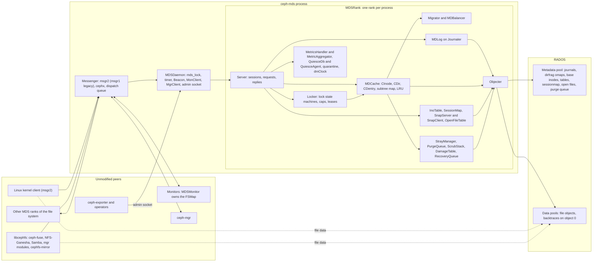

# C++ MDS project map

> Part of the [C++ MDS project map](README.md) (this page is its entry point), which belongs to the [Rust MDS reference set](../README.md). Sources: the 46 topic pages under `cpp-map/` and the code they cite, ceph.git at commit `5f7e383ae6d` (2026-10-09) and the Linux kernel client snapshot 7.3.0-rc6 at `af32da41b03`; every code citation on this page was re-checked against those trees. Related: [Glossary](../GLOSSARY.md), [`mds_lock` analysis](00-architecture/mds_lock-analysis.md), [POSIX semantics contract](03-request-path/posix-semantics-contract.md), [transport, auth and client-library contract](00-architecture/transport-auth-and-client-library-contract.md), [QA and conformance suites](14-testing/qa-and-conformance-suites.md).

## 1. Purpose and responsibilities

The C++ metadata server (`ceph-mds`) serves the namespace of a CephFS file system: directories and names, inode attributes and extended attributes, client capabilities, file locks, snapshots, quotas and recursive statistics. Clients read and write file data directly on the OSDs. The MDS takes part in data I/O only through capabilities, writeable ranges (`max_size`), layouts, truncation and file-size recovery ([RADOS and OSD interactions 3.9](07-storage-formats/rados-and-osd-interactions.md#39-data-path-dependencies)). A file system has one or more active *ranks*. Each rank is held by one daemon, writes its own journal to RADOS and is authoritative for a set of directory subtrees ([rank lifecycle](09-recovery/rank-lifecycle-and-recovery.md#1-purpose-and-responsibilities), [subtrees](04-cache/mdcache-subtrees-traversal-replication.md#31-the-authority-model)).

This page is the architecture overview of the map. It explains how the subsystems fit together (3.1), draws them (3.2), follows one create request through every subsystem (3.3), and indexes all pages with a short summary each (2.1). It describes the C++ code as it is, bugs included, and contains no design for a replacement.

### 1.1 How the pages are organized

- Every topic page except the [`mds_lock` analysis](00-architecture/mds_lock-analysis.md) uses eight sections: 1 purpose, 2 source map, 3 how it works, 4 data structures and invariants, 5 interfaces (messages, journal events, RADOS objects, options, perf counters, admin commands), 6 concurrency and `mds_lock`, 7 externally visible contract, 8 edge cases and gotchas.
- Section 7 separates what unmodified peers (kernel client, libcephfs, ceph-fuse, NFS-Ganesha, monitors, OSDs, mgr modules, tools) depend on from internal mechanics. Section 6 of every page feeds the consolidated [`mds_lock` analysis](00-architecture/mds_lock-analysis.md).
- Code is cited as `path:line (Symbol)` at `5f7e383ae6d`; kernel code as `linux/path:line (function)` at `af32da41b03`. Line numbers are valid only at those commits; the symbol in parentheses survives moves.
- Claims that could not be confirmed are marked "(unverified)"; claims established only by reading code are marked "by code reading", "inferred" or "derived from code". [QA and conformance suites 8.4](14-testing/qa-and-conformance-suites.md#84-verification-backlog) collects them into a backlog of runtime checks.

### 1.2 Recommended reading orders

**A. Protocol compatibility (what an unmodified cluster expects from any MDS).**

1. [Transport, auth and client-library contract](00-architecture/transport-auth-and-client-library-contract.md): msgr2 (msgr1 as legacy), cephx, MonClient, MgrClient, Objecter, encoding rules, per-peer checklist.
2. [Wire protocol](02-client-protocol/wire-protocol.md): client messages, op codes, reply format, CephFS feature bits, forwarding and replay.
3. [Sessions](02-client-protocol/sessions.md), then [capabilities](02-client-protocol/capabilities.md), then [leases, lock caches and async dirops](02-client-protocol/leases-lock-caches-and-async-dirops.md).
4. [Kernel client expectations](02-client-protocol/kclient-expectations.md) and [libcephfs, ceph-fuse and NFS-Ganesha expectations](02-client-protocol/libcephfs-fuse-ganesha-expectations.md): what each unmodified client sends, accepts and asserts on.
5. [FSMap and MDSMap](01-cluster-integration/fsmap-and-mdsmap.md) and [beacon and monitor](01-cluster-integration/beacon-and-monitor.md): the monitor contract (states, compat sets, failover, fencing).
6. [Auth and MDS caps](01-cluster-integration/auth-and-mds-caps.md): cephx and the `mds` cap language.
7. [RADOS and OSD interactions](07-storage-formats/rados-and-osd-interactions.md) and [RADOS object catalog](07-storage-formats/rados-object-catalog.md): what OSDs and clients see of the storage (data-object names, backtraces, fencing, epoch barrier).
8. [mgr, tools and orchestration](01-cluster-integration/mgr-tools-and-orchestration.md), [admin commands](13-admin-and-config/admin-commands.md), [config, perf counters and health](13-admin-and-config/config-perf-counters-and-health.md), [metrics](12-qos-metrics-quiesce-quarantine/metrics-and-subvolume-metrics.md): what mgr modules, cephadm, Rook and exporters consume.
9. [QA and conformance suites](14-testing/qa-and-conformance-suites.md): which tests observe the MDS only through shared interfaces.

**B. Concurrency redesign (where work is serialized today and why).**

1. [`mds_lock` analysis](00-architecture/mds_lock-analysis.md): entry points, protected state, 268 consolidated serialization points, rank-wide singletons, four walkthroughs, coupling that remains with perfect locking.
2. [Process and threading](00-architecture/process-and-threading.md): threads, dispatch, contexts and the re-entry rule.
3. [Request lifecycle](03-request-path/request-lifecycle.md), [acquiring locks](05-locking/acquiring-locks.md), [lock types and state machines](05-locking/lock-types-and-state-machines.md): the non-blocking, restart-from-the-top execution model.
4. [Namespace mutations](03-request-path/namespace-mutations.md) and [rename](03-request-path/rename.md): what one mutation touches, same-directory concurrency, two-phase commit.
5. [MDLog and Journaler](06-journal/mdlog-and-journaler.md) and [events and replay](06-journal/events-and-replay.md): one ordered journal per rank.
6. [MDS tables](07-storage-formats/mds-tables.md), [sessions 3.15](02-client-protocol/sessions.md#315-persistence-the-sessionmap-object-versions-and-journal-events), [strays and purge](11-background-services/strays-and-purge.md): rank-wide version chains and queues.
7. [rstats, quotas and subvolumes](10-snapshots-quotas-subvolumes/rstats-quotas-and-subvolumes.md) and [snapshots](10-snapshots-quotas-subvolumes/snapshots.md): data that couples subvolumes through shared ancestors and file-system-wide snapshot ids.
8. [Subtrees, traversal and replication](04-cache/mdcache-subtrees-traversal-replication.md), [subtree migration](08-multi-mds/subtree-migration.md), [balancer and pinning](08-multi-mds/balancer-and-pinning.md): how the namespace is partitioned today.
9. [Rank lifecycle and recovery](09-recovery/rank-lifecycle-and-recovery.md) and [resolve and rejoin](09-recovery/resolve-and-rejoin.md): recovery as a rank-wide sequence.
10. [QoS](12-qos-metrics-quiesce-quarantine/qos-dmclock-scheduler.md), [quiesce](12-qos-metrics-quiesce-quarantine/quiesce.md), [quarantine](12-qos-metrics-quiesce-quarantine/quarantine.md), [metrics](12-qos-metrics-quiesce-quarantine/metrics-and-subvolume-metrics.md): the subvolume-scoped features that exist today.

**C. POSIX semantics (what applications observe).**

1. [POSIX semantics contract](03-request-path/posix-semantics-contract.md): per call, the rule, the enforcing component, the MDS checks in order, timestamp effects and documented departures.
2. [Namespace mutations](03-request-path/namespace-mutations.md), [rename](03-request-path/rename.md), [attributes and xattrs](03-request-path/attributes-and-xattrs.md), [lookup, readdir, open and file locks](03-request-path/lookup-readdir-open-and-file-locks.md).
3. [Capabilities](02-client-protocol/capabilities.md) and [leases](02-client-protocol/leases-lock-caches-and-async-dirops.md#31-dentry-leases): cache coherency between clients.
4. [Auth and MDS caps 3.8](01-cluster-integration/auth-and-mds-caps.md#38-uidgid-checks-versus-posix-permission-checks): the only permission check the MDS makes.
5. [rstats, quotas and subvolumes](10-snapshots-quotas-subvolumes/rstats-quotas-and-subvolumes.md) and [snapshots](10-snapshots-quotas-subvolumes/snapshots.md): `st_size` of directories, quotas, `.snap`.
6. The client halves: [kernel client 3.6](02-client-protocol/kclient-expectations.md#36-request-path) and [libcephfs 3.5](02-client-protocol/libcephfs-fuse-ganesha-expectations.md#35-operation-map-api-to-mds-op).
7. [QA and conformance suites 7.5](14-testing/qa-and-conformance-suites.md#75-external-conformance-suites): pjd-fstest, xfstests and the other external suites.

## 2. Source map

### 2.1 Section index

**00 Architecture**

| Page | Summary |
|---|---|
| [process-and-threading](00-architecture/process-and-threading.md) | How one `ceph-mds` process is built (`main`, `MDSDaemon`, `MDSRank`), its threads, the dispatch path, the `MDSContext` re-entry rule, timers, heartbeat and shutdown. All metadata work happens under one process-wide `mds_lock`. |
| [mds_lock-analysis](00-architecture/mds_lock-analysis.md) | What `mds_lock` protects, its 21 entry paths, 268 serialization points with their true conflict scope, the rank-wide singletons that couple subvolumes, four walkthroughs, and the coupling that would remain with perfect locking. |
| [transport-auth-and-client-library-contract](00-architecture/transport-auth-and-client-library-contract.md) | msgr2.0/2.1 (msgr1 as legacy), which protocol current peers use, connection policies and delivery guarantees, cephx on the service side, MonClient, MgrClient and Objecter as protocol endpoints, encoding rules and golden data, and a per-peer checklist of what unmodified peers require. |

**01 Cluster integration**

| Page | Summary |
|---|---|
| [auth-and-mds-caps](01-cluster-integration/auth-and-mds-caps.md) | How the MDS and its peers authenticate with cephx, the `mds` cap grammar and `MDSAuthCaps::is_capable`, where checks happen, and what the MDS does not check (POSIX permissions, cap flushes, several request types). |
| [beacon-and-monitor](01-cluster-integration/beacon-and-monitor.md) | The `MMDSBeacon` protocol, monitor-side processing, rank assignment, laggy detection, failover and fencing by blocklist, health metrics, and the minimum behaviour an unmodified monitor requires. |
| [fsmap-and-mdsmap](01-cluster-integration/fsmap-and-mdsmap.md) | FSMap and MDSMap contents and encodings, daemon and rank states with legal transitions, compat sets, standby selection, `fs` and `mds` commands, and how clients decode the MDSMap. |
| [mgr-tools-and-orchestration](01-cluster-integration/mgr-tools-and-orchestration.md) | Every component outside `ceph-mds` that talks to it (mgr modules, cephadm, Rook, `ceph-exporter`, offline tools), the channel each one uses, and which of them depend on the C++ on-disk format. |

**02 Client protocol**

| Page | Summary |
|---|---|
| [wire-protocol](02-client-protocol/wire-protocol.md) | Byte-level reference of client messages: catalog, `MClientRequest` and `MClientReply` encodings, the op code table, CephFS feature bits, forwarding, retry, replay and idempotency. |
| [sessions](02-client-protocol/sessions.md) | The session state machine and protocol, admission at open, renewal, staleness and autoclose, eviction with blocklist and epoch barrier, reclaim for NFS-Ganesha, reconnect after failover, and SessionMap persistence. |
| [capabilities](02-client-protocol/capabilities.md) | The cap bit model and its mapping onto inode locks, the per-(inode, client) `Capability`, issue, revoke and gather, dirty-metadata flushes, `max_size`, snapflush, releases, stale sessions and multi-rank cap moves. |
| [leases-lock-caches-and-async-dirops](02-client-protocol/leases-lock-caches-and-async-dirops.md) | Dentry leases, directory validity through `Fs`, lock caches and the `Dc`/`Dr` bits, inode-number delegation and async create/unlink end to end; lock caches are never created at this commit. |
| [kclient-expectations](02-client-protocol/kclient-expectations.md) | Everything the unmodified Linux kernel client sends, accepts, assumes and does locally, the C++ code that satisfies each expectation, client generations and feature-bit history, and kernel `BUG_ON`s reachable from MDS input. |
| [libcephfs-fuse-ganesha-expectations](02-client-protocol/libcephfs-fuse-ganesha-expectations.md) | The userspace `Client` behind libcephfs, ceph-fuse, NFS-Ganesha, Samba and mgr modules: what it sends and decodes, the asserts an MDS reply can trip, and Ganesha's reclaim, delegations, handle lookups and synchronous metadata. |

**03 Request path**

| Page | Summary |
|---|---|
| [request-lifecycle](03-request-path/request-lifecycle.md) | How an `MClientRequest` becomes an `MDRequest`, the restart-from-the-top execution model, traversal and locking helpers, `journal_and_reply` with unsafe and safe replies, forwarding, batching, peer and internal requests. |
| [namespace-mutations](03-request-path/namespace-mutations.md) | create, mknod, mkdir, symlink, link, unlink and rmdir: path locking, inode-number allocation, new-inode initialization, parent and ancestor updates, journal contents, 2PC for remote targets, same-directory concurrency. |
| [rename](03-request-path/rename.md) | `CEPH_MDS_OP_RENAME`: validation order, lock set, snaprealm handling, witness selection and the cross-rank two-phase commit, inode migration inside a rename, rollback and resolve. |
| [attributes-and-xattrs](03-request-path/attributes-and-xattrs.md) | SETATTR including truncate, `O_TRUNC`, legacy layout ops, regular xattrs and POSIX ACL blobs, `ceph.*` virtual xattrs (layouts, quotas, pins, subvolume flag, charmap, quiesce block) and GETVXATTR. |
| [lookup-readdir-open-and-file-locks](03-request-path/lookup-readdir-open-and-file-locks.md) | GETATTR and LOOKUP with batching, inode-number lookups for NFS handles, OPEN, READDIR paging, dentry leases in replies, and fcntl/flock lock arbitration and recovery. |
| [posix-semantics-contract](03-request-path/posix-semantics-contract.md) | Per POSIX call: the rule, the component that enforces it, the MDS op and handler, the MDS errors in check order, timestamp effects and coherency; plus the departures from POSIX documented upstream and found in code. |

**04 Cache**

| Page | Summary |
|---|---|
| [cinode-and-inode-types](04-cache/cinode-and-inode-types.md) | `CInode` and `inode_t` (field reference and binary encoding), projection, versions, old inodes, backtraces, the eleven per-inode locks, per-client cap tracking and `InodeStat` encoding. |
| [cdir-cdentry-and-cache-objects](04-cache/cdir-cdentry-and-cache-objects.md) | `MDSCacheObject`, `CDir` and `CDentry`: pins, state bits, auth pins, freezing, waiters, versions and dirty tracking, dirfrag commit and fetch, dentry linkage kinds. |
| [mdcache-subtrees-traversal-replication](04-cache/mdcache-subtrees-traversal-replication.md) | The authority model and subtree map, `ESubtreeMap`, `path_traverse`, discover and replica encoding, pushing changes to replicas, and finding inodes by number (`open_ino`, `find_ino_peers`). |
| [mdcache-lifecycle-trim-and-memory](04-cache/mdcache-lifecycle-trim-and-memory.md) | Residency rules (pins and two LRUs), memory accounting against `mds_cache_memory_limit`, the upkeep thread, replica expiry, client recall, the base hierarchy (root, `~mdsN`, strays) and rank stopping. |
| [dirfrags-and-fragmentation](04-cache/dirfrags-and-fragmentation.md) | `frag_t` and `fragtree_t`, name hashing, split and merge triggers, the PREPARE/COMMIT/FINISH protocol, replica notification, crash recovery, client-visible effects and size limits. |

**05 Locking**

| Page | Summary |
|---|---|
| [lock-types-and-state-machines](05-locking/lock-types-and-state-machines.md) | `SimpleLock`, `ScatterLock` (scatterlock and filelock tables) and `LocalLockC`: complete state tables, permission and cap predicates, the gather engine, stable-state policies, the `MLock` protocol and scatter-gather of dirstat, rstat and fragtree. |
| [acquiring-locks](05-locking/acquiring-locks.md) | `Locker::acquire_locks`: lock vectors, implicit locks, local and remote auth pins, ordering and deadlock avoidance, waits that never block a thread, remote locks, release timeline and worked lock sets per operation. |

**06 Journal**

| Page | Summary |
|---|---|
| [mdlog-and-journaler](06-journal/mdlog-and-journaler.md) | The per-rank journal: objects, header and pointer, entry framing, the submit thread and group commit, segments and boundaries, expiry and trimming, replay, standby-replay tailing and I/O error handling. |
| [events-and-replay](06-journal/events-and-replay.md) | The 20 event type ids, `EMetaBlob` after-images, what each event obliges a segment to write back, replay semantics per event, and one client mutation followed across a crash. |

**07 Storage formats**

| Page | Summary |
|---|---|
| [rados-object-catalog](07-storage-formats/rados-object-catalog.md) | Every RADOS object the MDS creates or reads in the metadata and data pools: names, encodings, writers, readers and the external tools that read them. |
| [mds-tables](07-storage-formats/mds-tables.md) | `MDSTable`, the per-rank `InoTable`, the generic table two-phase commit (whose only instance is the snap table on rank 0), the `OpenFileTable` and `Anchor`. |
| [rados-and-osd-interactions](07-storage-formats/rados-and-osd-interactions.md) | The MDS as a RADOS client: Objecter identity and flags, every RADOS operation it issues, atomicity assumptions, fencing, the OSD epoch barrier, full-cluster behaviour, data-path dependencies and snapshot trimming. |

**08 Multi-MDS**

| Page | Summary |
|---|---|
| [subtree-migration](08-multi-mds/subtree-migration.md) | Migrator export and import state machines, freezing, what state moves (metadata, lock states, caps), journaling with `EExport`, `EImportStart` and `EImportFinish`, bystanders, client cap moves, cancellation. |
| [balancer-and-pinning](08-multi-mds/balancer-and-pinning.md) | Popularity counters and rank load, the heartbeat-driven default balancer, Mantle, export pins and ephemeral (distributed, random) pins, fragmentation triggers, hot-directory replication and export targets. |

**09 Recovery**

| Page | Summary |
|---|---|
| [rank-lifecycle-and-recovery](09-recovery/rank-lifecycle-and-recovery.md) | The rank state machine and who moves it, boot stages, creating and starting ranks, replay and standby-replay, the recovery pipeline to `up:active`, file size recovery, stopping, and failure exits. |
| [resolve-and-rejoin](09-recovery/resolve-and-rejoin.md) | Resolve (subtree authority, outcomes of cross-rank two-phase commits, snap table sync) and rejoin (weak and strong rejoins, cap matching from reconnect, lock-state recovery, snaprealm fix-ups), with a cost model for large caches. |

**10 Snapshots, quotas and subvolumes**

| Page | Summary |
|---|---|
| [snapshots](10-snapshots-quotas-subvolumes/snapshots.md) | Snapshot ids and the global snap table, snap realms and snap traces, metadata copy-on-write, `.snap` operations, realm changes caused by namespace operations, recovery, and snapdiff and blockdiff for cephfs-mirror. |
| [rstats-quotas-and-subvolumes](10-snapshots-quotas-subvolumes/rstats-quotas-and-subvolumes.md) | `dirstat` and `rstat` with their eager and lazy propagation, consistency guarantees, client-enforced quotas pushed with `MClientQuota`, the subvolume realm flag and its effects, directory entry limits, and mgr/volumes as consumer. |

**11 Background services**

| Page | Summary |
|---|---|
| [strays-and-purge](11-background-services/strays-and-purge.md) | How unlinked inodes become strays, the evaluation that keeps, reintegrates, migrates or purges them, the per-rank journaled PurgeQueue and its executor, and the purge of delegated inode numbers. |
| [scrub-and-damage](11-background-services/scrub-and-damage.md) | Forward scrub (`ScrubStack`), what it validates and repairs, data uninlining, multi-rank scrub coordinated by rank 0, and the in-memory `DamageTable` with its effect on requests. |

**12 QoS, metrics, quiesce and quarantine**

| Page | Summary |
|---|---|
| [qos-dmclock-scheduler](12-qos-metrics-quiesce-quarantine/qos-dmclock-scheduler.md) | The optional dmClock admission stage for client requests, keyed on the session's mount root: threads, cost model, configuration, effective behaviour, defects, and what it cannot do for per-subvolume SLAs. |
| [metrics-and-subvolume-metrics](12-qos-metrics-quiesce-quarantine/metrics-and-subvolume-metrics.md) | Client-reported metrics, per-rank ingestion, forwarding to rank 0, aggregation into labeled perf counters and mgr perf queries, and subvolume metrics end to end. |
| [quiesce](12-qos-metrics-quiesce-quarantine/quiesce.md) | The replicated QuiesceDb, per-rank agents, the `quiesce_path` and `quiesce_inode` internal requests, the `quiescelock`, and what is blocked and what proceeds while a set is quiesced. |
| [quarantine](12-qos-metrics-quiesce-quarantine/quarantine.md) | Administrator-driven, persistent block of client access to one subvolume: state, enforcement on requests and caps, the cap-revocation walk, multi-rank behaviour, failure handling and undo. |

**13 Admin and config**

| Page | Summary |
|---|---|
| [admin-commands](13-admin-and-config/admin-commands.md) | The 60 MDS commands and 36 generic commands over the admin socket and `tell`: transport, authorization, parsing, semantics, outputs, return-code conventions, consumers and locking. |
| [config-perf-counters-and-health](13-admin-and-config/config-perf-counters-and-health.md) | The 201 options of `mds.yaml.in` with defaults and when changes apply, perf-counter loggers and labeled families, health metrics and checks, cluster-log messages and task status. |

**14 Testing**

| Page | Summary |
|---|---|
| [qa-and-conformance-suites](14-testing/qa-and-conformance-suites.md) | Inventory of qa suites, unit and binding tests, workunits and external suites (fstests, pjdfstest, LTP, pynfs, smbtorture), tagged by the channels each test depends on, plus a backlog of claims to verify at runtime. |

### 2.2 Code areas and the pages that own them

| Code | Pages |
|---|---|
| `src/ceph_mds.cc`, `src/mds/MDSDaemon.*`, `src/mds/MDSRank*.cc`, `src/mds/MDSContext.*`, `src/mds/Beacon.*` | [process and threading](00-architecture/process-and-threading.md), [beacon and monitor](01-cluster-integration/beacon-and-monitor.md), [rank lifecycle](09-recovery/rank-lifecycle-and-recovery.md) |
| `src/msg/**`, `src/auth/**`, `src/mon/MonClient.*`, `src/mgr/MgrClient.*`, `src/osdc/Objecter.*`, `src/include/encoding.h` | [transport and client-library contract](00-architecture/transport-auth-and-client-library-contract.md), [auth and MDS caps](01-cluster-integration/auth-and-mds-caps.md) |
| `src/mds/FSMap.*`, `src/mds/MDSMap.*`, `src/mon/MDSMonitor.*`, `src/mon/FSCommands.*` | [FSMap and MDSMap](01-cluster-integration/fsmap-and-mdsmap.md), [beacon and monitor](01-cluster-integration/beacon-and-monitor.md) |
| `src/messages/MClient*.h`, `src/include/ceph_fs.h`, `src/mds/cephfs_features.*` | [wire protocol](02-client-protocol/wire-protocol.md) |
| `src/mds/Server.*` | [request lifecycle](03-request-path/request-lifecycle.md), [sessions](02-client-protocol/sessions.md), the request-path pages |
| `src/mds/Locker.*`, `src/mds/SimpleLock.*`, `src/mds/ScatterLock.h`, `src/mds/LocalLockC.h`, `src/mds/locks.*`, `src/mds/Capability.*`, `src/mds/Mutation.*` | [locking pages](05-locking/lock-types-and-state-machines.md), [capabilities](02-client-protocol/capabilities.md), [leases and lock caches](02-client-protocol/leases-lock-caches-and-async-dirops.md) |
| `src/mds/MDCache.*`, `src/mds/CInode.*`, `src/mds/CDir.*`, `src/mds/CDentry.*`, `src/include/frag.h` | the [cache pages](04-cache/mdcache-subtrees-traversal-replication.md) |
| `src/mds/MDLog.*`, `src/osdc/Journaler.*`, `src/mds/LogEvent.*`, `src/mds/events/*`, `src/mds/journal.cc` | [MDLog and Journaler](06-journal/mdlog-and-journaler.md), [events and replay](06-journal/events-and-replay.md) |
| `src/mds/MDSTable*`, `src/mds/InoTable.*`, `src/mds/SnapServer.*`, `src/mds/SnapClient.*`, `src/mds/OpenFileTable.*`, `src/mds/SessionMap.*` | [MDS tables](07-storage-formats/mds-tables.md), [snapshots](10-snapshots-quotas-subvolumes/snapshots.md), [sessions](02-client-protocol/sessions.md) |
| `src/mds/Migrator.*`, `src/mds/MDBalancer.*`, `src/mds/Mantle.*` | [subtree migration](08-multi-mds/subtree-migration.md), [balancer and pinning](08-multi-mds/balancer-and-pinning.md) |
| `src/mds/StrayManager.*`, `src/mds/PurgeQueue.*`, `src/mds/ScrubStack.*`, `src/mds/DamageTable.*`, `src/mds/RecoveryQueue.*` | [strays and purge](11-background-services/strays-and-purge.md), [scrub and damage](11-background-services/scrub-and-damage.md), [rank lifecycle 3.16](09-recovery/rank-lifecycle-and-recovery.md#316-file-size-and-mtime-recovery-recoveryqueue) |
| `src/mds/MDSDmclockScheduler.*`, `src/mds/Metric*`, `src/mds/MDSPinger.*`, `src/mds/Quiesce*`, `src/mds/MDSRankQuiesce.cc`, `src/mds/MDSRankQuarantine.cc` | the [section 12 pages](12-qos-metrics-quiesce-quarantine/quiesce.md) |
| `src/common/options/mds*.yaml.in`, `src/common/admin_socket.*` | [admin commands](13-admin-and-config/admin-commands.md), [config, perf counters and health](13-admin-and-config/config-perf-counters-and-health.md) |
| `src/client/**`, `src/libcephfs.cc`, `src/pybind/mgr/**`, `src/tools/cephfs*/**`, `qa/**` | [libcephfs expectations](02-client-protocol/libcephfs-fuse-ganesha-expectations.md), [mgr, tools and orchestration](01-cluster-integration/mgr-tools-and-orchestration.md), [QA](14-testing/qa-and-conformance-suites.md) |

### 2.3 Inputs outside the C++ tree

- **Linux kernel client**: snapshot 7.3.0-rc6, master `af32da41b03` (2026-10-09), cited with the prefix `linux/`. Used mainly by [kclient expectations](02-client-protocol/kclient-expectations.md), [transport](00-architecture/transport-auth-and-client-library-contract.md) and the [POSIX contract](03-request-path/posix-semantics-contract.md).
- **Downloaded sources** used by single pages are named in each page's source line: older Linux tags and two CentOS Stream kernels ([kclient 7.1](02-client-protocol/kclient-expectations.md#71-client-generations-and-protocol-fallbacks)), nfs-ganesha V15.7 and libfuse ([libcephfs page](02-client-protocol/libcephfs-fuse-ganesha-expectations.md)), Rook v1.21.0 ([mgr and orchestration](01-cluster-integration/mgr-tools-and-orchestration.md)), fstests, pjdfstest, LTP and pynfs ([QA](14-testing/qa-and-conformance-suites.md), [POSIX contract](03-request-path/posix-semantics-contract.md)).
- **Staging files**: `../_staging/*.json`, machine-readable notes from the deep-reading pass (described in the [reference set README](../README.md)).

## 3. How it works

### 3.1 How the pieces fit

#### 3.1.1 Daemon, rank, membership and threading

`main` builds one messenger, a `MonClient`, a two-thread asio pool and an `MDSDaemon` (`src/ceph_mds.cc:84 (main)`). `MDSDaemon` is the rank-independent part of the process: it owns `mds_lock`, the timer, the `Beacon`, the `MgrClient` and the current MDSMap ([process and threading 3.3](00-architecture/process-and-threading.md#33-object-model-and-ownership)). A new daemon beacons to the monitors and becomes a standby. The monitors' `MDSMonitor` alone decides which daemon holds which rank in which state; it replaces daemons whose beacons stop and fences them by OSD blocklisting ([beacon and monitor 3.10](01-cluster-integration/beacon-and-monitor.md#310-failover-and-fencing), [FSMap and MDSMap 3.3](01-cluster-integration/fsmap-and-mdsmap.md#33-mds-daemon-and-rank-states)). When an MDSMap assigns a rank, `MDSDaemon::handle_mds_map` creates one `MDSRankDispatcher` (`src/mds/MDSDaemon.cc:833 (MDSDaemon::handle_mds_map)`), whose constructor builds every metadata subsystem (`src/mds/MDSRank.cc:468 (MDSRank::MDSRank)`). A process holds at most one rank; a rank change or removal from the map makes it re-execute itself. Of about 30 threads, roughly 20 do metadata work, and all of them hold the single process-wide `mds_lock` while doing it (`src/mds/MDSDaemon.h:74 (MDSDaemon::mds_lock)`). `MDSDaemon::ms_dispatch2` takes it for every message (`src/mds/MDSDaemon.cc:1088-1091 (MDSDaemon::ms_dispatch2)`), and `MDSIOContextBase::complete` takes it for every journal and RADOS completion (`src/mds/MDSContext.cc:95 (MDSIOContextBase::complete)`) ([thread inventory](00-architecture/process-and-threading.md#35-thread-inventory), [`mds_lock` entry points](00-architecture/mds_lock-analysis.md#12-entry-points)).

#### 3.1.2 Transport and authentication

The single messenger accepts clients and peer MDS daemons and opens the connections to monitors, the mgr and OSDs, with one policy per peer type (`src/ceph_mds.cc:172-191 (main)`). By default it binds a msgr2 and a msgr1 address. Current clients use msgr2. `mount.ceph` mounts the kernel client with `ms_mode=prefer-crc` for the new device syntax, and the C++ clients pick the v2 address and crc mode. Only a kernel mounted without `ms_mode` uses msgr1 ([transport 1](00-architecture/transport-auth-and-client-library-contract.md#1-purpose-and-responsibilities), [3.1](00-architecture/transport-auth-and-client-library-contract.md#31-one-messenger-six-peer-classes-policies-and-throttles)). Every peer authenticates with cephx. The `MonClient` verifies a client's authorizer against the rotating `mds` service secrets on a messenger worker thread, and `MDSDaemon::ms_handle_fast_authentication` parses the MDS caps carried in the ticket there, without `mds_lock` (`src/mds/MDSDaemon.cc:1259 (MDSDaemon::ms_handle_fast_authentication)`). `MDSDaemon::ms_handle_accept` then binds a `Session` to the connection (`src/mds/MDSDaemon.cc:1266 (MDSDaemon::ms_handle_accept)`) ([auth and MDS caps 3.3](01-cluster-integration/auth-and-mds-caps.md#33-how-peers-authenticate-to-the-mds)). The MDS is itself a client of the monitors (map subscriptions, beacons, commands, cluster log), of the active mgr (`MMgrReport` with perf counters and metrics) and of the OSDs through its own `Objecter` ([transport 3.7 to 3.9](00-architecture/transport-auth-and-client-library-contract.md#37-monclient)). Wire and on-disk structures use versioned `ENCODE_START`/`DECODE_START` envelopes ([transport 3.10](00-architecture/transport-auth-and-client-library-contract.md#310-encoding-framework-and-golden-data)).

#### 3.1.3 Client protocol

A client opens one session per rank with `CEPH_SESSION_REQUEST_OPEN`, which carries client metadata and CephFS feature bits. A session not renewed within `session_timeout` (60 s) can be marked stale (by default only while the MDS is revoking caps from it or waiting for its flush), and a client silent for `session_autoclose` (300 s) is evicted (`src/mds/MDSMap.h:605-606 (MDSMap)`) ([sessions 3.6](02-client-protocol/sessions.md#36-renewal-staleness-autoclose)). On that session the client sends `MClientRequest`s, which name their target by an inode number plus a relative path. It receives `MClientReply`s whose traces (`InodeStat`, `DirStat`, `LeaseStat`) also grant caps and dentry leases. Caps, cap releases, leases, snap realm updates, quota updates and metrics travel in `MClientCaps`, `MClientCapRelease`, `MClientLease`, `MClientSnap`, `MClientQuota` and `MClientMetrics` ([wire protocol 3.3](02-client-protocol/wire-protocol.md#33-message-catalog)). Caps let a client cache or change parts of an inode locally; the MDS revokes them when another client or rank needs conflicting access ([capabilities 3.1](02-client-protocol/capabilities.md#31-the-cap-bit-model)). After an MDS failure the client resends its unsafe requests and reconnects its caps, snaprealms and file locks ([sessions 3.10](02-client-protocol/sessions.md#310-reconnect-protocol-mds-failover)). A restarted NFS-Ganesha instance also reclaims the session of its previous incarnation ([sessions 3.9](02-client-protocol/sessions.md#39-reclaim-protocol-nfs-ganesha-via-libcephfs)). The [kernel client](02-client-protocol/kclient-expectations.md) and [libcephfs](02-client-protocol/libcephfs-fuse-ganesha-expectations.md) pages list what each unmodified client sends, accepts and asserts on.

#### 3.1.4 Request path

`Server::handle_client_request` checks the session and answers retried or replayed requests that already completed from the session's `completed_requests` (`src/mds/Server.cc:2616 (Server::handle_client_request)`). Otherwise it registers an `MDRequestImpl` through `MDCache::request_start` (`src/mds/MDCache.cc:9817 (MDCache::request_start)`). `Server::dispatch_client_request` applies the read-only and full-pool gates and calls the handler for the op code (`src/mds/Server.cc:2765 (Server::dispatch_client_request)`). Handlers are re-entrant: they traverse the path and acquire locks, and whenever something must wait they register a context that restarts the handler from the top ([request lifecycle 3.6](03-request-path/request-lifecycle.md#36-execution-model-restart-from-the-top)). Read operations reply once. A mutation projects its changes, builds a journal event and calls `Server::journal_and_reply` (`src/mds/Server.cc:2124 (Server::journal_and_reply)`), which normally sends an unsafe reply before the event is durable and a safe reply after the commit. A request for an object owned by another rank is answered with a forward, and the client resends it there ([request lifecycle 3.13](03-request-path/request-lifecycle.md#313-forwarding)). Link, unlink, rmdir and rename across ranks use peer requests and a two-phase commit ([rename 3.8](03-request-path/rename.md#38-witness-selection-and-the-two-phase-commit-leader-side)). The [POSIX semantics contract](03-request-path/posix-semantics-contract.md#32-main-table) lists, per POSIX call, which checks the MDS makes and in which order.

#### 3.1.5 Cache

`MDCache` holds the `CInode`, `CDir` (one directory fragment) and `CDentry` objects. Apart from the base inodes, an inode has no RADOS object of its own: it is stored inside its primary dentry in the parent dirfrag's omap object ([cinode 3.10](04-cache/cinode-and-inode-types.md#310-persistence-of-inodes), [cdir 1](04-cache/cdir-cdentry-and-cache-objects.md#1-purpose-and-responsibilities)). Mutations use read-copy-update: a projected copy of an inode or fnode is edited and journaled, and after the commit the oldest projection is popped and applied ([cinode 3.7](04-cache/cinode-and-inode-types.md#37-projection-mechanics-read-copy-update)). The namespace is partitioned into subtrees rooted at dirfrags with an explicit `dir_auth`. Every object has exactly one authoritative rank; other ranks hold replicas obtained by discover. `MDCache::path_traverse` resolves request paths, fetching dirfrags, discovering replicas or forwarding as needed (`src/mds/MDCache.cc:8443 (MDCache::path_traverse)`) ([subtrees 3.1 to 3.6](04-cache/mdcache-subtrees-traversal-replication.md#31-the-authority-model)). Cache size is a soft target, `mds_cache_memory_limit` (4 GiB). The `mds-cache-trim` thread enforces it by trimming two dentry LRUs and recalling caps from clients ([cache lifecycle 3.4](04-cache/mdcache-lifecycle-trim-and-memory.md#34-the-upkeep-thread-mds-cache-trim)). Large directories split into fragments by name hash ([dirfrags](04-cache/dirfrags-and-fragmentation.md)).

#### 3.1.6 Locking and capabilities

Each inode carries eleven lock objects and each dentry two (`src/mds/CInode.h:1153-1163 (CInode::quiescelock .. CInode::policylock)`, `src/mds/CDentry.h:384-385 (CDentry::lock, CDentry::versionlock)`). A lock is a state machine driven by static tables, not a mutex ([lock types 3.2](05-locking/lock-types-and-state-machines.md#32-lock-types-per-object)). Only the authoritative rank starts a state change. An unstable state waits ("gathers") until local holders drain, clients acknowledge cap revocations, leases are released and replicas acknowledge through `MLock` ([lock types 3.6](05-locking/lock-types-and-state-machines.md#36-the-gather-engine-lockereval_gather)). `Locker::acquire_locks` takes a request's lock vector in a fixed order and auth-pins the objects it locks (`src/mds/Locker.cc:245 (Locker::acquire_locks)`). It never blocks a thread: when a lock is not grantable it starts a transition, registers a waiter and returns ([acquiring locks 3.2](05-locking/acquiring-locks.md#32-the-re-entrant-execution-model-no-thread-ever-blocks)). Four locks (`authlock`, `linklock`, `xattrlock`, `filelock`) carry client cap bits, so the caps issued follow the lock states (`src/mds/Locker.cc:2578 (Locker::issue_caps)`) ([capabilities 3.3](02-client-protocol/capabilities.md#33-from-lock-states-to-allowed-caps)). Dentry leases let clients cache single names for up to 30 s. Lock caches, the mechanism behind kernel async create and unlink, are never created at this commit ([leases 1](02-client-protocol/leases-lock-caches-and-async-dirops.md#1-purpose-and-responsibilities)).

#### 3.1.7 Journal

Each rank has one journal: an `MDLog` on a `Journaler` byte stream of `<0x200+rank>.<n>` objects in the metadata pool ([MDLog 3.2](06-journal/mdlog-and-journaler.md#32-rados-objects-and-naming)). `MDLog::submit_entry` queues an event (`src/mds/MDLog.h:147 (MDLog::submit_entry)`). The `mds-log-submit` thread encodes and appends it without `mds_lock` (`src/mds/MDLog.cc:491 (MDLog::_submit_thread)`). Buffered bytes reach RADOS when an append fills a journal object or when `MDLog::flush()` is called (`src/mds/MDLog.cc:601 (MDLog::flush)`): by the 5 s tick, by lock nudges, on a client's `REQUEST_FLUSH_MDLOG`, for synchronous cap flushes, or by a mutation that sent no early reply ([MDLog 3.11](06-journal/mdlog-and-journaler.md#311-mdlog-submit-path)). Completions run in journal order on the rank finisher, under `mds_lock`. Events are grouped into segments. A segment can expire only after every object it dirtied (dirfrags, backtraces, tables, SessionMap, OpenFileTable) has been written back (`src/mds/journal.cc:127 (LogSegment::try_to_expire)`). The `mds-log-trim` thread then trims it ([MDLog 3.12 and 3.13](06-journal/mdlog-and-journaler.md#312-segments-and-boundaries)). Most events embed an `EMetaBlob` of after-images, and replay applies events strictly in journal order ([events 3.4 and 3.5](06-journal/events-and-replay.md#34-emetablob-in-detail)).

#### 3.1.8 Storage formats

The metadata pool holds, per rank, the journal, journal pointer and PurgeQueue journal objects; one omap object per dirfrag (`<dirino>.<frag>`: an fnode header plus one key per dentry, with the inode embedded in primary dentries); the base inode objects; and `mds<r>_inotable`, `mds_snaptable`, `mds<r>_sessionmap` and `mds<r>_openfiles.<i>`. Data pools hold the objects clients write, `<ino>.<objno>`, and the backtraces the MDS writes as xattrs on object 0 ([RADOS object catalog 3.4](07-storage-formats/rados-object-catalog.md#34-catalog-overview)). Object names are computed as `"%llx.%08llx"` from inode and object numbers, on the MDS side (`src/include/object.cc:46-50 (file_object_t::c_str)`) and in the kernel (`linux/net/ceph/osd_client.c:1110 (ceph_osdc_new_request)`), so inode numbers, layouts and data-object names are a contract with clients. The MDS talks to OSDs as a RADOS client with `FULL_FORCE` on every op. It relies only on single-object atomicity and on the monitor's blocklist for fencing ([RADOS and OSD 3.1 to 3.6](07-storage-formats/rados-and-osd-interactions.md#31-the-mds-as-a-rados-client)). The tables are a per-rank `InoTable` handing out inode numbers from `[(r+1)<<40, (r+2)<<40)` (`src/mds/InoTable.cc:29 (InoTable::reset_state)`), the snap table served by rank 0 through a generic two-phase commit, and the per-rank `OpenFileTable` ([MDS tables](07-storage-formats/mds-tables.md#1-purpose-and-responsibilities)).

#### 3.1.9 Multi-MDS

With several active ranks, each rank journals and serves its own subtrees. The `Migrator` moves authority over a subtree: it freezes the subtree, ships its cached metadata, lock states and client caps, and journals both sides (`EExport`, `EImportStart`, `EImportFinish`) (`src/mds/Migrator.cc:920 (Migrator::export_dir)`) ([subtree migration 3.3 to 3.7](08-multi-mds/subtree-migration.md#33-exporter-state-machine)). Exports are chosen by the `MDBalancer` from decayed popularity counters when the `balance_automate` flag is set, by export pins (`ceph.dir.pin`) and by ephemeral pins (`ceph.dir.pin.distributed`, `ceph.dir.pin.random`) ([balancer and pinning 3.1](08-multi-mds/balancer-and-pinning.md#31-big-picture)). Replicas on other ranks follow the lock protocol. Cross-rank rename, link, unlink and rmdir run a two-phase commit with witnesses, and the outcome of an interrupted one is settled in the resolve phase ([resolve and rejoin 3.4](09-recovery/resolve-and-rejoin.md#34-resolve-step-1-peer-resolves-two-phase-commit-outcomes)).

#### 3.1.10 Recovery

A failed rank is taken over by a standby, or by a standby-replay daemon that was already tailing its journal. The new holder waits for the OSDMap that blocklisted the old holder ([RADOS and OSD 3.6](07-storage-formats/rados-and-osd-interactions.md#36-fencing-model)). It then moves through `up:replay` (journal), `up:resolve` (multiple ranks only: subtree authority and in-doubt two-phase commits), `up:reconnect` (clients resend caps and file locks within `mds_reconnect_timeout`, 45 s), `up:rejoin` (replica, lock and cap state), `up:clientreplay` (requests whose effects clients saw before the failure) and `up:active` (`src/mds/MDSRank.cc:1792 (MDSRank::replay_start)` to `src/mds/MDSRank.cc:2129 (MDSRank::active_start)`) ([rank lifecycle 3.2](09-recovery/rank-lifecycle-and-recovery.md#32-the-state-machine), [resolve and rejoin](09-recovery/resolve-and-rejoin.md#31-position-in-the-recovery-pipeline)). The rank asks for each step in a beacon and the monitor commits it. Size and mtime of files whose writers did not reconnect are recovered by probing their data objects ([rank lifecycle 3.16](09-recovery/rank-lifecycle-and-recovery.md#316-file-size-and-mtime-recovery-recoveryqueue)).

#### 3.1.11 Snapshots, quotas and subvolumes

Snapshot ids are global to the file system and are allocated by the snap table server on rank 0 through the table two-phase commit ([snapshots 3.1](10-snapshots-quotas-subvolumes/snapshots.md#31-snapshot-ids-and-the-global-snap-table)). Snap realms (`SnapRealm`, persisted as `sr_t`) are attached to directories with snapshots, quota roots, subvolume roots and the root; hard-linked inodes outside subvolumes join the global realm, inode 3 ([snapshots 3.2](10-snapshots-quotas-subvolumes/snapshots.md#32-snap-realms)). Clients receive realm hierarchies as snap traces and build the `SnapContext` for their OSD writes from them. Every dentry and inode carries a `[first, last]` snapid range, and the MDS copies one on write when a snapshot covers it ([snapshots 3.3 and 3.4](10-snapshots-quotas-subvolumes/snapshots.md#33-snap-traces-seen-by-clients)). Recursive statistics (`rstat`) and directory statistics (`dirstat`) are propagated eagerly to the parent and lazily above it ([rstats 3.3](10-snapshots-quotas-subvolumes/rstats-quotas-and-subvolumes.md#33-eager-propagation-mdcachepredirty_journal_parents)). Quotas are stored on directory inodes and pushed to clients with `MClientQuota`; only clients enforce them ([rstats 3.11](10-snapshots-quotas-subvolumes/rstats-quotas-and-subvolumes.md#311-enforcement-clients-only)). A subvolume is a directory with `ceph.dir.subvolume=1`: rename and link across subvolumes return `EXDEV`, and nested subvolumes are refused ([rstats 3.13](10-snapshots-quotas-subvolumes/rstats-quotas-and-subvolumes.md#313-what-the-subvolume-flag-changes-inside-the-mds)).

#### 3.1.12 Background services

When the last primary name of an inode goes away, its primary dentry moves into one of the rank's ten stray directories (`~mdsN/stray0` to `stray9`). `StrayManager` keeps the stray while anything references it and reintegrates it if hard links remain (`src/mds/StrayManager.cc:571 (StrayManager::eval_stray)`). Otherwise it pushes a `PurgeItem` to the rank's RADOS-journaled `PurgeQueue` (`src/mds/PurgeQueue.cc:360 (PurgeQueue::push)`), which deletes the objects later and with throttles ([strays and purge 3.0](11-background-services/strays-and-purge.md#30-lifecycle-overview)). Forward scrub (`ScrubStack`, coordinated by rank 0) compares on-disk metadata with the cache and can repair some of it. The in-memory `DamageTable` records metadata that could not be loaded, so that requests touching it fail fast with `EIO` ([scrub and damage 1](11-background-services/scrub-and-damage.md#1-purpose-and-responsibilities)).

#### 3.1.13 QoS, metrics, quiesce and quarantine

The optional dmClock scheduler (off by default) delays client requests per "volume", defined as the first three components of the session's mount root, separately on each rank ([QoS 1](12-qos-metrics-quiesce-quarantine/qos-dmclock-scheduler.md#1-purpose-and-responsibilities)). Clients report performance metrics; every rank forwards them to rank 0, which aggregates them into labeled perf counters and answers mgr perf queries ([metrics 3.1](12-qos-metrics-quiesce-quarantine/metrics-and-subvolume-metrics.md#31-pipeline-overview)). Quiesce pauses mutations under a set of paths on every active rank so that snapshots of several subvolumes are mutually consistent. A QuiesceDb leader coordinates it, and per-rank agents xlock each inode's `quiescelock` ([quiesce 3.1](12-qos-metrics-quiesce-quarantine/quiesce.md#31-architecture-overview)). Quarantine persistently blocks client access to one subvolume, except for sessions whose MDS caps carry `q` or `Q` ([quarantine 1](12-qos-metrics-quiesce-quarantine/quarantine.md#1-purpose-and-responsibilities)).

#### 3.1.14 Administration and configuration

Operators and tools reach the MDS through the local admin socket and through remote `tell` (`MCommand`). Both share one table of 60 MDS commands plus 36 generic ones ([admin commands 1](13-admin-and-config/admin-commands.md#1-purpose-and-responsibilities)). `mds.yaml.in` declares 201 options. Eight unlabeled perf-counter loggers with 181 counters, plus labeled families, are read by `ceph-exporter`, the mgr and the qa suite. Health metrics travel in beacons and become cluster health checks on the monitor ([config, perf counters and health 1](13-admin-and-config/config-perf-counters-and-health.md#1-purpose-and-responsibilities)). mgr modules (`volumes`, `snap_schedule`, `mirroring`, `stats`, `nfs`, dashboard), cephadm and Rook use libcephfs, `tell`, monitor commands and perf counters. The offline tools (`cephfs-journal-tool`, `cephfs-data-scan`, `cephfs-table-tool`, `cephfs-meta-injection`, `first-damage.py`) read and write the C++ on-disk formats directly ([mgr, tools and orchestration 1](01-cluster-integration/mgr-tools-and-orchestration.md#1-purpose-and-responsibilities)).

#### 3.1.15 Testing

The qa suites (`qa/suites/fs` with 25 sub-suites, `qa/tasks/cephfs` with 50 test modules), the C++ tests under `src/test/{libcephfs,client,fs,mds}` and external suites (fstests, pjdfstest, LTP, pynfs, smbtorture) are inventoried by the channels each test depends on. Tests that use only the wire protocol, cluster maps and data-object names (channels P and D) observe the MDS the way unmodified peers do. Admin-socket JSON and perf-counter names (T, C) are shared only where an unmodified mgr module or exporter uses the same item; option effects, log text, on-disk formats and released C++ packages (O, L, F, U) are specific to the C++ MDS ([QA and conformance suites 1.2](14-testing/qa-and-conformance-suites.md#12-channel-classes)).

### 3.2 Component diagram

All boxes inside `MDSRank` run their metadata work under `mds_lock`. The exceptions are journal encoding on `mds-log-submit`, PurgeQueue execution, QuiesceDb replication, metrics bookkeeping and dmClock queueing ([`mds_lock` analysis 1.5](00-architecture/mds_lock-analysis.md#15-work-that-runs-outside-mds_lock)).

### 3.3 Walkthrough: one create request

Setup: one active rank is authoritative for `/` and `/project`. A kernel client with an open session and free preallocated inode numbers calls `open("/project/a", O_CREAT|O_WRONLY)`. The steps follow the [`mds_lock` analysis 5.a](00-architecture/mds_lock-analysis.md#5a-two-clients-create-projecta-and-projectb) and [namespace mutations 3.7.1](03-request-path/namespace-mutations.md#371-create-srcmdsservercc4895-serverhandle_client_openc).

1. **Client.** The kernel's `->atomic_open` sends `CEPH_MDS_OP_CREATE` naming the parent by inode number plus the name `a` ([kclient 3.6.2](02-client-protocol/kclient-expectations.md#362-paths-on-the-wire), [POSIX contract 3.2](03-request-path/posix-semantics-contract.md#32-main-table)). It cannot complete the create asynchronously: async create needs the `Dc` cap on `/project`, which the C++ MDS never issues (`linux/fs/ceph/file.c:545 (try_prep_async_create)`, [leases 8](02-client-protocol/leases-lock-caches-and-async-dirops.md#8-edge-cases-failure-handling-and-gotchas)).
2. **Transport.** A messenger worker decodes the message and queues it. The `ms_dispatch` thread hands it to `MDSDaemon::ms_dispatch2`, which takes `mds_lock` in FIFO order behind the other lock holders ([process and threading 3.9](00-architecture/process-and-threading.md#39-message-dispatch-path)).
3. **Rank dispatch and QoS.** `MDSRank::_dispatch` defers messages while the daemon is laggy. `Server::dispatch` checks the rank state and passes the request through the dmClock gate, which does nothing unless `mds_dmclock_enable` is set ([request lifecycle 3.2](03-request-path/request-lifecycle.md#32-intake-and-gating), [QoS 3.2](12-qos-metrics-quiesce-quarantine/qos-dmclock-scheduler.md#32-admission-gate)).
4. **Session and idempotency.** `Server::handle_client_request` checks the session and its `completed_requests`; `MDCache::request_start` registers the request under its `metareqid_t` and creates its op-tracker entry ([request lifecycle 3.3 and 3.4](03-request-path/request-lifecycle.md#33-handle_client_request-session-checks-idempotency-registration)).
5. **Gates.** `dispatch_client_request` refuses writes on a read-only rank and, when the metadata pool is full, a `CREATE` from a session without the `f` cap flag ([POSIX contract 3.1](03-request-path/posix-semantics-contract.md#31-layers-and-the-order-of-checks)).
6. **Path traversal.** `Server::handle_client_openc` (`src/mds/Server.cc:4895`) calls `rdlock_path_xlock_dentry` (`src/mds/Server.cc:3960`), which calls `MDCache::path_traverse`. The traversal finds `/project` by inode number, rdlocks the `snaplock` of every ancestor up to `/` (and the `policylock` up to the nearest layout), fetches `/project`'s dirfrag from RADOS when the cached copy cannot answer for `a` (not complete and not covered by its bloom filter), adds a null dentry `a`, and builds the lock vector: xlock dentry `a`, wrlock `/project`'s `filelock` and `nestlock`, rdlock its `authlock` ([subtrees 3.5](04-cache/mdcache-subtrees-traversal-replication.md#35-path-traversal-path_traverse-srcmdsmdcachecc8443-mdcachepath_traverse), [acquiring locks 3.7](05-locking/acquiring-locks.md#37-path-locking-helpers)).
7. **Locks.** `Locker::acquire_locks` adds the dentry's `versionlock` and `/project`'s `quiescelock`, auth-pins `/project` and the dentry, and takes the locks. If `/project`'s `filelock` is in `SYNC` because another client holds `Fs` on the directory, it starts a transition and the request waits until that client acknowledges the revocation ([acquiring locks 3.3](05-locking/acquiring-locks.md#33-acquire_locks-step-by-step), [capabilities 3.5](02-client-protocol/capabilities.md#35-revocation-and-gather)).
8. **Checks.** The charmap feature gate, the `alternate_name` length, the layout, `check_access` against the session's MDS auth caps (no POSIX mode-bit check), the dirfrag size limit `mds_bal_fragment_size_max` and `mds_dir_max_entries` ([namespace mutations 3.7.1](03-request-path/namespace-mutations.md#371-create-srcmdsservercc4895-serverhandle_client_openc), [auth and MDS caps 3.7](01-cluster-integration/auth-and-mds-caps.md#37-where-checks-happen-per-request)).
9. **Inode allocation.** `Server::prepare_new_inode` (`src/mds/Server.cc:3637`) takes an inode number from the session's preallocated range and projects a new rank-wide SessionMap version. If the session has none left it allocates from the rank's `InoTable`, and the request then gets no early reply. The new `CInode` takes its owner from the request, its group from a setgid parent, and its timestamps from the client's op stamp ([namespace mutations 3.4 and 3.5](03-request-path/namespace-mutations.md#34-inode-number-allocation), [POSIX contract 3.4](03-request-path/posix-semantics-contract.md#34-timestamps-and-change_attr)).
10. **Projection and caps.** The dentry's new linkage is projected, with versions taken from the dirfrag's counter. `Locker::issue_new_caps` (`src/mds/Locker.cc:2436`) gives the creator a cap; as the only cap holder it becomes the loner. A writer gets a first writeable range (`max_size`), and its cap anchors the inode in the OpenFileTable ([capabilities 3.4](02-client-protocol/capabilities.md#34-issuing-caps), [MDS tables 3.4](07-storage-formats/mds-tables.md#34-openfiletable)).
11. **Statistics.** `MDCache::predirty_journal_parents` (`src/mds/MDCache.cc:2224`) projects `/project`'s fnode (file count, mtime, rstat) and the `/project` inode, then continues upward; an ancestor inode above the parent is projected at most once per `mds_dirstat_min_interval` (1 s), otherwise its update is deferred to a later scatter-gather. It may also push quota usage to clients ([rstats 3.3](10-snapshots-quotas-subvolumes/rstats-quotas-and-subvolumes.md#33-eager-propagation-mdcachepredirty_journal_parents)).
12. **Journal event.** An `EUpdate("openc")` is built: an `EMetaBlob` with the dirfrag lumps and the full new dentry and inode, the client request id and the allocation versions ([events 3.4](06-journal/events-and-replay.md#34-emetablob-in-detail), [namespace mutations 3.9](03-request-path/namespace-mutations.md#39-journal-event-contents)).
13. **Unsafe reply and submit.** `journal_and_reply` first sends the early reply (`src/mds/Server.cc:2300 (Server::early_reply)`). Its trace carries `/project`'s `InodeStat`, the new inode's `InodeStat` with the creator's caps, and the dentry lease decision; the extra blob carries the created inode number and, for `DELEG_INO` clients, delegated inode numbers. Then it submits the event with `MDLog::submit_entry`, and `mds-log-submit` encodes and appends it ([request lifecycle 3.10 and 3.11](03-request-path/request-lifecycle.md#310-mutation-commit-pipeline-journal_and_reply), [wire protocol 3.9](02-client-protocol/wire-protocol.md#39-mclientreply-encoding)).
14. **Flush.** The event reaches the journal objects on the next `MDLog::flush()` (the 5 s tick, a lock nudge, the client's `fsync` through `REQUEST_FLUSH_MDLOG`, or a mutation that sent no early reply), or earlier if the append fills a journal object ([MDLog 3.11](06-journal/mdlog-and-journaler.md#311-mdlog-submit-path), [`mds_lock` analysis 5.a step 18](00-architecture/mds_lock-analysis.md#5a-two-clients-create-projecta-and-projectb)).
15. **Commit and safe reply.** When the OSD write is durable, `Journaler::_finish_flush` (`src/osdc/Journaler.cc:558`) queues completions in journal order. On the rank finisher, under `mds_lock`, `C_MDS_openc_finish` (`src/mds/Server.cc:4829`) links the inode and marks it and its backtrace dirty in the log segment. `MutationImpl::apply` (`src/mds/Mutation.cc:254`) pops the projections, `send_dentry_link` updates replicas, and the popularity counters are bumped. `Server::reply_client_request` (`src/mds/Server.cc:2379`) records the completed request, applies the SessionMap version and sends the safe reply. `MDCache::request_cleanup` (`src/mds/MDCache.cc:10064`) drops the locks and auth pins and wakes waiters ([namespace mutations 3.10](03-request-path/namespace-mutations.md#310-apply-commit-and-durability-path), [request lifecycle 3.12](03-request-path/request-lifecycle.md#312-completion-and-cleanup), [balancer 3.2](08-multi-mds/balancer-and-pinning.md#32-popularity-accounting)).
16. **Write-back and trim.** When the segment expires, the `mds-log-trim` pass commits `/project`'s dirfrag omap object (`src/mds/journal.cc:168 (LogSegment::try_to_expire)`, `src/mds/CDir.cc:2358 (CDir::commit)`), writes the backtrace of `a` to its object 0 in the data pool in one batch per pool (`src/mds/journal.cc:271 (LogSegment::try_to_expire)`, `src/mds/CInode.cc:1534 (CInode::store_backtrace)`, `src/mds/journal.cc:103 (BatchCommitBacktrace)`), saves the SessionMap and InoTable, and waits for an OpenFileTable commit. Only then can the segment be trimmed ([events 3.8](06-journal/events-and-replay.md#38-segment-bookkeeping-and-expiry), [MDLog 3.13](06-journal/mdlog-and-journaler.md#313-expiry-and-trimming), [catalog 3.5](07-storage-formats/rados-object-catalog.md#35-directory-fragment-objects-dirinofrag)).
17. **Variations.** If the rank fails after the unsafe reply and before the commit, the client resends the request flagged `CEPH_MDS_FLAG_REPLAY` before its reconnect message, and the takeover rank re-executes it in `up:clientreplay` ([events 3.10](06-journal/events-and-replay.md#310-end-to-end-a-client-mutation-across-a-crash), [rank lifecycle 3.14](09-recovery/rank-lifecycle-and-recovery.md#314-clientreplay-upclientreplay)). If `/project`'s dirfrag belongs to another rank, step 6 replies with a forward and the client resends to that rank ([request lifecycle 3.13](03-request-path/request-lifecycle.md#313-forwarding)). If `/project` is quiesced, step 7 waits on its `quiescelock` ([quiesce 3.13](12-qos-metrics-quiesce-quarantine/quiesce.md#313-the-quiescelock-and-how-it-blocks-mutations)). If it lies in a quarantined subvolume, the request fails with `EACCES` for quarantine-aware sessions or waits until the quarantine is lifted for unaware ones ([quarantine 3.7](12-qos-metrics-quiesce-quarantine/quarantine.md#37-enforcement-on-client-requests)).

## 4. Data structures and invariants

### 4.1 Core objects

| Object | Role | Definition | Page |
|---|---|---|---|
| `MDSDaemon` | rank-independent process part; owns `mds_lock` | `src/mds/MDSDaemon.h:42 (MDSDaemon)` | [process and threading](00-architecture/process-and-threading.md#33-object-model-and-ownership) |
| `MDSRank` / `MDSRankDispatcher` | one rank and all its subsystems | `src/mds/MDSRank.h:170 (MDSRank)`, `:703 (MDSRankDispatcher)` | [process and threading](00-architecture/process-and-threading.md#33-object-model-and-ownership) |
| `Session`, `SessionMap` | per-(client, rank) session state; per-rank container | `src/mds/SessionMap.h:73 (Session)`, `:576 (SessionMap)` | [sessions](02-client-protocol/sessions.md#31-session-objects-and-connection-binding) |
| `MDRequestImpl` (`MutationImpl`) | one request: locks, auth pins, projections | `src/mds/Mutation.h:311 (MDRequestImpl)`, `:64 (MutationImpl)` | [request lifecycle 4](03-request-path/request-lifecycle.md#4-data-structures-and-invariants) |
| `CInode`, `CDir`, `CDentry` | cached inode, dirfrag, dentry | `src/mds/CInode.h:255`, `src/mds/CDir.h:48`, `src/mds/CDentry.h:76` | [cache pages](04-cache/cinode-and-inode-types.md#31-object-model-at-a-glance) |
| `inode_t`, `fnode_t` | persistent inode and dirfrag records | `src/include/cephfs/types.h:771 (inode_t)`, `src/mds/mdstypes.h:167 (fnode_t)` | [cinode 3.3](04-cache/cinode-and-inode-types.md#33-inode_t-field-reference) |
| `SimpleLock`, `ScatterLock`, `LocalLockC` | lock state machines embedded in inodes and dentries | `src/mds/SimpleLock.h:80`, `src/mds/ScatterLock.h:26`, `src/mds/LocalLockC.h:22` | [lock types](05-locking/lock-types-and-state-machines.md#32-lock-types-per-object) |
| `Capability` | one client's caps on one inode | `src/mds/Capability.h:74 (Capability)` | [capabilities 3.2](02-client-protocol/capabilities.md#32-the-per-inode-client-capability-object) |
| `MDLog`, `Journaler`, `LogSegment`, `EMetaBlob` | journal, its byte stream, segment bookkeeping, after-image container | `src/mds/MDLog.h:74`, `src/osdc/Journaler.h:129`, `src/mds/LogSegment.h:45`, `src/mds/events/EMetaBlob.h:50` | [MDLog](06-journal/mdlog-and-journaler.md#31-layering), [events](06-journal/events-and-replay.md#34-emetablob-in-detail) |
| `InoTable`, `SnapServer`, `SnapClient`, `OpenFileTable` | persistent tables | `src/mds/InoTable.h:26`, `src/mds/SnapServer.h:32`, `src/mds/SnapClient.h:32`, `src/mds/OpenFileTable.h:47` | [MDS tables](07-storage-formats/mds-tables.md#1-purpose-and-responsibilities) |
| `SnapRealm`, `sr_t` | snapshot realm, in memory and persisted | `src/mds/SnapRealm.h:32`, `src/mds/snap.h:88` | [snapshots 3.2](10-snapshots-quotas-subvolumes/snapshots.md#32-snap-realms) |
| `PurgeQueue`, `PurgeItem` | per-rank journaled deletion queue | `src/mds/PurgeQueue.h:128`, `:43` | [strays and purge 3.5](11-background-services/strays-and-purge.md#35-enqueue-and-purgeitem-construction) |

### 4.2 Invariants that hold across subsystems

1. All metadata state of a rank is read and changed only while holding `mds_lock`; asynchronous work re-enters through a context that takes it ([process and threading 3.7](00-architecture/process-and-threading.md#37-contexts-how-asynchronous-work-re-enters-mds_lock)). The exceptions are listed in [`mds_lock` analysis 1.5](00-architecture/mds_lock-analysis.md#15-work-that-runs-outside-mds_lock).
2. Every cached object has one authoritative rank. Only the authoritative rank changes it or starts a lock state change; replicas mirror a reduced lock state ([lock types 3.1](05-locking/lock-types-and-state-machines.md#31-vocabulary)).
3. A mutation is journaled before it is applied. Each completion pops the *oldest* projection of every object it touched, not necessarily its own, so correctness relies on completions running in projection order. They run in journal order on one finisher thread; `CDir::mark_dirty` tolerates an out-of-order case that a code comment describes ([cinode 8](04-cache/cinode-and-inode-types.md#8-edge-cases-failure-handling-and-gotchas), [cdir 8](04-cache/cdir-cdentry-and-cache-objects.md#8-edge-cases-failure-handling-and-gotchas)).
4. A safe reply is sent only after the journal event is durable. An unsafe reply shows projected state to the requesting client only ([request lifecycle 8](03-request-path/request-lifecycle.md#8-edge-cases-failure-handling-and-gotchas)).
5. Backing objects (dirfrags, backtraces, tables, SessionMap) are written lazily, when the segment that dirtied them expires or on an explicit flush; fragmentation and a few repair paths write directly ([RADOS object catalog 1 and 3.4](07-storage-formats/rados-object-catalog.md#34-catalog-overview), [MDS tables 8](07-storage-formats/mds-tables.md#8-edge-cases-failure-handling-and-gotchas)).
6. The caps the MDS issues follow from the current lock states, and a lock change that conflicts with issued caps first revokes them ([capabilities 3.3](02-client-protocol/capabilities.md#33-from-lock-states-to-allowed-caps)). The exception is reconnect, which accepts the issued bits a client reports ([leases 8 G1](02-client-protocol/leases-lock-caches-and-async-dirops.md#8-edge-cases-failure-handling-and-gotchas)).

## 5. Interfaces

| Interface | Peer | Messages or objects | Pages |
|---|---|---|---|
| Transport and authentication | every peer | msgr2 framing in crc and secure mode (msgr1 and its signatures as legacy), cephx tickets and authorizers | [transport](00-architecture/transport-auth-and-client-library-contract.md), [auth and MDS caps](01-cluster-integration/auth-and-mds-caps.md) |
| Client protocol | kernel client, libcephfs, ceph-fuse, NFS-Ganesha | `MClientSession`, `MClientRequest`, `MClientReply`, `MClientRequestForward`, `MClientCaps`, `MClientCapRelease`, `MClientLease`, `MClientSnap`, `MClientQuota`, `MClientReconnect`, `MClientReclaim`, `MClientReclaimReply`, `MClientMetrics`, `MQuarantineDisable` | [wire protocol](02-client-protocol/wire-protocol.md), [sessions](02-client-protocol/sessions.md), [capabilities](02-client-protocol/capabilities.md), [leases](02-client-protocol/leases-lock-caches-and-async-dirops.md), [snapshots](10-snapshots-quotas-subvolumes/snapshots.md), [rstats and quotas](10-snapshots-quotas-subvolumes/rstats-quotas-and-subvolumes.md), [metrics](12-qos-metrics-quiesce-quarantine/metrics-and-subvolume-metrics.md), [quarantine](12-qos-metrics-quiesce-quarantine/quarantine.md) |
| Cluster membership | monitors | `MMDSBeacon`, `MMDSMap`, `MFSMap`, `MFSMapUser`, `MMDSLoadTargets`, `MRemoveSnaps`; `fs` and `mds` commands; blocklist commands | [beacon and monitor](01-cluster-integration/beacon-and-monitor.md), [FSMap and MDSMap](01-cluster-integration/fsmap-and-mdsmap.md) |
| RADOS | OSDs | journal, dirfrag, base-inode, table, sessionmap, open-file and purge-queue objects; backtraces and file objects in data pools; blocklist and epoch barrier | [RADOS object catalog](07-storage-formats/rados-object-catalog.md), [RADOS and OSD interactions](07-storage-formats/rados-and-osd-interactions.md) |
| Other MDS ranks | daemons of the same file system | `MDiscover`, `MDiscoverReply`, `MCacheExpire`, `MDirUpdate`, `MDentryLink`, `MDentryUnlink`, `MMDSFragmentNotify`, `MExportDir*`, `MExportCaps`, `MGatherCaps`, `MMDSPeerRequest`, `MLock`, `MInodeFileCaps`, `MMDSResolve`, `MMDSResolveAck`, `MMDSCacheRejoin`, `MMDSTableRequest`, `MMDSSnapUpdate`, `MHeartbeat`, `MMDSScrub`, `MMDSScrubStats`, `MMDSQuiesceDbListing`, `MMDSQuiesceDbAck`, `MMDSMetrics`, `MMDSPing`, `MMDSOpenIno`, `MMDSFindIno` | [subtrees](04-cache/mdcache-subtrees-traversal-replication.md#5-interfaces), [migration](08-multi-mds/subtree-migration.md#5-interfaces), [request lifecycle](03-request-path/request-lifecycle.md#319-peer-request-framework), [lock types](05-locking/lock-types-and-state-machines.md#311-inter-mds-lock-protocol-mlock), [resolve and rejoin](09-recovery/resolve-and-rejoin.md#5-interfaces), [MDS tables](07-storage-formats/mds-tables.md#5-interfaces) |
| mgr | ceph-mgr and its modules | `MMgrOpen`, `MMgrReport` (perf counters, metric reports, task status), `MMgrConfigure`; libcephfs mounts and `tell` commands from modules | [transport 7.6](00-architecture/transport-auth-and-client-library-contract.md#76-manager), [metrics](12-qos-metrics-quiesce-quarantine/metrics-and-subvolume-metrics.md), [mgr, tools and orchestration](01-cluster-integration/mgr-tools-and-orchestration.md) |
| Administration | operators, cephadm, Rook, exporters, qa | admin socket, `MCommand`/`MCommandReply`, options, perf counters, health checks, cluster log | [admin commands](13-admin-and-config/admin-commands.md), [config, perf counters and health](13-admin-and-config/config-perf-counters-and-health.md) |
| Offline tools | `cephfs-journal-tool`, `cephfs-data-scan`, `cephfs-table-tool`, `cephfs-meta-injection`, `first-damage.py` | the RADOS objects above, read and written while the MDS is down | [mgr, tools and orchestration 3.10](01-cluster-integration/mgr-tools-and-orchestration.md#310-offline-repair-and-inspection-tools-channel-d), [RADOS object catalog 3.15](07-storage-formats/rados-object-catalog.md#315-offline-tools-and-the-objects-they-use) |

## 6. Concurrency and mds_lock

- `mds_lock` is one `ceph::fair_mutex` per process (`src/mds/MDSDaemon.h:74 (MDSDaemon::mds_lock)`, `src/common/fair_mutex.h:15 (ceph::fair_mutex)`). It is a FIFO ticket lock, not recursive, and every unlock wakes all waiters. It is also the mutex of the daemon timer ([`mds_lock` analysis 1.1](00-architecture/mds_lock-analysis.md#11-definition-and-rules)).
- Code enters it through 21 paths on about 20 threads: dispatch, the rank finisher, timer, progress thread, cache-upkeep and log-trim threads, replay, PurgeQueue completions, quiesce, metrics and dmClock threads, and admin commands ([1.2](00-architecture/mds_lock-analysis.md#12-entry-points)). Long holds include cache and journal trim passes, large dirfrag fetches and commits, export encoding and `dump cache` ([1.4](00-architecture/mds_lock-analysis.md#14-long-holds)).
- The 665 serialization points recorded in the staging files collapse to 268 distinct mechanisms: 116 are artifacts of the C++ implementation, 112 are partly required (at a narrower scope than today) and 40 are inherent ([section 3](00-architecture/mds_lock-analysis.md#3-consolidated-serialization-points)).
- Rank-wide singletons couple subvolumes that share no inode: the journal, the SessionMap version chain, the InoTable, the current stray directory, the PurgeQueue, the OpenFileTable, the LRU and memory budget, Locker lists, the dispatch and finisher threads, and the Objecter epoch barrier. The snap table and the QuiesceDb leader couple subvolumes across the whole file system ([section 4](00-architecture/mds_lock-analysis.md#4-rank-wide-singletons-that-couple-independent-subvolumes)).
- Some coupling would remain even with perfect locking: recursive statistics and quotas up to `/`, file-system-wide snapshot ids, sessions and caps on shared ancestors, hard links, unlink-while-open, and client-visible inode numbers ([section 6](00-architecture/mds_lock-analysis.md#6-coupling-that-would-remain-even-with-perfect-locking)).
- Per topic, section 6 of each page lists the serialization points of that subsystem.

## 7. Externally visible contract

### 7.1 Contract index by peer

| Peer (unmodified) | What it depends on | Pages |
|---|---|---|
| Linux kernel client | msgr2 with cephx, MDSMap from the monitors, session protocol, request and reply encodings, caps, leases, snap traces, quotas, reconnect, metrics | [kclient expectations](02-client-protocol/kclient-expectations.md) first, then [transport 7.2](00-architecture/transport-auth-and-client-library-contract.md#72-linux-kernel-client-over-msgr2), [wire protocol](02-client-protocol/wire-protocol.md), [sessions](02-client-protocol/sessions.md), [capabilities](02-client-protocol/capabilities.md), [leases](02-client-protocol/leases-lock-caches-and-async-dirops.md) and the request-path pages |
| libcephfs, ceph-fuse, NFS-Ganesha | the same protocol as implemented in `src/client`, plus session reclaim, client-side delegations, snapdiff and blockdiff, snapshot metadata | [libcephfs expectations](02-client-protocol/libcephfs-fuse-ganesha-expectations.md) first, then [transport 7.4](00-architecture/transport-auth-and-client-library-contract.md#74-libcephfs-ceph-fuse-and-nfs-ganesha-c-messenger) and the pages above |
| Applications (POSIX) | per-call checks, errors, timestamps and coherency | [POSIX semantics contract](03-request-path/posix-semantics-contract.md#71-use-of-this-page-as-the-acceptance-checklist) |
| Monitors | beacons, FSMap and MDSMap, compat sets, `fs` and `mds` commands, blocklisting, configuration, health | [beacon and monitor 3.17](01-cluster-integration/beacon-and-monitor.md#317-minimum-behaviour-required-by-an-unmodified-monitor), [FSMap and MDSMap](01-cluster-integration/fsmap-and-mdsmap.md), [transport 7.5](00-architecture/transport-auth-and-client-library-contract.md#75-monitors) |
| OSDs | RADOS operations, object names and encodings, fencing, epoch barrier, full flags | [RADOS and OSD interactions](07-storage-formats/rados-and-osd-interactions.md), [RADOS object catalog](07-storage-formats/rados-object-catalog.md), [transport 7.7](00-architecture/transport-auth-and-client-library-contract.md#77-osds) |
| mgr modules, cephadm, Rook, exporters, tools | libcephfs mounts, `tell` and admin-socket commands, perf counters and metrics, FSMap JSON, vxattr names, on-disk objects for offline tools | [mgr, tools and orchestration](01-cluster-integration/mgr-tools-and-orchestration.md), [admin commands](13-admin-and-config/admin-commands.md), [config, perf counters and health](13-admin-and-config/config-perf-counters-and-health.md), [metrics](12-qos-metrics-quiesce-quarantine/metrics-and-subvolume-metrics.md) |
| Other MDS daemons | the inter-MDS messages of section 5; which daemons may share a file system is decided by the monitor from their compat sets | [transport 7.8](00-architecture/transport-auth-and-client-library-contract.md#78-other-mds-daemons), [FSMap and MDSMap 3.5](01-cluster-integration/fsmap-and-mdsmap.md#35-compatset-mechanics) |

### 7.2 Compatibility facts that span pages

1. **Current kernel mounts use msgr2.** Without an `ms_mode` option the kernel selects msgr1 (`linux/net/ceph/ceph_common.c:329-330 (ceph_alloc_options)`, `linux/include/linux/ceph/libceph.h:146 (ceph_msgr2)`), but `mount.ceph` passes `ms_mode=prefer-crc` for the new device syntax (`src/mount/mount.ceph.c:43`, `:306-309`, since 17.2.0), and Rook does the same for ceph-csi when `requireMsgr2` is set ([transport 1](00-architecture/transport-auth-and-client-library-contract.md#1-purpose-and-responsibilities)). Over msgr2 the kernel supports and requires only msgr2.1 (`linux/include/linux/ceph/msgr.h:45-47 (CEPH_MSGR2_SUPPORTED_FEATURES, CEPH_MSGR2_REQUIRED_FEATURES)`). The C++ MDS binds both protocols by default (`src/common/options/global.yaml.in:1270 (ms_bind_msgr1)`, `:1277 (ms_bind_msgr2)`); msgr1 is used only by kernels mounted without `ms_mode`.
2. **The kernel requires `MSG_AUTH` from every server, also over msgr2.** Unless mounted with `nocephx_sign_messages`, it adds `CEPH_FEATURE_MSG_AUTH` to its required features (`linux/net/ceph/ceph_common.c:730-731`) and refuses a msgr2 `SERVER_IDENT` whose features lack it (`linux/net/ceph/messenger_v2.c:2521-2526 (process_server_ident)`). Message signatures themselves exist only in msgr1 (`src/msg/async/ProtocolV1.cc:1156 (ProtocolV1::write_message)`); msgr2 crc mode relies on checksums and the `AUTH_SIGNATURE` exchange, secure mode on AES-GCM ([transport 3.6](00-architecture/transport-auth-and-client-library-contract.md#36-cephx-on-the-service-side)).
3. **CephFS feature bit 22 means different things.** The kernel advertises `CEPHFS_FEATURE_SUBVOLUME_METRICS` as bit 22 (`linux/fs/ceph/mds_client.h:40`, list at `:45-60 (CEPHFS_FEATURES_CLIENT_SUPPORTED)`). In the C++ tree bit 22 is `CEPHFS_FEATURE_CHARMAP` (`src/mds/cephfs_features.h:53`), and the MDS advertises bits 0 to 24 (`src/mds/cephfs_features.h:58 (CEPHFS_FEATURES_ALL)`). Consequences in both directions: [kclient expectations 7.1.4](02-client-protocol/kclient-expectations.md#714-the-bit-22-conflict).
4. **Daemon compat sets gate rank assignment.** A standby whose compat set has incompat features the file system lacks is selectable only while `Filesystem::is_upgradeable()` holds (`src/mds/FSMap.h:207 (Filesystem::is_upgradeable)`, `src/mds/FSMap.cc:821 (FSMap::get_available_standby)`); promotion then merges the daemon's compat into the file system's (`src/mds/FSMap.cc:1032-1033 (FSMap::promote)`) ([FSMap and MDSMap 3.5](01-cluster-integration/fsmap-and-mdsmap.md#35-compatset-mechanics)).
5. **Versioned encodings are checked by the reader.** A decoder throws `buffer::malformed_input` when an encoding's `struct_compat` is newer than the decoder's version, and skips trailing bytes it does not understand (`src/include/encoding.h:1570 (check_decode_compat)`, `:1663 (finish_decode_struct)`). This applies to every versioned structure that an unmodified peer or tool decodes ([transport 3.10](00-architecture/transport-auth-and-client-library-contract.md#310-encoding-framework-and-golden-data)).
6. **No async directory operations against this MDS.** `Locker::create_lock_cache` refuses to create a lock cache unless the client's directory cap already has `Dc`/`Dr` issued (`src/mds/Locker.cc:1124-1128 (Locker::create_lock_cache)`), and only a lock cache makes those bits issuable. So the kernel's async create and unlink, which are on by default, always fall back to synchronous requests ([leases 8](02-client-protocol/leases-lock-caches-and-async-dirops.md#8-edge-cases-failure-handling-and-gotchas)).

## 8. Edge cases, failure handling and gotchas

1. **Line numbers are pinned.** Every `path:line` resolves only at `5f7e383ae6d` (Ceph) and `af32da41b03` (kernel). After moving to another commit, find the code again by the symbol in parentheses.
2. **Upstream documents lag the code.** Several `doc/cephfs` and `doc/dev` statements are contradicted by the code. The pages that cover each document note the differences; the list of documents and where they are covered is in the [reference set README](../README.md#further-reading).
3. **Feature-bit meanings are not shared.** CephFS feature bits are positions in a bitmap whose meaning each client implementation defines separately, so a feature check found on one page must be read against the advertising client's own definitions (7.2 item 3).
4. **The map describes behaviour, not requirements.** Bugs, dead code and inconsistencies of the C++ MDS are recorded as facts. Section 7 of each page says which behaviour unmodified peers observe; everything else is internal to the C++ implementation.
5. **Evidence levels differ.** Most findings come from code reading. "(unverified)", "inferred" and "derived from code" mark claims nobody has observed at runtime; [QA and conformance suites 8.4](14-testing/qa-and-conformance-suites.md#84-verification-backlog) counts them per page.
6. **Pages change independently.** Section anchors linked from this page and the counts quoted here (threads, serialization points, options, counters, commands) reflect the pages at the time of writing.
